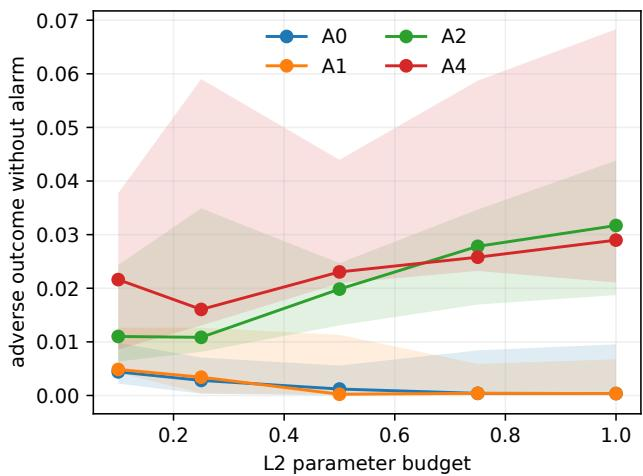
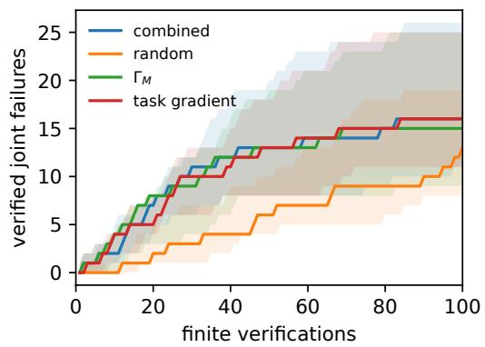
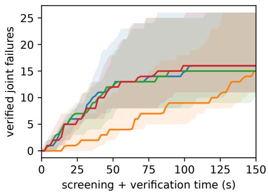
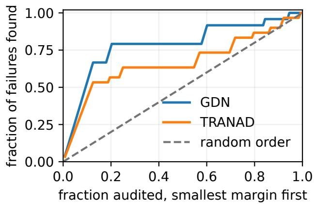

# Quantifying and Prioritizing Stealthy Source-Manipulation Threats Against Multi-Source Anomaly Detectors

Indraveni Chebolu

Information Security Group

Centre for Development of Advanced Computing

Hyderabad, Telangana, India

indravenik@cdac.in

Arnab Mallick

Information Security Group

Centre for Development of Advanced Computing

Hyderabad, Telangana, India

arnabm@cdac.in

Seema Panghal

Information Security Group

Centre for Development of Advanced Computing

Hyderabad, Telangana, India

seemap@cdac.in

Ch A S Murty

Information Security Group

Centre for Development of Advanced Computing

Hyderabad, Telangana, India

chasmurty@cdac.in

Abstract—Security pipelines often fuse several data sources and protect a downstream model with a cross-source anomaly detector. Such detectors are usually judged by their clean falsepositive rate and by how well they catch random corruption. Neither metric captures an adversary who controls some sources and targets a specific downstream decision. We propose a threat-quantification score, the task-conditioned visibility margin, defined as the least detector evidence a manipulation must reveal per unit of harm to the downstream task. The margin has a closed form, takes about 85 µs per certificate, yields a minimum-evidence attack, and identifies task-relevant directions the detector cannot see. On a 17-channel industrial telemetry benchmark, a detector that flags 82.8% of random single-channel corruptions is first-order blind on 64.7% of task/subset pairs in an audit of one- to four-channel subsets. Task-conditioned manipulations cause more than twice as many falsely reassuring errors as generic stealthy ones, and more of them evade the alarm on four of five splits, mainly at small budgets. Used to prioritize audits on held-out subsets, the margin finds a median of four verified failures in ten checks, compared with none for random order and two for alarmbased ranking, and performs comparably to the task-gradient baseline. It also ranks vulnerable configurations of the learned GDN and TranAD detectors and of a five-source crop-yield panel.

## 1. Introduction

Analysts rarely have the budget to verify every data source that feeds a model. When several sources are fused and checked by a cross-source anomaly detector, a practical question follows: which source subsets should be audited first? Standard detector metrics do not answer it. A detector can flag most random corruptions and still miss the coordinated change that a downstream decision depends on.

The mechanism is geometric. A detector constrains only the directions its residual responds to; when the task depends on the remaining directions, a coordinated change across sources moves the decision while the residual barely moves.

This is the static, task-conditioned form of unobservable false-data injection [1]. We turn it into a per-subset threat score for learned, nonlinear detectors and downstream models, and use the score to rank audits.

Contributions.

Threat score. For any compromised source subset, the margin $\Gamma _ { M }$ measures the minimum whitened detector evidence per unit of downstream harm. It has a closed form, gives a minimum-evidence attack, and equals the slope of the optimal nonlinear evidence– harm trade-off for small attacks.

Explanation. The margin separates exact blind spots from weakly visible directions and shows why the same detector carries different risk for different downstream tasks.

Prioritization. On held-out source subsets, ranking by $\Gamma _ { M }$ finds verified failures ahead of random and alarm-based orderings and comparably to the taskgradient baseline, while also diagnosing which detector directions make the subsets vulnerable.

Evaluation. We test principal-component-analysis (PCA), reconstruction, GDN, and TranAD detectors on industrial telemetry and a crop-yield panel with adaptive finite attacks. The artifact [2] is public.

## 2. Threat Model

The state $\boldsymbol { x } ~ \in ~ \mathbb { R } ^ { k }$ concatenates source blocks. The detector computes a residual vector $g ( x ) \in \mathbb { R } ^ { r }$ and raises an alarm when a score of $g ( x )$ crosses a threshold calibrated at the 95th validation percentile. The downstream task is a differentiable scalar $\bar { f } ( \boldsymbol { x } )$ , such as a regression output or class margin, signed so that increasing it is harmful.

The adversary controls a declared subset M of sources, for example through a compromised acquisition, calibration, or reporting path. Its actions are parameterized by $b \in \mathbb { R } ^ { m }$ through a map $\phi _ { x , M }$ with $\phi _ { x , M } ( 0 ) = x ;$ sources outside M stay fixed. We write

$$
G _ { M } ( b ) = g ( \phi _ { x , M } ( b ) ) , \qquad F _ { M } ( b ) = f ( \phi _ { x , M } ( b ) ) .
$$

The adversary seeks a large task change $F _ { M } ( b ) - F _ { M } ( 0 )$ with a small detector change $G _ { M } ( b ) - G _ { M } ( 0 )$ under a Euclidean norm budget $\| b \| _ { 2 } \leq \rho$ . The defender’s objective is to prioritize source subsets for verification.

Controls and attacker knowledge. Controlling a source means altering the input values delivered during the evaluated window, not the ground truth, other sources, model parameters, or alarm threshold. In Hydraulic telemetry, each compromised channel permits a gain and a bias on its original trace; summary features are recomputed from that trace (Appendix B). This models a compromised input path, not arbitrary editing of derived features. The defender computes the margin using its own models and tests attacks under white-box access; Section 5.5 examines transfer to surrogate-model attackers. Physical compromise and fully black-box attacks are outside these experiments.

## 3. Quantifying the Threat

Let $J _ { M } = D G _ { M } ( 0 )$ be the restricted detector Jacobian, $u _ { M } = \nabla F _ { M } ( 0 )$ the restricted task gradient, $\Omega \succ 0$ the residual weighting (the noise covariance, or I for standardized residuals), and $A _ { M } = J _ { M } ^ { \top } \Omega ^ { - 1 } J _ { M }$ the local detector information. Here Proj denotes Euclidean orthogonal projection and † denotes the Moore–Penrose pseudoinverse.

Exact blind spots. If $\mathrm { P r o j } _ { \ker J _ { M } } u _ { M } \neq 0$ , the adversary can change the task while the detector output stays constant to first order.

Theorem 1 (Harmful blind manifold). If $G _ { M }$ is $C ^ { 1 }$ with constant rank $r _ { M }$ near zero, its level set through zero is locally a manifold of dimension $m - r _ { M }$ with tangent space ker $J _ { M } . \mathit { I f h } _ { M } = \| \operatorname { P r o j } _ { \ker J _ { M } } u _ { M } \| _ { 2 } > 0 ,$ , a unit-speed curve on this level set changes the task at first-order rate $h _ { M }$

Graded visibility. Exact blind spots are the limiting case of a broader phenomenon: directions that the detector observes only weakly. The margin grades this continuum, from exactly blind $( \Gamma _ { M } = 0 )$ to strongly observed.

Definition 2 (Task-conditioned visibility margin). For $u _ { M } \neq 0 .$

$$
\Gamma _ { M } = \operatorname* { i n f } _ { u _ { M } ^ { \top } b = 1 } \| J _ { M } b \| _ { \Omega ^ { - 1 } } , \qquad \| z \| _ { \Omega ^ { - 1 } } ^ { 2 } = z ^ { \top } \Omega ^ { - 1 } z .\tag{1}
$$

A small $\Gamma _ { M }$ means that a unit of first-order task change requires little linearized detector evidence. If $u _ { M } = 0 ,$ , no first-order task change is possible on that subset, and the case is excluded from ranking.

Theorem 3 (Closed form and minimum-evidence attack). $\Gamma _ { M } = 0 ~ i f$ and only if $h _ { M } > 0$ . Otherwise

$$
\Gamma _ { M } ^ { 2 } = \big ( u _ { M } ^ { \top } A _ { M } ^ { \dagger } u _ { M } \big ) ^ { - 1 } , \qquad b ^ { * } ( \Delta ) = \Delta \frac { A _ { M } ^ { \dagger } u _ { M } } { u _ { M } ^ { \top } A _ { M } ^ { \dagger } u _ { M } } ,\tag{2}
$$

and $b ^ { * } ( \Delta )$ minimizes first-order detector evidence among attacks with first-order task shift ∆.

The margin is a local quantity, and it also governs the true nonlinear trade-off for small attacks.

Theorem 4 (Local frontier). Suppose $F _ { M }$ and $G _ { M }$ are $C ^ { 2 }$ and $\Gamma _ { M } > 0 .$ . Fix any constant $C > \| b ^ { * } ( 1 ) \| _ { 2 } .$

For $\Delta > 0 ;$ , define the minimum observable evidence as

$$
V _ { M } ( \Delta ) : = \operatorname* { m i n } _ { \stackrel { F _ { M } ( b ) - F _ { M } ( 0 ) = \Delta } { \| b \| _ { 2 } \leq C \Delta } } \| G _ { M } ( b ) - G _ { M } ( 0 ) \| _ { \Omega ^ { - 1 } } .\tag{3}
$$

Then, as $\Delta \downarrow 0 ,$

$$
\boxed { V _ { M } ( \Delta ) = \Gamma _ { M } \Delta + O ( \Delta ^ { 2 } ) . }\tag{4}
$$

Proofs are in Appendix A. Theorem 4 concerns small attacks: curvature affects its $O ( \Delta ^ { 2 } )$ remainder, while $\Gamma _ { M }$ alone does not account for a finite norm budget or the available alarm slack. A low margin therefore need not imply a feasible undetected attack; every reported failure is tested against the full nonlinear pipeline.

The margin is invariant under smooth, locally invertible changes of attack coordinates. It also cannot decrease when an independent check contributes a positive-semidefinite information matrix $B s \succeq 0$ to $A _ { M }$ . We standardize task outputs to compare margins across tasks.

Why task conditioning matters. The smallest singular value $\sigma _ { \mathrm { m i n } }$ of $J _ { M }$ is task-agnostic, whereas $\Gamma _ { M }$ uses the task gradient. Two tasks can therefore share the same detector and Jacobian spectrum but have different margins (Table 1).

What the task-gradient baseline omits. The norm $\Vert u _ { M } \Vert _ { 2 }$ measures task change per unit control magnitude but ignores detector sensitivity. For example, let $\Omega \ = I ,$ $J _ { M } = \mathrm { d i a g } ( 1 , \epsilon ) , 0 < \epsilon < 1$ , and let $e _ { 1 } , e _ { 2 }$ be standard basis vectors. Tasks with gradients $e _ { 1 }$ and $e _ { 2 }$ have equal norms but margins 1 and ϵ: the second is less visible to the detector. Conversely, if $A _ { M } = \alpha I$ for a common $\alpha > 0 ,$ then $\Gamma _ { M } = \sqrt { \alpha } / \lVert u _ { M } \rVert _ { 2 } ;$ sorting by increasing margin is equivalent to sorting by decreasing task-gradient norm. The margin’s additional value is to expose detector visibility, even when both scores yield similar empirical audit rankings.

Audit prioritization. For a fixed task and accepted state, the defender ranks candidate subsets by increasing $\Gamma _ { M }$ and verifies selected cases with finite attacks. Each certificate uses a singular-value decomposition (SVD) and a pseudoinverse. It costs about $8 5 \mu \mathbf { s } ,$ around 70 times less than one numerical attack optimization (5.9 ms).

## 4. Evaluation Setup

Industrial telemetry. The UCI Hydraulic Systems rig [3] provides 2,205 cycles from 17 channels. Each channel contributes its mean, standard deviation, root-meansquare (RMS), minimum, and maximum (85 features). Four downstream tasks predict cooler, valve, pump, and accumulator condition. We use five seeded contiguous-block 60/20/20 splits with standardized multi-output ridge and multilayer-perceptron (MLP) task models (balanced accuracy .791 and .914). The PCA detector projects standardized features onto the r lowest-variance principal directions, with residual dimension $r \in \left\{ 1 , 2 , 4 , 8 , 8 5 \right\} \ ( r = 8 5 $ is the full residual), and alarms on the squared residual norm, the square of the evidence in Eq. (1) when Ω = I. The adversary applies a fractional gain and a bias to each compromised channel, and all five summaries are recomputed exactly (Appendix B).

Learned detectors. We repeat the audit with GDN [4] and TranAD [5] on per-second 17-channel sequences, with the native point score aggregated by its maximum over each cycle. Here $J _ { M }$ is the central-difference Jacobian (step 10−4) of the full signed residual sequence, scaled per channel by its training median and interquartile range and evaluated at the training-mean cycle. The max-aggregated alarm is non-smooth, so for these detectors we use the margin as a ranking score and validate it with finite attacks.

Crop-yield panel. The ICRISAT panel [6] has five sources (rainfall, temperature, irrigated area, nitrogen fertilizer, acreage) and reported yield as the target. We use a temporal split (train through 2008, validate on 2009–2010, test on 2,002 later rows), a ridge or contextual MLP task model, and a PCA or reconstruction detector.

Attacks. All attacks share a source support M, norm budget $\| b \| _ { 2 } \leq \rho ,$ and detector threshold. A0 uses a random direction; A1 follows the task gradient; A2 follows the detector’s least visible direction regardless of harm (generic stealth); A4 follows the task-conditioned direction $b ^ { * }$ of Eq. (2), rescaled to the budget. The matched comparison uses the 17 single-channel and 43 evaluated twochannel subsets. These supports are first-order identified (ker $J _ { M } ~ = ~ \{ 0 \} )$ , so no nonzero control is perfectly invisible to first order; the artifact [2] also implements an exact-kernel attack (A3) for blind subsets. Sequential leastsquares programming (SLSQP) supplies a constrained finiteattack reference. Numerical rank counts singular values above $1 0 ^ { - 1 0 } \operatorname* { m a x } ( m , r ) \operatorname* { m a x } ( \sigma _ { 1 } , 1 )$ , where $\sigma _ { 1 }$ is the largest singular value of $J _ { M }$

Outcome. A verified failure is a feasible finite attack that turns an initially correct, accepted prediction into a falsely reassuring one, i.e., a healthier condition than the true one (such as full cooler efficiency when the cooler is degraded), without raising an alarm. In Table 2, Adverse is the rate of newly caused falsely reassuring errors, Alarm is the rate of flagged attacks, and Joint is the rate of adverse errors without alarms, all among initially correct, accepted cases. Thresholds, supports, and budgets are fixed on training and validation data; test data is used once.

TABLE 1. ONE SUBSET (TS4+VS1), FOUR TASKS. RANK AND THE SMALLEST JACOBIAN SINGULAR VALUE ARE TASK-AGNOSTIC; A4 HARM IS A REALIZED STANDARDIZED TASK CHANGE.
<table><tr><td>Task</td><td>Rank</td><td> $\sigma _ { \mathrm { m i n } }$ </td><td> $\Gamma _ { M }$ </td><td>A4 harm</td></tr><tr><td>Cooler</td><td>4</td><td> $7 . 6 9 \times 1 0 ^ { - 8 }$ </td><td> $1 . 6 9 \times 1 0 ^ { - 4 }$ </td><td>.0008</td></tr><tr><td>Valve</td><td>4</td><td> $7 . 6 9 \times 1 0 ^ { - 8 }$ </td><td> $5 . 7 3 \times 1 0 ^ { - 7 }$ </td><td>.0794</td></tr><tr><td>Pump</td><td>4</td><td> $7 . 6 9 \times 1 0 ^ { - 8 }$ </td><td> $2 . 3 1 \times 1 0 ^ { - 6 }$ </td><td>.0185</td></tr><tr><td>Accumulator</td><td>4</td><td> $7 . 6 9 \times 1 0 ^ { - 8 }$ </td><td> $3 . 7 1 \times 1 0 ^ { - 7 }$ </td><td>.1301</td></tr></table>

TABLE 2. MATCHED HYDRAULIC OUTCOMES (%): FIVE-SPLIT MEDIAN[RANGE]. Joint IS A NEWLY CAUSED FALSELY REASSURING ERRORWITHOUT AN ALARM.
<table><tr><td>Attack</td><td>Adverse</td><td></td><td>Alarm</td><td>Joint</td></tr><tr><td>A0 random</td><td>18.3 [14.1, 20.5]</td><td></td><td>95.9 [89.3, 96.5]</td><td>0.20 [0.05, 0.74]</td></tr><tr><td>A1 task gradient</td><td>46.3 [40.9, 52.8]</td><td>97.9 [94.8, 98.1]</td><td></td><td>0.22 [0.11, 0.99]</td></tr><tr><td>A2 generic stealth</td><td>6.6 [5.1, 7.3]</td><td>36.5 [18.7, 41.7]</td><td></td><td>2.02 [1.38, 3.25]</td></tr><tr><td>A4 task conditioned</td><td>14.5 [11.9, 16.9]</td><td>49.2 [30.9, 53.2]</td><td></td><td>2.31 [1.76, 5.35]</td></tr></table>

## 5. Results

## 5.1. Detectors That Catch Random Corruption Have Blind Spots

With residual dimension $r = 8 ,$ , the Hydraulic detector has a test false-positive rate (FPR) of 3.18% and flags 82.8% of random single-channel gain/bias corruptions at radius .5. Over the reference-split audit of source subsets of size one to four, the same detector is first-order blind on 64.7% of task/subset pairs. With $r \leq 4$ the blind fraction is at least 98.9%, as expected: most audited subsets have three or four channels and hence six or eight controls, more than the r residual coordinates. The full residual (r = 85) has no blind pair.

Table 1 compares the same two-channel subset, TS4 (temperature) and VS1 (vibration), across four tasks. The rank and $\sigma _ { \mathrm { m i n } }$ of $J _ { M }$ are identical, while $\Gamma _ { M }$ spans almost three orders of magnitude; the margin’s ordering agrees with the reported realized A4 harm. The last column records the finite A4 task-output change in standardized task units.

## 5.2. Task-Conditioned Attacks

We compare attacks on identical tuples of split, state, subset, task, budget, and threshold. The population contains 1,229–1,369 initially correct, accepted task–cycle units per split, over 17 single-channel and 43 evaluated two-channel subsets and five budgets.

Table 2 summarizes the outcomes. A4 causes more adverse outcomes than A2 on every split (11.9–16.9% versus 5.1–7.3%). A1 has the highest adverse-outcome rate, but its attacks also trigger detector alarms in at least 94.8% of evaluated cases. On the joint endpoint, A4 exceeds A2 on four of five splits, with the gain concentrated at budgets .1– $. 5 ;$ at larger budgets both attacks trigger more alarms and converge (Fig. 1).

  
Figure 1. Joint adverse-without-alarm rate by attack budget. Lines are fivesplit medians; bands span the splits.

TABLE 3. MEDIAN HELD-OUT VERIFIED FAILURES FOUND WITHIN AN AUDIT BUDGET (94 FAILURES AMONG 680 HELD-OUT CASES).
<table><tr><td>Ranker</td><td>10</td><td>25</td><td>50</td><td>100</td></tr><tr><td>Random order</td><td>0</td><td>3</td><td>6</td><td>13</td></tr><tr><td>Alarm slack / scalar score</td><td>2</td><td>3</td><td>4</td><td>13</td></tr><tr><td>Task-gradient norm</td><td>4</td><td>8</td><td>13</td><td>16</td></tr><tr><td>Combined (validation-selected)</td><td>2</td><td>9</td><td>13</td><td>16</td></tr><tr><td> $\Gamma _ { M }$  (ours)</td><td>4</td><td>9</td><td>13</td><td>15</td></tr></table>

The margin also explains where the A4 advantage concentrates. Low-margin directions trade detector evidence for control magnitude (median $\Vert b ^ { * } ( 1 ) \Vert _ { 2 } = 1 1 . 4$ over matched cases), so at small budgets A4 achieves its task effect while staying closest to the residual floor, which matches the gains at budgets .1–.5 in Fig. 1. Certificates use one Jacobian at the training-mean cycle, while alarms are evaluated on each test cycle; these per-cycle deviations account for alarms beyond the first-order prediction.

## 5.3. Audit Prioritization

An audit case is a tuple of split, source subset, task, and one fixed initially correct, accepted state. We partition cases by hashed subset identity: 520 development cases select tie rules and a combined ranker, while 680 cases from disjoint subsets are held out. A finite search at budgets .1, .25, and .5 labels 94 of the held-out cases as verified failures. It starts from zero, the task-gradient direction, and b∗, so the labels do not favor either informed ranker. Alarm slack ranks cases by their clean distance to the threshold.

Table 3 and Fig. 2 report the results. Within ten audits, $\Gamma _ { M }$ finds a median of four failures, compared with zero for random order and two for both alarm-slack ranking and the combined ranker. Its advantage over alarm-slack ranking is 2.2 failures (paired bootstrap interval [1.0, 3.2]). Compared with task-gradient ranking, the reported paired difference is 0.6 (interval [0, 1.8]). This comparison uses within-split count differences: it need not equal the difference of the separately reported medians, both of which are four at ten checks. At budgets 25, 50, and 100, the medians are 9, 13, and 15 for the margin, versus 8, 13, and 16 for gradient norm (Table 3). The two rankers therefore perform comparably on held-out cases; the margin additionally identifies weakly monitored task directions (Table 1). Residual whitening by identity, diagonal, or Ledoit–Wolf covariance gives the same margin-ranker medians.

## 5.4. Learned Detectors

Across four independently trained splits and 128 subset/task combinations, neither GDN nor TranAD has an exact first-order blind direction, yet margins on the reference split span from .0029 to 1138 for GDN and from .010 to 3112 for TranAD. At budget .5, the Spearman association between the margin and the joint outcome is negative on all four splits: −.675 to −.229 for GDN and −.655 to −.325 for TranAD. Task-conditioned attacks expose 24–34 GDN and 24–39 TranAD vulnerable configurations per split; on the reference split, generic stealth exposes 12 and 19. Fig. 3 shows that auditing in margin order finds these failures faster than random order.

## 5.5. Gray-Box Transfer

We repeat the Hydraulic attacks with surrogate task models and detectors on 60 fixed two-channel subsets. White-box attacks have median standardized harm .155. Surrogates with the same architecture, trained on 10–100% of the data or with independent weights, retain median harm .058 to .156, with median first-order detector leakage below $1 0 ^ { - 6 }$ . Here leakage denotes the target detector’s linearized residual change under the transferred control, $\| J _ { M } b \| _ { \Omega ^ { - } }$ 1 . A different-architecture surrogate retains harm .089 with leakage $1 . 7 \times 1 0 ^ { - 5 }$ . Detector mismatch affects leakage, whereas task-gradient mismatch affects transferred harm. These tests evaluate imperfect model knowledge for fixed source supports.

## 5.6. Crop-Yield Panel and Local Accuracy

The linear crop detector has six harmful blind subsets among all 31. Adding a direct check on fertilizer leaves two, and adding acreage removes all of them. With the nonlinear task model and reconstruction detector, the margin is negatively associated with A4 harm for every one of five model seeds (Spearman −.561 to −.212), and A4 exceeds A2 in median harm for every seed. The finite-attack optimization also agrees with the local prediction of Theorem 4: at task effect $\Delta = . 0 1$ , optimized nonlinear evidence per unit harm differs from Γ by a median of 5.1% across 40 fixed states (Spearman .994).

  
Figure 2. Held-out audit allocation by number of verifications (left) and by screening-plus-verification time (right). Curves are five-split medians; bands span the splits.

  
Figure 3. GDN and TranAD audit allocation at budget .5, with configurations ordered by increasing margin.

## 6. Related Work

Stealthy false-data injection. Liu et al. [1] showed that an attacker who knows the measurement model of DC state estimation can inject a change in the column space of the measurement matrix that leaves the bad-data residual unchanged. Later work quantified and defended against this attack. Security indices give the fewest measurements an attacker must corrupt [7], [8]. Kosut et al. [9] characterize unobservable attacks and design detectors for them. Bobba et al. [10] and Kim and Poor [11] choose which measurements to protect so that no unobservable attack remains. In dynamic systems, Pasqualetti et al. [12] characterize undetectable attacks through system zeros. Fawzi et al. [13] bound how many sensors can be corrupted while the state remains recoverable. Mo and Sinopoli [14] bound the degradation a stealthy attacker can cause. The output-to-output gain of Teixeira et al. [15] is closest to our score: for a static scalar task, $1 / \Gamma _ { M }$ plays the same role. Theorem 1 is a nonlinear, task-restricted analogue of the column-space condition. Our monotonicity property parallels the measurement-protection results: in our crop panel, a direct check on acreage removes every harmful blind subset (Section 5.6). These works assume a known linear or linearized physical model and measure harm on a state estimate. Our detectors and task models are learned from data, harm is measured on a downstream prediction, and the score is used to rank source subsets for audit.

Evading anomaly detectors in industrial systems. Urbina et al. [16] showed that stealthy attackers can cause substantial damage against widely deployed industrial control system (ICS) detectors, and proposed an impact metric under a false-alarm budget. Erba et al. [17], [18] optimize manipulations that conceal real process anomalies from reconstruction-based detectors, including in white-box settings. Giraldo et al. [19] survey physics-based detection and how it is evaluated. These works ask whether an existing anomaly can be hidden, and they evaluate one attack at a time. We ask which source subsets let an attacker create a harmful downstream change, and we give a closed-form screen per subset before any attack is run.

Sensor fusion. Attacks on autonomous-driving perception show that fused systems fail when an adversary controls a subset of sources. Shen et al. [20] exploit GPS spoofing against multi-sensor localization, and Cao et al. [21] construct objects that are invisible to both camera and LiDAR. Each of these attacks is built by hand for one system. ΓM is a generic screen for which subsets of a fused pipeline are weakly cross-checked.

Adaptive evaluation and robustness scores. Test-time evasion [22] and adaptive attacks on defenses [23], [24], [25] show that detectors must be attacked as complete systems. For this reason, every failure we report is verified by a finite attack against the full pipeline. Certified defenses [26], [27] bound how much a single classifier’s output can change under norm-bounded perturbations. CLEVER [28] estimates a local robustness score from gradient norms. ΓM is likewise a cheap first-order score, but it measures a trade-off between two models (a downstream task and a separate detector), and it is restricted to perturbations that a compromised source can actually realize.

Benchmarking time-series detectors. Wu and Keogh [29] show that common anomaly benchmarks contain trivial or mislabeled anomalies. Kim et al. [30] show that point-adjusted F1 can overstate detector quality. GDN [4] and TranAD [5], which we audit, are evaluated by clean detection metrics. Our results add a separate axis: clean false-positive rate and recall on random corruption reveal little about task-targeted manipulation (Section 5.1).

Threat prioritization. Defenders rank vulnerabilities in several ways:

• by severity (CVSS [31]);

• by likelihood of exploitation (EPSS [32]);

• by stakeholder-specific decision trees (SSVC [33]), which recent work automates with LLMs [34].

Attack graphs [35] rank paths through a network. These methods prioritize known vulnerabilities from their descriptions or from network reachability. $\Gamma _ { M }$ instead prioritizes data sources by how weakly a detector constrains taskrelevant manipulation of them, and it can be computed before any vulnerability is reported.

Estimation and optimal design. Under Gaussian residual noise with covariance Ω, $A _ { M }$ is the Fisher information of the attack controls. $\Gamma _ { M } ^ { 2 }$ in Eq. (2) is therefore the Fisher information on the scalar task shift $u _ { M } ^ { \top } b$ [36]. Maximizing $\Gamma _ { M }$ over added checks is the local analogue of c-optimal experimental design [37]. We use this classical structure to screen and explain. The monotonicity property suggests the margin could also guide where to add checks.

## 7. Limitations and Conclusion

Because $\Gamma _ { M }$ is a local first-order screen rather than a global predictor of finite-budget damage across heterogeneous operating states, the pooled state-and-attack margin– harm rank correlation on Hydraulic is weak (−.075). Accordingly, $\Gamma _ { M }$ is used to prioritize verification within an audit, not to estimate calibrated failure probabilities. Our evaluation covers a laboratory hydraulic rig and a five-source crop-yield panel across PCA, reconstruction, GDN, and TranAD detectors; broader architectures, physical process constraints, and time-varying source compromise remain to be evaluated.

Clean anomaly detection and resistance to targeted source manipulation are distinct properties. The margin makes the local task–detector trade-off explicit and directs finite verification toward the most weakly monitored cases.

## Ethics

All experiments use public datasets and controlled offline manipulations, and the artifact supports defensive auditing.

## LLM Usage Statement

LLMs assisted with artifact preparation and manuscript language editing.

## Ethics

All experiments use public datasets and controlled offline manipulations, and the artifact supports defensive auditing.

## LLM Usage Statement

LLMs assisted with artifact preparation, manuscript language editing.

## References

[1] Y. Liu, P. Ning, and M. K. Reiter, “False data injection attacks against state estimation in electric power grids,” in Proceedings of the 16th ACM Conference on Computer and Communications Security, 2009, pp. 21–32.

[2] A. Mallick, “Arnab-m1/blind-spots-in-cross-source-ml-integritymonitoring: Blind spots in cross source ml integrity monitoring,” Oct. 2026. [Online]. Available: https://doi.org/10.5281/zenodo.23682852

[3] N. Helwig, E. Pignanelli, and A. Schutze, “Condition monitoring¨ of hydraulic systems,” UCI Machine Learning Repository, 2015. [Online]. Available: https://archive.ics.uci.edu/dataset/447/condition+ monitoring+of+hydraulic+systems

[4] A. Deng and B. Hooi, “Graph neural network-based anomaly detection in multivariate time series,” Proceedings of the AAAI Conference on Artificial Intelligence, vol. 35, no. 5, pp. 4027–4035, 2021.

[5] S. Tuli, G. Casale, and N. R. Jennings, “TranAD: Deep transformer networks for anomaly detection in multivariate time series data,” Proceedings of the VLDB Endowment, vol. 15, no. 6, pp. 1201–1214, 2022.

[6] S. Mohapatra, “ICRISAT district-level data: Heterogeneous climate effect on crop yield and associated risks to water security in india,” 2023. [Online]. Available: https://doi.org/10.17632/ywp3y5j9vv.1

[7] H. Sandberg, A. Teixeira, and K. H. Johansson, “On security indices for state estimators in power networks,” in Preprints of the First Workshop on Secure Control Systems, 2010.

[8] J. M. Hendrickx, K. H. Johansson, R. M. Jungers, H. Sandberg, and K. C. Sou, “Efficient computations of a security index for false data attacks in power networks,” IEEE Transactions on Automatic Control, vol. 59, no. 12, pp. 3194–3208, 2014.

[9] O. Kosut, L. Jia, R. J. Thomas, and L. Tong, “Malicious data attacks on the smart grid,” IEEE Trans. Smart Grid, vol. 2, no. 4, pp. 645– 658, 2011.

[10] R. B. Bobba, K. M. Rogers, Q. Wang, H. Khurana, K. Nahrstedt, and T. J. Overbye, “Detecting false data injection attacks on DC state estimation,” in Preprints of the First Workshop on Secure Control Systems, 2010.

[11] T. T. Kim and H. V. Poor, “Strategic protection against data injection attacks on power grids,” IEEE Trans. Smart Grid, vol. 2, no. 2, pp. 326–333, 2011.

[12] F. Pasqualetti, F. Dorfler, and F. Bullo, “Attack detection and identi-¨ fication in cyber-physical systems,” IEEE Trans. Automatic Control, vol. 58, no. 11, pp. 2715–2729, 2013.

[13] H. Fawzi, P. Tabuada, and S. Diggavi, “Secure estimation and control for cyber-physical systems under adversarial attacks,” IEEE Trans. Automatic Control, vol. 59, no. 6, pp. 1454–1467, 2014.

[14] Y. Mo and B. Sinopoli, “On the performance degradation of cyberphysical systems under stealthy integrity attacks,” IEEE Trans. Automatic Control, vol. 61, no. 9, pp. 2618–2624, 2016.

[15] A. Teixeira, H. Sandberg, and K. H. Johansson, “Strategic stealthy attacks: The output-to-output ℓ2-gain,” in 54th IEEE Conference on Decision and Control. IEEE, 2015, pp. 2582–2587.

[16] D. I. Urbina, J. Giraldo, A. A. Cardenas, N. O. Tippenhauer, J. Valente, M. Faisal, J. Ruths, R. Candell, and H. Sandberg, “Limiting the impact of stealthy attacks on industrial control systems,” in Proc. ACM CCS, 2016.

[17] A. Erba, R. Taormina, S. Galelli, M. Pogliani, M. Carminati, S. Zanero, and N. O. Tippenhauer, “Constrained concealment attacks against reconstruction-based anomaly detectors in industrial control systems,” in Annual Computer Security Applications Conference. ACM, 2020, pp. 480–495.

[18] A. Erba and N. O. Tippenhauer, “White-box concealment attacks against anomaly detectors for cyber-physical systems,” in Detection ofIntrusions and Malware, and Vulnerability Assessment, ser. Lecture Notes in Computer Science, vol. 13959. Springer, 2023, pp. 111– 131.

[19] J. Giraldo, D. Urbina, A. Cardenas, J. Valente, M. Faisal, J. Ruths, N. O. Tippenhauer, H. Sandberg, and R. Candell, “A survey of physics-based attack detection in cyber-physical systems,” ACM Computing Surveys, vol. 51, no. 4, 2018.

[20] J. Shen, J. Y. Won, Z. Chen, and Q. A. Chen, “Drift with devil: Security of multi-sensor fusion based localization in high-level autonomous driving under GPS spoofing,” in Proc. USENIX Security, 2020.

[21] Y. Cao, N. Wang, C. Xiao, D. Yang, J. Fang, R. Yang, Q. A. Chen, M. Liu, and B. Li, “Invisible for both camera and LiDAR: Security of multi-sensor fusion based perception in autonomous driving under physical-world attacks,” in Proc. IEEE S&P, 2021.

[22] B. Biggio, I. Corona, D. Maiorca, B. Nelson, N. Srndi ˇ c, P. Laskov, ´ G. Giacinto, and F. Roli, “Evasion attacks against machine learning at test time,” in Proc. ECML PKDD, 2013.

[23] N. Carlini and D. Wagner, “Adversarial examples are not easily detected: Bypassing ten detection methods,” in Proceedings of the 10th ACM Workshop on Artificial Intelligence and Security, 2017, pp. 3–14.

[24] A. Athalye, N. Carlini, and D. Wagner, “Obfuscated gradients give a false sense of security: Circumventing defenses to adversarial examples,” in Proc. ICML, 2018.

[25] F. Tramer, N. Carlini, W. Brendel, and A. Madry, “On adaptive attacks\` to adversarial example defenses,” in Advances in Neural Information Processing Systems, vol. 33, 2020.

[26] E. Wong and J. Z. Kolter, “Provable defenses against adversarial examples via the convex outer adversarial polytope,” in Proc. ICML, 2018.

[27] J. Cohen, E. Rosenfeld, and J. Z. Kolter, “Certified adversarial robustness via randomized smoothing,” in Proc. ICML, 2019.

[28] T.-W. Weng, H. Zhang, P.-Y. Chen, J. Yi, D. Su, Y. Gao, C.-J. Hsieh, and L. Daniel, “Evaluating the robustness of neural networks: An extreme value theory approach,” in Proc. ICLR, 2018.

[29] R. Wu and E. J. Keogh, “Current time series anomaly detection benchmarks are flawed and are creating the illusion of progress,” IEEE Trans. Knowledge and Data Engineering, vol. 35, no. 3, 2023.

[30] S. Kim, K. Choi, H.-S. Choi, B. Lee, and S. Yoon, “Towards a rigorous evaluation of time-series anomaly detection,” in Proc. AAAI, 2022.

[31] FIRST, “Common vulnerability scoring system version 4.0: Specification document,” Forum of Incident Response and Security Teams, Tech. Rep., 2023. [Online]. Available: https://www.first.org/c vss/v4.0/specification-document

[32] J. Jacobs, S. Romanosky, B. Edwards, I. Adjerid, and M. Roytman, “Exploit prediction scoring system (EPSS),” Digital Threats: Research and Practice, vol. 2, no. 3, 2021.

[33] J. M. Spring, A. Householder, E. Hatleback, A. Manion, M. Oliver, V. Sarvapalli, L. Tyzenhaus, and C. Yarbrough, “Prioritizing vulnerability response: A stakeholder-specific vulnerability categorization (version 2.0),” Carnegie Mellon University Software Engineering Institute, Tech. Rep., 2021.

[34] O. Al Haddad, M. Ikram, E. Ahmed, and Y. Lee, “Prompting the priorities: A first look at evaluating LLMs for vulnerability triage and prioritization,” arXiv:2510.18508, 2025.

[35] O. Sheyner, J. Haines, S. Jha, R. Lippmann, and J. M. Wing, “Automated generation and analysis of attack graphs,” in Proc. IEEE S&P, 2002.

[36] S. M. Kay, Fundamentals of Statistical Signal Processing: Estimation Theory. Prentice Hall, 1993.

[37] F. Pukelsheim, Optimal Design of Experiments. Society for Industrial and Applied Mathematics, 2006.

## Appendix A.

Proofs

## A.1. Theorem 1: Harmful Blind Manifold

Proof. Let

$$
\mathcal { L } _ { M } = \{ b \in \mathbb { R } ^ { m } : G _ { M } ( b ) = G _ { M } ( 0 ) \} .
$$

Since $G _ { M }$ has constant rank $r _ { M }$ near zero, the constant-rank level-set theorem makes ${ \mathcal { L } } _ { M }$ a local manifold of dimension $m - r _ { M }$ , with tangent space

$$
T _ { 0 } { \mathcal { L } } _ { M } = \ker J _ { M } .
$$

Every tangent vector is the initial velocity of a local curve in ${ \mathcal { L } } _ { M }$ . When $h _ { M } > 0 ,$ , choose

$$
v = { \frac { \mathrm { P r o j } _ { \mathrm { k e r } ~ J _ { M } } u _ { M } } { h _ { M } } } , \qquad \| v \| _ { 2 } = 1 .
$$

Along a curve with initial velocity v, the detector output remains constant, while the chain rule gives the task’s firstorder change:

$$
\left. \frac { d } { d t } F _ { M } ( b ( t ) ) \right| _ { t = 0 } = u _ { M } ^ { \top } v = h _ { M } .
$$

Reparameterizing by arc length gives the claimed unit-speed curve. □

## A.2. Theorem 3: Closed Form and Minimum-Evidence Attack

Proof. Because $\Omega \succ 0 .$

$$
b ^ { \top } A _ { M } b = \| J _ { M } b \| _ { \Omega ^ { - 1 } } ^ { 2 } , \qquad \ker A _ { M } = \ker J _ { M } .
$$

Blind case. Suppose $z = \mathrm { P r o j } _ { \ker A _ { M } } u _ { M } \neq 0$ . Then $u _ { M } ^ { \top } z = \| z \| _ { 2 } ^ { 2 }$ , so

$$
b _ { 0 } = \frac { z } { \| z \| _ { 2 } ^ { 2 } }
$$

has $u _ { M } ^ { \top } b _ { 0 } = 1$ and $J _ { M } b _ { 0 } = 0$ . Hence $\Gamma _ { M } = 0$ when $h _ { M } >$ 0.

Positive-margin case. If $\begin{array} { r l r } { h _ { M } } & { { } = } & { 0 } \end{array}$ , then $u _ { M } \in \Sigma$ $\mathrm { r a n g e } ( A _ { M } )$ . For every feasible $b ,$

$$
\begin{array} { r l } & { 1 = u _ { M } ^ { \top } b = ( A _ { M } ^ { \dagger / 2 } u _ { M } ) ^ { \top } ( A _ { M } ^ { 1 / 2 } b ) } \\ & { \qquad \leq \left( u _ { M } ^ { \top } A _ { M } ^ { \dagger } u _ { M } \right) ^ { 1 / 2 } \left( b ^ { \top } A _ { M } b \right) ^ { 1 / 2 } , } \end{array}
$$

where the inequality is Cauchy–Schwarz. Consequently,

$$
b ^ { \top } A _ { M } b \geq \big ( u _ { M } ^ { \top } A _ { M } ^ { \dagger } u _ { M } \big ) ^ { - 1 } .
$$

The vector $b ^ { * } ( 1 )$ in $\operatorname { E q . } \left( 2 \right)$ is feasible and attains this bound. Scaling it by ∆ gives the stated minimum-evidence attack for first-order task shift $\Delta$ □

## A.3. Theorem 4: Local Frontier

Proof. Write $w ^ { * } = b ^ { * } ( 1 )$ , so $u _ { M } ^ { \top } w ^ { * } = 1$

Upper bound. The inverse-function theorem applied to $F _ { M } ( \dot { t } \dot { w } ^ { * } ) - F _ { M } ( 0 )$ gives, for small $\Delta > 0$ , a scalar

$$
t ( \Delta ) = \Delta + O ( \Delta ^ { 2 } )
$$

such that

$$
F _ { M } ( t ( \Delta ) w ^ { * } ) - F _ { M } ( 0 ) = \Delta .
$$

Since $C > \| w ^ { * } \| _ { 2 }$ , this attack also satisfies $\| t ( \Delta ) w ^ { * } \| _ { 2 } \ \le$ $C \Delta$ for sufficiently small $\Delta$ . Taylor expansion then yields

$$
\begin{array} { r l } & { V _ { M } ( \Delta ) \leq \| G _ { M } ( t ( \Delta ) w ^ { * } ) - G _ { M } ( 0 ) \| _ { \Omega ^ { - 1 } } } \\ & { \qquad = \Delta \Gamma _ { M } + O ( \Delta ^ { 2 } ) . } \end{array}
$$

Lower bound. Every feasible attack obeys $\| b \| _ { 2 } \leq C \Delta$ Uniform $C ^ { 2 }$ Taylor bounds therefore give constants $K _ { F } , K _ { G }$ for which

$$
\begin{array} { r } { | \boldsymbol { u } _ { M } ^ { \top } \boldsymbol { b } - \boldsymbol { \Delta } | \leq K _ { F } \Delta ^ { 2 } , } \\ { \| \boldsymbol { G } _ { M } ( \boldsymbol { b } ) - \boldsymbol { G } _ { M } ( 0 ) - \boldsymbol { J } _ { M } \boldsymbol { b } \| _ { \Omega ^ { - 1 } } \leq K _ { G } \Delta ^ { 2 } . } \end{array}
$$

By the definition of $\Gamma _ { M }$ and the reverse triangle inequality,

$$
\begin{array} { r l } & { \| G _ { M } ( b ) - G _ { M } ( 0 ) \| _ { \Omega ^ { - 1 } } \geq \| J _ { M } b \| _ { \Omega ^ { - 1 } } - K _ { G } \Delta ^ { 2 } } \\ & { \qquad \geq \Gamma _ { M } | u _ { M } ^ { \top } b | - K _ { G } \Delta ^ { 2 } } \\ & { \qquad \geq \Delta \Gamma _ { M } - ( K _ { G } + \Gamma _ { M } K _ { F } ) \Delta ^ { 2 } . } \end{array}
$$

Taking the infimum over feasible $b$ proves $V _ { M } ( \Delta ) \ =$ $\Delta \Gamma _ { M } \mathbf { \bar { \Gamma } } + O ( \Delta ^ { 2 } )$ □

## A.4. Invariance and Monotonicity

Invariance under a change of controls. Let $b = \psi ( c )$ where $R \ = \ D \psi ( 0 )$ is invertible. The Jacobian and task gradient in the new coordinates are

$$
\widetilde J _ { M } = J _ { M } R , \qquad \widetilde u _ { M } = R ^ { \top } u _ { M } .
$$

The substitution $b = R c$ is a bijection between the linearized unit-effect feasible sets, and it preserves the detector evidence. Therefore the infimum in Eq. (1) is unchanged.

Monotonicity under an added check. Suppose an independent check contributes $B s \succeq 0$ to the information matrix. For every b satisfying $u _ { M } ^ { \top } b = 1$ ，

$$
b ^ { \top } ( A _ { M } + B _ { S } ) b \geq b ^ { \top } A _ { M } b .
$$

Taking infima over the same feasible set shows that adding the check cannot decrease $\Gamma _ { M }$

## Appendix B. Realizable Telemetry Controls

For channel $j ,$ let $a _ { j }$ be the fractional gain, $\beta _ { j }$ the normalized bias, and $s _ { j }$ the training standard deviation of the channel’s cycle mean. The manipulated trace is

$$
y _ { j t } ^ { \prime } = ( 1 + a _ { j } ) y _ { j t } + s _ { j } \beta _ { j } .
$$

When $1 + a _ { j } \geq 0$ , the corresponding summaries transform as

$$
\begin{array} { c } { { \mu _ { j } ^ { \prime } = ( 1 + a _ { j } ) \mu _ { j } + s _ { j } \beta _ { j } , } } \\ { { \sigma _ { j } ^ { \prime } = ( 1 + a _ { j } ) \sigma _ { j } , } } \\ { { ( r _ { j } ^ { \prime } ) ^ { 2 } = ( 1 + a _ { j } ) ^ { 2 } r _ { j } ^ { 2 } + s _ { j } ^ { 2 } \beta _ { j } ^ { 2 } } } \\ { { + 2 ( 1 + a _ { j } ) s _ { j } \beta _ { j } \mu _ { j } . } } \end{array}
$$

Here $r _ { j }$ denotes the root-mean-square (RMS) summary. The minimum and maximum obey the same affine transformation as the mean.

The certificates use the derivative of this feature map at zero. Finite attacks and alarm evaluations instead use the exact map.

## Appendix C. Numerical Robustness

Certificate and derivative checks. Certificates are cross-checked against a constrained optimizer. MLP Jacobians are independently checked using central differences.

Numerical sensitivity. On the linear crop audit, rank tolerances from $1 0 ^ { - 1 2 } \ \mathrm { t o } \ \mathrm { i } 0 ^ { - 6 }$ and diagonal shrinkage up to $1 0 ^ { - 2 }$ produce the same six blind subsets. In the auditallocation study, identity, diagonal, and Ledoit–Wolf fullcovariance whitening give the same median numbers of verified failures:

<table><tr><td>Audit budget</td><td>10 25</td><td>50</td><td>100</td></tr><tr><td>Median failures</td><td>4 9</td><td>13</td><td>15</td></tr></table>

Attack feasibility. Every returned matched attack satisfies its support and norm constraints. The maximum constraint residual is $2 . 2 2 \times 1 0 ^ { - 1 6 }$