# RankFormer: Rethinking Time Series Transformers through Representation Capacity Analysis and Progressive Decoding

Peiwang Tang1,2,3 Cheng HE1,2,3 Xijie Liang3 Defu Lian1,2,✉

1University of Science and Technology of China, Hefei, Anhui, China

2State Key Laboratory of Cognitive Intelligence, Hefei, Anhui, China

3Shanghai Black Wing Asset Management, Shanghai, China

tpw@mail.ustc.edu.cn cheng.he@mail.ustc.edu.cn

lxjie@blackwingasset.com ✉liandefu@ustc.edu.cn

## Abstract

Multivariate time series forecasting plays a critical role in Web and cyber-physical systems, where large-scale services and IoT infrastructures generate complex temporal data. Transformer-based models have achieved strong empirical performance in this do- main, yet the principles governing the expressive capacity of their learned representations remain insuficiently understood. Moreover, many existing models rely on simplified decoding strategies, including channel-independent modeling and direct projection heads, which limit their ability to capture complex multivariate dynamics. To address these challenges, we propose RankFormer, a novel encoder-decoder architecture for multivariate time series forecast- ing. We establish a rank-based analysis framework to investigate how tokenization, embedding, and attention designs afect the repre- sentation capacity of time series Transformers. Our analysis reveals that patchification increases the potential representation capacity by aggregating multiple temporal observations into each token, while subsequent encoding operations determine how much of this capacity is realized. Guided by these insights, we develop a rank enhancing encoder with Hourglass Attention to improve rank stability during information interaction. Furthermore, we introduce the Interactive Progressive Decoder (IPD), which improves future trajectory modeling through global-guided cross-channel interaction and progressive refinement. Extensive experiments on real-world long-term forecasting benchmarks demonstrate that RankFormer achieves competitive performance against state-of-the-art methods. Code repository: https://github.com/TangPeiwang/Rankformer.

## CCS Concepts

• Computing methodologies → Artificial intelligence.

## Keywords

Time Series, Representation Capacity, Hourglass Attention, Inter-active Progressive Decoder

## 1 Introduction

Multivariate time series forecasting is a core problem in modern Web and cyber-physical systems. The growing integration of online services and IoT devices produces large volumes of continuously evolving sensor data [37, 38, 41], supporting applications such as server load balancing, trafic prediction, and resource planning [25, 39, 40], as well as broader domains including finance, power systems, and transportation [5, 29, 42]. Transformer-based models have achieved substantial progress in time series forecasting owing to their ability to capture long-range dependencies [10, 28, 43]. Recent architectural advances, including patch-based tokenization and specialized attention mechanisms, have further improved fore- casting performance across diverse benchmarks [13, 14]. However, despite this empirical success, the underlying principles that determine the representation capacity of time series Transformers and their ability to translate learned representations into accurate forecasts remain insuficiently understood.

This limited understanding raises two fundamental questions:

First, how do encoder architectures create and preserve expressive representations? Existing time series Transformers improve representation capability through various encoding designs, including tokenization, embedding, and attention mechanisms, yet how these components jointly shape the capacity of learned temporal representations remains insuficiently understood. Patchification provides a representative example: by aggregating multiple temporal observations into each token, it expands the at- tainable representation space compared with point-wise tokenization. However, the realized representation capacity is further shaped by subsequent encoding operations. Linear embeddings introduce rank constraints, while bidirectional attention (BiA) may cause excessive token mixing and representation homogenization, leading to rank degeneration [4, 18, 22, 35]. Although unidirectional attention provides stronger rank stability, its restricted receptive field limits global information interaction. Consequently, existing attention designs struggle to simultaneously maintain representation diversity and achieve efective cross-token information exchange, limiting the ability of time series Transformers to fully exploit their representation space.

Second, how can forecasting decoders fully exploit the learned representations? Although modern encoders can produce increasingly expressive latent features, many existing forecasting architectures still rely on simplified decoding strategies. Channel-independent modeling limits cross-variable interaction, while one-shot projection heads such as Flatten-Linear map encoded representations to the entire prediction horizon through a fixed transformation. Such designs overlook the evolving temporal organization and provide limited capability for progressively refining complex future trajectories, which is particularly restrictive for multivariate forecasting with strong cross-channel dependencies.

To address these challenges, we propose RankFormer, a prin-cipled encoder-decoder architecture for multivariate time series forecasting. For the encoder, we establish a rank-based analysis framework to analyze how patchification, embedding, and attention topology shape the efective capacity of learned temporal representations. Based on these observations, we introduce Hourglass Attention (HgA) to improve rank stability during attention-based interaction, preserving diverse representations while enabling effective global information exchange. For the decoder, we develop an Interactive Progressive Decoder (IPD), which enhances future trajectory generation through global-context-guided cross-channel interaction and progressive refinement. Together, RankFormer provides a principled approach to improving representation learning and future trajectory modeling in time series Transformers.

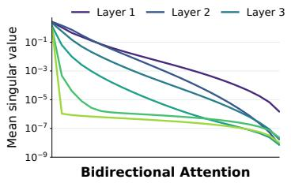

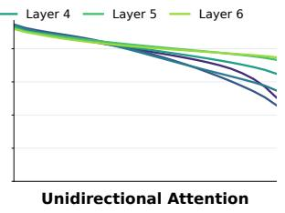  
(a)

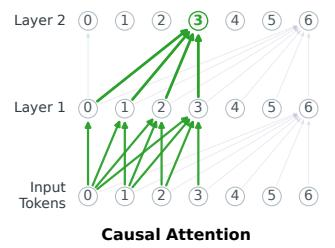

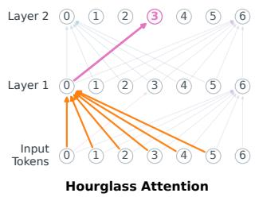  
(b)  
Figure 1: Empirical validation ofrank stability and Hourglass Attention (HgA). (a) Rapid singular value decay shows bidirectional attention induces deep-layer rank collapse, while causal masking preserves representational diversity. (b) Causal masking restricts early tokens (starvation). In contrast, HgA uses a symmetric prefix as a global hub, enabling eficient context retrieval while maintaining rank stability.

Our main contributions are summarized as follows:

• We provide a rank-based analysis of time series Transformer encoders, revealing how patchification, embedding, and attention operations afect representation capacity and ofering a theoretical explanation for the efectiveness of patch-based modeling.

• We propose RankFormer, consisting of HgA and IPD. HgA preserves expressive representations through improved attention design, while IPD captures cross-channel depen-dencies and progressively refines future trajectories.

• Extensive experiments on widely used long-term forecasting benchmarks validate the theoretical observations and demonstrate consistently strong performance against com-petitive state-of-the-art methods.

## 2 Rank Theory Analysis and Key Theorems

In this section, we establish a rank-based theoretical framework to analyze the core components of time series Transformers. We consider the forecasting problem as learning a mapping from historical observations $\mathbf { X } \in \mathbb { R } ^ { L \times C }$ to future sequences $\mathbf { Y } \in \mathbb { R } ^ { \tau \times C }$ . The model first transforms the input sequence into hidden representations $\mathbf { H } \in \mathbb { R } ^ { N \times D }$ , whose structure determines how much independent information can be preserved for subsequent forecasting. We use matrix rank, rank(H), as a quantitative measure to characterize the independent information capacity of hidden representations. A higher rank indicates more independent representation directions and greater potential to preserve diverse information, whereas rank degradation suggests increased redundancy and reduced represen- tation diversity.

## 2.1 Patching as a Rank Expansion Mechanism

When a univariate sequence x $\mathbf { \Psi } : \in \mathbb { R } ^ { L }$ is represented through pointwise tokenization, the resulting token matrix has a single feature dimension, and any linear embedding inherits a rank upper bound of one:

$$
\mathrm { r a n k } ( \mathbf { x } ^ { \top } \mathbf { W } ) \leq \mathrm { r a n k } ( \mathbf { x } ) \leq 1 .
$$

Proposition 1 (Rank Expansion via Patching). Partitioning x into patches of length � and arranging them into a patch matrix $\mathbf { X } _ { p } \ \in \ \bar { \mathbb { R } } ^ { N \times P }$ , where $N = \lfloor L / P \rfloor$ , gives the attainable rank upper bound:

$$
\mathrm { r a n k } ( { \mathbf { X } } _ { p } ) \leq \operatorname* { m i n } ( N , P ) .
$$

When $P > 1$ , patching expands the maximum attainable rank bound from one to min(� , �), increasing the potential number of independent directions available for subsequent representation learning. This provides a rank-based perspective for understanding the efectiveness of patch-based modeling in time series Transform- ers.

## 2.2 Embedding Layer: Breaking Linear Rank Constraints

To map the patched representation $\mathbf { X } _ { p }$ into a hidden representation H $\in \mathbb { R } ^ { N \times D }$ , standard linear projections $( \mathbf { H } = \mathbf { X } _ { p } \mathbf { W } )$ preserve the rank constraint of the input representation:

$$
\operatorname { r a n k } ( \mathbf { H } ) \leq \operatorname* { m i n } ( \operatorname { r a n k } ( \mathbf { X } _ { \rho } ) , D ) \leq \operatorname* { m i n } ( N , P , D ) .
$$

When $D > P ,$ linear embeddings remain constrained by the patch- induced rank bound, limiting the number of independent directions that can be represented in the hidden space.

To overcome this linear rank constraint, we consider nonlinear MLP embeddings:

$$
\mathbf { H } = \phi ( \mathbf { X } _ { \mathcal { P } } \mathbf { W } _ { 1 } + \mathbf { b } _ { 1 } ) \mathbf { W } _ { 2 } + \mathbf { b } _ { 2 } .
$$

Theorem 1 (Maximum Rank Embedding). Let $\phi$ be a continuous, non-polynomial activation function. For any � distinct input patches $\mathbf { X } _ { p } \in \mathbb { R } ^ { \tilde { N } \times P }$ , there exist $M L P$ parameters such that the resulting hidden representation achieves the maximum attainable rank:

$$
\mathrm { r a n k } ( \mathbf { H } ) = \operatorname* { m i n } ( N , D ) .
$$

This theorem shows that nonlinear embeddings overcome the additional rank restriction imposed by linear projections, allowing

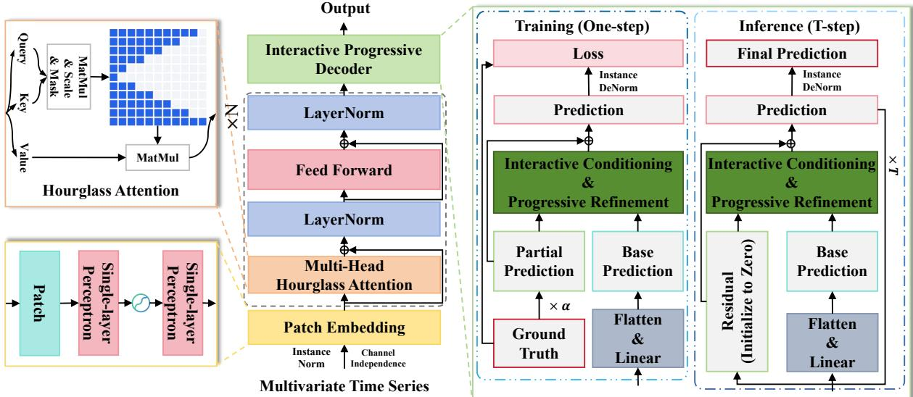  
Figure 2: Overall structure of RankFormer. The model preprocesses multivariate time series via Instance Norm and CI, utilizing Patch Embedding and a Multi-Head Hourglass Attention encoder to generate a base prediction. An Interactive Progressive Decoder then refines these features. It trains via one-step residual learning using randomized partial ground truth, while inference employs a �-step progressive refinement from a zero-residual state, concluding with Instance Denorm.

hidden representations to achieve their maximum attainable rank determined by the sample and hidden dimensions.

## 2.3 Attention Mechanisms: Rank Preservation via Attention Topology

BiA enables global information aggregation across tokens, but its dense mixing structure does not provide an explicit guarantee for preserving representation rank. Repeated dense token mixing may lead to representation homogenization and rank degradation in deep networks [18, 22].

To analyze how attention topology afects rank stability, we compare BiA with unidirectional (e.g., causal) attention. Let $\mathbf { A } _ { \mathrm { b i d } }$ and $\mathbf { A } _ { \mathrm { c a u s a l } }$ denote their attention weight matrices, and let $\mathbf { O } _ { \mathrm { b i d } }$ and $\mathbf { O _ { \mathrm { c a u s a l } } }$ denote the corresponding outputs after value projection and output projection.

Theorem 2 (Rank Preservation of Causal Attention). Given identical projection parameters $( \mathbf { W } _ { Q } , \mathbf { W } _ { K } , \mathbf { W } _ { V } , \mathbf { W } ^ { O } )$ , causal attention preserves the rank of the value representation and guarantees:

$$
\mathrm { r a n k } ( \mathbf { O } _ { \mathrm { c a u s a l } } ) \geq \mathrm { r a n k } ( \mathbf { O } _ { \mathrm { b i d } } ) .
$$

Theorem 2 establishes that causal masking provides a structural rank-preservation property during attention aggregation. In con- trast, BiA may reduce output rank when its learned aggregation fails to preserve independent information directions in the value representation (as shown in Figure 1(a)). This analysis highlights the importance of attention topology in maintaining diverse representations during token interaction. Rather than favoring a specific topology, it motivates attention designs that preserve rank stability while enabling efective information exchange, leading to our proposed Hourglass Attention.

## 3 RankFormer

Guided by the rank-based theoretical framework established above, we propose RankFormer, as illustrated in Figure 2. The architecture consists of a rank-guided encoder with HgA, which improves rank stability during attention-based interaction, and an IPD, which captures complex future trajectories through global-context-guided cross-channel interaction and progressive refinement.

## 3.1 Patch Embedding

To mitigate the adverse efects of magnitude variations across difer-ent variables, we first apply standard instance normalization to the input sequence X along the temporal dimension. The normalized time series is then partitioned into patches of length �, transforming the input into $\mathbf { \dot { X } } _ { \mathrm { p a t c h e s } } \in \mathbb { R } ^ { C \times N \times P }$ , where � is the number of patches. As elucidated in Proposition 1, this patching operation structurally expands the rank capacity of the input representation.

Subsequently, to break the inherent rank bound of linear pro- jections, we map these patches into the hidden space $\mathbb { R } ^ { D }$ using a two-layer MLP with a ReLU activation [16]:

$$
\mathbf { H } _ { \mathrm { e m b e d } } = \mathrm { R e L U } ( \mathbf { X } _ { \mathrm { p a t c h e s } } \mathbf { W } _ { 1 } + \mathbf { b } _ { 1 } ) \mathbf { W } _ { 2 } + \mathbf { b } _ { 2 }
$$

where $\mathbf { W } _ { 1 } \in \mathbb { R } ^ { P \times D _ { \mathrm { m i d } } }$ and $\mathbf { W } _ { 2 } \in \mathbb { R } ^ { D _ { \mathrm { m i d } } \times D }$ . As mathematically guar-anteed by Theorem 1, this nonlinear formulation ensures that the embedding achieves the theoretical maximum rank of min(�, �), fully utilizing the representational potential of the high-dimensional hidden space.

## 3.2 Hourglass Attention

BiA enables global information aggregation across tokens, but re-peated dense mixing may cause representation homogenization and rank degradation in deep networks. In contrast, causal attention provides a structural rank-preservation guarantee through its trian-gular topology, but its directional information flow limits eficient context exchange across tokens. To combine these complementary properties, we propose HgA, a topology-aware attention mecha- nism that reorganizes causal connectivity to maintain rank stability while enabling more efective information interaction.

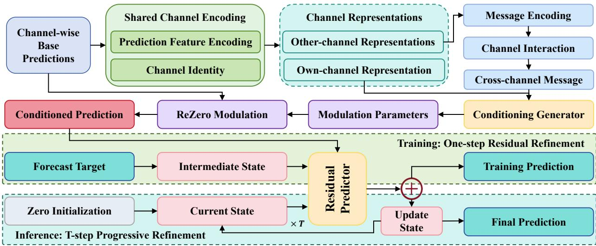  
Figure 3: Internal architecture of the Interactive Progressive Decoder.

HgA introduces an hourglass-shaped attention topology through three design principles. First, early tokens are assigned broader receptive fields to aggregate global context from the observed se- quence. Second, intermediate tokens use restricted receptive fields to reduce excessive token mixing and maintain representation di versity. Third, receptive fields gradually expand toward later tokens, preserving detailed recent information for downstream forecasting. Together, these designs redistribute information access within the sequence while retaining the rank-stability property inherited from causal attention.

HgA is constructed by a topology-preserving reordering of causal attention. For an input sequence of length �, we define �(�) as the maximum visible key index of query position � under this reorder-ing:

$$
\rho ( i ) = \left\{ \begin{array} { l l } { \operatorname* { m a x } ( N - 2 - 2 i , 0 ) , } & { i \leq \lfloor ( N - 1 ) / 2 \rfloor , } \\ { 2 i - N + 1 , } & { i > \lfloor ( N - 1 ) / 2 \rfloor . } \end{array} \right.\tag{1}
$$

This mapping creates an hourglass-shaped receptive field: the visible range contracts toward the sequence center and expands toward the sequence end. The corresponding mask is:

$$
\mathbf { M } ^ { \mathrm { H g } } [ i , j ] = \left\{ { \begin{array} { l l } { 0 , } & { j \leq \rho ( i ) , } \\ { - \infty , } & { { \mathrm { o t h e r w i s e } } . } \end{array} } \right.\tag{2}
$$

The attention operation is:

$$
\boldsymbol { \mathbf { A } } ^ { \mathrm { H g } } = \mathrm { S o f t m a x } \left( \frac { \boldsymbol { \mathbf { Q } } \boldsymbol { \mathbf { K } } ^ { \top } } { \sqrt { d _ { k } } } + \boldsymbol { \mathbf { M } } ^ { \mathrm { H g } } \right) ,\tag{3}
$$

$$
\mathrm { H g A t t n } ( \mathbf { Q } , \mathbf { K } , \mathbf { V } ) = \mathbf { A } ^ { \mathrm { H g } } \mathbf { V } .\tag{4}
$$

Since HgA is obtained through a reordering of causal connectivity, its attention matrix retains the rank-preservation property of

causal attention while providing a diferent receptive field alloca- tion.

## 3.3 Interactive Progressive Decoder

The IPD (Figure 3) addresses the mapping bottleneck by transforming channel-independent encoder representations into multivariate forecasts. It first generates a channel-wise base prediction, then introduces cross-channel conditioning to incorporate interactions among variables, and finally refines the prediction through progres- sive residual updates.

Base Prediction. IPD first obtains a channel-independent base prediction from the flattened encoder representations using a shared linear projection. We denote the initial prediction of channel � as $\mathbf { y } _ { C } ^ { \mathrm { b a s e } } \in \mathbb { R } ^ { \tau }$ , where � is the forecast horizon. This base prediction provides the initialization for subsequent cross-channel conditioning and progressive residual refinement.

Cross-channel Conditioning. To introduce multivariate interactions while preserving channel-specific information, IPD constructs an interaction-aware conditioning representation for each channel. The base prediction is first projected into a feature space:

$$
\mathbf { u } _ { C } = \mathrm { G E L U } ( \mathbf { P y } _ { C } ^ { \mathrm { b a s e } } + \mathbf { b } _ { P } ) .\tag{5}
$$

A learnable channel embedding ${ \bf e } _ { C }$ is combined with the predic- tion feature:

$$
\mathbf { f } _ { C } = [ \mathbf { u } _ { C } ; \mathbf { e } _ { C } ] ,\tag{6}
$$

where $\mathbf { f } _ { C }$ represents the channel-specific conditioning feature.

The cross-channel branch transforms each channel representa- tion into a message feature:

$$
\mathbf { m } _ { j } = \mathbf { W } _ { m } \mathbf { f } _ { j } + \mathbf { b } _ { m } .\tag{7}
$$

For channel �, the received information from other variables is aggregated as:

$$
\mathbf { m } _ { C } ^ { \mathrm { c r o s s } } = \sum _ { j \neq C } \mathbf { M } _ { C j } \mathbf { m } _ { j } ,\tag{8}
$$

where M denotes the learnable channel interaction matrix.

Table 1: Results of the Long-Term Time Series Forecasting. All baseline models were configured consistently with SEER. The reported results represent the average performance over four distinct forecasting horizons: {96, 192, 336, 720}.
<table><tr><td>Models</td><td colspan="2">RankFormer (ours)</td><td colspan="2">SEER (2026)</td><td colspan="2">SRSNet (2025)</td><td colspan="2">DUET (2025)</td><td colspan="2">xPatch (2025)</td><td colspan="2">Amplifier (2025)</td><td colspan="2">FredFormer (2024)</td><td colspan="2">iTransformer (2024)</td><td colspan="2">PatchTST (2023)</td><td colspan="2">DLinear (2023)</td></tr><tr><td>Metrics</td><td>MSE</td><td>MAE</td><td>MSE</td><td>MAE</td><td>MSE</td><td>MAE</td><td>MSE</td><td>MAE</td><td>MSE</td><td>MAE</td><td>MSE</td><td>MAE</td><td>MSE</td><td>MAE</td><td>MSE</td><td>MAE</td><td>MSE</td><td>MAE</td><td>MSE</td><td>MAE</td></tr><tr><td>ETTh1</td><td>0.410</td><td>0.421</td><td>0.423</td><td>0.424</td><td>0.442</td><td>0.433</td><td>0.443</td><td>0.436</td><td>0.444</td><td>0.429</td><td>0.449</td><td>0.437</td><td>0.448</td><td>0.435</td><td>0.454</td><td>0.448</td><td>0.469</td><td>0.455</td><td>0.461</td><td>0.458</td></tr><tr><td>ETTh2</td><td>0.354</td><td>0.381</td><td>0.356</td><td>0.384</td><td>0.376</td><td>0.402</td><td>0.372</td><td>0.398</td><td>0.369</td><td>0.392</td><td>0.389</td><td>0.411</td><td>0.378</td><td>0.403</td><td>0.383</td><td>0.407</td><td>0.387</td><td>0.407</td><td>0.563</td><td>0.519</td></tr><tr><td>ETTm1</td><td>0.367</td><td>0.377</td><td>0.377</td><td>0.381</td><td>0.385</td><td>0.395</td><td>0.390</td><td>0.393</td><td>0.387</td><td>0.383</td><td>0.383</td><td>0.396</td><td>0.385</td><td>0.398</td><td>0.407</td><td>0.410</td><td>0.387</td><td>0.400</td><td>0.404</td><td>0.408</td></tr><tr><td>ETTm2</td><td>0.268</td><td>0.311</td><td>0.276</td><td>0.317</td><td>0.284</td><td>0.329</td><td>0.280</td><td>0.324</td><td>0.280</td><td>0.319</td><td>0.280</td><td>0.326</td><td>0.281</td><td>0.324</td><td>0.288</td><td>0.332</td><td>0.281</td><td>0.326</td><td>0.354</td><td>0.402</td></tr><tr><td>Weather</td><td>0.234</td><td>0.256</td><td>0.246</td><td>0.265</td><td>0.250</td><td>0.277</td><td>0.251</td><td>0.273</td><td>0.247</td><td>0.266</td><td>0.247</td><td>0.275</td><td>0.256</td><td>0.278</td><td>0.258</td><td>0.278</td><td>0.259</td><td>0.281</td><td>0.265</td><td>0.315</td></tr><tr><td>Solar</td><td>0.212</td><td>0.217</td><td>0.221</td><td>0.224</td><td>0.250</td><td>0.281</td><td>0.237</td><td>0.233</td><td>0.277</td><td>0.268</td><td>0.222</td><td>0.256</td><td>0.227</td><td>0.267</td><td>0.233</td><td>0.262</td><td>0.270</td><td>0.307</td><td>0.330</td><td>0.401</td></tr><tr><td>Electricity</td><td>0.162</td><td>0.246</td><td>0.169</td><td>0.251</td><td>0.189</td><td>0.276</td><td>0.172</td><td>0.259</td><td>0.184</td><td>0.266</td><td>0.174</td><td>0.268</td><td>0.178</td><td>0.270</td><td>0.178</td><td>0.270</td><td>0.216</td><td>0.304</td><td>0.225</td><td>0.319</td></tr><tr><td>Traffic</td><td>0.431</td><td>0.249</td><td>0.422</td><td>0.245</td><td>0.494</td><td>0.307</td><td>0.451</td><td>0.269</td><td>0.500</td><td>0.283</td><td>0.485</td><td>0.315</td><td>0.434</td><td>0.289</td><td>0.428</td><td>0.282</td><td>0.555</td><td>0.362</td><td>0.625</td><td>0.383</td></tr><tr><td>1stCount</td><td>7</td><td>7</td><td>1</td><td>1</td><td>0</td><td>0</td><td>0</td><td>0</td><td>0</td><td>0</td><td>0</td><td>0</td><td>0</td><td>0</td><td>0</td><td>0</td><td>0</td><td>0</td><td>0</td><td>0</td></tr></table>

The own-channel feature and cross-channel message jointly generate horizon-wise modulation parameters:

$$
\left[ \pmb { \gamma } _ { C } \right] = \mathbf { G } \mathbf { f } _ { C } + \lambda \mathbf { K } \mathbf { m } _ { C } ^ { \mathrm { c r o s s } } + \mathbf { b } _ { G } .\tag{9}
$$

The conditioned prediction is obtained through ReZero modulation:

$$
{ \bf y } _ { C } ^ { \mathrm { c o n d } } = { \bf y } _ { C } ^ { \mathrm { b a s e } } + \rho _ { c } ( { \bf y } _ { C } ^ { \mathrm { b a s e } } \odot \gamma _ { C } + \beta _ { C } ) ,\tag{10}
$$

where $\rho _ { c }$ is initialized to zero.

Progressive Residual Refinement. Instead of directly mapping en coder representations to the future sequence through a static projection, IPD models forecasting as residual refinement from an intermediate prediction state.

During training, a completion ratio $r \sim \mathcal { U } ( 0 , 1 )$ is sampled to construct:

$$
{ \bf y } _ { C } ^ { \mathrm { m i d } } = r { \bf y } _ { C } + \sigma \epsilon _ { C } , \qquad \epsilon _ { C } \sim N ( 0 , { \bf I } ) .\tag{11}
$$

where $\mathbf { y } _ { C }$ is the normalized ground-truth sequence and � controls the noise magnitude.

The residual correction is predicted as:

$$
\Delta \mathbf { y } _ { C } = \mathbf { W } _ { \mathrm { s t a t e } } \mathbf { y } _ { C } ^ { \mathrm { m i d } } + \mathbf { W } _ { \mathrm { c o n d } } \mathbf { y } _ { C } ^ { \mathrm { c o n d } } + \mathbf { b } .\tag{12}
$$

The final training prediction is:

$$
\begin{array} { r } { \hat { \mathbf { y } } _ { C } = \mathbf { y } _ { C } ^ { \mathrm { m i d } } + ( 1 - r ) \Delta \mathbf { y } _ { C } . } \end{array}\tag{13}
$$

Ofline-folded Inference. During inference, IPD initializes the prediction state as ${ \bf y } _ { C } ^ { ( 0 ) } = { \bf 0 }$ and performs � residual updates:

$$
{ \bf y } _ { C } ^ { ( t ) } = { \bf y } _ { C } ^ { ( t - 1 ) } + \frac { 1 } { T } \left( { \bf W } _ { \mathrm { s t a t e } } { \bf y } _ { C } ^ { ( t - 1 ) } + { \bf W } _ { \mathrm { c o n d } } { \bf y } _ { C } ^ { \mathrm { c o n d } } + { \bf b } \right) , \quad t = 1 , \ldots , T .\tag{14}
$$

Since the residual update is afine in the prediction state and ${ \bf y } _ { C } ^ { \mathrm { c o n d } }$ remains fixed across iterations, the � updates can be analytically combined. Specifically, defining

$$
{ \bf S } _ { T } = \frac { 1 } { T } \sum _ { k = 0 } ^ { T - 1 } \left( { \bf I } + \frac { { \bf W } _ { \mathrm { s t a t e } } } { T } \right) ^ { k } ,\tag{15}
$$

the final prediction becomes

$$
\mathbf { y } _ { C } ^ { ( T ) } = \mathbf { B } _ { \mathrm { e f f } } \mathbf { y } _ { C } ^ { \mathrm { c o n d } } + \mathbf { b } _ { \mathrm { e f f } } ,\tag{16}
$$

where $\mathbf { B } _ { \mathrm { e f f } } = \mathbf { S } _ { T } \mathbf { W } _ { \mathrm { c o n d } }$ and $\mathbf { b } _ { \mathrm { e f f } } = \mathbf { S } _ { T } \mathbf { b }$ . These equivalent parameters are precomputed after training, allowing IPD to reproduce the progressive refinement through a single afine mapping during inference.

## 4 Experiments

We evaluate RankFormer on diverse real-world long-term time series forecasting benchmarks spanning Web- and IoT-relevant applications, demonstrating its superior representational capacity and stable progressive decoding against state-of-the-art (SOTA) baselines.

Datasets. We evaluate our model on nine widely adopted real-world benchmarks: Electricity, Trafic, Weather, Exchange-Rate, Solar, and four ETT datasets (ETTh1, ETTh2, ETTm1, ETTm2). These datasets cover diverse applications relevant to Web and IoT systems, including transportation, energy management, and environmental monitoring, alongside financial forecasting.

Baselines. We benchmark RankFormer against 9 recent SOTA forecasting models. To ensure a comprehensive evaluation, these baselines encompass advanced Transformer-based architectures (SEER [20], iTransformer [12], PatchTST [17], Fredformer [19]), linear-centric networks (DLinear [36]), and other highly competitive contemporary approaches (SRSNet [31], DUET [21], xPatch [24], Amplifier [6]).

Experimental Setup. We evaluate all models under standard longterm forecasting settings, $\tau \in \{ 9 6 ,$ 192, 336, 720}. Performance is measured by Mean Squared Error (MSE) and Mean Absolute Error (MAE). Baseline results are taken from original publications or reproduced using oficial implementations under the same settings.

## 4.1 Main Results

As shown in Table 1, we evaluate the long-term forecasting perfor- mance of RankFormer against SOTA baselines. All models use a fixed input sequence length of 96, with results averaged across four forecasting horizons. RankFormer demonstrates comprehensive su-periority, achieving the best MSE and MAE on 7 out of 8 benchmark datasets (securing 14 out of 16 top metrics). While the recent SEER model shows com etitive erformance and achieves the best results on the Trafic dataset, RankFormer maintains a strong second place with marginal diferences. Compared with established baselines such as PatchTST and iTransformer, RankFormer achieves lower forecasting errors across diverse applications relevant to Web and IoT systems, including energy management (Solar) and environmen tal monitoring (Weather). These results demonstrate the strong and consistent forecasting performance of RankFormer across diverse real-world scenarios.

## 4.2 Representation Capacity Analysis

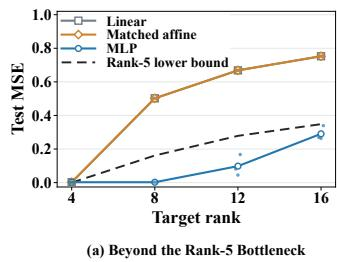

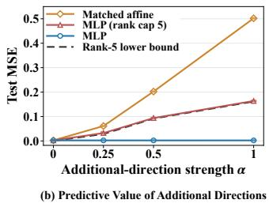  
Figure 4: Predictive benefits of additional embedding rank capacity. Lines show three-seed means, small dots show individual seeds, and dashed curves show the MSE lower bound for rank-at-most-five predictions.

4.2.1 Predictive Value ofEmbedding Rank Expansion. We construct synthetic targets with controlled rank to evaluate the predictive benefit of nonlinear embeddings. We compare linear, parameter- matched afine, and MLP embeddings using identical attention and prediction heads that preserve the embedding rank constraints. Both afine embeddings have a rank upper bound of five. Figure 4(a) shows comparable performance at target rank 4. At higher target ranks, the MLP achieves MSE below the rank-five lower bound, while afine embeddings remain constrained. In (b), increasing the contribution of higher-rank target components substantially de- grades the rank-constrained MLP, whereas the unconstrained MLP maintains stable performance. These results demonstrate that non- linear embeddings can exploit higher attainable rank to improve prediction when target structures exceed the linear rank constraint.

4.2.2 Impact ofRepresentation Rank Constraints. To investigate the impact of representation rank constraints on forecasting, we impose rank limits of 1, 4, and 8 on position-enriched patch repre-sentations in a standard Transformer encoder. The constraints are maintained during training and inference, with all other settings unchanged. Table 2 shows that rank-one and rank-four constraints consistently increase MSE and MAE across datasets, whereas the relaxed rank-eight constraint largely restores performance toward the unconstrained baseline. Notably, this degradation persists de- spite the presence of FFNs and residual connections. These results demonstrate that restrictive representation rank constraints can impair forecasting performance, supporting the importance of preserving suficient independent representation directions.

Table 2: Forecasting performance under diferent rank constraints on position-enriched embeddings. The best results are in bold.
<table><tr><td rowspan="2">Dataset</td><td colspan="2">Unconstrained</td><td colspan="2">Rank ≤ 1</td><td colspan="2">Rank ≤ 4</td><td colspan="2">Rank ≤ 8</td></tr><tr><td>MSE</td><td>MAE</td><td>MSE</td><td>MAE</td><td>MSE</td><td>MAE</td><td>MSE</td><td>MAE</td></tr><tr><td>ETTh1</td><td>0.503</td><td>0.469</td><td>0.549</td><td>0.511</td><td>0.509</td><td>0.473</td><td>0.504</td><td>0.472</td></tr><tr><td>ETTh2</td><td>0.380</td><td>0.414</td><td>0.385</td><td>0.417</td><td>0.398</td><td>0.421</td><td>0.383</td><td>0.414</td></tr><tr><td>ETTm1</td><td>0.369</td><td>0.390</td><td>0.385</td><td>0.402</td><td>0.372</td><td>0.393</td><td>0.372</td><td>0.392</td></tr><tr><td>ETTm2</td><td>0.271</td><td>0.326</td><td>0.273</td><td>0.327</td><td>0.274</td><td>0.327</td><td>0.270</td><td>0.324</td></tr><tr><td>Weather</td><td>0.228</td><td>0.263</td><td>0.231</td><td>0.266</td><td>0.231</td><td>0.266</td><td>0.229</td><td>0.265</td></tr><tr><td>Exchange</td><td>0.391</td><td>0.423</td><td>0.430</td><td>0.443</td><td>0.416</td><td>0.437</td><td>0.397</td><td>0.425</td></tr></table>

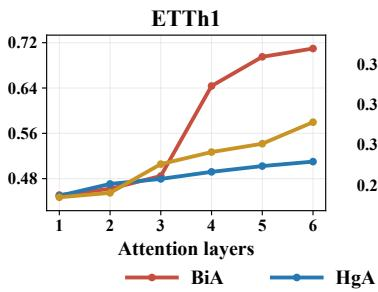

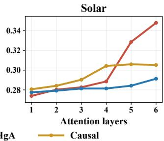  
Figure 5: Efect of Network Depth on Forecasting with Different Pure Attention Mechanisms.

Table 3: Performance comparison of six-layer pure-attention models. The best results are in bold.
<table><tr><td>Method</td><td>Metric</td><td>ETTh1</td><td>ETTh2</td><td>ETTm1</td><td>Weather</td><td>Exchange</td></tr><tr><td rowspan="2">BiA</td><td>MSE</td><td>0.710</td><td>0.418</td><td>0.648</td><td>0.279</td><td>0.375</td></tr><tr><td>MAE</td><td>0.583</td><td>0.433</td><td>0.530</td><td>0.303</td><td>0.414</td></tr><tr><td rowspan="2">HgA</td><td>MSE</td><td>0.510</td><td>0.407</td><td>0.421</td><td>0.273</td><td>0.371</td></tr><tr><td>MAE</td><td>0.480</td><td>0.428</td><td>0.422</td><td>0.293</td><td>0.412</td></tr></table>

4.2.3 Robustness to Increasing Atention Depth. To evaluate the im-pact of attention depth, we compare BiA, causal attention, and HgA in pure-attention networks with one to six stacked attention layers. All variants share the same architecture except for the attention mechanism. Figure 5 shows that BiA sufers from substantial performance degradation as attention depth increases, whereas HgA maintains more stable forecasting performance. Causal attention also improves depth robustness, but its performance varies across datasets. Table 3 further demonstrates that HgA achieves consis- tent improvements over BiA across multiple datasets, especially in deeper attention stacks. These results indicate that HgA improves robustness under increasingly deep attention interactions by preserving more stable representations. This empirical behavior is consistent with the rank-preservation analysis, showing that attention topology plays an important role in maintaining representation diversity during deep information exchange.

4.2.4 Efect of Training-Time Atention Rank Constraints. To investi-gate how attention rank constraints afect forecasting performance, we impose rank constraints rank(A) ≤ � with � ∈ {1, 3} on every attention head of a six-layer HgA model. The constrained models are trained under the same settings as the unconstrained baseline. Table 4 shows that restricting attention rank consistently degrades forecasting performance across datasets. Severe rank constraints $( r = 1 )$ lead to substantial performance drops, while a relaxed con- straint $( r = 3 )$ reduces the degradation. These results demonstrate that overly restrictive attention rank constraints can impair the efectiveness of HgA, supporting the role of maintaining suficient representation diversity during attention interaction.

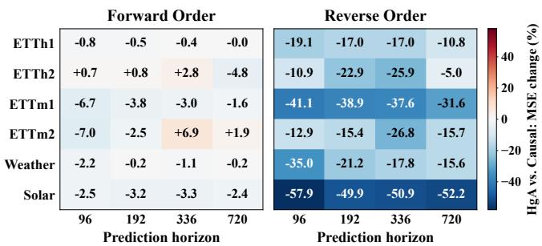

Table 4: Training-Time Attention Rank Constraints in Six-Layer Pure HgA. For the rank-constrained columns, values are percentage changes relative to the Unconstrained model.
<table><tr><td rowspan="2">Dataset</td><td colspan="2">Unconstrained</td><td colspan="2"> $\operatorname { r a n k } ( A ) \leq 1$ </td><td colspan="2">rank  $( A ) \leq 3$ </td></tr><tr><td>MSE</td><td>MAE</td><td>MSE</td><td>MAE</td><td>MSE</td><td>MAE</td></tr><tr><td>ETTh1</td><td>0.510</td><td>0.481</td><td>+12.44</td><td>+7.36</td><td>+0.23</td><td>+0.04</td></tr><tr><td>ETTh2</td><td>0.406</td><td>0.427</td><td>+0.93</td><td>-0.55</td><td>+1.88</td><td>+0.72</td></tr><tr><td>ETTm1</td><td>0.422</td><td>0.421</td><td>+37.72</td><td>+19.04</td><td>+7.27</td><td>+3.89</td></tr><tr><td>ETTm2</td><td>0.293</td><td>0.338</td><td>+6.92</td><td>+4.07</td><td>+3.60</td><td>+2.02</td></tr><tr><td>Weather</td><td>0.273</td><td>0.293</td><td>+6.83</td><td>+6.70</td><td>+4.47</td><td>+3.93</td></tr><tr><td>Exchange</td><td>0.372</td><td>0.413</td><td>+8.04</td><td>+5.66</td><td>+3.97</td><td>+2.71</td></tr><tr><td>Solar</td><td>0.306</td><td>0.326</td><td>+50.40</td><td>+40.08</td><td>+8.53</td><td>+7.52</td></tr></table>

Figure 6: Forecasting Comparison of HgA and Causal Attention under Diferent Token Orders.

4.2.5 Predictive Value ofInformation Pathways. To evaluate the predictive value of HgA’s information pathways, we compare HgA with causal attention under forward and reversed token orders, using the same original latest patch as the prediction readout in both settings. Reversing token order changes the information accessible through causal attention, allowing us to assess the contribution of HgA’s additional cross-token interactions. Figure 6 shows that HgA outperforms causal attention on most forward-order tasks, with more pronounced improvements under reversed order, where HgA achieves lower MSE on all 24 tasks shown. These results highlight the predictive value of HgA’s information pathways, demonstrating its ability to efectively integrate cross-token information while maintaining rank stability.

4.2.6 Empirical Validation of Rank Theory. To empirically validate our theoretical framework, we visualize the rank distributions of intermediate representations in Figure 7 and 8. First, the Figure 7 demonstrate that our nonlinear MLP embedding explicitly breaks the rank-1 bottleneck inherent to � = 1 linear projections. It consistently drives the representations toward high-rank states, closely approaching the theoretical maximum (validating Theorem 1). Second, the Figure 8 compare the attention weight matrices. While standard BiA sufers from severe rank collapse, evidenced by a widespread long-tail distribution toward lower ranks, HgA con-sistently locks at the maximum rank across all test samples. This confirms that HgA efectively preserves representational diversity and circumvents rank-deficient topologies, perfectly aligning with Theorem 2.

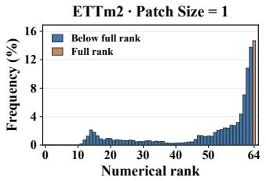

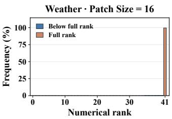  
Figure 7: Rank distributions of embedding matrices with patch sizes � = 1 (ETTm2) and $P = 1 6$ (Weather).

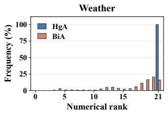

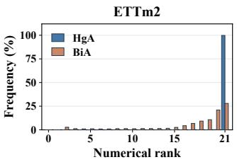  
Figure 8: Rank distributions of attention matrices on Weather and ETTm2.

## 4.3 Interactive Progressive Decoder Analysis

4.3.1 Analysis ofProgressive Refinement. We investigate the efectiveness of progressive refinement by examining prediction accu-racy, error correction, and inference eficiency. Using fixed check- points, we evaluate diferent refinement steps $T \in \{ 1 , \ldots , 2 0 \}$ across multiple forecasting horizons. Figure 9 shows that ETTm1 benefits primarily from a few refinement steps, whereas Exchange continues to improve as � increases, indicating dataset-dependent sensitivity to refinement depth.

To understand what refinement corrects, we decompose forecast- ing errors into level, linear-trend, and remaining-shape components. Figure 10 shows that increasing � from 1 to 5 improves MSE and MAE across all six evaluated datasets at $\tau = 9 6$ , with diferent dominant correction components across datasets.

Finally, we evaluate the eficiency of ofline-folded inference. The folded predictions match explicit iterative updates within numerical precision while avoiding online iterations. As shown in Figure 11, at $T = 2 0$ , ofline folding achieves median speedups of 3.77× for the refinement module and 1.45× for the full model. These results demonstrate that IPD enables efective progressive forecast correction with eficient inference.

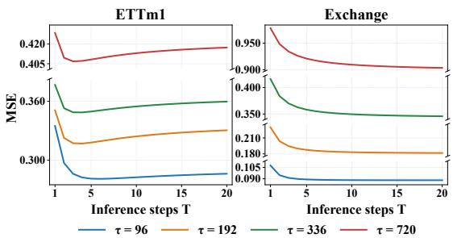

Figure 9: Hyperparameter sensitivity of refinement steps (� ).  
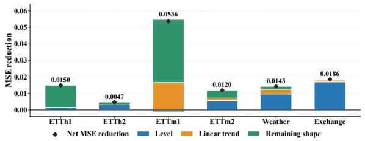  
Figure 10: Reductions in level, trend, and remaining-shape errors from � = 1 to � = 5 at � = 96.

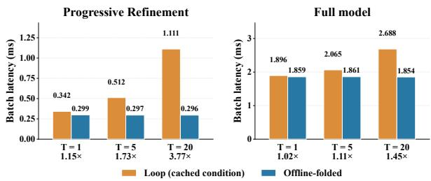  
Figure 11: Online inference latency of iterative refinement and ofline-folded inference.

4.3.2 Efectiveness ofIPD Components. To evaluate the contributions of IPD components, we compare three prediction heads under the same encoder: a standard linear head, progressive residual re- finement without conditioning (Refinement Only), and the complete IPD with interactive conditioning. Table 5 shows that residual re- finement alone improves MSE over the linear head on five of six datasets. Introducing interactive conditioning further improves performance, with Full IPD achieving the lowest MSE and MAE across all six datasets. Notably, on Weather, refinement alone slightly underperforms the linear head, whereas Full IPD improves upon both. These results demonstrate the complementary benefits of progressive residual refinement and interactive conditioning for multivariate forecasting.

4.3.3 Efect of Cross-channel Conditioning. To investigate how cross-channel information contributes to forecasting, we analyze the relative-humidity channel on Weather by replacing source chan- nel features with their training-set means. Figure 12(a) illustrates how sample-dependent cross-channel information adjusts the pre-dicted trajectory, particularly around the trough and later forecast positions. The scaling modulation contributes most of the adjustment in this example, while the shifting modulation provides smaller corrections. Figure 12(b) further reveals varying contributions from diferent source channels. The raining channel shows the largest positive contribution. These findings demonstrate that IPD can exploit informative cross-channel relationships to produce adaptive temporal corrections, supporting the efectiveness of interactive conditioning.

Table 5: Comparison of IPD component configurations.
<table><tr><td>Dataset</td><td>Linear Head MSE MAE</td><td>MSE</td><td>Refinement Only MAE</td><td colspan="2">Full IPD MSE MAE</td></tr><tr><td>ETTh1 ETTh2 ETTm1 ETTm2</td><td>0.426 0.349 0.349 0.368 0.254 0.307</td><td>0.430 0.412 0.385 0.344 0.342</td><td>0.421 0.384 0.367</td><td>0.405 0.342 0.339 0.252 0.307</td><td>0.416 0.384 0.367</td></tr></table>

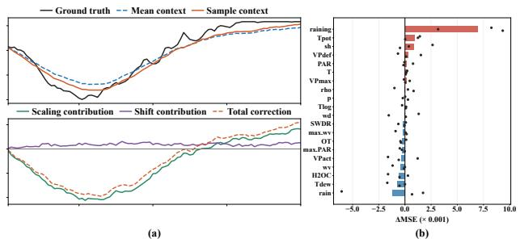  
Figure 12: Cross-channel conditioning analysis on Weather.

## 5 Conclusion

In this paper, we present RankFormer, a principled encoder-decoder architecture for multivariate time series forecasting. Through a rank-based analytical framework, we revisit how tokenization, em- bedding, and attention designs influence the capacity of learned representations. Our analysis reveals that patchification expands the attainable rank bound, nonlinear embeddings overcome the additional constraints of linear projections, and attention topology plays an important role in preserving representation diversity during information interaction. Guided by these insights, we develop a rank-enhancing encoder with HgA and an IPD, which respectively improve representation preservation and future trajectory modeling through efective information exchange and progressive refinement. Extensive experiments on real-world forecasting bench- marks validate the efectiveness of RankFormer and demonstrate consistent improvements over competitive methods.

## References

[1] Srinadh Bhojanapalli, Chulhee Yun, Ankit Singh Rawat, Sashank Reddi, and Sanjiv Kumar. 2020. Low-rank bottleneck in multi-head attention models. In International conference on machine learning. PMLR, 864–873.

[2] Jiezhu Cheng, Kaizhu Huang, and Zibin Zheng. 2020. Towards better forecasting by fusing near and distant future visions. In Proceedings ofthe AAAI Conference on Artificial Intelligence. 3593–3600.

[3] Krzysztof Marcin Choromanski, Valerii Likhosherstov, David Dohan, Xingyou Song, Andreea Gane, Tamas Sarlos, Peter Hawkins, Jared Quincy Davis, Afroz Mohiuddin, Lukasz Kaiser, et al. 2021. Rethinking Attention with Performers. In International Conference on Learning Representations.

[4] Yihe Dong, Jean-Baptiste Cordonnier, and Andreas Loukas. 2021. Attention is not all you need: Pure attention loses rank doubly exponentially with depth. In International conference on machine learning. PMLR, 2793–2803.

[5] Yuchen Fang, Yuxuan Liang, Bo Hui, Zezhi Shao, Liwei Deng, Xu Liu, Xinke Jiang, and Kai Zheng. 2025. Eficient large-scale trafic forecasting with transformers: A spatial data management perspective. In Proceedings of the 31st ACM SIGKDD Conference on Knowledge Discovery and Data Mining V. 1. 307–317.

[6] Jingru Fei, Kun Yi, Wei Fan, Qi Zhang, and Zhendong Niu. 2025. Amplifier: Bring ing attention to neglected low-energy components in time series forecasting. In Proceedings ofthe AAAI conference on artificial intelligence. 11645–11653.

[7] Soufiane Hayou, Nikhil Ghosh, and Bin Yu. 2024. LoRA+ eficient low rank ada tation of lar e models. In Proceedings ofthe 41st International Conference on Machine Learning. 17783–17806.

[8] Edward J Hu, Yelong Shen, Phillip Wallis, Zeyuan Allen-Zhu, Yuanzhi Li, Shean Wang, Lu Wang, Weizhu Chen, et al. 2022. Lora: Low-rank adaptation of large language models. ICLR 1, 2 (2022), 3.

[9] Jiajia Li, Ling Dai, Feng Tan, Hui Shen, Zikai Wang, Bin Sheng, and Pengwei Hu. 2022. CDX-NET: cross-domain multi-feature fusion modeling via deep neural networks for multivariate time series forecasting in AIOps. In ICASSP 2022-2022 IEEE International Conference on Acoustics, Speech and Signal Processing (ICASSP). IEEE, 4073–4077.

[10] Shizhan Liu, Hang Yu, Cong Liao, Jianguo Li, Weiyao Lin, Alex X Liu, and Schahram Dustdar. 2022. Pyraformer: Low-Complexity Pyramidal Attention for Long-Range Time Series Modeling and Forecasting. In International Conference on Learning Representations.

[11] Shih-Yang Liu, Chien-Yi Wang, Hongxu Yin, Pavlo Molchanov, Yu-Chiang Frank Wang, Kwang-Ting Cheng, and Min-Hung Chen. 2024. Dora: Weightdecomposed low-rank adaptation. In Forty-first International Conference on Machine Learning.

[12] Yong Liu, Tengge Hu, Haoran Zhang, Haixu Wu, Shiyu Wang, Lintao Ma, and Mingsheng Long. 2023. itransformer: Inverted transformers are efective for time series forecasting. arXiv preprint arXiv:2310.06625 (2023).

[13] Yong Liu, Guo Qin, Xiangdong Huang, Jianmin Wang, and Mingsheng Long. 2025. Timer-XL: Long-Context Transformers for Unified Time Series Forecasting. In The Thirteenth International Conference on Learning Representations.

[14] Yong Liu, Haoran Zhang, Chenyu Li, Xiangdong Huang, Jianmin Wang, and Mingsheng Long. 2024. Timer: generative pre-trained transformers are large time series models. In Proceedings of the 41st International Conference on Machine Learning. 32369–32399.

[15] Md Mahmuddun Nabi Murad, Mehmet Aktukmak, and Yasin Yilmaz. 2025. Wp mixer: Eficient multi-resolution mixing for long-term time series forecasting. In Proceedings ofthe AAAI Conference on Artificial Intelligence. 19581–19588.

[16] Vinod Nair and Geofrey E Hinton. 2010. Rectified linear units improve restricted boltzmann machines. In Proceedings ofthe 27th international conference on machine learning (ICML-10). 807–814.

[17] Yuqi Nie, Nam H Nguyen, Phanwadee Sinthong, and Jayant Kalagnanam. 2023. A Time Series is Worth 64 Words: Long-term Forecasting with Transformers. In The Eleventh International Conference on Learning Representations.

[18] Lorenzo Noci, Sotiris Anagnostidis, Luca Biggio, Antonio Orvieto, Sidak Pal Singh, and Aurelien Lucchi. 2022. Signal propagation in transformers: Theoretical perspectives and the role of rank collapse. Advances in Neural Information Processing Systems 35 (2022), 27198–27211.

[19] Xihao Piao, Zheng Chen, Taichi Murayama, Yasuko Matsubara, and Yasushi Sakurai. 2024. Fredformer: Frequency debiased transformer for time series forecasting. In Proceedings ofthe 30th ACM SIGKDD conference on knowledge discovery and data mining. 2400–2410.

[20] Xiangfei Qiu, Xvyuan Liu, Tianen Shen, Xingjian Wu, Hanyin Cheng, Bin Yang, and Jilin Hu. 2026. SEER: Transformer-based Robust Time Series Forecasting via Automated Patch Enhancement and Replacement. arXiv preprint arXiv:2602.00589 (2026).

[21] Xiangfei Qiu, Xingjian Wu, Yan Lin, Chenjuan Guo, Jilin Hu, and Bin Yang. 2025. Duet: Dual clustering enhanced multivariate time series forecasting. In Proceedings ofthe 31st ACM SIGKDD Conference on Knowledge Discovery and Data Mining V. 1. 1185–1196.

[22] Thiziri Nait Saada, Alireza Naderi, and Jared Tanner. 2025. Mind the Gap: a Spectral Analysis of Rank Collapse and Signal Propagation in Attention Layers. In Forty-second International Conference on Machine Learning.

[23] David Salinas, Valentin Flunkert, Jan Gasthaus, and Tim Januschowski. 2020. DeepAR: Probabilistic forecasting with autoregressive recurrent networks. International journal offorecasting (2020), 1181–1191.

[24] Artyom Stitsyuk and Jaesik Choi. 2025. xpatch: Dual-stream time series forecasting with exponential seasonal-trend decomposition. In Proceedings of the AAAI Conference on Artificial Intelligence, Vol. 39. 20601–20609.

[25] Hua Wang, Jinghao Lu, and Fan Zhang. 2026. Eeo-tfv: Escape-explore optimizer for web-scale time-series forecastin and vision anal sis. In Proceedings ofthe ACM Web Conference 2026. 7271–7282.

[26] Sinong Wang, Belinda Z Li, Madian Khabsa, Han Fang, and Hao Ma. 2020. Linformer: Self-attention with linear complexity. arXiv preprint arXiv:2006.04768 (2020).

[27] Shiyu Wang, Jiawei Li, Xiaoming Shi, Zhou Ye, Baichuan Mo, Wenze Lin, Ju Shengtong, Zhixuan Chu, and Ming Jin. 2025. TimeMixer++: A General Time Series Pattern Machine for Universal Predictive Analysis. In ICLR 2025: The Thirteenth International Conference on Learning Representations. International Conference on Learning Representations.

[28] Haixu Wu, Tengge Hu, Yong Liu, Hang Zhou, Jianmin Wang, and Mingsheng Long. 2023. TimesNet: Temporal 2D-Variation Modeling for General Time Series Analysis. In The Eleventh International Conference on Learning Representations.

[29] Haixu Wu, Jiehui Xu, Jianmin Wang, and Mingsheng Long. 2021. Autoformer: Decomposition transformers with auto-correlation for long-term series forecasting. Advances in neural information processing systems 34 (2021), 22419–22430.

[30] Xinyi Wu, Amir Ajorlou, Yifei Wang, Stefanie Jegelka, and Ali Jadbabaie. 2024. On the role of attention masks and layernorm in transformers. Advances in Neural Information Processing Systems 37 (2024), 14774–14809.

[31] Xingjian Wu, Xiangfei Qiu, Hanyin Cheng, Zhengyu Li, Jilin Hu, Chenjuan Guo, and Bin Yang. 2025. Enhancing Time Series Forecasting through Selective Representation Spaces: A Patch Perspective. In Advances in Neural Information Processing Systems, Vol. 38. 23328–23354.

[32] Yunyang Xiong, Zhanpeng Zeng, Rudrasis Chakraborty, Mingxing Tan, Glenn Fung, Yin Li, and Vikas Singh. 2021. Nyströmformer: A nyström-based algorithm for approximating self-attention. In Proceedings of the AAAI conference on artificial intelligence. 14138–14148.

[33] Zhijian Xu, Ailing Zeng, and Qiang Xu. 2024. FITS: Modeling Time Series with 10� Parameters. In The Twelfth International Conference on Learning Representations.

[34] Kun Yi, Qi Zhang, Wei Fan, Shoujin Wang, Pengyang Wang, Hui He, Ning An, Defu Lian, Longbing Cao, and Zhendong Niu. 2023. Frequency-domain MLPs are more efective learners in time series forecasting. Advances in Neural Information Processing Systems 36 (2023), 76656–76679.

[35] Annan Yu, Danielle C Maddix, Boran Han, Xiyuan Zhang, Abdul Fatir Ansari, Oleksandr Shchur, Christos Faloutsos, Andrew Gordon Wilson, Michael W Mahoney, and Yuyang Wang. 2025. Understanding Transformers for Time Series: Rank Structure, Flow-of-ranks, and Compressibility. arXiv preprint arXiv:2510.03358 (2025).

[36] Ailing Zeng, Muxi Chen, Lei Zhang, and Qiang Xu. 2023. Are transformers efective for time series forecasting?. In Proceedings ofthe AAAI conference on artificial intelligence. 11121–11128.

[37] Boning Zhang, Haishuai Wang, Zehong Hu, Jiajun Wang, Hongyi Zhang, and Jia Jia. 2026. Re-Difusion: Modeling Latent Residuals with Difusion for Time-Series Forecasting. In Proceedings ofthe ACM Web Conference 2026. 7390–7400.

[38] Fan Zhang, Shiming Fan, and Hua Wang. 2026. Time-tk: A multi-ofset temporal interaction framework combining transformer and kolmogorov-arnold networks for time series forecasting. In Proceedings ofthe ACM Web Conference 2026. 7495– 7506.

[39] Jianqi Zhang, Jingyao Wang, Wenwen Qiang, Fanjiang Xu, and Changwen Zheng. 2026. Enhancing large language models for time-series forecasting via vectorinjected in-context learning. In Proceedings ofthe ACM Web Conference 2026. 7211–7222.

[40] Xu Zhang, Peng Wang, Yichen Li, and Wei Wang. 2026. Amortized predictability- aware training framework for time series forecasting and classification. In Proceedings ofthe ACM Web Conference 2026. 5624–5635.

[41] Xu Zhang, Qitong Wang, Peng Wang, and Wei Wang. 2026. Semixer: Semantics enhanced mlp-mixer for multiscale mixing and long-term time series forecasting. In Proceedings ofthe ACM Web Conference 2026. 5636–5647.

[42] Haoyi Zhou, Shanghang Zhang, Jieqi Peng, Shuai Zhang, Jianxin Li, Hui Xiong, and Wancai Zhang. 2021. Informer: Beyond eficient transformer for long se- quence time-series forecasting. In Proceedings of the AAAI conference on artificial intelligence. 11106–11115.

[43] Tian Zhou, Ziqing Ma, Qingsong Wen, Xue Wang, Liang Sun, and Rong Jin. 2022. Fedformer: Frequency enhanced decomposed transformer for long-term series forecasting. In International conference on machine learning. PMLR, 27268–27286.

## A Related Work

## A.1 Time Series Forecasting

Time series forecasting faces challenges in modeling long-term dependencies and complex dynamics. Traditional RNNs and CNNs sufer from scalability bottlenecks and dificulties in handling long sequences [2, 23]. In contrast, Transformers have achieved superior performance by leveraging self-attention mechanisms, spurring the development of eficient and interpretable temporal models [10, 28] such as Informer [42], Autoformer [29], and PatchTST [17]. Meanwhile, frequency-domain methods efectively capture periodic and spectral patterns in time series through Fourier or wavelet transforms [15]. Representative works, including Fredformer [19], FreTS [34], and FITS [33], demonstrate competitive advantages in extracting global features. Recent studies further integrate temporal and frequency-domain information, proposing hybrid modeling approaches. For example, CDX-Net combines multiple network structures for feature fusion [9], FEDformer unifies decomposition and frequency analysis [43], and TimeMixer++ enhances temporal representation through multi-scale sampling and attention mechanisms, advancing the field [27].

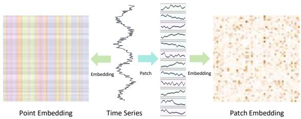  
Figure 13: Rank expansion via patchification.

## A.2 Rank Analysis in Transformer

Low-rank attention research aims to improve Transformer eficiency through low-rank approximations or parameterization. Lowrank approximation methods, such as Linformer [26], Nystromformer [32], and Performer [3], utilize low-dimensional projections, anchor tokens, or random feature mappings to reduce attention computational complexity to linear. Low-rank parameterization methods [7, 8, 11], directly learn low-rank update matrices for efi-cient fine-tuning but lack theoretical guidance on the underlying causes of low-rank behavior. Theoretical analysis reveals that pure attention networks sufer from a double-exponential collapse in rep- resentation rank as depth increases, a phenomenon known as rank collapse [18, 22]. Studies indicate that residual connections, layer normalization, and feed-forward networks can efectively mitigate this issue and maintain representational diversity [4, 30]. Additionally, the relationship between attention head dimension and sequence length influences the rank of attention matrices, thereby constraining model expressiveness [1].

In time series forecasting, sequence embeddings exhibit rapidly decaying singular value spectra, naturally concentrating in low-rank subspaces and endowing attention layers with inherent com- pressibility [35]. However, existing work still lacks a unified theo-retical framework to systematically guide the overall design and optimization of time series Transformers from a rank perspective.

## B Visualization of Rank Expansion via Patching

Figure 13 illustrates the rank expansion efect discussed in Section 2. Point-wise tokenization $( P = 1 )$ limits the representation to a rank-1 structure, while patchification enlarges the attainable rank

bound to min $( N , P )$ as stated in Proposition 1, providing additional independent directions for subsequent representation learning.

## C Proof of Theorem 1

We consider the two-layer MLP embedding:

$$
\mathbf { H } = \phi ( \mathbf { X } _ { \rho } \mathbf { W } _ { 1 } + \mathbf { 1 } _ { N } \mathbf { b } _ { 1 } ^ { \top } ) \mathbf { W } _ { 2 } + \mathbf { 1 } _ { N } \mathbf { b } _ { 2 } ^ { \top } ,
$$

where ${ \bf X } _ { p } \in \mathbb { R } ^ { N \times P }$ denotes the input patch matrix and $\phi$ is a continuous non-polynomial activation function. We show that there exist MLP parameters such that

$$
\mathrm { r a n k } ( \mathbf { H } ) = \operatorname* { m i n } ( N , D ) .
$$

## C.1 Spanning Property of Non-polynomial Activations

We first establish a property of non-polynomial activations. For any distinct input points $\{ x _ { i } \} _ { i = 1 } ^ { N } \subset \mathbb { R } ^ { { \stackrel { . } { P } } }$ , define

$$
\begin{array} { r } { \Phi ( \boldsymbol { w } , b ) = [ \phi ( \boldsymbol { w } ^ { \top } \boldsymbol { x } _ { 1 } + b ) , . . . , \phi ( \boldsymbol { w } ^ { \top } \boldsymbol { x } _ { N } + b ) ] ^ { \top } . } \end{array}
$$

Lemma 1. The set of vectors $\{ \Phi ( w , b ) : w \in \mathbb { R } ^ { P } , b \in \mathbb { R } \}$ spans $\mathbb { R } ^ { N }$

Proof. Assume that the image of Φ does not span $\mathbb { R } ^ { N }$ . Then there exists a non-zero vector $\boldsymbol { \alpha } \in \mathbb { R } ^ { N }$ satisfying

$$
\sum _ { i = 1 } ^ { N } \alpha _ { i } \phi ( \boldsymbol { w ^ { \intercal } x _ { i } } + \boldsymbol { b } ) = 0
$$

for all � and �.

Since the input points are distinct, there exists a direction $\boldsymbol { v } \in \mathbb { R } ^ { P }$ such that the projected values $\beta _ { i } ~ = ~ \boldsymbol { v } ^ { \top } \boldsymbol { x } _ { i }$ are pairwise distinct. Setting $w = t v$ gives

$$
\sum _ { i = 1 } ^ { N } \alpha _ { i } \phi ( t \beta _ { i } + b ) = 0 ,
$$

for all �, �. This contradicts the discriminatory property of continuous non-polynomial activations, which states that no non-trivial linear combination of their translated and scaled functions can vanish identically. Therefore, the vectors $\Phi ( w , b )$ span $\mathbb { R } ^ { N }$ □

## C.2 Maximum Rank Achievability

$$
K = \operatorname* { m i n } ( N , D ) .
$$

By Lemma 1, the activation outputs span $\mathbb { R } ^ { N }$ , and therefore there exist � linearly independent vectors

$$
v _ { 1 } , \ldots , v _ { K }
$$

generated by suitable parameters $( w _ { j } , b _ { j } )$ , where

$$
\boldsymbol { v } _ { j } = [ \phi ( \boldsymbol { w } _ { j } ^ { \top } \boldsymbol { x } _ { 1 } + b _ { j } ) , . . . , \phi ( \boldsymbol { w } _ { j } ^ { \top } \boldsymbol { x } _ { N } + b _ { j } ) ] ^ { \top } .
$$

Construct the first MLP layer using

$$
\mathbf { W } _ { 1 } = [ w _ { 1 } , \ldots , w _ { K } ] , \qquad \mathbf { b } _ { 1 } = [ b _ { 1 } , \ldots , b _ { K } ] ^ { \top } .
$$

The hidden representation becomes

$$
\mathbf { H } _ { h i d } = \phi ( \mathbf { X } _ { \mathcal { P } } \mathbf { W } _ { 1 } + \mathbf { 1 } _ { N } \mathbf { b } _ { 1 } ^ { \top } ) = [ v _ { 1 } , \ldots , v _ { K } ] ,
$$

which satisfies

$$
\operatorname { r a n k } ( \mathbf { H } _ { h i d } ) = K .
$$

Finally, choosing the output projection $\mathbf { W } _ { 2 }$ to map these inde- pendent hidden directions into the output space yields

$$
\mathrm { r a n k } ( \mathbf { H } ) = K = \operatorname* { m i n } ( N , D ) .
$$

Therefore, nonlinear MLP embeddings can achieve the maximum attainable rank under the given sample and hidden dimensions.

## D Attention Rank Analysis

We analyze how attention topology afects the rank preservation of value representations during token interaction. Given query, key, and value projections:

$$
{ \bf Q } = { \bf X } { \bf W } _ { Q } , \quad { \bf K } = { \bf X } { \bf W } _ { K } , \quad { \bf V } = { \bf X } { \bf W } _ { V } ,
$$

the attention output after output projection can be written as

$$
\mathbf { O } = \mathbf { A X } _ { V } ,
$$

where

$$
\mathbf { X } _ { V } = \mathbf { V } \mathbf { W } ^ { O } ,
$$

and A denotes the corresponding attention aggregation matrix.

The following analysis focuses on whether the attention aggre- gation matrix A preserves the rank of the value representation.

## D.1 Full-rank Potential of Bidirectional Attention

BiA is not inherently rank deficient. We show that its attention matrix can achieve full rank under suitable projection parameters.

Given an input matrix X with distinct rows, there exists a projection direction v such that

$$
\mathbf { u } = \mathbf { X } \mathbf { v }
$$

contains pairwise distinct values. Choosing one-dimensional query and key projections as

$$
{ \sf Q } = \alpha { \bf u } , \qquad { \bf K } = \beta { \bf u } ,
$$

produces the attention score matrix

$$
\mathbf { S } = \gamma \mathbf { u } \mathbf { u } ^ { \top } .
$$

Although S is rank one, the element-wise exponential matrix generated by the softmax operation,

$$
\mathbf { E } _ { i j } = \exp ( \gamma u _ { i } u _ { j } ) ,
$$

is full rank for distinct $\{ u _ { i } \}$ . Since the softmax normalization only introduces an invertible diagonal scaling, the resulting bidirectional attention matrix can achieve

$$
\operatorname { r a n k } ( \mathbf { A } _ { \mathrm { b i d } } ) = n .
$$

Therefore, BiA itself does not sufer from an intrinsic rank lim- itation. Its limitation is the absence of a structural guarantee for preserving rank during repeated token interaction.

## D.2 Rank Preservation of Causal Attention

Lemma 2 (Invertibility of Causal Attention). The causal attention matrix $\mathbf { A } _ { \mathrm { c a u s a l } }$ is invertible:

$$
\operatorname { r a n k } ( \mathbf { A } _ { \mathrm { c a u s a l } } ) = n .
$$

Proof. Due to the causal mask, $\mathbf { A } _ { \mathrm { c a u s a l } }$ is a lower triangular matrix. Its diagonal entries are:

$$
( \mathbf { A } _ { \mathrm { c a u s a l } } ) _ { i i } = \frac { \exp ( \mathbf { S } _ { i i } ) } { \sum _ { j = 1 } ^ { i } \exp ( \mathbf { S } _ { i j } ) } ,
$$

where ${ \bf S } = { \bf Q } { \bf K } ^ { \top } / \sqrt { d _ { k } }$

Since all exponential terms are strictly positive,

$$
( \mathbf { A _ { \mathrm { { c a u s a l } } } } ) _ { i i } > 0 .
$$

Therefore,

$$
\operatorname* { d e t } ( \mathbf { A } _ { \mathrm { c a u s a l } } ) = \prod _ { i = 1 } ^ { n } ( \mathbf { A } _ { \mathrm { c a u s a l } } ) _ { i i } > 0 ,
$$

which proves that $\mathbf { A } _ { \mathrm { c a u s a l } }$ is invertible.

## D.2.1 Proof of Theorem 2.

Proof. Let

$$
\mathbf { X } _ { V } = \mathbf { V } \mathbf { W } ^ { O } .
$$

From Lemma $2 , \mathbf { A } _ { \mathrm { c a u s a l } }$ is invertible. Therefore,

$$
\operatorname { r a n k } ( \mathbf { O } _ { \operatorname { c a u s a l } } ) = \operatorname { r a n k } ( \mathbf { A } _ { \operatorname { c a u s a l } } \mathbf { X } _ { V } ) = \operatorname { r a n k } ( \mathbf { X } _ { V } ) .
$$

For bidirectional attention, the rank of

$$
\mathbf { O } _ { \mathrm { b i d } } = \mathbf { A } _ { \mathrm { b i d } } \mathbf { X } _ { V }
$$

is determined by whether the null space of $\mathbf { A } _ { \mathrm { b i d } }$ intersects with the column space of $\mathbf { X } _ { V }$

By the rank-nullity theorem restricted to $\operatorname { C o l } ( \mathbf { X } _ { V } )$

$$
\mathrm { r a n k } ( \mathbf { O } _ { \mathrm { b i d } } ) = \mathrm { r a n k } ( \mathbf { X } _ { V } ) - \mathrm { d i m } ( \mathrm { k e r } ( \mathbf { A } _ { \mathrm { b i d } } ) \cap \mathrm { C o l } ( \mathbf { X } _ { V } ) ) .
$$

Hence,

$$
\operatorname { r a n k } ( \mathbf { O } _ { \operatorname { c a u s a l } } ) - \operatorname { r a n k } ( \mathbf { O } _ { \mathrm { b i d } } ) = \dim ( \operatorname { k e r } ( \mathbf { A } _ { \mathrm { b i d } } ) \cap \operatorname { C o l } ( \mathbf { X } _ { V } ) ) \geq 0 .
$$

Therefore,

$$
\mathrm { r a n k } ( \mathbf { O } _ { \mathrm { c a u s a l } } ) \geq \mathrm { r a n k } ( \mathbf { O } _ { \mathrm { b i d } } ) .
$$

Equality holds exactly when

$$
\operatorname { k e r } ( \mathbf { A } _ { \mathrm { b i d } } ) \cap \operatorname { C o l } ( \mathbf { X } _ { V } ) = \{ 0 \} .
$$

## E Additional Experimental Results

Diferent Patch Sizes. As shown in Figure 14, we systematically evaluated the singular value distribution of embedding matrices under diferent patch sizes (1, 4, 8, 16) across 7 datasets. The ex-perimental results show that for most datasets, the singular value decay curves of their embedding representations generally exhibit full-rank or near-full-rank characteristics, even under the smallest patch size (1). This indicates that the model can learn highly diverse and linearly independent representations for these datasets, with their efective rank significantly surpassing the inherent bottleneck of the original univariate input (which has an upper rank bound of 1).

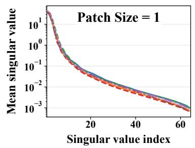

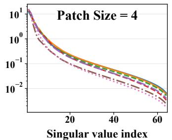

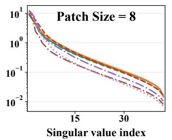

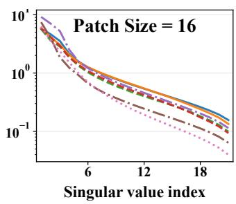  
ETTh1 ETTh2 ETTm1 ETTm2 Electricity Exchange Weather

Figure 14: Rank Distribution of Embedding Matrices (Patch Size = 16).  
(a) Bidirectional Attention  
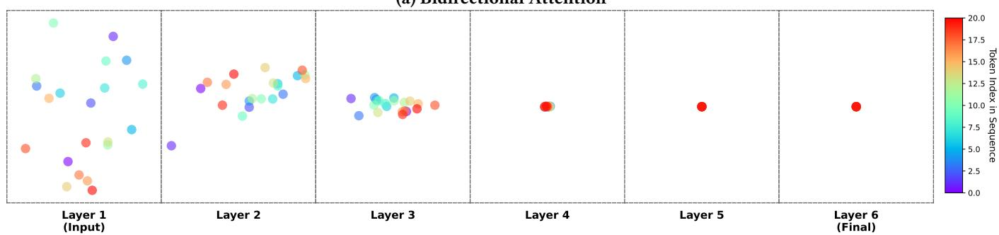

(b) Hourglass Attention  
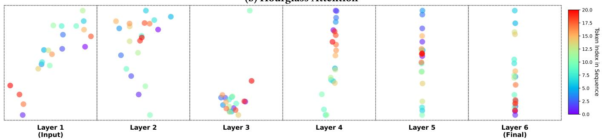  
Figure 15: PCA visualization of token representation evolution across deep layers in a pure attention network. The color gradient indicates the token index within the sequence.

Visualization of Representation Collapse. As illustrated in Figure 15, the evolutionary trajectories of the token representations difer drastically depending on the chosen attention mechanism: BiA: The top panel (Figure 15a) demonstrates that while tokens are initially scattered in the input space, they rapidly assimilate during forward propagation. By Layer 4, the representations of all tokens completely collapse into a single indistinguishable point.

This visualizes the extreme over-smoothing and severe rank col- lapse inherent to deep unmasked attention. HgA: The bottom panel (Figure 15b) shows that HgA successfully preserves representational diversity. Even at the final layer (Layer 6), the tokens maintain a distinct and structured spread. This provides direct and compelling visual evidence of HgA’s structural superiority in circumventing rank collapse and preserving full-rank capacity.