# Recall or Relearn? A Mixture of In-Context Experts for Recurring Concept Drift

Zhangkai Wu   
University of Sydney   
Sydney, Australia   
zhangkai.wu@sydney.edu.au   
Xu Zhang   
Macquarie University   
Sydney, Australia   
xu.zhang12@hdr.mq.edu.au

Yiqi Wang University of Southern Queensland Toowoomba, Australia Yiqi.Wang@unisq.edu.au

## ABSTRACT

Tabular foundation models (TFMs) are being applied to Web data streams such as network intrusion detection, where they adapt by updating the labelled rows of their context without retraining. When a past concept returns after leaving the context, a TFM faces a recall-or-relearn decision between restoring stored rows of the con cept and relearning it from new labels. We propose MICE (Mixture of In-Context Experts), a training-free learner that cuts the stream into segments at detected changes. It merges a closed segment into a stored context when the TFM’s estimated additional error on the segment is within a tolerance, under a capacity limit on stored contexts. A fast level weights the stored contexts and first-in-first-out (FIFO) windows by the log-loss of their predictions on the last labelled batch. We show that, with pure stored contexts and a margin condition, this fast level gains over relearning, in expected accuracy, the normalised positive area between the stored context’s accuracy and the TFM’s learning curve, up to a first-batch term. A slow level mixes the fast level’s prediction with that of the FIFO window of the last labelled rows and bounds the discounted half-Brier regret of MICE against this window at every time. Learning curves measured beforehand predict the ordering of the observed recall gains. MICE outperforms reset, which empties the context at detected drifts, on grid streams with random boundary phases. Merging keeps fewer experts than pools that store every segment, and with fixed segmentation a time-matched snapshot pool matches MICE on the shifted grid. On real streams, MICE has the highest mean accuracy of all policies we compare.

## KEYWORDS

web mining, concept drift, recurring concepts, tabular foundation models, in-context learning, data streams, online learning, mixture of experts

## 1 INTRODUCTION

Web classification tasks such as fake news detection [42], timeseries anomaly detection [40] and network intrusion detection receive their data as streams. Tabular foundation models (TFMs) have been applied to intrusion detection [13] and are being extended to data streams [27]. On a stream, a TFM such as TabPFN [19] adapts by updating the labelled rows of its context, without

Zhihong Cui   
Department of Informatics   
University of Oslo   
Oslo, Norway   
zhihongc@ifi.uio.no

Yi Zhang University of Technology Sydney Sydney, Australia Yi.Zhang@uts.edu.au

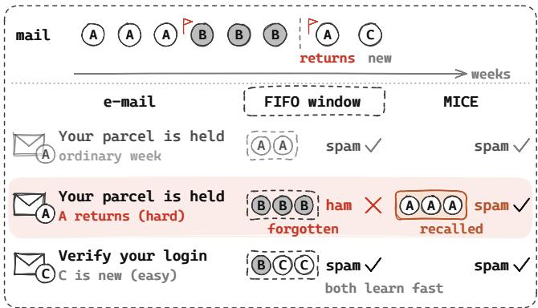  
Fi<sub>gure</sub> 1<sub>:</sub> A f<sub>rozen</sub> TFM filt<sub>ers</sub> <sub>spam</sub> f<sub>rom</sub> <sub>recen</sub>t l<sub>a</sub>b<sub>e</sub>ll<sub>e</sub>d <sub>ma</sub>il<sub>,</sub> it<sub>s con</sub>t<sub>ex</sub>t<sub>.</sub> R<sub>e</sub>d fl<sub>ags mar</sub>k d<sub>e</sub>t<sub>ec</sub>t<sub>e</sub>d <sub>c</sub>h<sub>anges.</sub> Wh<sub>en campa</sub>i<sub>gn</sub> A returns<sub>,</sub> the FIFO window holds onl<sub>y</sub> B and <sub>p</sub>redicts ham. MICE <sub>reca</sub>ll<sub>s</sub> A’<sub>s</sub> <sub>s</sub>t<sub>ore</sub>d <sub>con</sub>t<sub>ex</sub>t <sub>an</sub>d <sub>c</sub>l<sub>ass</sub>ifi<sub>es</sub> A’<sub>s</sub> <sub>ma</sub>il <sub>as</sub> <sub>spam.</sub> H<sub>ere,</sub> <sub>reca</sub>ll <sub>avo</sub>id<sub>s</sub> <sub>re</sub>l<sub>earn</sub>i<sub>ng</sub> th<sub>e</sub> h<sub>ar</sub>d <sub>campa</sub>i<sub>gn</sub> A<sub>.</sub> B<sub>o</sub>th methods learn the new<sub>,</sub> eas<sub>y</sub> cam<sub>p</sub>ai<sub>g</sub>n C <sub>q</sub>uickl<sub>y</sub>. Schematic.

retraining. A model may need new labels to rebuild a useful context when a returning pattern’s rows have been discarded. Recurring concepts therefore pose a recall-or-relearn decision: whether to restore stored rows or rebuild the context from arriving labels. Fig. 1 illustrates the decision with a returning spam campaign. Each batch is predicted before its labels arrive one batch later, and neither concept identities nor change points are observed.

The first-in-first-out (FIFO) window follows recent data but discards the rows of past concepts, the contextual knowledge loss of Fig. 2a. Keeping old rows alone does not repair this loss, because a context that straddles an unknown boundary mixes conflicting rules and causes the conceptual interference of Fig. 2b. A pure stored context can recover the predictions of a returning concept at once, and its benefit depends on how quickly the TFM could learn the concept again. In our controlled tests, some concepts need 50 rows and others more than 1000. For the former, one new batch can make the stored context redundant. For the latter, recall can avoid a long recovery, as the learning curves in Fig. 2c illustrate. This diference makes the right answer to the recall-or-relearn decision difer from concept to concept.

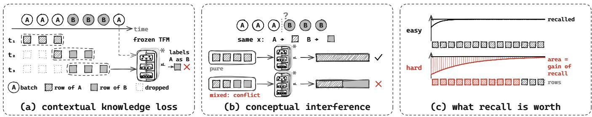  
Figure 2: Three aspects of the recall-or-relearn decision. A and B are two concepts of one stream. (a) When A returns, the FIFO window has discarded A’s rows and the TFM predicts A’s batch with B’s rule. (b) A context that straddles an unknown boundary mixes conflicting rules. (c) What recall is worth: the TFM relearns the easy concept from a few rows but the hard one only from <sub>many, an</sub>d th<sub>e re</sub>d <sub>rows mar</sub>k th<sub>e re</sub>l<sub>earn</sub>i<sub>ng</sub> th<sub>a</sub>t <sub>reca</sub>ll <sub>avo</sub>id<sub>s.</sub> S<sub>c</sub>h<sub>ema</sub>ti<sub>c.</sub> S<sub>ec.</sub> 3 <sub>measures eac</sub>h <sub>aspec</sub>t<sub>.</sub> U<sub>n</sub>d<sub>er</sub> th<sub>e pur</sub>it<sub>y an</sub>d mar in conditions of Thm. 4.1, the fast level’s ex ected accurac ain over relearnin e uals the normalised ositive area in (c), <sub>up</sub> t<sub>o</sub> <sub>a</sub> fi<sub>rs</sub>t<sub>-</sub>b<sub>a</sub>t<sub>c</sub>h t<sub>erm.</sub>

Existing stream policies either keep rows without grouping them by concept or reuse trained models. FIFO windows already make TFMs competitive with adaptive tree ensembles [27], and a prior trained on drifting causal models improves temporal extrapolation [18]. Reset, which empties the context when the drift detection method (DDM) fires [11], discards outdated rows but rebuilds the context even when a concept has appeared before. The large tabular model (LTM) baseline ofLourenço et al. [27] pairs a short-term FIFO bufer with a class-balanced long-term memory, without grouping rows by concept. Recurring-concept learners instead reuse trained models [9, 10, 16, 24]. For a frozen TFM, a stored context can serve as an expert directly. The challenge is to construct useful contexts from an unsegmented stream and decide when their predictions deserve more weight than those of recent data.

Consider a fast level that weights stored contexts and recent windows by their loss on the last labelled batch. Under pure-context and margin conditions, its expected accuracy gain over a learner that resets at concept boundaries equals the area between storedcontext accuracy and the relearning curve, up to a first-batch term. The area is large when relearning is slow and vanishes when one batch already reaches stored-context accuracy. Learning curves measured beforehand therefore predict which concepts ofer the most benefit from recall. The online method needs no learning curve at run time, because it selects contexts from their observed losses.

MICE (Mixture of In-Context Experts) maintains stored contexts alongside FIFO windows and combines their predictions using exponential weights [25]. Memory construction closes segments at detected changes and merges them when their recall regret, the extra 0-1 error that the TFM makes on a segment when conditioned on a stored context instead of on the segment itself, is small. This preserves reusable concepts while limiting the pool. Fast selection weights the experts by the log-loss of their predictions on the last labelled batch. When one expert leads every labelled batch of a single-concept block by a log-loss margin, the regret of the fast level over the block is at most one batch of clipped loss plus a term exponentially small in the margin. Slow aggregation mixes the fast level’s prediction with the prediction of FIFO, weighted by their discounted half-Brier losses. It keeps discounted half-Brier regret against FIFO within 2 ln 2 at every time, for any sequence of labels and expert predictions, which provides a loss guarantee when following the pool does not yield a clear advantage.

We summarise our contributions as follows.

• We formulate the recall-or-relearn decision for TFMs on streams with recurring concepts and measure its three aspects with a context stress test.

• We prove that, under pure-context and margin conditions, the expected accuracy gain of the fast level over relearning is a normalised learning-curve area up to a first-batch term, which lets learning curves measured before deployment predict where recall pays.

• We propose MICE, a training-free mixture of in-context experts whose fast level selects stored contexts from recent losses and whose slow level keeps discounted half-Brier regret against FIFO at most 2 ln 2 at every time.

• We show that, with detected segmentation, MICE is above reset on 70 of72 grid streams with random boundary phases. On 29 real streams, where concepts are unobserved and experts often have similar losses, it has the highest mean accuracy of all policies and is above FIFO on 24.

## 2 RELATED WORK

Recurring-concept methods reuse trained models, whose knowledge of past concepts lives in weights that cost training to obtain. Drift detection and adaptation are surveyed by Gama et al. [12] and Lu et al. [28], and Cabrera Martin et al. [7] treat drift, forgetting and adaptation together. Gonçalves and de Barros [16] select a stored model by statistical tests. Gama and Kosina [10] learn a metamodel of each model’s domain. Weighted ensembles reweight their members as the stream changes [9, 24], and density-harmonized gradient descent learns imbalanced streams online from actively queried labels [20]. Dynamic TMoE adds and prunes trained experts at detected regime shifts [46], and drift-aware collaborative assistance combines trained experts across heterogeneous streams [41]. Online learning with experts tracks the best expert through tracking and adaptive regret [17], whatever the experts are, and MICE uses this view for contexts.

Prior-data fitted networks (PFNs) approximate posterior prediction from a labelled context [31, 32], and TabPFN [19], TabICL [35] and TabICLv2 [34] are TFMs of this kind with fixed weights. On streams, Drift-Resilient TabPFN [18] retrains the prior to extrapolate temporal trends. The LTM baseline of Lourenço et al. [27], a TFM with a short-term FIFO bufer and a class-balanced long-term memory, outperforms incremental ensembles. LTM does not recall a returning concept as a whole, because its two bufers do not group rows by concept.

Recalling a stored context for a new interval needs a criterion for whether one context can serve another concept. The H-divergence [3] and the discrepancy distance [29] measure how well a source serves a target through the hypotheses it induces. Decision-based divergences [44] define a distance between distributions by the decisions that their diference afects. These divergences do not say when recalling a stored context beats relearning from the rows of the current concept, because they compare distributions for a fixed hypothesis class. Our analysis uses learning curves to predict when recall pays, and MICE estimates the cost of reuse from the TFM’s prediction errors.

## 3 SETTING AND THE VALUE OF CONTEXT MEMORY

Our setting keeps the TFM frozen and lets a context policy choose its rows, on a stream whose batches of � rows are labelled one batch late. The TFM $f _ { \Theta } ( \cdot \mid \mathbf { x } ; C )$ predicts every batch from a context C of at most � labelled rows. The stream is a sequence of intervals $I _ { 1 } , I _ { 2 } , \ldots$ with distributions $P _ { 1 } , P _ { 2 } , \dots$ . over (x, �). Concept drift occurs between intervals in the sense of Lu et al. [28].

Definition 3.1 (Recurring in-context concept drift). Let $C _ { k }$ be a context of rows of interval $I _ { k }$ and $f _ { \Theta } ( \cdot ; C _ { k } )$ the �-th in-context expert. The drift into interval $I _ { K + 1 }$ is recurring if m $\begin{array} { r } { \mathsf { i n } _ { k \le K } \mathrm { D } _ { T } ( P _ { K + 1 } \vert P _ { k } ) \le } \end{array}$ $\delta ,$ where $ Ḋ \mathrm Ḋ T Ḍ Ḍ ^ { } ( Q | P )$ is the population risk on $Q$ of the TFM conditioned on a context of $P$ minus that conditioned on a context of $Q _ { i }$ the recall regret of Definition $\mathrm { A . 1 }$ , and new otherwise.

The definition is model-oriented: a drift is recurring when some stored context serves the new interval with additional risk at most � relative to a context from that interval. Three policies are the reference points of this paper. FIFO conditions the TFM on the first-in-first-out window of the last � labelled rows. Reset empties this window when DDM [11] fires. The window ensemble mixes FIFO windows of several lengths. None of them keeps a library of past concepts.

The context stress test runs three tests with frozen TabPFN $\mathbf { v } 2 _ { : }$ which Fig. 3 shows and App. D specifies. The revisit test shows that FIFO forgets a returning concept. In the five batches after the return, FIFO reaches 0.17 to 0.51 accuracy on the Sine [11], STAGGER [36] and Agrawal [1] streams, whereas an oracle context of the concept’s past rows reaches at least 0.99. The splice test shows that mixing concepts in a stored context can remove its gain. Moving the boundaries of eight grid streams 200 rows into fixed 500-row segments lowers the gain of stored contexts over reset from +3.09 to −3.67 points, and realigning the segments on the same rows returns it to +3.01. The curve test shows that relearning speed difers across concepts. Concepts with 5 centroids are learned from 50 rows, concepts with 100 centroids need more than 1000, and concepts of the standard generators about 200. Because 200 rows are two batches, resetting the context at a detected drift already recovers in the revisit test. FIFO’s failure on recurrence therefore establishes forgetting, whereas the learning curve determines whether stored memory adds value beyond reset.

## 4 METHOD: A MIXTURE OF IN-CONTEXT EXPERTS

MICE uses contexts as experts of one frozen TFM. A fast level weights stored contexts and FIFO windows by the log-loss of their predictions on the last labelled batch. A slow level mixes the fast level’s prediction with that of FIFO and bounds the cost of following the fast level. Sec. 4.1 quantifies the gain of a stored context. Segmentation and merging construct reusable contexts that hold mostly one concept. Fig. 4 gives the overview, Alg. 1 in App. B the per-batch procedure, and Tab. 2 the notation. Formal statements are in App. A and proofs in App. F.

4.1 Learnin<sub>g</sub> Cur<sub>v</sub>es Predict When Recall Pa<sub>y</sub>s Let concepts recur in blocks of � rows, $J = L / B$ batches, and let $a _ { k } ( n )$ be the accuracy learning curve of concept �, non-decreasing in �. On the �-th visit of concept � its stored expert holds $\begin{array} { r l } { n _ { c } } & { { } = } \end{array}$ min $( M , ( c - 1 ) L )$ rows. The relearning learner resets its context at the block boundary. The fast level weights the stored experts and FIFO windows by the log-loss of their predictions on the last labelled batch, as specified in Sec. 4.3. Here � is the number of candidate experts, � is the exponential-weight parameter, and � is the log-loss margin of the leading expert over every other expert, as defined in Asm. 3.

Theorem 4.1 (Recall versus relearn). Let the stored context ofconcept � hold rows of� only, and on every labelled batch ofthe block let the expert with the larger learning-curve value, the stored expert $i f a _ { k } ( n _ { c } ) \geq a _ { k } ( \operatorname* { m i n } ( j B , M ) )$ and the window otherwise, lead by a margin � with $( K - 1 ) e ^ { - \eta g }$ below the gap between its two largest predicted class probabilities on every evaluated row. On the �-th visit ofconcept $k ,$ the expected accuracy ofthe fast level minus that of relearning, averaged over the block, is

$$
\Delta _ { k , c } ( L ) = \frac { 1 } { J } \sum _ { j = 1 } ^ { J - 1 } \Bigl [ a _ { k } ( n _ { c } ) - a _ { k } \bigl ( \operatorname * { m i n } ( j B , M ) \bigr ) \Bigr ] _ { + } + \zeta _ { k , c } ,\tag{1}
$$

where $\zeta _ { k , c } ,$ the diference on the first batch of the block divided by �, satisfies $| \zeta _ { k , c } | \leq 1 / J$ . We call the sum the area term.

The area term is the area by which the learning curve lies below the accuracy of the stored expert. It is zero on the first visit and whenever the curve is flat, and at most $\begin{array} { r } { \frac { M } { L } \left( a _ { k } ( M ) - a _ { k } ( B ) \right) } \end{array}$ in general, as Cor. $\mathrm { A . 7 }$ states. Thus slow relearning creates more room for recall, while long blocks dilute its average gain. The identity covers the fast level with pure contexts under the stated margins. For the full method, whose detected segments can contain mixed concepts and whose predictions include the slow level, the area term supplies an empirical prediction tested in Sec. 5.2.

## 4.2 Constructin<sub>g</sub> Reusable Contexts

To recover the gain in Eq. (1), a stored expert must retain rows that predict the returning concept well.

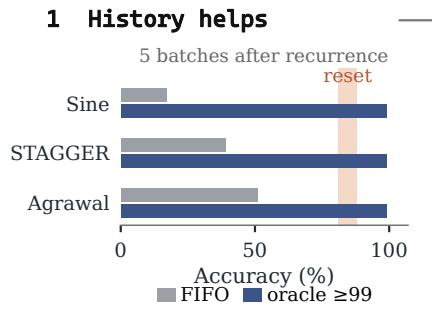

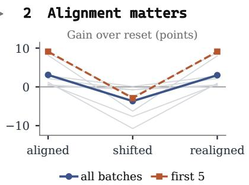

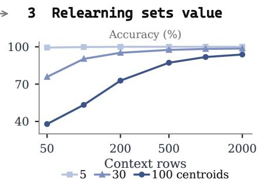

Figure 3: Context stress test. (1) Accuracy in the first five batches after a recurrence: FIFO (gray bars) and the oracle-context lower bound of 99% (blue bars), with the reset range of 81–88% shaded. (2) Gain of stored contexts over reset with aligned, shifted and realigned segments, over all batches (blue) and the first five batches after a recurrence (dashed orange), with single streams as pale traces. (3) Learning curves of concepts with 5, 30 and 100 centroids.  
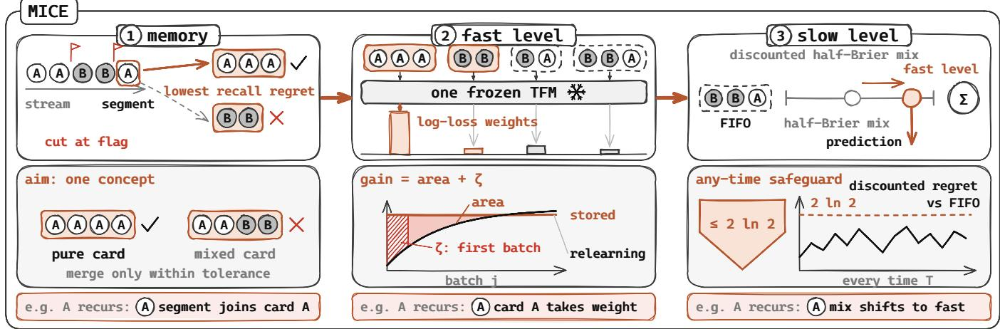  
Figure 4: Overview of MICE (schematic, bottom row illustrative). (1) Segments cut at detected changes join the stored context of lowest estimated recall re ret within a tolerance. (2) The fast level wei hts stored-context and FIFO redictions from one frozen TFM b<sub>y</sub> th<sub>e</sub>i<sub>r</sub> l<sub>og-</sub>l<sub>oss on</sub> th<sub>e</sub> l<sub>as</sub>t l<sub>a</sub>b<sub>e</sub>ll<sub>e</sub>d b<sub>a</sub>t<sub>c</sub>h<sub>.</sub> U<sub>n</sub>d<sub>er pure con</sub>t<sub>ex</sub>t<sub>s an</sub>d th<sub>e marg</sub>i<sub>ns o</sub>f Th<sub>m.</sub> 4<sub>.</sub>1<sub>,</sub> it<sub>s expec</sub>t<sub>e</sub>d <sub>accuracy ga</sub>i<sub>n</sub> over relearning e uals the area term lus the first-batch term �. (3) The slow level mixes the fast-level and FIFO redictions. Its discounted half-Brier regret against FIFO is at most 2 ln 2 at every time.

MICE segments the stream at detected changes to keep stored contexts pure, because purity governs recall under the assumptions of Prop. A.2. Under the posterior-predictive limit of Asm. 1, Prop. A.2 shows that a stored context of two deterministic concepts with a shared input distribution recalls the concept that holds the majority of its rows. MICE locates candidate changes using a two-sample test on the 300-row window’s error rate. Let $z _ { t }$ be the number of errors that the window of the last 300 rows makes on batch �, scored when its labels arrive. For every candidate change $b \in \{ t - H _ { \mathrm { c p } } , \dots , t - 1 \}$ , the test compares the error rate on the batches $b , \dots , t - 1$ (�<sub>2</sub> rows) with that on up to $R _ { \mathrm { c p } }$ batches before � (�<sub>1</sub> rows, at least two batches, none before the previous declared change), and declares a change at the candidate with the largest excess

$$
\frac { 1 } { n _ { 2 } } \sum _ { s = b } ^ { t - 1 } z _ { s } - \frac { 1 } { n _ { 1 } } \sum _ { s = b - R _ { \mathrm { c p } } } ^ { b - 1 } z _ { s } - \tau ( n _ { 1 } , n _ { 2 } ) , \quad \tau = \sqrt { \frac { 1 } { 2 } \left( \frac { 1 } { n _ { 1 } } + \frac { 1 } { n _ { 2 } } \right) \ln \frac { 1 } { \delta _ { \mathrm { c p } } } } ,\tag{2}
$$

if that excess is positive, with $H _ { \mathrm { c p } } = 3 , R _ { \mathrm { c p } } = 5$ and $\delta _ { \mathrm { c p } } = 1 0 ^ { - 3 }$ When the test declares a change at �, the open segment ends before batch � and closes if it holds at least 300 rows. A shorter segment stays in the windows only. The batches from � on start the next segment. Without a declared change, a segment closes after 500 rows once three further batches are labelled, and these three batches start the next segment. A change can be declared before this closure, which gives segments of 300 to 700 rows. Fixed segmentation, a variant used in several experiments, closes a segment every 500 rows instead.

MICE merges a segment into a stored context when the TFM’s estimated additional error on the segment is within a tolerance, which compares contexts through the TFM’s own predictions. A closed segment � joins the stored expert $C _ { k }$ that minimises the recall regret

$$
\widehat { \mathrm { D } } _ { T } ( S | C _ { k } ) = \hat { \epsilon } _ { S } ( C _ { k } ) - \hat { \epsilon } _ { S } ( S ) ,\tag{3}
$$

the 0-1 risk on � of the TFM conditioned on $C _ { k }$ minus that conditioned on � itself, if this is at most $\delta = 0 . 0 2$ . Otherwise � founds a new stored expert. $\hat { \epsilon } _ { S } ( S )$ is cross-fitted in two folds because an in-context learner memorises its context. Eq. (3) is the finite-context estimate of the recall regret of Definition A.1. In the population limit of Asm. 1, for two deterministic concepts with a shared input distribution, this cost is their disagreement mass under the 0-1 loss, which is Prop. A.2 with $\pi = 0 .$ Concepts that conflict on more than a share � of the inputs are therefore not merged. A stored expert keeps its last � rows, and the pool holds at most 12 (least recently used out).

## 4<sub>.</sub>3 S<sub>e</sub>l<sub>ec</sub>ti<sub>ng</sub> C<sub>on</sub>t<sub>ex</sub>t<sub>s</sub> f<sub>rom</sub> R<sub>ecen</sub>t F<sub>ee</sub>db<sub>ac</sub>k

Because a cumulative loss still carries the previous concept after a recurrence, the fast level weights the experts by their log-loss on the last labelled batch only. The experts are the FIFO windows of the last 100, 300 and � labelled rows and the stored experts of the pool, and the fast level weights the � experts by

$$
w _ { k } \propto \exp ( - \eta \ell _ { k } ) , \qquad \eta = 1 0 ,\tag{4}
$$

where $\ell _ { k }$ is the mean log-loss of the predictions of expert � on the last labelled batch. In other words, a stored expert that leads the last labelled batch by a clear log-loss margin takes most of the weight one batch after its concept returns. If one expert leads the last labelled batch by a margin � in log-loss as in Asm. 3, it holds weight at least $1 / \big ( 1 + ( K - 1 ) e ^ { - \eta g } \big )$ , and the mixture predicts its class on every row where its top two probabilities difer by more than $( K - 1 ) e ^ { - \eta g }$ as Lem. A.5 shows. Over a block of one concept on which the margin holds at every batch, with log-losses clipped at �, the regret of the fast level is at most � for the first batch, because labels arrive one batch late, plus a term exponentially small in �, as Prop. A.6 states.

## 4<sub>.</sub>4 B<sub>oun</sub>di<sub>ng</sub> th<sub>e</sub> L<sub>oss</sub> <sub>o</sub>f F<sub>o</sub>ll<sub>ow</sub>i<sub>ng</sub> M<sub>emory</sub>

When the experts have similar losses, the fast level can change its weights in response to small batch-to-batch fluctuations. The slow level uses a discounted loss history to control the cost of following the fast level. MICE mixes two experts, FIFO $( k = 0 )$ and the fast level $\left( 4 \right) \left( k = 1 \right)$ , with predictions $\mathbf { \Delta } _ { \mathcal { P } t , 0 }$ and $\mathbf { \Lambda } _ { p _ { t , 1 } }$ on batch �. With $\ell _ { t , k } \in \left[ 0 , 1 \right]$ the mean half Brier score $\begin{array} { r } { \frac { 1 } { 2 } \| \boldsymbol { p } - \boldsymbol { e } _ { y } \| _ { 2 } ^ { 2 } } \end{array}$ of the predictions of expert � on batch �,

$$
L _ { t , k } = \gamma L _ { t - 1 , k } + \ell _ { t , k } , \qquad L _ { 0 , k } = 0 ,\tag{5}
$$

$$
\boldsymbol { v } _ { t , k } \propto \exp \bigl ( - \eta _ { 2 } \gamma L _ { t - 1 , k } \bigr ) ,\tag{6}
$$

$$
p _ { t } = v _ { t , 0 } p _ { t , 0 } + v _ { t , 1 } p _ { t , 1 } ,\tag{7}
$$

with $\gamma = 0 . 9$ and $\begin{array} { r } { \eta _ { 2 } = \frac { 1 } { 2 } } \end{array}$ . Because the discount spans about $1 / ( 1 - \gamma )$ batches, the slow level moderates the influence of the fast predictions when batch-to-batch losses fluctuate.

Theorem 4.2 (Any-time safeguard). Let � experts be combined $b y \ ( 5 ) – ( 7 )$ , with ℓ the half Brier score and a step $\begin{array} { r } { \eta _ { 2 } \leq \frac { 1 } { 2 } } \end{array}$ . For every sequence of labels and expert predictions, every time � and every expert �,

$$
\sum _ { t = 1 } ^ { T } \gamma ^ { T - t } \big ( \ell _ { t } ( p _ { t } ) - \ell _ { t , k } \big ) \ \leq \ \frac { \ln K } { \eta _ { 2 } } .\tag{8}
$$

With $K = 2 ,$ , the discounted regret of MICE against FIFO, and against the fast level, is at most 2 ln $2 \approx 1 . 3 9$ at every time, over a discounted horizon of $1 / ( 1 - \gamma ) = 1 0$ batches, with no assumption on the stream. The bound covers the method as run, not the variant with the log-loss or the variant with $\eta _ { 2 } = 1 0$ in Tab. 1.

## 4<sub>.</sub>5 Timin<sub>g</sub> <sub>a</sub>nd C<sub>os</sub>t

When the labels of the previous batch arrive, every loss scores a prediction issued before they arrived, and the contexts are updated only afterwards. No expert is therefore scored on rows it already holds, and the slow level is scored on the predictions actually issued. At most one segment closes per batch, and App. B gives the initialisation. The cost is one TFM call per expert and batch, at most 15. Closing a segment adds two cross-fitted calls and one call per stored expert, at most 14 calls, which brings a closing batch to at most 29 calls. The change test reuses the predictions of the 300-row window and makes no call.

In summary, stored contexts provide the gain of recall, and the slow level bounds what following them can cost.

## 5 EXPERIMENTS

The evaluation follows the gain predicted by Eq. (1) from ideal contexts to online use. RQ1: does the area identity describe recall gains under its assumptions, and predict their ordering for the full method? RQ2: can detected segmentation recover gains when boundaries are unknown? RQ3: how does slow aggregation afect prediction loss and accuracy on real streams? RQ4: which gains come from the pool and its organisation, and what resources do they require?

## 5.1 Ex<sub>p</sub>erimental Setu<sub>p</sub>

Every policy is evaluated prequentially, predicting each batch of � = 100 rows before its labels arrive one batch later. Each TFM expert conditions on at most � = 1000 context rows and the pool holds at most 12 stored contexts. The backbone is TabPFN v2 with four ensemble members [19], and FIFO windows exceed 1000 rows only in the larger-window comparison of Sec. 5.5. GPU experiments run on eight NVIDIA A800 GPUs, while the trained stream learners run on CPUs.

The streams range from a controlled grid with known concepts and measured learning curves to real streams, where both are unobserved. The grid mixes Gaussian centroids in ten dimensions with four classes, using centroid counts from {5, 30, 100}. Each of the three concepts assigns its own class to every centroid, keeping $P _ { X }$ fixed while creating conflicts wherever classes difer. Grid streams have blocks of 500 or 2000 rows and three cycles, as App. G details. Thirty streams come from six standard generators with recurring concepts in River [30]<sup>1</sup>: SEA [39], STAGGER [36], Agrawal [1], Sine [11], RBF [6] and Hyperplane [22]. Generator streams have blocks of 2000 rows and three cycles over three or four concepts. Twentynine real streams come from 13 sources, the long ones in segments of 100,000 rows. They are Electricity from River, seven INSECTS streams [38]<sup>2</sup>, Forest CoverType<sup>3</sup>, and PokerHand, Airlines, Rialto [26], NOAA Weather [9], Spam [23] and Phishing from a public collection of drift data sets<sup>4</sup>, which contributes its remaining streams with at least 5000 rows and at most ten classes. Six later segments of Airlines, CoverType and PokerHand serve as confirmation segments, and the earlier real-stream sets served as development data, as App. C details. Nine independent confirmation segments come from two further sources, Bitcoin Heist ransomware transactions [2]<sup>5</sup> and CIC-IDS2017 network intrusions [37]<sup>6</sup>.

The baselines cover the two ways of following drift, adapting the context ofa TFM and training a model on the stream. The in-context baselines are FIFO, LTM [27], reset [11] and the window ensemble of the three FIFO windows of MICE without the pool. Trained stream learners are Adaptive Random Forest (ARF) [14], Streaming Random Patches (SRP) [15], Hoefding Adaptive Tree (HAT) [4], Leveraging Bagging [5], ADWIN Bagging [6] and Learn++.NSE [9]. The incremental learners use the default settings of river [30] with ten base models and the same batch protocol. Online forecasters FSNet [33], OneNet [43], ShifTS [45] and ADAPT-Z [21] get a softmax head and are tuned on the five development streams. Drift-Resilient TabPFN [18] runs without tuning.

Four metrics complement accuracy by weighting classes equally and by scoring the predicted probabilities. F1 is the macro-F1 over the classes that occur in a stream. AUC, the area under the receiver operating characteristic curve, is computed one-vs-rest from each policy’s predicted class probabilities and averaged over these classes. The expected calibration error (ECE) bins the predictor’s largest class probability into 15 equal bins. Brier is the half Brier score $\frac { 1 } { 2 } \| p - e _ { y } \| _ { 2 } ^ { 2 }$ averaged over rows. All four are reported in percent.

Unless a result names fixed segmentation, MICE segments at detected changes, which improves on fixed segmentation by +0.04 points on the aligned grid and +0.01 on the real streams. The generator streams, the confirmation segments, the ablations and the timings use fixed segmentation, and each comparison below names its variant. App. C records how the development and confirmation streams were separated and every registered hypothesis with its outcome. Tab. 1 reports both the slow step $\begin{array} { r l r } { \eta _ { 2 } } & { { } = } & { \frac { 1 } { 2 } } \end{array}$ covered by Thm. 4.2 and the step of 10.

## 5.2 RQ1: Learning Curves Predict Recall Gains

The oracle-boundary test checks the identity of Thm. 4.1 with known boundaries, the relearning learner and the stored expert of the theorem, which holds the visit-specific $n _ { c }$ rows. Its observed quantity is the measured area term $J ^ { - 1 } \sum _ { j = 2 } ^ { J } ( \operatorname { a c c } _ { X , j } - \operatorname { a c c } _ { R , j } )$ where acc $\cdot X , j$ and acc<sub>�,�</sub> are the accuracies of the fast level and of relearning on batch � of the block. The first batch enters only $\zeta _ { k , c } = ( \operatorname { a c c } _ { X , 1 } - \operatorname { a c c } _ { R , 1 } ) / J .$ . Its predicted quantity is the area term computed from learning curves with the same $n _ { c } .$ On seeds 40 and 41 the two lie within 0.7 points of each other in every cell, with a mean absolute diference of 0.37 points and Spearman correlation 1.0, as Fig. 5b shows. The mixture assigns more than half of its weight to the more accurate expert on every batch where the two difer by more than 10 points.

Beyond the ideal setting, learning curves measured before the grid streams were run also rank the observed recall gains, as App. G describes. These registered predictions insert the curves into the area term with the full stored context of � rows on every recurrence. Their observed counterpart is the gain over reset of a complete policy with fixed segmentation. On seeds 10 and 11, whose concepts supplied the curves, MICE w/o slow level exceeds reset on all eight streams with 30 or 100 centroids, more for shorter blocks and harder concepts. Predicted and observed gains have Spearman correlation 0.94 across the six cells (10.4 against 8.6 points in the hardest cell). For the full method on fresh seeds 20 and 21 the correlation is 0.83, as Fig. 5a shows. With the visit-specific $n _ { c }$ in place of �, the predictions change only for � = 500 (100 centroids: 9.2 instead of 10.4), and the rank correlations stay unchanged.

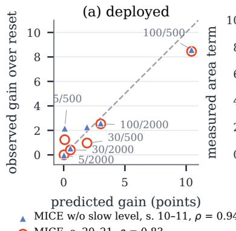

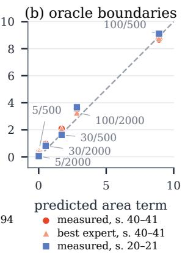  
Fi<sub>g</sub>ure 5: Learnin<sub>g</sub> curves <sub>p</sub>redict the <sub>g</sub>ain of recall<sub>, p</sub>er <sub>g</sub>rid cell (centroids/block length). Dashed lines mark equality. (a) With fi<sub>xe</sub>d <sub>segmen</sub>t<sub>s, o</sub>b<sub>serve</sub>d <sub>ga</sub>i<sub>n over rese</sub>t <sub>o</sub>f MICE <sub>w</sub>/<sub>o</sub> slow level (seeds 10, 11) and of MICE (seeds 20, 21) against the prediction from learning curves measured beforehand. (b) With <sub>orac</sub>l<sub>e</sub> b<sub>oun</sub>d<sub>ar</sub>i<sub>es,</sub> th<sub>e measure</sub>d <sub>area</sub> t<sub>erm o</sub>f Th<sub>m.</sub> 4<sub>.</sub>1 (seeds 40, 41 and 20, 21) and the best expert per batch against th<sub>e pre</sub>di<sub>c</sub>t<sub>e</sub>d <sub>area.</sub>

Stored contexts add more accuracy on slowly learned concepts, because they replace a longer period of relearning. With fixed segments, MICE exceeds reset and the window ensemble on all eight streams with 30 or 100 centroids. Averaged over the twelve streams of seeds 20 and 21 it reaches 86.5 against 84.3 for reset, 81.8 for the window ensemble and 62.4 for FIFO, up to 8.5 points over reset in the hardest cell. On seeds 10 and 11 the trained learners ARF and SRP reach 68.0 and 69.7, against 83.9 for reset and 86.2 for MICE with fixed segments. On the six standard generators, whose learning curves are flat after about 200 rows, the predicted gain is at most 0.4 points and the observed gain over reset is 0.1 points with fixed segments (computed from unrounded means, 95.0 against 94.8 after rounding): where relearning is cheap, memory has little to add, as Cor. A.7 predicts.

## 5.3 RQ2: Recovering Gains with Unknown B<sub>oun</sub>d<sub>ar</sub>i<sub>es</sub>

Detected segmentation preserves recall gains without knowing the boundary phase. On 72 new grid streams with random boundary ofsets, MICE is above reset on 70, by +2.85 points on average: +5.17 with 500-row blocks (95% interval [+4.59, +5.72]), +1.48 with 2 000-row blocks and +1.91 with variable blocks, against +0.66, +0.74 and +0.65 for fixed segmentation, as Fig. 6b shows. On 72 grid confirmation streams from seeds 50 to 53, MICE is above reset on all 72, by +2.69 points. Detected segmentation recovers what fixed segmentation lost, +6.55 points on the shifted grid and +1.74 on the misaligned schedules, and leaves the aligned grid and the real streams unchanged, as Fig. 6a shows.

Table 1: Main results (%, mean over streams). Worst Δ: lowest accurac<sub>y</sub> diference to FIFO over the real streams, in <sub>p</sub>oints. Inde<sub>p</sub>. (9): the nine independent confirmation segments of Bitcoin Heist and CIC-IDS2017. The top three values per column are shaded.
<table><tr><td rowspan="2">Policy</td><td colspan="6">Real streams (29)</td><td colspan="5">Controlled grid (24)</td><td>Gen. (30)</td><td>Indep. (9)</td></tr><tr><td>Acc. ↑</td><td>F1↑</td><td>AUC ↑</td><td>ECE↓</td><td>Brier ↓</td><td>Worst∆↑</td><td>Acc. ↑</td><td>F1↑</td><td>AUC ↑</td><td>ECE↓</td><td>Brier ↓ |</td><td>Acc. ↑</td><td>Acc. ↑</td></tr><tr><td>Trained stream learners</td><td></td><td></td><td></td><td></td><td></td><td></td><td></td><td></td><td></td><td></td><td></td><td></td><td></td></tr><tr><td>ARF [14]</td><td>73.4</td><td>58.4</td><td>85.4</td><td>6.0</td><td>18.7</td><td>-37.5</td><td>67.7</td><td>65.6</td><td>83.8</td><td>11.2</td><td>22.9</td><td>88.0</td><td>98.39</td></tr><tr><td>SRP [15]</td><td>76.6</td><td>62.3</td><td>87.5</td><td>6.0</td><td>16.7</td><td>-19.8</td><td>69.5</td><td>68.1</td><td>84.7</td><td>8.8</td><td>21.6</td><td>86.4</td><td>98.57</td></tr><tr><td>HAT [4]</td><td>64.3</td><td>51.1</td><td>79.1</td><td>16.5</td><td>27.4</td><td>-49.6</td><td>51.4</td><td>49.4</td><td>74.5</td><td>13.3</td><td>32.1</td><td>79.2</td><td>97.93</td></tr><tr><td>Leveraging Bagging [5]</td><td>72.4</td><td>57.3</td><td>85.9</td><td>5.1</td><td>19.1</td><td>-34.6</td><td>62.0</td><td>60.6</td><td>82.4</td><td>7.2</td><td>24.9</td><td>85.9</td><td>98.39</td></tr><tr><td>ADWIN Bagging [6]</td><td>65.1</td><td>51.5</td><td>81.4</td><td>7.8</td><td>24.0</td><td>-50.1</td><td>51.2</td><td>49.2</td><td>76.1</td><td>9.4</td><td>30.8</td><td>77.0</td><td>97.91</td></tr><tr><td>Learn++.NSE [9]</td><td>67.7</td><td>51.2</td><td>82.8</td><td>8.5</td><td>22.3</td><td>-41.0</td><td>61.6</td><td>60.0</td><td>81.2</td><td>30.0</td><td>33.6</td><td>84.1</td><td>94.86</td></tr><tr><td>FSNet [33]</td><td>77.3</td><td>64.9</td><td>88.1</td><td>4.6</td><td>15.6</td><td>-26.7</td><td>62.7</td><td>61.3</td><td>80.4</td><td>8.4</td><td>24.8</td><td>87.5</td><td>98.21</td></tr><tr><td>OneNet [43]</td><td>77.8</td><td>65.1</td><td>88.1</td><td>4.2</td><td>15.2</td><td>-22.1</td><td>62.4</td><td>60.9</td><td>80.1</td><td>7.0</td><td>24.6</td><td>87.6</td><td>97.19</td></tr><tr><td>ShifTS [45] ADAPT-Z [21]</td><td>73.4</td><td>59.9</td><td>84.6</td><td>3.5</td><td>17.7</td><td>-30.4</td><td>51.1</td><td>47.0</td><td>71.7</td><td>6.0</td><td>29.3</td><td>76.4</td><td>97.72</td></tr><tr><td></td><td>65.6</td><td>50.7</td><td>80.1</td><td>5.6</td><td>22.3</td><td>-52.3</td><td>50.1</td><td>46.2</td><td>70.7</td><td>6.0</td><td>30.0</td><td>78.1</td><td>97.43</td></tr><tr><td>In-context policies, frozen TabPFN</td><td></td><td></td><td></td><td></td><td></td><td></td><td></td><td></td><td></td><td></td><td></td><td></td><td></td></tr><tr><td>FIFO</td><td>83.3</td><td>73.5</td><td>89.9</td><td>1.7</td><td>11.6</td><td></td><td>61.9</td><td>60.9</td><td>83.7</td><td>16.7</td><td>25.1</td><td>87.6</td><td>98.57</td></tr><tr><td>LTM [27]</td><td>82.6</td><td>72.1</td><td>91.0</td><td>1.5</td><td>11.9</td><td>-2.7</td><td>62.2</td><td>61.4</td><td>84.8</td><td>16.0</td><td>24.5</td><td>87.6</td><td>98.21</td></tr><tr><td>Reset [11]</td><td>81.5</td><td>71.3</td><td>88.5</td><td>2.6</td><td>12.9</td><td>-9.6</td><td>84.1</td><td>83.8</td><td>91.4</td><td>7.3</td><td>13.1</td><td>94.8</td><td>98.49</td></tr><tr><td>Window ensemble Drift-Resilient TabPFN [18]</td><td>83.0 81.7</td><td>73.0 68.7</td><td>89.5 88.4</td><td>1.2 3.0</td><td>11.7 12.9</td><td>-1.4</td><td>81.6 76.4</td><td>81.0 75.6</td><td>90.8 87.4</td><td>8.7 9.8</td><td>14.9 17.9</td><td>94.6 93.7</td><td>98.44 98.37</td></tr><tr><td></td><td></td><td></td><td></td><td></td><td></td><td>-4.2</td><td></td><td></td><td></td><td></td><td></td><td></td><td></td></tr><tr><td>Ours</td><td></td><td></td><td></td><td></td><td></td><td></td><td></td><td></td><td></td><td></td><td></td><td></td><td></td></tr><tr><td>MICE (full, detected seg.)</td><td>83.8 83.8</td><td>74.4</td><td>90.7</td><td>1.3</td><td>11.2</td><td>-0.23</td><td>86.4</td><td>86.0</td><td>92.4</td><td>9.9</td><td>12.6</td><td>95.0</td><td>98.59</td></tr><tr><td>MICE, fixed segments</td><td>83.8</td><td>74.3 74.2</td><td>90.5 90.5</td><td>1.3</td><td>11.2 11.2</td><td>-0.25</td><td>86.4 86.6</td><td>86.0 86.3</td><td>92.3 93.6</td><td>10.1</td><td>12.7</td><td>95.0 95.2</td><td>98.60</td></tr><tr><td>MICE, fixed segments, η2 = 10</td><td></td><td></td><td></td><td>1.1</td><td></td><td>-0.08</td><td>86.8</td><td>86.5</td><td>93.6</td><td>7.0</td><td>11.5</td><td>95.3</td><td>98.61</td></tr><tr><td>MICE w/o slow level (fixed seg.)</td><td>83.3</td><td>73.4</td><td>90.3</td><td>1.5</td><td>11.5</td><td>-2.3</td><td></td><td></td><td></td><td>7.1</td><td>11.4</td><td></td><td>98.50</td></tr></table>

The alignment diagnostic explains this recovery, because boundaries inside fixed segments mix concepts and reduce recall gains. When the boundaries of the eight aligned grid streams move 200 rows into the segments, the gain of fixed segmentation over reset falls by 6.8 points on average, and it is below reset on 7 of the 8 streams. On twelve streams with misaligned block schedules it is above reset on 8, by +0.47 points, as test 2 of Fig. 3 shows and Fig. 8 details per stream. Restarting the segments at the known phase of the boundaries restores the gain (+3.01 against +3.09 points), which shows that the loss lies in the phase of the segments.

Segment purity matters because a late detection mixes the rows of two concepts in one segment. The detector declared 570 of the 576 changes of the test streams and 575 of the 576 of the confirmation streams, each in the batch that holds the boundary or the next one. Every stored context was majority-pure, and 88% of the segment closes held at least 95% rows of one concept (87% on the confirmation streams). The impure closes concentrate on 500-row blocks, as Fig. 6c shows.

## 5.4 RQ3: The Cost of Following Memory on Real Streams

Real-stream concepts and learning curves are unobserved, and the experts often have similar prediction losses. On the grid the leading expert holds weight 1.000 from the second batch of a recurring block. On the real streams the median margin, the gap in mean log-loss between the leading and the next-best expert on a labelled batch, is about 0.01 nats, the regime the slow level is built for. With detected segmentation, MICE is never more than 0.23 points below FIFO across the 29 real streams and is above it on 24 (+0.58 on average). With fixed segmentation, the slow level limits the largest shortfall of MICE to 0.25 points, against 2.3 for MICE w/o slow level. In comparison, reset loses up to 9.6 points to FIFO and 1.8 on average, and the window ensemble up to 1.4, as Tab. 1 reports and App. H gives per stream. The largest gains occur on Rialto (+4.7, a daily cycle) and the INSECTS streams (+0.2 to +1.9). In Tab. 1, the trained baselines have lower mean accuracy on these streams. Beyond accuracy, MICE has the highest F1 and a lower Brier score than every baseline on the real streams. LTM has the highest mean AUC, with its advantage concentrated on the PokerHand segments, where its class-balanced bufer keeps rare classes.

The confirmation segments of Airlines, CoverType and Poker-Hand, run with fixed segmentation, reproduce the real-stream result. MICE is never more than 0.01 points below FIFO on any of the six segments and is not below reset. It is more accurate than all four in-context baselines on five and has the highest mean (85.3 against 85.1 for FIFO). The slow level turns the −2.0 and −1.9 points of MICE w/o slow level on the two PokerHand segments into +0.4 and +0.5. The one-sided 95% block-bootstrap bound of the diference to FIFO is above −0.3 points on 28 of the 29 real streams. On Spam, with 61 batches, non-inferiority is undecided.

On the nine independent confirmation segments of Bitcoin Heist and CIC-IDS2017, detected segmentation keeps the accuracy of fixed segmentation, from which the mean of MICE difers by less than 0.01 points. On every segment the one-sided 95% bootstrap lower bound on its accuracy diference to FIFO is at least −0.25 points, and its observed accuracy is never more than 0.18 points below the better of FIFO and reset. It is above its pool-free replay on eight of nine segments. Mean accuracies over the nine segments difer by less than 0.4 points across the in-context policies, at about 98.5%, and MICE is the most accurate of the in-context policies on four of the nine segments.

Replacing the half Brier score with the log-loss can harm the slow level, because one confidently wrong batch after a switch outweighs the next ten. With the log-loss in place of the half Brier score, the accuracy of MICE on one grid stream falls from 86.4 to 74.9. On the grid with fixed segments, the step $\begin{array} { r } { \eta _ { 2 } = \frac { 1 } { 2 } } \end{array}$ covered by Thm. 4.2 has an ECE 3.1 points above the step of 10. The largest discounted half-Brier regret of MICE against FIFO over 33 development streams is 0.15, within the bound of 1.39.

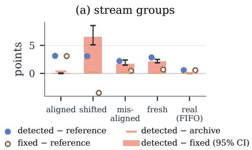

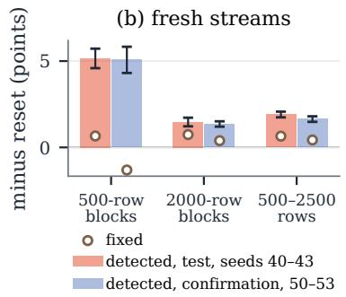

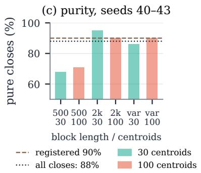

Figure 6: Detected against fixed segmentation. (a) Their diference per stream group. (b) Gain over reset on fresh streams with random boundary phases, test and confirmation seeds. (c) Share of segment closes that are at least 95% pure. The dashed line <sub>mar</sub>k<sub>s</sub> th<sub>e</sub> t<sub>arge</sub>t <sub>s</sub>h<sub>are o</sub>f 90%<sub>.</sub>  
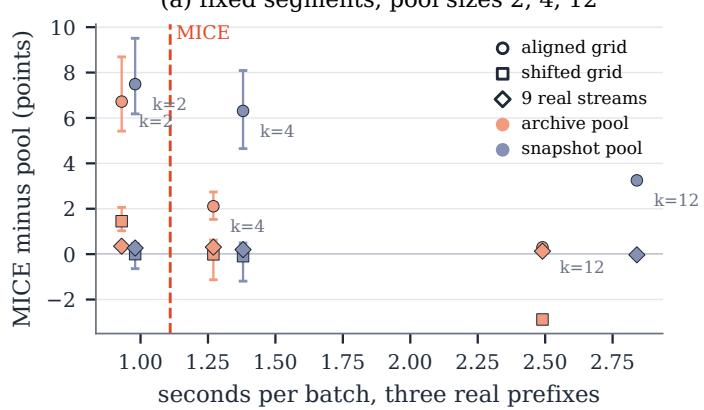

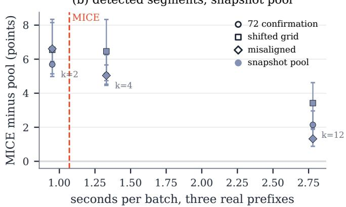  
Figure 7: MICE minus unmerged pools (archive, snapshot) of sizes 2, 4 and 12 against their time per batch. The dashed line is the time of MICE. (a) Fixed segmentation. (b) Detected segmentation.

## 5.5 RQ4: Memory Organisation and Resource T<sub>ra</sub>d<sub>eo</sub>f<sub>s</sub>

Removing stored contexts lowers accuracy on all 24 grid streams (by 5.6 points on average) and on 28 of the 29 real streams (by 0.35) in this fixed-segmentation ablation. Without them, the two levels mix only the three FIFO windows.

Merging keeps fewer experts than two pools that never merge and share the windows and two-level rule of MICE with a pool size of 12. An archive keeps every closed segment as its own expert, and a snapshot pool stores the latest 1000 rows at every close. With fixed segments, MICE is above the archive on the aligned grid by +0.30 points and within 0.1 points of both pools on the real streams, with fewer experts (8.4 against 14.2 per batch) and TFM calls (9.7 against 14.0).

Capped to the time per batch of MICE, both fixed-segmentation pools are less accurate than MICE, by 6.7 and 7.5 points on the aligned grid and 0.35 and 0.27 on nine real streams. On the shifted grid, the time-matched snapshot pool is level with MICE, and the uncapped archive is ahead of it, as Fig. 7a shows.

With detected segments on the fresh grid streams, MICE keeps the pool at a third of the archive’s experts and is 0.11 points more accurate. On the grid confirmation streams it exceeds a snapshot pool of equal capacity by 2.14 points and is level with it only on 2 000-row blocks, as Fig. 7b shows. On 144 pairs of grid segments the recall regret separates same from diferent concepts with AUROC 1.00.

Runtime and peak GPU memory grow with the rows that a policy conditions on, and MICE is compared with FIFO windows of up to 13 400 rows. MICE with fixed segments takes 1.07 s per batch on three real prefixes on one GPU, against 0.22 s for FIFO with 1000 rows, 0.42 s with 3000 rows and 1.91 s with 13 400, as plotted in App. H. Peak GPU memory is 0.8 to 26.4 GB for FIFO and 1.0 GB for MICE. A 3000-row window, about 2.5 times cheaper, is more accurate than fixed-segmentation MICE on 21 of the 29 real streams. MICE is ahead by +0.31 points on average because of the sharply drifting streams, four INSECTS streams by +3.3 to +5.5 and Rialto by +6.9, as Fig. 9 details per stream. These comparisons cover complete policies at diferent context budgets, whereas Thm. 4.2 compares MICE with FIFO at � rows.

## 6 CONCLUSION

A stored context lets a frozen TFM reuse a past concept without retraining. Under pure-context and margin conditions, its value is the relearning it saves, a normalised learning-curve area up to a first batch term. MICE builds contexts at detected changes and weights them by their last-batch log-loss. Its slow level keeps discounted half-Brier regret against FIFO at most 2 ln 2 at every time. Learning curves predict the ordering of recall gains on the grid. Detected seg mentation recovers these gains under unknown boundary phases. On 29 real streams, MICE has the highest mean accuracy of all policies and is above FIFO on 24. Learning curves measured before deployment can therefore indicate whether stored contexts will pay.

## REFERENCES

[1] Rakesh Agrawal, Tomasz Imielinski, and Arun Swami. 1993. Database Mining: A Performance Perspective. IEEE Transactions on Knowledge and Data Engineering 5, 6 (1993), 914–925.

[2] Cuneyt G. Akcora, Yitao Li, Yulia R. Gel, and Murat Kantarcioglu. 2020. BitcoinHeist: Topological Data Analysis for Ransomware Prediction on the Bitcoin Blockchain. In Proceedings of the International Joint Conference on Artificial Intelligence (IJCAI). 4439–4445.

[3] Shai Ben-David, John Blitzer, Koby Crammer, Alex Kulesza, Fernando Pereira, and Jennifer Wortman Vaughan. 2010. A Theory of Learning from Diferent Domains. Machine Learning 79, 1–2 (2010), 151–175.

[4] Albert Bifet and Ricard Gavaldà. 2009. Adaptive Learning from Evolving Data Streams. In Proceedings ofthe International Symposium on IntelligentData Analysis (IDA). 249–260.

[5] Albert Bifet, Geof Holmes, and Bernhard Pfahringer. 2010. Leveraging Bagging for Evolving Data Streams. In Proceedings ofthe European Conference on Machine Learning and Principles and Practice ofKnowledge Discovery in Databases (ECML PKDD). 135–150.

[6] Albert Bifet, Geof Holmes, Bernhard Pfahringer, Richard Kirkby, and Ricard Gavaldà. 2009. New Ensemble Methods for Evolving Data Streams. In Proceedings of the ACM SIGKDD International Conference on Knowledge Discovery and Data Mining (KDD). 139–148.

[7] Ignacio Cabrera Martin, Subhaditya Mukherjee, Almas Baimagambetov, Joaquin Vanschoren, and Nikolaos Polatidis. 2025. Evolving Machine Learning in Non-Stationary Environments: A Unified Survey of Drift, Forgetting, and Adaptation. arXiv preprint arXiv:2505.17902 (2025).

[8] Nicolò Cesa-Bianchi and Gábor Lugosi. 2006. Prediction, Learning, and Games. Cambridge University Press.

[9] Ryan Elwell and Robi Polikar. 2011. Incremental Learning of Concept Drift in Nonstationary Environments. IEEE Transactions on Neural Networks 22, 10 (2011), 1517–1531.

[10] João Gama and Petr Kosina. 2014. Recurrent Concepts in Data Streams Classifi cation. Knowledge and Information Systems 40 (2014).

[11] João Gama, Pedro Medas, Gladys Castillo, and Pedro Rodrigues. 2004. Learning with Drift Detection. In Proceedings of the Brazilian Symposium on Artificial Intelligence (SBIA) (Lecture Notes in Computer Science, Vol. 3171). Springer, 286– 295.

[12] João Gama, Indre Žliobait ˙ e, Albert Bifet, Mykola Pechenizkiy, and Abdelhamid˙ Bouchachia. 2014. A Survey on Concept Drift Adaptation. Comput. Surveys 46, 4 (2014), 44:1–44:37.

[13] Pablo García, J. de Curtò, I. de Zarzà, Juan Carlos Cano, and Carlos T. Calafate. 2025. Foundation Models for Cybersecurity: A Comprehensive Multi-Modal Evaluation of TabPFN and TabICL for Tabular Intrusion Detection. Electronics 14, 19 (2025), 3792. https://doi.org/10.3390/electronics14193792

[14] Heitor Murilo Gomes, Albert Bifet, Jesse Read, Jean Paul Barddal, Fabrício Enembreck, Bernhard Pfahringer, Geof Holmes, and Talel Abdessalem. 2017. Adaptive Random Forests for Evolving Data Stream Classification. Machine Learning 106, 9–10 (2017), 1469–1495.

[15] Heitor Murilo Gomes, Jesse Read, and Albert Bifet. 2019. Streaming Random Patches for Evolving Data Stream Classification. In Proceedings of the IEEE International Conference on Data Mining (ICDM). 240–249.

[16] Paulo Mauricio Gonçalves, Jr. and Roberto Souto Maior de Barros. 2013. RCD: A Recurring Concept Drift Framework. Pattern Recognition Letters 34 (2013), 1018–1025.

[17] Elad Hazan and C. Seshadhri. 2009. Eficient Learning Algorithms for Changing Environments. In Proceedings ofthe International Conference on Machine Learning (ICML). 393–400.

[18] Kai Helli, David Schnurr, Noah Hollmann, Samuel Müller, and Frank Hutter. 2024. Drift-Resilient TabPFN: In-Context Learning Temporal Distribution Shifts on Tabular Data. In Advances in Neural Information Processing Systems (NeurIPS). 98742–98781.

[19] Noah Hollmann, Samuel Müller, Lennart Purucker, Arjun Krishnakumar, Max Körfer, Shi Bin Hoo, Robin Tibor Schirrmeister, and Frank Hutter. 2025. Accurate Predictions on Small Data with a Tabular Foundation Model. Nature 637, 8045 (2025), 319–326.

[20] Jianhao Huang, Zhihong Zeng, Zhangkai Wu, Hengyu Liu, and Yanfang Liu. 2026. Density Harmonized Gradient Descent Online Active Learning for Imbalanced Data Streams. In Proceedings ofthe International Conference on Behavioural and Social Computing (BESC) (Lecture Notes in Computer Science). Springer, 148–163. https://doi.org/10.1007/978-981-95-7141-3\_9

[21] Xiannan Huang, Shuhan Qiu, Jiayuan Du, and Chao Yang. 2026. Online Time Series Prediction Using Feature Adjustment. In International Conference on Learning Representations (ICLR).

[22] Geof Hulten, Laurie Spencer, and Pedro Domingos. 2001. Mining Time-Changing Data Streams. In Proceedings ofthe ACM SIGKDD International Conference on Knowledge Discovery and Data Mining (KDD). 97–106.

[23] Ioannis Katakis, Grigorios Tsoumakas, and Ioannis Vlahavas. 2010. Tracking Recurring Contexts Using Ensemble Classifiers: An Application to Email Filtering. Knowledge and Information Systems 22, 3 (2010), 371–391.

[24] J. Zico Kolter and Marcus A. Maloof. 2007. Dynamic Weighted Majority: An Ensemble Method for Drifting Concepts. Journal of Machine Learning Research 8 (2007), 2755–2790.

[25] Nick Littlestone and Manfred K. Warmuth. 1994. The Weighted Majority Algorithm. Information and Computation 108, 2 (1994), 212–261.

[26] Viktor Losing, Barbara Hammer, and Heiko Wersing. 2016. KNN Classifier with Self Adjusting Memory for Heterogeneous Concept Drift. In Proceedings of the IEEE International Conference on Data Mining (ICDM). 291–300.

[27] Afonso Lourenço, João Gama, Eric P. Xing, and Goreti Marreiros. 2026. In-Context Learning of Evolving Data Streams with Tabular Foundational Models. In Proceedings of the ACM SIGKDD International Conference on Knowledge Discovery and Data Mining (KDD).

[28] Jie Lu, Anjin Liu, Fan Dong, Feng Gu, João Gama, and Guangquan Zhang. 2019. Learning under Concept Drift: A Review. IEEE Transactions on Knowledge and Data Engineering 31, 12 (2019), 2346–2363.

[29] Yishay Mansour, Mehryar Mohri, and Afshin Rostamizadeh. 2009. Domain Adaptation: Learning Bounds and Algorithms. In Proceedings ofthe Conference on Learning Theory (COLT).

[30] Jacob Montiel, Max Halford, Saulo Martiello Mastelini, Geofrey Bolmier, Raphaël Sourty, Robin Vaysse, Adil Zouitine, Heitor Murilo Gomes, Jesse Read, Talel Abdessalem, and Albert Bifet. 2021. River: Machine Learning for Streaming Data in Python. Journal ofMachine Learning Research 22, 110 (2021).

[31] Samuel Müller, Noah Hollmann, Sebastian Pineda-Arango, Josif Grabocka, and Frank Hutter. 2022. Transformers Can Do Bayesian Inference. In Proceedings of the International Conference on Learning Representations (ICLR).

[32] Thomas Nagler. 2023. Statistical Foundations of Prior-Data Fitted Networks. In Proceedings ofthe International Conference on Machine Learning (ICML). 25660– 25676.

[33] Quang Pham, Chenghao Liu, Doyen Sahoo, and Steven C. H. Hoi. 2023. Learning Fast and Slow for Online Time Series Forecasting. In International Conference on Learning Representations (ICLR).

[34] Jingang Qu, David Holzmüller, Gaël Varoquaux, and Marine Le Morvan. 2026. TabICLv2: A Better, Faster, Scalable, and Open Tabular Foundation Model. arXiv preprint arXiv:2602.11139 (2026).

[35] Jingang Qu, David Holzmüller, Gaël Varoquaux, and Marine Le Morvan. 2025. TabICL: A Tabular Foundation Model for In-Context Learning on Large Data. In Proceedings ofthe International Conference on Machine Learning (ICML). 50817– 50847.

[36] Jefrey C. Schlimmer and Richard H. Granger, Jr. 1986. Incremental Learning from Noisy Data. Machine Learning 1, 3 (1986), 317–354.

[37] Iman Sharafaldin, Arash Habibi Lashkari, and Ali A. Ghorbani. 2018. Toward Generating a New Intrusion Detection Dataset and Intrusion Trafic Character ization. In Proceedings ofthe International Conference on Information Systems Security and Privacy (ICISSP). 108–116.

[38] Vinicius M. A. Souza, Denis M. dos Reis, André G. Maletzke, and Gustavo E. A. P. A. Batista. 2020. Challenges in Benchmarking Stream Learning Algorithms with Real-World Data. Data Mining and Knowledge Discovery 34, 6 (2020), 1805– 1858.

[39] W. Nick Street and YongSeog Kim. 2001. A Streaming Ensemble Algorithm (SEA) for Large-Scale Classification. In Proceedings ofthe ACM SIGKDD International Conference on Knowledge Discovery and Data Mining (KDD). 377–382.

[40] Zhangkai Wu, Qi Zhang,Junxian Zhou, Hui Chen, and Yanfang Liu. 2026. WAVAE: A Weakly Augmented Variational Autoencoder for Time Series Anomaly Detection. Information Fusion 125 (2026), 103462. https://doi.org/10.1016/j.infus.2025. 103462

[41] En Yu, Jie Lu, Kun Wang, Xiaoyu Yang, and Guangquan Zhang. 2026. Drift-Aware Collaborative Assistance Mixture of Experts for Heterogeneous Multistream Learning. In Proceedings ofthe AAAI Conference on Artificial Intelligence (AAAI), Vol. 40. 16199–16207.

[42] Tianlin Zhang, En Yu, Yi Shao, and Jiande Sun. 2025. Multimodal Inverse Attention Network with Intrinsic Discriminant Feature Exploitation for Fake News Detection. In Proceedings of the International Joint Conference on Artificial Intelligence (IJCAI).

[43] YiFan Zhang, Qingsong Wen, Xue Wang, Weiqi Chen, Liang Sun, Zhang Zhang, Liang Wang, Rong Jin, and Tieniu Tan. 2023. OneNet: Enhancing Time Series Forecasting Models under Concept Drift by Online Ensembling. In Advances in Neural Information Processing Systems (NeurIPS).

[44] Shengjia Zhao, Abhishek Sinha, Yutong He, Aidan Perreault, Jiaming Song, and Stefano Ermon. 2022. Comparing Distributions by Measuring Diferences that Afect Decision Making. In Proceedings of the International Conference on Learning Representations (ICLR)

[45] Zhiyuan Zhao, Haoxin Liu, and B. Aditya Prakash. 2026. Tackling Time-Series Forecasting Generalization via Mitigating Concept Drift. In International Conference on Learning Representations (ICLR).

T<sub>a</sub>bl<sub>e</sub> 2<sub>:</sub> N<sub>o</sub>t<sub>a</sub>ti<sub>on.</sub>
<table><tr><td>Symbol</td><td>Meaning</td></tr><tr><td> $( { \bf x } , y )$ </td><td>a row and its label</td></tr><tr><td> $B , M$ </td><td>batch size (100 rows), context budget (1000 rows)</td></tr><tr><td> $C , C _ { k }$ </td><td>a context, the stored context k</td></tr><tr><td> $f _ { \Theta } ( \cdot \ \widetilde { | } \ \mathbf { x } ; C )$ </td><td>the frozen TFM</td></tr><tr><td> $P , Q$ </td><td>concepts</td></tr><tr><td> $\epsilon _ { P } ( C )$ </td><td>risk on P of the TFM given C</td></tr><tr><td> $\mathrm { D } _ { T }$ </td><td>recall regret</td></tr><tr><td> $s , \delta$ </td><td>a closed segment, merge threshold (0.02)</td></tr><tr><td> $H _ { \mathrm { c p } } , R _ { \mathrm { c p } } , \delta _ { \mathrm { c p } } , \tau$ </td><td>constants and margin of the change test</td></tr><tr><td> $\pi , \nu$ </td><td>majority share of a context, distance of a declared change to its boundary</td></tr><tr><td> $K$   $\ell _ { k } , \eta , w _ { k }$ </td><td>number of experts last-batch loss, step (10) and weight of the fast level</td></tr><tr><td></td><td>margin of the leading expert</td></tr><tr><td> $_ { L , J } ^ { g }$ </td><td>block length in rows and in batches</td></tr><tr><td> $a _ { k } ( n ) , n _ { c }$ </td><td>learning curve of concept k, rows of its stored context on visit</td></tr><tr><td> $\Delta _ { k , c } ( L )$ </td><td>c gain of recall over relearning</td></tr><tr><td></td><td>discounted loss,  $\begin{array} { r } { s \mathrm { t e p } \left( \frac { 1 } { 2 } \right) , } \end{array}$  discount (0.9) and weight of the slow</td></tr><tr><td> $L _ { t , k } , \eta _ { 2 } , \gamma , v _ { t , k }$ </td><td>level</td></tr></table>

[46] Jiawen Zhu, Shuhan Liu, Di Weng, and Yingcai Wu. 2026. Dynamic TMoE: A Drift-Aware Dynamic Mixture of Experts Framework for Non-Stationary Time Series Forecasting. In Proceedings ofthe International Conference on Machine Learning (ICML).

## A THEORY

This appendix states formally the results that Sec. 4 uses to justify the design of MICE. The change test (2), the fast and slow levels (4), (5)–(7) and Thms. 4.1 and 4.2 are stated there. Proofs are in App. F.

The risk ofa context and the learning curve ofa concept let stored contexts be compared with contexts relearned from new rows. For a concept � over (x, �) and a loss ℓ, the risk of a context C is

$$
\begin{array} { r } { \epsilon _ { P } ( C ) = \mathbb { E } _ { ( \mathbf { x } , y ) \sim P } \ell \big ( f _ { \Theta } ( \cdot \mid \mathbf { x } ; C ) , y \big ) , } \end{array}
$$

and the learning curve of � is $R _ { P } ( n ) = \mathbb { E } _ { C \sim P ^ { n } } \epsilon _ { P } ( C )$ . We write $\ p _ { \mathbf { X } } =$ $P ( \cdot \mid \mathbf { x } )$ for the conditional, $P _ { X }$ for the marginal. For a predictor ℎ, $\epsilon _ { P } ( h )$ is its risk on �, which makes $\epsilon _ { P } ( C )$ the risk of the predictor $\boldsymbol { h } = f _ { \boldsymbol { \Theta } } ( \cdot \cdot \vert \cdot ; C )$ . Definition A.1 uses the population predictors of Asm. 1, and (3) estimates it from finite contexts.

## A<sub>.</sub>1 Whi<sub>c</sub>h C<sub>o</sub>nt<sub>e</sub>xt<sub>s</sub> Sh<sub>a</sub>r<sub>e</sub> <sub>a</sub> C<sub>o</sub>n<sub>cep</sub>t

We compare two concepts through the TFM conditioned on their contexts. Its population behaviour follows from the principle behind prior-fitted networks, which approximate the posterior predictive distribution [31, 32].

Assumption 1 (Posterior-predictive limit). With a context from � alone, the TFM predicts the conditional ${ \mathcal { P } } \mathbf { x } .$ With contexts of equal size from � and $Q ,$ , it predicts the conditional of the mixture $\begin{array} { r } { U = \frac { 1 } { 2 } ( P + Q ) } \end{array}$

$$
u _ { \mathbf { x } } = \alpha ( \mathbf { x } ) \ p _ { \mathbf { x } } + \left( 1 - \alpha ( \mathbf { x } ) \right) q _ { \mathbf { x } } , \qquad \alpha = { \frac { P _ { X } } { P _ { X } + Q _ { X } } } .
$$

We denote the two predictors by $h _ { P }$ and $h _ { U }$ .

Definition A.1 (Recall regret). For two concepts � and �, the recall regret of $P$ on $Q$ is the risk that the context of � incurs on � beyond that of the context of � itself,

$$
\begin{array} { r } { \operatorname { D } _ { T } ( Q | P ) = \epsilon _ { Q } ( h _ { P } ) - \epsilon _ { Q } ( h _ { Q } ) . } \end{array}\tag{9}
$$

## A<sub>.</sub>2 Whi<sub>c</sub>h R<sub>ows</sub> F<sub>o</sub>rm <sub>a</sub> C<sub>o</sub>n<sub>cep</sub>t

Thm. 4.1 in Sec. 4.1 compares relearning with the stored expert of concept �. A stored context is built from segments of the stream, and a segment that straddles a concept boundary holds rows of two concepts. The next results say how much mixing identification tolerates, how reliably a change detector declares changes, and how much mixing remains when its declarations lie close to the boundaries.

Proposition A.2 (Majority purity). Let Asm. 1 extend to unequal shares: a context whose rows come from � in proportion � and from � in proportion $1 - \pi$ predicts the conditional $o f \pi P + ( 1 - \pi ) Q$ Let $P _ { X } = Q _ { X }$ , let both concepts be deterministic, $y = g _ { P } ( \mathbf { x } )$ and $y = g _ { Q } ( \mathbf { x } )$ , and let ℓ be the $_ { 0 - 1 }$ loss. Then the recall regret ofthis context on $P$ is

$$
\begin{array} { r } { \mathrm { D } _ { T } \big ( P | \pi P + ( 1 - \pi ) Q \big ) = \left\{ \begin{array} { l l } { 0 , } & { \pi > \frac { 1 } { 2 } , } \\ { \rho , } & { \pi < \frac { 1 } { 2 } , } \end{array} \right. } \end{array}
$$

where $\textstyle \rho = \operatorname* { P r } _ { \mathbf { x } } [ g _ { P } ( \mathbf { x } ) \neq g _ { Q } ( \mathbf { x } ) ] . A t \pi = { \frac { 1 } { 2 } }$ it depends on the tie rule.

The false-alarm bound ofProp. A.3 concerns the test (2) ofSec. 4.2 under the following assumption on the window’s errors.

Assumption 2 (Window error). Given all earlier rows and errors, the window errs on the rows of a batch independently, each with the conditional error rate of that batch, and almost surely between two changes this rate does not increase from batch to batch.

Proposition A.3 (Detection). Under Asm. 2, ifno change occurs in the batches $t - H _ { \mathrm { c p } } - R _ { \mathrm { c p } } , \ldots , t - 1$ , the probability that (2) declares one at � is at most $( R _ { \mathrm { c p } } - 1 ) H _ { \mathrm { c p } } \delta _ { \mathrm { c p } }$

Corollary A.4 (Segment purity). Ifevery declared change lies within � rows ofa concept boundary and no boundary is missed, then a closed segment � holds at most 2� rows ofother concepts, and it is majority-pure when $4 \nu < | S |$

## A.3 The Fast Le<sub>v</sub>el and When Recall Pa<sub>y</sub>s

The fast level of MICE restarts every batch with the weights (4).   
Its guarantee comes from a margin.

Assumption 3 (Margin). One expert $k ^ { \star }$ leads the last labelled batch by a margin $g > 0 \colon \ell _ { k ^ { \star } } \leq \ell _ { k } - g$ for all $k \neq k ^ { \star }$

Lemma A.5 (Margin). Under Asm. 3, let $\kappa = \ln \left( 1 + ( K - 1 ) e ^ { - \eta g } \right)$ The mixture with the weights (4) satisfies:

(i) the leader holds almost all weight, $w _ { k ^ { \star } } \geq e ^ { - \kappa }$

(ii) on every row, the log-loss of the mixture is at most that of expert $k ^ { \star }$ plus �.

(iii) the mixture predicts the class ofexpert $k ^ { \star }$ on every row where the top two probabilities of that expert difer by more than $e ^ { \kappa } - 1$

Proposition A.6 (One batch of identification). Consider a block of� batches ofone concept, with log-losses clipped at �, and let Asm. 3 holdfor every labelled batch ofthe block. Then the regret of the fast level per row, summed over the batches of the block, satisfies

$$
\mathrm { R e g r e t } _ { \mathrm { M E } } \ \le \ c + ( J - 1 ) ( K - 1 ) e ^ { - \eta g } .
$$

Corollary A.7 (When memory pays). On the first visit $n _ { 1 } = 0$ and the area term of (1) is zero. On later visits it is zero whenever the

```latex
Algorithm 1 MICE for one batch � ≥ 1
Require: batch $X _ { t } ,$ labels $y _ { t - 1 } ,$ , windows $\Phi ,$ pool P, predictions
$\hat { p } _ { t - 1 , k } , \hat { p } _ { t - 1 } ^ { \mathrm { f a s t } } , \hat { p } _ { t - 1 } ^ { \mathrm { d e f } }$ cached for batch $t - 1$ before $y _ { t - 1 }$ arrived
Ensure: prediction $\hat { p } _ { t }$ for $X _ { t }$
1: // 1. Score the predictions issued for batch $t - 1$
2: if $t = 1$ th<sub>en</sub>
3: $\ell _ { k } \gets 0$ for every expert $k ,$ and $L _ { 0 , \mathrm { d e f } } , L _ { 0 , \mathrm { f a s t } }  0$
4: e<sup>l</sup>se
5: $\ell _ { k }$ ← mean log-loss of $\hat { p } _ { t - 1 , k }$ on $y _ { t - 1 } $ , for every expert �
6: $L _ { t - 1 , j } \gets \gamma L _ { t - 2 , j }$ + mean half Brier score of $\hat { p } _ { t - 1 } ^ { j } ,$ , for $j \in$
{def, fast}
<sub>7:</sub> end if
8: $/ / 2 .$ Update the contexts
9: add batch $t - 1$ to every window in $\mathcal { W }$
10: if (2) declares a change on the errors of the 300-row window,
or the open segment has 500 rows and three more batches are
labelled then
11: close the open segment � // kept only $i f \vert S \vert \ge 3 0 0$
12: $\begin{array} { r } { k ^ { \star } \gets \arg \operatorname* { m i n } _ { k \in \mathcal { P } } \widehat { \mathrm { D } } _ { T } ( S | C _ { k } ) } \end{array}$
13: if $\widehat { \mathrm { D } } _ { T } ( S | C _ { k ^ { \star } } ) \leq \delta$ th<sub>en</sub>
14: merge � into $C _ { k ^ { \star } }$ // keeps its identity and losses
15: e<sup>l</sup>se
16: add $S$ to $\mathcal { P }$ as a new expert $k ^ { \prime }$ with $\ell _ { k ^ { \prime } }$ ← median<sub>�</sub> $\ell _ { k }$
17: end if
18: end if
19: // 3. Predict
20: $\hat { p } _ { t , k } \gets f _ { \Theta } ( \cdot \ : | \ : X _ { t } ; C _ { k } )$ for every $k \in \mathcal { W } \cup \mathcal { P }$
21: $\hat { p } _ { t } ^ { \mathrm { f a s t } } \gets \sum _ { k }$ <sup>�</sup>� $\hat { p } _ { t , k }$ , �<sub>�</sub> ∝ $e ^ { - \eta \ell _ { k } }$ //fast level
22: $\hat { p } _ { t } ^ { \mathrm { d e f } } \gets \hat { p } _ { t , M }$ // FIFO
23: $\begin{array} { r } { \hat { \boldsymbol { p } _ { t } } \gets v _ { \mathrm { d e f } } \hat { \boldsymbol { p } } _ { t } ^ { \mathrm { d e f } } + v _ { \mathrm { f a s t } } \hat { \boldsymbol { p } } _ { t } ^ { \mathrm { f a s t } } , v _ { j } \propto e ^ { - \eta _ { 2 } \gamma L _ { t - 1 , j } } } \end{array}$ // slow level
24: cache $\hat { p } _ { t , k } , \hat { p } _ { t } ^ { \mathrm { f a s t } }$ and $\hat { p } _ { t } ^ { \mathrm { d e f } }$ , and return $\hat { p } _ { t }$
learning curve is flat, $a _ { k } ( B ) = a _ { k } ( M )$ , and in general
```

$$
\Delta _ { k , c } ( L ) \ \leq \ \frac { M } { L } \left( a _ { k } ( M ) - a _ { k } ( B ) \right) + \frac { 1 } { J } .
$$

## A<sub>.</sub>4 Th<sub>e</sub> Sl<sub>ow</sub> L<sub>eve</sub>l: A S<sub>a</sub>f<sub>egua</sub>rd <sub>a</sub>t An<sub>y</sub> Tim<sub>e</sub>

For $\gamma = 1$ the slow level is the exponentially weighted average fore caster with an exp-concave loss [8], and $\gamma < 1$ forgets losses older than about $1 / ( 1 - \gamma )$ batches. Thm. 4.2 bounds its regret. Synthetic expert predictions and labels chosen to hurt the mixture or the current leader $( K \in \{ 2 , 5 \} , \gamma \in \{ 0 . 5 , 0 . 9 , 0 . 9 9 , 1 \}$ , 400 rounds) keep the discounted regret below ln $\begin{array} { r } { K / \eta _ { 2 } \mathrm { a t } \eta _ { 2 } = \frac { 1 } { 2 } } \end{array}$ in every configuration (at most 0.67 for $K = 2 )$ . The regret exceeds this bound at $\eta _ { 2 } = 2$ for $\gamma \geq 0 . 9$ and reaches 4.4 at $\eta _ { 2 } = 1 0 , \gamma = 0 . 9$

## B ALGORITHM AND IMPLEMENTATION

Alg. 1 gives one batch of MICE. Before � = 1, batch 0 is observed with its labels and predicted by no one. It only fills the windows and counts towards the first segment. $\mathrm { A t } ~ t = 1$ nothing has been issued yet, which makes the fast weights uniform, and $L _ { 0 , k } = 0$ makes the slow weights uniform. Scoring of cached predictions begins at $t = 2 ,$ where $L _ { 1 , k } = \gamma L _ { 0 , k } + \ell _ { 1 , k } . \mathrm { A }$ stored expert created at a segment close has issued no prediction for that batch and starts with the median of the other experts’ losses. A merged expert keeps its identity and its losses.

## C REGISTRATION AND DEVELOPMENT

Hypotheses, data and decision rules were written down before each test, every test stream was run once, and all constants were set on synthetic development streams. All reported numbers are replays of cached expert predictions with weights that use earlier labels only, which makes them equal to those of an online run.

The real streams were opened in five stages, of which the first three developed the slow level and the fourth was registered for fixed segmentation. The main text calls the third held-out set the held-out segments and the fourth held-out set the confirmation segments. The second held-out set consisted of all streams of the public collection with at least 5000 rows, at most ten classes and no earlier use. No method had loaded the nine independent confirmation segments of Bitcoin Heist and $\mathrm { C I C - I D S 2 0 1 7 }$ before their test. Detected segmentation was registered and tested separately. MICE w/o slow level met non-inferiority to reset on the first two held-out sets but was the most accurate method on only one of six streams of the second, which motivated the slow level. From then on these streams count as development data. On the third held-out set the registered slow step was 10. The step $\begin{array} { r } { \eta _ { 2 } = \frac { 1 } { 2 } } \end{array}$ of Thm. 4.2 was added before any two-level result was computed.

Each registered test below gives its criterion and then its outcome.

• Grid, seeds 10 and 11 (MICE w/o slow level): gain over reset on all eight streams with 30 or 100 centroids, Spearman correlation of predicted and observed gain at least 0.8. Held (0.94).

• Grid, seeds 20 and 21: within 0.5 points of MICE w/o slow level and above reset on the same eight streams. Held.

• Oracle test of Fig. 5b: measured area within 1.0 point of its prediction on at least five of six cells, Spearman at least 0.8. Held.

• Confirmation segments, the fourth held-out set (six segments, fixed segmentation): never more than 0.5 points below the better of FIFO and reset, more accurate than all in-context baselines on four of six with the highest mean, never more than 0.3 points below FIFO. Held. A second backbone seed held on these six segments. On four segments of the third set it gave two of four where three were registered. With a second backbone seed, MICE is the most accurate policy on two of four held-out segments. With TabICL as the backbone and no constant changed, MICE is the most accurate policy on all six confirmation segments.

• Boundary tests (fixed segmentation): above reset on 10 of 12 misaligned streams and on 7 of 8 shifted streams, each with a mean gain of one point. Both failed. The realigned test added afterwards held.

• Detected segmentation (72 test streams, criteria C1–C5): gain over reset of at least one point in each length regime with a positive bootstrap bound (C1), recovery on the shifted grid (C2), no loss on the aligned grid (C3) and on the real streams (C4), and fewer calls than an archive (C5). All held. Purity: 88% of the closes held at least 95% rows of one concept, short of the registered 90%.

• Pool controls: MICE above the archive by 0.5 points on the aligned grid failed (+0.30). The real-stream criterion held.

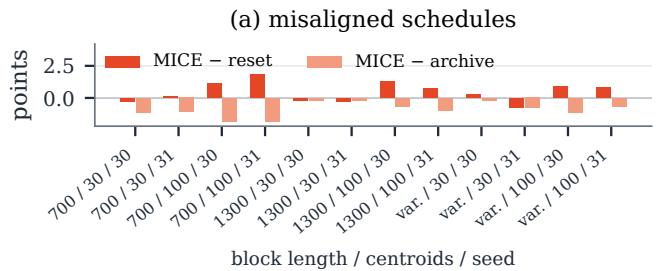

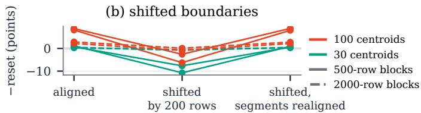  
Fi<sub>g</sub>ure 8: Boundaries inside fixed se<sub>g</sub>ments lower the <sub>g</sub>ain of stored contexts over reset<sub>,</sub> and reali<sub>g</sub>nin<sub>g</sub> the se<sub>g</sub>ments restores it. (a) Misaligned block schedules. (b) Boundaries shifted by 200 rows, and segments realigned.

• Confirmation ofdetected segmentation (nine independent confirmation segments): the one-sided 95% bootstrap lower bound on the mean diference to fixed segmentation is above −0.2 points (H1), the corresponding per-segment bound against FIFO is above −0.3 points (H2), observed accuracy is never more than 0.5 points below the better of FIFO and reset (H3), and MICE is above the pool-free replay on at least six of nine (H5). All four held. Being the most accurate per source and on at least six of nine against the four in-context baselines (H4) failed (−0.06 and −0.01 points, four of nine).

A registered reporting rule required the fixed-segmentation capacity comparison to name in the abstract any stream group with a mean gain of at most +0.1 points over a time-budgeted pool. The shifted-grid snapshot comparison meets this condition and is reported there. Capacity was chosen from prefix timings. The four expert configuration is supplementary and exceeds the time budget. The analogous detected-segmentation reporting rule also required naming a qualifying group in the conclusion, and no group met its trigger. Pool controls include both segmentation variants, identified with each result. With four experts, which take more time per batch, both pools are level with MICE on the shifted grid, as Fig. 7a shows.

The registration deviated in its seed use and in the stored-row form of the recall predictions, which Sec. 5.2 reports. Seeds 40 and 41, registered as unused for the detected-segmentation test, had been used by the oracle test. We kept the verdicts and repeated the test on unused seeds 50 to 53, where C1 held.

The rows from ARF to Learn++.NSE in Tab. 1 come from a rerun of the trained learners with stored probabilities, whose mean accuracy is within 0.2 points of the first run.

## D CONTEXT STRESS TEST: PROTOCOLS

The three parts of the context stress test of Sec. 3 reuse runs of Sec. 5, and no run was added for them.

The revisit test measures how a policy recovers when a concept returns after FIFO has discarded its rows. It uses the Sine, STAGGER and Agrawal generator streams of Sec. 5 from River [30], with blocks of 2000 rows. Each generator supplies five streams from seeds 10 to 14, with three cycles over three or four concepts. Accuracy is averaged over the five batches after a concept recurs, that is, after the start of a block whose concept appeared in an earlier block. The policies are FIFO, reset and an oracle context of past rows of the recurring concept, which knows the concept and its boundaries.

The splice test measures what mixing concepts costs by moving the boundaries inside fixed segments. It uses the eight grid streams of App. G with 30 or 100 centroids and blocks of 500 or 2000 rows. These streams use seeds 20 and 21, with shifted and aligned copies compared on matched batches. Each shifted copy prepends 200 rows of the first concept, drawn from the same centroids with a separate random generator. Every boundary therefore lies 200 rows into a 500-row segment and stays on a batch boundary. Stored contexts are formed by the fixed segmentation of Sec. 4. The realigned run starts the segments at row 200, the known phase of the boundaries. The quantity is MICE with fixed segmentation minus reset, over all batches and over the first five batches of each recurring block. Fig. 8 gives every stream.

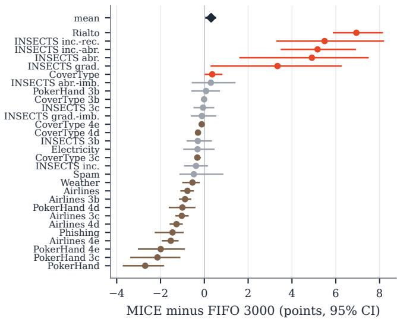  
Figure 9: MICE (fixed segments) minus a 3000-row FIFO wind<sub>ow</sub> <sub>on</sub> th<sub>e</sub> 29 <sub>rea</sub>l <sub>s</sub>t<sub>reams,</sub> <sub>w</sub>ith 95% b<sub>oo</sub>t<sub>s</sub>t<sub>rap</sub> i<sub>n</sub>t<sub>erva</sub>l<sub>s.</sub>

The curve test estimates relearning speed from learning curves measured before the grid test on data seeds 10 and 11. Each centroid count and concept supplies one block of 4000 rows, of which rows 1– 3000 form the context pool and rows 3001–4000 the 1000 test rows. For � ∈ {50, 100, 200, 500, 1000, 2000}, three contexts are drawn without replacement from the pool, and the TFM predicts the test rows. The curve is the mean accuracy over 2 seeds, 3 concepts and 3 repetitions, as App. G details.

## E STREAMS AND BASELINES

The grid and generator streams are produced by code $/ \mathsf { g r i d } _ { - }$ streams.py and code/streams.py, and long real streams are cut into segments as follows. Real streams with more than 100,000 rows are cut into segments of 100,000 (CoverType and one INSECTS stream: 150,000 for the first segment).

LTM follows the bufer allocation of Lourenço et al. [27], which gives its short-term bufer a share of 0.75.

## F PROOFS

## F.1 Majority Purity, Detection and Segment P<sub>u</sub>rit<sub>y</sub>

Prop. A.2. With $P _ { X } = Q _ { X }$ the conditional of $\pi P + ( 1 - \pi ) Q$ is $\pi { \bf 1 } [ y = g _ { { P } } ( { \bf x } ) ] + \left( 1 - \pi \right) { \bf 1 } [ y = g _ { { Q } } ( { \bf x } ) ]$ ]. Where $g _ { P } ( { \bf x } ) = g _ { Q } ( { \bf x } )$ its mode is $g _ { P } ( \mathbf { x } )$ . Where they difer, the mode is �<sub>�</sub> (x) if $\pi > { \frac { 1 } { 2 } }$ and �<sub>�</sub> (x) i $\begin{array} { l } { \displaystyle { \dot { : } \pi < \frac { 1 } { 2 } } } \end{array}$ . The 0-1 risk on � is therefore 0 or $\rho ,$ , and $\epsilon _ { P } ( h _ { P } ) = 0$ , which gives the regret.

Prop. A.3. Fix a candidate � and a number � $\in \{ 2 , \ldots , R _ { \mathrm { c p } } \}$ of compared batches before it, and write the statistic of (2) without the margin as $\begin{array} { r } { Z _ { m } = \frac { 1 } { n _ { \lambda } } \sum _ { \mathrm { p o s t } } 1 [ \mathrm { e r r o r } ] - \frac { 1 } { n _ { 1 } } \sum _ { \mathrm { p r e } } } \end{array}$ 1[error] over the rows of the batches $b \bar { - } m , . . . , b - 1 ( \mathrm { p r e } , \bar { n _ { 1 } } = m B )$ and $b , \dotsc , t - 1$ (post), and $\bar { Z } _ { m }$ for the same sum of conditional error rates. For fixed � and � these rows and the weights $1 / n _ { 1 }$ and $1 / n _ { 2 }$ do not depend on the data. By Asm. 2 the error indicators minus their conditional rates, taken in row order, form a martingale diference sequence whose terms lie in intervals of length 1/� (post) and $1 / n _ { 1 }$ (pre). By the Azuma–Hoefding inequality, $\operatorname* { P r } [ Z _ { m } - \bar { Z } _ { m } \geq$ $\lambda ] \ \le \ \exp \bigl ( - 2 \lambda ^ { 2 } / \bigl ( 1 / n _ { 1 } + 1 / n _ { 2 } \bigr ) \bigr )$ , and at $\lambda = \tau ( n _ { 1 } , n _ { 2 } )$ this bound equals $\delta _ { \mathrm { c p } }$ . The reference that (2) uses starts after the previous declared change. This start depends on earlier errors, possibly on those of the compared rows, but it is always one of these $R _ { \mathrm { c p } } - 1$ fixed references, and a union bound over � covers this selection. Without a change in the batches $t - H _ { \mathrm { c p } } - R _ { \mathrm { c p } } , \ldots , t - 1 ,$ , Asm. 2 gives $\bar { Z } _ { m } \leq 0$ for every � and �. Each excess is therefore positive with probability at most $\delta _ { \mathrm { c p } }$ , and a union bound over at most $H _ { \mathrm { c p } }$ candidates and $R _ { \mathrm { c p } } - 1$ references gives the claim.

Cor. A.4. Each end of a closed segment is a declared change, a periodic close inside one concept, or the start of the stream. Without missed boundaries, the rows of other concepts lie between an end and the true boundary nearest to it. These are at most � rows at each end and hence at most 2� in all. The majority concept therefore holds more than half of the rows when $2 \nu < | S | / 2$

## F<sub>.</sub>2 Id<sub>en</sub>tifi<sub>ca</sub>ti<sub>on un</sub>d<sub>er a</sub> M<sub>arg</sub>i<sub>n</sub>

Proof of Lem. A.5. (i) By Asm. 3,

$$
\begin{array} { l } { \displaystyle { w _ { k ^ { \star } } = \left( 1 + \sum _ { k \neq k ^ { \star } } e ^ { - \eta ( \ell _ { k } - \ell _ { k ^ { \star } } ) } \right) ^ { - 1 } } } \\ { \displaystyle { \ge \left( 1 + ( K - 1 ) e ^ { - \eta g } \right) ^ { - 1 } = e ^ { - \kappa } } . } \end{array}
$$

(ii) For a row with label � and expert predictions $\mathcal { P } k$

$$
- \ln \sum _ { k } w _ { k } p _ { k } ( y ) \ \leq \ - \ln \bigl ( w _ { k ^ { \star } } p _ { k ^ { \star } } ( y ) \bigr ) \ \leq \ - \ln p _ { k ^ { \star } } ( y ) + \kappa .
$$

(iii) For two classes $y _ { 1 } , y _ { 2 }$

$$
\begin{array} { r l r } { \displaystyle \sum _ { k } w _ { k } \big ( / p _ { k } ( y _ { 1 } ) - p _ { k } ( y _ { 2 } ) \big ) } & { \ge } & { w _ { k ^ { \star } } \big ( p _ { k ^ { \star } } \big ( y _ { 1 } \big ) - p _ { k ^ { \star } } ( y _ { 2 } ) \big ) } \\ & { } & \\ & { } & { \quad - ( 1 - w _ { k ^ { \star } } ) , } \end{array}
$$

which is positive when the gap of expert $k ^ { \star }$ exceeds $( 1 - w _ { k ^ { \star } } ) / w _ { k ^ { \star } }$ a quantity at most $e ^ { \kappa } - 1$ □

Proof of Prop. $\mathrm { A } . 6 .$ The first batch of the block is predicted with weights from a batch of the previous concept, and its per-row regret is at most �. Every later batch is predicted with weights from a labelled batch of the block on which $k ^ { \star }$ leads by �. Lem. $\mathrm { A } . 5 ( \mathrm { i i } )$ therefore bounds its per-row regret by ln $\mathrm { { } } _ { \mathrm { l } } \bigl ( 1 + ( K - 1 ) e ^ { - \eta g } \bigr ) \leq \bigl ( K -$ $1 ) e ^ { - \eta g }$ . Summing over the $J - 1$ later batches gives the claim. □

## F<sub>.</sub>3 R<sub>eca</sub>ll <sub>versus</sub> R<sub>e</sub>l<sub>earn</sub>

Proof of Thm. 4.1. The first batch of the block is predicted by both learners before any label of the block has arrived. Its accuracy diference, divided by �, is $\zeta _ { k , c }$ and is at most 1/� in absolute value because accuracies lie in $[ 0 , 1 ]$ . Before batch $j \mathrm { + } 1 \left( j = 1 , \ldots , J \mathrm { - } 1 \right)$ , the relearning context holds min( $j B , M )$ rows of the block. Its expected accuracy is therefore $a _ { k } ( \operatorname* { m i n } ( j B , M ) )$ , whereas the stored expert has expected accuracy $a _ { k } ( n _ { c } )$ . By Lem. A.5(iii), the mixture predicts as the better of the two. Its expected accuracy is thus the larger of the two values, and its diference to relearning is the positive part in (1). Averaging over the � batches gives the area term, and adding the first batch gives $\zeta _ { k , c } .$ □

Proof of Cor. A.7. On the first visit $n _ { 1 } = 0 ,$ , and every positive part vanishes because $a _ { k }$ is non-decreasing and hence $a _ { k } ( 0 ) \leq$ $a _ { k } ( \operatorname* { m i n } ( j B , M ) )$ ). Since $a _ { k }$ is non-decreasing and $n _ { c } ~ \leq ~ M _ {  }$ , every term of the area term is at most $a _ { k } ( M ) - a _ { k } ( B )$ , which is zero for a flat curve, and the terms with $j B \ge M$ vanish. At most $M / B$ of the $J - 1$ terms are non-zero, namely those with $j B < n _ { c } \leq M$ Combining this count with $| \zeta _ { k , c } | \leq 1 / J$ gives the bound. □

## F.4 An<sub>y</sub>-Time Safe<sub>g</sub>uard

Proof of Thm. 4.2. Exp-concavity. The half Brier score $\ell ( p ) =$ $\begin{array} { r } { \frac { 1 } { 2 } \| \boldsymbol { p } - \boldsymbol { e } _ { y } \| ^ { 2 } } \end{array}$ has gradient $\boldsymbol { p } - \boldsymbol { e } _ { y }$ and Hessian �, and $\| \ b { p } - \ b { e } _ { y } \| ^ { 2 } \leq 2$ on the simplex. Hence $\nabla ^ { 2 } \ell \geq \dot { \eta _ { 2 } } \nabla \ell \nabla \ell ^ { \top }$ for $\begin{array} { r } { \eta _ { 2 } \leq \frac { 1 } { 2 } } \end{array}$ , that is, ℓ is �<sub>2</sub>- exp-concave. The mean over the rows of a batch is � -exp-concave as well: its Hessian is the mean Hessian, and $\begin{array} { r } { \frac { 1 } { n } \sum _ { i } \dot { g } _ { i } g _ { i } ^ { \top } \stackrel { - } { \ge } \bar { g } \bar { g } ^ { \top } } \end{array}$ for the row gradients �� with mean �¯. Consequently,

$$
e ^ { - \eta _ { 2 } \ell _ { t } \left( p _ { t } \right) } \geq \sum _ { k } v _ { t , k } e ^ { - \eta _ { 2 } \ell _ { t , k } } .\tag{10}
$$

Potential. Let $\begin{array} { r } { W _ { t } = \sum _ { k } e ^ { - \eta _ { 2 } L _ { t , k } } } \end{array}$ and note that $W _ { 0 } = K . { \mathrm { B y } } \left( 5 \right)$ and (6),

$$
W _ { t } = \Bigl ( \sum _ { k } e ^ { - \eta _ { 2 } \gamma L _ { t - 1 , k } } \Bigr ) \sum _ { k } v _ { t , k } e ^ { - \eta _ { 2 } \ell _ { t , k } } .
$$

By the power-mean inequality, $\begin{array} { r } { \sum _ { k } x _ { k } ^ { \gamma } \le K ^ { 1 - \gamma } \bigl ( \sum _ { k } x _ { k } \bigr ) ^ { \gamma } } \end{array}$ for $x _ { k } \geq 0$ and $\gamma \in ( 0 , 1 ]$ . Applying it with $x _ { k } = e ^ { - \eta _ { 2 } L _ { t - 1 , k } }$ and combining with (10) gives

$$
\ln W _ { t } ~ \le ~ ( 1 - \gamma ) \ln K + \gamma \ln W _ { t - 1 } - \eta _ { 2 } \ell _ { t } ( p _ { t } ) .
$$

T<sub>a</sub>bl<sub>e</sub> 3<sub>:</sub> C<sub>on</sub>t<sub>ro</sub>ll<sub>e</sub>d <sub>gr</sub>id<sub>: parame</sub>t<sub>ers.</sub>
<table><tr><td>Features, classes, concepts</td><td> $d = 1 0 , 4 , 3$ </td></tr><tr><td>Centroids m Weights</td><td>5, 30, 100 with  $C _ { j } \sim \mathcal { U } ( [ 0 , 1 ] ^ { 1 0 } )$   $u _ { j } \sim \mathcal { U } ( 0 , 1 )$  , normalised</td></tr><tr><td>Class of centroid j in concept k</td><td> $\lambda _ { k } ( j ) \sim \mathcal { U } \{ 0 , \dots , 3 \} ,$  independent</td></tr><tr><td>Noise</td><td>isotropic Gaussian, s.d. 0.15</td></tr><tr><td>Block length L, cycles</td><td>500 or 2000 rows, 3</td></tr><tr><td>Batch size, M</td><td>100, 1000 rows</td></tr><tr><td>Segments</td><td>300–700 rows (detected), 500 rows (fixed)</td></tr></table>

Unrolling. Since $\begin{array} { r } { \left( 1 - \gamma \right) \sum _ { t \leq T } \gamma ^ { T - t } + \gamma ^ { T } = 1 , } \end{array}$

$$
\ln W _ { T } \ \le \ \ln K - \eta _ { 2 } \sum _ { t = 1 } ^ { T } \gamma ^ { T - t } \ell _ { t } ( p _ { t } ) .
$$

On the other hand, ln $\begin{array} { r } { W _ { T } \ge - \eta _ { 2 } L _ { T , k } = - \eta _ { 2 } \sum _ { t = 1 } ^ { T } \gamma ^ { T - t } \ell _ { t , k } } \end{array}$ for every �. Combining the two inequalities gives (8). □

## G CONTROLLED GRID AND LEARNING CURVES

The grid generator fixes the input distribution and lets concepts difer only in their classes. A stream has $d \ = \ 1 0$ features, four nominal classes and three concepts. For � ∈ $\{ 5 , 3 0 , 1 0 0 \}$ centroids, $C _ { j } \sim \mathcal { U } ( [ 0 , 1 ] ^ { 1 0 } )$ i.i.d. and mixture weights $w _ { j } = u _ { j } / \sum _ { i } u _ { i }$ with $u _ { j } \sim \mathcal { U } ( 0 , 1 )$ . Each concept � has its own class vector $\lambda _ { k } ( j ) \sim$ $\mathcal { U } \{ 0 , 1 , 2 , 3 \}$ , drawn i.i.d. over centroids and independently across concepts. A row of concept � draws � ∼ Categorical(�), $\mathbf { x } \ =$ $C _ { j } + N ( 0 , 0 . 1 5 ^ { 2 } I _ { 1 0 } )$ and $y = \lambda _ { k } ( j )$ . Concepts appear in the order 1, 2, 3 in blocks of $\ ' L \in \{ 5 0 0 , 2 0 0 0 \}$ rows for three cycles. The input distribution $P _ { X }$ is the same for all concepts because all of them share $C ,$ � and the noise. One NumPy generator per data seed draws $C ,$ � and � first and then the rows.

Because the class vectors are drawn independently, $\lambda _ { k }$ is not a permutation and two concepts may agree on a centroid. On our seeds the weight of such centroids is 18% to 48% averaged over the three pairs of concepts and 3% to 76% for single pairs. With five centroids a concept can also lack some classes, with two to four present. The generator applies no rejection or coverage constraint, and class priors follow from � and $\lambda _ { k }$

The data seeds are allocated as follows. Seeds 0 and 1 serve development, including that of the change detector, and seeds 10 and 11 the registered test. Seeds 20 and 21 serve confirmation, 30 and 31 the misaligned schedules, and 40 and 41 the oracle test. Seeds 40 to 43 serve the test of detected segmentation and share seeds 40 and 41 with the oracle test. Seeds 50 to 53 serve its confirmation. The shifted streams reuse seeds 20 and 21 and draw their prefix from a separate generator. The streams of Fig. 6 prepend rows of the first concept from a separate generator and also use blocks of lengths drawn uniformly from 500 to 2 500 rows.

The learning curves that supply the recall predictions were measured before the grid test, for data seeds 10 and 11. For each � and concept, one block of 4000 rows of that concept comes from the generator above. Rows 1–3000 form the context pool and rows 3001–4000 the 1000 test rows, disjoint. For � ∈ {50, 100, 200, 500, 1000, 2000}, three contexts are drawn without replacement from the pool (generator seeds 0, 1, 2). Contexts of diferent sizes and repetitions therefore overlap, while the same

1000 test rows are used throughout. The frozen TabPFN v2 with four estimators and random state equal to the data seed predicts the test rows, whereas stream evaluation uses backbone random state 0. The curve �(�) is the mean accuracy over 2 seeds, 3 concepts and 3 repetitions (18 measurements per �, not 18 independent concept draws), interpolated linearly in log �.

Predicted recall gains come from inserting the averaged curve into the area term of Eq. (1), which measures the accuracy that a stored expert saves over relearning. Visits 2 and 3 of a concept recur and enter with weight <sup>1</sup> each. The first visit has no stored expert and contributes zero. The registered predictions used � stored rows on every recurrence, and Sec. 5.2 reports the form with $n _ { c } = \operatorname* { m i n } ( M , ( c - 1 ) L )$ . The observed gain of a cell is the mean over its two streams, and the Spearman correlations are over the six cells.

The curves of seeds 10 and 11 share randomness with the evaluated streams of these seeds, because their data were generated by re-initialising the generator of the same seed with one 4000-row block per concept. The shared part is the concept definitions of the evaluated seed-10/11 streams, the centroid draws of their first block, and some bit-identical feature vectors (0 to 1887 per stream). These identical rows arise in runs where the two draw sequences of the same seed realign at a constant ofset. The seed-20/21 streams, by contrast, share nothing with the curves.

To remove the shared rows, a sensitivity analysis registered after this overlap was found remeasured the curves on rows drawn, given the same concept definitions, from one independent NumPy generator per seed, centroid count and concept. Each generator is seeded with (20 000+seed, �, �), and no redrawn row is in common with any evaluated stream. These counts and checks are produced by code/grid\_overlap\_check.py. The redraw changes the curves by at most 0.015 at any � and the predictions by at most 0.6 points. For 100 centroids and $L = 5 0 0$ , the prediction is 9.9 instead of the registered 10.4, and 8.9 instead of 9.2 with $n _ { c } .$ . The rank correlations are unchanged at 0.94 on seeds 10 and 11 and 0.83 on seeds 20 and 21.

## H PER-STREAM RESULTS AND RESOURCES

Fig. 10 gives the accuracy of every policy minus FIFO on each real stream.

Per-stream accuracy comparisons show how the efects of pool organisation and a larger FIFO window vary across streams. Fig. 11 shows the pool controls of Sec. 5.5 per stream, and Fig. 9 the comparison with a 3000-row window.

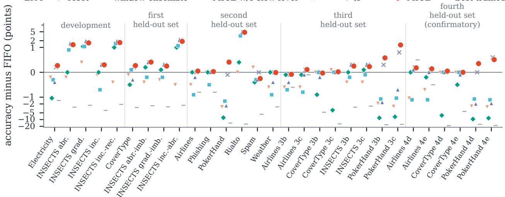  
Figure 10: Accuracy minus FIFO on each real stream, grouped by evaluation stage (fixed segments).

(a) aligned grid, 95% CI  
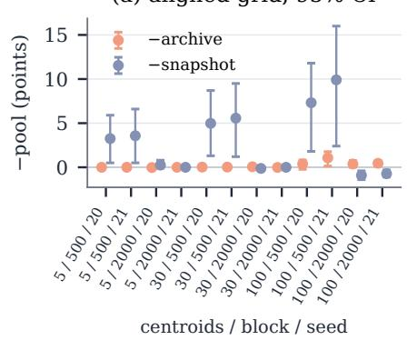

(b) 29 real streams, fixed segments  
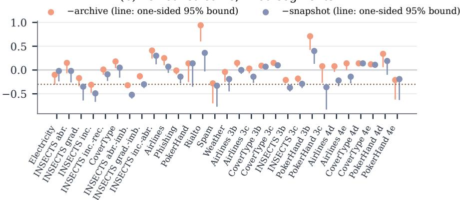  
Figure 11: MICE minus the archive and the snapshot pool of size 12, fixed segments. (a) Aligned grid. (b) The 29 real streams, with a dotted line at −0.3 points.

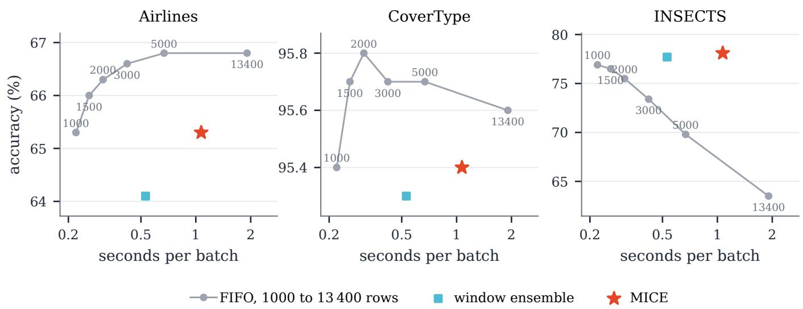  
Fi<sub>gure</sub> 12<sub>:</sub> A<sub>ccuracy aga</sub>i<sub>ns</sub>t ti<sub>me per</sub> b<sub>a</sub>t<sub>c</sub>h <sub>on</sub> th<sub>ree rea</sub>l <sub>pre</sub>fi<sub>xes</sub> f<sub>or</sub> FIFO <sub>w</sub>i<sub>n</sub>d<sub>ows o</sub>f 1000 t<sub>o</sub> 13 400 <sub>rows,</sub> th<sub>e w</sub>i<sub>n</sub>d<sub>ow ensem</sub>bl<sub>e</sub> and MICE (fixed segments). Peak GPU memory: 0.8 to 26.4 GB for FIFO, 1.0 GB for MICE.