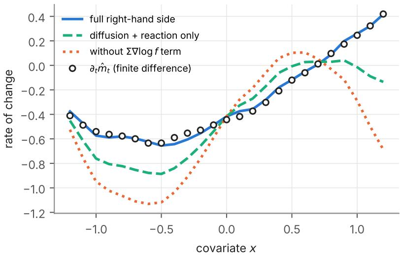
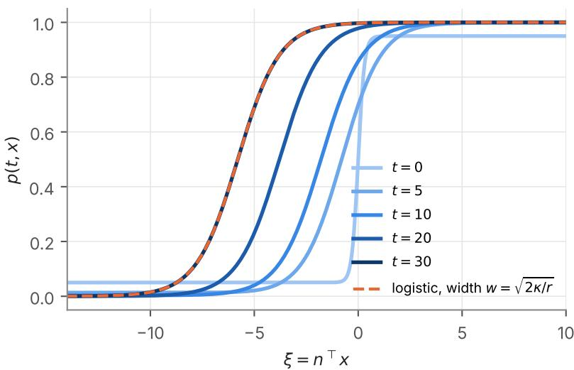

# Regression Functions as Fields on Covariate Space: Evolution Equations, the Hessian, and Identification

Nobuaki Tanaka

October 2026

## Abstract

For each time t, the regression function $m _ { t } ( x ) = \mathbb { E } [ Y _ { t } \mid X _ { t } = x ]$ of an outcome on contemporaneous covariates can be regarded as a field on covariate space. We study how this field evolves when the covariates of individual units move as a difusion and the outcome attached to each unit changes according to its own dynamics. Under mild regularity we show that $m _ { t }$ satisfies a second-order evolution equation whose difusion term is $\scriptstyle { \frac { 1 } { 2 } } \operatorname { t r } ( \Sigma \nabla ^ { 2 } m _ { t } )$ , the trace of the Hessian of the regression function weighted by the instantaneous covariance Σ of the covariate increments, whose transport term is the drift of the time-reversed covariate process, and whose source term is the conditional mean rate of change of the outcome. The equation is a regression-theoretic reading of a classical transport law, and it yields a Feynman–Kac representation of $m _ { t }$ along reversed covariate paths. We connect the Hessian appearing in the equation to the Hessian estimated by quadratic regression (under Gaussian design the best quadratic approximation has Hessian $\mathbb { E } [ \nabla ^ { 2 } m ( X ) ]$ exactly) and to the leading bias of kernel smoothers. For binary outcomes governed by bistable replicator dynamics with imitation among units with similar covariates, the closed equation is of Nagumo type, its planar travelling fronts are exactly logistic in (x, t), and a single logistic regression of the outcome on covariates and time identifies the ratio of difusion to reaction and the direction of invasion. We discuss identification under panel versus repeated cross-sectional designs and a two-stage estimation strategy, and we illustrate the results with simulations.

Keywords: regression function; reaction–difusion equation; Hessian; time reversal of difusions;   
Feynman–Kac formula; replicator dynamics; logistic regression; local polynomial regression.

## 1 Introduction

A common way to add spatial structure to a dynamical model is to append a difusion term to an ordinary diferential equation, turning $\dot { y } = R ( y )$ into a reaction–difusion equation $\partial _ { t } y = \kappa \Delta y + R ( y )$ on a physical domain. This paper takes the same step with a diferent notion of space: the space of covariates of a regression.

Fix a time t and regress an outcome $Y _ { t }$ on contemporaneous covariates $X _ { t } \in \mathbb { R } ^ { d }$ . The regression function

$$
m _ { t } ( x ) = \mathbb { E } [ Y _ { t } \mid X _ { t } = x ]
$$

is a field on covariate space. As t varies, the covariates of individual units drift and fluctuate, and the outcome attached to each unit changes. The question we ask is: what equation does $m _ { t }$ satisfy as a function $o f \left( t , x \right) ?$

Our main result (Theorem 3.1) answers this under a difusion model for covariates. The equation contains three terms with distinct interpretations:

(i) a difusion term ${ \textstyle \frac { 1 } { 2 } } \operatorname { t r } ( \Sigma \nabla ^ { 2 } m _ { t } )$ , where $\nabla ^ { 2 } m _ { t }$ is the Hessian of the regression function and $\Sigma$ the covariance rate of covariate increments; for $\Sigma = 2 \kappa I$ it is $\kappa \Delta m _ { t } = \kappa \mathrm { t r } \nabla ^ { 2 } m _ { t } ;$

(ii) a transport term $\boldsymbol { b } \cdot \nabla { m } _ { t } .$ , where ¯b is the drift of the time-reversed covariate process; it contains a correction $\Sigma \nabla$ log $f _ { t }$ involving the covariate density $f _ { t } ;$

(iii) a source term equal to the conditional mean rate of change of the outcome.

The difusion coeficient is not chosen by the analyst: it is the covariance of covariate increments, which removes the arbitrariness of choosing a metric on a space whose coordinates carry diferent units. The equation is invariant under afine changes of covariates.

Relation to known results. Mathematically, the evolution equation is a regression-theoretic reading of classical facts. The product $q _ { t } = m _ { t } f _ { t }$ obeys a conservation law, and $m _ { t }$ plays the role of a mass fraction in species transport; the transport coeficient is the reverse-time drift of Anderson [3] and Haussmann and Pardoux [15]; and the same structure underlies the partial diferential equation satisfied by the denoiser $\mathbb { E } [ x _ { 0 } \mid x _ { t } = x ]$ in difusion generative models [10]. Backward Kolmogorov equations for conditional expectations of future quantities are standard in option pricing [19] and in fate mapping of single cells [18]. Forward equations for the density of agents in a state space are central in heterogeneous-agent economics [1, 14] and in trajectory inference from single-cell snapshots [25, 28], and replicator–mutator equations place difusion on a continuous trait space [2, 17]. Section 9 discusses these connections. To our knowledge, however, the regression function of an outcome on contemporaneous covariates has not been treated systematically as the unknown of such an equation, together with the resulting questions of interpretation, identification and estimation that are natural in regression analysis. That is the purpose of this paper.

## Contributions.

1. An evolution equation for $m _ { t }$ with explicit assumptions, including state-dependent difusion and correlated outcome noise, and its Feynman–Kac representation along time-reversed covariate paths (Section 3).

2. An interpretation of the Hessian term in regression terms: the Hessian of the best quadratic approximation under Gaussian design equals $\mathbb { E } [ \nabla ^ { 2 } m ( X ) ]$ , and the population Nadaraya–Watson target with Gaussian kernel solves the evolution equation with bandwidth playing the role of time (Section 4).

3. Invariance of [0, 1] for closed equations with reaction terms vanishing at 0 and 1, via the sign of the Hessian at extrema (Section 5).

4. For bistable replicator dynamics with imitation in covariate space, an exact logistic-regression identification of the difusion–reaction ratio and of the invading strategy (Section 6).

5. A discussion of identification under panel and repeated cross-sectional designs and a two-stage estimation procedure (Section 7), with simulations (Section 8).

## 2 Setting

Consider a large population of units. Unit i carries a covariate process $X _ { t } ^ { i } \in \mathbb { R } ^ { d }$ and an outcome process $Y _ { t } ^ { i } \in \mathbb { R } , t \in [ 0 , T ]$ . We describe a generic unit and drop the superscript.

Assumption 1 (Covariate dynamics). $X _ { t }$ solves the Itˆo equation

$$
d X _ { t } = b ( t , X _ { t } ) d t + \sigma ( t , X _ { t } ) d W _ { t } ,
$$

with $\Sigma = \sigma \sigma ^ { \top }$ . The coeficients are smooth, and $X _ { t }$ has a density $f _ { t } ( x )$ that is $C ^ { 1 , 2 }$ and strictly positive on an open set $\mathcal { X } \subseteq \mathbb { R } ^ { d }$

Assumption 2 (Outcome dynamics). The pair $( X _ { t } , Y _ { t } )$ is Markov with generator $\mathcal { L } _ { X } + \mathcal { A } _ { x } + \mathcal { C }$ where

• LXφ = b · ∇xφ + 1 tr(Σ∇2xφ) acts on x;

• for each fixed $x , A _ { x }$ is the generator of the outcome dynamics acting on y (an ordinary diferential equation, a difusion, or a jump process);

$\mathcal { C } \psi = c ( t , x , y ) \cdot \nabla _ { x } \partial _ { y } \psi$ is a cross term with $c = d \langle X , Y \rangle _ { t } / d t ; c \equiv 0$ when the noise of Y is independent of $W$

The function $\iota ( y ) = y$ is in the extended domain of $A _ { x }$ , and

$$
G ( t , x ) : = \mathbb { E } { \big [ } ( A _ { X _ { t } } \iota ) ( Y _ { t } ) \mid X _ { t } = x { \big ] } , \qquad { \bar { c } } ( t , x ) : = \mathbb { E } { \big [ } c ( t , X _ { t } , Y _ { t } ) \mid X _ { t } = x { \big ] }
$$

are well defined. For an ordinary diferential equation $d Y _ { t } = F ( t , X _ { t } , Y _ { t } ) d t , G ( t , x ) = \mathbb { E } [ F ( t , X _ { t } , Y _ { t } ) \mid $ $X _ { t } = x ]$

Assumption 3 (Regularity). E $\mathrm { \Omega } _ { \parallel } ^ { \ast } | Y _ { t } | ^ { 2 } < \infty ;$ the map $( t , x ) \mapsto q _ { t } ( x ) : = \mathbb { E } [ Y _ { t } \mid X _ { t } = x ] f _ { t } ( x )$ is $C ^ { 1 , 2 }$ on $( 0 , T ) \times \mathcal { X } ;$ boundary terms in the integrations by parts below vanish (e.g. $\mathcal { X } = \mathbb { R } ^ { d }$ with suficient decay, or zero-flux conditions on $\partial \mathcal { X } )$

The object of interest is the regression function $m _ { t } ( x ) = q _ { t } ( x ) / f _ { t } ( x )$ for $x \in \mathcal { X }$ . The outcome need not be a deterministic function of the covariates: the conditional variance $\mathrm { V a r } ( Y _ { t } \mid X _ { t } )$ is arbitrary. We use the divergence of a matrix field row-wise, $\begin{array} { r } { ( \nabla \cdot \Sigma ) _ { i } = \sum _ { j } \partial _ { j } \Sigma _ { i j } } \end{array}$

## 3 The evolution equation

Theorem 3.1. Under Assumptions $^ { 1 - 3 , }$ on $( 0 , T ) \times \mathcal { X }$

$$
\begin{array} { r } { \partial _ { t } m _ { t } = \frac { 1 } { 2 } \operatorname { t r } \big ( \Sigma \nabla ^ { 2 } m _ { t } \big ) + \bar { b } _ { t } \cdot \nabla m _ { t } + G _ { t } - \frac { 1 } { f _ { t } } \nabla \cdot \big ( f _ { t } \bar { c } _ { t } \big ) , } \end{array}\tag{1}
$$

where

$$
\bar { b } _ { t } ( x ) = \Sigma ( t , x ) \nabla \log f _ { t } ( x ) + ( \nabla \cdot \Sigma ) ( t , x ) - b ( t , x ) .\tag{2}
$$

Proof. Let $\varphi \in C _ { c } ^ { \infty } ( \mathcal { X } )$ and $\psi ( x , y ) = \varphi ( x ) y$ . By Dynkin’s formula,

$$
\frac { d } { d t } \mathbb { E } [ \varphi ( X _ { t } ) Y _ { t } ] = \mathbb { E } \left[ \left( \mathcal { L } _ { X } \varphi \right) ( X _ { t } ) Y _ { t } + \varphi ( X _ { t } ) ( \mathcal { A } _ { X _ { t } \iota } ) ( Y _ { t } ) + c \cdot \nabla \varphi ( X _ { t } ) \right] .
$$

Conditioning on $X _ { t }$ and writing the expectations as integrals against $f _ { t }$ gives

$$
\frac { d } { d t } \int \varphi q _ { t } = \int ( \mathcal { L } _ { X } \varphi ) q _ { t } + \int \varphi f _ { t } G _ { t } + \int f _ { t } { \bar { c } } _ { t } \cdot \nabla \varphi .
$$

Integrating by parts, $q _ { t }$ is a weak, hence by Assumption 3 classical, solution of

$$
\begin{array} { r } { \partial _ { t } q _ { t } = \mathcal { L } _ { X } ^ { * } q _ { t } + f _ { t } G _ { t } - \nabla \cdot \left( f _ { t } \bar { c } _ { t } \right) , \qquad \mathcal { L } _ { X } ^ { * } u = - \nabla \cdot ( b u ) + \frac { 1 } { 2 } \sum _ { i , j } \partial _ { i j } ( \Sigma _ { i j } u ) . } \end{array}\tag{3}
$$

The same argument with $\psi ( x , y ) = \varphi ( x )$ gives the Fokker–Planck equation $\partial _ { t } f _ { t } = \mathcal { L } _ { X } ^ { * } f _ { t }$ . Since $m _ { t } = q _ { t } / f _ { t }$

$$
\partial _ { t } m _ { t } = \frac { \mathcal { L } _ { X } ^ { * } ( m _ { t } f _ { t } ) - m _ { t } \mathcal { L } _ { X } ^ { * } f _ { t } } { f _ { t } } + G _ { t } - \frac { 1 } { f _ { t } } \nabla \cdot ( f _ { t } \bar { c } _ { t } ) .
$$

Expanding, $- \nabla \cdot ( b m f ) + m \nabla \cdot ( b f ) = - f b$ · ∇m and

$$
\frac { 1 } { 2 } \sum _ { i , j } \left[ \partial _ { i j } ( \Sigma _ { i j } m f ) - m \partial _ { i j } ( \Sigma _ { i j } f ) \right] = \frac { 1 } { 2 } f \operatorname { t r } ( \Sigma \nabla ^ { 2 } m ) + \sum _ { i , j } \partial _ { i } m \partial _ { j } ( \Sigma _ { i j } f ) .
$$

Dividing by $f$ and using $\partial _ { j } ( \Sigma _ { i j } f ) / f = ( \Sigma \nabla \log f ) _ { i } + ( \nabla \cdot \Sigma ) _ { i }$ i gives (1). (We also verified the algebra symbolically for $d = 2$ with general $\Sigma ( x )$ and $b ( x ) . )$ □

Remark 3.2 (The transport term is the reverse-time drift). The vector field ${ { \bar { b } } _ { t } }$ in (2) is the drift of the time reversal $\bar { X } _ { s } = X _ { T - s }$ of the covariate difusion [3, 15]. Equation (1) is therefore a backward Kolmogorov equation for the reversed process. This yields the following representation, which makes the equation intuitive: the regression function at $( t , x )$ averages the history of the units that are at x at time t.

Corollary 3.3 (Feynman–Kac representation). Suppose $d Y _ { t } = g ( t , X _ { t } )$ dt for a deterministic function g. Then

$$
m _ { t } ( x ) = \mathbb { E } \Big [ m _ { 0 } ( X _ { 0 } ) + \int _ { 0 } ^ { t } g ( s , X _ { s } ) d s ~ \Big | ~ X _ { t } = x \Big ] ,
$$

and conditionally on $X _ { t } = x$ the path $( X _ { s } ) _ { s \leq t }$ is the time-reversed difusion started at $x ,$ with drift $\bar { b }$ and difusion matrix Σ.

Proof. $\begin{array} { r } { Y _ { t } = Y _ { 0 } + \int _ { 0 } ^ { t } g ( s , X _ { s } ) } \end{array}$ ds and $\operatorname { \mathbb { E } } [ Y _ { 0 } \mid X _ { 0 } , X _ { t } ] = \operatorname { \mathbb { E } } [ Y _ { 0 } \mid X _ { 0 } ] = m _ { 0 } ( X _ { 0 } )$ when $Y _ { 0 }$ is conditionally independent of the covariate noise given $X _ { 0 }$ . The second statement is the time-reversal theorem.

Remark 3.4 (Hessian and Laplacian). For $\Sigma = 2 \kappa I$ , the difusion term is $\kappa \Delta m _ { t } = \kappa \mathrm { t r } \nabla ^ { 2 } m _ { t }$ . The identification of the Laplacian with the trace of the Hessian is a definition; what Theorem 3.1 adds is that the weight matrix is the covariance rate of covariate increments. Under an afine change of covariates $x ^ { \prime } = A x + a$ , we have $\Sigma ^ { \prime } = A \Sigma A ^ { \top }$ and $\nabla ^ { \prime 2 } m = A ^ { - \top } ( \nabla ^ { 2 } m ) A ^ { - 1 }$ , so $\mathrm { t r } ( \Sigma ^ { \prime } \nabla ^ { \prime 2 } m ) =$ $\mathrm { t r } ( \Sigma \nabla ^ { 2 } m )$ . No metric on covariate space has to be chosen.

Remark 3.5 (Mass-fraction form). Equation (3) is a conservation law for $q _ { t } = m _ { t } f _ { t }$ , and $m _ { t }$ is the ratio of a conserved quantity to the density $f _ { t } ,$ , exactly like the mass fraction of a species transported in a fluid of density $f _ { t }$ . In this sense, the conserved “distribution” on covariate space is $q _ { t } .$ , not $m _ { t } ;$ the term Σ∇ log $f _ { t }$ arises from the division by $f _ { t }$

Example 3.6 (Special cases). (a) Heat equation. If $b = 0 , \ \Sigma = 2 \kappa I , \ \nabla f _ { t } = 0$ on the region considered, $G = 0 { \mathrm { ~ a n d ~ } } c = 0$ , then $\partial _ { t } m _ { t } = \kappa \Delta m _ { t }$

(b) Stationary Ornstein–Uhlenbeck covariates. If $d X = - \Theta X d t + \sigma d W$ with stationary covariance V satisfying $\begin{array} { r } { \Theta V + V \Theta ^ { \top } = \Sigma . } \end{array}$ , then ∇ log $f = - V ^ { - 1 } x$ and $\bar { b } ( x ) = - V \Theta ^ { \top } V ^ { - 1 } x .$ , the drift of the reversed Ornstein–Uhlenbeck process. In one dimension $\bar { b } ( x ) = - \theta x$

(c) Linear outcome dynamics. If $d Y _ { t } = \left( \alpha ( X _ { t } ) - \lambda Y _ { t } \right) d t$ , then $G _ { t } = \alpha - \lambda m _ { t }$ and (1) is a closed linear equation for $m _ { t }$

Closure. In general, $G _ { t }$ depends on the conditional law of $Y _ { t }$ given $X _ { t }$ and not only on $m _ { t }$ Equation (1) is closed in $m _ { t }$ when the outcome dynamics are linear in y (Example $3 . 6 ( \mathrm { c } ) )$ or, for binary outcomes, when transition rates depend on x and on the local frequency $m _ { t } ( x )$ only (Section 6). Without closure, (1) remains an exact identity linking estimable quantities, which is how it is used in Section 7.

## 4 The Hessian in regression

The Hessian $\nabla ^ { 2 } m$ that drives (1) also appears in two familiar places in regression: quadratic regression and kernel smoothing.

## 4.1 Best quadratic approximation under Gaussian design

Consider the quadratic model $\begin{array} { r } { m ( x ) \approx c + J ^ { \top } ( x - \mu ) + \frac { 1 } { 2 } ( x - \mu ) ^ { \top } H ( x - \mu ) } \end{array}$ , which is linear in the parameters $( c , J , H )$ , so ordinary least squares on the features $( 1 , x _ { i } , x _ { i } x _ { j } )$ estimates its $L ^ { 2 } ( P _ { X } )$ projection when the model is misspecified.

Proposition 4.1. Let $X \sim N ( \mu , \Sigma _ { X } )$ with $\Sigma _ { X }$ nonsingular, and let m be twice weakly diferentiable with $\mathbb { E } | m ( X ) | ^ { 2 } , \ \mathbb { E } \| \nabla m ( X ) \|$ and $\mathbb { E } \| \nabla ^ { 2 } m ( X ) \|$ finite. The best quadratic approximation of m in $L ^ { 2 } ( P _ { X } )$ has

$$
J ^ { * } = \mathbb { E } [ \nabla m ( X ) ] , \qquad H ^ { * } = \mathbb { E } [ \nabla ^ { 2 } m ( X ) ] .
$$

Proof. Let $u = X - \mu .$ . The functions 1, u, and $u ^ { \top } B u - \mathrm { t r } ( B \Sigma _ { X } ) \ ( B$ symmetric) span the quadratic polynomials and are mutually orthogonal in $L ^ { 2 } ( P _ { X } )$ across degrees, because odd Gaussian moments vanish. Hence the projection can be computed degree by degree. For the linear part, Stein’s identity $\mathbb { E } [ m ( X ) u ] = \Sigma _ { X } \mathbb { E } [ \nabla m ( X ) ]$ and $\mathbb { E } [ u u ^ { \top } ] = \Sigma _ { X }$ give $J ^ { * } = \mathbb { E } [ \nabla m ]$ . For the quadratic part, the normal equations for ${ \textstyle \frac { 1 } { 2 } } \big ( u ^ { \top } H u - \mathrm { t r } H \Sigma _ { X } \big )$ read, for all symmetric B,

$$
\begin{array} { r } {  { \mathbb E } \big [ m ( X ) \big ( u ^ { \top } B u - \mathrm { t r } B \Sigma _ { X } \big ) \big ] = \frac { 1 } { 2 }  { \mathbb E } \big [ ( u ^ { \top } H u - \mathrm { t r } H \Sigma _ { X } ) ( u ^ { \top } B u - \mathrm { t r } B \Sigma _ { X } ) \big ] = \mathrm { t r } ( \Sigma _ { X } H \Sigma _ { X } B ) , } \end{array}
$$

using $\mathrm { C o v } ( u ^ { \top } H u , u ^ { \top } B u ) = 2 \mathrm { t r } ( H \Sigma _ { X } B \Sigma _ { X } )$ . The second-order Stein identity gives the left side as $\mathrm { t r } ( \Sigma _ { X } \mathbb { E } [ \nabla ^ { 2 } m ] \Sigma _ { X } B )$ . Hence $\Sigma _ { X } H ^ { * } \Sigma _ { X } = \Sigma _ { X } \mathbb { E } [ \nabla ^ { 2 } m ] \Sigma _ { X }$ □

Proposition 4.1 extends the familiar statement that, under Gaussian design, the slope of the linear projection is the average gradient [5, 26]. In particular, the of-diagonal entry $H _ { j k } ^ { * }$ of a misspecified quadratic regression estimates the average cross-partial derivative $\mathbb { E } [ \partial _ { j } \partial _ { k } m ( X ) ]$ , which gives a model-free reading of interaction coeficients.

## 4.2 Kernel smoothing as covariate difusion

Let K be the standard Gaussian density on $\mathbb { R } ^ { d }$ and $Z \sim K$ independent of $( X , Y )$ . The population target of the Nadaraya–Watson estimator with bandwidth h is

$$
\tilde { m } _ { h } ( x ) = \frac { \int K _ { h } ( x - u ) \ : m ( u ) f ( u ) \ : d u } { \int K _ { h } ( x - u ) \ : f ( u ) \ : d u } = \mathbb { E } \big [ Y \mid X + h Z = x \big ] .
$$

This is the regression function after the covariates have been difused by Brownian motion for time $\tau = h ^ { 2 }$ . Theorem 3.1 with $b = 0 , \Sigma = I , G = 0$ and $c = 0$ shows that $\tau \mapsto \tilde { m } _ { \surd \tau }$ solves

$$
\begin{array} { r } { \partial _ { \tau } \tilde { m } = \frac { 1 } { 2 } \Delta \tilde { m } + \nabla \log { \tilde { f } _ { \tau } \cdot \nabla \tilde { m } } , } \end{array}
$$

where ${ \tilde { f } } _ { \tau }$ is the density of $X + { \sqrt { \tau } } Z$ . Expanding at $\tau = 0$ recovers the well-known leading bias $h ^ { 2 } \big ( { \textstyle { \frac { 1 } { 2 } } } \Delta m + \nabla \log f \cdot \nabla m \big )$ of the Nadaraya–Watson estimator [12]. The local linear estimator removes the transport part and has leading bias ${ \textstyle \frac { 1 } { 2 } } h ^ { 2 } \operatorname { t r } \nabla ^ { 2 } m \left[ 2 3 \right]$ ]. Its leading bias therefore vanishes wherever m is harmonic, and it is exactly conditionally unbiased when m is linear.

## 5 Invariance of the unit interval

When $Y _ { t } \ \in \ \{ 0 , 1 \} , \ m _ { t } \ = \ \operatorname* { P r } ( Y _ { t } \ = \ 1 \ | \ X _ { t } )$ is automatically in $[ 0 , 1 ]$ . A closed model $\partial _ { t } p \ =$ $\begin{array} { r } { \frac { 1 } { 2 } \operatorname { t r } ( \Sigma \nabla ^ { 2 } p ) + v \cdot \nabla p + R ( p ) } \end{array}$ obtained by specifying $G = R ( m )$ should preserve this property. It does whenever R vanishes at the endpoints.

Proposition 5.1. Let Σ be positive semidefinite and bounded, v bounded, and R locally Lipschitz with $R ( 0 ) = R ( 1 ) = 0 . \ I f \ 0 \leq p _ { 0 } \leq 1$ , then bounded classical solutions satisfy $0 \leq p _ { t } \leq 1$ for all t.

Sketch. At an interior maximum of $p _ { t } , \ \nabla p _ { t } \ = \ 0$ and $\nabla ^ { 2 } p _ { t } \preceq 0$ . Since $\Sigma ~ \succeq ~ 0 , ~ \mathrm { t r } ( \Sigma \nabla ^ { 2 } p _ { t } ) ~ =$ $\mathrm { t r } ( \Sigma ^ { 1 / 2 } \nabla ^ { 2 } p _ { t } \Sigma ^ { 1 / 2 } ) \le 0$ , so neither the difusion nor the transport term can raise a maximum; the same holds for minima. The constants 0 and 1 are solutions, and the comparison principle for parabolic equations [21] yields the claim. □

For $K \geq 3$ types with frequencies $p ^ { ( k ) }$ and reaction terms $R _ { k }$ satisfying $R _ { k } = 0$ when $p ^ { ( k ) } = 0$ and $\textstyle \sum _ { k } R _ { k } = 0$ , the probability simplex is invariant provided all components share the same difusion matrix. Then $\textstyle \sum _ { k } p ^ { ( k ) }$ solves a linear equation with constant solution 1, and each component stays nonnegative. With unequal difusion coeficients, convex invariant regions of the reaction need not be preserved [8]. Two practical cautions apply. Explicit time discretizations need a step-size restriction (for the heat part, $\Delta t \lesssim \Delta x ^ { 2 } / ( 2 d \kappa ) )$ ) to inherit the property. Unconstrained estimates of $m _ { t } ,$ , such as local quadratic regression, can leave [0, 1], which is one reason to work on the logit scale.

## 6 Bistable replicator dynamics on covariate space

## 6.1 The closed equation

Let each unit play strategy $A \left( Y = 1 \right) \mathrm { o r } B \left( Y = 0 \right)$ . In a two-strategy coordination game, the payof diference between A and B is afine in the frequency p of A and changes sign at an interior point $a \in ( 0 , 1 )$ . Replicator dynamics [16] then give the bistable reaction $R ( p ) = r p ( 1 - p ) ( p - a )$ . Suppose units imitate others whose covariates are close to their own, and that individual switching rates depend on x only through the local frequency $p _ { t } ( x ) = m _ { t } ( x )$ . Then $G = R ( m )$ and Theorem 3.1 gives the closed equation

$$
\begin{array} { r } { \partial _ { t } p = \frac { 1 } { 2 } \operatorname { t r } ( \Sigma \nabla ^ { 2 } p ) + v \cdot \nabla p + r p ( 1 - p ) ( p - a ) , } \end{array}\tag{4}
$$

where $v = b$ is the reverse-time drift. Non-local imitation with kernel $\kappa ( \cdot ) , \int \kappa ( x - z ) \big ( p ( z ) - p ( x ) \big ) d z$ leads to the same difusion term at second order in the kernel width. With constant $\Sigma = 2 \kappa I$ and $v = 0 , ( 4 )$ is the Nagumo (bistable Allen–Cahn) equation [4, 20].

## 6.2 Travelling fronts are logistic

Proposition 6.1. Let Σ and v be constant, $n \in \mathbb { R } ^ { d }$ a unit vector, and $\begin{array} { r } { D _ { n } = \frac { 1 } { 2 } n ^ { \top } \Sigma n > 0 } \end{array}$ . The function

$$
p ( t , x ) = \Big ( 1 + \exp \Big \{ - \frac { n ^ { \top } x - c t } { w } \Big \} \Big ) ^ { - 1 }
$$

solves (4) if and only if

$$
\begin{array} { r } { w = \sqrt { 2 D _ { n } / r } , \qquad c = \sqrt { 2 D _ { n } r } \left( a - \frac { 1 } { 2 } \right) - v ^ { \top } n . } \end{array}
$$

Proof. Write $p = \phi ( z )$ with $z = ( n ^ { \top } x - c t ) / u$ and $\phi$ the logistic function, so $\phi ^ { \prime } = \phi ( 1 - \phi )$ and $\phi ^ { \prime \prime } = \phi ( 1 - \phi ) ( 1 - 2 \phi )$ . Then $\begin{array} { r } { \partial _ { t } p = - ( c / w ) \phi ^ { \prime } , \frac { 1 } { 2 } \operatorname { t r } ( \Sigma \nabla ^ { 2 } p ) = ( D _ { n } / w ^ { 2 } ) \phi ^ { \prime \prime } } \end{array}$ , and $\boldsymbol { v } \boldsymbol { \cdot } \boldsymbol { \nabla } p = ( v ^ { \top } n / w ) \phi ^ { \prime }$ Dividing (4) by $\phi ( 1 - \phi )$ leaves an afine function of ϕ that vanishes identically if and only if $2 D _ { n } / w ^ { 2 } = r$ and $- ( c + v ^ { \top } n ) / w = ( D _ { n } / w ^ { 2 } ) - r a$ , which is equivalent to the stated w and $c . \quad \boxed { }$

Corollary 6.2 (Identification by logistic regression). On a travelling front,

$$
\log \mathrm { i t } p ( t , x ) = \beta _ { 0 } + \beta ^ { \top } x + \gamma t , \qquad \beta = { \frac { n } { w } } , \quad \gamma = - { \frac { c } { w } } = - r \big ( a - { \textstyle { \frac { 1 } { 2 } } } \big ) + v ^ { \top } \beta .
$$

Hence, from the coeficients of a single logistic regression of Y on $( X , t )$

(i) $\beta / \| \beta \|$ is the normal of the front;

(ii) $D _ { n } / r = 1 / ( 2 \| \beta \| ^ { 2 } )$ ; with isotropic $\Sigma = 2 \kappa I , \kappa / r = 1 / ( 2 \| \beta \| ^ { 2 } )$ ;

(iii) if $\begin{array} { r } { v = 0 , \gamma = - r ( a - \frac { 1 } { 2 } ) } \end{array}$ 2 ), so $\gamma > 0$ if and only $\textit { i f a } < \frac { 1 } { 2 }$ , i.e. the risk-dominant strategy A invades.

Because the logistic model is correctly specified on the front, the maximum likelihood estimator of $( \beta _ { 0 } , \beta , \gamma )$ inherits the usual consistency and asymptotic eficiency. The parameters r, a and $\Sigma$ are not separately identified from a single front; only the combinations above are.

Bistable fronts are asymptotically stable and attract a large class of initial conditions [13], which justifies fitting the model after a transient (Section 8).

Remark 6.3 (Curved fronts and the Hessian of the index). If the front is curved, one may add quadratic terms to the linear index, $\begin{array} { r } { \eta = \beta _ { 0 } + \gamma t + \beta ^ { \top } x + \frac { 1 } { 2 } x ^ { \top } H _ { \eta } x } \end{array}$ . The mean curvature of the level set $\{ \eta = \mathrm { c o n s t } \}$ is

$$
\nabla \cdot \frac { \nabla \eta } { \| \nabla \eta \| } = - \frac { \mathrm { t r } H _ { \eta } - \nu ^ { \top } H _ { \eta } \nu } { \| \nabla \eta \| } , \qquad \nu = \frac { \nabla \eta } { \| \nabla \eta \| } ,
$$

the trace of the Hessian restricted to the tangent space. For the isotropic Allen–Cahn equation, the normal velocity of a slowly curved front is corrected by a multiple of this curvature. The Hessian thus enters twice: as the difusion operator of the equation, and as the geometry of the logistic index.

## 7 Identification and estimation

## 7.1 What each design identifies

Panel data. If the same units are observed at times $t _ { 0 } < t _ { 1 } < . . .$ , the covariate coeficients b and Σ are identified from covariate increments alone, as conditional mean and covariance rates of $X _ { t _ { k + 1 } } - X _ { t _ { k } }$ given $X _ { t _ { k } } ~ [ 9 ]$ . The density $f _ { t }$ , the regression function $m _ { t }$ and its derivatives are identified at each time. Equation (1) then identifies the source term,

$$
\begin{array} { l } { \displaystyle { G _ { t } = \partial _ { t } m _ { t } - \frac { 1 } { 2 } \mathrm { t r } \big ( \Sigma \nabla ^ { 2 } m _ { t } \big ) - \bar { b } _ { t } \cdot \nabla m _ { t } + \frac { 1 } { f _ { t } } \nabla \cdot ( f _ { t } \bar { c } _ { t } ) , } } \end{array}\tag{5}
$$

without tracking outcomes over time. When outcomes are also tracked, $G _ { t }$ is directly estimable as $\mathbb { E } [ ( Y _ { t _ { k + 1 } } - Y _ { t _ { k } } ) / \Delta t \ | \ X _ { t _ { k } } = x ]$ , and (1) becomes a testable restriction linking separately estimated objects.

Repeated cross-sections. If each time point has its own sample of units, only the marginal laws of $( X _ { t } , Y _ { t } )$ are identified. The density $f _ { t }$ constrains b and Σ only through the Fokker–Planck equation. It is known from trajectory inference that snapshots do not identify divergence-free components of the drift [28]. Equation (1) then identifies $G$ only up to the corresponding ambiguity in ${ \bar { b } } ,$ unless the covariate dynamics are restricted parametrically (for instance a gradient drift or a known Σ).

## 7.2 A two-stage procedure

1. Covariate dynamics. Estimate b and Σ by local regression of increments on $X ,$ , and $f _ { t }$ and ∇ log $f _ { t }$ by kernel methods; form $\hat { \bar { b } } _ { t }$ via (2).

2. Regression field. At each time, estimate $m _ { t } , \nabla m _ { t }$ and $\nabla ^ { 2 } m _ { t }$ by local polynomial regression of degree three (odd degree is recommended for second derivatives; 12). On a binary outcome, a local logistic fit is preferable (Section 5).

3. Source and closure. Compute the residual (5). Either regress it on a dictionary of candidate reaction terms $\{ m , m ( 1 - m ) , m ^ { 2 } ( 1 - m ) , u _ { t } , . . . \}$ with sparsity penalties, in the spirit of PDE discovery [6, 22], or fit a parametric closure by least squares.

Three issues deserve attention. First, the ν-th derivative of a p-smooth regression function can be estimated at best at rate $n ^ { - ( p - \nu ) / ( 2 p + d ) }$ [27], so Hessian estimates are noisy and the dimension of the covariate space should be small. This argues for reducing covariates to the few directions that matter, preferably with supervised dimension reduction rather than principal components. Second, the regressors in step 3 are estimated, which induces attenuation bias in the coeficients of difusion-type terms. Sample splitting and integrated (weak) forms of (1) over time and against test functions mitigate both this bias and the noise of finite-diference time derivatives. Third, (1) holds where $f _ { t } > 0 ;$ near the edge of the support, ∇ log $f _ { t }$ is large and boundary conditions matter. Although $f _ { t }$ may be positive everywhere for a difusion, the region where $m _ { t }$ is estimable grows only as fast as the data spread, roughly like ${ \sqrt { t } } .$ . A formal asymptotic theory for the composite estimator is left for future work.

## 8 Simulations

## 8.1 Checking the evolution equation

We simulated $N = 2 \times 1 0 ^ { 6 }$ units with one-dimensional stationary Ornstein–Uhlenbeck covariates $d X = - \theta X d t + { \sqrt { s } } d W ( \theta = s = 1 )$ , outcomes $d Y = ( \sin 2 X - \lambda Y )$ dt with $\lambda = 0 . 5 .$ and $Y _ { 0 } =$ cos $X _ { 0 } + 0 . 3 \varepsilon$ , using Euler–Maruyama steps of size $1 0 ^ { - 3 }$ . At $t = 0 . 4 8 , 0 . 5 0 , 0 . 5 2$ we estimated $m _ { t } .$ $m _ { t } ^ { \prime }$ and $m _ { t } ^ { \prime \prime }$ by local quadratic regression (Gaussian kernel, $h = 0 . 1 2 )$ on a grid of 25 points in $[ - 1 . 2 , 1 . 2 ]$ We compared the central diference $\partial _ { t } \hat { m } _ { t }$ with the right-hand side of (1), for which $\bar { b } ( x ) = - \theta x$ (Example $3 . 6 ( \mathrm { b } ) )$ and $G = \sin 2 x - \lambda m$

Figure 1 shows close agreement. Over $| x | \le 1$ , the root mean square discrepancy is 0.025, compared with a root mean square of 0.44 for $\partial _ { t } \hat { m } _ { t }$ itself. Omitting the density correction Σ∇ log $f _ { i }$ i.e. transporting with the forward $\mathrm { d r i f t } - b ,$ raises the discrepancy to 0.34. Dropping transport altogether gives 0.18. The correction term is therefore essential: the regression function is transported along the reversed, not the forward, covariate dynamics.

  
Figure 1: Time derivative of the estimated regression function (circles) and three versions of the right-hand side of (1): full (solid), without the transport term (dashed), and with the forward drift instead of the reverse-time drift (dotted). Ornstein–Uhlenbeck covariates, linear outcome dynamics, $N = 2 \times 1 0 ^ { 6 }$

Table 1: Logistic-regression estimates of the identified combinations (mean, with standard deviation in parentheses, over 300 replications).
<table><tr><td></td><td> $\kappa / r$ </td><td> $\textstyle r ( a - { \frac { 1 } { 2 } } )$ </td><td> $n _ { 1 }$ </td><td> $n _ { 2 }$ </td></tr><tr><td>Truth</td><td>0.500</td><td>-0.200</td><td>0.600</td><td>0.800</td></tr><tr><td>Window  $t \in [ 1 5 , 2 5 ]$ </td><td>0.499 (0.026)</td><td>-0.200 (0.014)</td><td>0.601 (0.011)</td><td>0.799 (0.008)</td></tr><tr><td>Window  $t \in [ 0 , 1 0 ]$ </td><td>0.487 (0.024)</td><td>-0.183 (0.011)</td><td>0.595 (0.007)</td><td>0.804 (0.005)</td></tr></table>

## 8.2 Logistic identification of a bistable front

We solved (4) with $d = 2 , \Sigma = 2 \kappa I , \kappa = 0 . 5 , r = 1 , a = 0 . 3 , v = 0$ and front normal $n = ( 0 . 6 , 0 . 8 )$ The theoretical values are $\kappa / r = 0 . 5$ and $\begin{array} { l } { \displaystyle r ( a - \frac { 1 } { 2 } ) = - 0 . 2 } \end{array}$ . The initial condition was a steep, non-logistic planar step with values in [0.05, 0.95]. We used an explicit finite-diference scheme in the normal coordinate with a stable time step. The solution stayed in [0, 1], as Proposition 5.1 requires, and converged to the logistic front of Proposition 6.1 (Figure 2). At each time on a grid of spacing 0.5, we drew 400 covariate vectors uniformly from $[ - 6 , 6 ] ^ { 2 }$ and binary outcomes from $p ( t , X )$ , and fitted a single logistic regression of $Y$ on $( X , t )$ . Table 1 reports means and standard deviations over 300 replications.

After the transient, the estimates are centred on the truth. A window that includes the transient biases the invasion-speed combination $\boldsymbol { r } ( a - \textstyle { \frac { 1 } { 2 } } )$ by about $8 \%$ , roughly one and a half standard deviations, because the front has not yet reached its asymptotic speed.

## 9 Related work

Transport, time reversal and Feynman–Kac. The conservation law (3) and its mass-fraction form are standard in continuum mechanics. The reverse-time drift (2) is due to Anderson [3] and

  
Figure 2: Solution of the bistable equation (4) along the front normal, from a non-logistic initial step to the logistic travelling front (dashed) of Proposition 6.1.

Haussmann and Pardoux [15]. Conditional expectations of future quantities given current states solve backward Kolmogorov equations, which underlie regression-based Monte Carlo methods in finance [19]. Our equation is the forward-in-time counterpart for conditional expectations of current outcomes, and it is a backward equation for the reversed process (Corollary 3.3).

Difusion generative models. In difusion models, the denoiser $\mathbb { E } [ x _ { 0 } \mid x _ { t } = x ]$ is the regression function of the clean signal on the noisy state. Its relation to the score is Tweedie’s formula [11], and Daras et al. [10] show that it satisfies a partial diferential equation in (t, x), which they use as a training constraint. This is the special case of Theorem 3.1 with $G = 0$ and a designed noising process. Our setting difers in that the covariate dynamics are estimated from data and the outcome has its own dynamics.

Single-cell dynamics. Fate probabilities in CellRank [18] are conditional expectations of future labels given the current state, computed as absorption probabilities, i.e. discrete backward equations. Trajectory inference from snapshots [25] models the density of cells in expression space; Weinreb et al. [28] delineate what snapshots can identify, which informs Section 7.

Heterogeneous agents and evolutionary dynamics. Forward equations for distributions over individual states are central in macroeconomics with heterogeneous agents [1, 14]. Replicator– mutator equations place difusion on a continuous trait space [2, 17]. Bistable reaction–difusion fronts are classical [4, 13, 20]. These works study densities or trait distributions; we study regression functions over covariates.

Regression with diferential operators. Spatial regression with PDE regularization [24] uses diferential operators on geographic domains as penalties. Sparse identification of dynamics [6, 22] selects PDE terms by regression. Our Section 7 uses the latter idea on covariate space, with the difusion and transport parts pinned down by covariate dynamics. The interpretation of misspecified regression coeficients as projections [7] and as average derivatives [5, 26] motivates Section 4.

## 10 Discussion

Treating a cross-sectional regression function as a field on covariate space turns familiar regression objects, namely gradients, Hessians, smoothing bias and logistic indices, into the ingredients of an evolution equation whose coeficients have a mechanistic meaning. Several directions remain open. They include an asymptotic theory for the two-stage estimator with estimated Hessians; extensions to non-difusive covariate dynamics such as jumps and births and deaths of units; closures beyond the mean-field case; endogenous covariate dynamics in which b depends on outcomes, so that (1) no longer closes in $m _ { t } ;$ and applications to repeated cross-sections, where identification hinges on restrictions on the covariate drift.

## Statement on contributions and the use of AI

This work grew out of a conversation between the author and Claude (Anthropic), an AI system, held on 27–28 October 2026. The conversation began with an exercise on classical multidimensional scaling and moved on to regression. Because the boundary between human and machine contributions matters for a claim of priority, we record it here as precisely as the conversation allows. AI systems are not authors, and the author takes responsibility for all content.

## Ideas originating with the author.

1. Going beyond the routine of reducing dimension by principal components and then fitting a linear regression, by also including a second-order (Hessian) term in the regression function so that interactions such as “population × attention” in game sales can be captured.

2. Questions about the properties of standard estimators when the family of distributions is restricted to the linear regression model, and about why linear regression is legitimate when the true distribution lies outside the model. These questions arose in the author’s prior notes, which organize regression by loss, family of distributions, regression class and comparison principle.

3. Treating the trace of the Hessian as a Laplacian and forming, at each time, an evolution equation of the form $\partial _ { t } Y _ { t } = \Delta Y _ { t } + f ( u )$

4. The central idea of this paper: take the covariates of the regression at a fixed time as the space, regard the regression function at each time as a field on that space even though $\operatorname { V a r } ( \varepsilon \mid X ) \neq 0$ let time vary, and study the resulting heat-type equation, in which the Hessian appears.

5. The observation that adding a difusion term to a time-only ordinary diferential equation is standard, and that taking the covariates as the space makes it natural for the range of covariates to spread over time.

6. The motivating application: bistable replicator dynamics with a Hessian-based difusion term on covariate space, combined with logistic regression of success rates. Also the recollection that the difusion term does not push the frequency p above one.

7. The suggestion that, after multidimensional scaling, polynomial approximation with AIC-based selection of efective parameters can approach the truth in dimension $d > 2$

8. The decision to write up the idea and post it to arXiv.

## Contributions of the AI system.

1. Formalizing the author’s idea. This covers the setting (Assumptions 1–3), the derivation of Theorem 3.1 (including the density-gradient term, state-dependent Σ and the cross term), the observation that the transport coeficient is the reverse-time drift together with Corollary 3.3, and the remark that weighting the Hessian by the covariance of covariate increments removes the need to choose a metric.

2. Proposition 4.1 and its proof; the connection between kernel smoothing and covariate difusion in Section 4; the proof sketch of Proposition 5.1 and the caveat for several types.

3. Proposition 6.1, Corollary 6.2 and the curvature remark, which turn the author’s replicator– logistic idea into exact identification formulas.

4. Critical comments that shaped the framing. Among them: the identity $\Delta = \operatorname { t r } \nabla ^ { 2 }$ is a definition and not a finding; principal components or classical scaling with all dimensions retained do not change a polynomial fit; polynomial approximation and AIC approach the regression function rather than the full distribution, and only under stated conditions.

5. A literature search and novelty assessment, which identified the closely related work cited in Section 9 and led to the framing of the contribution in Section 1.

6. Section 7, the symbolic verification of the derivations, the simulation code, the figures, and the drafting of this English manuscript.

Circumstances of writing. The author was skeptical of AI systems. Having disclosed the idea in the conversation, the author was concerned that it could be appropriated, and decided to post to arXiv promptly in order to establish a public record that the idea was the author’s own and to protect both parties against later questions of priority. The author then instructed the AI system to typeset the manuscript immediately, and the present version was produced within the same conversation. Readers should judge the originality claims in Section 1 in light of the record above.

## References

[1] Y. Achdou, J. Han, J.-M. Lasry, P.-L. Lions, B. Moll. Income and wealth distribution in macroeconomics: a continuous-time approach. Review of Economic Studies, 89(1):45–86, 2022.

[2] M. Alfaro, R. Carles. Replicator-mutator equations with quadratic fitness. Proceedings of the American Mathematical Society, 145:5315–5327, 2017.

[3] B. D. O. Anderson. Reverse-time difusion equation models. Stochastic Processes and their Applications, 12(3):313–326, 1982.

[4] D. G. Aronson, H. F. Weinberger. Multidimensional nonlinear difusion arising in population genetics. Advances in Mathematics, 30(1):33–76, 1978.

[5] D. R. Brillinger. A generalized linear model with “Gaussian” regressor variables. In A Festschrift for Erich L. Lehmann, 97–114. Wadsworth, 1982.

[6] S. L. Brunton, J. L. Proctor, J. N. Kutz. Discovering governing equations from data by sparse identification of nonlinear dynamical systems. Proceedings of the National Academy of Sciences, 113(15):3932– 3937, 2016.

[7] A. Buja, L. Brown, R. Berk, E. George, E. Pitkin, M. Traskin, K. Zhang, L. Zhao. Models as approximations I: consequences illustrated with linear regression. Statistical Science, 34(4):523–544, 2019.

[8] K. N. Chueh, C. C. Conley, J. A. Smoller. Positively invariant regions for systems of nonlinear difusion equations. Indiana University Mathematics Journal, 26(2):373–392, 1977.

[9] F. Comte, V. Genon-Catalot. Nonparametric drift estimation for i.i.d. paths of stochastic diferential equations. Annals of Statistics, 48(6), 2020.

[10] G. Daras, Y. Dagan, A. G. Dimakis, C. Daskalakis. Consistent difusion models: mitigating sampling drift by learning to be consistent. In Advances in Neural Information Processing Systems 36, 2023.

[11] B. Efron. Tweedie’s formula and selection bias. Journal of the American Statistical Association, 106(496):1602–1614, 2011.

[12] J. Fan, I. Gijbels. Local Polynomial Modelling and Its Applications. Chapman & Hall, 1996.

[13] P. C. Fife, J. B. McLeod. The approach of solutions of nonlinear difusion equations to travelling front solutions. Archive for Rational Mechanics and Analysis, 65(4):335–361, 1977.

[14] X. Gabaix, J.-M. Lasry, P.-L. Lions, B. Moll. The dynamics of inequality. Econometrica, 84(6):2071– 2111, 2016.

[15] U. G. Haussmann, E. Pardoux. Time reversal of difusions. ´ Annals of Probability, 14(4):1188–1205, 1986.

[16] J. Hofbauer, K. Sigmund. Evolutionary Games and Population Dynamics. Cambridge University Press, 1998.

[17] M. Kimura. A stochastic model concerning the maintenance of genetic variability in quantitative characters. Proceedings of the National Academy of Sciences, 54(3):731–736, 1965.

[18] M. Lange, V. Bergen, M. Klein, et al. CellRank for directed single-cell fate mapping. Nature Methods, 19:159–170, 2022.

[19] F. A. Longstaf, E. S. Schwartz. Valuing American options by simulation: a simple least-squares approach. Review of Financial Studies, 14(1):113–147, 2001.

[20] H. P. McKean. Nagumo’s equation. Advances in Mathematics, 4(3):209–223, 1970.

[21] M. H. Protter, H. F. Weinberger. Maximum Principles in Diferential Equations. Prentice-Hall, 1967.

[22] S. H. Rudy, S. L. Brunton, J. L. Proctor, J. N. Kutz. Data-driven discovery of partial diferential equations. Science Advances, 3(4):e1602614, 2017.

[23] D. Ruppert, M. P. Wand. Multivariate locally weighted least squares regression. Annals of Statistics, 22(3):1346–1370, 1994.

[24] L. M. Sangalli. Spatial regression with partial diferential equation regularisation. International Statistical Review, 89(3):505–531, 2021.

[25] G. Schiebinger, J. Shu, M. Tabaka, et al. Optimal-transport analysis of single-cell gene expression identifies developmental trajectories in reprogramming. Cell, 176(4):928–943, 2019.

[26] C. M. Stein. Estimation of the mean of a multivariate normal distribution. Annals of Statistics, 9(6):1135–1151, 1981.

[27] C. J. Stone. Optimal global rates of convergence for nonparametric regression. Annals of Statistics, 10(4):1040–1053, 1982.

[28] C. Weinreb, S. Wolock, B. K. Tusi, M. Socolovsky, A. M. Klein. Fundamental limits on dynamic inference from single-cell snapshots. Proceedings of the National Academy of Sciences, 115(10):E2467– E2476, 2018.