# SMEBENCH: BENCHMARKING NEURAL MUSICEDITING WITH SYNTHESIZED MIDI EDITS

Matthieu Cervera1,4, Francesco Paissan1,2

Micael Antunes3, Mirco Ravanelli1,4, Ricard Marxer1,5,6, Cem Subakan1,2

1Mila – Quebec Artificial Intelligence Institute 2Université Laval 3National University of Ireland Maynooth 4Concordia University   
5Univ Toulon, Aix Marseille Univ, CNRS, LIS 6CNRS, ILLS

## ABSTRACT

Neural music editing requires a system to perform a requested change while preserving the musical content that should remain unchanged. Existing evaluations often lack a paired target edit, making these requirements difficult to measure separately. We introduce SMEBench, a large-scale benchmark of controlled music edits constructed by modifying symbolic MIDI performances and rendering matched source and target audio. Each example contains a source, an instruction, a paired target, edit metadata, and complementary descriptions. The benchmark covers twelve instrumentation, articulation, dynamics, and pitch operations and includes a balanced 3,600-example test set together with a smaller real-audio complement derived from multitrack recordings. The paired targets allow source preservation, target agreement, and textual compatibility to be evaluated independently. We use these references to diagnose common audio-editing metrics and benchmark six representative editing systems, showing that the metric used to rank a system can materially change the conclusion. The dataset is available at our repository1.

## 1 INTRODUCTION

Modern generative audio models learn powerful priors over musical structure and acoustics (Copet et al., 2024; Agostinelli et al., 2023; Liu et al., 2024). Recent work has begun to repurpose these models for editing existing audio, where generation is constrained by both a source recording and an instruction, usually provided in textual form. This creates a distinct control problem where the system must alter the original audio as requested without disturbing everything that should remain unchanged. A successful edit does more than produce plausible audio or closely resemble its source: it carries out the intended change, preserves the unaffected musical content, and introduces no unintended modifications. Evaluating these requirements is difficult when the intended edited audio is unknown. Recent music-editing evaluations commonly rely on source audio and a text instruction or target description without a paired reference edit (Manor & Michaeli, 2024; Cervera et al., 2025). In this setting, source-audio similarity can measure preservation but may reward a system that makes no edit at all. Likewise, text–audio alignment can measure broad semantic compatibility while remaining insensitive to a local change in instrumentation, articulation, or dynamics. Audio quality alone cannot determine whether the correct transformation occurred. Consequently, the metrics commonly adapted from audio generation conflate three different properties: source preservation, text compatibility, and edit correctness. Relying on these might rank systems without revealing what they successfully changed.

This ambiguity has motivated edit-specific datasets and evaluation protocols in computer vision (Zhao et al., 2024; Basu et al., 2023), but remains largely unresolved for audio, specifically music. The central missing object is a paired target. That is, we would like to have access to an audio example that represents the requested transformation while holding the underlying musical material fixed. Such targets serve as controlled references, allowing preservation of the original materia

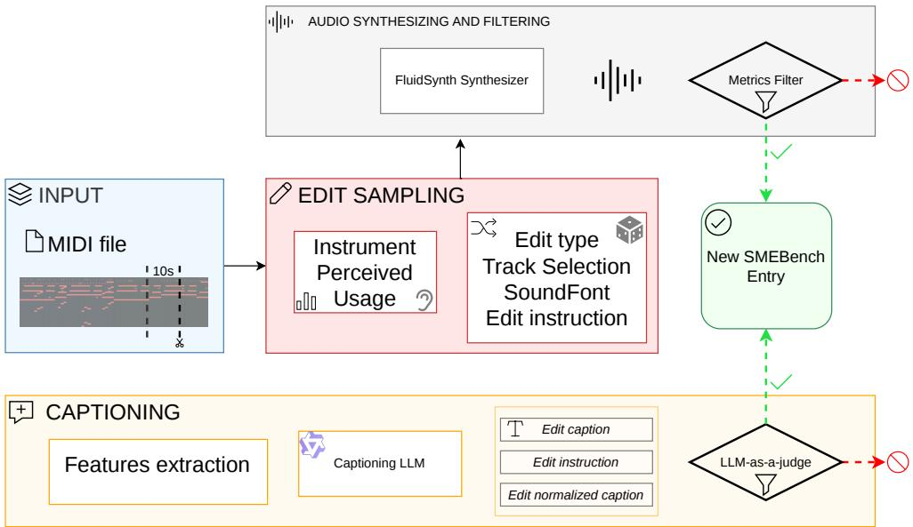

Figure 1: Overview of the SMEBench construction recipe. A 10-second MIDI excerpt is analyzed to determine which edits and targets are applicable. The selected intervention is applied to the symbolic performance, after which the source and target are rendered with the same SoundFont and filtered for audibility and quality. Structured facts extracted from the MIDI, audio, and edit metadata ground four complementary textual descriptions. Examples that pass the audio and caption checks become benchmark entries containing a known intervention and a paired reference target.

and agreement with the intended edit to be measured separately. They also enable a direct test of whether an automatic metric favors the intended target over an unchanged source, rather than merely rewarding preservation or broad textual compatibility.

We introduce SMEBench, a benchmark for controlled music editing with paired source and target audio. SMEBench uses MIDI as an intervention layer: we apply known edits to symbolic performances and synthesize the source and edited versions under matched conditions. Each example includes the source audio, an edit instruction, the corresponding reference-edited audio, explicit edit metadata, and complementary textual descriptions. This construction provides controlled counterfactual pairs that differ by a known musical intervention, allowing generated outputs to be compared both with the material they should preserve and with the target they should approach. The current release focuses on 10-second excerpts spanning a defined set of instrumentation, articulation, dynamics, and pitch edits. Although the controlled soundfont rendering enables precise, scalable interventions, it also introduces a synthetic-to-real gap. To assess the extent to which our conclusions persist under more realistic acoustic conditions, we additionally construct a smaller paired subset from real multitrack recordings and report results on it separately.

Using these paired references, we study not only how existing editing systems perform, but also what their evaluation metrics measure. Identity and ground-truth anchors expose the different endpoints of the task. Returning the source gives perfect preservation without executing the edit, whereas the reference target represents the known intended transformation. Across common audio–audio and text–audio metrics, our analysis shows that source preservation, target agreement, and textual compatibility yield different and sometimes conflicting assessments of the same output. These results motivate paired, reference-based evaluation as a diagnostic complement to realistic but unpaired music-editing benchmarks.

Our contributions are as follows:

• We introduce SMEBench, a controlled benchmark containing 11,160 paired source and reference-edited audio, edit instructions, edit metadata, and complementary textual descriptions. Its balanced test set contains 3,600 examples across twelve edit types, together with a real-audio complement composed of 416 pairs. We release the construction code as an extensible recipe for generating controlled, paired music edits.

• We use paired targets and interpretable reference anchors to characterize the behavior of commonly used audio–audio and text–audio metrics, showing that a system can score well for preserving the source or matching the text without being the closest system to the intended target.

• We benchmark SDEdit (Meng et al., 2022), DDIM inversion (Song et al., 2022), ZETA (Manor & Michaeli, 2024), Virtual Consistency Inversion (Cervera et al., 2025), SteerMusic (Niu et al., 2025), and MusicGen (Copet et al., 2024), and evaluate their outputs separately against the source and the intended target.

## 2 RELATED WORK

Few datasets and evaluation sets target audio editing specifically. Some pair inputs and outputs, but derive targets through signal-level operations such as mixing, separation, masking, inpainting, or reconstruction; others provide prompts and annotations for evaluating music editors without target audio. This leaves a need for a common benchmark with paired targets produced through explicit interventions on musical content.

Paired audio-editing data. AUDIT (Wang et al., 2023) constructs instruction-based input–output triplets for general audio transformations, including addition, removal, replacement, inpainting, and super-resolution. These triplets provide paired supervision, but their targets are largely obtained through operations such as mixing, separation, masking, and reconstruction. They do not intervene on the underlying musical performance or expose a structured set of musical changes. InstructME (Han et al., 2023) similarly introduces an instruction-guided music editing and remixing framework trained on a collected music dataset. It considers operations such as adding, removing, extracting, replacing, and remixing musical content, with targets constructed primarily through stem-level manipulation. These datasets establish the value of paired supervision, but cover a different setting from controlled interventions on instrumentation and performance attributes in the underlying musical representation. SMEBench instead modifies the symbolic performance before rendering, producing paired targets with known changes to instrumentation, articulation, dynamics, and pitch while holding the remaining musical content fixed.

Evaluation sets without paired target audio. MedleyMDPrompts (Manor & Michaeli, 2024) is a prompt-based evaluation set constructed from the MusicDelta subset of MedleyDB (Bittner et al., 2016). It contains real music recordings with manually written source and target prompts, but does not provide the corresponding reference-edited audio. ZoME-Bench (Liu et al., 2025) selects music-editing examples from MusicCaps (Agostinelli et al., 2023) and provides source prompts, target prompts, and annotations across multiple edit categories, but likewise lacks explicit target audio references. These resources offer greater acoustic realism than synthesized MIDI and support evaluation on naturally recorded music. Their unpaired design, however, means that edit execution must be inferred from text alignment or changes relative to the source rather than measured against a known edited outcome. SMEBench complements these realistic evaluation sets with controlled paired references, making it possible to compare an output separately with the source material it should preserve and the intended target it should approach.

We review the main families of neural audio-editing methods and commonly used evaluation metrics in Appendix A.

## 3 SMEBENCH: A RECIPE FOR CONTROLLED PAIRED MUSIC EDITS

SMEBench is a dataset and benchmark of source and target audio related by known musical interventions. We construct it using the pipeline summarized in Figure 1, which proceeds from edit sampling to audio rendering and textual grounding. We describe edit construction in Section 3.1, caption generation in Section 3.2, and the benchmark composition, including a complementary evaluation set constructed from real multitrack recordings, in Section 3.3.

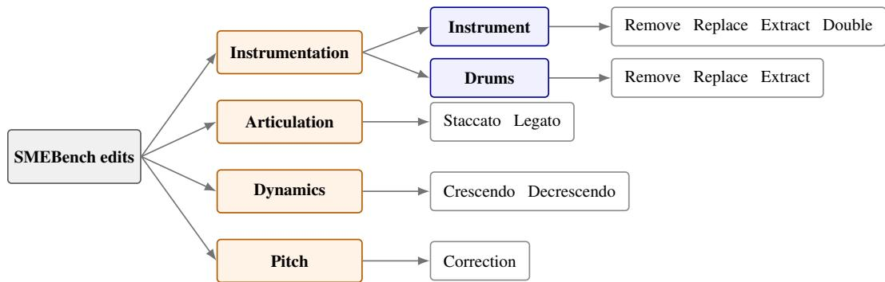  
Figure 2: SMEBench edit taxonomy. Each of the twelve operations is sampled only when the excerpt contains an eligible target. Instrument-level dynamics and pitch operations may target one instrument or the complete mixture without changing the operation category.

## 3.1 EDIT CONSTRUCTION

We build SMEBench from MIDICaps (Melechovsky et al., 2024), which contains 168,385 MIDI files with descriptive captions and extracted musical features. MIDI provides access to the notes, timing, velocity, and instrument assignment of a performance, allowing us to modify a selected musical attribute while retaining the remaining symbolic content. For each example, we crop a random 10-second excerpt and inspect its active instruments and drums. This analysis determines which edits are applicable. For instance, an instrument can only be removed if it is present, and an extraction is discarded when it would leave an empty or nearly empty target. Restricting the candidate operations in this way reduces ghost edits, in which the requested change affects absent or barely audible content, and degenerate edits that eliminate most of the excerpt.

The released benchmark covers twelve operations across four edit families. Instrumentation comprises removing, replacing, extracting, or doubling an instrument and removing, replacing, or extracting drums. Articulation edits shorten or lengthen notes to produce staccato and legato performances, while dynamics edits apply a crescendo or decrescendo to a selected instrument or to the complete mixture. The final operation corrects the tuning of a selected instrument or of the complete mixture: in the source, each note is detuned by an offset sampled between 50 and +50 cents relative to its nominal pitch, whereas the target keeps all notes on the twelve-tone equal-tempered grid referenced to A = 440 Hz. Taken together, these edits cover operations commonly performed in music composition, arrangement, and production workflows. Appendix B specifies the exact transformations. Figure 2 summarizes the taxonomy.

Some edits are applicable to more than one instrument in an excerpt. In these cases, we do not select uniformly among the eligible instruments. Instead, we weight each candidate by its perceived usage, so that the target more often corresponds to a prominent part of the excerpt while less prominent instruments remain eligible. Usage combines the duration for which an instrument is active with its MIDI velocity, following the relationship between velocity and peak RMS amplitude described by Dannenberg (2006). Instruments that occupy more of the excerpt and are played more strongly are therefore more likely to be selected, without excluding quieter instruments altogether. The exact computation and sampling distribution are given in Appendix C.

After applying the selected intervention, we synthesize the source and target MIDI with FluidSynth. We use five SoundFont libraries—Arachno 1.0, FluidR3\_GM, General Montage, GeneralUser GS, and TimGM6mb—which collectively cover most General MIDI instruments represented in MIDICaps. A SoundFont is sampled uniformly for each example and used for both the source and target, so that the pair differs in the intended edit rather than in its renderer. Audio is rendered in mono at 22,050 Hz with 32-bit floating-point precision.

We apply a final audio filter to remove ineffective and excessive transformations. Lower and upper bounds on LPAPS and CLAP audio similarity exclude pairs that are effectively unchanged and pairs whose source and target differ too strongly. A minimum Audiobox Aesthetics score removes examples with poor perceptual quality. These automatic checks are construction-time filters, not evidence that the retained targets are perceptually correct; we evaluate the quality, preservation, and instruction alignment of the retained examples in Section 4. Appendix D reports the renderer configuration and filtering procedure.

The current taxonomy is one instantiation of the recipe rather than a fixed limit of the construction. A new MIDI-expressible edit can be incorporated by defining when it is applicable, how it transforms the symbolic performance, and which metadata record the change. This separation between edit definition, matched rendering, and annotation permits future extensions such as changes to harmony, tempo, voicing, rhythm, or timbre while preserving the same benchmark contract: a source and target related by a known intervention. Extensions involving attributes that MIDI does not represent reliably, including vocals, genre, or mixing and mastering, require complementary audio representations rather than another symbolic edit alone.

## 3.2 CAPTIONS

The bottom branch of Figure 1 associates each audio pair with four textual views. The source caption $c _ { \mathrm { s o u r c e } }$ and edit caption $c _ { \mathrm { e d i t } }$ describe the audio before and after the intervention. They are constructed so that the edit caption changes only the content affected by the operation. If the source caption describes “a fast piano melody with soft strings in the background,” for example, an edit that replaces the strings with brass yields “a fast piano melody with soft brass in the background.” These captions describe their respective audio excerpts; they are not phrased as transformations. By contrast, the edit instruction $c _ { \mathrm { i n s t r u c t } }$ expresses the same intervention as a user request. We generate it deterministically from manually written templates for each edit type, using the selected instrument and operation recorded in the edit metadata. The normalized caption $c _ { \mathrm { n o r m } }$ instead gives a standardized description of the resulting excerpt and explicitly lists its instrumentation. We report text–audio scores under these different textual conditions in Section 4, since editing systems and metrics may consume either an imperative instruction or a description of the intended output.

The descriptive captions are grounded in structured musical attributes rather than generated directly from the complete MIDI file’s original caption. A MIDICaps caption may describe properties that do not hold within an arbitrary 10-second crop, so we independently extract relevant descriptors from the source and target MIDI and audio. These descriptors, the original MIDICaps caption, and the edit metadata are provided to Qwen3-30B-A3B-Instruct-2507 (Qwen Team, 2025), which produces the source and edit captions and refines the normalized description. An LLM-based judge then verifies that the instruction preserves the intended operation and the target caption reflects the edit. It also checks that no unrelated content is added or removed and that the source and target descriptions remain consistent in detail. Entries that fail this check are discarded. The feature extractors, prompts, and complete judge criteria appear in Appendix I. Because caption generation and filtering use the same model family, we evaluate the retained captions independently in Section 4 and discuss the possibility of correlated errors there.

## 3.3 BENCHMARK COMPOSITION

Applying this recipe produces 11,160 paired edits in total. This corpus includes a balanced test split of 3,600 examples, with 300 examples for each of the twelve operations in Figure 2. We release the source and edited audio, their MIDI files, the instruction and descriptive captions, the edit metadata, and MIDI masks representing the edited component and the remainder of the mixture.

We complement SMEBench with paired edits constructed from real multitrack recordings from MoisesDB (Pereira et al., 2023). After removing tracks marked as containing bleed, we construct instrument-removal and extraction edits by changing which stems are included in the mixture. For doubling and swapping, we identify pairs of tracks within the same song that play similar melodic or rhythmic material with different timbres, using correlations between windowed chromagrams and onset-strength envelopes. Dynamics edits are obtained by applying gain envelopes to selected stems. Captioning and filtering follow the same principles as in the MIDI pipeline, with MIDI-specific features omitted. This process yields a 416-example test set from 107 tracks, which we denote SME-Real. The subset is not intended to reproduce the coverage of the synthetic benchmark. MIDI and virtual instruments are themselves widely used in music production, and current systems remain separated from the paired-reference anchors even in this controlled setting, before the additional complexity of real recordings. The real-audio complement tests whether our main findings persist when paired targets are constructed from recorded stems.

SMEBench and its real-audio complement offer different balances of control and acoustic realism, but expose the same evaluation object: a source, a requested change, and a paired target. Symbolic construction records which operation was applied; it does not by itself establish that the rendered change is audible, musically coherent, or accurately described. Section 4 therefore begins by validating the benchmark entries before using them to diagnose metrics and compare editing systems.

## 4 EXPERIMENTS

Our experiments address three questions. We first test whether the paired targets and captions are suitable for evaluation (Section 4.1). We then use the known source and target endpoints to examine how common audio-editing metrics behave (Section 4.2). Finally, we benchmark existing editing systems and ask whether source-based, target-based, and text-based evaluation lead to the same conclusions (Section 4.3). Unless otherwise stated, experiments use the balanced 3,600-example test split; we report results on the 416-example SME-Real test set separately.

## 4.1 VALIDATING TARGETS AND CAPTIONS

Symbolic construction records which operation produced each target, but does not establish that the rendered edit is perceptually convincing or correctly described. We therefore conducted a listening study in which participants heard 20 randomly selected source–target pairs together with the corresponding edit instruction. On a five-point Likert scale, they rated the target’s overall quality, its alignment with the source, and its alignment with the edit instruction. The latter measures whether the requested transformation is audible in the target. For alignment with the source audio, participants were explicitly asked whether the edited sample remained recognizable as the same source apart from the requested modification, rather than whether it preserved every mixture component. Participants also rated captions produced by our pipeline: at each trial, either a source or an edit caption was randomly selected. The study involved 17 participants, of whom 9 completed all 20 trials, yielding 236 trials in total.

Table 1 reports the mean ratings. Across 236 edit ratings, targets received an average quality score of 4.23 and source-alignment score of 4.65. Their mean instruction-alignment score was lower, at 3.99: 68.7% of ratings were good or very good, while 13.2% were bad or very bad. This distinction matters for benchmark validity. The paired construction preserves the intended relation at the symbolic level, but some rendered transformations are less perceptible to listeners than others. Pipeline captions received an average score of 3.70, with 71.2% rated good or very good. These results support using the retained targets and captions as evaluation references, while also motivating an edit-wise analysis of their reliability.

Table 1: Human validation of the benchmark targets and captions. Ratings use a five-point scale. We report means over all available responses; the edit-wise breakdown appears in Appendix E.
<table><tr><td>Criterion</td><td>Mean</td><td>Responses</td><td>95% CI (participant bootstrap, n=17)</td></tr><tr><td>Target quality</td><td>4.23</td><td>236</td><td>[4.06, 4.39]</td></tr><tr><td>Alignment with source</td><td>4.65</td><td>236</td><td>[4.57, 4.73]</td></tr><tr><td>Alignment with instruction</td><td>3.99</td><td>236</td><td>[3.72, 4.23]</td></tr><tr><td>Pipeline-caption quality</td><td>3.70</td><td>174</td><td>[3.46, 3.98]</td></tr></table>

We report 95% confidence intervals from a participant-clustered bootstrap (5,000 resamples of whole participants, preserving within-participant correlation across their trials). Three of the twelve operations (LEGATO, REMOVE\_INSTRUMENT, and SWAP\_DRUMS) do not reliably exceed the midpoint of the instruction-following scale. We retain these operations in the benchmark and report them separately, but exclude them from the headline perceptual aggregate. Across the remaining nine operations (164 trials, 17 participants), mean instruction following is 4.30 (95% CI [4.03, 4.53]), source consistency is 4.69 ([4.61, 4.77]), and overall quality is 4.43 ([4.29, 4.54]). The edit-wise breakdown appears in Appendix E (Table 4). Source consistency remains high ( 4.3) for the three flagged operations, but listeners are less consistent in attributing the perceived result to the requested instruction.

The caption comparison assesses the quality of retained captions; it does not validate the rejection decisions made by the LLM filter. We therefore treat correlated errors from using the same Qwen model family for caption generation and filtering as a limitation rather than interpreting the study as validation of the complete filtering procedure. We provide a short complementary analysis in Appendix K.

## 4.2 DIAGNOSING MUSIC-EDITING METRICS

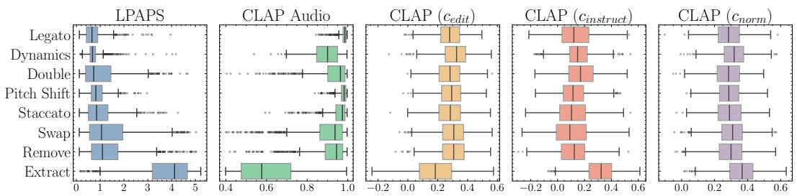  
Figure 3: Metric distributions by edit group on the SMEBench test split. The twelve operations are displayed in eight groups: crescendo and decrescendo are grouped as Dynamics, while instrument and drum variants are grouped under Swap, Remove, and Extract. Boxes show the median and interquartile range; whiskers extend to 1.5 times the interquartile range.

Music editing requires both preservation and change, but commonly used metrics observe these properties through different references. We distinguish three evaluation axes. Source-reference metrics measure how much of the input is preserved; target-reference metrics measure agreement with the known edited outcome; and text–audio metrics measure compatibility with an instruction or description. We instantiate the first two axes with CLAP-Audio similarity and LPAPS distance, computed against either the source (Src) or paired target (GT), and evaluate textual compatibility with CLAP-Text using the edit caption, instruction, and normalized caption.

Identity and Ground Truth provide interpretable endpoints. Identity returns the source unchanged and therefore represents perfect preservation without edit execution. Ground Truth is the paired target produced by the known intervention. A source-reference metric should prefer Identity, whereas a target-reference metric should prefer Ground Truth. Text–audio similarity is useful for editing only insofar as it can distinguish these endpoints when the instruction describes their difference.

Table 2 summarizes the global source–target statistics. The source and target remain relatively close in the embedding spaces used by current metrics. On the test set, their mean CLAP-Audio similarity is 0.873 and their mean LPAPS distance is 1.513. The corresponding values on the realaudio complement are 0.804 and 2.167, indicating a larger source–target separation for the available real-audio edits. These aggregate values nevertheless hide substantial variation across operations. Extraction edits alter the global scene by retaining a single component, whereas articulation and pitch edits change a more localized property; their distances should not be interpreted on the same absolute scale.

Table 2: Descriptive characterization of the source and paired target audio. These aggregate statistics quantify source–target separation but do not by themselves establish edit correctness.
<table><tr><td rowspan="2">Metric</td><td colspan="2">Test set</td><td colspan="2">Real-audio complement</td></tr><tr><td>Source</td><td>Target</td><td>Source</td><td>Target</td></tr><tr><td>CLAP-Text (caption) ↑</td><td>0.249</td><td>0.278</td><td>0.134</td><td>0.123</td></tr><tr><td>CLAP-Text (instruction) ↑</td><td></td><td>0.160</td><td>一</td><td>0.125</td></tr><tr><td>CLAP-Text (normalized) ↑</td><td>0.291</td><td>0.308</td><td></td><td></td></tr><tr><td>Audiobox Aesthetics ↑</td><td>6.903</td><td>6.734</td><td>7.247</td><td>6.952</td></tr><tr><td>LPAPS (Src ↔ GT) ↓</td><td colspan="2">1.513</td><td colspan="2">2.167</td></tr><tr><td>CLAP-Audio (Src ↔ GT) ↑</td><td colspan="2">0.873</td><td colspan="2">0.804</td></tr></table>

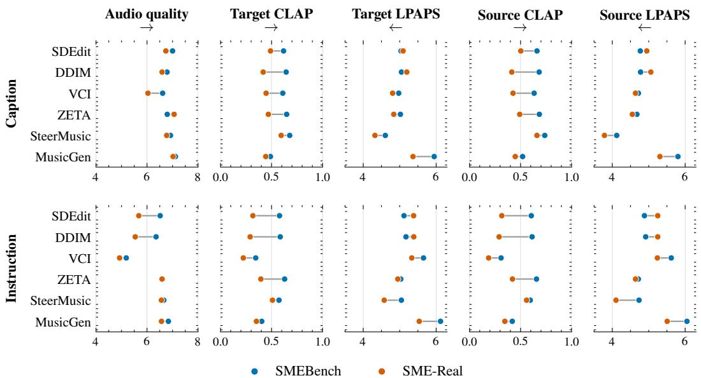  
Figure 4: System performance on SMEBench and SME-Real under edit-caption conditioning (top) and edit-instruction conditioning (bottom). Paired points represent the same editing pipeline on SMEBench (blue) and SME-Real (orange), with connecting lines showing the synthetic-to-real change. All panels report raw metric values; arrows indicate the preferred direction. Target and source metrics separately measure agreement with the intended edit and preservation of the source.

Figure 3 shows that metric values depend on the requested operation. Extraction produces the largest LPAPS distances and lowest CLAP-Audio similarities. Normalized-caption scores vary less across edit groups than instruction and edited-caption scores. This stability is not by itself evidence of a better editing metric; it may instead indicate lower sensitivity to the requested edit. Additional salience-conditioned views appear in Appendix F.

Together, these analyses illustrate the paper’s central distinction: preservation, target agreement, and textual compatibility are related but not interchangeable. Without paired targets, a system can receive a favorable source or text score even when the requested transformation is not the outcome it approaches.

## 4.3 BENCHMARKING MUSIC-EDITING SYSTEMS

We evaluate SDEdit (Meng et al., 2022), DDIM inversion (Song et al., 2022), ZETA (Manor & Michaeli, 2024), Virtual Consistency Inversion (VCI) (Cervera et al., 2025), and SteerMusic (Niu et al., 2025). These methods perform zero-shot editing with a pretrained diffusion model; we use the cvssp/audioldm2-music AudioLDM2 checkpoint (Liu et al., 2024) as their common generative backbone. We additionally report MusicGen (Copet et al., 2024) as a text-conditioned generation baseline without source-preserving inversion. We run the systems with either the imperative instruction $c _ { \mathrm { i n s t r u c t } }$ or the edited-audio description $c _ { \mathrm { e d i t } }$ , according to the input interface being evaluated.

We compare every output with both the source and target using CLAP-Audio and LPAPS, and report CLAP-Text under the available textual conditions. We also report Audiobox Aesthetics as a no-reference estimate of perceptual quality; higher values are better.

Figure 4 reports the principal results, and Table 3 makes the resulting ranking reversals explicit. The radar comparison and remaining numerical results appear in Appendix G.

Under edit-caption conditioning, CLAP-Text favors MusicGen, whereas both target-reference metrics favor SteerMusic. Under instruction conditioning, CLAP-Text favors VCI, whereas both targetreference metrics favor ZETA. These comparisons are diagnostic rather than exhaustive: some edit instructions define a set of valid outputs, and the paired target represents one controlled realization from that set. Nevertheless, the reversals show that broad textual compatibility does not establish agreement with even a known valid realization of the requested edit.

<table><tr><td>Conditioning</td><td>System</td><td>CLAP-T ↑</td><td>CLAP-A GT ↑</td><td>LPAPS GT ↓</td></tr><tr><td rowspan="5">Edit caption</td><td>SDEdit</td><td>0.296 [0.293, 0.299]</td><td>0.625 [0.621, 0.628]</td><td>4.969 [4.951, 4.986]</td></tr><tr><td>DDIM</td><td>0.283 [0.279, 0.286]</td><td>0.652 [0.648, 0.655]</td><td>4.981 [4.964, 4.998]</td></tr><tr><td>VCI</td><td>0.299 [0.296, 0.303]</td><td>0.614 [0.610, 0.618]</td><td>4.908 [4.887, 4.929]</td></tr><tr><td>ZETA</td><td>0.287 [0.284, 0.290]</td><td>0.654 [0.651, 0.657]</td><td>4.937 [4.918, 4.956]</td></tr><tr><td>SteerMusic</td><td>0.269 [0.266, 0.272]</td><td>0.691 [0.688, 0.694]</td><td>4.482 [4.458, 4.506]</td></tr><tr><td rowspan="6">Instruction</td><td>MusicGen</td><td>0.350 [0.347, 0.353]</td><td>0.492 [0.489, 0.497]</td><td>5.926 [5.914, 5.939]</td></tr><tr><td>SDEdit</td><td>0.227 [0.223, 0.231]</td><td>0.585 [0.580, 0.589]</td><td>5.046 [5.028, 5.063]</td></tr><tr><td>DDIM VCI</td><td>0.203 [0.199, 0.207]</td><td>0.596 [0.591, 0.601]</td><td>5.094 [5.076, 5.111]</td></tr><tr><td>ZETA</td><td>0.266 [0.262, 0.269] 0.199 [0.195, 0.203]</td><td>0.363 [0.357, 0.369] 0.633 [0.630, 0.637]</td><td>5.576 [5.555, 5.595]</td></tr><tr><td>SteerMusic</td><td>0.194 [0.191, 0.198]</td><td>0.583 [0.579, 0.587]</td><td>4.954 [4.936, 4.972]</td></tr><tr><td>MusicGen</td><td>0.198 [0.194, 0.202]</td><td>0.406 [0.402, 0.411]</td><td>4.956 [4.934, 4.977] 6.099 [6.086, 6.111]</td></tr></table>

Table 3: System rankings on the SMEBench test split. The system preferred by CLAP-Text is not the system preferred by either paired-target audio metric. Values are means with 95% bootstrap confidence intervals. Because some edits admit multiple valid realizations, target similarity measures agreement with the benchmark’s known controlled realization rather than exhaustive edit correctness. Bold indicates the best observed mean within each conditioning mode and metric.

Figure 5 shows the corresponding evaluation object for one held-out example. Differences in the outputs’ time–frequency structure illustrate that the methods do not converge to a single acoustic solution; the example is illustrative rather than a correctness test.  
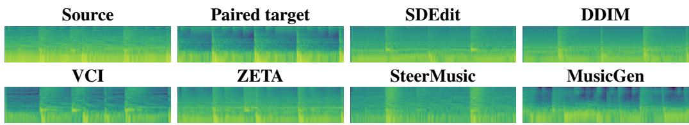  
Figure 5: Log-frequency spectrograms for one held-out SMEBench example. The paired target is one controlled valid realization; the remaining panels show the six system outputs. All panels use the same rendering configuration and show the same 2-second interval (4–6 s).

## 5 CONCLUSIONS AND LIMITATIONS

SMEBench provides paired source and target audio for controlled music edits. Its symbolic intervention layer makes the requested change explicit and allows preservation, target agreement, and text compatibility to be evaluated as separate properties. The benchmark therefore complements realistic but unpaired evaluation sets: it is designed not only to compare editors, but also to reveal what their evaluation metrics reward. Our experiments show that source-, target-, and text-based scores need not produce the same ranking, supporting the use of paired targets as a diagnostic evaluation tool.

Limitations. The controlled rendering that makes the benchmark precise also creates a gap from recorded music, which the smaller real-audio complement only partially addresses. The current taxonomy covers twelve MIDI-expressible operations and does not represent vocals, production effects, genre transfer, or other changes that require richer audio representations. Some operations are less reliably audible than others, and automatic audio and caption filtering can introduce bias from the pretrained models on which it relies. We also note that music editing is not inherently bijective, so our synthesized edits represent one plausible solution among multiple valid alternatives. Finally, no single metric captures preservation, edit execution, and perceptual quality; benchmark results should therefore be interpreted across these axes rather than reduced to one aggregate score.

## ACKNOWLEDGMENTS

F. Paissan is partially funded by the Fonds de recherche du Québec (FRQ) through the grant “Learning Interpretable Representations at Scale” (doi:10.69777/2009884) and by the Institut intelligence et données (IID) at Université Laval through its PhD Admission Scholarship in Artificial Intelligence. We acknowledge the support of the Natural Sciences and Engineering Research Council of Canada (NSERC) and the Digital Research Alliance of Canada (https://alliancecan.ca). Cem Subakan and Mirco Ravanelli are supported by NSERC projects RGPIN-2023-05759 and RGPIN-2022-05088, respectively. Mirco Ravanelli is also supported by Translated through the Imminent research grant. Micael Antunes is funded by the European Union through the Marie Skłodowska-Curie Actions (MSCA) Postdoctoral Fellowship GenCAST, Grant No. 101277782. Ricard Marxer benefited from the support of the French National Research Agency through the ANR-20-CE23-0012-01 (MIM) grant.

## AI USE STATEMENT

In this work, we used generative AI tools to assist with drafting and editing parts of the manuscript, improving readability and conciseness, typesetting, formatting references, brainstorming, searching for relevant literature, and implementing experimental methods. Generative models are also explicit components of the reported methodology: Qwen3-30B-A3B-Instruct-2507 is used to produce and assess grounded textual descriptions, and an independent Mistral checkpoint is used to analyze judge agreement. We did not use generative AI to formulate the benchmark’s central claims, design its evaluation methodology, or interpret the experimental results. The authors manually verified the AI-assisted text and citations, inspected the generated captions and associated quality-control procedure, and tested the experimental code. We take full responsibility for the final manuscript, claims, experimental results, and released artifacts.

## REPRODUCIBILITY STATEMENT

The benchmark construction and evaluation protocol are documented throughout the paper and appendix. Section 3 describes the paired-edit recipe, edit taxonomy, caption construction, filtering procedure, and benchmark composition. Appendices B, C, and D specify the twelve edit operations, their eligibility and target-sampling rules, the perceived- usage computation, rendering configuration, SoundFonts, and construction-time filtering procedure. Appendix I provides the feature extraction, captioning, and judge prompts. Section 4 defines the evaluation metrics, reference anchors, conditioning settings, and editing systems, while Appendices F and G provide the detailed metric analyses and complete system results. The released benchmark contains source and target audio, MIDI files, instructions, captions, edit metadata, and component masks; the dataset and accompanying generation code are made available through the project release linked in the abstract.

## REFERENCES

Andrea Agostinelli, Timo I. Denk, Zalán Borsos, Jesse Engel, Mauro Verzetti, Antoine Caillon, Qingqing Huang, Aren Jansen, Adam Roberts, Marco Tagliasacchi, Matt Sharifi, Neil Zeghidour, and Christian Frank. MusicLM: Generating music from text, 2023. URL https://arxiv.org/abs/2301.11325.

Pablo Alonso-Jiménez, Dmitry Bogdanov, Jordi Pons, and Xavier Serra. Tensorflow audio models in Essentia. In International Conference on Acoustics, Speech and Signal Processing (ICASSP), 2020.

Pablo Alonso-Jiménez, Xavier Serra, and Dmitry Bogdanov. Efficient supervised training of audio transformers for music representation learning. In International Society for Music Information Retrieval Conference (ISMIR), 2023.

Samyadeep Basu, Mehrdad Saberi, Shweta Bhardwaj, Atoosa Malemir Chegini, Daniela Massiceti, Maziar Sanjabi, Shell Xu Hu, and Soheil Feizi. EditVal: Benchmarking diffusion based text-guided image editing methods, 2023. URL https://arxiv.org/abs/2310.02426.

Rachel Bittner, Julia Wilkins, Hanna Yip, and Juan Bello. MedleyDB 2.0: New data and a system for sustainable data collection. In Proceedings of the 17th International Society for Music Information Retrieval Conference (ISMIR), 2016.

Irmak Bukey, Zhepei Wang, Chris Donahue, and Nicholas J. Bryan. Rethinking music captioning with music metadata LLMs, 2026. URL https://arxiv.org/abs/2602.03023.

Matthieu Cervera, Francesco Paissan, Mirco Ravanelli, and Cem Subakan. Virtual consistency for audio editing, 2025. URL https://arxiv.org/abs/2509.17219.

Yoonjin Chung, Pilsun Eu, Junwon Lee, Keunwoo Choi, Juhan Nam, and Ben Sangbae Chon. KAD: No more FAD! An effective and efficient evaluation metric for audio generation, 2025. URL https://arxiv. org/abs/2502.15602.

Jade Copet, Felix Kreuk, Itai Gat, Tal Remez, David Kant, Gabriel Synnaeve, Yossi Adi, and Alexandre Défossez. Simple and controllable music generation, 2024. URL https://arxiv.org/abs/2306.05284.

Roger B. Dannenberg. The interpretation of MIDI velocity. In Proceedings of the International Computer Music Conference (ICMC), pp. 193–196, San Francisco, CA, 2006. International Computer Music Association.

Benjamin Elizalde, Soham Deshmukh, Mahmoud Al Ismail, and Huaming Wang. CLAP: Learning audio concepts from natural language supervision, 2022. URL https://arxiv.org/abs/2206.04769.

Daniel P. W. Ellis, Eduardo Fonseca, Ron J. Weiss, Kevin Wilson, Scott Wisdom, Hakan Erdogan, John R. Hershey, Aren Jansen, R. Channing Moore, and Manoj Plakal. Recomposer: Event-roll-guided generative audio editing, 2025. URL https://arxiv.org/abs/2509.05256.

Azalea Gui, Hannes Gamper, Sebastian Braun, and Dimitra Emmanouilidou. Adapting Frechet audio distance for generative music evaluation, 2024. URL https://arxiv.org/abs/2311.01616.

Bing Han, Junyu Dai, Weituo Hao, Xinyan He, Dong Guo, Jitong Chen, Yuxuan Wang, Yanmin Qian, and Xuchen Song. InstructME: An instruction guided music edit and remix framework with latent diffusion models, 2023. URL https://arxiv.org/abs/2308.14360.

Qingqing Huang, Aren Jansen, Joonseok Lee, Ravi Ganti, Judith Yue Li, and Daniel P. W. Ellis. MuLan: A joint embedding of music audio and natural language, 2022. URL https://arxiv.org/abs/2208.12415.

Kevin Kilgour, Mauricio Zuluaga, Dominik Roblek, and Matthew Sharifi. Fréchet audio distance: A metric for evaluating music enhancement algorithms, 2019. URL https://arxiv.org/abs/1812.08466.

Gael Le Lan, Bowen Shi, Zhaoheng Ni, Sidd Srinivasan, Anurag Kumar, Brian Ellis, David Kant, Varun Nagaraja, Ernie Chang, Wei-Ning Hsu, Yangyang Shi, and Vikas Chandra. High fidelity text-guided music editing via single-stage flow matching, 2024. URL https://arxiv.org/abs/2407.03648.

Zitong Lan, Yiduo Hao, and Mingmin Zhao. Guiding audio editing with audio language model, 2025. URL https://arxiv.org/abs/2509.21625.

Haohe Liu, Yi Yuan, Xubo Liu, Xinhao Mei, Qiuqiang Kong, Qiao Tian, Yuping Wang, Wenwu Wang, Yuxuan Wang, and Mark D. Plumbley. AudioLDM 2: Learning holistic audio generation with self-supervised pretraining, 2024. URL https://arxiv.org/abs/2308.05734.

Huadai Liu, Jialei Wang, Xiangtai Li, Wen Wang, Qian Chen, Rongjie Huang, Yang Liu, Jiayang Xu, and Zhou Zhao. MEDIC: Zero-shot music editing with disentangled inversion control, 2025. URL https: //arxiv.org/abs/2407.13220.

Hila Manor and Tomer Michaeli. Zero-shot unsupervised and text-based audio editing using DDPM inversion, 2024. URL https://arxiv.org/abs/2402.10009.

Jan Melechovsky, Abhinaba Roy, and Dorien Herremans. MidiCaps: A large-scale MIDI dataset with text captions. arXiv:2406.02255, 2024.

Chenlin Meng, Yutong He, Yang Song, Jiaming Song, Jiajun Wu, Jun-Yan Zhu, and Stefano Ermon. SDEdit: Guided image synthesis and editing with stochastic differential equations, 2022. URL https://arxiv. org/abs/2108.01073.

Mistral AI Team. Mistral-Small-24B-Instruct-2501. https://huggingface.co/mistralai/ Mistral-Small-24B-Instruct-2501, 2025. Mistral-Small-24B-Instruct-2501, 24B parameter instruction-tuned model.

Xinlei Niu, Kin Wai Cheuk, Jing Zhang, Naoki Murata, Chieh-Hsin Lai, Michele Mancusi, Woosung Choi, Giorgio Fabbro, Wei-Hsiang Liao, Charles Patrick Martin, and Yuki Mitsufuji. SteerMusic: Enhanced musical consistency for zero-shot text-guided and personalized music editing, 2025. URL https://arxiv.org/ abs/2504.10826.

Francesco Paissan, Luca Della Libera, Zhepei Wang, Paris Smaragdis, Mirco Ravanelli, and Cem Subakan. Audio editing with non-rigid text prompts. In Interspeech 2024, pp. 3290–3294. ISCA, September 2024. doi: 10. 21437/interspeech.2024-636. URL http://dx.doi.org/10.21437/Interspeech.2024-636.

Igor Pereira, Felipe Araújo, Filip Korzeniowski, and Richard Vogl. MoisesDB: A dataset for source separation beyond 4-stems, 2023. URL https://arxiv.org/abs/2307.15913.

Qwen Team. Qwen3 technical report, 2025. URL https://arxiv.org/abs/2505.09388.

Jiaming Song, Chenlin Meng, and Stefano Ermon. Denoising diffusion implicit models, 2022. URL https: //arxiv.org/abs/2010.02502.

Andros Tjandra, Yi-Chiao Wu, Baishan Guo, John Hoffman, Brian Ellis, Apoorv Vyas, Bowen Shi, Sanyuan Chen, Matt Le, Nick Zacharov, Carleigh Wood, Ann Lee, and Wei-Ning Hsu. Meta Audiobox Aesthetics: Unified automatic quality assessment for speech, music, and sound, 2025. URL https://arxiv.org/ abs/2502.05139.

Yuancheng Wang, Zeqian Ju, Xu Tan, Lei He, Zhizheng Wu, Jiang Bian, and Sheng Zhao. AUDIT: Audio editing by following instructions with latent diffusion models, 2023. URL https://arxiv.org/abs/ 2304.00830.

Yusong Wu, Ke Chen, Tianyu Zhang, Yuchen Hui, Marianna Nezhurina, Taylor Berg-Kirkpatrick, and Shlomo Dubnov. Large-scale contrastive language-audio pretraining with feature fusion and keyword-to-caption augmentation, 2024. URL https://arxiv.org/abs/2211.06687.

Manjie Xu, Chenxing Li, Duzhen zhang, Dan Su, Wei Liang, and Dong Yu. Prompt-guided precise audio editing with diffusion models, 2024. URL https://arxiv.org/abs/2406.04350.

Haozhe Zhao, Xiaojian Ma, Liang Chen, Shuzheng Si, Rujie Wu, Kaikai An, Peiyu Yu, Minjia Zhang, Qing Li, and Baobao Chang. UltraEdit: Instruction-based fine-grained image editing at scale, 2024. URL https://arxiv.org/abs/2407.05282.

## Appendix

## A AUDIO EDITING PIPELINES IN RELATED WORK

Latent diffusion model-based audio editing. Several works in the literature apply generative models to audio editing, with diffusion models representing a prominent class of approaches. AU-DIT (Wang et al., 2023) and InstructME (Han et al., 2023) use diffusion models to perform a closed set of editing instructions, such as Add Sound, Remove Sound, Replace Sound, and Inpaint. SmartDJ (Lan et al., 2025) later proposed leveraging an LLM to determine a sequence of closed-set edits, improving the flexibility and quality of the resulting edits.

A second line of work explores training-free editing approaches that modify representations in the latent space of a latent diffusion model. For example, PPAE (Xu et al., 2024) performs prompt-guided editing by manipulating latent representations, while (Paissan et al., 2024) realizes edits through latent variable interpolation. SteerMusic (Niu et al., 2025) instead steers the diffusion trajectory by optimizing the model score using a delta denoising score conditioned on the target edit prompt.

A third family of methods relies on diffusion model inversion to perform edits. These include ZETA (Manor & Michaeli, 2024), SDEdit (Meng et al., 2022), and the virtual consistency approach of (Cervera et al., 2025), which approximates inversion for audio editing.

Other editing approaches. Beyond diffusion-based editing, several works propose alternative interfaces and generative formulations. Recomposer (Ellis et al., 2025) defines an autoregressive audio-editing pipeline conditioned on an event-activity interface. Other music generation and editing systems, including MusicLM (Agostinelli et al., 2023) and recent high-fidelity text-guided music editing approaches (Lan et al., 2024), provide related directions for controllable music generation and transformation.

## A.1 AUDIO EDITING EVALUATION METRICS

Audio editing involves modifying an input audio based on user-provided textual instructions. A central difficulty is maintaining a balance: the output should preserve relevant characteristics of the original audio, while faithfully reflecting the requested edits. Evaluation metrics must assess both fidelity to the input and alignment with the requested transformation. Currently, no single metric jointly captures both aspects.

Audio Fidelity Metrics Audio fidelity metrics often operate on learned audio embeddings and measure similarity at either the sample or distribution level. Sample-wise measures typically rely on cosine similarity in a shared embedding space, most commonly using contrastive language audio pretraining (CLAP) (Elizalde et al., 2022; Wu et al., 2024) representations, or on point-wise comparisons across intermediate layers (Paissan et al., 2024). Distributional metrics instead compare statistics of embedding distributions, often under a Gaussian assumption, using divergences such as Kullback–Leibler or the Fréchet Audio Distance (FAD) (Kilgour et al., 2019). While earlier approaches relied on CNN-based feature extractors, recent work (Gui et al., 2024) has shown that CLAP-based embeddings yield FAD scores that correlate better with perceived acoustic and musical quality. Extensions of FAD beyond the Gaussian assumption have also been explored (Chung et al., 2025). In addition, no-reference metrics such as Meta AudioBox Aesthetics (Tjandra et al., 2025) aim to predict perceptual quality by modeling multiple dimensions of audio perception, and have shown improved correlation with human mean opinion scores across speech, audio, and music.

Text-Consistency Metrics Text–audio consistency is measured using pretrained joint audio–text embedding models. The most common approach relies on CLAP embeddings. Alternative audiolanguage models, such as MuLAN (Huang et al., 2022), can be used similarly; however, such approaches have not seen widespread adoption.

## B EDIT IMPLEMENTATIONS

Instrument and drum removal. Instrument removal deletes the selected instrument from the mixture. Drum removal deletes all events assigned to MIDI channel 9, following the General MIDI convention used by the source data. Instruments with percussive timbres on other channels remain classified as instruments.

Instrument and drum replacement. Instrument replacement assigns the selected track to another program in the General MIDI library. The replacement is sampled either from the same instrument family or from a different family. Drum replacement analogously maps a selected drum sound to another sound in the General MIDI percussion map. Replacements are sampled subject to the same eligibility criteria used for the other target-dependent operations.

Instrument and drum extraction. Instrument extraction retains the selected instrument and removes all other tracks. Drum extraction removes the pitched instruments and retains the drum events on channel 9. Because extraction can eliminate most of an excerpt, it is admitted only when the retained content satisfies the eligibility criteria in Appendix C.

Instrument doubling. Instrument doubling creates a new track assigned to a randomly sampled instrument, which plays the same notes as the selected source instrument.

Staccato. Notes are grouped into onset clusters whose members share one inter-onset interval (IOI).   
The duration of each note is set to 40% of its cluster’s IOI and clipped to the interval [40, 120] ms.

Legato. Each note is extended into the following onset cluster by 15% of the IOI. For monophonic selections, MIDI CC68, CC126, and CC127 messages are added to activate legato and monophonic behavior and reinforce the glide between notes.

Crescendo and decrescendo. Dynamics edits are applied either to a selected instrument or to the complete mixture. Editing MIDI velocity alone produced poor perceptual results, so the gain envelope is applied to the synthesized audio. For a segment of duration T, the envelope is

$$
g ( t ) = g _ { 0 } f ( t / T ) ,\tag{1}
$$

where $f ( x ) = x$ produces a crescendo and $f ( x ) = 1 - x$ produces a decrescendo. This audio-domain implementation also illustrates how the recipe could be extended to effects such as reverberation or delay, although such effects are not part of the current release.

Pitch correction. To construct an out-of-tune source, the pitch of every note in the selected instrument is independently perturbed by a value sampled uniformly from $[ - 5 0 , + 5 0 ]$ cents. The unmodified, conventionally tuned MIDI is used as the target. Pitch correction is applied either to one instrument or to all instruments in the excerpt.

## C EDIT ELIGIBILITY AND SAMPLING

For every 10-second MIDI excerpt, we determine the active instruments, drum events, and their usage before constructing the set of admissible edits. An edit is excluded when its target is absent or barely active, when the operation would produce no perceptible change, or when following the instruction would leave an empty or nearly empty target. For example, if an excerpt contains only an acoustic grand piano, drum edits and instrument extraction are discarded, leaving only edits that can meaningfully target the piano.

We estimate the perceived usage of an instrument from both note activity and velocity. Let ${ \mathcal { N } } _ { i }$ be the set of notes active in frame $i ,$ let $v _ { j } \in [ 0 , 1 2 7 ]$ be the MIDI velocity of note $j ,$ , and let N be the number of frames. The usage estimate is

$$
u _ { \mathrm { p e r c e p } } = \frac { 1 } { N } \sum _ { i = 1 } ^ { N } \operatorname* { m a x } _ { j \in \mathcal { N } _ { i } } \Big ( \frac { v _ { j } } { 1 2 7 } \Big ) ^ { 2 } .\tag{2}
$$

Table 4: Instruction-following, source consistency, and overall quality by edit operation (mean and 95% participant-clustered bootstrap confidence interval). Operations marked do not reliably clear the midpoint of the instruction-following scale and are excluded only from the headline perceptual aggregate.
<table><tr><td>Edit operation</td><td>Ntrials</td><td> $n _ { \mathrm { p a r t . } }$ </td><td>Instr.-following</td><td>Consistency</td><td>Overall</td></tr><tr><td>Remove drums</td><td>11</td><td>11</td><td>4.27 [3.64, 4.82]</td><td>4.82 [4.55, 5.00]</td><td>4.91 [4.73, 5.00]</td></tr><tr><td>Crescendo</td><td>12</td><td>12</td><td>4.50 [4.00, 4.92]</td><td>4.75 [4.50, 5.00]</td><td>4.67 [4.42, 4.92]</td></tr><tr><td>Decrescendo</td><td>26</td><td>15</td><td>4.50 [4.11, 4.82]</td><td>4.88 [4.70, 5.00]</td><td>4.54 [4.23, 4.81]</td></tr><tr><td>Staccato</td><td>25</td><td>14</td><td>4.44 [4.04, 4.78]</td><td>4.68 [4.46, 4.88]</td><td>4.56 [4.28, 4.81]</td></tr><tr><td>Double instrument</td><td>24</td><td>14</td><td>4.42 [4.15, 4.70]</td><td>4.83 [4.68, 4.96]</td><td>4.54 [4.26, 4.79]</td></tr><tr><td>Extract drums</td><td>20</td><td>11</td><td>4.35 [4.00, 4.64]</td><td>4.70 [4.53, 4.86]</td><td>4.50 [4.19, 4.77]</td></tr><tr><td>Extract instrument</td><td>11</td><td>11</td><td>4.18 [3.18, 5.00]</td><td>4.82 [4.55, 5.00]</td><td>4.36 [3.82, 4.82]</td></tr><tr><td>Replace instrument</td><td>22</td><td>13</td><td>4.00 [3.61, 4.39]</td><td>4.09 [3.87, 4.29]</td><td>3.77 [3.57, 4.00]</td></tr><tr><td>Pitch correction</td><td>13</td><td>13</td><td>3.85 [3.23, 4.46]</td><td>4.77 [4.38, 5.00]</td><td>4.15 [3.77, 4.54]</td></tr><tr><td>Legato†</td><td>15</td><td>15</td><td>3.33 [2.80, 3.87]</td><td>4.60 [4.33, 4.87]</td><td>3.93 [3.40, 4.40]</td></tr><tr><td>Remove instrument†</td><td>46</td><td>15</td><td>3.27 [2.79, 3.73]</td><td>4.60 [4.43, 4.77]</td><td>3.78 [3.35, 4.18]</td></tr><tr><td>Replace drums†</td><td>11</td><td>11</td><td>3.00 [2.40, 3.64]</td><td>4.30 [3.90, 4.70]</td><td>3.50 [2.90, 4.00]</td></tr><tr><td>Headline (excl. †)</td><td>164</td><td>17</td><td>4.30 [4.03, 4.53]</td><td>4.69 [4.61, 4.77]</td><td>4.43 [4.29, 4.54]</td></tr></table>

The quadratic velocity term follows the relationship between normalized MIDI velocity and the square root of peak RMS amplitude described by Dannenberg (2006). Given K instruments with non-zero usage, the probability of selecting instrument k is

$$
p ( k ) = \frac { u _ { \mathrm { p e r c e p } } ^ { ( k ) } } { \sum _ { j = 1 } ^ { K } u _ { \mathrm { p e r c e p } } ^ { ( j ) } } .\tag{3}
$$

This prioritizes salient instruments while retaining a non-zero probability of editing less prominent ones.

## D AUDIO RENDERING AND FILTERING

We synthesize source and edited MIDI files with FluidSynth using one of five SoundFont libraries: Arachno 1.0, FluidR3\_GM, General Montage, GeneralUser GS, and TimGM6mb. The same uniformly sampled SoundFont renders both members of a pair. Audio is stored as a mono signal sampled at 22,050 Hz with 32-bit floating-point precision. We verified on a large subset of edits that the choice of SoundFont did not produce a significant shift in the distributions of the general metrics used during construction.

We remove pairs with negligible changes by imposing a minimum LPAPS distance and a maximum CLAP audio similarity. Conversely, a maximum LPAPS distance and a minimum CLAP audio similarity remove edits that alter the source too strongly. The thresholds are obtained by averaging the fifth-percentile values from multiple large-scale construction runs (more than 20, 000 total samples). Finally, we require a minimum mean Audiobox Aesthetics score to reject poor-quality audio.

The same percentile-based rule is applied consistently across construction runs. Its purpose is to remove distributional extremes rather than to define a universal perceptual boundary for a successful edit.

## E HUMAN-EVALUATION DETAILS

Participants rated target quality, alignment with the source, alignment with the instruction, and caption quality on a scale from 1 (very bad) to 5 (very good). Table 4 gives the edit-wise results used to identify operations whose instruction-following ratings do not reliably clear the midpoint of the scale.

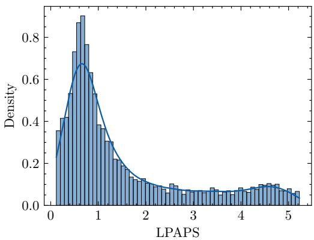

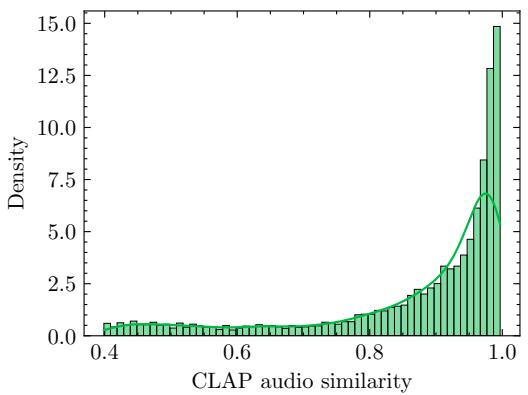

Figure 6: Source–target LPAPS distance and CLAP-Audio similarity distributions on the SMEBench test split (n = 11,160).  
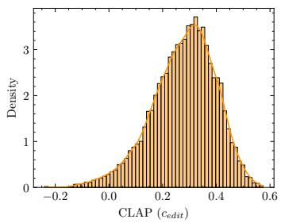

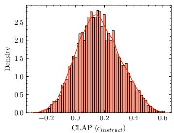

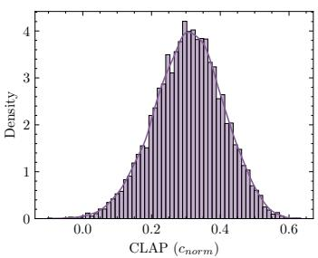  
Figure 7: Global CLAP-Text distributions for the edit caption, instruction, and normalized caption on the SMEBench test split (n = 11,160).

## F METRIC BEHAVIOR BY EDIT AND TARGET SALIENCE

The aggregate metric distributions conceal systematic differences among edit types. In the current plots, extraction operations restructure the mixture by retaining a single component and yield larger audio–audio distances than the other instrumentation and drum operations. Figure 3 reports CLAP-Audio, LPAPS, and CLAP-Text distributions for all twelve operations, grouped as described in its caption. The corresponding global audio and text distributions appear in Figures 6 and 7.

Metric values also depend on the perceived usage of the edited instrument. Figure 8 groups examples by the within-excerpt perceived-usage rank used during target sampling; lower ranks correspond to more prominent targets. This analysis tests whether a metric’s sensitivity is driven partly by the salience of the modified content rather than the correctness of the operation itself. The analogous CLAP-Text distributions appear in Figure 9.

## G COMPLETE SYSTEM BENCHMARK

Tables 5 and 6 report the complete results for SDEdit, DDIM, VCI, ZETA, SteerMusic, and MusicGen under edit-caption and instruction conditioning on the SMEBench and SME-Real test sets. Audio fidelity is measured against both the source and paired target, while text fidelity is measured against the edit caption, instruction, and normalized caption when available.

Figure 10 provides a normalized, system-wise view of the same results.

## H SIM-TO-REAL PERSPECTIVE.

The SMEBench test split is synthetic by design, but this is precisely what makes it useful as a diagnostic benchmark. Existing real-world evaluations, such as Table 1 of Cervera et al. (2025), report source-fidelity and text-alignment metrics on benchmarks like ZoME Bench and MedleyDB, where paired ground-truth edited audio is unavailable. These benchmarks are closer to deployment conditions, but their unpaired structure makes it difficult to determine whether a metric rewards the requested edit, source preservation, or general text-audio compatibility.

Selected Instrument usage  
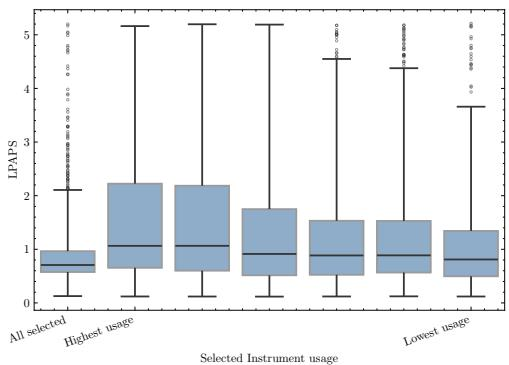  
(a) LPAPS by instrument usage

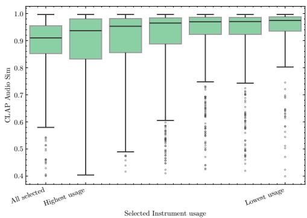  
(b) CLAP-Audio by instrument usage

Figure 8: Audio-similarity metrics by the within-excerpt perceived-usage rank of the edited instrument. Lower ranks correspond to targets with greater perceived usage.  
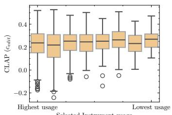

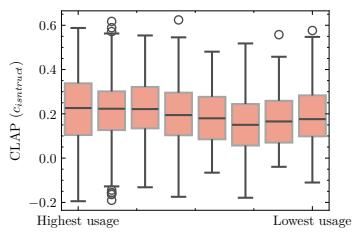

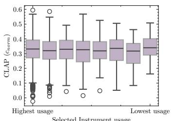  
Figure 9: CLAP-Text distributions by the within-excerpt perceived-usage rank of the edited instrument. The analysis includes operations that target an individual instrument.

Our results provide a complementary sim-to-real perspective. In the SMEBench test split, the intended edit is known, so metrics can be examined in a controlled environment before being used on real, unpaired benchmarks. The fact that CLAP-Text scores are weakly sensitive to edit correctness, and that source- and target-reference metrics can favor different methods, suggests that real-world benchmark scores should be interpreted with care. Synthetic paired edits, therefore, do not replace real benchmarks; rather, they provide a controlled layer for characterizing metric behavior before applying the metrics in realistic settings.

## I FEATURE EXTRACTION AND CAPTIONING

Following Bukey et al. (2026); Melechovsky et al. (2024), we caption our MIDI/audio files by constructing a structured metadata sheet before feeding it to a language model. This prompting structure is designed to anchor the LLM to the predicted metadata, reducing the risk of details unsupported by the metadata profile. To build the fact sheet, we extract features from both the MIDI and audio files.

We retrieve the General MIDI instruments and drums present in each excerpt, together with its tempo and time signature. The five edit types without instrumentation-based actions (pitch correction, crescendo, decrescendo, staccato, and legato) are represented as tags attached to the affected instrument, or to the whole excerpt when the edit is untargeted (e.g., a global crescendo). We also compute note density and overall dynamics, and assign the corresponding tags when their thresholds are exceeded. We complement the inherited whole-MIDI key with a symbolic, per-excerpt estimate obtained through Krumhansl–Schmuckler key estimation on the excerpt’s own pitch-class distribution.

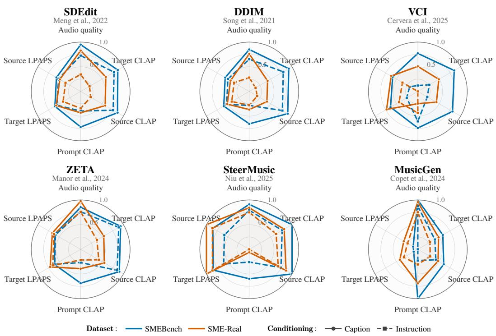  
Figure 10: System-level comparison on SMEBench and SME-Real. Color distinguishes benchmarks, while line style and marker distinguish edit-caption from edit-instruction conditioning. Values are globally min–max normalized across the displayed systems, benchmarks, and conditions. LPAPS is reversed after normalization so that farther from the center consistently indicates better performance.

When the two disagree and the local estimate is sufficiently confident, the fact sheet reports the local estimate. If its confidence falls below the threshold, the key is omitted rather than silently repeating a song-level key that may not hold locally. We apply the same idea to style. We compute an excerpt-level genre prediction by passing the audio through the Discogs-trained MAEST model and its genre-classification head (discogs-maest-10s-pw; Alonso-Jiménez et al., 2023) using Essentia (Alonso-Jiménez et al., 2020). Specifically, we extract embeddings from the seventh transformer block of MAEST and pass them to the paired genre\_discogs400 classification head, which produces probabilities over 400 music-style labels. The prediction is reported alongside the whole-song MIDICaps caption used as the style hint $c _ { \mathrm { h i n t } }$

Both fact sheets, the edit name, the deterministic edit description $c _ { d } ,$ and $c _ { \mathrm { h i n t } }$ are fed to the captioning LLM, instructed to (i) paraphrase $c _ { d }$ into the imperative edit instruction $c _ { \mathrm { p a r a p h r a s e } } ,$ (ii) reformulate fsource into $c _ { \mathrm { s o u r c e } }$ , and (iii) reformulate $f _ { \mathrm { e d i t e d } }$ into $c _ { \mathrm { e d i t } } .$ Crucially, $c _ { \mathrm { e d i t } }$ is constrained to reuse $c _ { \mathrm { s o u r c e } }$ verbatim except for the minimal span reflecting the edited fact.

Finally, to bring variety and avoid the caption corpus over-representing a narrow set of surface forms $( e . g .$ ., always reporting tempo as an exact BPM figure), fact sheets occasionally verbalize or use synonyms for selected attributes $( e . g .$ ., andante instead of 92 BPM), with the expression and wording choices drawn once per source/edited pair and shared between both sheets. Individual attributes are also randomly omitted from the fact sheets.

## J INSTRUCTIONS TO LLM

We provide the instructions used by the captioning LLM (for caption generation and normalizedcaption rewriting) and the LLM-as-a-judge:

## Captioning LLM

<table><tr><td>Method</td><td>Aesth. ↑</td><td>CLAP-A GT ↑</td><td>CLAP-A Src ↑</td><td>LPAPS GT ↓</td><td>LPAPS Src ↓</td></tr><tr><td colspan="6">Real-audio complement, edit-caption conditioning</td></tr><tr><td>Identity</td><td>7.247 [7.2010, 7.2926]</td><td>1.000</td><td>0.804 [0.7830, 0.8247] 2.167 [1.9977, 2.3384]</td><td></td><td>0.000</td></tr><tr><td>Ground Truth</td><td>6.947 [6.877, 7.016]</td><td>0.804 [0.783, 0.824]</td><td>1.000</td><td>0.000</td><td>2.167 [1.998, 2.338]</td></tr><tr><td>SDEdit</td><td>6.737 [6.675, 6.797]</td><td>0.490 [0.474, 0.507]</td><td>0.503 [0.488, 0.519]</td><td>5.093 [4.990, 5.192]</td><td>4.947 [4.842, 5.054]</td></tr><tr><td>DDIM</td><td>6.589 [6.497, 6.679]</td><td>0.418 [0.404, 0.434]</td><td>0.414 [0.399, 0.429]</td><td>5.195 [5.091, 5.298]</td><td>5.058 [4.951, 5.163]</td></tr><tr><td>VCI</td><td>6.036 [5.912, 6.146]</td><td>0.447 [0.425, 0.468]</td><td>0.426 [0.405, 0.448]</td><td>4.806 [4.690, 4.918]</td><td>4.638 [4.519, 4.756]</td></tr><tr><td>ZETA</td><td>7.062 [7.002, 7.122]</td><td>0.469 [0.454, 0.483]</td><td>0.492 [0.477, 0.506]</td><td>4.837 [4.725, 4.945]</td><td>4.552 [4.433, 4.669]</td></tr><tr><td>SteerMusic</td><td>6.770 [6.711, 6.829]</td><td>0.594 [0.581, 0.608]</td><td>0.661 [0.647, 0.674]</td><td>4.321 [4.219, 4.427]</td><td>3.786 [3.667, 3.900]</td></tr><tr><td>MusicGen</td><td>7.021 [6.984, 7.058]</td><td>0.443 [0.430, 0.457]</td><td>0.448 [0.434, 0.463]</td><td>5.365 [5.272, 5.453]</td><td>5.308 [5.218, 5.397]</td></tr><tr><td colspan="6">Real-audio complement, instruction conditioning</td></tr><tr><td>SDEdit DDIM</td><td>5.677 [5.573, 5.766]</td><td>0.317 [0.301, 0.334]</td><td>0.316 [0.299, 0.334]</td><td>5.382 [5.279, 5.480]</td><td>5.248 [5.141, 5.359]</td></tr><tr><td>VCI</td><td>5.539 [5.405, 5.665]</td><td>0.291 [0.272, 0.309]</td><td>0.290 [0.272, 0.310]</td><td>5.386 [5.280, 5.491]</td><td>5.248 [5.141, 5.358]</td></tr><tr><td>ZETA</td><td>4.924 [4.843, 5.012]</td><td>0.223 [0.207, 0.240]</td><td>0.187 [0.171, 0.204]</td><td>5.332 [5.226, 5.439]</td><td>5.237 [5.129, 5.344]</td></tr><tr><td>SteerMusic</td><td>6.589 [6.499, 6.677]</td><td>0.395 [0.379, 0.411]</td><td>0.421 [0.403, 0.439]</td><td>4.948 [4.839, 5.052]</td><td>4.638 [4.522, 4.758]</td></tr><tr><td>MusicGen</td><td>6.564 [6.500, 6.629]</td><td>0.509 [0.496, 0.524]</td><td>0.559 [0.544, 0.575]</td><td>4.575 [4.472, 4.673]</td><td>4.103 [3.979, 4.216]</td></tr><tr><td></td><td>6.567 [6.499, 6.630]</td><td>0.352 [0.338, 0.366]</td><td>0.346 [0.332, 0.361]</td><td>5.536 [5.445, 5.623]</td><td>5.507 [5.416, 5.594]</td></tr><tr><td colspan="6">Test set, instruction conditioning</td></tr><tr><td>Identity</td><td></td><td>0.873 [0.868, 0.878]</td><td>1.000</td><td>1.513 [1.470, 1.557]</td><td></td></tr><tr><td>Ground Truth</td><td>6.734 [6.716, 6.753]</td><td>1.000</td><td>0.873 [0.868, 0.878]</td><td>0.000</td><td>0.000</td></tr><tr><td>SDEdit</td><td>6.517 [6.494, 6.538]</td><td>0.585 [0.580, 0.589]</td><td>0.608 [0.604, 0.613]</td><td>5.046 [5.028, 5.063]</td><td>1.513 [1.470, 1.557]</td></tr><tr><td>DDIM</td><td>6.354 [6.329, 6.379]</td><td>0.596 [0.591, 0.601]</td><td>0.619 [0.614, 0.624]</td><td>5.094 [5.076, 5.111]</td><td>4.859 [4.840, 4.876]</td></tr><tr><td>VCI</td><td>5.290 [5.263, 5.317]</td><td>0.363 [0.357, 0.369]</td><td>0.339 [0.332, 0.344]</td><td>5.576 [5.555, 5.595]</td><td>4.893 [4.874, 4.912]</td></tr><tr><td>ZETA</td><td>6.570 [6.550, 6.590]</td><td>0.633 [0.630, 0.637]</td><td>0.657 [0.653, 0.660]</td><td>4.954 [4.936, 4.972]</td><td>5.531 [5.508, 5.553]</td></tr><tr><td>SteerMusic</td><td>6.641 [6.623, 6.659]</td><td>0.583 [0.579, 0.587]</td><td>0.604 [0.600, 0.609]</td><td>4.956 [4.934, 4.977]</td><td>4.693 [4.675, 4.711]</td></tr><tr><td>MusicGen</td><td>6.822 [6.804, 6.839]</td><td>0.406 [0.402, 0.411]</td><td>0.419 [0.414, 0.423]</td><td>6.099 [6.086, 6.111]</td><td>4.682 [4.658, 4.706]</td></tr><tr><td></td><td></td><td></td><td></td><td></td><td>6.042 [6.030, 6.055]</td></tr><tr><td colspan="6"></td></tr><tr><td></td><td>Test set, edit-caption conditioning</td><td></td><td></td><td></td><td></td></tr><tr><td>SDEdit</td><td>6.983 [6.967, 6.999]</td><td>0.625 [0.621, 0.628]</td><td>0.660 [0.657, 0.663]</td><td>4.969 [4.951, 4.986]</td><td>4.762 [4.744, 4.779]</td></tr><tr><td>DDIM VCI</td><td>6.766 [6.745, 6.785]</td><td>0.652 [0.648, 0.655]</td><td>0.683 [0.680, 0.687] 0.635 [0.630, 0.639]</td><td>4.981 [4.964, 4.998]</td><td>4.759 [4.740, 4.776]</td></tr><tr><td>ZETA</td><td>6.603 [6.580, 6.624] 6.766 [6.749, 6.785]</td><td>0.614 [0.610, 0.618] 0.654 [0.651, 0.657]</td><td>0.683 [0.680, 0.686]</td><td>4.908 [4.887, 4.929] 4.937 [4.918, 4.956]</td><td>4.701 [4.681, 4.724]</td></tr><tr><td>SteerMusic</td><td>6.892 [6.875, 6.908]</td><td>0.691 [0.688, 0.694]</td><td>0.739 [0.736, 0.742]</td><td>4.482 [4.458, 4.506]</td><td>4.673 [4.653, 4.693] 4.081 [4.057, 4.105]</td></tr><tr><td>MusicGen</td><td>7.111 [7.099, 7.122]</td><td>0.492 [0.489, 0.497]</td><td>0.517 [0.513, 0.521]</td><td>5.926 [5.914, 5.939]</td><td></td></tr><tr><td></td><td></td><td></td><td></td><td></td><td>5.815 [5.803, 5.827]</td></tr></table>

Table 5: System-level audio fidelity and quality with 95% bootstrap confidence intervals. GT and Src denote comparisons against the paired target and source, respectively.

You are given two fact sheets describing a 10-second MIDI excerpt before and after an edit, plus the edit   
,→ itself.   
- SOURCE\_FACTS: {F0}   
- EDITED\_FACTS: {F1}   
- Edit name: {En}   
- Edit description: {E}   
- Style hint (tone/mood only, may be unrelated to this excerpt): {S}   
- Wording guidance for this caption (applies to SOURCE\_DESCRIPTION's opening/phrasing; EDITED\_DESCRIPTION   
,→ inherits it via the copy-verbatim rule below): {W}   
Tasks:   
1. Knowing the edit name En, paraphrase the edit description (E') while preserving meaning.   
- Use imperative style, as if you were requesting the edit.   
- The paraphrase MUST reflect the operation type defined by En:   
\* Swap\_Instrument → substitution (original removed)   
\* Double\_Instrument → augmentation (original kept, new element added)   
Remove\_Instrument → deletion   
\* Extract\_Instrument → isolation (only the target element remains; all other elements are removed)   
\* Swap\_Drums → drums substitution   
Remove\_Drums → drums deletion   
Extract\_Drums → drums isolation   
\* Crescendo, Decrescendo → dynamics changes   
\* Legato, Staccato → articulation changes   
\* Pitch\_Shift → pitch fixing   
\* CompositeEdit → sequential composition (apply multiple edits in a defined order; each edit   
,→ modifies the result of the previous one)   
2. Write SOURCE\_DESCRIPTION: a natural, human-like caption of the source excerpt, using ONLY facts from   
,→ SOURCE\_FACTS.   
- You may borrow tone, mood or genre words from the style hint if they do not contradict SOURCE\_FACTS.   
- Never state a fact (instrument, tempo, key, effect) that is not present in SOURCE\_FACTS.   
- If the instrument/drum list is long and you shorten it for natural phrasing, keep the instrument or drum   
that the edit targets (named in the edit description, e.g. the one being,→   
swapped/removed/extracted/doubled, or bracket-tagged in the fact sheets) so its change is still,→   
traceable in EDITED\_DESCRIPTION.,→   
3. Write EDITED\_DESCRIPTION: a natural caption, human-like of the edited excerpt, using ONLY facts from   
,→ EDITED\_FACTS.   
- EDITED\_DESCRIPTION MUST reuse the exact same wording, phrasing, and sentence structure as   
SOURCE\_DESCRIPTION, word for word, except for the minimal span of text needed to reflect the change,→   
described by EDITED\_FACTS.,→

<table><tr><td>Method</td><td>CLAP-T Edit ↑</td><td>CLAP-T Inst. ↑</td><td>CLAP-T Norm. ↑</td></tr><tr><td colspan="4">Real-audio complement, edit-caption conditioning Ground Truth0.123 [0.114, 0.132]0.125 [0.110, 0.140]</td></tr><tr><td>SDEdit</td><td>0.235 [0.226, 0.245]0.150 [0.140, 0.161]</td><td></td><td></td></tr><tr><td>DDIM</td><td>0.222 [0.212, 0.233]0.178 [0.167, 0.189]</td><td></td><td></td></tr><tr><td>VCI</td><td>0.198 [0.185, 0.211] 0.171 [0.159, 0.182]</td><td></td><td></td></tr><tr><td>ZETA SteerMusic</td><td>0.227 [0.216, 0.239]0.165 [0.155, 0.175]</td><td></td><td></td></tr><tr><td>MusicGen</td><td>0.161 [0.149, 0.172]0.118 [0.105, 0.132] 0.287 [0.277, 0.296]0.157 [0.148, 0.168]</td><td></td><td></td></tr><tr><td></td><td></td><td></td><td></td></tr><tr><td></td><td>Real-audio complement, instruction conditioning</td><td></td><td></td></tr><tr><td>SDEdit</td><td></td><td>0.102 [0.092, 0.113] 0.217 [0.206, 0.228]</td><td></td></tr><tr><td>DDIM</td><td></td><td>0.090 [0.076, 0.105] 0.204 [0.193, 0.216]</td><td></td></tr><tr><td>VCI</td><td></td><td>0.053 [0.040, 0.065] 0.236 [0.223, 0.248]</td><td></td></tr><tr><td>ZETA</td><td></td><td>0.155 [0.144, 0.167]0.192 [0.181, 0.202]</td><td></td></tr><tr><td>SteerMusic</td><td></td><td>0.140 [0.129, 0.151] 0.148 [0.136, 0.160]</td><td></td></tr><tr><td>MusicGen</td><td></td><td>0.166 [0.155, 0.179] 0.210 [0.198, 0.221]</td><td></td></tr><tr><td></td><td></td><td></td><td></td></tr><tr><td></td><td>Test set, instruction conditioning</td><td></td><td></td></tr><tr><td>SDEdit</td><td>Ground Truth 0.276 [0.273, 0.280] 0.159 [0.155, 0.164] 0.308 [0.305, 0.312]</td><td></td><td></td></tr><tr><td>DDIM</td><td></td><td>0.215 [0.211, 0.219]0.227 [0.223, 0.231]0.225 [0.221, 0.228]</td><td></td></tr><tr><td>VCI</td><td></td><td>0.212 [0.208, 0.216]0.203 [0.199, 0.207] 0.233 [0.230, 0.237]</td><td></td></tr><tr><td></td><td></td><td>0.106 [0.102, 0.111] 0.266 [0.262, 0.269] 0.162 [0.158, 0.166]</td><td></td></tr><tr><td>ZETA SteerMusic</td><td></td><td>0.242 [0.239, 0.246]0.199 [0.195, 0.203]0.273 [0.270, 0.276]</td><td></td></tr><tr><td>MusicGen</td><td></td><td>0.218 [0.214, 0.222]0.194 [0.191, 0.198]0.235 [0.232, 0.238]</td><td></td></tr><tr><td></td><td></td><td>0.251 [0.247, 0.255]0.198 [0.194, 0.202]0.262 [0.259, 0.266]</td><td></td></tr><tr><td></td><td>Test set, edit-caption conditioning</td><td></td><td></td></tr><tr><td>SDEdit</td><td></td><td>0.296 [0.293, 0.299] 0.168 [0.164, 0.172] 0.286 [0.282, 0.289]</td><td></td></tr><tr><td>DDIM</td><td></td><td>0.283 [0.279, 0.286]0.173 [0.169, 0.177] 0.291 [0.288, 0.295]</td><td></td></tr><tr><td>VCI</td><td></td><td>0.299 [0.296, 0.303] 0.175 [0.171, 0.179] 0.299 [0.296, 0.302]</td><td></td></tr><tr><td></td><td></td><td></td><td></td></tr><tr><td>ZETA</td><td></td><td>0.287 [0.284, 0.290]0.174 [0.171, 0.178]0.311 [0.308, 0.314]</td><td></td></tr><tr><td>SteerMusic</td><td></td><td>0.269 [0.266, 0.272]0.166 [0.162, 0.170]0.271 [0.268, 0.274]</td><td></td></tr><tr><td></td><td></td><td></td><td></td></tr><tr><td></td><td></td><td></td><td></td></tr><tr><td></td><td></td><td>0.350 [0.347, 0.353]0.124 [0.120, 0.128]0.314 [0.311, 0.316]</td><td></td></tr><tr><td></td><td></td><td></td><td></td></tr><tr><td>MusicGen</td><td></td><td></td><td></td></tr><tr><td></td><td></td><td></td><td></td></tr><tr><td></td><td></td><td></td><td></td></tr><tr><td></td><td></td><td></td><td></td></tr><tr><td></td><td></td><td></td><td></td></tr><tr><td></td><td></td><td></td><td></td></tr><tr><td></td><td></td><td></td><td></td></tr><tr><td></td><td></td><td></td><td></td></tr><tr><td></td><td></td><td></td><td></td></tr><tr><td></td><td></td><td></td><td></td></tr><tr><td></td><td></td><td></td><td></td></tr><tr><td></td><td></td><td></td><td></td></tr><tr><td></td><td></td><td></td><td></td></tr></table>

Table 6: System-level text fidelity with 95% bootstrap confidence intervals. Missing normalized captions for SME-Real are shown as dashes.

\- Never state an exact note-density or notes-per-second number. Use only the qualitative density word from the ,→ fact sheet (e.g. "sparse", "dense"), if one is given.

\- Genre/style cue words from the fact sheet or style hint may be reused directly, including verbatim, when they fit naturally. But do not stack more than one or two of them together with "and" like a list of tags,→ -- weave at most one or two into the mood/atmosphere phrasing.,→

\- The fact sheet's genre cue is formatted as "genre: X, subgenre: Y" -- that is field labeling for your own reading, not caption text. Never output the literal words "genre:" or "subgenre:"; only use the,→ genre/subgenre names themselves (X and Y).,→

\### Examples

The examples below cover different edit types and are deliberately written with different sentence structures. Use them only to learn the minimal-diff rule (copy SOURCE\_DESCRIPTION into EDITED\_DESCRIPTION except for,→ the smallest span needed) -- do not let any one example's shape become the default template you fall back,→ to for every caption.,→

## ### Example (per-instrument Staccato edit):

SOURCE\_DESCRIPTION: A moody, introspective short excerpt with a moderate trumpet and clarinet duet in F major ,→ at 96 BPM, over a steady, soft rhythm section.

EDITED\_DESCRIPTION: A moody, introspective short excerpt with a moderate trumpet and short, staccato clarinet ,→ duet in F major at 96 BPM, over a steady, soft rhythm section.

(Only the clarinet's articulation is called out -- the trumpet and everything else stays exactly as written in ,→ SOURCE\_DESCRIPTION.)

## ### Example (global Crescendo edit):

SOURCE\_DESCRIPTION: A 10-second excerpt evoking a dark and relaxing cinematic atmosphere featuring dense, ,→ legato-like sitar melodies in G major, played at a slow 70 BPM in 4/4 time with moderate dynamics.

legato-like sitar melodies in G major, played at a slow 70 BPM in 4/4 time, with a gradual increase in,→ ,→ volume.

(Notice EDITED\_DESCRIPTION repeats SOURCE\_DESCRIPTION word-for-word, only replacing "with moderate dynamics" with the crescendo phrase "with a gradual increase in volume" -- nothing else changed. Also notice this is,→ just one example's opening, not the template -- see the Wording guidance field for how to open this,→ particular caption.),→ particular caption.)

## ### Example (Swap\_Instrument edit):

SOURCE\_DESCRIPTION: Sparse, gentle 10-second music built around an acoustic guitar melody over a steady ,→ kick-and-snare groove, in D minor at 84 BPM, with a wistful, low-key feel.

EDITED\_DESCRIPTION: Sparse, gentle 10-second music built around an electric piano melody over a steady

,→ kick-and-snare groove, in D minor at 84 BPM, with a wistful, low-key feel.

(Only "acoustic guitar" is swapped for "electric piano" -- the original instrument is fully replaced, not ,→ added alongside, matching Swap\_Instrument's substitution semantics.)

\### Example (Decrescendo edit, note the different sentence structure and opening compared to the Crescendo ,→ example above):

SOURCE\_DESCRIPTION: Played at a bright 128 BPM, this house music excerpt layers a punchy synth bassline with a ,→ crisp hi-hat groove, sitting at a steady, energetic volume throughout.

EDITED\_DESCRIPTION: Played at a bright 128 BPM, this house music excerpt layers a punchy synth bassline with a ,→ crisp hi-hat groove, fading down in volume as it goes.

(Same facts and instruments as a decrescendo edit would need, but written with a different opening and rhythm ,→ than the Crescendo example -- this variety is expected, not the exception.)

\### Example (Remove\_Instrument edit -- notice there is NO removal narration):

SOURCE\_DESCRIPTION: A relaxed passage led by a warm piano melody over a soft acoustic guitar strum, in A minor ,→ at 90 BPM, with gentle, sparse dynamics.

EDITED\_DESCRIPTION: A relaxed passage led by a soft acoustic guitar strum, in A minor at 90 BPM, with gentle, ,→ sparse dynamics.

(The piano is simply gone -- EDITED\_DESCRIPTION never says it was "removed" or "no longer present"; the clause naming it is dropped and the sentence is restructured only enough to still read naturally, everything else,→ copied verbatim.),→

Output:

EDIT\_PARAPHRASE: ...

SOURCE\_DESCRIPTION: ...

EDITED\_DESCRIPTION: ...

## Normalized Caption refactoring

You are an expert in music production and MIDI file analysis. Your task is to rewrite the following MIDI instrument caption to make it more fluid and human-readable, while preserving all the instrument names and,→ logically grouping similar instruments.,→

\### Rules:

1. \*\*Preserve all instrument names\*\* in the output. Do not omit any.

2. \*\*Group similar instruments\*\* to make the caption more fluid. For example:

\- "high bongo, low bongo" → "high and low bongos"

\- "crash cymbal 1, crash cymbal 2" → "crash cymbals"

\- "closed high hat, open high hat, pedal high hat" → "closed, open, and pedal high hats"

3. Keep the structure of the caption: start with the duration, followed by "music featuring", then list

,→ the instrument categories and their grouped instruments, and finally describe the rhythmic beat.

4. \*\*Use natural phrasing\*\* for lists (e.g., "A, B, and C" instead of "A, B, C").

5. \*\*Do not add or remove any instruments\*\*--only group and rephrase for readability.

6. Remove any number.

7. Maintain the original meaning while improving flow.

8. \*\*Preserve any bracketed edit tags\*\* exactly as given (e.g. "[out-of-tune]", "[staccato]", "[decrescendo]")

,→ immediately before the instrument name they describe. Never drop, reword, translate, or move them away ,→ from their instrument.

9. \*\*Preserve any leading edit-descriptor word\*\* appearing right after the duration and before "music" (e.g.

"10s decrescendo music"). Keep that exact word in the rewritten sentence, worded naturally (e.g. "A 10s,→

decrescendo piece of music featuring...").,→

## ### Example:

\*\*Input:\*\*

- Evaluate each criterion independently.   
- Binary output : Output only one of these two options per criterion: "[CRITERION\_NAME]: YES" or   
,→ "[CRITERION\_NAME]: NO"   
- For each criterion, output only "[CRITERION\_NAME]: YES" if the criterion is fully satisfied.   
- For each criterion, output only "[CRITERION\_NAME]: NO" if the criterion is not satisfied or cannot be   
,→ confirmed.   
- Do not include explanations, justifications, or additional text.   
- The evaluation is only for judging the provided inputs.

Music featuring bass timbres (plucked electric bass, slap bass 1); brass timbres (brass section, trumpet); ensemble timbres (choir "aah", orchestral hit, synth strings 2); guitar timbres (acoustic steel guitar);,→ organ timbres (hammond organ); sound effects (sfx) (woodblock). The rhythmic beat is composed of hats,→ (cabasa, closed high hat, cowbell, crash cymbal 1, crash cymbal 2, high bongo, low bongo, mute high conga,,→ ,→ open high conga, open high hat, pedal high hat, short guiro, tambourine); kicks (high floor tom, low tom); ,→ snares (acoustic snare, hand clap, high mid tom, low mid tom, side stick).

## \*\*Output:\*\*

A piece of music featuring bass timbres (plucked electric bass, slap bass); brass timbres (brass section, trumpet); ensemble timbres (choir "aah", orchestral hit, synth strings); guitar timbres (acoustic steel,→ guitar); organ timbres (Hammond organ); and sound effects (woodblock). The rhythmic beat is composed of,→ hats (closed, open, and pedal high hats, cabasa, cowbell, crash cymbals, high and low bongos, mute and,→ open high congas, short guiro, tambourine); kicks (high floor tom, low tom); and snares (acoustic snare,,→ hand clap, high and low mid toms, side stick).,→

\### Example (with a deterministic edit tag):

10s decrescendo music featuring bass timbres (plucked electric bass); brass timbres ([out-of-tune] trumpet).   
,→ The rhythmic beat is composed of hats (cowbell).

## \*\*Output:\*\*

A 10s decrescendo piece of music featuring bass timbres (plucked electric bass) and brass timbres (out-of-tune ,→ trumpet). The rhythmic beat is composed of hats (cowbell).

## LLM-as-a-Judge

Role: You are a strict, unbiased evaluator. Your task is to verify whether the provided inputs satisfy all ,→ specified requirements.

Context: D0 and D1 are both captions of the same fixed excerpt -- D1 is meant to reuse D0's wording verbatim except for the minimal span needed to reflect edit E. Treat a difference in D1 as a genuine violation only,→ when it changes what is being claimed about the excerpt (a new/missing instrument, sound source, or event;,→ a materially different amount or specificity of detail). Treat a difference that merely rewords, reorders,,→ or resynonymizes a claim D0 already made -- including mood/genre/style adjectives -- as compliant, not as,→ new or reduced information.,→

Inputs:   
Original description (D0)   
Edited description (D1)   
Original edit instruction (E)   
Paraphrased edit instruction (E\_prime)

## Tasks:

1. List all differences between D0 and D1 concisely.   
2. Evaluate each of the following criterion independently using only the following binary format:   
[CRITERION\_NAME]: YES (if satisfied)   
[CRITERION\_NAME]: NO (if not satisfied)

NO\_HALLUCINATION: D1 introduces no new sound event, instrument, or entity that D0 and E give no basis for. A differently-worded restatement of something D0 already describes (synonym, added mood/genre adjective,,→ rephrasing) is not itself a new entity.,→

LEVEL\_OF\_DETAIL: D1 states the same number and specificity of facts as D0 (aside from the fact changed by the ,→ edit). Judge how much is claimed, not how it is phrased.

## Constraints:

Output:   
{   
"differences":   
"paraphrase\_correct":   
"edit\_instruction":   
"edit\_applied":   
"no\_hallucination":   
"minimal\_change":   
"consistency": ".   
"level\_of\_detail":   
}

input : "Base audio description: {source\_caption} \nEdited description: {edited\_caption} \nOriginal edit: ,→ {base\_instruction} \nParaphrased edit: {edit\_instruction}"

Table 7: Agreement between the original Qwen (ref) judge and Mistral (mistral) judge on 8,461 generated captions. Entries in the agreement matrix show the number of captions, with percentages in parentheses.
<table><tr><td></td><td>Mistral accepts</td><td>Mistral rejects</td></tr><tr><td>Ref accepts Ref rejects</td><td>3,228 (38.2%) 2,066 (24.4%)</td><td>492 (5.8%) 2,675 (31.6%)</td></tr><tr><td colspan="3">Summary statistic Mistral acceptance rate Cohen&#x27;s κ</td></tr><tr><td colspan="3">Overall agreement Ref acceptance rate</td></tr></table>

## K LLM-AS-A-JUDGE QWEN CHECKPOINT ANALYSIS

To assess whether our choice to use the same Qwen checkpoint for both captioning and filtering introduces too much bias, we judge 8,461 generated captions with our original Qwen judge and an independent Mistral Instruct checkpoint Mistral-Small-24B-Instruct-2501 (Mistral AI Team, 2025). Both judges used the exact same rubric and per-criterion prompts. We report in Table 7 raw agreement and Cohen’s κ, which accounts for chance agreement under the judges’ marginal acceptance rates.

The judges reach the same decision on 69.8% of captions (κ = 0.41). Mistral accepts more items overall, including 80% of discordant pairs, which does not support the hypothesis that the Qwen judge simply favors outputs from its own checkpoint family. Agreement varies across criteria and edit types, with the largest differences for minimal\_changes, no\_hallucination, and instrument-isolation edits.

The independent judge therefore provides a complementary check on the retained captions while also showing that judge choice mainly changes the strictness of the filter. Our construction uses the more conservative Qwen decisions: in this setting, rejecting some valid captions is preferable to retaining descriptions that introduce unsupported content or fail to isolate the requested change. We nevertheless treat judge-dependent acceptance as a limitation of automatic caption filtering.

## L LICENSING AND ETHICS

## License

SME-Bench is licensed under CC BY-NC-SA 4.0. SME-Bench incorporates and is derived from multiple third-party resources. Each resource remains subject to its original license. Users of this dataset must comply with all applicable licenses listed below. Here are the following third-party resources. GeneralUser GS and FluidR3-GM are distributed under CC BY 4.0; TimGM6mb is in the public domain; Arachno SoundFont is distributed under CC BY-NC-SA 4.0; and General Montage is distributed under CC BY 3.0. The MIDI datasets used in our experiments are MidiCaps (CC BY-SA 4.0) and MoisesDB (CC BY-NC-SA 4.0). We use Qwen3-30B-A3B-Instruct-2507, distributed under the Apache License 2.0, for captioning and judging. Appropriate attribution and license requirements are preserved in accordance with the respective licenses and can be found at https: //huggingface.co/datasets/anonymous-account-submission/SME-Bench.

## Distributional Gaps and Underrepresented Populations

The MIDI data is predominantly derived from Western popular music traditions, including mainly classical, orchestral, electronic, rock and pop genres. As a result, the dataset underrepresents non-Western musical styles, instruments, and cultural traditions. The distribution of instruments, both in the original MIDI files and the synthesized versions, is heavily biased toward Western musical conventions. Additionally, the soundfonts used for synthesis are optimized for Western instrument timbres, further limiting the dataset’s cultural and stylistic diversity.

## Intended use case

This dataset is designed to train and evaluate neural music processing pipelines, with a focus on high-level edits. The dataset has been created with the following applications in mind: training neural models for music editing (e.g., conditional audio generation or manipulation) or music understanding; benchmarking generative audio editing pipelines, particularly in tasks where the goal is to assess how well models preserve or transform musical content based on textual instructions.

## Societal Impacts

This dataset can help advance the interpretability and controllability of neural music editing models. By providing aligned audio edits and captions, it could help researchers to: develop models that respond more accurately to user intent in music editing tasks ; Improve transparency in how models transform musical content, therefore improving human-AI collaboration in creative workflows. support educational and research efforts in understanding the capabilities and limitations of neural music systems. Negative Impact/Risks: may reinforce Western-centric biases, could enable lowfidelity or misleading music generation if misused.