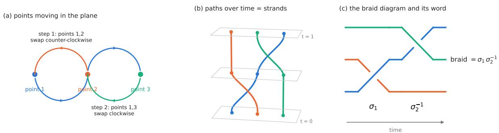
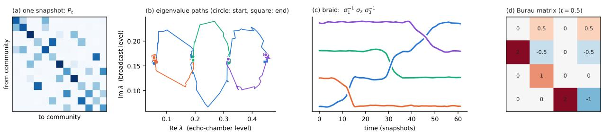
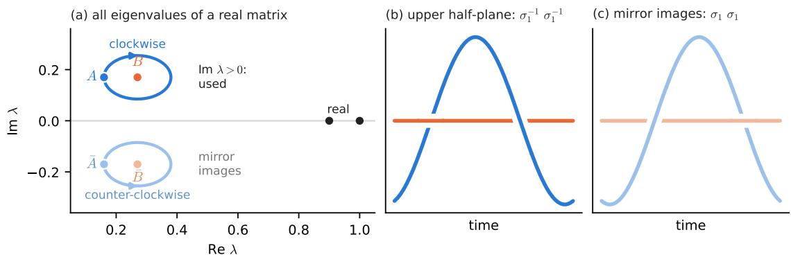
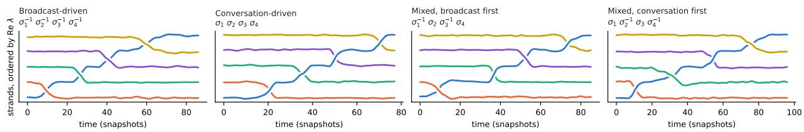
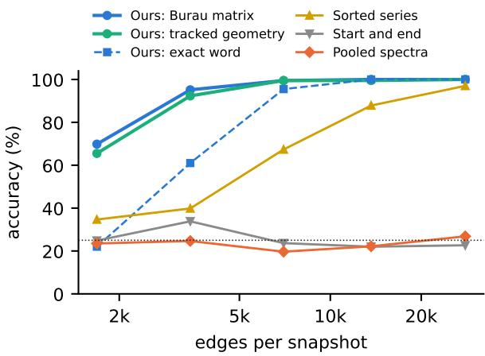

# SPECTRAL BRAIDS: A TOPOLOGICAL DESCRIPTOR FOR DYNAMIC DIRECTED NETWORKS

Mehmet Emin Aktas Mehmet Emin Aktas

School of Data Science and Analytics Kennesaw State University Kennesaw, GA, USA maktas1@kennesaw.edu

Esra Akbas

Department of Computer Science Georgia State University Atlanta, GA, USA eakbas1@gsu.edu

## ABSTRACT

Eigenvalues are a workhorse of graph machine learning: spectral clustering, spectral graph neural networks, and graph kernels all summarize a network by the eigenvalues of a matrix. These eigenvalues are almost always treated as a static list of numbers. When a graph changes, however, its eigenvalues move, and when the matrix is not symmetric, they move in the complex plane, where they can wind around each other. The pattern of this winding is a braid, a classical object from topology. We propose spectral braids, a methodology for dynamic directed networks: each snapshot is aggregated into a community-level transition matrix, its complex eigenvalues are tracked over time, and the braid they trace is read off as a word. The word is then mapped to a matrix by the Burau representation, which gives a fixed-size feature vector for any classifier. The braid has a concrete meaning: each eigenvalue describes how a group of communities behaves, and each crossing records one group overtaking another. We evaluate the method on dynamic network classification, using synthetic networks of online communities whose labels describe how the network evolved between the same starting and ending states. Our experimental results show that the proposed features reach 97.1% accuracy on four classes, against 44.5% for the best feature set that does not track eigenvalues, and that the Burau features also separate networks containing the same events in a different order, which simple counts of crossings cannot do. To the best of our knowledge, this is the first study that defines braids and braid monodromy on graph data and uses them as features for learning on dynamic networks.

Keywords Dynamic directed networks · spectral methods · braid group · braid monodromy · topological data analysis

## 1 Introduction

Most spectral methods for graphs share one step: build a matrix from the graph (adjacency, Laplacian or transition matrix), compute its eigenvalues, and use them as features or as a basis for clustering and learning. The eigenvalues are treated as a set of numbers. That works well for a single graph. Many graphs of interest, however, change. Communication platforms record who messages whom, payment systems who pays whom, and mobility systems which regions trips connect, continuously and at a massive scale. As the graph changes, its eigenvalues move.

For symmetric matrices the eigenvalues are real numbers. They move along a line, and two eigenvalues on a line can never pass each other without colliding. For non-symmetric matrices, which arise naturally from directed graphs, the eigenvalues can be complex numbers. They move in a plane, where they can go around each other. A sequence of such go-arounds is exactly what topologists call a braid (Fig. 1). Braids are the natural language for relative motion in the plane. They have a long history in topology and algebraic geometry, where braid monodromy describes how the roots of a polynomial wind around each other as a parameter moves around a loop [1, 2, 3]. Braids are also used to analyze particle trajectories in fluids [4], and braided complex eigenvalues were recently observed in physics experiments [5].

In this paper, we introduce spectral braids, the braid monodromy for dynamic directed networks. We first aggregate each snapshot of the network into a small community-level transition matrix. Because edges are directed, this matrix is non-symmetric, and its eigenvalues can be complex. We then follow these eigenvalues from snapshot to snapshot and record how they pass around each other as a braid word. The network need not return to its starting state: any observation window yields a braid, and a network that does return yields the braid monodromy in the classical sense. To use the braid in machine learning, we map the word to a matrix with the Burau representation [6], which turns braids of any length into feature vectors of a fixed size. We show that the braid is non-trivial only when the network carries circulation, that is, flow that goes around cycles more in one direction than the other. For real matrices, we introduce an upper-half-plane braid that keeps the direction of rotation.

We also give the eigenvalues a concrete meaning. Consider a group of online communities that pass content among themselves. If all interactions stayed inside each community, the transition matrix of the group would be the identity, and its eigenvalues would equal one; the more interactions stay inside, the further to the right the eigenvalue of the group lies. Its real part, therefore, measures how much the group talks to itself, which we call its echo-chamber level. If the interactions between the communities were balanced, with as many going from a to b as from b to a, the matrix would be symmetric and its eigenvalues real. An imaginary part appears only when content flows around the group more in one direction than in the other, and it grows with this imbalance. The imaginary part, therefore, measures how one-way the interactions are, which we call the broadcast level of the group (Section 3.4 gives the exact formula). With this reading, a crossing in the braid has a plain meaning. Two eigenvalues cross when their real parts exchange order, which is the moment one group becomes a stronger echo chamber than the other. The sign of the crossing records which eigenvalue passes above the other, that is, which of the two groups was broadcasting more at that moment.

Next, we build two datasets of dynamic networks labeled by how their strongest echo chamber formed. Networks with different labels begin and end in the same state, so only the path distinguishes them. Our experimental results show that Burau features identify the label in 97.1% of the networks at about 3,400 edges per snapshot, where features that ignore the path stay at chance and the best features that do not track eigenvalues reach 44.5%. When networks contain the same events in a different order, counts of crossings fall to chance, and Burau features reach 90.8%. To our knowledge, this is the first use of braids and braid monodromy for graph data.

The main contributions of this work are summarized as follows.

• We propose spectral braids: a pipeline from edge streams to braid words that is linear in the number of edges and is defined for any observation window, not only for periodic networks (Section 3.1).

• We describe the tracked eigenvalues in two ways for dynamic network classification: by geometric statistics of the strands, and by the braid, which the Burau representation turns into fixed-size features (Section 3.2).

• We characterize when spectral braids are informative. They are trivial without circulation, and for real matrices, the braid of all eigenvalues consists of the braid of the upper half-plane and its mirror image, which motivates the upper-half-plane braid. We also give the eigenvalues and the crossings a concrete meaning (Sections 3.3–3.4).

• We introduce two synthetic datasets of dynamic networks of online communities, with meaningful labels and known ground truth (Section 4.1), and evaluate the method on them for dynamic network classification: accuracy against spectral baselines, transfer to networks that look different from the training data, sensitivity to the number of edges per snapshot, and running time (Section 4).

• We report four real datasets on which the method does not apply and explain why (Section 5).

Reproducibility: The source code for the proposed methods and the datasets is available at https://github.com/ maktas3838/spectral-braids.

## 2 Background and Related Work

## 2.1 Dynamic Directed Networks

A directed graph is a pair $G = ( V , E )$ , where V is a finite set of nodes and $E \subseteq V \times V$ is a set of directed edges; an edge $( u , v )$ , written $u  v ,$ , goes from u to v. The graph is undirected if $u  v \in E$ whenever $v  u \in E$ . Edges may carry positive weights, in which case every count of edges below is replaced by a sum of weights.

Definition 1 (Dynamic directed network). A dynamic directed network is a sequence $G = ( G _ { 0 } , \dots , G _ { T } )$ of directed graphs $G _ { t } = ( V , E _ { t } )$ on a common node set V. Each $G _ { t }$ is called a snapshot and contains the edges observed in the t-th time window.

  
Figure 1: Braids. (a) Points moving in the plane: points 1 and 2 swap counter-clockwise, then points 1 and 3 swap clockwise. (b) Stacked over time, the paths form strands. (c) Viewed from the front, each swap of neighboring strand is a crossing, written $\sigma _ { i }$ (counter-clockwise) or $\sigma _ { i } ^ { - 1 }$ (clockwise); this motion is the braid $\sigma _ { 1 } \sigma _ { 2 } ^ { - 1 }$

Furthermore, a community partition of G is a partition $\mathcal { C } = \{ C _ { 1 } , \ldots , C _ { K } \}$ of V into K disjoint communities. In this paper, we also examine how communities in dynamic directed networks evolve over time through the community transition matrices defined as follows.

Definition 2 (Community transition matrix). Let G be a dynamic directed network with community partition ${ \mathcal { C } } ,$ and let

$$
N _ { t } ( a , b ) = \# \{ u \to v \in E _ { t } : u \in C _ { a } , v \in C _ { b } \}
$$

be the number of edges of $G _ { t }$ from $C _ { a } \mathrm { t o } C _ { b }$ . The community transition matrix of the snapshot $G _ { t }$ is the $K \times K$ matrix

$$
P _ { t } ( a , b ) = \frac { N _ { t } ( a , b ) } { \sum _ { c = 1 } ^ { K } N _ { t } ( a , c ) } ,\tag{1}
$$

the fraction of the edges leaving $C _ { a }$ that arrive in $C _ { b }$

$P _ { t }$ is row-stochastic. It is the transition matrix of a random walk that moves among communities by following a random edge [7], and its diagonal entry $P _ { t } ( a , a )$ is the fraction of edges that stay inside $C _ { a }$ . Since edges are directed, $N _ { t } ( a , b ) \neq N _ { t } ( b , a )$ in general, so $P _ { t }$ is not symmetric, and its eigenvalues can be complex.

## 2.2 Braids and Braid Monodromy

Consider n distinct points moving in the plane over a time interval. Stacking their positions over time produces n non-intersecting strands (Fig. 1a,b).

Definition 3 (Braid). Fix n distinct points $p _ { 1 } , \dotsc , p _ { n } \in \mathbb { C }$ . A braid on n strands is a collection of n disjoint paths (strands) in $\mathbb { C } \times [ 0 , 1 ]$ such that each strand meets every plane $\mathbb { C } \times \{ s \}$ exactly once, the i-th strand starts at $( p _ { i } , 0 )$ , and the strands end at the points $( p _ { 1 } , 1 ) , \ldots , ( p _ { n } , 1 )$ in some order. Equivalently, a braid is a path of sets of n distinct points in C that starts and ends at $\{ p _ { 1 } , . . . , p _ { n } \}$ , up to deformation.

Projecting the strands onto a line and recording every exchange of neighboring strands gives a word in the generators $\sigma _ { 1 } , \ldots , \sigma _ { n - 1 }$ and their inverses (Fig. 1c). Two words represent the same braid if the strands can be deformed into each other without passing through one another. For example, $\sigma _ { 1 } \sigma _ { 1 } ^ { - 1 }$ is the trivial braid, and $\sigma _ { 1 } \sigma _ { 2 } \sigma _ { 1 } = \sigma _ { 2 } \sigma _ { 1 } \sigma _ { 2 }$ . Braids on n strands form the braid group $B _ { n }$ , where the product of two braids is obtained by placing one after the other. The order of crossings matters: $\sigma _ { 1 } \sigma _ { 2 } \neq \sigma _ { 2 } \sigma _ { 1 }$

Braid monodromy is the braid traced by the roots of a polynomial whose coefficients depend on a parameter. Let $f ( x , y )$ be a polynomial of degree n in y, and let $\Delta \subset \mathbb { C }$ be the finite set of values of x at which $f ( x , { \bar { \cdot } } )$ has a repeated root. For every $x \notin \Delta$ the equation $f ( x , y ) = 0$ has n distinct roots. When x moves along a loop in $\vec { \mathbb { C } } \backslash \Delta$ , the roots move without colliding and return to the set they started from, so they trace a braid. This assigns a braid to every loop and defines a homomorphism $\pi _ { 1 } ( \mathbb { C } \setminus \Delta ) \to B _ { n }$ , the braid monodromy of $f \ [ 1 , 2 , 3 ]$ . In this paper, the polynomial is the characteristic polynomial $\operatorname* { d e t } ( \lambda \bar { I } - P _ { t } )$ of a matrix built from the network, its roots are the eigenvalues, and the parameter is time.

Furthermore, the Burau representation [6] maps every braid to an $n \times n$ matrix that depends on a parameter t. The generator $\sigma _ { i }$ is sent to the identity matrix with the block $\left( \begin{array} { l } { 1 - t \ t } \\ { \ 1 \ } \end{array} \right)$ placed at rows and columns $i , i + 1$ , and a word is sent to the product of the matrices of its letters. Two words of the same braid give the same matrix. The representation is faithful for $n \leq 4$ and not for $n \geq 5 [ 8 ]$

## 2.3 Related Work

## 2.3.1 Learning on dynamic graphs

Methods for dynamic graphs either process a sequence of snapshots or a stream of timed edges [9]. Temporal graph neural networks combine message passing with a model of time, for example by evolving the weights of a graph convolution [10], by attention over structure and time [11, 12], or by a memory per node [13]. These models learn representations end-to-end and do not produce an explicit description of how the network’s structure changed.

## 2.3.2 Spectral methods for dynamic graphs

A second line of work summarizes each snapshot by its spectrum. Graph descriptors built from Laplacian eigenvalues compare graphs of different sizes [14, 15]. For dynamic graphs, eigenvectors or singular values of consecutive snapshots are compared to detect anomalies and change points [16, 17], spectral clustering is smoothed over time [18], and eigenpairs are updated incrementally as edges arrive [19]. Graph signal processing extends the graph Fourier transform to signals that vary in time [20]. In all of these, the spectrum of a snapshot is treated as a set or a sorted list, and the matrices are symmetric, so the eigenvalues are real. None of them records how eigenvalues move relative to each other, which is the information a braid carries.

## 2.3.3 Spectral methods for directed graphs

Directed graphs give non-symmetric matrices. The usual response is to replace them by a symmetric or Hermitian operator, such as the Laplacian of Chung [21], the Hermitian adjacency matrix [22], or the magnetic Laplacian [23], which is also the basis of spectral neural networks for directed graphs [24]. These operators have real eigenvalues by design. We take the opposite route and keep the non-symmetric matrix, because its complex eigenvalues are what can braid. Aggregating a network into a Markov chain on its communities is a standard tool for testing community structure [7]; there, the probability of staying in a community is called its persistence probability. Irreversibility of such chains is often measured by entropy production [25], a single number that does not describe how the dynamics circulate.

## 2.3.4 Topology and braids

Topological data analysis of graphs relies mostly on persistent homology [26], which has been applied to time-varying graphs [27, 28]; vineyards [29] track persistence diagrams through time. Braids have been used outside topology to quantify mixing from particle trajectories in fluids [4], and braids of complex eigenvalues have been observed in non-Hermitian physical systems [5, 30]. To our knowledge, braids have not been defined on graph data.

## 3 Methodology

In this section, we present our methodology for describing a dynamic directed network by a braid. We first define the spectral braid of a dynamic network with respect to a matrix representation, explain why we choose the community transition matrix, and give the three steps that compute the braid from the snapshots (Section 3.1). We then turn the braid into features for machine learning: the Burau matrix, which gives a fixed-size vector for braids of any length, and the tracked geometry of the strands (Section 3.2). Next, we establish the theoretical properties of spectral braids, namely when the braid is trivial, why we restrict it to the upper half-plane, and what it is invariant to (Section 3.3). Finally, we explain what the eigenvalues and the crossings of the braid mean in terms of the behaviour of groups of communities (Section 3.4).

## 3.1 Spectral Braids

Let G be a dynamic directed network with snapshots $G _ { 0 } , \ldots , G _ { T }$ (Definition 1). A matrix representation M assigns to every snapshot $G _ { t }$ a square matrix $M _ { t } = M ( { \mathbf { \bar { G } } _ { t } } )$ of a fixed size n, for example, its adjacency matrix or a community transition matrix.

Definition 4 (Spectral braid). Let G be a dynamic directed network with snapshots $G _ { 0 } , \ldots , G _ { T }$ , and let M be a matrix representation. Connect consecutive matrices by straight lines,

$$
M ( t + s ) = ( 1 - s ) M _ { t } + s M _ { t + 1 } ,
$$

for $t = 0 , \ldots , T - 1$ and $s \in [ 0 , 1 ]$ , and assume that the eigenvalues of $M ( \tau )$ are distinct for every $\tau \in [ 0 , T ]$ . The eigenvalues of $M ( \tau )$ are then n distinct points moving in $\mathbb { C } ,$ and the spectral braid ofG with respect to M is the braid they trace.

  
Figure 2: Spectral braids on one dynamic network with 13 communities. (a) The community transition matrix of one snapshot. (b) The paths of the four eigenvalues in the upper half-plane over about 60 snapshots. The blue eigenvalue moves from the left end to the right end and passes the three others. (c) The same paths drawn over time: the blue strand crosses the three others one by one, which gives the braid $\sigma _ { 1 } ^ { - 1 } \sigma _ { 2 } \sigma _ { 3 } ^ { - 1 }$ . (d) The Burau matrix of this braid.

The spectral braid is well defined for any matrix representation. In this paper, we use the community transition matrix $P _ { t }$ of Definition 2, so that $M _ { t } = P _ { t }$ and $n = K$ . We choose it over a node-level matrix for three reasons. First, each row of a node-level matrix is computed from the few edges of a single node, so its eigenvalues are noisy, whereas each row of the community transition matrix is computed from the edges of all nodes in a community. Second, a network with n nodes gives n strands and costs $O ( n ^ { 3 } )$ per step, while K communities give at most K strands at $O ( K ^ { 3 } )$ per step. Third, the eigenvalues of a community transition matrix can be read in terms of how groups of communities behave (Section 3.4), which makes the crossings of the braid interpretable.

Given a dynamic directed network G and its community partition, the spectral braid is computed in three steps.

Step 1: Build the representation. For each snapshot, compute the community transition matrix $P _ { t }$ by (1) (Fig. 2a). A single pass over the edges suffices, so the cost is $O ( m _ { t } )$ for $m _ { t }$ edges.

Step 2: Track eigenvalues. On each interval $[ t , t + 1 ]$ , evaluate the path $P ( t + s ) = ( 1 - s ) P _ { t } + s P _ { t + 1 }$ of Definition 4 at $S$ intermediate points and compute the eigenvalues at each point. Eigenvalues at consecutive points are matched by minimum-cost assignment on their distances, which yields continuous strands (Fig. 2b).

Step 3: Read the braid. Project the strands onto a fixed generic line $\ell _ { \phi } = \{ \mathrm { R e } ( e ^ { - i \phi } z ) \}$ and number them by their order on this line. Whenever the strands at positions $i , i + 1$ exchange order, record $\sigma _ { i }$ if the exchange is counter-clockwise and $\sigma _ { i } ^ { - 1 }$ otherwise (Fig. 2c). Finally, cancel adjacent pairs $\sigma _ { i } \sigma _ { i } ^ { - 1 }$ . The resulting word represents the spectral braid of $G$ with respect to $P .$

The definition does not require the network to return to its starting state. If $P _ { T } = P _ { 0 }$ , for example in a network with a daily or weekly cycle, the path is a loop, the eigenvalues return to the set they started from, and the spectral braid is a braid in the sense of Definition 3: it is the braid monodromy of the loop. Otherwise the eigenvalues end at different points and we call the result an open braid. Step 3 reads a word in both cases. For an open braid, the word depends on the fixed line $\ell _ { \phi }$ , and a crossing that happens very close to the first or last snapshot is less reliable than one in the middle.

## 3.2 Features from the Braid and the Strands

A braid word is easy to read but hard to give to a classifier. Its length varies, and the same braid has many words. Simple summaries, such as the number of times each generator occurs, ignore the order of the crossings. We therefore map the word w to its Burau matrix $\rho _ { t } ( w )$ (Fig. 2d). The matrix is the same for all words of the same braid, and it depends on the order of the letters because matrix multiplication does. Networks may have different numbers of strands. We place every braid in $B _ { N }$ for a fixed N by letting the missing strands stay idle, which gives an $N \times N$ matrix for every network. We evaluate at $t = e ^ { i }$ and $t = 0 . 5$ and use the real and imaginary parts of the entries as features. The value $t = e ^ { i }$ is transcendental, so the evaluation loses no information beyond the Burau representation itself, and it lies on the unit circle, which keeps the entries bounded for long words. The value $t = 0 . 5$ adds a second, real-valued view of the same braid.

The strands of Step 2 can also be described directly. For each strand, we compute seven statistics: the mean and the standard deviation of its real and imaginary part, the signed area it encloses, its path length, and the correlation between its real and imaginary parts. Strands are ordered by their real part at the first snapshot. We call this descriptor tracked geometry. It is the second output of our method: it keeps metric information that the braid discards, and it does not exist without eigenvalue tracking.

Complexity. Step 1 is $O ( m _ { t } )$ per snapshot and can be run in parallel or on a stream. Steps 2–3 cost $O ( S K ^ { 3 } )$ per snapshot, independent of the network size, and the Burau matrix costs $O ( N ^ { 3 } )$ per crossing. With K fixed, the method is linear in the number of edges.

## 3.3 Theoretical Properties

Before using spectral braids, three questions need to be answered: when does the braid carry any information, what is special about the real matrices that networks produce, and which properties of the network does the braid ignore? We answer them in turn.

A braid needs eigenvalues that move in the plane, so it needs complex eigenvalues. The first result identifies the networks that have none. Recall from Definition 4 that $P ( \tau ) , \tau \in [ 0 , \dot { T } ]$ , denotes the path that connects the snapshots, with $P ( t ) = P _ { t }$ . For a fixed $\tau _ { \ast }$ , let $\pi$ be the stationary distribution of the random walk with transition matrix $P ( \tau )$ , that is, $\pi P ( \tau ) = \pi$ , so that $\pi _ { a }$ is the long-run share of time the walk spends in community a. The quantity $\pi _ { a } P ( \tau ) ( a , b )$ is then the flow from a to b per step. The walk is called reversible if this flow is balanced for every pair of communities,

$$
\pi _ { a } \ : P ( \tau ) ( a , b ) = \pi _ { b } \ : P ( \tau ) ( b , a ) \qquad \mathrm { f o r ~ a l l ~ } a , b ,\tag{2}
$$

a condition known as detailed balance.

Proposition 1 (No circulation, no braid). $I f P ( \tau )$ satisfies detailed balance (2) with $\pi _ { a } ~ > ~ 0$ for all $^ { a , }$ for every $\tau \in [ 0 , T ]$ , then all eigenvalues of $P ( \tau )$ are real and the spectral braid has no crossings. This holds in particular when all snapshots $P _ { t }$ are reversible with respect to the same stationary distribution.

Proof. Fix τ and let Π be the diagonal matrix with entries $\pi _ { a }$ . Equation (2) says that $\Pi P ( \tau )$ is symmetric, so $S = \Pi ^ { 1 / 2 } P ( \tau ) \Pi ^ { - 1 / 2 }$ is symmetric and has the same eigenvalues as $P ( \tau )$ . These eigenvalues are therefore real for every τ, and real eigenvalues cannot exchange order without colliding. For the last statement, if $P _ { t }$ and $P _ { t + 1 }$ satisfy (2) with the same π, then so does $( 1 - s ) P _ { t } + \bar { s } P _ { t + 1 }$ , because (2) is linear in $P .$ □

A walk that is not reversible has, for some pair, more flow in one direction than in the other. Because the total flow into a community equals the total flow out of it, such an imbalance must continue around a cycle, and we call this net flow around cycles circulation. Community walks on undirected graphs are reversible at every snapshot, so their snapshots have real eigenvalues. Hence, spectral braids are specific to directed networks, and among those, to networks with circulation. This tells us where the method applies and where it does not (Section 5).

Even with circulation, the braid of all eigenvalues is not the right object, because $P _ { t }$ has real entries.

Proposition 2 (Real matrices). For a closed path of real matrices with simple spectrum, the number of σ’s minus the number of $\cdot _ { \sigma } - 1 \cdot _ { s }$ in the braid is zero.

Proof. This number equals the winding number around 0 of the discriminant $\begin{array} { r } { \prod _ { i < j } ( \lambda _ { i } - \lambda _ { j } ) ^ { 2 } } \end{array}$ . For a real matrix, the discriminant is real, so it cannot wind around 0. □

The reason is that complex eigenvalues of a real matrix come in mirror pairs $\lambda , { \bar { \lambda } } .$ When one of them rotates counterclockwise, its mirror image rotates clockwise, so every crossing in the upper half-plane is matched by a crossing of the opposite sign in the lower half-plane. The braid of all eigenvalues is therefore the braid of the upper half-plane together with its mirror image: it has twice as many strands and carries no additional information, and summaries that do not separate the two halves, such as the count above, vanish. Moreover, it is often not defined, because real eigenvalues move on a line, where they collide. We therefore use only one eigenvalue of each pair.

Definition 5 (Upper-half-plane braid). $\beta _ { + }$ is the spectral braid restricted to the eigenvalues with Im $\lambda > 0 .$ , defined while none of them crosses the real axis.

Since the upper half-plane is itself a plane, $\beta _ { + }$ is an ordinary braid, and nothing is lost: the lower half is the mirror image of the upper half. All braids in the rest of the paper are upper-half-plane braids.

Finally, a feature for dynamic networks should describe what happened and not how fast or how strongly it happened.   
The braid has this property by construction.

Remark 1 (Invariance). A braid depends only on the topology of the motion. It is unchanged if the network evolves faster or slower, burstily or uniformly, or along a deformed path, as long as no two eigenvalues collide.

## 3.4 What eigenvalues and crossings mean

The eigenvalues of $P _ { t }$ have a direct reading in a common situation. We describe it for online communities, where a directed edge is a reply or a repost. Consider a group of $k \geq 3$ communities that pass content around a loop. Look at one interaction that starts in a community of the group. With probability r it stays inside the same community. With probability $f$ it goes to the next community of the loop, with probability $g$ to the previous one, and with a small probability x it leaves the group. We summarize the group by two numbers:

Definition 6. The retention of the group is the probability r that an interaction starting in one of its communities stays inside the same community.

Definition 7. The circulation of the group is the difference $c = f - g$ between the probability f that an interaction goes to the next community of the loop and the probability g that it goes to the previous one.

In a network of online communities, we read the retention as the echo-chamber level of the group: how much each community talks to itself. We read the circulation as its broadcast level: how one-way the interactions between its communities are. If c is large, content is passed along a chain. $\mathrm { I f } \ c = 0$ , the communities reply to each other back and forth, which is a conversation.

The transition matrix of the group is a $k \times k$ circulant block: every row contains r on the diagonal, $f$ in the next position, and $g$ in the previous one. Its k eigenvalues are therefore known in closed form,

$$
\lambda _ { j } = r + f \omega ^ { j } + g \omega ^ { - j } , \quad \omega = e ^ { 2 \pi i / k } , \quad j = 0 , \ldots , k - 1 .
$$

The eigenvalue $\lambda _ { 0 } = 1 - x$ is real. The eigenvalues $\lambda _ { 1 }$ and $\lambda _ { k - 1 }$ are complex conjugates, and for $f > g$ the first of them lies in the upper half-plane. Using $f + g = 1 - x - r$ and $f - g = c ,$ it equals

$$
\lambda _ { 1 } \ = \ \underbrace { r + ( 1 - x - r ) \cos \frac { 2 \pi } { k } } _ { \mathrm { e c h o - c h a m b e r l e v e l } } + i \ \underbrace { c \sin \frac { 2 \pi } { k } } _ { \mathrm { b r o a d c a s t l e v e l } } .\tag{3}
$$

For $k = 3$ this is $\textstyle { \frac { 3 } { 2 } } r - { \frac { 1 - x } { 2 } } + i { \frac { \sqrt { 3 } } { 2 } } c$ , and for $k = 4 { \mathrm { ~ i t ~ i s ~ } } r + i c$ . In both cases, $\lambda _ { 1 }$ is the only eigenvalue of the group in the upper half-plane, and we call it the eigenvalue of the group. Its real part grows with the retention r, and its imaginary part is proportional to the circulation c. So the eigenvalue of the group is a point that moves right when the group becomes more of an echo chamber and up when it broadcasts more. A group of five or more communities has further complex eigenvalues $\lambda _ { 2 } , \lambda _ { 3 } , . . .$ . and contributes more than one point.

Now consider a network made of several such groups. Its transition matrix $P _ { t }$ contains one block per group. If the interactions that leave a group are spread evenly over the communities of the group they arrive in, the eigenvalue of each group is also an eigenvalue of $\scriptstyle { \hat { P } } _ { t }$ . The upper half-plane then contains one point per group, and each point moves according to the echo-chamber level and the broadcast level of its own group. In this setting, a crossing of the braid has a plain meaning. It is the moment one group becomes a stronger echo chamber than another. Its sign says which of the two was broadcasting more at that moment: $\sigma _ { i } ^ { - 1 }$ if it was the group whose echo-chamber level is rising, and $\sigma _ { i }$ if it was the group whose echo-chamber level is falling. The braid word is therefore a transcript of how the groups overtook each other. The sign is relative: it compares the two groups involved and does not refer to a fixed level.

We close this section with an example that brings the preceding notions together.

Example 1. Consider a network with six communities that form two groups, $A = \{ 1 , 2 , 3 \}$ and $B = \{ 4 , 5 , 6 \}$ . At the first snapshot, its community transition matrix, rounded to three decimals, is

$$
\begin{array}{c} P _ { 0 } = { \left( \begin{array} { l } { . 4 2 3 } \\ { . 1 6 5 } \\ { . 3 6 1 } \\ { . 0 1 7 } \\ { . 0 1 7 } \\ { . 0 1 7 } \end{array} . 4 2 3 \ . 3 6 1 \ . 0 1 7 \ . 0 1 7 \ . 0 1 7 \right)} \\ { . 0 1 7 \ . 0 1 7 \ . 0 1 7 \ . 0 1 7 \ . 0 1 7 } \\ { . 0 1 7 \ . 0 1 7 \ . 0 1 7 \ . 4 9 7 \ . 3 2 5 \ . 1 2 9 } \\ { . 0 1 7 \ . 0 1 7 \ . 0 1 7 \ . 1 2 9 \ . 4 9 7 \ . 3 2 5 } \\ { . 0 1 7 \ . 0 1 7 \ . 0 1 7 \ . 3 2 5 \ . 1 2 9 \ . 4 9 7 } \end{array}   \ .
$$

Group A has retention 0.423 and circulation $0 . 3 6 1 - 0 . 1 6 5 = 0 . 1 9 6 ;$ group B has retention 0.497 and circulation 0.196. The eigenvalues of $P _ { 0 }$ are

$$
\begin{array} { r } { 1 , \qquad 0 . 9 , \qquad 0 . 1 6 \pm 0 . 1 7 i , \qquad 0 . 2 7 \pm 0 . 1 7 i . } \end{array}
$$

By (3), $0 . 1 6 + 0 . 1 7 i$ is the eigenvalue of group A and $0 . 2 7 + 0 . 1 7 i$ that of group B; the two eigenvalues below the real axis are their mirror images.

Now let group B stay as it is, while the retention of group A rises to 0.570 and returns, and its circulation rises to 0.294, falls to 0.098, and returns. The network ends in the state it started from, so the path is closed. The eigenvalue of A then goes once around the eigenvalue of B, clockwise, and its mirror image goes around the mirror image of B, counter-clockwise (Fig. 3a).

  
Figure 3: Example 1. (a) The six eigenvalues of the transition matrix as group A changes and returns to its starting state; group B does not change. A and B mark the eigenvalues of the two groups at the first snapshot, and A¯, B¯ their mirror images. Black: real eigenvalues. (b) Braid of the eigenvalues in the upper half-plane. (c) Braid of their mirror images.

Table 1: Summary of the datasets used in the experiments. Ranges are over the networks of a dataset, with the mean in parentheses.
<table><tr><td>Dataset</td><td># Networks</td><td># Classes</td><td>#Nodes</td><td># Snapshots</td></tr><tr><td>History</td><td>600</td><td>4</td><td>195–505 (343)</td><td>50–152 (101)</td></tr><tr><td>Order</td><td>600</td><td>8</td><td>184–506 (347)</td><td>72–133 (101)</td></tr></table>

The upper-half-plane braid is $\sigma _ { 1 } ^ { - 1 } \sigma _ { 1 } ^ { - 1 } ( \mathrm { F i g } . 3 \mathsf { b } )$ , and since the path is closed, it is the braid monodromy of this loop. Its first letter records that A became a stronger echo chamber than B while broadcasting more than $B ; { }$ its second letter records that B overtook A again while broadcasting more than $A .$ The mirror images give $\sigma _ { 1 } \sigma _ { 1 }$ (Fig. 3c), which adds no information, and in the braid of all eigenvalues, the two kinds of crossings cancel in the count of Proposition 2.

## 4 Experiments

In this section, we evaluate spectral braids on dynamic network classification. The experiments are designed to show whether the braid can tell how a network evolved when its first and last snapshots carry no information, whether the Burau matrix captures the order in which events happened, whether the features still work on networks that look different from the training networks, how many edges per snapshot the method needs, and how fast it runs on large networks.

## 4.1 Datasets

To evaluate the method, we need dynamic, directed networks with known histories. As discussed in Section 5, the real datasets we examined do not carry rotating circulation, so we generate two synthetic datasets of online communities, in which a directed edge is a reply or a repost. Table 1 summarizes their properties.

## 4.1.1 Network Generation

Each sample is one dynamic directed network together with one label. To build a network, we first draw the number of groups, between 4 and 6, and for each group, the number of its communities, 3 or 4. A network, therefore, has 12 to 24 communities. Each community receives between 10 and 30 users, with an average of 20. The communities of a group pass content around a cycle, as in Section 3.4. We use groups of this form because complex eigenvalues arise only from net flow around cycles (Proposition 1).

At every snapshot, each group has a retention r and a circulation c. An interaction that starts in a community stays in that community with probability $r ,$ goes to the next or to the previous community of its group with probabilities determined by $c ,$ and leaves the group with probability 5%, in which case its target is spread evenly over the other groups. To avoid an exact block structure, we mix the resulting matrix with a random transition matrix, with weights 97% and 3%.

  
Figure 4: One random network per label of the History dataset, with five strands: the tracked eigenvalues drawn over time and the braid word read from the data. In all four, the blue strand goes from the bottom to the top; the labels differ only in whether it passes behind or in front of the others.

At the first snapshot, the groups have equally spaced echo-chamber levels and the same broadcast level. The network then goes through a sequence of events determined by its label, described below for each dataset. In an event, two groups with neighboring echo-chamber levels exchange their levels, while one of them temporarily broadcasts more and the other less. The properties of an event that are not part of the label are drawn at random for every event: its duration (10 to 26 snapshots), the pause before the next event (2 to 9 snapshots), whether it proceeds at a steady or an irregular speed, and the size of the temporary change in broadcast level, which varies by a factor of about 3. In addition, the broadcast levels of all groups drift slowly at random. Since these properties are drawn independently of the label, they carry no information about it.

Finally, the edges are sampled. In every snapshot, each user sends 10 interactions, and the community that receives each interaction is drawn from the probabilities of that snapshot. The observed community transition matrices are therefore noisy versions of the ideal ones. The methods receive the communities and the edges only: the communities are listed in random order, and no method is told which communities form a group.

## 4.1.2 History Dataset

In every network, one group of communities rises from the lowest echo-chamber rank to the highest, overtaking the other groups one at a time. Every network, therefore, starts in the same kind of state and ends in the same kind of state, and the label says how the rising group became the strongest echo chamber. Each time the rising group overtakes another group, one of the two is broadcasting more than the other, and the four classes differ in which one. In Broadcast-driven networks, the rising group is the broadcaster at every step: it becomes an echo chamber while passing content one-way. In Conversation-driven networks, the rising group is in conversation at every step, and the group it overtakes is the broadcaster. In Mixed, broadcast first and Mixed, conversation first networks, the two styles alternate from one step to the next, starting with broadcast or with conversation.

## 4.1.3 Order Dataset

This dataset tests whether the order of events can be recovered. Every network contains the same four events. The two lowest-ranked groups exchange ranks twice, once with the group that moves up broadcasting more and once with it broadcasting less, and so do the second- and third-ranked groups. The eight classes differ only in the order in which these four events happen, so any summary that counts events without their order is identical for all classes.

Both datasets are designed so that the classes differ only in the path between the same start and end states, which is the situation spectral braids are meant for; they do not measure how often this situation occurs in practice.

## 4.2 Evaluation

We evaluate all methods on dynamic network classification and report accuracy.

## 4.2.1 Compared Methods

All methods receive the same input, the sequence of community transition matrices $P _ { t } ,$ , and all use a random forest with 300 trees. Three baselines use the eigenvalues without tracking them. Pooled spectra puts the eigenvalues of all snapshots together and summarizes them by quantiles and a histogram, ignoring time order. Start and end uses the eigenvalues of the first three and of the last three snapshots. Sorted series sorts the eigenvalues in each snapshot, which gives a time series, and summarizes each series by the seven statistics of Section 3.2. Our method tracks the eigenvalues and describes the strands in three ways. Tracked geometry computes the same seven statistics on the tracked strands. Exponent sums counts, for each generator $\sigma _ { i } ,$ how often it occurs in the braid word and with which total sign. Burau matrix uses the features of Section 3.2 with $N = 6$

Table 2: Classification accuracy (%). CV: 5-fold cross-validation (mean ± std). C→T and $\mathrm { T } {  } \mathrm { C } { : }$ trained on calm networks and tested on turbulent ones, and the reverse. Best value per column is in bold; the second-best is underlined.
<table><tr><td rowspan="2"></td><td colspan="3">History</td><td colspan="3">Order</td></tr><tr><td>CV</td><td>C→T</td><td>T→C</td><td>CV</td><td> $\mathbf { C } { \xrightarrow { } } \mathbf { T }$ </td><td> $\mathbf { T } { \xrightarrow { } } \mathbf { C }$ </td></tr><tr><td colspan="7">Baselines (eigenvalues not tracked)</td></tr><tr><td>Pooled spectra</td><td> $\overline { { 2 8 . 2 \pm 3 . 9 } }$ </td><td>23.5</td><td>25.8</td><td> $\overline { { 1 2 . 6 \pm 2 . 5 } }$ </td><td>13.8</td><td>11.5</td></tr><tr><td>Start and end</td><td> $2 6 . 6 \pm 3 . 4$ </td><td>21.8</td><td>25.2</td><td> $1 2 . 2 \pm 2 . 4$ </td><td>11.2</td><td>13.0</td></tr><tr><td>Sorted series</td><td> $4 4 . 5 \pm 4 . 2$ </td><td>41.2</td><td>47.8</td><td> $1 2 . 4 \pm 2 . 8$ </td><td>10.5</td><td>10.5</td></tr><tr><td colspan="7">Ours (tracked eigenvalues)</td></tr><tr><td>Tracked geometry</td><td> $\overline { { 9 4 . 7 \pm 2 . 0 } }$ </td><td>91.2</td><td>96.2</td><td> $\mathbf { 9 3 . 2 \pm 2 . 3 }$ </td><td>92.8</td><td>92.0</td></tr><tr><td>Exponent sums</td><td> $9 6 . 9 \pm 1 . 3$ </td><td>96.8</td><td>97.2</td><td> $1 2 . 3 \pm { 1 . 8 }$ </td><td>11.8</td><td>10.0</td></tr><tr><td>Burau matrix</td><td> $\pm { \overline { { 9 7 . 1 \pm 1 . 4 } } }$ </td><td>93.5</td><td>97.0</td><td> $9 0 . 8 \pm 2 . 7$ </td><td>88.8</td><td>86.5</td></tr></table>

## 4.2.2 Evaluation Settings

We evaluate the methods in four settings.

In the first setting, we measure classification accuracy on each dataset with 5-fold cross-validation, repeated 5 times with different splits, and report the mean and standard deviation over the 25 runs.

In the second setting, we test whether a classifier trained on one kind of network works on another. For this purpose, we generate two additional versions of each dataset, which differ only in how the events of Section 4.1 unfold over time. In calm networks, the events are regular: every event lasts 16 to 20 snapshots and proceeds at constant speed, the temporary change in broadcast level has nearly the same size in every event, and the groups do not drift. In turbulent networks, the events are irregular: an event lasts between 10 and 26 snapshots and proceeds at an uneven speed, the temporary change in broadcast level varies by a factor of about 3, and the broadcast levels of all groups drift. The turbulent version follows the same generation procedure as the main datasets. For each dataset, we generate 400 calm and 400 turbulent networks, with the same number of networks in every class. We train on all networks of one kind and test on all networks of the other, in both directions.

In the third setting, we study how the accuracy depends on the amount of data in a snapshot. We regenerate the History dataset with 10, 20, 40, 80, and 160 users per community on average, which gives about 1,700, 3,400, 7,000, 13,700, and 28,000 edges per snapshot, with 200 networks at each size. For the Order dataset, we do the same with 10, 40, and 80 users per community, with 400 networks at each size. At every size, we measure the accuracy with a 5-fold cross-validation repeated 3 times.

In the fourth setting, we measure the running time of the two parts of the method, building the community transition matrices and tracking the eigenvalues, on one CPU thread.

## 4.3 Results

## 4.3.1 Classification

Table 2 reports the accuracy of all methods on the two datasets. Overall, the results show a clear gap between the baselines and our method: once the eigenvalues are tracked, both tasks become solvable, and without tracking, neither is.

On the History dataset, pooled spectra and start-and-end features are at chance (28.2% and 26.6%). This is expected, because the labels differ only in the path between the same two states. The sorted series reaches 44.5%. It uses time, but sorting mixes up which eigenvalue is which whenever two of them pass each other. With tracked eigenvalues, all three of our descriptors reach 94.7% to 97.1%, more than 50 points above the best baseline, and the Burau matrix is the highest. The differences among our three descriptors are within their standard deviations. Fig. 4 shows the braid read from one network of each class.

On the Order dataset, all three baselines are at chance, and the two braid descriptors separate. Exponent sums fall to chance (12.3%), because every network contains the same four crossings. The Burau matrix reaches 90.8%, because the product of the generator matrices depends on their order. Tracked geometry reaches 93.2%, level with the Burau matrix within the standard deviations. This indicates that the Burau matrix is the braid descriptor to use: it matches simple counts when order does not matter and keeps working when it does.

  
Figure 5: Accuracy on the History dataset against the number of edges per snapshot, for our descriptors and the three baselines. Exact word: the share of networks whose braid word equals the planted one, with no training. The dotted line is chance.

## 4.3.2 Transfer to Different-Looking Networks

The transfer columns of Table 2 are close to the cross-validation columns for our descriptors. Burau features keep 93.5% and 97.0% on the History dataset, and 88.8% and 86.5% on the Order dataset, and tracked geometry keeps 91.2% to 96.2%. For the braid, this agrees with the invariance remark of Section 3.3: a braid does not depend on the speed or the shape of the motion. The baselines remain at the levels they had during cross-validation.

## 4.3.3 Sensitivity to the Number of Edges

The matrix P is estimated by counting the edges of one snapshot. With few edges, the estimate is noisy and the eigenvalues jitter, and when the jitter is as large as the distance between two eigenvalues, the tracking records a crossing that did not happen or misses one that did. Fig. 5 shows how the accuracy depends on the number of edges per snapshot.

Our descriptors are above the baselines across all densities. Burau features reach 69.8% at 1,700 edges, 95.2% at 3,400, and 99.5% at 7,000, and tracked geometry reaches 65.5%, 92.3%, and 99.5%. The values at 3,400 edges differ slightly from those in Table 2 because they are measured on a separate sample of 200 networks. The sorted series needs far more data and reaches 97.0% only at 28,000 edges. Pooled spectra and start-and-end features stay near chance at every density, because more data does not add the missing information about the path.

The dashed line shows how often the word read from the data is exactly the planted word: 61% at 3,400 edges and 100% from 13,700 edges. The classifier is more tolerant than exact matching, since many networks whose words contain an error are still classified correctly. On the Order dataset with sparse data, tracked geometry is the more accurate of our two descriptors (66.6% against 55.2% at 1,650 edges), because averaging over a strand absorbs noise while one wrong crossing changes the whole Burau matrix; from about 6,800 edges both exceed 98.9%. These results suggest that the method needs a few thousand edges per snapshot for about 20 communities.

## 4.3.4 Running Time

On one CPU thread and 21 communities, building $P _ { t }$ takes 0.6 ms for $1 0 ^ { 5 }$ edges, 8.5 ms for $1 0 ^ { 6 }$ , and 144 ms for $1 0 ^ { 7 }$ , in proportion to the number of edges. Tracking the eigenvalues takes about 1 ms per snapshot whatever the size of the network. A network with ten million edges per snapshot and 100 snapshots is therefore processed in about 15 seconds

## 5 Applicability to Real Networks

We applied the method to four real dynamic directed networks, and none of them gave a non-trivial braid that was reproducible. The first is the e-mail network of a research institution [31], where nodes are people; we used its six largest communities, found by the Louvain method, and 4-week snapshots. The second is international trade from 1950 to 2009 [32], where nodes are countries; we grouped them into six world regions and used yearly snapshots. The third is the Reddit hyperlink network [33], with 858,454 links between subreddits; we used 10 Louvain communities of subreddits and 3-month snapshots. In these three networks, the eigenvalues of $P _ { t }$ are real or almost real, so there are no strands to braid. On Reddit, for example, a snapshot has, on average, 0.03 pairs of complex eigenvalues out of 5 possible.

The fourth is the Bay Area Bike Share system [34], with 628,197 trips between stations in San Francisco from 2013 to 2015; we grouped the stations into eight zones by location. Here, the eigenvalues of $P _ { t }$ are also mostly real. To give one-way flow more weight, we replaced $P _ { t }$ by the matrix $S + \theta K$ , where $\bar { S }$ and $K$ are the symmetric and antisymmetric parts of the matrix of trip counts between zones, and $\theta > 1$ amplifies the antisymmetric part. With this matrix, three eigenvalues stay complex throughout the morning rush and throughout the evening rush, so a braid is defined for each. In both periods, the braid is the trivial one, and it remains trivial when the days are split at random into two halves.

These results are what Proposition 1 predicts, and they point to a second condition. In the e-mail, trade and Reddit networks, the flows between communities are close to balanced, so the random walks are close to reversible and their eigenvalues are real. The bike data is not balanced: in the morning rush, some zones send out many more trips than they receive, and in the evening, the direction reverses. Within a rush period, however, the same zones send to the same zones throughout, and only the strength of the flow rises and falls: a single fixed matrix of net flows accounts for 92% of their variation in the morning and 94% in the evening. The eigenvalues then move away from the real axis and return along the paths they came on, so they do not pass around each other. A non-trivial spectral braid therefore needs more than one-way flow: the direction of the net flow must change over time among at least three groups, for example from $a  b \tan b  c \tan c  a$ , and not only its strength.

## 6 Conclusion

In this paper, we introduced spectral braids, a topological methodology for dynamic directed networks, and, to the best of our knowledge, the first definition of braids and braid monodromy on graph data. The method aggregates each snapshot into a community transition matrix, tracks its complex eigenvalues over time, and records how they pass around each other as a braid. The braid is defined for any observation window, costs time linear in the number of edges, and becomes a fixed-size feature vector through the Burau representation. We showed that the braid is non-trivial only when the network carries circulation, introduced the upper-half-plane braid, which removes the mirror-image redundancy of real matrices, and gave the eigenvalues and the crossings a concrete meaning in terms of how groups of communities behave. On two synthetic datasets of online communities, in which the classes differ only in the path between the same starting and ending states, the proposed features reach 97.1% accuracy on four classes, against 44.5% for the best features that do not track eigenvalues. When the classes contain the same events in a different order, the Burau features reach 90.8%, while counts of crossings stay at chance. The features remain accurate on networks that evolve less regularly than the training networks.

In future work, we plan to apply spectral braids to real systems in which the direction of the net flow changes among groups over time, to define the braid without a given community partition from the eigenvalues of the node-level matrix, to use the eigenvectors of the tracked eigenvalues to obtain node-level features, to study braid invariants and representations beyond the Burau matrix, and to use braid features as inputs to temporal graph neural networks.

## References

[1] Oscar Zariski. On the problem of existence of algebraic functions of two variables possessing a given branch curve. American Journal ofMathematics, 51:305–328, 1929.

[2] Boris Moishezon. Stable branch curves and braid monodromies. In Algebraic Geometry, volume 862 of Lecture Notes in Mathematics, pages 107–192. Springer, 1981.

[3] Mehmet E. Aktas and Esra Akbas. Computing the braid monodromy of completely reducible n-gonal curves. ACM Transactions on Mathematical Software, 45(1), 2019.

[4] Jean-Luc Thiffeault. Braids of entangled particle trajectories. Chaos, 20:017516, 2010.

[5] Kai Wang, Avik Dutt, Charles C. Wojcik, and Shanhui Fan. Topological complex-energy braiding of non-Hermitian bands. Nature, 598:59–64, 2021.

[6] Werner Burau. Über Zopfgruppen und gleichsinnig verdrillte Verkettungen. Abhandlungen aus dem Mathematischen Seminar der Universität Hamburg, 11:179–186, 1935.

[7] Carlo Piccardi. Finding and testing network communities by lumped Markov chains. PLoS ONE, 6(11):e27028, 2011.

[8] Stephen Bigelow. The Burau representation is not faithful for $n = 5 .$ . Geometry & Topology, 3:397–404, 1999.

[9] Seyed Mehran Kazemi, Rishab Goel, Kshitij Jain, Ivan Kobyzev, Akshay Sethi, Peter Forsyth, and Pascal Poupart. Representation learning for dynamic graphs: A survey. Journal ofMachine Learning Research, 21(70):1–73, 2020.

[10] Aldo Pareja, Giacomo Domeniconi, Jie Chen, Tengfei Ma, Toyotaro Suzumura, Hiroki Kanezashi, Tim Kaler, Tao Schardl, and Charles Leiserson. EvolveGCN: Evolving graph convolutional networks for dynamic graphs. In Proceedings ofthe AAAI Conference on Artificial Intelligence, volume 34, pages 5363–5370, 2020.

[11] Aravind Sankar, Yanhong Wu, Liang Gou, Wei Zhang, and Hao Yang. DySAT: Deep neural representation learning on dynamic graphs via self-attention networks. In Proceedings ofthe 13th International Conference on Web Search and Data Mining, pages 519–527, 2020.

[12] Da Xu, Chuanwei Ruan, Evren Korpeoglu, Sushant Kumar, and Kannan Achan. Inductive representation learning on temporal graphs. In International Conference on Learning Representations, 2020.

[13] Emanuele Rossi, Ben Chamberlain, Fabrizio Frasca, Davide Eynard, Federico Monti, and Michael Bronstein. Temporal graph networks for deep learning on dynamic graphs. arXiv preprint arXiv:2006.10637, 2020.

[14] Saurabh Verma and Zhi-Li Zhang. Hunt for the unique, stable, sparse and fast feature learning on graphs. In Advances in Neural Information Processing Systems, volume 30, pages 88–98, 2017.

[15] Anton Tsitsulin, Davide Mottin, Panagiotis Karras, Alexander Bronstein, and Emmanuel Müller. NetLSD: Hearing the shape of a graph. In Proceedings of the 24th ACM SIGKDD International Conference on Knowledge Discovery & Data Mining, pages 2347–2356, 2018.

[16] Tsuyoshi Idé and Hisashi Kashima. Eigenspace-based anomaly detection in computer systems. In Proceedings of the Tenth ACM SIGKDD International Conference on Knowledge Discovery and Data Mining, pages 440–449, 2004.

[17] Shenyang Huang, Yasmeen Hitti, Guillaume Rabusseau, and Reihaneh Rabbany. Laplacian change point detection for dynamic graphs. In Proceedings ofthe 26th ACM SIGKDD International Conference on Knowledge Discovery & Data Mining, pages 349–358, 2020.

[18] Yun Chi, Xiaodan Song, Dengyong Zhou, Koji Hino, and Belle L. Tseng. Evolutionary spectral clustering by incorporating temporal smoothness. In Proceedings of the 13th ACM SIGKDD International Conference on Knowledge Discovery and Data Mining, pages 153–162, 2007.

[19] Chen Chen and Hanghang Tong. Fast eigen-functions tracking on dynamic graphs. In Proceedings ofthe 2015 SIAM International Conference on Data Mining, 2015.

[20] Francesco Grassi, Andreas Loukas, Nathanaël Perraudin, and Benjamin Ricaud. A time-vertex signal processing framework: Scalable processing and meaningful representations for time-series on graphs. IEEE Transactions on Signal Processing, 66(3):817–829, 2018.

[21] Fan Chung. Laplacians and the Cheeger inequality for directed graphs. Annals of Combinatorics, 9(1):1–19, 2005.

[22] Krystal Guo and Bojan Mohar. Hermitian adjacency matrix of digraphs and mixed graphs. Journal of Graph Theory, 85(1):217–248, 2017.

[23] Michaël Fanuel, Carlos M. Alaíz, Ángela Fernández, and Johan A. K. Suykens. Magnetic eigenmaps for the visualization of directed networks. Applied and Computational Harmonic Analysis, 44(1):189–199, 2018.

[24] Xitong Zhang, Yixuan He, Nathan Brugnone, Michael Perlmutter, and Matthew Hirn. MagNet: A neural network for directed graphs. In Advances in Neural Information Processing Systems, volume 34, 2021.

[25] Christopher W. Lynn, Eli J. Cornblath, Lia Papadopoulos, Maxwell A. Bertolero, and Danielle S. Bassett. Broken detailed balance and entropy production in the human brain. Proceedings ofthe National Academy ofSciences, 118(47):e2109889118, 2021.

[26] Mehmet E. Aktas, Esra Akbas, and Ahmed El Fatmaoui. Persistence homology of networks: Methods and applications. Applied Network Science, 4:61, 2019.

[27] Mustafa Hajij, Bei Wang, Carlos Scheidegger, and Paul Rosen. Visual detection of structural changes in timevarying graphs using persistent homology. In IEEE Pacific Visualization Symposium (PacificVis), pages 125–134, 2018.

[28] Audun Myers, David Muñoz, Firas A. Khasawneh, and Elizabeth Munch. Temporal network analysis using zigzag persistence. EPJ Data Science, 12(1), 2023.

[29] David Cohen-Steiner, Herbert Edelsbrunner, and Dmitriy Morozov. Vines and vineyards by updating persistence in linear time. In Proceedings of the Twenty-Second Annual Symposium on Computational Geometry, pages 119–126, 2006.

[30] Yogesh S. S. Patil, Judith Höller, Parker A. Henry, Chitres Guria, Yiming Zhang, Luyao Jiang, Nenad Kralj, Nicholas Read, and Jack G. E. Harris. Measuring the knot of non-Hermitian degeneracies and non-commuting braids. Nature, 607:271–275, 2022.

[31] Ashwin Paranjape, Austin R. Benson, and Jure Leskovec. Motifs in temporal networks. In Proceedings of the Tenth ACM International Conference on Web Search and Data Mining, pages 601–610, 2017.

[32] Katherine Barbieri, Omar M. G. Keshk, and Brian M. Pollins. Trading data: Evaluating our assumptions and coding rules. Conflict Management and Peace Science, 26:471–491, 2009.

[33] Srijan Kumar, William L. Hamilton, Jure Leskovec, and Dan Jurafsky. Community interaction and conflict on the web. In Proceedings ofthe 2018 World Wide Web Conference, pages 933–943, 2018.

[34] Bay Area Bike Share. Bay area bike share open data: Trip histories, August 2013–August 2015. https: //www.lyft.com/bikes/bay-wheels/system-data, 2015.