# Sharpness-Aware Muon: Matrix-Aware Optimization with Momentum-Guided Perturbations

Zhiwei Zhai, Wenjing Yan, and Ying-Jun Angela Zhang

Department of Information Engineering, The Chinese University of Hong Kong. {zz024, wjyan, yjzhang}@ie.cuhk.edu.hk

## Abstract

Muon is a matrix-aware optimizer that combines momentum with orthogonalization to produce structured update directions with strong empirical behavior. However, it only shapes the geometry of the update itself and does not explicitly control neighborhood worst-case loss or bias training toward flat regions, which are often linked to stronger generalization. To address this limitation, we introduce the sharpness-aware formulation of Muon. We first develop MuSAM, which incorporates Sharpness-Aware Minimization (SAM)-style perturbation into Muon’s orthogonalized update and establishes a principled bridge between sharpness-aware training and matrix-aware optimization. We then show that this formulation faces an eficiency– stability tension: constructing the perturbation requires an extra gradient evaluation, while the perturbation itself is generated from a single minibatch gradient and is therefore noisy. To resolve this issue, we propose MoMuSAM, which turns Muon’s momentum from an update variable into a sharpness-probing signal. By using normalized momentum as the perturbation direction, MoMuSAM removes the extra clean-gradient computation and replaces the singlebatch perturbation proxy with a temporally aggregated one. We prove that both MuSAM and MoMuSAM attain the same asymptotic first-order stationarity order, and further show that MoMuSAM yields a more stable stochastic linearization than MuSAM. Experiments on standard benchmarks demonstrate that sharpness awareness consistently improves Muon.

## 1 Introduction

The generalization behavior of modern deep networks depends not only on how well they fit the training data, but also on the geometry of the optimization process that selects the final solution [1, 2]. This observation has increasingly shaped modern optimizer design along two complementary directions. One direction, exemplified by Sharpness-Aware Minimization (SAM), improves generalization by explicitly penalizing large neighborhood worst-case loss and thereby biasing training toward flatter regions of the landscape [3–5]. The other reshapes the update rule itself through structured transformations of gradient information, exploiting momentum, geometry, or parameter structure to alter the inductive bias of optimization beyond plain first-order descent [6–9]. Muon is a particularly compelling instance of this second direction: by coupling momentum with orthogonalization, it produces matrix-aware update directions with distinctive geometry and strong empirical optimization behavior [10].

Despite the success of both directions, however, their interaction remains poorly understood. Sharpness-aware methods primarily control the local loss geometry explored during training, whereas structured optimizers primarily control the geometry of the update used to explore it. This distinction is particularly salient in Muon, where momentum is explicitly orthogonalized into matrix-aware search directions. Such a design gives the optimizer strong control over how it moves through parameter space, while leaving unresolved whether those structured movements are guided toward locally flat, generalization-favorable regions. In this sense, Muon does not lack geometry; rather, it leaves unmodeled the part of geometry most directly tied to flatness, namely the local worst-case loss around the iterate. Existing sharpness-aware extensions of standard momentum methods suggest that internal optimizer states can be useful for constructing perturbations [11, 12], but this idea has not been systematically developed for matrix-aware orthogonalized optimization. Muon therefore provides a particularly revealing setting for studying whether update geometry and local loss geometry can be coordinated, which naturally raises the following question:

Can the internal state of a matrix-aware optimizer be made to govern not only how updates are taken, but also which local geometries are favored during training?

Our answer is afirmative, and it leads to a new optimizer family. We begin by formulating MuSAM, a sharpness-aware Muon method that couples SAM-style local worst-case perturbation with Muon’s orthogonalized momentum update. This formulation plays a foundational role: it shows that explicit sharpness control is fully compatible with Muon’s matrix-aware update geometry, and thereby establishes the correct starting point for sharpness-aware Muon. More importantly, it reveals the exact challenge that such an integration creates. The sharpness perturbation is expensive to construct, because it requires an additional gradient that the base Muon update does not otherwise need [13–15]. At the same time, it is built from a single minibatch gradient, and is therefore an inherently noisy and batch-local proxy for local sharpness. Prior work has shown that such stochastic linearization can be unstable and may fail to faithfully capture the broader local geometry that ultimately matters for generalization [12, 16–18]. In this way, MuSAM serves a dual purpose: it provides the first principled sharpness-aware formulation of Muon, and it exposes the precise eficiency–stability tension that the remainder of the paper resolves.

The key technical insight of this paper is that resolving this tension does not require introducing an external perturbation mechanism; instead, it requires identifying the right sharpness signa within Muon’s own optimization dynamics. In particular, Muon’s momentum forms a matrix-valued, temporally aggregated state that carries information across both iterations and minibatches, and is therefore typically smoother, less myopic, and more robust to batch-level noise than an instantaneous stochastic gradient [19–21]. This leads to a principled design criterion for sharpness-aware Muon: the perturbation direction should reuse the temporal information accumulated in Muon’s momentum while also serving as a stable proxy for local ascent. Guided by this criterion, we design MoMuSAM, in which the normalized momentum generates the perturbation and the gradient is evaluated only once at the perturbed point. Rather than merely reusing an existing optimizer state, this design connects sharpness probing with Muon’s temporal momentum dynamics, turning momentum from a pure update variable into a history-aware geometric probe of local sharpness.

This design has consequences at three levels. Algorithmically, MoMuSAM eliminates the extra clean-gradient evaluation required by MuSAM, bringing sharpness-aware Muon much closer to the computational profile of vanilla Muon. Statistically, it replaces a highly local single-batch perturbation with a temporally aggregated one, yielding a more stable slope proxy for stochastic linearization. Theoretically, this distinction is substantive rather than cosmetic: our analysis shows that MuSAM and MoMuSAM attain the same asymptotic first-order stationarity order, while MoMuSAM admits a sharper certified directional-stability bound in the stochastic regime. More broadly, our results reveal a new principle for optimizer design: internal optimizer states can encode reusable geometric information, and exploiting that information can lead to genuinely stronger training algorithms. The contributions of this paper are summarized as follows.

• We introduce, to the best of our knowledge, the first systematic sharpness-aware formulation of Muon. In particular, we establish MuSAM, which unifies Muon’s matrix-aware orthogonalized updates with an explicit SAM-style approximation to local worst-case training and makes sharpness control an intrinsic part of the Muon framework.

• We uncover and resolve the fundamental eficiency–stability tension in sharpness-aware Muon. Our proposed MoMuSAM turns Muon’s momentum from an update variable into a sharpnessprobing signal, thereby reducing extra gradient cost and replacing the noisy single-batch perturbation with a more stable aggregated direction.

• We provide convergence guarantees for both MuSAM and MoMuSAM, showing that they attain the same $\mathcal { O } ( T ^ { - 1 / 4 } )$ average first-order stationarity order for the original objective at both the clean iterates and the corresponding perturbed query points. Beyond matching this convergence guarantee, we prove that MoMuSAM improves the certified average directional-linearization stability from $\mathcal { O } ( T ^ { - 3 / 4 } )$ for MuSAM to $\mathcal { O } ( T ^ { - 1 } )$ , while retaining only one gradient evaluation per iteration.

• Through experiments on standard benchmarks, we show that introducing sharpness awareness consistently strengthens Muon, while MoMuSAM delivers a markedly better generalization– eficiency tradeof than MuSAM. Taken together, these results position sharpness-aware Muon as a new optimizer family that tightly integrates structured matrix updates, local geometry control, and computational eficiency.

## 2 Preliminaries

## 2.1 Problem Formulation

We consider stochastic nonconvex optimization over a matrix-valued parameter $W \in \mathbb { R } ^ { m \times n }$ , with objective

$$
\operatorname* { m i n } _ { W \in \mathbb { R } ^ { m \times n } } f ( W ) : = \mathbb { E } _ { \xi } { \big [ } \ell ( W ; \xi ) { \big ] } ,\tag{1}
$$

where $\xi$ denotes a random sample (or minibatch) drawn from the data distribution, and $\ell ( W ; \xi )$ is the corresponding stochastic loss. At iteration $t ,$ given a minibatch $B _ { t }$ , we write the stochastic gradient as $\nabla \ell ( W _ { t } ; B _ { t } )$ . For simplicity of presentation, the analysis below is developed for a single matrix block $W ;$ in a neural network with multiple matrix-valued hidden-layer parameters, the same construction is applied blockwise.

Notation. For a matrix $X \ \in \ \mathbb { R } ^ { m \times n } , \ \| X \| _ { F }$ denotes the Frobenius norm, $\| X \| ,$ ∗ denotes the nuclear norm, and $\| X \| _ { \mathrm { o p } }$ denotes the spectral (operator) norm. We use the standard inequality $\| X \| _ { * } \leq \sqrt { r } \| X \| _ { F }$ , where r is an upper bound on rank(X). Without loss of generality, we assume $m \geq n ,$ , so the rank of the matrix is at most n. For $X , Y \in \mathbb { R } ^ { m \times n }$ , we define the matrix inner product $\langle X , Y \rangle : = \operatorname { T r } ( X ^ { \top } Y )$ , where $\operatorname { T r } ( \cdot )$ denotes the trace. We write Polar(X) for the polar factor of $X$ , and use $\mathrm { N S } \_ { \mathrm { O r t h } ( X ) }$ to denote its practical Newton–Schulz approximation. For notational simplicity, whenever the minibatch $B _ { t }$ is clear from context, we write $\nabla \ell ( W _ { t } )$ as shorthand for $\nabla \ell ( W _ { t } ; B _ { t } )$ Whenever a normalized direction $V / \Vert V \Vert _ { F }$ appears below, it is understood to be zero when $V = 0$ We reserve $\eta > 0$ for the learning rate, $\mu \in [ 0 , 1 )$ for the momentum coeficient, and $\rho > 0$ for the sharpness perturbation radius.

In this paper, the following standard assumptions from stochastic nonconvex optimization [12, 14, 22–25] are made for the convergence analysis:

Assumption 2.1 (Lower bounded objective). The objective $f$ is bounded from below, i.e., there exists $f _ { \star } > - \infty$ such that $f ( W ) \geq f _ { \star } , \forall W \in \mathbb { R } ^ { m \times n }$

Assumption 2.2 (Sample-wise Lipschitz smoothness). For almost every sample $\xi ,$ the stochastic loss $\ell ( \cdot ; \xi )$ is continuously diferentiable and satisfies

$$
\begin{array} { r } { \| \nabla \ell ( X ; \xi ) - \nabla \ell ( Y ; \xi ) \| _ { * } \leq L \| X - Y \| _ { \mathrm { o p } } , \qquad \forall X , Y \in \mathbb { R } ^ { m \times n } . } \end{array}
$$

By Jensen’s inequality, Assumption 2.2 implies that the same smoothness bound holds almost surely for every sampled minibatch gradient and also for the population gradient.

Assumption 2.3 (Conditionally unbiased stochastic gradients). Let $\mathcal { F } _ { t - 1 }$ denote the history before sampling the minibatch at iteration t. The minibatch $B _ { t }$ , consisting of $B$ independent samples, is sampled independently of $\mathcal { F } _ { t - 1 }$ . For every $\mathcal { F } _ { t - 1 }$ -measurable query point $X _ { t }$ , we have

$$
\mathbb { E } [ \nabla \ell ( X _ { t } ; \mathcal { B } _ { t } ) \mid \mathcal { F } _ { t - 1 } ] = \nabla f ( X _ { t } ) , \quad \mathbb { E } \Big [ \| \nabla \ell ( X _ { t } ; \mathcal { B } _ { t } ) - \nabla f ( X _ { t } ) \| _ { F } ^ { 2 } \mid \mathcal { F } _ { t - 1 } \Big ] \leq \frac { \sigma ^ { 2 } } { B } .
$$

Assumption 2.2 is naturally expressed with respect to a norm and its dual norm; in the matrix setting, the operator–nuclear pair is especially compatible with orthogonalized or polar-type updates [25–28]. Assumption 2.3 is equally standard and captures the stochastic noise introduced by minibatch sampling, under which the variance of a minibatch estimator decreases proportionally to the batch size [22, 23]. Under these assumptions, we use the standard notion of first-order stationarity.

Definition 2.4 (ε-stationary point). A point $W \in \mathbb { R } ^ { m \times n }$ is called an ε-stationary point if $\| \nabla f ( W ) \| _ { * } \leq$ ε. For an iterative algorithm producing $\{ W _ { t } \} _ { t = 0 } ^ { T - 1 }$ , we say that it attains ε-stationarity in T iterations if $\begin{array} { r } { \frac { 1 } { T } \sum _ { t = 0 } ^ { T - 1 } \mathbb { E } [ \| \nabla f ( W _ { t } ) \| _ { * } ] \le \varepsilon } \end{array}$

## 2.2 Momentum Orthogonalization

Recent work on orthogonalized optimization, exemplified by Muon, advocates exploiting the intrinsic matrix structure of neural network parameters instead of flattening them into long vectors. The central idea is to first construct a matrix-valued momentum term and then orthogonalize it before taking an update step. This procedure preserves the dominant directional subspaces of the momentum while removing singular-value magnitudes, thereby yielding a structured search direction adapted to matrix parameters [29–32].

For exposition, we assume m $\geq n ;$ when $m < n$ , the polar operation is applied to $M _ { t } ^ { \top }$ , and the resulting direction is transposed back. Denote $M _ { t } \in \mathbb { R } ^ { m \times n }$ as the momentum matrix and $O _ { t } \in \mathbb { R } ^ { m \times n }$ as the orthogonalized update direction. A generic Muon-style update takes the form

$$
M _ { t } \ = \ \mu M _ { t - 1 } + ( 1 - \mu ) \nabla \ell ( W _ { t } ) , \qquad \mu \in [ 0 , 1 ) ,\tag{2}
$$

followed by

$$
O _ { t } \ \in \ \arg \operatorname* { m i n } _ { O \in \mathbb { R } ^ { m \times n } } \| O - M _ { t } \| _ { F } \quad \mathrm { s . t . } \quad O ^ { \top } O = I _ { n } ,\tag{3}
$$

and the parameter update

$$
W _ { t + 1 } = W _ { t } - \eta O _ { t } .\tag{4}
$$

Thus, Muon updates along the closest column-orthonormal matrix to the momentum.

If $M _ { t } = U _ { t } \Sigma _ { t } V _ { t } ^ { \top }$ is the thin singular value decomposition (SVD), then the solution to Eq. (3) is the polar factor $O _ { t } = \mathrm { P o l a r } ( M _ { t } ) = U _ { t } V _ { t } ^ { \top }$ . In practice, this orthogonalization is not computed by exact SVD; Muon instead uses a few Newton–Schulz iterations [10] to obtain an eficient SVD-free approximation, $O _ { t } \approx \mathrm { N S \_ O r t h } ( M _ { t } )$ , which relies mainly on matrix multiplications and is therefore much cheaper at scale.

Muon is compelling because it is explicitly matrix-aware: it does not merely accumulate gradients, but transforms momentum into a spectrally normalized update direction. However, this geometric normalization is still sharpness-agnostic. It shapes the update direction, yet leaves uncontrolled the local worst-case loss around the iterate. As a result, Muon does not explicitly encourage convergence to flat regions, and any improvement in generalization arises only implicitly. This missing link is precisely what makes sharpness-aware Muon both important and nontrivial: it requires enriching a structured matrix optimizer with an explicit mechanism for local geometry control. [2, 3, 12]

## 3 Algorithm Design

## 3.1 A Sharpness-Aware Extension of Muon: MuSAM

We start from the most direct way to make Muon sharpness-aware. Since Muon already provides a structured, orthogonalized update rule for matrix-valued parameters, a natural next step is to explicitly incorporate local worst-case geometry into its update. To this end, we consider a single matrix parameter block $W \in \mathbb { R } ^ { m \times n }$ and construct a sharpness-aware Muon update at each iteration. The same design is applied blockwise to all matrix-valued parameters in a full network.

Step 1: a local minimax objective. We define the local sharpness-aware objective

$$
\operatorname* { m i n } _ { W } \operatorname* { m a x } _ { \| \delta \| _ { F } \leq \rho } f ( W + \delta ) ,\tag{5}
$$

where $\rho > 0$ is the perturbation radius. The inner maximization searches for a worst-case perturbation inside a small Frobenius ball, and therefore explicitly measures the local sensitivity of the loss around the current iterate. This is precisely the mechanism through which sharpness-aware training biases optimization toward flatter regions of the loss landscape [2–4, 19].

Step 2: stochastic linearization of the inner maximization. Directly solving the inner problem in $\mathrm { E q . ~ ( 5 ) }$ is computationally intractable for deep networks. Following the SAM principle [11, 12], we approximate it by a first-order stochastic linearization:

$$
\begin{array} { l } { \delta _ { t } = \displaystyle \arg \operatorname* { m a x } _ { \| \delta \| \boldsymbol { F } \leq \rho } f ( W _ { t - 1 } + \delta ) } \\ { \quad \approx \displaystyle \operatorname* { m a x } _ { \| \delta \| _ { F } \leq \rho } \Big ( f ( W _ { t - 1 } ) + \langle \nabla f ( W _ { t - 1 } ) , \delta \rangle \Big ) \approx \arg \operatorname* { m a x } _ { \| \delta \| _ { F } \leq \rho } \Big ( f ( W _ { t - 1 } ) + \langle \nabla \ell ( W _ { t - 1 } ) , \delta \rangle \Big ) , } \end{array}
$$

where the first approximation is the local first-order Taylor expansion of $f ( W _ { t - 1 } + \delta )$ , which is accurate when the perturbation radius $\rho$ is small. The second replaces the full gradient $\nabla f ( W _ { t - 1 } )$ by the minibatch stochastic gradient $\nabla \ell ( W _ { t - 1 } )$ , yielding a computationally tractable adversarial direction. By Cauchy–Schwarz, the maximizer of Eq. (5) admits the closed form

$$
\delta _ { t } = \rho \frac { \nabla \ell ( W _ { t - 1 } ; B _ { t } ) } { \| \nabla \ell ( W _ { t - 1 } ; B _ { t } ) \| _ { F } } .\tag{6}
$$

Thus, the perturbation is the normalized stochastic ascent direction.

Step 3: Muon update from the perturbed point. Once the perturbation is obtained, we evaluate the gradient at the perturbed iterate: $\nabla \ell ( W _ { t - 1 } + \delta _ { t } ; B _ { t } )$ , and use it to update the momentum matrix:

$$
M _ { t } = \mu M _ { t - 1 } + ( 1 - \mu ) \nabla \ell ( W _ { t - 1 } + \delta _ { t } ; \mathcal { B } _ { t } ) ,\tag{7}
$$

The orthogonalization and parameter update then follow the standard Muon pipeline introduced in Eqs. (3) and (4). This yields a direct sharpness-aware Muon method, which we call MuSAM, as

Algorithm 1 Sharpness-Aware Muon (MuSAM)   
Require: Loss $\ell ( W )$ , initial matrix parameter $W _ { 0 } \in \mathbb { R } ^ { m \times n }$ , learning rate $\eta ,$ momentum coeficient   
$\mu \in [ 0 , 1 )$ , perturbation radius $\rho > 0$   
1: Initialize $M _ { 0 } \gets 0$   
2: for $t = 1 , 2 , \dots$ do   
3: Compute clean stochastic gradient $\nabla \ell ( W _ { t - 1 } ; B _ { t } )$   
4: Construct sharpness-aware perturbation $\begin{array} { r } { \delta _ { t }  \rho \frac { \nabla \ell ( W _ { t - 1 } ; B _ { t } ) } { \| \nabla \ell ( W _ { t - 1 } ; B _ { t } ) \| _ { F } } } \end{array}$   
5: Compute perturbed stochastic gradient $\nabla \ell ( W _ { t - 1 } + \delta _ { t } ; B _ { t } )$   
6: Update momentum matrix $M _ { t } \gets \mu M _ { t - 1 } + ( 1 - \mu ) \nabla \ell ( W _ { t - 1 } + \delta _ { t } ; \mathcal { B } _ { t } )$   
7: Orthogonalize the momentum matrix $O _ { t } \in \arg \operatorname* { m i n } _ { O \in \mathbb { R } ^ { m \times n } } \| O - M _ { t } \| _ { F } ,$ s.t. $O ^ { \top } O = I _ { n }$   
8: Update parameter $W _ { t } \gets W _ { t - 1 } - \eta O _ { t }$   
9: end for

## summarized in Algorithm 1.

Why this construction is the right starting point. The above design is not an arbitrary hybrid. It is the most faithful sharpness-aware extension of Muon. The perturbation $\delta _ { t }$ is obtained from a stochastic first-order approximation of the local inner maximization, and thus serves as an explicit SAM-style probe of local worst-case geometry. The outer update, in contrast, remains purely Muon-style: the perturbed gradient is accumulated into a momentum matrix and then orthogonalized before the parameter update. In this way, MuSAM cleanly separates two roles: the perturbation probes local geometry, while the orthogonalized Muon step preserves the matrix-aware update structure. This makes MuSAM a principled baseline for asking whether explicit sharpness contro can improve Muon.

Practical considerations. MuSAM already establishes an important point: sharpness awareness can be introduced into Muon in a principled way, without giving up Muon’s matrix-aware inductive bias. At the same time, this formulation exposes two practical issues. First, the perturbation in Eq. (6) requires a clean gradient at $W _ { t - 1 } .$ , while the actual update uses a second gradient at $W _ { t - 1 } + \delta _ { t } ;$ this substantially increases the per-step cost, just as in vanilla SAM [13–15]. Second, the perturbation direction is determined by a single minibatch gradient. In stochastic training, such a direction can be overly batch-local and sensitive to sampling noise, so the resulting adversarial probe may not faithfully reflect the broader local geometry that matters for generalization. Recent analyses describe this phenomenon as instability of stochastic linearization, or equivalently, as the emergence of a friendly adversary that weakens the intended sharpness signal [11, 12].

## 3.2 A Momentum-Guided Refinement: MoMuSAM

We now turn Muon’s momentum from a pure update variable into a sharpness-probing signal.

Core idea. The key observation is that Muon already maintains a matrix-valued momentum state $M _ { t - 1 }$ before the current backward pass. This state is available at no extra cost and aggregates gradient information across previous iterations. We therefore use $M _ { t - 1 }$ as the slope proxy for

constructing the local sharpness perturbation, rather than recomputing a fresh clean gradient at $W _ { t - 1 }$

Momentum-guided local linearization. We use $M _ { t - 1 }$ as a proxy for the local ascent direction when constructing the perturbation. This yields the momentum-guided perturbation

$$
\delta _ { t } = \rho \frac { M _ { t - 1 } } { \lVert M _ { t - 1 } \rVert _ { F } } .\tag{8}
$$

Here the perturbation reuses Muon’s matrix-valued momentum, while the matrix-aware geometry is retained by the polar outer update.

Why momentum yields a more stable perturbation proxy. The key reason is that the momentum state aggregates gradient information over time, rather than relying on a single minibatch gradient. Starting from the recursion $M _ { t } = \mu M _ { t - 1 } + ( 1 - \mu ) \nabla \ell ( W _ { t - 1 } + \delta _ { t } ; \mathcal { B } _ { t } )$ , one can unroll it from $M _ { 0 } = 0$ to obtain

$$
M _ { t - 1 } = ( 1 - \mu ) \sum _ { s = 1 } ^ { t - 1 } \mu ^ { t - 1 - s } \nabla \ell ( W _ { s - 1 } + \delta _ { s } ; \mathcal { B } _ { s } ) .\tag{9}
$$

Thus, $M _ { t - 1 }$ combines perturbed stochastic gradients from multiple iterations with exponentially decaying weights, reducing its sensitivity to the fluctuations of any single minibatch. Because these gradients are evaluated along a changing optimization trajectory, the resulting stability depends on both stochastic-noise averaging and momentum-tracking error. By controlling these two efects jointly, Theorem 4.6 shows that, under the prescribed horizon-dependent hyperparameters, the certified average achieved-linearization gap improves from $\mathcal { O } ( T ^ { - 3 / 4 } )$ for the single-batch perturbation of MuSAM to $\mathcal { O } ( T ^ { - 1 } )$ for the momentum-guided perturbation of MoMuSAM. Hence, $M _ { t - 1 }$ provides a smoother and more history-aware sharpness probe without being interpreted as an exact solution of the inner maximization [11, 12].

Update rule. After constructing the perturbation in Eq. (8), we evaluate the gradient at the perturbed point and then proceed with the standard Muon update, following Eqs. (3), (4) and (7). The resulting method is termed MoMuSAM, short for Momentum-guided Sharpness-Aware Muon; its full procedure is summarized in Algorithm 2 in Section B.3.

What MoMuSAM buys us. The key diferences among Muon, MuSAM, and MoMuSAM are summarized in Table 1. Relative to the direct sharpness-aware formulation, MoMuSAM provides three complementary advantages.

• First, MoMuSAM eliminates the additional clean-gradient evaluation required by MuSAM. It therefore reduces the per-iteration gradient cost from two evaluations to one, recovering the computational profile of vanilla Muon.

• Second, MoMuSAM replaces the instantaneous single-batch perturbation of MuSAM with the temporally aggregated momentum state. As established in Theorem 4.6, this improves the certified average achieved-linearization gap from $\mathcal { O } ( T ^ { - 3 / 4 } )$ to $\mathcal { O } ( T ^ { - 1 } )$ under the same horizon-dependent hyperparameters. Importantly, this sharper result controls the complete direction-sensitive stability error, including both stochastic fluctuation and momentum-tracking error, rather than only an isolated variance component.

Table 1: Comparison between Muon, MuSAM, and MoMuSAM.
<table><tr><td>Aspect</td><td>MUON</td><td>MuSAM</td><td>MoMuSAM</td></tr><tr><td>Perturbation source</td><td></td><td> $\nabla \ell ( W _ { t - 1 } )$ </td><td> $M _ { t - 1 }$ </td></tr><tr><td>Per-iteration gradient cost</td><td>1</td><td>2</td><td>1</td></tr><tr><td>Directional stability†</td><td></td><td> $\mathcal { O } ( T ^ { - 3 / 4 } )$ </td><td> $\mathcal { O } ( T ^ { - 1 } )$ </td></tr><tr><td>First-order stationarity</td><td> $\mathcal { O } ( T ^ { - 1 / 4 } )$ </td><td> $\mathcal { O } ( T ^ { - 1 / 4 } )$ </td><td> $\mathcal { O } ( \dot { T } ^ { - 1 / 4 } )$ </td></tr></table>

† The average directional-stability bounds for MuSAM and MoMuSAM are established in Theorem 4.6.  
⋄ The stationarity rate of Muon follows from Shen, Huang, Huang, Shen, and Zhang [33]; those of MuSAM and MoMuSAM are established in Theorems 4.1 and 4.2, respectively.

• Third, MoMuSAM obtains this stability improvement without introducing an auxiliary estimator or optimizer state. At iteration t, the momentum $M _ { t }$ is orthogonalized to produce the current Muon update and is subsequently normalized to construct the next sharpness perturbation $\delta _ { t + 1 }$ The information accumulated for optimization is therefore immediately reused for neighborhood probing, tightly coupling sharpness awareness with Muon’s temporal state evolution without adding another backward pass.

Design philosophy. The key idea of MoMuSAM is to construct the perturbation from a signal that is less sensitive to the randomness of a single minibatch. Prior studies on momentum-guided and stabilized SAM variants suggest that such smoother adversarial directions can better capture the local geometry relevant to generalization under stochastic training [11, 12]. What has remained missing, however, is an explicit theoretical characterization of this advantage. The next section fills this gap by showing that the momentum-guided perturbation in MoMuSAM yields a more stable stochastic linearization while preserving the same convergence order as MuSAM.

## 4 Theoretical Analysis

We now show that both MuSAM and MoMuSAM retain favorable convergence guarantees under the stochastic matrix-valued setting in Section 2. Our analysis addresses two complementary questions. First, do the proposed sharpness-aware Muon variants converge to first-order stationary points, both at the clean iterate and at the perturbed iterate? Second, does the momentum-guided perturbation in MoMuSAM enjoy a genuine stability advantage over the raw-gradient perturbation used in MuSAM? The first question is answered by Theorems 4.1 and 4.2, while the second is addressed by Theorem 4.6. Throughout this section, let $r : = \operatorname* { m i n } \{ m , n \}$ . All proofs are provided in the appendix.

Theorem 4.1 (Convergence of MuSAM). Suppose Assumptions 2.1 to 2.3 hold, and let $\{ W _ { t } \} _ { t = 0 } ^ { T - 1 }$

be generated by MuSAM. Then

$$
\begin{array}{c} \frac { 1 } { T } \sum _ { t = 0 } ^ { T - 1 } \mathbb { E } \| \nabla f ( W _ { t } ) \| _ { * } \lesssim \frac { f ( W _ { 0 } ) - f _ { * } } { \eta T } + \frac { \sqrt { r } } { ( 1 - \mu ^ { 2 } ) T } \sqrt { \mu ^ { 2 } L ( f ( W _ { 0 } ) - f _ { * } ) + ( 1 - \mu ) ^ { 2 } L ^ { 2 } \rho ^ { 2 } + ( 1 - \mu ) ^ { 2 } \frac { \sigma ^ { 2 } } { B } }  \\ { + \frac { \sqrt { r ( 1 + \mu ^ { 2 } ) } } { 1 - \mu ^ { 2 } } L ( \mu \eta + ( 1 - \mu ) \rho ) + \sqrt { \frac { r ( 1 - \mu ) } { 1 + \mu } } \left( \frac { \sigma } { \sqrt { B } } + L \rho \right) + ( 1 + \sqrt { r } ) L \rho + L \eta . } \end{array}\tag{10}
$$

Moreover, $i f$ the hyperparameters are chosen as $\eta = \rho = T ^ { - 3 / 4 }$ and $1 - \mu = T ^ { - 1 / 2 }$ , then $\textstyle { \frac { 1 } { T } } \sum _ { t = 0 } ^ { T - 1 }$ E $| \nabla f ( W _ { t } ) | | _ { * } =$ $\mathcal { O } ( 1 / T ^ { \frac { 1 } { 4 } } )$ and $\begin{array} { r } { \frac { 1 } { T } \sum _ { t = 0 } ^ { T - 1 } \mathbb { E } \| \nabla f ( W _ { t } + \delta _ { t + 1 } ) \| _ { * } = \mathcal { O } ( 1 / T ^ { \frac { 1 } { 4 } } ) } \end{array}$

Theorem 4.2 (Convergence of MoMuSAM). Suppose Assumptions 2.1 to 2.3 hold, and let $\{ W _ { t } \} _ { t = 0 } ^ { T - 1 }$ be generated by MoMuSAM. Then

$$
\begin{array} { r l } & { \displaystyle \frac { 1 } { T } \sum _ { t = 0 } ^ { T - 1 } \mathbb { E } \| \nabla f ( W _ { t } ) \| _ { * } \lesssim \frac { f ( W _ { 0 } ) - f _ { * } } { \eta T } + \frac { \sqrt { r } } { ( 1 - \mu ^ { 2 } ) T } \sqrt { \mu ^ { 2 } L ( f ( W _ { 0 } ) - f _ { * } ) + ( 1 - \mu ) ^ { 2 } \frac { \sigma ^ { 2 } } { B } } } \\ & { \qquad + \frac { \sqrt { r ( 1 + \mu ^ { 2 } ) } } { 1 - \mu ^ { 2 } } L ( \eta + \rho ) + \sqrt { \frac { r ( 1 - \mu ) } { 1 + \mu } } \frac { \sigma } { \sqrt { B } } + L \rho + L \eta . } \end{array}\tag{11}
$$

Moreover, ifthe hyperparameters are chosen as $\eta = \rho = T ^ { - 3 / 4 }$ and $1 - \mu = T ^ { - 1 / 2 }$ , then $\begin{array} { r } { \frac { 1 } { T } \sum _ { t = 0 } ^ { T - 1 } \mathbb { E } \| \nabla f ( W _ { t } ) \| _ { * } = } \end{array}$ $\mathcal { O } ( 1 / T ^ { \frac { 1 } { 4 } } )$ and $\begin{array} { r } { \frac { 1 } { T } \sum _ { t = 0 } ^ { T - 1 } \mathbb { E } \| \nabla f ( W _ { t } + \delta _ { t + 1 } ) \| _ { * } = \mathcal { O } ( 1 / T ^ { \frac { 1 } { 4 } } ) } \end{array}$

Remark 4.3 (Same asymptotic rate, diferent algorithmic role). Theorems 4.1 and 4.2 show that the momentum-guided refinement in MoMuSAM does not pay an optimization penalty in terms of asymptotic first-order stationarity: both MuSAM and MoMuSAM attain the same order at the clean iterate $W _ { t }$ and at the perturbed iterate $W _ { t } + \delta _ { t + 1 }$ . Thus, replacing the raw-gradient perturbation by a momentum-guided one is not a heuristic shortcut that sacrifices convergence guarantees.

Remark 4.4 (Where MoMuSAM improves). While MuSAM and MoMuSAM are of the same asymptotic order, MoMuSAM enjoys two additional advantages. First, it removes the extra cleangradient evaluation required to construct the perturbation in MuSAM, thereby reducing the periteration gradient cost. Second, as shown in Theorem 4.6, it uses a more stable, temporally aggregated slope proxy for stochastic linearization. Hence, MoMuSAM preserves the same stationarity guarantee as MuSAM while ofering a more eficient and statistically more stable perturbation mechanism.

Stability of stochastic linearization. To evaluate the perturbation actually induced by a slope proxy, we use a direction-sensitive population linearization criterion. For every nonzero $V \in \mathbb { R } ^ { m \times n }$ let $\mathsf { n } ( V ) : = V / \| V \| _ { F }$ , and set ${ \mathfrak { n } } ( 0 ) : = 0$

Definition 4.5 (Directional linearization quality). Let $g _ { t } : = \nabla f ( W _ { t - 1 } )$ . Define

$$
L _ { t } ( V ) : = f ( W _ { t - 1 } ) + \rho \langle g _ { t } , \mathsf { n } ( V ) \rangle , \qquad { \mathcal { E } } _ { t } ( V ) : = L _ { t } ( g _ { t } ) - L _ { t } ( V ) .\tag{12}
$$

A slope proxy $V _ { t }$ is said to be $\Delta _ { t }$ -stable if $\mathbb { E } [ \mathcal { E } _ { t } ( V _ { t } ) ] \leq \Delta _ { t }$

The gap $\mathcal { E } _ { t } ( V )$ measures the loss in population linearization caused by using the perturbation direction induced by V instead of the population-gradient direction. In particular, $\mathcal { E } _ { t } ( V ) \geq 0$ and

$$
\mathcal { E } _ { t } ( V ) \leq 2 \rho \| V - \nabla f ( W _ { t - 1 } ) \| _ { F } .\tag{13}
$$

Theorem 4.6 (Stability of stochastic linearization). Suppose Assumptions 2.1 to 2.3 hold.

(i) MuSAM. For the raw-gradient perturbation used by MuSAM,

$$
\mathbb { E } [ \mathcal { E } _ { t } ( \nabla \ell ( W _ { t - 1 } ; B _ { t } ) ) ] \le \frac { 2 \rho \sigma } { \sqrt { B } } .\tag{14}
$$

(ii) MoMuSAM. For every $t \geq 2$ , the momentum-guided perturbation used by MoMuSAM satisfies

$$
\mathbb { E } \big [ \mathcal { E } _ { t } ( M _ { t - 1 } ) \big ] \leq 2 \rho \left[ L \left( \rho + \frac { \eta } { 1 - \mu } \right) + \sqrt { \frac { 1 - \mu } { 1 + \mu } \frac { 1 + \mu ^ { t - 1 } } { 1 - \mu ^ { t - 1 } } } \frac { \sigma } { \sqrt { B } } \right] .\tag{15}
$$

Moreover, if $\eta = \rho = T ^ { - 3 / 4 }$ and $1 - \mu = T ^ { - 1 / 2 }$ , then

$$
\frac { 1 } { T } \sum _ { t = 1 } ^ { T } \mathbb { E } [ \mathcal { E } _ { t } ( \nabla \ell ( W _ { t - 1 } ; \mathcal { B } _ { t } ) ) ] = \mathcal { O } \left( \frac { \sigma } { \sqrt { B } T ^ { 3 / 4 } } \right) , \frac { 1 } { T } \sum _ { t = 1 } ^ { T } \mathbb { E } [ \mathcal { E } _ { t } ( M _ { t - 1 } ) ] = \mathcal { O } \left( \frac { L + \sigma / \sqrt { B } } { T } \right) .\tag{16}
$$

Remark 4.7 (Sharper certified stochastic stability). In the stochastic regime with minibatch noise, Theorem 4.6 establishes a sharper certified asymptotic upper-bound order for the stochastic-linearization error of MoMuSAM. Under the same horizon-dependent hyperparameters, the single-batch perturbation of MuSAM admits an average stability bound of order $\mathcal { O } ( T ^ { - 3 / 4 } )$ , whereas the temporally aggregated perturbation of MoMuSAM improves this order to $\mathcal { O } ( T ^ { - 1 } )$ . The improvement follows from averaging stochastic gradient noise across iterations, while the accompanying momentumtracking error remains controlled at the same $\mathcal { O } ( T ^ { - 1 } )$ scale. Thus, the advantage is obtained for the complete stability bound, rather than only for an isolated variance term.

Remark 4.8 (Sharper stability without an optimization penalty). Taken together, Theorems 4.2 and 4.6 show that MoMuSAM preserves the $\mathcal { O } ( T ^ { - 1 / 4 } )$ first-order stationarity order of MuSAM, while improving the certified average stochastic-linearization stability from $\mathcal { O } ( T ^ { - 3 / 4 } )$ to $\mathcal { O } ( T ^ { - 1 } )$ ). Moreover, MoMuSAM achieves this sharper stability guarantee using only one gradient evaluation per iteration, thereby retaining the per-iteration gradient cost of vanilla Muon.

## 5 Experiments

We evaluate the proposed MuSAM and MoMuSAM against a diverse set of baselines spanning both sharpness-aware and matrix-aware optimization. On the sharpness-aware side, we compare with standard SAM [3], MSAM [11], and VASSO [12], which represent the canonical SAM formulation, a momentum-guided sharpness-aware variant, and a variance-suppressed stabilization approach, respectively. On the matrix-aware side, we compare with Muon [10], the most relevant baseline for assessing whether explicit sharpness control can enhance matrix-aware orthogonalized optimization. Our experiments cover both image classification and language modeling tasks. For image classification, we evaluate on Fashion-MNIST (FMNIST) [34] using a multilayer perceptron (MLP), and on CIFAR-10 and CIFAR-100 [35] using CifarNet and ResNet-18, respectively. For language modeling, we adopt the NanoGPT framework [36] to reproduce a 124M-parameter GPT-2 model [37] trained on OpenWebText [38].

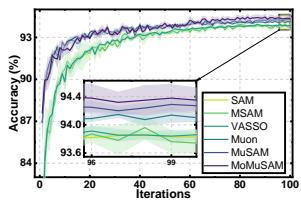  
(a) FMNIST

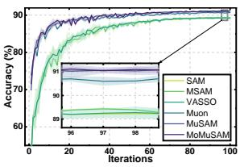  
(b) CIFAR-10

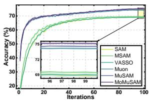  
(c) CIFAR-100

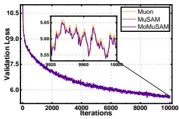  
(d) OpenWebText

Figure 1: Performance comparison of diferent baselines across multiple datasets, showing test accuracy on FMNIST, CIFAR-10, and CIFAR-100, as well as validation loss on OpenWebText.  
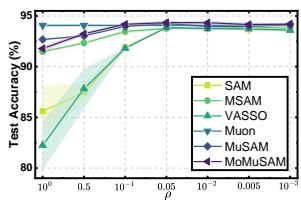  
(a) FMNIST

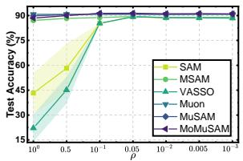  
(b) CIFAR-10

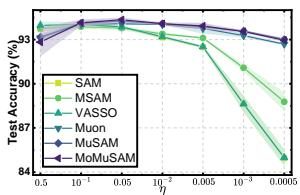  
(a) FMNIST

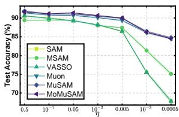  
(b) CIFAR-10  
Figure 2: Sensitivity analysis on $\rho .$  
Figure 3: Sensitivity analysis on η.

In Figure 1, we compare the convergence performance of diferent optimizers across FMNIST, CIFAR-10, CIFAR-100, and OpenWebText. The results show that introducing sharpness awareness into Muon consistently improves the final performance, with MuSAM already outperforming the baselines in most cases and MoMuSAM delivering the strongest overall results. This trend can be understood from the complementary roles of the two components: Muon improves the update geometry through matrix-aware momentum orthogonalization, whereas sharpness-aware perturbation improves the local loss geometry explored during training by biasing optimization toward regions with smaller neighborhood worst-case loss. The further gain of MoMuSAM over MuSAM shows that the quality of the perturbation signal is also crucial. MuSAM builds its perturbation from a single minibatch gradient, so it remains sensitive to stochastic noise and batch-local fluctuations. MoMuSAM, in contrast, uses the momentum state, which aggregates information across iterations and minibatches. This makes the perturbation direction smoother, more stable, and more informed by Muon’s accumulated optimization history, leading to a consistently better tradeof between convergence quality, generalization, and computational eficiency.

Figures 2 and 3 examine the sensitivity of diferent optimizers to the perturbation radius $\rho$ and learning rate $\eta .$ The results reveal a clear robustness advantage for our proposed methods. With respect to $\rho ,$ MuSAM and MoMuSAM remain competitive over a substantially wider range of perturbation magnitudes than the SAM-style baselines. On both FMNIST and CIFAR-10, the performance of SAM, MSAM, and VASSO deteriorates rapidly when $\rho$ becomes too large, suggesting that their perturbations can easily become overly aggressive and destabilize training. By contrast, MuSAM and MoMuSAM maintain strong accuracy across a much broader range of $\rho ,$ with MoMuSAM consistently achieving the best or near-best performance. This indicates that the matrix-aware Muon update already provides a stabilizing optimization geometry, and that our sharpness-aware methods preserve this robustness while further enhancing generalization. A similar pattern is observed for the learning rate in Figure 3. As η decreases, SAM, MSAM, and VASSO sufer much more pronounced degradation, whereas MuSAM and MoMuSAM remain comparatively stable and continue to deliver the strongest final accuracy over a broad range of stepsizes. This robustness is especially meaningful because it shows that our gains do not rely on fragile hyperparameter tuning. Overall, these sensitivity results show that the proposed methods are not only stronger in peak accuracy, but also substantially easier to tune in practice. Additional experimental results and setups are provided in Section C.

## 6 Conclusion

In this paper, we introduced the first sharpness-aware formulation of Muon and established a new optimizer family that unifies Muon’s matrix-aware orthogonalized updates with explicit local geometry control. Our proposed MuSAM incorporates explicit local geometry control into Muon’s matrix-aware updates, while MoMuSAM further turns momentum into a sharpness-probing signal, removing the extra clean-gradient computation and stabilizing the perturbation direction. Theoretically, both methods attain the same asymptotic first-order stationarity order, while MoMuSAM yields a more stable stochastic linearization. Empirically, sharpness awareness consistently strengthens Muon, and MoMuSAM delivers a markedly better generalization–eficiency tradeof.

## References

1. Hochreiter S and Schmidhuber J. Simplifying neural nets by discovering flat minima. Advances in neural information processing systems 1994;7.

2. Keskar NS, Mudigere D, Nocedal J, Smelyanskiy M, and Tang PTP. On large-batch training for deep learning: Generalization gap and sharp minima. arXiv preprint arXiv:1609.04836 2016.

3. Foret P, Kleiner A, Mobahi H, and Neyshabur B. Sharpness-aware minimization for eficiently improving generalization. arXiv preprint arXiv:2010.01412 2020.

4. Andriushchenko M and Flammarion N. Towards understanding sharpness-aware minimization. In: International conference on machine learning. PMLR. 2022:639–68.

5. Bartlett PL, Long PM, and Bousquet O. The dynamics of sharpness-aware minimization: Bouncing across ravines and drifting towards wide minima. Journal of Machine Learning Research 2023;24:1–36.

6. Chen X, Liang C, Huang D, et al. Symbolic discovery of optimization algorithms. Advances in neural information processing systems 2023;36:49205–33.

7. Yuan H, Liu Y, Wu S, Zhou X, and Gu Q. Mars: Unleashing the power of variance reduction for training large models. arXiv preprint arXiv:2411.10438 2024.

8. Vyas N, Morwani D, Zhao R, et al. Soap: Improving and stabilizing shampoo using adam. arXiv preprint arXiv:2409.11321 2024.

9. Pethick T, Xie W, Antonakopoulos K, Zhu Z, Silveti-Falls A, and Cevher V. Training deep learning models with norm-constrained lmos. arXiv preprint arXiv:2502.07529 2025.

10. Jordan K, Jin Y, Boza V, et al. Muon: An Optimizer for Hidden Layers in Neural Networks. 2024. url: https://kellerjordan.github.io/posts/muon.

11. Becker M, Altrock F, and Risse B. Momentum-sam: Sharpness aware minimization without computational overhead. arXiv preprint arXiv:2401.12033 2024.

12. Li B, Zhang Y, and Giannakis GB. Vasso: Variance suppression for sharpness-aware minimization. arXiv preprint arXiv:2509.02433 2025.

13. Wen W, Wang Y, Yan F, et al. Smoothout: Smoothing out sharp minima to improve generalization in deep learning. arXiv preprint arXiv:1805.07898 2018.

14. Zhuang J, Gong B, Yuan L, et al. Surrogate gap minimization improves sharpness-aware training. arXiv preprint arXiv:2203.08065 2022.

15. Zhao Y, Zhang H, and Ss-sam XH. Stochastic scheduled sharpness-aware minimization for eficiently training deep neural networks. arXiv preprint arXiv:2203.09962 2022;8:18.

16. Reddi SJ, Sra S, Póczos B, and Smola A. Stochastic Frank-Wolfe methods for nonconvex optimization. In: 2016 54th annual Allerton conference on communication, control, and computing (Allerton). IEEE. 2016:1244–51.

17. Wen K, Ma T, and Li Z. How does sharpness-aware minimization minimize sharpness? arXiv preprint arXiv:2211.05729 2022.

18. Kim M, Li D, Hu SX, and Hospedales T. Fisher sam: Information geometry and sharpness aware minimisation. In: International Conference on Machine Learning. PMLR. 2022:11148–61.

19. Li B, Sadeghi A, and Giannakis G. Heavy ball momentum for conditional gradient. Advances in Neural Information Processing Systems 2021;34:21244–55.

20. Cutkosky A and Orabona F. Momentum-based variance reduction in non-convex sgd. Advances in neural information processing systems 2019;32.

21. Qian X, Rammal H, Kovalev D, and Richtarik P. Muon is Provably Faster with Momentum Variance Reduction. arXiv preprint arXiv:2512.16598 2025.

22. Ghadimi S and Lan G. Stochastic first-and zeroth-order methods for nonconvex stochastic programming. SIAM journal on optimization 2013;23:2341–68.

23. Bottou L, Curtis FE, and Nocedal J. Optimization methods for large-scale machine learning. SIAM review 2018;60:223–311.

24. Mi P, Shen L, Ren T, et al. Make sharpness-aware minimization stronger: A sparsified perturbation approach. Advances in Neural Information Processing Systems 2022;35:30950–62.

25. Kim GY and Oh Mh. Convergence of Muon with Newton-Schulz. arXiv preprint arXiv:2601.19156 2026.

26. Nesterov Y. Introductory lectures on convex optimization: A basic course. Vol. 87. Springer Science & Business Media, 2013.

27. Jaggi M. Revisiting Frank-Wolfe: Projection-free sparse convex optimization. In: International conference on machine learning. PMLR. 2013:427–35.

28. Beck A. First-order methods in optimization. SIAM, 2017.

29. Liu J, Su J, Yao X, et al. Muon is scalable for llm training. arXiv preprint arXiv:2502.16982 2025.

30. An K, Liu Y, Pan R, et al. Asgo: Adaptive structured gradient optimization. arXiv preprint arXiv:2503.20762 2025.

31. Liu L, Xu Z, Zhang Z, et al. Cosmos: A hybrid adaptive optimizer for memory-eficient training of llms. arXiv preprint arXiv:2502.17410 2025.

32. Shah I, Polloreno AM, Stratos K, et al. Practical eficiency of muon for pretraining. arXiv preprint arXiv:2505.02222 2025.

33. Shen W, Huang R, Huang M, Shen C, and Zhang J. On the convergence analysis of muon. arXiv preprint arXiv:2505.23737 2025.

34. Xiao H, Rasul K, and Vollgraf R. Fashion-mnist: a novel image dataset for benchmarking machine learning algorithms. arXiv preprint arXiv:1708.07747 2017.

35. Krizhevsky A, Hinton G, et al. Learning multiple layers of features from tiny images. 2009.

36. Karpathy A. nanoGPT. 2022. url: https://github.com/karpathy/nanoGPT.

37. Radford A, Wu J, Child R, Luan D, Amodei D, Sutskever I, et al. Language models are unsupervised multitask learners. OpenAI blog 2019;1:9.

38. Gokaslan A and Cohen V. OpenWebText Corpus. http://Skylion007.github.io/OpenWebTextCorpus. 2019.

39. Si C, Zhang D, and Shen W. Adamuon: Adaptive muon optimizer. arXiv preprint arXiv:2507.11005 2025.

40. Lau TTK, Long Q, and Su W. Polargrad: A class of matrix-gradient optimizers from a unifying preconditioning perspective. arXiv preprint arXiv:2505.21799 2025.

41. Zhang M, Liu Y, and Schaefer H. Adagrad meets muon: Adaptive stepsizes for orthogonal updates. arXiv preprint arXiv:2509.02981 2025.

42. Riabinin A, Shulgin E, Gruntkowska K, and Richtárik P. Gluon: Making muon & scion great again!(bridging theory and practice of lmo-based optimizers for llms). arXiv preprint arXiv:2505.13416 2025.

43. Bernstein J and Newhouse L. Old optimizer, new norm: An anthology. arXiv preprint arXiv:2409.20325 2024.

44. Kovalev D. Understanding gradient orthogonalization for deep learning via non-euclidean trust-region optimization. arXiv preprint arXiv:2503.12645 2025.

45. Sfyraki ME and Wang JK. Lions and muons: Optimization via stochastic frank-wolfe. arXiv preprint arXiv:2506.04192 2025.

46. Chen L, Li J, and Liu Q. Muon optimizes under spectral norm constraints. arXiv preprint arXiv:2506.15054 2025.

47. Fan C, Schmidt M, and Thrampoulidis C. Implicit bias of spectral descent and muon on multiclass separable data. arXiv preprint arXiv:2502.04664 2025.

48. Sato N, Naganuma H, and Iiduka H. Convergence bound and critical batch size of muon optimizer. arXiv preprint arXiv:2507.01598 2025.

49. Li J and Hong M. A note on the convergence of muon. arXiv preprint arXiv:2502.02900 2025.

50. Chang D, Liu Y, and Yuan G. On the Convergence of Muon and Beyond. arXiv preprint arXiv:2509.15816 2025.

51. Li H, Xu Z, Taylor G, Studer C, and Goldstein T. Visualizing the loss landscape of neural nets. Advances in neural information processing systems 2018;31.

52. Yao Z, Gholami A, Lei Q, Keutzer K, and Mahoney MW. Hessian-based analysis of large batch training and robustness to adversaries. Advances in Neural Information Processing Systems 2018;31.

53. Liu C, Salzmann M, Lin T, Tomioka R, and Süsstrunk S. On the loss landscape of adversarial training: Identifying challenges and how to overcome them. Advances in Neural Information Processing Systems 2020;33:21476–87.

54. Damian A, Ma T, and Lee JD. Label noise sgd provably prefers flat global minimizers. Advances in Neural Information Processing Systems 2021;34:27449–61.

55. Dinh L, Pascanu R, Bengio S, and Bengio Y. Sharp minima can generalize for deep nets. In: International Conference on Machine Learning. PMLR. 2017:1019–28.

56. Chaudhari P, Choromanska A, Soatto S, et al. Entropy-sgd: Biasing gradient descent into wide valleys. Journal of Statistical Mechanics: Theory and Experiment 2019;2019:124018.

57. Wu D, Xia ST, and Wang Y. Adversarial weight perturbation helps robust generalization. Advances in neural information processing systems 2020;33:2958–69.

58. Zheng Y, Zhang R, and Mao Y. Regularizing neural networks via adversarial model perturbation. In: Proceedings of the IEEE/CVF Conference on Computer Vision and Pattern Recognition. 2021:8156–65.

59. Kwon J, Kim J, Park H, and Choi IK. Asam: Adaptive sharpness-aware minimization for scaleinvariant learning of deep neural networks. In: International conference on machine learning. PMLR. 2021:5905–14.

60. Liu Y, Mai S, Chen X, Hsieh CJ, and You Y. Towards eficient and scalable sharpness-aware minimization. In: Proceedings of the IEEE/CVF Conference on Computer Vision and Pattern Recognition. 2022:12360–70.

61. Jiang W, Yang H, Zhang Y, and Kwok J. An adaptive policy to employ sharpness-aware minimization. arXiv preprint arXiv:2304.14647 2023.

62. Du J, Zhou D, Feng J, Tan V, and Zhou JT. Sharpness-aware training for free. Advances in Neural Information Processing Systems 2022;35:23439–51.

## A Related Works

Muon and matrix-aware orthogonalized optimization. Recent work has increasingly explored optimizers that exploit the intrinsic matrix structure of neural network parameters rather than treating each layer as a long vector. Within this line, Muon [10] is a representative matrix-aware optimizer that orthogonalizes the momentum matrix before updating the weights, yielding structured search directions with strong empirical performance, especially at large scale [29, 32]. In practice, Muon replaces exact SVD-based polar decomposition with a few Newton–Schulz iterations, resulting in an eficient SVD-free implementation based primarily on matrix multiplications [25]. Around Muon, a growing ecosystem of related methods has emerged, including AdaMuon, COSMOS, ASGO, PolarGrad, AdaGO, Gluon, and other matrix-aware or LMO-based optimizers [9, 30, 31, 39–42]. On the theoretical side, Muon has been interpreted through non-Euclidean trust-region geometry, stochastic Frank–Wolfe viewpoints, spectral-norm constrained optimization, and implicit-bias analyses [43–47]. Nevertheless, existing Muon literature remains centered on optimization geometry, convergence, and eficiency, while exposing a persistent gap between practical finite-step Newton–Schulz implementations and analyses based on exact polar factors, as well as relatively slow or restrictive guarantees for several Muon variants [33, 48–50]. Crucially for our setting, these works do not establish any explicit mechanism by which Muon controls local sharpness or steers optimization toward flat regions: Muon reshapes the update direction, but any generalization benefit from flatness can only arise implicitly. This makes sharpness-aware Muon especially compelling, because Muon’s matrix-aware inductive bias shapes update geometry, while explicit sharpness control governs the local loss geometry most relevant to generalization.

Sharpness-aware optimization. Sharpness-aware optimization is motivated by the long-standing observation that flatter minima often correlate with stronger generalization, although this connection is subtle and not universal [1, 2, 51–55]. Early eforts such as Entropy-SGD and adversarial weight perturbation already sought to bias optimization toward flatter regions [56–58], but SAM has become the dominant formulation by explicitly minimizing a local worst-case loss through adversaria perturbations in parameter space [3]. Its empirical success has motivated a broad family of variants, including ASAM, Fisher-SAM, GSAM, and a range of eficiency-oriented methods such as LookSAM, SS-SAM, adaptive SAM policies, and SAF [14, 15, 18, 59–62]. At the same time, this line of work has exposed two persistent limitations. First, vanilla SAM typically requires an additional forward– backward pass to construct the perturbation, which substantially increases training cost [3, 11, 17]. Second, the perturbation is produced by stochastic linearization from a single minibatch gradient, making it a batch-local and noisy proxy for sharpness; recent work shows that such adversaries can become unstable or overly friendly, thereby weakening the intended sharpness signal and limiting the generalization–computation tradeof [4, 11, 12]. These limitations are especially relevant in our setting: once sharpness-aware training is brought into Muon, the key challenge is no longer only how to inject local geometry control, but how to do so in a way that respects Muon’s structured update geometry while avoiding the overhead and instability of single-batch perturbations. This is precisely the gap addressed by our momentum-guided sharpness-aware Muon design.

## B Proof

## B.1 Useful lemmas

Lemma B.1. Under Assumptions 2.1 to 2.3, the Muon+SAM update guarantees that

$$
f ( W _ { t } ) \leq f ( W _ { t - 1 } ) - \eta \| \nabla f ( W _ { t - 1 } ) \| _ { * } + 2 \eta \| M _ { t } - \nabla f ( W _ { t - 1 } + \delta _ { t } ) \| _ { * } + 2 \eta L \rho + \frac { L \eta ^ { 2 } } { 2 } .\tag{17}
$$

Proof. Let the exact SVD of $M _ { t }$ be $M _ { t } = Q _ { t } \Sigma _ { t } R _ { t } ^ { \top }$ , and define $U _ { t } : = \mathrm { P o l a r } ( M _ { t } ) = Q _ { t } R _ { t } ^ { \top }$ . By the descent lemma implied by Assumption 2.2, applied to $W _ { t } = W _ { t - 1 } - \eta U _ { t }$ , we have

$$
\begin{array} { l } { f ( W _ { t } ) \leq f ( W _ { t - 1 } ) + \langle \nabla f ( W _ { t - 1 } ) , W _ { t } - W _ { t - 1 } \rangle _ { F } + \displaystyle \frac { L } { 2 } \| W _ { t } - W _ { t - 1 } \| _ { \mathrm { o p } } ^ { 2 } } \\ { \displaystyle \qquad = f ( W _ { t - 1 } ) - \eta \langle \nabla f ( W _ { t - 1 } ) , U _ { t } \rangle _ { F } + \displaystyle \frac { L \eta ^ { 2 } } { 2 } \| U _ { t } \| _ { \mathrm { o p } } ^ { 2 } } \\ { \displaystyle \qquad \leq f ( W _ { t - 1 } ) - \eta \langle \nabla f ( W _ { t - 1 } ) , U _ { t } \rangle _ { F } + \displaystyle \frac { L \eta ^ { 2 } } { 2 } . } \end{array}\tag{18}
$$

Next,

$$
\begin{array} { r l } { \langle \nabla f ( W _ { t - 1 } ) , U _ { t } \rangle _ { F } = \langle M _ { t } , U _ { t } \rangle _ { F } + \langle \nabla f ( W _ { t - 1 } ) - M _ { t } , U _ { t } \rangle _ { F } } & { } \\ { = \| M _ { t } \| _ { * } + \langle \nabla f ( W _ { t - 1 } ) - M _ { t } , U _ { t } \rangle _ { F } } & { } \\ { \geq \| M _ { t } \| _ { * } - \| \nabla f ( W _ { t - 1 } ) - M _ { t } \| _ { * } \| U _ { t } \| _ { \mathrm { o p } } } & { } \\ { \geq \| M _ { t } \| _ { * } - \| \nabla f ( W _ { t - 1 } ) - M _ { t } \| _ { * } . } & { } \end{array}\tag{19}
$$

By the reverse triangle inequality for the nuclear norm,

$$
\begin{array} { r } { \| M _ { t } \| _ { * } \geq \| \nabla f ( W _ { t - 1 } ) \| _ { * } - \| \nabla f ( W _ { t - 1 } ) - M _ { t } \| _ { * } . } \end{array}\tag{20}
$$

Combining Eq. (19) and Eq. (20), we obtain

$$
\begin{array} { r } { \langle \nabla f ( W _ { t - 1 } ) , U _ { t } \rangle _ { F } \geq \| \nabla f ( W _ { t - 1 } ) \| _ { * } - 2 \| \nabla f ( W _ { t - 1 } ) - M _ { t } \| _ { * } . } \end{array}\tag{21}
$$

Substituting Eq. (21) into $\operatorname { E q . }$ (18) yields

$$
f ( W _ { t } ) \leq f ( W _ { t - 1 } ) - \eta \| \nabla f ( W _ { t - 1 } ) \| _ { * } + 2 \eta \| \nabla f ( W _ { t - 1 } ) - M _ { t } \| _ { * } + \frac { L \eta ^ { 2 } } { 2 } .\tag{22}
$$

Now add and subtract $\nabla f ( W _ { t - 1 } + \delta _ { t } )$

$$
\begin{array} { r } { \| \nabla f ( W _ { t - 1 } ) - M _ { t } \| _ { * } \leq \| \nabla f ( W _ { t - 1 } ) - \nabla f ( W _ { t - 1 } + \delta _ { t } ) \| _ { * } + \| \nabla f ( W _ { t - 1 } + \delta _ { t } ) - M _ { t } \| _ { * } . } \end{array}\tag{23}
$$

By Assumption 2.2,

$$
\| \nabla f ( W _ { t - 1 } ) - \nabla f ( W _ { t - 1 } + \delta _ { t } ) \| _ { * } \leq L \| \delta _ { t } \| _ { \mathrm { o p } } \leq L \| \delta _ { t } \| _ { F } \leq L \rho .\tag{24}
$$

Therefore,

$$
\| \nabla f ( W _ { t - 1 } ) - M _ { t } \| _ { * } \leq \| M _ { t } - \nabla f ( W _ { t - 1 } + \delta _ { t } ) \| _ { * } + L \rho .\tag{25}
$$

Substituting the above into Eq. (22) proves Eq. (17).

Lemma B.2. Under Assumptions 2.1 to 2.3, we have

$$
\frac { 1 } { T } \sum _ { t = 1 } ^ { T } \mathbb { E } \| \nabla f ( W _ { t - 1 } ) \| _ { * } \leq \frac { f ( W _ { 0 } ) - f _ { * } } { \eta T } + \frac { 2 } { T } \sum _ { t = 1 } ^ { T } \mathbb { E } \| M _ { t } - \nabla f ( W _ { t - 1 } + \delta _ { t } ) \| _ { * } + 2 L \rho + \frac { L \eta } { 2 } ,\tag{26}
$$

where $f _ { \star }$ is a lower bound of $f .$

Proof. Taking expectation in Eq. (17), summing over $t = 1 , \dots , T$ , and using the telescoping identity

$$
\sum _ { t = 1 } ^ { T } \bigl ( f ( W _ { t } ) - f ( W _ { t - 1 } ) \bigr ) = f ( W _ { T } ) - f ( W _ { 0 } ) ,
$$

we obtain

$$
\begin{array} { r l } & { \mathbb { E } [ f ( W _ { T } ) ] - \mathbb { E } [ f ( W _ { 0 } ) ] } \\ & { \le - \eta \displaystyle \sum _ { t = 1 } ^ { T } \mathbb { E } \| \nabla f ( W _ { t - 1 } ) \| _ { * } + 2 \eta \displaystyle \sum _ { t = 1 } ^ { T } \mathbb { E } \| M _ { t } - \nabla f ( W _ { t - 1 } + \delta _ { t } ) \| _ { * } + 2 \eta L T \rho + \frac { T L \eta ^ { 2 } } { 2 } . } \end{array}\tag{27}
$$

Using $\mathbb { E } [ f ( W _ { T } ) ] \geq f ,$ ⋆ and rearranging gives Eq. (26).

## B.2 Theoretical Analysis for Algorithm 1

Lemma B.3 (Same-minibatch estimator decomposition). According to Assumptions 2.2 and 2.3, we have

$$
\begin{array} { r l } & { \mathbb { E } [ \nabla \ell ( W _ { t - 1 } ; \mathcal { B } _ { t } ) - \nabla f ( W _ { t - 1 } ) + \nabla \ell ( W _ { t - 1 } + \delta _ { t } ; \mathcal { B } _ { t } ) - \nabla \ell ( W _ { t - 1 } ; \mathcal { B } _ { t } ) } \\ & { - \mathbb { E } [ \nabla \ell ( W _ { t - 1 } + \delta _ { t } ; \mathcal { B } _ { t } ) - \nabla \ell ( W _ { t - 1 } ; \mathcal { B } _ { t } ) \mid \mathcal { F } _ { t - 1 } ] \mid \mathcal { F } _ { t - 1 } ] = 0 } \end{array}\tag{28}
$$

and

$$
\begin{array} { r l } & { \mathbb { E } [ \| \nabla \ell ( W _ { t - 1 } ; \mathcal { B } _ { t } ) - \nabla f ( W _ { t - 1 } ) + \nabla \ell ( W _ { t - 1 } + \delta _ { t } ; \mathcal { B } _ { t } ) - \nabla \ell ( W _ { t - 1 } ; \mathcal { B } _ { t } ) } \\ & { - \mathbb { E } [ \nabla \ell ( W _ { t - 1 } + \delta _ { t } ; \mathcal { B } _ { t } ) - \nabla \ell ( W _ { t - 1 } ; \mathcal { B } _ { t } ) \mid \mathcal { F } _ { t - 1 } ] \| _ { F } ^ { 2 } \mid \mathcal { F } _ { t - 1 } ] \leq 2 \left( \frac { \sigma ^ { 2 } } { B } + L ^ { 2 } \rho ^ { 2 } \right) . } \end{array}\tag{29}
$$

Define Ct := Mt − ∇f(Wt−1), for every $t \geq 2$

$$
\begin{array} { r l } & { C _ { t } = \mu C _ { t - 1 } + \widetilde D _ { t } + ( 1 - \mu ) ( \nabla \ell ( W _ { t - 1 } ; \mathcal { B } _ { t } ) - \nabla f ( W _ { t - 1 } ) + \nabla \ell ( W _ { t - 1 } + \delta _ { t } ; \mathcal { B } _ { t } ) - \nabla \ell ( W _ { t - 1 } ; \mathcal { B } _ { t } ) } \\ & { \qquad - \mathbb { E } [ \nabla \ell ( W _ { t - 1 } + \delta _ { t } ; \mathcal { B } _ { t } ) - \nabla \ell ( W _ { t - 1 } ; \mathcal { B } _ { t } ) \mid \mathcal { F } _ { t - 1 } ] ) , } \end{array}\tag{30}
$$

where

$$
\tilde { D } _ { t } : = \mu \left( \nabla f ( W _ { t - 2 } ) - \nabla f ( W _ { t - 1 } ) \right) + ( 1 - \mu ) \mathbb { E } [ \nabla \ell ( W _ { t - 1 } + \delta _ { t } ; B _ { t } ) - \nabla \ell ( W _ { t - 1 } ; B _ { t } ) \mid \mathcal { F } _ { t - 1 } ]\tag{31}
$$

is $\mathcal { F } _ { t - 1 }$ -measurable and satisfies

$$
\| \widetilde { D } _ { t } \| _ { F } \le L \big ( \mu \eta + ( 1 - \mu ) \rho \big ) .\tag{32}
$$

Proof. Because $\nabla \ell ( W _ { t - 1 } ; B _ { t } )$ is evaluated at the $\mathcal { F } _ { t - 1 }$ -measurable point $W _ { t - 1 }$ , Assumption 2.3 gives $\mathbb { E } [ \nabla \ell ( W _ { t - 1 } ; \mathcal { B } _ { t } ) - \nabla f ( W _ { t - 1 } ) \ | \ \mathcal { F } _ { t - 1 } ] = 0$ . Moreover, we have

$$
\begin{array} { r } { \mathbb { E } \big [ \nabla \ell ( W _ { t - 1 } + \delta _ { t } ; \mathcal { B } _ { t } ) - \nabla \ell ( W _ { t - 1 } ; \mathcal { B } _ { t } ) - \mathbb { E } \big [ \nabla \ell ( W _ { t - 1 } + \delta _ { t } ; \mathcal { B } _ { t } ) - \nabla \ell ( W _ { t - 1 } ; \mathcal { B } _ { t } ) \big \vert \mathcal { F } _ { t - 1 } \big ] \mid \mathcal { F } _ { t - 1 } \big ] = 0 . } \end{array}
$$

Adding these identities proves Eq. (28).

By Assumption 2.2 and $\begin{array} { r } { \| \delta _ { t } \| _ { F } \leq \rho , } \end{array}$

$$
\begin{array} { r l } & { \| \nabla \ell ( W _ { t - 1 } + \delta _ { t } ; \mathcal { B } _ { t } ) - \nabla \ell ( W _ { t - 1 } ; \mathcal { B } _ { t } ) \| _ { F } \leq \| \nabla \ell ( W _ { t - 1 } + \delta _ { t } ; \mathcal { B } _ { t } ) - \nabla \ell ( W _ { t - 1 } ; \mathcal { B } _ { t } ) \| _ { * } } \\ & { \qquad \leq L \| \delta _ { t } \| _ { \mathrm { o p } } \leq L \rho . } \end{array}\tag{33}
$$

Consequently,

$$
\begin{array} { r l } & { \| \mathbb { E } [ \nabla \ell ( W _ { t - 1 } + \delta _ { t } ; \mathcal { B } _ { t } ) - \nabla \ell ( W _ { t - 1 } ; \mathcal { B } _ { t } ) \mid \mathcal { F } _ { t - 1 } ] \| _ { F } } \\ & { \le \mathbb { E } [ \| \nabla \ell ( W _ { t - 1 } + \delta _ { t } ; \mathcal { B } _ { t } ) - \nabla \ell ( W _ { t - 1 } ; \mathcal { B } _ { t } ) \| _ { F } \mid \mathcal { F } _ { t - 1 } ] \le L \rho , } \end{array}\tag{34}
$$

and the conditional variance identity gives

$$
\begin{array} { r l } & { \mathbb E \bigl [ \| \nabla \ell ( W _ { t - 1 } + \delta _ { t } ; \mathcal B _ { t } ) - \nabla \ell ( W _ { t - 1 } ; \mathcal B _ { t } ) - \mathbb E [ \nabla \ell ( W _ { t - 1 } + \delta _ { t } ; \mathcal B _ { t } ) - \nabla \ell ( W _ { t - 1 } ; \mathcal B _ { t } ) | \mathcal F _ { t - 1 } ] \| _ { F } ^ { 2 } | \mathcal F _ { t - 1 } \bigr ] } \\ & { \le \mathbb E \bigl [ \| \nabla \ell ( W _ { t - 1 } + \delta _ { t } ; \mathcal B _ { t } ) - \nabla \ell ( W _ { t - 1 } ; \mathcal B _ { t } ) \| _ { F } ^ { 2 } \mid \mathcal F _ { t - 1 } \bigr ] \le L ^ { 2 } \rho ^ { 2 } . } \end{array}\tag{35}
$$

Using $\| A + B \| _ { F } ^ { 2 } \leq 2 \| A \| _ { F } ^ { 2 } + 2 \| B \| _ { F } ^ { 2 }$ and Assumption 2.3, we obtain

$$
\begin{array} { r l r } { \left. { \mathbb { E } \| \nabla \ell ( W _ { t - 1 } ; \mathcal { B } _ { t } ) - \nabla f ( W _ { t - 1 } ) + \nabla \ell ( W _ { t - 1 } + \delta _ { t } ; \mathcal { B } _ { t } ) - \nabla \ell ( W _ { t - 1 } ; \mathcal { B } _ { t } ) } } \\ & { } & { \quad - \mathbb { E } [ \nabla \ell ( W _ { t - 1 } + \delta _ { t } ; \mathcal { B } _ { t } ) - \nabla \ell ( W _ { t - 1 } ; \mathcal { B } _ { t } ) \mid \mathcal { F } _ { t - 1 } ] \| _ { F } ^ { 2 } \mid \mathcal { F } _ { t - 1 } ] } \\ & { } & { \le 2 \mathbb { E } \big [ \| \nabla \ell ( W _ { t - 1 } ; \mathcal { B } _ { t } ) - \nabla f ( W _ { t - 1 } ) \| _ { F } ^ { 2 } \mid \mathcal { F } _ { t - 1 } \big ] } \\ & { } & { \quad + 2 \mathbb { E } [ \| \nabla \ell ( W _ { t - 1 } + \delta _ { t } ; \mathcal { B } _ { t } ) - \nabla \ell ( W _ { t - 1 } ; \mathcal { B } _ { t } ) - \mathbb { E } [ \nabla \ell ( W _ { t - 1 } + \delta _ { t } ; \mathcal { B } _ { t } ) - \nabla \ell ( W _ { t - 1 } ; \mathcal { B } _ { t } ) \mid \mathcal { F } _ { t - 1 } ] \| _ { F } ^ { 2 } \mid \mathcal { F } _ { t - 1 } ] } \\ & { } & { \le 2 \left( \frac { \sigma ^ { 2 } } { B } + L ^ { 2 } \rho ^ { 2 } \right) , \qquad ( \frac { \sigma } { B } + L ^ { 2 } \rho ^ { 2 } \right) } \end{array}\tag{36}
$$

which proves Eq. (29).

Next, the momentum recursion gives

$$
C _ { t } = \mu M _ { t - 1 } + ( 1 - \mu ) \nabla \ell ( W _ { t - 1 } + \delta _ { t } ; \mathcal { B } _ { t } ) - \nabla f ( W _ { t - 1 } )
$$

$$
\begin{array} { r l } & { = \mu \left( M _ { t - 1 } - \nabla f ( W _ { t - 2 } ) \right) + \mu \left( \nabla f ( W _ { t - 2 } ) - \nabla f ( W _ { t - 1 } ) \right) } \\ & { \phantom { = } + ( 1 - \mu ) \mathbb { E } [ \nabla \ell ( W _ { t - 1 } + \delta _ { t } ; B _ { t } ) - \nabla \ell ( W _ { t - 1 } ; B _ { t } ) \mid \mathcal { F } _ { t - 1 } ] } \\ & { \phantom { = } + ( 1 - \mu ) ( \nabla \ell ( W _ { t - 1 } ; \mathcal { B } _ { t } ) - \nabla f ( W _ { t - 1 } ) + \nabla \ell ( W _ { t - 1 } + \delta _ { t } ; \mathcal { B } _ { t } ) - \nabla \ell ( W _ { t - 1 } ; \mathcal { B } _ { t } ) } \\ & { \phantom { = } - \mathbb { E } [ \nabla \ell ( W _ { t - 1 } + \delta _ { t } ; \mathcal { B } _ { t } ) - \nabla \ell ( W _ { t - 1 } ; \mathcal { B } _ { t } ) \mid \mathcal { F } _ { t - 1 } ] ) } \\ & { = \mu C _ { t - 1 } + \widetilde D _ { t } + ( 1 - \mu ) ( \nabla \ell ( W _ { t - 1 } ; \mathcal { B } _ { t } ) - \nabla f ( W _ { t - 1 } ) + \nabla \ell ( W _ { t - 1 } + \delta _ { t } ; \mathcal { B } _ { t } ) - \nabla \ell ( W _ { t - 1 } ; \mathcal { B } _ { t } ) } \\ & { \phantom { = } - \mathbb { E } [ \nabla \ell ( W _ { t - 1 } + \delta _ { t } ; \mathcal { B } _ { t } ) - \nabla \ell ( W _ { t - 1 } ; \mathcal { B } _ { t } ) \mid \mathcal { F } _ { t - 1 } ] ) . } \end{array}\tag{37}
$$

This proves Eq. (30).

Finally, Assumption 2.2 and the exact-polar update imply

$$
\begin{array} { r } { \| \nabla f ( W _ { t - 2 } ) - \nabla f ( W _ { t - 1 } ) \| _ { F } \leq L \| W _ { t - 2 } - W _ { t - 1 } \| _ { \mathrm { o p } } \leq L \eta . } \end{array}
$$

Combining this inequality with $\begin{array} { r l r } & { \| \mathbb { E } [ \nabla \ell ( W _ { t - 1 } + \delta _ { t } ; \mathcal { B } _ { t } ) - \nabla \ell ( W _ { t - 1 } ; \mathcal { B } _ { t } ) \mid \mathcal { F } _ { t - 1 } ] \| _ { F } \leq L \rho \mathrm { ~ g i v e s ~ } \| \widetilde { D } _ { t } \| _ { F } \leq } & \\ & { \colon \mathrm { E q . ~ } ( 3 2 ) . } & \end{array}$ $L ( \mu \eta + ( 1 - \mu ) \rho )$ , which prove

Theorem B.4. Suppose Assumptions 2.1 to 2.3 hold.

(i) Recursion for the clean-point estimator error. For every $t \geq 2$

$$
\begin{array} { l } { \displaystyle \mathbb { E } \| C _ { t } \| _ { F } ^ { 2 } \leq \frac { 1 + \mu ^ { 2 } } { 2 } \mathbb { E } \| C _ { t - 1 } \| _ { F } ^ { 2 } + \frac { 1 + \mu ^ { 2 } } { 1 - \mu ^ { 2 } } L ^ { 2 } \big ( \mu \eta + ( 1 - \mu ) \rho \big ) ^ { 2 } } \\ { \displaystyle \qquad + 2 ( 1 - \mu ) ^ { 2 } \left( \frac { \sigma ^ { 2 } } { B } + L ^ { 2 } \rho ^ { 2 } \right) . } \end{array}\tag{38}
$$

(ii) Unrolled bound. For every $t \geq 1$

$$
\begin{array} { r l } & { \mathbb { E } \| C _ { t } \| _ { F } ^ { 2 } \leq \left( \displaystyle \frac { 1 + \mu ^ { 2 } } { 2 } \right) ^ { t - 1 } \mathbb { E } \| C _ { 1 } \| _ { F } ^ { 2 } + \displaystyle \frac { 2 ( 1 + \mu ^ { 2 } ) } { ( 1 - \mu ^ { 2 } ) ^ { 2 } } L ^ { 2 } \big ( \mu \eta + ( 1 - \mu ) \rho \big ) ^ { 2 } } \\ & { \qquad + \displaystyle \frac { 4 ( 1 - \mu ) } { 1 + \mu } \left( \frac { \sigma ^ { 2 } } { B } + L ^ { 2 } \rho ^ { 2 } \right) . } \end{array}\tag{39}
$$

(iii) Pointwise mismatch bound. Let $E _ { t } : = M _ { t } - \nabla f ( W _ { t - 1 } + \delta _ { t } )$ . Then, for every $t \geq 1$

$$
\begin{array} { r l } & { \mathbb { E } \| E _ { t } \| _ { F } ^ { 2 } \leq 2 \left( \displaystyle \frac { 1 + \mu ^ { 2 } } { 2 } \right) ^ { t - 1 } \mathbb { E } \| C _ { 1 } \| _ { F } ^ { 2 } + \displaystyle \frac { 4 ( 1 + \mu ^ { 2 } ) } { ( 1 - \mu ^ { 2 } ) ^ { 2 } } L ^ { 2 } \big ( \mu \eta + ( 1 - \mu ) \rho \big ) ^ { 2 } } \\ & { \qquad + \displaystyle \frac { 8 ( 1 - \mu ) } { 1 + \mu } \left( \frac { \sigma ^ { 2 } } { B } + L ^ { 2 } \rho ^ { 2 } \right) + 2 L ^ { 2 } \rho ^ { 2 } . } \end{array}\tag{40}
$$

Writing $r : = \operatorname* { m i n } \{ m , n \}$ , we further have

$$
\begin{array} { l } { \displaystyle \mathbb { E } \| E _ { t } \| _ { * } \leq \sqrt { 2 r } \left( \frac { 1 + \mu ^ { 2 } } { 2 } \right) ^ { ( t - 1 ) / 2 } \sqrt { \mathbb { E } \| C _ { 1 } \| _ { F } ^ { 2 } } + \frac { 2 \sqrt { r ( 1 + \mu ^ { 2 } ) } } { 1 - \mu ^ { 2 } } L \big ( \mu \eta + ( 1 - \mu ) \rho \big ) } \\ { \displaystyle \qquad + 2 \sqrt { \frac { 2 r ( 1 - \mu ) } { 1 + \mu } } \sqrt { \frac { \sigma ^ { 2 } } { B } + L ^ { 2 } \rho ^ { 2 } } + \sqrt { 2 r } L \rho . } \end{array}\tag{41}
$$

(iv) Averaged mismatch bound. For every $T \geq 1$

$$
\begin{array} { l } { \displaystyle \frac { 2 } { T } \sum _ { t = 1 } ^ { T } \mathbb { E } \| E _ { t } \| _ { * } \leq \frac { 8 \sqrt { 2 r \mathbb { E } \| C _ { 1 } \| _ { F } ^ { 2 } } } { ( 1 - \mu ^ { 2 } ) T } + \frac { 4 \sqrt { r ( 1 + \mu ^ { 2 } ) } } { 1 - \mu ^ { 2 } } L \big ( \mu \eta + ( 1 - \mu ) \rho \big ) } \\ { \displaystyle \qquad + 4 \sqrt { \frac { 2 r ( 1 - \mu ) } { 1 + \mu } } \sqrt { \frac { \sigma ^ { 2 } } { B } + L ^ { 2 } \rho ^ { 2 } } + 2 \sqrt { 2 r } L \rho . } \end{array}\tag{42}
$$

(v) Averaged stationarity bound. We have

$$
\begin{array} { l } { \displaystyle \frac { 1 } { T } \sum _ { t = 0 } ^ { T - 1 } \mathbb { E } \| \nabla f ( W _ { t } ) \| _ { * } } \\ { \displaystyle \leq \frac { f ( W _ { 0 } ) - f _ { * } } { \eta T } + \frac { 8 \sqrt { 2 r } } { ( 1 - \mu ^ { 2 } ) T } \sqrt { 4 \mu ^ { 2 } L \big ( f ( W _ { 0 } ) - f _ { * } \big ) + 4 ( 1 - \mu ) ^ { 2 } L ^ { 2 } \rho ^ { 2 } + 2 ( 1 - \mu ) ^ { 2 } \frac { \sigma ^ { 2 } } { B } } } \\ { + \frac { 4 \sqrt { r ( 1 + \mu ^ { 2 } ) } } { 1 - \mu ^ { 2 } } L \big ( \mu \eta + ( 1 - \mu ) \rho \big ) + 4 \sqrt { \frac { 2 r ( 1 - \mu ) } { 1 + \mu } } \sqrt { \frac { \sigma ^ { 2 } } { B } + L ^ { 2 } \rho ^ { 2 } } + ( 2 + 2 \sqrt { 2 r } ) L \rho + \frac { L \eta } { 2 } . } \end{array}\tag{43}
$$

In particular, if $T \geq 2 , \eta = \rho = T ^ { - 3 / 4 }$ , and $1 - \mu = T ^ { - 1 / 2 }$ , then

$$
\begin{array} { r l } & { \frac { 1 } { T } \displaystyle \sum _ { t = 0 } ^ { T - 1 } \mathbb { E } \| \nabla f ( W _ { t } ) \| _ { * } } \\ & { = \mathcal { O } \left( \frac { f ( W _ { 0 } ) - f _ { * } + \sqrt { r } L } { T ^ { 1 / 4 } } + \frac { \sqrt { r } \sigma } { \sqrt { B } T ^ { 1 / 4 } } + \frac { \sqrt { r L ( f ( W _ { 0 } ) - f _ { * } ) } } { T ^ { 1 / 2 } } + \frac { ( 1 + \sqrt { r } ) L } { T ^ { 3 / 4 } } \right) , } \end{array}\tag{44}
$$

and

$$
\begin{array} { r l } & { \frac { 1 } { T } \displaystyle \sum _ { t = 0 } ^ { T - 1 } \mathbb { E } \| \nabla f ( W _ { t } + \delta _ { t + 1 } ) \| _ { * } } \\ & { = \mathcal { O } \left( \frac { f ( W _ { 0 } ) - f _ { * } + \sqrt { r } L } { T ^ { 1 / 4 } } + \frac { \sqrt { r } \sigma } { \sqrt { B } T ^ { 1 / 4 } } + \frac { \sqrt { r L ( f ( W _ { 0 } ) - f _ { * } ) } } { T ^ { 1 / 2 } } + \frac { ( 1 + \sqrt { r } ) L } { T ^ { 3 / 4 } } \right) . } \end{array}\tag{45}
$$

Proof. We prove the statements in order.

Proof of (i). By Eqs. (28) and (30), conditioned on $\mathcal { F } _ { t - 1 }$ , we have

$$
\mathbb { E } \left[ \Vert C _ { t } \Vert _ { F } ^ { 2 } \mid \mathcal { F } _ { t - 1 } \right] = \left. \mu C _ { t - 1 } + \widetilde { D } _ { t } \right. _ { F } ^ { 2 } + ( 1 - \mu ) ^ { 2 } \mathbb { E } \left[ \Vert \zeta _ { t } \Vert _ { F } ^ { 2 } \mid \mathcal { F } _ { t - 1 } \right] .\tag{46}
$$

For any $\alpha > 0$ , Young’s inequality gives $\begin{array} { r } { \| A + B \| _ { F } ^ { 2 } \leq ( 1 + \alpha ) \| A \| _ { F } ^ { 2 } + \left( 1 + \frac { 1 } { \alpha } \right) \| B \| _ { F } ^ { 2 } } \end{array}$ . For $\mu \in ( 0 , 1 )$ apply this inequality with $A = \mu C _ { t - 1 } , B = \widetilde { D } _ { t }$ , and $\begin{array} { r } { \alpha = \frac { 1 - \mu ^ { 2 } } { 2 \mu ^ { 2 } } } \end{array}$ . Then $\textstyle \mu ^ { 2 } ( 1 + \alpha ) = { \frac { 1 + \mu ^ { 2 } } { 2 } } $ and $\textstyle 1 + { \frac { 1 } { \alpha } } = { \frac { 1 + \mu ^ { 2 } } { 1 - \mu ^ { 2 } } }$ . Using Eqs. (29) and (32) in Eq. (46), and then taking total expectation, gives

$$
\mathbb { E } \Vert C _ { t } \Vert _ { F } ^ { 2 } \leq \frac { 1 + \mu ^ { 2 } } { 2 } \mathbb { E } \Vert C _ { t - 1 } \Vert _ { F } ^ { 2 } + \frac { 1 + \mu ^ { 2 } } { 1 - \mu ^ { 2 } } L ^ { 2 } \big ( \mu \eta + ( 1 - \mu ) \rho \big ) ^ { 2 } + 2 ( 1 - \mu ) ^ { 2 } \left( \frac { \sigma ^ { 2 } } { B } + L ^ { 2 } \rho ^ { 2 } \right) .\tag{47}
$$

This proves Eq. (38). For $\mu = 0 , \mathrm { E q . ~ ( 3 0 ) }$ and conditional orthogonality give $\mathbb { E } \| C _ { t } \| _ { F } ^ { 2 } \leq L ^ { 2 } \rho ^ { 2 } +$ $\begin{array} { r } { 2 \left( \frac { \sigma ^ { 2 } } { B } + L ^ { 2 } \rho ^ { 2 } \right) } \end{array}$ , which is bounded by the right-hand side of Eq. (38) evaluated at $\mu = 0$ . Hence, the same recursion also holds for $\mu = 0$

Proof of (ii). Let $\textstyle q : = { \frac { 1 + \mu ^ { 2 } } { 2 } }$ . Unrolling Eq. (38) from $C _ { 1 }$ gives

$$
\mathbb { E } \Vert C _ { t } \Vert _ { F } ^ { 2 } \leq q ^ { t - 1 } \mathbb { E } \Vert C _ { 1 } \Vert _ { F } ^ { 2 } + \frac { 1 - q ^ { t - 1 } } { 1 - q } \left[ \frac { 1 + \mu ^ { 2 } } { 1 - \mu ^ { 2 } } L ^ { 2 } \big ( \mu \eta + ( 1 - \mu ) \rho \big ) ^ { 2 } + 2 ( 1 - \mu ) ^ { 2 } \left( \frac { \sigma ^ { 2 } } { B } + L ^ { 2 } \rho ^ { 2 } \right) \right]\tag{48}
$$

Because $\textstyle 1 - q = { \frac { 1 - \mu ^ { 2 } } { 2 } }$ , we obtain

$$
\mathbb { E } \| C _ { t } \| _ { F } ^ { 2 } \leq q ^ { t - 1 } \mathbb { E } \| C _ { 1 } \| _ { F } ^ { 2 } + \frac { 2 ( 1 + \mu ^ { 2 } ) } { ( 1 - \mu ^ { 2 } ) ^ { 2 } } L ^ { 2 } \big ( \mu \eta + ( 1 - \mu ) \rho \big ) ^ { 2 } + \frac { 4 ( 1 - \mu ) } { 1 + \mu } \left( \frac { \sigma ^ { 2 } } { B } + L ^ { 2 } \rho ^ { 2 } \right) ,\tag{49}
$$

which proves Eq. (39).

Proof of (iii). By definition, $E _ { t } = C _ { t } - ( \nabla f ( W _ { t - 1 } + \delta _ { t } ) - \nabla f ( W _ { t - 1 } ) )$ . Therefore,

$$
\begin{array} { r } { \| E _ { t } \| _ { F } ^ { 2 } \leq 2 \| C _ { t } \| _ { F } ^ { 2 } + 2 \| \nabla f ( W _ { t - 1 } + \delta _ { t } ) - \nabla f ( W _ { t - 1 } ) \| _ { F } ^ { 2 } \leq 2 \| C _ { t } \| _ { F } ^ { 2 } + 2 L ^ { 2 } \rho ^ { 2 } , } \end{array}\tag{50}
$$

where we used Assumption 2.2 and $\| \delta _ { t } \| _ { F } \leq \rho$ . Combining this inequality with Eq. (39) proves Eq. (40).

Furthermore, $\| E _ { t } \| _ { * } \leq \sqrt { r } \| E _ { t } \| _ { F }$ . Jensen’s inequality and $\begin{array} { r } { \sqrt { x _ { 1 } + \cdots + x _ { k } } \leq \sum _ { i = 1 } ^ { k } \sqrt { x _ { i } } } \end{array}$ then give Eq. (41).

Proof of (iv). Summing Eq. (41) over $t = 1 , \dots , T$ , and using

$$
\sum _ { t = 1 } ^ { T } \left( \frac { 1 + \mu ^ { 2 } } { 2 } \right) ^ { ( t - 1 ) / 2 } \leq \frac { 1 } { 1 - \sqrt { ( 1 + \mu ^ { 2 } ) / 2 } } = \frac { 2 \left( 1 + \sqrt { ( 1 + \mu ^ { 2 } ) / 2 } \right) } { 1 - \mu ^ { 2 } } \leq \frac { 4 } { 1 - \mu ^ { 2 } } ,\tag{51}
$$

proves Eq. (42).

Proof of (v). The definitions in Lemma B.3 also apply at t = 1. Since $M _ { 0 } = 0$ , we have

$$
\begin{array} { r l } & { C _ { 1 } = ( 1 - \mu ) \nabla \ell ( W _ { 0 } + \delta _ { 1 } ; \mathcal { B } _ { 1 } ) - \nabla f ( W _ { 0 } ) } \\ & { \quad = - \mu \nabla f ( W _ { 0 } ) + ( 1 - \mu ) \mathbb { E } [ \nabla \ell ( W _ { 0 } + \delta _ { 1 } ; \mathcal { B } _ { 1 } ) - \nabla \ell ( W _ { 0 } ; \mathcal { B } _ { 1 } ) \mid \mathcal { F } _ { 0 } ] } \\ & { \quad \quad + ( 1 - \mu ) ( \nabla \ell ( W _ { 0 } ; \mathcal { B } _ { 1 } ) - \nabla f ( W _ { 0 } ) + \nabla \ell ( W _ { 0 } + \delta _ { 1 } ; \mathcal { B } _ { 1 } ) - \nabla \ell ( W _ { 0 } ; \mathcal { B } _ { 1 } ) } \\ & { \quad \quad \quad \quad - \mathbb { E } [ \nabla \ell ( W _ { 0 } + \delta _ { 1 } ; \mathcal { B } _ { 1 } ) - \nabla \ell ( W _ { 0 } ; \mathcal { B } _ { 1 } ) \mid \mathcal { F } _ { 0 } ] ) . } \end{array}\tag{52}
$$

Because $\begin{array} { r } { \mathbb { E } [ \nabla \ell ( W _ { 0 } ; \mathcal { B } _ { 1 } ) - \nabla f ( W _ { 0 } ) + \nabla \ell ( W _ { 0 } + \delta _ { 1 } ; \mathcal { B } _ { 1 } ) - \nabla \ell ( W _ { 0 } ; \mathcal { B } _ { 1 } ) - \mathbb { E } [ \nabla \ell ( W _ { 0 } + \delta _ { 1 } ; \mathcal { B } _ { 1 } ) - \nabla \ell ( W _ { 0 } ; \mathcal { B } _ { 1 } ) ] } \end{array}$ $\mathcal { F } _ { 0 } \big | \mid \mathcal { F } _ { 0 } \big | = 0 , \mathrm { ~ t h e ~ c r o s s ~ t e r m ~ b e t w e e n ~ } - \mu \nabla f ( W _ { 0 } ) + ( 1 - \mu ) \mathbb { E } \big [ \nabla \ell ( W _ { 0 } + \delta _ { 1 } ; \mathcal { B } _ { 1 } ) - \nabla \ell ( W _ { 0 } ; \mathcal { B } _ { 1 } ) \mid \mathcal { F } _ { 0 } \big |$ and $\nabla \ell ( W _ { 0 } ; B _ { 1 } ) - \nabla f ( W _ { 0 } ) + \nabla \ell ( W _ { 0 } + \delta _ { 1 } ; B _ { 1 } ) - \nabla \ell ( W _ { 0 } ; B _ { 1 } ) - \mathbb { E } \big [ \nabla \ell ( W _ { 0 } + \delta _ { 1 } ; B _ { 1 } ) - \nabla \ell ( W _ { 0 } ; B _ { 1 } ) \mid \mathcal { F } _ { 0 } \big ]$

vanishes. Hence,

$$
\begin{array} { r l } & { \mathbb { E } \| C _ { 1 } \| _ { F } ^ { 2 } = \| - \mu \nabla f ( W _ { 0 } ) + ( 1 - \mu ) \mathbb { E } [ \nabla \ell ( W _ { 0 } + \delta _ { 1 } ; \mathcal { B } _ { 1 } ) - \nabla \ell ( W _ { 0 } ; \mathcal { B } _ { 1 } ) \mid \mathcal { F } _ { 0 } ] \| _ { F } ^ { 2 } } \\ & { \phantom { \mathcal { F } _ { 1 } } + ( 1 - \mu ) ^ { 2 } \mathbb { E } \| \nabla \ell ( W _ { 0 } ; \mathcal { B } _ { 1 } ) - \nabla f ( W _ { 0 } ) + \nabla \ell ( W _ { 0 } + \delta _ { 1 } ; \mathcal { B } _ { 1 } ) - \nabla \ell ( W _ { 0 } ; \mathcal { B } _ { 1 } ) } \\ & { \phantom { \mathcal { F } _ { 1 } } - \mathbb { E } [ \nabla \ell ( W _ { 0 } + \delta _ { 1 } ; \mathcal { B } _ { 1 } ) - \nabla \ell ( W _ { 0 } ; \mathcal { B } _ { 1 } ) \mid \mathcal { F } _ { 0 } ] \| _ { F } ^ { 2 } } \\ & { \phantom { \mathcal { F } _ { 2 } } \leq 2 \mu ^ { 2 } \| \nabla f ( W _ { 0 } ) \| _ { F } ^ { 2 } + 2 ( 1 - \mu ) ^ { 2 } L ^ { 2 } \rho ^ { 2 } + 2 ( 1 - \mu ) ^ { 2 } \left( \frac { \sigma ^ { 2 } } { B } + L ^ { 2 } \rho ^ { 2 } \right) } \\ & { \phantom { \mathcal { F } _ { 2 } } = 2 \mu ^ { 2 } \| \nabla f ( W _ { 0 } ) \| _ { F } ^ { 2 } + 4 ( 1 - \mu ) ^ { 2 } L ^ { 2 } \rho ^ { 2 } + 2 ( 1 - \mu ) ^ { 2 } \frac { \sigma ^ { 2 } } { B } . } \end{array}\tag{53}
$$

Under Assumptions 2.1 and 2.2, the standard gradient-gap inequality yields $\| \nabla f ( W _ { 0 } ) \| _ { F } ^ { 2 } \leq 2 L \big ( f ( W _ { 0 } ) -$ $f _ { \star } )$ . Consequently,

$$
\mathbb { E } \| C _ { 1 } \| _ { F } ^ { 2 } \le 4 \mu ^ { 2 } L \big ( f ( W _ { 0 } ) - f _ { \star } \big ) + 4 ( 1 - \mu ) ^ { 2 } L ^ { 2 } \rho ^ { 2 } + 2 ( 1 - \mu ) ^ { 2 } \frac { \sigma ^ { 2 } } { B } .\tag{54}
$$

Substituting $\operatorname { E q . }$ (54) into $\operatorname { E q } .$ . (42), and then applying $\operatorname { E q . }$ . (26), gives Eq. (43).

To recover the simplified main-text bound, use $\begin{array} { r } { \sqrt { \frac { \sigma ^ { 2 } } { B } + L ^ { 2 } \rho ^ { 2 } } \le \frac { \sigma } { \sqrt { B } } + L \rho } \end{array}$ and $\begin{array} { r } { \sqrt { \frac { 1 - \mu } { 1 + \mu } } \le 1 } \end{array}$ . This yields

$$
\begin{array} { r l } & { \displaystyle \frac { 1 } { T } \sum _ { t = 0 } ^ { T - 1 } \mathbb { E } \| \nabla f ( W _ { t } ) \| _ { * } \lesssim \frac { f ( W _ { 0 } ) - f _ { * } } { \eta T } + \frac { \sqrt { r ( 1 + \mu ^ { 2 } ) } } { 1 - \mu ^ { 2 } } L \big ( \mu \eta + ( 1 - \mu ) \rho \big ) } \\ & { \qquad + \frac { \sqrt { r } } { ( 1 - \mu ^ { 2 } ) T } \sqrt { \mu ^ { 2 } L \big ( f ( W _ { 0 } ) - f _ { * } \big ) + ( 1 - \mu ) ^ { 2 } L ^ { 2 } \rho ^ { 2 } + ( 1 - \mu ) ^ { 2 } \frac { \sigma ^ { 2 } } { B } } } \\ & { \quad + \sqrt { \frac { r ( 1 - \mu ) } { 1 + \mu } } \left( \frac { \sigma } { \sqrt { B } } + L \rho \right) + ( 1 + \sqrt { r } ) L \rho + L \eta . } \end{array}\tag{55}
$$

Now set $\eta = \rho = T ^ { - 3 / 4 }$ and $1 - \mu = T ^ { - 1 / 2 }$ , then Eq. (55) implies

$$
\begin{array} { r l } & { \frac { 1 } { T } \displaystyle \sum _ { t = 0 } ^ { T - 1 } \mathbb { E } \| \nabla f ( W _ { t } ) \| _ { * } } \\ & { = \mathcal { O } \left( \frac { f ( W _ { 0 } ) - f _ { * } + \sqrt { r } L } { T ^ { 1 / 4 } } + \frac { \sqrt { r } \sigma } { \sqrt { B } T ^ { 1 / 4 } } + \frac { \sqrt { r L ( f ( W _ { 0 } ) - f _ { * } ) } } { T ^ { 1 / 2 } } + \frac { ( 1 + \sqrt { r } ) L } { T ^ { 3 / 4 } } \right) . } \end{array}\tag{56}
$$

Finally, for every t,

$$
\begin{array} { r l } & { \| \nabla f ( W _ { t } + \delta _ { t + 1 } ) \| _ { * } \leq \| \nabla f ( W _ { t } ) \| _ { * } + \| \nabla f ( W _ { t } + \delta _ { t + 1 } ) - \nabla f ( W _ { t } ) \| _ { * } } \\ & { \qquad \leq \| \nabla f ( W _ { t } ) \| _ { * } + L \| \delta _ { t + 1 } \| _ { \mathrm { o p } } } \\ & { \qquad \leq \| \nabla f ( W _ { t } ) \| _ { * } + L \rho . } \end{array}\tag{57}
$$

Taking expectation and averaging gives

$$
\frac { 1 } { T } \sum _ { t = 0 } ^ { T - 1 } \mathbb { E } \| \nabla f ( W _ { t } + \delta _ { t + 1 } ) \| _ { * } \leq \frac { 1 } { T } \sum _ { t = 0 } ^ { T - 1 } \mathbb { E } \| \nabla f ( W _ { t } ) \| _ { * } + L \rho .\tag{58}
$$

By combining Eq. (58) and $\operatorname { E q } .$ (55), and further setting $\eta = \rho = T ^ { - 3 / 4 }$ and $1 - \mu = T ^ { - 1 / 2 }$ , we obtain

$$
\begin{array} { r l } & { \frac { 1 } { T } \displaystyle \sum _ { t = 0 } ^ { T - 1 } \mathbb { E } \| \nabla f ( W _ { t } + \delta _ { t + 1 } ) \| _ { * } } \\ & { \lesssim \frac { f ( W _ { 0 } ) - f _ { * } } { \eta T } + \frac { \sqrt { r ( 1 + \mu ^ { 2 } ) } } { 1 - \mu ^ { 2 } } L \big ( \mu \eta + ( 1 - \mu ) \rho \big ) } \\ & { \quad + \frac { \sqrt { r } } { ( 1 - \mu ^ { 2 } ) T } \sqrt { \mu ^ { 2 } L \big ( f ( W _ { 0 } ) - f _ { * } \big ) + ( 1 - \mu ) ^ { 2 } L ^ { 2 } \rho ^ { 2 } + ( 1 - \mu ) ^ { 2 } \frac { \sigma ^ { 2 } } { B } } } \\ & { \quad + \sqrt { \frac { r ( 1 - \mu ) } { 1 + \mu } } \left( \frac { \sigma } { \sqrt { B } } + L \rho \right) + ( 1 + \sqrt { r } ) L \rho + L \eta } \\ & { \quad = \mathcal { O } \left( \frac { f ( W _ { 0 } ) - f _ { * } + \sqrt { r } L } { T ^ { 1 / 4 } } + \frac { \sqrt { r } \sigma } { \sqrt { B } T ^ { 1 / 4 } } + \frac { \sqrt { r } L \mathcal { O } } { T ^ { 1 / 2 } } + \frac { ( 1 + \sqrt { r } ) L } { T ^ { 1 / 4 } } \right) . } \end{array}\tag{59}
$$

Algorithm 2 Momentum-guided Sharpness-Aware Muon (MoMuSAM)   
Require: Loss $\ell ( W )$ , initial matrix parameter $W _ { 0 } \in \mathbb { R } ^ { m \times n }$ , learning rate $\eta ,$ momentum coeficient   
$\mu \in [ 0 , 1 )$ , perturbation radius $\rho > 0$   
1: Initialize $M _ { 0 } \gets 0$ and $\delta _ { 1 } \gets 0$   
2: for $t = 1 , 2 , \dots$ do   
3: Compute perturbed stochastic gradient $\nabla \ell ( W _ { t - 1 } + \delta _ { t } ; B _ { t } )$   
4: Update momentum matrix $M _ { t } \gets \mu M _ { t - 1 } + ( 1 - \mu ) \nabla \ell ( W _ { t - 1 } + \delta _ { t } ; \mathcal { B } _ { t } )$   
5: Orthogonalize the momentum matrix $O _ { t } \in$ arg minO∈Rm×n $\Vert O - M _ { t } \Vert _ { F } , \mathrm { s . t . } O ^ { \top } O = I _ { n }$   
6: Update parameter $W _ { t } \gets W _ { t - 1 } - \eta O _ { t }$   
7: Construct momentum-guided perturbation $\delta _ { t + 1 } \gets \rho \frac { M _ { t } } { \| M _ { t } \| _ { F } }$   
8: end for

## B.3 Theoretical Analysis for Algorithm 2

Let $E _ { t } = M _ { t } - \nabla f ( W _ { t - 1 } + \delta _ { t } )$ . Using $M _ { t } = \mu M _ { t - 1 } + ( 1 - \mu ) \nabla \ell ( W _ { t - 1 } + \delta _ { t } )$ , we have

$$
\begin{array} { r l } & { E _ { t } = \mu M _ { t - 1 } + ( 1 - \mu ) \nabla \ell ( W _ { t - 1 } + \delta _ { t } ) - \nabla f ( W _ { t - 1 } + \delta _ { t } ) } \\ & { \quad = \mu ( M _ { t - 1 } - \nabla f ( W _ { t - 2 } + \delta _ { t - 1 } ) ) + \mu ( \nabla f ( W _ { t - 2 } + \delta _ { t - 1 } ) - \nabla f ( W _ { t - 1 } + \delta _ { t } ) ) } \\ & { \quad \quad + \left( 1 - \mu \right) ( \nabla \ell ( W _ { t - 1 } + \delta _ { t } ) - \nabla f ( W _ { t - 1 } + \delta _ { t } ) ) } \\ & { \quad = \mu E _ { t - 1 } + \mu ( \nabla f ( W _ { t - 2 } + \delta _ { t - 1 } ) - \nabla f ( W _ { t - 1 } + \delta _ { t } ) ) } \\ & { \quad \quad + \left( 1 - \mu \right) ( \nabla \ell ( W _ { t - 1 } + \delta _ { t } ) - \nabla f ( W _ { t - 1 } + \delta _ { t } ) ) . } \end{array}\tag{60}
$$

Hence

$$
\begin{array} { r l } & { \| E _ { t } \| _ { * } \leq \mu \| E _ { t - 1 } \| _ { * } + \mu \| \nabla f ( W _ { t - 2 } + \delta _ { t - 1 } ) - \nabla f ( W _ { t - 1 } + \delta _ { t } ) \| _ { * } } \\ & { \qquad + \left( 1 - \mu \right) \| \nabla \ell ( W _ { t - 1 } + \delta _ { t } ) - \nabla f ( W _ { t - 1 } + \delta _ { t } ) \| _ { * } . } \end{array}\tag{61}
$$

Conditioned on $\mathcal { F } _ { t - 1 }$ , both $E _ { t - 1 }$ and $\nabla f ( W _ { t - 2 } + \delta _ { t - 1 } ) - \nabla f ( W _ { t - 1 } + \delta _ { t } )$ are deterministic. Therefore, the cross term vanishes:

$$
\begin{array} { r l } & { \mathbb { E } \big [ \| E _ { t } \| _ { F } ^ { 2 } \mid \mathcal { F } _ { t - 1 } \big ] = \mathbb { E } [ \| \mu ( E _ { t - 1 } + \nabla f ( W _ { t - 2 } + \delta _ { t - 1 } ) - \nabla f ( W _ { t - 1 } + \delta _ { t } ) ) } \\ & { \qquad + ( 1 - \mu ) ( \nabla \ell ( W _ { t - 1 } + \delta _ { t } ) - \nabla f ( W _ { t - 1 } + \delta _ { t } ) ) \| _ { F } ^ { 2 } \mid \mathcal { F } _ { t - 1 } ] } \\ & { \qquad = \mu ^ { 2 } \| E _ { t - 1 } + \nabla f ( W _ { t - 2 } + \delta _ { t - 1 } ) - \nabla f ( W _ { t - 1 } + \delta _ { t } ) \| _ { F } ^ { 2 } } \\ & { \qquad + ( 1 - \mu ) ^ { 2 } \mathbb { E } \big [ \| ( \nabla \ell ( W _ { t - 1 } + \delta _ { t } ) - \nabla f ( W _ { t - 1 } + \delta _ { t } ) ) \| _ { F } ^ { 2 } \mid \mathcal { F } _ { t - 1 } \big ] . } \end{array}\tag{62}
$$

By Assumption 2.2, we have

$$
\begin{array} { r l } { \| \nabla f ( W _ { t - 2 } + \delta _ { t - 1 } ) - \nabla f ( W _ { t - 1 } + \delta _ { t } ) \| _ { F } \leq \| \nabla f ( W _ { t - 2 } + \delta _ { t - 1 } ) - \nabla f ( W _ { t - 1 } + \delta _ { t } ) \| _ { * } } & { } \\ { \leq L \| ( W _ { t - 2 } + \delta _ { t - 1 } ) - ( W _ { t - 1 } + \delta _ { t } ) \| _ { \mathrm { o p } } } & { } \\ { \leq L \| W _ { t - 1 } - W _ { t - 2 } \| _ { \mathrm { o p } } + L \| \delta _ { t } - \delta _ { t - 1 } \| _ { \mathrm { o p } } . } \end{array}\tag{63}
$$

Since $W _ { t - 1 } = W _ { t - 2 } - \eta U _ { t - 1 }$ and $\| U _ { t - 1 } \| _ { \mathrm { o p } } \leq 1$ ，

$$
\lVert W _ { t - 1 } - W _ { t - 2 } \rVert _ { \mathrm { o p } } \leq \eta .
$$

Also $\lVert \boldsymbol { \delta } _ { t } \rVert _ { \mathrm { o p } } \leq \lVert \boldsymbol { \delta } _ { t } \rVert _ { F } = \rho ;$ , hence

$$
\lVert \delta _ { t } - \delta _ { t - 1 } \rVert _ { \mathrm { o p } } \leq 2 \rho .
$$

Therefore,

$$
\| \nabla f ( W _ { t - 2 } + \delta _ { t - 1 } ) - \nabla f ( W _ { t - 1 } + \delta _ { t } ) \| _ { F } \leq L ( \eta + 2 \rho ) .\tag{64}
$$

For any $\alpha > 0$ , we have

$$
\Vert A + B \Vert _ { F } ^ { 2 } \leq ( 1 + \alpha ) \Vert A \Vert _ { F } ^ { 2 } + \Bigl ( 1 + \frac { 1 } { \alpha } \Bigr ) \Vert B \Vert _ { F } ^ { 2 } .
$$

Applying the inequality above together with Assumption 2.3 to $A = E _ { t - 1 } , B = \nabla f ( W _ { t - 2 } + \delta _ { t - 1 } ) -$ $\nabla f ( W _ { t - 1 } + \delta _ { t } )$ in Eq. (62), we obtain

$$
\begin{array} { r l } & { \mathbb { E } \big [ \| E _ { t } \| _ { F } ^ { 2 } \mid \mathcal { F } _ { t - 1 } \big ] } \\ & { \le \mu ^ { 2 } ( 1 + \alpha ) \| E _ { t - 1 } \| _ { F } ^ { 2 } + \mu ^ { 2 } \Big ( 1 + \displaystyle \frac { 1 } { \alpha } \Big ) \| \nabla f ( W _ { t - 2 } + \delta _ { t - 1 } ) - \nabla f ( W _ { t - 1 } + \delta _ { t } ) \| _ { F } ^ { 2 } + ( 1 - \mu ) ^ { 2 } \displaystyle \frac { \sigma ^ { 2 } } { B } . } \end{array}\tag{65}
$$

For $\mu \in ( 0 , 1 )$ , choose $\begin{array} { r } { \alpha : = \frac { 1 - \mu ^ { 2 } } { 2 \mu ^ { 2 } } } \end{array}$ . Then $\textstyle \mu ^ { 2 } ( 1 + \alpha ) = { \frac { 1 + \mu ^ { 2 } } { 2 } }$ and $\textstyle \mu ^ { 2 } { \Bigl ( } 1 + { \frac { 1 } { \alpha } } { \Bigr ) } = \mu ^ { 2 } { \frac { 1 + \mu ^ { 2 } } { 1 - \mu ^ { 2 } } }$ . Using Eq. (64), we get

$$
\mathbb { E } \big [ \| E _ { t } \| _ { F } ^ { 2 } \bigm | \mathcal { F } _ { t - 1 } \big ] \leq \frac { 1 + \mu ^ { 2 } } { 2 } \| E _ { t - 1 } \| _ { F } ^ { 2 } + \frac { \mu ^ { 2 } ( 1 + \mu ^ { 2 } ) } { 1 - \mu ^ { 2 } } L ^ { 2 } ( \eta + 2 \rho ) ^ { 2 } + ( 1 - \mu ) ^ { 2 } \frac { \sigma ^ { 2 } } { B } .\tag{66}
$$

For $\mu = 0$ , we have $E _ { t } = \nabla \ell ( W _ { t - 1 } + \delta _ { t } ; \mathcal { B } _ { t } ) - \nabla f ( W _ { t - 1 } + \delta _ { t } )$ , and hence $\begin{array} { r } { \mathbb { E } [ \| E _ { t } \| _ { F } ^ { 2 } \mid \mathcal { F } _ { t - 1 } ] \le \frac { \sigma ^ { 2 } } { B } } \end{array}$ by Assumption 2.3. This is bounded by the right-hand side of Eq. (66) evaluated at $\mu = 0$ , so the same recursion remains valid.

Then Eq. (66) implies

$$
\mathbb { E } \Vert E _ { t } \Vert _ { F } ^ { 2 } \leq \frac { 1 + \mu ^ { 2 } } { 2 } \mathbb { E } \Vert E _ { t - 1 } \Vert _ { F } ^ { 2 } + \frac { \mu ^ { 2 } ( 1 + \mu ^ { 2 } ) } { 1 - \mu ^ { 2 } } L ^ { 2 } ( \eta + 2 \rho ) ^ { 2 } + ( 1 - \mu ) ^ { 2 } \frac { \sigma ^ { 2 } } { B } .\tag{67}
$$

Unrolling gives

$$
\begin{array} { l } { { \displaystyle \mathbb { E } \| E _ { t } \| _ { F } ^ { 2 } \leq \left( \frac { 1 + \mu ^ { 2 } } { 2 } \right) ^ { t - 1 } \mathbb { E } \| E _ { 1 } \| _ { F } ^ { 2 } + \frac { 1 - \left( \frac { 1 + \mu ^ { 2 } } { 2 } \right) ^ { t - 1 } } { 1 - \left( \frac { 1 + \mu ^ { 2 } } { 2 } \right) ^ { 2 } } \left( \frac { \mu ^ { 2 } ( 1 + \mu ^ { 2 } ) } { 1 - \mu ^ { 2 } } L ^ { 2 } ( \eta + 2 \rho ) ^ { 2 } + ( 1 - \mu ) ^ { 2 } \frac { \sigma ^ { 2 } } { B } \right) } } \\ { { \displaystyle \leq \left( \frac { 1 + \mu ^ { 2 } } { 2 } \right) ^ { t - 1 } \mathbb { E } \| E _ { 1 } \| _ { F } ^ { 2 } + \frac { 2 } { 1 - \mu ^ { 2 } } \left( \frac { \mu ^ { 2 } ( 1 + \mu ^ { 2 } ) } { 1 - \mu ^ { 2 } } L ^ { 2 } ( \eta + 2 \rho ) ^ { 2 } + ( 1 - \mu ) ^ { 2 } \frac { \sigma ^ { 2 } } { B } \right) } } \\ { { \displaystyle = \left( \frac { 1 + \mu ^ { 2 } } { 2 } \right) ^ { t - 1 } \mathbb { E } \| E _ { 1 } \| _ { F } ^ { 2 } + \frac { 2 \mu ^ { 2 } ( 1 + \mu ^ { 2 } ) } { ( 1 - \mu ^ { 2 } ) ^ { 2 } } L ^ { 2 } ( \eta + 2 \rho ) ^ { 2 } + \frac { 2 ( 1 - \mu ) } { 1 + \mu } \frac { \sigma ^ { 2 } } { B } . } } \end{array}\tag{68}
$$

Let $r = \operatorname* { m i n } \{ m , n \}$ . Since $\| A \| _ { * } \leq \sqrt { r } \| A \| _ { F }$ , Jensen’s inequality gives

$$
\mathbb { E } \Vert E _ { t } \Vert _ { * } \leq \sqrt { r } \mathbb { E } \Vert E _ { t } \Vert _ { F } \leq \sqrt { r } \sqrt { \mathbb { E } \Vert E _ { t } \Vert _ { F } ^ { 2 } } .\tag{69}
$$

Using Eq. (68) and $\sqrt { x + y + z } \leq \sqrt { x } + \sqrt { y } + \sqrt { z }$ , we obtain

$$
\mathbb { E } \Vert E _ { t } \Vert _ { * } \leq \sqrt { r } \left( \frac { 1 + \mu ^ { 2 } } { 2 } \right) ^ { \frac { t - 1 } { 2 } } \sqrt { \mathbb { E } \Vert E _ { 1 } \Vert _ { F } ^ { 2 } } + \frac { \sqrt { 2 r } \mu \sqrt { 1 + \mu ^ { 2 } } } { 1 - \mu ^ { 2 } } L ( \eta + 2 \rho ) + \sqrt { \frac { 2 r ( 1 - \mu ) } { 1 + \mu } } \frac { \sigma } { \sqrt { B } } .\tag{70}
$$

Summing Eq. (70) over $t = 1 , \dots , T$ gives

$$
\begin{array} { l } { \displaystyle \sum _ { t = 1 } ^ { T } \mathbb { E } \| E _ { t } \| _ { * } } \\ { \le \sqrt { r } \sqrt { \mathbb { E } \| E _ { 1 } \| _ { F } ^ { 2 } } \displaystyle \sum _ { t = 1 } ^ { T } \left( \frac { 1 + \mu ^ { 2 } } { 2 } \right) ^ { \frac { t - 1 } { 2 } } + \frac { \sqrt { 2 r } \mu \sqrt { 1 + \mu ^ { 2 } } } { 1 - \mu ^ { 2 } } T L ( \eta + 2 \rho ) + \sqrt { \frac { 2 r ( 1 - \mu ) } { 1 + \mu } } \frac { T \sigma } { \sqrt { B } } . } \end{array}\tag{71}
$$

Since $\begin{array} { r } { \sum _ { t = 1 } ^ { T } \left( \frac { 1 + \mu ^ { 2 } } { 2 } \right) ^ { \frac { t - 1 } { 2 } } = \sum _ { s = 0 } ^ { T - 1 } \left( \sqrt { \frac { 1 + \mu ^ { 2 } } { 2 } } \right) ^ { s } = \frac { 1 - \left( \sqrt { \frac { 1 + \mu ^ { 2 } } { 2 } } \right) ^ { T } } { 1 - \sqrt { \frac { 1 + \mu ^ { 2 } } { 2 } } } , } \end{array}$ we obtain

$$
\frac { 2 } { T } \sum _ { t = 1 } ^ { T } \mathbb { E } \| E _ { t } \| _ { * } \leq \frac { 2 \sqrt { r } \sqrt { \mathbb { E } \| E _ { 1 } \| _ { F } ^ { 2 } } } { T } \cdot \frac { 1 - \left( \sqrt { \frac { 1 + \mu ^ { 2 } } { 2 } } \right) ^ { T } } { 1 - \sqrt { \frac { 1 + \mu ^ { 2 } } { 2 } } } + \frac { 2 \sqrt { 2 r } \mu \sqrt { 1 + \mu ^ { 2 } } } { 1 - \mu ^ { 2 } } L ( \eta + 2 \rho )\tag{72}
$$

Using $\begin{array} { r } { \frac { 1 - \left( \sqrt { \frac { 1 + \mu ^ { 2 } } { 2 } } \right) ^ { T } } { 1 - \sqrt { \frac { 1 + \mu ^ { 2 } } { 2 } } } \le \frac { 4 } { 1 - \mu ^ { 2 } } } \end{array}$ , we further have

$$
\begin{array} { r l } & { \displaystyle \frac { 2 } { T } \sum _ { t = 1 } ^ { T } \mathbb { E } \| E _ { t } \| _ { * } \leq \frac { 8 \sqrt { r } \sqrt { \mathbb { E } \| E _ { 1 } \| _ { F } ^ { 2 } } } { ( 1 - \mu ^ { 2 } ) T } + \frac { 2 \sqrt { 2 r } \mu \sqrt { 1 + \mu ^ { 2 } } } { 1 - \mu ^ { 2 } } L ( \eta + 2 \rho ) } \\ & { \quad \quad \quad + 2 \sqrt { \frac { 2 r ( 1 - \mu ) } { 1 + \mu } } \frac { \sigma } { \sqrt { B } } . } \end{array}\tag{73}
$$

By combining equation Eq. (26) and Eq. (72), we have

$$
\begin{array} { l } { \displaystyle \frac 1 T \sum _ { t = 0 } ^ { T - 1 } \mathbb E \| \nabla f ( W _ { t } ) \| _ { * } } \\ { \displaystyle \le \frac { f ( W _ { 0 } ) - f _ { * } } { \eta T } + \frac 2 T \sum _ { t = 1 } ^ { T } \mathbb E \| E _ { t } \| _ { * } + 2 L \rho + \frac { L \eta } 2 } \\ { \displaystyle \le \frac { f ( W _ { 0 } ) - f _ { * } } { \eta T } + \frac { 8 \sqrt { r } } { ( 1 - \mu ^ { 2 } ) T } \sqrt { 2 \mu ^ { 2 } L ( f ( W _ { 0 } ) - f _ { * } ) + ( 1 - \mu ) ^ { 2 } \frac { \sigma ^ { 2 } } B } } \end{array}
$$

$$
\begin{array} { c l } { { } } & { { + \displaystyle \frac { 2 \sqrt { 2 r } \mu \sqrt { 1 + \mu ^ { 2 } } } { 1 - \mu ^ { 2 } } L ( \eta + 2 \rho ) + 2 \sqrt { \displaystyle \frac { 2 r ( 1 - \mu ) } { 1 + \mu } } \displaystyle \frac { \sigma } { \sqrt { B } } + 2 L \rho + \displaystyle \frac { L \eta } { 2 } } } \\ { { } } & { { \lesssim \displaystyle \frac { f ( W _ { 0 } ) - f _ { * } } { \eta T } + \displaystyle \frac { \sqrt { r } } { ( 1 - \mu ^ { 2 } ) T } \sqrt { \mu ^ { 2 } L ( f ( W _ { 0 } ) - f _ { * } ) + ( 1 - \mu ) ^ { 2 } \displaystyle \frac { \sigma ^ { 2 } } { B } } } } \\ { { } } & { { + \displaystyle \frac { \sqrt { r } \mu \sqrt { 1 + \mu ^ { 2 } } } { 1 - \mu ^ { 2 } } L ( \eta + \rho ) + \sqrt { \displaystyle \frac { r ( 1 - \mu ) } { 1 + \mu } } \displaystyle \frac { \sigma } { \sqrt { B } } + L \rho + L \eta . } } \end{array}\tag{74}
$$

Let $\begin{array} { r } { \eta = \rho = \frac { 1 } { T ^ { \frac { 3 } { 4 } } } } \end{array}$ and $\textstyle 1 - \mu = { \frac { 1 } { T ^ { \frac { 1 } { 2 } } } }$ , we obtain

$$
\begin{array} { r l } {  { \frac { 1 } { T } \sum _ { t = 0 } ^ { T - 1 } \mathbb { E } \| \nabla f ( W _ { t } ) \| _ { * } } } \\ & { \le \frac { f ( W _ { 0 } ) - f _ { * } + \sqrt { r } L } { T ^ { \frac { 1 } { 4 } } } + \frac { \sqrt { r } \sigma } { \sqrt { B } T ^ { \frac { 1 } { 4 } } } + \frac { \sqrt { r L ( f ( W _ { 0 } ) - f _ { * } ) } } { T ^ { \frac { 1 } { 2 } } } + \frac { L } { T ^ { \frac { 3 } { 4 } } } } \\ & { = \mathcal { O } \Bigg ( \frac { f ( W _ { 0 } ) - f _ { * } + \sqrt { r } L } { T ^ { 1 / 4 } } + \frac { \sqrt { r } \sigma } { \sqrt { B } T ^ { 1 / 4 } } + \frac { \sqrt { r L ( f ( W _ { 0 } ) - f _ { * } ) } } { T ^ { 1 / 2 } } + \frac { L } { T ^ { 3 / 4 } } \Bigg ) . } \end{array}\tag{75}
$$

Moreover, according to Eq. (57), if we set $\begin{array} { r } { \eta = \rho = \frac { 1 } { T ^ { \frac { 3 } { 4 } } } } \end{array}$ and $1 - \mu = \frac { 1 } { T ^ { \frac { 1 } { 2 } } }$ , we further have

$$
\begin{array} { r l } & { \frac { 1 } { T } \displaystyle \sum _ { t = 0 } ^ { T - 1 } \mathbb { E } \| \nabla f ( W _ { t } + \delta _ { t + 1 } ) \| _ { * } } \\ & { = \mathcal { O } \left( \frac { f ( W _ { 0 } ) - f _ { * } + \sqrt { r } L } { T ^ { 1 / 4 } } + \frac { \sqrt { r } \sigma } { \sqrt { B } T ^ { 1 / 4 } } + \frac { \sqrt { r L ( f ( W _ { 0 } ) - f _ { * } ) } } { T ^ { 1 / 2 } } + \frac { L } { T ^ { 3 / 4 } } \right) . } \end{array}\tag{76}
$$

## B.4 Proof of Theorem 4.6

We first establish a direction-sensitive comparison between a slope proxy and the population-gradient perturbation.

Lemma B.5 (Achieved-linearization deviation). For every $V \in \mathbb { R } ^ { m \times n }$

$$
0 \le { \mathscr E } _ { t } ( V ) \le 2 \rho \left\| V - \nabla f ( W _ { t - 1 } ) \right\| _ { F } .\tag{77}
$$

Proof. Let $g _ { t } : = \nabla f ( W _ { t - 1 } )$ . By Eq. (12),

$$
\begin{array} { r } { \mathcal { E } _ { t } ( V ) = \rho \left. g _ { t } , \mathsf { n } ( g _ { t } ) - \mathsf { n } ( V ) \right. . } \end{array}\tag{78}
$$

Since $\mathsf { n } ( g _ { t } )$ maximizes $\langle g _ { t } , U \rangle$ over $\| U \| _ { F } \leq 1$ , it follows immediately that $\mathcal { E } _ { t } ( V ) \geq 0$

Furthermore,

$$
{ \mathcal E } _ { t } ( V ) = \rho \langle g _ { t } - V , \mathsf { n } ( g _ { t } ) - \mathsf { n } ( V ) \rangle + \rho \langle V , \mathsf { n } ( g _ { t } ) - \mathsf { n } ( V ) \rangle .\tag{79}
$$

Because $\mathsf { n } ( V )$ maximizes $\langle V , U \rangle$ over $\| U \| _ { F } \leq 1$ ，

$$
\left. V , \mathsf { n } ( g _ { t } ) - \mathsf { n } ( V ) \right. \leq 0 .\tag{80}
$$

Therefore, by Cauchy–Schwarz,

$$
\begin{array} { r l } & { \mathcal { E } _ { t } ( V ) \leq \rho \left\| g _ { t } - V \right\| _ { F } \left\| \mathsf { n } ( g _ { t } ) - \mathsf { n } ( V ) \right\| _ { F } } \\ & { \qquad \leq 2 \rho \left\| g _ { t } - V \right\| _ { F } , } \end{array}\tag{81}
$$

where the last inequality uses $\| \mathsf { n } ( g _ { t } ) \| _ { F } \leq 1$ and $\| \mathsf { n } ( V ) \| _ { F } \leq 1$ . The argument also covers $g _ { t } = 0$ or $V = 0$ under the convention ${ \mathfrak { n } } ( 0 ) = 0$ □

## B.4.1 Stability of the MuSAM perturbation

Let $G _ { t } ^ { \mathrm { c l e a n } } : = \nabla \ell ( W _ { t - 1 } ; B _ { t } )$ denote the raw stochastic gradient used to construct the MuSAM perturbation. Applying Lemma B.5 gives

$$
\begin{array} { r } { \mathcal { E } _ { t } ( G _ { t } ^ { \mathrm { c l e a n } } ) \leq 2 \rho \left. G _ { t } ^ { \mathrm { c l e a n } } - \nabla f ( W _ { t - 1 } ) \right. _ { F } . } \end{array}\tag{82}
$$

Taking expectation and applying Jensen’s inequality together with Assumption 2.3, we obtain

$$
\begin{array} { r l } & { \mathbb { E } \big [ \mathcal { E } _ { t } ( G _ { t } ^ { \mathrm { c l e a n } } ) \big ] \leq 2 \rho \mathbb { E } \big [ \big \| G _ { t } ^ { \mathrm { c l e a n } } - \nabla f ( W _ { t - 1 } ) \big \| _ { F } \big ] } \\ & { \qquad \leq 2 \rho \sqrt { \mathbb { E } \Big [ \big \| G _ { t } ^ { \mathrm { c l e a n } } - \nabla f ( W _ { t - 1 } ) \big \| _ { F } ^ { 2 } \Big ] } } \\ & { \qquad \leq \frac { 2 \rho \sigma } { \sqrt { B } } . } \end{array}\tag{83}
$$

This proves Eq. (14).

## B.4.2 Stability of the MoMuSAM perturbation

For $s \geq 1$ , define $X _ { s } : = W _ { s - 1 } + \delta _ { \mathrm { { i } } }$ s and $G _ { s } : = \nabla \ell ( X _ { s } ; B _ { s } )$ . Unrolling the momentum recursion from $M _ { 0 } = 0$ gives, for every $t \geq 2$

$$
M _ { t - 1 } = ( 1 - \mu ) \sum _ { s = 1 } ^ { t - 1 } \mu ^ { t - 1 - s } G _ { s } .\tag{84}
$$

Define the bias-corrected momentum $\begin{array} { r } { \overline { { M } } _ { t - 1 } : = \frac { M _ { t - 1 } } { 1 - \mu ^ { t - 1 } } = \sum _ { s = 1 } ^ { t - 1 } w _ { t , s } G _ { s } } \end{array}$ , where $\begin{array} { r } { w _ { t , s } : = \frac { ( 1 - \mu ) \mu ^ { t - 1 - s } } { 1 - \mu ^ { t - 1 } } } \end{array}$ These weights are nonnegative and satisfy $\textstyle \sum _ { s = 1 } ^ { t - 1 } w _ { t , s } = 1$

Since $1 - \mu ^ { t - 1 } > 0 .$ , positive rescaling does not change the normalized direction: $\mathsf { n } ( \overline { { M } } _ { t - 1 } ) =$ $\mathsf { n } ( M _ { t - 1 } )$ . Consequently, $\mathcal { E } _ { t } ( \overline { { M } } _ { t - 1 } ) = \mathcal { E } _ { t } ( M _ { t - 1 } )$ . Thus, $\overline { { M } } _ { t - 1 }$ is used only for the analysis and induces exactly the same perturbation direction as the momentum appearing in MoMuSAM.

Define the stochastic-gradient noise $Z _ { s } : = G _ { s } - \nabla f ( X _ { s } )$ . We decompose the bias-corrected momentum error as

$$
\overline { { M } } _ { t - 1 } - \nabla f ( W _ { t - 1 } ) = \underbrace { \sum _ { s = 1 } ^ { t - 1 } w _ { t , s } \left( \nabla f ( X _ { s } ) - \nabla f ( W _ { t - 1 } ) \right) } _ { \mathsf { B } _ { t } } + \underbrace { \sum _ { s = 1 } ^ { t - 1 } w _ { t , s } Z _ { s } } _ { \mathsf { N } _ { t } } .\tag{85}
$$

Here, $\mathsf { B } _ { t }$ is the tracking component and $\mathsf { N } _ { t }$ is the martingale-noise component.

Bounding the tracking component. The exact-polar update satisfies $W _ { j } = W _ { j - 1 } - \eta O _ { j }$ and $\| O _ { j } \| _ { \mathrm { o p } } \leq 1$ . Hence, for every $s \leq t - 1$ 2

$$
\| W _ { t - 1 } - W _ { s - 1 } \| _ { \mathrm { o p } } \leq \sum _ { j = s } ^ { t - 1 } \| W _ { j } - W _ { j - 1 } \| _ { \mathrm { o p } } \leq ( t - s ) \eta .\tag{86}
$$

Since $\| \delta _ { s } \| _ { \mathrm { o p } } \leq \| \delta _ { s } \| _ { F } \leq \rho ,$ we have

$$
\| X _ { s } - W _ { t - 1 } \| _ { \mathrm { o p } } \leq ( t - s ) \eta + \rho .\tag{87}
$$

Using $\| A \| _ { F } \leq \| A \|$ ∗, Assumption 2.2, and $\begin{array} { r } { \sum _ { s = 1 } ^ { t - 1 } w _ { t , s } = 1 } \end{array}$ , we obtain

$$
\begin{array} { r l } { \| \mathsf { B } _ { t } \| _ { F } \leq \displaystyle \sum _ { s = 1 } ^ { t - 1 } w _ { t , s } \| \nabla f ( X _ { s } ) - \nabla f ( W _ { t - 1 } ) \| _ { F } } & { } \\ & { \leq \displaystyle \sum _ { s = 1 } ^ { t - 1 } w _ { t , s } \| \nabla f ( X _ { s } ) - \nabla f ( W _ { t - 1 } ) \| _ { * } } \\ & { \leq L \displaystyle \sum _ { s = 1 } ^ { t - 1 } w _ { t , s } \| X _ { s } - W _ { t - 1 } \| _ { \infty } } \\ & { \leq L \left( \rho + \eta \displaystyle \sum _ { s = 1 } ^ { t - 1 } w _ { t , s } ( t - s ) \right) . } \end{array}\tag{88}
$$

The weighted delay admits the exact expression

$$
\begin{array} { l } { \displaystyle { A _ { t } ( \mu ) : = \sum _ { s = 1 } ^ { t - 1 } w _ { t , s } ( t - s ) } } \\ { \displaystyle { \quad = \frac { 1 - \mu } { 1 - \mu ^ { t - 1 } } \sum _ { k = 0 } ^ { t - 2 } ( k + 1 ) \mu ^ { k } } } \\ { \displaystyle { \quad = \frac { 1 - t \mu ^ { t - 1 } + ( t - 1 ) \mu ^ { t } } { ( 1 - \mu ) ( 1 - \mu ^ { t - 1 } ) } . } } \end{array}\tag{89}
$$

Moreover, $1 - t \mu ^ { t - 1 } + ( t - 1 ) \mu ^ { t } \leq 1 - \mu ^ { t - 1 }$ , because the diference between the right- and left-hand sides is $( t - 1 ) \mu ^ { t - 1 } ( 1 - \mu ) \geq 0$ . Therefore, $\begin{array} { r } { A _ { t } ( \mu ) \le \frac { 1 } { 1 - \mu } } \end{array}$ . Substituting this into Eq. (88) yields

$$
\| \mathsf { B } _ { t } \| _ { F } \leq L \big ( \rho + \eta A _ { t } ( \mu ) \big ) \leq L \left( \rho + \frac { \eta } { 1 - \mu } \right) .\tag{90}
$$

Bounding the martingale-noise component. Let $\mathcal { F } _ { s - 1 }$ denote the history before sampling $B _ { s }$ . Since $X _ { s }$ is $\mathcal { F } _ { s - 1 }$ -measurable, the stochastic-oracle assumption gives $\mathbb { E } [ Z _ { s } \ | \ \mathcal { F } _ { s - 1 } ] = 0$ and $\begin{array} { r } { \mathbb { E } [ \| Z _ { s } \| _ { F } ^ { 2 } \ | \ F _ { s - 1 } ] \le \frac { \sigma ^ { 2 } } { B } } \end{array}$ . For $i < j ,$ Zi is $\mathcal { F } _ { j - 1 }$ -measurable. Thus,

$$
{  { \mathbb E } } \langle Z _ { i } , Z _ { j } \rangle = {  { \mathbb E } } [ {  { \mathbb E } } [ \langle Z _ { i } , Z _ { j } \rangle \mid {  { \mathcal F } } _ { j - 1 } ] ] = {  { \mathbb E } } [ \langle Z _ { i } , {  { \mathbb E } } [ Z _ { j } \mid {  { \mathcal F } } _ { j - 1 } ] \rangle ] = 0 .\tag{91}
$$

It follows that

$$
\begin{array} { l } { \displaystyle \mathbb { E } \| { \mathsf { N } } _ { t } \| _ { F } ^ { 2 } = \sum _ { s = 1 } ^ { t - 1 } w _ { t , s } ^ { 2 } \mathbb { E } \| Z _ { s } \| _ { F } ^ { 2 } } \\ { \displaystyle \quad \leq \frac { \sigma ^ { 2 } } { B } \sum _ { s = 1 } ^ { t - 1 } w _ { t , s } ^ { 2 } } \\ { \displaystyle \quad = \frac { \sigma ^ { 2 } } { B } \frac { ( 1 - \mu ) ^ { 2 } } { ( 1 - \mu ^ { t - 1 } ) ^ { 2 } } \sum _ { k = 0 } ^ { t - 2 } \mu ^ { 2 k } } \\ { \displaystyle \quad = \frac { \sigma ^ { 2 } } { B } \frac { 1 - \mu } { 1 + \mu } \frac { 1 + \mu ^ { t - 1 } } { 1 - \mu ^ { t - 1 } } . } \end{array}\tag{92}
$$

Define $\begin{array} { r } { \Gamma _ { t } ( \mu ) : = \frac { 1 - \mu } { 1 + \mu } \frac { 1 + \mu ^ { t - 1 } } { 1 - \mu ^ { t - 1 } } } \end{array}$ . By Jensen’s inequality,

$$
\mathbb { E } \Vert \mathsf { N } _ { t } \Vert _ { F } \leq \sqrt { \Gamma _ { t } ( \mu ) } \frac { \sigma } { \sqrt { B } } .\tag{93}
$$

Combining Eqs. (85), (90) and (93) with the triangle inequality gives

$$
\mathbb { E } \left\| \overline { { M } } _ { t - 1 } - \nabla f ( W _ { t - 1 } ) \right\| _ { F } \leq L \left( \rho + \frac { \eta } { 1 - \mu } \right) + \sqrt { \Gamma _ { t } ( \mu ) } \frac { \sigma } { \sqrt { B } } .\tag{94}
$$

Applying Lemma B.5 and using $\mathcal { E } _ { t } ( \overline { { M } } _ { t - 1 } ) = \mathcal { E } _ { t } ( M _ { t - 1 } )$ , we obtain

$$
\begin{array} { r l } & { \mathbb { E } [ \mathcal { E } _ { t } ( M _ { t - 1 } ) ] = \mathbb { E } [ \mathcal { E } _ { t } ( \overline { { M } } _ { t - 1 } ) ] } \\ & { \qquad \leq 2 \rho \mathbb { E } \left. \overline { { M } } _ { t - 1 } - \nabla f ( W _ { t - 1 } ) \right. _ { F } } \\ & { \qquad \leq 2 \rho \left[ L \left( \rho + \frac { \eta } { 1 - \mu } \right) + \sqrt { \frac { 1 - \mu } { 1 + \mu } \frac { 1 + \mu ^ { t - 1 } } { 1 - \mu ^ { t - 1 } } } \frac { \sigma } { \sqrt { B } } \right] . } \end{array}\tag{95}
$$

This proves the finite-time bound Eq. (15).

## B.4.3 Average stability under the prescribed schedule

We first bound the average of $\sqrt { \Gamma _ { t } ( \mu ) }$ . Let $a : = 1 - \mu$ . For $k = t - 1 \geq 1$ ，

$$
\Gamma _ { k + 1 } ( \mu ) = \frac { a } { 2 - a } \frac { 1 + ( 1 - a ) ^ { k } } { 1 - ( 1 - a ) ^ { k } } .\tag{96}
$$

For $a \in ( 0 , 1 )$ , Bernoulli’s inequality gives $( 1 - a ) ^ { - k } \geq ( 1 + a ) ^ { k } \geq 1 + a k$ , and therefore $\begin{array} { r } { ( 1 - a ) ^ { k } \leq \frac { 1 } { 1 + a k } } \end{array}$ Consequently, $\textstyle 1 - ( 1 - a ) ^ { k } \geq { \frac { a k } { 1 + a k } }$ . Using $1 + ( 1 - a ) ^ { k } \leq 2$ and $2 - a \geq 1$ , we obtain

$$
\Gamma _ { k + 1 } ( \mu ) \leq a \frac { 2 ( 1 + a k ) } { a k } = 2 a + \frac { 2 } { k } .\tag{97}
$$

Hence, $\begin{array} { r } { \sqrt { \Gamma _ { k + 1 } ( \mu ) } \le \sqrt { 2 a } + \sqrt { \frac { 2 } { k } } . } \end{array}$ . Since $\textstyle \sum _ { k = 1 } ^ { N } k ^ { - 1 / 2 } \leq 2 { \sqrt { N } }$ , we have

$$
\frac { 1 } { T - 1 } \sum _ { t = 2 } ^ { T } \sqrt { \Gamma _ { t } ( \mu ) } \leq \sqrt { 2 ( 1 - \mu ) } + \frac { 2 \sqrt { 2 } } { \sqrt { T - 1 } } .\tag{98}
$$

It remains to include the initial perturbation. Since $M _ { 0 } = 0 , { \mathsf n } ( M _ { 0 } ) = 0$ , and $\delta _ { 1 } = 0$

$$
\begin{array} { r } { \mathcal { E } _ { 1 } ( M _ { 0 } ) = L _ { 1 } ( \nabla f ( W _ { 0 } ) ) - L _ { 1 } ( M _ { 0 } ) = \rho \| \nabla f ( W _ { 0 } ) \| _ { F } . } \end{array}\tag{99}
$$

For completeness, the gradient-gap inequality used below follows directly from Assumptions 2.1 and 2.2. The corresponding descent lemma gives

$$
\begin{array} { r l r } { f \left( W _ { 0 } - \displaystyle \frac { 1 } { L } \nabla f ( W _ { 0 } ) \right) \le f ( W _ { 0 } ) - \displaystyle \frac { 1 } { L } \| \nabla f ( W _ { 0 } ) \| _ { F } ^ { 2 } + \displaystyle \frac { 1 } { 2 L } \| \nabla f ( W _ { 0 } ) \| _ { \mathrm { o p } } ^ { 2 } } & \\ { } & { \le f ( W _ { 0 } ) - \displaystyle \frac { 1 } { 2 L } \| \nabla f ( W _ { 0 } ) \| _ { F } ^ { 2 } . } \end{array}\tag{100}
$$

Since $f \geq f _ { \star }$ , this implies $\| \nabla f ( W _ { 0 } ) \| _ { F } \le \sqrt { 2 L \big ( f ( W _ { 0 } ) - f _ { \star } \big ) }$ . Therefore, $\begin{array} { r } { \frac { 1 } { T } \mathbb { E } [ \mathcal { E } _ { 1 } ( M _ { 0 } ) ] \leq \frac { \rho } { T } \sqrt { 2 L \big ( f ( W _ { 0 } ) - f _ { \star } \big ) } } \end{array}$ Averaging Eq. (95) over $t = 2 , \ldots , T$ , using Eq. (98), and adding the initial term gives

$$
\frac { 1 } { T } \sum _ { t = 1 } ^ { T } \mathbb { E } [ \mathcal { E } _ { t } ( M _ { t - 1 } ) ]
$$

$$
\leq \frac { \rho } { T } \sqrt { 2 L \big ( f ( W _ { 0 } ) - f _ { * } \big ) } + \frac { 2 \rho ( T - 1 ) } { T } \left[ L \left( \rho + \frac { \eta } { 1 - \mu } \right) + \frac { \sigma } { \sqrt { B } } \left( \sqrt { 2 ( 1 - \mu ) } + \frac { 2 \sqrt { 2 } } { \sqrt { T - 1 } } \right) \right] .\tag{101}
$$

Now choose $\eta = \rho = T ^ { - 3 / 4 }$ and $1 - \mu = T ^ { - 1 / 2 }$ . It follows that

$$
\begin{array} { c } { \displaystyle \frac { 1 } { T } \sum _ { t = 1 } ^ { T } \mathbb { E } [ \mathcal { E } _ { t } ( M _ { t - 1 } ) ] = \mathcal { O } \left( \frac { L + \sigma / \sqrt { B } } { T } + \frac { \sigma } { \sqrt { B } T ^ { 5 / 4 } } + \frac { L } { T ^ { 3 / 2 } } + \frac { \sqrt { L ( f ( W _ { 0 } ) - f _ { \star } ) } } { T ^ { 7 / 4 } } \right) } \\ { = \mathcal { O } \left( \frac { L + \sigma / \sqrt { B } } { T } \right) . } \end{array}\tag{102}
$$

Finally, averaging Eq. (83) over $t = 1 , \dots , T$ gives

$$
\frac { 1 } { T } \sum _ { t = 1 } ^ { T } \mathbb { E } \big [ \mathcal E _ { t } ( G _ { t } ^ { \mathrm { c l e a n } } ) \big ] \leq \frac { 2 \rho \sigma } { \sqrt { B } } = \mathcal O \bigg ( \frac { \sigma } { \sqrt { B } T ^ { 3 / 4 } } \bigg ) ,\tag{103}
$$

where the last equality uses $\rho = T ^ { - 3 / 4 }$ . Together, Eqs. (102) and (103) prove Eq. (16).

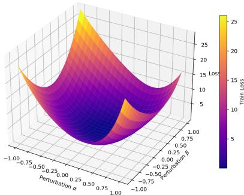  
(a) Muon

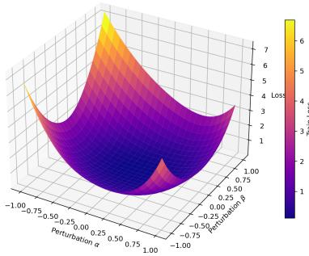  
(b) MuSAM

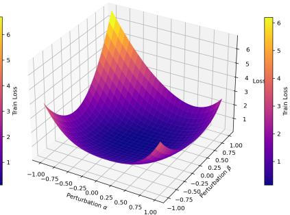  
(c) MoMuSAM  
Figure 4: 3D loss landscapes for diferent algorithms.

Table 2: Test Accuracy under diferent datasets.
<table><tr><td>Dataset</td><td>SAM</td><td>MSAM</td><td>VASSO</td><td>MUON</td><td>MuSAM</td><td>MoMuSAM</td></tr><tr><td>FMNIST</td><td> $9 3 . 8 3 { \scriptstyle \pm 0 . 1 1 }$ </td><td> $9 3 . 7 4 { \scriptstyle \pm 0 . 1 4 }$ </td><td> $9 3 . 8 6 _ { \pm 0 . 0 8 }$ </td><td> $9 4 . 1 0 { \scriptstyle \pm 0 . 0 6 }$ </td><td> $9 4 . 2 7 _ { \pm 0 . 0 8 }$ </td><td> $9 4 . 3 5 { \scriptstyle \pm 0 . 1 7 }$ </td></tr><tr><td>CIFAR-10</td><td> $8 9 . 2 7 _ { \pm 0 . 0 5 }$ </td><td> $8 9 . 4 0 { \scriptstyle \pm 0 . 0 7 }$ </td><td> $8 9 . 2 6 _ { \pm 0 . 2 5 }$ </td><td> $9 0 . 7 2 _ { \pm 0 . 2 3 }$ </td><td> $9 1 . 1 1 { \scriptstyle \pm 0 . 1 8 }$ </td><td> $9 1 . 2 1 { \scriptstyle \pm 0 . 1 9 }$ </td></tr><tr><td>CIFAR-100</td><td> $6 8 . 9 8 _ { \pm 0 . 2 9 }$ </td><td> $6 8 . 4 8 _ { \pm 0 . 1 4 }$ </td><td> $6 8 . 9 6 _ { \pm 0 . 3 3 }$ </td><td> $7 4 . 1 8 _ { \pm 0 . 2 0 }$ </td><td> $7 4 . 6 2 _ { \pm 0 . 1 7 }$ </td><td> $7 5 . 1 4 { \scriptstyle \pm 0 . 1 6 }$ </td></tr></table>

## C Additional Experiments

Experimental setup. For the baseline optimizers, we tune the hyperparameters by grid search and report the best-performing configuration for each method. In contrast, for the proposed MuSAM and MoMuSAM, the hyperparameter choices are derived directly from the theoretical prescriptions in Theorems 4.1 and 4.2. In particular, the resulting closed-form settings depend only on the total number of iterations T, and are used throughout our experiments without additional taskspecific search. This highlights an important practical advantage of our proposed methods: their hyperparameters are not only theoretically grounded, but also straightforward to instantiate in practice. All image-classification experiments related to convergence and sensitivity analysis are repeated over 10 random seeds, and we report the mean and standard deviation. For loss-landscape visualization, we follow Li, Xu, Taylor, Studer, and Goldstein [51] and plot the landscape along two random filter-normalized perturbation directions. The experiments were conducted on a host machine equipped with an Intel(R) Xeon(R) W9-3475X CPU running at 2.20 GHz (maximum turbo frequency 4.80 GHz), with 36 physical cores and 72 threads, 256 GB DDR5 ECC RAM, and a single NVIDIA(R) RTX(TM) A6000 GPU with 48 GB of memory.

Geometry analysis. The results in Figure 4, Tables 2 and 3 consistently support the central claim of our paper: introducing explicit sharpness awareness substantially strengthens Muon, and the momentum-guided design yields the strongest overall behavior. From Table 2, Muon already outperforms SAM-style baselines on all three image-classification benchmarks, confirming the benefit of matrix-aware orthogonalized updates; however, both MuSAM and MoMuSAM further improve upon Muon consistently, showing that matrix-aware update geometry and explicit sharpness control are indeed complementary. This gain becomes more pronounced on the harder dataset CIFAR-100, where MoMuSAM achieves the largest margin, suggesting that explicit local geometry control becomes increasingly valuable in more challenging and noisier optimization regimes. The geometry diagnostics in Table 3 and Figure 4 explain this trend. Relative to Muon, MuSAM sharply reduces the top Hessian eigenvalues, and MoMuSAM reduces them even further, indicating substantially flatter local curvature around the converged solution. This is also visually reflected in the 3D loss landscapes: while Muon already reaches a relatively smooth basin, MuSAM produces a visibly flatter neighborhood, and MoMuSAM yields the broadest and smoothest basin among the three. Together, these results suggest that the accuracy gains are not merely optimization artifacts, but are tightly coupled with improved local flatness. Moreover, the consistent advantage of MoMuSAM over MuSAM indicates that the quality of the perturbation signal is critical: by constructing the perturbation from the momentum state rather than a single minibatch gradient, MoMuSAM probes sharpness with a direction that is temporally aggregated, less noisy, and more informed by Muon’s accumulated optimization history, which in turn leads to a flatter solution and stronger fina generalization.

Table 3: Top 5 Hessian eigenvalues.
<table><tr><td>Algorithm</td><td> $\lambda _ { 1 }$ </td><td> $\lambda _ { 2 }$ </td><td> $\lambda _ { 3 }$ </td><td> $\lambda _ { 4 }$ </td><td> $\lambda _ { 5 }$ </td></tr><tr><td>MUON</td><td>30.21</td><td>17.89</td><td>9.50</td><td>7.59</td><td>6.08</td></tr><tr><td>MuSAM</td><td>8.71</td><td>6.42</td><td>5.42</td><td>3.48</td><td>2.71</td></tr><tr><td>MoMuSAM</td><td>5.55</td><td>3.18</td><td>1.78</td><td>1.41</td><td>1.06</td></tr></table>

Table 4: Wall-clock time test accuracy of CIFAR-10 for diferent algorithms.
<table><tr><td rowspan="2">Algorithm</td><td colspan="7">Wall-clock time test accuracy (%)</td></tr><tr><td>200 sec</td><td>500 sec</td><td>800 sec</td><td>1100 sec</td><td>1400 sec</td><td>1700 sec</td><td>2000 sec</td></tr><tr><td>SAM</td><td>68.68</td><td>74.26</td><td>78.27</td><td>81.94</td><td>84.65</td><td>85.84</td><td>86.53</td></tr><tr><td>MSAM</td><td>75.02</td><td>77.78</td><td>82.50</td><td>84.23</td><td>85.15</td><td>87.20</td><td>87.86</td></tr><tr><td>VASSO</td><td>68.40</td><td>76.17</td><td>79.17</td><td>85.26</td><td>85.35</td><td>86.33</td><td>87.64</td></tr><tr><td>Muon</td><td>83.74</td><td>85.67</td><td>88.38</td><td>88.96</td><td>89.34</td><td>89.82</td><td>90.02</td></tr><tr><td>MuSAM</td><td>83.44</td><td>86.61</td><td>87.57</td><td>89.10</td><td>89.49</td><td>89.60</td><td>89.91</td></tr><tr><td>MoMuSAM</td><td>84.30</td><td>87.27</td><td>88.45</td><td>89.22</td><td>89.67</td><td>89.93</td><td>90.23</td></tr></table>

Wall-clock time comparison. Table 4 provides a more practical view of the eficiency–performance tradeof by comparing test accuracy under the same wall-clock budget. The key observation is that MoMuSAM consistently matches or exceeds Muon across almost the entire time range, and achieves the best final accuracy overall. This is particularly significant because, unlike MuSAM, MoMuSAM does not require an additional gradient computation to construct the perturbation; instead, it reuses the momentum state already maintained by Muon, and therefore preserves essentially the same per-iteration computational profile as Muon. In other words, the gain of MoMuSAM is obtained without paying an additional wall-clock overhead relative to the base matrix-aware optimizer. By contrast, although MuSAM also improves generalization, its extra clean-gradient evaluation makes its advantage less pronounced under a fixed time budget. These results therefore highlight a central strength of our design: MoMuSAM is not only more accurate than Muon, but also achieves this improvement at nearly the same computational cost, yielding a distinctly better accuracy–eficiency tradeof in practical training.