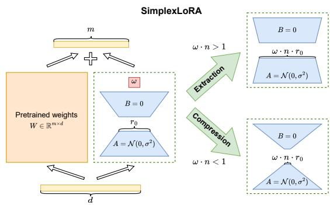
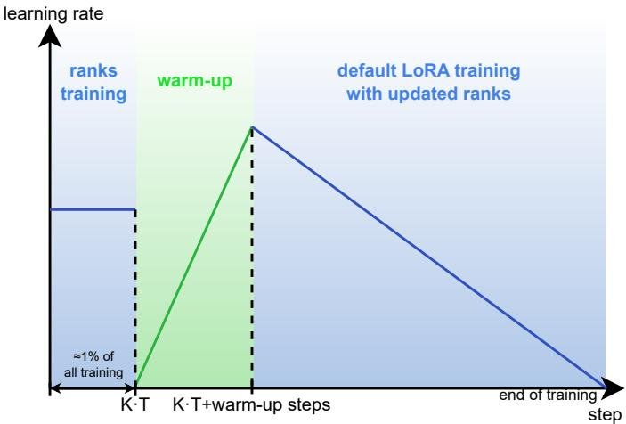
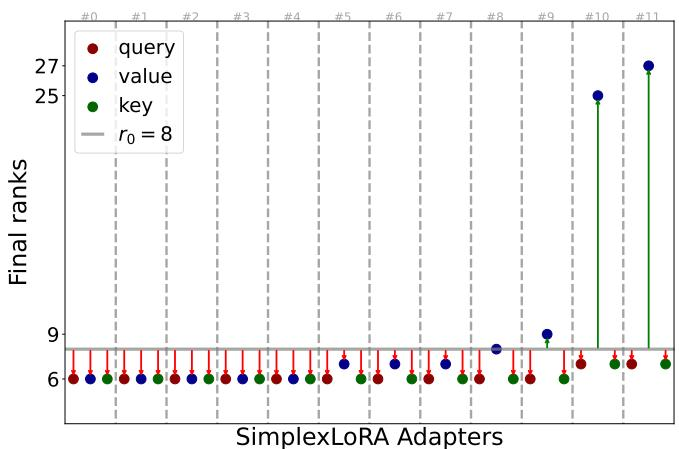
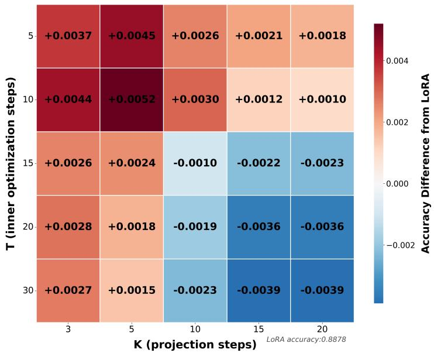

# SimplexLoRA: Dynamic Rank Updating via Alternating Minimization with Simplex Projection

Igor Shalygin1,2,\*, Grigorii Davydenko1,2,3,\*, Andrey Veprikov1,2,3, Aleksey Antonov1,2,4 Nikolay Bushkov4, Stanislav Moiseev4, Aleksandr Beznosikov1,2,5

1Moscow Independent Research Institute of Artificial Intelligence (MIRAI)

2Basic Research of Artificial Intelligence Laboratory (BRAIn Lab)

3SB AI Lab 4T-Technologies 5Innopolis University

\*Equal contribution.

The success of large language models in real-world applications relies on parameter-eficient fine-tuning methods such as Low-Rank Adaptation (LoRA), which inserts compact, trainable adapters into selected layers. In this paper, we propose SimplexLoRA, a LoRA variant that adaptively adjusts adapter ranks during fine-tuning based on their learned importance. Unlike standard LoRA, which employs a fixed rank across all layers, SimplexLoRA optimizes per-adapter importance weights on the n-scaled simplex during a short warm-up and then freezes them, dynamically allocating capacity where it is most beneficial without increasing the overall parameter budget or inference cost. We evaluate SimplexLoRA across 12 language understanding, summarization, and reasoning tasks using DeBERTaV3, BART-large, Llama 3.1 8B, and Qwen3-8B. Our results show that SimplexLoRA consistently matches or outperforms standard LoRA and recent adaptive baselines, with the largest gains at low ranks. Our code is available at https://github.com/brain-lab-research/SimplexLoRA.

## Introduction

LoRA [Hu et al., 2021] is a widely used parameter-eficient.3 fine-tuning method [Han et al., 2024] that parameterizes0 weight updates as 6 $\dot { \pmb { W } } ^ { \prime } = \pmb { W } ^ { 0 } + \pmb { A } \pmb { B }$ , with $W ^ { 0 } \in \mathbb { R } ^ { m \times }$ d frozen and trainable2 $\pmb { A } \in \mathbb { R } ^ { m \times r } , \pmb { B } \in \mathbb { R } ^ { r \times d } , \ r \ll m , d$ This approach achieves low inference overhead and sub-v stantially reduces memory during fine-tuning.i

Despite its eficiency, standard LoRA uses a fixed rank across all layers, ignoring layer-wise diferences in con-a vergence and representation learning. Existing adaptive rank allocation methods attempt to address this issue but sufer from the critical drawbacks: (i) substantially more trainable parameters [Sheng et al., 2025], (ii) nonnegligible inference-time overhead caused by dynamic pruning or gating mechanisms [Zhang et al., 2025], and (iii) deviations from the standard LoRA pipeline that hinder compatibility [Zhang et al., 2023b]. See Section 2 for further discussion.

To address this limitation, we propose SimplexLoRA, which assigns an importance weight to each of the n LoRA adapters, constrained to the n-scaled simplex to enforce a fixed parameter budget. Key properties: (i) ranks learned automatically during fine-tuning; (ii) simplex constraint preserves the LoRA parameter budget; (iii) full LoRA compatibility; (iv) negligible training and inference overhead.

  
Figure 1: SimplexLoRA framework. Per-adapter importance weights are constrained to the n-scaled simplex, enabling dynamic allocation of a fixed rank budget across layers.

## 2 Related Work

## 2.1 Classical low-rank approaches

While LoRA has popularized parameter-eficient finetuning, it is not the only method to explore low-rank or structured adaptations. Earlier approaches include LoHA [Nam et al., 2022], which utilizes element-wise (Hadamard) interactions between low-rank matrices to reduce the parameter count without sacrificing expressivity, and Krona [Edalati et al., 2022], which employs the Kronecker product in place of the conventional low-rank matrix product to improve parameter eficiency while maintaining model capacity.

Subsequent methods extended or refined the LoRA framework. VERA [Kopiczko et al., 2023] reduces adapter storage by sharing frozen random projection matrices across layers and learning small scaling vectors. rsLoRA [Kalajdzievski, 2023] replaces the original LoRA scaling factor α/r [Hu et al., 2021] with the rank-stabilized factor $\alpha / \sqrt { r }$ A complementary direction is taken by DoRA [Liu et al., 2024], which decomposes the adapted weight into magnitude and direction components and learns the magnitude together with a low-rank correction of the direction.

Another line of work improves LoRA optimization and numerical eficiency. LoRA+ [Hayou et al., 2024] uses diferent learning rates for the two adapter matrices, while QLoRA [Dettmers et al., 2023] enables memory-eficient fine-tuning through 4-bit quantization of frozen basemodel weights. Both are orthogonal to our adaptive rank allocation method and can be combined with it.

## 2.2 Dynamic LoRA rank allocation

This topic is of particular relevance in the context of our work, as we focus on adaptive rank learning, enabling the model to automatically adjust the capacity of each adapter during fine-tuning. It has attracted significant attention in recent research [Zhang et al., 2023a,b; Sheng et al., 2025], as exploiting dynamically changing ranks allows models to utilize newly allocated parameters more eficiently.

The SVD-like representation of LoRA adapters proposed in AdaLoRA [Zhang et al., 2023b] replaces the standard two-matrix adapter with the parameterization P ΛQ and enables the construction of importance scores for individual singular components. Components outside the global importance budget are masked by setting the corresponding entries of Λ to zero. To encourage the SVD-like structure, the method applies the orthogonality regular-

izer

$$
R ( P , Q ) = \| P ^ { \top } P - I \| _ { F } ^ { 2 } + \| Q ^ { \top } Q - I \| _ { F } ^ { 2 } .
$$

During training, all three matrices P , Λ, and Q are updated simultaneously. Although this parameterization avoids explicitly computing an SVD at every fine-tuning step, maintaining an initial rank above the target budget, regularly evaluating importance scores, and applying orthogonality regularization increase the training complexity compared with standard LoRA.

Several methods manage the rank budget more flexibly. ElaLoRA [Chang et al., 2025] uses SVD-based adaptation and gradient-derived importance scores to prune and expand ranks at scheduled intervals. FlexLoRA [Liu et al., 2026] uses normalized spectral entropy to guide rank pruning and expansion under a global budget. The dynamicrank DoRA of Mao et al. [2024] decomposes adapters into structured rank-one components and prunes them based on per-component importance. NormAL LoRA [Aastik et al., 2025] uses rank-norm regularization to determine an appropriate rank for each module.

In a similar way, Sheng et al. [2025] proposes a rank-one LoRA series representation of the increment matrix:

$$
\Delta W = b _ { 1 } a _ { 1 } + \ldots + b _ { p } a _ { p } = \left[ B _ { p - 1 } \quad b _ { p } \right] { \left[ \begin{array} { l } { \pmb { A } _ { p - 1 } } \\ { \pmb { a } _ { p } } \end{array} \right] } ,
$$

where p denotes the number of outer-loop iterations. This representation is applied to several layers, and after each outer-loop step a convergence criterion is evaluated: if the relative change between the $( p - 1 )$ -th and p-th solutions is suficiently small, the training of $\Delta \mathbf { W }$ is terminated. Unlike IncreLoRA, which expands modules according to gradient-based importance scores, AROMA uses the relative Frobenius-norm change between consecutive solutions as a stopping criterion.

Compared with these works, SimplexLoRA does not force adapter ranks to strictly increase or rely on expensive SVD computations. Instead, we allow the ranks to be learned as continuous parameters, enabling the model to respond dynamically to the task’s complexity. By leveraging simplex projection and weight freezing, we obtain a direct form of rank adaptation that avoids explicit importance scoring and iterative pruning.

## 3 SimplexLoRA Framework

For the LoRA method, we introduce trainable layer-wise scaling factors: $\pmb { W } _ { i } ^ { 0 } + \pmb { A } _ { i } \pmb { B } _ { i }  \pmb { W } _ { i } ^ { 0 } + \omega _ { i } \pmb { A } _ { i } \pmb { B } _ { i }$ , where $\omega _ { i } \geq$ 0 represents the importance coeficient assigned to the ith adapter. The weights $\omega = ( \omega _ { 1 } , \ldots , \omega _ { n } )$ are constrained to the n-scaled simplex, where n is the number of LoRA adapters. This preserves LoRA magnitude, with $\omega =$ $( 1 , \ldots , 1 ) = \mathbf { 1 }$ recovering standard LoRA initialization [Hu et al., 2021].

Motivated by the theoretical analysis in Appendix $\mathrm { A } ,$ SimplexLoRA formulates the following alternating optimization problem:

$$
\operatorname* { m i n } _ { \omega \in n \cdot \Delta _ { n - 1 } } \operatorname* { m i n } _ { \lambda , B } \mathcal { L } ( \omega , A , B ) + ( \lambda / 2 ) \| \omega - 1 \| _ { 2 } ^ { 2 } ,\tag{1}
$$

where A, $B = \{ A _ { i } \} _ { i = 1 } ^ { n } , \{ B _ { i } \} _ { i = 1 } ^ { n }$ denote the sets of all LoRA adapters, L is the loss, and the term $( \lambda / 2 ) \rVert \omega - \mathbf { 1 } \rVert _ { 2 } ^ { 2 }$ prevents overfitting of the importance weights ω.

## 3.1 SimplexLoRA Training Process

The SimplexLoRA algorithm employs an alternating optimization scheme with three phases, repeated for $K$ iterations.

Phase 1. Warm-up. For T steps, we perform standard LoRA fine-tuning by jointly optimizing the adapter parameters A, B and the importance weights $\omega$ using gradient-based methods.

Phase 2. Simplex projection. The weight vector ω is projected onto the scaled simplex $n \cdot \Delta _ { n - 1 }$ via Euclidean projection [Blondel et al., 2014]:

$$
\operatorname* { m i n } _ { { \hat { \omega } } \in n \cdot \Delta _ { n - 1 } } \| \omega - { \hat { \omega } } \| _ { 2 } ^ { 2 } .
$$

Phase 3. Rank update. Adapter ranks are dynamically resized while preserving the total parameter budget: $r _ { i } ^ { \mathrm { n e w } } = \lfloor r _ { 0 } \cdot \omega _ { i } \rfloor$ , where $r _ { 0 }$ is the initial (uniform) LoRA rank. When ranks change, the corresponding adapter matrices are resized and reinitialized following the standard LoRA scheme (see Appendix B).

Repeat Phases 1–3 for K iterations.

Phase 4. Standard LoRA training with new ranks. After K repetitions, we fix $\omega$ to 1 and reinitialize the adapter matrices $\mathcal { A }$ and B (Appendix B). In this sense Phases 1–3 act as a short rank-search procedure: their role is to determine the per-layer rank allocation, while the warm-up adapter weights are intentionally discarded so that the final stage is functionally identical to standard LoRA with a non-uniform rank profile. Standard training then resumes with these fixed ranks, and any LoRA-based optimization algorithm can be applied.

  
Figure 2: Scheduler for SimplexLoRA parameters.

Scheduler. To ensure that the model resumes training after freezing the weights, we employ a linear scheduler with two training phases (see Figure 2). The first phase includes rank training with reduced learning rate. Once rank training is complete, the learning rate is reset to zero, and the warm-up begins to train the resulting LoRA layers. Note, however, that the learning rate for ω is fixed during training, the scheduler exclusively adjusts the LoRA weights. As a result, the subsequent fine-tuning phase is functionally identical to the standard LoRA training process.

Discussion. The total number of rank updates, $K$ T, is kept small to avoid rank collapse and to ensure that the majority of training focuses on optimizing the LoRA adapters. In practice, T is negligible compared to the overall training duration. In the ablation study (Section 4.3), we analyze the sensitivity of SimplexLoRA to both hyperparameters K and T, evaluating their impact on performance.

## 3.2 Motivating Example of Rank Scaling

Figure 3 shows the final rank distribution from fine-tuning DeBERTaV $3 _ { \mathrm { b a s e } }$ [He et al., 2021] on the MRPC dataset from GLUE [Wang et al., 2018], tuning only self-attention layers. The learned distribution reveals a clear pattern: value projection matrices in self-attention layers consistently receive the highest ranks, indicating their critical role. Rather than eliminating ranks of adapters with low weights, the method reduces their magnitude, which helps mitigate underfitting.

Table 1: Comparative performance of "out-of-the-box" algorithms on $\mathrm { D e B E R T a V 3 _ { b a s e } }$ . The best results are shown in bold, and the second-best are underlined. All experiment details are provided in Appendix D.
<table><tr><td>Method</td><td># Params</td><td>MNLI Acc</td><td>SST-2 Acc</td><td>CoLA Mcc</td><td>QQP Acc/F1</td><td>QNLI Acc</td><td>RTE Acc</td><td>MRPC Acc/F1</td><td>ALL Avg</td></tr><tr><td>Full Fine-Tuning</td><td>184M (100%)</td><td>0.8910</td><td>0.9541</td><td>0.6806</td><td>0.8962/0.8644</td><td>0.9383</td><td>0.8376</td><td>0.8848/0.9165</td><td>0.8689</td></tr><tr><td>LoRAr=8 [Hu et al., 2021]</td><td>442K (0.24%)</td><td>0.8797</td><td>0.9450</td><td>0.6913</td><td>0.8802/0.8437</td><td>0.9301</td><td>0.8448</td><td>0.8897/0.9220</td><td>0.8696</td></tr><tr><td>LoHAr=8 [Nam et al., 2022]</td><td>884K (0.48%)</td><td>0.8560</td><td>0.9392</td><td>0.6295</td><td>0.8674/0.8269</td><td>0.9085</td><td>0.8051</td><td>0.8628/0.9007</td><td>0.8440</td></tr><tr><td>Kronar=32 [Edalati et al., 2022]</td><td>57.6K (0.03%)</td><td>0.7587</td><td>0.9289</td><td>0.5907</td><td>0.8275/0.7816</td><td>0.8605</td><td>0.7509</td><td>0.7500/0.8416</td><td>0.7878</td></tr><tr><td>VERAr=1024 [Kopiczko et al., 2023]</td><td>1.64M (0.88%)</td><td>0.8355</td><td>0.9404</td><td>0.6252</td><td>0.8592/0.8203</td><td>0.8975</td><td>0.7581</td><td>0.8529/0.8962</td><td>0.8317</td></tr><tr><td>rsLoRAr=8 [Kalajdzievski, 2023]</td><td>442K (0.24%)</td><td>0.8814</td><td>0.9564</td><td>0.6414</td><td>0.8853/0.8506</td><td>0.9325</td><td>0.8267</td><td>0.8750/0.9122</td><td>0.8624</td></tr><tr><td>DoRAr=8 [Liu et al., 2024]</td><td>442K (0.24%)</td><td>0.8811</td><td>0.9473</td><td>0.6748</td><td>0.8809/0.8451</td><td>0.9295</td><td>0.7978</td><td>0.8799/0.9139</td><td>0.8611</td></tr><tr><td>AdaLoRAr=8 [Zhang et al., 2023b]</td><td>664K (0.36%)</td><td>0.8390</td><td>0.9392</td><td>0.6222</td><td>0.8534/0.8083</td><td>0.8999</td><td>0.7834</td><td>0.8859/0.9178</td><td>0.8388</td></tr><tr><td>NormAL LoRAr=8 [Aastik et al., 2025]</td><td>442K (0.24%)</td><td>0.8814</td><td>0.9328</td><td>0.6857</td><td>0.8768/0.8403</td><td>0.9282</td><td>0.8292</td><td>0.8870/0.9195</td><td>0.8645</td></tr><tr><td>ElaLoRAr=8 [Chang et al., 2025]</td><td>442K (0.24%)</td><td>0.8853</td><td>0.9501</td><td>0.6638</td><td>0.8979/0.8628</td><td>0.9146</td><td>0.8031</td><td>0.8782/0.9113</td><td>0.8630</td></tr><tr><td> $\mathsf { F l e x L o R A } _ { r = 8 } \ \mathsf { \left[ L i u \ e t \ a l . , \ 2 0 2 6 \right] }$ </td><td>664K (0.36%)</td><td>0.8711</td><td>0.9557</td><td>0.6331</td><td>0.8684/0.8658</td><td>0.9343</td><td>0.8392</td><td>0.9014/0.9217</td><td>0.8656</td></tr><tr><td> $\mathsf { S i m p l e } \mathsf { x L o R A } _ { r = 8 }$ </td><td>442K (0.24%)</td><td>0.8984</td><td>0.9587</td><td>0.6572</td><td>0.9124/0.8844</td><td>0.9362</td><td>0.8339</td><td>0.8987/0.9289</td><td>0.8788</td></tr></table>

  
Figure 3: Illustration of the rank distribution of SimplexLoRA.

## 4 Experiments

We evaluate SimplexLoRA on a diverse set of benchmarks, including GLUE [Wang et al., 2018], XSum [Narayan et al., 2018], CNN/Daily Mail [Chen et al., 2016], GSM8K [Cobbe et al., 2021], BoolQ [Clark et al., 2019], and HellaSwag [Zellers et al., 2019]. We exclude GLUE STS-B, whose regression metric requires custom evaluation and which overlaps with the QQP/MRPC similarity tasks. Experiments are conducted using $\mathrm { D e B E R T a V 3 _ { b a s e } }$ [He et al., 2021], Llama 3.1 8B [AI@Meta, 2024], Qwen3-8B [Yang et al., 2025], and BART-large [Lewis et al., 2020] models. Hardware and hyperparameters are provided in Appendix D.

## 4.1 Out-of-the-box Comparison

We benchmark against baselines in default configurations under a number of training iterations. These span foundational PEFT methods (a performance floor) and recent dynamic-rank methods comparable to SimplexLoRA:

Standard PEFT methods: LoRA [Hu et al., 2021], LoHA [Nam et al., 2022], Krona [Edalati et al., 2022], rsLoRA [Kalajdzievski, 2023], DoRA [Liu et al., 2024], and VERA [Kopiczko et al., 2023].

Dynamic rank methods: AdaLoRA [Zhang et al., 2023b], NormAL LoRA [Aastik et al., 2025], ElaLoRA [Chang et al., 2025], and FlexLoRA [Liu et al., 2026].

In this setting (Table 1), where adapters are applied only to self-attention layers, full fine-tuning, standard LoRA, and SimplexLoRA emerge as the most robust methods, with SimplexLoRA achieving the best average score at the same 0.24% parameter budget as standard LoRA. Other approaches require extensive hyperparameter tuning to achieve competitive performance. Consequently, we select standard LoRA as our primary baseline for further detailed comparison due to its widespread adoption and stability.

## 4.2 Comparison with LoRA

Table 2 compares SimplexLoRA with standard LoRA at multiple ranks on $\mathrm { D e B E R T a V 3 _ { b a s e } }$ and Llama 3.1 8B (adapters in all linear layers, hyperparameters tuned per method). Across most GLUE tasks, SimplexLoRA consistently outperforms LoRA while maintaining the same computational cost. For generality, we also evaluate Qwen3-8B (GSM8K, BoolQ, HellaSwag) and BART-large (XSum, CNN/DailyMail) in Table 3. As on GLUE, SimplexLoRA matches or outperforms LoRA on most of these tasks, confirming the trend across architectures and task types. The improvement is most pronounced at low ranks $( r \in \{ 1 , 2 \} )$ , where the tight capacity budget of standard LoRA gives adaptive allocation the most room

Table 2: Comparative results of top-performing algorithms: LoRA (L) and SimplexLoRA (S) on DeBERTa $/ 3 _ { \mathrm { b a s e } }$ and Llama 3.1 8B. Results are averaged over 3 runs with diferent seeds. The best results per rank are shown in bold. All experiment details are provided in Appendix D.
<table><tr><td>Model</td><td>Rank</td><td>Method</td><td>MNLI Acc</td><td>SST-2 Acc</td><td>CoLA Mcc</td><td>QQP  $\operatorname { A c c } / \operatorname { F 1 }$ </td><td>QNLI Acc</td><td>RTE Acc</td><td>MRPC Acc/F1</td><td>ALL Avg</td></tr><tr><td rowspan="5"> $\mathrm { D e B E R T a V 3 _ { b a s e } }$ </td><td>r = 1</td><td>L S</td><td>0.8912 0.8913</td><td>0.9488 0.9576</td><td>0.6558 0.6775</td><td>0.8905/0.8544 0.9018/0.8709</td><td>0.9250 0.9317</td><td>0.7943 0.8159</td><td>0.8905/0.9213 0.9093/0.9359</td><td>0.8562 0.8690</td></tr><tr><td>r = 2</td><td>L S</td><td>0.9004 0.8946</td><td>0.9413 0.9608</td><td>0.6600 0.6658</td><td>0.9077/0.8631 0.9178/0.8842</td><td>0.9369 0.9338</td><td>0.8068 0.8252</td><td>0.9003/0.9193 0.9103/0.9314</td><td>0.8629 0.8717</td></tr><tr><td>r = 4</td><td>L S</td><td>0.8780 0.9002</td><td>0.9562 0.9610</td><td>0.6809 0.6807</td><td>0.9153/0.8866 0.9244/0.8903</td><td>0.9582 0.9358</td><td>0.7816 0.8259</td><td>0.9207/0.9471 0.9044/0.9322</td><td>0.8700 0.8756</td></tr><tr><td>r = 8</td><td>L S</td><td>0.9030 0.9047</td><td>0.9641 0.9619</td><td>0.6965 0.6978</td><td>0.9092/0.8723 0.9129/0.8901</td><td>0.9449 0.9447</td><td>0.8537 0.8305</td><td>0.9064/0.9127 0.9267/0.9475</td><td>0.8804 0.8826</td></tr><tr><td>r = 1</td><td>L S</td><td>0.8961 0.8861</td><td>0.9751 0.9801 0.9751</td><td>0.7015 0.6829 0.6967</td><td>0.8891/0.8370 0.8891/0.8379</td><td>0.9411 0.9431</td><td>0.9016 0.9204</td><td>0.9154/0.9408 0.9278/0.9404</td><td>0.8886 0.8898</td></tr><tr><td rowspan="2">Llama 3.1 8B</td><td>r = 2</td><td>L S</td><td>0.8996 0.8998</td><td>0.9801</td><td>0.6981</td><td>0.8851/0.8311 0.8851/0.8316</td><td>0.9421 0.9381</td><td>0.9154 0.9353</td><td>0.9204/0.9441 0.9254/0.9466</td><td>0.8900 0.8933</td></tr><tr><td>r = 4</td><td>L S L S</td><td>0.8993 0.9004 0.8995 0.9016</td><td>0.9800 0.9823 0.9851 0.9851</td><td>0.6902 0.7069 0.6928 0.7058</td><td>0.8851/0.8286 0.8891/0.8325 0.8851/0.8306</td><td>0.9391 0.9421 0.9421</td><td>0.9154 0.9304 0.9104</td><td>0.9254/0.9462 0.9204/0.9429 0.9154/0.9419</td><td>0.8899 0.8941 0.8892</td></tr></table>

Table 3: Comparative results: LoRA (L) and SimplexLoRA (S) on Qwen3-8B and BART-large. The best results per rank and model are shown in bold. All details are provided in Appendix D.
<table><tr><td rowspan="2"></td><td rowspan="2">RankMethod</td><td colspan="4">Qwen3-8B</td><td colspan="2">BART-large</td></tr><tr><td>GSM8K Acc</td><td>BoolQ Acc</td><td>HellaSwag Acc</td><td>ALL Avg</td><td>XSum ROUGE-1</td><td>CNN/DailyMail ROUGE-1</td></tr><tr><td rowspan="2">r = 1</td><td>L</td><td>0.8522</td><td>0.655</td><td>0.772</td><td>0.760</td><td>0.372</td><td>0.245</td></tr><tr><td>S</td><td>0.8666</td><td>0.680</td><td>0.775</td><td>0.774</td><td>0.373</td><td>0.249</td></tr><tr><td rowspan="2">r = 2</td><td>L</td><td>0.8681</td><td>0.662</td><td>0.776</td><td>0.769</td><td>0.374</td><td>0.250</td></tr><tr><td>S</td><td>0.8673</td><td>0.682</td><td>0.791</td><td>0.780</td><td>0.376</td><td>0.254</td></tr><tr><td rowspan="2">r = 4</td><td>L</td><td>0.8537</td><td>0.691</td><td>0.777</td><td>0.774</td><td>0.375</td><td>0.255</td></tr><tr><td>S</td><td>0.8719</td><td>0.700</td><td>0.780</td><td>0.784</td><td>0.378</td><td>0.256</td></tr><tr><td rowspan="2">r = 8</td><td>L</td><td>0.8681</td><td>0.691</td><td>0.782</td><td>0.780</td><td>0.380</td><td>0.257</td></tr><tr><td>S</td><td>0.8741</td><td>0.699</td><td>0.790</td><td>0.788</td><td>0.379</td><td>0.259</td></tr></table>

to help.

## 4.3 Ablation Study

As supplementary analysis, we grid-search hyperparameters on MNLI with DeBERTa to assess the robustness (Figure 4). Both methods are trained for 2048 steps using the best configuration from the main experiments; each cell reports the validation-accuracy diference.

The results show that SimplexLoRA is stable under a limited optimization budget $( K \cdot T < 1 0 0 $ , i.e., less than 5% of total training). Very small values $( \mathrm { e . g . } , \ K \ =$ $3 , T = 5 )$ lead to underfitting due to insuficient rank adaptation, while larger values $( \mathrm { e . g . } , K \ge 1 0 \mathrm { o r } T \ge 1 5 )$

Accuracy Difference from LoRA  
  
Figure 4: The influence of hyperparameters on SimplexLoRA performance.

tend to cause rank overfitting. Beyond these thresholds, we find that increasing the number of projection steps and inner iterations results in a performance plateau, with values showing minimal deviation from the average. This confirms the importance of keeping K · T low to maintain eficiency without performance loss. In all experiments, we use K = 5 and $T = 1 0$ , which consistently yields

strong performance.

## 5 Conclusion

We presented SimplexLoRA, a LoRA variant that allocates a fixed rank budget non-uniformly across layers via short alternating optimization on the n-scaled simplex. Across 12 tasks and four backbones up to 8B parameters, SimplexLoRA matches or outperforms standard LoRA and recent adaptive baselines at the same parameter count and inference cost, with the largest gains in the low-rank regime.

## Limitations

The limitations of the proposed strategy are as follows. First, SimplexLoRA introduces three additional hyperparameters: the number of iterations between simplex projection steps T, the total number of such projections K, and the weight decay coeficient used for regularization; the ablation in Section 4.3 indicates that the method is robust within a broad range but does not eliminate the need to set these values. Second, the lack of experiments on models substantially larger than 8B parameters limits the generalizability of our findings. Third, while the per-task averages over three seeds consistently favor SimplexLoRA, on a few individual tasks (e.g., CoLA and RTE in the out-of-the-box DeBERTaV3 comparison) standard LoRA remains competitive or slightly better, indicating that the benefit of adaptive rank allocation is task-dependent. Fourth, a fundamental ambiguity remains during training: a small gradient norm in a layer may indicate either that the weights are well-optimized or that the gradients have vanished by the time they reach that layer, which can in principle bias the learned importance weights.

On the ethical side, we see no specific risks beyond those already inherent to fine-tuning large language models: this work studies a parameter-eficient adaptation procedure, introduces no new data sources, uses only publicly available benchmarks with no proprietary or personal data and no human subjects, and reduces rather than increases the compute and memory footprint of fine-tuning.

## Acknowledgments

The work of A. Beznosikov was supported by the Russian Science Foundation (project no. 21-71-30005-P).

## References

Aastik, Meghana Topu, Chinmay Kulkarni, and Pragya Paramita Sahu. NormAL LoRA: What is the perfect size? In Christos Christodoulopoulos, Tanmoy Chakraborty, Carolyn Rose, and Violet Peng, editors, Findings of the Association for Computational Linguistics: EMNLP 2025, pages 19716–19731, Suzhou, China, November 2025. Association for Computational Linguistics. ISBN 979-8-89176-335-7. doi: 10.18653/v1/2025.findings-emnlp.1074. URL https: //aclanthology.org/2025.findings-emnlp.1074/.

AI@Meta. The llama 3 herd of models, 2024. URL https://arxiv.org/abs/2407.21783.

Mathieu Blondel, Akinori Fujino, and Naonori Ueda. Large-scale multiclass support vector machine training via euclidean projection onto the simplex. In 2014 22nd International Conference on Pattern Recognition, pages 1289–1294, 2014. doi: 10.1109/ICPR.2014.231.

Huandong Chang, Zicheng Ma, Mingyuan Ma, Zhenting Qi, Andrew Sabot, Hong Jiang, and H. T. Kung. ElaLoRA: Elastic and learnable low-rank adaptation for eficient model fine-tuning. arXiv preprint arXiv:2504.00254, 2025.

Danqi Chen, Jason Bolton, and Christopher D. Manning. A thorough examination of the CNN/Daily Mail reading comprehension task. In Proceedings of the 54th Annual Meeting of the Association for Computational Linguistics (Volume 1: Long Papers), pages 2358–2367, 2016. doi: 10.18653/v1/P16-1223.

Christopher Clark, Kenton Lee, Ming-Wei Chang, Tom Kwiatkowski, Michael Collins, and Kristina Toutanova. Boolq: Exploring the surprising dificulty of natural yes/no questions. arXiv preprint arXiv:1905.10044, 2019.

Karl Cobbe, Vineet Kosaraju, Mohammad Bavarian, Mark Chen, Heewoo Jun, Lukasz Kaiser, Matthias Plappert, Jerry Tworek, Jacob Hilton, Reiichiro Nakano, Christopher Hesse, and John Schulman. Training verifiers to solve math word problems. arXiv preprint arXiv:2110.14168, 2021.

Tim Dettmers, Artidoro Pagnoni, Ari Holtzman, and Luke Zettlemoyer. QLoRA: Eficient finetuning of quantized llms. arXiv preprint arXiv:2305.14314, 2023.

Ali Edalati, Marzieh Tahaei, Ivan Kobyzev, Vahid Partovi Nia, James J Clark, and Mehdi Rezagholizadeh. Krona: Parameter eficient tuning with kronecker adapter. arXiv preprint arXiv:2212.10650, 2022.

Ilyas Fatkhullin, Jalal Etesami, Niao He, and Negar Kiyavash. Sharp analysis of stochastic optimization under global kurdyka-lojasiewicz inequality. Advances in Neural Information Processing Systems, 35:15836– 15848, 2022.

Zeyu Han, Chao Gao, Jinyang Liu, Jef Zhang, and Sai Qian Zhang. Parameter-eficient fine-tuning for large models: A comprehensive survey. arXiv preprint arXiv:2403.14608, 2024.

Soufiane Hayou, Nikhil Ghosh, and Bin Yu. LoRA+: Eficient low rank adaptation of large models. arXiv preprint arXiv:2402.12354, 2024.

Kaiming He, Xiangyu Zhang, Shaoqing Ren, and Jian Sun. Delving deep into rectifiers: Surpassing humanlevel performance on imagenet classification. In Proceedings of the IEEE international conference on computer vision, pages 1026–1034, 2015.

Pengcheng He, Jianfeng Gao, and Weizhu Chen. Debertav3: Improving deberta using electra-style pretraining with gradient-disentangled embedding sharing. arXiv preprint arXiv:2111.09543, 2021.

Oliver Hinder, Aaron Sidford, and Nimit Sohoni. Nearoptimal methods for minimizing star-convex functions and beyond. In Conference on learning theory, pages 1894–1938. PMLR, 2020.

Edward J Hu, Yelong Shen, Phillip Wallis, Zeyuan Allen-Zhu, Yuanzhi Li, Shean Wang, Lu Wang, and Weizhu Chen. LoRA: Low-rank adaptation of large language models. arXiv preprint arXiv:2106.09685, 2021.

Damjan Kalajdzievski. A rank stabilization scaling factor for fine-tuning with lora. arXiv preprint arXiv:2312.03732, 2023.

Ahmed Khaled, Othmane Sebbouh, Nicolas Loizou, Robert M Gower, and Peter Richtárik. Unified analysis of stochastic gradient methods for composite convex and smooth optimization. Journal of Optimization Theory and Applications, 199(2):499–540, 2023.

Bobby Kleinberg, Yuanzhi Li, and Yang Yuan. An alternative view: When does sgd escape local minima? In

International conference on machine learning, pages 2698–2707. PMLR, 2018.

Dawid J Kopiczko, Tijmen Blankevoort, and Yuki M Asano. VeRA: Vector-based random matrix adaptation. arXiv preprint arXiv:2310.11454, 2023.

Mike Lewis, Yinhan Liu, Naman Goyal, Marjan Ghazvininejad, Abdelrahman Mohamed, Omer Levy, Veselin Stoyanov, and Luke Zettlemoyer. BART: Denoising sequence-to-sequence pre-training for natural language generation, translation, and comprehension. In Proceedings of the 58th Annual Meeting of the Association for Computational Linguistics, pages 7871–7880. Association for Computational Linguistics, 2020. doi: 10.18653/v1/2020.acl-main.703.

Muqing Liu, Chongjie Si, and Yuheng Jia. FlexLoRA: Entropy-guided flexible low-rank adaptation. In International Conference on Learning Representations, 2026. URL https://openreview.net/forum?id= tqnkbdYWWm.

Shih-Yang Liu, Chien-Yi Wang, Hongxu Yin, Pavlo Molchanov, Yu-Chiang Frank Wang, Kwang-Ting Cheng, and Min-Hung Chen. DoRA: Weightdecomposed low-rank adaptation. arXiv preprint arXiv:2402.09353, 2024.

Ilya Loshchilov and Frank Hutter. Decoupled weight decay regularization. In International Conference on Learning Representations, 2019. URL https:// openreview.net/forum?id=Bkg6RiCqY7.

Yulong Mao, Kaiyu Huang, Changhao Guan, Ganglin Bao, Fengran Mo, and Jinan Xu. DoRA: Enhancing parameter-eficient fine-tuning with dynamic rank distribution. arXiv preprint arXiv:2405.17357, 2024.

Hyeon-Woo Nam, Ye-Bin Moon, and Tae-Hyun Oh. Fed-Para: Low-rank hadamard product for communicationeficient federated learning. In International Conference on Learning Representations, 2022. URL https://openreview.net/forum?id=d71n4ftoCBy.

Shashi Narayan, Shay B. Cohen, and Mirella Lapata. Don’t give me the details, just the summary! Topicaware convolutional neural networks for extreme summarization. In Proceedings of the 2018 Conference on Empirical Methods in Natural Language Processing, pages 1797–1807, 2018. doi: 10.18653/v1/D18-1206.

Hao Nan Sheng, Zhi yong Wang, Mingrui Yang, and Hing Cheung So. Aroma: Autonomous rank-one matrix adaptation, 2025. URL https://arxiv.org/abs/2504. 05343.

Alex Wang, Amanpreet Singh, Julian Michael, Felix Hill, Omer Levy, and Samuel R. Bowman. GLUE: A multi-task benchmark and analysis platform for natural language understanding. In Proceedings of the 2018 EMNLP Workshop BlackboxNLP, pages 353–355. Association for Computational Linguistics, 2018. doi: 10.18653/v1/W18-5446.

An Yang, Anfeng Li, Baosong Yang, Beichen Zhang, Binyuan Hui, Bo Zheng, Bowen Yu, Chang Gao, Chengen Huang, Chenxu Lv, Chujie Zheng, Dayiheng Liu, Fan Zhou, Fei Huang, Feng Hu, Hao Ge, Haoran Wei, Huan Lin, Jialong Tang, Jian Yang, Jianhong Tu, Jianwei Zhang, Jianxin Yang, Jiaxi Yang, Jing Zhou, Jingren Zhou, Junyang Lin, Kai Dang, Keqin Bao, Kexin Yang, Le Yu, Lianghao Deng, Mei Li, Mingfeng Xue, Mingze Li, Pei Zhang, Peng Wang, Qin Zhu, Rui Men, Ruize Gao, Shixuan Liu, Shuang Luo, Tianhao Li, Tianyi Tang, Wenbiao Yin, Xingzhang Ren, Xinyu Wang, Xinyu Zhang, Xuancheng Ren, Yang Fan, Yang Su, Yichang Zhang, Yinger Zhang, Yu Wan, Yuqiong Liu, Zekun Wang, Zeyu Cui, Zhenru Zhang, Zhipeng Zhou, and Zihan Qiu. Qwen3 technical report, 2025. URL https://arxiv.org/abs/2505.09388.

Rowan Zellers, Ari Holtzman, Yonatan Bisk, Ali Farhadi, and Yejin Choi. Hellaswag: Can a machine really finish your sentence? arXiv preprint arXiv:1905.07830, 2019.

Dacao Zhang, Kun Zhang, Shimao Chu, Le Wu, Xin Li, and Si Wei. More: A mixture of low-rank experts for adaptive multi-task learning. arXiv preprint arXiv:2505.22694, 2025.

Feiyu Zhang, Liangzhi Li, Junhao Chen, Zhouqiang Jiang, Bowen Wang, and Yiming Qian. Increlora: Incremental parameter allocation method for parametereficient fine-tuning, 2023a. URL https://arxiv.org/ abs/2308.12043.

Qingru Zhang, Minshuo Chen, Alexander Bukharin, Nikos Karampatziakis, Pengcheng He, Yu Cheng, Weizhu Chen, and Tuo Zhao. AdaLoRA: Adaptive budget allocation for parameter-eficient fine-tuning. arXiv preprint arXiv:2303.10512, 2023b.

Yi Zhou, Junjie Yang, Huishuai Zhang, Yingbin Liang, and Vahid Tarokh. Sgd converges to global minimum

in deep learning via star-convex path. arXiv preprint arXiv:1901.00451, 2019.

## Appendix

Supplementary Materials for SimplexLoRA: Dynamic Rank Updating via Alternating Minimization with Simplex Projection

## A SimplexLoRA: theoretical motivation

This section presents a heuristic argument that motivates the simplex-constrained reparameterization of Section 3. We do not claim a formal optimization guarantee in the non-convex setting; the goal is to clarify why importance weights on a simplex are a natural device for redistributing adapter capacity.

Consider a loss function $\mathcal { L } ( W ^ { 1 } , \ldots , W ^ { n } )$ for a machine learning model with n layers. In the context of fine-tuning an LLM using the LoRA algorithm, the optimization problem can be formulated as

$$
\operatorname* { m i n } _ { A , B } \left\{ { \mathcal { L } } ( A , B ) : = { \mathcal { L } } ( A ^ { 1 } B ^ { 1 } , \ldots , A ^ { n } B ^ { n } ) \right\} ,
$$

where A and B denote the sets of all LoRA adapters. To generalize this formulation, we introduce a non-negative scaling factor $\omega _ { i } ~ \geq ~ 0$ for each layer i, which can be interpreted as rescaling the adapter matrix $A ^ { i }$ by $\omega _ { i }$ . For the purposes of the present derivation, we constrain the vector $\omega : = ( \omega _ { 1 } , \ldots , \omega _ { n } )$ to lie on the probability simplex $\begin{array} { r } { \Delta _ { n - 1 } , \mathrm { i . e . , } \sum _ { i = 1 } ^ { n } \omega _ { i } = 1 } \end{array}$ ; the n-scaled simplex used in the algorithm (Section 3) is the same object up to a factor of $n ,$ chosen so that the uniform vector $\omega = \bf 1$ recovers standard LoRA. The resulting optimization problem is then

$$
\operatorname* { m i n } _ { \ A , B } \left\{ { \mathcal { L } } ( \omega _ { 1 } A ^ { 1 } B ^ { 1 } , \ldots , \omega _ { n } A ^ { n } B ^ { n } ) \right\} .
$$

Note that this reparameterization does not alter the expressive power of the model, as the scaling factors can be absorbed into the adapter matrices.

A classical simplifying assumption in the optimization literature is that $\mathcal { L }$ is convex [Khaled et al., 2023] with respect to all parameters $\{ W ^ { \bar { 1 } } , \dotsc , W ^ { n } \}$ . For deep networks this is generally false, but convex analysis is still commonly used as a guiding lens: empirical studies report local convexity along training trajectories [Kleinberg et al., 2018; Zhou et al., 2019], and many non-convex results build on convex foundations [Hinder et al., 2020; Fatkhullin et al., 2022]. We adopt this assumption only to derive the upper bound below; the resulting prescription on ω is then transferred back to the non-convex setting as a design heuristic, not as a guarantee.

Therefore, if we take $\mathcal { A } ^ { i } \cdot \mathcal { B } ^ { i } : = \{ 0 , \dotsc , A ^ { i } B ^ { i } , \dotsc , 0 \}$ , that is, we fine-tune only the i-th layer, then, by the convexity of $\mathcal { L }$ (Jensen’s inequality), we obtain:

$$
\begin{array} { r l } & { \underset { A , B } { \operatorname* { m i n } } \left. \mathcal { L } ( A , B ) \right. } \\ & { = \underset { A , B } { \operatorname* { m i n } } \left. \mathcal { L } ( \omega _ { 1 } A ^ { 1 } B ^ { 1 } , \ldots , \omega _ { n } A ^ { n } B ^ { n } ) \right. } \\ & { = \underset { A , B } { \operatorname* { m i n } } \left. \mathcal { L } \left( \underset { \mathrm { i = 1 } } { \overset { n } { \sum } } \omega _ { i } \cdot \{ 0 , \ldots , A ^ { i } B ^ { i } , \ldots , 0 \} \right) \right. } \\ & { \leq \underset { A , B } { \operatorname* { m i n } } \left. \underset { i = 1 } { \overset { n } { \sum } } \omega _ { i } \mathcal { L } \left( A ^ { i } \cdot B ^ { i } \right) \right. } \\ & { = \underset { i = 1 } { \overset { n } { \sum } } \omega _ { i } \underset { A ^ { i } , B ^ { i } } { \operatorname* { m i n } } \left. \mathcal { L } ( 0 , \ldots , A ^ { i } B ^ { i } , \ldots , 0 ) \right. . } \end{array}
$$

Thus, the original fine-tuning problem is upper-bounded by a weighted sum of n single-layer fine-tuning problems. Minimizing this upper bound over $\omega \in \Delta _ { n - 1 }$ allocates weight to the layer with the smallest single-layer minimum: the i-th coordinate of the resulting $\omega$ exceeds the j-th if and only if

$$
\operatorname* { m i n } _ { \boldsymbol { A } ^ { i } , \boldsymbol { B } ^ { i } } \mathcal { L } ( \boldsymbol { A } ^ { i } \cdot \boldsymbol { B } ^ { i } ) \leq \operatorname* { m i n } _ { \boldsymbol { A } ^ { j } , \boldsymbol { B } ^ { j } } \mathcal { L } ( \boldsymbol { A } ^ { j } \cdot \boldsymbol { B } ^ { j } ) ,
$$

since otherwise swapping their positions would yield a smaller upper bound. Reading this in reverse, components of ω rank the layers by their single-layer "fitting potential". SimplexLoRA uses this ranking as a proxy for layer importance and reallocates adapter rank accordingly: well-adapted layers receive higher ranks, weaker ones lower. We emphasize that this argument bounds the loss, not the rank distribution itself, so the connection to optimal ranks remains a heuristic; its empirical efectiveness is reported in Section 3 and the ablation in Section 4.3.

Note that to prevent ω from degenerating into a one-hot vector, which is a common issue in simplex-constrained optimization where a single component dominates, one can apply regularization. In our implementation, we use a standard Euclidean regularization term to encourage ω to remain closer to a uniform distribution across all components.

## B Adapter Reinitialization

To ensure that the reinitialized adapters do not introduce immediate perturbations to the model’s output, we follow the standard LoRA initialization scheme.

$A ^ { i }$ initialized using the Kaiming uniform distribution [He et al., 2015] to preserve the variance of activations: $A ^ { i } \sim U \left( - d _ { i n } ^ { - 0 . 5 } , d _ { i n } ^ { - 0 . 5 } \right)$ 2 $\bullet B ^ { i }$ initialized to zero.

This combination ensures that the initial product $A ^ { i } B ^ { i } =$ 0, maintaining the model’s performance at the start of the final training stage while providing a stable gradient flow for the new parameters.

## C Simplex Projections

While softmax and weighted softmax transformations are commonly used for projecting onto the simplex, we observed severe performance degradation during training when applying these methods. Their behavior is highly sensitive to temperature scaling: low temperatures tend to produce nearly one-hot distributions, whereas high temperatures result in almost uniform outputs. Such degeneracies are particularly problematic in our setting, where the goal is to eficiently allocate the rank budget across multiple adapters without inducing excessive sparsity or uniformity. For these reasons, we utilize the standard Euclidean regularization in the optimization problem formulation equation 1, rather than alternatives such as KL divergence.

## D Experimental Details

The core algorithm is implemented in $\mathrm { P y }$ Torch using the Huggingface library. All experiments are conducted on NVIDIA A100-SXM4-80GB GPUs. Following standard LoRA practice, we use the scaling factor $\alpha / r$ with $\alpha = 3 2$ and dynamically updated ranks $r _ { i } ^ { \mathrm { n e w } }$ [Hu et al., 2021]. To support simplex projection and dynamic rank reallocation, we employ a modified AdamW optimizer [Loshchilov and Hutter, 2019] with specialized update steps for $\omega ,$ rank resizing, and a custom learning rate schedule.

Training and optimization hyperparameters for each experimental setup are summarized in Tables 4, 5, 6, 7, and 8. The LR warm-up values reported in these tables refer to the learning-rate scheduler and are not SimplexLoRA rank-search hyperparameters. For the first table, the learning rate was either adopted from the original publications or selected via a small grid search. For the DeBERTa, Llama, and Qwen setups, the optimal configuration for each task was determined via an independent grid search over the specified hyperparameter ranges. For GSM8K, we use few-shot chain-of-thought prompting with flexible answer extraction during evaluation. All the results were averaged across 3 random seeds.

Table 4: Hyperparameters for out-of-the-box comparison (Table 1).
<table><tr><td>Hyperparameter</td><td>|Value</td></tr><tr><td>Optimizer</td><td>AdamW</td></tr><tr><td> $\beta _ { 1 } , \beta _ { 2 }$  </td><td>0.9,0.999</td></tr><tr><td>Model learning rate</td><td>Tuned (PEFT)</td></tr><tr><td>Learning rate (ω)</td><td>5</td></tr><tr><td>LR warm-up</td><td>30</td></tr><tr><td>Reg. weight decay</td><td>0</td></tr><tr><td>Dropout</td><td>0.05</td></tr><tr><td>Grad. accumulation</td><td></td></tr><tr><td>Training budget</td><td>6 512 iterations</td></tr><tr><td>Batch size</td><td>32</td></tr><tr><td>Scheduler</td><td>Linear</td></tr><tr><td>Target layers</td><td>Query, Key, Value</td></tr></table>

Table 5: Hyperparameters for $\mathrm { D e B E R T a V 3 _ { b a s e } }$ experiments (Table 2).
<table><tr><td>Hyperparameter</td><td>|Value / Grid</td></tr><tr><td>Optimizer</td><td>AdamW</td></tr><tr><td> $\beta _ { 1 } , \beta _ { 2 }$ </td><td>0.9,0.999</td></tr><tr><td>Model learning rate</td><td> $\{ 3 , 5 , 8 , 1 0 , 3 0 , 5 0 , 8 0 , 1 0 0 \} \times 1 0 ^ { - 5 }$ </td></tr><tr><td>Learning rate (ω)</td><td>5</td></tr><tr><td>LR warm-up</td><td> $\{ 0 , 2 0 , 3 0 , 5 0 , 7 0 , 1 0 0 , 2 0 0 \}$ </td></tr><tr><td>Reg. weight decay</td><td> $\{ 0 , 1 0 ^ { 0 } , 1 0 ^ { - 1 } , \ldots , 1 0 ^ { - 6 } \}$ </td></tr><tr><td>Dropout</td><td>0.05</td></tr><tr><td>Grad. accumulation</td><td>6</td></tr><tr><td>Training budget</td><td>task-specific</td></tr><tr><td>Batch size</td><td>task-specific</td></tr><tr><td>Scheduler</td><td>Two-phase (Linear)</td></tr><tr><td colspan="2">Target layers All linear layers Task-specific (# epochs / batch size)</td></tr></table>

Table 6: Hyperparameters for Llama 3.1 8B experiments (Table 2).
<table><tr><td>Hyperparameter</td><td>|Value / Grid</td></tr><tr><td>Optimizer</td><td>AdamW</td></tr><tr><td>β1, β2</td><td>0.9,0.999</td></tr><tr><td>Model learning rate</td><td> $\{ 3 , 5 , 8 , 1 0 , 3 0 , 5 0 , 8 0 , 1 0 0 \} { \times } 1 0 ^ { - 5 }$ </td></tr><tr><td>Learning rate (ω)</td><td>5</td></tr><tr><td>LR warm-up</td><td>50</td></tr><tr><td>Reg. weight decay</td><td> $\{ 0 , 1 0 ^ { 0 } , 1 0 ^ { - 1 } , \ldots , 1 0 ^ { - 6 } \}$ </td></tr><tr><td>Dropout</td><td>0.05 1</td></tr><tr><td>Grad. accumulation</td><td></td></tr><tr><td>Training budget</td><td>1024 iterations</td></tr><tr><td>Batch size</td><td>16</td></tr><tr><td>Scheduler</td><td>Two-phase (Cosine)</td></tr><tr><td>Target layers</td><td>All linear layers</td></tr></table>

Table 7: Hyperparameters for Qwen3-8B experiments (Table 3).
<table><tr><td>Hyperparameter</td><td>|Value / Grid</td></tr><tr><td>Optimizer</td><td>AdamW</td></tr><tr><td> $\beta _ { 1 } , \beta _ { 2 }$ </td><td>0.9,0.999</td></tr><tr><td>Model learning rate</td><td> $\{ 3 , 5 , 8 , 1 0 , 3 0 , 5 0 , 8 0 , 1 0 0 \} \times 1 0 ^ { - 5 }$ </td></tr><tr><td>Learning rate (ω)</td><td>5</td></tr><tr><td>LR warm-up</td><td>350</td></tr><tr><td>Reg. weight decay</td><td> $\{ 0 , 1 0 ^ { 0 } , 1 0 ^ { - 1 } , \ldots , 1 0 ^ { - 6 } \}$ </td></tr><tr><td>Dropout</td><td>0.05</td></tr><tr><td>Grad. accumulation</td><td>1</td></tr><tr><td>Training budget</td><td>3500 iterations</td></tr><tr><td>Batch size</td><td>4</td></tr><tr><td>Scheduler</td><td>Two-phase (Linear)</td></tr><tr><td>Target layers</td><td>All linear layers</td></tr></table>

Table 8: Hyperparameters for BART-large experiments (Table 3).
<table><tr><td>Hyperparameter</td><td>|Value / Grid</td></tr><tr><td>Optimizer</td><td>AdamW</td></tr><tr><td> $\beta _ { 1 } , \beta _ { 2 }$  </td><td>0.9,0.999</td></tr><tr><td>Model learning rate</td><td>Tuned (PEFT)</td></tr><tr><td>Learning rate (ω)</td><td>5</td></tr><tr><td>LR warm-up</td><td>50</td></tr><tr><td>Reg. weight decay</td><td>10⁻4</td></tr><tr><td>Model weight decay</td><td>10⁻¹</td></tr><tr><td>Dropout</td><td>0.05</td></tr><tr><td>Grad. accumulation</td><td>16</td></tr><tr><td>Training budget</td><td>15 epochs</td></tr><tr><td>Batch size</td><td>8</td></tr><tr><td>Scheduler</td><td>Two-phase (Linear)</td></tr><tr><td>Beam size</td><td>8</td></tr><tr><td>Max source / target</td><td>256/160</td></tr><tr><td>length</td><td></td></tr><tr><td>Target layers</td><td>All linear layers</td></tr><tr><td></td><td></td></tr></table>

## E Use of AI Assistants

During the preparation of this work, the authors used a LLM to assist with several tasks. Specifically, the LLM was employed for code generation to create data visualization scripts, debugging existing code, and for proofreading the paper to improve grammatical accuracy and stylistic consistency. After using this tool, the authors reviewed and edited the content as needed for the final publication.