# Simulated petrological labels enable probabilistic mineralogy prediction from whole-rock geochemistry

Matthew J. Liu Materials Sciences Division Lawrence Berkeley National Laboratory Berkeley, CA, USA matthewliu@berkeley.edu

Michael L. Whittaker Energy Geosciences Division Lawrence Berkeley National Laboratory Berkeley, CA, USA MWhittaker@lbl.gov

Aaron D. Kaplan Materials Sciences Division   
Lawrence Berkeley National Laboratory Berkeley, CA, USA   
aaron.kaplan.physics@gmail.com

Kristin A. Persson Materials Sciences Division Lawrence Berkeley National Laboratory Berkeley, CA, USA kapersson@lbl.gov

## Abstract

Modal mineralogy, the mineral identities and abundances in rocks, guides geological studies and industrial resource extraction. While measuring modal mineralogy is time-intensive, whole-rock chemical measurements furnish elemental concentrations at higher throughput. Predicting mineralogy from elemental data, however, poses a one-to-many inverse problem, and labeled mineralogical datasets are too sparse to train on at scale. We address both challenges by simulating petrological labels that express multiple formation conditions per composition and at a scale unattainable by measurements. Nearly one million simulated labels supervise the middle component of a three-part model: a transformer encoder self-supervised on roughly 788,000 whole-rock compositions, the simulation-trained heads that predict distributions over mineral assemblages, and a recalibration layer that aligns the predictions with measured mineralogy. Zero-shot on 640 volcanic rocks, the model discriminates the presence of most mineral categories and predicts which rocks are richer in each mineral. However, the predicted abundances are systematically offset from measured values. Recalibration fit on as few as 25 labeled rocks recovers 76 percent of the likelihood improvement from fitting on the full 368-rock fitting set, while abundance error responds more slowly (11.0% zero-shot and 9.5% with the full fitting set). This work demonstrates how a machine learning model in the geochemical sciences can both leverage an imperfect simulator and mitigate its systematic biases.1

## 1 Introduction

Modal mineralogy underpins both geological investigations and the mining value chain. Mineral assemblages reflect the evolution of magmas and inform flowsheet design and extraction methods for critical materials [39, 27, 36]. Determining modal mineralogy typically requires an expert to count mineral grains under a microscope or perform X-ray diffraction on carefully prepared samples. In contrast, higher-throughput techniques such as inductively coupled plasma mass spectrometry measure whole-rock chemistry at lower cost [45]. Predicting mineralogy from geochemistry would therefore bridge accessible measurements to richer geological information. However, predicting mineralogy directly from geochemistry is limited by two key obstacles. The first challenge is the paucity of labeled data. While whole-rock geochemistry is routinely compiled in databases (e.g., PetDB and GEOROC) [26, 38], modal mineralogy rarely accompanies these compositions. The second challenge is the one-to-many mapping between elemental composition and the mineral assemblages that could produce it. For a fixed composition, the identity and proportion of phases in an assemblage depend on magmatic temperature, pressure, and water content; kinetics of crystal nucleation, growth, and chemical diffusion; and transport and separation processes such as exsolution.

We recognized an opportunity to address both obstacles of mineral prediction by leveraging thermodynamic simulators. Solvers such as Perple\_X, THERMO-CALC, and MELTS approximate mineral formation by solving for thermodynamically stable assemblages [17, 3, 10]. These simulators minimize Gibbs free energy to obtain the equilibrium assemblage under fixed formation conditions (e.g., temperature, pressure, water content). While exact formation conditions cannot be recovered from a rock, recent solvers such as MAGEMin are fast enough to sweep candidate conditions for every composition [37], enabling diverse label generation. Simulation at scale thus provides the labels that measurements rarely do, and expresses the one-to-many mapping of our inverse problem. The trade off, however, is that labels inherit the simulator’s imperfections. For example, kinetics and transport are omitted, and formation conditions are assumed, leading to systematic deviation of simulated from measured mineralogy. Even so, we reasoned that simulated petrological labels could supervise a machine learning model, with recalibration on a small set of measured rocks offering a means to mitigate the simulation’s systematic errors. In this work, we simulate equilibrium crystallization of volcanic rocks, where the crystals that form remain in the cooling melt. To interrogate our hypothesis, we pretrain a transformer encoder on roughly 788,000 whole-rock compositions, train probabilistic heads on the roughly 950,000 assemblages simulated across sampled formation conditions, and evaluate the predictions on 640 volcanic rocks before and after recalibration. Appendix A contextualizes our approach among prior work in computational geoscience.

## 2 Overview of model architecture and evaluation

The model has three components: a pretrained encoder maps a composition to a latent representation; probabilistic heads, trained on MAGEMin-generated labels, predict from the latent representation which minerals are present and in what proportions, each mineral’s oxide composition, and the pressure, temperature, and water content of the melt; and an optional recalibration layer fit on measured mineralogy adjusts systematic errors (Appendix B). Note the input is a fixed vector of 9 major and 13 trace element concentrations, as well as an $\mathrm { F e ^ { 3 + } }$ +/total-Fe row; formation conditions are not inputs.

Pretrained composition encoder. We adapt the CrabNet transformer architecture, which represents chemical formulas [47]. Each element is one token; self-attention across tokens and a masked mean pool yield one latent vector per rock. We pretrain the encoder by masked-element modeling on 787,721 measured whole-rock compositions, filtered from a global geochemical compilation [16]. We replace a random subset of each composition’s reported element rows with a learned mask token. A decoder on the pooled latent representation recovers concentrations as standardized log values. Appendices B.1 - B.3 detail the encoder and its pretraining, with losses in Fig. F1.

Probabilistic heads. On the frozen encoder we train three prediction heads supervised by MAGEMin generated labels. 9,946 measured compositions, drawn from the same compilation but held out from pretraining itself, are each simulated under 48 sampled formation conditions (referred to as “draws”, Appendix B.4). Thus, one composition maps to many possible assemblages, and the heads predict a distribution rather than a single value. The assemblage head predicts over J = 21 mineral phases (Table B5 lists all phases) in two factors. A Bernoulli factor decides which minerals are present, and a Dirichlet factor, conditioned on present minerals, predicts their abundances:

$$
p ( s , m \mid h ) = \underbrace { \prod _ { j = 1 } ^ { J } p _ { j } ^ { s _ { j } } ( 1 - p _ { j } ) ^ { 1 - s _ { j } } } _ { \mathrm { p r e s e n c e } } \cdot \underbrace { \operatorname { D i r } \bigl ( m _ { s } ; \alpha _ { s } ( h , s ) \bigr ) } _ { \mathrm { a b u n d a r c e g i v e n p r e s e n c e } }\tag{1}
$$

with s the presence vector, m the abundances, $p _ { j }$ the presence probability of phase $j ,$ and $\alpha _ { s } ( h , s )$ the concentrations of the phases s predicts. At training s is the true support; at inference it is drawn from the presence factor. Appendices B.5 and B.6 detail the other two heads and the joint training, with per-head losses in Fig. F2.

Recalibration layer. We employ post-hoc recalibration as a parameter-efficient approach for adapting the simulation-trained heads to real rocks. The recalibration layer learns from a small number of labeled rocks while leaving the pretrained encoder and prediction heads fixed, enabling few-shot adaptation [19, 22]. The layer corrects each factor of Eq. 1 by an affine map on the presence logits ℓ and a multiplicative rescaling of the Dirichlet concentrations α:

$$
\ell ^ { \prime } = a \odot \ell + b + A ^ { \top } \ell , \qquad \alpha ^ { \prime } = \alpha \odot \exp \left( c + B ^ { \top } \log \alpha \right)\tag{2}
$$

where ⊙ is the element-wise product and $( a , b , c , A , B )$ are the learned parameters (Appendix B.7).

Modal mineralogy evaluation. We evaluate the model on 640 volcanic rocks from two studies by the U.S. Geological Survey reporting whole-rock chemistry and mineral abundances [14, 15]. Rocks within a stratigraphic unit possess similar chemistry, motivating data splits by these units to prevent evaluating rocks from the same groups used for training. Appendix B.8 details how candidate train/validation/test splits were generated and filtered. The resulting train, validation, and test sets contain 368, 111, and 161 rocks.

The sources report 7 mineral categories, onto which 10 of the heads’ 21 phases map (Table B9). We allowed the model to predict the other 11 phases rather than impose their absence, using AUROC to assess presence discrimination (Appendix B.9). Predictions are scored by joint negative log-likelihood (NLL) of the measured assemblage under Eq. 1, with the predicted distribution collapsed onto the 7 mineral categories. The NLL is reported in nats, where a lower score indicates that the predicted distribution assigns higher probability density to the measured mineralogy (i.e., model confidence). We complement the likelihood with the absolute error between the measured shares and the mean of the predicted share distribution $( \mathrm { i . e . , }$ accuracy). Because the benchmark reports modal mineralogy alone, we evaluate only the assemblage head. The composition and conditions heads nonetheless predict oxide compositions and formation conditions for every rock (Appendix C).

## 3 Results and discussion

Pretrained representation outperforms raw geochemistry at presence predictions. Given that predictions of modal mineralogy depend on the latent representation learned by the encoder, we begin by quantifying how well the representation encodes whole-rock geochemistry. We perform imputation, where one reported element is hidden from a composition and a decoder is trained to recover its concentration from the frozen latent representation. Accurate imputation implies that the representation has learned geochemical structure where elemental concentrations co-vary with factors such as tectonic setting. Table E1 shows that the decoder recovers elemental concentration at a median log-space $R ^ { 2 }$ of 0.89 across 8 major elements and 0.84 across 13 trace elements, scored on 157,544 held-out compositions. Thus, the latent representation preserves the geochemistry of rocks.

To interrogate whether the latent representation improves prediction of modal mineralogy, we trained two heads (i.e., multilayer perceptrons) of the form in Eq. 1 on benchmark mineral abundances. The heads were identical except for their inputs: either raw geochemistry or the latent representation. Fits ranged from 25 rocks to the full 368-rock fitting set, with 10 replicates performed at each size. At every size, the head given the latent representation outperformed the head given raw geochemistry by 0.50 to 0.67 nats of joint NLL (paired within replicates). Fig. F3 decomposes the difference, revealing that the presence factor is the primary source of the advantage. A third head given no chemistry converges to the same abundance factor (Appendix D), suggesting that abundance is learned from the minerals present rather than from the chemical inputs. Pretraining therefore improves mineralogy predictions by improving discernment of mineral presence.

Zero-shot predictions recover mineral ordering but misestimate abundance. While the baseline heads are in principle able to predict modal mineralogy, their predictions are confined to one set of minerals. To develop a more robust predictor we supervise the heads with simulated labels from

(a) Geochemical inputs  
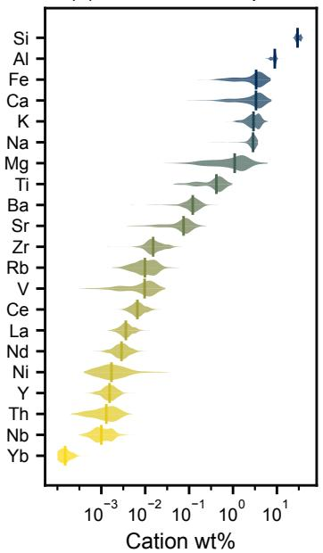

(b) Presence predictions  
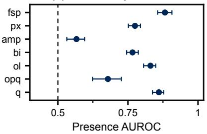

(c) Abundance predictions  
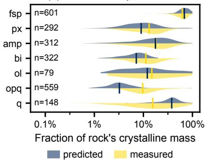  
Figure 1: Zero-shot predictions over 640 volcanic rocks. (a) Model inputs. (b) Presence AUROC per mineral category, where the dotted line represents a random classifier. Whiskers span the 25th to 75th percentile across bootstrap resamples of stratigraphic units. (c) Violin plots for predicted vs. measured mineral abundance when the heads are given the measured mineral list as their support (i.e., teacher-forced). In (a) and (c), violin width reflects the density of rocks at each value and the tick marks the median. Mineral abbreviations in Table B9.

MAGEMin. The simulated labels widen the mineral set to 21 phases where any of the $2 ^ { 2 1 }$ subsets can be a predicted assemblage. Because the heads learn from simulated labels alone, their predictions on the benchmark are zero-shot. Fig. 1a pairs the whole-rock compositions entering the model with their predicted presence (Fig. 1b) and abundance (Fig. 1c). Rocks assigned higher predicted presence probabilities for a mineral category contain that mineral more often (AUROC of 0.575 to 0.870 across categories; Table E2). Of the 7 mineral categories, amphibole exhibits the lowest AUROC, consistent with the strong dependence between amphibole formation and dissolved water content [21] (Fig. F4). The 11 phases outside the benchmark categories are together predicted at a mean 0.12 wt%, an absence learned by the model rather than imposed. When a mineral category is present, the predicted abundance and measured abundance are positively correlated (Spearman rank correlation positive for 6 of 7 categories, Table E3), though predicted abundances exhibit category-specific bias (Fig. 1c). For example, feldspar and quartz are over-predicted the most often (Table E4). Given that quartz subsumes its polymorphs (tridymite and cristobalite) and feldspar spans solid solutions, we hypothesize that composition alone under-determines these families. Nonetheless, the zero-shot model ranks minerals and rocks in the measured order, with systematic bias on abundance.

Recalibration restores confidence with few measured labels. To address the systematic error in the zero-shot predictions, we employ post-hoc recalibration, fitting the layer of Eq. 2 on labeled rocks to align predicted distributions with measured mineralogy [19, 22]. Fitting on 25 rocks reduced the joint NLL on the test set from 9.36 to 1.58 nats, with 71 percent of the reduction in the abundance factor. Fig. 2 illustrates the correction on one rhyolite from the reserved test set (79.9 wt% $\mathrm { S i O _ { 2 } , }$ Fig. 2a) after a fit on 25 rocks. The rhyolite rock was selected because it had the median recalibrated joint NLL, making it representative rather than curated. The zero-shot model assigns biotite (present in the rock) a presence probability of 0.51, while assigning 0.65 to the iron-titanium oxides (absent from the rock, Fig. 2b). In the zero-shot abundances (Fig. 2c), the predicted quartz abundance overshoots at 63.6% compared to 52.2% measured while biotite undershoots at 0.7% compared to 6.0%. Recalibration correctly raises the predicted probability for biotite to 0.98 (Fig. 2d) and brings the recalibrated abundance predictions for both quartz and biotite (51.7% and 7.5%, respectively)

Cation wt%

toward their measured values (Fig. 2e). However, the recalibration also raises the iron-titanium oxides probability to 0.94, likely reflecting the 93% rate at which the category appears across the test set.

(a) Geochemical input  
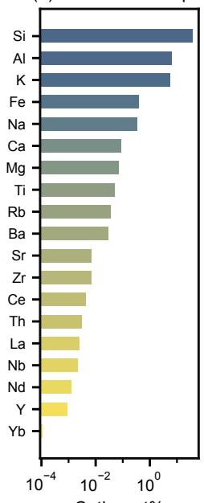

(b) Presence, zero-shot  
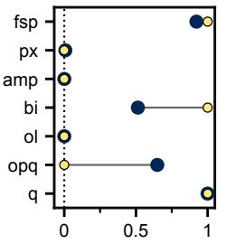

(c) Abundance, zero-shot  
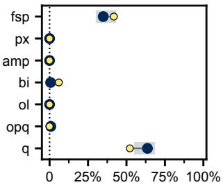

(d) Presence, recalibrated  
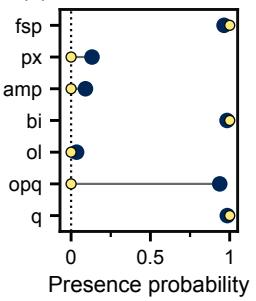

(e) Abundance, recalibrated  
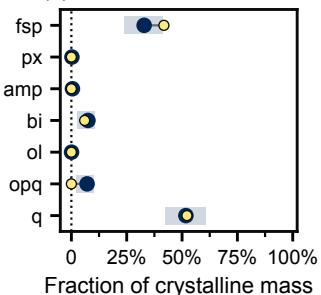  
predicted measured

Figure 2: Recalibration improves mineral predictions. Zero-shot vs. recalibrated predictions on the test set rock with the median recalibrated joint NLL. (a) Model input. (b, c) Zero-shot presence probability and mineral abundance. (d, e) Analogous predictions after a 25-rock fit. Abundance panels (c and e) each summarize 2,048 candidate assemblages sampled from the presence probabilities of (b and d), respectively. Points denote the mean across candidates, shaded bands indicate the 25th to 75th percentile, and gray lines connect predicted to measured values. Mineral abbreviations in Table B9.

Lastly, we examine how recalibration performance – with respect to both model confidence (NLL) and accuracy (MAE) – scales with fit sizes. Comparisons are evaluated on the validation set, having reserved the test set for the single fit of Fig. 2. Across the benchmark, fitting the recalibration layer on the full 368-rock fitting set reduced validation joint NLL from 13.4 to 0.97 nats. Notably, fits of about 25 rocks recovered 76 percent of the reduction, achieving 3.97 nats (Appendix D). Accuracy improves more slowly over the same fits. With no rocks fit, predicted abundances are off by 11.0%, decreasing to 10.6% at 54 rocks and 9.5% on the full fitting set. The 25 rocks that recover most of the confidence therefore recover comparatively less accuracy. The foregoing fits also facilitate comparison of simulated and measured mineralogy as label sources. Appendix D details how a head trained directly on measured abundances reaches the lower joint NLL while the recalibrated model reaches the lower abundance error. The head trained on measured abundances, however, requires the measured mineralogy whose scarcity motivates this work and is restricted to the 7 categories its labels resolve; the simulation-trained heads predict a distribution over the $2 ^ { 2 1 }$ candidate assemblages, with accompanying predictions of oxide compositions and formation conditions.

Limitations and conclusion. The benchmark records phenocryst modes from two adjacent volcanic fields, whereas the labels are equilibrium solids at 50 and 30 wt% residual melt. The absolute errors are teacher-forced, the fitting-size curves share the validation set used to select regularization, and no external method is evaluated. Composition alone may under-determine polymorphs and solid solutions, where errors concentrate; pretraining on crystal structures could resolve them. More broadly, leveraging different geological simulators, or advancing the simulators themselves, enables re-supervision of the heads without affecting the underlying latent representation. We therefore envision the framework expanding to accommodate new phases and assemblages, with applications across geology and mineral prospecting.

## Acknowledgments and Disclosure of Funding

M.J.L. is supported by an Arnold O. Beckman Postdoctoral Fellowship in Chemical Sciences from The Arnold and Mabel Beckman Foundation.

## References

[1] Takuya Akiba, Shotaro Sano, Toshihiko Yanase, Takeru Ohta, and Masanori Koyama. Optuna: A Next-generation Hyperparameter Optimization Framework. In Proceedings ofthe 25th ACM SIGKDD International Conference on Knowledge Discovery & Data Mining, pages 2623–2631, Anchorage AK USA, July 2019. ACM. ISBN 978-1-4503-6201-6. doi: 10.1145/3292500. 3330701. URL https://dl.acm.org/doi/10.1145/3292500.3330701.

[2] Poorya Amirajlo, Hossein Hassani, Amin Beiranvand Pour, and Narges Habibkhah. Ensemble machine learning strategies for mineral prospectivity mapping under data scarcity. Scientific Reports, 16(1):9171, February 2026. ISSN 2045-2322. doi: 10.1038/s41598-026-40125-1. URL https://www.nature.com/articles/s41598-026-40125-1.

[3] J-O Andersson, Thomas Helander, Lars Höglund, Pingfang Shi, and Bo Sundman. Thermo-Calc & DICTRA, computational tools for materials science. Calphad, 26(2):273–312, June 2002. ISSN 03645916. doi: 10.1016/S0364-5916(02)00037-8. URL https://linkinghub. elsevier.com/retrieve/pii/S0364591602000378.

[4] David Barthelmy. The Mineralogy Database, September 2012. URL https://webmineral. com.

[5] Brendan A. Bishop and Leslie J. Robbins. Using machine learning to identify indicators of rare earth element enrichment in sedimentary strata with applications for metal prospectivity. Journal of Geochemical Exploration, 258:107388, March 2024. ISSN 03756742. doi: 10. 1016/j.gexplo.2024.107388. URL https://linkinghub.elsevier.com/retrieve/pii/ S0375674224000049.

[6] Tom Buckle, Morgan Williams, Chetan L. Nathwani, and Hannah S. R. Hughes. WebNORM: a web application for calculating normative mineralogy. Frontiers in Earth Science, 11:1232256, August 2023. ISSN 2296-6463. doi: 10.3389/feart.2023.1232256. URL https://www. frontiersin.org/articles/10.3389/feart.2023.1232256/full.

[7] Michael R. Carroll and Jennifer G. Blank. The solubility of H O in phonolitic melts. American Mineralogist, 82(5-6):549–556, June 1997. ISSN 0003-004X. doi: 10.2138/ am-1997-5-615. URL https://pubs.geoscienceworld.org/ammin/article/82/5-6/ 549-556/43318.

[8] Jie Chen, Timothy Long, Michael Wall, Todd Hufnagel, and Wei Chen. Uncertainty aware machine learning for bridging simulation and experiment in high throughput materials characterization. Scientific Reports, 16(1):20837, May 2026. ISSN 2045- 2322. doi: 10.1038/s41598-026-51212-8. URL https://www.nature.com/articles/ s41598-026-51212-8.

[9] Hongjun Cheng, Youye Zheng, Song Wu, Yibin Lin, Feng Gao, Decai Lin, Jiangang Wei, Shucheng Wang, Defu Shu, Shoucai Wei, and Lie Chen. GIS-based mineral prospectivity mapping using machine learning methods: A case study from Zhuonuo ore district, Tibet. Ore Geology Reviews, 161:105627, October 2023. ISSN 01691368. doi: 10.1016/j.oregeorev.2023.105627. URL https://linkinghub.elsevier.com/retrieve/ pii/S0169136823003438.

[10] J.A.D. Connolly. Computation of phase equilibria by linear programming: A tool for geodynamic modeling and its application to subduction zone decarbonation. Earth and Planetary Science Letters, 236(1-2):524–541, July 2005. ISSN 0012821X. doi: 10.1016/j.epsl.2005.04.033. URL https://linkinghub.elsevier.com/retrieve/pii/S0012821X05002839.

[11] Whitman Cross, Joseph P. Iddings, Louis V. Pirsson, and Henry S. Washington. A Quantitative Chemico-Mineralogical Classification and Nomenclature of Igneous Rocks. The Journal of Geology, 10(6):555–690, 1902. doi: 10.1086/621030.

[12] Guilherme Ferreira Da Silva, Marcos Vinicius Ferreira, Iago Sousa Lima Costa, Renato Borges Bernardes, Carlos Eduardo Miranda Mota, and Federico Alberto Cuadros Jiménez. Qmin – A machine learning-based application for processing and analysis of mineral chemistry data. Computers & Geosciences, 157:104949, December 2021. ISSN 00983004. doi: 10. 1016/j.cageo.2021.104949. URL https://linkinghub.elsevier.com/retrieve/pii/ S0098300421002351.

[13] Jesper Soren Dramsch. 70 years of machine learning in geoscience in review. In Advances in Geophysics, volume 61, pages 1–55. Elsevier, 2020. ISBN 978-0-12-821669-9. doi: 10. 1016/bs.agph.2020.08.002. URL https://linkinghub.elsevier.com/retrieve/pii/ S0065268720300054.

[14] Edward A. du Bray, David A. John, Stephen E. Box, Peter G. Vikre, Robert J. Fleck, and Brian L. Cousens. Petrographic and Geochemical Data for Cenozoic Volcanic Rocks of the Bodie Hills, California and Nevada. Technical Report Data Series 764 (ver 1.1), U.S. Department of the Interior and U.S. Geological Survey, 2016. URL https://doi.org/10.3133/ds764.

[15] Edward A. du Bray, David A. John, Peter G. Vikre, Joseph P. Colgan, Michael A. Cosca, Leah E. Morgan, Robert J. Fleck, Wayne R. Premo, and Christopher S. Holm-Denoma. Petrographic, Geochemical, and Geochronologic Data for Cenozoic Volcanic Rocks of the Tonopah, Divide, and Goldfield Mining Districts, Nevada. Technical Report Data Series 1099, U.S. Department of the Interior and U.S. Geological Survey, 2019. URL https://doi.org/10.3133/ds1099.

[16] Matthew Gard, Derrick Hasterok, and Jacqueline A Halpin. Global whole-rock geochemical database compilation. Earth System Science Data, 11(4):1553–1566, 2019. doi: 10.5194/ essd-11-1553-2019.

[17] Mark S Ghiorso and Richard O Sack. Chemical mass transfer in magmatic processes IV. A revised and internally consistent thermodynamic model for the interpolation and extrapolation of liquid-solid equilibria in magmatic systems at elevated temperatures and pressures. Contributions to Mineralogy and Petrology, 119(2-3):197–212, 1995. doi: 10.1007/BF00307281.

[18] Reneé González-Guzmán, Luis Alejandro Elizondo-Pacheco, Abraham González-Roque, Carlos Eduardo Sánchez-Torres, and Kevin Samuel Cárdenas-Muñoz. shinyNORRRM: A Cross-Platform Software to Calculate the CIPW Norm. Mathematical Geosciences, 55(4):563– 577, May 2023. ISSN 1874-8961, 1874-8953. doi: 10.1007/s11004-023-10052-2. URL https://link.springer.com/10.1007/s11004-023-10052-2.

[19] Chuan Guo, Geoff Pleiss, Yu Sun, and Kilian Q. Weinberger. On Calibration of Modern Neural Networks. In Proceedings of the 34th International Conference on Machine Learning, volume 70 of Proceedings of Machine Learning Research, pages 1321–1330, 2017. URL https://proceedings.mlr.press/v70/guo17a.html.

[20] Yuyang He, You Zhou, Tao Wen, Shuang Zhang, Fang Huang, Xinyu Zou, Xiaogang Ma, and Yueqin Zhu. A review of machine learning in geochemistry and cosmochemistry: Method improvements and applications. Applied Geochemistry, 140:105273, May 2022. ISSN 08832927. doi: 10.1016/j.apgeochem.2022.105273. URL https://linkinghub.elsevier. com/retrieve/pii/S0883292722000774.

[21] Michael J. Krawczynski, Timothy L. Grove, and Harald Behrens. Amphibole stability in primitive arc magmas: effects of temperature, H2O content, and oxygen fugacity. Contributions to Mineralogy and Petrology, 164(2):317–339, August 2012. ISSN 0010-7999, 1432- 0967. doi: 10.1007/s00410-012-0740-x. URL http://link.springer.com/10.1007/ s00410-012-0740-x.

[22] Volodymyr Kuleshov, Nathan Fenner, and Stefano Ermon. Accurate Uncertainties for Deep Learning Using Calibrated Regression. In Proceedings of the 35th International Conference on Machine Learning, volume 80 of Proceedings of Machine Learning Research, pages 2796–2804, 2018. URL https://proceedings.mlr.press/v80/kuleshov18a.html.

[23] M. J. Le Bas. IUGS Reclassification of the High-Mg and Picritic Volcanic Rocks. Journal of Petrology, 41(10):1467–1470, October 2000. ISSN 1460-2415, 0022-3530. doi: 10.1093/petrology/41.10.1467. URL http://academic.oup.com/petrology/article/ 41/10/1467/1412827.

[24] M. J. Le Bas, R. W. Le Maitre, A. Streckeisen, B. Zanettin, and IUGS Subcommission on the Systematics of Igneous Rocks. A Chemical Classification of Volcanic Rocks Based on the Total Alkali-Silica Diagram. Journal ofPetrology, 27(3):745–750, June 1986. ISSN 0022-3530, 1460- 2415. doi: 10.1093/petrology/27.3.745. URL https://academic.oup.com/petrology/ article-lookup/doi/10.1093/petrology/27.3.745.

[25] R. W. Le Maitre. Some problems of the projection of chemical data into mineralogical classifications. Contributions to Mineralogy and Petrology, 56(2):181–189, January 1976. ISSN 0010-7999, 1432-0967. doi: 10.1007/BF00399603. URL http://link.springer.com/10. 1007/BF00399603.

[26] K. Lehnert, Y. Su, C. H. Langmuir, B. Sarbas, and U. Nohl. A global geochemical database structure for rocks. Geochemistry, Geophysics, Geosystems, 1(5), May 2000. ISSN 1525-2027. doi: 10.1029/1999GC000026. URL https://agupubs.onlinelibrary.wiley.com/doi/ 10.1029/1999GC000026.

[27] N.O. Lotter, W. Baum, S. Reeves, C. Arrué, and D.J. Bradshaw. The business value of best practice process mineralogy. Minerals Engineering, 116:226–238, January 2018. ISSN 08926875. doi: 10.1016/j.mineng.2017.05.008. URL https://linkinghub.elsevier. com/retrieve/pii/S0892687517301474.

[28] Eric A.K. Middlemost. Iron oxidation ratios, norms and the classification of volcanic rocks. Chemical Geology, 77(1):19–26, September 1989. ISSN 00092541. doi: 10. 1016/0009-2541(89)90011-9. URL https://linkinghub.elsevier.com/retrieve/pii/ 0009254189900119.

[29] Shunya Minami, Yoshihiro Hayashi, Stephen Wu, Kenji Fukumizu, Hiroki Sugisawa, Masashi Ishii, Isao Kuwajima, Kazuya Shiratori, and Ryo Yoshida. Scaling law of Sim2Real transfer learning in expanding computational materials databases for real-world predictions. npj Computational Materials, 11(1):146, May 2025. ISSN 2057-3960. doi: 10.1038/s41524-025-01606-5. URL https://www.nature.com/articles/s41524-025-01606-5.

[30] Nini Mou, Emmanuel John M. Carranza, Jianling Xue, Shuai Zhang, Gongwen Wang, Hao Song, Yuhao Chen, and Xiangning Ren. Interpretable machine learning for mineral prospectivity mapping in the Qulong–Jiama district, Tibet, China. Ore Geology Reviews, 182:106659, July 2025. ISSN 01691368. doi: 10.1016/j.oregeorev.2025.106659. URL https://linkinghub. elsevier.com/retrieve/pii/S0169136825002197.

[31] Sujay Nair, Evan Coleman, Sherrie Wang, and Elsa Olivetti. Masked Mineral Modeling: Continent-Scale Mineral Prospecting via Geospatial Infilling, 2025. URL https://arxiv. org/abs/2511.09722.

[32] Sally Newman and Jacob B. Lowenstern. VolatileCalc: a silicate melt–H2O–CO2 solution model written in Visual Basic for excel. Computers & Geosciences, 28(5):597–604, June 2002. ISSN 00983004. doi: 10.1016/S0098-3004(01)00081-4. URL https://linkinghub. elsevier.com/retrieve/pii/S0098300401000814.

[33] Quang Loc Nguyen, Huy Nguyen Lai, Hong T.M. Nguyen, Le Long Pham, Andrei Herdean, Nature Poddar, Unnikrishnan Kuzhiumparambil, Ai Nguyen, Mathieu Pernice, Peter J. Ralph, and Phong H.N. Vo. Explainable artificial intelligence for predicting rare earth elements leaching from secondary resources. Journal ofHazardous Materials, 496:139479, September 2025. ISSN 03043894. doi: 10.1016/j.jhazmat.2025.139479. URL https://linkinghub. elsevier.com/retrieve/pii/S0304389425023957.

[34] A.Dogan Paktunc. MODAN: an interactive computer program for estimating mineral quantities based on bulk composition. Computers & Geosciences, 24(5):425–431, June 1998. ISSN 00983004. doi: 10.1016/S0098-3004(98)00018-1. URL https://linkinghub.elsevier. com/retrieve/pii/S0098300498000181.

[35] Terry Plank, Katherine A. Kelley, Mindy M. Zimmer, Erik H. Hauri, and Paul J. Wallace. Why do mafic arc magmas contain 4wt% water on average? Earth and Planetary Science Letters, 364:168–179, February 2013. ISSN 0012821X. doi: 10.1016/j.epsl.2012.11.044. URL https://linkinghub.elsevier.com/retrieve/pii/S0012821X1200670X.

[36] Muhammad Hammad Rasool, Syahrir Ridha, Maqsood Ahmad, Raba’atun Adawiyah Bt Shamsuddun, Muhammad Khurram Zahoor, and Azam Khan. A Mineralogical Perspective on Rare Earth Elements (REEs) Extraction from Drill Cuttings: A Review. Minerals, 15(5):533, May 2025. ISSN 2075-163X. doi: 10.3390/min15050533. URL https: //www.mdpi.com/2075-163X/15/5/533.

[37] N. Riel, B. J. P. Kaus, E. C. R. Green, and N. Berlie. MAGEMin, an Efficient Gibbs Energy Minimizer: Application to Igneous Systems. Geochemistry, Geophysics, Geosystems, 23 (7):e2022GC010427, July 2022. ISSN 1525-2027. doi: 10.1029/2022GC010427. URL https://agupubs.onlinelibrary.wiley.com/doi/10.1029/2022GC010427.

[38] Baerbel Sarbas. The GEOROC Database as Part of a Growing Geoinformatics Network. In S. R. Brady, A. K. Sinha, and L. C. Gundersen, editors, Geoinformatics 2008: Data to Knowledge, Proceedings, U.S. Geological Survey Scientific Investigations Report 2008-5172, pages 42–43, Potsdam, Germany, 2008.

[39] Sarah C Shi, Penny E Wieser, Charlotte Gordon, Norbert Toth, Paula Antoshechkina, Matthew L M Gleeson, and Kerstin Lehnert. mineralML: Leveraging Machine Learning for Probabilistic Mineral Classification. EarthArXiv, 2026. doi: 10.31223/X53J2M. URL https: //eartharxiv.org/repository/view/12356/.

[40] Kirsten L. Siebach, Eleanor L. Moreland, Gelu Costin, and Yueyang Jiang. MIST: An online tool automating mineral identification by stoichiometry. Computers & Geosciences, 206: 106021, January 2026. ISSN 00983004. doi: 10.1016/j.cageo.2025.106021. URL https: //linkinghub.elsevier.com/retrieve/pii/S0098300425001712.

[41] Nasreddine Tahar-Belkacem, Ouafi Ameur-Zaimeche, Rabah Kechiched, Abdelhamid Ouladmansour, Salim Heddam, David A. Wood, Roberto Buccione, and Giovanni Mongelli. Machine learning models to predict rare earth elements distribution in Tethyan phosphate ore deposits: Geochemical and depositional environment implications. Geochemistry, 84(4): 126128, November 2024. ISSN 00092819. doi: 10.1016/j.chemer.2024.126128. URL https://linkinghub.elsevier.com/retrieve/pii/S0009281924000527.

[42] Javan Tahir, Surya Ganguli, and Grant M. Rotskoff. Features are fate: a theory of transfer learning in high-dimensional regression, July 2025. URL http://arxiv.org/abs/2410. 08194. arXiv:2410.08194 [stat.ML].

[43] R. Tolosana-Delgado, H. Von Eynatten, and V. Karius. Constructing modal mineralogy from geochemical composition: A geometric-Bayesian approach. Computers & Geosciences, 37 (5):677–691, May 2011. ISSN 00983004. doi: 10.1016/j.cageo.2010.08.005. URL https: //linkinghub.elsevier.com/retrieve/pii/S0098300410003079.

[44] Vahe Tshitoyan, John Dagdelen, Leigh Weston, Alexander Dunn, Ziqin Rong, Olga Kononova, Kristin A. Persson, Gerbrand Ceder, and Anubhav Jain. Unsupervised word embeddings capture latent knowledge from materials science literature. Nature, 571(7763):95–98, July 2019. ISSN 0028-0836, 1476-4687. doi: 10.1038/s41586-019-1335-8. URL https://www.nature.com/ articles/s41586-019-1335-8.

[45] Thibaut Van Acker, Sarah Theiner, Eduardo Bolea-Fernandez, Frank Vanhaecke, and Gunda Koellensperger. Inductively coupled plasma mass spectrometry. Nature Reviews Methods Primers, 3(1):52, July 2023. ISSN 2662-8449. doi: 10.1038/s43586-023-00235-w. URL https://www.nature.com/articles/s43586-023-00235-w.

[46] Paul J. Wallace. Volatiles in subduction zone magmas: concentrations and fluxes based on melt inclusion and volcanic gas data. Journal of Volcanology and Geothermal Research, 140 (1-3):217–240, January 2005. ISSN 03770273. doi: 10.1016/j.jvolgeores.2004.07.023. URL https://linkinghub.elsevier.com/retrieve/pii/S0377027304002884.

[47] Anthony Yu-Tung Wang, Steven K. Kauwe, Ryan J. Murdock, and Taylor D. Sparks. Compositionally restricted attention-based network for materials property predictions. npj Computational Materials, 7(1):77, May 2021. ISSN 2057-3960. doi: 10.1038/s41524-021-00545-1. URL https://www.nature.com/articles/s41524-021-00545-1.

[48] Yu Wang, Kun-Feng Qiu, Axel Müller, Zhao-Liang Hou, Zhi-Hai Zhu, and Hao-Cheng Yu. Machine Learning Prediction of Quartz Forming-Environments. Journal ofGeophysical Research: Solid Earth, 126(8):e2021JB021925, August 2021. ISSN 2169-9313, 2169-9356. doi: 10.1029/2021JB021925. URL https://agupubs.onlinelibrary.wiley.com/doi/ 10.1029/2021JB021925.

[49] Morgan Williams, Louise Schoneveld, Yajing Mao, Jens Klump, Justin Gosses, Hayden Dalton, Adam Bath, and Steve Barnes. pyrolite: Python for geochemistry. Journal of Open Source Software, 5(50):2314, June 2020. ISSN 2475-9066. doi: 10.21105/joss.02314. URL https: //joss.theoj.org/papers/10.21105/joss.02314.

[50] Yuta Yahagi, Kiichi Obuchi, Fumihiko Kosaka, and Kota Matsui. Transfer learning from first-principles calculations to experiments with chemistry-informed domain transformation. Machine Learning: Science and Technology, 6(2):025026, June 2025. ISSN 2632- 2153. doi: 10.1088/2632-2153/adcdc0. URL https://iopscience.iop.org/article/10. 1088/2632-2153/adcdc0.

[51] Xin Ye, Yan Liu, Tianyu Huang, Ting Chen, Chenglin Liu, Sibing Liu, and Siding Jin. Machine Learning-Based Mineral Quantification from Lower Cambrian Shale in the Sichuan Basin: Implications for Reservoir Quality. Minerals, 15(3):286, March 2025. ISSN 2075-163X. doi: 10.3390/min15030286. URL https://www.mdpi.com/2075-163X/15/3/286.

## A Related Works

Machine learning methods have been developed and applied broadly across geoscience, with recent reviews surveying progress in the field [20, 13]. We note that mineral prospecting from geophysical and geospatial data prominently features machine learning methods as well [30, 9, 2, 31], but we limit discussion here to the geochemical sciences. Within that scope, the prediction task involves the two obstacles in Section 1 of the main text: a one-to-many mapping from composition to assemblage and a scarcity of labeled mineralogy at training scale. Each family of work below resolves at most one of these challenges. We saw the opportunity to address both by building one predictor that spans rock types, enabled by using a thermodynamic simulator.

Tabular, supervised models represent one prominent group of machine learning applications in geochemistry, each fit to a specific dataset obtained at a site of operation (e.g., ore deposit, processing facility). For example, a neural network trained on 77 samples from a basin well in Sichuan predicts mineral abundances from X-ray fluorescence measurements, reporting R2 of 0.8 or higher for most minerals [51]. Gradient-boosted and kernel models have been developed to predict rare earth element concentrations in Tethyan phosphorites [41], rare earth enrichment in sedimentary strata [5], and rare earth recovery from secondary resources [33]. Because these models serve their site of operation, their evaluation is often scored on held-out samples from the same site. And while performance is often strong, each new element, mineral, or lithology requires a labeled dataset of its own. Thus, extending one of these models to a new setting requires characterization measurements (e.g., optical point counting or X-ray diffraction) at scale. In the context of the two obstacles to mineralogy prediction, tabular models do not serve as a general predictor.

A second family of computational applications in geochemistry comprises models that use the chemistry of individual mineral grains (spot analyses) as inputs. For example, mineralML and Qmin classify mineral grains from electron-microprobe analyses [39, 12], while stoichiometric rules accomplish similar identification without learning [40]. Beyond mineral identity, single-mineral models predict formation conditions from trace elements (e.g., in quartz) [48]. These tools provide high accuracy options for identifying mineral presence at the grain scale, but are unable to predict modal abundance at the whole-rock scale.

Estimating modes from whole-rock geochemistry has remained a challenge in geochemical research and historically has not employed machine learning methods. Normative calculation allocates oxides to an idealized anhydrous mineral set by fixed rules, from the CIPW norm through its successive implementations [11, 18, 6, 49]. These calculations return a single deterministic assemblage for a given bulk composition, independent of the conditions under which the rock formed. Mass-balance and unmixing treatments instead solve for the proportions of a mineral set by least squares [34] or as a posterior over both the mixture coefficients and the endmember compositions [43]. The latter allows a probabilistic prediction, but are fit one study at a time and require a mineral list to be defined upfront.

Thermodynamic simulators in geochemistry have largely remained as calculators, with their output serving as the primary deliverable of a study rather than as a training signal for a model. In contrast, adjacent fields have pursued simulation-to-reality pipelines in various contexts. For example, the materials science community transfers models from first-principles calculations to experiments [50], bridges simulation and measurement with uncertainty-aware learning [8], and measures scaling laws for simulation-to-real transfer [29]. We reasoned that the same paradigm could address the two obstacles to mineralogy prediction. Simulated labels generated at training scale address label scarcity and sampled formation conditions express the one-to-many mapping.

The family of models we surveyed – site-specific models, grain-scale classifiers, normative calculators, and simulators – each address distinct challenges in their respective fields. Table A1 summarizes what our approach adopts from each family of models. We adapt a composition transformer built for property prediction [47] to whole-rock geochemistry (Section 2), and import the masked pretraining objective from geospatial prospecting [31] to whole-rock geochemistry as well. Because the representation is learned once from unlabeled compositions and the supervision is generated by the simulator, extending the predictor to a new target does not require an extensive labeled dataset assembled per application. Rather, new supervision is regenerated from the simulator and a new head is trained against it. Within the fixed set of candidate phases, the model predicts which minerals are present in each rock and returns its predictions as distributions over assemblages, preserving the one-to-many mapping that a single point estimate instead averages over. Our combined framework also draws from the simulation-to-real literature. The recalibration layer is fit on a small held-out set of measured mineralogy to learn a correction that adjusts systematic errors in the heads’ predictions [19, 22]. A correction of this form can account for systematic overconfidence while preserving the model’s ranking of minerals. Lastly, an emerging paradigm in transfer learning contends that adapting a pretrained model through a small map on frozen features outperforms training on the target task alone when target labels are scarce [42], as we have done in this work. To our knowledge, the combination of self-supervised pretraining, simulated labels, and post-hoc recalibration on measured mineralogy has not been reported in a machine learning model for the geochemical sciences.

Table A1: Prior families of work in geochemical prediction, the challenge each addresses in its respective field, and what this work adopts from each.
<table><tr><td>Family</td><td>Challenge addressed</td><td>Adopted in this work</td></tr><tr><td>els</td><td>Site-specific tabular mod- Predicting quantities that are costly to measure at an operating site</td><td></td></tr><tr><td>Grain-scale classifiers</td><td>Automated mineral identification from spot chemistry</td><td>Stoichiometric naming rules (Appendix B.4)</td></tr><tr><td>Normative and unmixing calculation</td><td>Estimating mineralogy from bulk composition</td><td>The prediction task and precedent for probabilistic output</td></tr><tr><td>tors</td><td>Thermodynamic simula- Computing equilibrium assemblages The label generator at fixed conditions</td><td></td></tr><tr><td>fer</td><td>Simulation-to-real trans- Carrying simulation-trained models Recalibration paradigm to real-world measurements</td><td></td></tr></table>

## B Implementation Details

The following subsections trace the model architecture from end to end. We begin with the tokeniza tion of a whole-rock composition (Appendix B.1), which a pretrained transformer encodes into one latent representation per rock (Appendices B.2–B.3). The latent representation is fed to probabilistic heads, which are trained on a MAGEMin-generated corpus of petrological labels (Appendices B.4–B.6). The heads themselves are capable of making zero-shot predictions on real rocks, or their predictions may feed into a recalibration layer (Appendix B.7). We then detail the assembly of the benchmark, which contains whole-rock compositions with measured mineral proportions (Appendix B.8). Lastly, we describe how presence discrimination is evaluated on the benchmark (Appendix B.9).

All experiments were run on an Apple M4 Max MacBook Pro with 128 GB RAM. The MPS accelerator was used for model training and CPU for MAGEMin simulation. Generating the simulated label corpus was the largest cost, taking roughly 62 hours for the training split and 10 hours for the validation/test split. Encoder pretraining took roughly 3.5 hours, with its two hyperparameter searches taking an additional 13 hours combined. The joint-heads hyperparameter search ran for roughly 15 hours; subsequent retraining using the selected configurations completed in less than an hour. The recalibration layer and the heads trained on measured abundances fitted in seconds to minutes each. Beyond the reported experiments, roughly 100 hours were used for preliminary iterations focused on generating the simulated label corpus and performing hyperparameter sweeps.

## B.1 Input representation and tokenization

We adapted the CrabNet architecture [47] with two changes. Firstly, we fixed the rows to a vocabulary of 22 elements rather than allowing each sample to determine them. The original CrabNet was used to predict material properties of chemical compounds, which inherently provide every element present in the material. In contrast, a whole-rock composition is measured over a standardized set of elements. Fixing the rows therefore makes a given row denote the same element in every rock. Secondly, we marked unreported elements by a reserved padding value rather than by zero abundance. Our use of pretraining necessitates the latter change because the pretraining procedure hides measured concentrations by zeroing them.

A whole-rock composition enters the encoder as a fixed-length, fixed-order sequence of 23 rows composed of 22 elements plus one reserved row for the $\mathrm { F e ^ { 3 + } }$ /total-Fe ratio (Table B1). Of the 22 elements, nine are major elements derived from oxide weight percent while thirteen are trace elements reported in parts per million. We selected the thirteen trace elements based on two filtering criteria applied to the global geochemical compilation [16]. (1) each element is reported for at least one third of the compilation’s rocks, and (2) each element is routinely used to distinguish rock types that share similar major-element chemistry [20, 49].

Table B1: The fixed elemental inputs read by the encoder.
<table><tr><td>Group</td><td>Count</td><td>Members</td><td>frac</td></tr><tr><td>Majors</td><td>9</td><td>Si, Al, Ca, Mg, Fe, K, Na, Ti, Cr</td><td>wt% / 100</td></tr><tr><td>Traces</td><td>13</td><td>Sr, Zr, Ba, Y, Rb, Ni, Nb, V, La, Ce, Nd, Yb, Th</td><td>ppm  $/ 1 0 ^ { 6 }$ </td></tr><tr><td>Redox</td><td>1</td><td>Fe³+/total Fe</td><td>ratio, unscaled</td></tr></table>

Each of the 23 rows entering the encoder is one token, stored as a pair of numbers (src, frac), where src identifies the element by its atomic number and frac is the element’s abundance rescaled into the unit interval. The conversions in Table B1 perform the rescaling, dividing weight percent by 100 for the majors and parts per million by $1 0 ^ { 6 }$ for the traces. A slot in the sequence can also hold no element at all, with Table B2 showing all four states the encoder can carry. (1) A padding slot marks an element left unreported, with src = 0. (2) A populated slot is used for a reported element. (3) A masked slot hides a reported element during pretraining, taking the reserved identity src = 119. (4) The redox slot carries the $\mathrm { F e ^ { 3 + } }$ /total-Fe ratio under its own identity, src = 120. Masked slots remain attended so the encoder can predict at them; only padding is excluded from attention. Blanks in the global geochemical compilation enter as padding slots, treated as missing rather than as measured zeros.

Table B2: Possible states for each token of the input sequence.
<table><tr><td>State</td><td>src</td><td>frac</td><td>Attended</td></tr><tr><td>Padding (element not reported)</td><td>0</td><td>0</td><td>no</td></tr><tr><td>Populated</td><td>1-118</td><td> $> 0$ </td><td>yes</td></tr><tr><td>Masked for pretraining</td><td>119</td><td>0</td><td>yes</td></tr><tr><td>Fe-redox ratio</td><td>120</td><td>ratio in [0, 1]</td><td>yes</td></tr></table>

Redox row in production. We note that the redox row is only populated in pretraining. The heads are trained and evaluated with the row padded such that the padded state is a learned signal rather than an average over the unreported ratio. We pad the redox row because none of the real rocks used for benchmarking report both FeO and $\mathrm { F e _ { 2 } O _ { 3 } }$ . The reserved row is nonetheless an intentional choice, given that every simulated label is already generated under an imposed $\mathrm { F e ^ { 3 + } }$ /total-Fe ratio (Appendix B.4). In addition, roughly a quarter of the pretraining set reports the pair of iron concentrations the ratio requires. Thus, for future datasets that do report both, heads retrained with the row populated would allow measured oxidation state to inform the predicted assemblage.

## B.2 Encoder architecture

We employ CrabNet’s featurization without additional modification [47]. Each row’s token sums a mat2vec element embedding [44] with two sinusoidal abundance encodings, one over linearly discretized frac and one over $\log _ { 1 0 }$ frac. The element embedding table is initialized from the published 200-dimensional embeddings and remains trainable during pretraining, with the padding row pinned to zero and the mask and redox rows initialized as small random values. The transformer stack is our own implementation with Table B3 detailing the configuration. Of the tabulated values, the model width, layer count, head count and dropout were selected by the hyperparameter searches described in Appendix B.3, while the remainder are fixed conventions informed by the original CrabNet implementation.

Table B3: Encoder configuration.
<table><tr><td>Hyperparameter</td><td>Meaning</td><td>Value</td></tr><tr><td>d_model</td><td>Dimensionality of latent representation</td><td>256</td></tr><tr><td>n_layers</td><td>Transformer encoder layers</td><td>4</td></tr><tr><td>n_heads</td><td>Attention heads per layer</td><td>8</td></tr><tr><td>dim_feedforward</td><td>Feed-forward width, 4× d_model</td><td>1024</td></tr><tr><td>activation</td><td>Non-linear activation function</td><td>GELU</td></tr><tr><td>norm_first</td><td>Pre-norm residual arrangement</td><td>true</td></tr><tr><td>dropout</td><td>Attention and feed-forward dropout</td><td>0.0582</td></tr><tr><td>frac_resolution</td><td>Sinusoidal lookup bins per abundance encoding</td><td>5000</td></tr><tr><td>Element embedding</td><td>Rows × dimension</td><td> $1 2 1 \times 2 0 0$ </td></tr><tr><td>Pooling</td><td>Mean over non-padding rows</td><td>masked mean</td></tr></table>

For a batch of B rocks, src and frac have shape [B, 23], the token grid and the contextualized grid are [B, 23, 256], and the pooled latent representation h is [B, 256]. The encoder checkpoint carrie $4 { , } 5 1 4 { , } 6 9 9$ tensor entries, of which 3,234,699 are trainable parameters. The trainable count is derived as follows: the element embedding table contains $1 2 1 \times \hat { 2 0 0 } = 2 4 , 2 0 0$ parameters, its projection to the model width contains $2 0 0 \times 2 5 6 + 2 5 6 = 5 1 . 4 5 6$ , the scalar gains on the embedding and the two abundance encodings contribute 3, and the four transformer layers hold 789,760 each. The remaining $2 \times 5 0 0 0 \times 1 2 8 = 1 { , } 2 8 0$ ,000 entries are the two sinusoidal lookup tables, which are fixed rather than learned.

## B.3 Self-supervised pretraining

Pretraining data. All pretraining data derives from one public compilation of whole-rock geochemistry [16], which aggregates roughly one million published compositions spanning all rock types. We filtered the compilation to the pretraining set as follows. Oxides above 100 wt% are treated as aphysical and categorized as missing values (i.e., padding). Rocks with fewer than four populated rows were dropped because masking would leave little context to predict from. Lastly, the compilation contains duplicated compositions under different sample identifiers. We performed deduplication by comparing tokenized composition, dropping any row where (src, frac) values exactly match another row. The result of filtering is 787,721 rows for the pretraining set, as referenced in Section 2.

Held-out construction. 20% of the pretraining rows were held out for validation and 20% for testing, split by row. To ensure that the encoder does not pretrain on compositions used downstream (e.g., as MAGEMin inputs), we assign these compositions to the test split. When a composition assigned to the test split is duplicated under a different sample identifier, deduplication keeps the test-split copy; all other duplicates resolve to the first occurrence.

Masking and objective. For each rock, a fixed fraction of the populated rows is selected uniformly at random for masking, with a new selection made every epoch. Masked rows receive the mask identity src = 119 with frac = 0, and the encoder still attends to them, as discussed in Appendix B.1. Writing M for the masked rows of a composition $x ,$ x˜ for the corrupted composition they produce, and $h _ { \tilde { x } }$ for the pooled latent representation, the decoder g regresses the standardized log concentration of each hidden element.

$$
\mathcal { L } _ { \mathrm { S S L } } = \mathbb { E } _ { x , M } \left[ \frac { 1 } { | M | } \sum _ { i \in M } \left( g _ { i } ( h _ { \bar { x } } ) - \tilde { y } _ { i } \right) ^ { 2 } \right] , \qquad \tilde { y } _ { i } = \frac { \log _ { 1 0 } ( f _ { i } ) - \mathbb { E } _ { x } [ \log _ { 1 0 } ( f _ { i } ) ] } { \sqrt { \mathrm { V a r } _ { x } [ \log _ { 1 0 } ( f _ { i } ) ] } }\tag{3}
$$

where $f _ { i }$ is element i’s abundance, and the mean and variance are taken over the pretraining set. The decoder is a two-layer MLP that reads the pooled latent representation. The hidden layer has width d\_model/2 with a GELU activation and the output layer is linear, producing one predicted concentration per row of the input sequence. The output carries no activation function because the regression target, a standardized log concentration, is unbounded. We note that the decoder exists only to train the encoder and is discarded after pretraining.

The loss is computed at masked position such that predictions at unmasked positions receive no gradient. We employed log space for the regression because majors and traces enter frac at magnitudes differing by up to eight orders of magnitude. As a result, a linear-space squared error possesses a negligible gradient for the trace elements. Although log space equalizes the scale of the targets, elements still differ in the variance of their log concentrations. We therefore standardized each element separately. We verified the combined choice on a held-out imputation benchmark, in which each element is predicted from the encoder latent representation and scored by $R ^ { 2 }$ on log concentrations. Relative to the linear-space objective, the median across the thirteen trace elements rose from 0.84 to 0.88, with no loss on the major elements. Table B4 shows the configuration and outcome of the pretraining run, while Fig. F1 shows the loss curve.

Table B4: Pretraining configuration and outcome.
<table><tr><td>Hyperparameter</td><td>Meaning</td><td>Value</td></tr><tr><td>mask_prob</td><td>Fraction of populated rows masked</td><td>0.281</td></tr><tr><td>batch_size</td><td>Rocks per step</td><td>32</td></tr><tr><td>1r</td><td>Adam learning rate</td><td> $8 . 1 8 \times 1 0 ^ { - 5 }$ </td></tr><tr><td>weight_decay</td><td>Adam weight decay</td><td> $1 . 9 8 \times 1 0 ^ { - 3 }$ </td></tr><tr><td>epochs</td><td>Ceiling, not a target</td><td>60</td></tr><tr><td>early_stop_patience</td><td>Epochs without val improvement</td><td>3</td></tr><tr><td>early_stop_min_delta</td><td>Improvement threshold</td><td> $1 . 0 \times 1 0 ^ { - 3 }$ </td></tr><tr><td>val_split/test_split</td><td>Held-out fractions</td><td> $0 . 2 0 / 0 . 2 0$ </td></tr><tr><td>seed</td><td>Run seed</td><td>0</td></tr><tr><td>Best epoch</td><td>When early stopping triggered</td><td>16</td></tr><tr><td>Train / val / test loss</td><td>Standardized log MSE</td><td>0.199 / 0.200 / 0.193</td></tr></table>

Hyperparameter tuning. Using the Optuna package [1], two Bayesian searches were performed to optimize the encoder’s hyperparameters. All trials were ranked by validation loss. Both searches were run on an earlier configuration that pretrained on only the igneous rocks of the compilation, and their selections were reused for the encoder trained on all rock types, as reported in Tables B3 and B4. The first search varied architecture and optimization jointly and selected the model width of 256, the 4 encoder layers, and the 8 attention heads reported in Table B3. The second search accompanied the adoption of the standardized log-space objective. It fixed the architecture and re-tuned the optimization values: the learning rate, mask probability, weight decay, dropout, and batch size. This search ran 30 trials of 20 epochs each, beginning from 10 random startup trials. The expansion of the pretraining set to all rock types and the addition of the redox row came after both searches and reused their selections without further tuning.

## B.4 Simulated label corpus

Composition selection. Here, we use corpus to refer to the set of simulated labels that supervise the prediction heads. Each label pairs one measured whole-rock composition from the global geochemical compilation with a mineral assemblage calculated by MAGEMin. The latter is a Gibbs energy minimizer that returns the equilibrium assemblage of a composition at a specified temperature and pressure [37]. We simulated igneous compositions, in-line with how the thermodynamic dataset implemented in MAGEMin covers igneous systems.

The igneous compositions were narrowed in three passes: by rock name, by chemical range, and by the completeness of each analysis. By name, we kept compositions classified under volcanic rock names. We omitted the foidite family, for which the solver failed to converge across the sampled formation conditions. By chemical range, we excluded compositions with silica exceeding 80 wt% or magnesia exceeding 18 wt%. The silica bound was chosen to lie slightly beyond the 77 wt% upper limit of the total alkali-silica classification [24]. Meanwhile, the magnesia bound is the minimum content defining the most magnesium-rich volcanic rocks [23]. Compositions beyond either bound fall outside what the corpus is meant to represent. For completeness, we required that a composition possess iron in at least one of its oxidation states, allowing the solver to resolve iron-bearing phases. We excluded compositions whose major-oxide sum fell below 90 wt%, which may represent incomplete characterization.

Generator. We called the MAGEMin solver, unmodified, through the Julia interface it distributes. Each composition was simulated under several draws, where a draw is one sampled pair of pressure and dissolved water content (Section 2). Every draw is evaluated along a cooling ladder, a fixed sequence of temperatures from 1200 to $6 0 0 ^ { \circ } \dot { \mathrm { C } }$ in $2 0 ~ ^ { \circ } \mathrm { C }$ steps at which the solver is called again for the same composition and pressure. A Python orchestrator samples the conditions of each draw, expands the cooling ladder into individual solver calls, and sends those calls to the solver in chunks.

Each simulation follows one parcel of magma as it cools and crystallizes into mineral phases. At every temperature on the cooling ladder, the solver returns the assemblage that minimizes Gibbs free energy. We record the assemblage at fixed residual-melt fractions rather than at fixed temperatures, because compositions crystallize over different temperature ranges. In particular, we record each draw at 50 and 30 wt% residual melt. Two values enable one cooling path to contribute assemblages at different extents of crystallization. We stop at 30 wt% to remain away from the near-solidus region.

For each recorded assemblage, we exclude the melt and any exsolved fluid from the mineral label before renormalizing the remaining solids to sum to one. The renormalized solids are the target of the assemblage head, the oxide composition of each solid is the target of the composition head, and the pressure, temperature, and dissolved water of the readout are the targets of the conditions head. We retain the melt and fluid fractions and their compositions, as the mass-balance term of the training objective reconstructs the input composition from every phase present (Appendix B.5).

Iron speciation. The solver requires the iron in each composition to be divided between its ferrous and ferric states. Where a composition reported both FeO and $\mathrm { F e _ { 2 } O _ { 3 } }$ , we used the measured ratio. When only total iron was reported, we assigned a ferric fraction by rock type following two published compilations [25, 28]. The fractions range from 0.15 for basalt to 0.45 for the most silica-rich classes, within the bounds the two compilations recommend for each class. Fixing the iron ratio in turn fixed the oxygen content of each simulation, so we did not sample oxidation state as a third condition alongside pressure and dissolved water.

Broad condition sampling. We sampled the pressure and water content for every draw from an intentionally broad distribution:

$$
P \sim \mathrm { U n i f o r m } [ 0 . 5 , 1 2 ] \mathrm { k b a r } , \qquad X _ { \mathrm { H _ { 2 } O } } \sim \mathrm { U n i f o r m } \big [ 0 , \mathrm { m i n } ( 8 , S ( P ) ) \big ] \mathrm { w t } \mathcal { Y } _ { 0 } .\tag{4}
$$

where $S ( P )$ is the pure-H2O saturation curve for a rhyolitic melt implemented in VolatileCalc [32], which we evaluated at $8 5 0 ~ ^ { \circ } \mathrm { C }$ and applied to all compositions. We further capped the draw at 8 wt%, the upper end of the water contents recorded in melt inclusions from arc magmas [46, 35]. Otherwise, the solubility curve would assign far more water at the upper end of our pressure range. While we formulated the foregoing treatment for ease of corpus generation, we acknowledge a gap for alkaline compositions. Specifically, phonolitic melts dissolve more water than rhyolitic melts at the same pressure [7]. As a result, wet, low-pressure conditions are undersampled for those alkaline compositions. Opportunities for future improvements to the methodology include implementing a composition-aware solubility model.

Phase vocabulary. The solver outputs phases according to the solution models in its thermodynamic dataset. We performed three small adjustments to create prediction targets from those phases, where the net vocabulary came out to $J = 2 1$ phases. Firstly, tridymite, cristobalite, and quartz are polymorphs, so we collapsed all three into one mineral. We note that tridymite and cristobalite only appear in roughly 2 of every 10,000 draws. But when they are present, they carry about half the crystal mass present. Meanwhile, we kept the aluminosilicate polymorphs separate because their identity reflects the pressure at which they formed, which the conditions head predicts from the phases present. Table B5 lists the resulting vocabulary.

Table B5: The 21-phase vocabulary of the assemblage head, with each phase’s presence rate, defined as the percent of training labels in which the phase is present (i.e., holds more than 0.1 wt% of the crystal mass). The ten phases above the divider map onto the 7 benchmark categories of Table B9.
<table><tr><td>Phase</td><td>Abbreviation</td><td>Benchmark category</td><td>Presence rate (%)</td></tr><tr><td>plagioclase</td><td>plag</td><td>Feldspar</td><td>79.3</td></tr><tr><td>alkali feldspar</td><td>afs</td><td>Feldspar</td><td>20.0</td></tr><tr><td>clinopyroxene</td><td>cpx</td><td>Pyroxene</td><td>76.5</td></tr><tr><td>orthopyroxene</td><td>opx</td><td>Pyroxene</td><td>25.4</td></tr><tr><td>amphibole</td><td>amp</td><td>Amphibole</td><td>53.3</td></tr><tr><td>biotite</td><td>bi</td><td>Biotite</td><td>27.0</td></tr><tr><td>olivine</td><td>ol</td><td>Olivine</td><td>10.6</td></tr><tr><td>spinel</td><td>spl</td><td>Fe-Ti oxides</td><td>51.9</td></tr><tr><td>ilmenite</td><td>ilm</td><td>Fe-Ti oxides</td><td>45.6</td></tr><tr><td>quartz</td><td>q</td><td>Quartz</td><td>34.4</td></tr><tr><td>rutile</td><td>ru</td><td></td><td>12.7</td></tr><tr><td>garnet</td><td>g</td><td></td><td>10.8</td></tr><tr><td>titanite</td><td>sph</td><td></td><td>10.8</td></tr><tr><td>muscovite</td><td>mu</td><td></td><td>4.9</td></tr><tr><td>epidote</td><td>ep</td><td></td><td>4.4</td></tr><tr><td>cordierite</td><td>cd</td><td></td><td>3.4</td></tr><tr><td>sillimanite</td><td>sill</td><td></td><td>3.1</td></tr><tr><td>nepheline</td><td>ne</td><td></td><td>1.7</td></tr><tr><td>kyanite</td><td>ky</td><td></td><td>1.0</td></tr><tr><td>andalusite</td><td>and</td><td></td><td>0.6</td></tr><tr><td>corundum</td><td>cor</td><td></td><td>0.2</td></tr></table>

Secondly, chlorite and ferropericlase appear in roughly 1 to 2 of every 10,000 draws, carrying negligible mass when they do. A phase this rare offers the assemblage head too few examples to learn from, so both were dropped. Lastly, the solver returns feldspar as a single solution phase, although plagioclase and alkali feldspar coexist as separate crystals in 13 to 19% of feldspar-bearing draws. Averaging two coexisting minerals into one entry produces an aphysical composition that would occur in real rocks. To avoid the composition head training on this single solution phase feldspar, we split each lumped instance into plagioclase or alkali feldspar according to its composition. We compute the molar fractions of the calcium and potassium endmembers and compare them against two curves in the anorthite-orthoclase plane that delineate plagioclase and alkali feldspar [39]. A lumped instance inside either field is assigned to that mineral, and a lumped instance falling between the two fields is assigned to whichever of the two components is larger.

Label construction. MAGEMin reports phases at arbitrarily small abundances, requiring us to define a threshold to determine when a phase should count as present or absent. Specifically, we defined the threshold at 0.1 wt%, roughly an order of magnitude below the detection limits of analytical techniques such as X-ray diffraction and optical point counting. Each label is therefore a binary indicator vector over the ${ \bar { J } } = 2 1$ vocabulary phases, with a 1 denoting when a phase is present. The labels show a median of 5 phases and a 10th-to-90th percentile range of 3 to 7 phases.

Scale and splits. Table B6 shows the size of each split of the corpus. The realized counts are slightly below the target counts because a small number of compositions fail to converge. We split the corpus by composition rather than by row, and stratified by QAPF rock name. Rows generated from one composition share the same input chemistry, differing only in their sampled conditions and melt fractions. Thus, a row-level split would allocate the same rock to both training and evaluation. A floor of 30 compositions per class in the training split, and 5 in the validation and test splits, keeps rare classes represented. The 218 validation compositions constitute the held-out simulated set reported throughout Section 3.

Table B6: Size of the simulated label corpus by split.
<table><tr><td>Split</td><td>Compositions</td><td>Draws each</td><td>Melt fractions read (wt%)</td><td>Labels</td></tr><tr><td>Train</td><td>9,946</td><td>48</td><td>50,30</td><td>949,228</td></tr><tr><td>Validation</td><td>218</td><td>128</td><td>50,30</td><td>55,576</td></tr><tr><td>Test</td><td>274</td><td>128</td><td>50,30</td><td>69,521</td></tr></table>

## B.5 Prediction heads

Three heads read the frozen encoder’s pooled latent representation h and produce the model’s predictive distributions. Each is a small multilayer perceptron composed of a trunk of linear layers with GELU activations and dropout, followed by linear output maps. Table B7 summarizes each head, with parameter counts reflecting the trained model evaluated throughout this work.

Table B7: The three prediction heads, where trunk width and depth were tuned by Bayesian search alongside the loss weights and optimizer settings (Appendix B.6).
<table><tr><td>Head</td><td>Predicts</td><td>Distribution</td><td>Trunk</td><td>Parameters</td></tr><tr><td>Assemblage</td><td>phase presence and abundance</td><td>Bernoulli × Dirichlet</td><td> $3 \times 5 1 2$ </td><td> $1 { , } 3 4 6 { , } 0 9 0$ </td></tr><tr><td>Composition</td><td>per-phase oxide composition</td><td>Dirichlet per phase</td><td> $1 \times 1 2 8$ </td><td>65,404</td></tr><tr><td>Conditions</td><td> ${ \bf \hat { \boldsymbol { T } } } , { \bf \boldsymbol { \hat { P } } } ,$  dissolved  $\mathrm { H _ { 2 } O }$ </td><td>Gaussian mixture per axis</td><td> $2 \times 5 1 2$ </td><td>418,843</td></tr></table>

Assemblage head. The two factors of Eq. 1 are separate branches trained on separate targets. We factorized the distribution because a single Dirichlet over the full 21-phase simplex cannot represent sparse labels. Specifically, a single Dirichlet cannot express an absent phase, as it must assign every phase a positive abundance. Factorization allows the presence branch to decide which phases are absent, enabling the Dirichlet layer to only describe present phases. The presence branch reads the latent representation h alone and yields one logit per phase. The abundance branch meanwhile reads h concatenated with a support vector s, a binary indicator of the present phases, and yields one concentration per phase through a softplus. At training, s is the label’s true support, while at inference, s is sampled from the presence branch.

Composition head. For every phase $j ,$ the head models the oxide composition $x _ { j }$ as a Dirichlet over the 11 oxides reported by the simulator (in weight percent):

$$
p ( x _ { j } \mid h ) = \mathrm { D i r } \bigl ( x _ { j } ; c _ { j } \mu _ { j } \bigr ) , \qquad \mu _ { j } = \mathrm { s o f t m a x } ( z _ { j } ) , \qquad c _ { j } = \mathrm { s o f t p l u s } ( \tau _ { j } )\tag{5}
$$

where the head’s trunk maps the latent representation h to the outputs $z _ { j }$ and $\tau _ { j } .$ . The mean $\mu _ { j }$ is the vector of predicted oxide proportions and the concentration $c _ { j }$ describes the width of the distribution. The loss is evaluated only on the phases present in each label, mirroring the abundance factor. Because a Dirichlet cannot express an exact zero, oxides reported as zero by the simulator are clipped to $1 0 ^ { - 4 }$ and the target renormalized.

Conditions head. For each formation condition (temperature, pressure, and dissolved water content), the head predicts an independent 3-component Gaussian mixture:

$$
p ( y _ { a } \mid h , s ) = \sum _ { k = 1 } ^ { 3 } { \pi } _ { a , k } { \mathcal { N } } \bigl ( y _ { a } ; \mu _ { a , k } , \sigma _ { a , k } ^ { 2 } \bigr ) , \qquad a \in \{ T , \ P , \ X _ { \mathrm { H _ { 2 } O } } \}\tag{6}
$$

where a indexes the formation condition and $y _ { a }$ its value. The head’s trunk produces three linear outputs per condition: the means $\mu _ { a } .$ , and pre-activations $u _ { a }$ and $v _ { a }$ for the weights $( \pi _ { a } )$ and standard deviations $( \sigma _ { a } )$ , respectively.

$$
\pi _ { a } = \mathrm { s o f t m a x } ( u _ { a } ) , \qquad \sigma _ { a } = \mathrm { s o f t p l u s } ( v _ { a } )\tag{7}
$$

As with the assemblage head, the conditions head reads the latent representation h concatenated with the support $s ,$ where the support is teacher-forced at training and sampled at inference. The conditions head predicts each condition in its raw physical units $( ^ { \circ } \mathrm { C }$ , kbar, and wt%). To match the scale of the data, we initialize the biases of $\mu _ { a }$ and $v _ { a }$ from each condition’s target mean and standard deviation.

Mass balance. An additional loss term constrains the heads jointly by reconstructing the input composition B from their predictions. A corpus label describes a partly crystallized magma, where the predicted solids coexist with the remaining melt and any exsolved fluid. The model predicts the solid portion while the melt and fluid come from the label directly. The reconstruction $\hat { B }$ weights each portion by its mass fraction and sums them:

$$
\hat { B } = \left( 1 - F _ { \mathrm { l i q } } - F _ { \mathrm { f } } \right) \sum _ { j } m _ { j } C _ { j } \ + \ F _ { \mathrm { l i q } } C _ { \mathrm { l i q } } + F _ { \mathrm { f } } C _ { \mathrm { f } }\tag{8}
$$

where $m _ { j }$ is the assemblage head’s mean abundance for phase j on the true support and $C _ { j }$ is the composition head’s mean composition. The mass fractions $F _ { \mathrm { l i q } }$ and $F _ { \mathrm { f } }$ give the melt and exsolved fluid, and $C _ { \mathrm { l i q } }$ and $C _ { \mathrm { { f } } }$ their compositions. Because the melt and fluid quantities come from the label, any mismatch between $\hat { B }$ and $B$ must be reduced by adjusting the predicted abundances and compositions.

## B.6 Training

The three heads train jointly on the frozen encoder, where the objective combines five terms: an NLL for each predictive factor of Appendix B.5, and the mass-balance penalty $\mathcal { L } _ { \mathrm { b a l a n c e } } \mathrm { : }$

$$
{ \mathcal { L } } = { \mathcal { L } } _ { \mathrm { p r e s e n c e } } + \lambda _ { \mathrm { a b u n d } } { \mathcal { L } } _ { \mathrm { a b u n d a n c e } } + \lambda _ { \mathrm { c o m p } } { \mathcal { L } } _ { \mathrm { c o m p } } + \lambda _ { \mathrm { c o n d } } { \mathcal { L } } _ { \mathrm { c o n d } } + \lambda _ { \mathrm { b a l a n c e } } { \mathcal { L } } _ { \mathrm { b a l a n c e } }\tag{9}
$$

Describing each of the loss terms in order, we have $\mathcal { L } _ { \mathrm { p r e s e n c e } } ,$ the binary cross-entropy between the Bernoulli probabilities $p _ { j }$ of Eq. 1 and the label’s support. $\mathcal { L } _ { \mathrm { a b u n d a n c e } }$ is the NLL of the Dirichlet in Eq. 1, evaluated under the label’s true support. $\mathcal { L } _ { \mathrm { c o m p } }$ is the NLL of Eq. 5, scored on the present phases alone. $\mathcal { L } _ { \mathrm { c o n d } }$ is the NLL of the mixtures in Eq. 6, summed over temperature, pressure, and water content. And lastly, $\mathcal { L } _ { \mathrm { b a l a n c e } }$ is the squared residual of Eq. 8.

Hyperparameter search. A single Bayesian search in Optuna [1] tuned seven variables jointly: the learning rate, the weight decay, $\lambda _ { \mathrm { a b u n d } } , \lambda _ { \mathrm { b a l a n c e } } ,$ the trunk dropout of all heads, and the assemblage trunk’s width and depth (Table B8). The search ran 48 trials at a 60-epoch ceiling, beginning from 12 random startup trials, and ranked each trial on the assemblage head’s raw, unweighted validation term at its own best epoch. Differences of a few hundredths of a nat fall within the validation evaluation’s sampling noise, so trials within 0.03 nats of the leader count as tied. To settle a tie among the leading trials, we re-evaluate each tied trial on supports sampled from its own presence branch (in contrast to the teacher-forced objective that ranked the trials). The winning trial was retrained at the full 120-epoch ceiling to yield the checkpoint used throughout this work.

Because $\mathcal { L } _ { \mathrm { p r e s e n c e } }$ averages over the 21 phases while $\mathcal { L } _ { \mathrm { a b u n d a n c e } }$ sums over the support, the Optunaselected $\bar { \lambda _ { \mathrm { a b u n d } } } = 0 . 0 2 8 1$ corresponds to an effective weight of $2 1 \times \lambda _ { \mathrm { a b u n d } } = 0 . 5 9$ . Similarly, $\lambda _ { \mathrm { c o n d } } = 0 . 0 1$ primarily cancels the raw °C scale of the temperature term rather than down-weighting the conditions head. Optimization uses AdamW at learning rate $4 . 7 0 \times 1 0 ^ { - 4 }$ , with weight decay $2 . 4 6 \times 1 0 ^ { - 5 }$ , batch size 1024, and seed 0. Gradients are clipped per head rather than under one shared norm threshold.

We train the heads on the 949,228 training-split rows of Table B6 and select hyperparameters on the 55,576 rows of the validation compositions. We save each head at the epoch where its raw, unweighted validation term is best. Training stops once every head is 10 epochs past its own best. The final training run stopped at epoch 66, saving the assemblage head at epoch 6, the composition head at 56, and the conditions head at 42 (Fig. F2).

Table B8: Joint search space and optimized values over the training environment and assemblage-head architecture. The remaining weights were fixed during the search at $\lambda _ { \mathrm { c o m p } } = 1 . 0$ and $\lambda _ { \mathrm { c o n d } } = 0 . 0 1$
<table><tr><td>Hyperparameter</td><td>Meaning</td><td>Range</td><td>Selected</td></tr><tr><td>1r</td><td>AdamW learning rate</td><td> $1 0 ^ { - 4 } { \mathrm { t o } } 1 0 ^ { - 2 }$ </td><td> $4 . 7 0 \times 1 0 ^ { - 4 }$ </td></tr><tr><td>weight_decay</td><td>AdamW weight decay</td><td> $1 0 ^ { - 7 } \ \mathrm { t o } \ 1 0 ^ { - 2 }$ </td><td> $2 . 4 6 \times 1 0 ^ { - 5 }$ </td></tr><tr><td>λabund</td><td>Abundance weight, nominal</td><td> $0 . 0 0 4 8 \mathrm { t o } 0 . 0 4 8$ </td><td> $0 . 0 2 8 1$ </td></tr><tr><td> $\lambda _ { \mathrm { b a l a n c e } }$ </td><td>Mass-balance weight</td><td> $1 0 ^ { - 3 } \mathrm { t o } 1 0 ^ { 4 }$ </td><td> $3 . 0 8 \times 1 0 ^ { - 3 }$ </td></tr><tr><td>dropout</td><td>Trunk dropout, all heads</td><td> $\mathrm { 0 \ t o \ 0 . 4 }$ </td><td>0.260</td></tr><tr><td>mode_hidden</td><td>Assemblage trunk width</td><td>64, 128, 256, 512</td><td>512</td></tr><tr><td>mode_layers</td><td>Assemblage trunk depth</td><td>1 to 3</td><td>3</td></tr></table>

## B.7 Recalibration layer

The recalibration layer is a fitted map on the assemblage head’s two outputs: the presence logits and the Dirichlet concentrations, parameterized over the $\bar { G } = 7$ mineral categories in the benchmark set. The vectors $( a , b , c )$ of Eq. 2 are length G and its matrices $( A , B )$ are $G \times G$ . Two further parameters add a silica slope to the presence logits of quartz and amphibole.

In the layer used throughout this work, the abundance factor is a two-component Dirichlet mixture whose components share a mean:

$$
p ( m ) = ( 1 - \epsilon ) \operatorname { D i r } ( m \mid \alpha ^ { \prime } ) + \epsilon \operatorname { D i r } ( m \mid k \alpha ^ { \prime } )\tag{10}
$$

Scaling every concentration by k preserves the mean $\alpha ^ { \prime } / \sum _ { g } \alpha _ { g } ^ { \prime }$ . With the fitted $k < 1$ , the total falls from $\begin{array} { r } { \sum _ { g } \alpha _ { g } ^ { \prime } \mathrm { t o } k \sum _ { g } \alpha _ { g } ^ { \prime } } \end{array}$ , thereby widening $\mathrm { D i r } ( m \mid k \alpha ^ { \prime } )$ about that mean. With the maps of Eq. 2 fitted, the predictions are centered on the measured abundances but too confident, in that the measured abundance of a minority of rocks lies outside the predicted interval. A single Dirichlet has one width and could accommodate those rocks only by widening every prediction, whereas the mixture confines the widening to a component of weight ϵ, leaving the remaining 1 − ϵ of the predicted distribution unchanged.

We define three configurations of increasing capacity, each containing the previous: a per-mineral category tier of 23 parameters, a mineral category-coupled tier of 121 that adds A and B, and a mixture tier containing the mixture of Dirichlet distributions. Each initializes to the identity map, with a at one, with b, c, A, B, and the silica slopes at zero, and with $k = 1$ , which collapses the mixture to a single Dirichlet. An unfit layer therefore reproduces the zero-shot prediction.

The layer is fitted by minimizing the NLL of Eq. 1. Optimization uses full-batch Adam at learning rate 0.05 for 400 steps with no early stopping. Every parameter of the layer is fitted, including the mixture tier’s ϵ and $k ,$ which reach 0.052 and 0.507, respectively. Weight decay is evaluated on the validation set once for each configuration, over a grid from $1 0 ^ { - 4 }$ to 10. At each candidate value, the layer is fitted on 25, 50, 100, and 200 rocks, three replicates per size, and evaluated on the validation set. The candidate yielding the lowest mean score is used for every subsequent fit of that configuration. The mixture tier, with 123 parameters, is used throughout this work, with Appendix D comparing the performance of the three tiers.

## B.8 Measured-rock benchmark construction

The USGS surveys [14, 15] grade each rock on a five-point alteration scale. To construct the benchmark, we reasoned that grade 1 and 2 rocks would reflect their parent magma without being pristine, while grade 3 and above would reflect hydrothermal replacement of the parent assemblage that no thermodynamic simulation could capture. Thus, the benchmark comprises the 640 rocks graded 1 or 2, while rocks graded 3–5 are excluded.

Table B9: Mapping predicted phases onto the 7 mineral categories quantified in [14] and [15].
<table><tr><td>Feldspar fsp</td><td>Pyroxene px</td><td>Amphibole amp</td><td>Biotite bi</td><td>Olivine ol</td><td>Fe-Ti oxides opq</td><td>Quartz q</td></tr><tr><td>plagioclase alkali feldspar</td><td>clinopyroxene orthopyroxene</td><td>amphibole</td><td>biotite</td><td>olivine</td><td>spinel ilmenite</td><td>quartz</td></tr></table>

We split the benchmark by stratigraphic unit into train, validation, and test sets, where each stratigraphic unit is assigned whole. We chose stratigraphic units as the basis for data splits given that rocks within a stratigraphic unit possess similar chemistry. Thus, splitting by unit prevents evaluating rocks from groups used for training. The target size of each set is 60% (train), 15% (val), and 25% (test) of the 640 rocks. Stratigraphic units are sorted by the number of rocks they contain and assigned to train/val/test sets, where the largest unassigned unit goes to the set furthest below its target. While the procedure is deterministic, ties arise when sets are the same number of rocks away from their target. We generate 400 candidate splits by rerunning the procedure with ties broken at random. To filter the candidate sets down to one, we reasoned that silica content and mineral occurrence governed the model’s input and labels, respectively. The former determines volcanic rock compositions (e.g., mafic, felsic) while the latter determines the occurrence rate that presence predictions are compared to. We selected the split possessing train/val/test sets that most closely matched the full benchmark with respect to mineral occurrence and silica distribution as follows:

$$
D = \operatorname* { m a x } _ { s , g } | r _ { s , g } - r _ { g } | + \operatorname* { m a x } _ { s , p } \frac { | q _ { s , p } - q _ { p } | } { R }\tag{11}
$$

where D is the deviation score minimized over the 400 candidates, s indexes the train, validation, and test sets, and g indexes the 7 mineral categories. The term $\boldsymbol { r } _ { s , g }$ is the occurrence rate of mineral category g within set s and $r _ { g }$ is its rate across the full benchmark. Likewise $q _ { s , p }$ is the p-th SiO percentile of set s and $q _ { p }$ is that percentile across the full benchmark, taken at $p \in \{ 5 , 5 0 , 9 5 \}$ . Lastly, R is the SiO range of the full benchmark. The resulting split contains 368, 111, and 161 rocks over 51, 39, and 45 stratigraphic units.

The sources report modal abundance as volume percent, while the assemblage head predicts mass fractions (reflecting the units used in MAGEMin). Each reported mineral therefore converts through a representative density (Table B10) before collapsing onto the mineral categories of Table B9. Densities are obtained from The Mineralogy Database [4], where a label spanning several minerals (e.g., undivided feldspar or the Fe-Ti oxides) is assigned an intermediate value among its members. For a solid solution, the density is interpolated between end members at the expected composition, e.g., olivine at $\mathrm { F o } _ { 8 0 }$ is approximated as $\rho = 0 . 8 \rho _ { \mathrm { F o } } + 0 . 2 \rho _ { \mathrm { F a } } = 3 . 5 0$ . Labels with no composition to interpolate along are assigned the mean of their members. When the surveys mark a mineral as trace $( ^ { \circ } \mathrm { T R } ^ { \circ } \ \mathrm { o r } < 1 )$ , we count the mineral as present, but without a numeric abundance. The converted masses then re-normalize to abundances over the numerically reported categories. For amphibole, the fitted abundance correction is small enough that its sign flips within the plausible density range. A fitted value would therefore reflect the density assumption rather than a model error. As a result, we fix the amphibole correction at zero in the recalibration layer (Appendix B.7).

On the benchmark, we expand each measured assemblage into a support over the 21 phases that the abundance factor requires. For a mineral category absent from the rock, every member phase is switched off. Within a mineral category that is present, we switch on the member phases whose predicted presence probability exceeds 0.5. When no member exceeds 0.5, only the single most likely member is switched on. For the eleven phases outside the categories, we take the presence predictions as the support.

Table B10: Densities used to convert reported volume percent to mass fractions.
<table><tr><td>Reported mineral</td><td>Category</td><td>Density (g cm−3)</td></tr><tr><td>plagioclase</td><td>feldspar</td><td>2.68</td></tr><tr><td>alkali feldspar</td><td>feldspar</td><td>2.57</td></tr><tr><td>feldspar</td><td>feldspar</td><td>2.63</td></tr><tr><td>quartz</td><td>quartz</td><td>2.65</td></tr><tr><td>silica phases</td><td>quartz</td><td>2.32</td></tr><tr><td>pyroxene</td><td>pyroxene</td><td>3.40</td></tr><tr><td>augite</td><td>pyroxene</td><td>3.40</td></tr><tr><td>hypersthene</td><td>pyroxene</td><td>3.45</td></tr><tr><td>bronzite</td><td>pyroxene</td><td>3.35</td></tr><tr><td>hornblende</td><td>amphibole</td><td>3.15</td></tr><tr><td>cummingtonite</td><td>amphibole</td><td>3.30</td></tr><tr><td>biotite</td><td>biotite</td><td>3.05</td></tr><tr><td>olivine</td><td>olivine</td><td>3.50</td></tr><tr><td>Fe-Ti oxides</td><td>Fe-Ti oxides</td><td>4.94</td></tr></table>

## B.9 Presence discrimination

A mineral category is marked as present when the sources report any of its member minerals, including those marked as trace. A reported abundance of zero is counted as absent. The predicted probability is the model’s presence probability for the category, collapsed from the 21 phases onto the 7 mineral categories. Area under the receiver operating characteristic curve (AUROC) describes the probability that a rock containing a mineral category receives a higher predicted probability than a rock lacking it. A value of 0.5 marks a random classifier, while 1.0 reflects perfect discrimination of present from absent rocks.

The whiskers in Fig. 1b are obtained by bootstrapping the benchmark set of rocks while holding the model fixed. Each bootstrapped set is created by sampling stratigraphic units with replacement. In particular, the stratigraphic units are sampled 135 times, matching the number of units in the benchmark set. As with the data splits (Appendix B.8), units are sampled whole rather than individual rocks, since treating rocks of similar chemistry as independent observations would understate the spread. A total of 1000 bootstrapped sets are created through the foregoing procedure, with each set having its own AUROC values. Each whisker reported in Fig. 1b spans the 25th to 75th percentile of the 1000 AUROC values.

## C Composition and conditions predictions

Section 3 evaluates the assemblage head, but not the composition or conditions head, because the benchmark contains modal mineralogy but not oxide compositions or formation conditions. The composition and conditions head nonetheless produce predictions for every rock. Fig. C1 begins by illustrating the predicted oxide compositions and formation-condition distributions on one held-out validation composition, where the simulated labels supply a reference. The composition, an andesite, was selected because it had the median of the per-composition assemblage NLL at the 50%-melt readout. The predicted compositions agree with the labels for anhydrous (Fig. C1a) and hydrous phases alike. For example, Fig. C1b shows that the structural water that amphibole carries in its lattice – distinct from the melt’s dissolved water content predicted by the conditions head – is recovered by the composition head. In addition, the predicted temperature distribution (Fig. C1c) follows the labels, while the predicted pressure and water distributions (Fig. C1d-e) reproduce the breadth of the sampled conditions described by Eq. 4. We note that the width of these posteriors is set by our choice of condition sampling rather than by the rock itself, which acts as a source of bias to the model (e.g., Appendix D traces the confidence gap on real rocks to condition sampling). Lastly, Fig. C2 shows the same predictions for the rhyolite of Fig. 2. While no labels exist for the predictions, we observe that the model predicts formation temperatures concentrated at the cool end of the sampled range, consistent with the lower crystallization temperatures of silica-rich magmas.

(a) cpx composition  
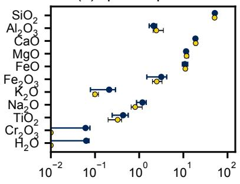  
(b) amp composition

(c) Temperature (°C)  
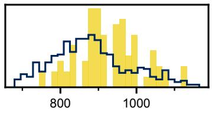

(d) Pressure (kbar)  
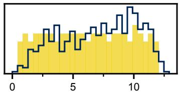

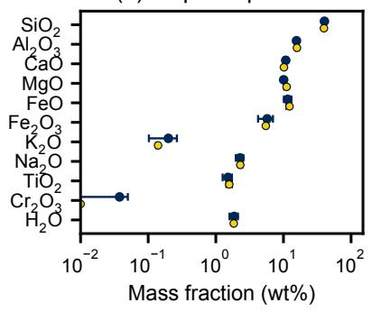

(e) Water content (wt%)  
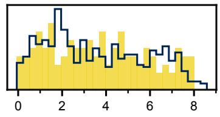  
Figure C1: Composition and conditions predictions against simulated labels. Predictions for one validation composition, an andesite, was selected because it had the median of the per-composition assemblage NLL at the 50%-melt readout. (a, b) Predicted compositions of the most probable anhydrous phase (clinopyroxene, a) and the most probable hydrous phase (amphibole, b), as ranked by the presence branch. Predicted points represent the mean over 2,048 candidate compositions from the predicted Dirichlet and whiskers span the 25th to 75th percentile. Simulated label points reflect the median of the simulated labels across the composition’s 128 draws and whiskers span the 25th to 75th percentile. (c–e) Predicted formation temperature, pressure, and dissolved water content over 512 assemblages sampled from the presence branch, against the sampled conditions of the same 128 draws.

(a) afs composition  
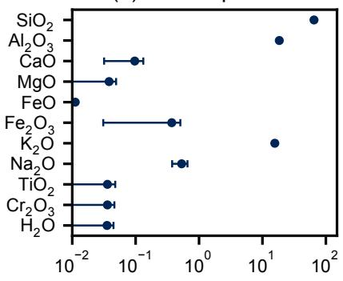  
(b) bi composition

(c) Temperature (°C)  
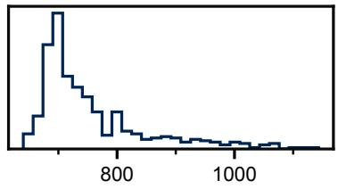

(d) Pressure (kbar)  
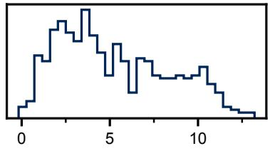

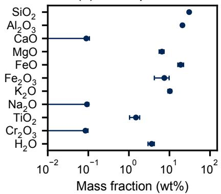

(e) Water content (wt%)  
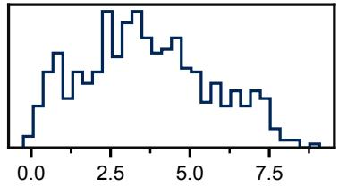

Figure C2: Zero-shot composition and conditions predictions for a measured rock. Predictions for one benchmark rhyolite, the rock of Fig. 2, selected for having the median of the recalibrated joint NLL over the test set. (a, b) Predicted composition of the most probable anhydrous phase (alkali feldspar, panel a) and the most probable hydrous phase (biotite, panel b), as ranked by the presence branch. Points represent the mean over 2,048 candidate compositions from the predicted Dirichlet and whiskers span the 25th to 75th percentile. (c–e) Predicted formation temperature, pressure, and dissolved water content over 512 assemblages sampled from the presence branch. The benchmark reports neither mineral compositions nor formation conditions, so no measured counterpart appears.

## D Comparing simulated and measured labels

Fitting protocol. Because rocks are collected one eruption at a time, we select whole stratigraphic units – which contain numerous rocks per unit – from the 368-rock fitting set. We add units at random up to sizes of 25, 50, 100, 200, and 400 rocks, with realized counts at or slightly above each size because units are sampled whole. At each size we make 10 independent selections (replicates). For each replicate, the recalibration tiers of Appendix B.7 are fitted, and the three heads are trained on measured abundances (described below). Every fit is evaluated on the fixed validation set of 11 rocks spanning 39 stratigraphic units. The resulting fits are compared three ways: among the tiers (Fig. D1), among the heads (Fig. D2), and between the mixture tier and the head given the latent representation (Fig. D3).

Heads trained on measured abundances. Each of the three heads follows the factorization of Eq. 1 over the 7 mineral categories in the benchmark. Specifically, each factor of Eq. 1 is predicted by a multilayer perceptron with a single hidden layer of 64 units. The abundance factor is the same 2-component Dirichlet mixture employed by the recalibration layer. The three heads differ only in their input, which is the frozen encoder’s 256-dimensional latent representation, the composition the latent was computed from, or a zero vector. Compositions are converted to $\log _ { 1 0 }$ concentration, with unreported elements set to zero. The input widths determine the parameter counts, where the head given the latent representation has 34,839 parameters while the head given raw geochemistry has 4,887 parameters.

As with the recalibrated model, all three heads minimize the joint NLL. Fitting employs full-batch Adam at a learning rate of 0.03 for 1500 steps with no early stopping. The two values were determined from the training loss, where we took the largest learning rate under which the loss remains monotonic and the step count at which the loss plateaus (to within 0.01 nats of the final loss). The weight decay is chosen by the same protocol described in Appendix B.7, where all three heads selected 1.0.

Head given no chemical inputs. The head given no chemistry is introduced as a control, trained and evaluated exactly as the other heads are. Because the zero vector carries no chemical information, the presence factor can learn only the rate at which each mineral category appears across the rocks of a fit. The abundance factor, which conditions on the measured mineral list, is still learned as in the other two heads. At 26 rocks, the abundance-factor NLL of the head given the latent representation reaches -1.92 nats compared to -1.63 for the head given no chemistry and -1.47 for the head given raw geochemistry, while at the full fitting set the three converge to -2.50, -2.51, and -2.50. Presence prediction therefore benefits from chemical inputs. Meanwhile, abundance predictions depend primarily on the measured mineral list, benefiting only from chemical inputs when labeled rocks are scarce.

Comparing fits. We report the contrast between two fits a and b over the replicates r as:

$$
\Delta _ { a b } = \mathrm { m e d i a n } _ { r } \big ( \mathrm { N L L } _ { a } ^ { ( r ) } - \mathrm { N L L } _ { b } ^ { ( r ) } \big )\tag{12}
$$

where the difference is taken within a replicate because both fits train on the same selected rocks. Values reported in Section 3 are medians across the 10 replicates. The head using the latent representation outperforms the head given raw geochemistry by 0.67 nats of joint NLL at 25 rocks (in 9/10 replicates) and by 0.59 nats at the full fitting set (in 10/10 replicates). The head using the latent representation also outperforms the head given no chemistry by 0.50 nats at 25 rocks (in 9/10 replicates) and by 0.78 nats at the full fitting set (in 10/10 replicates). Lastly, compared to the recalibration layer, the head given the latent representation is lower by a median of 1.38 nats at 26 rocks and by 0.70 nats at the full fitting set. Thus, a head trained directly on measured abundances outperforms the recalibration layer in NLL (Fig. D3a). However, the recalibration layer exhibits lower absolute error in every replicate from 210 rocks onward (Fig. D3b). We therefore observe a tradeoff between model confidence and model accuracy. We attribute the recalibrated model’s weaker confidence to the assumed distribution of formation conditions (Eq. 4), which we sampled broadly. The spread of the predicted distributions therefore follows the sampling rather than a measurement. In contrast, a head trained on measured abundances does not inherit priors from the simulation. We posit that more physically-aligned formation conditions would tighten simulated labels, help remove the spread that recalibration is only capable of partly absorbing, and therefore improve model confidence.

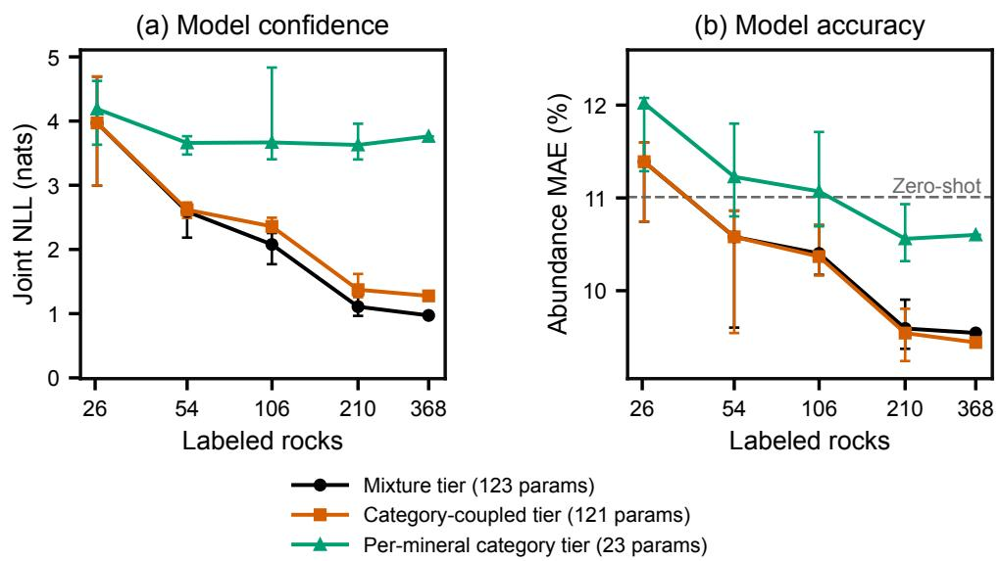  
Figure D1: Recalibration tiers across fit sizes. The three recalibration configurations described in Appendix B.7. (a) Median joint NLL. For reference, the zero-shot joint NLL is 13.4 nats, above the plotted range. (b) Abundance MAE, reported as the mean of the 7 per-category MAE values, where the dashed line marks the zero-shot value. For both panels, error bars span the interquartile range over the 10 replicates at each fitting size, evaluated on the fixed validation set of 111 rocks spanning 39 stratigraphic units. Axes are shared with Figs. D2 and D3.

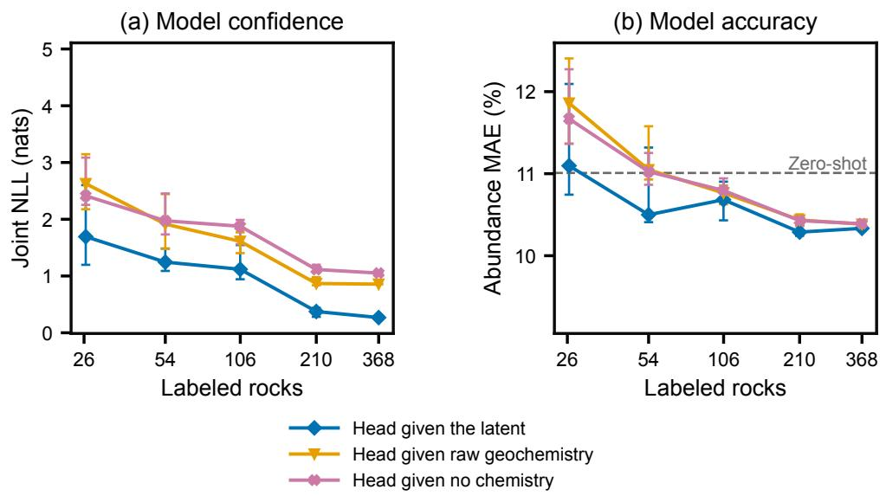  
Figure D2: Heads trained on measured abundances across fit sizes. The three heads differing only in their input: the frozen encoder’s latent representation, the composition the latent representation was computed from, or a zero vector. (a) Median joint NLL. For reference, the zero-shot joint NLL is 13.4 nats, above the plotted range. (b) Abundance MAE, reported as the mean of the 7 per-category MAE values, where the dashed line marks the zero-shot value. For both panels, error bars span the interquartile range over the 10 replicates at each fitting size, evaluated on the fixed validation set of 111 rocks spanning 39 stratigraphic units. Axes are shared with Figs. D1 and D3.

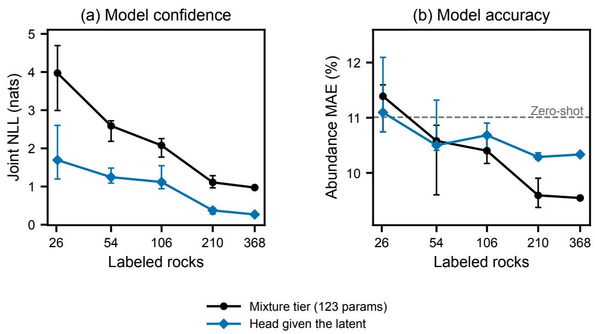  
Figure D3: Simulated and measured supervision across fit sizes. The recalibration configuration is the mixture tier described in Appendix B.7, which corrects predictions supervised by simulated labels. Meanwhile the head is the one given the latent representation, which is trained on measured abundances alone. Both represent the most performant from their respective groups in Figs. D1 and D2. (a) Median joint NLL. For reference, the zero-shot joint NLL is 13.4 nats, above the plotted range. (b) Abundance MAE, reported as the mean of the 7 per-category MAE values, where the dashed line marks the zero-shot value. For both panels, error bars span the interquartile range over the 10 replicates at each fitting size, evaluated on the fixed validation set of 111 rocks spanning 39 stratigraphic units. Axes are shared with Figs. D1 and D2.

## E Supplementary Tables

Table E1: Per-element imputation performance of the pretrained encoder. To score an element, its value is hidden from the encoder and a decoder recovers it from the frozen pooled latent representation. Each entry is the log-space $R ^ { 2 }$ between recovered and measured concentrations over 157,544 held-out compositions. Cr occupies the ninth major-element row of the input vocabulary but is never reported in the pretraining compilation. Its row therefore always enters as padding, and no measured value exists to score against.
<table><tr><td>Major  $R ^ { 2 }$ </td><td>Si 0.92</td><td>Al 0.92</td><td>Ca 0.88</td><td> $\mathbf { M g }$  0.92</td><td>Fe 0.86</td><td>K 0.87</td><td> $\mathbf { N a }$  0.79</td><td>Ti 0.90</td><td> $\mathrm { C r }$  1</td><td></td><td></td><td></td><td></td></tr><tr><td>Trace  $R ^ { 2 }$ </td><td>Sr 0.80</td><td>Zr 0.80</td><td>Ba 0.77</td><td>Y 0.82</td><td>Rb 0.89</td><td>Ni 0.80</td><td>Nb 0.85</td><td>V 0.83</td><td>La 0.93</td><td>Ce 0.94</td><td>Nd 0.94</td><td>Yb 0.84</td><td>Th 0.88</td></tr></table>

Table E2: Zero-shot presence discrimination per mineral category. AUROC of the predicted presence probability, computed over every rock in the benchmark.
<table><tr><td></td><td>Feldspar</td><td>r Pyroxene</td><td>Amphibole</td><td>Biotite</td><td>Olivine</td><td>Fe-Ti oxides</td><td>Quartz</td></tr><tr><td>AUROC</td><td>0.870</td><td>0.780</td><td>0.575</td><td>0.770</td><td>0.829</td><td>0.638</td><td>0.853</td></tr></table>

Table E3: Zero-shot abundance ranking per mineral category. Spearman rank correlation between predicted and measured abundance, computed over the n rocks that report a quantity for each category.
<table><tr><td></td><td></td><td>Feldspar Pyroxene</td><td>Amphibole</td><td>Biotite</td><td>Olivine</td><td>Fe-Ti oxides</td><td>Quartz</td></tr><tr><td>Spearman ρ</td><td>0.456</td><td>0.396</td><td>0.350</td><td>-0.044</td><td>0.762</td><td>0.219</td><td>0.667</td></tr><tr><td>n</td><td>601</td><td>292</td><td>312</td><td>322</td><td>79</td><td>559</td><td>148</td></tr></table>

Table E4: Zero-shot abundance bias per mineral category. The percentage of rocks where predicted abundance exceeds the measured abundance; the median across rocks of the predicted-to-measured abundance ratio; and the number of rocks n that report a quantity for the category.
<table><tr><td></td><td></td><td>Feldspar Pyroxene</td><td>Amphibole</td><td>Biotite</td><td>Olivine</td><td>Fe-Ti oxides</td><td>Quartz</td></tr><tr><td>Rocks over-predicted (%)</td><td>72</td><td>37</td><td>46</td><td>29</td><td>41</td><td>6</td><td>84</td></tr><tr><td>Median pred/measured</td><td>1.14</td><td>0.76</td><td>0.92</td><td>0.61</td><td>0.88</td><td>0.34</td><td>2.01</td></tr><tr><td>n</td><td>601</td><td>292</td><td>312</td><td>322</td><td>79</td><td>559</td><td>148</td></tr></table>

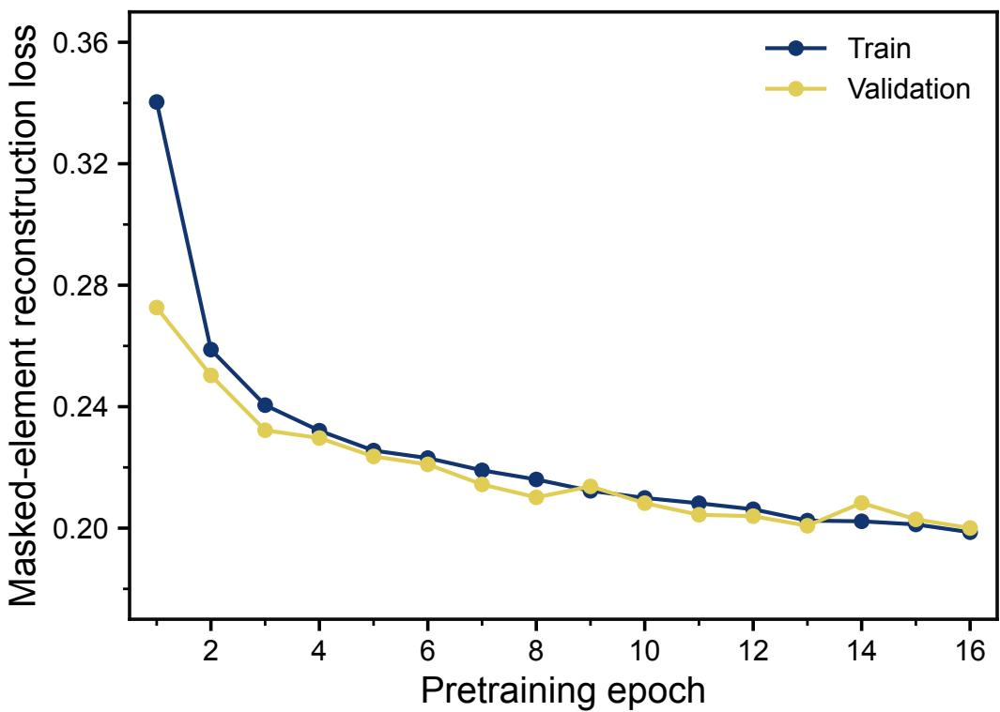  
Figure F1: Composition encoder pretraining loss. Masked-element reconstruction loss (dimensionless) over pretraining of the composition encoder, where the loss is the standardized log MSE as presented in Eq. 3. The validation loss is evaluated on held-out compositions from the pretraining set. Training was halted by early stopping once the validation ceased to improve 0.001/epoch.

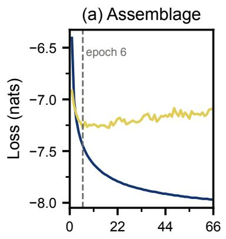

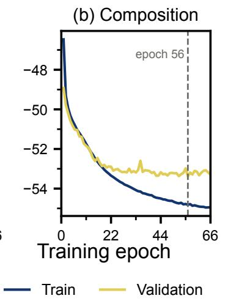

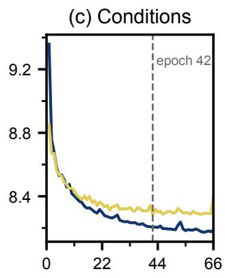  
Figure F2: Per-head training loss. Loss over joint-heads training, where each head is saved at its own best-validation epoch (vertical dashed line). The validation loss is evaluated on the 55,576 rows of the validation compositions (Table B6). (a) Assemblage head, the summed presence and abundance loss. (b) Composition head. (c) Conditions head.

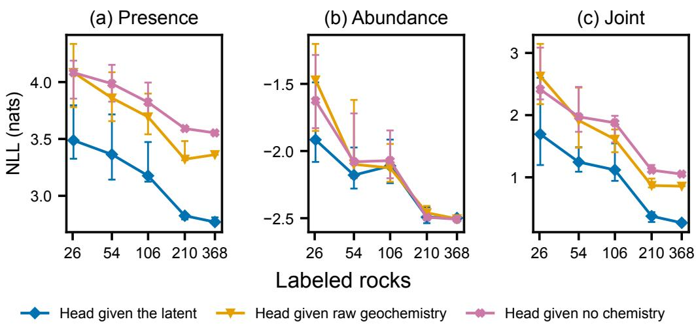

Figure F3: Joint NLL decomposed into presence and abundance factors. The three heads trained on measured abundances, differing only in their input (Appendix D). (a) The presence (Bernoulli) factor of Eq. 1. (b) The abundance (Dirichlet) factor, where all three heads are given the measured mineral list as their support (i.e., teacher-forced). (c) The joint NLL, the sum of the presence and abundance factors. Note that this panel corresponds exactly to Fig. D2a. Points are medians and error bars span the interquartile range over the 10 replicates at each fitting size, evaluated on the benchmark validation set. Note that the gap between curves is a difference of medians because each curve summarizes one head separately.

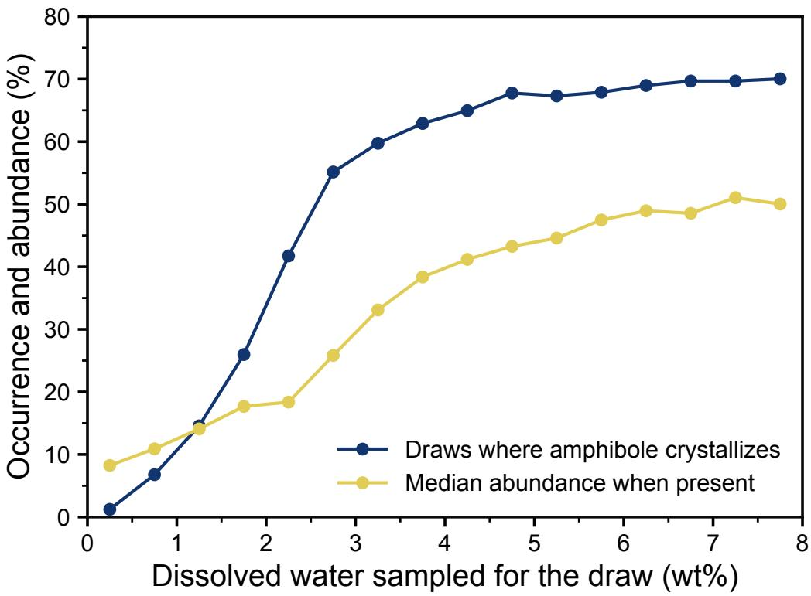  
Figure F4: Water sensitivity of amphibole crystallization. Amphibole occurrence and abundance in the simulated label corpus, pooled over the validation compositions.

## NeurIPS Paper Checklist

## 1. Claims

Question: Do the main claims made in the abstract and introduction accurately reflect the paper’s contributions and scope?

Answer: [Yes]

Justification: All main claims are supported with figures and tables in the main text and appendices. In addition, the introduction explicitly scopes the model’s capabilities to the equilibrium crystallization of volcanic rocks.

Guidelines:

• The answer [N/A] means that the abstract and introduction do not include the claims made in the paper.

• The abstract and/or introduction should clearly state the claims made, including the contributions made in the paper and important assumptions and limitations. A [No] or [N/A] answer to this question will not be perceived well by the reviewers.

• The claims made should match theoretical and experimental results, and reflect how much the results can be expected to generalize to other settings.

• It is fine to include aspirational goals as motivation as long as it is clear that these goals are not attained by the paper.

## 2. Limitations

Question: Does the paper discuss the limitations of the work performed by the authors?

Answer: [Yes]

Justification: Limitations are discussed throughout the paper as they arise, including the thermodynamic simulators’ omissions of kinetics, transport, and measured formation condi tions (Section 1); the scope of the model to equilibrium crystallization of volcanic rocks (Section 1); the systematic abundance bias inherited from the simulated labels (Fig. 1c; Table E4); and the methodological assumptions over formation conditions, which impacts the spread of the predicted distributions (Eq. 4 and Appendix D).

Guidelines:

• The answer [N/A] means that the paper has no limitation while the answer [No] means that the paper has limitations, but those are not discussed in the paper.

• The authors are encouraged to create a separate “Limitations” section in their paper.

• The paper should point out any strong assumptions and how robust the results are to violations of these assumptions (e.g., independence assumptions, noiseless settings, model well-specification, asymptotic approximations only holding locally). The authors should reflect on how these assumptions might be violated in practice and what the implications would be.

• The authors should reflect on the scope of the claims made, e.g., if the approach was only tested on a few datasets or with a few runs. In general, empirical results often depend on implicit assumptions, which should be articulated.

• The authors should reflect on the factors that influence the performance of the approach. For example, a facial recognition algorithm may perform poorly when image resolution is low or images are taken in low lighting. Or a speech-to-text system might not be used reliably to provide closed captions for online lectures because it fails to handle technical jargon.

• The authors should discuss the computational efficiency of the proposed algorithms and how they scale with dataset size.

• If applicable, the authors should discuss possible limitations of their approach to address problems of privacy and fairness.

• While the authors might fear that complete honesty about limitations might be used by reviewers as grounds for rejection, a worse outcome might be that reviewers discover limitations that aren’t acknowledged in the paper. The authors should use their best judgment and recognize that individual actions in favor of transparency play an important role in developing norms that preserve the integrity of the community. Reviewers will be specifically instructed to not penalize honesty concerning limitations.

## 3. Theory assumptions and proofs

Question: For each theoretical result, does the paper provide the full set of assumptions and a complete (and correct) proof?

Answer: [N/A]

Justification: The paper is empirical and presents no theorems or proofs.

Guidelines:

• The answer [N/A] means that the paper does not include theoretical results.

• All the theorems, formulas, and proofs in the paper should be numbered and crossreferenced.

• All assumptions should be clearly stated or referenced in the statement of any theorems.

• The proofs can either appear in the main paper or the supplemental material, but if they appear in the supplemental material, the authors are encouraged to provide a short proof sketch to provide intuition.

• Inversely, any informal proof provided in the core of the paper should be complemented by formal proofs provided in appendix or supplemental material.

• Theorems and Lemmas that the proof relies upon should be properly referenced.

## 4. Experimental result reproducibility

Question: Does the paper fully disclose all the information needed to reproduce the main experimental results of the paper to the extent that it affects the main claims and/or conclusions of the paper (regardless of whether the code and data are provided or not)?

Answer: [Yes]

Justification: Every main claim made in the paper has an experimental setup described in detail (Appendix B), including tokenization, encoder configuration, pretraining, simulatedcorpus generation, head architectures, joint training, recalibration fitting, and benchmark construction. All data splits, hyperparameter selection procedures, and evaluation protocols are detailed in a manner that allows a reader to reproduce the work.

## Guidelines:

• The answer [N/A] means that the paper does not include experiments.

• If the paper includes experiments, a [No] answer to this question will not be perceived well by the reviewers: Making the paper reproducible is important, regardless of whether the code and data are provided or not.

• If the contribution is a dataset and/or model, the authors should describe the steps taken to make their results reproducible or verifiable.

• Depending on the contribution, reproducibility can be accomplished in various ways. For example, if the contribution is a novel architecture, describing the architecture fully might suffice, or if the contribution is a specific model and empirical evaluation, it may be necessary to either make it possible for others to replicate the model with the same dataset, or provide access to the model. In general. releasing code and data is often one good way to accomplish this, but reproducibility can also be provided via detailed instructions for how to replicate the results, access to a hosted model (e.g., in the case of a large language model), releasing of a model checkpoint, or other means that are appropriate to the research performed.

• While NeurIPS does not require releasing code, the conference does require all submissions to provide some reasonable avenue for reproducibility, which may depend on the nature of the contribution. For example

(a) If the contribution is primarily a new algorithm, the paper should make it clear how to reproduce that algorithm.

(b) If the contribution is primarily a new model architecture, the paper should describe the architecture clearly and fully.

(c) If the contribution is a new model (e.g., a large language model), then there should either be a way to access this model for reproducing the results or a way to reproduce the model (e.g., with an open-source dataset or instructions for how to construct the dataset).

(d) We recognize that reproducibility may be tricky in some cases, in which case authors are welcome to describe the particular way they provide for reproducibility. In the case of closed-source models, it may be that access to the model is limited in some way (e.g., to registered users), but it should be possible for other researchers to have some path to reproducing or verifying the results.

## 5. Open access to data and code

Question: Does the paper provide open access to the data and code, with sufficient instructions to faithfully reproduce the main experimental results, as described in supplemental material?

Answer: [Yes]

Justification: Code, configuration files, a version-pinned environment specification, both trained model checkpoints (encoder and prediction heads), the benchmark tables, and the figure pipeline are available at https://github.com/matthew-j-liu/phasecast.

Guidelines:

• The answer [N/A] means that paper does not include experiments requiring code.

• Please see the NeurIPS code and data submission guidelines (https://neurips.cc/ public/guides/CodeSubmissionPolicy) for more details.

• While we encourage the release of code and data, we understand that this might not be possible, so [No] is an acceptable answer. Papers cannot be rejected simply for not including code, unless this is central to the contribution (e.g., for a new open-source benchmark).

• The instructions should contain the exact command and environment needed to run to reproduce the results. See the NeurIPS code and data submission guidelines (https: //neurips.cc/public/guides/CodeSubmissionPolicy) for more details.

• The authors should provide instructions on data access and preparation, including how to access the raw data, preprocessed data, intermediate data, and generated data, etc.

• The authors should provide scripts to reproduce all experimental results for the new proposed method and baselines. If only a subset of experiments are reproducible, they should state which ones are omitted from the script and why.

• At submission time, to preserve anonymity, the authors should release anonymized versions (if applicable).

• Providing as much information as possible in supplemental material (appended to the paper) is recommended, but including URLs to data and code is permitted.

## 6. Experimental setting/details

Question: Does the paper specify all the training and test details (e.g., data splits, hyperparameters, how they were chosen, type of optimizer) necessary to understand the results?

Answer: [Yes]

Justification: The optimizer, learning rate, and schedule are specified in every training stage of the model architecture. In addition, hyperparameter values, search spaces, and selection criteria are tabulated in Tables B3, B4, and B8. All data splits and evaluation protocols are defined in Section 2 and Appendix B.

Guidelines:

• The answer [N/A] means that the paper does not include experiments.

• The experimental setting should be presented in the core of the paper to a level of detail that is necessary to appreciate the results and make sense of them.

• The full details can be provided either with the code, in appendix, or as supplemental material.

## 7. Experiment statistical significance

Question: Does the paper report error bars suitably and correctly defined or other appropriate information about the statistical significance of the experiments?

Answer: [Yes]

Justification: The model presented in this work predicts distributions, which we always show the spread for (e.g., whiskers spanning the interquartile range). Other sources of uncertainty are described as they arise throughout the paper, including benchmark variability by bootstrap resampling (Appendix B.9) and training variability due to the random selection of training rocks (Appendix D).

Guidelines:

• The answer [N/A] means that the paper does not include experiments.

• The authors should answer [Yes] if the results are accompanied by error bars, confidence intervals, or statistical significance tests, at least for the experiments that support the main claims of the paper.

• The factors of variability that the error bars are capturing should be clearly stated (for example, train/test split, initialization, random drawing of some parameter, or overall run with given experimental conditions).

• The method for calculating the error bars should be explained (closed form formula, call to a library function, bootstrap, etc.)

• The assumptions made should be given (e.g., Normally distributed errors).

• It should be clear whether the error bar is the standard deviation or the standard error of the mean.

• It is OK to report 1-sigma error bars, but one should state it. The authors should preferably report a 2-sigma error bar than state that they have a 96% CI, if the hypothesis of Normality of errors is not verified.

• For asymmetric distributions, the authors should be careful not to show in tables or figures symmetric error bars that would yield results that are out of range (e.g., negative error rates).

• If error bars are reported in tables or plots, the authors should explain in the text how they were calculated and reference the corresponding figures or tables in the text.

## 8. Experiments compute resources

Question: For each experiment, does the paper provide sufficient information on the computer resources (type of compute workers, memory, time of execution) needed to reproduce the experiments?

Answer: [Yes]

Justification: A paragraph at the beginning of Appendix B details the hardware and time of execution needed for all experiments (e.g., corpus generation, encoder pretraining, hyperparameter searches, head training, and recalibration). In addition, an approximate compute time for unreported, preliminary iterations is provided.

Guidelines:

• The answer [N/A] means that the paper does not include experiments.

• The paper should indicate the type of compute workers CPU or GPU, internal cluster, or cloud provider, including relevant memory and storage.

• The paper should provide the amount of compute required for each of the individual experimental runs as well as estimate the total compute.

• The paper should disclose whether the full research project required more compute than the experiments reported in the paper (e.g., preliminary or failed experiments that didn’t make it into the paper).

## 9. Code of ethics

Question: Does the research conducted in the paper conform, in every respect, with the NeurIPS Code of Ethics https://neurips.cc/public/EthicsGuidelines?

Answer: [Yes]

Justification: Our work uses publicly available scientific data and does not involve human subjects, personal data, or other activities that raise ethical concerns under the NeurIPS Code of Ethics.

Guidelines:

• The answer [N/A] means that the authors have not reviewed the NeurIPS Code of Ethics.

• If the authors answer [No], they should explain the special circumstances that require a deviation from the Code of Ethics.

• The authors should make sure to preserve anonymity (e.g., if there is a special consideration due to laws or regulations in their jurisdiction).

## 10. Broader impacts

Question: Does the paper discuss both potential positive societal impacts and negative societal impacts of the work performed?

Answer: [Yes]

Justification: Positive impacts such as higher-throughput characterization of modal mineralogy for geology are discussed in Section 1. We foresee no direct path to malicious applications from predicting rock mineralogy, though negative effects for a user of the model might include a downstream decision predicated on potentially inaccurate zero-shot predictions. The paper addresses this concern by prescribing recalibration on measured rocks.

Guidelines:

• The answer [N/A] means that there is no societal impact of the work performed.

• If the authors answer [N/A] or [No], they should explain why their work has no societal impact or why the paper does not address societal impact.

• Examples of negative societal impacts include potential malicious or unintended uses (e.g., disinformation, generating fake profiles, surveillance), fairness considerations (e.g., deployment of technologies that could make decisions that unfairly impact specific groups), privacy considerations, and security considerations.

• The conference expects that many papers will be foundational research and not tied to particular applications, let alone deployments. However, if there is a direct path to any negative applications, the authors should point it out. For example, it is legitimate to point out that an improvement in the quality of generative models could be used to generate Deepfakes for disinformation. On the other hand, it is not needed to point out that a generic algorithm for optimizing neural networks could enable people to train models that generate Deepfakes faster.

• The authors should consider possible harms that could arise when the technology is being used as intended and functioning correctly, harms that could arise when the technology is being used as intended but gives incorrect results, and harms following from (intentional or unintentional) misuse of the technology.

• If there are negative societal impacts, the authors could also discuss possible mitigation strategies (e.g., gated release of models, providing defenses in addition to attacks, mechanisms for monitoring misuse, mechanisms to monitor how a system learns from feedback over time, improving the efficiency and accessibility of ML).

## 11. Safeguards

Question: Does the paper describe safeguards that have been put in place for responsible release of data or models that have a high risk for misuse (e.g., pre-trained language models, image generators, or scraped datasets)?

Answer: [N/A]

Justification: Neither the model, which predicts rock mineralogy, nor the data (from published geochemical and petrographic sources) carries a high risk for misuse.

## Guidelines:

• The answer [N/A] means that the paper poses no such risks.

• Released models that have a high risk for misuse or dual-use should be released with necessary safeguards to allow for controlled use of the model, for example by requiring that users adhere to usage guidelines or restrictions to access the model or implementing safety filters.

• Datasets that have been scraped from the Internet could pose safety risks. The authors should describe how they avoided releasing unsafe images.

• We recognize that providing effective safeguards is challenging, and many papers do not require this, but we encourage authors to take this into account and make a best faith effort.

## 12. Licenses for existing assets

Question: Are the creators or original owners of assets (e.g., code, data, models), used in the paper, properly credited and are the license and terms of use explicitly mentioned and properly respected?

Answer: [Yes]

Justification: All datasets and software are cited in the references. Their licenses permit our use: the geochemical compilation is distributed CC BY 4.0, the two USGS petrographic studies are public-domain U.S. Government works, MAGEMin is GPL-3.0 and is called as an unmodified solver, and CrabNet, the mat2vec embeddings, and Optuna are MIT-licensed.

## Guidelines:

• The answer [N/A] means that the paper does not use existing assets.

• The authors should cite the original paper that produced the code package or dataset.

• The authors should state which version of the asset is used and, if possible, include a URL.

• The name of the license (e.g., CC-BY 4.0) should be included for each asset.

• For scraped data from a particular source (e.g., website), the copyright and terms of service of that source should be provided.

• If assets are released, the license, copyright information, and terms of use in the package should be provided. For popular datasets, paperswithcode.com/datasets has curated licenses for some datasets. Their licensing guide can help determine the license of a dataset.

• For existing datasets that are re-packaged, both the original license and the license of the derived asset (if it has changed) should be provided.

• If this information is not available online, the authors are encouraged to reach out to the asset’s creators.

## 13. New assets

Question: Are new assets introduced in the paper well documented and is the documentation provided alongside the assets?

Answer: [Yes]

Justification: The new assets (trained encoder and head weights, the compiled benchmark tables, and the simulated label corpus) are described in Appendices B.2, B.3, B.5, and B.6 (the weights), Appendix B.8 (the benchmark tables), and Appendix B.4 (the label corpus). In addition, the repository details the codebase and provides a version-pinned environment; due to size constraints, the repository carries an excerpt of the corpus and links to the full set, while Appendix B.4 gives the full generation procedure.

Guidelines:

• The answer [N/A] means that the paper does not release new assets.

• Researchers should communicate the details of the dataset/code/model as part of their submissions via structured templates. This includes details about training, license, limitations, etc.

• The paper should discuss whether and how consent was obtained from people whose asset is used.

• At submission time, remember to anonymize your assets (if applicable). You can either create an anonymized URL or include an anonymized zip file.

## 14. Crowdsourcing and research with human subjects

Question: For crowdsourcing experiments and research with human subjects, does the paper include the full text of instructions given to participants and screenshots, if applicable, as well as details about compensation (if any)?

Answer: [N/A]

Justification: The paper involves no crowdsourcing and no research with human subjects.   
All data are physical measurements of rocks from published sources.

Guidelines:

• The answer [N/A] means that the paper does not involve crowdsourcing nor research with human subjects.

• Including this information in the supplemental material is fine, but if the main contribution of the paper involves human subjects, then as much detail as possible should be included in the main paper.

• According to the NeurIPS Code of Ethics, workers involved in data collection, curation, or other labor should be paid at least the minimum wage in the country of the data collector.

## 15. Institutional review board (IRB) approvals or equivalent for research with human subjects

Question: Does the paper describe potential risks incurred by study participants, whether such risks were disclosed to the subjects, and whether Institutional Review Board (IRB) approvals (or an equivalent approval/review based on the requirements of your country or institution) were obtained?

Answer: [N/A]

Justification: The paper involves no research with human subjects, so IRB or equivalent review is not applicable.

Guidelines:

• The answer [N/A] means that the paper does not involve crowdsourcing nor research with human subjects.

• Depending on the country in which research is conducted, IRB approval (or equivalent) may be required for any human subjects research. If you obtained IRB approval, you should clearly state this in the paper.

• We recognize that the procedures for this may vary significantly between institutions and locations, and we expect authors to adhere to the NeurIPS Code of Ethics and the guidelines for their institution.

• For initial submissions, do not include any information that would break anonymity (if applicable), such as the institution conducting the review.

## 16. Declaration of LLM usage

Question: Does the paper describe the usage of LLMs if it is an important, original, or non-standard component of the core methods in this research? Note that if the LLM is used only for writing, editing, or formatting purposes and does not impact the core methodology, scientific rigor, or originality of the research, declaration is not required.

Answer: [N/A]

Justification: LLM tools assisted with writing and code implementation as general-purpose assistants, but were not a component of the core methodology or scientific reasoning in this work. The motivation, framing, and all primary design decisions were made by the authors, guided by their own expertise and intuition.

Guidelines:

• The answer [N/A] means that the core method development in this research does not involve LLMs as any important, original, or non-standard components.

• Please refer to our LLM policy in the NeurIPS handbook for what should or should not be described.