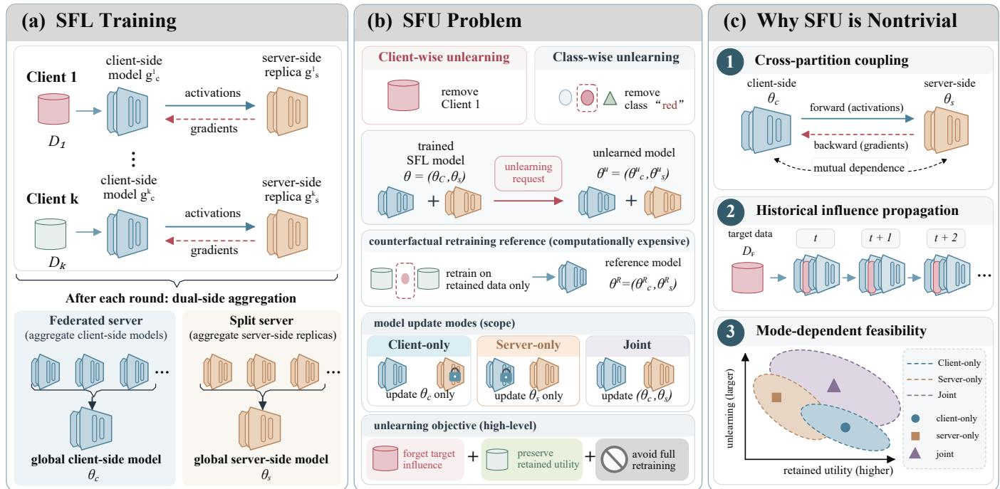
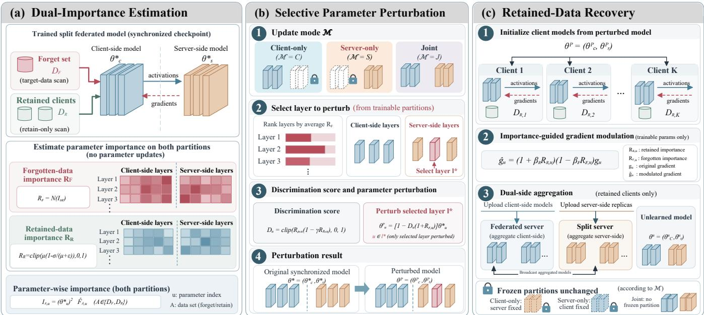
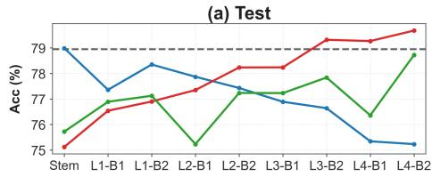
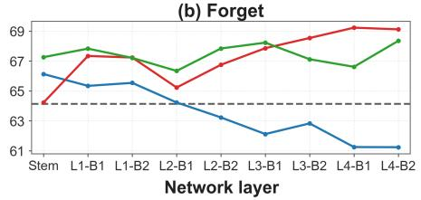
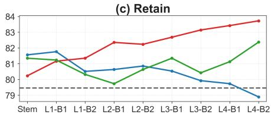
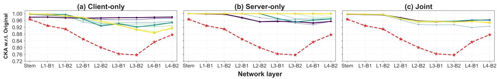
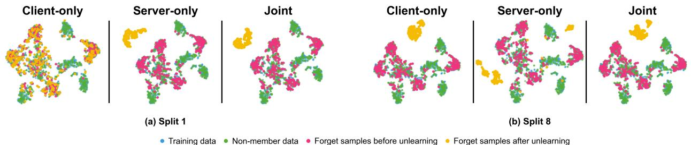
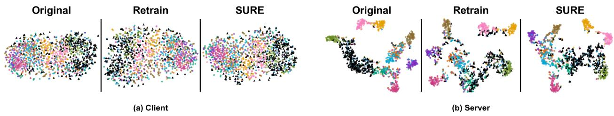
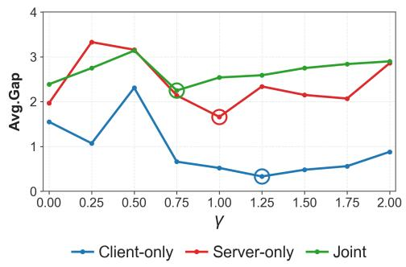
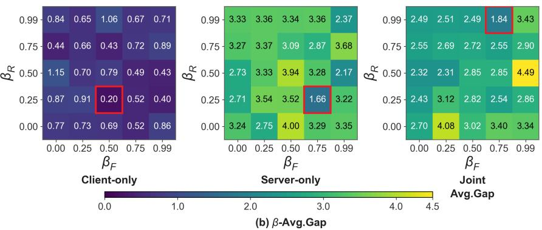

# Split Federated Unlearning

Jia Chen1,2,\*, Yecheng Lv1,\*, Xinrong Hu1, Mingdi Huang1, Jun Bai3,†

1 School of Computer Science and Artificial Intelligence, Wuhan Textile University, Wuhan, China

2 Engineering Research Center of Hubei Province for Clothing Information, Wuhan Textile University, Wuhan, China

3 Australian Institute for Machine Learning (AIML), Adelaide University, Adelaide, Australia

## Abstract

Split federated learning (SFL) combines partitioned model execution with federated aggregation to support collaborative learning across distributed Web and edge environments. However, removing learned contributions in SFL is challenging due to cross-partition coupling and historical influence propagation through dual-side aggregation. To the best of our knowledge, we provide the first systematic formulation of Split Federated Unlearning (SFU), en-compassing client-wise and class-wise removal, counterfactual re- training, and partition-specific update constraints. We theoretically characterize historical influence propagation and mode-dependent unlearning feasibility, revealing structural limitations of restricted model updates. As an initial solution, we propose SURE, integrating dual-importance estimation, selective parameter perturbation, and importance-guided recovery. Extensive experiments with existing unlearning methods adapted to SFL reveal substantial forgetting– utility trade-ofs across model architectures, data distributions, and update modes. SURE achieves competitive agreement with mode matched retraining at modest additional cost, while further analyses highlight the impact of split position and update constraints on unlearning behavior. These findings establish SFU as a distinct research problem and provide a foundation for unlearning in parti- tioned federated systems.

## Keywords

split federated unlearning, split federated learning, federated un- learning, model partitioning, importance-guided unlearning

## 1 Introduction

Personalized Web services increasingly rely on user interactions distributed across devices and data owners [25]. Federated learning (FL) enables collaborative training without centralizing raw data [1, 21], but training complete models on resource-constrained clients can be costly [6]. Split federated learning (SFL) addresses this limitation by partitioning model execution between clients and a server while retaining federated aggregation [27]. As illustrated in Fig. 1(a), client-side models and their corresponding server-side replicas are jointly optimized, with each partition aggregated sepa-rately. This architecture ofers a practical approach to collaborative learning in resource-heterogeneous Web and edge environments.

While SFL keeps user data local, it does not address the removal of their learned contributions when users withdraw data or leave a Web service. Deleting local records or ending participation cannot undo their accumulated influence on the trained model. Machine unlearning seeks to remove such influence without full retrain- ing [3, 26]. Existing federated unlearning methods, including Fed-Eraser [19] and FedRecovery [35], address contributions propagated through federated aggregation, while split unlearning considers removal under partitioned model execution [4, 10]. Neither formulation directly captures SFL, where both mechanisms operate together.

Combining split execution with dual-side aggregation introduces distinct challenges for unlearning in SFL. Fig. 1(b) illustrates client-wise and class-wise removal, with full retained-data retraining as the ideal counterfactual reference and three model update modes. As highlighted in Fig. 1(c), three challenges arise: cross-partition coupling, as both partitions interact through exchanged activations and gradients; historical influence propagation, as repeated dual-side aggregation propagates contributions across clients and rounds; and mode-dependentfeasibility, as restricting updates to one partition may limit attainable forgetting. These intertwined challenges motivate a dedicated formulation of Split Federated Unlearning (SFU).

To address these challenges, we formalize SFU for client-wise and class-wise removal, distinguishing forgetting requests from the permitted model updates (Client-only, Server-only, and Joint). Full retained-data retraining serves as the ideal counterfactual ref- erence, while mode-matched retraining captures the efects of re- stricted updates. We further characterize how forgotten-data influ- ence propagates through coupled dual-side training and analyze mode-dependent unlearning feasibility through local prediction- discrepancy bounds and excess retained-data risk under a qua- dratic approximation. These results identify structural limitations imposed by model partitioning, independently of any particular unlearning algorithm.

To investigate SFU in practice, we propose SURE, an initial SFU approach combining dual-importance estimation, selective parameter perturbation, and retained-data recovery. SURE identifies target-relevant parameters while accounting for retained knowledge, ap- plies targeted perturbations within the permitted model partitions, and performs importance-guided recovery through the original SFL training protocol. We systematically evaluate SURE and existing unlearning methods adapted to SFL across diferent datasets, data distributions, and model update modes. Experiments on MNIST, CIFAR-10, and CIFAR-100 reveal substantial forgetting–utility trade- ofs among adapted baselines, while SURE achieves competitive agreement with mode-matched retraining at modest additional cost. Further analyses examine the efects of split position, component design, and multiple client removals.

Our main contributions are threefold: (1) To the best of our knowledge, we provide the first systematic formulation of Split Federated Unlearning (SFU), jointly accounting for cross-partition coupling, dual-side aggregation, and partition-specific update constraints under client-wise and class-wise removal. (2) We theoretically characterize historical influence propagation and modedependent unlearning feasibility, revealing how accumulated contri- butions and restricted updates afect attainable forgetting behavior. (3) We propose SURE as an initial importance-guided solution and systematically evaluate adapted unlearning methods in SFL, exam ining forgetting–utility trade-ofs, model partitioning, and system eficiency.

  
Figure 1: Overview of Split Federated Unlearning (SFU). (a) SFL jointly trains client-side models and server-side replicas, with independent aggregation of both partitions. (b) SFU considers client-wise and class-wise removal, using full retained-data retraining as the counterfactual reference under diferent model update modes. (c) SFU involves cross-partition coupling, historical influence propagation, and mode-dependent unlearning feasibility.

## 2 Related Work

Federated Unlearning. Machine unlearning aims to remove learned data contributions without full retraining [3, 15]. In FL [2, 21], unlearning is complicated by historical contributions accumulated through model aggregation. Early approaches explored update calibration and selective retraining [19, 20], alongside privacy- preserving model recovery [35]. Subsequent work investigated class-specific pruning, incentive-aware selection, subgraph removal, and privacy-aware recovery [17, 18, 30, 31]. Recent methods further address gradient conflicts, server-side unlearning, and task-vector alignment [16, 22, 24, 33]. However, these approaches do not ex-plicitly account for dependencies between separately aggregated model partitions.

SplitLearning andUnlearning. Split learning (SL) partitions model execution between clients and servers through intermediate acti- vations and gradients [29]. Recent split unlearning methods address training dependencies through isolation-based removal [10] and gradient-cache projection with retained-data fine-tuning [4]. Parameter-selective approaches, such as SalUn [5], further demonstrate the role of weight saliency in targeted unlearning. Neverthe-less, these methods do not jointly characterize split-model dependencies and repeated federated aggregation.

Split Federated Learning. SFL combines partitioned execution with federated aggregation to support resource-constrained clients [27]. Subsequent studies have improved scalability through server-side parallelism [8] and investigated training instability under heterogeneous data [28]. However, such studies primarily address training eficiency and knowledge preservation rather than deliberate re- moval of historical contributions. Unlearning in SFL must additionally account for cross-partition dependencies, dual-side aggregation, and partition-specific update constraints.

## 3 Split Federated Unlearning

## 3.1 System Model

We consider an SFL system [27] with � clients, a split server, and a federated aggregation server. Client $k \in \mathcal { K } = \{ 1 , . . . , K \}$ holds data $\mathcal { D } _ { k }$ and a client-side model $f _ { C } ( \cdot ; \theta _ { C , k } )$ ; the split server maintains a corresponding replica $f _ { S } ( \cdot ; \theta _ { S , k } )$ . The predictor is $f _ { k } ( x ) =$ $f s ( f c ( x ; \theta _ { C , k } ) ; \theta _ { S , k } )$ . Training exchanges cut-layer activations and gradients, followed by independent aggregation of both partitions each round:

$$
\theta _ { s } ^ { t + 1 } = \sum _ { k \in \mathcal { K } _ { t } } w _ { k , t } ^ { s } \theta _ { s , k } ^ { t + 1 } , \qquad s \in \{ C , S \} ,\tag{1}
$$

where $\mathcal { K } _ { t }$ is the participating client set and the weights $w _ { k , t } ^ { s }$ are normalized. Client-side models are aggregated by the federated aggregation server and server-side replicas by the split server; both aggregated partitions initialize the next round. Thus, split computation couples the two partitions, while aggregation propagates client contributions across rounds.

## 3.2 Problem Formulation

Unlearning Requests. Let $\mathcal { D } = \cup _ { k \in \mathcal { K } } \mathcal { D } _ { k }$ and $\mathcal { D } _ { R } = \mathcal { D } \backslash \mathcal { D } _ { F }$ . We consider client-wise removal of client � and class-wise removal of class $c _ { f } \colon$

$$
{ \mathcal { D } } _ { F } = \left\{ \bigcup _ { k \in { \mathcal { K } } } \{ ( x , y ) \in { \mathcal { D } } _ { k } : y = c _ { f } \} , \quad { \mathrm { c l i e n t - w i s e } } . \right.\tag{2}
$$

The withdrawing client is excluded from subsequent participation; for class-wise removal, clients with retained data may remain.

Counterfactual Reference. Let $\mathcal { A } _ { \mathrm { S F I } }$ denote the original training procedure, including split execution and dual-side aggregation. Define

$$
\begin{array} { r } { \theta ^ { * } = \mathcal { A } _ { \mathrm { S F L } } ( \mathcal { D } ; \boldsymbol { \xi } ) , \qquad \theta ^ { R } = \mathcal { A } _ { \mathrm { S F L } } ( \mathcal { D } _ { R } ; \boldsymbol { \xi } ^ { \prime } ) , } \end{array}\tag{3}
$$

where $\theta = \left( \theta _ { C } , \theta _ { S } \right)$ and $\xi , \xi ^ { \prime }$ represent training randomness. The ideal reference $\theta ^ { R }$ is trained from initialization on retained data using the same SFL procedure, with participation and aggregation weights updated accordingly. Given $\theta ^ { * } , \mathcal { D } _ { R }$ , and admissible request information ${ \cal T } _ { F } ,$ , an unlearning method outputs $\theta ^ { U } = \mathcal { U } ( \theta ^ { * } , \mathcal { D } _ { R } , \mathcal { I } _ { F } )$ Exact unlearning requires agreement with the retraining distribution [3]; here we study approximate unlearning without full retraining.

Model Update Modes. We distinguish $M \in \{ \{ C \} , \{ S \} , \{ C , S \} \}$ denoting Client-only, Server-only, and Joint updates, independently of the forgetting request. Any frozen partition, including its client-specific replicas and persistent bufers $b _ { s } ,$ , remains at the original checkpoint:

$$
( \theta _ { s } ^ { ( t ) } , b _ { s } ^ { ( t ) } ) = ( \theta _ { s } ^ { * } , b _ { s } ^ { * } ) , \quad s \notin \mathcal { M } , \forall t .\tag{4}
$$

Frozen partitions still participate in split computation but are not updated.

Unlearning Objectives. SFU seeks to approximate full retraining while preserving retained-data utility and limiting computation and communication. We measure predictive discrepancy by

$$
\Delta _ { F } ( \theta ^ { U } , \theta ^ { R } ) = \mathbb { E } _ { x \sim Q } \big [ d ( f ( x ; \theta ^ { U } ) , f ( x ; \theta ^ { R } ) ) \big ] ,\tag{5}
$$

where $\boldsymbol { Q }$ is an evaluation distribution and � a prediction discrep- ancy. The remaining objectives are retained-data risk ${ \mathcal { L } } _ { R } ( \theta ^ { U } )$ and unlearning cost $c ( \mathcal { U } )$ , subject to M. For evaluation, mode-matched Retrain reinitializes and retrains only the permitted partition on $\mathcal { D } _ { R } ,$ , freezing the other at $\theta ^ { * }$ . It isolates update-mode restrictions but does not replace full retraining as the ideal reference; neither reference is assumed available to U.

## 3.3 Theoretical Characterization

Historical Influence Propagation. Training-data influence has been studied through algorithmic stability and influence functions [7, 12]. We examine how such influence propagates through successive rounds of coupled SFL training. Let $z ^ { t } = ( \theta _ { C } ^ { t } , \theta _ { S } ^ { t } , \omega ^ { t } )$ denote the synchronized training state at round $t ,$ where $\omega ^ { t }$ includes auxiliary optimizer states and persistent bufers. Under coupled random- ness and a common initialization, the original and retained-only trajectories satisfy

$$
z ^ { t + 1 } = \mathcal { G } _ { t } ( z ^ { t } ) , \qquad z _ { R } ^ { t + 1 } = \mathcal { G } _ { t } ^ { R } ( z _ { R } ^ { t } ) ,\tag{6}
$$

where each round mapping includes split updates and dual-side aggregation. Set $\delta _ { t } = z ^ { t } - z _ { R } ^ { t }$

Theorem 3.1 (Historical Influence Propagation). $I f G _ { t }$ is continuously diferentiable along the segmentfrom $z _ { R } ^ { t }$ to $z ^ { t } .$ , define

$$
\begin{array} { l } { \displaystyle { A _ { t } = \int _ { 0 } ^ { 1 } D \mathcal { G } _ { t } ( z _ { R } ^ { t } + \alpha \delta _ { t } ) d \alpha , } } \\ { \displaystyle { b _ { t } = \mathcal { G } _ { t } ( z _ { R } ^ { t } ) - \mathcal { G } _ { t } ^ { R } ( z _ { R } ^ { t } ) . } } \end{array}\tag{7}
$$

Then, with $\delta _ { 0 } = 0$

$$
\delta _ { T } = \sum _ { t = 0 } ^ { T - 1 } ( A _ { T - 1 } \cdot \cdot \cdot A _ { t + 1 } ) b _ { t } ,\tag{8}
$$

where empty products equal the identity. $I f \| A _ { t } \| _ { 2 } \leq L _ { t } .$ , then

$$
\| \delta _ { T } \| _ { 2 } \leq \sum _ { t = 0 } ^ { T - 1 } \left( \prod _ { r = t + 1 } ^ { T - 1 } L _ { r } \right) \| b _ { t } \| _ { 2 } .\tag{9}
$$

Theorem 3.1 decomposes historical influence into round-wise discrepancies $b _ { t }$ and their propagation through subsequent updates (proof in Appendix B.1). Here, $b _ { t }$ also captures changes in client participation and aggregation weights. For a single local gradient step, the cross-partition Jacobian blocks satisfy

$$
\begin{array} { r l } & { J _ { C S } ^ { t } = - \eta _ { C } \displaystyle \sum _ { k \in \mathcal { K } _ { t } } w _ { k , t } ^ { C } \nabla _ { \theta _ { C } \theta _ { S } } ^ { 2 } \ell _ { k , t } , } \\ & { J _ { S C } ^ { t } = - \eta _ { S } \displaystyle \sum _ { k \in \mathcal { K } _ { t } } w _ { k , t } ^ { S } \nabla _ { \theta _ { S } \theta _ { C } } ^ { 2 } \ell _ { k , t } , } \end{array}\tag{10}
$$

where $\ell _ { k , t }$ is the local split-model loss. Nonzero mixed derivatives couple the partition dynamics despite separate aggregation. Con-sequently, removing only a client’s final-round update does not generally reproduce the retained-only training trajectory.

Mode-Dependent Unlearning Feasibility. We characterize attain-able prediction changes through local model linearization, a per- spective also used to analyze neural-network training dynamics [14]. Let $F ( \theta ) = f ( \cdot ; \theta )$ belong to $\mathcal { H } = L ^ { 2 } ( Q ; \mathbb { R } ^ { m } )$ , with retraining shift $r = F ( \theta ^ { R } ) - F ( \theta ^ { * } )$ . For mode M, let $\Theta _ { M } = \{ \Delta \theta : \Delta \theta _ { s } = 0 \forall s \notin M \}$ and $\mathcal { V } _ { M } = \mathrm { r a n g e } ( D F ( \theta ^ { * } ) | _ { \Theta _ { M } } )$ . The best achievable discrepancy within radius $\rho$ is

$$
\mathcal { E } _ { M } ( \rho ) = \operatorname* { i n f } _ { \Delta \theta \in \Theta _ { M } } \| F ( \theta ^ { * } + \Delta \theta ) - F ( \theta ^ { R } ) \| _ { \mathcal { H } } .\tag{11}
$$

Theorem 3.2 (Local Unlearning Feasibility Bound). Suppose � is continuously diferentiable near $\theta ^ { * }$ with an �-Lipschitz derivative on $B ( \theta ^ { * } , \rho )$ . Let $P _ { \mathcal { M } }$ project orthogonally onto $\mathcal { V } _ { M }$ and $d _ { \mathcal { M } } = \Vert ( I -$ $P _ { M } ) r \| _ { \mathcal { H } }$ . Then

$$
\mathcal { E } _ { M } ( \boldsymbol { \rho } ) \geq \left[ d _ { M } - \frac { L \boldsymbol { \rho } ^ { 2 } } { 2 } \right] _ { + } .\tag{12}
$$

The residual $d _ { \mathcal { M } }$ measures the retraining shift inaccessible to first-order updates within the permitted partitions. If $d _ { M } > L \rho ^ { 2 } / 2 ,$ exact predictive agreement is impossible within the update ball (proof in Appendix B.2).

Corollary 3.3 (Unlearning Mode Hierarchy). Joint updates include both single-partition feasible sets. Hence, for the same $\rho ,$

$$
\begin{array} { c } { d _ { \{ C , S \} } \leq \operatorname* { m i n } \{ d _ { \{ C \} } , d _ { \{ S \} } \} , } \\ { \mathcal { E } _ { \{ C , S \} } ( \rho ) \leq \operatorname* { m i n } \{ \mathcal { E } _ { \{ C \} } ( \rho ) , \mathcal { E } _ { \{ S \} } ( \rho ) \} . } \end{array}\tag{13}
$$

These bounds concern attainable rather than algorithm-specific $\mathit { p e r } \mathrm { - }$ formance (proof in Appendix B.3).

Excess Risk under Single-Partition Updates. To examine the efect of freezing one model partition, we consider a local positive-definite quadratic surrogate around the retrained solution, following stan- dard second-order optimization analysis [23], defined as:

$$
\begin{array} { r } { Q _ { R } ( \theta ) = \mathcal L _ { R } ( \theta ^ { R } ) + \frac { 1 } { 2 } ( \theta - \theta ^ { R } ) ^ { \top } H _ { R } ( \theta - \theta ^ { R } ) , } \end{array}\tag{14}
$$

where $\begin{array} { r } { H _ { R } = \left[ \begin{array} { l } { H _ { C C } ~ H _ { C S } } \\ { H _ { S C } ~ H _ { S S } } \end{array} \right] \succ 0 . } \end{array}$

Proposition 3.4 (Single-Partition Excess-Risk Gap). Let $\begin{array} { r l } { e _ { C } } & { { } = } \end{array}$ $\theta _ { C } ^ { * } - \theta _ { C } ^ { R }$ and $e _ { S } = \theta _ { S } ^ { * } - \theta _ { S } ^ { R }$ . Under this surrogate, the minimum excess retained-data risks for Client-only and Server-only updates are, respectively,

$$
\begin{array} { r } { \mathcal { R } _ { C } = \frac { 1 } { 2 } e _ { S } ^ { \top } ( H _ { S S } - H _ { S C } H _ { C C } ^ { - 1 } H _ { C S } ) e _ { S } , } \end{array}\tag{15}
$$

$$
\begin{array} { r } { \mathcal { R } _ { S } = \frac { 1 } { 2 } e _ { C } ^ { \top } \big ( H _ { C C } - H _ { C S } H _ { S S } ^ { - 1 } H _ { S C } \big ) e _ { C } . } \end{array}\tag{16}
$$

Both are nonnegative, and strictly positive for nonzero displacement in the respective frozen partition.

The Schur-complement terms [34] quantify the residual risk after the updatable partition optimally compensates for the frozen one. Thus, cross-partition adaptation can reduce, but not neces-sarily eliminate, the excess retained-data risk under the quadratic surrogate (proof in Appendix B.4).

## 4 SURE: An Initial Solution

SURE provides an importance-guided approximation to SFU with out reconstructing the original training trajectory. Starting from the synchronized checkpoint $\theta ^ { * } = ( \theta _ { C } ^ { * } , \theta _ { S } ^ { * } )$ , it estimates forgotten and retained-data importance, selectively perturbs a target-relevant layer, and recovers retained utility through constrained split-federated training. The three stages are illustrated in Fig. 2(a)–(c), with the complete procedure summarized in Algorithm 1. Throughout, only partitions permitted by update mode M may change.

## 4.1 Dual-Importance Estimation

As shown in Fig. 2(a), SURE scans forgotten and retained data through the original split computation path, with all replicas initialized from $\theta ^ { * } ,$ , without parameter updates or aggregation. For dataset A and parameter � in either partition, we use a mini-batch gradient-squared proxy for diagonal Fisher information:

$$
\widehat { F } _ { \mathcal { A } , u } = \frac { 1 } { | \mathcal { A } | } \sum _ { B \in \mathcal { B } ( \mathcal { A } ) } | B | \left( \frac { \partial \mathcal { L } _ { B } ( { \boldsymbol { \theta } } ^ { * } ) } { \partial \theta _ { u } } \right) ^ { 2 } ,\tag{17}
$$

where $\mathcal { B } ( \mathcal { R } )$ contains mini-batches and $\mathcal { L } _ { B }$ is the average batch loss. To account for the subsequent multiplicative perturbation, we

Algorithm 1 SURE for Split Federated Unlearning   
Require: $\theta ^ { * } , \mathcal { D } _ { F } , \left\{ \mathcal { D } _ { k , R } \right\}$ , M, ��, validation set $\boldsymbol { \mathcal { V } } ,$ forgetting con  
straint $C _ { F }$   
Ensure: Unlearned model $\theta ^ { U }$   
1: Initialize replicas from $\theta ^ { * } ;$ compute $R _ { F }$ via Eqs. (17)–(19)   
2: Compute $R _ { k , R }$ for each retained client and $R _ { R }$ via $\operatorname { E q } .$ (21)   
3: Select $\ell ^ { * }$ using Eq. (22)   
4: Compute $D _ { u }$ and $\bar { \theta } ^ { P }$ using Eqs. (23)–(24)   
5: $\theta ^ { 0 }  \theta ^ { P }$   
6: for $r = 0 , \ldots , T _ { U } - 1$ do   
7: Initialize retained-client replicas from $\theta ^ { r }$   
8: Perform retained-only split training; modulate trainable   
gradients via Eq. (25)   
9: Aggregate only partitions in M using Eq. (28); preserve   
frozen states   
10: end for   
11: Select $\theta ^ { U } \in \left\{ \theta ^ { r } \right\} _ { r = 0 } ^ { T _ { U } }$ using $_ \mathrm { c } { } _ { V }$ and $C _ { F }$ (Appendix C.1)   
12: return $\theta ^ { U }$

weight sensitivity by parameter magnitude:

$$
I _ { \mathcal { R } , u } = ( \theta _ { u } ^ { * } ) ^ { 2 } \widehat { F } _ { \mathcal { R } , u } .\tag{18}
$$

The forgotten-data map is

$$
\begin{array} { r } { R _ { F , u } = N ( I _ { \mathcal { D } _ { F } , u } ) , } \end{array}\tag{19}
$$

where N is a fixed normalization to [0, 1]. This applies to either client-wise or class-wise forget sets. For each retained client $k \in \mathcal { K } _ { R } ,$ we likewise compute $R _ { k , R , u } = N ( I _ { \mathcal { D } _ { k , R } , u } )$ . With $n _ { R } = | \mathcal { K } _ { R } |$ , define

$$
\begin{array} { l } { \displaystyle \mu _ { u } = n _ { R } ^ { - 1 } \sum _ { k \in \mathcal { K } _ { R } } R _ { k , R , u } , } \\ { \displaystyle \sigma _ { u } = \sqrt { n _ { R } ^ { - 1 } \sum _ { k \in \mathcal { K } _ { R } } ( R _ { k , R , u } - \mu _ { u } ) ^ { 2 } } . } \end{array}\tag{20}
$$

The common retained-data importance is

$$
R _ { R , u } = \mathrm { c l i p } \left( \mu _ { u } \left( 1 - \frac { \sigma _ { u } } { \mu _ { u } + \epsilon } \right) , 0 , 1 \right) ,\tag{21}
$$

where $\epsilon > 0$ ensures numerical stability. The variance discount favors parameters consistently important across retained clients.

## 4.2 Selective Parameter Perturbation

Fig. 2(b) illustrates mode-aware perturbation. Among layers $\mathcal { L } _ { M }$ in the updatable partitions, SURE selects a single layer with the highest mean forgotten-data importance:

$$
\ell ^ { * } = \arg \operatorname* { m a x } _ { \ell \in \mathcal { L } _ { M } } \frac { 1 } { \lvert \ell \rvert } \sum _ { u \in \ell } R _ { F , u } .\tag{22}
$$

Thus, Joint mode considers both partitions but still perturbs only one layer. Within $\ell ^ { * }$ , the discrimination score is

$$
D _ { u } = \mathrm { c l i p } \big ( R _ { F , u } \big ( 1 - \gamma R _ { R , u } \big ) , 0 , 1 \big ) ,\tag{23}
$$

where $\gamma \geq 0$ discounts parameters important to retained data; clip- ping also permits $\gamma > 1$ . SURE then scales the selected parameters:

$$
\theta _ { u } ^ { P } = \left\{ \begin{array} { l l } { \left[ 1 - D _ { u } \big ( 1 + R _ { F , u } \big ) \right] \theta _ { u } ^ { * } , } & { u \in \ell ^ { * } , } \\ { \theta _ { u } ^ { * } , } & { u \notin \ell ^ { * } . } \end{array} \right.\tag{24}
$$

  
1 Original checkpoint 2 Perturbed model 3 Recovered unlearned modelFigure 2: Overview of SURE. (a) Dual-importance estimation identifies parameters relevant to forgotten and retained data across both model partitions. (b) Mode-aware perturbation targets one layer within the permitted partitions. (c) Retained-data recovery employs importance-guided gradient modulation and dual-side aggregation while preserving frozen partitions.

Larger target-specific scores induce stronger changes, potentially including sign reversal. Other layers and frozen partitions remain unchanged. The resulting $\theta ^ { P }$ initializes recovery; perturbation alone does not establish unlearning.

## 4.3 Retained-Data Recovery

Recovery trains exclusively on $\mathcal { D } _ { R }$ using the original SFL protocol (Fig. 2(c)). To restore retained utility while limiting reversal of the intervention, gradients $g _ { u }$ are modulated as

$$
\widetilde { g } _ { u } = \big ( 1 + \beta _ { R } R _ { R , u } \big ) \big ( 1 - \beta _ { F } R _ { F , u } \big ) g _ { u } ,\tag{25}
$$

where $\beta _ { { \cal R } } \ \ge \ 0$ and $\beta _ { F } ~ \in ~ [ 0 ,$ 1] respectively reinforce retained-relevant updates and attenuate forgotten-relevant ones. Optionally, importance-weighted stability penalties constrain drift from $\theta ^ { * }$

$$
\Omega _ { A } ( \theta , \theta ^ { * } ) = \textstyle { \frac { 1 } { 2 } } \sum _ { u \in \mathcal { P } _ { M } } R _ { A , u } ( \theta _ { u } - \theta _ { u } ^ { * } ) ^ { 2 } , \quad A \in \{ F , R \} ,\tag{26}
$$

where ${ \mathcal { P } } _ { M }$ is the set of trainable parameters. The recovery loss is

$$
\mathcal { L } _ { \mathrm { r e c } } = \mathcal { L } _ { R } ( \theta ) + \lambda _ { R } \Omega _ { R } ( \theta , \theta ^ { * } ) + \lambda _ { F } \Omega _ { F } ( \theta , \theta ^ { * } ) .\tag{27}
$$

Each recovery round initializes client-specific replicas from the current synchronized state, performs split training on retained clients, and aggregates the two permitted partitions separately:

$$
\theta _ { s } ^ { r + 1 } = \left\{ \begin{array} { l l } { \displaystyle \sum _ { k \in \mathcal { K } _ { R } ^ { r } } w _ { k , r } ^ { s , R } \theta _ { s , k } ^ { r + 1 } , } & { s \in \mathcal { M } , } \\ { \theta _ { s } ^ { * } , } & { s \notin \mathcal { M } , } \end{array} \right.\tag{28}
$$

where $\mathcal { K } _ { R } ^ { r }$ and $w _ { k , r } ^ { s , R }$ denote participating retained clients and normalized aggregation weights. Frozen parameters, replicas, and per-sistent bufers remain fixed, although frozen partitions still support

split computation. The final checkpoint $\theta ^ { U }$ is selected using valida- tion data and the applicable forgetting constraint (Appendix C.1). SURE targets approximate, not certified, unlearning.

## 5 Experimental Evaluation

We systematically evaluate SURE and adapted unlearning methods under SFU, examining forgetting–utility trade-ofs, model partitioning, and system eficiency.

## 5.1 Experimental Setup

Datasets and configurations. We consider two unlearning scenarios: client-wise unlearning, which removes the contributions of a designated client, and class-wise unlearning, which removes a target class across clients. Experiments cover three datasets and four dataset–model configurations: MNIST/LeNet, CIFAR-10/CNN, CIFAR-10/ResNet-18, and CIFAR-100/ResNet-18. For client-wise unlearning, we consider ten clients with one removal request under Independent and Identically Distributed (IID) and extreme non-IID data partitions, the latter assigning disjoint label subsets to clients. For class-wise unlearning, we remove a designated class across clients under Dirichlet-based non-IID partitions (� = 0.1) [9]. Both scenarios are examined under Client-only, Server-only, and Joint update modes. ResNet-18 is partitioned after its first residual block, with additional cut positions examined separately. Further details on data partitioning, model architectures, and training configurations are provided in Appendix C.1.

Baselines and retraining references. We compare SURE with retaineddata fine-tuning (Fine-tune) and eight unlearning methods adapted to SFL: FedEraser [19], FedRecovery [35], SalUn [5], MoDe [36], FedOSD [24], NoT [11], FedCARE [16], and FedMemPrune [32]. All

Table 1: Client-wise unlearning under extreme non-IID partitions (mean ± SD, %). AG (Avg. Gap)↓ is the mean absolute distance of Ret., For., Test, and MIA from mode-matched Retrain (percentage points), computed from reported means. Ret./Test↑: higher is better. Bold marks the best non-reference Ret./Test or AG within each dataset–model and update mode.
<table><tr><td colspan="5">Client-only</td><td rowspan="2"></td><td colspan="4">Server-only</td><td colspan="5">Joint</td></tr><tr><td>Method</td><td>Ret.↑ For.</td><td></td><td>Test↑</td><td>MIA AG↓ Ret.↑</td><td></td><td>For.</td><td>Test↑</td><td>MIA AG↓ Ret.↑</td><td></td><td></td><td>For.</td><td>Test↑</td><td>MIA AG↓</td></tr><tr><td colspan="13">MNIST / LeNet</td></tr><tr><td>Retrain Fine-tune</td><td> $8 8 . 0 3 _ { \pm 1 . 2 6 }$ </td><td></td><td> $8 8 . 2 4 _ { \pm 1 . 4 8 } 9 6 . 9 7 _ { \pm 0 . 3 5 } 8 9 . 3 6 _ { \pm 0 . 3 7 } 4 4 . 2 6 _ { \pm 0 . 6 8 }$  96.97±4.9689.62±2.18 46.70±2.980.73</td><td></td><td>0.00 88  $9 2 . 0 4 _ { \pm 1 . 6 3 }$  0.88  $8 1 . 9 5 _ { \pm 2 . 7 2 } ^ { - - }$ </td><td> $. 3 5 _ { \pm 2 . 2 4 }$  4.74±2.32  $0 . 0 0 _ { \pm 0 . 0 0 }$ </td><td></td><td>0.00±0.00 80.17±0.47 53.75±0.92 0.00 89.71±2.41 0.00±0.00 81.07±0.74 52.33±0.98 0.00 83.42±1.25 52.93±3.92 3.13 93.87±1.52 17.03±14.96 86.17±1.62 53.40±1.98 6.84</td><td></td><td></td><td></td><td></td><td></td><td></td></tr><tr><td>FedEraser FedRecovery SalUn MoDe</td><td>86.86±2.58 96.54±3.65 87.86±2.75 44.07±3.27 86.00±0.86 96.54±0.43 87.14±0.94 50.59±5.77</td><td></td><td> $8 2 . 7 4 _ { \pm 0 . 6 3 } 9 3 . 0 7 _ { \pm 1 . 6 3 } 8 4 . 1 0 _ { \pm 0 . 7 1 } 4 5 . 3 9 _ { \pm 1 . 7 3 }$ </td><td></td><td>2.81  $8 6 . 0 6 _ { \pm 1 . 2 3 }$  3.95  $1 1 . 0 2 _ { \pm 1 . 6 3 }$  2.60</td><td> $0 . 0 0 _ { \pm 0 . 0 0 }$  0.00±0.00</td><td></td><td>73.72±1.35 49.74±3.62 95.67±0.21 87.14±1.62 46.70±5.26 28.00 86.29±1.23 95.24±0.43 9.96±3.82 51.83±1.41 37.37 15.02±2.36 78.42±2.32 51.48±2.35 1.32 85.63±0.24</td><td></td><td>4.22 81.12±1.21</td><td>0.00±0.00 0.00±0.00 0.00±0.00</td><td></td><td>73.02±1.65 47.83±2.25 5.29 86.60±0.34 48.18±4.62 27.09 21.96±3.26 51.53±1.24 33.65</td><td></td></tr><tr><td colspan="9">87.26±1.28 97.40±0.42 88.63±1.28 52.52±2.95  $8 7 . 0 8 _ { \pm 1 . 7 8 }$  FedOSD 85.97±2.51 87.05±1.57 51.51±2.26</td></tr><tr><td>NoT  $8 6 . 8 3 _ { \pm 2 . 0 3 }$  FedCARE</td><td>95.67±0.98 95.67±4.64</td><td>88.29±2.44 44.59±1.13 89.36±1.54 42.93±1.77</td><td></td><td>1.03 0.47</td><td> $3 . 2 8 8 6 . 7 6 _ { \pm 2 . 3 1 }$   $9 2 . 2 6 _ { \pm 2 . 8 2 }$   $8 9 . 8 9 _ { \pm 1 . 5 2 }$   $6 9 . 8 0 _ { \pm 2 . 2 3 }$ </td><td>0.00±0.00  $0 . 0 0 _ { \pm 0 . 0 0 }$   $0 . 0 0 _ { \pm 0 . 0 0 }$ </td><td> $7 8 . 8 9 _ { \pm 1 . 6 2 } \ 5 1 . 5 8 _ { \pm 1 . 2 2 }$  83.08±2.12 47.60±1.62 3.24 88.25±3.52  $8 1 . 7 1 _ { \pm 1 . 7 2 } \ 5 0 . 7 2 _ { \pm 1 . 1 3 }$ </td><td></td><td></td><td>1.26 88.71±2.21</td><td>0.00±0.00 0.00±0.00</td><td>80.61±1.27 52.54±2.52 0.42 80.96±3.42 52.54±2.23 0.45</td><td>76.94±2.32 52.23±4.22 2.08</td></tr><tr><td>FedMemPrune 96.10±1.70 88.16±2.25 44.75±1.45 0.90</td><td>88.12±1.45 96.54±3.55  $8 7 . 2 2 _ { \pm 3 . 3 5 }$ </td><td></td><td></td><td></td><td></td><td> $0 . 0 0 _ { \pm 0 . 0 0 }$ </td><td></td><td>62.65±1.85 45.54±1.61 11.07</td><td>1.53</td><td> $9 1 . 6 5 _ { \pm 1 . 6 3 }$   $7 2 . 6 4 _ { \pm 2 . 3 5 }$ </td><td>7.94±10.55 0.00±0.00</td><td>83.30±2.55 51.01±1.27 65.44±1.25 50.46±1.22 8.64</td><td>3.36</td></tr><tr><td colspan="14">SURE (Ours) 87.81±4.45 96.97±1.77 89.36±4.07 44.66±1.35 0.21 80.88±2.05</td></tr><tr><td></td><td></td><td></td><td></td><td></td><td></td><td> $0 . 0 0 _ { \pm 0 . 0 0 }$   $C I F A R  – 1 0 / C N N$ </td><td> $\overline { { 7 2 . 9 1 _ { \pm 2 . 3 6 } ~ 5 5 . 7 7 _ { \pm 1 . 6 4 } } }$ </td><td></td><td></td><td></td><td></td><td>4.19 89.92±3.21 0.00±0.00 80.75±3.27 52.95±2.26 0.29</td><td></td></tr><tr><td>Retrain Fine-tune</td><td></td><td></td><td></td><td></td><td></td><td>12.47±3.82</td><td></td><td>45.65±2.19 0.00±0.00 40.90±1.39 46.98±1.97 0.00 45.16±1.32 0.00±0.00 40.07±0.59 46.31±0.46 0.00 39.78±3.24 0.00±0.00 35.80±1.09 47.97±1.52 0.00</td><td></td><td></td><td></td><td></td><td></td></tr><tr><td>FedEraser FedRecovery</td><td> $3 4 . 1 0 _ { \pm 2 . 8 1 }$  33.00±2.09 2.30±0.09  $3 6 . 4 7 _ { \pm 2 . 6 9 } 5 4 . 5 0 _ { \pm 1 2 . 1 5 } 3 8 . 2 4 _ { \pm 0 . 8 9 } 5 3 . 7 7 _ { \pm 1 . 6 2 } 1 8 . 2 8 3 6 . 9 4 _ { \pm 1 . 1 9 }$ </td><td>1.90±0.12</td><td>30.84±1.72 52.74±3.62 7.32 42.37±1.62 30.15±1.28 49.73±3.75 7.11 21.65±2.25</td><td></td><td></td><td>0.00±0.00 51.00±8.32</td><td></td><td>37.49±1.24 47.49±2.32 4.76 30.99±1.52 19.25±1.62 49.04±2.62 11.77 14.89±2.26 38.28±0.23 53.75±1.24 17.11 37.11±2.99</td><td></td><td></td><td>8.82±1.73 0.00±0.00</td><td>27.54±1.62 14.03±1.72 50.53±3.62 12.31</td><td>252.41±2.26 7.58</td></tr><tr><td>SalUn MoDe</td><td>27.33±4.63 0.00±0.00 21.46±3.06</td><td>0.00±0.00</td><td>24.87±0.85 46.36±0.48 8.74 11.11±2.32 19.37±1.93 48.96±1.42 11.93 17.41±3.62</td><td></td><td></td><td>0.00±0.00  $0 . 0 0 _ { \pm 0 . 0 0 }$   $0 . 0 0 _ { \pm 0 . 0 0 }$ </td><td></td><td>10.00±3.53 49.00±0.63 16.70 14.25±1.52 15.06±3.31 51.76±0.73 14.55 18.28±1.38</td><td></td><td></td><td>50.20±8.55 0.00±0.00 0.00±0.00</td><td>38.27±1.82 52.71±1.62 15.02 18.54±0.62 52.11±0.63 11.73</td><td></td></tr><tr><td>FedOSD NoT FedCARE</td><td> $3 7 . 5 3 _ { \pm 3 . 4 0 }$  32.22±1.79 40.81±2.86 20.10±7.64</td><td>25.00±4.06 0.00±0.00</td><td>36.20±2.15 52.93±1.92 10.94 41.47±3.26 29.30±1.58 54.44±2.41 8.12 23.09±1.61 38.32±2.34 48.35±1.14</td><td></td><td>7.22 39.72±1.89</td><td>0.00±0.00 0.00±0.00</td><td></td><td>34.71±2.62 49.28±1.45 3.01 43.58±2.30 20.49±2.23 53.93±1.73 12.32 27.21±1.72</td><td></td><td></td><td>0.00±0.00 0.00±0.00</td><td>17.50±1.23 49.50±0.73 10.33 38.44±1.93 50.78±1.31</td><td>2.31</td></tr><tr><td>FedMemPrune 14.15±0.97 0.00±0.00</td><td></td><td></td><td>12.75±0.3749.58±2.7515.56 21.80±0.62</td><td></td><td></td><td>0.00±0.00</td><td></td><td>33.93±3.62 49.60±1.24 3.72 34.58±2.26 18.79±0.72 51.51±2.85 12.46 12.79±1.62</td><td></td><td></td><td>0.00±0.00 0.00±0.00</td><td>24.21±1.28 51.99±2.62 7.05 31.12±1.62 50.15±136 3.02 11.59±0.32 50.74±2.73 13.49</td><td></td></tr><tr><td>SURE (Ours) 37.14±1.23 3.70±0.64 34.15±1.02 51.74±3.38 5.93 42.94±1.57 0.00±0.00</td><td></td><td></td><td></td><td></td><td></td><td></td><td></td><td> $\overline { { 3 7 . 2 5 _ { \pm 1 . 6 2 } ~ 5 1 . 4 8 _ { \pm 2 . 3 7 } } }$ </td><td></td><td>2.55 44.22±0.91 0.00±0.00</td><td></td><td> $\overline { { 3 9 . 4 7 _ { \pm 0 . 8 2 } ~ 4 7 . 7 7 _ { \pm 2 . 3 1 } } }$ </td><td>2.08</td></tr><tr><td>Retrain</td><td></td><td></td><td></td><td></td><td></td><td>CIFAR-10 / ResNet-18</td><td></td><td></td><td></td><td></td><td></td><td></td><td></td></tr><tr><td>Fine-tune</td><td> $5 5 . 3 2 _ { \pm 1 . 2 4 }$ </td><td>31.90±1.635</td><td>51.40±2.42 44.84±2.42 11.16 51.16±1.62</td><td></td><td></td><td></td><td>62.59±1.12 5.60±0.36 56.36±1.26 50.94±0.75 0.00 65.31±1.12 0.00±0.00 58.90±0.72 50.85±1.21 0.00 63.54±1.93 0.00±0.00 56.19±1.62 50.82±0.62 0.00</td><td></td><td></td><td></td><td></td><td></td><td></td></tr><tr><td>FedEraser FedRecovery</td><td> $4 9 . 0 4 _ { \pm 2 . 0 2 } ^ { - \cdot + \cdot }$ </td><td></td><td>37.00±1.98 47.51±1.72 51.36±1.26 13.56 17.63±1.69</td><td></td><td></td><td>8.10±2.21 0.00±0.00</td><td></td><td>45.77±2.51 48.70±2.329.3863.12±1.82 15.25±4.725 15.87±2.31 47.04±3.32 23.63 16.95±2.24</td><td></td><td></td><td>0.00±0.00</td><td>56.12±3.3650.64±1.26 3.98</td><td></td></tr><tr><td>SalUn MoDe</td><td> $4 8 . 9 6 _ { \pm 2 . 2 1 }$ </td><td>16.60±0.61</td><td>45.58±1.24 50.91±0.27 8.86 11.86±3.23</td><td></td><td></td><td>0.00±0.00</td><td>59.21±1.24 71.80±7.53 60.97±0.57 48.47±2.53 19.17 59.48±2.32 68.70±13.25 60.92±1.25 46.56±1.34 20.21 62.55±3.36</td><td></td><td></td><td></td><td></td><td>14.64±1.32 50.59±2.73 22.09 57.67±6.59 60.94±1.63 47.28±1.24 16.74</td><td></td></tr><tr><td>FedOSD</td><td> $4 7 . 6 8 _ { \pm 0 . 9 3 }$ </td><td>0.90±0.30</td><td>43.20±1.73 45.16±3.62 9.64 18.15±3.61</td><td></td><td></td><td>0.00±0.00 0.00±0.00</td><td>21.58±1.25 50.00±0.62</td><td>13.86±1.63 51.93±0.68 24.89 15.14±2.62</td><td>21.33 25.14±2.22</td><td></td><td>0.00±0.00</td><td>19.48±3.23 51.24±0.82 21.38</td><td></td></tr><tr><td>NoT</td><td> $5 9 . 1 4 _ { \pm 2 . 3 0 } ^ { - - }$   $5 0 . 7 9 _ { \pm 1 . 2 5 } ^ { -- }$ </td><td>51.60±1.83</td><td>58.05±2.35 43.84±1.28 14.56 60.22±2.43</td><td></td><td></td><td></td><td>54.79±2.92 48.70±1.32</td><td></td><td>2.84 64.43 ±3.63</td><td></td><td>0.00±0.00 0.03±0.05</td><td>27.32±1.83 52.35±1.62 17.20</td><td></td></tr><tr><td>FedCARE</td><td>59.51±1.89 65.70±1.27</td><td>21.50±4.66</td><td>44.96±1.32 48.14±1.21 10.48 52.69±1.36</td><td></td><td></td><td> $0 . 0 0 _ { \pm 0 . 0 0 }$   $0 . 7 0 _ { \pm 0 . 6 4 }$ </td><td>46.75±1.02 47.27±2.21  $5 4 . 7 4 _ { \pm 2 . 2 5 } ^ { - } 4 9 . 1 2 _ { \pm 1 . 6 3 } ^ { - }$ </td><td></td><td>7.09</td><td> $4 7 . 0 7 _ { \pm 1 . 6 2 }$ </td><td>0.00±0.00</td><td>56.88 ±1.73 47.09±1.73</td><td>1.34</td></tr><tr><td>FedMemPrune 26.52±1.17</td><td></td><td></td><td>60.12±132 48.57±1.84 17.33 61.53±1.24</td><td></td><td></td><td></td><td></td><td></td><td>2.59 63.90±1.32</td><td></td><td></td><td>42.03±1.83 47.65±1.52 8.45</td><td></td></tr><tr><td></td><td></td><td> $3 . 3 0 _ { \pm 0 . 2 1 }$ </td><td>24.24±0.73 49.32±2.32 18.03 32.32±0.62</td><td></td><td></td><td></td><td></td><td></td><td></td><td></td><td> $0 . 3 7 _ { \pm 0 . 2 4 }$  0.00±0.00</td><td>56.53±1.84 47.78±1.16</td><td></td></tr><tr><td>SURE (Ours)</td><td></td><td></td><td> $5 2 . 9 4 _ { \pm 1 . 9 7 } 2 7 . 8 0 _ { \pm 1 . 6 8 } 4 9 . 3 2 _ { \pm 1 . 2 6 } 4 8 . 6 4 _ { \pm 2 . 0 2 } 1 0 . 3 0 6 2 . 4 0 _ { \pm 1 . 2 3 }$ </td><td></td><td></td><td></td><td></td><td>0.00±0.00 28.62±0.62 53.75±2.21 16.54 23.12±1.94</td><td></td><td></td><td></td><td></td><td>1.03</td></tr><tr><td></td><td></td><td></td><td></td><td></td><td></td><td></td><td></td><td></td><td></td><td></td><td> $0 . 4 7 _ { \pm 0 . 4 3 }$ </td><td>21.49±0.45 50.02±2.23 18.98</td><td></td></tr><tr><td></td><td></td><td></td><td></td><td></td><td></td><td> $0 . 4 0 _ { \pm 0 . 3 5 }$  CIFAR-100 / ResNet-18</td><td> $5 6 . 3 0 _ { \pm 0 . 3 2 } \ 4 9 . 7 1 _ { \pm 2 . 1 5 }$ </td><td></td><td>1.76 58.21±1.62</td><td></td><td></td><td></td><td></td></tr><tr><td></td><td></td><td></td><td></td><td></td><td></td><td></td><td></td><td></td><td></td><td></td><td></td><td> $\overline { { 5 1 . 7 2 _ { \pm 0 . 8 4 } ~ 4 7 . 9 6 _ { \pm 2 . 5 1 } } }$ </td><td>3.28</td></tr><tr><td>Retrain</td><td></td><td></td><td></td><td></td><td></td><td></td><td></td><td></td><td></td><td></td><td></td><td></td><td></td></tr><tr><td></td><td></td><td></td><td> $6 7 . 6 3 _ { \pm 0 . 3 5 } 4 8 . 6 7 _ { \pm 0 . 7 8 } 4 4 . 8 5 _ { \pm 0 . 4 7 } 6 3 . 3 0 _ { \pm 0 . 5 3 }$ </td><td></td><td></td><td></td><td></td><td></td><td></td><td></td><td></td><td></td><td></td></tr><tr><td></td><td></td><td></td><td></td><td></td><td>0.00 72.54±0.96</td><td> $0 . 0 0 _ { \pm 0 . 0 0 }$ </td><td></td><td>42.54±0.20 52.34±0.25 0.00 69.73±0.24 0.00±0.00 40.36±0.67 55.46±0.68 0.00</td><td></td><td></td><td></td><td></td><td></td></tr><tr><td>Fine-tune FedEraser FedRecovery</td><td> $6 8 . 0 2 _ { \pm 0 . 7 2 }$  43.43±0.24</td><td></td><td></td><td></td><td>29.33±0.9032.14±0.57 58.94±0.84 15.15 22.64±1.03 3.48 66.86±0.53 55.56±5.18 43.99±0.68 65.22±0.28 18.89 66.81±0.69</td><td>0.00±0.00</td><td></td><td>54.89±1.42 45.04±0.24 66.11±0.77 2.40 56.30±0.67 11.11±0.81 36.48±0.62 60.30±0.50 10.34 57.06±0.84 19.41±0.72 49.38±0.47 19.00 10.84±0.22</td><td></td><td></td><td>11.11±0.32 0.00±0.00 8.93±0.95 47.11±0.39 24.67</td><td>38.02±0.89 59.47±0.39 7.53</td><td></td></table>

methods follow the same SFL architecture and model update con- straints, with adaptations detailed in Appendix C.2. We use mode-matched Retrain as the evaluation reference. For Client-only and Server-only, the updatable partition is reinitialized and retrained on retained data, while the other partition remains fixed at its trained state. Joint Retrain reinitializes and retrains both partitions on retained data, corresponding to the SFL retraining reference defined in Section 3.2. Further details are provided in Appendix C.1 and C.2.  
$\begin{array} { r } { \frac { 1 } { 4 } \sum _ { q \in \mathcal { T } } | q ( \theta ^ { U } ) - q ( \theta _ { \mathcal { M } } ^ { R } ) | , } \end{array}$ where J = {Retain, Forget, Test, MIA} and $\theta _ { \mathcal { M } } ^ { R }$ is the mode-matched retraining reference. Lower gaps indicate closer agreement, measured in percentage points. We also report communication (bytes) and computation (FLOPs). Results are averaged over three runs with standard deviations, using at most 40 recovery rounds for SURE. Further evaluation details appear in Appendices C.3 and C.4.

## 5.2 Unlearning Performance Comparison

Evaluation Protocol. We report retained-training accuracy (Retain), forgetting-target accuracy (Forget), global test accuracy (Test), and membership-inference ROC-AUC (MIA). Forget is evaluated on the removed client’s training samples for client-wise unlearn ing and target-class test samples for class-wise unlearning. Agreement with mode-matched Retrain is measured by Avg. Gap =

Client-Wise Unlearning. Under extreme non-IID partitions, adapted methods exhibit substantial forgetting–utility trade-ofs (Table 1). On CIFAR-10/ResNet-18 with Server-only updates, FedRecovery retains 68.70% Forget accuracy, while SalUn and MoDe reduce Test accuracy to 13.86% and 21.58%, respectively. SURE achieves 0.40%

Table 2: Class-wise unlearning under Dirichlet non-IID partitions (� = 0.1). Ret., For., Test, and MIA are mean ± SD (%). AG (Avg. Gap)↓ is the mean absolute diference from mode-matched Retrain (pp), computed from reported metric means. Ret./Test↑: higher is better; bold highlights the best non-reference Ret./Test means and lowest AG.
<table><tr><td rowspan="2">Method</td><td colspan="5">Client-only</td><td rowspan="2"></td><td colspan="4">Server-only</td><td colspan="5">Joint</td></tr><tr><td>Ret.↑</td><td>For.</td><td>Test↑</td><td>MIA AG↓ Ret.↑</td><td></td><td>For.</td><td>Test↑</td><td></td><td>MIA AG↓ Ret.↑</td><td></td><td>For.</td><td>Test↑</td><td>MIA AG↓</td></tr><tr><td></td><td></td><td></td><td></td><td></td><td></td><td></td><td>MNIST / LeNet</td><td></td><td></td><td></td><td></td><td></td><td></td><td></td></tr><tr><td>Retrain</td><td> $9 9 . 2 3 _ { \pm 0 . 0 2 } 9 9 . 4 3 _ { \pm 0 . 2 5 } 9 8 . 7 4 _ { \pm 0 . 2 1 } 4 9 . 4 6 _ { \pm 4 . 1 3 }$ </td><td></td><td></td><td></td><td></td><td></td><td></td><td></td><td></td><td></td><td>0.00 99.11±0.10 0.00±0.00 88.96±0.35 50.33±1.44 0.00 99.12±0.14 0.00±0.00 89.01±0.31 49.34±3.14 0.00</td><td></td><td></td><td></td></tr><tr><td>Fine-tune</td><td></td><td></td><td>99.19±0.06 99.43±0.25 97.81±0.23 48.99±0.77 0.36 99.52±0.10 92.67±1.14</td><td></td><td></td><td></td><td></td><td></td><td></td><td>98.34±0.23 46.79±3.92 26.50 99.55±0.06</td><td>93.10±1.55</td><td>98.37±0.22</td><td></td><td>48.57±2.26 25.92</td></tr><tr><td>SalUn</td><td>97.92±0.30</td><td>86.93±2.49</td><td>96.32±0.33 47.09 ±5.48 4.65 98.37 ±0.94</td><td></td><td></td><td></td><td>7.47 ±2.17</td><td>88.91±0.47 50.47±0.21</td><td></td><td>2.10 99.38±0.26</td><td>7.04±2.17</td><td>89.61±0.54</td><td></td><td>50.24±0.21 2.20</td></tr><tr><td>MoDe</td><td>99.18±0.10</td><td>99.57±0.43</td><td>98.71±0.27 47.75±1.84 0.48 96.46±0.44</td><td></td><td></td><td>0.00±0.00</td><td></td><td>86.93±0.88 48.75±2.36 1.57 96.70±0.46</td><td></td><td></td><td>0.00±0.00</td><td>87.01±0.97</td><td></td><td>47.68±1.66 1.52</td></tr><tr><td>FedOSD</td><td>99.09±0.07</td><td>99.57±0.43</td><td>98.83±0.32 47.25±3.82 0.65 99.14±0.06</td><td></td><td></td><td>99.28±0.50</td><td></td><td>98.83±0.28 50.70±3.59 27.39 99.14±0.06</td><td></td><td></td><td>99.28±0.50</td><td></td><td>98.78±0.29 50.11±4.06 27.46</td><td></td></tr><tr><td>NoT</td><td>97.88±0.41</td><td>96.26±3.03</td><td>97.30±1.13 47.54±4.20 1.97 98.68±0.18</td><td></td><td></td><td>0.00±0.00</td><td></td><td></td><td></td><td>88.68±0.33 51.77±2.59 0.54 98.86±0.30</td><td>1.87 ±2.21</td><td></td><td>88.98±0.50 49.48±4.11 0.58</td><td></td></tr><tr><td>FedCARE</td><td>99.22±0.01</td><td>99.43±0.25</td><td>98.80±0.17 48.45±3.92 0.27 99.52±0.21</td><td></td><td></td><td>87.81±2.02</td><td></td><td></td><td></td><td>93.83±0.26 48.04±4.51 23.85 99.34±0.34</td><td>91.81±3.42</td><td></td><td>98.23±0.22 48.00±4.47 25.65</td><td></td></tr><tr><td>FedMemPrune 99.18±0.05 99.28±0.25 98.20±0.24 49.27±3.44 0.23 99.13±0.15</td><td></td><td></td><td></td><td></td><td></td><td> $1 . 2 9 _ { \pm 1 . 8 8 }$ </td><td></td><td></td><td></td><td>89.08±0.20 48.31±0.81 0.86 99.11±0.09</td><td>0.86±1.14</td><td></td><td>88.99±0.27 52.32±2.01 0.97</td><td></td></tr><tr><td>SURE (Ours)</td><td> $9 9 . 2 0 _ { \pm 0 . 0 3 }$ </td><td></td><td>99.43±0.25 98.77±0.27 48.79±1.300.18 99.06±0.15</td><td></td><td></td><td> $0 . 0 0 _ { \pm 0 . 0 0 }$ </td><td></td><td> $8 8 . 9 6 _ { \pm 0 . 2 8 } \ 5 0 . 5 3 _ { \pm 1 . 1 9 }$ </td><td>0.06</td><td> $9 9 . 1 0 _ { \pm 0 . 1 1 }$ </td><td> $0 . 0 0 _ { \pm 0 . 0 0 }$ </td><td></td><td>88.98±0.29 50.14±1.75 0.21</td><td></td></tr><tr><td></td><td></td><td></td><td></td><td></td><td></td><td></td><td>CIFAR-10 / ResNet-18</td><td></td><td></td><td></td><td></td><td></td><td></td><td></td></tr><tr><td></td><td></td><td></td><td> $8 1 . 1 4 _ { \pm 1 . 9 9 } 3 3 . 6 7 _ { \pm 7 . 2 5 } 7 2 . 9 6 _ { \pm 1 . 5 5 } 5 0 . 7 7 _ { \pm 1 . 1 6 }$ </td><td></td><td>0.00 81.29±2.50 0.00±0.00</td><td></td><td></td><td></td><td></td><td></td><td></td><td></td><td></td><td></td></tr><tr><td>Retrain</td><td></td><td></td><td></td><td></td><td></td><td></td><td></td><td> $6 9 . 4 5 _ { \pm 1 . 4 5 } \ 5 1 . 1 0 _ { \pm 0 . 7 0 }$ </td><td></td><td></td><td>0.00 81.18±2.80 0.00±0.00</td><td></td><td>69.55±2.1151.82±3.850.00</td><td></td></tr><tr><td>Fine-tune</td><td>80.49±2.05</td><td>41.90±3.36</td><td>70.84±1.9253.70±0.44</td><td></td><td>3.48 81.42±2.74</td><td></td><td>0.00±0.00</td><td> $6 9 . 4 4 _ { \pm 1 . 6 7 } \ 4 9 . 8 2 _ { \pm 1 . 3 4 }$ </td><td></td><td>0.36 83.13±1.85</td><td></td><td>0.00±0.00</td><td>71.12±1.16</td><td>51.43±2.72 0.98</td></tr><tr><td>SalUn</td><td>71.50±7.87</td><td>28.77±0.76</td><td>25.70±9.05 64.92±5.06 51.65±2.79 65.54±1.23</td><td>51.22±1.05</td><td>6.63 55.39±8.54</td><td></td><td>0.00±0.00</td><td>48.56±6.92 50.26±2.86 11.91 31.24±11.54</td><td></td><td></td><td></td><td>0.00±0.00</td><td>28.00±10.32 50.78±1.68 23.13</td><td></td></tr><tr><td>MoDe</td><td>71.90±2.25</td><td></td><td>78.56±2.95 41.63±5.88 70.38±1.07 53.82±1.68 4.04 82.03±1.69</td><td></td><td>5.50 47.19±3.57</td><td></td><td>0.00±0.00</td><td>41.14±2.68 53.33±1.13 16.16 29.51±3.7</td><td></td><td></td><td></td><td>0.00±0.00</td><td>26.59±3.71</td><td>51.21±1.38 23.81</td></tr><tr><td>FedOSD</td><td></td><td></td><td>73.89±3.06 35.03±3.56 68.40±1.74 50.21±1.54 3.43 77.82±1.11 0.00±0.00</td><td></td><td></td><td></td><td>0.00±0.00</td><td>70.34±1.36 51.31±3.70 0.46 82.40±1.87</td><td></td><td></td><td>0.00±0.00</td><td></td><td>70.64±1.54 51.69±4.10 0.61</td><td></td></tr><tr><td>NoT</td><td></td><td></td><td>80.79±2.19 78.90±2.99 77.17±1.86 51.16±3.54 12.55 82.11±1.76 15.30±16.47</td><td></td><td></td><td></td><td></td><td> $6 5 . 7 6 _ { \pm 0 . 7 7 } ^ { - -- } 5 0 . 9 7 _ { \pm 0 . 2 4 } ^ { -- }$  7 71.96±2.89 52.71±2.42 5.06 82.13±1.79</td><td></td><td>1.82 83.59±1.09</td><td>0.00±0.00</td><td>72.79±0.48</td><td>52.24±2.27 1.52</td><td></td></tr><tr><td>FedCARE</td><td></td><td></td><td>FedMemPrune 77.56±3.15 43.33±10.66 71.38±1.77 52.88±3.13 4.23 77.66±4.88 0.00±0.00</td><td></td><td></td><td></td><td></td><td>66.54±3.53 50.79±1.65 1.71 75.46±4.27</td><td></td><td></td><td>15.50±16.44</td><td></td><td>71.99±2.87 52.82±2.69 4.97</td><td></td></tr><tr><td></td><td></td><td></td><td></td><td></td><td></td><td></td><td></td><td></td><td></td><td></td><td>0.00±0.00</td><td></td><td>64.96±3.82 52.35±0.27 2.71</td><td></td></tr><tr><td></td><td></td><td></td><td>SURE (Ours) 81.74±1.83 41.60±5.24 73.99±1.84 53.74±1.27 3.13 83.87±1.85 0.23±0.40</td><td></td><td></td><td></td><td></td><td> $7 1 . 2 4 _ { \pm 1 . 0 7 } \ 5 2 . 7 3 _ { \pm 1 . 7 1 }$ </td><td></td><td>1.56  $8 3 . 7 2 _ { \pm 1 . 4 4 }$ </td><td>0.10±0.17</td><td> $7 1 . 3 3 _ { \pm 1 . 0 8 }$ </td><td></td><td>51.66±0.33 1.15</td></tr></table>

Figure 3: Impact of split position on client-wise unlearning with SURE on CIFAR-10/ResNet-18. Panels show (a) Test, (b) Forget, and (c) Retain accuracy across nine split positions. Colored curves represent Client-only, Server-only, and Joint updates, while dashed lines indicate mode-matched Retrain references.  
  
S1  S2  S3  S4  S5  S6  S7  S8  S9 - · Full retrain

Figure 4: Layer-wise CKA across nine split positions for client-wise unlearning on CIFAR-10/ResNet-18. The three panels correspond to Client-only, Server-only, and Joint updates. Colored curves represent diferent split positions, while the red dashed curve denotes Retrain. All CKA values are computed relative to Original.

Forget, 56.30% Test, and an Avg. Gap of 1.76 percentage points (pp) relative to Retrain. Under Joint updates on CIFAR-10/CNN, SURE attains the highest non-reference Retain (44.22%) and Test (39.47%) accuracy, with 0.00% Forget and the lowest Avg. Gap (2.08 pp). Re sults on CIFAR-100/ResNet-18 reveal remaining performance gaps, underscoring the influence of model architecture and update mode. Additional IID and multiple-client removal results are provided in Appendices A.1 (Table 5) and A.3 (Table 6), respectively.

Class-Wise Unlearning. Class-wise removal similarly exposes challenges in balancing forgetting and retained utility (Table 2). On

MNIST/LeNet with Server-only updates, Fine-tune and FedOSD re- tain high target-class accuracy (92.67% and 99.28%), whereas SURE matches Retrain’s 0.00% Forget and 88.96% Test accuracy, achieving the lowest Avg. Gap (0.06 pp). On CIFAR-10/ResNet-18, SURE achieves the highest Retain accuracy across all three modes. Un- der Joint updates, it maintains 83.72% Retain and 71.33% Test accuracy with 0.10% Forget and an Avg. Gap of 1.15 pp, although FedOSD achieves a smaller gap (0.61 pp). These findings demonstrate competitive retraining agreement while highlighting the mode-dependent limitations of unlearning in SFL.

Table 3: SURE ablation on CIFAR-10/ResNet-18 for client-wise unlearning (Dirichlet � = 0.1, split 2). A0 denotes full SURE; A1–A7 are described in Section 5.4. Results are mean ± SD (%). Ret. and Test (↑) denote predictive utility, while For. and MIA are interpreted relative to mode-matched Retrain. AG (Avg. Gap) (↓, pp) is the mean absolute diference from Retrain across the four metrics. Bold marks the highest non-Retrain utility or lowest gap.
<table><tr><td rowspan="2">Method</td><td colspan="5">Client-only</td><td colspan="5">Server-only</td><td colspan="5">Joint</td></tr><tr><td>Ret.↑</td><td>For.</td><td>Test↑</td><td>MIA</td><td>AG↓</td><td>Ret.↑</td><td>For.</td><td>Test↑</td><td>MIA</td><td>AG↓</td><td>Ret.↑</td><td>For.</td><td>Test↑</td><td></td><td>MIA AG↓</td></tr><tr><td>Retrain A1 A2</td><td>80.67±1.96 68.14±1.08 81.23 ±2.50 67.83±3.74</td><td>80.99±2.46 66.00±4.95 76.53±1.84</td><td> $7 6 . 3 8 _ { \pm 1 . 6 7 }$ </td><td> $5 0 . 6 0 _ { \pm 2 . 0 1 }$   $5 1 . 1 3 _ { \pm 1 . 3 5 }$ </td><td>0.00</td><td> $7 9 . 6 7 _ { \pm 1 . 4 8 }$  0.79 81.38±1.20</td><td>65.37±3.33 75.11±0.82 71.80±4.75</td><td>77.00±1.34</td><td> $4 9 . 6 7 _ { \pm 1 . 2 4 }$  50.51±4.29</td><td>0.00 2.72</td><td> $7 9 . 4 6 _ { \pm 2 . 4 7 }$ </td><td>64.13±2.32</td><td> $7 5 . 7 7 _ { \pm 1 . 8 6 }$ </td><td></td><td>51.12±0.23 0.00</td></tr><tr><td>A3 A4 A5</td><td>79.40±1.48 65.24±3.92 78.75±1.55 64.91±4.49 80.87±2.66 66.25±2.29 80.97±2.72 66.43±3.39 80.42±2.08</td><td>76.36±2.20</td><td>76.89±2.09 75.77±1.72 75.20±2.00 76.16±1.99</td><td>50.87±2.15 50.24±2.92 51.05±2.10  $5 1 . 2 2 _ { \pm 2 . 1 1 }$ </td><td>1.29 0.73</td><td>5 0.41 81.03±2.31 79.62±5.68 1.70 81.68±2.62  $8 1 . 9 8 _ { \pm 2 . 0 5 } ^ { ^ { - \pm \alpha . 0 . } }$ </td><td>70.93±1.17 70.61±3.16 73.00±3.31 71.03±1.82</td><td>76.12±1.59 74.70±4.84 76.77±1.49 50.47±1.20 77.03±1.48</td><td>49.54±1.05 51.28±2.75</td><td>2.02 1.83</td><td> $8 0 . 0 6 _ { \pm 5 . 6 7 }$  79.81±3.19 70.60±2.71 3.03 82.13±1.54</td><td>69.74±1.42 82.20±2.46 70.59±2.44  $7 1 . 2 1 _ { \pm 3 . 8 2 } ^ { -- }$ </td><td> $2 5 . 8 6 _ { \pm 3 . 9 7 }$  77.35±1.36 75.87±2.44 77.37±1.18</td><td>52.12±1.86 49.71±2.95 49.74±3.21</td><td>49.22±3.29 2.05 2.95 2.08 3.18</td></tr><tr><td colspan="10">849.45±2.77 2.53  $8 1 . 4 0 _ { \pm 2 . 3 7 } ^ { ^ { \scriptstyle \pm 1 . } }$  66.85±2.12  $7 6 . 9 9 _ { \pm 2 . 1 4 } ^ { - \cdot }$  A6 0.61 82.04±2.053  $5 0 . 2 1 _ { \pm 1 . 6 7 }$  71.20±5.40 76.78±0.84 51.21±1.94 2.85  $7 6 . 7 7 _ { \pm 5 . 5 8 } ^ { - - }$   $6 5 . 4 1 _ { \pm 1 . 4 7 }$   $7 2 . 4 2 _ { \pm 3 . 7 7 } ^ { - - }$  A7  $6 7 . 0 3 _ { \pm 3 . 8 3 }$  76.36±2.00  $5 2 . 9 6 _ { \pm 0 . 0 9 }$  0.94  $7 8 . 3 1 _ { \pm 4 . 4 6 }$  70.27±4.50 73.75±2.96  $5 0 . 9 8 _ { \pm 0 . 4 7 }$  2.23  $\mathbf { 8 2 . 2 0 _ { \pm 1 . 6 3 } }$   $7 0 . 1 1 _ { \pm 2 . 0 1 }$  77.40±1.02 A0 (SURE) 81.23±2.50  $6 7 . 8 3 _ { \pm 3 . 7 4 }$  76.89±2.09  $5 0 . 8 7 _ { \pm 2 . 1 5 }$  0.41  $8 1 . 1 6 _ { \pm 1 . 9 9 }$  67.43±4.39 76.54±4.38 51.22±1.33 1.63  $8 1 . 7 6 _ { \pm 2 . 1 7 }$   $6 5 . 3 4 _ { \pm 4 . 9 3 }$   $7 7 . 3 6 _ { \pm 1 . 2 2 }$ </td></tr></table>

Table 4: Communication and computation costs for clientwise unlearning under extreme non-IID partitions. Communication is in GB $\left( 1 0 ^ { 9 } \right.$ bytes) and computation in TFLOPs $( 1 0 ^ { 1 2 }$ operations); lower is better.

## 5.3 Impact of Split Position on Unlearning

<table><tr><td></td><td colspan="2">Client-only</td><td colspan="2">Server-only</td><td colspan="2">Joint</td></tr><tr><td>Method</td><td></td><td>Comm.↓ FLOPs↓</td><td>Comm.↓</td><td>FLOPs↓</td><td></td><td>Comm.↓ FLOPs↓</td></tr><tr><td colspan="7">CIFAR-10 / CNN</td></tr><tr><td>Fine-tune FedEraser FedRecovery SalUn</td><td>53.3 53.5 0.189 59.1 112</td><td>333 333 0.00707 371 703</td><td>26.5 26.5 0.161 29.6 56.0</td><td>218 218 0.00707 244 461</td><td>53.3 53.5 0.189 59.1 112</td><td>379 379 0.00707 422</td></tr><tr><td>NoT FedCARE FedMemPrune</td><td>53.3 53.4 159</td><td>333 335 999</td><td>26.5 26.6 79.6 28.0</td><td>218 220 655 229</td><td>53.3 53.4 159 54.7</td><td>379 381 1,140 390</td></tr><tr><td colspan="7">SURE (Ours) 54.7 344 CIFAR-10 / ResNet-18</td></tr><tr><td>Fine-tune FedEraser FedRecovery</td><td>213 213 0.218</td><td>980 980 0.274</td><td>106 106 0.183</td><td>1,233 1,233 0.274</td><td>213 213 0.218</td><td>1,370 1,370 0.274</td></tr></table>

## 5.4 Ablation Study

Split position determines the trainable model partitions under different update modes, thereby influencing unlearning behavior. We evaluate SURE across nine ResNet-18 split positions (Fig. 3). As the split deepens, Client-only updates exhibit declining Test and Retain accuracy, whereas Server-only updates show the opposite trend. Joint updates exhibit non-monotonic behavior, while Forget accuracy varies across modes. To examine the representation changes, Fig. 4 reports layer-wise Centered Kernel Alignment (CKA) [13] relative to Original. Final-stage CKA decreases from 0.980 to 0.908 between splits 1 and 8 under Client-only updates, but increases from 0.954 to 0.980 under Server-only updates. Additional t-SNE visualizations in Appendix A.2 (Fig. 5 and Fig. 6) illustrate representation diferences across split positions and model partitions. These results highlight the interplay between split placement and update constraints, although representation changes alone do not establish forgetting efectiveness.

We evaluate seven ablation variants (Table 3): A1 removes mag- nitude weighting; A2 fixes the first trainable layer; A3 disables retained-importance protection (� = 0); A4 applies hard layer negation; A5 uses standard retained-data FedAvg recovery; and A6/A7 re- tain only forgotten-importance suppression or retained-importance amplification, respectively. Full SURE achieves the lowest Avg. Gap under Server-only (1.63 pp) and Joint (1.90 pp) updates, tying with A2 under Client-only (0.41 pp). A1 and A4 consistently increase the gap, while recovery variants reveal distinct forgetting–utility trade-ofs. Under Joint updates, A6 reduces Test accuracy to 72.42%, whereas A7 increases Forget accuracy to 70.11%. In contrast, SURE achieves 77.36% Test and 65.34% Forget accuracy, approaching Retrain’s 64.13% Forget accuracy. These results highlight the complementary roles of importance estimation, selective perturbation, and guided recovery. Hyperparameter sensitivity is further examined in Appendix A.4 (Figure 7).

## 5.5 Eficiency Analysis

We compare communication and computation costs across three update modes (Table 4). SURE incurs modest overhead over Finetune while remaining substantially more eficient than MoDe and FedMemPrune. On CIFAR-10/ResNet-18 under Joint updates, SURE requires 218 GB and 1,370 TFLOPs, compared with 213 GB and 1,370 TFLOPs for Fine-tune and 449 GB and 2,890 TFLOPs for MoDe. Fe- dRecovery achieves substantially lower costs through training-free correction using stored historical updates, although historical stor- age costs are excluded [35]. However, lower costs do not necessarily imply closer agreement with Retrain.

## 6 Limitations

SURE provides an initial approach to SFU, with efectiveness vary- ing across model update modes, split positions, and forgetting scenarios. Its recovery stage requires retained data, and formal for-getting guarantees remain unexplored. Moreover, agreement with mode-matched retraining under restricted updates does not neces- sarily imply equivalence to full retraining. Future work will explore more scalable unlearning methods, broader SFL architectures, and stronger forgetting guarantees.

## 7 Conclusion

We establish Split Federated Unlearning (SFU) as a distinct research problem, providing a unified formulation and theoretical charac- terization of historical influence propagation and mode-dependent unlearning feasibility. As an initial solution, SURE integrates dualimportance estimation, selective perturbation, and guided recovery. Extensive experiments across diverse model architectures, data distributions, and update modes reveal the forgetting–utility chal lenges of existing methods adapted to SFL, while SURE achieves competitive agreement with mode-matched retraining at modest overhead, laying a foundation for principled unlearning in split federated systems.

## References

[1] Jun Bai, Yiliao Song, Di Wu, Atul Sajjanhar, Yong Xiang, Wei Zhou, Xiaohui Tao, Yan Li, and Yue Li. 2025. A unified solution to diverse heterogeneities in one-shot federated learning. In Proceedings ofthe 31st ACM SIGKDD Conference on Knowledge Discovery and Data Mining V. 2. 71–82.

[2] Jun Bai, Di Wu, Shan Zeng, Yao Zhao, Youyang Qu, and Shui Yu. 2025. Non-IID free federated learning with fuzzy optimization for consumer electronics systems. IEEE Transactions on Consumer Electronics 71, 2 (2025), 7032–7044.

[3] Lucas Bourtoule, Varun Chandrasekaran, Christopher A Choquette-Choo, Hen-grui Jia, Adelin Travers, Baiwu Zhang, David Lie, and Nicolas Papernot. 2021. Machine unlearning. In 2021 IEEE symposium on security and privacy (SP). IEEE, 141–159.

[4] Ashley Etheridge, Michelle Zhu, Xin Liu, and Chao Huang. 2025. Tackling Sequential Entanglement in Split Unlearning. In 2025 IEEE 8th International Conference on Multimedia Information Processing and Retrieval (MIPR). IEEE, 290–296.

[5] Chongyu Fan, Jiancheng Liu, Yihua Zhang, Eric Wong, Dennis Wei, and Sijia Liu. 2024. SalUn: Empowering Machine Unlearning via Gradient-based Weight Saliency in Both Image Classification and Generation. In The Twelfth International Conference on Learning Representations. https://openreview.net/forum?id= gn0mIhQGNM

[6] Yansong Gao, Minki Kim, Chandra Thapa, Alsharif Abuadbba, Zhi Zhang, Seyit Camtepe, Hyoungshick Kim, and Surya Nepal. 2021. Evaluation and optimization of distributed machine learning techniques for internet of things. IEEE Trans. Comput. 71, 10 (2021), 2538–2552.

[7] Moritz Hardt, Ben Recht, and Yoram Singer. 2016. Train faster, generalize better: Stability of stochastic gradient descent. In International conference on machine learning. PMLR, 1225–1234.

[8] Qiang He, Kaibin Wang, Zeqian Dong, Liang Yuan, Feifei Chen, Hai Jin, and Yun Yang. 2025. Hourglass: Enabling eficient split federated learning with data parallelism. In Proceedings ofthe Twentieth European Conference on Computer Systems. 1317–1333.

[9] Tzu-Ming Harry Hsu, Hang Qi, and Matthew Brown. 2019. Measuring the Efects of Non-Identical Data Distribution for Federated Visual Classification. arXiv preprint arXiv:1909.06335 (2019). https://arxiv.org/abs/1909.06335

[10] Yanna Jiang, Guangsheng Yu, Qin Wang, Xu Wang, Baihe Ma, Caijun Sun, Wei Ni, and Ren Ping Liu. 2025. Split unlearning. In Proceedings ofthe 2025 ACM SIGSAC Conference on Computer and Communications Security. 948–962.

[11] Yasser H. Khalil, Leo Brunswic, Soufiane Lamghari, Xu Li, Mahdi Beitollahi, and Xi Chen. 2025. NoT: Federated Unlearning via Weight Negation. In Proceedings ofthe IEEE/CVF Conference on Computer Vision and Pattern Recognition. 25759– 25769. https://openaccess.thecvf.com/content/CVPR2025/html/Khalil\_NoT\_ Federated\_Unlearning\_via\_Weight\_Negation\_CVPR\_2025\_paper.html

[12] Pang Wei Koh and Percy Liang. 2017. Understanding black-box predictions via influence functions. In International conference on machine learning. Pmlr, 1885–1894.

[13] Simon Kornblith, Mohammad Norouzi, Honglak Lee, and Geofrey Hinton. 2019. Similarity of Neural Network Representations Revisited. In Proceedings of the 36th International Conference on Machine Learning (Proceedings ofMachine Learning Research, Vol. 97). PMLR, 3519–3529. https://proceedings.mlr.press/v97/ kornblith19a.html

[14] Jaehoon Lee, Lechao Xiao, Samuel Schoenholz, Yasaman Bahri, Roman Novak, Jascha Sohl-Dickstein, and Jefrey Pennington. 2019. Wide neural networks of any depth evolve as linear models under gradient descent. Advances in neural information processing systems 32 (2019).

[15] Kunhao Li, Wenhao Li, Di Wu, Lei Yang, Jun Bai, Ju Jia, and Jason Xue. 2026. Cross-modal unlearning via influential neuron path editing in multimodal large language models. In Proceedings of the AAAI Conference on Artificial Intelligence, Vol. 40. 35589–35597.

[16] Yue Li, Mingmin Chu, Xilei Yang, Da Xiao, Ziqi Xu, Wei Shao, Qipeng Song, and Hui Li. 2026. FedCARE: Federated Unlearning with Conflict-Aware Projection and Relearning-Resistant Recovery. In Proceedings ofthe Thirty-Fifth International Joint Conference on Artificial Intelligence, IJCAI-26, Diego Calvanese (Ed.). Inter national Joint Conferences on Artificial Intelligence Organization, 5576–5584. Main Track. doi:10.24963/ijcai.2026/62

[17] Yijing Lin, Zhipeng Gao, Hongyang Du, Dusit Niyato, Jiawen Kang, and Xiaoyuan Liu. 2024. Incentive and dynamic client selection for federated unlearning. In Proceedings ofthe ACM web conference 2024. 2936–2944.

[18] Fan Liu and Hao Liu. 2025. Subgraph federated unlearning. In Proceedings of the ACM on Web Conference 2025. 1205–1215.

[19] Gaoyang Liu, Xiaoqiang Ma, Yang Yang, Chen Wang, and Jiangchuan Liu. 2021. Federaser: Enabling eficient client-level data removal from federated learning models. In 2021 IEEE/ACM 29th international symposium on quality ofservice (IWQOS). IEEE, 1–10.

[20] Yi Liu, Lei Xu, Xingliang Yuan, Cong Wang, and Bo Li. 2022. The right to be forgotten in federated learning: An eficient realization with rapid retraining. In IEEE INFOCOM 2022-IEEE conference on computer communications. IEEE, 1749– 1758.

[21] Brendan McMahan, Eider Moore, Daniel Ramage, Seth Hampson, and Blaise Aguera y Arcas. 2017. Communication-eficient learning of deep networks from decentralized data. In Artificial intelligence and statistics. Pmlr, 1273–1282.

[22] Minh-Duong Nguyen, Senura Wanasekara, Le-Tuan Nguyen, Quoc-Viet Pham, Ken-Tye Yong, Nguyen H Tran, and Dung D Le. 2026. Computation and commu- nication eficient federated unlearnin via on-server radient conflict miti ation and expression. In Proceedings ofthe IEEE/CVF Conference on Computer Vision and Pattern Recognition. 3347–3357.

[23] Jorge Nocedal and Stephen J Wright. 1999. Numerical optimization. Springer.

[24] Zibin Pan, Zhichao Wang, Chi Li, Kaiyan Zheng, Boqi Wang, Xiaoying Tang, and Junhua Zhao. 2025. Federated unlearning with gradient descent and conflict mitigation. In Proceedings of the AAAI Conference on Artificial Intelligence, Vol. 39. 19804–19812.

[25] Liang Qu, Wei Yuan, Ruiqi Zheng, Lizhen Cui, Yuhui Shi, and Hongzhi Yin. 2024. Towards personalized privacy: User-governed data contribution for federated recommendation. In Proceedings ofthe ACM Web Conference 2024. 3910–3918.

[26] Nicolò Romandini, Alessio Mora, Carlo Mazzocca, Rebecca Montanari, and Paolo Bellavista. 2024. Federated unlearning: A survey on methods, design guidelines, and evaluation metrics. IEEE Transactions on Neural Networks and Learning Systems 36, 7 (2024), 11697–11717.

[27] Chandra Thapa, Pathum Chamikara Mahawaga Arachchige, Seyit Camtepe, and Lichao Sun. 2022. Splitfed: When federated learning meets split learning. In Proceedings ofthe AAAI conference on artificial intelligence, Vol. 36. 8485–8493.

[28] Joana Tirana, Dimitra Tsigkari, David Solans Noguero, and Nicolas Kourtellis. 2026. Data heterogeneity and forgotten labels in split federated learning. In Proceedings ofthe AAAIConference on Artificial Intelligence, Vol. 40. 25940–25948.

[29] Praneeth Vepakomma, Otkrist Gupta, Tristan Swedish, and Ramesh Raskar. 2018. Split learning for health: Distributed deep learning without sharing raw patient data. arXiv preprint arXiv:1812.00564 (2018).

[30] Hengzhi Wang, Lu Dai, Xianliang Zhang, Haoran Chen, Juncheng Hu, and Kun Yang. 2026. DIARY: Diferentially Private Recovery with Adaptive Privacy Budgets in Federated Unlearning. In Proceedings ofthe ACM Web Conference 2026. 3042–3053.

[31] Junxiao Wang, Song Guo, Xin Xie, and Heng Qi. 2022. Federated unlearning via class-discriminative pruning. In Proceedings ofthe ACM web conference 2022. 622–632.

[32] Jiaheng Wei, Yanjun Zhang, He Zhang, Leo Yu Zhang, Chao Chen, Kok-Leong Ong, Jun Zhang, and Yang Xiang. 2026. Rethinking Federated Unlearning via the Lens of Memorization. In Proceedings ofthe 32nd ACM SIGKDD Conference on Knowledge Discovery and Data Mining V.2. Association for Computing Machinery, 23 pages. doi:10.1145/3770855.3817785

[33] Xiuting Weng, Ruizhi Pu, Yuanhang Yao, Kun Yue, Zhiwen Tang, and Lixing Yu. 2026. GDFA: Geometry-Driven Federated Unlearning with Directional Task Vector Alignment. In Proceedings of the IEEE/CVF Conference on Computer Vision and Pattern Recognition. 10346–10356.

[34] Fuzhen Zhang. 2006. The Schur complement and its applications. Springer Science & Business Media.

[35] Lefeng Zhang, Tianqing Zhu, Haibin Zhang, Ping Xiong, and Wanlei Zhou. 2023. Fedrecovery: Diferentially private machine unlearning for federated learning frameworks. IEEE Transactions on Information Forensics and Security 18 (2023), 4732–4746.

[36] Yian Zhao, Pengfei Wang, Heng Qi, Jianguo Huang, Zongzheng Wei, and Qiang Zhang. 2024. Federated Unlearning With Momentum Degradation. IEEE Internet ofThings Journal 11, 5 (2024), 8860–8870. doi:10.1109/JIOT.2023.3321594

## A Additional Experimental Results

## A.1 Client-Wise Unlearning under IID Partitions

Under IID partitions, retained clients share the same label space, so forgotten-sample accuracy may remain high even after retraining. As shown in Table 5, SURE preserves competitive utility across architectures and update modes. On CIFAR-10/ResNet-18 under Joint updates, SURE achieves 88.01% Test accuracy, close to Retrain (87.60%), whereas FedEraser and MoDe drop to 57.83% and 46.78%. Nevertheless, deviations in Forget accuracy and MIA, particularly on CIFAR-100, highlight the distinction between utility preservation and retraining agreement.

## A.2 Additional Representation Analysis

Client-Wise Representation Responses. To complement the split position analysis, we visualize forgotten-sample representations at shallow (split 1) and deep (split 8) cuts on CIFAR-10/ResNet-18. As shown in Fig. 5, forgotten samples remain largely inter mixed with other samples under Client-only updates at split 1, whereas Server-only and Joint updates produce more distinct post-unlearning neighborhoods. At split 8, Client-only updates also yield a more concentrated target-sample distribution. These observations illustrate how cut placement and update permissions afect repre- sentation responses, although t-SNE separation alone does not establish forgetting efectiveness.

Class-Wise Representation Responses. We further examine client cut-layer and server pre-classifier representations under Joint updates on CIFAR-10/ResNet-18. Fig. 6 shows relatively mixed class distributions at the client partition, whereas the server partition exhibits more structured class neighborhoods. SURE and Retrain display diferent target-sample arrangements, suggesting that similar prediction-level forgetting behavior does not necessarily im-ply identical learned representations. These qualitative observations complement the performance results without establishing representation-level equivalence.

## A.3 Multiple Forgetting Clients

We evaluate SURE with multiple client removals on CIFAR-10/ResNet-18 under Dirichlet non-IID partitions $( \alpha = 0 . 1 )$ , where �–� denotes � total clients and � forgetting clients. Each setting uses its corre-sponding mode-matched Retrain reference. As shown in Table 6, increasing the forgetting fraction from 10% (10–1) to 50% (10–5) reduces Test accuracy and increases Avg. Gap across all update modes. The efect is particularly pronounced under Joint updates, where Test accuracy drops from 77.36% to 56.42% and Avg. Gap rises from 1.90 to 4.36 pp. Comparisons among 10–1, 20–2, and 50–5 further reveal mode-dependent behavior at a fixed forgetting ratio. These results demonstrate the challenges of maintaining utility and retraining consistency under larger removal requests.

## A.4 Hyperparameter Sensitivity

We evaluate the sensitivity of SURE to the perturbation protection coeficient � and the recovery coeficients $( \beta _ { R } , \beta _ { F } )$ on CIFAR-10/ResNet-18. Fig. 7(a) shows that the best � difers across update modes: the minimum Avg. Gap is obtained at $\gamma = 1 . 2 5$ for Client- only, $\gamma = 1 . 0$ for Server-only, and $\gamma = 0 . 7 5$ for Joint updates. Fig. 7(b) shows a similar mode dependence for the recovery coeficients. The best setting is $( \beta _ { R } , \beta _ { F } ) = ( 0 . 2 5 , 0 . 5 0 )$ for Client-only, (0.25, 0.75) for Server-only, and $( 0 . 9 9 , 0 . 7 5 )$ for Joint updates. Since no single configuration is uniformly optimal across all modes, we use the shared default $( \gamma , \beta _ { R } , \beta _ { F } ) = ( 1 , 0 . 2 5 , 0 . 7 5 )$ in the main experiments as a practical compromise.

## B Proofs of Theoretical Results

## B.1 Proof of Theorem 3.1

Proof. Add and subtract $G _ { t } ( z _ { R } ^ { t } )$ in the trajectory diference. By the fundamental theorem of calculus and the definitions of $A _ { t }$ and $b _ { t } .$

$$
\delta _ { t + 1 } = \mathcal { G } _ { t } ( z ^ { t } ) - \mathcal { G } _ { t } ( z _ { R } ^ { t } ) + b _ { t } = A _ { t } \delta _ { t } + b _ { t } .\tag{29}
$$

Iterating from the shared initialization $\delta _ { 0 } = 0$ gives Eq. (8). The triangle inequality and submultiplicativity yield

$$
\| \delta _ { T } \| _ { 2 } \leq \sum _ { t = 0 } ^ { T - 1 } \left( \prod _ { r = t + 1 } ^ { T - 1 } \| A _ { r } \| _ { 2 } \right) \| b _ { t } \| _ { 2 } ,\tag{30}
$$

which implies Eq. (9) using $\| A _ { r } \| _ { 2 } \leq L _ { r } .$

## B.2 Proof of Theorem 3.2

Proof. For any $\Delta \theta \in \Theta _ { M }$ with $\| \Delta \theta \| _ { 2 } \leq \rho ,$ , write

$$
F ( \theta ^ { * } + \Delta \theta ) = F ( \theta ^ { * } ) + D F ( \theta ^ { * } ) [ \Delta \theta ] + R _ { \Delta } .\tag{31}
$$

The �-Lipschitz derivative assumption gives

$$
\| R _ { \Delta } \| _ { \mathcal { H } } \leq \int _ { 0 } ^ { 1 } L \alpha \| \Delta \theta \| _ { 2 } ^ { 2 } d \alpha \leq \frac { L \rho ^ { 2 } } { 2 } .\tag{32}
$$

Since $D F ( \theta ^ { * } ) [ \Delta \theta ] \in \mathcal { V } _ { M }$ , orthogonal projection yields

$$
\begin{array} { r l } & { \| F ( { \boldsymbol { \theta } } ^ { * } + \Delta { \boldsymbol { \theta } } ) - F ( { \boldsymbol { \theta } } ^ { R } ) \| _ { \mathcal { H } } } \\ & { \quad \geq \| D F ( { \boldsymbol { \theta } } ^ { * } ) [ \Delta { \boldsymbol { \theta } } ] - r \| _ { \mathcal { H } } - \| R _ { \Delta } \| _ { \mathcal { H } } } \\ & { \quad \geq d _ { \mathcal { M } } - \displaystyle \frac { L \rho ^ { 2 } } { 2 } . } \end{array}\tag{33}
$$

Taking the nonnegative part and infimum over admissible updates proves Eq. (12). □

## B.3 Proof of Corollary 3.3

Proof. The inclusions $\Theta _ { \{ C \} } , \Theta _ { \{ S \} } \subseteq \Theta _ { \{ C , S \} }$ imply the same in-clusions for their images under $D F ( \theta ^ { * } )$ . Thus, the projection resid- ual cannot increase under Joint updates. The corresponding nonlinear feasible sets are also nested for a common $\rho ;$ taking infima establishes the feasibility-error hierarchy in Eq. (13). □

## B.4 Proof of Proposition 3.4

Proof. For Client-only updates, set $u _ { C } = \theta _ { C } - \theta _ { C } ^ { R }$ and $e _ { S } = \theta _ { S } ^ { * } - \theta _ { S } ^ { R }$ The quadratic excess risk is

$$
\begin{array} { r l } & { Q _ { R } - \mathcal { L } _ { R } ( { \boldsymbol { \theta } } ^ { R } ) = \frac { 1 } { 2 } { \boldsymbol { u } } _ { C } ^ { \top } H _ { C C } { \boldsymbol { u } } _ { C } + { \boldsymbol { u } } _ { C } ^ { \top } H _ { C S } e _ { S } } \\ & { ~ + ~ \frac { 1 } { 2 } e _ { S } ^ { \top } H _ { S S } e _ { S } . } \end{array}\tag{34}
$$

Since $H _ { C C } \succ 0 ;$ , its unique minimizer satisfies $u _ { C } ^ { \mathrm { o p t } } = - H _ { C C } ^ { - 1 } H _ { C S } e _ { S }$ Substitution gives Eq. (15). Exchanging � and � yields Eq. (16). Both Schur complements are positive definite because $H _ { R } \succ 0 ,$ , proving

Table 5: Client-wise unlearning under IID partitions (mean ± SD, %). AG (Avg. Gap)↓ is the mean absolute distance of Ret., For., Test, and MIA from mode-matched Retrain (percentage points), computed from reported means. Ret./Test↑: higher is better. Bold marks the best non-reference Ret./Test or AG within each dataset–model and update mode.
<table><tr><td rowspan="2">Method</td><td colspan="4">Client-only</td><td colspan="2"></td><td colspan="4">Server-only</td><td rowspan="2"></td><td colspan="4">Joint</td><td colspan="2"></td></tr><tr><td>Ret.↑</td><td>For.</td><td>Test↑</td><td></td><td>MIA AG↓ Ret.↑</td><td></td><td>For.</td><td></td><td>Test↑</td><td></td><td></td><td>MIA AG↓ Ret.↑</td><td>For.</td><td>Test↑</td><td></td><td>MIA AG↓</td></tr><tr><td></td><td colspan="14"></td><td></td><td></td><td></td><td></td></tr><tr><td>Retrain</td><td>84.62±0.18 81.72±0.80 81.09±0.23 49.53±1.50 0.00 85.32±0.38 81.50±0.82 81.74±0.24 50.42±0.52 0.00 84.88±0.72 81.28±0.8281.54±0.63 49.80±1.24 0.00</td><td></td><td></td><td></td><td></td><td></td><td></td><td>CIFAR-10 / CNN</td><td></td><td></td><td></td><td></td><td></td><td></td><td></td><td></td><td></td><td></td></tr><tr><td>Fine-tune FedEraser</td><td>85.23±1.10 84.14±1.56 82.01±0.60 50.79±1.00 1.30 86.06±1.32 83.48±1.24 81.85±0.92 51.73±1.16 1.04 87.23±0.24 85.46±1.36 81.98±0.37 48.82±1.52 1.99</td><td>82.00±2.00 82.38±0.43 79.87±1.47 50.48±1.52 1.36 82.76±1.30 80.40±0.48 79.91±1.42 50.42±1.32 1.37 75.12±2.42 71.59±0.33 72.65±2.35 51.37±1.36</td><td></td><td></td><td></td><td></td><td></td><td></td><td></td><td></td><td></td><td></td><td></td><td></td><td></td><td></td><td></td><td></td></tr><tr><td>FedRecovery</td><td></td><td></td><td></td><td></td><td></td><td></td><td></td><td>84.84±0.36 85.02±0.72 81.55±0.27 50.49±0.84 1.24 84.84±1.25 85.02±0.42 81.56±1.12 50.43±0.94 1.05 84.84±0.36 85.02±0.53 81.56±0.73 50.49±0.35</td><td></td><td></td><td></td><td></td><td></td><td></td><td></td><td></td><td></td><td>7.48 1.12</td></tr><tr><td>SalUn MoDe</td><td></td><td></td><td></td><td></td><td></td><td></td><td></td><td>81.88±2.62 82.60±1.75 79.78±1.73 50.56±3.13 1.49 83.35±1.22 82.72±0.55 79.64±1.03 49.16±4.12 1.64 86.45±1.62 85.80±1.35 82.88±1.35 48.95±2.35 1 70.86±6.18 49.57±0.52 8.32 78.05±3.71 77.31±2.51 75.74±2.08 50.71±0.92 4.44 47.55±3.52 51.98±2.25 48.44±1.25 49.03±0.35</td><td></td><td></td><td></td><td></td><td></td><td></td><td></td><td></td><td></td><td>2.07</td></tr><tr><td>FedOSD</td><td>71.97±6.38 71.37±6.11</td><td></td><td></td><td></td><td></td><td></td><td>84.69±0.49 85.24±1.411 81.58±0.14 51.11±1.86 1.42 84.71±0.69 84.80±1.41 81.51±0.44 51.19±1.06 1.23 84.74±0.29 85.02±1.26 81.44±0.35 51.19±1.25</td><td></td><td></td><td></td><td></td><td></td><td></td><td></td><td></td><td></td><td></td><td>25.13</td></tr><tr><td>NoT</td><td></td><td></td><td></td><td></td><td></td><td></td><td>83.54±0.37 85.40±1.45 82.15±0.19 51.19±2.24 1.87 82.71±0.92 80.28±1.72 79.56±1.18 49.29±1.04 1.79 85.18±0.36 84.04±0.26 81.74±0.24 50.01±1.94</td><td></td><td></td><td></td><td></td><td></td><td></td><td></td><td></td><td></td><td></td><td>1.34</td></tr><tr><td>FedCARE</td><td></td><td></td><td></td><td></td><td></td><td></td><td></td><td>84.71±0.35 83.48±0.68 81.51±0.30 51.03±1.04 0.94 83.66±0.65 84.48±1.48 80.56±0.33 51.75±1.08 1.79 84.79±0.72 83.48±0.48 81.51±0.54 50.57±0.54</td><td></td><td></td><td></td><td></td><td></td><td></td><td></td><td></td><td></td><td>0.87</td></tr><tr><td></td><td></td><td></td><td></td><td></td><td></td><td></td><td></td><td>FedMemPrune 75.63±0.74 75.77±0.29 73.67±0.53 49.52±1.315.5983.42±1.79 81.50±0.33 80.01±0.43 50.23±0.840.96 72.75±0.32 73.35±0.59 71.21±0.67 49.80±1.21</td><td></td><td></td><td></td><td></td><td></td><td></td><td></td><td></td><td></td><td>0.77 7.60</td></tr><tr><td></td><td>SURE (Ours) 85.40±0.50 85.46±0.90 82.05±0.23 51.38±1.83 1.83 86.15±1.25 82.60±0.80 82.16±0.33 51.38±1.29 0.83 87.40±0.66 86.56±0.47 83.18±0.57 50.69±1.56 2.58</td><td></td><td></td><td></td><td></td><td></td><td></td><td></td><td></td><td></td><td></td><td></td><td></td><td></td><td></td><td></td><td></td><td></td></tr><tr><td></td><td></td><td></td><td></td><td></td><td></td><td></td><td></td><td>CIFAR-10 / ResNet-18</td><td></td><td></td><td></td><td></td><td></td><td></td><td></td><td></td><td></td><td></td></tr><tr><td>Retrain</td><td colspan="14">96.26±0.3895.37±0.23 87.48±0.36 54.05±1.470.0095.92±0.4789.43±0.9286.79±0.43 48.32±0.93 0.00 96.85±0.3588.25±0.93 87.60±0.45 49.03±1.26 0.00 96.36±0.14 97.04±0.96 87.57±0.64 53.69±1.27 0.56 96.24±1.19 93.29±1.90 87.85±1.21 52.39±1.43 2.33 94.97±0.97 93.07±1.24 88.78±0.26 53.70±1.36 3.14</td><td></td><td></td><td></td><td></td><td></td></tr><tr><td>Fine-tune FedEraser</td><td colspan="14"></td><td></td><td>89.33±0.77 88.11±2.37 82.41±2.46 53.00±1.13 5.08 63.88±4.92 67.18±3.21 64.66±3.32 49.59±0.74 19.42 46.56±2.98 48.16±2.36 46.78±1.89 49.80±0.72 32.99</td><td></td><td></td><td></td></tr><tr><td>FedRecovery</td><td rowspan="11">93.72±1.45 94.71±1.23 85.35±2.98 52.83±1.25 1.64 77.75±1.20 76.65±0.92 76.96±1.52 48.31±1.02 10.20 58.13±1.88 56.97±0.36 57.83±1.84 50.63±1.21 25.34</td><td></td><td></td><td></td><td></td><td></td><td></td><td></td><td></td><td></td><td></td><td></td><td></td><td></td><td></td><td></td><td></td><td></td></tr><tr><td>SalUn</td><td>96.43±1.32 97.14±0.80 87.81±1.22 54.48±0.67 0.68 96.43±1.06 97.14±1.02 87.81±0.22 54.41±0.94 3.83 96.21±0.46 96.84±0.36 87.83±0.24 55.10±0.62 3.88</td><td></td><td></td><td></td><td></td><td></td><td></td><td></td><td></td><td></td><td></td><td></td><td></td><td></td><td></td><td></td><td></td></tr><tr><td>MoDe</td><td>93.41±1.32 92.95±1.99 85.15±0.56 53.38±2.11 2.07 91.55±2.12 88.55±1.28 84.68±1.25 50.40±2.36 2.36 91.92±2.26 85.44±0.35 84.34±1.62 52.12±2.24 3.52</td><td></td><td></td><td></td><td></td><td></td><td></td><td></td><td></td><td></td><td></td><td></td><td></td><td></td><td></td><td></td><td></td></tr><tr><td>FedOSD NoT</td><td></td><td></td><td></td><td></td><td></td><td>96.36±0.28 96.92±0.51 87.81±0.44 53.85±0.89 0.55 96.56±1.43 96.26±1.91 87.71±0.25 54.37±0.83 3.61 96.15±0.35 96.25±1.23 87.62±0.32 55.16±0.96</td><td></td><td></td><td></td><td></td><td></td><td></td><td></td><td></td><td></td><td></td><td></td></tr><tr><td>FedCARE</td><td></td><td></td><td></td><td></td><td></td><td>93.70±0.49 93.39±1.18 85.87±0.53 53.72±2.37 1.62 95.80±0.38 93.51±0.91 87.50±0.63 51.41±2.74 2.00 92.75±0.64 92.31±0.25 89.53±0.16 54.69±1.78</td><td></td><td></td><td></td><td></td><td></td><td></td><td></td><td></td><td></td><td></td><td>3.71</td></tr><tr><td></td><td></td><td>96.36±0.72 97.14±1.48 87.83±1.32 54.35±0.14 0.63 96.46±0.94 96.92±0.28 87.77±0.60 54.05±1.72 3.69 96.19±0.63 96.77±0.36 87.80±0.23</td><td></td><td></td><td></td><td></td><td></td><td></td><td></td><td></td><td></td><td></td><td></td><td></td><td></td><td></td><td>3.94</td></tr><tr><td></td><td></td><td>FedMemPrune 91.79±0.37 92.95±1.22 84.97±0.55 51.68±1.52 2.94 92.16±0.24 88.33±0.93 84.80±0.32 50.40±1.21 2.23 87.36±0.46 83.85±0.36 81.44±0.55 50.36±1.24 5.35</td><td></td><td></td><td></td><td></td><td></td><td></td><td></td><td></td><td></td><td></td><td></td><td></td><td></td><td></td><td>55.04±1.06 3.85</td></tr><tr><td></td><td></td><td></td><td>SURE (Ours) 96.09±0.21 96.48±0.39 87.34±0.42 53.69±1.09 0.45 96.17±0.73 92.73±1.80 87.57±0.63 51.72±1.73 1.93 97.17±0.72 94.13±0.57 88.01±0.22 53.77±1.52 2.84</td><td></td><td></td><td></td><td></td><td></td><td></td><td></td><td></td><td></td><td></td><td></td><td></td><td></td><td></td></tr><tr><td></td><td></td><td></td><td></td><td></td><td></td><td></td><td>CIFAR-100 / ResNet-18</td><td></td><td></td><td></td><td></td><td></td><td></td><td></td><td></td><td></td><td></td></tr><tr><td>Retrain</td><td>98.24±1.17 97.98±0.54 57.25±0.64 79.08±1.150.0099.05±1.13 54.55±1.35 56.94±0.24 51.40±0.79 0.0098.81±0.9954.34±1.38 55.65±0.41 49.81±0.62 0.00</td><td></td><td></td><td></td><td></td><td></td><td></td><td></td><td></td><td></td><td></td><td></td><td></td><td></td><td></td><td></td><td></td></tr><tr><td>Fine-tune FedEraser</td><td>98.08±0.52 98.79±0.64 57.28±0.47 78.01±0.56 0.52 98.83±0.87 84.44±1.32 57.32±0.22 66.19±0.77 11.32 99.30±1.12 82.83±1.32 57.72±0.44 64.90±0.46 11.54</td></table>

  
Figure 5: t-SNE visualization of client-wise unlearning on CIFAR-10/ResNet-18 at split 1 (left) and split 8 (right). Each row compares Client-only, Server-only, and Joint updates. Blue and green denote retained-training and non-member samples, respectively, while pink and yellow indicate forgotten samples before and after SURE.

nonnegativity and strict positivity for nonzero frozen-partition displacement. □

## C Additional Experimental Details

## C.1 Experimental Settings

Data and Model Splits. Extreme non-IID partitions assign one exclusive class per client on MNIST/CIFAR-10 and ten classes per client on CIFAR-100. Class-wise, ablation, sensitivity, and multiclient experiments use Dirichlet � = 0.1. Client partitions contain the first convolution-pooling block of LeNet, the first two convolu- tional blocks of CNN, or the ResNet-18 stem and first residual block (split 2). Nine ResNet-18 cut positions are examined separately.

Training Configurations. Original and Retrain share identical round budgets: 50 for MNIST, 100/500 for CIFAR-10/CNN, and 200/1000 for ResNet-18 under IID/extreme non-IID partitions, respectively. Class-wise experiments use 50 (MNIST) or 200 (CIFAR 10) rounds. Each client performs one local epoch using SGD (momentum 0.9), with batch sizes 32 (MNIST) or 128 (CIFAR). SURE uses batch size 32, at most 40 recovery rounds, and $( \gamma , \beta _ { R } , \beta _ { F } ) =$ (1, 0.25, 0.75). MNIST uses learning rate 0.005 and weight decay $1 0 ^ { - 4 }$ . IID CIFAR uses 0.05 and $5 \times 1 0 ^ { - 4 } ,$ , with cosine decay to 0.001 after 80% of training. Extreme non-IID CIFAR uses 0.005 and $1 0 ^ { - 4 }$ with exponential decay (0.998 for CNN; 0.999 for ResNet-18) to a minimum of 0.0002. MNIST uses normalization only; CIFAR additionally applies random cropping and horizontal flipping.

  
Class 0Class 1Class 2Class 3Class 4Class 5Class 6Class 7Class 8Class 9▲Forget samples

Figure 6: t-SNE visualization of class-wise unlearning on CIFAR-10/ResNet-18 under Joint updates. Panels (a) and (b) show client cut-layer and server pre-classifier representations, respectively, each comparing Original, Retrain, and SURE. Colors denote classes, and black triangles mark forgotten class-0 samples.  
  
(a) y-Avg.Gap

  
Figure 7: Sensitivity of SURE to perturbation protection and recovery coeficients on CIFAR-10/ResNet-18 under Dirichlet � = 0.1. (a) Avg. Gap as the perturbation protection coeficient � varies under Client-only, Server-only, and Joint updates. (b) Avg. Gap over recovery coeficients $( \beta _ { R } , \beta _ { F } )$ for the three update modes. Lower is better. Circles and red boxes mark the best setting within each mode.

Table 6: SURE with multiple forgetting clients on CIFAR-10/ResNet-18 under Dirichlet � = 0.1. A configuration �–� denotes � total clients and � forgetting clients. Avg. Gap (pp) is computed against the corresponding Retrain reference.
<table><tr><td>Mode</td><td>Metric</td><td>10-1</td><td>10-2</td><td>10-5</td><td>20-2</td><td>50-5</td></tr><tr><td rowspan="5">Client-only</td><td>Retain (%)</td><td>81.23±2.50</td><td>81.78±0.51</td><td>72.37±0.83</td><td>72.42±0.83</td><td>61.19±0.76</td></tr><tr><td>Forget (%)</td><td>67.83±3.74</td><td>69.05±1.22</td><td>70.98±1.28</td><td>74.67±0.66</td><td>51.69±0.36</td></tr><tr><td>Test (%)</td><td>76.89±2.09</td><td>76.87±0.77</td><td>72.21±0.44</td><td>71.41±0.71</td><td>58.33±0.59</td></tr><tr><td>MIA (%)</td><td>50.87±2.15</td><td>51.62±0.55</td><td>51.80±0.47</td><td>51.19±0.79</td><td>50.25±0.94</td></tr><tr><td>Avg. Gap ↓</td><td>0.41</td><td>0.91</td><td>1.96</td><td>0.82</td><td>0.81</td></tr><tr><td rowspan="5">Server-only</td><td>Retain (%)</td><td>81.16±1.99</td><td>82.36±0.52</td><td>75.18±0.37</td><td>75.22±0.71</td><td>57.63±0.35</td></tr><tr><td>Forget (%)</td><td>67.43±4.39</td><td>70.38±1.04</td><td>51.75±0.36</td><td>76.17±0.62</td><td>52.33±0.71</td></tr><tr><td>Test (%)</td><td>76.54±4.38</td><td>75.99±0.30</td><td>57.70±0.23</td><td>72.56±0.62</td><td>55.15±0.25</td></tr><tr><td>MIA (%)</td><td>51.22±1.33</td><td>50.98±0.82</td><td>51.06±0.16</td><td>50.64±0.32</td><td>49.40±0.87</td></tr><tr><td>Avg. Gap ↓</td><td>1.63</td><td>2.12</td><td>2.93</td><td>1.16</td><td>4.34</td></tr><tr><td rowspan="5">Joint</td><td>Retain (%)</td><td>81.76±2.17</td><td>81.65±0.48</td><td>67.88±0.99</td><td>74.94±0.86</td><td>63.50±0.52</td></tr><tr><td>Forget (%)</td><td>65.34±4.93</td><td>72.19±1.27</td><td>52.44±0.96</td><td>75.17±1.30</td><td>51.85±0.62</td></tr><tr><td>Test (%)</td><td>77.36±1.22</td><td>74.97±0.64</td><td>56.42±0.78</td><td>72.26±0.51</td><td>60.39±0.54</td></tr><tr><td>MIA (%)</td><td>48.61±1.94</td><td>50.55±0.25</td><td>51.15±0.26</td><td>50.36±0.23</td><td>48.83±0.37</td></tr><tr><td>Avg. Gap ↓</td><td>1.90</td><td>2.00</td><td>4.36</td><td>3.63</td><td>3.78</td></tr></table>

Retraining and Checkpoint Selection. Let $\theta ^ { \mathrm { i n i t } }$ and $\theta ^ { * }$ de- note the original initialization and trained checkpoint. Client-only, Server-only, and Joint Retrain initialize from $( \bar { \theta _ { C } ^ { \mathrm { i n i t } } } , \theta _ { S } ^ { \ast } ) , ( \theta _ { C } ^ { \ast } , \theta _ { S } ^ { \mathrm { i n i t } } )$ and $\theta ^ { \mathrm { i n i t } }$ , respectively, using retained data while preserving frozen parameters and bufers. Main experiments use seeds 41–43; sensitivity and representation analyses use seed 42. Original and Retrain select checkpoints by validation accuracy, breaking ties by earlier rounds. Unlearning selects the highest-validation-accuracy check- point satisfying the forgetting constraint; otherwise, the checkpoint with the lowest target validation accuracy is reported as failing the constraint. Test data are excluded from selection.

## C.2 Baseline Adaptation to SFL

All baselines share SURE’s data partitions, model architectures, and unlearning requests, with their operations adapted to split computation and dual-side aggregation. Parameter modifications are restricted to the permitted update modes, while frozen parti- tions retain their parameters and persistent states. Recovery-based methods follow the original SFL aggregation protocol, and history- dependent methods use records from the training runs. FedEraser and FedRecovery are evaluated only for client-wise unlearning.

## C.3 Membership Inference Attack

We use a gradient-boosting attacker with label-aware prediction features (probabilities, entropy, and margins). Forgotten training samples serve as members and class-matched unseen samples as non-members. Balanced attack data are split into disjoint training, calibration, and evaluation sets. The attacker is fitted and calibrated on Original, then held fixed across Retrain and unlearning methods.

ROC-AUC measures membership distinguishability, with 50% indi-cating chance-level discrimination rather than certified forgetting.

For class-wise unlearning, Forget measures class-0 test accuracy, while Test includes all classes. Communication includes model transfers, cut-layer activations, and gradients, while computation is estimated in FLOPs. Client-wise and ablation costs reflect executed procedures, whereas class-wise costs use a fixed 40-round budget.

## C.4 Metric and Cost Accounting