# Structured Representation Probing for Risk Anticipation in End-to-End Autonomous Driving

Jiawei Liang, Tianrui Lou, Le Yang, Xianghao Jiao, Wei Wang, and Xiaochun Cao

Abstract—End-to-end driving policies form structured internal representations of traffic, ego behavior, and road constraints. These representations offer a monitoring interface for anticipating failures, complementing risk signals from trajectories, controls, and manually designed features. We introduce the Structured Representation Probe (SRP), a lightweight monitor that reads actor, ego, and map representations from a frozen policy. SRP learns a separate linear risk direction for each source and aggregates element scores through cardinality-normalized logmean-exp pooling, retaining sensitivity to salient evidence while reducing dependence on token count. Event-window supervision links the readout to upcoming hard failures, and auxiliary event type heads jointly train the source directions across failure modes. Online alerting uses a single generic score without modifying the driving policy. Bench2Drive experiments on DriveTransformer, UniAD, and VAD show higher frame-level PR-AUC and ROC-AUC than the evaluated runtime baselines. On DriveTransformer at a horizon of 2 seconds, ROC-AUC reaches 0.833 versus 0.715 for temporal consistency, with 2.67% readout runtime overhead. The trained probes also retain the ability to distinguish impending failures on new routes.

Index Terms—Autonomous driving, vehicle safety, failure anticipation, representation probing.

## I. INTRODUCTION

M ODERN end-to-end autonomous driving models increas-ingly maintain structured internal representations of ingly maintain structured internal representations of surrounding actors, the ego vehicle, and road geometry. These representations support interaction reasoning and planning within the driving policy [1]–[6]. A deployed policy also needs timely warnings of impending failures. The internal computation used to select driving actions offers a complementary source of evidence for this task.

Failure anticipation asks whether information available at the current policy step can predict a hard failure within a short future window. The relevant signal is therefore tied to the policy’s evolving decisions, not simply to whether the scene is unusual. Runtime monitors use signals such as output trajectories, control stability, and rule compliance [7]–[16]. These signals characterize observable behavior and execution context. Internal representations offer a complementary view of how the policy relates scene information to its intended behavior. We study whether this evidence from the policy’s decision making can be read out for early warning while reusing the computation already performed by the policy (Figure 1).

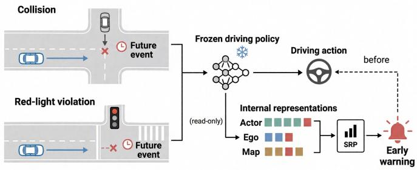  
Fig. 1. Our key insight is that an existing end-to-end driving policy already carries early safety cues in its internal representations, making those representations a natural substrate for risk anticipation.

The organization of the driving task motivates a sourcespecific readout. Actor, ego, and map representations play different roles in decision making [1]–[3], so the information they carry about impending failures need not be accessible through the same readout. A source-specific monitor can retain these distinctions while combining evidence into a generic warning score. Within a source, informative elements may also be sparse: averaging a large collection can weaken a concentrated signal, whereas an aggregation dominated by set size can conflate the amount of representation with the strength of risk evidence. The design challenge is to emphasize informative elements without discarding source identity or allowing the size of the representation set alone to drive the score. This favors a compact readout that preserves source distinctions over an undifferentiated embedding.

For policies exposing representations of actors, ego behavior, and maps [1]–[3], we introduce the Structured Representation Probe (SRP). By treating warning prediction as a separate readout, SRP learns from failure outcomes without changing the driving policy. It learns a linear risk direction in each source space, then aggregates element scores into a generic warning through cardinality-normalized log-mean-exp pooling. This design preserves evidence from each source, emphasizes salient elements, and reduces dependence on token count. Eventwindow labels constructed from closed-loop failures provide supervision for anticipation [17], [18]. Auxiliary supervision by event type adds guidance for individual failure types to the shared directions, while online alerting uses a single generic score. This separates supervision organized by event type from the compact interface needed for online alerting.

On Bench2Drive [18], SRP yields higher frame-level PR-AUC and ROC-AUC than the evaluated runtime baselines across DriveTransformer [1], UniAD [2], and VAD [3]. SRP also achieves the highest penalized lead time (pLead) across all three policies and the highest event recall $( R _ { E } )$ on UniAD. On DriveTransformer at a horizon of 2 seconds, ROC-AUC is 0.833 versus 0.715 for temporal consistency, and pLead is 0.701 versus 0.633 seconds; event recall is similar at 0.497 versus 0.505. The same probes trained on the original routes retain discriminative performance on new test routes.

Our contributions are threefold:

• We formulate failure anticipation as lightweight monitoring of a frozen driving policy through its structured actor, ego, and map representation interfaces.

• We propose SRP, which combines separate linear risk directions for each source, cardinality-normalized evidence pooling, and auxiliary supervision by event type in a single generic warning monitor.

• We evaluate SRP across driving policies and evaluation settings. Results show improved frame discrimination and warning lead over the evaluated runtime monitors.

## II. RELATED WORK

End-to-end autonomous driving. End-to-end driving has developed from learning a direct mapping from sensor inputs to controls toward architectures with explicit intermediate representations. Conditional imitation learning conditions action prediction on navigation commands [19], [20]. In structured architectures, traffic participants and road geometry are represented separately and combined through interaction and planning modules [1]–[3]. These interfaces preserve distinctions that are less explicit in the final control output. UniAD orga nizes perception, prediction, occupancy reasoning, and planning through a unified query interface designed around planning [2]. VAD uses vectorized agent and map representations for efficient planning [3], while DriveTransformer maintains parallel agent, map, and planning queries that interact throughout the decoder [1]. MapTR also represents road geometry through structured map elements [4]. SRP builds on these interfaces to read evidence of impending failures from representations already computed by the policy.

Failure prediction and safety monitoring. Failure monitors draw on visual cues, predictive uncertainty, trajectories, and execution context. Early work learns to predict driving failures from available observations [7]. Kuhn et al. combine visual and state information through late fusion for introspective failure prediction [8]. Uncertainty estimation offers a complementary signal by characterizing confidence in the controller’s predic tions [15], [16]. Runtime monitors also assess whether the execution context is entering an unsupported regime before a collision or an episode in which the vehicle leaves the permitted area [11]. Task-aware and task-relevant monitoring examine how prediction errors and alternative traffic configurations affect downstream planning safety [9], [10]. SRP complements these signals by learning a generic failure warning from the end-toend policy’s structured actor, ego, and map representations.

Representation Analysis. Representation analysis examines what information neural networks encode internally and how it can be read out. Linear classifier probes test whether task labels can be recovered from intermediate activations using a restricted readout [21]. This restriction helps assess how directly the representation exposes the target information without relying on a complex downstream predictor. Network Dissection relates individual units to visual concepts [22], while concept activation vectors quantify the sensitivity of predictions to directions associated with human concepts [23]. Complementary approaches compare representations: SVCCA measures similarity between activation subspaces [24], and centered kernel alignment (CKA) compares their similarity structure across layers or networks [25]. In language models, probes with control tasks distinguish task information in the representations from a probe’s ability to learn arbitrary labels [26]. SRP uses lightweight readouts to study a different target: whether representations formed during driving contain evidence of future hard failures that can support an online warning.

## III. METHOD

SRP attaches a lightweight warning readout to the structured representation interface of a frozen driving policy. Its design combines separate risk directions for each source, cardinalitynormalized aggregation, and auxiliary supervision by event type. The source directions retain the actor, ego, and map organization, while the generic aggregation produces the score used for online alerting.

## A. Monitoring Formulation

Let $f _ { \theta }$ be an end-to-end driving policy. At time t, the policy maps the observation history $\scriptstyle O \leq t$ to a driving plan or control $u _ { t } .$ A fixed exporter $\Phi _ { \theta }$ reads the structured internal representations exposed by the policy:

$$
u _ { t } = f _ { \theta } ( o _ { \le t } ) , \qquad z _ { t } = \Phi _ { \theta } ( o _ { \le t } ) .\tag{1}
$$

SRP reads from this interface without modifying $f _ { \theta }$ and maps the representations to a scalar generic warning score,

$$
m _ { \phi } ( z _ { t } ) = r _ { t } ,\tag{2}
$$

where $r _ { t } ~ \in ~ [ 0 , 1 ]$ is the score used for online alerting. Auxiliary event type heads produce scores $r _ { t , c } \in [ 0 , 1 ]$ for the corresponding event-window labels. They jointly supervise the representation readout during training and provide diagnostic scores for each event type.

The monitor reuses the policy’s internal computation during closed-loop execution. Figure 2 shows the generic alerting path and its training with event-window labels and auxiliary heads.

## B. Structured Driving Evidence

Driving decisions must account for surrounding traffic, the ego vehicle’s intended maneuver, and road constraints. These considerations motivate three complementary sources of evidence for failure anticipation: actor, ego, and map representations. We organize the exported representations by source as

$$
z _ { t } \equiv \{ A _ { t } , E _ { t } , M _ { t } \} ,\tag{3}
$$

where $A _ { t } , E _ { t } ,$ , and $M _ { t }$ denote evidence organized around actors, ego behavior, and maps, respectively. This notation describes

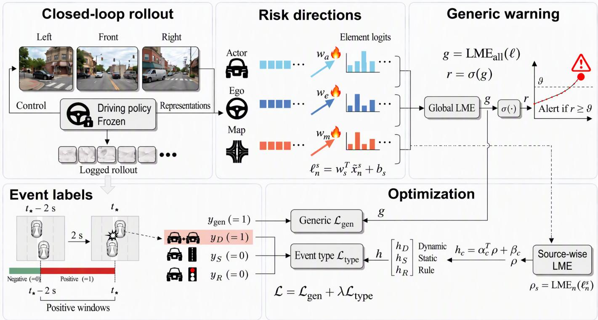  
Fig. 2. SRP framework. Actor, ego, and map representations from a frozen policy are projected into element logits. Both pooling branches use cardinality normalized log-mean-exp (LME). Event-window labels supervise the generic readout and auxiliary event heads; $\mathcal { L } _ { \mathrm { t y p e } }$ averages weighted BCE across the three heads. Flames mark trainable risk directions. Online alerting uses only r with a threshold selected on validation routes.

source roles rather than a particular tensor name, so it can be instantiated across driving models.

$$
\begin{array} { r l } & { A _ { t } = \big \{ a _ { t , i } \big \} _ { i = 1 } ^ { N _ { t } ^ { a } } , \quad E _ { t } = \big \{ e _ { t , k } \big \} _ { k = 1 } ^ { N _ { t } ^ { e } } , \quad M _ { t } = \big \{ m _ { t , j } \big \} _ { j = 1 } ^ { N _ { t } ^ { m } } , } \\ & { \qquad a _ { t , i } \in \mathbb { R } ^ { d _ { a } } , \quad e _ { t , k } \in \mathbb { R } ^ { d _ { e } } , \quad m _ { t , j } \in \mathbb { R } ^ { d _ { m } } . } \end{array}\tag{4}
$$

Actor evidence. Actor representations describe surrounding traffic participants and their interactions with the ego vehicle [1]–[3]. They provide evidence about conflicts involving crossing pedestrians, merging vehicles, or yielding behavior. Ego evidence. The ego source captures the policy’s motion and planning state, including its intended maneuver and local future behavior [1], [2]. It helps assess whether the policy is committing to an unsafe turn, failing to stop, or producing an unstable plan.

Map evidence. Map representations encode road geometry and semantic constraints, such as lanes, intersections, and stop lines [3], [4]. This source provides context for assessing whether the intended maneuver is compatible with the road layout and traffic rules.

Each evidence source is assigned its own risk direction. Let $\boldsymbol { S } = \{ a , e , m \}$ and let $X _ { t } ^ { s } = \{ x _ { t , n } ^ { s } \} _ { n = 1 } ^ { N _ { t } ^ { s } }$ denote one of the three evidence sets. After normalization within each source, an instance contributes risk evidence through

$$
\ell _ { t , n } ^ { s } = \langle w _ { s } , \tilde { x } _ { t , n } ^ { s } \rangle + b _ { s } , \qquad s \in \mathcal { S } .\tag{5}
$$

Each $w _ { s }$ operates in its source’s representation space, preserving the distinction between actor interactions, ego behavior, and road constraints.

## C. Risk Scoring by Source

A scene may contain many representation elements but only a few strong risk signals, such as a conflicting actor or a critical road constraint. Average pooling can dilute these signals [27]– [29], while unnormalized log-sum-exp increases when the same collection of logits is repeated. Drawing on smooth pooling operators used in multiple-instance learning [30]–[32], we use cardinality-normalized log-mean-exp pooling to summarize each source:

$$
\rho _ { t } ^ { s } = \tau \log \left( \frac { 1 } { N _ { t } ^ { s } } \sum _ { n = 1 } ^ { N _ { t } ^ { s } } \exp ( \ell _ { t , n } ^ { s } / \tau ) \right) , \qquad s \in \{ a , e , m \} .\tag{6}
$$

The temperature τ controls the sharpness of the evidence readout. This aggregation remains sensitive to instances indicating high risk while reducing dependence on the number of actor, ego, or map elements available in a frame.

Set function property. Because the pooled score acts on an unordered set of representation vectors, it is permutation invariant in element order and behaves like a smooth max operator [27], [33], [34]. For any nonempty source bag and $\tau > 0 .$ , it satisfies

$$
\bar { \ell } _ { t } ^ { s } \le \rho _ { t } ^ { s } \le \operatorname* { m a x } _ { n } \ell _ { t , n } ^ { s } , \qquad \operatorname* { l i m } _ { \tau \to 0 ^ { + } } \rho _ { t } ^ { s } = \operatorname* { m a x } _ { n } \ell _ { t , n } ^ { s } ,\tag{7}
$$

where $\begin{array} { r } { \bar { \ell } _ { t } ^ { s } = \frac { 1 } { N _ { \star } ^ { s } } \sum _ { n = 1 } ^ { N _ { t } ^ { s } } \ell _ { t , n } ^ { s } } \end{array}$ . Repeating the entire collection of logits leaves this normalized score unchanged. Adding or removing particular elements changes the exponential mean,

so the readout remains sensitive to set composition as well as salient high values.

The generic warning used for inference aggregates the instance evidence across all sources:

$$
g _ { t } = \tau \log \left( \frac { 1 } { N _ { t } } \sum _ { s \in \{ a , e , m \} } \sum _ { n = 1 } ^ { N _ { t } ^ { s } } \exp ( \ell _ { t , n } ^ { s } / \tau ) \right) , \qquad r _ { t } = \sigma ( g _ { t } ) .\tag{8}
$$

Here $\begin{array} { r } { N _ { t } = \sum _ { s \in \mathcal S } N _ { t } ^ { s } } \end{array}$ . In generic pooling, source evidence is weighted by the source token proportion, while sufficiently large element logits can dominate the exponential sum. During training, the auxiliary event type head uses the vector of pooled source scores to predict a score for each failure type:

$$
h _ { t , c } = \alpha _ { c } ^ { \top } [ \rho _ { t } ^ { a } , \rho _ { t } ^ { e } , \rho _ { t } ^ { m } ] + \beta _ { c } , \qquad r _ { t , c } = \sigma ( h _ { t , c } ) .\tag{9}
$$

Each auxiliary head is a linear readout of the three pooled source scores. Its loss trains the shared source directions with supervision by event type, and its output provides a diagnostic score for the corresponding event label.

To train the generic and event-type readouts, we construct temporal labels from recorded hard failures [17], [18]. For each route r, let

$$
\mathcal { T } _ { r } = \{ t _ { r } ^ { ( 1 ) } , \dots , t _ { r } ^ { ( K _ { r } ) } \}\tag{10}
$$

be the set of frames containing hard failures, matched to policy steps. For auxiliary supervision, the covered event types are grouped into

$$
{ \mathcal { C } } = \{ { \bf D y n a m i c } , { \bf S t a t i c } , { \bf R u l e } \} ,\tag{11}
$$

where dynamic collision includes vehicle and pedestrian collisions, static collision includes collisions with static objects, and rule violation includes red light and stop sign infractions and route deviation. Let $\mathcal { T } _ { r , c }$ denote the event frames of type c on route r. Given an anticipation window W, the generic and event type labels use the same window rule:

$$
\begin{array} { r l } & { y _ { t } ^ { ( W ) } = \mathbf { 1 } \left[ \exists t ^ { \star } \in \mathcal { T } _ { r } : 0 \leq t ^ { \star } - t \leq W \right] , } \\ & { y _ { t , c } ^ { ( W ) } = \mathbf { 1 } \left[ \exists t ^ { \star } \in \mathcal { T } _ { r , c } : 0 \leq t ^ { \star } - t \leq W \right] , \qquad c \in \mathcal { C } . } \end{array}\tag{12}
$$

Positive labels are constructed from the union of the windows for target events, each extending backward from and including its event frame. A frame following one event can therefore remain positive if it falls within the window of a later target event.

SRP is trained with weighted binary cross-entropy:

$$
\mathcal { L } = \mathrm { B C E } ( g _ { t } , y _ { t } ^ { ( W ) } ) + \lambda \frac { 1 } { | \mathcal { C } | } \sum _ { c \in \mathcal { C } } \mathrm { B C E } ( h _ { t , c } , y _ { t , c } ^ { ( W ) } ) .\tag{13}
$$

Class weights compensate for the rarity of positive eventwindow frames, and λ controls the strength of the mean event type supervision term.

Online inference reuses the saved feature statistics and probe parameters and compares $r _ { t }$ with a generic threshold selected on the validation split. The source scores $( \rho _ { t } ^ { a } , \rho _ { t } ^ { e } , \rho _ { t } ^ { m } )$ and auxiliary scores $\{ r _ { t , c } \} _ { c \in \mathcal { C } }$ are optional diagnostic outputs; alerting uses only rt.

Algorithm 1 summarizes training and online inference with the same notation.

Algorithm 1 Structured representation probing with auxiliary   
supervision by event type   
Require: Training representations $\overline { { X _ { t } ^ { s } } } .$ aligned failure events,   
window $W ;$ frozen policy $f _ { \boldsymbol { \theta } } ;$ source statistics $( \mu _ { s } , \sigma _ { s } )$   
alert threshold ϑ   
Ensure: Probe parameters $\phi$ and online alerts   
Training   
1: Construct generic and event type window labels $y _ { t } ^ { ( W ) }$   
$y _ { t , c } ^ { ( W ) }$   
2: Initialize source directions and auxiliary event heads   
3: for each training batch do   
4: Normalize source features using $( \mu _ { s } , \sigma _ { s } )$   
5: Project elements onto separate source risk directions to   
obtain $\ell _ { t , n } ^ { s }$ by Eq. (5)   
6: Pool within each source to obtain $\rho _ { t } ^ { s }$ for auxiliary heads   
by Eq. (6)   
7: Pool all tokens to obtain the generic warning logit gt   
by Eq. (8)   
8: Compute event type logits $h _ { t , c }$ by Eq. (9)   
9: Update $\phi$ with the weighted loss in Eq. (13)   
10: end for   
Inference   
11: for each policy step t do   
12: Read $X _ { t } ^ { s }$ from the frozen policy; normalize and compute   
$\ell _ { t , n } ^ { s }$ as in training   
13: Pool all source tokens by Eq. (8) to obtain $r _ { t } = \sigma ( g _ { t } )$   
14: Issue an alert if $r _ { t } \ge \vartheta$   
15: end for

## IV. EXPERIMENTS

We first compare SRP with runtime baselines, then analyze anticipation windows, event types, and probe ablations. We finally evaluate transfer under diagnostic and fixed-threshold protocols and measure readout cost.

## A. Experimental Setup

Dataset. We use Bench2Drive [18], a closed-loop benchmark in CARLA [35] with 220 routes covering multiple towns and weather conditions. Each driving policy runs on the same benchmark routes. We collect its internal representations online and pair them with hard failures recorded during its own executions.

The target events are collisions, red light infractions, stop sign infractions, and route deviations. Auxiliary supervision groups them into dynamic collision, static collision, and rule violation, with the latter including red light, stop sign, and route deviation. Generic positive labels are the union of all windows for target events, including the event frames. Unless otherwise stated, training and evaluation use 40 simulator steps (2 seconds). Rollouts may terminate on collision, route deviation, or blocked criteria; red light and stop sign violations are recorded but do not themselves terminate a rollout.

Models and Baselines. Our driving models are DriveTransformer [1], UniAD [2], and VAD [3]. Exporters for each model map its internal representations to the common actor, ego, and map interface; the driving policies remain frozen.

We adapt three monitoring approaches to the available policy outputs and the common evaluation protocol applied at each frame. Temporal Consistency (TC), inspired by MomAD [36], summarizes changes in recent ego plans and controls. Task-Aware Risk (TAR) [9] uses nearby actors’ states and trajectories to sample alternative traffic configurations and assess their effect on the current ego plan. Task-Relevant Failure Detection (TRFD) [10] takes the ego plan and predicted actor modes, forms nominal and alternative scenes, and compares the associated planning costs. Each implementation emits one risk score per frame from the corresponding policy under the same closed-loop protocol.

Training Details. For all policies, we use splits of 132/44/44 routes for training/validation/testing, with no shared routes between splits. Probes are trained for 50 epochs with AdamW [37], learning rate $1 0 ^ { - 3 }$ , weight decay $1 0 ^ { - 4 }$ , batch size 128, and weighted binary cross-entropy. Feature normalization within each source is estimated on the training split, the pooling temperature is $\tau = 1 . 0$ , and the full probe uses auxiliary loss weight $\lambda = 0 . 5$ . We select the checkpoint by generic validation PR-AUC and save its parameters, training feature statistics, and generic threshold selected on the validation split for online use.

Evaluation Metrics. We report frame-level PR-AUC [38] and ROC-AUC [39], frame recall $( R _ { F } )$ , event recall $( R _ { E } )$ and penalized lead time (pLead, in seconds). $R _ { F }$ measures coverage of positive frames. Each positive route contributes its first event of the evaluated label, giving N selected events. An event counts as alerted if at least one alert occurs within $W _ { \mathrm { e v a l } }$ steps strictly before the event; $R _ { E }$ is the fraction of selected events alerted. Let $t _ { i } ^ { \mathrm { e v t } }$ and $t _ { i } ^ { \mathrm { a l e r t } }$ denote the event frame and the earliest alert frame within this window, respectively. At the simulator rate of 20 $\mathrm { H z , }$ the penalized lead for event i is

$$
\Delta _ { i } = \left\{ \begin{array} { l l } { \displaystyle \frac { t _ { i } ^ { \mathrm { e v t } } - t _ { i } ^ { \mathrm { a l e r t } } } { 2 0 } , } & { \mathrm { i f ~ a l e r t e d } , } \\ { 0 , } & { \mathrm { o t h e r w i s e } , } \end{array} \right.\tag{14}
$$

and the mean penalized lead time is

$$
\mathrm { p L e a d } = \frac { 1 } { N } \sum _ { i = 1 } ^ { N } \Delta _ { i } .\tag{15}
$$

Unless otherwise stated, $R _ { F }$ $R _ { E } .$ , and pLead share a threshold selected to maximize frame recall subject to a framelevel FPR no greater than 5% on the evaluated split. This diagnostic threshold is distinct from the threshold selected on the validation split and saved for deployment. The suffix @5%FPR denotes this operating point; tables occupying one column abbreviate it as @5%. Higher values are better for PR-AUC, ROC-AUC, $R _ { F }$ $R _ { E } ,$ , and pLead; lower FPR indicates fewer false-positive frames.

## B. Main Benchmark Results

Table I evaluates whether reading policy representations improves warning quality over the runtime baselines [9], [10], [36] on Bench2Drive [18], considering both frame discrimination and early warning at the event level.

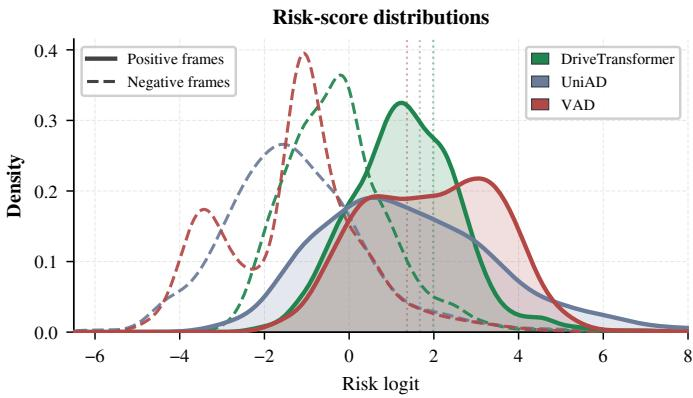  
Fig. 3. Distributions of risk logits on the Bench2Drive test routes. Solid and dashed curves show positive and negative event-window labels, respectively. Dotted lines indicate mean policy-specific thresholds under the 5% frame-level FPR protocol.

SRP leads PR-AUC, ROC-AUC, and $R _ { F }$ across all three policies. On DriveTransformer [1], ROC-AUC increases from 0.715 for temporal consistency to 0.833 for SRP, and $R _ { F }$ from 0.145 to 0.300. SRP achieves the highest pLead across all three policies and the highest event recall on UniAD [2]. On DriveTransformer, event recall is similar between temporal consistency and SRP (0.505 versus 0.497), while SRP has greater pLead (0.701 versus 0.633 seconds). On DriveTransformer, the gain in pLead accompanies nearly unchanged event coverage. On UniAD, SRP improves both event recall and pLead over the strongest baselines. On VAD [3], SRP achieves the highest pLead at 1.229 seconds with event recall of 0.713, while Task-Aware Risk achieves the highest event recall at 0.739. The representation readout improves frame discrimination across all three policies, while its warning gains appear in different combinations of coverage and lead time.

The distributions in Figure 3 provide a visual counterpart to the results for frame ranking: positive event-window frames are shifted toward higher logits for all three policies, with overlapping positive and negative distributions. The mean threshold lines place this separation in the context of the low FPR operating point. They show how the positive shift relates to the high logit region used for alerting, connecting the distributional view to thresholded warning performance.

Figure 4 shows generic score trajectories for a red light violation, a vehicle collision, and a static collision. Scores rise gradually in the first two cases and more sharply near the roadside guardrail in the static collision case. In the latter, the score remains high at R1 and R2 (0.97 and 0.93).

## C. Window Sensitivity

We distinguish the effect of the evaluation horizon from sensitivity to the training horizon on Bench2Drive [18]. Table II varies the evaluation window with $W _ { \mathrm { t r a i n } } = 4 0$ , while Figure 5 varies the training window at fixed evaluation windows.

With the trained probe fixed, extending the evaluation window raises PR-AUC and pLead across all three policies, while ROC-AUC decreases and frame recall changes little or declines (Table II). On DriveTransformer [1], moving from one to three seconds raises PR-AUC from 0.176 to 0.315 and pLead from 0.376 to 0.984 seconds. A longer window changes both the population of positive frames and which alerts qualify as early warnings: it labels more preceding frames as positive and credits alerts farther from the event. PR-AUC is sensitive to this prevalence change [38], while pLead reflects the expanded alert window and event coverage. These comparisons describe the same readout under different anticipation tasks.

TABLE I  
COMPARISON WITH RUNTIME MONITORS ON THE BENCH2DRIVE TEST ROUTES USING TRAINING AND EVALUATION WINDOWS OF 2 SECONDS.
<table><tr><td>Model</td><td>Method</td><td>PR-AUC</td><td>ROC-AUC</td><td> $R _ { F } @ 5 \% \mathrm { F P R }$ </td><td> $R _ { E } @ 5 \% \mathrm { F P R }$ </td><td>pLead@5%FPR (s)</td></tr><tr><td>DriveTransformer</td><td>Temporal Consistency</td><td>0.127</td><td>0.715</td><td>0.145</td><td>0.505</td><td>0.633</td></tr><tr><td>DriveTransformer</td><td>Task-Aware Risk</td><td>0.088</td><td>0.570</td><td>0.060</td><td>0.431</td><td>0.532</td></tr><tr><td>DriveTransformer</td><td>TRFD</td><td>0.080</td><td>0.496</td><td>0.046</td><td>0.320</td><td>0.337</td></tr><tr><td>DriveTransformer</td><td>Ours</td><td>0.261</td><td>0.833</td><td>0.300</td><td>0.497</td><td>0.701</td></tr><tr><td>UniAD</td><td>Temporal Consistency</td><td>0.167</td><td>0.751</td><td>0.175</td><td>0.573</td><td>0.768</td></tr><tr><td>UniAD</td><td>Task-Aware Risk</td><td>0.070</td><td>0.506</td><td>0.042</td><td>0.339</td><td>0.455</td></tr><tr><td>UniAD</td><td>TRFD</td><td>0.090</td><td>0.520</td><td>0.094</td><td>0.489</td><td>0.653</td></tr><tr><td>UniAD</td><td>Ours</td><td>0.339</td><td>0.868</td><td>0.439</td><td>0.725</td><td>1.124</td></tr><tr><td>VAD</td><td>Temporal Consistency</td><td>0.131</td><td>0.810</td><td>0.280</td><td>0.723</td><td>1.159</td></tr><tr><td>VAD</td><td>Task-Aware Risk</td><td>0.055</td><td>0.677</td><td>0.109</td><td>0.739</td><td>0.870</td></tr><tr><td>VAD</td><td>TRFD</td><td>0.060</td><td>0.639</td><td>0.145</td><td>0.667</td><td>0.847</td></tr><tr><td>VAD</td><td>Ours</td><td>0.320</td><td>0.853</td><td>0.559</td><td>0.713</td><td>1.229</td></tr></table>

(a) Red-light violation.  
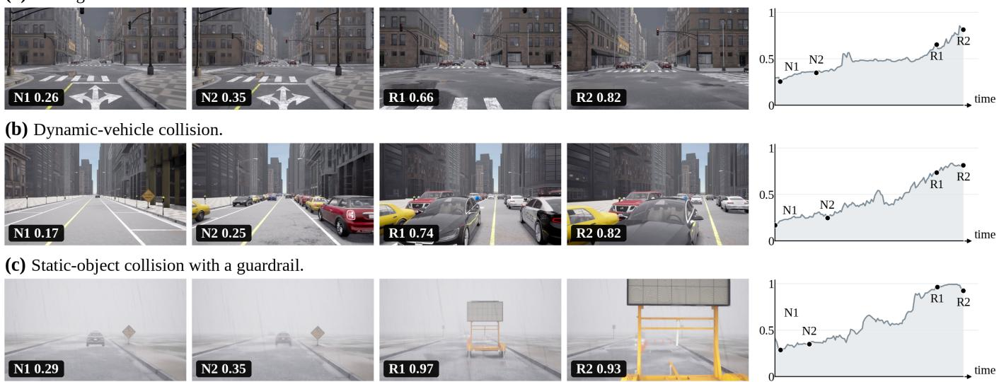  
Fig. 4. Representative qualitative warning cases. SRP raises its generic risk score before three distinct hard failures: a red light violation, a collision with another vehicle, and a collision with a roadside guardrail.

Changing the training window instead produces responses that vary by policy (Figure 5). DriveTransformer has lower frame discrimination and event recall at the longest tested training window, while UniAD’s [2] mean results generally peak near the setting of 2 seconds. VAD’s [3] PR-AUC and ROC-AUC remain nearly constant across training windows. Event recall and pLead show additional variation at the operating point with a low FPR, where results depend on which selected events receive alerts. The effect of the training window therefore differs across policies and metrics, rather than following a uniform benefit from longer supervision.

## D. Event and Qualitative Analysis

We examine behavior by event type through the performance of the auxiliary heads, temporal score evolution, and generic warning lead times across Bench2Drive [18] route groups. Table III reports the results of the auxiliary heads. Each auxiliary head is evaluated against its corresponding event label on the test split.

The event label with the highest recall from an auxiliary head differs by policy: rule violations lead on DriveTransformer [1], and static collisions lead on UniAD [2] and VAD [3]. On VAD, static collisions have the highest $R _ { E } ~ ( 0 . 8 6 7 )$ while rule violations have the longest pLead (1.671 seconds), distinguishing event coverage from penalized warning lead within the same policy.

Figure 6 follows score evolution on routes containing the respective failure types. Generic scores generally increase toward the selected target events, with a gradual rise in the group containing dynamic collisions and a larger increase in the group containing static collisions. The curves from the auxiliary heads and the generic readout track each other closely for dynamic collisions; for static collisions, DriveTransformer’s auxiliary score stays substantially below its generic score even as both increase. The two readouts share risk directions but use different aggregation and supervision targets.

TABLE II  
EFFECT OF THE EVALUATION HORIZON ON SRP ACROSS THREE DRIVING POLICIES ON THE BENCH2DRIVE TEST ROUTES. PROBES ARE TRAINED WITH A WINDOW OF 2 SECONDS AND EVALUATED WITH WINDOWS OF 1, 2, AND 3 SECONDS.
<table><tr><td>Model</td><td>Eval. W</td><td>PR-AUC</td><td>ROC-AUC</td><td> $R _ { F } @ 5 \% \mathrm { F P R }$ </td><td> $R _ { E } @ 5 \% \mathrm { F P R }$ </td><td>pLead@5%FPR (s)</td></tr><tr><td>DriveTransformer</td><td>20</td><td>0.176</td><td>0.856</td><td>0.320</td><td>0.437</td><td>0.376</td></tr><tr><td>DriveTransformer</td><td>40</td><td>0.261</td><td>0.833</td><td>0.300</td><td>0.497</td><td>0.701</td></tr><tr><td>DriveTransformer</td><td>60</td><td>0.315</td><td>0.803</td><td>0.265</td><td>0.556</td><td>0.984</td></tr><tr><td>UniAD</td><td>20</td><td>0.226</td><td>0.874</td><td>0.439</td><td>0.635</td><td>0.541</td></tr><tr><td>UniAD</td><td>40</td><td>0.339</td><td>0.868</td><td>0.439</td><td>0.725</td><td>1.124</td></tr><tr><td>UniAD</td><td>60</td><td>0.408</td><td>0.853</td><td>0.429</td><td>0.804</td><td>1.711</td></tr><tr><td>VAD</td><td>20</td><td>0.226</td><td>0.855</td><td>0.571</td><td>0.643</td><td>0.564</td></tr><tr><td>VAD</td><td>40</td><td>0.320</td><td>0.853</td><td>0.559</td><td>0.713</td><td>1.229</td></tr><tr><td>VAD</td><td>60</td><td>0.379</td><td>0.838</td><td>0.525</td><td>0.711</td><td>1.674</td></tr></table>

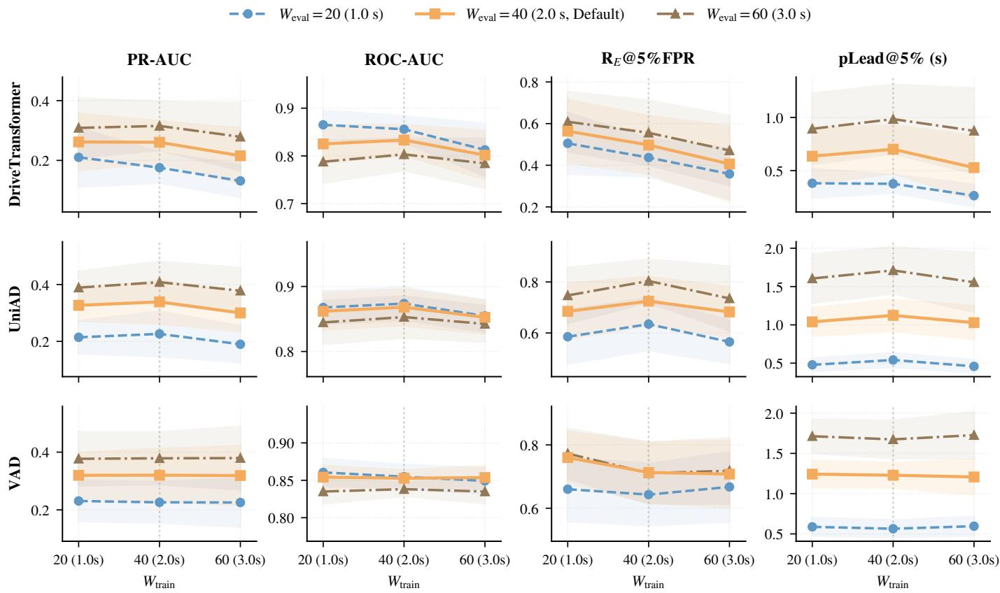  
Fig. 5. Sensitivity to the training horizon across three driving policies. Rows identify policies, columns show PR-AUC, ROC-AUC, event recall, and penalized lead time, and colors identify evaluation horizons. Shaded bands indicate performance variability.

The source profiles provide a complementary view of this evolution. Actor and ego scores rise in both collision groups, while the map score changes more modestly. In the group containing rule violations, the map score increases markedly through the evaluation window and approaches the ego score near the event. These patterns associate different representation sources with different event contexts, supporting monitoring that preserves source distinctions alongside the generic warning. The relative source profile changes through the approach to failure, making the timing of evidence accumulation visible alongside the overall rise in generic risk. The profiles in the bottom row average across policies, whereas the upper curves retain readouts for each policy.

For the generic alarm, Figure 7 shows longer mean pLead in route groups containing static collisions or rule violations than in the group containing dynamic collisions. The static– dynamic gap is larger for DriveTransformer and UniAD than for VAD. These results use the generic score on routes grouped by observed failure type, distinct from the evaluation of auxiliary heads against individual event labels in Table III.

Qualitative cases across policies. Figure 8 shows qualitative warning results for DriveTransformer, UniAD, and VAD.

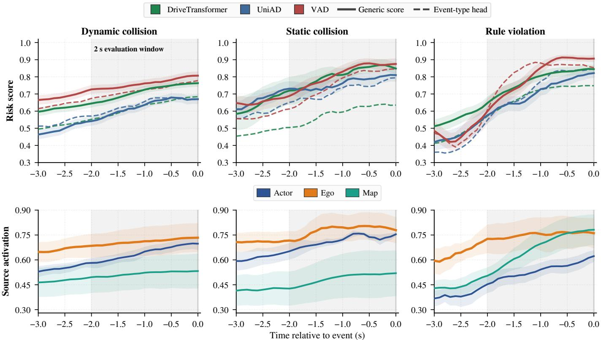  
Fig. 6. Temporal warning profiles aligned to selected target events on Bench2Drive test routes, grouped by observed failure type. Solid and dashed curves compare generic scores and scores by event type; the bottom row shows source scores averaged across policies. Shading marks the evaluation window of 2 seconds.

## TABLE III

DIAGNOSTIC PERFORMANCE OF THE AUXILIARY HEADS BY EVENT TYPE ON THE BENCH2DRIVE TEST ROUTES WITH AN EVALUATION WINDOW OF 2 SECONDS. EACH HEAD IS EVALUATED AGAINST ITS OWN EVENT LABELS; LEAD TIMES ARE IN SECONDS. DRIVETRANS. ABBREVIATES DRIVETRANSFORMER.
<table><tr><td>Model</td><td>Type</td><td></td><td>PR-AUC ROC-AUC</td><td> $R _ { F }$  @5%</td><td> $R _ { E }$  @5%</td><td>pLead @5%</td></tr><tr><td>DriveTrans. dynamic</td><td></td><td>0.234</td><td>0.810</td><td>0.293</td><td>0.550</td><td>0.775</td></tr><tr><td>DriveTrans. static</td><td></td><td>0.119</td><td>0.808</td><td>0.283</td><td>0.675</td><td>1.153</td></tr><tr><td>DriveTrans.</td><td>rule</td><td>0.130</td><td>0.832</td><td>0.388</td><td>0.857</td><td>1.329</td></tr><tr><td>UniAD</td><td>dynamic</td><td>0.166</td><td>0.798</td><td>0.313</td><td>0.609</td><td>1.004</td></tr><tr><td>UniAD</td><td>static</td><td>0.128</td><td>0.831</td><td>0.452</td><td>0.750</td><td>1.188</td></tr><tr><td>UniAD</td><td>rule</td><td>0.044</td><td>0.815</td><td>0.440</td><td>0.500</td><td>0.875</td></tr><tr><td>VAD</td><td>dynamic</td><td>0.208</td><td>0.827</td><td>0.502</td><td>0.612</td><td>1.193</td></tr><tr><td>VAD</td><td>static</td><td>0.206</td><td>0.825</td><td>0.519</td><td>0.867</td><td>1.429</td></tr><tr><td>VAD</td><td>rule</td><td>0.196</td><td>0.852</td><td>0.608</td><td>0.856</td><td>1.671</td></tr></table>

## E. Ablation Studies

Table IV separates source selection from auxiliary supervision. Source variants are retrained with different representation subsets; the supervision variant retains all sources but removes the event type loss. All variants use DriveTransformer [1] with the same windows of 2 seconds, route split, labels, and metric protocol as the main comparison.

Source selection. All three sources together achieve the highest PR-AUC and ROC-AUC among the retrained variants. The ego source carries substantial warning evidence: pLead of the probe using only ego representations is close to that of the full probe (0.704 versus 0.701 seconds), and ego removal produces the largest decline among the variants using two sources, reducing $R _ { E }$ from 0.497 to 0.310. Removing actor slightly increases event recall and pLead at the selected operating point. Thus the sources contribute differently to ranking and thresholded warning, with their combination giving the strongest overall frame discrimination.

Generic warning lead time by event type  
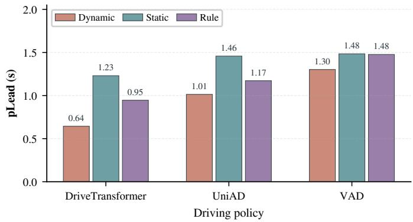  
Fig. 7. Generic warning lead time for groups of Bench2Drive test routes containing dynamic collision, static collision, or rule violation. Bars show mean pLead under the 5% frame-level FPR protocol.

Auxiliary supervision. Auxiliary event supervision improves all five metrics for the generic warning when the source set is held fixed. Adding the event type loss raises PR-AUC from 0.224 to 0.261 and pLead from 0.561 to 0.701 seconds, supporting its role in training the shared source directions. Auxiliary supervision trains the shared source directions used by the generic readout.

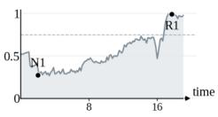

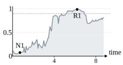

TABLE IV  
EFFECTS OF REPRESENTATION SOURCES AND AUXILIARY EVENT SUPERVISION ON THE RETRAINED DRIVETRANSFORMER PROBE. CHECKMARKS IDENTIFY THE SOURCES AND SUPERVISION USED; ALL VARIANTS USE TRAINING AND EVALUATION WINDOWS OF 2 SECONDS.
<table><tr><td>Variant</td><td>Actor</td><td>Ego</td><td>Map</td><td>Aux. Sup.</td><td>PR-AUC</td><td>ROC-AUC</td><td> $R _ { F } @ 5 \% \mathrm { F P R }$ </td><td> $R _ { E } @ 5 \% \mathrm { F P R }$ </td><td>pLead@5%FPR (s)</td></tr><tr><td>No actor</td><td>- √</td><td>√</td><td>√</td><td>√</td><td>0.250</td><td>0.813</td><td>0.291</td><td>0.506</td><td>0.712</td></tr><tr><td>No ego</td><td></td><td>一</td><td>√</td><td>√</td><td>0.229</td><td>0.784</td><td>0.261</td><td>0.310</td><td>0.504</td></tr><tr><td>No map</td><td>√</td><td>√</td><td>一</td><td>√</td><td>0.251</td><td>0.821</td><td>0.289</td><td>0.485</td><td>0.680</td></tr><tr><td>Actor only</td><td>√</td><td>一</td><td>一</td><td>√</td><td>0.239</td><td>0.812</td><td>0.286</td><td>0.394</td><td>0.561</td></tr><tr><td>Ego only</td><td>一</td><td>√</td><td>1</td><td>√</td><td>0.245</td><td>0.795</td><td>0.285</td><td>0.495</td><td>0.704</td></tr><tr><td>Map only</td><td>一</td><td>一</td><td>V</td><td>√</td><td>0.196</td><td>0.784</td><td>0.204</td><td>0.372</td><td>0.516</td></tr><tr><td>Generic only</td><td>V</td><td>√</td><td>V</td><td>一</td><td>0.224</td><td>0.793</td><td>0.248</td><td>0.424</td><td>0.561</td></tr><tr><td>Full</td><td>V</td><td>√</td><td>√</td><td>V</td><td>0.261</td><td>0.833</td><td>0.300</td><td>0.497</td><td>0.701</td></tr></table>

DriveTransformer (vehicle collision)  
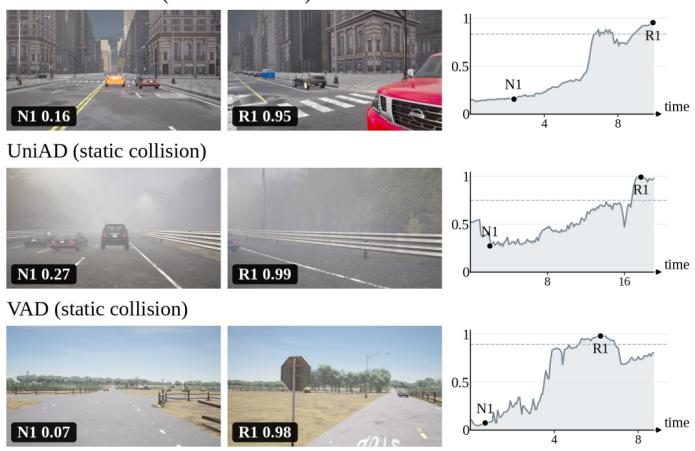

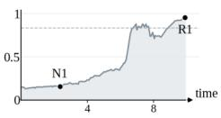

Fig. 8. Qualitative warning cases grouped by driving policy: a vehicle collision for DriveTransformer and static collisions for UniAD and VAD. N1 and R1 link the scene snapshots to the generic score traces.  
TABLE V  
SOURCE DELETION AT INFERENCE FROM THE FIXED DRIVETRANSFORMER PROBE ON THE NEW BENCH2DRIVE EVALUATION SET. A RED CROSS MARKS THE REMOVED SOURCE; LEAD TIMES ARE IN SECONDS. EGO DELETION HAS THE LARGEST EFFECT ON WARNING PERFORMANCE.
<table><tr><td>Setting</td><td>PR-AUC</td><td>ROC-AUC</td><td> $R _ { F } @ 5 \%$ </td><td> $R _ { E } @ 5 \%$ </td><td>pLead@5%</td></tr><tr><td>Full</td><td>0.363</td><td>0.807</td><td>0.360</td><td>0.681</td><td>1.029</td></tr><tr><td>× actor</td><td>0.336</td><td>0.785</td><td>0.326</td><td>0.631</td><td>0.964</td></tr><tr><td> $\times ~ \mathrm { { \ e g o } }$ </td><td>0.217</td><td>0.716</td><td>0.205</td><td>0.411</td><td>0.606</td></tr><tr><td>× map</td><td>0.366</td><td>0.804</td><td>0.366</td><td>0.674</td><td>1.022</td></tr></table>

Source deletion at inference. We also examine the fitted probe’s reliance on each source by deleting actor, ego, or map tokens at inference. We evaluate the complete DriveTransformer probe and its deletion variants on the new Bench2Drive [18] evaluation set with 220 routes.1 Probe parameters remain fixed, and generic pooling is normalized over the remaining tokens.

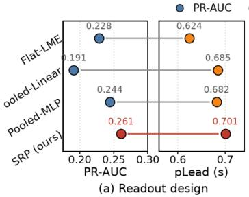

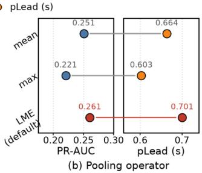  
Fig. 9. Readout and pooling comparisons on DriveTransformer. Paired markers show mean $\mathrm { P R - A U C }$ and pLead; connecting lines identify the same setting. Red markers highlight SRP in (a) and its default LME pooling in (b).

Each setting uses its own diagnostic threshold selected under the same 5% frame-level FPR rule.

Ego deletion has the largest effect on the fixed probe (Table V), reducing PR-AUC from 0.363 to 0.217 and $R _ { E }$ from 0.681 to 0.411. Actor deletion has a smaller effect, and map deletion leaves frame ranking nearly unchanged. The source ablations fit a probe for each representation subset. Deletion at inference evaluates the existing probe with its parameters fixed. Together, these experiments identify ego representations as a major source of warning evidence in this DriveTransformer setting.

The preceding ablations examine the representation sources and auxiliary supervision. We next examine how the available representations are converted into a warning score through readout, pooling, and temperature comparisons on DriveTransformer, using training and evaluation windows of 2 seconds.

Readout design. To examine the role of readout structure, we compare SRP with three alternatives using the same policy representations, following the use of restricted readouts in representation probing [21]. Flat-LME shares a linear direction across sources. Pooled-Linear concatenates source-wise maxpooled features for linear classification, while Pooled-MLP uses mean-pooled features and a hidden layer of width 16. SRP achieves the highest mean PR-AUC and pLead (0.261 and 0.701 seconds; Figure 9(a)).

Pooling. We retrain SRP with mean, max, or LME aggregation in both the source-wise and generic pooling branches. LME achieves the highest mean PR-AUC and pLead among the three choices (Figure 9(b)), increasing them from 0.251 to 0.261 and from 0.664 to 0.701 seconds relative to mean pooling.

TABLE VI  
TRANSFER OF PROBES TRAINED ON THE ORIGINAL ROUTES TO THE NEW BENCH2DRIVE EVALUATION SET WITH 220 ROUTES AND 20 CARLA LEADERBOARD 2.0 VALIDATION ROUTES. POLICY AND PROBE PARAMETERS REMAIN FIXED.
<table><tr><td>Target data</td><td>Model</td><td>PR-AUC</td><td>ROC-AUC</td><td> $R _ { F } @ 5 \% \mathrm { F P R }$ </td><td> $R _ { E }$  @5%FPR</td><td>pLead@5%FPR (s)</td></tr><tr><td>Bench2Drive (new)</td><td>DriveTransformer</td><td>0.363</td><td>0.807</td><td>0.360</td><td>0.681</td><td>1.029</td></tr><tr><td>Bench2Drive (new)</td><td>UniAD</td><td>0.324</td><td>0.864</td><td>0.526</td><td>0.705</td><td>1.138</td></tr><tr><td>Bench2Drive (new)</td><td>VAD</td><td>0.314</td><td>0.923</td><td>0.604</td><td>0.793</td><td>1.361</td></tr><tr><td>LB2</td><td>DriveTransformer</td><td>0.312</td><td>0.769</td><td>0.344</td><td>0.737</td><td>1.142</td></tr><tr><td>LB2</td><td>UniAD</td><td>0.380</td><td>0.829</td><td>0.456</td><td>0.444</td><td>0.683</td></tr><tr><td>LB2</td><td>VAD</td><td>0.371</td><td>0.878</td><td>0.513</td><td>0.765</td><td>1.406</td></tr></table>

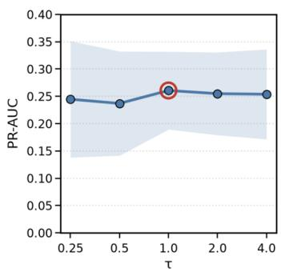

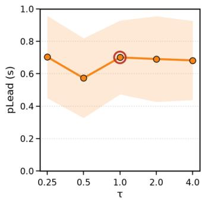  
Fig. 10. Sensitivity to pooling temperature on DriveTransformer. Red circles mark the default $\tau = 1 ;$ shaded bands indicate performance variability.

Temperature sensitivity. We further examine the temperature controlling the sharpness of LME aggregation, retraining SRP at each tested value. The default τ = 1 gives the highest mean PR-AUC, with pLead close to that at τ = 0.25 (0.701 versus 0.704 seconds; Figure 10). Mean PR-AUC and pLead remain similar for $\tau = 1 , 2 , 4$ , whereas τ = 0.5 yields lower pLead.

## F. Generalization

Transfer to new routes. We evaluate probes trained on the original Bench2Drive [18] routes on two targets: the new Bench2Drive evaluation set with 220 routes and the 20 validation routes of CARLA Leaderboard 2.0 (LB2) [40]. Policy and probe parameters, together with the training feature statistics, remain fixed. Both targets use generic labels and windows of 2 seconds. For diagnostic comparison under a common FPR constraint, each target uses a separately selected threshold under the same 5% frame-level FPR rule, distinct from the source validation threshold saved for deployment.

The probes trained on the original routes retain frame-level discrimination on both targets (Table VI), with ROC-AUC ranging from 0.807 to 0.923 on the new Bench2Drive routes and from 0.769 to 0.878 on LB2. Event coverage varies more across policies on LB2: $R _ { E }$ ranges from 0.444 to 0.765, compared with 0.681 to 0.793 on the new Bench2Drive set. For UniAD [2], PR-AUC is higher on LB2 (0.380 versus 0.324), while event recall is lower (0.444 versus 0.705). On LB2, UniAD has the highest PR-AUC but the lowest event recall, while VAD [3] leads ROC-AUC, event recall, and pLead. This contrast shows why frame ranking, event coverage, and warning lead should be considered together when assessing generalization.

TABLE VII  
WARNING PERFORMANCE ON NEW BENCH2DRIVE AND LB2 ROUTES WITHSOURCE-VALIDATION THRESHOLDS HELD FIXED. FPR IS THE OBSERVEDFALSE-POSITIVE RATE.
<table><tr><td>Evaluation set</td><td>Policy</td><td>FPR (%)</td><td> $R _ { E }$ </td><td>pLead (s)</td></tr><tr><td>B2D new</td><td>DT</td><td>6.36</td><td>0.723</td><td>1.157</td></tr><tr><td>B2D new</td><td>UniAD</td><td>5.53</td><td>0.719</td><td>1.181</td></tr><tr><td>B2D ) new</td><td>VAD</td><td>2.66</td><td>0.690</td><td>1.073</td></tr><tr><td>LB2</td><td>DT</td><td>2.88</td><td>0.684</td><td>1.079</td></tr><tr><td>LB2</td><td>UniAD</td><td>5.56</td><td>0.500</td><td>0.728</td></tr><tr><td>LB2</td><td>VAD</td><td>2.78</td><td>0.647</td><td>1.159</td></tr></table>

TABLE VIII

PARAMETER COUNTS FOR THE PROBE ALONE, FLOPS FOR THE GENERIC SCORE, AND MEASURED READOUT LATENCY ACROSS DRIVING POLICIES. PERCENTAGES ARE RELATIVE TO POLICY RUNTIME.
<table><tr><td>Model</td><td>Params</td><td>FLOPs</td><td>Overhead</td></tr><tr><td>DriveTransformer</td><td>2.3K</td><td>0.220M</td><td>6.47 ms (2.67%)</td></tr><tr><td>UniAD</td><td>0.8K</td><td>0.328M</td><td>1.89 ms (0.20%)</td></tr><tr><td>VAD</td><td>0.8K</td><td>0.412M</td><td>3.37 ms (1.58%)</td></tr></table>

Fixed-threshold transfer. We keep the thresholds selected on the source validation routes fixed on both targets (Table VII). Observed FPR ranges from 2.66% to 6.36% on the new Bench2Drive routes and from 2.78% to 5.56% on LB2, with event recall of 0.690–0.723 and 0.500–0.684, respectively. Mean pLead exceeds one second in all settings except UniAD on LB2 (0.728 seconds).

## G. Deployment Cost

Table VIII reports parameter counts for the probe alone and the overhead of the generic warning readout. FLOPs exclude the driving policy and auxiliary heads, averaging normalization, token projection, log-mean-exp pooling, and a sigmoid over the recorded frames; one multiply-add counts as two FLOPs. Latency is measured on an NVIDIA A100 GPU for risk score computation, with percentages relative to the policy runtime.

SRP uses 0.8K–2.3K probe parameters, and computation of the generic score takes 0.20%–2.67% of policy runtime. DriveTransformer [1] has the lowest FLOP count and the longest measured readout time (6.47 ms), illustrating that arithmetic cost alone does not determine latency. The measured timings establish a modest readout overhead across all three policies.

## V. DISCUSSION

The results support structured policy representations as an interface for failure anticipation. SRP improves frame discrimination over the evaluated runtime monitors across three policies. On DriveTransformer [1], the source, supervision, and readout comparisons show that warning quality depends on both the available evidence and its aggregation. The tested readouts exhibit metric-dependent trade-offs, with SRP leading mean PR-AUC and pLead. Reusing policy computation keeps the warning readout lightweight.

Auxiliary heads organize the learned evidence by event label. Their source readouts summarize associations with failures, while causal attribution requires additional analysis using interventions. Because generic pooling combines token evidence across sources, the source scores serve as diagnostics rather than an additive decomposition of the alarm.

Event-window labels measure temporal proximity to recorded failures [17], [18]; the exact onset of an unsafe internal state is outside this label definition. The present evaluation establishes warning performance in simulation. Deployment in real driving environments requires validation within the intended operational design domain [12], [13], including assessment of downstream responses to alerts. SRP supplies predictive warning evidence; safety certification requires separate validation.

## VI. CONCLUSION

We introduced SRP, a lightweight failure monitor that reads structured representations from a frozen driving policy. Source-specific projection, cardinality-normalized pooling, and auxiliary event supervision produce a single generic warning score. Across the evaluated policies, SRP improves frame discrimination and warning lead over runtime baselines, retains discrimination on new routes, and incurs modest readout overhead. These findings support reusing a driving policy’s internal computation for failure anticipation without updating the policy or adding a separate perception and planning stack.

## REFERENCES

[1] X. Jia, J. You, Z. Zhang, and J. Yan, “Drivetransformer: Unified transformer for scalable end-to-end autonomous driving,” arXiv preprin arXiv:2503.07656, 2025.

[2] Y. Hu, J. Yang, L. Chen, K. Li, C. Sima, X. Zhu, S. Chai, S. Du, T. Lin, W. Wang et al., “Planning-oriented autonomous driving,” in Proceedings of the IEEE/CVF conference on computer vision and pattern recognition, 2023, pp. 17 853–17 862.

[3] B. Jiang, S. Chen, Q. Xu, B. Liao, J. Chen, H. Zhou, Q. Zhang, W. Liu, C. Huang, and X. Wang, “Vad: Vectorized scene representation for efficient autonomous driving,” in Proceedings of the IEEE/CVF International Conference on Computer Vision (ICCV), October 2023, pp. 8340–8350.

[4] B. Liao, S. Chen, X. Wang, T. Cheng, Q. Zhang, W. Liu, and C. Huang, “Maptr: Structured modeling and learning for online vectorized hd map construction,” arXiv preprint arXiv:2208.14437, 2022.

[5] X. Jia, P. Wu, L. Chen, J. Xie, C. He, J. Yan, and H. Li, “Think twice before driving: Towards scalable decoders for end-to-end autonomous driving,” in Proceedings of the IEEE/CVF Conference on Computer Vision and Pattern Recognition (CVPR), June 2023, pp. 21 983–21 994.

[6] S. Chen, B. Jiang, H. Gao, B. Liao, Q. Xu, Q. Zhang, C. Huang, W. Liu, and X. Wang, “Vadv2: End-to-end vectorized autonomous driving via probabilistic planning,” arXiv preprint arXiv:2402.13243, 2024.

[7] S. Hecker, D. Dai, and L. Van Gool, “Failure prediction for autonomous driving,” in 2018 IEEE Intelligent Vehicles Symposium (IV). IEEE, 2018, pp. 1792–1799.

[8] C. B. Kuhn, M. Hofbauer, G. Petrovic, and E. Steinbach, “Introspective failure prediction for autonomous driving using late fusion of state and camera information,” IEEE Transactions on Intelligent Transportation Systems, vol. 23, no. 5, pp. 4445–4459, 2020.

[9] P. Antonante, S. Veer, K. Leung, X. Weng, L. Carlone, and M. Pavone, “Task-aware risk estimation of perception failures for autonomous vehicles,” in Robotics: Science and Systems, 2023.

[10] A. Farid, S. Veer, B. Ivanovic, K. Leung, and M. Pavone, “Task-relevant failure detection for trajectory predictors in autonomous vehicles,” arXiv preprint arXiv:2207.12380, 2022.

[11] A. Stocco, M. Weiss, M. Calzana, and P. Tonella, “Misbehaviour prediction for autonomous driving systems,” arXiv preprint arXiv:1910.04443, 2019.

[12] M. A. Mehlhorn, A. Richter, and Y. A. Shardt, “Ruling the operational boundaries: A survey on operational design domains of autonomous driving systems,” IFAC-PapersOnLine, vol. 56, no. 2, pp. 2202–2213, 2023.

[13] C. W. Lee, N. Nayeer, D. E. Garcia, A. Agrawal, and B. Liu, “Identifying the operational design domain for an automated driving system through assessed risk,” in 2020 IEEE Intelligent Vehicles Symposium (IV). IEEE, 2020, pp. 1317–1322.

[14] K. Manas and A. Paschke, “Legal compliance checking of autonomous driving with formalized traffic rule exceptions.” in ICLP Workshops, 2023.

[15] R. Michelmore, M. Kwiatkowska, and Y. Gal, “Evaluating uncertainty quantification in end-to-end autonomous driving control,” arXiv preprint arXiv:1811.06817, 2018.

[16] R. Michelmore, M. Wicker, L. Laurenti, L. Cardelli, Y. Gal, and M. Kwiatkowska, “Uncertainty quantification with statistical guarantees in end-to-end autonomous driving control,” arXiv preprint arXiv:1909.09884, 2019.

[17] F.-H. Chan, Y.-T. Chen, Y. Xiang, and M. Sun, “Anticipating accidents in dashcam videos,” in Asian conference on computer vision. Springer, 2016, pp. 136–153.

[18] X. Jia, Z. Yang, Q. Li, Z. Zhang, and J. Yan, “Bench2drive: Towards multiability benchmarking of closed-loop end-to-end autonomous driving,” Advances in Neural Information Processing Systems, vol. 37, pp. 819–844, 2024.

[19] F. Codevilla, M. Müller, A. M. López, V. Koltun, and A. Dosovitskiy, “End-to-end driving via conditional imitation learning,” in 2018 IEEE International Conference on Robotics and Automation (ICRA). IEEE, 2018, pp. 4693–4700.

[20] J. Hawke, R. Shen, C. Gurau, S. Sharma, D. Reda, N. Nikolov, P. Mazur, S. Micklethwaite, N. Griffiths, A. Shah, and A. Kendall, “Urban driving with conditional imitation learning,” arXiv preprint arXiv:1912.00177, 2019.

[21] G. Alain and Y. Bengio, “Understanding intermediate layers using linear classifier probes,” arXiv preprint arXiv:1610.01644, 2016.

[22] D. Bau, B. Zhou, A. Khosla, A. Oliva, and A. Torralba, “Network dissection: Quantifying interpretability of deep visual representations,” in Proceedings of the IEEE conference on computer vision and pattern recognition, 2017, pp. 6541–6549.

[23] B. Kim, M. Wattenberg, J. Gilmer, C. Cai, J. Wexler, F. Viegas et al., “Interpretability beyond feature attribution: Quantitative testing with concept activation vectors (tcav),” in International conference on machine learning. PMLR, 2018, pp. 2668–2677.

[24] M. Raghu, J. Gilmer, J. Yosinski, and J. Sohl-Dickstein, “SVCCA: Singular vector canonical correlation analysis for deep learning dynamics and interpretability,” in Advances in Neural Information Processing Systems, vol. 30, 2017. [Online]. Available: https://papers.nips.cc/paper\_files/paper/2017/hash/ dc6a7e655d7e5840e66733e9ee67cc69-Abstract.html

[25] S. Kornblith, M. Norouzi, H. Lee, and G. Hinton, “Similarity of neural network representations revisited,” in Proceedings of the 36th International Conference on Machine Learning, ser. Proceedings of Machine Learning Research, vol. 97. PMLR, 2019, pp. 3519–3529. [Online]. Available: https://proceedings.mlr.press/v97/kornblith19a.html

[26] J. Hewitt and P. Liang, “Designing and interpreting probes with control tasks,” in Proceedings of the 2019 Conference on Empirical Methods in Natural Language Processing and the 9th International Joint Conference on Natural Language Processing (EMNLP-IJCNLP). Association for Computational Linguistics, 2019, pp. 2733–2743. [Online]. Available: https://aclanthology.org/D19-1275/

[27] M. Zaheer, S. Kottur, S. Ravanbakhsh, B. Poczos, R. R. Salakhutdinov, and A. J. Smola, “Deep sets,” Advances in neural information processing systems, vol. 30, 2017.

[28] C. R. Qi, H. Su, K. Mo, and L. J. Guibas, “Pointnet: Deep learning on point sets for 3d classification and segmentation,” in Proceedings of the IEEE conference on computer vision and pattern recognition, 2017, pp. 652–660.

[29] M. Ilse, J. Tomczak, and M. Welling, “Attention-based deep multiple instance learning,” in International conference on machine learning. PMLR, 2018, pp. 2127–2136.

[30] N. Cohen, O. Sharir, and A. Shashua, “Deep simnets,” in Proceedings of the IEEE Conference on Computer Vision and Pattern Recognition, 2016, pp. 4782–4791.

[31] M.-A. Carbonneau, V. Cheplygina, E. Granger, and G. Gagnon, “Multiple instance learning: A survey of problem characteristics and applications,” Pattern recognition, vol. 77, pp. 329–353, 2018.

[32] S. Fatima, S. Ali, and H.-C. Kim, “A comprehensive review on multiple instance learning,” Electronics, vol. 12, no. 20, p. 4323, 2023.

[33] M. Kimura, R. Shimizu, Y. Hirakawa, R. Goto, and Y. Saito, “On permutation-invariant neural networks,” arXiv preprint arXiv:2403.17410, 2024.

[34] Y. Tang and D. Ha, “The sensory neuron as a transformer: Permutationinvariant neural networks for reinforcement learning,” Advances in Neural Information Processing Systems, vol. 34, pp. 22 574–22 587, 2021.

[35] A. Dosovitskiy, G. Ros, F. Codevilla, A. Lopez, and V. Koltun, “Carla: An open urban driving simulator,” in Conference on robot learning. PMLR, 2017, pp. 1–16.

[36] Z. Song, C. Jia, L. Liu, H. Pan, Y. Zhang, J. Wang, X. Zhang, S. Xu, L. Yang, and Y. Luo, “Don’t shake the wheel: Momentum-aware planning in end-to-end autonomous driving,” in Proceedings of the IEEE/CVF Conference on Computer Vision and Pattern Recognition (CVPR), June 2025, pp. 22 432–22 441.

[37] I. Loshchilov and F. Hutter, “Decoupled weight decay regularization,” in International Conference on Learning Representations, 2019. [Online]. Available: https://openreview.net/forum?id=Bkg6RiCqY7

[38] T. Saito and M. Rehmsmeier, “The precision-recall plot is more informative than the ROC plot when evaluating binary classifiers on imbalanced datasets,” PLOS ONE, vol. 10, no. 3, p. e0118432, 2015.

[39] T. Fawcett, “An introduction to ROC analysis,” Pattern Recognition Letters, vol. 27, no. 8, pp. 861–874, 2006.

[40] CARLA Autonomous Driving Leaderboard, “Evaluation criteria for the leaderboard 2.0,” https://leaderboard.carla.org/evaluation\_v2\_0/, accessed: Oct. 27, 2026.

  
Jiawei Liang is currently pursuing the Ph.D. degree with the School of Cyber Science and Technology, Shenzhen Campus of Sun Yat-sen University, Shen zhen, China. His research focuses on trustworthy artificial intelligence, particularly the security and ro bustness of computer vision models. His work spans adversarial attacks, backdoor attacks and defenses, and physical-world security in autonomous driving. He has published papers at ICLR, CVPR, ICCV and IJCV.

Tianrui Lou is currently pursuing the Ph.D. degree with the School of Cyber Science and Technology, Sun Yat-sen University, China. His research interests lie in trustworthy artificial intelligence and AI secu rity, with a specific focus on physical adversarial attacks, 3D point cloud adversarial attacks, and adversarial training. He has authored several papers in top-tier conferences, including CVPR and ICCV.

  
explainable artificial intelligence.

Le Yang received the B.S. degree in financial mathematics from the School of Mathematics, Tianjin University, Tianjin, China, in 2025. He is currently pursuing the M.S. degree in applied statistics with the School of Mathematics, Sun Yat-sen University, Guangzhou, China. He is also a jointly supervised graduate student with the School of Cyber Science and Technology, Shenzhen Campus of Sun Yat-sen University, Shenzhen, China. His research interests include embodied artificial intelligence, model merg ing, multimodal learning, autonomous driving, and

Xianghao Jiao received the B.S. and M.S. degrees in software engineering from the Dalian University of Technology, Dalian, China, in 2021 and 2024, respectively. He is currently working toward the Ph.D. degree with the School of Cyber Science and Technology, Sun Yat-sen University, Shenzhen, China. His research interests include computer vision, adversarial defense, and bi-level optimization.

  
and deep learning.

Wei Wang received the B.S. degree from the School of Science, Anhui Agricultural University, Hefei, China, in 2015, the M.S. degree from the School of Computer Science and Technology, Anhui University, Hefei, China, in 2018, and the Ph.D. degree from the School of Software Technology, Dalian University of Technology, Dalian, China, in 2022. He is currently an Associate Professor with the School of Cyber Science and Technology, Shenzhen Campus, Sun Yat-Sen University, Shenzhen, China. His research interests include transfer learning, zero-shot learning,

Xiaochun Cao (Senior Member, IEEE) received the BE and ME degrees in computer science from Beihang University (BUAA), China, and the PhD degree in computer science from the University of Central Florida, USA. After graduation, he spent about three years with ObjectVideo Inc., as a research scientist. From 2008 to 2012, he was a professor with Tianjin University. He was a professor with the Institute of Information Engineering, Chinese Academy of Sciences. He is a professor with the School of Cyber Science and Technology, Sun Yat

sen University. He has authored and co-authored more than 200 journal and conference papers. He is a fellow of the IET. In 2004 and 2010, he was a recipient of the Piero Zamperoni Best Student Paper Award at the International Conference on Pattern Recognition. His PhD dissertation was nominated for the University-Level Outstanding Dissertation Award. He was on the editorial board of the IEEE Transactions on Circuits and Systems for Video Technology and IEEE Transactions on Multimedia. He is on the editorial board of the IEEE Transactions on Image Processing and IEEE Transactions on Pattern Analysis and Machine Intelligence.