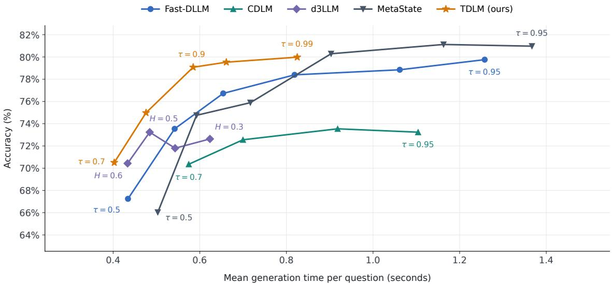
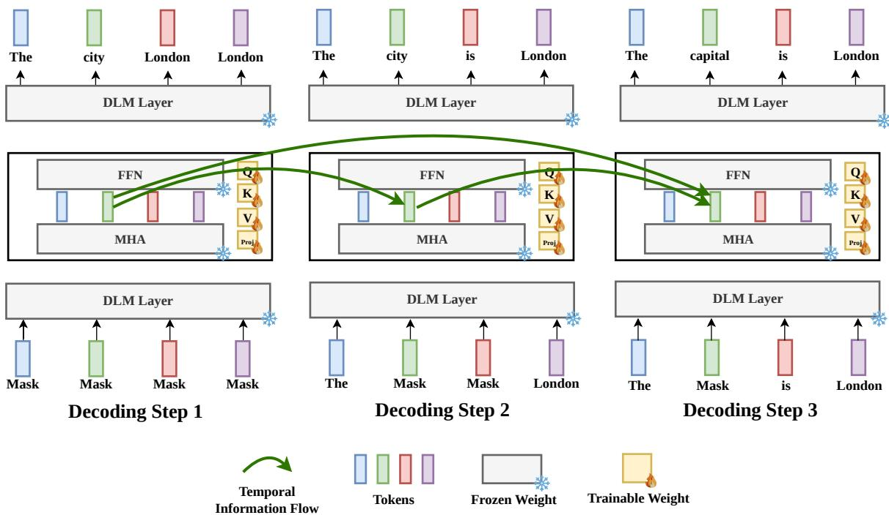
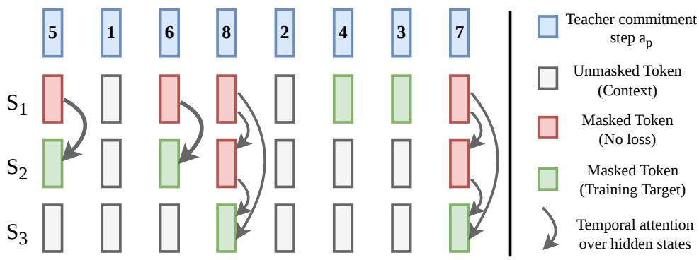

# TDLM: Adaptive Temporal Integration for Difusion Language Models

Bohang Sun1 Max Zhu1 Francesco Caso1 Christopher Irwin1 Jialin Yu2∗ Pietro Liò1†

1Department of Computer Science and Technology, University of Cambridge 2Department of Engineering Science, University of Oxford

## Abstract

Masked difusion language models repeatedly compute representations for unresolved tokens, but conventional denoisers do not explicitly retain these representations for reuse across steps. We introduce Temporal Self-Conditioning Difusion Language Model (TDLM), which lets each unresolved position attend to its own history of hidden representations within a frozen denoiser. This gives later predictions access to computation already performed. Training uses self-generated trajectories and a simple cross-entropy objective for tokens revealed between consecutively sampled decoding steps, while causal temporal attention permits parallel evaluation during training. On LLaDA, the temporal modules add only approximately 0.84% trainable parameters. Across LLaDA and Dream, the main comparison shows up to 7.15× faster generation than the corresponding original difusion language model, with competitive answer quality on the evaluated tasks. These results motivate temporal memory as a practical way to make more efective use of repeated denoising computation.

## 1 Introduction

Masked difusion language models ofer a route to parallel text generation: a bidirectional denoiser predicts multiple missing tokens, and a decoding policy decides which predictions to commit. LLaDA, iLLaDA, and Dream demonstrate the capabilities of difusion language modeling at billion-parameter scale [13, 14, 19]. Nemotron-Labs-Difusion and DifusionGemma further develop eficient parallel generation while retaining support for autoregressive decoding [4, 6]. The practical eficiency of difusion generation depends on how many predictions can be committed reliably at each step. Committing too few requires repeated expensive forward passes; committing uncertain predictions can damage the entire answer. Confidence-based decoding exposes this tension directly through a threshold controlling parallelism [17].

Consider a token position that remains masked across several denoising steps. Its discrete input has not changed, yet the model has repeatedly computed a rich representation of what could belong there. As other tokens become visible, these representations evolve. A conventional denoiser carries committed tokens into the next step, but provides no explicit route for an unresolved position to consult its earlier representations. The computation spent on these intermediate estimates has no persistent representation available for direct reuse.

  
Figure 1: Accuracy–latency trade-of on GSM8K. Threshold sweeps compare TDLM with the evaluated baselines.

This suggests a question about the use of inference computation: can a denoiser reuse its earlier internal estimates to reach reliable predictions sooner? Historical representations do not provide new external evidence beyond the request and evolving response. Their potential value lies in preserving computations that the model has already performed under earlier contexts. If these computations help resolve uncertainty, more tokens may be committed per evaluation without a corresponding loss in answer quality. If they merely increase confidence, apparent acceleration may instead conceal additional errors. Both possibilities must be tested.

We introduce TDLM, a temporal self-conditioning extension to a pretrained difusion language model. At selected Transformer layers, each unresolved position attends to its own representations from earlier denoising steps. This preserves the alignment between a pending prediction and the history used to refine it. Narrow temporal projections keep the adaptation small, while a learned zero-value sink allows the model to suppress unhelpful history. The backbone remains frozen. During blockwise generation, unresolved positions continue to accumulate history across block boundaries.

The training procedure is simple: the frozen backbone generates its own trajectories, and the added modules learn to predict the tokens revealed between consecutively sampled decoding steps using cross-entropy. This reuses the backbone’s existing capabilities and the memory accumulated during denoising, while updating only a small set of parameters. It requires no new manually annotated reference answers. Strictly causal temporal attention permits the corresponding partially masked inputs to be evaluated in parallel during training.

Our experiments on LLaDA and Dream study generation eficiency, answer quality, and the role of the available history. Figure 1 illustrates the resulting quality–latency trade-of. We examine whether temporal reuse makes additional computation useful before a token is committed, and how restricting that history changes the model’s predictions.

Our contributions are:

• A lightweight, position-aligned temporal attention mechanism that makes earlier denoising representations available to unresolved predictions in a frozen language model.

• A simple cross-entropy self-distillation objective for earlier prediction, with causal parallel evaluation of sampled trajectory inputs.

• An empirical study of the quality–latency trade-of and the efects of restricting the history available to unresolved predictions.

## 2 Method

TDLM lets each masked token position reuse hidden representations from earlier denoising steps. Spatial attention exchanges information across positions in the current input; temporal attention retrieves earlier representations of the same position. The backbone remains frozen, and only the added temporal modules are trained.

## 2.1 Conditioning on denoising history

Let c be a prompt and N the response length. Each decoding step evaluates the denoiser and reveals one or more tokens: their masks are replaced with predicted tokens, which are then kept fixed. We refer to this operation as commitment.

We call a partially revealed response sequence a state and write it as $S _ { i }$ . Its associated global decoding step $s _ { i }$ is the number of updates already completed. Thus, i indexes the selected sequences, $s _ { i }$ records their times along the decoding trajectory, and $p$ denotes a token position. During training we select a subset of teacher decoding steps; during inference we evaluate every successive input. The initial sequence is $S _ { 0 } = \mathrm { M A S K } ^ { N }$ at $s _ { 0 } = 0$

For a masked position $p ,$ TDLM extends the information available to predict its token $y _ { p } \mathrm { . }$

$$
\begin{array} { r } { p _ { \theta } ( y _ { p } \mid c , S _ { i } ) \quad \longrightarrow \quad p _ { \theta , \phi } ( y _ { p } \mid c , S _ { i } , \mathcal { H } _ { < i } ) , } \end{array}\tag{1}
$$

where $\theta$ denotes the frozen backbone parameters, $\phi$ the temporal parameters, and $\mathcal { H } _ { < i }$ the hidden representations retained from earlier evaluated inputs $S _ { j } , j < i$ . The input at position $p$ can remain a mask while its internal representation changes with the surrounding context. Temporal memory makes those earlier representations available to the next prediction.

## 2.2 Temporal attention at masked token positions

At a selected layer $\ell ,$ let $h _ { \ell , p } ( S _ { i } ) \in \mathbb { R } ^ { d }$ be the hidden representation at position $p ,$ after spatial attention and before the feed-forward sublayer. Define $m _ { i , p } = { \bf 1 } [ ( S _ { i } ) _ { p } = \mathrm { M A S K } ]$ and let $r _ { i } =$ ${ \textstyle \sum _ { p } } ( 1 - m _ { i , p } )$ count the revealed response tokens in $S _ { i }$ . A decoding step can reveal several tokens, so $r _ { i }$ need not equal the step number $s _ { i }$

For a currently masked position, every earlier input also masks that position because revealed tokens are never remasked. Its layer-specific history $\mathcal { H } _ { \ell , p } ^ { < i }$ contains earlier representations $h _ { \ell , p } ( S _ { j } )$ and their progress coordinates $r _ { j }$ , with $j < i .$ . The current representation queries this history through a residual update:

$$
\widetilde { h } _ { \ell , p } ( S _ { i } ) = h _ { \ell , p } ( S _ { i } ) + m _ { i , p } \mathrm { { T e m p A t t n } } _ { \ell } \Bigl ( h _ { \ell , p } ( S _ { i } ) , \mathcal { H } _ { \ell , p } ^ { < i } ; r _ { i } \Bigr ) .\tag{2}
$$

  
Figure 2: Reusing computation before commitment. Each column is a denoising evaluation, read from bottom to top. The bottom shows the partially revealed input; the top shows token predictions before commitment. Decoding Steps 1–3 use inputs $S _ { 0 } , S _ { 1 } , S _ { 2 }$ at $s _ { 0 } = 0 , s _ { 1 } = 1 , s _ { 2 } = 2$ respectively. The green position remains masked while its predictions can change. Green arrows retrieve earlier hidden representations at that position and layer. Yellow modules are trainable, and the backbone is frozen.

TempAttn uses standard multi-head attention with narrow projections, retrieving only earlier representations of the same token position at the same layer. Temporal rotary embeddings [16] use revealed-token counts to encode decoding progress. A learned attention sink with zero value gives the module an option to ignore history. Appendix B.1 gives the projection, normalization, and multi-head formulas.

The original feed-forward sublayer processes the corrected representation ${ \widetilde { h } } .$ Keys and values are formed from h before the same layer’s temporal correction, a property used by parallel trajectory training below. Only masked token positions receive a correction. Empty history produces zero correction, and a zero-initialized output projection preserves the pretrained denoiser at initialization. The precise statements and proofs are in Appendix B.

## 2.3 Simple trajectory self-distillation

For each prompt, the frozen backbone generates a teacher response in T decoding steps. We record the final tokens $y _ { p }$ and the step $a _ { p }$ at which each token is revealed. These records let us reconstruct the input at any selected step $s _ { i } { : }$ tokens revealed by that step are visible, and later tokens remain masked,

$$
( S _ { i } ) _ { p } = \left\{ { { y _ { p } } , \atop { \mathrm { M A S K } , } } \quad a _ { p } \leq s _ { i } , \right.\tag{3}
$$

Hidden representations are computed during training from these reconstructed inputs.

  
Figure 3: Sampled inputs and their training targets. The top row gives the teacher’s reveal step for each token position. The three input rows are $S _ { 1 } , S _ { 2 } , S _ { 3 }$ at steps $s _ { 1 } = 2 , s _ { 2 } = 4 , s _ { 3 } = 6$ . Gray positions are revealed context. Green positions are masked inputs whose teacher tokens become visible in the next selected sequence and are used as CE targets. Red positions are also masked, but receive no loss on that input. Arrows show reuse of earlier hidden representations at the same position and layer.

We always include $s _ { 0 } = 0$ , sample $K - 1$ distinct steps uniformly from $\{ 1 , \ldots , T - 1 \}$ , and sort them. We also set $s _ { K } = T$ to mark the end of the trajectory:

$$
0 = s _ { 0 } < s _ { 1 } < \cdot \cdot \cdot < s _ { K - 1 } < s _ { K } = T .
$$

The gap $n _ { i } = s _ { i + 1 } - s _ { i }$ is the number of decoding steps between two selected sequences. Every decoding step reveals at least one token, so the number of masks strictly decreases from $S _ { i }$ to $S _ { i + 1 }$ We evaluate $S _ { 0 } , \ldots , S _ { K - 1 } ;$ the fully revealed $S _ { K }$ only marks the end of the last supervision interval and requires no forward pass.

For an input $S _ { i } ,$ the training targets are positions that are still masked in $S _ { i }$ but revealed in the next selected sequence $S _ { i + 1 }$ . For example, if $s _ { i } = 2$ and $s _ { i + 1 } = 4$ , we train the model to predict the tokens the teacher reveals at steps 3 and 4. Positions revealed later remain masked and contribute temporal history, but receive no loss on this input. Formally, the target positions are

$$
\begin{array} { r } { \mathcal { T } _ { i } = \{ p : ( S _ { i } ) _ { p } = \mathrm { { M A S K } } , \ ( S _ { i + 1 } ) _ { p } \neq \mathrm { { M A S K } } \} , \qquad 1 \leq i < K . } \end{array}\tag{4}
$$

The initial input $S _ { 0 }$ seeds temporal memory without supervision because its temporal correction is zero.

Let $\pi _ { i , p }$ be TDLM’s predicted token distribution at position $p ,$ conditioned on $c , S _ { i } .$ , and $\mathcal { H } _ { < i }$ We optimize only $\phi ,$ , using cross-entropy averaged over all supervised token positions across the sampled inputs:

$$
\mathcal { L } _ { \mathrm { C E } } ( \phi ) = \underset { \underset { p \in \mathcal { T } _ { i } } { \sum } } { \mathrm { m e a n } } \mathrm { C E } ( \pi _ { i , p } , y _ { p } ) .\tag{5}
$$

Each supervised token has equal weight. This objective teaches the model to predict the next interval’s tokens using the current input and its accumulated history. Figure 3 illustrates the inputs and targets; Appendix A gives training details.

Parallel evaluation along a fixed trajectory. Spatial attention processes each reconstructed input independently. At a temporal layer, the causal mask $A _ { p , i , j } = \mathbf { 1 } [ j < i ] m _ { j , p }$ lets the representation for $S _ { i }$ retrieve from earlier inputs $S _ { j }$ where position $p$ was masked. Equation (2) restricts the correction to currently masked positions. Since each layer’s keys and values precede its temporal correction, all sampled inputs can be evaluated together layer by layer. With identical history selection and dropout disabled, this is equivalent in exact arithmetic to processing the same inputs sequentially (Appendix B). Training computes no representations for unsampled steps; inference instead accumulates history from each actual forward pass.

## 2.4 From retrieval to fewer evaluations

At inference, let $\mathcal { U } _ { b }$ be the set of masked token positions in the active block. For the current input $S _ { i }$ , let $\widehat { y } _ { p }$ be the greedy prediction at position $p$ and $\gamma _ { p } = \pi _ { i , p } ( \widehat { y } _ { p } )$ its confidence. The decoder reveals tokens with confidence above a threshold $\tau ,$ or the most confident token otherwise:

$$
C = \left\{ \begin{array} { l l } { \{ p \in \mathcal { U } _ { b } : \gamma _ { p } > \tau \} , } & { \mathrm { i f ~ n o n e m p t y , } } \\ { \{ \arg \operatorname* { m a x } _ { p \in \mathcal { U } _ { b } } \gamma _ { p } \} , } & { \mathrm { o t h e r w i s e . } } \end{array} \right.\tag{6}
$$

TDLM and our Fast-dLLM policy baseline share this commitment rule. Original DLM reveals one token per evaluation. Decoding settings are specified together in Section 3.1.

Each forward pass retrieves earlier temporal keys and values, then appends the current entries. All masked response positions accumulate history, including those outside the active block. Revealing a token invalidates that position’s history; changing blocks does not reset the histories of other positions. The full spatial sequence is recomputed at every step.

With $L _ { t }$ temporal layers and total temporal width $d _ { t } = M d _ { h }$ , the module parameter count is $L _ { t } ( 4 d d _ { t } + 1 )$ ). Retrieving from H earlier evaluations costs $O ( N H d _ { t } )$ per temporal layer, in addition to the projections. Full-history memory requires $O ( L _ { t } N H d _ { t } )$ storage, and unrestricted attention work grows quadratically with the number of denoising steps. TDLM is therefore useful when it saves enough backbone evaluations to ofset this overhead. We measure both evaluation counts and wall time, together with answer quality, to assess that trade-of.

## 3 Experiments

We evaluate the quality–latency trade-of of TDLM on two backbones and study the contribution of its temporal history.

## 3.1 Experimental setup

Models and training. We augment frozen LLaDA-8B-Instruct and Dream-v0-Instruct-7B backbones. LLaDA uses sixteen dispersed temporal layers with four heads of width 64; Dream uses fourteen middle layers with four heads of width 84. For each backbone, we train only the temporal modules on 3,500 self-generated trajectories for 750 optimizer updates using the simple CE objective in Eq. (5). These results therefore require a modest adaptation dataset and a straightforward self-distillation procedure. Appendix A gives the model and training details. Our MetaState baseline uses reference responses from the Tulu-3 SFT mixture as supervision [18], whereas TDLM learns from responses generated by its own frozen backbone.

Tasks and scoring. We evaluate mathematical reasoning on MATH-500 and GSM8K, and code generation on MBPP sanitized [1, 3, 7, 9]. We use the complete test sets of 500, 1,319, and 257 problems, respectively. Math answers are checked with Math-Verify, and code solutions are executed against the dataset tests. We report accuracy or pass@1 from one greedy generation per problem; unparseable answers count as incorrect.

Decoding and measurement. All methods in the main comparison use a generation budget of 256 tokens and block size 32. Confidence-based decoding uses τ = 0.9, following released evaluation settings [11, 17]; d3LLM uses its default entropy threshold H = 0.5 [15]. On Dream, TDLM uses τ = 0.95 and d3LLM uses H = 0.4. Original DLM commits one token per evaluation. All methods use compiled model forwards with batch size one on GH200 GPUs. We report mean denoiser evaluations (NFE) and generation seconds, excluding compilation and warmup. Speedup is measured against the original model of the same backbone on the same task. Further evaluation details are in Appendix C.

## 3.2 Generation eficiency and answer quality

<table><tr><td colspan="2"></td><td colspan="4">LLaDA-8B-Instruct</td><td colspan="4">Dream-v0-Instruct-7B</td></tr><tr><td>Dataset</td><td>Model</td><td>ACC (%) ↑</td><td></td><td>NFE Sec. ↓</td><td>Speedup</td><td>ACC (%) ↑</td><td>NFE</td><td></td><td>Sec. ↓ Speedup</td></tr><tr><td rowspan="6">MATH-500</td><td>TDLM</td><td>37.20</td><td>54.79</td><td>0.829</td><td>4.26×</td><td>44.20</td><td>74.62</td><td>1.194</td><td>3.05×</td></tr><tr><td>Fast-dLLM</td><td>38.60</td><td>107.20</td><td>1.535</td><td>2.30×</td><td>44.00</td><td>113.50</td><td>1.646</td><td>2.21×</td></tr><tr><td>MetaState</td><td>36.80</td><td>107.56</td><td>1.682</td><td>2.10×</td><td></td><td>40.80†115.88</td><td>1.671</td><td>2.18×</td></tr><tr><td>CDLM</td><td>30.40</td><td>87.89</td><td>2.851</td><td>1.24×</td><td>26.00</td><td>96.93</td><td>1.438</td><td>2.53×</td></tr><tr><td>d3LLM</td><td>31.80</td><td>35.67</td><td>1.244</td><td>2.84×</td><td>42.40</td><td>53.76</td><td>0.820</td><td>4.45×</td></tr><tr><td>Original DLM</td><td>38.40</td><td>256.00</td><td>3.535</td><td>1.00×</td><td>44.60</td><td>256.00</td><td>3.645</td><td>1.00×</td></tr><tr><td rowspan="6">GSM8K</td><td>TDLM</td><td>79.08</td><td>40.08</td><td>0.585</td><td>5.91×</td><td>79.15</td><td>62.90</td><td>0.951</td><td>3.63×</td></tr><tr><td>Fast-dLLM</td><td>78.85</td><td>76.72</td><td>1.062</td><td>3.26×</td><td>79.00</td><td>97.35</td><td>1.329</td><td>2.60×</td></tr><tr><td>MetaState</td><td>81.12</td><td>77.36</td><td>1.163</td><td>2.97×</td><td></td><td>75.21†101.79</td><td>1.430</td><td>2.41×</td></tr><tr><td>CDLM</td><td>65.66</td><td>68.66</td><td>2.748</td><td>1.26×</td><td>63.15</td><td>88.47</td><td>1.236</td><td>2.79×</td></tr><tr><td>d3LLM</td><td>75.44</td><td>23.35</td><td>0.805</td><td>4.30×</td><td>77.33</td><td>40.54</td><td>0.587</td><td>5.88×</td></tr><tr><td>Original DLM</td><td>78.62</td><td>256.00</td><td>3.457</td><td>1.00×</td><td>78.85</td><td>256.00</td><td>3.452</td><td>1.00×</td></tr><tr><td rowspan="6">MBPP</td><td>TDLM</td><td>46.69</td><td>36.98</td><td>0.517</td><td>6.27×</td><td>57.98</td><td>31.14</td><td>0.467</td><td>7.15×</td></tr><tr><td>Fast-dLLM</td><td>43.97</td><td>52.13</td><td>0.676</td><td>4.79×</td><td>58.37</td><td>40.51</td><td>0.559</td><td>5.97×</td></tr><tr><td>MetaState</td><td>48.64</td><td>63.91</td><td>0.917</td><td>3.53×</td><td>58.37†</td><td>59.88</td><td>0.837</td><td>3.99×</td></tr><tr><td>CDLM</td><td>45.91</td><td>32.02 25.00</td><td>1.476</td><td>2.19× 3.42×</td><td>50.58</td><td>29.46</td><td>0.401</td><td>8.31×</td></tr><tr><td>d3LLM</td><td>45.53</td><td>256.00</td><td>0.947 3.240</td><td>1.00×</td><td>55.25 58.37</td><td>24.95 256.00</td><td>0.351 3.334</td><td>9.50×</td></tr><tr><td>Original DLM</td><td>44.75</td><td></td><td></td><td></td><td></td><td></td><td></td><td>1.00×</td></tr></table>

Table 1: Main results on two backbones. ACC is mathematical accuracy or code pass@1; NFE and seconds are per-problem means. Speedup is relative to the original model of the same backbone on the same task. Gold, silver, and bronze mark the three best distinct displayed values within each backbone–task group; ties share a rank. †: scoring-only tag removal for the Dream MetaState results is described in Appendix C.

Table 1 compares both backbones across the three tasks. TDLM achieves up to 7.15× faster generation than original DLM in the main comparison, and up to 1.85× over Fast-dLLM. Its largest score improvement over Fast-dLLM is 2.72 percentage points on LLaDA MBPP. Across the six backbone–task combinations, TDLM ranks first, second, and third in quality in one, four, and one cases, respectively; the corresponding latency counts are three, two, and one, using the table’s tie convention. Quality changes remain task-dependent.

Figure 1 compares generation quality and latency across decoding thresholds to explore the empirical Pareto frontier. TDLM pushes the Pareto frontier, ofering higher accuracy at fast speeds.

<table><tr><td>Temporal context</td><td>Accuracy (%)</td><td>NFE</td><td>Sec.</td><td>GPU (GiB)</td></tr><tr><td>Current only (gated)</td><td>76.48</td><td>42.64</td><td>0.623</td><td>15.184</td></tr><tr><td>Last 1</td><td>77.62</td><td>44.06</td><td>0.637</td><td>15.188</td></tr><tr><td>Last 3</td><td>78.00</td><td>42.36</td><td>0.631</td><td>15.196</td></tr><tr><td>Last 5</td><td>78.68</td><td>41.57</td><td>0.601</td><td>15.204</td></tr><tr><td>Full history</td><td>79.08</td><td>40.08</td><td>0.585</td><td>15.330</td></tr></table>

Table 2: Restricting temporal context at inference. All conditions reuse the same trained LLaDA checkpoint without retraining. Current-only retains the Q/K/sink gate. GPU memory includes weights and compiled workspaces. Implementation details are in Appendix E.

Appendix F extends the LLaDA evaluation to 128- and 384-token generation budgets, with speedups over original DLM reaching 8.54× at the longer budget.

## 3.3 What does temporal history contribute?

We keep the LLaDA checkpoint fixed and vary the context available to the temporal modules: representations from the current evaluation only, the previous one, three or five evaluations, or the complete history. Table 2 reports these inference-time restrictions. The current-only condition retains the learned Q/K/sink gate.

Extending history from one evaluation to the complete trajectory raises observed accuracy from 77.62% to 79.08%, while reducing NFE from 44.06 to 40.08 and mean time from 0.637 to 0.585 seconds. Current-only inference achieves 76.48% accuracy with 42.64 evaluations. These measurements show how the available history changes predictions and commitment behavior for a fixed checkpoint. Implementation details and architecture comparisons are given in Appendices E and D.

## 4 Related work

Parallel decoding and difusion acceleration. Fast-dLLM [17] combines confidence-based parallel decoding with KV-cache reuse. dKV-Cache [12] uses delayed and conditioned caching to reuse key and value states during denoising. Training-based methods include CDLM [11], which combines consistency training with blockwise causal attention, and d3LLM [15], which uses pseudotrajectory distillation and entropy-based multi-block decoding. TDLM studies position-aligned temporal retrieval as a way to make earlier denoising computations useful for later predictions.

Self-conditioning and persistent representations. Analog Bits [2] conditions difusion predictions on earlier model predictions. Recurrent Interface Networks [10] introduce latent selfconditioning across reverse difusion steps for image and video generation. In language models, RCD [8] recycles discarded-token representations as residual context for subsequent denoising. MetaState [18] equips a frozen discrete difusion model with fixed-size recurrent working memory, while ALoDLM [5] uses token-adaptive latent recurrence. TDLM retrieves an explicit history of same-position representations at multiple layers of a frozen backbone, with simple trajectory self-distillation and causal parallel evaluation of sampled trajectory inputs.

## 5 Discussion and future work

Temporal memory provides a way to use earlier denoising computations when predicting unresolved tokens. The generation and history-restriction experiments show how this changes the balance between answer quality and the number of evaluations. Further analysis of token-level correctness and confidence, together with a capacity-matched adapter using only the current hidden representation, would help characterize when history is most useful.

Self-distillation inherits the quality limitations of the teacher-generated trajectories. With a frozen backbone and teacher tokens drawn from its own outputs, supervision ofers limited evidence for correcting systematic teacher errors. Teacher capability therefore provides a practical reference for the quality available through this training signal. Future work can explore higher-quality training data and full-model fine-tuning, allowing the backbone and temporal attention to adapt jointly and make better use of the accumulated memory.

Sparse teacher trajectories and the student’s own multi-token commitments can expose the model to diferent histories. Longer responses, repeated measurements, and combinations with spatial KV caching and early stopping are additional directions for evaluation.

## 6 Conclusion

TDLM augments a frozen difusion language model with lightweight attention over the history of unresolved positions. A simple trajectory self-distillation objective trains earlier predictions, while causal temporal attention permits parallel evaluation of sampled trajectory inputs. The available experiments show that fewer backbone evaluations can outweigh the added temporal computation at useful quality levels. Reusing denoising history thus ofers a practical direction for improving generation eficiency through the model’s existing capabilities.

## References

[1] Jacob Austin, Augustus Odena, Maxwell Nye, Maarten Bosma, Henryk Michalewski, David Dohan, Ellen Jiang, Carrie Cai, Michael Terry, Quoc Le, and Charles Sutton. Program synthesis with large language models. arXiv preprint arXiv:2108.07732, 2021. URL https: //arxiv.org/abs/2108.07732.

[2] Ting Chen, Ruixiang Zhang, and Geofrey Hinton. Analog bits: Generating discrete data using difusion models with self-conditioning. In International Conference on Learning Representations, 2023. URL https://arxiv.org/abs/2208.04202.

[3] Karl Cobbe, Vineet Kosaraju, Mohammad Bavarian, Mark Chen, Heewoo Jun, Lukasz Kaiser, Matthias Plappert, Jerry Tworek, Jacob Hilton, Reiichiro Nakano, Christopher Hesse, and John Schulman. Training verifiers to solve math word problems. arXiv preprint arXiv:2110.14168, 2021. URL https://arxiv.org/abs/2110.14168.

[4] DifusionGemma Team et al. DifusionGemma technical report. arXiv:2608.00146, 2026. URL https://arxiv.org/abs/2608.00146.

[5] Liancheng Fang, Zhuowei Li, Youngeun Kim, Tianchen Zhao, Rajat Koner, Jiaye Wu, Linghan Xu, Xuanbai Chen, Xiang Xu, Zheng Zhang, Jakub Zablocki, Nishant Sankaran, and Yifan Xing. ALoDLM: Adaptively looped difusion language models. arXiv:2610.04198, 2026. URL https://arxiv.org/abs/2610.04198.

[6] Yonggan Fu, Lexington Whalen, Abhinav Garg, Chengyue Wu, Maksim Khadkevich, Nicolai Oswald, Enze Xie, Daniel Egert, Sharath Turuvekere Sreenivas, Shizhe Diao, Chenhan Yu, Ye Yu, Weijia Chen, Sajad Norouzi, Jingyu Liu, Shiyi Lan, Ligeng Zhu, Jin Wang, Jindong Jiang, Morteza Mardani, Mehran Maghoumi, Song Han, Ante Jukić, Nima Tajbakhsh, Jan Kautz, and Pavlo Molchanov. Nemotron-Labs-Difusion: A tri-mode language model unifying autoregressive, difusion, and self-speculation decoding. arXiv:2607.05722, 2026. URL https: //arxiv.org/abs/2607.05722.

[7] Google Research. MBPP sanitized dataset. Hugging Face dataset, sanitized configuration, test split, 2021. URL https://huggingface.co/datasets/google-research-datasets/mbpp.

[8] Yuezhou Hu, Harman Singh, Monishwaran Maheswaran, Haocheng Xi, Coleman Hooper, Jintao Zhang, Aditya Tomar, Michael W. Mahoney, Sewon Min, Mehrdad Farajtabar, Kurt Keutzer, Amir Gholami, and Chenfeng Xu. Residual context difusion language models. arXiv preprint arXiv:2601.22954, 2026. URL https://arxiv.org/abs/2601.22954.

[9] Hugging Face H4. MATH-500. Hugging Face dataset, n.d. URL https://huggingface.co/ datasets/HuggingFaceH4/MATH-500.

[10] Allan Jabri, David Fleet, and Ting Chen. Scalable adaptive computation for iterative generation. arXiv preprint arXiv:2212.11972, 2022. URL https://arxiv.org/abs/2212.11972.

[11] Minseo Kim, Chenfeng Xu, Coleman Hooper, Harman Singh, Ben Athiwaratkun, Ce Zhang, Kurt Keutzer, and Amir Gholami. CDLM: Consistency difusion language models for faster sampling. arXiv preprint arXiv:2511.19269, 2025. URL https://arxiv.org/abs/2511.19269.

[12] Xinyin Ma, Runpeng Yu, Gongfan Fang, and Xinchao Wang. dKV-Cache: The cache for difusion language models. arXiv preprint arXiv:2505.15781, 2025. URL https://arxiv.org/ abs/2505.15781.

[13] Shen Nie, Fengqi Zhu, Zebin You, Xiaolu Zhang, Jingyang Ou, Jun Hu, Jun Zhou, Yankai Lin, Ji-Rong Wen, and Chongxuan Li. Large language difusion models. arXiv preprint arXiv:2502.09992, 2025. URL https://arxiv.org/abs/2502.09992.

[14] Shen Nie, Qiyang Min, Shaoxuan Xu, Zihao Huang, Yuxuan Song, Yong Shan, Yankai Lin, Wayne Xin Zhao, Chongxuan Li, and Ji-Rong Wen. Improved large language difusion models. arXiv:2606.25331, 2026. URL https://arxiv.org/abs/2606.25331.

[15] Yu-Yang Qian, Junda Su, Lanxiang Hu, Peiyuan Zhang, Zhijie Deng, Peng Zhao, and Hao Zhang. d3LLM: Ultra-fast difusion LLM using pseudo-trajectory distillation. arXiv preprint arXiv:2601.07568, 2026. URL https://arxiv.org/abs/2601.07568.

[16] Jianlin Su, Yu Lu, Shengfeng Pan, Ahmed Murtadha, Bo Wen, and Yunfeng Liu. RoFormer: Enhanced transformer with rotary position embedding. arXiv preprint arXiv:2104.09864, 2021. URL https://arxiv.org/abs/2104.09864.

[17] Chengyue Wu, Hao Zhang, Shuchen Xue, Zhijian Liu, Shizhe Diao, Ligeng Zhu, Ping Luo, Song Han, and Enze Xie. Fast-dLLM: Training-free acceleration of difusion LLM by enabling KV cache and parallel decoding. arXiv preprint arXiv:2505.22618, 2025. URL https://arxiv. org/abs/2505.22618.

[18] Kejing Xia, Mingzhe Li, Lixuan Wei, Zhenbang Du, Xiangchi Yuan, Qirui Jin, and Wenke Lee. MetaState: Persistent working memory for discrete difusion language models. arXiv preprint arXiv:2603.01331, 2026. URL https://arxiv.org/abs/2603.01331.

[19] Jiacheng Ye, Zhihui Xie, Lin Zheng, Jiahui Gao, Zirui Wu, Xin Jiang, Zhenguo Li, and Lingpeng Kong. Dream 7b: Difusion large language models. arXiv preprint arXiv:2508.15487, 2025. URL https://arxiv.org/abs/2508.15487.

## A Training details

For each backbone, we train the temporal modules on 3,500 self-generated trajectories for 750 optimizer updates with the interval-only CE objective in Eq. (5). Backbone parameters remain frozen throughout training. The modules are initialized with a zero output projection, and sampled inputs are evaluated with causal temporal attention.

LLaDA. Temporal modules are installed at zero-based layer indices $\{ 1 , 3 , 5 , \dots , 3 1 \}$ . Each uses four heads of width 64 and unrestricted history, adding 67,108,880 parameters, approximately 0.84% of the nominal 8B backbone.

Dream. Temporal modules occupy the middle fourteen layers, at zero-based indices 7–20, with four heads of width 84 and unrestricted history. Predicting the token at position $p$ uses the hidden representation at position $p - 1 $ ; temporal memory and commitment masks are aligned to the response token position, including the first response token.

Trainable parameters and data scale. Table 3 compares the added trainable parameters and training-data volume of the LLaDA-based methods. TDLM trains 67.11M temporal-module parameters on 3,500 self-generated trajectories while keeping the backbone frozen. The data counts retain each method’s unit: examples, prompts, or trajectories.
<table><tr><td>Method</td><td>Added trainable parameters</td><td>Training data</td></tr><tr><td>d3LLM [15]</td><td>335.54M (LoRA)</td><td>≈92k examples</td></tr><tr><td>CDLM [11]</td><td>176.13M (LoRA)</td><td>≈15k prompts; trajectories collected at two tempera-</td></tr><tr><td></td><td></td><td>tures per prompt</td></tr><tr><td>MetaState [18] TDLM</td><td>51.08M 67.11M</td><td>15,543 instruction-response examples 3,500 self-generated trajectories</td></tr></table>

Table 3: Added trainable parameters and training-data scale for LLaDA-based models. M denotes one million parameters.

## B Properties of temporal evaluation

## B.1 Temporal attention operator

We use the notation of Section 2: $S _ { i }$ is the selected input at decoding step $s _ { i } , p$ is a token position, and $h _ { \ell , p } ( S _ { i } )$ is its hidden representation at layer ℓ. Each temporal module has M heads of width $d _ { h } ,$ with total width $d _ { t } = M d _ { h }$ . Head a uses bias-free projections $W _ { \ell , a } ^ { Q } , W _ { \ell , a } ^ { K } , W _ { \ell , a } ^ { V } \in \mathbb { R } ^ { d _ { h } \times d }$

$$
\begin{array} { r l } & { q _ { \ell , p , a } ( S _ { i } ) = R ( r _ { i } ) W _ { \ell , a } ^ { Q } h _ { \ell , p } ( S _ { i } ) , \qquad k _ { \ell , p , a } ( S _ { i } ) = R ( r _ { i } ) W _ { \ell , a } ^ { K } h _ { \ell , p } ( S _ { i } ) , } \\ & { v _ { \ell , p , a } ( S _ { i } ) = W _ { \ell , a } ^ { V } h _ { \ell , p } ( S _ { i } ) . } \end{array}\tag{7}
$$

$R ( r )$ applies temporal RoPE within each head. Its rotation angles are $r \omega _ { u } .$ with $\omega _ { u } = 1 0 0 0 0 ^ { - 2 u / d _ { h } }$ for $u = 0 , \ldots , d _ { h } / 2 - 1$ . The relative positional term depends on $\boldsymbol { r } _ { j } - \boldsymbol { r } _ { i }$ , while the hidden representations and available histories can still difer across decoding schedules.

Let $\mathcal { I } _ { p } ( i )$ contain the indices $j < i$ of earlier evaluated inputs retained as history for masked position $p .$ The attention score and normalizer are

$$
e _ { \ell , p , a } ^ { i , j } = \frac { q _ { \ell , p , a } ( S _ { i } ) ^ { \top } k _ { \ell , p , a } ( S _ { j } ) } { \sqrt { d _ { h } } } , \qquad Z _ { \ell , p , a } ^ { ( i ) } = \exp ( b _ { \ell } ) + \sum _ { j \in \mathcal { I } _ { p } ( i ) } \exp ( e _ { \ell , p , a } ^ { i , j } ) .\tag{8}
$$

Here $b _ { \ell }$ is a learned sink logit shared by the heads; its value vector is zero. Each head retrieves

$$
z _ { \ell , p , a } ( S _ { i } ) = \sum _ { j \in \mathcal { I } _ { p } ( i ) } \frac { \exp ( e _ { \ell , p , a } ^ { i , j } ) } { Z _ { \ell , p , a } ^ { ( i ) } } v _ { \ell , p , a } ( S _ { j } ) .\tag{9}
$$

The operator in $\operatorname { E q . } \ ( 2 )$ is

$$
\mathrm { T e m p A t t } \mathfrak { n } _ { \ell } \bigl ( h _ { \ell , p } ( S _ { i } ) , \mathcal { H } _ { \ell , p } ^ { \le i } ; r _ { i } \bigr ) = W _ { \ell } ^ { O } \mathrm { c o n c a t } _ { a = 1 } ^ { M } z _ { \ell , p , a } ( S _ { i } ) , \qquad W _ { \ell } ^ { O } \in \mathbb { R } ^ { d \times d _ { t } } .\tag{10}
$$

All keys and values use the residual representation before this layer’s temporal correction. The resulting correction is $\Delta h _ { \ell , p } ( S _ { i } ) = \widetilde { h } _ { \ell , p } ( S _ { i } ) - h _ { \ell , p } ( S _ { i } )$ . This explicit form gives the same update as the compact operator in the main text.

## B.2 Sink, cold start, and initialization

The sink probability in head a is

$$
\pi _ { \mathcal { D } , a } = \frac { \exp ( b _ { \ell } ) } { Z _ { \ell , p , a } ^ { ( i ) } } .
$$

Its history weights sum to $1 - \pi _ { \mathcal { D } , a } . \mathrm { ~ H ~ } \| v _ { \ell , p , a } ( S _ { j } ) \| _ { 2 } \leq V$ for every head and available history, then

$$
\| \Delta h _ { \ell , p } ( S _ { i } ) \| _ { 2 } \leq m _ { i , p } \| W _ { \ell } ^ { O } \| _ { 2 } V \sqrt { \sum _ { a = 1 } ^ { M } ( 1 - \pi _ { \mathcal { D } , a } ) ^ { 2 } } .\tag{11}
$$

This follows directly from the triangle inequality and the nonnegative attention weights. The sink therefore gates the magnitude of the retrieved history without a separate gating network. This is a local bound on the module output, not a guarantee of whole-model stability or accuracy.

Proposition 1 (Cold start and initialization). For history-only temporal attention, the first forward pass of each request has zero temporal correction at every layer. If each $W _ { \ell } ^ { O }$ is initialized to zero, the entire initialized TDLM denoiser equals the backbone on every input along any fixed trajectory, in exact arithmetic.

Proof. On the first pass, $\mathcal { I } _ { p } ( 0 )$ is empty, so the only attention entry is the zero-value sink. At initialization, multiplication by $W _ { \ell } ^ { O } = 0$ removes the correction even when history is available. Induction over backbone layers gives identical representations and output distributions. □

## B.3 Parallel and sequential evaluation

Proposition 2 (Parallel evaluation on a fixed trajectory). With dropout disabled and identical history selection, evaluating the sampled inputs together using A gives the same outputs as evaluating those inputs sequentially with temporal caches, in exact arithmetic.

Proof. The input embeddings agree for each $S _ { i }$ . Suppose the representations agree at the input to a layer. Spatial attention processes each sequence independently, so the post-attention representations $h _ { \ell , p } ( S _ { i } )$ also agree. Keys and values are computed before the temporal correction at this layer. The parallel mask therefore selects exactly the keys and values that sequential evaluation would have cached from earlier sampled inputs. The temporal update and the unchanged feed-forward sublayer then give the same layer outputs. Induction over layers establishes the claim. □

This equivalence concerns a fixed set of sampled inputs. No hidden representations are computed or inserted into memory for unsampled decoding steps. Training histories and those accumulated during generation can consequently difer. Although backbone weights are frozen, gradients still propagate through later backbone computations to train the temporal modules.

## C Evaluation details

Answer scoring. MATH-500 and GSM8K prompts request a solution ending in a boxed answer. The last boxed answer is checked for mathematical equivalence using Math-Verify 0.8.0. MBPP prompts request complete Python code with a signature derived from the reference implementation, without exposing the function body or tests. Extracted code is checked against the dataset tests with a three-second timeout and a 512 MB memory limit. Failed or unparseable answers count as incorrect. Scoring uses the text before the first EOS/EOT marker.

For the dagger-marked Dream MetaState scores in Table 1, scoring removes only the literal strings <tool\_call> and </tool\_call>. Its raw MBPP pass@1 is 23.74%, compared with 58.37% after this treatment. NFE and latency use the original generations.

Runtime measurement. The experiments use PyTorch 2.9.0+cu128 and compiled generation. TDLM uses a fused temporal kernel and BF16 temporal keys and values. Timing covers the full generation budget and excludes compilation, warmup, tokenization, external text decoding, and grading. Measurements come from separate GH200 jobs, with one timed generation per problem. Native decoder-loop work is included where present.

TDLM, Fast-dLLM and original LLaDA each use eager fallback for four long MATH-500 prompts; MetaState compiles the full LLaDA test set. The Dream runs use three long-prompt fallbacks per method. These implementation details are included in the measured latency.

## D Architecture ablations on GSM8K

We compare temporal-layer allocations and widths using LLaDA-8B-Instruct on all 1,319 GSM8K test problems. All measured configurations use the main GSM8K settings in Section 3.1. NFE and average seconds are means per problem; timing covers full-budget generation without EOS early stopping and excludes compilation and warmup. Measurements come from separate GH200 jobs, so small timing diferences are approximate.

## D.1 Diferent temporal-layer allocations

<table><tr><td>Temporal layers</td><td>Accuracy (%)</td><td>NFE</td><td>Avg. sec</td></tr><tr><td>8, dispersed</td><td>77.86</td><td>40.15</td><td>0.571</td></tr><tr><td>16, middle</td><td>79.00</td><td>45.72</td><td>0.683</td></tr><tr><td>16, dispersed (main)</td><td>79.08</td><td>40.08</td><td>0.585</td></tr><tr><td>32, all</td><td colspan="3">Training OOM</td></tr></table>

Table 4: Diferent temporal-layer allocations on GSM8K. Every temporal module uses four heads of width 64; measured models share the 750-update training recipe.

Table 4 favors sixteen dispersed layers, used for the main LLaDA results, among the measured allocations. They achieve 79.08% accuracy versus 77.86% for eight dispersed layers, at similar NFE and latency. Sixteen middle layers achieve nearly identical accuracy (79.00%), but require 45.72 NFE and 0.683 seconds, compared with 40.08 NFE and 0.585 seconds for the dispersed allocation. The thirty-two-layer configuration has no task-level measurements. Its training OOM status was supplied by the authors; a corresponding log is not included in the evidence snapshot.

## D.2 Temporal width and head configurations

<table><tr><td>Heads × head width</td><td>Total width</td><td>Updates</td><td>Accuracy (%)</td><td>NFE</td><td>Avg. sec</td></tr><tr><td>1 × 64</td><td>64</td><td>500</td><td>76.35</td><td>47.34</td><td>0.682</td></tr><tr><td>1 × 128</td><td>128</td><td>500</td><td>77.71</td><td>47.66</td><td>0.701</td></tr><tr><td>2 × 128</td><td>256</td><td>750</td><td>78.47</td><td>45.84</td><td>0.688</td></tr><tr><td>4× 64</td><td>256</td><td>750</td><td>79.00</td><td>45.72</td><td>0.683</td></tr></table>

Table 5: Temporal-width and head configurations on GSM8K. All models augment the middle sixteen backbone layers (zero-based indices 8–23). Total width is the product of head count and head width. Training-recipe diferences are described in the text.

In Table 5, the single-head runs use 500 updates, include 192-token training trajectories, and difer in length-sampling weights and lookahead scheduling. The multi-head runs use 750 updates and 128/256-token trajectories. Thus, the full table does not isolate width from training-recipe diferences. The two width-256 rows do share training settings: four heads of width 64 achieve 79.00% accuracy versus 78.47% for two heads of width 128, with similar NFE and latency. These single-run diferences do not establish statistical significance.

## E Temporal context during inference on GSM8K

The recorded intervention reuses the main checkpoint with sixteen dispersed layers and four heads of width 64. Temporal context is restricted to representations from the current evaluation only, the previous one, three or five evaluations, or the complete history. Current-only attention retains the learned Q/K/sink gate. All uncommitted positions retain their allowed histories across block boundaries. The evaluation follows Section 3.1.

Finite windows use circular K/V slots per uncommitted position. Complete history grows in pages of eight steps, with pages returned to the allocator after commitment. A fixed device page table permits CUDA Graph reuse. GPU memory denotes the maximum question-level allocated memory after warmup, including weights and workspaces.

Table 2 reports the available measurements. Within the historical-window conditions, accuracy increases from 77.62% with one previous evaluation to 79.08% with complete history, while NFE decreases from 44.06 to 40.08. Current-only uses the original temporal implementation, while the historical-window conditions use paged K/V storage. Each condition is evaluated without retraining the temporal modules.

## F Generation lengths on LLaDA

Tables 6 and 7 extend the LLaDA evaluation to generation budgets of 128 and 384 tokens, respectively, with block size fixed at 32. At 128 tokens, TDLM achieves 3.50–4.84× speedups over original DLM across MATH-500, GSM8K and MBPP, with score diferences of −0.40, +0.65 and +0.38 percentage points relative to Fast-dLLM. At 384 tokens, the corresponding speedups over original DLM are 4.81–8.54×, with score diferences of +1.20, +0.09 and −0.72 points relative to Fast-dLLM. TDLM uses fewer evaluations and less time than Fast-dLLM in all six comparisons. These results extend the measured quality–latency trade-of across generation budgets, while the MBPP decrease at 384 tokens illustrates that quality changes remain task-dependent.
<table><tr><td>Dataset</td><td>Model</td><td>ACC (%) ↑</td><td>NFE</td><td>Sec. ↓</td><td>Speedup</td></tr><tr><td>MATH-500</td><td>TDLM</td><td>36.00</td><td>32.60</td><td>0.366</td><td>3.50×</td></tr><tr><td></td><td>Fast-dLLM</td><td>36.40</td><td>64.28</td><td>0.670</td><td>1.91×</td></tr><tr><td></td><td>MetaState</td><td>35.80</td><td>65.14</td><td>0.742</td><td>1.72×</td></tr><tr><td></td><td>CDLM</td><td>30.80</td><td>46.36</td><td>1.806</td><td>0.71×</td></tr><tr><td></td><td>d3LLM</td><td>31.40</td><td>42.96</td><td>0.947</td><td>1.35×</td></tr><tr><td></td><td>Original DLM</td><td>36.00</td><td>128.00</td><td>1.281</td><td>1.00×</td></tr><tr><td>GSM8K</td><td>TDLM</td><td>73.77</td><td>26.67</td><td>0.282</td><td>4.33×</td></tr><tr><td></td><td>Fast-dLLM</td><td>73.09</td><td>52.85</td><td>0.520</td><td>2.35×</td></tr><tr><td></td><td>MetaState</td><td>71.04</td><td>53.25</td><td>0.580</td><td>2.11×</td></tr><tr><td></td><td>CDLM</td><td>2.12</td><td>40.54</td><td>1.476</td><td>0.83×</td></tr><tr><td></td><td>d3LLM</td><td>66.41</td><td>37.82</td><td>0.698</td><td>1.75×</td></tr><tr><td></td><td>Original DLM</td><td>73.16</td><td>128.00</td><td>1.223</td><td>1.00×</td></tr><tr><td>MBPP</td><td>TDLM</td><td>45.91</td><td>23.82</td><td>0.233</td><td>4.84×</td></tr><tr><td></td><td>Fast-dLLM</td><td>45.53</td><td>26.96</td><td>0.242</td><td>4.67×</td></tr><tr><td></td><td>MetaState</td><td>45.53</td><td>30.09</td><td>0.305</td><td>3.71×</td></tr><tr><td></td><td>CDLM</td><td>45.14</td><td>25.05</td><td>0.919</td><td>1.23×</td></tr><tr><td></td><td>d3LLM</td><td>45.53</td><td>21.02</td><td>0.426</td><td>2.65×</td></tr><tr><td></td><td>Original DLM</td><td>44.75</td><td>128.00</td><td>1.130</td><td>1.00×</td></tr><tr><td>MATH-500</td><td>TDLM</td><td>42.80</td><td>70.83</td><td>1.389</td><td>4.81×</td></tr><tr><td></td><td>Fast-dLLM</td><td>41.60</td><td>134.01</td><td>2.443</td><td>2.73×</td></tr><tr><td></td><td>MetaState</td><td>41.20</td><td>135.23</td><td>2.599</td><td>2.57×</td></tr><tr><td></td><td>CDLM</td><td>31.00</td><td>91.48</td><td>3.569</td><td>1.87×</td></tr><tr><td></td><td>d3LLM</td><td>35.80</td><td>42.06</td><td>1.618</td><td>4.12×</td></tr><tr><td></td><td>Original DLM</td><td>43.20</td><td>384.00</td><td>6.675</td><td>1.00×</td></tr><tr><td>GSM8K</td><td>TDLM</td><td>80.82</td><td>48.32</td><td>0.898</td><td>7.09×</td></tr><tr><td></td><td>Fast-dLLM</td><td>80.74</td><td>90.62</td><td>1.557</td><td>4.09×</td></tr><tr><td></td><td>MetaState</td><td>81.27</td><td>93.51</td><td>1.700</td><td>3.75×</td></tr><tr><td></td><td>CDLM</td><td>68.84</td><td>72.06</td><td>2.811</td><td>2.27×</td></tr><tr><td></td><td>d3LLM</td><td>78.85</td><td>36.21</td><td>1.032</td><td>6.18×</td></tr><tr><td></td><td>Original DLM</td><td>81.20</td><td>384.00</td><td>6.370</td><td>1.00×</td></tr><tr><td>MBPP</td><td>TDLM</td><td>45.91</td><td></td><td>0.725</td><td></td></tr><tr><td></td><td>Fast-dLLM</td><td>46.30</td><td>40.19</td><td>0.864</td><td>8.54×</td></tr><tr><td></td><td></td><td></td><td>51.97</td><td></td><td>7.16×</td></tr><tr><td></td><td>MetaState</td><td>45.53</td><td>66.31</td><td>1.178</td><td>5.26×</td></tr><tr><td></td><td>CDLM</td><td>45.91</td><td>35.03</td><td>1.344</td><td>4.61×</td></tr><tr><td></td><td>d3LLM</td><td>43.58</td><td>28.26</td><td>1.098</td><td>5.64×</td></tr><tr><td></td><td>Original DLM</td><td>45.53</td><td>384.00</td><td>6.191</td><td>1.00×</td></tr></table>

Table 6: LLaDA with a 128-token generation budget and block size 32. ACC is mathematical accuracy or code pass@1. Speedup is relative to original DLM on the same task at this budget. Medal colors and ties follow Table 1. Values and speedup ratios are reported at the supplied precision.

Table 7: LLaDA with a 384-token generation budget and block size 32. ACC is mathematical accuracy or code pass@1. Speedup is relative to original DLM on the same task at this budget. Medal colors and ties follow Table 1. Values and speedup ratios are reported at the supplied precision.