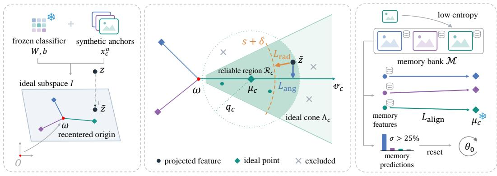
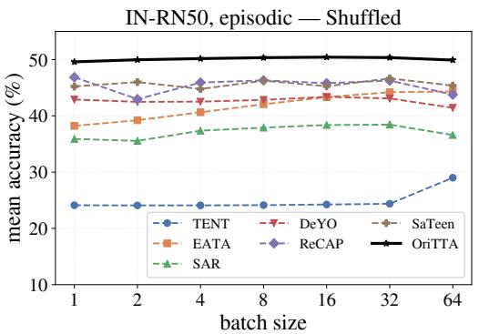
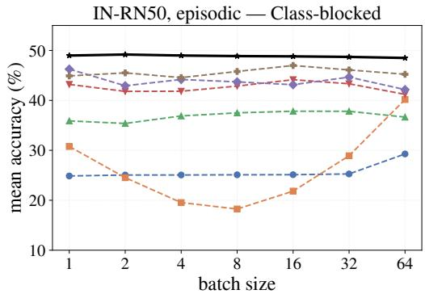

# THE BATCH SIZE CAN BE ONE: TEST-TIME ADAPTA-TION FROM CLASSIFIER GEOMETRY

Jaeho Hwang1 Yujin Oh2 Juhyeon Shin3

Juhye Lee2 Sungroh Yoon3,∗ Uiwon Hwang2,∗

1Human-Centered Artificial Intelligence Research Institute, Ewha Womans University

2Division of Artificial Intelligence & Software, Ewha Womans Univeristy

3Interdisciplinary Program in Artificial Intelligence, Seoul National University

## ABSTRACT

Test-time adaptation updates a deployed model on an unlabeled test stream. In practice this stream often arrives one sample at a time, with the classes in no particular order. A single sample then provides limited information for estimating distribution-level statistics, and selecting samples by confidence can admit predictions that are wrong yet confident. A corruption, however, shifts the features while leaving the decision regions of the frozen classifier unchanged. We therefore propose Origin-recentered Test-Time Adaptation (OriTTA), which constructs fixed geometric targets from the source model and adapts selected features toward them. Seen from the origin of the feature space, the classes lean toward a common direction. We choose a new origin to bring class scores closer together while keeping it near the mean feature of one synthetic prototype per class. From this origin, prototype directions spread more evenly, and each class obtains an axis and an ideal point before any test data arrives. During adaptation, OriTTA aligns selected features with their predicted class axis and penalizes excessive radius, keeps one input per predicted class in memory to limit feature changes for classes absent from the stream, and resets the model when re-classifying this memory reveals collapse. Without tuning for each setting, OriTTA achieves the highest mean accuracy at batch size 1 on CIFAR-10-C, CIFAR-100-C and ImageNet-C in all sixteen combinations of four backbones, two protocols and two stream orders. On ImageNet-C fog, recent methods collapse in up to two thirds of one hundred runs, while OriTTA never does.

## 1 INTRODUCTION

In real-world deployment, a model may encounter test data from distributions that differ from its training data. Test-time adaptation (TTA) addresses this by updating the model on the unlabeled test stream itself, most commonly by minimizing the entropy of the model’s own predictions with respect to its normalization parameters (Wang et al., 2021). Later methods refine which samples to learn from and how large a step to take (Niu et al., 2022; 2023; Lee et al., 2024; Hu et al., 2025).

Existing TTA methods face two difficulties in realistic test streams. First, many of them estimate normalization statistics from the current test batch, and these estimates become unreliable when samples arrive one at a time or in a non-shuffled class order (Niu et al., 2023). A single sample then provides limited information for estimating distribution-level statistics, and when a class arrives as one long run, even a large batch is dominated by that class, so its statistics capture the class rather than the distribution shift. Second, methods that update the model with its own predictions risk reinforcing their own mistakes. Confidence-based selection (Niu et al., 2022) filters out uncer tain samples but can still admit confidently incorrect predictions, which subsequent updates then reinforce. When adaptation continues across a sequence of shifts (Wang et al., 2022), these error compound over the stream until predictions collapse onto a few classes (Press et al., 2023).

Since the classifier is frozen during TTA, its decision regions stay unchanged and a corruption only displaces the features. The geometry of these fixed regions then indicates where the features of each class should lie, without depending on the test stream. Using this geometry directly is difficult, however, because of three properties of the classifier and its feature space. First, the classifier rows share a component that shifts every logit equally without changing predictions. Second, some feature directions affect neither predicted labels nor class probabilities. Third, class prototypes point toward a common direction when measured from the feature-space origin, making their angular arrangement sensitive to the choice of origin.

We therefore propose Origin-recentered Test-Time Adaptation (OriTTA), which places an ideal point for each class using the frozen classifier and synthetic class prototypes, and adapts selected features toward the ideal point of their predicted class. OriTTA centers the classifier rows and projects features onto their span and moves the origin to a point where class scores are close together while staying near the mean feature of one synthetic prototype per class. From this origin, prototype di rections spread more evenly, and each class obtains an axis, its ideal point on the axis and a cone around it, all fixed before adaptation begins. On CIFAR-100, the fraction of prototypes inside the cone of their own class rises from 47% to 99%.

During adaptation, OriTTA applies angular and radial losses to the current test feature only if it lies inside the cone of its predicted class and near its ideal point. These losses encourage classaxis alignment and penalize excessive radius. A memory initialized with synthetic prototypes holds one input per predicted class and is updated with low-entropy test inputs. OriTTA periodically pulls stored features toward their ideal points to limit changes while their classes are absent from the stream. Reclassifying this memory detects concentration of predictions on a few classes and triggers restoration of the source model. Without per-setting tuning, OriTTA achieves the highest mean accuracy at batch size 1 on CIFAR-10-C, CIFAR-100-C and ImageNet-C in all sixteen combinations of four backbones, episodic and continual adaptation, and shuffled and class-blocked streams.

Our contributions are the following:

• We propose OriTTA, which takes the target of adaptation from the frozen classifier, measured from a recentered origin computed before any test data arrives.

• We design per-sample losses requiring neither batch statistics nor classifier softmax probabilities, and a collapse detector that evaluates prediction concentration across class-indexed memory slots.

• We analyze classifier and prototype geometry across four source models and demonstrate accuracy gains from projection and recentering in the evaluated ablations.

• We show that OriTTA achieves the highest mean accuracy at batch size 1 in all sixteen settings and never collapses in 100 runs on ImageNet-C fog.

## 2 RELATED WORK

Single-sample and non-i.i.d. test-time adaptation. TENT (Wang et al., 2021) introduced entropy minimization over normalization affine parameters and EATA (Niu et al., 2022) added sample filtering and anti-forgetting. Single-sample adaptation was addressed by augmentation in MEMO (Zhang et al., 2022) and SITA (Khurana et al., 2021). SAR (Niu et al., 2023) formalized the wild setting, which combines batch size 1, online label shift and mixed shifts, and proposed reliable-sample selection with sharpness-aware updates, followed by DeYO (Lee et al., 2024), ReCAP (Hu et al., 2025) and SaTeen (Liu et al., 2026). Temporally correlated streams are handled by adjusting normalization statistics (NOTE (Gong et al., 2022), DELTA (Zhao et al., 2023), UnMIX-TNS (Tomar et al., 2024)), by class-balanced memories (NOTE, RoTTA (Yuan et al., 2023)) or by output correction (LAME (Boudiaf et al., 2022)). OriTTA selects and adapts test features by their position relative to a fixed ideal point for each class, without requiring batch statistics.

Continual adaptation and collapse. CoTTA (Wang et al., 2022), RMT (Dobler et al., 2023) and¨ PETAL (Brahma & Rai, 2023) counter drift with teacher-student schemes and weight restoration. RDumb (Press et al., 2023) uses fixed-interval source resets, while PeTTA (Hoang et al., 2024) detects collapse by measuring divergence from source statistics. OriTTA reclassifies a memory with one input per predicted class and restores the source weights when predictions concentrate on a few classes. This trigger does not directly use the class frequencies of the incoming stream.

  
(a) Construction  
(b) Adaptation  
(c) Stabilization  
Figure 1: Overview of OriTTA. (a) The frozen classifier and synthetic anchors define a fixed reference frame. (b) Reliable projected features undergo angular alignment and radial regularization. (c) Stored images are re-encoded for alignment to fixed ideal points, while concentrated current predic tions over the memory trigger resets. Snowflakes denote frozen quantities.

Feature geometry. Neural collapse (Papyan et al., 2020) has motivated geometric approaches to adaptation. TCA (Ni et al., 2025) promotes uniformity among pseudo-label centroids, while NEO (Murphy et al., 2026) recenters target embeddings without updating the model. Both estimate class structure from test batches, whereas OriTTA derives its origin and ideal points from the source model before any test data arrive. Further related work is discussed in Appendix B.

## 3 METHOD

## 3.1 NOTATION AND THE RECENTERED FRAME

Why recenter. Much of the recent geometric analysis of deep features measures distances and angles from the origin of the feature space: cosine similarity, feature-norm statistics, contrastive objectives on the unit sphere and the simplex-ETF picture of neural collapse all take the origin as the reference point. However, the origin is a property of the parameterization rather than of the data. After a ReLU the features occupy the non-negative orthant, so the origin sits at its corner. After a LayerNorm they are shifted by the affine parameters. In either case the center of the data has no reason to coincide with it. Angles measured from a point that is not the center are dominated by the offset, not by the arrangement of the classes. We therefore recover a center of the source feature distribution and define every quantity of our method in the frame recentered at that point.

The classifier. Let $f _ { \theta } : \mathcal { X }  \mathbb { R } ^ { D }$ be the backbone up to its penultimate layer, producing the feature $z = f _ { \boldsymbol { \theta } } ( x )$ of an input x, and let the classifier be linear: for class $c \in \{ 1 , \dot { \cdot } \cdot \cdot , \dot { K } \} , w _ { c } \in \mathbb { R } ^ { D }$ is the c-th row of $W , b _ { c }$ its bias, and $\ell _ { c } ( z ) = w _ { c } \cdot z + b _ { c }$ its logit, so that $\ell ( z ) = \dot { W } z + b$ and ${ \hat { y } } ( x ) = \arg \operatorname* { m a x } _ { c } \ell _ { c } ( f _ { \theta } ( x ) )$ . Write $\begin{array} { r } { \bar { w } = \frac { 1 } { K } \sum _ { c } w _ { c } } \end{array}$ for the mean row and

$$
v _ { c } = { \frac { w _ { c } - { \bar { w } } } { \left\| w _ { c } - { \bar { w } } \right\| } } , \qquad \beta _ { c } = { \frac { b _ { c } - { \bar { b } } } { \left\| w _ { c } - { \bar { w } } \right\| } } , \qquad c = 1 , \ldots , K ,\tag{1}
$$

collect the rows into $V \in \mathbb { R } ^ { K \times D }$ and $\boldsymbol { \beta } \in \mathbb { R } ^ { K }$ . Then the affine hyperplane

$$
H _ { c } = \{ z \in \mathbb { R } ^ { D } : v _ { c } \cdot z + \beta _ { c } = 0 \} = \{ z : \ell _ { c } ( z ) = \bar { \ell } ( z ) \} , \qquad \bar { \ell } = \frac { 1 } { K } \sum _ { c } \ell _ { c }\tag{2}
$$

is the locus on which class c scores exactly the average logit and $\vert v _ { c } \cdot z + \beta _ { c } \vert$ is the Euclidean distance of z from it, since $\ell _ { c } ( z ) - \bar { \ell } ( z ) = ( w _ { c } - \mathbf { \bar { \psi } } _ { \bar { w } } ) \cdot z + ( \mathbf { \bar { \psi } } _ { c } - \mathbf { \bar { \psi } } _ { \bar { b } } )$ . The unit normals $v _ { c }$ span the row space of the centered classifier, whose dimension we denote r = rank $V = \operatorname* { m i n } ( K - 1 , D )$

Recentered origin. We define the center of the feature space as the point that is simultaneously closest, in the least-squares sense, to all K hyperplanes $H _ { c } .$ . i.e. the point at which the classifier is maximally ambiguous:

$$
\mathcal { T } ( z ) = \sum _ { c = 1 } ^ { K } \mathrm { d i s t } ( z , H _ { c } ) ^ { 2 } = \| V z + \beta \| ^ { 2 } .\tag{3}
$$

$\mathcal { I }$ always admits a minimizer (not unique in general), but it constrains z only through its position relative to the hyperplanes and says nothing about where the features themselves lie.

A center must also be where the source features live, and in test-time adaptation that location has to be recovered without the source data. We obtain it from the classifier itself. For each class c we synthesize a single anchor image induced by the cross-entropy,

$$
\boldsymbol { x } _ { c } ^ { a } = \arg \operatorname* { m i n } _ { \boldsymbol { x } \in [ 0 , 1 ] ^ { C \times H \times W } } \mathrm { C E } \big ( \ell ( f _ { \theta _ { 0 } } ( \boldsymbol { x } ) ) , c \big ) ,\tag{4}
$$

obtained by gradient descent on the pixels from a random initialization. This is the same crossentropy the source model was trained with, minimized over the input rather than the weights, so $x _ { c } ^ { a }$ is the input the model is most confident belongs to class $c ,$ and it depends on the source model alone. Their feature centroid $\begin{array} { r } { \bar { z } ^ { a } = \frac { 1 } { K } \sum _ { c = 1 } ^ { K } f _ { \theta _ { 0 } } ( x _ { c } ^ { a } ) } \end{array}$ is a source-free estimate of where class-prototypical features gather. The recentered origin combines the two requirements,

$$
\omega = \arg \operatorname* { m i n } _ { z } \ \| V z + \beta \| ^ { 2 } + \lambda \| z - { \bar { z } } ^ { a } \| ^ { 2 } = ( V ^ { \top } V + \lambda I ) ^ { - 1 } \big ( \lambda { \bar { z } } ^ { a } - V ^ { \top } \beta \big ) , \qquad \lambda = \frac { K } { 1 0 0 } ,\tag{5}
$$

the point closest to the decision hyperplanes among those near the prototype centroid. The regularizer is weighted at one hundredth of a single hyperplane constraint, so the ridge acts as $K /$ 100 additional constraints pulling toward ${ \bar { z } } ^ { a }$ . Appendix D.5 discusses the choice.

Ideal subspace. Let $\mathcal { T } = \omega + \mathrm { s p a n } \{ v _ { 1 } , . . . , v _ { K } \}$ be an ideal subspace which is the r-dimensional affine subspace through the recentered origin spanned by the class normals, and let

$$
\tilde { z } : = \mathrm { p r o j } _ { \mathcal { T } } ( z ) = \omega + P ( z - \omega ) , \qquad P = V ^ { + } V ,\tag{6}
$$

be the orthogonal projection onto it, where V+ is the Moore-Penrose pseudoinverse of $V$ so that $P$ is the orthogonal projector onto span $\{ v _ { 1 } , \dotsc , v _ { K } \}$ Every logit difference is preserved by the projection, since $\ell _ { i } ( \bar { z } ) \bar { - } \ell _ { j } ( z ) = \ell _ { i } ( \bar { z } ) \bar { - } \ell _ { j } ( \tilde { z } )$ for all $i , j$ . Hence $\hat { y }$ and every softmax probability are unchanged, and the component of z orthogonal to I is invisible to the decision. Thus, we work with z˜ throughout and for a class c decompose $u = \tilde { z } - \omega$ into a radial and a perpendicular part,

$$
t _ { c } = u \cdot v _ { c } , \qquad d _ { \perp , c } = \sqrt { \| u \| ^ { 2 } - t _ { c } ^ { 2 } } ,\tag{7}
$$

so that $\| \tilde { z } - \mu _ { c } \| ^ { 2 } = ( t _ { c } - s ) ^ { 2 } + d _ { \perp , c } ^ { 2 }$ splits the distance to the ideal point into a radius error and an angular error. We note that if $K - 1 \geq D$ , then I is the whole feature space.

Ideal points. Displacing ω along the normal $v _ { c }$ increases $\ell _ { c } - \bar { \ell }$ faster than any other direction, so the axis $\{ \omega + t v _ { c } \colon t > \mathbf { \bar { 0 } } \}$ is the natural home of class c. We place the ideal point of class c at a common radius s along its axis,

$$
\mu _ { c } = \omega + s v _ { c } , \qquad s = \mathrm { m e d } _ { c \in \{ 1 , \cdots , K \} } \ \lVert \mathrm { p r o j } _ { \mathcal { Z } } ( z _ { c } ^ { a } ) - \omega \rVert ,\tag{8}
$$

where med denotes the median over classes and $z _ { c } ^ { a }$ is the feature vector of $x _ { c } ^ { a }$ . Hence, s is the distance at which the model’s own prototypical inputs typically land and it is clear that $\mu _ { c } \in \mathcal { T }$ Each anchor depends on its random initialization, but the frame does not. Regenerating the IN-RN50 anchors from ten other seeds moves ω by at most 0.03 s and changes s by at most 0.4% (see Appendix A.2 for more details).

Ideal cone. Within I we define the region in which the class-c distribution is expected to lie as a cone around the class axis,

$$
\Lambda _ { c } = \big \{ \tilde { z } \in \mathcal { Z } : ~ t _ { c } > t _ { \operatorname* { m i n } } , ~ d _ { \perp , c } < \kappa t _ { c } \big \} , \qquad \kappa = \kappa _ { 0 } \sqrt { r } , ~ \kappa _ { 0 } = 0 . 1 1 , ~ t _ { \operatorname* { m i n } } = 0 . 5 .\tag{9}
$$

The half-angle grows with $\sqrt { r }$ because the perpendicular offset of a class-c feature is spread over the $r - 1$ directions orthogonal to its axis and concentrates at a radius proportional to $\sqrt { r }$ . The ratio $\kappa _ { 0 }$ of that spread to the prototype radius is the same across backbones whose feature scales differ by an order of magnitude, so a single constant serves all of them. The lower bound $t _ { \mathrm { m i n } }$ excludes the immediate neighborhood of $\omega ,$ where the classifier is ambiguous by construction.

Reliable region. A test feature enters the per-sample losses only if it is reliable for its predicted class $c = { \hat { y } } ( x )$ : it must lie in the ideal cone $\Lambda _ { c }$ and, among the cone samples of class $c ,$ be among the closest to $\mu _ { c }$

$$
\mathcal { R } _ { c } = \Big \{ \tilde { z } \in \Lambda _ { c } : \ \| \tilde { z } - \mu _ { c } \| \leq q _ { c } \Big \} ,\tag{10}
$$

where $q _ { c }$ is a running estimate of the 0.2-quantile of $\| \tilde { z } - \mu _ { c } \|$ over the samples that have entered $\Lambda _ { c }$ as class c so far. A fixed radius would not serve, since the distances depend on the corruption.

## 3.2 LOSSES ON THE RELIABLE REGION

Two losses act on the current feature, and only when it is reliable, $\tilde { z } \in \mathcal { R } _ { \hat { y } }$ . Since they update normalization parameters shared by every input, moving the reliable features toward their ideal geometry also moves the features of the remaining inputs, on which no loss is computed.

Angular loss. With $c = { \hat { y } } ( x )$ , we treat the negative perpendicular distances to the $K$ class axes as logits and apply a cross-entropy toward the predicted class,

$$
L _ { \mathrm { a n g } } ( \widetilde z ) = - \log \frac { \exp ( - d _ { \perp , c } / \tau ) } { \sum _ { j = 1 } ^ { K } \exp ( - d _ { \perp , j } / \tau ) } , \qquad \tau = \sqrt { s } .\tag{11}
$$

This is a cross-entropy toward the predicted class, with the logits replaced by negative distances to the class axes. The temperature scales with s because $d _ { \perp }$ does.

Radial loss. A reliable feature that lies far from the recentered origin is pulled inward with a one-sided hinge,

$$
L _ { \mathrm { r a d } } ( \tilde { z } ) = \frac { 1 } { r } \operatorname* { m a x } \left( 0 , \ \lVert u \rVert - ( s + \delta ) \right) ^ { 2 } , \ \delta = \frac { 1 } { 3 } d _ { \mathrm { n n } } , \ d _ { \mathrm { n n } } = \mathrm { m e d } _ { i \in \{ 1 , \cdots , K \} } \ \operatorname* { m i n } _ { j \neq i } \lVert \mu _ { i } - \mu _ { j } \rVert .\tag{12}
$$

It acts only on the radius and leaves the angle to $L _ { \mathrm { a n g } }$ (see Appendix D.2 for the ablation study).

## 3.3 MEMORY BANK AND ALIGNMENT LOSS

The two losses above act on whichever class the current input belongs to. On a class-blocked stream, many classes go unseen for thousands of steps, and nothing prevents the model from drifting away from them. We keep the most recent real input of every class in a memory bank and periodically pull each one back to its ideal point, so that no class is forgotten.

Memory bank. The memory bank $\mathcal { M } = \{ m _ { 1 } , . . . , m _ { K } \}$ holds one input per class, the most recently admitted one. It is initialized with the anchor images, $m _ { c } \gets x _ { c } ^ { a }$ , and an anchor is replaced by the first real input admitted for its class. The current input replaces $m _ { \hat { y } }$ if its predictive entropy is below 0.4 ln $K$

Alignment loss. Every $\lceil 3 0 / B \rceil$ steps, we take min $\{ 2 0 , K \}$ classes $S _ { t }$ in round-robin order, pass their bank inputs through the current backbone, and pull each projected feature to its ideal point:

$$
L _ { \mathrm { a l i g n } } = \frac { 1 } { | \mathcal { S } _ { t } | } \sum _ { c \in \mathcal { S } _ { t } } \frac { 1 } { r } \left\| \operatorname { p r o j } _ { \mathcal { T } } \big ( f _ { \theta } ( m _ { c } ) \big ) - \mu _ { c } \right\| ^ { 2 } .\tag{13}
$$

where $B$ is the batch size. The bank sample is used rather than the anchor because the anchors drift off $\mu _ { c }$ under adaptation as well, and constraining a mixture of anchor and real features would push the real ones to the far side of $\mu _ { c }$ . The target is the seed label rather than a fresh prediction, since re-predicting it would let a drifting model relabel its own bank (Appendix D.3 for the discussion).

## 3.4 COLLAPSE DETECTION AND RESET

Online adaptation can still collapse onto a few classes. We detect this by periodically re-classifying the bank with the current model and measuring the bank share

$$
\sigma = \frac { 1 } { K } \operatorname* { m a x } _ { j } \ \big | \{ c : \ \hat { y } ( m _ { c } ) = j \} \big | ,\tag{14}
$$

Table 1: IN-RN50 under the four protocols. Per-corruption standard deviations are in Appendix E. The best result in each column is shown in bold and the second best is underlined.
<table><tr><td></td><td>episodic</td><td>gaus</td><td>shot</td><td>impu</td><td>defo</td><td>glas</td><td>moti</td><td>zoom</td><td>snow</td><td>fros</td><td>fog</td><td>brit</td><td>cont</td><td>elas</td><td>pixe</td><td>jpeg</td><td>Average</td></tr><tr><td rowspan="5">shffed</td><td>TENT</td><td>12.35 29.49</td><td>20.22 31.55</td><td>13.91 30.23</td><td>13.16</td><td>6.46 19.32</td><td>18.07</td><td>18.23</td><td>16.00</td><td>20.65</td><td>1.48</td><td>69.80</td><td>42.04</td><td>6.22</td><td>49.38</td><td>53.75</td><td>24.11±0.40</td></tr><tr><td>EATA</td><td></td><td></td><td></td><td>17.93</td><td></td><td>30.45</td><td>32.62</td><td>42.73</td><td>41.21</td><td>45.55</td><td>69.40</td><td>43.66</td><td>32.98</td><td>52.13</td><td>54.02</td><td>38.22±0.21</td></tr><tr><td>SAR</td><td>28.63</td><td>31.01</td><td>29.40</td><td>18.46</td><td>15.23</td><td>28.82</td><td>30.43</td><td>44.75</td><td>44.39</td><td>33.60</td><td>71.95</td><td>44.61</td><td>13.03</td><td>47.83</td><td>56.24</td><td>35.89±0.11</td></tr><tr><td>DeYO</td><td>40.87</td><td>43.33</td><td>42.08</td><td>22.07</td><td>23.69</td><td>38.63</td><td>28.12</td><td>52.26</td><td>50.21</td><td>18.88</td><td>73.19</td><td>51.27</td><td>42.97</td><td>57.31</td><td>58.54</td><td>42.89±1.95</td></tr><tr><td>ReCAP SaTeen</td><td>42.07 43.20</td><td>44.35 45.44</td><td>43.17</td><td>24.69</td><td>25.05</td><td>41.73</td><td>39.64</td><td>54.67</td><td>52.16</td><td>46.54</td><td>73.33</td><td>53.52</td><td>41.54</td><td>60.27</td><td>60.20</td><td>46.86±1.52</td></tr><tr><td rowspan="7">ca-ked</td><td>OriTTA</td><td>41.11</td><td>43.15</td><td>44.25 42.22</td><td>25.80 33.53</td><td>26.25 31.93</td><td>42.44 42.38</td><td>26.68 46.33</td><td>55.29 54.32</td><td>52.69 53.27</td><td>19.30 59.04</td><td>73.34 72.80</td><td>54.00 53.79</td><td>48.71 49.64</td><td>60.77 59.77</td><td>60.13 60.62</td><td>45.22±2.20 49.59±0.05</td></tr><tr><td>TENT EATA</td><td>15.59</td><td>22.05</td><td>17.00</td><td>13.21</td><td>7.87</td><td>18.40</td><td>18.53</td><td>17.01</td><td>20.43</td><td>1.50</td><td>69.84</td><td>42.12</td><td>6.22</td><td>49.45</td><td>53.80</td><td>24.87±0.80</td></tr><tr><td></td><td>25.27</td><td>25.71</td><td>25.28</td><td>15.68</td><td>14.93</td><td>21.35</td><td>22.70</td><td>33.11</td><td>32.90</td><td>37.47</td><td>65.32</td><td>34.82</td><td>18.24</td><td>38.49</td><td>50.43</td><td></td></tr><tr><td>SAR</td><td>28.53</td><td>31.11</td><td>29.44</td><td>18.56</td><td>15.14</td><td>28.83</td><td>30.53</td><td>44.16</td><td>44.36</td><td>33.30</td><td>71.93</td><td></td><td></td><td></td><td></td><td>30.78±0.19</td></tr><tr><td>DeYO</td><td>40.89</td><td>43.18</td><td>42.19</td><td>21.84</td><td>23.44</td><td>38.64</td><td>33.34</td><td>52.08</td><td>50.35</td><td>18.67</td><td>73.19</td><td>44.67</td><td>13.87</td><td>47.73</td><td>56.22</td><td>35.89±0.15</td></tr><tr><td>ReCAP</td><td>42.13</td><td>44.41</td><td>43.39</td><td>24.72</td><td>24.72</td><td>41.78</td><td>39.92</td><td>54.62</td><td>52.25</td><td>35.69</td><td>73.44</td><td>51.26 53.63</td><td>42.93 42.67</td><td>57.44 60.32</td><td>58.51 60.22</td><td>43.20±1.74</td></tr><tr><td>SaTeen OriTTA</td><td>43.13</td><td>45.48</td><td>44.31</td><td>25.58</td><td>25.96</td><td>42.34</td><td>27.82</td><td>55.28</td><td>52.74</td><td>13.48</td><td>73.41</td><td>54.00</td><td>48.85</td><td>61.00</td><td>60.14</td><td>46.26±2.10 44.90±1.84</td></tr><tr><td colspan="2">continual</td><td>40.79 gaus</td><td>42.55 shot</td><td>41.81 impu</td><td>33.32 defo</td><td>31.09 glas</td><td>41.83 moti</td><td>45.80 zoom</td><td>53.69 snow</td><td>52.67 fros</td><td>57.92 fog</td><td>72.50 brit</td><td>53.12 cont</td><td>48.79 elas</td><td>58.73 pixe</td><td>60.05 jpeg</td><td></td><td>48.98±0.10 Average</td></tr><tr><td colspan="2">TENT EATA</td><td>12.35 29.49</td><td colspan="2">0.74 29.30 25.44</td><td>0.22 2.16 12.94</td><td>0.26 14.77</td><td>0.22 18.41</td><td></td><td>0.31</td><td>0.57</td><td>0.18 27.85</td><td>0.20</td><td>1.48</td><td>0.31</td><td>0.10</td><td>→ 0.16 32.12</td><td>0.79</td><td>1.34±0.28 27.28±1.91</td></tr><tr><td rowspan="7">sffed</td><td>SAR DeYO</td><td>28.63</td><td>41.23</td><td>44.45</td><td>15.66</td><td>19.02</td><td>9.66</td><td>23.08 10.66</td><td>26.36 5.55</td><td>3.04</td><td>31.02 1.21</td><td>54.08 6.33</td><td>24.44 1.39</td><td>21.43 0.48</td><td>0.98</td><td>38.49 1.94</td><td>12.68±0.59</td></tr><tr><td>ReCAP</td><td>40.87 42.03</td><td>48.80</td><td>47.90</td><td>10.76</td><td>13.74</td><td>13.96</td><td>6.48</td><td>1.53</td><td>0.73</td><td>0.44</td><td>1.76</td><td>0.26</td><td>0.20</td><td>0.19</td><td>0.23</td><td>12.52±0.55</td></tr><tr><td>SaTeen</td><td>43.20</td><td>49.33</td><td>48.41</td><td>24.02</td><td>3.50</td><td>3.91</td><td>2.70</td><td>3.55</td><td>3.85</td><td>5.13</td><td>6.98</td><td>4.96</td><td>1.72</td><td>4.31</td><td>4.65</td><td>13.94±8.28</td></tr><tr><td>OriTTA</td><td></td><td>48.90</td><td>47.61</td><td>19.60</td><td>1.17</td><td>0.19</td><td>0.19</td><td>0.16</td><td>0.12</td><td>0.11</td><td>0.12</td><td>0.11</td><td>0.11</td><td>0.11</td><td>0.11</td><td>10.79±0.67</td></tr><tr><td></td><td>41.09</td><td>43.78</td><td>38.40</td><td>22.63</td><td>21.81</td><td>36.39</td><td>35.26</td><td>50.72</td><td>48.64</td><td>42.97</td><td>63.05</td><td>39.22</td><td>40.62</td><td>33.09</td><td>54.44</td><td>40.81±1.02</td></tr><tr><td>TENT</td><td>15.59</td><td>1.08</td><td>0.27</td><td>2.73</td><td>0.36</td><td>0.27</td><td>0.38</td><td>0.63</td><td>0.19</td><td>0.22</td><td>1.97</td><td>0.41</td><td>0.10</td><td>0.17</td><td>0.97</td><td>1.69±0.39</td></tr><tr><td>EATA SAR</td><td>25.27</td><td>11.04</td><td>7.49</td><td>6.19</td><td>5.24</td><td>5.26</td><td>6.21</td><td>4.71</td><td>5.98</td><td>5.36</td><td>12.14</td><td>2.29</td><td>4.36</td><td>5.29</td><td>6.47</td><td>7.55±1.19</td></tr><tr><td rowspan="7">cla-cked ReCAP SaTeen OriTTA</td><td>DeYO</td><td></td><td>41.14</td><td>44.47</td><td>15.76</td><td>19.17</td><td>11.52</td><td>11.18</td><td>15.79</td><td>18.37</td><td>18.04</td><td>34.59</td><td>20.35</td><td></td><td>18.72</td><td>20.27</td><td>21.57±10.86</td></tr><tr><td></td><td>28.53 40.89</td><td>48.73</td><td>47.86</td><td>11.55</td><td>11.50</td><td>11.82</td><td>6.89</td><td>1.88</td><td>0.77</td><td>0.47</td><td>2.02</td><td>0.27</td><td>5.68 0.20</td><td>0.20</td><td>0.24</td><td>12.35±0.84</td></tr><tr><td></td><td>42.15</td><td>49.28</td><td>48.43</td><td>18.17</td><td>3.23</td><td>0.81</td><td>0.31</td><td>0.26</td><td>0.17</td><td>0.15</td><td>0.24</td><td>0.14</td><td>0.13</td><td>0.15</td><td>0.17</td></table>

the fraction of the bank sent to a single class. Since the bank holds one representative of every class, $\sigma = 1 / K$ for a healthy model and rises only under collapse, independently of the label order of the stream. When $\sigma > 0 . 2 5$ , the model is restored to its source weights and the bank to its anchors (details in Appendix A.6).

The complete objective is

$$
L _ { \mathrm { t o t a l } } = L _ { \mathrm { a n g } } + L _ { \mathrm { a l i g n } } + 2 L _ { \mathrm { r a d } } .\tag{15}
$$

Nothing above is estimated from source data, and nothing is tuned per setting: every quantity is either derived from the source weights, through the classifier and its anchors, or a single constant shared across all datasets, backbones and stream orders.

## 4 EXPERIMENTS

## 4.1 EXPERIMENTAL SETTINGS

Datasets and backbones. We evaluate on CIFAR-10-C, CIFAR-100-C and ImageNet-C, on all 15 corruptions at severity 5 (10,000 images per corruption on CIFAR, 50,000 on ImageNet), with WideResNet-28-10 on CIFAR-10, WideResNet-40-2 trained with AugMix on CIFAR-100, and ResNet-50 with GroupNorm and ViT-B/16 on ImageNet, following SAR (Niu et al., 2023). We refer to the four settings as C10, C100, IN-RN50 and IN-ViT.

Protocols. All methods adapt online at batch size 1 with one update per image. In the episodic protocol the model is restored to its source weights at each corruption and in the continual protocol it adapts through the fifteen corruptions in sequence without any reset. Each protocol is run on a shuffled stream and a class-blocked one, in which each class arrives as a contiguous block. The stream is redrawn for every seed and shared across methods, and we report accuracy (%) averaged over ten seeds (2021–2030), with the standard deviation as a subscript.

Baselines. We compare against TENT (Wang et al., 2021), EATA (Niu et al., 2022), SAR (Niu et al., 2023), DeYO (Lee et al., 2024), ReCAP (Hu et al., 2025) and SaTeen (Liu et al., 2026), using their official code and published batch-size-1 settings (see Appendix A.10 for more details).

Implementation. OriTTA updates only the normalization affine parameters with Adam, at a learning rate of $2 . 5 \times 1 0 ^ { - 4 }$ for LayerNorm and $2 . 5 \times 1 0 ^ { - 4 } / 8$ for BatchNorm and GroupNorm (see Appendix D.1 for the discussion of Adam and SGD). The anchors and the frame are computed once per backbone, before the stream starts, and are never updated. All constants are listed in Appendix A.

## 4.2 MAIN RESULTS

IN-RN50 results. Table 1 reports the representative setting under all four protocols. In the episodic protocol, OriTTA leads the strongest baseline by about 2.7 on either stream order, and the one-standard-deviation intervals of the two methods do not overlap. On the three noise corruptions, which come first in the sequence and which every method handles from the source weights, OriTTA trails the best baseline by two to three points. On defocus and glass blur, on zoom blur and on fog, it leads by five to twelve points, and by twenty on fog under the class-blocked stream. The standard deviation of OriTTA is the smallest, at 0.05 and 0.1, which indicates high stability of OriTTA. In the continual protocol the picture changes in kind rather than in degree. Every baseline collapses somewhere in the sequence: TENT within the first two corruptions, DeYO, ReCAP and SaTeen by the fourth or fifth, and the most resilient baseline, EATA on the shuffled stream and SAR on the class-blocked one, retains three quarters and three fifths of its episodic accuracy respectively. OriTTA gives up about nine points relative to its own episodic accuracy on the shuffled stream and seven on the class-blocked one, and ends at 1.5 and 1.9 times the accuracy of the best baseline.

Stability over one hundred seeds. In fact, the large seed-to-seed deviations of DeYO, ReCAP and SaTeen in Table 1 come almost from three corruptions, fog, zoom, and elastic corruption (Table 20). On the other twelve their deviations stay under a point. On these three corruptions the methods behave differently from run to run, and on fog some runs fail outright, with accuracy falling close to zero within the corruption. All three methods minimize prediction entropy, which reinforces the model’s own errors once it becomes confidently wrong. 10 seeds are too few to characterize failures of this kind, so we repeat the three corruptions over 100 seeds each (Table 2). The deviations of DeYO, ReCAP and SaTeen remain large on all three. Crucially, on fog they collapse to below 5% accuracy in 66%, 33% and 62% of the seeds respectively. Across the

Table 2: One hundred seeds (2001– 2100) on the three corruptions with the least stable baselines for IN-RN50, episodic, shuffled. Collapse is the fraction of seeds in which accuracy of fog corruption falls below 5%.

<table><tr><td></td><td>zoom</td><td>elastic</td><td>fog</td><td>collapse</td></tr><tr><td>TENT</td><td>18.2±0.6</td><td>6.1±0.5</td><td>1.5±0.1</td><td>100%</td></tr><tr><td>EATA</td><td>32.9±1.6</td><td>33.5±1.9</td><td>46.2±2.1</td><td>0%</td></tr><tr><td>SAR</td><td>30.4±0.3</td><td>14.1±1.4</td><td>33.2±2.2</td><td>0%</td></tr><tr><td>DeYO</td><td>33.1±6.8</td><td>43.0±0.5</td><td>21.0±25.2</td><td>66%</td></tr><tr><td>ReCAP</td><td>40.4±3.6</td><td>45.1±8.2</td><td>39.2±25.4</td><td>33%</td></tr><tr><td>SaTeen</td><td>27.2±9.1</td><td>48.8±0.4</td><td>23.6±27.7</td><td>62%</td></tr><tr><td>OriTTA</td><td>46.5±0.2</td><td>49.7±0.3</td><td>59.0±0.2</td><td>0%</td></tr></table>

same three hundred runs OriTTA never collapses, its deviation stays at 0.2–0.3.

Table 3: Mean accuracy over the 15 corruptions on C10, C100, and IN-ViT. Full results are in Appendix E.
<table><tr><td rowspan=1 colspan=13>C10                              C100                             IN-ViTepisodic         continual           episodic         continual           episodic         continualshuffledclass-blk | shuffled|class-blk   shuffledclass-blkshuffled | class-blk  shuffled | class-blkshuffledclass-blk</td></tr><tr><td rowspan=3 colspan=1>TENTEATASAR</td><td rowspan=2 colspan=1>|46.70±2.77|56.66±0.08</td><td rowspan=2 colspan=1>|43.52±6.84|56.63±0.05</td><td rowspan=2 colspan=1>15.66±0.77|56.96±0.23</td><td rowspan=2 colspan=1>|11.04±0.78 |56.94±0.17</td><td rowspan=2 colspan=1>25.83±1.7354.49±0.27</td><td rowspan=1 colspan=1>|18.18±1.18</td><td rowspan=1 colspan=1>1.24±0.11</td><td rowspan=2 colspan=1>1.17±0.1218.05±0.68</td><td rowspan=2 colspan=1>|50.95±0.1362.18±0.07</td><td rowspan=2 colspan=1>|51.14±0.23 ||45.63±0.10</td><td rowspan=3 colspan=1>47.85±2.96|59.90±0.1359.20±0.10</td><td rowspan=3 colspan=1>48.85±4.099.06±0.3150.41±0.92</td></tr><tr><td rowspan=1 colspan=1>48.98±0.44</td><td rowspan=1 colspan=1>29.22±1.37</td></tr><tr><td rowspan=1 colspan=1>56.33±0.03</td><td rowspan=1 colspan=1>56.96±0.10</td><td rowspan=1 colspan=1>55.99±0.87</td><td rowspan=1 colspan=1>55.49±2.39</td><td rowspan=1 colspan=1>44.58±0.24</td><td rowspan=1 colspan=1>47.10±0.56</td><td rowspan=1 colspan=1>20.36±7.07</td><td rowspan=1 colspan=1>31.24±6.53</td><td rowspan=1 colspan=1>57.79±0.32</td><td rowspan=1 colspan=1>44.58±0.42</td></tr><tr><td rowspan=2 colspan=1>DeYOReCAP</td><td rowspan=1 colspan=1>51.92±2.94</td><td rowspan=1 colspan=1>57.34±6.14</td><td rowspan=1 colspan=1>44.42±3.45</td><td rowspan=1 colspan=1>37.86±6.62</td><td rowspan=1 colspan=1>10.49±1.02</td><td rowspan=1 colspan=1>12.48±1.56</td><td rowspan=1 colspan=1>1.89±0.55</td><td rowspan=1 colspan=1>1.91±0.26</td><td rowspan=1 colspan=1>62.91±0.62</td><td rowspan=1 colspan=1>62.93±1.09</td><td rowspan=1 colspan=1>60.70±0.54</td><td rowspan=1 colspan=1>60.60±0.34</td></tr><tr><td rowspan=1 colspan=1>48.70±0.98</td><td rowspan=1 colspan=1>58.80±0.69</td><td rowspan=1 colspan=1>36.58±6.71</td><td rowspan=1 colspan=1>43.13±9.33</td><td rowspan=1 colspan=1>2.09±0.15</td><td rowspan=1 colspan=1>7.48±1.58</td><td rowspan=1 colspan=1>1.06±0.03</td><td rowspan=1 colspan=1>1.28±0.13</td><td rowspan=1 colspan=1>65.00±0.66</td><td rowspan=1 colspan=1>64.02±1.56</td><td rowspan=1 colspan=1>61.37±0.82</td><td rowspan=1 colspan=1>61.13±0.75</td></tr><tr><td rowspan=1 colspan=1>SaTeen</td><td rowspan=1 colspan=1>37.35±2.55</td><td rowspan=1 colspan=1>52.90±8.45</td><td rowspan=1 colspan=1>14.27±1.78</td><td rowspan=1 colspan=1>27.62±7.73</td><td rowspan=1 colspan=1>1.92±0.10</td><td rowspan=1 colspan=1>4.94±0.81</td><td rowspan=1 colspan=1>1.04±0.01</td><td rowspan=1 colspan=1>1.33±0.23</td><td rowspan=1 colspan=1>64.68±0.81</td><td rowspan=1 colspan=1>64.97±1.20</td><td rowspan=1 colspan=1>61.62±0.32</td><td rowspan=1 colspan=1>61.64±0.56</td></tr><tr><td rowspan=1 colspan=1>OriTTA</td><td rowspan=1 colspan=1>73.38±0.08</td><td rowspan=1 colspan=1>68.96±1.51</td><td rowspan=1 colspan=1>73.74±0.17</td><td rowspan=1 colspan=1>66.04±1.43</td><td rowspan=1 colspan=1>62.16±0.09</td><td rowspan=1 colspan=1>61.69±0.33</td><td rowspan=1 colspan=1>58.77±0.28</td><td rowspan=1 colspan=1>57.03±0.29</td><td rowspan=1 colspan=1>65.58±0.05</td><td rowspan=1 colspan=1>66.23±0.10</td><td rowspan=1 colspan=1>62.91±0.96</td><td rowspan=1 colspan=1>62.00±0.30</td></tr></table>

Other datasets and backbones. Table 3 summarizes C10, C100 and IN-ViT by their mean accuracy. OriTTA is the most accurate method in each of the twelve columns, though the margin depends on how the baselines fare. On the two CIFAR benchmarks, whose WideResNet normalizes with BatchNorm, several baselines break down even in the episodic protocol, and in the continual one the strongest of them reaches only about half of OriTTA’s accuracy on C100. The lead ranges

Table 5: Geometry of the source model under the three operations. Rows dev. is the deviation of the classifier rows’ mutual cosines from an equiangular arrangement, $- 1 / ( K - 1 )$ , before and after centering. pairwise deviation is the same quantity for the prototypes $z _ { c } ^ { a }$ , measured from the origin, after projection, and from ω. Axis is the median cosine between prototype c and its own class axis $v _ { c } ,$ and in cone the fraction of prototypes the ideal cone admits.
<table><tr><td rowspan="2"></td><td colspan="3">shift</td><td colspan="2">rows dev. ↓</td><td colspan="3">pairwise deviation ↓</td><td colspan="2">axis ↑</td><td colspan="2">in cone ↑</td></tr><tr><td>||ω||</td><td> $\| \omega \| / s$ </td><td> $\| P \omega \| / s$ </td><td> $w _ { c }$ </td><td> $v _ { c }$ </td><td>at 0</td><td>proj.</td><td>at ω</td><td>at 0</td><td>at ω</td><td>at 0</td><td>at ω</td></tr><tr><td>CIFAR-10-C</td><td>4.77</td><td>0.96</td><td>0.05</td><td>0.07</td><td>0.07</td><td>0.58</td><td>0.38</td><td>0.36</td><td>0.79</td><td>0.82</td><td>0.00</td><td>0.00</td></tr><tr><td>CIFAR-100-C</td><td>12.11</td><td>0.92</td><td>0.57</td><td>0.10</td><td>0.10</td><td>0.52</td><td>0.36</td><td>0.16</td><td>0.67</td><td>0.81</td><td>0.47</td><td>0.99</td></tr><tr><td>ImageNet-C, RN50</td><td>6.92</td><td>0.80</td><td>0.35</td><td>0.65</td><td>0.03</td><td>0.31</td><td>0.15</td><td>0.07</td><td>0.54</td><td>0.58</td><td>1.00</td><td>1.00</td></tr><tr><td>ImageNet-C, ViT</td><td>33.62</td><td>0.42</td><td>0.42</td><td>0.06</td><td>0.06</td><td>0.21</td><td>0.21</td><td>0.09</td><td>0.69</td><td>0.77</td><td>1.00</td><td>1.00</td></tr></table>

Table 6: Removing one operation of the frame, episodic. Top: losses computed in the full feature space, IN-RN50 (episodic, shuffled). Bottom: origin moved from ω to 0 and projection to I, with s, $\mu _ { c } ,$ and δ recomputed, C100 (episodic, class-blocked).
<table><tr><td></td><td></td><td>gaus</td><td>shot</td><td>impu</td><td>defo</td><td>glas</td><td>moti</td><td>zoom</td><td>snow</td><td>fros</td><td>fog</td><td>brit</td><td>cont</td><td>elas</td><td>pixe</td><td>jpeg</td><td>Average</td></tr><tr><td>IN-RN50 OriTTA</td><td></td><td>41.11</td><td>43.15</td><td>42.22</td><td>33.53</td><td>31.93</td><td>42.38</td><td>46.33</td><td>54.32</td><td>53.27</td><td>59.04</td><td>72.80</td><td>53.79</td><td>49.64</td><td>59.77</td><td>60.62</td><td>49.59</td></tr><tr><td>no projection</td><td></td><td>38.93</td><td>40.83</td><td>39.50</td><td>31.02</td><td>27.94</td><td>39.57</td><td>43.71</td><td>53.65</td><td>52.58</td><td>48.34</td><td>72.72</td><td>52.62</td><td>45.98</td><td>57.63</td><td>60.35</td><td>47.02</td></tr><tr><td>∆</td><td></td><td>-2.18</td><td>-2.32</td><td>-2.72</td><td>-2.51</td><td>-3.99</td><td>-2.81</td><td>-2.62</td><td>-0.67</td><td>-0.69</td><td>-10.70</td><td>-0.08</td><td>-1.17</td><td>-3.66</td><td>-2.14</td><td>-0.27</td><td>-2.57</td></tr><tr><td></td><td>OriTTA</td><td>48.07</td><td>52.29</td><td>51.20</td><td>70.98</td><td>54.74</td><td>69.73</td><td>70.81</td><td>63.13</td><td>63.30</td><td>58.71</td><td>71.93</td><td>63.51</td><td>62.84</td><td>64.83</td><td>59.24</td><td>61.69</td></tr><tr><td>C10</td><td>origin at 0</td><td>44.78</td><td>49.69</td><td>48.92</td><td>69.94</td><td>53.38</td><td>68.74</td><td>69.25</td><td>61.74</td><td>61.54</td><td>56.09</td><td>71.23</td><td>60.11</td><td>61.74</td><td>60.29</td><td>58.45</td><td>59.73</td></tr><tr><td>∆</td><td></td><td>-3.29</td><td>-2.60</td><td>-2.28</td><td>-1.04</td><td>-1.36</td><td>-0.99</td><td>-1.56</td><td>-1.39</td><td>-1.76</td><td>-2.62</td><td>-0.70</td><td>-3.40</td><td>-1.10</td><td>-4.54</td><td>-0.79</td><td>-1.96</td></tr></table>

from 8 to 30 points. On IN-ViT the picture is different. LayerNorm makes a transformer considerably more robust to single-sample adaptation, most baselines stay close to their episodic accuracy even in the continual protocol, and OriTTA’s lead narrows to 0.4 to 1.3 points.

Continual TTA methods at batch size 1. The failure at batch size 1 extends to methods designed for continual adaptation. CoTTA (Wang et al., 2022), a representative continual method, falls to chance level on every setting when run at batch size 1 (Table 4), and the more recent TCA (Ni et al., 2025) likewise reports low accuracy for continual methods, including its own, at batch size 1.

Table 4: CoTTA at batch size 1 under our protocol, shuffled stream.
<table><tr><td></td><td>C10</td><td>C100</td><td>IN-RN50</td><td>IN-ViT</td></tr><tr><td>episodic</td><td>10.31</td><td>1.14</td><td>0.12</td><td>0.12</td></tr><tr><td>continual</td><td>10.30</td><td>0.80</td><td>0.35</td><td>0.19</td></tr></table>

## 4.3 WHAT EACH OPERATION OF THE FRAME CONTRIBUTES

The frame of Section 3.1 is built from three operations on the source model: centering the classifier rows, projecting onto the ideal subspace I, and measuring from the recentered origin ω. Each removes one kind of structure that the classifier does not read, and how much of that structure a backbone carries can be measured before any test data arrives (Table 5). This gives a prediction for each operation: it should matter where the structure it removes is large, and not elsewhere. Table 6 checks the prediction by removing one operation at a time.

Centering. The classifier rows share a component w¯ that adds the same amount to every logit and plays no part in any decision. On IN-RN50 it carries 81% of a row’s norm, and the raw rows are far from equiangular (deviation 0.65). Once it is removed the axes $v _ { c }$ form the tightest equiangular set of the four settings (0.03). On the other three backbones w¯ is negligible and centering changes nothing.

Projection. Logit differences depend on a feature only through its component in $\mathcal { T } ,$ so the remaining D − r directions carry nothing the classifier reads, while a corruption can still displace a feature far along them. This is large on IN-RN50, where 1,049 of 2,048 dimensions are invisible, and absent on IN-ViT, where P = I. Removing the projection on IN-RN50 costs 2.6 points, and the loss falls where the argument places it. Without the projection the cone admits samples on the strength of variation the classifier does not use, and the radial term measures a radius it cannot read.

Table 7: SAR with its own recovery, SAR with OriTTA’s detector and reset in its place (SAR+RT), and OriTTA, on IN-RN50, class-blocked. RDumb (Press et al., 2023) restores EATA to its source weights every 64,000 images. The subscript is the mean number of resets per run, shown only where nonzero. The total is given with the average.
<table><tr><td>episodic</td><td>gaus</td><td>shot</td><td>impu</td><td>defo</td><td>glas</td><td>moti</td><td>zoom</td><td>snow</td><td>fros</td><td>fog</td><td>brit</td><td>cont</td><td>elas</td><td>pixe</td><td>jpeg</td><td>Average</td></tr><tr><td>SAR</td><td>28.53</td><td>31.11</td><td>29.44</td><td>18.56</td><td>15.14</td><td>28.83</td><td>30.53</td><td>44.16</td><td>44.36</td><td>33.30</td><td>71.93</td><td>44.67</td><td>13.87</td><td>47.73</td><td>56.22</td><td>35.89(0)</td></tr><tr><td>SAR+RT</td><td>28.54</td><td>31.15</td><td>29.42</td><td>18.56</td><td>15.13</td><td>28.83</td><td>30.54</td><td>44.15</td><td>44.32</td><td>33.31</td><td>71.93</td><td>44.67</td><td>20.47(1)</td><td>47.71</td><td>56.17</td><td>36.33(1)</td></tr><tr><td>OriTTA</td><td>40.79</td><td>42.55</td><td>41.81</td><td>33.32</td><td>31.09</td><td>41.83</td><td>45.80</td><td>53.69</td><td>52.67</td><td>57.92</td><td>72.50</td><td>53.12</td><td>48.79</td><td>58.73</td><td>60.05</td><td>48.98(0)</td></tr><tr><td>continual</td><td>gaus</td><td>shot</td><td>impu</td><td>defo</td><td>glas</td><td>moti</td><td>zoom</td><td>snow</td><td>fros</td><td>fog</td><td>brit</td><td>cont</td><td>elas</td><td>pixe</td><td>jpeg</td><td>Average</td></tr><tr><td>RDumb</td><td>25.44</td><td>22.09(1)</td><td>22.14(1)</td><td>15.51(1)</td><td>14.97</td><td>20.73(1)</td><td>21.44(1)</td><td>28.41(1)</td><td>22.80(1)</td><td>37.82</td><td>66.62(1)</td><td>32.52(1)</td><td>15.86(1)</td><td>34.16</td><td>48.97(1)</td><td>28.64(11)</td></tr><tr><td>SAR</td><td>28.53</td><td>41.14</td><td>44.47</td><td>15.76</td><td>19.17</td><td>11.53(8.5)</td><td>11.17(7.1)</td><td>15.79(6.1)</td><td>18.37(36.8)</td><td>18.04(3564)</td><td>34.59(8)</td><td>20.35(144)</td><td>5.68(3740)</td><td>18.72(33.1)</td><td>20.27(1476)</td><td>21.57(9025)</td></tr><tr><td>SAR+RT</td><td>28.54</td><td>41.14</td><td>44.46</td><td>15.74</td><td>19.17</td><td>23.90(1)</td><td>33.83</td><td>43.49</td><td>46.49</td><td>53.29</td><td>61.32</td><td>46.88</td><td>17.68(2)</td><td>47.43</td><td>54.29</td><td>38.51(3)</td></tr><tr><td>OriTTA</td><td>40.74</td><td>44.45</td><td>39.26(0.8)</td><td>25.80(0.2)</td><td>24.91(0.8)</td><td>33.45</td><td>32.44(0.9)</td><td>52.02(0.1)</td><td>48.77</td><td>45.97(0.6)</td><td>66.77(0.1)</td><td>45.32(0.1)</td><td>39.96(1)</td><td>41.61</td><td>48.27</td><td>41.98(4.6)</td></tr></table>

Recentering. A subspace fixes directions but not a point, and the cone, the ideal points and every distance the method computes need one. We take it from the model’s own prototypes, and the effect is that from ω the prototypes lie along their axes: the cosine to the own axis rises in all four settings, and the fraction the ideal cone admits changes where it can, from 47% to 99% on C100. Only the row-space component Pω acts, and the fraction of the shift it carries grows with r/D. Thus, recentering should matter on C100, where it changes which prototypes the cone admits, and little on IN-RN50, where the cone admits all of them either way. Moving the origin back to 0 costs 2.0 points on the C100 class-blocked stream. On C10, this shift is only $0 . 0 5 s ,$ and the row space spans just nine of the 640 feature dimensions. The small ridge weight $\lambda = K / 1 0 0$ limits the pull toward the centroid of ten prototypes, keeping ω close to the classifier hyperplanes (see Appendix D.5).

## 4.4 COLLAPSE DETECTION

We transplant the detector into SAR (Niu et al., 2023) in place of its own recovery, which resets the model when the moving average of its entropy falls below 0.2. SAR’s loss, filter and optimizer are unchanged (Table 7). The two mechanisms differ in what they see. In the episodic protocol SAR falls to 13.9% on elastic transform, yet its recovery never fires. OriTTA’s detector, which re-classifies a class-balanced bank, fires once there and recovers seven points. In the continual protocol SAR’s recovery restores the model saved at the start of the current corruption, which is already degraded, and it fires about nine thousand times per run. With OriTTA’s detector, SAR resets three times per run and gains seventeen points, from 21.6% to 38.5% with its loss unchanged. This accuracy is higher than the 35.9% that SAR reaches in the episodic protocol. A reset on a fixed schedule is less effective: RDumb (Press et al., 2023) resets eleven times per run and reaches 28.6%, below SAR+RT with three, because it discards adaptation at every interval rather than only when collapse occurs. Moreover, this accuracy is lower than 30.78% that EATA reaches in the episodic protocol. The detector therefore transfers, and the remaining gap to OriTTA is what the frame and the losses contribute. SAR+RT in the continual protocol is also more accurate than SAR in the episodic one: adaptation carries information from one corruption to the next, and a detector that resets only when collapse occurs keeps it, whereas a reset at every corruption boundary would discard it. On OriTTA itself the detector never fires in the episodic protocol and fires 4.6 times per run in the continual one, against fifteen corruption boundaries (see Appendix C for more details).

## 5 DISCUSSION

Conclusion. We have argued that single-sample test-time adaptation should take its reference from the source model rather than from the test stream, and that the origin of the feature space is the wrong point to take it from. OriTTA recovers a frame from the source classifier and one synthetic prototype per class, adapts inside it with losses that require neither a batch nor the model’s confidence, and detects collapse with a signal that does not depend on the label order of the stream. It is the most accurate method in every setting we evaluate, its accuracy varies by a fraction of a point across seeds where recent methods vary by several. Each operation of the frame removes a kind of structure the classifier does not read, and how much a backbone carries of it can be measured before adaptation. The accuracy each operation contributes follows that measurement, which is what allows a single set of constants to serve every dataset, backbone and stream order.

Limitations. The frame works best when the ideal subspace is neither the whole feature space nor a small part of it. When $K - 1 \geq D$ , as for ViT-B/16, the projection has nothing to remove and OriTTA’s lead over baselines that LayerNorm already keeps stable narrows to about a point. When K is small, as on CIFAR-10, the recentering is nearly invisible to the method and the cone rule, derived for large row spaces, becomes too narrow. The construction also assumes a linear head whose centered rows are close to equiangular, which holds for the models we examine but would not for a head trained on a long-tailed distribution. Finally, our evaluation covers synthetic corruptions only, and natural shifts such as ImageNet-R or ImageNet-Sketch remain to be tested.

Outlook. Restoring the most recent state the detector judged healthy, rather than the source weights, would retain adaptation that a full reset discards. The cone rule can be recalibrated for small row spaces, and the frame extends to any head that is linear in a learned representation, including dense prediction.

## REPRODUCIBILITY STATEMENT

The released code contains the method, the anchor-generation script, the anchors used for all reported results, and the stream construction. The baselines were run from the official implementations released with SaTeen, and the streams they see are produced by the same function. Appendix A lists every constant of the method together with the per-setting quantities it derives from the source model, the learning-rate and batch-size conventions, the anchor-generation procedure, the baseline configurations and the two adjustments we made to run them under our protocol, and the hardware. The test streams are a deterministic function of the seed and are shared by all methods, as described in Appendix A.8. All results in the paper are averages over the seeds 2021–2030 unless stated otherwise. Code will be released upon publication.

## ACKNOWLEDGMENTS

This work was supported by Global - Learning & Academic research institution for Master’s·PhD students, and Postdocs (G-LAMP) Program of the National Research Foundation of Korea (NRF) grant funded by the Ministry of Education (No. RS-2025-25442252), the National Research Foundation of Korea (NRF) grant funded by the Korean government (MSIT) (Grant No. RS-2022- NR069041, RS-2025-00561169), Institute of Information & communications Technology Planning & Evaluation(IITP) under the Leading Generative AI Human Resources Development(IITP-2027- RS-2026-25546026) grant funded by the Korea government(MSIT).

## REFERENCES

Malik Boudiaf, Romain Mueller, Ismail Ben Ayed, and Luca Bertinetto. Parameter-free online testtime adaptation. In IEEE/CVF Conference on Computer Vision and Pattern Recognition (CVPR), 2022.

Dhanajit Brahma and Piyush Rai. A probabilistic framework for lifelong test-time adaptation. In IEEE/CVF Conference on Computer Vision and Pattern Recognition (CVPR), 2023.

Hanting Chen, Yunhe Wang, Chang Xu, Zhaohui Yang, Chuanjian Liu, Boxin Shi, Chunjing Xu, Chao Xu, and Qi Tian. Data-free learning of student networks. In IEEE/CVF International Conference on Computer Vision (ICCV), 2019.

Xiao Chen, Zhongjing Du, Jiazhen Huang, Xu Jiang, Li Lu, Jingyan Jiang, and Zhi Wang. Neural collapse in test-time adaptation. In IEEE/CVF Conference on Computer Vision and Pattern Recognition (CVPR), 2026.

Zhikang Chen, Min Zhang, Sen Cui, Haoxuan Li, Gang Niu, Mingming Gong, Changshui Zhang, and Kun Zhang. Neural collapse inspired feature alignment for out-of-distribution generalization. In Advances in Neural Information Processing Systems (NeurIPS), volume 37, pp. 93671–93689, 2024.

Jiankang Deng, Jia Guo, Niannan Xue, and Stefanos Zafeiriou. ArcFace: Additive angular margin loss for deep face recognition. In IEEE/CVF Conference on Computer Vision and Pattern Recognition (CVPR), 2019.

Mario Dobler, Robert A. Marsden, and Bin Yang. Robust mean teacher for continual and gradual¨ test-time adaptation. In IEEE/CVF Conference on Computer Vision and Pattern Recognition (CVPR), 2023.

Saurabh Garg, Sivaraman Balakrishnan, Zachary C. Lipton, Behnam Neyshabur, and Hanie Sedghi. Leveraging unlabeled data to predict out-of-distribution performance. In International Conference on Learning Representations (ICLR), 2022.

Taesik Gong, Jongheon Jeong, Taewon Kim, Yewon Kim, Jinwoo Shin, and Sung-Ju Lee. NOTE: Robust continual test-time adaptation against temporal correlation. In Advances in Neural Information Processing Systems (NeurIPS), 2022.

Trung-Hieu Hoang, Duc Minh Vo, and Minh N. Do. Persistent test-time adaptation in recurring testing scenarios. In Advances in Neural Information Processing Systems (NeurIPS), 2024.

Zixuan Hu, Yichun Hu, Xiaotong Li, Shixiang Tang, and Lingyu Duan. Beyond entropy: Region confidence proxy for wild test-time adaptation. In International Conference on Machine Learning (ICML), 2025.

Yusuke Iwasawa and Yutaka Matsuo. Test-time classifier adjustment module for model-agnostic domain generalization. In Advances in Neural Information Processing Systems (NeurIPS), 2021.

Ansh Khurana, Sujoy Paul, Piyush Rai, Soma Biswas, and Gaurav Aggarwal. SITA: Single image test-time adaptation. arXiv preprint arXiv:2112.02355, 2021.

Jonghyun Lee, Dahuin Jung, Saehyung Lee, Junsung Park, Juhyeon Shin, Uiwon Hwang, and Sungroh Yoon. Entropy is not enough for test-time adaptation: From the perspective of disentangled factors. In International Conference on Learning Representations (ICLR), 2024.

Rui Li, Qianfen Jiao, Wenming Cao, Hau-San Wong, and Si Wu. Model adaptation: Unsupervised domain adaptation without source data. In IEEE/CVF Conference on Computer Vision and Pattern Recognition (CVPR), pp. 9641–9650, 2020.

Jian Liang, Dapeng Hu, and Jiashi Feng. Do we really need to access the source data? source hypothesis transfer for unsupervised domain adaptation. In International Conference on Machine Learning (ICML), pp. 6028–6039, 2020.

Chang Liu, Ruotong Zhao, Li Gao, and Yupei Zhang. Sateen: Learning structural alignment for continual test-time adaptation. In International Conference on Machine Learning (ICML), 2026.

Sadhika Malladi, Kaifeng Lyu, Abhishek Panigrahi, and Sanjeev Arora. On the SDEs and scaling rules for adaptive gradient algorithms. In Advances in Neural Information Processing Systems (NeurIPS), 2022.

Alexander Murphy, Michał Daniłowski, Soumyajit Chatterjee, and Abhirup Ghosh. NEO: Nooptimization test-time adaptation through latent re-centering. In International Conference on Learning Representations (ICLR), 2026.

Chenggong Ni, Fan Lyu, Jiayao Tan, Fuyuan Hu, Rui Yao, and Tao Zhou. Maintaining consistent inter-class topology in continual test-time adaptation. In IEEE/CVF Conference on Computer Vision and Pattern Recognition (CVPR), pp. 15319–15328, 2025.

Shuaicheng Niu, Jiaxiang Wu, Yifan Zhang, Yaofo Chen, Shijian Zheng, Peilin Zhao, and Mingkui Tan. Efficient test-time model adaptation without forgetting. In International Conference on Machine Learning (ICML), 2022.

Shuaicheng Niu, Jiaxiang Wu, Yifan Zhang, Zhiquan Wen, Yaofo Chen, Peilin Zhao, and Mingkui Tan. Towards stable test-time adaptation in dynamic wild world. In International Conference on Learning Representations (ICLR), 2023.

Vardan Papyan, X. Y. Han, and David L. Donoho. Prevalence of neural collapse during the terminal phase of deep learning training. Proceedings of the National Academy of Sciences, 117(40): 24652–24663, 2020.

Ori Press, Steffen Schneider, Matthias Kummerer, and Matthias Bethge. RDumb: A simple ap-¨ proach that questions our progress in continual test-time adaptation. In Advances in Neural Information Processing Systems (NeurIPS), 2023.

Manli Shu, Weili Nie, De-An Huang, Zhiding Yu, Tom Goldstein, Anima Anandkumar, and Chaowei Xiao. Test-time prompt tuning for zero-shot generalization in vision-language models. In Advances in Neural Information Processing Systems (NeurIPS), volume 35, pp. 14274–14289, 2022.

Karen Simonyan, Andrea Vedaldi, and Andrew Zisserman. Deep inside convolutional networks: Visualising image classification models and saliency maps. In International Conference on Learning Representations (ICLR) Workshop, 2014.

Devavrat Tomar, Guillaume Vray, Jean-Philippe Thiran, and Behzad Bozorgtabar. Un-mixing test time normalization statistics: Combatting label temporal correlation. In International Conference on Learning Representations (ICLR), 2024.

Dequan Wang, Evan Shelhamer, Shaoteng Liu, Bruno Olshausen, and Trevor Darrell. Tent: Fully test-time adaptation by entropy minimization. In International Conference on Learning Representations (ICLR), 2021.

Feng Wang, Xiang Xiang, Jian Cheng, and Alan Loddon Yuille. NormFace: L2 hypersphere embedding for face verification. In ACM International Conference on Multimedia (ACM MM), 2017.

Qin Wang, Olga Fink, Luc Van Gool, and Dengxin Dai. Continual test-time domain adaptation. In IEEE/CVF Conference on Computer Vision and Pattern Recognition (CVPR), 2022.

Yan Wang, Wei-Lun Chao, Kilian Q. Weinberger, and Laurens van der Maaten. SimpleShot: Revisiting nearest-neighbor classification for few-shot learning. arXiv preprint arXiv:1911.04623, 2019.

Yibo Yang, Shixiang Chen, Xiangtai Li, Liang Xie, Zhouchen Lin, and Dacheng Tao. Inducing neural collapse in imbalanced learning: Do we really need a learnable classifier at the end of deep neural network? In Advances in Neural Information Processing Systems (NeurIPS), volume 35, pp. 37991–38002, 2022.

Hongxu Yin, Pavlo Molchanov, Jose M. Alvarez, Zhizhong Li, Arun Mallya, Derek Hoiem, Niraj K. Jha, and Jan Kautz. Dreaming to distill: Data-free knowledge transfer via DeepInversion. In IEEE/CVF Conference on Computer Vision and Pattern Recognition (CVPR), 2020.

Longhui Yuan, Binhui Xie, and Shuang Li. Robust test-time adaptation in dynamic scenarios. In IEEE/CVF Conference on Computer Vision and Pattern Recognition (CVPR), 2023.

Marvin Zhang, Sergey Levine, and Chelsea Finn. MEMO: Test time robustness via adaptation and augmentation. In Advances in Neural Information Processing Systems (NeurIPS), 2022.

Bowen Zhao, Chen Chen, and Shu-Tao Xia. DELTA: Degradation-free fully test-time adaptation. In International Conference on Learning Representations (ICLR), 2023.

Zhihui Zhu, Tianyu Ding, Jinxin Zhou, Xiao Li, Chong You, Jeremias Sulam, and Qing Qu. A geometric analysis of neural collapse with unconstrained features. In Advances in Neural Information Processing Systems (NeurIPS), volume 34, pp. 29820–29834, 2021.

## A IMPLEMENTATION DETAILS

## A.1 BACKBONES AND ADAPTED PARAMETERS

Table 8 lists the four settings. On CIFAR we use the RobustBench checkpoints for common cor ruptions, WideResNet-28-10 on CIFAR-10 and WideResNet-40-2 trained with AugMix on CIFAR-100, which normalize their input internally and receive raw [0, 1] pixels. On ImageNet we use the ResNet-50 with GroupNorm and the ViT-B/16 (AugReg, ImageNet-21k pretrained, ImageNet-1k fine-tuned) checkpoints from timm, following SAR (Niu et al., 2023), with ImageNet mean and standard deviation applied externally. For every backbone OriTTA adapts only the affine parameters $( \gamma , \beta )$ of the normalization layers. On ViT-B/16 the final LayerNorm before the classifier is kept frozen. The classifier and all convolutional and attention weights are frozen. The feature z is the input of the classifier, taken through a forward hook.

Table 8: Settings. D is the feature dimension, K the number of classes and r = min $( K - 1 , D )$ the dimension of the ideal subspace.
<table><tr><td>Setting</td><td>Dataset</td><td>Backbone</td><td>Norm</td><td>D</td><td> $K$ </td><td>r</td></tr><tr><td>C10</td><td>CIFAR-10-C</td><td>WideResNet-28-10</td><td>BatchNorm</td><td>640</td><td>10</td><td>9</td></tr><tr><td>C100</td><td>CIFAR-100-C</td><td>WideResNet-40-2</td><td>BatchNorm</td><td>128</td><td>100</td><td>99</td></tr><tr><td>IN-RN50</td><td>ImageNet-C</td><td>ResNet-50</td><td>GroupNorm</td><td>2048</td><td>1000</td><td>999</td></tr><tr><td>IN-ViT</td><td>ImageNet-C</td><td>ViT-B/16</td><td>LayerNorm</td><td>768</td><td>1000</td><td>768</td></tr></table>

## A.2 ANCHOR GENERATION AND ITS ALGORITHM

For each class c one anchor image $x _ { c } ^ { a }$ is synthesized from the source model alone by minimizing $\mathrm { C E } ( \ell ( f _ { \theta _ { 0 } } ( x ) ) , c ) + 1 0 ^ { - 3 } \mathrm { T V } ( x )$ over the pixels, where TV is the total variation of the image. The image is initialized from Gaussian noise with standard deviation 0.05 in normalized pixel space and optimized with Adam at learning rate 0.1 for 1,000 iterations under cosine decay, with the image clamped to the valid pixel range after every step. Classes are optimized in batches of 50 with seed 0.

Sensitivity to the anchor draw. The anchors depend on their random initialization, so we regen erate the IN-RN50 anchors from ten further seeds and rebuild the frame from each set (Table 9). Individual anchors change substantially. A regenerated anchor lies a median of 0.75 s from the released anchor of its class, and seen from ω the two have a cosine of 0.72. The frame does not follow them. Across the ten sets ω moves by at most 0.032 s, s changes by at most 0.4%, and the geometry of Table 5 is unchanged at the reported precision. The frame is built from the centroid and the median of K anchors, which average out the variation of any single one, and ω inherits almost all of the centroid’s shift of 0.033 s. This is half the shift caused by raising λ from 10 to 100, which leaves accuracy unchanged (Appendix D.5).

Table 9: Frame of IN-RN50 built from the released anchors and from anchors regenerated with ten other seeds (mean and standard deviation). Distances are in units of the released s.
<table><tr><td></td><td>released</td><td>regenerated</td></tr><tr><td> $\| \omega \|$ </td><td>6.93</td><td> $6 . 9 6 \pm 0 . 0 2$ </td></tr><tr><td>S</td><td>8.63</td><td> $8 . 6 2 \pm 0 . 0 2$ </td></tr><tr><td>δ</td><td>3.45</td><td> $3 . 4 4 \pm 0 . 0 1$ </td></tr><tr><td>shift of ω</td><td></td><td> $0 . 0 3 1 \pm 0 . 0 0 1$ </td></tr><tr><td>shift of  ${ \bar { z } } ^ { a }$ </td><td>一</td><td> $0 . 0 3 3 \pm 0 . 0 0 1$ </td></tr><tr><td>shift of one anchor (median)</td><td></td><td> $0 . 7 5 \pm 0 . 0 1$ </td></tr><tr><td>pairwise deviation at ω</td><td>0.07</td><td> $0 . 0 7 \pm 0 . 0 0$ </td></tr><tr><td>axis at ω</td><td>0.58</td><td> $0 . 5 8 \pm 0 . 0 0$ </td></tr><tr><td>in cone</td><td>1.00</td><td> $1 . 0 0 \pm 0 . 0 0$ </td></tr></table>

Algorithm 1 Offline: anchors and frame (once per backbone, no data)   
Require: source model $f _ { \theta _ { 0 } }$ with linear head $( W , b )$ , K classes, feature dimension D   
$\begin{array} { r } { 1 \colon \mathit { \bar { w } } \gets \frac { 1 } { K } \sum _ { c } w _ { c } , \ : \ : \ : \bar { b } \gets \frac { 1 } { K } \sum _ { c } b _ { c } } \end{array}$   
2: $v _ { c } \gets ( w _ { c } - \bar { w } ) / \| w _ { c } - \bar { w } \| , \quad \beta _ { c } \gets ( b _ { c } - \bar { b } ) / \| w _ { c } - \bar { w } \|$ ▷ Eq. 1   
$3 \colon V  [ v _ { 1 } ; \ldots ; v _ { K } ] , \quad P  V ^ { + } V , \quad r  \mathrm { r a n k } \ddot { V } = \mathrm { m i n } ( K - 1 , D )$   
4: for $c = 1 , \ldots , K$ do ▷ anchor synthesis, Eq. 4   
5: x ← Gaussian noise $( \sigma = 0 . 0 5 )$ , clamped to the pixel range   
6: for 1000 iterations do   
7: $x \gets \mathrm { A d a m } \big ( x , \nabla _ { x } [ \mathrm { C E } ( \ell ( f _ { \theta _ { 0 } } ( x ) ) , c ) + 1 0 ^ { - 3 } \mathrm { T V } ( x ) ] \big )$ , lr 0.1, cosine decay; clamp x   
8: end for   
9: $x _ { c } ^ { a }  x ; \quad z _ { c } ^ { a }  f _ { \theta _ { 0 } } ( x _ { c } ^ { a } )$   
10: end for   
11: $\textstyle \bar { z } ^ { a } \gets \frac { 1 } { K } \sum _ { c } z _ { c } ^ { a } , \lambda \gets K / 1 0 0$   
12: $\omega  ( \bar { V } ^ { \top } V + \lambda I ) ^ { - 1 } ( \lambda \bar { z } ^ { a } - V ^ { \top } \beta )$ ▷ Eq. 5   
13: $s  \dot { \mathrm { m e d } } _ { c } \| P ( z _ { c } ^ { a } - \omega ) \|$ ▷ Eq. 8   
14: $\mu _ { c }  \omega + s v _ { c }$ for all c   
15: $d _ { \mathrm { n n } }  \mathrm { m e d } _ { i } \mathrm { m i n } _ { j \neq i } \| \mu _ { i } - \mu _ { j } \| , ~ \delta  0 . 3 3 3 d _ { \mathrm { n n } } , ~ \tau  \sqrt { s } , ~ \kappa  0 . 1 1 \sqrt { r }$   
Ensure: $\{ x _ { c } ^ { a } \} , \omega , P , \{ v _ { c } \} , \{ \mu _ { c } \} , s , \delta , \tau , \kappa$

## A.3 DERIVED QUANTITIES

Table 10 gives, for each setting, the quantities that Section 3.1 derives from the source classifier and the anchors. All are computed once before the stream starts and never updated.

Table 10: Quantities derived from the source model. s is the prototype radius, $d _ { \mathrm { n n } }$ the median nearest-neighbor distance between ideal points, $\delta = d _ { \mathrm { n n } } / 3$ the radial slack, $\tau = \sqrt { s }$ the temperature of $L _ { \mathrm { a n g } } , \kappa = 0 . 1 1 \sqrt { r }$ the cone slope, and $\lambda = K / 1 0 0$ the ridge weight in $\operatorname { E q . } 5 .$
<table><tr><td>Setting</td><td>||ω||</td><td> $\| \boldsymbol { P } \boldsymbol { \omega } \| / s$ </td><td>S</td><td> $d _ { \mathrm { n n } }$ </td><td>δ</td><td>T</td><td>κ</td><td>λ</td></tr><tr><td>C10</td><td>4.77</td><td>0.05</td><td>4.95</td><td>7.01</td><td>2.33</td><td>2.23</td><td>0.33</td><td>0.1</td></tr><tr><td>C100</td><td>12.11</td><td>0.57</td><td>13.21</td><td>15.09</td><td>5.02</td><td>3.63</td><td>1.09</td><td>1</td></tr><tr><td>IN-RN50</td><td>6.92</td><td>0.35</td><td>8.62</td><td>10.35</td><td>3.45</td><td>2.94</td><td>3.48</td><td>10</td></tr><tr><td>IN-ViT</td><td>33.62</td><td>0.42</td><td>79.86</td><td>87.26</td><td>29.06</td><td>8.94</td><td>3.05</td><td>10</td></tr></table>

## A.4 CONSTANTS

Every remaining constant is shared by all settings, protocols and stream orders (Table 11). They were selected on IN-RN50 and are not tuned per setting; the reset threshold $\sigma _ { \mathrm { m a x } }$ was set so that it is not met by two classes merging on a ten-class bank (Appendix C). Learning rates are the only backbonespecific input and are set by normalization type: $2 . 5 \times 1 0 ^ { - 4 } / 8$ for BatchNorm and GroupNorm, and $2 . 5 \times 1 0 ^ { - 4 }$ for LayerNorm.

## A.5 RELIABLE REGION AND QUANTILE TRACKING

For each class c the reliable region of Eq. 10 uses a radius $q _ { c }$ that tracks the 0.2-quantile of $\| \tilde { z } - \mu _ { c } \|$ over the samples that have entered the cone $\Lambda _ { c }$ with prediction c. Until 20 such samples have arrived, all of them are treated as reliable and their distances are collected. $q _ { c }$ is then initialized as the 0.2- quantile of these twenty distances (the fourth smallest). Afterwards, each new cone sample of class c updates the radius multiplicatively,

$$
q _ { c } \gets \left\{ \begin{array} { l l } { q _ { c } \left( 1 - 0 . 8 \eta \right) } & { \mathrm { i f } \left\| \tilde { z } - \mu _ { c } \right\| \leq q _ { c } , } \\ { q _ { c } \left( 1 + 0 . 2 \eta \right) } & { \mathrm { o t h e r w i s e } , } \end{array} \right. \qquad \eta = 0 . 0 2 ,\tag{16}
$$

a stochastic approximation of the quantile under which exactly a fraction 0.2 of samples pass in equilibrium. Because the update is driven only by samples of class $c ,$ the radius of a class that is absent from the stream does not move. The radii are part of the adaptation state and are cleared on reset.

Table 11: Constants of the method, shared across all settings.
<table><tr><td></td><td>Value</td><td>Role</td></tr><tr><td> $\kappa _ { 0 }$ </td><td>0.11</td><td>cone slope per  $\sqrt { r } \left( \mathrm { E q . } 9 \right)$ </td></tr><tr><td> $t _ { \mathrm { m i n } }$ </td><td>0.5</td><td>lower bound on the radial coordinate in the cone</td></tr><tr><td>trust ratio</td><td>0.2</td><td>quantile that defines the reliable region (Eq. 10)</td></tr><tr><td>warm-up</td><td>20</td><td>cone samples per class before the quantile engages</td></tr><tr><td>η</td><td>0.02</td><td>rate of the quantile tracker (Appendix A.5)</td></tr><tr><td> $w _ { \mathrm { a n g } } , w _ { \mathrm { a l i g n } } , w _ { \mathrm { r a d } }$ </td><td> $1 , 1 , 2$ </td><td>loss weights (Eq. 15)</td></tr><tr><td>entropy margin</td><td>0.4 ln K</td><td>bank admission threshold</td></tr><tr><td>snap period, classes</td><td>30 frames, 20</td><td>schedule of  $L _ { \mathrm { a l i g n } }$  (Eq. 13)</td></tr><tr><td>probe period</td><td>200 frames</td><td>how often the bank is re-classified</td></tr><tr><td> $\sigma _ { \mathrm { m a x } }$ </td><td>0.25</td><td>reset threshold on the bank share (Eq. 14)</td></tr><tr><td>grace</td><td>1000 frames</td><td>minimum spacing between resets</td></tr><tr><td>Adam  $( \beta _ { 1 } , \beta _ { 2 } )$ </td><td>(0.9,0.999)</td><td>no weight decay</td></tr></table>

## A.6 MEMORY BANK, ALIGNMENT AND RESET SCHEDULE

The bank holds one input per class and is initialized with the anchor images. Admission is by predictive entropy below 0.4 ln K, evaluated on the input’s logits before the current update. The admitted input replaces the bank entry of its predicted class, and when a batch admits several inputs of the same class the one closest to $\mu _ { c }$ is kept. The geometric gate is not used for admission because at $K = 1 0 0 0$ it admits too few samples to fill the bank. Admission by entropy can let a confidently mislabeled input into the bank. The detector does not measure this contamination directly but the drift that produces it: as the model moves toward the classes it favors, entries admitted earlier are re-mapped onto them and σ rises.

$L _ { \mathrm { a l i g n } }$ is evaluated every $\lceil 3 0 / B \rceil$ steps on the next min $\{ 2 0 , K \}$ classes in round-robin order, repassing their bank inputs through the current backbone with gradient enabled so that the loss adjusts the backbone rather than the stored inputs.

The bank is re-classified without gradient every $\lceil 2 0 0 / B \rceil$ steps, which is also the logging cadence. A reset fires when $\sigma > 0 . 2 5$ and at least 1000 frames have passed since initialization or the previous reset. It restores the source affine parameters, re-creates the optimizer (discarding Adam’s moment estimates), re-seeds the bank with the anchors, and clears the quantiles $q _ { c }$ and their warm-up counters. No smoothing or persistence is applied to σ. It is recomputed from the whole bank at every probe. Its firing rate in every setting is reported in Appendix C.

## A.7 BATCH SIZES ABOVE ONE

All schedules of the method are defined in frames, and a schedule of n frames becomes $\lceil n / B \rceil$ steps at batch size B, so that the snap, the probe and the grace period occur at approximately the same frame intervals of the stream at any batch size. The learning rate scales as ${ \sqrt { B } } ,$ , the rule appropriate for Adam (Malladi et al., 2022). A linear rule over-adapts at $B \geq 1 6$ and triggers a collapse reset within each corruption, which the detector catches with $\sqrt { B }$ no reset is needed. Admission, the quantile updates and the logging counters are applied per sample within a batch.

## A.8 TEST STREAMS

For every corruption the stream is a permutation of its images produced by a single function that both OriTTA and the baseline runner call with the same arguments, so that the two see byte-identical streams for a given seed. The shuffled stream is torch.randperm under a generator seeded with the seed. The class-blocked stream permutes the order in which the classes appear and, within each class block, the order of its images, using the same generator, so that a new seed redraws both. All fifteen corruptions of a run use the same seed. The ten seeds 2021–2030 therefore constitute ten independent repetitions of both the stream and the method. We note that in an earlier version of ou code the class-blocked stream ignored the seed and used a fixed label-sorted order. All class-blocked results in the paper were produced after this was corrected.

## A.9 MAIN ALGORITHM

Algorithm 2 Online adaptation (one stream, batch size B)   
Require: outputs of Algorithm 1; source affine parameters $\theta _ { 0 }$   
1: $\theta  \theta _ { 0 } ; ~ m _ { c }  x _ { c } ^ { a } , q _ { c }  \infty , N _ { c }  0$ for all $c ; \quad n \gets 0 , n _ { \mathrm { r s t } } \gets 0$   
2: for each batch x of the stream do   
3: $z \gets f _ { \theta } ( x ) ; \quad \hat { y } \gets \arg \operatorname* { m a x } _ { c } \ell _ { c } ( z ) ; \quad \tilde { z } \gets \omega + P ( z - \omega )$ ▷ predict   
4: $\begin{array} { r } { u  \tilde { z } - \omega ; ~ t _ { c }  u \cdot v _ { c } ; ~ d _ { \perp , c }  \sqrt { \| u \| ^ { 2 } - t _ { c } ^ { 2 } } } \end{array}$ ▷ Eq. 7   
5: $\mathcal { L }  0$   
6: for each sample i in the batch, with $c = \hat { y } _ { i }$ do   
7: if $t _ { c } > t _ { \mathrm { m i n } }$ and $d _ { \perp , c } < \kappa t _ { c }$ then ▷ cone, Eq. 9   
8: if QUANTIL $\mathrm { . E G A T E } ( c , \| \tilde { z } _ { i } - \mu _ { c } \| )$ then ▷ Eq. 10   
9: $\mathcal { L }  \mathcal { L } + L _ { \mathrm { a n g } } ( \tilde { z } _ { i } ) + 2 L _ { \mathrm { r a d } } ( \tilde { z } _ { i } )$   
10: end if   
11: end if   
12: end for   
13: if step mod $\left\lceil 3 0 / B \right\rceil = 0$ then ▷ alignment, Eq. 13   
14: $\begin{array} { r } { \dot { \mathcal { L } } \gets \mathcal { L } + \frac { 1 } { | \mathcal { S } _ { t } | } \sum _ { c \in { \cal S } _ { t } } \frac { 1 } { r } \| P ( f _ { \theta } ( m _ { c } ) - \omega ) - s v _ { c } \| ^ { 2 } } \end{array}$ , St: next min $\{ 2 0 , K \bar { \} }$ classes   
15: end if   
16: $\theta \gets \mathrm { A d a m } ( \theta , \nabla _ { \theta } \mathcal { L } )$   
17: if step mod $\dot { \left\lceil 2 0 0 / B \right\rceil } = 0$ then ▷ probe, Eq. 14   
18: $\begin{array} { r } { \dot { \sigma } \gets \frac { 1 } { K } \operatorname* { m a x } _ { j } | \{ \dot { c } : \hat { y } ( m _ { c } ) = j \} | } \end{array}$ under the current θ   
19: if $\cdot \sigma > 0 . 2 5$ and $n - n _ { \mathrm { r s t } } \geq$ 1000 then ▷ reset   
20: $\theta  \theta _ { 0 } ;$ new optimizer; $m _ { c } \gets x _ { c } ^ { a } ; q _ { c } \gets \emptyset , N _ { c } \gets 0 ; n _ { \mathrm { r s t } } \gets n$   
21: end if   
22: end if   
23: for each sample i with H(softmax $\ell ( z _ { i } ) ) < 0 . 4$ ln K do ▷ bank admission   
24: $m _ { \hat { y } _ { i } } \gets x _ { i }$ ▷ per class, the sample closest to $\mu _ { \hat { y } _ { i } }$   
25: end for   
26: output ${ \hat { y } } ; \quad n \gets n + B$   
27: end for   
28: function QUANTILEGATE(c, ρ) ▷ Appendix A.5   
29: $N _ { c } \gets N _ { c } + 1$   
30: if $N _ { c } \leq 2 0$ then   
31: collect $\rho ;$ if $N _ { c } = 2 0$ then $q _ { c } \gets 0 . 2 $ -quantile of the collected values   
32: return true   
33: else if $\rho \leq q _ { c }$ then   
34: $q _ { c } \gets q _ { c } ( 1 - 0 . 8 \eta ) ;$ return true   
35: else   
36: $q _ { c } \gets q _ { c } ( 1 + 0 . 2 \eta ) ;$ return false   
37: end if   
38: end function

## A.10 BASELINES

All baselines are run from the official implementations released with SaTeen, which bundle TENT, EATA, SAR, DeYO, ReCAP and SaTeen, under their batch-size-1 hyperparameters: SGD with momentum 0.9. The learning rate is (0.00025/64) · B · 2 for ResNet at $B \ < \ 3 2$ and 0.00025 (episodic) or 0.0001 (continual) at $B \ \geq \ 3 2 .$ , and $\left( 0 . 0 0 1 / 6 4 \right) \cdot B$ (episodic) or $( 0 . 0 0 0 5 / 6 4 ) \cdot B$ (continual) for ViT, with an additional factor of 2 for SAR, DeYO and ReCAP at $B = 1$ , entropy margins 0.4 ln K (EATA, SAR), 0.5 ln K and 0.2 ln K (DeYO), 0.2 ln K (SaTeen) and 0.8 ln $\bar { K }$ 0.7 ln K (ReCAP), ReCAP in its recap plpd variant, and EATA without its Fisher regularizer, the variant its authors call ETA. The regularizer serves to prevent forgetting on in-distribution data, and its Fisher information is estimated from clean in-distribution samples, which our protocol does not provide. The original paper reports that the two variants reach comparable accuracy on corrupted data, with ETA slightly ahead, for example 19.4% against 19.7% error on CIFAR-10-C and 54.5% against 54.8% on ImageNet-R (Niu et al., 2022, Tables 3 and 4). Since we report accuracy on corrupted data only, omitting the regularizer does not disadvantage EATA at batch size 64. We refer to this variant as EATA throughout. BatchNorm backbones keep their source running statistics and adapt only the affine parameters, as required at batch size 1. The seed is set once and re-set before each corruption, as in the released scripts.

Two adjustments were needed. First, ReCAP requires a per-channel feature-variance prior that is released only for ImageNet. For CIFAR we compute it from the clean CIFAR training features and calibrate its region scale so that the kernel exponent matches the ImageNet setting, without which ReCAP degenerates to no adaptation on CIFAR. Second, in the continual protocol the released scripts re-create the adaptation wrapper at each corruption while the model weights carry over, and we follow them. As a consequence the reference state that SAR’s and $\mathrm { R e C A \bar { P ^ { \circ } } s }$ recovery mechanisms restore is the model at the start of the current corruption rather than the source model. OriTTA receives no corruption-boundary information in either protocol.

RDumb (Press et al., 2023) is ETA restored to its source weights every 64,000 images, the released interval of 1,000 steps at batch size 64, with the continual learning rate of EATA. CoTTA (Wang et al., 2022) is run with its released hyperparameters at batch size 1. SAR+RT uses SAR’s loss, filter and optimizer unchanged; its bank is seeded with the anchors of the same backbone, filled by entropy below 0.4 ln K, and re-classified every 200 frames, and a reset to the source weights fires when $\sigma > 0 . 2 5$ and at least 1,000 frames have passed. We do not include LAME (Boudiaf et al., 2022), whose correction is computed over the samples of a batch and reduces to the source prediction at batch size 1, or NOTE (Gong et al., 2022), which requires retraining the source model with its instance-aware normalization layers.

## A.11 HARDWARE AND RUNTIME

All experiments were run on a single NVIDIA RTX PRO 6000 Blackwell GPU with 96 GB of memory. Table 12 reports the wall-clock time of each method on IN-RN50, episodic, shuffled, at batch size 1. The one-off anchor synthesis, is not included.

Table 12: Wall-clock time on IN-RN50, episodic, shuffled, batch size 1.
<table><tr><td></td><td>gaus (s) fog (s)</td><td>brit (s)</td><td>total (h)</td></tr><tr><td>No adaptation</td><td>304.0 301.4</td><td>300.9</td><td>1.3</td></tr><tr><td>TENT</td><td>715.5 657.3</td><td>662.3</td><td>2.8</td></tr><tr><td>EATA 816.7</td><td>1097.6</td><td>1328.5</td><td>4.5</td></tr><tr><td>SAR 1961.1</td><td>3438.8</td><td>3414.4</td><td>12.0</td></tr><tr><td>DeYO 710.6</td><td>669.4</td><td>1139.1</td><td>3.5</td></tr><tr><td>ReCAP 1065.9</td><td>1473.2</td><td>1778.3</td><td>6.0</td></tr><tr><td>SaTeen</td><td>1120.9 1882.6</td><td>2034.1</td><td>7.0</td></tr><tr><td>OriTTA</td><td>1175.0 1499.0</td><td>1215.0</td><td>5.4</td></tr></table>

Per frame, OriTTA performs one forward and one backward pass on the input, plus on average $2 / 3$ of an additional forward-backward pass for $L _ { \mathrm { a l i g n } }$ (20 bank inputs every 30 frames) and a no-gradient re-classification of the K bank inputs every 200 frames, which is batched and accounts for a small share of the time. OriTTA is faster than SAR, ReCAP and SaTeen, which run a second forward and backward pass for sharpness-aware or augmented updates, and slower than TENT and EATA, which update on the input alone, and DeYO, which adds only a forward pass on a patch-shuffled copy.

## B FURTHER RELATED WORK

This section complements Section 2 with the lines of work closest to the frame of OriTTA, which the main text only touches on.

Neural collapse and test-time adaptation. Neural collapse (Papyan et al., 2020) describes the terminal phase of training, in which class means converge to a simplex equiangular tight frame aligned with the classifier rows, and it has recently been carried into adaptation. NCTTA (Chen et al.,

2026) observes that the feature of a single sample aligns with the weight vector of its class, and realigns normalized features with the normalized classifier weights during adaptation, combined with entropy minimization and with targets that blend geometric proximity and predictive confidence. TCA (Ni et al., 2025) preserves the inter-class topology by pushing pseudo-label centroids toward uniformity, and neural-collapse-inspired alignment has also been used for out-of-distribution generalization (Chen et al., 2024). NEO (Murphy et al., 2026) assumes, from neural collapse under cross-entropy, that the source features are centered at the origin, and re-centers target features there by subtracting their running mean, without updating the model. OriTTA differs from these methods in two respects. First, it does not measure from the origin. The origin is a property of the parameterization, and Table 5 shows that it lies far from where the classes are arranged. The classifier rows also share a common component, 81% of a row’s norm on IN-RN50, that no decision reads, so alignment with the raw rows differs from alignment with the centered axes $v _ { c } .$ . Second, unlike NEO and TCA, which estimate a center or class centroids from the stream, OriTTA fixes its frame before any test data. On a class-blocked stream a running mean of the features describes the class that is currently presented rather than the shift, whereas the frame of OriTTA does not change.

Centering and angular geometry of features. That centering matters for angular comparisons is known from few-shot classification, where subtracting the mean of the base-class features before normalization improves nearest-centroid classification (Wang et al., 2019). Cosine classifiers with angular margins (Wang et al., 2017; Deng et al., 2019) and classifiers fixed to a simplex ETF (Zhu et al., 2021; Yang et al., 2022) likewise place the classes on a sphere around the origin. OriTTA uses the same geometric intuition at test time, with two differences. The center ω is recovered from the classifier and synthetic prototypes, since the source data are not available, and the angular loss is measured from ω within the subspace the classifier reads.

Reference structures for adaptation. Several methods adapt toward a reference derived from the source model or from the stream. SHOT (Liang et al., 2020) freezes the source classifier and adapts the feature extractor so that target features fit it, through information maximization and pseudo-labels over the whole target set. T3A (Iwasawa & Matsuo, 2021) replaces the classifier rows by prototypes of pseudo-labeled test features. SaTeen (Liu et al., 2026) maximizes the cross-entropy discrepancy between a sample and a structure-disrupted copy of it, and minimizes the reconstruction error of test features in a subspace spanned by incremental PCA on samples it judges reliable. OriTTA shares the premise that a reference exists, but takes it from the classifier alone. Its subspace is the row space of the centered classifier rather than one estimated from reliable samples. Because this subspace is fixed before the stream, it cannot follow the drift it is meant to correct, and it needs no test samples of any class to be formed.

Synthesizing inputs from the source model. Optimizing an input to maximize a class score is an old tool for visualizing classifiers (Simonyan et al., 2014). For data-free knowledge distillation, synthetic inputs have been made realistic with a generator or by matching the batch-normalization statistics of the network (Chen et al., 2019; Yin et al., 2020), and source-free domain adaptation has trained a class-conditional generator together with the source model to synthesize samples for adaptation (Li et al., 2020). The anchors of OriTTA serve a different purpose. They are needed only for where their features land, not for their appearance, so they are synthesized by cross-entropy with a small total-variation term and no statistical prior, which also makes the procedure identical for BatchNorm, GroupNorm and LayerNorm backbones. Appendix A.2 shows that the frame they define does not depend on the particular draw.

Detecting failure without labels. Estimating the accuracy of a model under shift without target labels is a problem of its own (Garg et al., 2022), usually addressed with confidences calibrated on labeled source data. The bank share of Section 3.4 answers a narrower question, whether the predictions have merged onto a few classes, and needs no source data. Because the bank holds one input per class, it is also insensitive to the label order of the stream, which a confidence statistic computed over the stream is not.

Scope. Test-time adaptation of vision–language models, for example by tuning prompts on a single test input (Shu et al., 2022), adapts a different kind of classifier, whose rows are text embeddings, and is outside the scope of this work. The frame of Section 3.1 requires only a linear head, and extending it to such models is a direction we leave open.

## C FIRING RATE ACROSS SETTINGS

Table 13 reports how often the collapse detector of Section 3.4 fires in each of the sixteen settings, as the mean number of resets per run over the ten seeds and per corruption. The detector is armed identically everywhere: it is not disabled in the episodic protocol, and it receives no information about corruption boundaries in either protocol.

Table 13: Resets per run, averaged over ten seeds, per corruption. A dot is zero. Runs is the number of the ten seeds in which the detector fired at least once. In the continual protocol the corruptions are presented from left to right.
<table><tr><td>gaus shot impu defo</td><td></td><td></td><td></td><td></td><td></td><td></td><td>glas moti</td><td>zoom</td><td>snow</td><td></td><td>fros fog</td><td></td><td>brit cont elas</td><td></td><td>pixe</td><td>jpeg</td><td>Total</td><td>Runs</td></tr><tr><td rowspan="4">IN-RN50</td><td></td><td>episodic shuffled</td><td></td><td></td><td></td><td></td><td></td><td></td><td></td><td></td><td></td><td></td><td></td><td></td><td></td><td></td><td>0.0</td><td>0/10</td></tr><tr><td></td><td>episodic class-blocked</td><td></td><td></td><td></td><td></td><td></td><td></td><td></td><td></td><td></td><td></td><td></td><td></td><td>0.5</td><td></td><td>0.0</td><td>0/10</td></tr><tr><td></td><td>continual shuffled</td><td></td><td></td><td>1.0</td><td></td><td>1.0</td><td></td><td>0.3</td><td>0.7</td><td></td><td>0.1</td><td>0.8</td><td></td><td>0.5</td><td>0.3</td><td>5.2</td><td>10/10</td></tr><tr><td></td><td>continual class-blocked</td><td></td><td></td><td>0.8</td><td>0.2</td><td>0.8</td><td></td><td>0.9</td><td>0.1</td><td></td><td>0.6 0.1</td><td>0.1</td><td></td><td>1.0</td><td></td><td>4.6</td><td>10/10</td></tr><tr><td rowspan="4">IN-ViT</td><td></td><td>episodic shuffled</td><td></td><td></td><td></td><td></td><td></td><td></td><td></td><td></td><td></td><td></td><td></td><td></td><td></td><td></td><td>0.0</td><td>0/10</td></tr><tr><td></td><td>episodic class-blocked</td><td></td><td></td><td></td><td></td><td></td><td></td><td></td><td></td><td></td><td></td><td></td><td></td><td></td><td></td><td>0.0</td><td>0/10</td></tr><tr><td></td><td>continual shuffled</td><td></td><td></td><td></td><td>0.6</td><td>0.3</td><td></td><td></td><td>0.8</td><td>0.1</td><td></td><td>0.3</td><td>0.9</td><td></td><td></td><td>3.0</td><td>10/10</td></tr><tr><td></td><td>continual class-blocked</td><td></td><td></td><td>0.3</td><td>0.7</td><td></td><td></td><td></td><td>1.0</td><td></td><td></td><td>0.7</td><td></td><td>0.3</td><td></td><td>3.0</td><td>10/10</td></tr><tr><td rowspan="4">C100</td><td>episodic</td><td>c shuffled</td><td></td><td></td><td></td><td></td><td></td><td></td><td></td><td></td><td></td><td></td><td></td><td></td><td></td><td></td><td>0.0</td><td>0/10</td></tr><tr><td></td><td>episodic class-blocked</td><td></td><td></td><td></td><td></td><td></td><td></td><td></td><td></td><td></td><td></td><td></td><td></td><td></td><td></td><td>0.0</td><td>0/10</td></tr><tr><td>continual shuffled</td><td></td><td></td><td></td><td></td><td></td><td></td><td></td><td></td><td></td><td></td><td></td><td>0.9</td><td></td><td></td><td></td><td>0.9</td><td>9/10</td></tr><tr><td></td><td>continual class-blocked</td><td></td><td></td><td></td><td></td><td>0.5</td><td></td><td></td><td></td><td>0.1 0.4</td><td></td><td>0.1</td><td></td><td>0.1</td><td>0.1</td><td>1.3</td><td>10/10</td></tr><tr><td rowspan="4">C10</td><td>episodic shuffled</td><td></td><td></td><td></td><td></td><td></td><td></td><td></td><td></td><td></td><td></td><td></td><td></td><td></td><td></td><td></td><td>0.0</td><td>0/10</td></tr><tr><td></td><td>episodic class-blocked</td><td></td><td></td><td></td><td></td><td>0.1</td><td></td><td></td><td></td><td>0.1</td><td>0.1</td><td>0.1</td><td>0.1</td><td></td><td></td><td>0.5</td><td>4/10</td></tr><tr><td>continual shuffled</td><td></td><td></td><td></td><td></td><td></td><td></td><td></td><td></td><td></td><td></td><td></td><td></td><td></td><td></td><td></td><td>0.0</td><td>0/10</td></tr><tr><td></td><td>continual class-blocked</td><td></td><td>0.1</td><td></td><td>0.1</td><td></td><td>0.2</td><td></td><td>0.1</td><td>0.4 0.1</td><td></td><td>0.9</td><td>0.2</td><td></td><td>0.1</td><td>2.2</td><td>9/10</td></tr></table>

Table 14: Bank share σ in runs without and with a reset, pooled over both stream orders and ten seeds. The threshold is 0.25.
<table><tr><td colspan="3">max σ, runs without reset σ at firing (median)</td></tr><tr><td>IN-RN50</td><td>episodic</td><td>0.037</td></tr><tr><td></td><td>continual</td><td>0.258</td></tr><tr><td>IN-ViT episodic</td><td>0.022</td><td></td></tr><tr><td rowspan="2">C100</td><td>continual</td><td>0.293</td></tr><tr><td>episodic 0.150</td><td></td></tr><tr><td rowspan="2">C10</td><td>continual 0.030</td><td>0.320</td></tr><tr><td>episodic</td><td>0.300</td></tr><tr><td>continual</td><td>0.200 0.200</td><td>0.300</td></tr></table>

Three patterns are visible. In the episodic protocol the detector is silent: over the 10 seeds of all four settings it never fires, except on C10 under the class-blocked stream, where it fires in four of ten runs and 0.5 times per run. Within a single corruption the losses are stable enough that there is nothing to catch. Table 14 gives the largest bank share reached in runs where the detector never fires: on ImageNet it stays below 0.04, a seventh of the threshold, and on C100 it reaches 0.15. On C10 the share moves in steps of $1 / K = 0 . 1$ , healthy runs reach 0.2, two classes merged into one, and the detector fires at 0.3, three. The threshold therefore separates healthy runs from collapsing ones in every setting, by a wide margin on ImageNet and by one step of the bank’s resolution on C10.

In the continual protocol it fires between 0.9 and 5.2 times per run in every setting but C10 under the shuffled stream, where it never fires. The count grows with the number of classes, from 0.9–2.2 on the CIFAR settings to 3.0 on IN-ViT and 4.6–5.2 on IN-RN50, and it is concentrated on impulse noise, glass blur, contrast and elastic transform account for most of the firings on IN-RN50. No run reaches the repeated firing that SAR’s own recovery shows under the same protocol (Subsection 4.4).

Finally, the detector fires in nearly every continual run but never more than a few times: with the exception of C10 under the shuffled stream, at least nine of the ten seeds see one reset, and no setting exceeds 5.2 per run against the 15 corruption boundaries the stream contains. The detector is therefore neither idle nor hair-triggered. Its rate is similar under the two stream orders on ImageNet and C100, since the bank holds one representative per class regardless of the order; C10 is the exception, where it fires only under the class-blocked stream, whose blocks of one thousand images put the most pressure on the classes absent from it (Appendix D.3).

## D ABLATION STUDY

## D.1 OPTIMIZER ABLATION

Every baseline we compare against optimizes with SGD and momentum 0.9, whereas OriTTA uses Adam. To check that the advantage does not come from this choice, we run OriTTA with SGD at the same momentum on IN-RN50, episodic, class-blocked, over the ten seeds. Table 15 gives the result.

Table 15: Adam against SGD, IN-RN50, episodic, class-blocked, ten seeds. The second line of each method is the standard deviation over seeds.
<table><tr><td></td><td>gaus</td><td>shot</td><td>impu</td><td>defo</td><td>glas</td><td>moti</td><td>zoom</td><td>snow</td><td>fros</td><td>fog</td><td>brit</td><td>cont</td><td>elas</td><td>pixe</td><td>jpeg</td><td>Average</td></tr><tr><td>OriTTA + Adam</td><td>40.79</td><td>42.55</td><td>41.81</td><td>33.32</td><td>31.09</td><td>41.83</td><td>45.80</td><td>53.69</td><td>52.67</td><td>57.92</td><td>72.50</td><td>53.12</td><td>48.79</td><td>58.73</td><td>60.05</td><td>48.98</td></tr><tr><td>sd</td><td>0.17</td><td>0.24</td><td>0.23</td><td>0.29</td><td>0.38</td><td>0.22</td><td>0.13</td><td>0.20</td><td>0.15</td><td>0.36</td><td>0.11</td><td>0.29</td><td>0.35</td><td>0.21</td><td>0.09</td><td>0.10</td></tr><tr><td>OriTTA + SGD</td><td>43.46</td><td>44.45</td><td>43.40</td><td>34.75</td><td>34.41</td><td>45.04</td><td>48.76</td><td>55.86</td><td>53.47</td><td>55.93</td><td>71.82</td><td>55.08</td><td>54.25</td><td>62.63</td><td>60.61</td><td>50.93</td></tr><tr><td>sd</td><td>0.20</td><td>0.24</td><td>0.27</td><td>0.27</td><td>0.37</td><td>0.28</td><td>0.18</td><td>0.19</td><td>0.24</td><td>1.03</td><td>0.19</td><td>0.28</td><td>0.39</td><td>0.23</td><td>0.18</td><td>0.32</td></tr><tr><td> $\Delta$ </td><td>+2.67</td><td>+1.90</td><td>+1.59</td><td>+1.43</td><td>+3.32</td><td>+3.21</td><td>+2.96</td><td>+2.17</td><td>+0.80</td><td>-1.99</td><td>-0.68</td><td>+1.96</td><td>+5.46</td><td>+3.90</td><td>+0.56</td><td>+1.95</td></tr></table>

SGD is ahead by about two points on average and on thirteen of the fifteen corruptions, most on those where the source model is furthest off and a larger step pays, such as elastic transform and pixelate. The advantage of OriTTA over the baselines is therefore not an artifact of Adam. With the baselines’ own optimizer it is larger still. We nonetheless use Adam throughout, for three reasons that the same table exposes.

First, stability. The seed-to-seed deviation of the average triples under SGD, and on fog, the corruption on which the baselines are least stable, it grows from 0.36 to 1.03 while the mean falls by two points. At batch size 1 every update is a single-sample gradient. Adam’s normalization by $\sqrt { v }$ bounds the step taken on any one sample, whereas SGD passes its full magnitude through. Three times the selected SGD rate already triggers resets within a single corruption.

Second, scale invariance. Adam’s update is unchanged when the objective is multiplied by a constant, so the factors $1 / r$ and $s ^ { 2 }$ in our losses, which differ by orders of magnitude across datasets and backbones, never enter the learning rate. This is what allows one rate per normalization type to serve every setting. Under SGD the rate absorbs the scale of the objective and would have to be chosen again for each dataset and backbone. The value selected on IN-RN50 would have to be rescaled for every other setting, since the gradient magnitude of each loss depends on s and r.

Third, batch size. The $\sqrt { B }$ scaling rule that keeps OriTTA’s schedule fixed across batch sizes (Appendix A.7) is the rule appropriate for Adam (Malladi et al., 2022). SGD has no rule that holds down to batch size 1: the released baselines scale their rate linearly with the batch, and SAR, DeYO and ReCAP then double it at batch size 1 as a separate correction, while SaTeen does not (Appendix A.10). Each such correction is one more setting to be validated per method and per batch size.

Since the aim of this work is a single procedure with no per-setting tuning, we regard the two points as the price of that property, and Adam as the appropriate choice.

Table 16: Removing one loss term at a time for IN-RN50, episodic, class-blocked.
<table><tr><td></td><td>gaus</td><td>shot</td><td>impu</td><td>defo</td><td>glas</td><td>moti</td><td>zoom</td><td>snow</td><td>fros</td><td>fog</td><td>brit</td><td>cont</td><td>elas</td><td>pixe</td><td>jpeg</td><td>Average</td></tr><tr><td>OriTTA (full)</td><td>40.79</td><td>42.55</td><td>41.81</td><td>33.32</td><td>31.09</td><td>41.83</td><td>45.80</td><td>53.69</td><td>52.67</td><td>57.92</td><td>72.50</td><td>53.12</td><td>48.79</td><td>58.73</td><td>60.05</td><td>48.98</td></tr><tr><td>w/o Lang</td><td>26.13</td><td>27.30</td><td>25.61</td><td>22.63</td><td>14.42</td><td>28.11</td><td>29.11</td><td>45.44</td><td>48.82</td><td>35.14</td><td>69.48</td><td>39.61</td><td>25.09</td><td>35.00</td><td>53.92</td><td>35.05 (-13.92)</td></tr><tr><td>w/o  $L _ { \mathrm { r a d } }$ </td><td>40.00</td><td>41.44</td><td>40.87</td><td>32.06</td><td>30.05</td><td>40.08</td><td>44.61</td><td>52.98</td><td>51.84</td><td>57.48</td><td>71.70</td><td>52.03</td><td>47.44</td><td>57.64</td><td>58.92</td><td>47.94(-1.03)</td></tr><tr><td>w/o Lalign</td><td>40.49</td><td>41.36</td><td>40.71</td><td>33.08</td><td>30.23</td><td>40.19</td><td>44.59</td><td>52.62</td><td>51.53</td><td>58.28</td><td>72.35</td><td>51.85</td><td>47.89</td><td>58.28</td><td>59.35</td><td>48.19 (-0.79)</td></tr></table>

## D.2 LOSSES ABLATION

Table 16 removes one term at a time on IN-RN50. The angular loss does most of the work. Without it accuracy falls by fourteen points, by a third to a half on most corruptions and least on brightness, frost and JPEG compression, where the source model is already accurate. It is the only term that assigns a reliable feature to a class and separates it from the others, and the other two cannot take its place. The radial loss contributes about a point, spread evenly across the corruptions. The alignment loss contributes the least here. Its role is to hold in place the classes the stream is not presenting, and on ImageNet a class is absent only while fifty images of another class pass. Appendix D.3 lengthens that interval.

## D.3 ALIGNMENT LOSS ON LONG CLASS BLOCKS

The alignment loss exists for the classes that the stream is not currently presenting: it pulls a stored representative of every class back to its ideal point, so that the model does not drift away from a class while another one occupies the stream. On IN-RN50 this pressure is weak even under the class-blocked order, because each class arrives as a block of only fifty images, and removing $L _ { \mathrm { a l i g n } }$ there costs 0.8 points (Table 16). The CIFAR benchmarks lengthen the blocks to one hundred images on C100 and one thousand on C10, and we repeat the ablation on both, episodic and class-blocked, over ten seeds (Tables 17 and 18).

Table 17: Removing $L _ { \mathrm { a l i g n } } .$ , episodic, class-blocked. Block is the number of consecutive images of one class and resets is the mean number of detector firings per run and the number of runs, out of ten, in which it fired.
<table><tr><td colspan="4">accuracy</td><td colspan="3">resets per run</td></tr><tr><td></td><td>block</td><td>full</td><td>w/o  $L _ { \mathrm { a l i g n } }$ </td><td> $\Delta$ </td><td>full</td><td> $\mathrm { w } / \mathrm { o } \ L _ { \mathrm { a l i g n } }$ </td></tr><tr><td>IN-RN50</td><td>50</td><td>48.98</td><td>48.19</td><td>-0.79</td><td>0 (0/10)</td><td>0 (0/10)</td></tr><tr><td>C100</td><td>100</td><td>61.69</td><td>60.27</td><td>-1.41</td><td>0 (0/10)</td><td>0 (0/10)</td></tr><tr><td>C10</td><td>1000</td><td>68.96</td><td>60.94</td><td>-8.02</td><td>0.5 (4/10)</td><td>37.1 (10/10)</td></tr></table>

Table 18: Per-corruption accuracy without $L _ { \mathrm { a l i g n } } .$ , episodic, class-blocked, ten seeds. The line below each result is the standard deviation over seeds.
<table><tr><td>C10</td><td>gaus</td><td>shot</td><td>impu</td><td>defo</td><td>glas</td><td>moti</td><td>zoom</td><td>snow</td><td>fros</td><td>fog</td><td>brit</td><td>cont</td><td>elas</td><td>pixe</td><td>jpeg</td><td>Average</td></tr><tr><td>OriTTA</td><td>46.96</td><td>52.50</td><td>39.10</td><td>73.22</td><td>54.49</td><td>78.07</td><td>76.05</td><td>78.28</td><td>72.51</td><td>83.49</td><td>91.52</td><td>75.95</td><td>77.83</td><td>61.40</td><td>73.03</td><td>68.96</td></tr><tr><td>sd</td><td>4.01</td><td>2.63</td><td>3.11</td><td>2.79</td><td>1.76</td><td>2.19</td><td>1.99</td><td>1.83</td><td>1.31</td><td>1.30</td><td>0.76</td><td>1.52</td><td>1.48</td><td>3.99</td><td>2.02</td><td>1.51</td></tr><tr><td>w/o  $L _ { \mathrm { a l i g n } }$ </td><td>25.06</td><td>31.61</td><td>26.24</td><td>63.72</td><td>44.72</td><td>73.25</td><td>68.00</td><td>80.04</td><td>64.90</td><td>83.16</td><td>93.09</td><td>64.91</td><td>78.54</td><td>43.28</td><td>73.55</td><td>60.94</td></tr><tr><td>sd</td><td>1.40</td><td>3.66</td><td>0.77</td><td>1.39</td><td>3.19</td><td>1.67</td><td>2.72</td><td>1.10</td><td>1.84</td><td>1.41</td><td>0.83</td><td>3.02</td><td>1.40</td><td>2.56</td><td>1.72</td><td>0.71</td></tr><tr><td>∆</td><td>-21.91</td><td>-20.90</td><td>-12.86</td><td>-9.49</td><td>-9.77</td><td>-4.82</td><td>-8.05</td><td>+1.77</td><td>-7.60</td><td>-0.33</td><td>+1.57</td><td>-11.04 +0.71</td><td></td><td></td><td>-18.12 +0.52</td><td>-8.02</td></tr></table>

<table><tr><td>C100</td><td>gaus</td><td>shot</td><td>impu</td><td>defo</td><td>glas</td><td>moti</td><td>zoom</td><td>snow</td><td>fros</td><td>fog</td><td>brit</td><td>cont</td><td>elas</td><td>pixe</td><td>jpeg</td><td>Average</td></tr><tr><td>OriTTA</td><td>48.07</td><td>52.29</td><td>51.20</td><td>70.98</td><td>54.74</td><td>69.73</td><td>70.81</td><td>63.13</td><td>63.30</td><td>58.71</td><td>71.93</td><td>63.51</td><td>62.84</td><td>64.83</td><td>59.24</td><td>61.69</td></tr><tr><td>sd</td><td>0.53</td><td>0.49</td><td>0.33</td><td>0.41</td><td>0.63</td><td>0.55</td><td>0.30</td><td>0.42</td><td>0.40</td><td>0.59</td><td>0.34</td><td>0.72</td><td>0.57</td><td>0.64</td><td>0.37</td><td>0.33</td></tr><tr><td>w/o Lalign</td><td>45.27</td><td>50.12</td><td>48.89</td><td>70.13</td><td>52.93</td><td>68.88</td><td>70.01</td><td>61.94</td><td>61.97</td><td>57.30</td><td>71.12</td><td>62.24</td><td>61.55</td><td>63.70</td><td>58.05</td><td>60.27</td></tr><tr><td>sd</td><td>0.79</td><td>0.53</td><td>0.52</td><td>0.44</td><td>0.50</td><td>0.57</td><td>0.34</td><td>0.39</td><td>0.53</td><td>0.52</td><td>0.39</td><td>0.94</td><td>0.59</td><td>0.60</td><td>0.40</td><td>0.37</td></tr><tr><td>∆</td><td>-2.80</td><td>-2.16</td><td>-2.31</td><td>-0.85</td><td>-1.81</td><td>-0.84</td><td>-0.80</td><td>-1.19</td><td>-1.33</td><td>-1.42</td><td>-0.81</td><td>-1.27</td><td>-1.29</td><td>-1.12</td><td>-1.19</td><td>-1.41</td></tr></table>

The cost grows with the block length. On C100, removing $L _ { \mathrm { a l i g n } }$ lowers accuracy on every one of the fifteen corruptions, by 1.4 points on average, and the detector never fires with or without it. On C10 the effect changes in kind. Without $L _ { \mathrm { a l i g n } }$ the model collapses repeatedly: the detector fires 37 times per run instead of 0.5, in every seed rather than four of ten, and accuracy falls by eight points. The losses concentrate where the source model is weakest and adaptation matters most, on the three noise corruptions and on pixelate, by 13 to 22 points, while on snow, brightness, elastic transform and JPEG, where the source model is already accurate, returning to it often costs nothing. Across the three settings the cost of removing $L _ { \mathrm { a l i g n } }$ rises with the length of a class block, from 0.8 points at fifty images to 1.4 at one hundred and 8.0 with repeated collapse at one thousand. On C10 the alignment loss is also applied most often relative to the number of classes: with $K = 1 0$ , every class is pulled back at every alignment step, whereas on ImageNet each class is visited once every 1,500 frames.

The detector does not replace the alignment loss. The standard deviation on C10 falls from 1.51 to 0.71 without $L _ { \mathrm { a l i g n } }$ , but this is not greater stability: with a reset about every 4,000 frames, the model spends most of the stream near its source weights, and its accuracy is consistently lower rather than consistently good. The detector recovers the model after each collapse, yet eight points are lost despite thirty-seven recoveries. The two mechanisms therefore play different roles: $L _ { \mathrm { a l i g n } }$ keeps the classes in place and prevents collapse, and the detector restores the model when collapse occurs nonetheless.

  
Figure 2: Accuracy against batch size on IN-RN50, episodic, averaged over ten seeds.

## D.4 BATCH SIZE ABLATION

Figure 2 varies the batch size from 1 to 64 on IN-RN50 in the episodic protocol mean over ten seeds, with every method’s learning rate scaled by its own published rule (Appendix A.7). OriTTA is the most accurate method at every batch size on both streams, and its accuracy is nearly flat: it moves within 0.8 points on the shuffled stream and 0.5 on the class-blocked one. A larger batch does not close the gap. DeYO, ReCAP and SaTeen gain little from larger batches, whereas EATA improves by six points on the shuffled stream but falls below 20% at batch sizes 4 to 8 on the classblocked stream. OriTTA remains stable across the evaluated batch sizes and stream orders. Full per-corruption results at batch size 64 are given in Appendix E.

## D.5 RIDGE WEIGHT λ

The recentered origin (Eq. 5) minimizes the sum of squared distances to the K hyperplanes $H _ { c }$ together with a ridge toward the prototype centroid ${ \bar { z } } ^ { a }$ of weight $\lambda = K / 1 0 0$ . The rule follows from how the reliability of the two terms changes with K.

The hyperplane term is a least-squares system of K equations in D unknowns. When K is small it is far from determined: on C10 it constrains nine directions of a 640-dimensional space, so its solutions form a large affine set that can be satisfied exactly at no cost, and every point of that set is a point at which the classifier is maximally ambiguous. The centroid of ten anchors adds little reliable information beyond selecting a point within that set, and a small λ lets it do exactly that and no more. When K is large the situation is reversed. A thousand constraints pin the least-squares solution to a specific point, and nothing in the system requires that point to lie where features live. On ViT-B/16, where $K - 1 > D$ and the system is over-determined, the unregularized solution has norm 1.7 against a feature scale of 80 and is nearly orthogonal to the feature cloud. There the centroid of a thousand prototypes is the more trustworthy of the two, and a large λ lets it dominate. With the per-constraint weight fixed, the effect of the ridge still differs with K, because the hyperplane system does: at small K it is underdetermined and its residual vanishes on a whole affine set, so the ridge only selects a point within that set, whereas at large K no point annihilates the residual and the ridge trades against it directly.

Table 19 tests the small-K end of this argument by replacing the rule on C10 with the ImageNet value $\lambda = 1 0$ , over ten seeds. Trusting the ten-prototype centroid costs ten points on both streams and on every corruption, and on the class-blocked stream the seed-to-seed deviation grows as well. At the large-K end the rule is insensitive: on ImageNet, raising λ from 10 to 100 or dropping the hyperplane term altogether moves ω by less than 0.06 s and leaves accuracy unchanged.

Table 19: C10, episodic, ten seeds, with λ set by the rule $( K / 1 0 0 = 0 . 1 )$ or fixed at the ImageNet value 10. The line below each result is the standard deviation over seeds.
<table><tr><td>shuffled</td><td>gaus</td><td>shot</td><td>impu</td><td>defo</td><td>glas</td><td>moti</td><td>zoom</td><td>snow</td><td>fros</td><td>fog</td><td>brit</td><td>cont</td><td>elas</td><td>pixe</td><td>jpeg</td><td>Average</td></tr><tr><td> $\lambda = K / 1 0 0$ </td><td>56.14</td><td>60.55</td><td>41.11</td><td>80.25</td><td>59.54</td><td>82.02</td><td>82.34</td><td>80.75</td><td>76.99</td><td>84.44</td><td>91.32</td><td>80.58</td><td>77.84</td><td>73.40</td><td>73.43</td><td>73.38</td></tr><tr><td>sd</td><td>0.30</td><td>0.34</td><td>0.26</td><td>0.40</td><td>0.40</td><td>0.31</td><td>0.19</td><td>0.19</td><td>0.31</td><td>0.24</td><td>0.09</td><td>0.19</td><td>0.08</td><td>0.55</td><td>0.16</td><td>0.08</td></tr><tr><td> $\lambda = 1 0$ </td><td>43.82</td><td>48.71</td><td>29.60</td><td>67.75</td><td>50.51</td><td>71.22</td><td>70.63</td><td>72.90</td><td>68.64</td><td>76.01</td><td>86.84</td><td>67.87</td><td>68.48</td><td>58.96</td><td>63.57</td><td>63.03</td></tr><tr><td>sd</td><td>0.28</td><td>0.60</td><td>0.59</td><td>0.58</td><td>0.38</td><td>0.53</td><td>0.58</td><td>0.33</td><td>0.34</td><td>0.29</td><td>0.28</td><td>0.52</td><td>0.40</td><td>0.75</td><td>0.28</td><td>0.21</td></tr><tr><td>∆</td><td>-12.32</td><td>-11.84</td><td>-11.51</td><td>-12.50</td><td>-9.03</td><td>-10.80</td><td>-11.71</td><td>-7.85</td><td>-8.35</td><td>-8.43</td><td>-4.48</td><td>-12.71</td><td>-9.36</td><td>-14.44</td><td>-9.86 </td><td>-10.35</td></tr><tr><td>class-blocked</td><td>gaus</td><td>shot</td><td>impu</td><td>defo</td><td>glas</td><td>moti</td><td>zoom</td><td>snow</td><td>fros</td><td>fog</td><td>brit</td><td>cont</td><td>elas</td><td>pixe</td><td>jpeg</td><td>|Average</td></tr><tr><td>λ = K/100</td><td>46.96</td><td>52.50</td><td>39.10</td><td>73.22</td><td>54.49</td><td>78.07</td><td>76.05</td><td>78.28</td><td>72.51</td><td>83.49</td><td>91.52</td><td>75.95</td><td>77.83</td><td>61.40</td><td>73.03</td><td>68.96</td></tr><tr><td>sd</td><td>4.01</td><td>2.63</td><td>3.11</td><td>2.79</td><td>1.76</td><td>2.19</td><td>1.99</td><td>1.83</td><td>1.31</td><td>1.30</td><td>0.76</td><td>1.52</td><td>1.48</td><td>3.99</td><td>2.02</td><td>1.51</td></tr><tr><td>λ = 10</td><td>38.04</td><td>41.09</td><td>25.39</td><td>59.53</td><td>47.97</td><td>66.38</td><td>63.86</td><td>71.50</td><td>64.49</td><td>75.12</td><td>87.09</td><td>58.99</td><td>68.62</td><td>46.33</td><td>63.38</td><td>58.52</td></tr><tr><td>sd</td><td>5.42</td><td>3.99</td><td>2.49</td><td>2.73</td><td>3.68</td><td>2.98</td><td>2.93</td><td>2.12</td><td>2.94</td><td>2.53</td><td>1.51</td><td>4.37</td><td>3.29</td><td>3.72</td><td>2.48</td><td>2.27</td></tr><tr><td>∆</td><td>-8.92</td><td>-11.41</td><td>-13.71</td><td>-13.69</td><td>-6.52</td><td>-11.69</td><td>-12.19</td><td>-6.78</td><td>-8.02</td><td>-8.37</td><td>-4.43</td><td>-16.96</td><td>-9.21</td><td>-15.07</td><td>-9.65|</td><td>-10.44</td></tr></table>

## E FULL RESULTS

Tables 20–23 give the accuracy on every corruption for every setting and protocol, as the mean over ten seeds with the standard deviation over seeds as a subscript. Within each block, the best result in each column is shown in bold and the second best is underlined. In the continual protocol the model adapts through the corruptions from left to right without any reset at corruption boundaries. Table 24 gives the full results for IN-RN50 at batch size 64.

Table20:FullresultsonImageNet-C,ResNet-50-GN.

<table><tr><td>episodic</td><td>gaus</td><td>shot</td><td>impu</td><td>defo</td><td>glas</td><td>moti</td><td>zoom</td><td>snow</td><td>fros</td><td>fog</td><td>brit</td><td>cont</td><td>elas</td><td>pixe</td><td>jpeg</td><td>Average</td></tr><tr><td>TENT</td><td>12.35±2.55</td><td>20.22±2.34</td><td>13.91±1.47</td><td>13.16±0.27</td><td>6.46±3.03</td><td>18.07±0.97</td><td>18.23±0.68</td><td>16.00±0.85</td><td>20.65±0.70</td><td>1.48±0.10</td><td>69.80±0.07</td><td>42.04±0.25</td><td>6.22±0.49</td><td>49.38±0.21</td><td>53.75±0.09</td><td>24.11±0.40</td></tr><tr><td>EATA</td><td>29.49±1.04</td><td>31.55±1.85</td><td>30.23±1.76</td><td>17.93±0.80</td><td>19.32±0.53</td><td>30.45±1.00</td><td>32.62±0.88</td><td>42.73±1.94</td><td>41.21±1.60</td><td>45.55±0.56</td><td>69.40±0.10</td><td>43.66±0.53</td><td>32.98±0.55</td><td>52.13±0.45</td><td>54.02±0.35</td><td>38.22±0.21</td></tr><tr><td>SAR</td><td>28.63±0.26</td><td>31.01±0.22</td><td>29.40±0.32</td><td>18.46±0.13</td><td>15.23±0.28</td><td>28.82±0.26</td><td>30.43±0.34</td><td>44.75±0.60</td><td>44.39±0.12</td><td>33.60±1.05</td><td>71.95±0.09</td><td>44.61±0.13</td><td>13.03±1.06</td><td>47.83±0.21</td><td>56.24±0.04</td><td>35.89±0.11</td></tr><tr><td>shfed DeYO</td><td>40.87±0.30</td><td>43.33±0.18</td><td>42.08±0.31</td><td>22.07±0.26</td><td>23.69±0.17</td><td>38.63±0.25</td><td>28.12±8.19</td><td>52.26±0.31</td><td>50.21±0.24</td><td>18.88±25.72</td><td>73.19±0.07</td><td></td><td>42.97±0.54</td><td>57.31±0.18</td><td>58.54±0.07</td><td>42.89±1.95</td></tr><tr><td>ReCAP</td><td>42.07±0.26</td><td>44.35±0.29</td><td>43.17±0.25</td><td>24.69±0.27</td><td>25.05±0.27</td><td>41.73±0.30</td><td>39.64±2.44</td><td>54.67±0.35</td><td>52.16±0.18</td><td>46.54±22.42</td><td>73.33±0.09</td><td>51.27±0.18 53.52±0.14</td><td>41.54±13.41</td><td>60.27±0.24</td><td>60.20±0.16</td><td>46.86±1.52</td></tr><tr><td>SaTeen</td><td>43.20±0.14</td><td>45.44±0.17</td><td>44.25±0.16</td><td>25.80±0.45</td><td>26.25±0.50</td><td>42.44±0.33</td><td>26.68±10.40</td><td>55.29±0.12</td><td>52.69±0.15</td><td></td><td>73.34±0.08</td><td>54.00±0.13</td><td>48.71±0.44</td><td>60.77±0.22</td><td>60.13±0.17</td><td>45.22±2.20</td></tr><tr><td>OriTTA</td><td>41.11±0.20</td><td>43.15±0.12</td><td>42.22±0.11</td><td>33.53±0.16</td><td>31.93±0.22</td><td>42.38±0.15</td><td>46.33±0.15</td><td>54.32±0.16</td><td>53.27±0.20</td><td>19.30±27.47 59.04±0.18</td><td>72.80±0.06</td><td>53.79±0.13</td><td>49.64±0.21</td><td>59.77±0.17</td><td>60.62±0.11</td><td>49.59±0.05</td></tr><tr><td></td><td></td><td></td><td></td><td></td><td></td><td></td><td></td><td></td><td></td><td></td><td></td><td></td><td></td><td></td><td></td><td></td></tr><tr><td>TENT</td><td>15.59±3.67</td><td>22.05±4.03</td><td>17.00±3.45</td><td>13.21±0.30</td><td>7.87±4.97</td><td>18.40±2.31</td><td>18.53±0.91</td><td>17.01±1.52</td><td>20.43±1.09</td><td>1.50±0.15</td><td>69.84±0.13</td><td>42.12±0.28</td><td>6.22±0.60</td><td>49.45±0.37</td><td>53.80±0.21</td><td>24.87±0.80</td></tr><tr><td>EATA</td><td>25.27±0.50</td><td>25.71±1.05</td><td>25.28±0.45</td><td>15.68±0.78</td><td>14.93±0.60</td><td>21.35±0.98</td><td>22.70±0.51</td><td>33.11±0.70</td><td>32.90±0.95</td><td>37.47±0.51</td><td>65.32±0.63</td><td>34.82±0.80</td><td>18.24±0.76</td><td>38.49±1.03</td><td>50.43±0.62</td><td>30.78±0.19</td></tr><tr><td>SAR DeYO</td><td>28.53±0.18</td><td>31.11±0.31</td><td>29.44±0.37</td><td>18.56±0.44</td><td>15.14±0.47</td><td>28.83±0.22</td><td>30.53±0.22</td><td>44.16±1.40</td><td>44.36±0.22</td><td>33.30±1.52</td><td>71.93±0.05</td><td>44.67±0.17</td><td>13.87±1.72</td><td>47.73±0.30</td><td>56.22±0.08</td><td>35.89±0.15</td></tr><tr><td></td><td>40.89±0.16</td><td>43.18±0.19</td><td>42.19±0.24</td><td>21.84±0.30</td><td>23.44±0.38</td><td>38.64±0.50</td><td>33.34±7.50</td><td>52.08±0.58</td><td>50.35±0.39</td><td>18.67±25.79</td><td>73.19±0.09</td><td>51.26±0.17</td><td>42.93±0.74</td><td>57.44±0.31</td><td>58.51±0.14</td><td>43.20±1.74</td></tr><tr><td>caq-ed ReCAP</td><td>42.13±0.24</td><td>44.41±0.35</td><td>43.39±0.38</td><td>24.72±0.47</td><td>24.72±0.62</td><td>41.78±0.39</td><td>39.92±2.35</td><td>54.62±0.40</td><td>52.25±0.36</td><td>35.69±27.54</td><td>73.44±0.12</td><td>53.63±0.27</td><td>42.67±11.09</td><td>60.32±0.42</td><td>60.22±0.10</td><td>46.26±2.10</td></tr><tr><td>SaTeen OriTTA</td><td>43.13±0.15</td><td>45.48±0.20</td><td>44.31±0.29</td><td>25.58±0.54</td><td>25.96±0.56</td><td>42.34±0.26</td><td>27.82±8.78</td><td>55.28±0.37</td><td>52.74±0.27</td><td>13.48±23.72</td><td>73.41±0.12</td><td>54.00±0.14</td><td>48.85±0.85</td><td>61.00±0.36</td><td>60.14±0.10</td><td>44.90±1.84</td></tr><tr><td></td><td>40.79±0.17</td><td>42.55±0.24</td><td>41.81±0.23</td><td>33.32±0.29</td><td>31.09±0.38</td><td>41.83±0.22</td><td>45.80±0.13</td><td>53.69±0.20</td><td>52.67±0.15</td><td>57.92±0.36</td><td>72.50±0.11</td><td>53.12±0.29</td><td>48.79±0.35</td><td>58.73±0.21</td><td>60.05±0.09</td><td>48.98±0.10</td></tr><tr><td></td><td>gaus</td><td></td><td></td><td></td><td></td><td></td><td></td><td></td><td></td><td></td><td></td><td></td><td></td><td></td><td></td><td></td></tr><tr><td>continual</td><td></td><td>shot</td><td>impu</td><td>defo</td><td>glas</td><td>moti</td><td>zoom</td><td>snow</td><td>fros</td><td>fog</td><td>brit</td><td>cont</td><td>elas</td><td>pixe</td><td>jpeg</td><td>Average</td></tr><tr><td></td><td></td><td></td><td></td><td></td><td></td><td></td><td></td><td></td><td></td><td></td><td></td><td></td><td></td><td></td><td></td><td></td></tr><tr><td>TENT</td><td>12.35±2.55</td><td>0.74±0.23</td><td>0.22±0.05</td><td>2.16±0.58</td><td>0.26±0.09</td><td>0.22±0.02</td><td>0.31±0.06</td><td>0.57±0.05</td><td>0.18±0.02</td><td>0.20±0.01</td><td>1.48±0.49</td><td>0.31±0.15</td><td>0.10±0.00</td><td>0.16±0.01</td><td>0.79±0.20</td><td>1.34±0.28</td></tr><tr><td>EATA</td><td>29.49±1.04</td><td>29.30±3.85</td><td>25.44±4.01</td><td>12.94±2.20</td><td>14.77±2.13</td><td>18.41±3.53</td><td>23.08±3.19</td><td>26.36±4.22</td><td>27.85±5.39</td><td>31.02±6.70</td><td>54.08±2.27</td><td>24.44±2.40</td><td>21.43±2.36</td><td>32.12±6.61</td><td>38.49±2.63</td><td>27.28±1.91</td></tr><tr><td>SAR</td><td>28.63±0.25</td><td>41.23±0.14</td><td>44.45±0.07</td><td>15.66±0.25</td><td>19.02±0.35</td><td>9.66±0.78</td><td>10.66±2.84</td><td>5.55±6.76</td><td>3.04±1.35</td><td>1.21±0.36</td><td>6.33±0.65</td><td>1.39±0.73</td><td>0.48±0.38</td><td>0.98±0.43</td><td>1.94±0.70</td><td>12.68±0.59</td></tr><tr><td>shffed DeYO</td><td>40.87±0.30</td><td>48.80±0.09</td><td>47.90±0.12</td><td>10.76±1.03</td><td>13.74±0.80</td><td>13.96±4.12</td><td>6.48±3.75</td><td>1.53±0.75</td><td>0.73±0.18</td><td>0.44±0.11</td><td>1.76±0.47</td><td>0.26±0.05</td><td>0.20±0.03</td><td>0.19±0.03</td><td>0.23±0.03</td><td>12.52±0.55</td></tr><tr><td>ReCAP</td><td>42.03±0.25</td><td>49.33±0.16</td><td>48.41±0.17</td><td>24.02±7.68</td><td>3.50±4.30</td><td>3.91±8.72</td><td>2.70±6.65</td><td>3.55±10.58</td><td>3.85±11.75</td><td>5.13±15.80</td><td>6.98±21.51</td><td>4.96±15.30</td><td>1.72±5.02</td><td>4.31±13.19</td><td>4.65±14.27</td><td>13.94±8.28</td></tr><tr><td>SaTeen</td><td>43.20±0.14</td><td>48.90±0.19</td><td>47.61±0.20</td><td>19.60±8.54</td><td>1.17±1.70</td><td>0.19±0.07</td><td>0.19±0.12</td><td>0.16±0.07</td><td>0.12±0.02</td><td>0.11±0.02</td><td>0.12±0.03</td><td>0.11±0.02</td><td>0.11±0.02</td><td>0.11±0.02</td><td>0.11±0.02</td><td>10.79±0.67</td></tr><tr><td>OriTTA</td><td></td><td>41.09±0.19 43.78±0.74</td><td>38.40±0.98</td><td>22.63±5.79</td><td>21.81±3.38</td><td>36.39±3.28</td><td>35.26±1.66</td><td>50.72±2.73</td><td>48.64±0.59</td><td>42.97±1.25</td><td>63.05±3.33</td><td>39.22±4.98</td><td>40.62±7.53</td><td>33.09±13.57</td><td>54.44±9.66</td><td>40.81±1.02</td></tr><tr><td>TENT</td><td>15.59±3.67 EATA</td><td>1.08±0.43</td></table>

Table21:FullresultsonImageNet-C,ViT-B/16.
<table><tr><td>episodic</td><td>gaus</td><td>shot</td><td>impu</td><td>defo</td><td>glas</td><td>moti</td><td>zoom</td><td>snow</td><td>fros</td><td>fog</td><td>brit</td><td>cont</td><td>elas</td><td>pixe</td><td>jpeg</td><td></td><td>Average</td></tr><tr><td></td><td colspan="11"></td><td></td><td></td><td></td><td></td><td></td><td></td></tr><tr><td>TENT</td><td>44.66±0.22</td><td>42.82±0.23</td><td>45.42±0.27</td><td>52.51±0.17</td><td>48.10±0.22</td><td>55.55±0.14</td><td>50.49±0.28</td><td></td><td>15.81±0.91</td><td>17.72±1.17</td><td>66.51±0.27</td><td>75.09±0.07</td><td>64.82±0.12</td><td>53.07±0.34</td><td>67.04±0.06</td><td>64.57±0.09</td><td>50.95±0.13</td></tr><tr><td>EATA</td><td>50.24±0.27</td><td>49.48±0.34</td><td>51.22±0.21</td><td>56.69±0.08</td><td>55.76±0.18</td><td>61.04±0.16</td><td>57.94±0.16</td><td>64.05±0.21</td><td>63.74±0.19</td><td>72.08±0.12</td><td></td><td>77.47±0.07</td><td>67.50±0.19</td><td>64.61±0.12</td><td>71.78±0.09</td><td>69.11±0.08</td><td>62.18±0.07</td></tr><tr><td>SAR</td><td>45.39±0.26</td><td>42.95±0.47</td><td>46.23±0.33</td><td>53.68±0.12</td><td>50.47±0.22</td><td>57.64±0.17</td><td>52.94±0.14</td><td></td><td>58.78±0.33 56.00±4.06</td><td></td><td>68.57±0.77</td><td>75.28±0.94</td><td>65.65±0.08</td><td>58.16±0.24</td><td>68.67±0.87</td><td>66.41±0.11</td><td>57.79±0.32</td></tr><tr><td>sffed DeYO</td><td>53.01±0.21</td><td>52.75±0.18</td><td>53.99±0.09</td><td>57.66±0.08</td><td>57.44±0.15</td><td>62.29±0.12</td><td></td><td>49.17±9.60</td><td>65.76±0.16</td><td>64.78±0.11</td><td>72.63±0.11</td><td>77.75±0.09</td><td>67.89±0.13</td><td>66.19±0.14</td><td>72.55±0.08</td><td>69.78±0.06</td><td>62.91±0.62</td></tr><tr><td>ReCAP</td><td>55.04±0.22</td><td>55.19±0.34</td><td>56.05±0.17</td><td>59.02±0.16</td><td>59.45±0.14</td><td>64.69±0.11</td><td></td><td>56.49±9.32</td><td>68.12±0.16</td><td>66.60±0.21</td><td>73.83±0.10</td><td>78.43±0.05</td><td>68.07±0.12</td><td>68.97±0.10</td><td>74.06±0.08</td><td>71.04±0.11</td><td>65.00±0.66</td></tr><tr><td>SaTeen</td><td>55.77±0.20</td><td>56.47±0.17</td><td>57.01±0.21</td><td>59.13±0.08</td><td>59.84±0.15</td><td>65.05±0.13</td><td></td><td>45.92±12.01</td><td>68.75±0.09</td><td>66.89±0.18</td><td>73.99±0.11</td><td>78.38±0.05</td><td>68.04±0.15</td><td>69.62±0.15</td><td>74.17±0.12</td><td>71.21±0.12</td><td>64.68±0.81</td></tr><tr><td>OriTTA</td><td>55.81±0.12</td><td>56.77±0.18</td><td>56.80±0.10</td><td>58.64±0.15</td><td>59.64±0.13</td><td>64.92±0.08</td><td></td><td>64.64±0.15</td><td>68.39±0.18</td><td>66.53±0.27</td><td>73.26±0.09</td><td>76.90±0.07</td><td>68.13±0.12</td><td>70.01±0.15</td><td>73.13±0.11</td><td>70.11±0.15</td><td>65.58±0.05</td></tr><tr><td>TENT 44.75±0.23</td><td></td><td></td><td>45.57±0.14</td><td>52.63±0.15</td><td>48.07±0.09</td><td></td><td>55.66±0.08</td><td>50.46±0.19</td><td>16.91±2.45</td><td>19.09±1.99</td><td>66.55±0.05</td><td>75.08±0.14</td><td>64.90±0.09</td><td>52.86±0.85</td><td></td><td></td><td></td></tr><tr><td>EATA</td><td></td><td>42.94±0.37</td><td>30.81±0.19</td><td>43.45±0.42</td><td>36.96±0.45</td><td>46.07±0.49</td><td></td><td></td><td></td><td></td><td></td><td></td><td></td><td></td><td>67.05±0.16</td><td>64.61±0.16</td><td>51.14±0.23</td></tr><tr><td>SAR</td><td>29.56±0.28</td><td>27.25±0.97 30.51±2.78</td><td>34.86±2.01</td><td>43.40±0.98</td><td>37.71±1.71</td><td>46.28±0.81</td><td></td><td>39.27±0.69</td><td>44.09±0.78 38.64±0.91</td><td>47.04±0.56 42.71±1.89</td><td>57.73±0.29 54.24±0.58</td><td>69.89±0.23</td><td>54.69±1.33</td><td>42.08±0.53</td><td>58.61±0.50</td><td>56.93±0.23</td><td>45.63±0.10</td></tr><tr><td>DeYO</td><td>33.03±2.20 53.27±0.19</td><td>53.07±0.18</td><td>54.23±0.21</td><td>57.83±0.25</td><td>57.68±0.10</td><td>62.55±0.11</td><td></td><td>39.38±0.97 47.21±16.81</td><td>66.09±0.13</td><td>64.79±0.20</td><td>72.68±0.12</td><td>63.50±0.21 77.77±0.09</td><td>55.24±0.41 67.95±0.16</td><td>38.96±0.70 66.36±0.20</td><td>54.65±0.29 72.62±0.21</td><td>55.63±0.38</td><td>44.58±0.42 62.93±1.09</td></tr><tr><td>caq-cked ReCAP</td><td>55.38±0.38</td><td>55.72±0.34</td><td>56.46±0.45</td><td>59.47±0.30</td><td>59.89±0.33</td><td>65.03±0.22</td><td></td><td>38.03±24.44</td><td>68.49±0.23</td><td>66.97±0.32</td><td>73.99±0.15</td><td>78.53±0.05</td><td>67.29±2.62</td><td>69.40±0.18</td><td>74.29±0.13</td><td>69.86±0.15 71.37±0.15</td><td>64.02±1.56</td></tr><tr><td>SaTeen OriTTA</td><td>56.40±0.23</td><td>57.19±0.22</td><td>57.42±0.29</td><td>59.73±0.32</td><td>60.34±0.21</td><td>65.42±0.20</td><td></td><td>54.36±11.76</td><td>69.07±0.13</td><td>67.21±0.30</td><td>74.12±0.11</td><td>78.52±0.04</td><td>58.86±21.65</td><td>70.02±0.17</td><td>74.38±0.10</td><td>71.51±0.17</td><td>64.97±1.20</td></tr><tr><td></td><td rowspan="16"></td><td>56.41±0.18 57.36±0.21</td><td>57.47±0.13</td><td></td><td>59.35±0.26</td><td>60.41±0.15</td><td>65.29±0.28</td><td>64.85±0.33</td><td>68.97±0.19</td><td>67.15±0.14</td><td>74.05±0.28</td><td>77.85±0.15</td><td>69.14±0.24</td><td>70.45±0.20</td><td>73.77±0.11</td><td>70.98±0.21</td><td>66.23±0.10</td></tr><tr><td></td><td></td><td>shot</td><td></td><td></td><td>glas</td><td></td><td></td><td></td><td></td><td></td><td></td><td></td><td></td><td></td><td></td><td></td><td></td></tr><tr><td>continual</td><td>gaus</td><td></td><td>impu</td><td>defo</td><td></td><td>moti</td><td>zoom</td><td>snow</td><td>fros</td><td>fog</td><td>brit</td><td>cont</td><td>elas</td><td>pixe</td><td>jpeg</td><td></td><td>Average</td></tr><tr><td></td><td></td><td></td><td></td><td></td><td></td><td></td><td></td><td></td><td></td><td></td><td></td><td></td><td></td><td></td><td></td><td></td><td></td></tr><tr><td>TENT</td><td>39.90±0.22</td><td>47.44±0.10</td><td>52.29±0.09</td><td>47.79±0.23</td><td>49.56±0.14</td><td>54.62±0.10 57.62±0.21</td><td>51.26±0.13</td><td>56.18±0.15</td><td>59.32±0.15</td><td>63.91±0.19</td><td>75.06±0.05</td><td>61.24±0.15</td><td></td><td>37.04±7.54</td><td>14.46±19.01</td><td>7.75±20.28</td><td>47.85±2.96</td></tr><tr><td>EATA SAR</td><td>45.83±0.22</td><td>54.55±0.22</td><td>56.06±0.13</td><td>52.55±0.14 50.59±0.13</td><td>54.77±0.33 54.02±0.08</td><td>58.05±0.08</td><td>55.17±0.27</td><td>59.07±0.13</td><td>61.47±0.22</td><td>68.02±0.34</td><td></td><td>75.56±0.14</td><td>62.37±0.33</td><td>60.23±0.49</td><td>68.90±0.35</td><td>66.26±0.29</td><td>59.90±0.13</td></tr><tr><td>DeYO</td><td>38.79±0.27 50.85±0.15</td><td></td><td>55.91±0.07 58.31±0.05</td><td>53.95±0.13</td><td>57.11±0.14</td><td>60.30±0.14</td><td>55.18±0.10 36.52±7.43</td><td>59.52±0.07 60.17±0.89</td><td>62.75±0.06 63.06±0.17</td><td>66.93±0.80 69.37±0.16</td><td></td><td>75.79±0.21 76.73±0.05</td><td>63.05±0.50</td><td>60.78±0.66</td><td>67.97±0.91</td><td>67.77±0.38</td><td>59.20±0.10</td></tr><tr><td>sffe ReCAP</td><td>49.73±0.16 56.47±0.10 52.51±0.33</td><td>59.09±0.10</td><td>59.76±0.12</td><td>55.32±0.30</td><td>59.24±0.12</td><td>62.61±0.21</td><td>20.24±9.21</td><td>62.45±3.96</td><td>65.01±0.58</td><td>71.22±0.15</td><td></td><td>77.24±0.09</td><td>64.74±0.11 65.84±0.14</td><td>64.67±0.19 67.68±0.20</td><td>70.68±0.14 72.28±0.09</td><td>68.73±0.10</td><td>60.70±0.54 61.37±0.82</td></tr><tr><td>SaTeen</td><td>46.13±0.23</td><td>55.79±0.08</td><td>58.15±0.08</td><td>53.39±0.21</td><td>56.93±0.14</td><td>60.53±0.15</td><td>51.76±3.19</td><td>61.61±1.18</td><td>63.87±0.25</td><td></td><td>69.76±0.13</td><td>77.09±0.04</td><td>65.17±0.21</td><td>64.34±0.16</td><td>70.87±0.11</td><td>70.04±0.10 68.90±0.07</td><td>61.62±0.32</td></tr><tr><td>OriTTA</td><td>55.78±0.10</td><td>58.03±0.22</td><td>57.19±0.48</td><td>51.37±5.18 47.75±0.41</td><td>55.14±2.65 49.75±0.23</td><td>60.66±1.89 54.64±0.11</td><td>51.17±0.27</td><td>60.56±1.46</td><td>63.17±5.87 64.10±2.09</td><td></td><td>70.71±0.83</td><td>75.57±0.38</td><td>65.13±1.39</td><td>66.68±6.03</td><td>71.20±0.37</td><td>68.42±0.16</td><td>62.91±0.96</td></tr><tr><td>TENT EATA</td><td>40.13±0.07</td><td>47.48±0.18 52.29±0.13 30.74±0.44 27.36±1.44</td></table>

Table22:FullresultsonCIFAR-100-C,WRN-28-10.
<table><tr><td>episodic</td><td>gaus</td><td>shot</td><td>impu</td><td>defo</td><td>glas</td><td>moti</td><td>zoom</td><td>snow</td><td>fros</td><td>fog</td><td>brit</td><td>cont</td><td>elas</td><td>pixe</td><td>jpeg</td><td></td><td>Average</td></tr><tr><td>TENT</td><td>4.03±1.15</td><td>4.60±0.97</td><td>3.90±0.75</td><td></td><td>4.68±2.49</td><td>44.72±15.34</td><td>58.34±7.00</td><td>26.88±10.40</td><td>19.21±7.94</td><td></td><td>6.87±3.52</td><td>68.55±0.91</td><td>2.53±0.81</td><td>27.61±7.16</td><td>39.61±17.44</td><td>22.44±7.88</td><td>25.83±1.73</td></tr><tr><td>EATA</td><td>44.73±1.21</td><td>47.42±1.21</td><td>48.71±0.81</td><td>53.51±8.67 63.27±0.98</td><td>46.40±0.80</td><td>62.02±1.15</td><td>63.46±1.01</td><td>54.89±1.08</td><td>55.22±0.77</td><td>49.52±1.42</td><td>66.46±0.65</td><td>52.04±1.11</td><td></td><td>52.99±1.01</td><td>59.59±0.91</td><td>50.59±0.77</td><td>54.49±0.27</td></tr><tr><td>SAR</td><td>24.67±0.89</td><td>29.86±1.35</td><td>29.44±1.00</td><td>62.24±1.99</td><td>35.97±0.81</td><td>60.83±1.04</td><td>62.11±1.05</td><td>50.20±1.32</td><td>46.89±1.85</td><td>36.85±1.11</td><td>64.84±0.78</td><td></td><td>28.90±1.29</td><td>50.81±1.12</td><td>38.01±2.85</td><td>47.08±1.20</td><td>44.58±0.24</td></tr><tr><td>sfed DeYO</td><td>5.46±1.93</td><td>5.17±2.84</td><td>6.98±2.91</td><td>15.89±2.92</td><td>2.79±1.47</td><td>12.37±3.86</td><td>14.44±4.73</td><td>13.04±3.39</td><td>13.24±3.69</td><td>6.98±3.35</td><td>25.65±5.01</td><td></td><td>3.35±1.50</td><td>8.06±2.58</td><td>15.93±5.48</td><td>8.00±3.03</td><td>10.49±1.02</td></tr><tr><td>ReCAP</td><td>1.44±0.14</td><td>1.68±0.24</td><td></td><td></td><td></td><td></td><td></td><td>2.48±0.58</td><td></td><td></td><td></td><td></td><td></td><td></td><td>2.43±0.70</td><td></td><td>2.09±0.15</td></tr><tr><td>SaTeen</td><td>1.38±0.13</td><td>1.50±0.13</td><td>1.50±0.41 1.76±0.42</td><td>2.88±0.74</td><td>1.52±0.36</td><td>2.37±0.70</td><td>3.10±0.89 2.16±0.22</td><td>2.12±0.27</td><td>2.04±0.43</td><td>1.30±0.18</td><td>3.16±0.81</td><td></td><td>1.33±0.16</td><td>2.16±0.56</td><td></td><td>1.95±0.34 1.91±0.24</td><td>1.92±0.10</td></tr><tr><td>OriTTA</td><td>49.66±0.44</td><td>53.17±0.20</td><td>53.11±0.19</td><td>2.16±0.47</td><td>1.38±0.24</td><td>2.33±0.37</td><td></td><td></td><td>2.01±0.33</td><td>1.37±0.15</td><td>3.13±0.32</td><td></td><td>1.30±0.13</td><td>1.98±0.52</td><td>2.28±0.52</td><td></td><td></td></tr><tr><td></td><td></td><td></td><td></td><td>70.64±0.15</td><td>55.62±0.25</td><td>69.51±0.16</td><td>70.61±0.20</td><td>63.31±0.17</td><td>63.29±0.20</td><td>59.11±0.22</td><td>71.84±0.20</td><td></td><td>64.81±0.21</td><td>62.74±0.22</td><td>65.62±0.33</td><td>59.42±0.16</td><td>62.16±0.09</td></tr><tr><td>TENT</td><td>3.28±1.82</td><td>5.01±2.23</td><td>4.78±1.72</td><td>36.34±7.30</td><td>8.38±3.56</td><td>28.48±8.12</td><td>32.73±8.61</td><td>17.32±4.37</td><td>16.53±9.61</td><td>6.87±3.00</td><td>52.51±9.06</td><td></td><td>9.24±1.93</td><td>14.53±5.00</td><td>20.90±6.39</td><td>15.81±4.63</td><td>18.18±1.18</td></tr><tr><td>EATA</td><td>32.80±2.45</td><td>38.07±0.80</td><td>36.74±2.29</td><td>63.44±2.59</td><td>39.73±2.76</td><td>60.96±1.86</td><td>62.19±1.41</td><td>52.56±0.52</td><td>51.89±1.54</td><td>43.65±2.93</td><td>63.28±2.34</td><td></td><td>40.28±5.61</td><td>53.51±1.54</td><td>45.24±3.53</td><td>50.40±1.22</td><td>48.98±0.44</td></tr><tr><td>SAR</td><td>27.36±1.30</td><td>32.52±1.54</td><td>33.40±1.84</td><td>65.13±1.53</td><td>38.63±1.31</td><td>62.15±1.94</td><td>64.33±1.56</td><td>52.60±1.11</td><td>48.14±1.51</td><td></td><td>39.45±1.79</td><td>65.72±0.67</td><td>33.64±1.20</td><td>51.95±2.06</td><td>40.97±1.53</td><td>50.56±1.14</td><td>47.10±0.56</td></tr><tr><td>caq-sked DeYO ReCAP</td><td>8.10±2.17</td><td>7.67±1.88</td><td>9.85±3.54</td><td>17.42±6.80</td><td>4.02±0.99</td><td>9.64±2.51</td><td>20.26±6.92</td><td>10.43±2.71</td><td>14.73±2.33</td><td>10.04±2.52</td><td>29.72±2.99</td><td></td><td>8.78±2.64</td><td>8.17±2.45</td><td>16.55±5.99</td><td>11.79±3.45</td><td>12.48±1.56</td></tr><tr><td>SaTeen</td><td>3.52±1.23 3.54±2.14</td><td>4.08±3.63</td><td>3.98±2.69</td><td>11.36±9.23</td><td>2.25±1.36</td><td>7.05±1.75</td><td>15.41±9.82</td><td>7.91±4.67</td><td>6.86±4.61</td><td>3.83±2.58</td><td></td><td>24.43±9.66</td><td>2.81±0.51</td><td>5.40±2.11</td><td>7.00±5.92</td><td>6.37±2.16</td><td>7.48±1.58 4.94±0.81</td></tr><tr><td>OriTTA</td><td>48.07±0.53</td><td>3.84±2.82 52.29±0.49</td><td>2.94±1.91 51.20±0.33</td><td>6.81±3.58 70.98±0.41</td><td>3.20±1.71 54.74±0.63</td><td>6.33±1.21 69.73±0.55</td><td>6.36±2.36 70.81±0.30</td><td>7.07±2.24 63.13±0.42</td><td>5.79±1.69 63.30±0.40</td><td>2.17±1.19 58.71±0.59</td><td></td><td>7.97±2.71</td><td>3.50±2.11</td><td>4.23±1.21 62.84±0.57</td><td>5.14±1.07 64.83±0.64</td><td>5.17±1.80</td><td>61.69±0.33</td></tr><tr><td rowspan="2"></td><td></td><td></td><td></td><td></td><td></td><td></td><td></td><td></td><td></td><td></td><td></td><td>71.93±0.34</td><td>63.51±0.72</td><td></td><td></td><td>59.24±0.37</td><td></td></tr><tr><td>gaus</td><td>shot</td><td>impu</td><td>defo</td><td>glas</td><td>moti</td><td>zoom</td><td>snow</td><td></td><td>fros</td><td>fog</td><td>brit</td><td>cont</td><td>elas</td><td>pixe</td><td>jpeg</td><td>Average</td></tr><tr><td>continual</td><td></td><td></td><td></td><td></td><td></td><td></td><td></td><td></td><td></td><td></td><td></td><td></td><td></td><td></td><td></td><td></td><td></td></tr><tr><td></td><td></td><td></td><td></td><td></td><td></td><td></td><td></td><td></td><td></td><td></td><td></td><td></td><td></td><td></td><td></td><td></td><td></td></tr><tr><td>TENT</td><td>4.17±1.50</td><td>1.12±0.06</td><td>1.03±0.01</td><td>1.26±0.16</td><td>1.00±0.00</td><td>1.00±0.00</td><td>1.01±0.01</td><td>1.00±0.00</td><td>1.00±0.00</td><td>1.00±0.00</td><td>1.01±0.01</td><td>1.00±0.00</td><td></td><td>1.00±0.00</td><td>1.00±0.00</td><td>1.00±0.00</td><td>1.24±0.11</td></tr><tr><td>EATA</td><td>45.03±1.12</td><td>43.64±1.45</td><td>37.68±2.84</td><td>44.59±2.21</td><td>29.14±2.39</td><td>37.51±3.55</td><td>36.11±3.65</td><td>27.68±5.59</td><td>29.28±3.39</td><td>19.86±2.71</td><td>28.33±5.78</td><td></td><td>10.13±4.99</td><td>15.79±2.98</td><td>19.05±3.49</td><td>14.41±1.80</td><td>29.22±1.37</td></tr><tr><td>SAR DeYO</td><td>24.12±0.56</td><td>17.85±6.93</td><td>14.46±2.88</td><td>44.81±8.92</td><td>12.82±5.62</td><td>32.99±10.34</td><td>31.20±13.75</td><td>18.67±10.20 1.26±0.30</td><td>15.17±10.78</td><td>13.18±8.79</td><td>24.97±13.20</td><td></td><td>13.86±8.59</td><td>12.69±10.40</td><td>12.98±5.77</td><td>15.67±9.95</td><td>20.36±7.07 1.89±0.55</td></tr><tr><td>sffe ReCAP</td><td>5.84±1.78 1.46±0.14</td><td>4.19±2.74 1.09±0.16</td><td>2.26±0.86 1.02±0.04</td><td>2.53±1.63 1.25±0.36</td><td>1.33±0.37 1.00±0.01</td><td>1.41±0.77 0.99±0.03</td><td>1.40±0.40 1.00±0.00</td><td>1.04±0.08</td><td>1.19±0.25 1.00±0.00</td><td>1.00±0.00</td><td>1.02±0.08 1.32±0.27 1.00±0.01</td><td></td><td>1.04±0.11 1.00±0.00</td><td>1.25±0.29 1.00±0.00</td><td>1.22±0.23 1.00±0.00</td><td>1.12±0.09 1.00±0.00</td><td>1.06±0.03</td></tr><tr><td>SaTeen</td><td>1.34±0.14</td><td>1.07±0.17</td><td>1.01±0.02</td><td>1.07±0.16</td><td>1.05±0.09</td><td>1.03±0.04</td><td>1.00±0.00</td><td>1.00±0.00</td><td></td><td>1.00±0.00 1.00±0.00</td><td></td><td>1.00±0.00</td><td>1.00±0.00</td><td>1.00±0.00</td><td>1.00±0.00</td><td>1.00±0.00</td><td>1.04±0.01</td></tr><tr><td>OriTTA</td><td>49.63±0.43</td><td>57.69±0.15</td><td>54.24±0.24</td><td>68.21±0.14</td><td>47.86±2.03</td><td>66.47±0.97</td><td>68.61±0.24</td><td>59.51±0.96</td><td>61.51±0.30</td><td>56.09±0.21</td><td></td><td>66.12±0.22</td><td>57.01±3.22</td><td>54.51±3.07 58.49±1.34</td></table>

Table23:FullresultsonCIFAR-10-C,WRN-28-10.
<table><tr><td rowspan=1 colspan=16>episodic   gaus     shot     impu     defo     glas     moti     zoom     snow     fros      fog      brit     cont     elas     pixe     jpeg</td><td rowspan=1 colspan=1>Average</td></tr><tr><td rowspan=1 colspan=16>TENT  11.46±0.21 12.96±0.68 10.94±0.3142.53±27.4416.73±0.7972.56±17.5866.12±20.7777.13±1.20 46.58±9.9879.70±5.12 91.16±0.1623.50±16.3770.43±2.82 19.45±2.81 59.32±8.62</td><td rowspan=1 colspan=1>46.70±2.77</td></tr><tr><td rowspan=1 colspan=1></td><td rowspan=1 colspan=1>EATA  28.07±0.30</td><td rowspan=1 colspan=9>34.51±0.1627.22±0.15 53.38±0.25 45.87±0.1765.47±0.20 58.17±0.3274.97±0.08 58.73±0.13 74.11±0.23</td><td rowspan=1 colspan=5>90.69±0.01 53.75±0.34 73.47±0.0941.78±0.26 69.75±0.06</td><td rowspan=1 colspan=1>56.66±0.08</td></tr><tr><td rowspan=1 colspan=1>d</td><td rowspan=1 colspan=1>SAR   27.14±0.15</td><td rowspan=1 colspan=2>33.53±0.15 25.93±0.27</td><td rowspan=1 colspan=2>53.31±0.3645.46±0.17</td><td rowspan=1 colspan=5>65.23±0.10 58.07±0.1874.95±0.04 58.80±0.1074.01±0.04</td><td rowspan=1 colspan=2>90.69±0.01 53.23±0.27</td><td rowspan=1 colspan=3>73.46±0.1041.45±0.12 69.72±0.08</td><td rowspan=1 colspan=1>56.33±0.03</td></tr><tr><td rowspan=1 colspan=1></td><td rowspan=1 colspan=1>DeYO  34.65±5.30</td><td rowspan=1 colspan=2>47.15±4.56 19.40±5.32</td><td rowspan=1 colspan=2>47.17±20.0515.12±1.74</td><td rowspan=1 colspan=5>46.03±12.2852.38±18.6375.40±3.0563.55±3.70 63.39±7.78</td><td rowspan=1 colspan=1>90.02±0.43</td><td rowspan=1 colspan=1>65.94±7.24</td><td rowspan=1 colspan=1>41.57±3.30</td><td rowspan=1 colspan=1>67.51±4.30</td><td rowspan=1 colspan=1>49.48±8.06</td><td rowspan=1 colspan=1>51.92±2.94</td></tr><tr><td rowspan=1 colspan=1>hu</td><td rowspan=1 colspan=1>ReCAP 22.01±1.86</td><td rowspan=1 colspan=2>28.92±2.35 14.62±1.46</td><td rowspan=1 colspan=2>40.20±8.94 33.60±1.56</td><td rowspan=1 colspan=5>59.14±1.8540.88±6.9173.64±0.6154.31±1.3766.44±12.00</td><td rowspan=1 colspan=1>90.69±0.04</td><td rowspan=1 colspan=1>32.83±6.61</td><td rowspan=1 colspan=1>63.78±2.24</td><td rowspan=1 colspan=1>47.77±1.52</td><td rowspan=1 colspan=1>61.68±3.21</td><td rowspan=1 colspan=1>48.70±0.98</td></tr><tr><td rowspan=1 colspan=1></td><td rowspan=1 colspan=1>SaTeen  26.22±6.15</td><td rowspan=1 colspan=2>37.41±8.06 11.68±3.20</td><td rowspan=1 colspan=2>24.33±14.7013.22±3.27</td><td rowspan=1 colspan=5>27.59±11.2231.10±21.7363.20±5.28 57.05±4.50 44.53±8.85</td><td rowspan=1 colspan=1>83.06±1.23</td><td rowspan=1 colspan=1>26.32±19.35</td><td rowspan=1 colspan=1>26.12±5.88</td><td rowspan=1 colspan=1>56.15±4.18</td><td rowspan=1 colspan=1>32.33±11.88</td><td rowspan=1 colspan=1>37.35±2.55</td></tr><tr><td rowspan=1 colspan=1></td><td rowspan=1 colspan=1>OriTTA 56.14±0.30</td><td rowspan=1 colspan=2>60.55±0.3441.11±0.26</td><td rowspan=1 colspan=2>80.25±0.4059.54±0.40</td><td rowspan=1 colspan=5>82.02±0.31 82.34±0.1980.75±0.1976.99±0.31 84.44±0.24</td><td rowspan=1 colspan=1>91.32±0.09</td><td rowspan=1 colspan=1>80.58±0.19</td><td rowspan=1 colspan=2>77.84±0.0873.40±0.55</td><td rowspan=1 colspan=1>73.43±0.16</td><td rowspan=1 colspan=1>73.38±0.08</td></tr><tr><td rowspan=1 colspan=1></td><td rowspan=1 colspan=1>TENT  12.75±2.11</td><td rowspan=1 colspan=4>11.46±1.94 9.12±0.78 42.24±26.2311.59±1.95</td><td rowspan=1 colspan=2>71.42±19.7661.65±24.86</td><td rowspan=1 colspan=2>71.92±15.5953.95±20.09</td><td rowspan=1 colspan=1>58.46±30.29</td><td rowspan=1 colspan=1>91.52±0.44</td><td rowspan=1 colspan=4>26.27±18.8267.76±15.4416.43±7.7046.34±19.02</td><td rowspan=1 colspan=1>43.52±6.84</td></tr><tr><td rowspan=1 colspan=1>d</td><td rowspan=1 colspan=1>EATA   28.18±0.29</td><td rowspan=1 colspan=2>34.59±0.1427.22±0.10</td><td rowspan=1 colspan=2>53.36±0.2445.82±0.20</td><td rowspan=1 colspan=1>65.25±0.17</td><td rowspan=1 colspan=1>58.17±0.14</td><td rowspan=1 colspan=1>74.93±0.05</td><td rowspan=1 colspan=1>58.89±0.15</td><td rowspan=1 colspan=1>74.04±0.13</td><td rowspan=1 colspan=1>90.70±0.02</td><td rowspan=1 colspan=3>53.47±0.27 73.42±0.11 41.73±0.14</td><td rowspan=1 colspan=1>69.73±0.09</td><td rowspan=1 colspan=1>56.63±0.05</td></tr><tr><td rowspan=1 colspan=1></td><td rowspan=1 colspan=1>SAR   27.47±0.28</td><td rowspan=1 colspan=2>34.13±0.77 27.54±1.03</td><td rowspan=1 colspan=1>54.38±0.83</td><td rowspan=1 colspan=1>46.11±0.59</td><td rowspan=1 colspan=1>65.69±0.40</td><td rowspan=1 colspan=1>59.06±0.41</td><td rowspan=1 colspan=1>75.19±0.04</td><td rowspan=1 colspan=1>59.35±0.22</td><td rowspan=1 colspan=1>74.23±0.15</td><td rowspan=1 colspan=1>90.71±0.01</td><td rowspan=1 colspan=1>54.18±0.52</td><td rowspan=1 colspan=1>74.08±0.34</td><td rowspan=1 colspan=1>41.67±0.40</td><td rowspan=1 colspan=1>70.58±0.17</td><td rowspan=1 colspan=1>56.96±0.10</td></tr><tr><td rowspan=1 colspan=1></td><td rowspan=1 colspan=1>DeYO  44.70±15.15</td><td rowspan=1 colspan=2>43.05±11.2627.70±11.34</td><td rowspan=1 colspan=1>50.02±27.06</td><td rowspan=1 colspan=1>17.17±1.96</td><td rowspan=1 colspan=1>56.28±13.26</td><td rowspan=1 colspan=1>57.90±10.31</td><td rowspan=1 colspan=1>81.65±5.34</td><td rowspan=1 colspan=1>69.83±5.62</td><td rowspan=1 colspan=1>64.83±10.60</td><td rowspan=1 colspan=1>93.55±0.80</td><td rowspan=1 colspan=1>64.57±20.32</td><td rowspan=1 colspan=1>58.34±14.66</td><td rowspan=1 colspan=1>75.73±8.21</td><td rowspan=1 colspan=1>54.79±17.02</td><td rowspan=1 colspan=1>57.34±6.14</td></tr><tr><td rowspan=1 colspan=1></td><td rowspan=1 colspan=1>ReCAP 40.34±4.99</td><td rowspan=1 colspan=2>46.67±4.9743.52±9.94</td><td rowspan=1 colspan=1>48.09±3.19</td><td rowspan=1 colspan=1>46.84±2.32</td><td rowspan=1 colspan=1>63.66±5.85</td><td rowspan=1 colspan=2>52.12±2.2277.23±1.82</td><td rowspan=1 colspan=1>62.60±2.49</td><td rowspan=1 colspan=1>67.24±3.94</td><td rowspan=1 colspan=1>90.91±0.10</td><td rowspan=1 colspan=1>46.04±4.00</td><td rowspan=1 colspan=1>71.34±3.25</td><td rowspan=1 colspan=1>51.54±2.82</td><td rowspan=1 colspan=1>73.84±3.22</td><td rowspan=1 colspan=1>58.80±0.69</td></tr><tr><td rowspan=1 colspan=1>ta</td><td rowspan=1 colspan=1>SaTeen 52.91±16.63</td><td rowspan=1 colspan=2>67.45±21.6724.33±9.99</td><td rowspan=1 colspan=1>29.35±22.67</td><td rowspan=1 colspan=1>19.76±10.98</td><td rowspan=1 colspan=1>41.56±20.37</td><td rowspan=1 colspan=1>39.11±27.30</td><td rowspan=1 colspan=1>81.02±8.19</td><td rowspan=1 colspan=1>73.45±17.10</td><td rowspan=1 colspan=1>42.46±17.97</td><td rowspan=1 colspan=1>95.29±1.87</td><td rowspan=1 colspan=1>38.16±22.68</td><td rowspan=1 colspan=1>55.43±27.35</td><td rowspan=1 colspan=1>77.96±11.96</td><td rowspan=1 colspan=1>55.26±19.99</td><td rowspan=1 colspan=1>52.90±8.45</td></tr><tr><td rowspan=1 colspan=1></td><td rowspan=1 colspan=1>OriTTA 46.96±4.01</td><td rowspan=1 colspan=2>52.50±2.6339.10±3.11</td><td rowspan=1 colspan=2>73.22±2.7954.49±1.76</td><td rowspan=1 colspan=1>78.07±2.19</td><td rowspan=1 colspan=1>76.05±1.99</td><td rowspan=1 colspan=1>78.28±1.83</td><td rowspan=1 colspan=2>72.51±1.31 83.49±1.30</td><td rowspan=1 colspan=1>91.52±0.76</td><td rowspan=1 colspan=1>75.95±1.52</td><td rowspan=1 colspan=2>77.83±1.4861.40±3.99</td><td rowspan=1 colspan=1>73.03±2.02</td><td rowspan=1 colspan=1>68.96±1.51</td></tr><tr><td rowspan=1 colspan=2>gauscontinual</td><td rowspan=1 colspan=2>shot    impu</td><td rowspan=1 colspan=3>defo    glas    moti</td><td rowspan=1 colspan=1>zoom</td><td rowspan=1 colspan=3>snow     fros     fog</td><td rowspan=1 colspan=1>brit</td><td rowspan=1 colspan=1>cont</td><td rowspan=1 colspan=4>elas    pixe    jpeg    Average</td></tr><tr><td rowspan=1 colspan=1></td><td rowspan=1 colspan=3>TENT  11.46±0.21 10.29±0.0310.00±0.00</td><td rowspan=1 colspan=3>77.19±2.54 12.07±0.3322.89±8.62</td><td rowspan=1 colspan=1>10.95±1.57</td><td rowspan=1 colspan=1>10.00±0.00</td><td rowspan=1 colspan=2>10.00±0.00 10.00±0.00</td><td rowspan=1 colspan=5>10.08±0.02 10.00±0.00 10.00±0.00 10.00±0.00 10.00±0.00</td><td rowspan=1 colspan=1>15.66±0.77</td></tr><tr><td rowspan=1 colspan=1></td><td rowspan=1 colspan=1>EATA  28.07±0.30</td><td rowspan=1 colspan=1>34.94±0.51</td><td rowspan=1 colspan=1>27.61±0.21</td><td rowspan=1 colspan=2>53.38±0.3946.38±0.52</td><td rowspan=1 colspan=1>65.59±0.32</td><td rowspan=1 colspan=1>58.65±0.56</td><td rowspan=1 colspan=1>75.29±0.18</td><td rowspan=1 colspan=1>59.63±0.42</td><td rowspan=1 colspan=1>74.69±0.41</td><td rowspan=1 colspan=2>90.68±0.0654.39±0.70</td><td rowspan=1 colspan=1>73.78±0.34</td><td rowspan=1 colspan=1>41.45±0.43</td><td rowspan=1 colspan=1>69.86±0.12</td><td rowspan=1 colspan=1>56.96±0.23</td></tr><tr><td rowspan=1 colspan=1>d</td><td rowspan=1 colspan=1>SAR   27.14±0.15</td><td rowspan=1 colspan=1>32.70±2.10</td><td rowspan=1 colspan=1>25.27±1.34</td><td rowspan=1 colspan=1>53.84±2.15</td><td rowspan=1 colspan=1>43.80±2.88</td><td rowspan=1 colspan=1>65.12±2.38</td><td rowspan=1 colspan=1>59.04±3.24</td><td rowspan=1 colspan=1>74.62±0.96</td><td rowspan=1 colspan=1>57.47±2.09</td><td rowspan=1 colspan=1>73.85±1.91</td><td rowspan=1 colspan=2>90.53±0.1853.13±2.23</td><td rowspan=1 colspan=1>72.83±1.53</td><td rowspan=1 colspan=1>41.20±2.28</td><td rowspan=1 colspan=1>69.33±0.51</td><td rowspan=1 colspan=1>55.99±0.87</td></tr><tr><td rowspan=1 colspan=1></td><td rowspan=1 colspan=1>DeYO  34.65±5.30</td><td rowspan=1 colspan=1>54.65±5.92</td><td rowspan=1 colspan=1>40.36±3.74</td><td rowspan=1 colspan=1>31.97±14.39</td><td rowspan=1 colspan=1>22.38±4.29</td><td rowspan=1 colspan=1>30.21±13.29</td><td rowspan=1 colspan=1>45.23±16.27</td><td rowspan=1 colspan=1>52.48±7.69</td><td rowspan=1 colspan=1>53.61±5.37</td><td rowspan=1 colspan=1>49.02±4.92</td><td rowspan=1 colspan=1>75.18±3.31</td><td rowspan=1 colspan=1>47.49±10.60</td><td rowspan=1 colspan=1>38.11±10.07</td><td rowspan=1 colspan=1>47.95±5.02</td><td rowspan=1 colspan=1>43.03±8.53</td><td rowspan=1 colspan=1>44.42±3.45</td></tr><tr><td rowspan=1 colspan=1>u</td><td rowspan=1 colspan=1>ReCAP 22.01±1.86</td><td rowspan=1 colspan=1>27.88±5.76</td><td rowspan=1 colspan=1>16.98±1.97</td><td rowspan=1 colspan=1>32.74±9.29</td><td rowspan=1 colspan=1>24.03±4.21</td><td rowspan=1 colspan=1>37.04±14.12</td><td rowspan=1 colspan=1>35.13±17.24</td><td rowspan=1 colspan=2>54.28±13.0041.13±15.96</td><td rowspan=1 colspan=1>44.45±12.35</td><td rowspan=1 colspan=1>74.68±10.99</td><td rowspan=1 colspan=1>25.03±10.80</td><td rowspan=1 colspan=1>33.37±12.29</td><td rowspan=1 colspan=1>46.43±7.22</td><td rowspan=1 colspan=1>33.55±11.23</td><td rowspan=1 colspan=1>36.58±6.71</td></tr><tr><td rowspan=1 colspan=1></td><td rowspan=1 colspan=1>SaTeen  26.22±6.15</td><td rowspan=1 colspan=1>35.52±13.22</td><td rowspan=1 colspan=1>19.36±7.04</td><td rowspan=1 colspan=1>14.52±6.26</td><td rowspan=1 colspan=1>11.58±1.49</td><td rowspan=1 colspan=1>10.71±0.90</td><td rowspan=1 colspan=1>10.30±0.52</td><td rowspan=1 colspan=2>12.77±4.9610.93±2.19</td><td rowspan=1 colspan=1>10.90±2.64</td><td rowspan=1 colspan=1>11.00±1.74</td><td rowspan=1 colspan=1>10.09±0.24</td><td rowspan=1 colspan=1>10.14±0.33</td><td rowspan=1 colspan=1>10.08±0.29</td><td rowspan=1 colspan=1>9.99±0.02</td><td rowspan=1 colspan=1>14.27±1.78</td></tr><tr><td rowspan=1 colspan=1></td><td rowspan=1 colspan=1>OriTTA 56.14±0.29</td><td rowspan=1 colspan=1>69.72±0.12</td><td rowspan=1 colspan=1>53.20±0.25</td><td rowspan=1 colspan=2>66.23±0.8459.95±0.27</td><td rowspan=1 colspan=1>81.22±0.30</td><td rowspan=1 colspan=1>85.45±0.21</td><td rowspan=1 colspan=2>79.06±0.25 79.99±0.34</td><td rowspan=1 colspan=1>84.65±0.12</td><td rowspan=1 colspan=1>90.41±0.20</td><td rowspan=1 colspan=1>81.02±0.56</td><td rowspan=1 colspan=1>75.06±0.41</td><td rowspan=1 colspan=2>69.83±0.7074.24±0.50</td><td rowspan=1 colspan=1>73.74±0.17</td></tr><tr><td rowspan=1 colspan=1></td><td rowspan=1 colspan=1>TENT  12.75±2.11</td><td rowspan=1 colspan=1>10.35±0.07</td><td rowspan=1 colspan=1>10.00±0.00</td><td rowspan=1 colspan=2>21.09±9.47 10.54±0.56</td><td rowspan=1 colspan=1>10.38±0.32</td><td rowspan=1 colspan=1>10.06±0.05</td><td rowspan=1 colspan=3>10.29±0.3310.01±0.0210.01±0.02</td><td rowspan=1 colspan=2>10.14±0.0610.00±0.00</td><td rowspan=1 colspan=3>10.00±0.0010.01±0.01 10.00±0.00</td><td rowspan=1 colspan=1>11.04±0.78</td></tr><tr><td rowspan=1 colspan=1>d</td><td rowspan=1 colspan=1>EATA  28.18±0.29</td><td rowspan=1 colspan=1>35.27±0.45</td><td rowspan=1 colspan=1>27.65±0.13</td><td rowspan=1 colspan=2>53.25±0.3646.77±0.45</td><td rowspan=1 colspan=1>65.30±0.37</td><td rowspan=1 colspan=1>58.44±0.52</td><td rowspan=1 colspan=3>75.54±0.13 60.04±0.42 74.80±0.60</td><td rowspan=1 colspan=2>90.71±0.07 53.91±1.09</td><td rowspan=1 colspan=1>73.54±0.53</td><td rowspan=1 colspan=2>41.21±0.6669.47±0.19</td><td rowspan=1 colspan=1>56.94±0.17</td></tr><tr><td rowspan=1 colspan=1>ke</td><td rowspan=1 colspan=1>SAR   27.47±0.28</td><td rowspan=1 colspan=1>33.00±4.21</td><td rowspan=1 colspan=1>26.86±2.98</td><td rowspan=1 colspan=2>52.95±2.63 43.22±5.70</td><td rowspan=1 colspan=1>63.18±3.49</td><td rowspan=1 colspan=1>57.17±2.53</td><td rowspan=1 colspan=2>73.70±3.64 56.61±5.95</td><td rowspan=1 colspan=1>72.39±3.54</td><td rowspan=1 colspan=2>90.30±0.33 51.30±5.91</td><td rowspan=1 colspan=1>70.41±5.25</td><td rowspan=1 colspan=1>44.48±4.79</td><td rowspan=1 colspan=1>69.28±1.89</td><td rowspan=1 colspan=1>55.49±2.39</td></tr><tr><td rowspan=1 colspan=1>lo</td><td rowspan=1 colspan=1>DeYO  44.70±15.15</td><td rowspan=1 colspan=1>56.74±16.70</td><td rowspan=1 colspan=1>39.40±8.01</td><td rowspan=1 colspan=2>20.65±9.89 18.43±5.21</td><td rowspan=1 colspan=1>24.90±9.97</td><td rowspan=1 colspan=1>25.23±13.52</td><td rowspan=1 colspan=2>39.69±13.6446.34±9.61</td><td rowspan=1 colspan=1>37.16±12.91</td><td rowspan=1 colspan=2>65.04±25.7841.07±24.26</td><td rowspan=1 colspan=1>30.72±12.39</td><td rowspan=1 colspan=1>48.71±26.66</td><td rowspan=1 colspan=1>29.12±16.66</td><td rowspan=1 colspan=1>37.86±6.62</td></tr><tr><td rowspan=1 colspan=1></td><td rowspan=1 colspan=1>ReCAP 40.34±4.99</td><td rowspan=1 colspan=1>45.02±6.64</td><td rowspan=1 colspan=1>37.07±9.26</td><td rowspan=1 colspan=2>42.88±13.4426.43±7.18</td><td rowspan=1 colspan=1>45.98±20.48</td><td rowspan=1 colspan=1>35.15±18.62</td><td rowspan=1 colspan=2>55.61±9.83 43.49±9.93</td><td rowspan=1 colspan=1>46.50±14.40</td><td rowspan=1 colspan=2>74.83±10.4226.10±18.86</td><td rowspan=1 colspan=1>38.38±19.61</td><td rowspan=1 colspan=1>50.64±16.78</td><td rowspan=1 colspan=1>38.57±27.67</td><td rowspan=1 colspan=1>43.13±9.33</td></tr><tr><td rowspan=1 colspan=1>la</td><td rowspan=1 colspan=1>SaTeen 52.91±16.63</td><td rowspan=1 colspan=1>66.49±20.39</td><td rowspan=1 colspan=1>30.83±22.13</td><td rowspan=1 colspan=2>14.06±11.299.45±1.45</td><td rowspan=1 colspan=1>13.29±6.42</td><td rowspan=1 colspan=1>22.45±19.27</td><td rowspan=1 colspan=2>31.24±17.7226.02±25.60</td><td rowspan=1 colspan=1>23.81±17.86</td><td rowspan=1 colspan=2>42.07±39.5215.46±7.86</td><td rowspan=1 colspan=1>15.11±9.14</td><td rowspan=1 colspan=1>31.13±23.25</td><td rowspan=1 colspan=1>19.99±10.02</td><td rowspan=1 colspan=1>27.62±7.73</td></tr><tr><td rowspan=1 colspan=1></td><td rowspan=1 colspan=1>OriTTA 43.35±12.11</td><td rowspan=1 colspan=1>59.98±2.57</td><td rowspan=1 colspan=1>40.76±2.51</td><td rowspan=1 colspan=2>59.70±3.1253.22±1.75</td><td rowspan=1 colspan=1>73.91±1.96</td><td rowspan=1 colspan=1>74.66±2.46</td><td rowspan=1 colspan=2>75.17±1.3270.08±2.86</td><td rowspan=1 colspan=1>79.38±3.24</td><td rowspan=1 colspan=4>87.96±1.4872.62±4.21 74.60±2.6555.11±4.31</td><td rowspan=1 colspan=1>70.15±2.09</td><td rowspan=1 colspan=1>66.04±1.43</td></tr></table>

Table24:FullresultsonImageNet-C,ResNet-50-GN,episodic,atbatchsize64.
<table><tr><td>episodic</td><td>gaus</td><td>shot</td><td>impu</td><td>defo</td><td>glas</td><td>moti</td><td>zoom</td><td>snow</td><td>fros</td><td>fog</td><td>brit</td><td>cont</td><td>elas</td><td>pixe</td><td>jpeg</td><td>Average</td></tr><tr><td></td><td colspan="8">15.06±0.15</td><td>33.03±0.52</td><td>3.50±0.15</td><td>69.88±0.05</td><td>42.07±0.10</td><td>10.89±0.59</td><td>48.41±0.14</td><td>54.49±0.05</td><td>29.01±0.24</td></tr><tr><td>TENT EATA</td><td colspan="9">24.05±1.02 27.90±0.49 25.13±1.07</td><td>70.41±0.13</td><td></td><td></td><td>40.92±0.47</td><td>55.21±0.29 56.16±0.14</td><td>44.34±0.10</td></tr><tr><td>SAR</td><td>36.81±0.25</td><td>38.75±0.29</td><td>38.15±0.34</td><td>28.37±0.47</td><td>28.01±0.24</td><td>35.97±0.20</td><td>38.62±0.24</td><td>48.11±0.47</td><td>47.90±0.19</td><td>54.08±0.30</td><td></td><td>47.68±0.25 43.92±0.10</td><td></td><td>49.07±0.17</td><td></td><td></td></tr><tr><td></td><td>32.05±0.29</td><td>34.27±0.29</td><td>33.34±0.36</td><td>18.62±0.25</td><td>18.84±0.38</td><td>30.15±0.29</td><td>30.69±0.35</td><td>42.11±0.60</td><td>43.30±0.10</td><td>30.49±20.61</td><td>70.31±0.04</td><td></td><td>16.37±1.91</td><td>55.36±0.05</td><td>36.59±1.41</td><td></td></tr><tr><td>səffesd DeYO</td><td>38.12±0.20</td><td>40.49±0.17</td><td>39.57±0.37</td><td>20.82±0.23</td><td>22.91±0.22</td><td>35.52±0.10</td><td>33.22±1.75</td><td>48.88±0.29</td><td>47.09±0.18</td><td>26.25±25.36</td><td>72.25±0.07</td><td>48.15±0.09</td><td>37.25±0.31</td><td>54.02±0.12</td><td>56.90±0.04</td><td>41.43±1.69</td></tr><tr><td>ReCAP</td><td>39.02±0.26</td><td>41.18±0.20</td><td>40.24±0.27</td><td>22.57±0.43</td><td>23.72±0.47</td><td>37.67±0.26</td><td>38.04±0.45</td><td>50.19±0.34</td><td>48.10±0.20</td><td>42.72±23.04</td><td>72.60±0.05</td><td>48.93±0.11</td><td>39.46±1.35</td><td>54.85±0.16</td><td>57.31±0.04</td><td>43.77±1.51</td></tr><tr><td>SaTeen</td><td>43.10±0.24</td><td>45.32±0.13</td><td>44.26±0.14</td><td>24.52±0.24</td><td>25.56±0.25</td><td>41.53±0.29</td><td>27.32±9.30</td><td>54.17±0.45</td><td>51.90±0.28</td><td>33.29±30.06</td><td>73.17±0.05</td><td>52.78±0.19</td><td>45.78±0.35</td><td>58.86±0.23</td><td>59.06±0.16</td><td>45.37±1.89</td></tr><tr><td>OriTTA</td><td>41.68±0.19</td><td>43.83±0.23</td><td>42.65±0.26</td><td>34.58±0.30</td><td>33.38±0.26</td><td>43.15±0.16</td><td>46.82±0.22</td><td>54.67±0.30</td><td>53.24±0.20</td><td>57.84±0.34</td><td>72.44±0.11</td><td>53.61±0.23</td><td>50.68±0.48</td><td>59.29±0.08</td><td>60.20±0.21</td><td>49.87±0.09</td></tr><tr><td>TENT</td><td>24.11±3.22</td><td>27.84±2.15</td><td>25.75±2.08</td><td>15.02±0.26</td><td>11.00±2.65</td><td>22.02±0.90</td><td>22.90±0.37</td><td>27.18±0.99</td><td>33.30±0.50</td><td>3.50±0.31</td><td>69.85±0.09</td><td>42.30±0.19</td><td>11.36±0.66</td><td></td><td></td><td>29.28±0.55</td></tr><tr><td>EATA</td><td>33.09±0.97</td><td>34.90±0.55</td><td>33.67±0.78</td><td>22.89±0.32</td><td>24.00±0.41</td><td>32.57±0.28</td><td>34.62±0.63</td><td>42.54±1.19</td><td>42.63±0.92</td><td>49.34±1.06</td><td>68.97±0.38</td><td>43.62±0.55</td><td>34.86±0.71</td><td>48.52±0.19</td><td>54.54±0.15</td><td></td></tr><tr><td>SAR</td><td>32.62±0.44</td><td>34.61±0.32</td><td>33.57±0.29</td><td>18.48±0.42</td><td>18.64±1.63</td><td>30.17±0.32</td><td>30.44±0.52</td><td>39.49±1.18</td><td>43.27±0.12</td><td>35.62±17.48</td><td>70.29±0.04</td><td></td><td>13.74±1.75</td><td>51.35±0.42 49.34±0.32</td><td>53.52±0.54</td><td>40.17±0.21</td></tr><tr><td>DeYO</td><td>38.15±0.29</td><td></td><td>39.51±0.26</td><td>20.37±0.31</td><td></td><td></td><td>32.44±3.68</td><td>48.09±0.36</td><td>46.91±0.34</td><td>26.58±26.21</td><td></td><td>44.09±0.19</td><td></td><td></td><td>55.42±0.08</td><td>36.65±1.17</td></tr><tr><td>caq-cked ReCAP</td><td>39.11±0.23</td><td>40.41±0.27</td><td></td><td>21.72±0.38</td><td>22.67±0.34 23.18±0.79</td><td>35.42±0.36</td><td>35.99±4.20</td><td>49.36±0.52</td><td>47.88±0.39</td><td>27.48±26.94</td><td>72.22±0.08</td><td>48.17±0.10 48.98±0.10</td><td>36.39±0.73 35.22±7.66</td><td>53.95±0.26</td><td>56.87±0.13</td><td>41.21±1.79 42.16±2.08</td></tr><tr><td>SaTeen</td><td></td><td>41.04±0.31</td><td>40.35±0.43 43.83±0.31</td><td>23.94±0.43</td><td></td><td>37.38±0.38 40.97±0.34</td><td>25.98±9.97</td><td>53.68±0.43</td><td>51.65±0.16</td><td>36.92±29.59</td><td>72.59±0.07 73.24±0.10</td><td>52.51±0.16</td><td>45.44±0.75</td><td>54.82±0.31 58.80±0.35</td><td>57.29±0.13 59.14±0.12</td><td>45.23±2.07</td></tr><tr><td>OriTTA</td><td>42.60±0.20</td><td>44.71±0.16</td><td></td><td></td><td>25.04±0.59</td><td></td><td>45.15±0.32</td><td>54.02±0.16</td><td>52.64±0.10</td><td>55.77±0.35</td><td></td><td></td><td>48.59±0.18</td><td>57.36±0.22</td><td>59.76±0.21</td><td>48.56±0.14</td></tr><tr><td></td><td>40.66±0.26</td><td>42.50±0.32</td><td>41.64±0.27</td><td>33.24±0.33</td><td>31.05±0.43</td><td>41.38±0.37</td><td></td><td></td><td></td><td></td><td>72.31±0.19</td><td>52.39±0.30</td><td></td><td></td><td></td><td></td></tr></table>