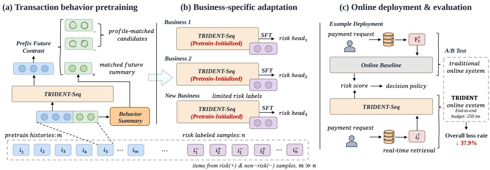
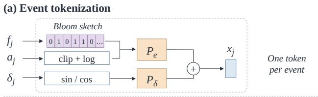
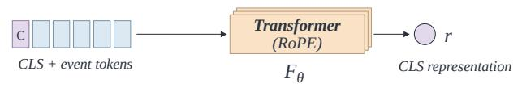
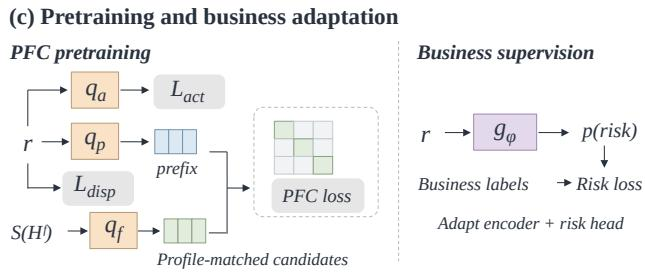
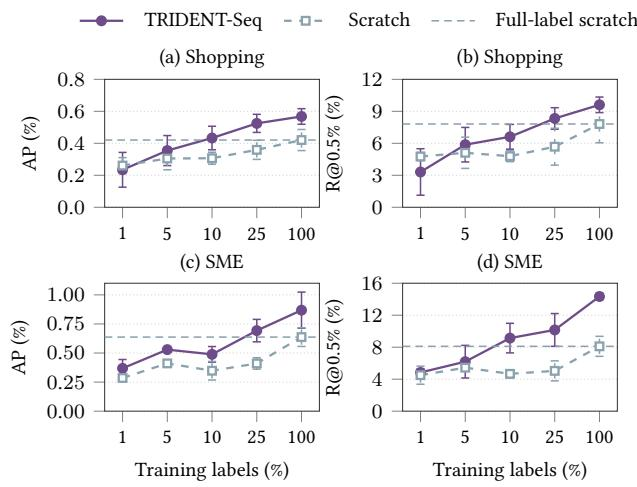
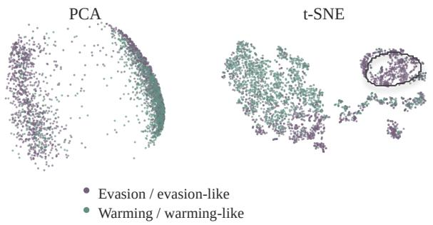
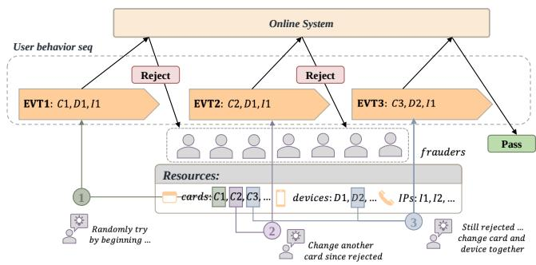

# TRIDENT-Seq: Profile-Matched Prefix–Future Contrast for Label-Eficient Payment Risk Modeling

Weiyu Han<sup>1</sup>, Haoyu Jiang<sup>1</sup>, Jie Sheng<sup>1</sup>, Ruobing Zuo<sup>2</sup>, Huilin He<sup>3</sup>

Ze Zhao<sup>4</sup>, Xiao Tan<sup>1,\*</sup>, Nairong Zhang<sup>1</sup>, Shuai Chen<sup>1</sup>, Tianyi Zhang<sup>1</sup>

<sup>1</sup>Ant International <sup>2</sup>East China Normal University <sup>3</sup>Tongji University <sup>4</sup>Shanghai Jiao Tong University

Corresponding author: alex.tx@ant-intl.com

## Abstract

Ant International accumulates large volumes of transaction history across users and payment businesses. Confirmed fraud and chargeback outcomes, by contrast, are scarce, delayed, and specific to each business. A single encoder pretrained on unlabeled histories could serve all businesses, but only if pretraining captures the behavior that separates risk. Coarse activity diferences can make contrastive pretraining on transaction logs too easy: transaction volume, amount, and timing can distinguish a history’s continuation from arbitrary candidates without modeling how payment resources are used. We present TRIDENT-Seq, a transaction foundation model trained with Prefix–Future Contrast (PFC). PFC matches each prefix to a summary of its subsequent behavior among candidates with similar activity profiles; activity prediction and dispersion regularization act on the encoder output. Across three production payment businesses, the pretrained encoder improves average precision (AP) and recall at a 0.5% intervention budget over architecture-matched scratch training in all six business–budget setings. With a fixed validation set, it exceeds full-label scratch training in mean AP and recall using 10% of the training labels on Wallet and 25% on Shopping and SME. Pretraining only on another business’s histories still helps. Replacing profile-matched candidates with random ones cuts recall from 24.62% to 5.64%. In Ant International’s deployment evaluation, recorded amount-based chargeback and overall loss rates are 37.7% and 37.9% lower than those of the previous XGBoost-based system under the same intervention budget.

## CCS Concepts

• Applied computing → Secure online transactions; • Computing methodologies → Unsupervised learning; Transfer learning.

## Keywords

online payments, payment risk modeling, transaction foundation models, self-supervised learning, contrastive learning, transfer learning

## 1 Introduction

Online payments underpin commerce on the Web. Ant International supports payment services across digital wallets, shopping platforms, and merchant businesses. Each needs its own risk model. Transaction histories accumulate continuously in all of them, but confirmed risk outcomes are rare and arrive only after chargebacks or investigations [11]. A new business or market therefore starts with abundant behavior and few labels, and one model per business multiplies the cost of labeling and upkeep [32]. The natural remedy is to pretrain one encoder on unlabeled histories and adapt it to each business with whatever labels it has.

Such an encoder should meet two requirements. Low-label adaptation: a business may hold millions of histories but only a few hundred confirmed outcomes. The pretrained representation must therefore separate much of the risk before labels shape it. Cross-business generalization: payment processes, user populations, and risk criteria difer across businesses. What the encoder learns must remain useful outside the business that supplied its histories, including businesses where most transactions have litle or no history.

Self-supervised learning on event sequences makes this feasible [2, 33, 43, 48], and transaction foundation models now transfer representations across financial tasks and populations [13, 26, 32, 40]. Less setled is what a pretraining task should demand of a payment history. Risk often shows in how a user handles resources over time: switching cards after a decline, or retrying at the same merchant within minutes. Volume alone says much less.

This distinction exposes a weakness of contrastive pretraining on transaction logs. Histories difer most visibly in activity level: how many transactions they contain, how large the amounts are, and how the events spread over time. Asked to identify the continuation of a history among arbitrary alternatives, a model can often succeed on these coarse quantities alone. It then has litle pressure to learn the finer behavior that separates risky from legitimate use, an instance of the shortcut solutions known to affect contrastive learning [36]. Candidate construction has a large downstream impact in our data. On a wallet business, random contrastive candidates yield 5.64% recall at a 0.5% intervention budget after fine-tuning with 10% of the labels. Candidates of comparable activity yield 24.62% (Section 5.6).

We present TRIDENT-Seq, a transaction foundation model built on Prefix–Future Contrast (PFC). PFC splits each training history into an older prefix and the behavior that follows. It summarizes the later through amount, timing, and atribute-change statistics, and trains the encoder to identify the true summary among candidates with similar activity profiles. PFC selects candidates with comparable transaction counts, amounts, and aggregate event ages, then distinguishes their richer behavioral summaries. Two auxiliary terms act on the encoder output that adaptation reuses. Activity prediction directly supervises activity level, complementing the profile-matched contrast; a dispersion penalty discourages low average variation in the encoder output. Each business then fine-tunes a copy of the encoder with its own risk head (Figure 1).

We evaluate TRIDENT-Seq on three payment businesses served by Ant International, with history coverage ranging from nearly <sub>havior, providing the shared foundation model with a behavioral</sub>complete to mostly empty. Pretraining improves AP and recall over <sub>learning signal that requires no risk annotations.</sub>architecture-matched scratch training in all six business–budget <sub>(3) Low-label adaptation and cross-scenario generaliza</sub>setings. On the wallet business, 10% of the training labels, only 76 <sub>tion. We demonstrate the value of reusing a shared pretrained</sub>positive examples, outperform scratch training with all training lamodel across businesses and show that fine-tuning with limited<sup>bels under the same fixed validation set. On the other two, 25%</sup> labels outperforms architecture-matched models trained fromdo so in mean AP and recall. Pretraining solely on another busiscratch with all training labels.ness’s histories still helps. The system has served SME merchants, (4) Production deployment and business impact. We intewhere most transactions have no history, sinceJune 8, 2026. Across grate TRIDENT-Seq into a production risk system and demonstrateits deployed payment businesses, recorded chargeback and overall a lower overall loss rate than the baseline method through onlineloss rates are 37.7% and 37.9% lower than those of the previous A/B testing under the sXGBoost-based system.

  
model adapts to diferent businesses through supervised fine-tuning (SFT) with limited labels. (c) Online A/B testing shows a<sup>Figure 1: TRIDENT-Seq overview. (a) PFC learns behavioral representations without risk labels. (b) The shared foundation</sup> <sub>37.9% relative reduction in overall loss rate under the same intervention budget.</sub>model adapts to each business through supervised fine-tuning (SFT) with limited labels. (c) At Ant International, online A/B evaluation across deployed payment businesses shows a 37.9% reduction in the overall loss rate under the same intervention budget.

Our contributions are as follows:

2 METHODOLOGY<sub>• Method. We propose profile-matched future contrast, which</sub> gure 1 presents the three stages of TRIDENT-Seq. In Figure 1(a),trains each history prefix to identify its own future summary stories from both legitimate and risky transactions support be-among candidates with comparable activity. This makes candivior learning without using risk labels in PFC pretraining; date construction an explicit part of transaction pretraining.

torical prefixes and subsequent behavior summaries provide the• Evidence. Across three production businesses, one pretrained lf-supervised signal. In Figure 1(b), each business reuses the sameencoder supports label-eficient adaptation and transfers across etrained initialization and applies supervised fine-tuning (SFT)businesses, and ablations isolate the contribution of each com ith its oponent.

In Figure 1(c), the adapted model enters the real-time history re-<sub>•</sub> <sub>Deployment.</sub> <sub>TRIDENT-Seq</sub> <sub>runs</sub> <sub>in</sub> <sub>Ant</sub> <sub>International’s</sub> <sub>pay-</sub> eval and risk decision workflow, and online A/B testing mea<sub>ment</sub> <sub>risk</sub> <sub>system</sub> <sub>within</sub> <sub>a</sub> <sub>120</sub> <sub>ms</sub> <sub>inference</sub> <sub>budget,</sub> <sub>with</sub> <sup>res</sup> <sup>its</sup> <sup>business</sup> <sup>impact.</sup>portfolio-level A/B results and a two-stage SME evaluation.

## For a transaction at ti2 Related Work

history. Event ei contains an amount ai, categorical fields fi, and<sub>Transaction</sub> <sub>risk</sub> <sub>modeling.</sub> <sub>Feature-based</sub> <sub>detectors</sub> <sub>aggregate</sub> historical activity into indicators for supervised classifiers such as <sup><�</sup> gradient-boosted trees [3, 8, 11]. Sequence models learn temporal dependencies directly from ordered transactions [22]. Graph models exploit relations among accounts, devices, and merchants, including camouflaged and highly imbalanced fraud [14, 28, 29]. These detectors typically learn from the risk labels of a single task.

<sub>where y denotes a confirmed risk outcome. We first learn</sub> �Each new business must first accumulate its own labels, and de-<sub>from U, initialize the encoder with</sub> � <sub>, and learn a business risk</sub>layed feedback slows their arrival [6, 11]. TRIDENT-Seq learns its <sub>score using Ld. Businesses share the pretrained starting point</sub>representation from unlabeled histories and uses labels only for <sub>while inde</sub>adaptation.

coders. Label-budget experiments vary the training subset ofLd;<sup>Self-supervised pretraining on event sequences. TabBERT</sup> validation selects models and testing evaluates the frozen choices.reconstructs masked fields of tabular event sequences [33], and In PFC, “future” denotes the subsequent historical segment rela-self-supervised objectives have been combined with sampling tive to a pretraining prefix. It supplies a self-supervised target. Thestrategies for card fraud detection [7]. CoLES treats subsequences complete history used at downstream scoring still ends before theof the same history as positive pairs [2], as TS2Vec does for time current transaction. This definition connects behavior predictionseries [49]. Predictive objectives link the past to what follows. with risk scoring while preserving information availability at pre-CPC contrasts future latent representations against in-batch diction time.negatives [43], and BYB predicts a teacher’s representation of a later behavior window [48] in the spirit of BYOL [17]. PFC is 2.2 Model Architecturealso predictive, but its target and its negatives difer. The target <sub>Transactions have heterogeneous categorical, amount, and tem-</sub>is a fixed statistical summary of several subsequent events, not a <sub>poral atributes. We encode these separately, form event tokens,</sub>learned event representation. The negatives are restricted to com-<sub>and process them with a Transformer [21]. Categorical fields use</sub>parable activity. Hard-negative sampling also selects informative a Bloom-filter-style multi-probe hash representation [22]. For anegatives, but defines hardness by embedding similarity [35]. PFC <sub>value v of field j, deterministic hash functions map it to a fixed-</sub>defines comparability through observable activity profiles and width bit vector bj(v). Equal values produce equal bit paterns, and<sup>thus</sup> <sup>targets</sup> <sup>the</sup> <sup>shortcut</sup> <sup>that</sup> <sup>random</sup> <sup>negatives</sup> <sup>leave</sup> <sup>open</sup> <sup>[36].</sup> Finally, negatives keep contrastive representations spread over repetition and changes across nearby or distant events while con-<sup>the</sup> <sup>hypersphere</sup> <sup>[46],</sup> <sup>whereas</sup> <sup>non-contrastive</sup> <sup>methods</sup> <sup>enforce</sup> <sub>trolling storage growth as the categorical domain expands.</sub>spread with explicit variance terms [4]. Our dispersion term <sub>Amounts unde</sub>follows the later.

me diferences are expanded with sine and cosine functions and<sup>Transaction foundation models. The Foundation Purchasing</sup> projected. An event representation combines a joint projection ofModel pretrains generative autoregressive models on transaction categorical and amount features with the time representation:sequences and transfers them to held-out fraud-detection populations [40]. TransactionGPT models transaction atributes � � <sub>� � �</sub> � � <sub>�</sub> � . <sub>(1)</sub>and trajectories with a 3D Transformer [13]. PANTHER combines structured behavior tokens, sequence paterns, and user profiles [26]. PRAGMA extends masked modeling to banking events [32], and FRiskGPT places user behaviors and risk outcomes in a shared token space [50]. Payment companies report similar models in production [1, 10, 21]. Pretrained sequence encoders are likewise shared across domains in recommendation and advertising [15, 16, 20, 27], where transfer is usually evaluated between related catalogs, markets, or tasks [34]. Payment businesses also difer in label definitions and history coverage, which our controlled-source experiments vary explicitly. Most transaction foundation models predict the next event or reconstruct masked ones. TRIDENT-Seq instead contrasts multi-event summaries under activity matching, and we follow its reuse across businesses through to deployment.

## 3 Problem Setup

Transaction histories. For a transaction scored at time $t ,$ the history $H _ { < t } = ( e _ { 1 } , \ldots , e _ { n } )$ lists the user’s preceding events from most recent to oldest. Each event $e _ { j } = ( a _ { j } , \mathbf { f } _ { j } , \delta _ { j } )$ has an amount $^ { a _ { j } , }$ categorical atributes $\mathbf { f } _ { j }$ describing payment, device, and network context, and an age $\delta _ { j } ^ { ' }$ in days relative to �. The length � varies and can be zero. The label $y \in \{ 0 , 1 \}$ } of the scored transaction indicates recorded fraud or chargeback. Chargebacks can arrive months after the transaction, so labels always lag the trafic they describe. For pretraining, an observed history is split into an older prefix $H ^ { p }$ and the subsequent segment $H ^ { f }$ , which we call its future. Both precede the scored transaction, so pretraining never sees events that occur after a decision.

Pretraining and adaptation. Let � be a pool of unlabeled histories and $\mathcal { L } _ { d } = \{ ( H _ { < t } , y ) \}$ the labeled transactions of business �. We learn encoder parameters $\theta _ { \mathrm { p r e } }$ on $\mathcal { U }$ . Each business initializes its encoder $F _ { \theta _ { d } }$ from $\theta _ { \mathrm { p r e } }$ and trains it jointly with a risk head $g _ { \phi _ { d } } \colon$

$$
\begin{array} { r } { p _ { d } ( H _ { < t } ) = \sigma \big ( g _ { \phi _ { d } } \big ( F _ { \theta _ { d } } ( H _ { < t } ) \big ) \big ) , } \end{array}\tag{1}
$$

where $\sigma$ is the sigmoid function. The decision system ranks transactions by $\mathit { p _ { d } }$ and intervenes on a fixed fraction of trafic, the intervention budget. The budget is small, 0.5% in Ant International’s production system, because every intervention adds friction for legitimate users. We seek a $\theta _ { \mathrm { p r e } }$ that makes this ranking accurate with few labels, across businesses.

## 4 Methodology

## 4.1 Overview

Figure 1 shows the three stages of TRIDENT-Seq. (a) PFC pretrains a shared history encoder on unlabeled histories. (b) Each business fine-tunes its own copy of the encoder, with a new risk head, on its own labels. (c) Online, each transaction triggers history retrieval and one pass through the adapted encoder and risk head; the decision system acts on the resulting score. Future summaries, contrastive candidates, and auxiliary heads exist only in pretraining. They add nothing to serving cost.

## 4.2 Event Encoding

Event tokenization. Payment, device, and network atributes acquire new values continuously. We encode each categorical field with a Bloom-filter-style multi-probe hash [5, 42, 47] that maps a value to a fixed-width bit vector. A card or device always produces the same bit patern. A new one typically produces a diferent pattern, and no vocabulary has to be maintained. Reuse and switching of payment resources, the cues behind evasion, are therefore visible directly in the token sequence. With four probes in separate 32- bit blocks, two distinct values receive identical vectors with probability $3 2 ^ { - 4 } \approx 1 0 ^ { - 6 }$ , so collisions rarely merge diferent cards or devices. Amounts are clipped and log-transformed, and ages are expanded with sine and cosine features [23]. The token of event $e _ { j }$ is





  
Figure 2: TRIDENT-Seq architecture. (a) Event tokenization. (b) Shared history encoder. (c) Pretraining with PFC, activity prediction, and dispersion regularization, and businessspecific supervised adaptation.

$$
\begin{array} { r } { \mathbf { x } _ { j } = P _ { e } \big [ B ( \mathbf { f } _ { j } ) \| \psi ( a _ { j } ) \big ] + P _ { \delta } \gamma ( \delta _ { j } ) , } \end{array}\tag{2}
$$

where $B$ concatenates the field bit vectors in a fixed order, $\psi$ transforms the amount, � expands the age, ‖ denotes concatenation, and $P _ { e }$ and $P _ { \delta }$ are learned projections.

History encoder. A Transformer [45] with rotary positional encoding reads a CLS token followed by the event tokens, with padding masked. Its CLS output $F _ { \theta } ( H )$ represents the history. Pretraining, adaptation, and serving share this encoding (Figure 2); Appendix A gives the configuration.

## 4.3 Prefix–Future Contrast

Prefixes and future summaries. For a training history $H _ { i }$ with at least two events, the older 60% of events form the prefix $H _ { i } ^ { p }$ and the rest form the future $H _ { i } ^ { f }$ . The encoder represents the prefix as $\mathbf { r } _ { i } = F _ { \theta } ( H _ { i } ^ { p } )$ . A deterministic function � maps $H _ { i } ^ { f }$ to a 24- dimensional summary of its amount and event-age distributions, the regularity of intervals between adjacent events, and the occupancy and change of hashed atribute values (Appendix A.2). Hash occupancy is a coarse proxy for the diversity of atribute values within the future. The switching rate measures, field by field, how

## Algorithm 1. Profile-matched PFC for one minibatch

```latex
Input: � histories with at least two events; prefix ratio $\rho ,$
threshold �, temperature �.
Output: $\mathcal { L } _ { \mathrm { P F C } }$ and prefix representations �.
1. for $i = 1 , \dots ,$ � do
2. $( H _ { i } ^ { p } , H _ { i } ^ { f } )$ ← SplitChronologically(�<sub>�</sub>, �); $\mathbf { r } _ { i } \gets F _ { \theta } ( H _ { i } ^ { \mathcal { P } } )$
3. $\mathbf { z } _ { i } ^ { p } \gets \mathrm { n o r m } ( q _ { \mathcal { P } } ( \mathbf { r } _ { i } ) ) ; \ : \mathbf { z } _ { i } ^ { f } \gets \mathrm { n o r m } ( q _ { f } ( S ( H _ { i } ^ { f } ) ) ) ;$
$\pi _ { i }  \pi ( H _ { i } ^ { f } )$
4. $\ell _ { i j } \gets \langle \mathbf { z } _ { i } ^ { p } , \mathbf { z } _ { j } ^ { f } \rangle / \tau$ and $d _ { i j }  \| \pi _ { i } - \pi _ { j } \| _ { 1 }$ for all �, �
5. $M  I _ { B } ; \ \bar { M } _ { i j }  1$ for all $j \neq i$ with $d _ { i j } \leq \varepsilon$
6. $M _ { i , : }  \mathbf { 1 }$ for every row � with $\begin{array} { r } { \sum _ { j } M _ { i j } = 1 } \end{array}$ ▷ fallback
7. $\ell _ { i j } \gets - \infty$ wherever $M _ { i j } = 0$
8. return $\begin{array} { r } { \mathcal { L } _ { \mathrm { P F C } } = - \frac { 1 } { B } \sum _ { i } } \end{array}$ log softmax $( \ell _ { i , : } ) _ { i } , \ R = \left[ \mathbf { r } _ { 1 } , \ldots , \mathbf { r } _ { B } \right]$
```

often consecutive events change atribute values, as when a card or device is replaced after a rejection. Event-age statistics describe how activity is spread over time. We summarize several events rather than predict the next one: retry bursts, resource switching, and the slow build-up of routine activity all span multiple events. A prefix head $q _ { p }$ and a future head $q _ { f }$ map both sides into a shared space:

$$
\mathbf { z } _ { i } ^ { p } = \operatorname { n o r m } \bigl ( q _ { \mathcal { P } } ( \mathbf { r } _ { i } ) \bigr ) , \qquad \mathbf { z } _ { i } ^ { f } = \operatorname { n o r m } \bigl ( q _ { f } ( S ( H _ { i } ^ { f } ) ) \bigr ) ,\tag{3}
$$

where norm is L2 normalization [9, 46].

Profile-matched candidates. Contrasting a prefix against arbitrary futures invites the activity shortcut: a future with three transactions is easily told apart from one with three hundred. We therefore select contrastive candidates by similarity in coarse activity. With $u _ { j } = \log ( 1 + \operatorname* { m a x } ( a _ { j } , 0 ) )$ , the activity profile of a future is

$$
\pi ( H ^ { f } ) = \left[ \begin{array} { c } { { \log \left( 1 + \sum _ { j \in H ^ { f } } u _ { j } \right) } } \\ { { \log \left( 1 + | H ^ { f } | \right) } } \\ { { \log \left( 1 + \sum _ { j \in H ^ { f } } \delta _ { j } \right) } } \end{array} \right] .\tag{4}
$$

In a minibatch of� prefix–future pairs, prefix � keeps its own future and every other future � with $\begin{array} { r } { \| \pi ( H _ { i } ^ { f } ) - \pi ( H _ { i } ^ { f } ) \| _ { 1 } \leq \varepsilon . } \end{array}$ If no other future qualifies, all futures in the batch are used (Algorithm 1). The logarithmic threshold $\varepsilon = 1 . 5$ allows roughly $e ^ { 1 . 5 } \approx 4 . 5 – \mathrm { f o l d }$ variation in activity scale when the other two coordinates agree. Building the mask takes $B ^ { 2 }$ comparisons of three-dimensional profiles, negligible next to the encoder. With �(�) the resulting candidate set and � a temperature, PFC minimizes

$$
\mathcal { L } _ { \mathrm { P F C } } = - \frac { 1 } { B } \sum _ { i = 1 } ^ { B } \log \frac { \exp ( \langle \mathbf { z } _ { i } ^ { P } , \mathbf { z } _ { i } ^ { f } \rangle / \tau ) } { \sum _ { j \in \mathcal { N } ( i ) } \exp ( \langle \mathbf { z } _ { i } ^ { P } , \mathbf { z } _ { j } ^ { f } \rangle / \tau ) } .\tag{5}
$$

Matching candidates on volume, amount, and event timing directs the contrast toward the finer structure that � encodes.

## 4.4 Auxiliary Objectives

PFC trains the projected, normalized vectors $\mathbf { z } ^ { p } ,$ whereas adaptation reuses the encoder output r. Two auxiliary terms act on r directly.

Activity prediction. Profile matching reduces coarse activity diferences among candidates, while activity remains informative about risk. An activity head $q _ { a }$ therefore regresses $\mathbf { r } _ { i }$ onto a 25- dimensional target $A ( H _ { i } )$ computed from the full training history. The target collects transaction counts, amounts, event ages, and hash-field statistics over the 75, 150, and 300 most recent events, plus diferences that contrast the most recent window with the longer history (Appendix A.2). The loss

$$
\mathcal { L } _ { \mathrm { a c t } } = \frac { 1 } { B } \sum _ { i = 1 } ^ { B } { \mathrm { S m o o t h L 1 } } ( q _ { a } ( \mathbf { r } _ { i } ) , A ( H _ { i } ) )\tag{6}
$$

averages over target coordinates.

Dispersion regularization. Because the contrastive loss is computed after projection and normalization, it does not directly constrain the spread of r itself. We penalize a low average within-batch standard deviation of the prefix representations:

$$
\mathcal { L } _ { \mathrm { d i s p } } = \mathrm { m a x } \Big ( 0 , \ \sigma _ { 0 } - \frac { 1 } { D } \sum _ { k = 1 } ^ { D } { \mathrm { S t d } _ { i } \big ( r _ { i k } \big ) } \Big ) ,\tag{7}
$$

where ${ \mathrm { S t d } } _ { i }$ is the standard deviation of dimension $k$ over the � prefixes in the minibatch and � is the representation width. The penalty vanishes once the average spread reaches $\sigma _ { 0 }$ . It resembles the variance term of VICReg [4] but applies to the mean standard deviation rather than to each dimension, before projection.

Joint objective. The pretraining loss is

$$
\mathcal { L } = \mathcal { L } _ { \mathrm { { P F C } } } + \lambda _ { \mathrm { { a c t } } } \mathcal { L } _ { \mathrm { { a c t } } } + \lambda _ { \mathrm { { d i s p } } } \mathcal { L } _ { \mathrm { { d i s p } } } ,\tag{8}
$$

with $\lambda _ { \mathrm { a c t } } = 0 . 3 0 , \lambda _ { \mathrm { d i s p } } = 0 . 0 5$ , and $\sigma _ { 0 } = 0 . 0 2$ . The encoder and the prefix, future, and activity heads are trained jointly.

## 4.5 Business-Specific Adaptation

Each business � copies the complete pretrained encoder, including event projections: $\theta _ { d } \gets \theta _ { \mathrm { p r e } } .$ A new risk head $g _ { \phi _ { d } }$ reads its CLS output (Equation 1), and the pretraining heads are discarded. For a labeled subset $\mathcal { L } _ { d }$ with $N _ { d }$ examples, $N _ { d , c }$ of them in class $^ { c , }$ the encoder and risk head minimize class-balanced cross-entropy:

$$
\begin{array} { r l } { \displaystyle \mathcal { L } _ { \mathrm { r i s k } } ^ { ( d ) } = - \frac { 1 } { N _ { d } } \sum _ { ( H , y ) \in \mathcal { L } _ { d } } \big [ \omega _ { d , 1 } y \log { \mathcal { P } _ { d } ( H ) } } & { } \\ { \displaystyle + \omega _ { d , 0 } ( 1 - y ) \log ( 1 - \mathcal { P } _ { d } ( H ) ) \big ] , } \end{array}\tag{9}
$$

with $\omega _ { d , c } = N _ { d } / ( 2 N _ { d , c } )$ , so both classes carry equal total weight. We fine-tune the whole encoder rather than a head on frozen features. Each business defines risk diferently, and its labels should be able to reweight what the shared representation emphasizes.

## 5 Experiments

We address four research questions. RQ1: Does pretraining improve risk ranking across businesses and label budgets? RQ2: Does it transfer when the target business is excluded from pretraining? RQ3: Which components of PFC mater? RQ4: Do the gains carry over to production?

## 5.1 Datasets

We use data from three payment businesses served by Ant International: a wallet business (Wallet), a shopping-platform business (Shopping), and an SME-merchant business (SME). They difer mainly in history coverage (Table 1). Nearly every Wallet transaction has a history, whereas 30.63% of Shopping and 76.91% of SME test trafic have none. Wallet is also the most label-scarce: its training split contains 732 positive examples, against 183,398 on Shopping and 46,740 on SME. Each dataset is split chronologically into training, validation, and test periods [6, 11], and transactions with empty histories remain in the evaluation. Shared pretraining uses a pool of 24.5 million unlabeled histories, including Shop ping histories. Their anchors end on March 1, 2026, before every downstream test period.

Table 1: Dataset statistics.
<table><tr><td>Data</td><td>Scored events</td><td>History events</td><td>Mean length</td><td>History sparsity</td><td>Train positives</td></tr><tr><td>Wallet</td><td>127,375</td><td>16.03M</td><td>125.8</td><td>0.50%</td><td>732</td></tr><tr><td>Shopping</td><td>501,898</td><td>14.78M</td><td>29.5</td><td>30.63%</td><td>183,398</td></tr><tr><td>SME</td><td>371,600</td><td>2.91M</td><td>7.8</td><td>76.91%</td><td>46,740</td></tr></table>

In Table 1, scored and history events are counted over the sam pled training, validation, and test sets. A history event is counted each time it appears in an input, so events shared by overlapping histories count repeatedly. Mean length includes empty histories. History sparsity is the population-weighted share of test trafic with an empty history. Appendix D lists split sizes and positive counts.

## 5.2 Experimental Setup

Metrics. We report average precision (AP) [12, 37] and risk recall at a 0.5% intervention budget (R@0.5%), the share of risk captured when the highest-scoring 0.5% of trafic is selected. Validation and test metrics use inverse sampling-probability weights �<sub>�</sub> that account for cohort subsampling and negative sampling [19, 24]. For budget �, let �<sub>�</sub>(�) be 1 above the score threshold, 0 below it, and a common fraction for scores tied at the threshold. Then

$$
{ \mathrm R @ 6 } b = \frac { \sum _ { i } w _ { i } y _ { i } \alpha _ { i } ( b ) } { \sum _ { i } w _ { i } y _ { i } } , \qquad \sum _ { i } w _ { i } \alpha _ { i } ( b ) = b \sum _ { i } w _ { i } .\tag{10}
$$

AP uses the same weights. Both metrics are reported as percentages. R@0.5% is our primary metric. It mirrors how the decision system acts, intervening on a fixed share of trafic, and the 0.5% budget matches production (Section 5.8). AP complements it by summarizing precision over the whole ranking.

Label budgets. Fine-tuning uses 1%, 5%, 10%, 25%, or 100% of the training labels, with the same subsets for all methods. The validation set, which selects learning rates and checkpoints, is the same at every budget; on Wallet it holds 807 positives. The main comparison uses 10% and 100%, and Shopping and SME are evaluated at all five budgets. On Wallet, the 1% and 5% subsets would contain only 7 and 34 positive examples, so we report 10% (76 positives) and 100%.

Baselines. All ofline methods take historical transaction events as input. Scratch uses the TRIDENT-Seq encoder and risk head with random initialization. CoLES [2], BYB [48], and CPC [43] are adapted to share our encoder, pretraining histories, and 24,000-update budget. They contrast history crops, predict a teacher’s representation of later behavior, and contrast upcoming event representations, respectively. TransactionGPT [13] and PANTHER [26] keep their own event encodings and architectures and are pretrained on the same pool. Appendix B details the adaptations and also reports XGBoost on production risk indicators, whose inputs difer from those of the sequence models. Ant International’s production baselines, XGB-AutoRefit and a SAINT-style model, appear in Section 5.8.

Implementation. The encoder is an 8-layer Transformer with hidden size 1,024 and 8 atention heads (92.92M parameters) over at most 300 events. Pretraining uses AdamW at learning rate 1.5 × $1 0 ^ { - 4 } , \tau = 0 . 2 .$ , and � = 1.5 for 24,000 updates at global batch size 128. One pretrained checkpoint serves all businesses and budgets. Each fine-tuning run tries three encoder learning rates for 1,024 updates each, then trains for 2,048 updates at the rate with the best weighted validation AP. The same criterion selects the checkpoint. We report means and sample standard deviations over three fine-tuning runs. Appendix A gives the full configuration, and Appendix G examines a longer adaptation schedule.

## 5.3 Overall Performance (RQ1)

Pretraining improves on scratch training in every setting. TRIDENT-Seq raises both AP and R@0.5% over architecturematched scratch training in all six business–budget setings (Table 2). No other objective that shares our encoder and pretraining data does so. With 10% of the Wallet labels, CoLES and CPC fall below scratch in AP, and BYB falls below it in recall. CPC is the closest to PFC: it also predicts what follows a prefix, but contrasts against in-batch futures of other users without activity matching. With full Wallet labels it beats scratch (12.74% vs. 10.41% recall) yet stays far from TRIDENT-Seq (28.33%), in line with the drop that random candidates cause in our ablation (Section 5.6). Among the separately designed systems, PANTHER is competitive on Wallet but trails scratch on Shopping at both budgets and on SME with full labels. One diference: PANTHER encodes behaviors and fields through fixed vocabularies of 60,003 and 7,912 tokens, whereas hashing encodes unseen atribute values without a fixed vocabulary. For reference, XGBoost trained on Ant International’s production risk indicators that preceded TRIDENT-Seq online trails scratch training in all six setings (Appendix B).

Wallet benefits most. Histories cover 99.50% of Wallet test trafic and average 125.8 events. With 10% labels, TRIDENT-Seq reaches 0.8214% AP and 27.75% recall, 24.0 and 8.4 times the scratch values. Both exceed scratch trained on all labels (0.1148% and 10.41%). TRIDENT-Seq also leads the strongest baseline, TransactionGPT, at both budgets. Its 10%-label result already retains 98% of its full-label AP and recall, whereas scratch training with 10% labels retains only 32% of its full-label recall. Wallet AP varies widely across fine-tuning runs, with standard deviations of 41% and 50% of the mean. The training split holds only 732 positives, and a few weighted positives decide the top of the ranking. Recall is steadier, at 20% and 11%.

Shopping and SME are more competitive. TransactionGPT, which predicts the fields of the next event, leads both metrics on full-label Shopping and AP on SME with 10% labels. TRIDENT-Seq leads recall with 10% labels on both businesses, and both metrics on

Table 2: Performance comparison (%). Best results are bold; second-best results are underlined.
<table><tr><td></td><td colspan="2">Wallet</td><td colspan="2">Shopping</td><td colspan="2">SME</td></tr><tr><td>Model</td><td>AP↑</td><td>R@0.5% ↑</td><td>AP↑</td><td>R@0.5% ↑</td><td>AP↑</td><td>R@0.5% ↑</td></tr><tr><td>10% training labels</td><td></td><td></td><td></td><td></td><td></td><td></td></tr><tr><td>Scratch</td><td> $0 . 0 3 4 2 { \scriptstyle \pm 0 . 0 0 8 2 }$ </td><td> $3 . 3 1 { \pm } 0 . 7 7$ </td><td> $0 . 3 0 6 7 { \scriptstyle \pm 0 . 0 3 7 5 }$ </td><td> $4 . 7 9 { \scriptstyle \pm 0 . 5 1 }$ </td><td> $0 . 3 4 7 6 { \scriptstyle \pm 0 . 0 7 9 8 }$ </td><td> $4 . 6 7 { \scriptstyle \pm 0 . 5 1 }$ </td></tr><tr><td>CoLES (adapted)</td><td> $0 . 0 2 7 4 { \scriptstyle \pm 0 . 0 1 2 4 }$ </td><td> $2 . 9 2 { \scriptstyle \pm 0 . 5 5 }$ </td><td> $0 . 2 8 7 9 { \scriptstyle \pm 0 . 0 1 8 2 }$ </td><td> $5 . 1 8 { \scriptstyle \pm 0 . 8 4 }$ </td><td> $0 . 3 5 1 4 { \scriptstyle \pm 0 . 0 6 9 1 }$ </td><td> $5 . 0 4 { \scriptstyle \pm 0 . 5 2 }$ </td></tr><tr><td>BYB (adapted)</td><td> $0 . 0 4 7 5 { \scriptstyle \pm 0 . 0 1 6 0 }$ </td><td> $2 . 8 6 { \scriptstyle \pm 0 . 5 6 }$ </td><td> $0 . 2 4 4 7 { \scriptstyle \pm 0 . 0 5 7 4 }$ </td><td> $3 . 5 6 { \pm } 1 . 8 0 $ </td><td> $0 . 3 6 2 4 { \scriptstyle \pm 0 . 0 4 8 8 }$ </td><td> $5 . 9 1 { \pm } 2 . 1 7 $ </td></tr><tr><td>CPC (adapted)</td><td> $0 . 0 2 7 9 { \scriptstyle \pm 0 . 0 0 6 1 }$ </td><td> $3 . 3 4 { \pm } 2 . 1 4$ </td><td> $0 . 3 5 6 9 { \scriptstyle \pm 0 . 0 0 9 4 }$ </td><td> $5 . 7 9 { \scriptstyle \pm 0 . 7 0 }$ </td><td> $0 . 3 8 7 4 { \scriptstyle \pm 0 . 0 2 8 3 }$ </td><td> $5 . 6 0 { \scriptstyle \pm 0 . 6 8 }$ </td></tr><tr><td>TransactionGPT (adapted)</td><td> $\underline { { 0 . 3 2 0 9 { \scriptstyle \pm 0 . 1 5 0 2 } } }$ </td><td> $2 0 . 6 9 { \scriptstyle \pm 8 . 5 7 }$ </td><td> $\underline { { 0 . 4 3 1 6 { \scriptstyle \pm 0 . 0 2 3 7 } } }$ </td><td> $\underline { { 6 . 1 6 { \pm } 0 . 8 8 } }$ </td><td> $\mathbf { 0 . 5 4 4 6 { \scriptstyle \pm 0 . 1 2 6 4 } }$ </td><td> $\underline { { 8 . 3 0 { \pm } 1 . 7 2 } }$ </td></tr><tr><td>PANTHER (adapted)</td><td> $0 . 2 0 6 7 { \scriptstyle \pm 0 . 1 0 5 5 }$ </td><td> $1 6 . 0 1 { \scriptstyle \pm 9 . 6 9 }$ </td><td> $0 . 2 5 6 1 { \scriptstyle \pm 0 . 0 6 5 2 }$ </td><td> $3 . 9 3 { \scriptstyle \pm 1 . 1 3 }$ </td><td> $0 . 3 6 6 2 { \scriptstyle \pm 0 . 0 9 1 3 }$ </td><td> $5 . 5 0 { \pm } 1 . 0 1 $ </td></tr><tr><td>TRIDENT-Seq</td><td> $\mathbf { 0 . 8 2 1 4 { \scriptstyle \pm 0 . 3 3 3 7 } }$ </td><td> $2 7 . 7 5 { \scriptstyle \pm 5 . 4 4 }$ </td><td> $\mathbf { 0 . 4 3 3 1 { \scriptstyle \pm 0 . 0 7 3 5 } }$ </td><td> ${ \bf 6 . 6 1 { \pm 1 . 1 6 } }$ </td><td> $\underline { { 0 . 4 8 8 6 { \pm } 0 . 0 6 7 2 } }$ </td><td> $9 . 1 4 { \scriptstyle \pm 1 . 8 5 }$ </td></tr><tr><td>100% training labels</td><td></td><td></td><td></td><td></td><td></td><td></td></tr><tr><td>Scratch</td><td> $0 . 1 1 4 8 { \scriptstyle \pm 0 . 0 4 8 6 }$ </td><td> $1 0 . 4 1 { \pm } 5 . 1 9$ </td><td> $0 . 4 2 0 5 { \scriptstyle \pm 0 . 0 6 6 0 }$ </td><td> $7 . 8 1 { \pm } 1 . 7 6 $ </td><td> $0 . 6 3 7 0 { \scriptstyle \pm 0 . 0 8 0 5 }$ </td><td> $8 . 1 1 { \pm } 1 . 2 5 $ </td></tr><tr><td>CoLES (adapted)</td><td> $0 . 1 1 5 0 { \scriptstyle \pm 0 . 1 5 1 5 }$ </td><td> $5 . 8 7 { \scriptstyle \pm 3 . 2 3 }$ </td><td> $0 . 4 9 1 9 { \scriptstyle \pm 0 . 0 6 0 5 }$ </td><td> $8 . 2 5 { \scriptstyle \pm 0 . 7 7 }$ </td><td> $0 . 3 8 6 5 { \scriptstyle \pm 0 . 0 2 6 8 }$ </td><td> $6 . 1 0 { \scriptstyle \pm 0 . 8 4 }$ </td></tr><tr><td>BYB (adapted)</td><td> $0 . 0 5 2 5 { \scriptstyle \pm 0 . 0 1 9 9 }$ </td><td> $6 . 7 6 { \scriptstyle \pm 2 . 1 2 }$ </td><td> $0 . 5 0 8 7 { \scriptstyle \pm 0 . 0 2 1 1 }$ </td><td> $9 . 2 4 { \scriptstyle \pm 0 . 3 4 }$ </td><td> $\underline { { 0 . 7 6 8 2 } } \pm 0 . 2 3 5 7$ </td><td> $9 . 8 0 { \scriptstyle \pm 1 . 4 7 } $ </td></tr><tr><td>CPC (adapted)</td><td> $0 . 3 1 2 8 { \scriptstyle \pm 0 . 0 9 6 8 }$ </td><td> $1 2 . 7 4 { \scriptstyle \pm 2 . 7 4 }$ </td><td> $0 . 5 0 5 7 { \scriptstyle \pm 0 . 0 4 9 7 }$ </td><td> $7 . 4 8 { \scriptstyle \pm 3 . 4 7 }$ </td><td> $0 . 7 6 7 8 { \scriptstyle \pm 0 . 1 8 9 6 }$ </td><td> $1 0 . 8 9 { \scriptstyle \pm 0 . 1 0 }$ </td></tr><tr><td>TransactionGPT (adapted)</td><td> $\underline { { 0 . 4 4 4 7 } } { \pm } 0 . 1 3 0 6$ </td><td> $2 1 . 3 3 { \scriptstyle \pm 5 . 4 5 }$ </td><td> $\mathbf { 0 . 7 5 0 0 { \scriptstyle \pm 0 . 3 0 8 5 } }$ </td><td> $\mathbf { 1 1 . 3 9 { \pm } 1 . 5 1 }$ </td><td> $0 . 7 5 5 6 { \scriptstyle \pm 0 . 0 7 6 1 }$ </td><td> $\underline { { 1 4 . 2 0 { \pm } 0 . 3 7 } }$ </td></tr><tr><td>PANTHER (adapted)</td><td> $0 . 3 4 8 4 { \scriptstyle \pm 0 . 1 3 8 3 }$ </td><td> $1 6 . 0 9 { \scriptstyle \pm 0 . 6 2 }$ </td><td> $0 . 3 0 7 4 { \scriptstyle \pm 0 . 0 2 8 1 }$ </td><td> $5 . 1 8 { \pm } 0 . 1 7$ </td><td> $0 . 4 5 7 3 { \scriptstyle \pm 0 . 0 3 8 6 }$ </td><td> $6 . 6 1 { \pm } 1 . 0 0$ </td></tr><tr><td>TRIDENT-Seq</td><td> $\mathbf { 0 . 8 3 5 5 { \scriptstyle \pm 0 . 4 1 4 2 } }$ </td><td> $2 8 . 3 3 { \scriptstyle \pm 3 . 2 5 }$ </td><td> $\underline { { 0 . 5 6 7 8 { \scriptstyle \pm 0 . 0 4 8 7 } } }$ </td><td> $\underline { { 9 . 6 1 \pm 0 . 7 3 } }$ </td><td> $\mathbf { 0 . 8 6 8 5 { \scriptstyle \pm 0 . 1 5 5 3 } }$ </td><td> $1 4 . 3 4 { \scriptstyle \pm 0 . 4 2 }$ </td></tr></table>

The main pretraining pool includes Shopping histories. To test transfer without target-business data [34], we pretrain separate

Pretraining also flatens the label curve. With 25% of the labels, TRIDENT-Seq keeps 87% of its full-label recall on Shopping and 71% on SME; scratch training keeps 73% and 62%. TRIDENT-Seq improves both metrics over same-budget scratch at every budget on SME and from 5% upward on Shopping. At 1% of the Shopping labels, it trails scratch. The relative gain in both metrics peaks at 25% on both businesses: 46% in AP and 47% in recall on Shopping, 69% and 102% on SME. With full labels it narrows as scratch training catches up. Appendix E lists all values.

## 5.5 Cross-Business Transfer (RQ2)

## 5.4 Label Eficiency (RQ1)

Figure 3 sweeps five label budgets on Shopping and SME. Points and error bars show three-run means and standard deviations; dashed lines mark scratch training with all labels. With 25% of the training labels, TRIDENT-Seq exceeds full-label scratch in mean AP and recall on both businesses. On Shopping it reaches 0.5246% AP and 8.33% recall, against 0.4205% and 7.81%. On SME it reaches 0.6928% and 10.16%, against 0.6370% and 8.11%.

The advantage persists under longer adaptation. Each finetuning run above uses 5,120 updates, learning-rate search included. On full-label Wallet we extend this to 14,336 updates for both mod els. TRIDENT-Seq then reaches 2.53 times the recall and 1.79 times the AP of scratch training (Appendix G), close to the recall ratio of 2.72 under the standard schedule.

SME with full labels. Two of these comparisons fall within run-torun variation: Shopping AP with 10% labels (0.4331% vs. 0.4316%) and SME recall with full labels (14.34% vs. 14.20%). SME deserves a closer look. Of its test trafic, 76.91% has no history, yet pretraining nearly doubles recall with 10% labels, from 4.67% to 9.14%. The reason is concentration: the history-covered 23.09% of trafic carries 85.51% of the weighted risk.

  
Figure 3: Label eficiency on Shopping and SME.

checkpoints on Shopping-only histories, SME-only histories, or an equal mixture. Each pool holds 1,288,542 distinct histories with matched daily counts. Each checkpoint receives 24,000 updates, and adaptation follows the main protocol at 10% and 25% labels.

Pretraining only on the other business improves AP and recall over no pretraining in all four target–budget setings (Table 3). The two directions difer. For Shopping, SME histories match Shopping’s own in recall at 10% and beat them in both metrics at 25%. For SME, Shopping histories help more than SME’s own with 10% labels (0.5791% vs. 0.4857% AP; 8.67% vs. 6.13% recall) but less with 25%. SME histories are short, averaging 7.8 events against 29.5 on Shopping, so richer histories from another business can partly substitute for in-domain ones. Mixing the two sources beats targetonly pretraining in both metrics on both businesses at 25% labels; at 10%, it raises recall but lowers AP. Bold in Table 3 marks the best mean per target and budget, and Appendix C adds standard deviations and AUROC.

Table 3: Efect of the pretraining source (%).
<table><tr><td></td><td colspan="2">10% labels</td><td colspan="2">25% labels</td></tr><tr><td>Pretraining source</td><td>AP</td><td>R@0.5%</td><td>AP</td><td>R@0.5%</td></tr><tr><td>Target: Shopping</td><td></td><td></td><td></td><td></td></tr><tr><td>No pretraining</td><td>0.3067</td><td>4.79</td><td>0.3591</td><td>5.68</td></tr><tr><td>Shopping only</td><td>0.3994</td><td>5.97</td><td>0.4361</td><td>7.85</td></tr><tr><td>SME only</td><td>0.3668</td><td>5.96</td><td>0.4663</td><td>8.70</td></tr><tr><td>Shopping + SME</td><td>0.3331</td><td>6.46</td><td>0.4511</td><td>7.98</td></tr><tr><td>Target: SME</td><td></td><td></td><td></td><td></td></tr><tr><td>No pretraining</td><td>0.3476</td><td>4.67</td><td>0.4103</td><td>5.04</td></tr><tr><td>SME only</td><td>0.4857</td><td>6.13</td><td>0.5095</td><td>7.86</td></tr><tr><td>Shopping only</td><td>0.5791</td><td>8.67</td><td>0.4319</td><td>6.94</td></tr><tr><td>Shopping + SME</td><td>0.4315</td><td>7.15</td><td>0.6379</td><td>9.05</td></tr></table>

## 5.6 Ablation Study (RQ3)

We ablate PFC on Wallet, whose histories are the most complete and where pretraining maters most (Table 4). Each variant modifies Full PFC in one respect. Two change how the contrast is built. Random negatives keeps each row’s candidate count but draws can didates without profile matching. Shufled pairs keeps the prefixes and summaries but pairs each prefix with another history’s future. Three change the auxiliary terms: w/o activity and w/o dispersion remove one term, and PFC only removes both. All variants share the encoder, data, and 24,000 pretraining updates, and each is pretrained and fine-tuned once with the learning rate selected on full labels.

Profile matching matters most. Random negatives give the lowest recall at the 0.5% and 1% budgets: 5.64% and 7.38% at 0.5%.<sub>6</sub> They fall below even shufled pairs, whose targets carry no infor-<sub>6</sub> mation about the prefix. At these budgets, random negatives with full labels stay below every other variant with only 10% of the labels. We read this as evidence for the activity shortcut of Section 4.3: when candidates can be separated by volume, pretraining<sub>6</sub> appears to favor cues that transfer poorly to risk ranking. The abla-<sub>6</sub> tion measures downstream recall; probing which cues the encoder<sub>6</sub> relies on would test this reading directly.

Correspondence matters. Shufled pairs reduce R@0.5% to<sub>6</sub> 14.62% and 16.22%, about the level of PFC only, and give the low-<sub>6</sub> est recall of all variants at the 0.1% budget. Comparable candidates<sub>6</sub> help only when the prefix must find its own future among them.<sub>6</sub> Without the true target, the contrast cannot teach how a particular<sub>6</sub> history continues.

Combining the auxiliary terms gives the highest recall.<sub>6</sub> Adding either term alone to PFC only raises R@0.5% by at most 1.8 points with 10% labels: from 14.37% to 15.10% with dispersion and 16.14% with activity. Adding both raises it to 24.62%. With full labels the patern repeats: 16.38%, 17.21%, and 28.44%, from 16.07%. Activity prediction supplies explicit statistical supervision, while dispersion regularization penalizes low average variation in the encoder outputs. Their combination achieves the largest recall gain in Table 4.

Table 4: Wallet ablation: recall (%) at three intervention bud-10<sub>s</sub><sup>k</sup> gets.<sup>R</sup>
<table><tr><td colspan="4">10% labels</td><td colspan="3">100% labels</td></tr><tr><td>Variant / budget</td><td>0.1%</td><td>0.5%</td><td>1.0%</td><td>0.1%</td><td>0.5%</td><td>1.0%</td></tr><tr><td>Full PFC</td><td>8.54</td><td>24.62</td><td>32.70</td><td>11.26</td><td>28.44</td><td>36.29</td></tr><tr><td>Random negatives</td><td>3.77</td><td>5.64</td><td>8.98</td><td>3.74</td><td>7.38</td><td>13.10</td></tr><tr><td>Shuffled pairs</td><td>1.32</td><td>14.62</td><td>24.79</td><td>2.45</td><td>16.22</td><td>20.04</td></tr><tr><td>PFC only</td><td>7.02</td><td>14.37</td><td>20.65</td><td>9.33</td><td>16.07</td><td>21.28</td></tr><tr><td>w/o activity</td><td>7.85</td><td>15.10</td><td>22.50</td><td>10.31</td><td>16.38</td><td>24.07</td></tr><tr><td>w/o dispersion</td><td>7.34</td><td>16.14</td><td>30.21</td><td>9.76</td><td>17.21</td><td>32.65</td></tr></table>



Figure 4: Pretrained representations of annotated histories.  
  
histories. We trace an observed sequence from this regioFigure 5: Card and device switching after rejection.

anges while the device and IP remain the same. A second rejec-The two removals also difer across budgets. Removing dispertion is followed by changes to both the card and device, with thesion causes its largest drop at the 0.5% budget, 8–11 points, against IP retained. The third payment succeeds 120 seconds after the first.at most 4 points at 0.1% and 1%. Removing activity prediction low-The sequence exposes a feedback–adjustment ers recall by 10–12 points at both 0.5% and 1%.

lt to express through the atributes of an isolated transaction.The components mainly shape the top of the ranking. At the 0.1% budget, PFC only and the single-term variants stay within 2 points of Full PFC. AUROC, which summarizes the whole ranking, difers by less than 2.5 points across these variants (Appendix F). The gains concentrate at the 0.5% and 1% budgets, around the production operating point.

## 5.7 Case Study

Evasion and account warming. These two risk paterns unfold on diferent time scales. Evasion changes payment resources or atempt timing to get past risk controls; it shows up as rapid adjustments across consecutive atempts. Account warming builds routine-looking activity before later misuse; it shows up as slow accumulation. We inspect the pretrained representations of 2,880 annotated histories. They include evasion and account-warming cases, together with legitimate histories that look similar. Figure 4 colors evasion with evasion-like legitimate histories, and account warming with warming-like ones. In PCA, the evasion group concentrates on the left branch and the warming group on the right. The two overlap. In t-SNE [44], the outlined region of 374 histories is dominated by evasion-type histories.

Rapid retries at the same merchant characterize this region. Among its 361 annotated feedback–adjustment pairs, 95.6% stay at the same merchant, versus 70.7% among 916 pairs outside the surrounding island. Median intervals are 4.8 minutes versus 22.8 hours. Figure 5 follows one history from the region. C, D, and I identify anonymous cards, devices, and IP addresses; thought bubbles sketch the likely intent at each step. After a rejection, the next atempt uses a new card on the same device and IP address. After a second rejection, card and device both change while the IP address stays. The third atempt, 120 seconds after the first, succeeds. Each switch appears in the event tokens as a new bit patern in the card or device field. The encoder never sees risk labels, merchant links, or payment outcomes; these were atached only for inspection. The region thus reflects structure learned from transaction histories alone. Appendix H specifies the selection rule.

## 5.8 Online Deployment (RQ4)

Serving. Ant International deploys TRIDENT-Seq across multiple payment businesses; SME deployment began on June 8, 2026 (Fig ure 1(c)). SME has the sparsest histories of our three businesses, and pretraining leads both ofline metrics there with full labels (Table 2). The feature platform retrieves the available history, and the service applies the same event encoding as training [38]. The adapted encoder and risk head return a score. The decision system maps it to interventions under predefined rules for diferent trafic profiles. With quantization and Cython optimizations on an A10 GPU, model inference averages 46.66 ms, with P95 of 55.86 ms and P99 of 80.16 ms. The inference budget is 120 ms. History retrieval takes 50–60 ms of the 250 ms end-to-end budget.

A/B test design. At Ant International, we compared TRIDENT-Seq with XGB-AutoRefit, an iteratively refited gradient-boosted tree model [8], and a SAINT-style deep tabular model [41]. From June 8 to October 14, 2026, 30% of platform transactions, about 28.20 million, were randomly assigned in equal shares to the three arms at launch [25]. The amount-based chargeback (CB) rate di vides chargeback amount by successful transaction amount. The overall loss rate uses financial losses after dispute-related adjustments over the same denominator. Portfolio rates pool recorded amounts across businesses and transaction dates within each arm. Trafic shares shifted briefly during load testing and staged rollout; assignment stayed random.

SME evaluation. The SME experiment separates scoring from intervention, because blocked transactions cannot produce chargebacks. In Stage I (June 8–August 2), all arms scored without intervening; subsequent risk feedback measures recall among the

Table 5: Portfolio-level online A/B results at Ant International. Pooled arm-level rate changes relative to XGB.
<table><tr><td>Method</td><td>Traffic (M)</td><td>CB rate change ↓</td><td>Loss rate change ↓</td></tr><tr><td>XGB-AutoRefit</td><td>9.06</td><td>base</td><td>base</td></tr><tr><td>SAINT-style</td><td>10.56</td><td>-13.21%</td><td>-18.18%</td></tr><tr><td>TRIDENT-Seq</td><td>8.58</td><td>-37.74%</td><td>-37.88%</td></tr></table>

0.5% highest-scoring transactions. In Stage II (August 3–October 14), each arm made production decisions under the same business policies and a 0.5% intervention budget.

Outcome timing. Financial outcomes in Tables 5 and 17 include reports recorded through October 25, 2026, giving SME Stage II transactions 11–83 days of follow-up. SME estimates use 66 common transaction dates with CB amounts and positive successful amounts in all arms. Appendix I reports historical label-count delays and paired calendar-week bootstrap intervals for the observed financial snapshot.

Results. Across the portfolio, TRIDENT-Seq records 37.74% lower CB and 37.88% lower overall loss rates than XGB-AutoRefit; reductions versus SAINT-style are 28.26% and 24.07%. All gaps exceed the business thresholds of4% for CB and 10% for loss (Table 5). In SME Stage I, TRIDENT-Seq captures 29.79% of risk transactions within the 0.5% budget, versus 7.39% for XGB-AutoRefit and 16.52% for SAINT-style. In SME Stage II, its pooled CB reduction versus XGB is 28.28% (95% CI: 10.69–42.38%); common date weights give 26.09% (9.24–41.34%). SME Stage I recall follows TRIDENT-Seq > SAINT-style > XGB-AutoRefit in all routinely monitored segments.

Data governance. Transaction data are used for authorized fraud prevention, with access restricted to authorized personnel in an internal environment. Online experiments follow existing risk policies, monitor approval rates and false declines, and support rollback. We report aggregate results and omit identifying details from illustrative cases.

## 6 Conclusion

TRIDENT-Seq pretrains a shared transaction encoder for payment risk with PFC. PFC selects future summaries with similar activity profiles, narrowing coarse activity diferences among contrastive candidates. One pretrained encoder improves risk ranking across three payment businesses. It surpasses full-label scratch training in mean AP and recall with 10% to 25% of the training labels, and it transfers when the target business is excluded from pretraining.

The benefit depends on history coverage. On SME, 76.91% oftraffic has no history, and the encoder receives no events for it. Our results rest on one pretrained checkpoint, and Wallet AP varies considerably across fine-tuning runs. Natural next steps are to probe directly which cues the encoder relies on, to scale the pretraining data and model, and to combine sequence representations with production risk indicators. More broadly, our results suggest that the choice of contrastive candidates deserves as much atention as the prediction target.

## References

[1] John Afaki. 2025. Using AI to Optimize Payments Performance with the Payments Intelligence Suite. Stripe Blog. https://stripe.com/blog/using-aioptimize-payments-performance-payments-intelligence-suite

[2] Dmitrii Babaev et al. 2022. CoLES: Contrastive Learning for Event Sequences with Self-Supervision. In Proceedings of the 2022 International Conference on Management of Data. ACM, New York, NY, USA, 1190–1199. doi:10.1145/ 3514221.3526129

[3] Alejandro Correa Bahnsen, Djamila Aouada, Aleksandar Stojanovic, and Björn Otersten. 2016. Feature Engineering Strategies for Credit Card Fraud Detection. Expert Systems with Applications 51 (2016), 134–142.

[4] Adrien Bardes, Jean Ponce, and Yann LeCun. 2022. VICReg: Variance-Invariance-Covariance Regularization for Self-Supervised Learning. In ICLR.

[5] Burton H. Bloom. 1970. Space/Time Trade-ofs in Hash Coding with Allowable Errors. Commun. ACM 13, 7 (1970), 422–426.

[6] Fabrizio Carcillo, Andrea Dal Pozzolo, Yann-Aël Le Borgne, Olivier Caelen, Yannis Mazzer, and Gianluca Bontempi. 2018. SCARFF: A Scalable Framework for Streaming Credit Card Fraud Detection with Spark. Information Fusion 41 (2018), 182–194.

[7] Chiao-Ting Chen, Chi Lee, Szu-Hao Huang, and Wen-Chih Peng. 2024. Credit Card Fraud Detection via Intelligent Sampling and Self-supervised Learning. ACM Transactions on Intelligent Systems and Technology 15, 2, Article 35 (2024), 29 pages. doi:10.1145/3641283

[8] Tianqi Chen and Carlos Guestrin. 2016. XGBoost: A Scalable Tree Boosting System. In KDD. 785–794.

[9] Ting Chen, Simon Kornblith, Mohammad Norouzi, and Geofrey Hinton. 2020. A Simple Framework for Contrastive Learning ofVisual Representations. In ICML. 1597–1607.

[10] Raghu Chetlapalli and Wen Yao. 2026. Learning the Grammar of Money with a Sequential Foundation Model. Plaid Engineering Blog. https://plaid.com/blog/ sequential-foundation-model/

[11] Andrea Dal Pozzolo et al. 2018. Credit Card Fraud Detection: A Realistic Modeling and a Novel Learning Strategy. IEEE Transactions on Neural Networks and Learning Systems 29, 8 (2018), 3784–3797.

[12] Jesse Davis and Mark Goadrich. 2006. The Relationship Between Precision-Recall and ROC Curves. In ICML. 233–240.

[13] Yingtong Dou et al. 2026. TransactionGPT: Toward Foundational Transaction Modeling. In Proceedings of the 32nd ACM SIGKDD Conference on Knowledge Discovery and Data Mining V.2. ACM, New York, NY, USA, 7185–7196. doi:10. 1145/3770855.3818496

[14] Yingtong Dou, Zhiwei Liu, Li Sun, Yutong Deng, Hao Peng, and Philip S. Yu. 2020. Enhancing Graph Neural Network-based Fraud Detectors against Camou flaged Fraudsters. In CIKM. 315–324.

[15] Zichuan Fu, Xiangyang Li, Chuhan Wu, Yichao Wang, Kuicai Dong, Xiangyu Zhao, Mengchen Zhao, Huifeng Guo, and Ruiming Tang. 2025. A Unified Frame work for Multi-Domain CTR Prediction via Large Language Models. ACMTransactions on Information Systems 43, 5, Article 117 (2025).

[16] Yuqi Gong et al. 2023. An Unified Search and Recommendation Foundation Model for Cold-Start Scenario. arXiv:2309.08939.

[17] Jean-Bastien Grill et al. 2020. Bootstrap Your Own Latent: A New Approach to Self-Supervised Learning. In NeurIPS.

[18] Sepp Hochreiter and Jürgen Schmidhuber. 1997. Long Short-Term Memory. Neural Computation 9, 8 (1997), 1735–1780.

[19] D. G. Horvitz and D. J. Thompson. 1952. A Generalization of Sampling Without Replacement from a Finite Universe. J. Amer. Statist. Assoc. 47, 260 (1952), 663– 685.

[20] Yupeng Hou, Shanlei Mu, Wayne Xin Zhao, Yaliang Li, Bolin Ding, and Ji Rong Wen. 2022. Towards Universal Sequence Representation Learning for Recommender Systems. In Proceedings ofthe 28th ACM SIGKDD Conference on Knowledge Discovery and Data Mining. ACM, New York, NY, USA, 585–593. doi:10.1145/3534678.3539381

[21] Chris Jin. 2026. Fraud Foundation Model: The Next Chapter in Fraud Prevention for Plaid. Plaid Blog. https://plaid.com/blog/introducing-fraud-foundationmodel-for-protect

[22] Johannes Jurgovsky et al. 2018. Sequence Classification for Credit-Card Fraud Detection. Expert Systems with Applications 100 (2018), 234–245.

[23] Seyed Mehran Kazemi et al. 2019. Time2Vec: Learning a Vector Representation of Time. arXiv:1907.05321.

[24] Jens Keilwagen, Ivo Grosse, and Jan Grau. 2014. Area under Precision-Recall Curves for Weighted and Unweighted Data. PLOS ONE 9, 3 (2014), e92209.

[25] Ron Kohavi, Randal M. Henne, and Dan Sommerfield. 2007. Practical Guide to Controlled Experiments on the Web: Listen to Your Customers not to the HiPPO. In KDD. 959–967.

[26] Guilin Li et al. 2025. PANTHER: Generative Pretraining Beyond Language for Sequential User Behavior Modeling. In Advances in Neural Information Processing Systems, Vol. 38. Neural Information Processing Systems Foundation, 181532– 181553. doi:10.52202/085713-5462

[27] Mingfu Liang et al. 2025. External Large Foundation Model: How to Eficiently Serve Trillions of Parameters for Online Ads Recommendation. In Companion Proceedings ofthe ACM on Web Conference 2025. ACM, New York, NY, USA, 344– 353. doi:10.1145/3701716.3715223

[28] Yang Liu, Xiang Ao, Zidi Qin, Jianfeng Chi, Jinghua Feng, Hao Yang, and Qing He. 2021. Pick and Choose: A GNN-based Imbalanced Learning Approach for Fraud Detection. In WWW. 3168–3177.

[29] Ziqi Liu, Chaochao Chen, Xinxing Yang, Jun Zhou, Xiaolong Li, and Le Song. 2018. Heterogeneous Graph Neural Networks for Malicious Account Detection. In CIKM. 2077–2085.

[30] Ilya Loshchilov and Frank Huter. 2017. SGDR: Stochastic Gradient Descent with Warm Restarts. In ICLR.

[31] Ilya Loshchilov and Frank Huter. 2019. Decoupled Weight Decay Regulariza tion. In ICLR.

[32] Maxim Ostroukhov et al. 2026. PRAGMA: Revolut Foundation Model. arXiv:2604.08649. doi:10.48550/arXiv.2604.08649

[33] Inkit Padhi et al. 2021. Tabular Transformers for Modeling Multivariate Time Series. In ICASSP. 3565–3569.

[34] Sinno Jialin Pan and Qiang Yang. 2010. A Survey on Transfer Learning. IEEE TKDE 22, 10 (2010), 1345–1359.

[35] Joshua Robinson, Ching-Yao Chuang, Suvrit Sra, and Stefanie Jegelka. 2021. Contrastive Learning with Hard Negative Samples. In ICLR.

[36] Joshua W. Robinson, Li Sun, Ke Yu, Kayhan Batmanghelich, Stefanie Jegelka, and Suvrit Sra. 2021. Can Contrastive Learning Avoid Shortcut Solutions?. In NeurIPS.

[37] Takaya Saito and Marc Rehmsmeier. 2015. The Precision-Recall Plot Is More Informative than the ROC Plot When Evaluating Binary Classifiers on Imbalanced Datasets. PLOS ONE 10, 3 (2015), e0118432.

[38] D. Sculley et al. 2015. Hidden Technical Debt in Machine Learning Systems. In Advances in Neural Information Processing Systems, Vol. 28. 2503–2511.

[39] Hajime Senuma. 2025. mmh3: A Python extension for MurmurHash3. Journal ofOpen Source Software 10, 105 (2025), 6124. doi:10.21105/joss.06124

[40] Piotr Skalski et al. 2023. Towards a Foundation Purchasing Model: Pretrained Generative Autoregression on Transaction Sequences. In Proceedings of the Fourth ACM International Conference on AI in Finance. ACM, New York, NY, USA, 141–149. doi:10.1145/3604237.3626850

[41] Gowthami Somepalli, Micah Goldblum, Avi Schwarzschild, C. Bayan Bruss, and Tom Goldstein. 2021. SAINT: Improved Neural Networks for Tabular Data via Row Atention and Contrastive Pre-Training. arXiv:2106.01342.

[42] Dan Svenstrup, Jonas Meinertz Hansen, and Ole Winther. 2017. Hash Embed dings for Eficient Word Representations. In Advances in Neural Information Pro cessing Systems, Vol. 30. 4928–4936.

[43] Aaron van den Oord, Yazhe Li, and Oriol Vinyals. 2018. Representation Learning with Contrastive Predictive Coding. arXiv:1807.03748.

[44] Laurens van der Maaten and Geofrey Hinton. 2008. Visualizing Data using t-SNE. JMLR 9 (2008), 2579–2605.

[45] Ashish Vaswani, Noam Shazeer, Niki Parmar, Jakob Uszkoreit, Llion Jones, Aidan N. Gomez, Łukasz Kaiser, and Illia Polosukhin. 2017. Atention Is All You Need. In Advances in Neural Information Processing Systems, Vol. 30. 5998–6008.

[46] Tongzhou Wang and Phillip Isola. 2020. Understanding Contrastive Representation Learning through Alignment and Uniformity on the Hypersphere. In ICML. 9929–9939.

[47] Kilian Weinberger, Anirban Dasgupta, John Langford, Alex Smola, and Josh Attenberg. 2009. Feature Hashing for Large Scale Multitask Learning. In ICML. 1113–1120.

[48] Weichang Wu, Xiaolu Zhang, Jun Zhou, Yuchen Li, and Wenwen Xia. 2025. Bootstrapping Your Behavior: A New Pretraining Strategy for User Behavior Sequence Data. arXiv:2506.11053. doi:10.48550/arXiv.2506.11053

[49] Zhihan Yue, Yujing Wang, Juanyong Duan, Tianmeng Yang, Congrui Huang, Yunhai Tong, and Bixiong Xu. 2022. TS2Vec: Towards Universal Representation of Time Series. In AAAI. 8980–8987.

[50] Zhongjian Zhang, Mengmei Zhang, Dehua Xu, Rongjun Shi, Jianfeng Liu, Fuli Meng, Huajian Xu, Xiao Wang, Ruijia Wang, Junze Chen, Minwei Tang, and Chuan Shi. 2026. FRiskGPT: A Generative Foundation Model for Financial Risk Detection. In Proceedings ofthe ACM Web Conference 2026. ACM, New York, NY, USA, 7733–7744. doi:10.1145/3774904.3792832

## A Implementation Details

This appendix specifies event encoding, pretraining targets, and optimization. Table 6 summarizes encoder and pretraining setings, Table 7 defines the future-summary coordinates, and Table 8 lists downstream optimization setings.

## A.1 Event Encoding and Network Configuration

Event encoding. For each field value, MurmurHash3 [39] maps the string field-name:value to a 128-bit hash with four 32-bit slices $s _ { 0 } , \ldots , s _ { 3 }$ . Probe � ∈ {0, 1, 2, 3} sets bit $o _ { k } = 3 2 k + \left( s _ { k } \right.$ mod 32) of the 128-bit field vector, so each probe addresses its own 32-bit block and each nonempty value sets one bit per block. Missing values produce an all-zero vector. For example, block-local indices (3, 7, 12, 2) set positions (3, 39, 76, 98).

Prediction heads. The prefix head uses layer normalization and a 1024 → 1024 linear layer. The future head uses layer normalization and $2 4  1 0 2 4  1 0 2 4$ linear layers with GELU between them. The activity head uses 1024 → 1024 → 25 layers with GELU. The risk head uses layer normalization, a 256-unit GELU layer, dropout 0.1, and a scalar output.

Table 6: Encoder and pretraining configuration.
<table><tr><td>Setting</td><td>Value</td></tr><tr><td>Layers / hidden size / heads</td><td>8 / 1,024 / 8</td></tr><tr><td>Encoder parameters / history</td><td>92.92M / 300 events</td></tr><tr><td>cap Hash bits / probes</td><td>128 / 4 per field</td></tr><tr><td>Eligible history / prefix</td><td>At least 2 events / older 60%</td></tr><tr><td>Future summary</td><td>24 dimensions (Table 7)</td></tr><tr><td>Profile</td><td>Three coordinates (Equation 4)</td></tr><tr><td>Eligibility / temperature</td><td> $\mathrm { L 1 } \mathrm { d i s t a n c e } \leq 1 . 5 / 0 . 2$ </td></tr><tr><td>Activity weight</td><td> $\lambda _ { \mathrm { a c t } } = 0 . 3 0$ </td></tr><tr><td>Dispersion weight / threshold</td><td> $\lambda _ { \mathrm { d i s p } } = 0 . 0 5 / \sigma _ { 0 } = 0 . 0 2$ </td></tr><tr><td>Optimizer / learning rate</td><td>AdamW  $/ 1 . 5 \times { { 1 0 } ^ { - 4 } }$ </td></tr><tr><td>Updates / global batch</td><td>24,000 /  128</td></tr></table>

## A.2 Pretraining Targets

Future summary. A history of � $\geq 2$ events has a prefix of ⌊0.6�⌋ events, clipped $\mathrm { ~ t o ~ } \big [ 1 , n - 1 \big ]$ . For a future of � events, amounts enter through $u _ { j } = \log ( 1 + \operatorname* { m a x } ( a _ { j } , 0 ) )$ as in Equation 4, and we let $\mathbf { h } _ { j } = [ \mathbf { h } _ { j , 1 } \rVert \cdots \rVert \mathbf { \dot { h } } _ { j , 1 2 } ]$ concatenate the twelve 128-bit field hashes of event �. Table 7 defines the 24 coordinates; histogram counts are normalized by �. Moments use population standard deviations and exclude padding; amounts and ages are clipped before these calculations. The switching rate of � events is the fraction of field values that change between adjacent events,

$$
\mathrm { S W } = \frac { 1 } { 1 2 ( m - 1 ) } \sum _ { j = 2 } ^ { m } \sum _ { k = 1 } ^ { 1 2 } \mathbf { 1 } [ \mathbf { h } _ { j , k } \neq \mathbf { h } _ { j - 1 , k } ] .\tag{11}
$$

Adjacent-event statistics are zero for a one-event future. Let $\Delta \delta$ contain consecutive valid age diferences.

Activity target. For each window width $w \in \{ 7 5 , 1 5 0 , 3 0 0 \}$ , the window holds the � most recent events of the full training history, or all events if fewer. Let $n _ { w }$ count its events, $U _ { w }$ be its union hash occupancy divided by 1,536, and $C _ { w }$ its switching rate SW. The six window statistics are

$$
K _ { w } = \mathrm { c l i p } _ { [ 0 , 1 ] } \bigg [ \frac { n _ { w } } { w } , \frac { \log ( 1 + \sum u _ { j } ) } { 1 6 } , \frac { \mathrm { M e a n } ( u ) } { 1 6 } , \frac { \mathrm { M e a n } ( \delta ) } { 9 2 } , U _ { w } , C _ { w } \bigg ] .\tag{12}
$$

Table 7: Future-summary coordinates.
<table><tr><td>Coordinates Definition</td><td></td></tr><tr><td>1</td><td>Constant 1</td></tr><tr><td>2</td><td> $\operatorname* { m i n } ( { 1 0 , 5 \mathrm { t d } ( \Delta \delta ) } / { \operatorname* { m a x } ( \mathrm { M e a n } | \Delta \delta | , 1 0 ^ { - 6 } ) } ) / { 1 0 }$ </td></tr><tr><td>3-5</td><td> $\mathrm { M e a n } ( u ) / 1 6 , \mathrm { S t d } ( u ) / 1 6 , \mathrm { m a x } ( u ) / 1 6$ </td></tr><tr><td> $^ { 6 - 7 }$ </td><td> $\mathrm { M e a n } ( \delta ) / 9 2 , \mathrm { S t d } ( \delta ) / 9 2$ </td></tr><tr><td>8</td><td> $\textstyle \sum _ { j , k } h _ { j k } / ( 1 5 3 6 m )$ </td></tr><tr><td>9</td><td>Field-level switching rate SW between adjacent events</td></tr><tr><td>10</td><td>Number of occupied bits in  $\vee _ { j } \mathbf { h } _ { j } ,$  divided by 1,536</td></tr><tr><td> $1 1 - 1 8$ </td><td>Eight equal-width histogram bins of u on [0, 16]</td></tr><tr><td> $1 9 { - } 2 4$ </td><td>Six equal-width histogram bins of δ on [0, 92]</td></tr></table>

The 25-dimensional target $A ( H )$ concatenates $K _ { 7 5 } , K _ { 1 5 0 } , K _ { 3 0 0 } , { \mathrm { c o - } }$ ordinates 2, 4, 5, and 6 of $K _ { 3 0 0 } - K _ { 7 5 }$ , which contrast the most recent window with the longer history, and three zeros. Empty-window and undefined statistics are zero. Smooth L1 uses $\beta = 1$ and averages over the batch and the 25 coordinates.

## A.3 Optimization and Protocol

Ablation variants. Random negatives retain each row’s matchedcandidate count, including the fallback count. Shufled pairs apply a one-position cyclic shift to the future summaries and their profiles before the mask is constructed.

Downstream adaptation. The encoder and risk head are finetuned jointly with class-balanced binary cross-entropy, with class weights computed within each training-label subset. Weighted validation AP selects learning rates and checkpoints. Table 8 lists the setings.

Table 8: Downstream optimization settings.
<table><tr><td>Setting</td><td>Value</td></tr><tr><td>Optimizer / weight decay</td><td> $\mathrm { A d a m W } \left[ 3 1 \right] / 0 . 0 1$ </td></tr><tr><td>Encoder learning rates</td><td> $3 { \times } 1 0 ^ { - 5 } , 1 0 ^ { - 4 } , 3 { \times } 1 0 ^ { - 4 }$ </td></tr><tr><td>Risk-head learning rate</td><td> $1 0 ^ { - 3 }$ </td></tr><tr><td>Global batch size</td><td>128</td></tr><tr><td>Updates per LR / final run</td><td> $1 , 0 2 4 / 2 , 0 4 8$ </td></tr><tr><td>Warmup updates</td><td>40</td></tr><tr><td>Schedule after warmup</td><td>Cosine [30] to 0.1 of initial LR</td></tr><tr><td>Gradient-norm limit</td><td>1.0</td></tr><tr><td>Loss</td><td>Class-balanced binary cross-entropy</td></tr><tr><td>Fine-tuning runs</td><td>3</td></tr></table>

## B Baselines

CoLES. Two contiguous crops from one history form a positive pair; negatives come from other users. Unit-normalized embeddings use a Euclidean contrastive loss with margin 1 and the five closest eligible negatives. Crop lengths range from one quarter of the history to its full length, with a minimum of two events. The shared Transformer replaces the original recurrent encoder, such as an LSTM [18], and two crops per anchor replace lifetime-level multi-crop sampling.

BYB. A strictly time-separated older prefix predicts the representation of a recent event window produced by a teacher whose parameters follow an exponential moving average. The teacher updates at 0.995, and a two-layer predictor uses soft-target crossentropy at temperature 0.1. A 60/40 event-count split with one disjoint pair per anchor replaces fixed daily windows; the teacher averages event representations instead of using daily pooling.

CPC. The context encoder receives only the prefix and predicts future event representations at horizons 1, 2, and 4 using horizonspecific bilinear scores and cross-user in-batch negatives. Both event and context encoders receive gradients; missing horizons are omited. CoLES, BYB, and CPC each use 24,000 pretraining updates at batch size 128 and one pretrained checkpoint.

TransactionGPT. The adapted system uses two-layer metadata and feature encoders and an 18-layer causal history encoder with 640 hidden units and eight atention heads. Two virtual tokens produce a 1,280-dimensional history representation. Next-event pretraining averages categorical cross-entropy and two numerical mean-squared-error losses.

PANTHER. The adapted encoder uses ten layers, eight atention heads, and 64 sequence paterns. Event tokens combine a 400- dimensional behavior embedding with three 80-dimensional field embeddings. The behavior and field vocabularies contain 60,003 and 7,912 tokens, respectively. Next-event contrastive prediction uses 32 in-batch negatives and temperature 0.05.

TransactionGPT and PANTHER are pretrained from scratch on the same history pool for 24,000 updates at batch size 128 and a history cap of 300. Calendar features and user-profile modules are disabled. Adaptation uses the search and update budget in Table 8, with microbatches of 32 and a new risk head. All representation parameters are fine-tuned; pretraining-only prediction heads are frozen.

XGBoost reference. XGB is trained on risk indicators accumulated by Ant International’s production system over several years rather than on event histories. Because its inputs difer from those of every other method, we report it as a reference (Table 9) rather than in the main comparison. It uses the same label budgets and weighted test metrics; the table gives its means and sample standard deviations, with the scratch and TRIDENT-Seq means from Table 2 for comparison. XGB trails scratch training in all six settings; on full-label Wallet, its recall is 4.31%, against 10.41% for scratch and 28.33% for TRIDENT-Seq.

Table 9: XGBoost on Ant International’s production risk indicators (%).
<table><tr><td></td><td colspan="3">AP</td><td colspan="3">R@0.5%</td></tr><tr><td>Setting</td><td>XGB</td><td>Scratch</td><td>Ours</td><td>XGB</td><td>Scratch</td><td>Ours</td></tr><tr><td>Wallet 10%</td><td>0.0133±0.0027</td><td>0.0342</td><td>0.8214</td><td>2.01±0.37</td><td>3.31</td><td>27.75</td></tr><tr><td>Wallet 100%</td><td>0.1042±0.0109</td><td>0.1148</td><td>0.8355</td><td>4.31±1.16</td><td>10.41</td><td>28.33</td></tr><tr><td>Shopping 10%</td><td>0.2146±0.0098</td><td>0.3067</td><td>0.4331</td><td>3.41±0.94</td><td>4.79</td><td>6.61</td></tr><tr><td>Shopping 100%</td><td>0.3573±0.0307</td><td>0.4205</td><td>0.5678</td><td>6.25±0.41</td><td>7.81</td><td>9.61</td></tr><tr><td>SME 10%</td><td>0.2810±0.0411</td><td>0.3476</td><td>0.4886</td><td>3.97±0.33</td><td>4.67</td><td>9.14</td></tr><tr><td>SME 100%</td><td>0.5210±0.0652</td><td>0.6370</td><td>0.8685</td><td>6.88±0.25</td><td>8.11</td><td>14.34</td></tr></table>

## C Pretraining Source Composition

Table 10 reports the controlled-source results. Each source has one pretrained checkpoint and three downstream fine-tuning runs, summarized by means and sample standard deviations. These checkpoints use the matched pools of Section 5.5 and are separate from the main pretraining run. The no-pretraining baseline uses the same downstream training and test sets.

## D Data Splits and Label Budgets

Table 11 lists the sampled split sizes and positive counts. Positive rates difer across splits because of negative sampling; validation and test metrics reweight each example by its inverse sampling probability. Label budgets subsample the training split, and Ta ble 12 gives the resulting positive counts. Wallet is evaluated at 10% and 100% only, because its 1% and 5% subsets contain 7 and 34 positives.

## E Results at All Label Budgets

Table 13 reports the values ploted in Figure 3 as three-run means and sample standard deviations. All methods use the same traininglabel subsets and the full weighted test population.

## F Ablation: AP and AUROC

Table 14 reports AP and AUROC for the component variants. Full PFC has the highest AP at both label budgets. AP and top-budget recall need not move together: for the three partial variants, AP decreases from 10% to 100% labels while R@0.5% increases. We observe such divergences repeatedly on Wallet, where weighted positives are rare and AP varies widely across runs (Table 2). AU-ROC summarizes the whole ranking, varies by less than 2.5 points across variants, and does not favor Full PFC; the components mainly change the top of the ranking, where interventions act.

## G Longer Adaptation

On full-label Wallet, each learning-rate trial receives 2,048 updates and the final run receives 8,192 updates, giving 14,336 selectionand-training updates per method and run. Table 15 reports means and sample standard deviations over three runs, scaled so that the scratch mean under this schedule is 100 for each metric.

## H Case Inspection Details

The region in Figure 4 is a post-hoc 55%-peak class-density contour on a fixed 140×140 Gaussian KDE grid over t-SNE. It includes 374 histories; the 2,312-history comparison set excludes the surrounding island. Feedback statistics use 361 and 916 annotated event pairs, respectively. Merchant links and outcomes come from event inspection and are not encoder inputs.

## I Reporting Delays and SME CB Estimates

Table 16 reports business-reporting delays for April–May 2026 transaction cohorts, using labels observed in the October 26 extract. Percentages count valid observed labels; future unreported labels are excluded. Fraud union combines bank-reported fraud and fraud chargebacks.

weights. Approximate 95% CIs use 50,000 paired resamples of 10 calendar-week blocks for the observed snapshot.  
Table 10: Cross-business transfer results (%).
<table><tr><td></td><td></td><td colspan="3">10% labels</td><td colspan="3">25% labels</td></tr><tr><td>Target</td><td>Pretraining source</td><td>AP</td><td>AUROC</td><td>R@0.5%</td><td>AP</td><td>AUROC</td><td>R@0.5%</td></tr><tr><td>Shopping</td><td>No pretraining</td><td>0.3067±0.0375</td><td>73.90±0.66</td><td>4.79±0.51</td><td>0.3591±0.0597</td><td>74.91±1.40</td><td>5.68±1.73</td></tr><tr><td></td><td>Shopping only</td><td>0.3994±0.0650</td><td>75.10±0.56</td><td>5.97±0.78</td><td>0.4361±0.1080</td><td>74.73±2.00</td><td>7.85±2.06</td></tr><tr><td></td><td>SME only</td><td>0.3668±0.1107</td><td>71.13±6.86</td><td>5.96±2.48</td><td>0.4663±0.0435</td><td>75.57±1.25</td><td>8.70±0.76</td></tr><tr><td></td><td>Shopping + SME</td><td>0.3331±0.1150</td><td>71.71±5.84</td><td>6.46±1.81</td><td>0.4511±0.1033</td><td>74.93±0.46</td><td>7.98±1.99</td></tr><tr><td>SME</td><td>No pretraining</td><td>0.3476±0.0798</td><td>67.84±13.67</td><td>4.67±0.51</td><td>0.4103±0.0494</td><td>69.52±13.10</td><td>5.04±1.25</td></tr><tr><td></td><td>SME only</td><td>0.4857±0.0615</td><td>73.00±8.24</td><td>6.13±0.15</td><td>0.5095±0.0883</td><td>58.75±3.97</td><td>7.86±0.61</td></tr><tr><td></td><td>Shopping only</td><td>0.5791±0.0519</td><td>77.71±5.43</td><td>8.67±1.53</td><td>0.4319±0.0543</td><td>65.48±12.37</td><td>6.94±0.26</td></tr><tr><td></td><td>Shopping + SME</td><td>0.4315±0.1097</td><td>67.15±17.08</td><td>7.15±0.53</td><td>0.6379±0.0576</td><td>77.18±6.47</td><td>9.05±1.73</td></tr></table>

Table 11: Sampled split sizes and positives.
<table><tr><td>Data</td><td>Split</td><td>Events</td><td>Positives</td><td>Positive rate</td></tr><tr><td>Wallet</td><td>Train</td><td>30,232</td><td>732</td><td>2.42%</td></tr><tr><td></td><td>Validation</td><td>46,807</td><td>807</td><td>1.72%</td></tr><tr><td></td><td>Test</td><td>50,336</td><td>3,336</td><td>6.63%</td></tr><tr><td>Shopping</td><td>Train</td><td>283,040</td><td>183,398</td><td>64.80%</td></tr><tr><td></td><td>Validation</td><td>20,583</td><td>373</td><td>1.81%</td></tr><tr><td></td><td>Test</td><td>198,275</td><td>2,949</td><td>1.49%</td></tr><tr><td>SME</td><td>Train</td><td>147,401</td><td>46,740</td><td>31.71%</td></tr><tr><td></td><td>Validation</td><td>20,523</td><td>702</td><td>3.42%</td></tr><tr><td></td><td>Test</td><td>203,676</td><td>3,381</td><td>1.66%</td></tr></table>

Table 12: Training positives at each label budget.

Table 14: Wallet ablation: AP, AUROC, and R@0.5% (%).
<table><tr><td></td><td colspan="3">10% labels</td><td colspan="3">100% labels</td></tr><tr><td>Variant</td><td>AP</td><td>AUROC</td><td>R@0.5%</td><td>AP</td><td>AUROC</td><td>R@0.5%</td></tr><tr><td>Full PFC</td><td>0.8373</td><td>91.46</td><td>24.62</td><td>1.2725</td><td>91.63</td><td>28.44</td></tr><tr><td>PFC only</td><td>0.5913</td><td>90.33</td><td>14.37</td><td>0.3703</td><td>91.05</td><td>16.07</td></tr><tr><td>w/o activity</td><td>0.6508</td><td>91.41</td><td>15.10</td><td>0.4399</td><td>92.12</td><td>16.38</td></tr><tr><td>w/o dispersion</td><td>0.7921</td><td>92.05</td><td>16.14</td><td>0.4153</td><td>93.35</td><td>17.21</td></tr></table>

Table 15: Longer adaptation on full-label Wallet, relative to scratch.

<table><tr><td>Data</td><td>1%</td><td>5%</td><td>10%</td><td>25%</td><td>100%</td></tr><tr><td>Wallet</td><td>7</td><td>34</td><td>76</td><td>172</td><td>732</td></tr><tr><td>Shopping</td><td>1,881</td><td>9,265</td><td>18,423</td><td>45,859</td><td>183,398</td></tr><tr><td>SME</td><td>469</td><td>2,382</td><td>4,671</td><td>11,608</td><td>46,740</td></tr></table>

<table><tr><td>Model</td><td>AP↑</td><td>AUROC↑</td><td>R@0.5% ↑</td></tr><tr><td>Scratch</td><td>100.0±156.1</td><td>100.0±25.4</td><td>100.0±36.1</td></tr><tr><td>TRIDENT-Seq</td><td>178.8±94.8</td><td>115.4±18.2</td><td>252.7±48.4</td></tr></table>

Table 13: Shopping and SME results across label budgets (%).
<table><tr><td></td><td colspan="2">AP</td><td colspan="2">R@0.5%</td></tr><tr><td>Labels</td><td>TRIDENT-Seq</td><td>Scratch</td><td>TRIDENT-Seq</td><td>Scratch</td></tr><tr><td>Shopping</td><td></td><td></td><td></td><td></td></tr><tr><td>1%</td><td>0.2344±0.1087</td><td>0.2609±0.0496</td><td>3.31±2.18</td><td>4.76±0.38</td></tr><tr><td>5%</td><td>0.3546±0.0939</td><td>0.3049±0.0703</td><td>5.87±1.62</td><td>5.11±1.46</td></tr><tr><td>10%</td><td>0.4331±0.0735</td><td>0.3067±0.0375</td><td>6.61±1.16</td><td>4.79±0.51</td></tr><tr><td>25%</td><td>0.5246±0.0566</td><td>0.3591±0.0597</td><td>8.33±1.01</td><td>5.68±1.73</td></tr><tr><td>100%</td><td>0.5678±0.0487</td><td>0.4205±0.0660</td><td>9.61±0.73</td><td>7.81±1.76</td></tr><tr><td>SME</td><td></td><td></td><td></td><td></td></tr><tr><td>1%</td><td>0.3684±0.0759</td><td>0.2853±0.0272</td><td>4.84±0.47</td><td>4.50±1.13</td></tr><tr><td>5%</td><td>0.5292±0.0097</td><td>0.4109±0.0240</td><td>6.19±2.04</td><td>5.44±0.30</td></tr><tr><td>10%</td><td>0.4886±0.0672</td><td>0.3476±0.0798</td><td>9.14±1.85</td><td>4.67±0.51</td></tr><tr><td>25%</td><td>0.6928±0.0965</td><td>0.4103±0.0494</td><td>10.16±2.05</td><td>5.04±1.25</td></tr><tr><td>100%</td><td>0.8685±0.1553</td><td>0.6370±0.0805</td><td>14.34±0.42</td><td>8.11±1.25</td></tr></table>

Table 16: Observed label-reporting delays (%); D95/D99 in days.

Table 17 uses 66 common SME transaction dates, with amounts recorded by October 25. Pooled rates divide total CB by total successful amount. Date-weighted rates average daily CB rates using combined daily successful amounts across arms as common

<table><tr><td>Cohort</td><td>Label</td><td>30d</td><td>60d</td><td>90d</td><td>120d</td><td>D95</td><td>D99</td></tr><tr><td>April</td><td>Union</td><td>67.16</td><td>85.29</td><td>93.54</td><td>97.90</td><td>99</td><td>148</td></tr><tr><td></td><td>CB</td><td>65.41</td><td>85.31</td><td>94.34</td><td>99.37</td><td>93</td><td>119</td></tr><tr><td>May</td><td>Union</td><td>64.09</td><td>86.06</td><td>94.28</td><td>98.70</td><td>92</td><td>124</td></tr><tr><td></td><td>CB</td><td>63.02</td><td>85.34</td><td>94.51</td><td>99.43</td><td>92</td><td>117</td></tr><tr><td>Apr-May</td><td>Union</td><td>65.53</td><td>85.70</td><td>93.93</td><td>98.32</td><td>95</td><td>135</td></tr><tr><td></td><td>CB</td><td>64.14</td><td>85.32</td><td>94.43</td><td>99.40</td><td>92</td><td>119</td></tr></table>

Table 17: SME transaction-date CB reduction versus XGB (%); approximate 95% CIs in brackets.
<table><tr><td>Method</td><td>Pooled</td><td>Date-weighted</td></tr><tr><td rowspan="2">SAINT-style</td><td>12.66</td><td>12.49</td></tr><tr><td>[2.58, 22.75]</td><td>[1.43, 23.16]</td></tr><tr><td rowspan="2">TRIDENT-Seq</td><td>28.28</td><td>26.09</td></tr><tr><td>[10.69, 42.38]</td><td>[9.24, 41.34]</td></tr></table>