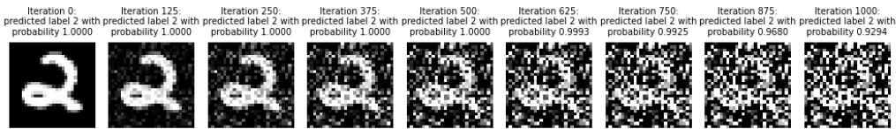
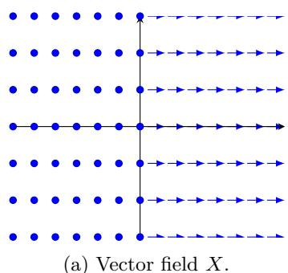
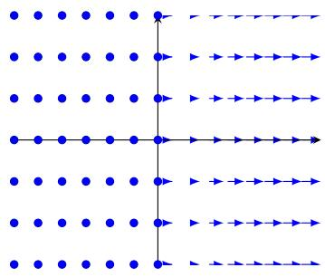
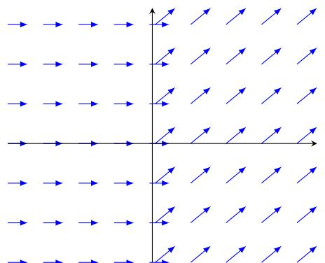

# The Geometry of Manifold Learning: Singular foliations via Deep Learning models

Gabriele Novelli1, Eliot Tron2, Emanuele Latini3, Rita Fioresi4\*

1Dipartimento FIM, Universit\`a di Modena,via Campi 213/A, Modena, I-41125, Italy.

2 SAMM, Universit´e Paris 1 Panth´eon Sorbonne, 31 rue Baudricourt, Paris, 75013, France.

3Dipartimento di Matematica, Universit\`a di Bologna,Piazza Porta San Donato 5, Bologna, I-40126, Italy.

4FaBiT, Universit\`a di Bologna,via S. Donato 15, Bologna, I-40126, Italy.

\*Corresponding author(s). E-mail(s): rita.fioresi@unibo.it; Contributing authors: 378046@studenti.unimore.it; eliot.tron@univ-paris1.fr; emanuele.latini@unibo.it;

Abstract. Deep learning algorithms have become widely used and successful across a wide range of tasks. A key challenge is determining whether these algorithms truly capture the intrinsic geometry of their training data in order to better understand what they learn from data. In this theoretical work, we explore a new geometric structure defined on the data space by a trained neural network through the Data Information Matrix (DIM), a variation of the Fisher Information Matrix. This new geometric structure is a foliation and the main focus of this work is to explore the non-smooth case of ReLU activation functions, where traditional geometric tools often fail. The foliation is defined through a distribution spanned by the columns of the DIM. We first prove that this distribution is non-smooth in the sense of distributions, rendering the existence of an associated foliation much more complex. To circumvent this issue, we introduce a smoothed version of this distribution that difers from the original only on a set of measure zero. Finally, we prove that this smoothed distribution induces a singular foliation on the data space, which is based on the data the network has been trained with. Our theoretical contributions provide a geometric framework to better

understand how neural networks organize their input space in non-smooth settings, bridging diferential geometry and deep learning theory.

## 1 Introduction

Modern machine learning performs analysis on data laying in a high dimensional data space and yet empirical observations suggest that the meaningful data occupy only a small portion of the data space, a concept going under the general loose terminology of manifold hypothesis [1, 2]. Understanding the geometry of these low-dimensional structures containing valid data in the data space has then become a key question [3]. Existing approaches face this problem studying directly the geometry of data [1, 4, 5], however more recently a diferent perspective has emerged in [6, 7]: the geometrical structure of a foliation is induced in the data space by a distribution obtained from the parameters of a (partially) trained neural network. Indeed, the gradients of the probability distribution defined by a trained classifier, can be used to define a distribution, strictly related with the dataset the classifier was trained with. This is not surprising, indeed such gradients hold information on how the data is distributed in the data space. This was observed from the very beginning of the theory in [8] and it is for example the idea on which integrated gradients explainability results are based, starting from the seminal [9] to more recent works as [10].

The purpose of this paper is to explain how the notion of singular foliation is fundamental to understand the space on which a dataset is embedded in and how we can exploit it towards the manifold hypothesis in machine learning, by providing the space of data with a natural foliation structure, generalizing the learning manifold perspective. This structure arises from the data-information-matrix (DIM), an analogue in data space of the Fisher information matrix (FIM). The importance of such matrices is well established: previous works like [11] tie the geometry of parameter space with the learning dynamic, by showing that the FIM induces a highly anisotropic geometry in parameter space, which is nearly flat in most directions and strongly distorted along a few directions, and that its largest eigenvalue controls the steepest direction relevant to gradient-descent dynamics. These ideas were furtherly developed in many papers, see [12, 13] and refs. therein. As far as its data space counterpart (the DIM) is concerned, recent works show that the structure emerging by taking the distribution generated by its columns is tied to the amount of noise associated with a point in the data space [6]. However, the full geometric properties of this foliation remain unexplored: key questions concerning the non-smoothness of the distribution and the mechanisms underlying its observed loss of rank are still not fully understood. Recent developments have further demonstrated the applicability of this geometric perspective. In particular, it has been shown in [14] that, by applying the framework of Cartan geometry to the emerging DIM foliation structure, it is possible to identify optimal perturbations for crafting adversarial attacks [15] beyond linearity [16]. Singular Riemannian geometry has also been used to study 1-D equivalent classes in [17–19].

The present work proposes that a framework going beyond the manifold hypothesis, exploiting the theory of singular distributions and singular foliations to provide the data space with a natural geometric structure. This is especially relevant for ReLU networks, whose piecewise-linear structure naturally leads to distributions with varying rank and limited regularity. The ReLU activation function is indeed very popular in deep learning and the complexity of such networks have been explored for instance by Hanin and Rolnick [20, 21].

This paper is organized as follows.

In Sec. 2, we recall known facts regarding information geometry and the Fisher and Data Information Matrices (FIM, DIM). More details are found in [13, 22–25].

In Sec. 3, we briefly summarize the theory of singular distributions and we show in Thm. 3.2, App. A that the DIM naturally defines a non smooth distribution for a ReLU network convolutional classifier. For more details on prerequisites see [26–29].

In Sec. 4, we briefly summarize the theory of singular foliations, we recap the main key results: Frobenius theorem and Stefan-Sussmann theorem [6, 30]. We then see a key application of such results to ReLU network convolutional classifiers and we see the integrability of the smooth distribution Dˆ Prop. 4.4 obtained from ReLU network convolutional classifiers and the DIM distribution.

## 2 Preliminaries on Information Geometry

We collect definitions and results of information geometry [22, 24] to establish our notation, as well as some results from [6, 7].

We denote by $p ( \boldsymbol { y } | \boldsymbol { x } , \boldsymbol { w } )$ a discrete probability distribution on C classification labels, i.e. $p _ { i } ( y | x , w )$ denotes the predicted probability that x’s label is $y = i$ , where w $\in \mathbb { R } ^ { n }$ are the weights in the parameter space, $\boldsymbol { x } \in \Sigma \subset \mathbb { R } ^ { d }$ the input in the data space and $y \in \{ 1 , \ldots , C \}$ are the labels. $p ( \boldsymbol { y } | \boldsymbol { x } , \boldsymbol { w } )$ can thus be though as a vector of probability $( p _ { i } ( y | x , w ) ) _ { i = 1 , \dots , C }$

We define following [22] Sec. 3, the information loss $I ( x , w )$ of a probability distribution as:

$$
I ( x , w ) : = - \log ( p ( y | x , w ) ) ,
$$

We also define the loss function $L ( x , w )$ to compare two probability distributions $p$ and $q \colon$

$$
L ( x , w ) : = \mathbb { E } _ { y \sim q } [ I ( x , w ) ]
$$

where E as usual denotes the expectation value. In Deep Learning algorithms $L ( x , w )$ is used to compare the model output empirical distribution $p ( \boldsymbol { y } | \boldsymbol { x } , \boldsymbol { w } )$ depending on the parameters w of the model, with the known ground truth distribution $q ( y | x )$ , often a probability mass distribution. For such key example, $L ( x , w )$ is the Kullback-Leibler (KL) divergence between $p ( \boldsymbol { y } | \boldsymbol { x } , \boldsymbol { w } )$ and $q ( y | x )$ , up to the constant $\begin{array} { r } { - \sum _ { i } q _ { i } ( y | x ) \log q _ { i } ( y | x ) } \end{array}$ , which is zero for a probability mass distribution (see the work of Amari [22], Nielsen [24]):

$$
\begin{array} { r l } & { L ( x , w ) = \mathbb { E } _ { y \sim q } [ - \log ( p ( y | x , w ) ) ] = } \\ & { \qquad = \sum _ { i = 1 } ^ { C } q _ { i } ( y | x ) \log \frac { q _ { i } ( y | x ) } { p _ { i } ( y | x , w ) } - \sum _ { i = 1 } ^ { C } q _ { i } ( y | x ) \log q _ { i } ( y | x ) = } \\ & { \qquad = \mathrm { K L } ( q ( y | x ) | | p ( y | x , w ) ) - \sum _ { i = 1 } ^ { C } q _ { i } ( y | x ) \log q _ { i } ( y | x ) . } \end{array}
$$

In Deep Learning (DL) classification algorithms a popular choice for p is via the softmax function:

$$
p _ { i } ( y | x , w ) = \mathrm { s o f t m a x } ( s ( x , w ) ) _ { i } : = \frac { e ^ { s _ { i } ( x , w ) } } { \sum _ { j = 1 } ^ { C } e ^ { s _ { j } ( x , w ) } } ,\tag{1}
$$

where $s ( x , w ) \in \mathbb { R } ^ { C }$ is the score function determined by parameters $w .$ . Popular choices for s involve composition of linear and non linear maps as ReLUs (Rectified Linear Unit). From such $p ( \boldsymbol { y } | \boldsymbol { x } , \boldsymbol { w } )$ we derive the cross-entropy loss function:

$$
\begin{array} { r } { L ( x , w ) = \mathbb { E } _ { y \sim q } [ I ( x , w ) ] = - s _ { y _ { x } } ( x , w ) + \log { \sum _ { j = 1 } ^ { C } e ^ { s _ { j } ( x , w ) } } , } \end{array}
$$

where $L ( x , w )$ is computed with respect to the probability mass distribution $q ( y | x )$ assigns 1 to the correct label $y _ { x }$ of x and zero to the other labels.

We define the Fisher information matrix $F \ ( \mathrm { F I M } )$ and the data information matrix D (DIM) as (see the work of Grementieri and Fioresi [7], Amari [22], Nielsen [24]):

$$
F ( x , w ) = \mathbb { E } _ { y \sim p } [ \nabla _ { w } \log p ( y | x , w ) \cdot ( \nabla _ { w } \log p ( y | x , w ) ) ^ { T } ]\tag{2}
$$

$$
D ( x , w ) = \mathbb { E } _ { y \sim p } [ \nabla _ { x } \log p ( y | x , w ) \cdot ( \nabla _ { x } \log p ( y | x , w ) ) ^ { T } ] .\tag{3}
$$

We have the following result, giving C, the number of classes, as an upper bound for the rank of both $F ( x , w )$ and $D ( x , w )$ (see the work of Grementieri and Fioresi [7]).

## Proposition 2.1. Let the notation be as above. Then:

1. $F ( x , w )$ and $D ( x , w )$ are positive semidefinite symmetric matrices.

2. ker $\begin{array} { r } { F ( \boldsymbol { x } , \boldsymbol { w } ) = ( \mathrm { s p a n } _ { i = 1 , \dots , C } \{ \nabla _ { \boldsymbol { w } } \log p _ { i } ( y | \boldsymbol { x } , \boldsymbol { w } ) \} ) ^ { \perp } ; } \end{array}$

$$
\begin{array} { r } { D ( x , w ) = ( \mathrm { s p a n } _ { i = 1 , \dots , C } \{ \nabla _ { x } \log p _ { i } ( y | x , w ) \} ) ^ { \perp } } \end{array}
$$

3. rank $F ( x , w ) < C , \mathrm { r a n k } D ( x , w ) < C .$

We now focus on the DIM D and its geometric significance in the data space. From Prop. 2.1 and some elementary geometric considerations we have:

$$
\operatorname { I m } D ( x , w ) = \operatorname { s p a n } \{ \nabla _ { x } p _ { i } ( y | x , w ) \}\tag{4}
$$

Hence

$$
\operatorname { r a n k } D ( x , w ) = \dim \operatorname { s p a n } \{ \nabla _ { x } p _ { i } ( y | x , w ) \}\tag{5}
$$

This shows that the probability distribution $p ( \boldsymbol { y } | \boldsymbol { x } , \boldsymbol { w } )$ is not changing, if we move in the data domain along the directions in ker $D ( x , w )$ , i.e. orthogonal to Im $D ( x , w )$ , where orthogonality is with respect to the euclidean product in $\mathbb { R } ^ { d }$ . We call such directions the noise directions. Their significance is expressed in $\mathrm { F i g ~ 1 }$ taken from $[ 7 ] \cdot$ , where we examine the example of a MNIST image. It is then most natural to define, starting from the data matrix D the following assignments D and $\mathcal { D } ^ { \perp }$ in the data domain:

  
Fig. 1: Moving along noise directions makes images increasingly noisier, while the classifier continues to assign a high probably to the initial class [7].

$$
x \mapsto { \mathcal { D } } _ { x } = \operatorname { I m } D ( x , w ) = \operatorname { s p a n } \{ \nabla _ { x } p _ { i } ( y | x , w ) , i = 1 , \dots C \} \subset { \mathbb { R } } ^ { d }\tag{6}
$$

$$
x \mapsto { \mathcal { D } } _ { x } ^ { \perp } = \ker D ( x , w ) = \operatorname { s p a n } \{ \nabla _ { x } p _ { i } ( y | x , w ) , i = 1 , \dots C \} ^ { \perp } \subset { \mathbb { R } } ^ { d }
$$

We define D the DIM distribution. It will turn out to be important in the sequel.

## 3 Singular and non-smooth Distributions

Let M be a smooth manifold and X(M) the space of smooth vector fields on M. We define distributions according to Stefan [30], Sussmann [31]. For more details on distributions in general see App. B.

Definition 3.1. A distribution $\Delta$ on M is an assignment associating to $x \in M$ a vector subspace $\Delta _ { x } \subset T _ { x } M$ . We say $\Delta$ is regular or constant rank if dim $\Delta _ { x } = k$ for all $x \in M$ . If ∆ is not regular we say it is singular.

We say ∆ is smooth if for each x there exists a neighbourhood U of x such that $\Delta _ { y } = \operatorname { s p a n } \{ X _ { y } ^ { 1 } , . . . X _ { y } ^ { r } \}$ for all $y \in U , X ^ { i } \in \mathfrak { X } ( U )$ , that is, they are smooth vector fields.

A smooth distribution can be singular, i.e. non constant rank.

The assignment D in (6) is a distribution. The score function s appearing in the definition (1) of $p _ { i } ( y | x , w )$ , for DL models is typically a sequence of linear maps and non linear functions applied, to each vector entry, as the ReLU:

$$
{ \mathrm { R e L U } } ( x ) = { \left\{ \begin{array} { l l } { 0 } & { { \mathrm { i f } } x < 0 } \\ { x } & { { \mathrm { i f } } x \geq 0 } \end{array} \right. }
$$

which is continuous but not diferentiable. Then, it is not clear whether the resulting distribution D defined in (6) is regular and smooth. Despite the fact D is generated by non smooth vector fields, the question is non trivial, as the next observation clarifies.

Observation 1. A distribution holds information only at the point x. So we may have smooth vector fields spanning at every point x the same subspace of $T _ { x } M$ spanned by

(b) Vector field $X ^ { \prime } .$

non smooth vector fields. For example, consider in $\mathbb { R } ^ { 2 }$ the distribution $\Delta = \operatorname { s p a n } \{ X \}$ for

$$
X = { \left\{ \begin{array} { l l } { 0 } & { { \mathrm { f o r ~ } } x \leq 0 } \\ { \partial _ { x } } & { { \mathrm { f o r ~ } } x > 0 } \end{array} \right. }
$$

Clearly this vector field is non smooth, however one can see the same distribution $\Delta$ as equivalently generated by the smooth vector field

$$
X ^ { \prime } = { \left\{ \begin{array} { l l } { 0 } & { { \mathrm { f o r ~ } } x \leq 0 } \\ { e ^ { - { \frac { 1 } { x ^ { 2 } } } } \partial _ { x } } & { { \mathrm { f o r ~ } } x > 0 } \end{array} \right. }
$$

Hence $\Delta$ is smooth. Examples of these two vector fields can be found on Fig. 2.

  
Fig. 2: Non-smooth and smooth vector fields spanning the same distribution $\Delta .$

There are however distributions that are spanned by non smooth vector fields that are truly non smooth, i.e. we cannot find locally smooth vector fields generating it. For example, consider the distribution in $\mathbb { R } ^ { 2 }$ :

$$
\mathcal { D } = \mathrm { s p a n } \{ X ^ { \prime \prime } \} , \qquad X ^ { \prime \prime } = \left\{ \begin{array} { l l } { \partial _ { x } } & { \mathrm { f o r ~ } x \leq 0 } \\ { \partial _ { x } + \partial _ { y } } & { \mathrm { f o r ~ } x > 0 } \end{array} \right.
$$

This vector field is non smooth (see Fig. 3) and one can show that no smooth vector field can generate the same distribution.

We now focus on the DIM distribution $\mathcal { D } ,$ as in $\left( \mathrm { E q . ~ 6 } \right)$ . From now on, we also assume the score function to be given as:

$$
s ( x , w ) = L _ { W _ { \ell } } ( w ) \circ \mathrm { R e L U } _ { \ell } \circ \cdot \cdot \cdot \circ \mathrm { R e L U } _ { 1 } \circ L _ { W _ { 1 } } ( w ) ( x ) , \qquad x \in \mathbb { R } ^ { d } , \quad w \in \mathbb { R } ^ { n }\tag{7}
$$

where $w = ( W _ { 1 } , \dots , W _ { \ell } )$ are the weight matrices, $L _ { W _ { i } } ( w )$ are linear maps corresponding to the matrix multiplication of the output of the i-th layer by $W _ { i }$ and ReL $\mathrm { U } _ { k }$ is the ReLU function applied entry-wise to $L _ { k } ( w ) \circ$ $\geqslant \mathrm { R e L U } _ { k - 1 } \cdot \cdot \cdot \circ \mathrm { R e L U } _ { 1 } \circ L _ { W _ { 1 } } ( w ) ( x )$

  
Fig. 3: Vector field $X ^ { \prime \prime }$ spanning the non-smooth distribution $\mathcal { D } _ { \ell }$

Consider the DIM distribution in $\mathbb { R } ^ { d } ;$

$$
x \mapsto { \mathcal { D } } _ { x } = \operatorname { s p a n } \{ \nabla _ { x } p _ { i } ( y | x , w ) | i = 1 , \ldots , C \}
$$

We take the convention, as customary for some neural networks implementations, to assign to the non diferentiable point of each ReLU the value 1, so that, with an abuse of notation, we can compute $\nabla _ { x } p _ { i } ( y | x , w )$ also in such points.

The next proposition is proven in [6].

Proposition 3.1. Let the notation be as above. Consider the DIM distribution in $\mathbb { R } ^ { d }$

$$
x \mapsto { \mathcal { D } } _ { x } = \operatorname { s p a n } \{ \nabla _ { x } p _ { i } ( y | x , w ) | i = 1 , \ldots , C \}
$$

and assume p to be given via softmax as in $E q$ . 1 and score from Eq. 7. Then, its singular points are a closed null subset of $\mathbb { R } ^ { d }$ contained in a finite union hyperplanes H.

In [6] the authors also show that the possible non smooth points of the distribution are contained in the set of singular points, though in the light of Obs. 1 the fact D is generated by non-smooth vector fields does not imply it is non smooth.

We now show that indeed the DIM distribution D is non smooth.

Observation 2. The distribution D is spanned by the gradients of the empirical probabilities $p _ { i } ( y | x , w )$ given via softmax (see Eq. 1):

$$
\frac { \partial p _ { i } ( y | x , w ) } { \partial x ^ { j } } = \sum _ { k } p _ { i } ( y | x , w ) \big ( \delta _ { i k } - p _ { k } ( y | x , w ) \big ) \frac { \partial s _ { k } ( x , w ) } { \partial x ^ { j } }
$$

where $\boldsymbol { s } ( \boldsymbol { x } , w ) = ( s _ { 1 } ( x , w ) , \dots , s _ { C } ( x , w ) )$ is the score function, and $0 < p _ { i } ( y | x , w ) < 1$ because of the softmax layer. We can write more compactly:

$$
\mathbb { J } ( p ) = A \mathbb { J } ( s ) { \mathrm { ~ w h e r e ~ } } A = P - p p ^ { T } { \mathrm { ~ a n d ~ } } P = { \left( \begin{array} { l l l l } { p _ { 1 } } & { 0 . . . } & { 0 } & \\ { 0 } & { p _ { 2 } } & { . . . } & { 0 } \\ { . . . } & { . . . } & { . . . } & { . . . } \\ { 0 } & { 0 } & { . . . } & { p _ { C } } \end{array} \right) }
$$

Consider then the matrix $\begin{array} { r } { B = \mathbb { I } - \frac { 1 } { C } \mathbf { 1 } \mathbf { 1 } ^ { T } } \end{array}$ with 1 the vector with all components equals to 1. Then $\operatorname { K e r } ( B ) = \mathbf { 1 } = \operatorname { K e r } ( A )$ and since $B$ is symmetric, by the Spectral theorem we have Im $( B ) = \operatorname { I m } ( A )$ . Hence we have:

$$
\mathrm { I m } ( \mathbb { J } ( p ) ^ { T } ) = \mathrm { I m } ( \mathbb { J } ( s ) ^ { T } A ) = \mathrm { I m } ( \mathbb { J } ( s ) ^ { T } B )
$$

But since B is a constant matrix, as far as the smoothness of D is concerned we can replace D with $\mathcal { D } _ { s }$ :

$$
\mathcal { D } _ { s } = \operatorname { s p a n } \{ \nabla _ { x } s _ { i } ( x , w ) | i = 1 , . . . , C \}
$$

Theorem 3.2. Let the notation be as above. Then for a generic choice of weights in the parameter space $\mathbb { R } ^ { n }$ , the distribution D is non smooth.

Proof See the App. A.

Remark. This result states that once we fix the weights $w \in \mathbb { R } ^ { n }$ generically (in a closed subset of $\mathbb { R } ^ { n }$ , see App. A), then the distribution D defined on the data space $\mathbb { R } ^ { d }$ is non smooth. This result is not surprising and yet it is elusive, because it is true not for every choice of the weights, but for a generic one.

Moreover, the example in Obs. 1 shows that a distribution generated by non smooth vector fields can be indeed smooth, thus expressing the subtlelty of the non smoothness statement.

Though the DIM distribution D is in general non smooth, we can slightly modify it, by changing its values on a closed set in the data space, so to make it smooth. From a machine learning perspective it is an immaterial change, since it occurs in a measure zero set in the data space, however it is of key importance for manifold learning, since it will bring along integrability as we shall see in the next section.

Definition 3.2. Let D be the DIM distribution and let H the union of the hyperplanes containing the singular points of D. We define the distribution $\widehat { \mathcal { D } }$ in the data space $\mathbb { R } ^ { d }$ as follows:

$$
\widehat { \mathcal { D } } _ { x } = \left\{ \begin{array} { l l } { 0 } & { \mathrm { f o r ~ } x \in \mathcal { H } } \\ { \mathcal { D } _ { x } = \mathrm { s p a n } \{ \nabla _ { x } p _ { i } ( y | x , w ) , i = 1 , . . . C \} } & { \mathrm { o t h e r w i s e } } \end{array} \right.
$$

Proposition 3.3. Let the notation be as above. Then the distribution $\widehat { \mathcal { D } }$ is smooth.

Proof The aim is to find smooth vector fields that span this distribution. Clearly for x ̸∈ H (open set) there is nothing to show, $\widehat { \mathcal { D } }$ is smooth, by Prop. 3.1 and [6]. Let $f _ { k } ( x ) = 0$ be defining the hyperplane $H _ { k } \in { \mathcal { H } }$ (finite union of such hyperplanes). Let us define the smooth functions:

$$
\rho _ { k } ( x ) = { \left\{ \begin{array} { l l } { \exp ( - 1 / f _ { k } ^ { 2 } ( x ) ) { \mathrm { ~ f o r ~ } } f _ { k } ( x ) \neq 0 } \\ { 0 { \mathrm { ~ o t h e r w i s e } } } \end{array} \right. }
$$

Let us define the following vector fields $X ^ { \mu }$ in the data space $\mathbb { R } ^ { d } \mathrm { : }$

$$
( X _ { x } ^ { \mu } ) _ { j } = \left( \prod _ { k = 1 } ^ { K } \rho _ { k } ( x ) \right) \mathbb { J } _ { x } ( s ) _ { j } ^ { \mu } , \qquad j = 1 , \dots , d
$$

where $\mathbb { J } _ { x } ( s ) _ { j } ^ { \mu }$ is the j-th entry of the $\mu -$ th row of the Jacobian $\mathbb { J } _ { x } ( s )$ of the score function at $x ,$ and $K$ is the total number of hyperplanes. Clearly $X ^ { \mu }$ are smooth vector fields in $\mathbb { R } ^ { d }$

Let us define $\widetilde { D }$ as the distribution spanned by the smooth vector fields $X ^ { \mu }$ . Clearly $\widetilde { D } _ { x } = \widehat { D } _ { x } = 0$ for $x \in \mathcal H$ . By Obs. 2 we have that $\widetilde { D } _ { x } = \widehat { D } _ { x }$ for $x \notin \mathcal { H }$ and this concludes the proof. □

In the next section we tackle the question of integrability of the singular smooth distribution $\widehat { \mathcal { D } }$

## 4 Integrability of the DIM distribution

A natural question for a smooth distribution on a manifold M regards its integrability i.e. whether the distribution assignment at each point $x \in M$ of a subspace of the tangent space $T _ { x } M$ coincides (locally) with the tangent bundle of a submanifold of M. We briefly recap the main results and then we show integrability for the singular smooth distribution $\widehat { \mathcal { D } } _ { \{ \cdot \} }$ introduced in the previous section.

Definition 4.1. We say that a distribution $\Delta$ is (locally) integrable if through all $x \in M$ there exists a submanifold L of M with $T L = \Delta | _ { L }$

Notice that in the definition we have that $\Delta$ must have constant rank along the submanifold $L ,$ though in general over M the rank may not be constant. Also, we recall that the rank has a lower semicontinuity property.

In case of constant rank, i.e. regular distributions, the main result on integrability is given by Frobenius Theorem.

Definition 4.2. We say that a smooth distribution $\Delta$ is involutive if for every point $x \in$ M there exist smooth vector fields $\{ X _ { 1 } , \ldots , X _ { n } \}$ such that $\Delta _ { y } = \operatorname { s p a n } \{ X _ { 1 , y } , \dotsc , X _ { n , y } \}$ and the Lie bracket $[ X _ { i } , X _ { j } ] _ { y } \in \Delta _ { y }$ for y in a neighbourhood of $x .$

Theorem 4.1 (Frobenius Theorem). Let ∆ be a smooth regular distribution on a manifold M. Then $\Delta$ is integrable $i f$ and only if it is involutive.

For singular distributions, we have a generalization of Frobenius Theorem that we will use in the sequel.

Theorem 4.2 (Stefan-Sussmann). A distribution ∆ is locally integrable if and only $i f \Delta$ is invariant under the flow of the vector fields in Γ(∆) i.e. ∆ is generated by a family of smooth vector fields, and it is invariant with respect to their flow, that is:

$$
( \phi _ { t } ^ { X } ) _ { * } ( \Delta _ { x } ) \subset \Delta _ { \phi _ { t } ^ { X } ( x ) }\tag{8}
$$

for all $x \in M$ , where $\phi _ { t } ^ { X }$ is the flow of the vector field X is the given family.

The condition (8) on the flow in Stefan-Sussmann Theorem is stronger than involutivity, see [28] for more details.

We now turn to the example of D the distribution on the data space given via the DIM (Data Information Matrix) in (6). In [7] integrability is proven in an dense open subset of the data space.

Proposition 4.3. Consider a deep ReLU neural network classifier, p given by softmax, D the DIM distribution. Let H be the union of hyperplanes containing the singularities of D. Then, through all $x \in \mathbb { R } ^ { d } \setminus \mathcal { H }$ , there exists a local submanifold $L \subset \mathbb { R } ^ { d }$ , such that for all $z \in N , \cap L$ with N a neighbourhood of x we have $T _ { z } L = ( \ker \mathcal { D } _ { z } ) ^ { \perp }$

In fact, since $\mathcal { D }$ has constant rank in an open set of $\mathbb { R } ^ { d }$ , we have that the DIM distribution is integrable in such open set. This proposition is proven via Frobenius Theorem (involutivity has been proved in [7]), which however is not available for the distribution $\mathcal { D }$ and its smooth extension $\widehat { \mathcal { D } }$ for the whole $\mathbb { R } ^ { d }$ . However we can show that $\widehat { \mathcal { D } }$ is integrable as an application of the Stefan-Sussmann Theorem.

Proposition 4.4. Let the notation be as above. The singular distribution $\widehat { \mathcal { D } }$ is integrable in the data space.

Proof To prove this it sufices to verify the integrability condition of the Stefan-Sussmann Theorem. Let H be the finite union of hyperplanes as in the definition of $\widehat { \mathcal { D } }$ (Def. 3.2). For $x \notin \mathcal { H }$ , the flow $\phi ^ { X }$ of any vector field $X \in { \widehat { \mathcal { D } } }$ never reaches the points in H in a finite time. Thus, being constant rank, smooth and involutive (Props. 3.1, 4.3), the distribution $\widehat { \mathcal { D } }$ satisfies the Stefan-Sussmann condition (8) on the open region $\mathbb { R } ^ { d } \backslash$ H. Now we look at $x \in \mathcal H$ . Since the diferential of the flow of a vector field is a linear map, it always sends 0 to 0. So the integrability condition is trivially satisfied:

$$
( \phi _ { t } ^ { X } ) _ { * } : 0 _ { x } \mapsto 0 _ { \phi _ { t } ^ { X } ( x ) }
$$

This proves that the distribution $\widehat { \mathcal { D } }$ is integrable.

## 5 Conclusions

This paper discusses distributions and foliations emerging from the Data Information Matrix (DIM) the analogue in the data space of the Fisher Information Matrix. In particular, we show that in general the DIM distribution, that is, the distribution spanned by the probability gradients of a Deep Learning system is non smooth, for parameters in general position in the data space, i.e. not on a measure zero set, which is defined by the non null sets of polynomial functions. A suitable modification of the DIM distribution, leads to a singular smooth distribution, satisfying the integrability conditions of the Stefan-Sussmann theorem, thus leading a well defined notion of integral manifold in data space. Experimental evidence in [6, 7] links such integral manifolds with the dataset the model was trained with, future investigation will furtherly investigate this relation.

## Acknowledgments

R. F. and G. N. wish to thank Prof. D. Miyamoto for valuable comments and suggestions. R. F. and E. L. are partially supported by PNRR (PE12) MNESYS, INDAM-GNSAGA, CaLISTA CA 21109, CaLIGOLA MSCA-2021-SE- 01-101086123, MSCA-DN CaLiFor-NIA - 101119552, PNRR National Center for HPC, Big Data and Quantum Computing, INFN Sezione Bologna, SimQuSec. E. T. benefited from financial support from the French government managed by the National Agency for Research under the France 2030 program, with the reference ANR-23-PEIA-0004.

## References

[1] Burges, C.J.C.: Dimension Reduction: A Guided Tour. Foundations and Trends® in Machine Learning 2(4), 275–365 (2010) https://doi.org/10.1561/2200000002

[2] Feferman, C., Mitter, S., Narayanan, H.: Testing the manifold hypothesis. Journal of the American Mathematical Society 29(4), 983–1049 (2016) https://doi.org/10. 1090/jams/852

[3] Sun, K., Marchand-Maillet, S.: An information geometry of statistical manifold learning. In: International Conference on Machine Learning (2014)

[4] Lee, J.A., Verleysen, M. (eds.): Nonlinear Dimensionality Reduction. Information Science and Statistics. Springer, New York, NY (2007). https://doi.org/10.1007/ 978-0-387-39351-3

[5] Tenenbaum, J.B., Silva, V., Langford, J.C.: A Global Geometric Framework for Nonlinear Dimensionality Reduction. Science 290(5500), 2319–2323 (2000) https://doi.org/10.1126/science.290.5500.2319

[6] Tron, E., Fioresi, R.: Geometry of Singular Foliations and Learning Manifolds in ReLU Networks via the Data Information Matrix. arXiv (2026). https://doi.org/ 10.48550/arXiv.2409.07412

[7] Grementieri, L., Fioresi, R.: Model-Centric Data Manifold: The Data Through the Eyes of the Model. SIAM Journal on Imaging Sciences 15(3), 1140–1156 (2022) https://doi.org/10.1137/21M1437056

[8] LeCun, Y., Bottou, L., Bengio, Y., Hafner, P.: Gradient-based learning applied to document recognition. Proc. IEEE 86, 2278–2324 (1998)

[9] Sundararajan, M., Taly, A., Yan, Q.: Axiomatic attribution for deep networks. In: International Conference on Machine Learning, pp. 3319–3328 (2017). PMLR

[10] Lundstrom, D., Razaviyayn, M.: Four axiomatic characterizations of the integrated gradients attribution method. Journal of Machine Learning Research 26(177), 1–31 (2025)

[11] Karakida, R., Akaho, S., Amari, S.-i.: Universal Statistics of Fisher Information in Deep Neural Networks: Mean Field Approach. In: Proceedings of the Twenty-Second International Conference on Artificial Intelligence and Statistics, pp. 1032– 1041. PMLR, ??? (2019)

[12] Sun, K., Nielsen, F.: Relative Fisher information and natural gradient for learning large modular models. In: Precup, D., Teh, Y.W. (eds.) Proceedings of the 34th International Conference on Machine Learning. Proceedings of Machine Learning Research, vol. 70, pp. 3289–3298. PMLR, ??? (2017). https://proceedings.mlr.press/v70/sun17b.html

[13] Martens, J.: New Insights and Perspectives on the Natural Gradient Method. Journal of Machine Learning Research 21(146), 1–76 (2020)

[14] Tron, E., Fioresi, R., Cou¨ellan, N., Puechmorel, S.: Cartan moving frames and the data manifolds. Information Geometry 7, 883–912 (2024) https://doi.org/10. 1007/s41884-024-00159-8

[15] Tron, E., Cou¨ellan, N., Puechmorel, S.: Adversarial attacks on neural networks through canonical Riemannian foliations. Machine Learning 113, 8655–8686 (2024) https://doi.org/10.1007/s10994-024-06624-w

[16] Goodfellow, I.J., Shlens, J., Szegedy, C.: Explaining and harnessing adversarial examples. CoRR abs/1412.6572 (2014)

[17] Benfenati, A., Marta, A.: A singular Riemannian geometry approach to Deep Neural Networks I. Theoretical foundations. Neural Networks 158, 331–343 (2023) https://doi.org/10.1016/j.neunet.2022.11.022 arXiv:2201.09656 [cs, math]

[18] Benfenati, A., Marta, A.: A singular Riemannian geometry approach to deep neural networks II. Reconstruction of 1-D equivalence classes. Neural Networks 158, 344–358 (2023) https://doi.org/10.1016/j.neunet.2022.11.026

[19] Benfenati, A., Marta, A.: A Singular Riemannian Geometry Approach to Deep Neural Networks III. Piecewise Diferentiable Layers and Random Walks on \$n\$- Dimensional Classes. arXiv (2024). https://doi.org/10.48550/arXiv.2404.06104

[20] Hanin, B., Rolnick, D.: Complexity of linear regions in deep networks. In: International Conference on Machine Learning (2019)

[21] Hanin, B., Rolnick, D.: Deep ReLU Networks Have Surprisingly Few Activation Patterns. In: Advances in Neural Information Processing Systems, vol. 32. Curran Associates, Inc., ??? (2019)

[22] Amari, S.-i.: Natural Gradient Works Eficiently in Learning. Neural Computation 10(2), 251–276 (1998) https://doi.org/10.1162/089976698300017746

[23] Amari, S.-i.: Information Geometry and Its Applications. Applied Mathematical Sciences, vol. 194. Springer, Tokyo (2016). https://doi.org/10.1007/ 978-4-431-55978-8

[24] Nielsen, F.: An Elementary Introduction to Information Geometry. Entropy 22(10), 1100 (2020) https://doi.org/10.3390/e22101100

[25] Ay, N., Jost, J., Lˆe, H.V., Schwachh¨ofer, L.: Information Geometry. Ergebnisse Der Mathematik Und Ihrer Grenzgebiete 34, vol. 64. Springer, Cham (2017). https://doi.org/10.1007/978-3-319-56478-4

[26] Agrachev, A.A., Sachkov, Y.L.: Control Theory from the Geometric Viewpoint. Encyclopaedia of Mathematical Sciences, vol. 87. Springer, Berlin, Heidelberg (2004). https://doi.org/10.1007/978-3-662-06404-7

[27] Hermann, R.: On the Diferential Geometry of Foliations. Annals of Mathematics 72(3), 445–457 (1960) https://doi.org/10.2307/1970226 1970226

[28] Lavau, S.: A short guide through integration theorems of generalized distributions. Diferential Geometry and its Applications 61, 42–58 (2018) https://doi.org/10. 1016/j.difgeo.2018.07.005

[29] McKay, B.: Sussmann’s orbit theorem and maps. Diferential Geometry and its Applications 25(3), 277–280 (2007) https://doi.org/10.1016/j.difgeo.2006.11.005

[30] Stefan, P.: Accessibility and foliations with singularities. Bulletin of the American Mathematical Society 80(6), 1142–1145 (1974)

[31] Sussmann, H.J.: Orbits of Families of Vector Fields and Integrability of Distributions. Transactions of the American Mathematical Society 180, 171–188 (1973) https://doi.org/10.2307/1996660 1996660

[32] Drager, L.D., Lee, J.M., Park, E., Richardson, K.: Smooth distributions are finitely generated. Annals of Global Analysis and Geometry 41(3), 357–369 (2012) https://doi.org/10.1007/s10455-011-9287-8

## A Smoothness of the DIM distribution

In this section we prove that the DIM distribution D on the data space $\mathbb { R } ^ { d }$ is non smooth for the parameters chosen in an open dense set in the parameter space $\mathbb { R } ^ { n }$ . We use the same notation as in Sec. 3 for the score function expression (7), the set H as in Prop. 3.1, etc. As expressed in Obs. 1, there is no change in the smoothness of D if we replace the distribution $\mathcal { D }$ with $\mathcal { D } _ { s }$ generated by the gradients of the scores. Hence, from now on, in this appendix, we assume D to be generated by the gradients of score functions.

To simplify our treatment, we look at points in the dataspace $\mathbb { R } ^ { d }$ which are not in the intersections of two or more hyperplanes in H, the argument for generic points being the same.

Let H be an hyperplane in H defined by $\mathrm { R e L U } _ { k }$ in the expression of the score function at the k-th layer. Define $R _ { \pm }$ the two regions of $\mathbb { R } ^ { d } \backslash H$ as follows. Define $R _ { + }$ as

$$
R _ { + } = \{ x \in \mathbb { R } ^ { d } \setminus H | \mathbb { J } _ { x } ( \mathrm { R e L U } _ { k } ) _ { i i } = 0 \}
$$

where $\mathbb { J } _ { x } ( \mathrm { R e L U } _ { k } )$ is the Jacobian of the ${ \mathrm { R e L U } } _ { k }$ function at $x .$ Similarly define $R _ { - } ,$ taking those x with $\mathbb { J } _ { x } ( \mathrm { R e L U } _ { k } ) _ { i i } = 1$ . Since we assume ReLU functions have value 1 on their non-smooth point, we have that $\mathbb { J } _ { x } ( \mathrm { R e L U } _ { k } ) _ { i i } = 1$ on H. We define $\mathbb { J } _ { x } ( s ) _ { \pm }$ in $H \cup R _ { \pm }$ as follows. $\mathbb { J } _ { x } ( s ) _ { \pm } \ = \ \mathbb { J } _ { x } ( s )$ for $x \in R _ { \pm }$ . Then, for $x \in H , \mathbb { J } _ { x } ( s ) _ { + }$ in its expression has the factor $\mathbb { J } _ { x } ( \mathrm { R e L U } _ { k } )$ with $\mathbb { J } _ { x } ( \mathrm { R e L U } _ { k } ) _ { i i } = 0$ , while $\mathbb { J } _ { x } ( s ) _ { - }$ in its expression has the factor $\mathbb { J } _ { x } ( \mathrm { R e L U } _ { k } )$ with $\mathbb { J } _ { x } ( \mathrm { R e L U } _ { k } ) _ { i i } = 1$ . From the very definitions, we have $\mathbb { J } _ { x } ( s ) \big | _ { H } = \mathbb { J } _ { x } ( s ) _ { - }$ and in general $\mathbb { J } _ { x } ( s ) _ { - } \neq \mathbb { J } _ { x } ( s ) _ { + }$

Observation 3. Notice that the rows of $\mathbb { J } _ { x } ( s ) _ { \pm }$ are smooth in their respective domains $H \cup R _ { \pm }$ . Indeed they are the smooth vector fields $\nabla _ { x } s _ { \mu } ( w )$ , which are constant as x varies in $\mathbb { R } ^ { d }$ , for given fixed parameters $w \in \mathbb { R } ^ { n }$ (the score depends linearly on x). We denote the rows of $\mathbb { J } _ { x } ( s ) _ { \pm }$ as $\nabla _ { x } s _ { \mu , \pm }$ . We clearly have $\nabla _ { x } s _ { \mu } = \nabla _ { x } s _ { \mu , \pm }$ for x in $R _ { \pm }$ while $\nabla _ { x } s _ { \mu } = \nabla _ { x } s _ { \mu , - }$ for x in H. Moreover, by the very definitions, we have that the DIM distribution $\mathcal { D }$ in $H \cup R _ { - }$ is spanned by $\{ \nabla _ { x } s _ { \mu , - } \}$ both point-wise and locally in R only. Similarly, in $R _ { + } \left\{ \nabla _ { x } s _ { \mu , + } \right\}$ span D both point-wise and locally.

Lemma A.1. Let H be an hyperplane and $R _ { \pm }$ the two regions of $\mathbb { R } ^ { d } \backslash$ H. Let $\mathbb { J } _ { x } ( s ) _ { \pm }$ be as above. Then, if the distribution D is smooth we have:

$$
\mathrm { I m } ( \mathbb { J } _ { x } ( s ) _ { + } ^ { T } ) \supseteq \mathrm { I m } ( \mathbb { J } _ { x } ( s ) _ { - } ^ { T } ) \ f o r \ a l l \ p o i n t s \ x \in H
$$

Proof Suppose D is smooth. Let x be a point on the hyperplane H and U be an open neighborhood of x in $\mathbb { R } ^ { d }$ . By contradiction assume:

$$
\mathrm { I m } ( \mathbb { J } _ { x } ( s ) _ { + } ^ { T } ) \not \perp \mathrm { I m } ( \mathbb { J } _ { x } ( s ) _ { - } ^ { T } )
$$

Then there is some vector $v _ { x } ,$ , such that $v _ { x } \in \mathrm { I m } ( \mathbb J _ { x } ( s ) _ { - } ^ { T } )$ and $v _ { x } \not \in \mathrm { I m } ( \mathbb { J } _ { x } ( s ) _ { + } ^ { T } )$ . Note that $\mathrm { I m } ( \mathbb { J } _ { x } ( s ) _ { - } ^ { T } ) = { \mathcal { D } } _ { x }$ . We now show this leads to a contradiction.

Since the distribution is smooth, there exists a smooth vector field $Y : U \to T \mathbb { R } ^ { d } .$ , in the distribution ${ \mathcal { D } } | _ { U }$ , such that $Y ( x ) = v _ { x }$ . Since $Y \in { \mathcal { D } } | _ { U }$ , we have that $Y ( y ) \in { \mathcal { D } } _ { y } = \operatorname { I m } ( \mathbb { J } _ { y } ( s ) _ { + } ^ { T } )$ for all $y \in U \cap R _ { + }$ and $Y ( z ) \in \mathcal { D } _ { z } = \mathrm { I m } ( \mathbb { J } _ { z } ( s ) _ { - } ^ { T } )$ for all $z \in U \cap R _ { - }$ . Notice also that $\mathscr { D } _ { y } = \mathrm { I m } ( \mathbb { J } _ { y } ( s ) _ { + } ^ { T } )$ is constant as y varies in $U \cap R _ { + }$ + (and similarly for $\mathcal { D } _ { z } , z \in U \cap R _ { - } )$ . By a small abuse of notation, identifying each tangent space at any y with $\mathbb { R } ^ { d } .$ , via canonical global coordinates, we can write

$$
\mathrm { I m } ( \mathbb { J } ( s ) _ { + } ^ { T } ) \subset \mathbb { R } ^ { d } \cong T _ { \boldsymbol { y } } \mathbb { R } ^ { d }\tag{9}
$$

dropping the index $_ { y , }$ to mark the fact it does not depend on $y .$ Hence, (9) makes sense also for $y \in U \cap ( R _ { + } \cup H )$ , not just for $y \in U \cap R _ { + }$ . We now look at:

$$
Y ^ { - 1 } ( \mathrm { I m } ( \mathbb { J } ( s ) _ { + } ^ { T } ) : = \{ u \in U \cap ( R _ { + } \cup H ) | Y ( u ) \in \mathrm { I m } ( \mathbb { J } ( s ) _ { + } ^ { T } ) \}
$$

Since Im $( \mathbb { J } ( s ) _ { + } ^ { T }$ is a closed subspace of $\mathbb { R } ^ { d }$ also $Y ^ { - 1 } ( \mathrm { I m } ( \mathbb { J } ( s ) _ { + } ^ { T } )$ is closed $( Y$ is continuous) and it contains $U \cap R _ { + }$ . Since the latter is open, it contains also its closure, so that $U \cap H \subset$ $Y ^ { - 1 } ( \mathrm { I m } ( \mathbb { J } ( s ) _ { + } ^ { T } )$ . This is a contradiction since $x \in U \cap H$ , so $Y ( x ) \in \operatorname { I m } ( \mathbb { J } ( s ) _ { + } ^ { T } )$ , but we are assuming $Y ( x ) = v _ { x } \not \in \mathrm { I m } ( \mathbb { J } ( s ) _ { + } ^ { T } )$ □

Corollary A.2. Let H be an hyperplane in H. Then $\mathbb { J } _ { x } ( s ) .$ difers from $\mathbb { J } _ { x } ( s ) _ { - } \ b y$ setting a set of rows of weights to $\boldsymbol { \theta }$ in $L _ { W _ { k + 1 } }$

Proof Recall the expression of the score function as in (7):

$$
\begin{array} { r } { s ( x , w ) = L _ { W _ { \ell } } \circ \mathrm { R e L U } _ { \ell - 1 } \circ \cdots \circ \mathrm { R e L U } _ { 1 } \circ L _ { W _ { 1 } } } \end{array}\tag{10}
$$

Setting the $n ^ { t h }$ diagonal element of $\mathbb { J } ( \mathrm { R e L U } _ { k } )$ from 1 to 0 has the same efect of setting the $n ^ { t h }$ row of $L _ { W _ { k + 1 } }$ to 0. □

Observation 4. Suppose that the DIM distribution D is smooth. Then, by Lemma A.1 we have

$$
\mathrm { I m } ( \mathbb { J } _ { x } ( s ) _ { + } ^ { T } ) \supseteq \mathrm { I m } ( \mathbb { J } _ { x } ( s ) _ { - } ^ { T } )
$$

From now on, we assume there exists at least one $\boldsymbol { x } \in \mathbb { R } ^ { d }$ for which the inequality is strict. This is the same as assuming the distribution is non constant i.e. not spanned by the columns of a constant matrix, which is somehow a degenerate situation, which is not observed experimentally. It is important not to confuse non constant with non regular. A regular distribution is a constant rank distribution, while a constant distribution is one spanned by the same subspace at all points in euclidean space.

Theorem A.3. Let D be the DIM distribution and assume D is non constant. The set of points w $\in \mathbb { R } ^ { W }$ in the parameter space for which the distribution D is smooth is contained in a closed set of measure zero.

Proof We will use the rank constraints on the DIM distribution D to construct polynomial equations in the parameter space, defining a closed set of measure zero where $\mathcal { D }$ can be smooth. Let H be an hyperplane in H and fix x in H. By Lemma A.1 we have that:

$$
\mathrm { I m } ( \mathbb { J } _ { x } ( s ) _ { + } ^ { T } ) \supseteq \mathrm { I m } ( \mathbb { J } _ { x } ( s ) _ { - } ^ { T } )\tag{11}
$$

Let us choose H and x so that the inclusion is strict (see Obs. 4). Assume rank $( \mathbb { J } _ { x } ( s ) _ { - } )$ to be $k - 1 ;$ then all $k \times k$ minors of $\mathbb { J } _ { x } ( s )$ − are zero. If they do not vanish identically they define

the required closed and measure zero set in the parameter space. If they do vanish identically, from Corollary A.2, it follows that all the $k \times k$ minors of $\mathbb { J } _ { x } ( s ) _ { + }$ vanish identically as well. But this leads to a contradiction since we are assuming:

$$
\mathrm { I m } ( \mathbb { J } _ { x } ( s ) _ { + } ^ { T } ) \supset \mathrm { I m } ( \mathbb { J } _ { x } ( s ) _ { - } ^ { T } )\tag{12}
$$

hence $\mathbb { J } _ { x } ( s ) _ { + }$ has strictly higher rank.

□

## B Distributions

In this appendix, we compare our definition of distribution (see Def. 3.1) on a manifold M with another notion of distribution, which is encountered in the literature and is not equivalent to the one in Def.3.1. In order to distinguish between the two definitions, we refer to this new notion as module distribution. This is the approach taken in [27, 28].

Definition B.1. We define module distribution $\mathcal { F }$ as a $C ^ { \infty } ( M )$ submodule of ${ \mathfrak { X } } ( M )$ the $C ^ { \infty } ( M )$ module of smooth vector fields of $M$

Notice that we make no hypothesis on $\mathcal { F }$ being a finitely generated or a free $C ^ { \infty } ( M )$ submodule of ${ \mathfrak { X } } ( M )$

The next observation clarifies the relation between the two diferent approaches to the theory of distributions.

Observation 5. If D is a smooth distribution, then we can determine a module distribution by looking at the smooth global sections of $\mathcal { D }$

$$
\Gamma ( \mathcal { D } ) : = \{ f : M \mapsto \coprod _ { x \in M } \mathcal { D } _ { x } | f ( x ) \in \mathcal { D } _ { x } \}
$$

Similarly, if $\mathcal { F }$ is a module distribution (they are by definition smooth), we can obtain a distribution by the assignment:

$$
x \mapsto \operatorname { s p a n } \{ X _ { x } | X \in { \mathcal { F } } \}
$$

These two maps are not inverse of each other. There are many module distributions which correspond to the same distribution and some module distributions that are not $\Gamma ( \mathcal D )$ for any distribution $\mathcal { D }$

Motivated by the previous observation, we give the following definition.

Definition B.2. Let $\mathcal { F }$ be a module distribution. We define $_ { T \mathcal { F } }$ the distribution obtained as:

$$
x \mapsto T { \mathcal { F } } _ { x } : = \operatorname { s p a n } \{ X _ { x } | X \in { \mathcal { F } } \}
$$

Example B.3. Consider the module distributions on $M = \mathbb { R }$ as $k \geq 0$ varies:

$$
\mathcal { F } _ { k } = C ^ { \infty } ( M ) \langle x ^ { k } \partial _ { x } \rangle \subset \mathfrak { X } ( M )
$$

where $\begin{array} { r } { C ^ { \infty } ( M ) \langle x ^ { k } \partial _ { x } \rangle = \{ \sum _ { k } f _ { k } ( x ) x ^ { k } \partial _ { x } \mid f _ { k } ( x ) \in C ^ { \infty } ( M ) \} } \end{array}$

Clearly $\mathcal { F } _ { k } \not \cong \mathcal { F } _ { l }$ for $\mathrm { \ell } \ast \mathrm { \ell } = \mathrm { \ell } l \mathrm { \ell }$ . However one sees right away that

$$
\mathcal { D } : x \mapsto ( \mathcal { F } _ { k } ) _ { x } : = \operatorname { s p a n } \{ X _ { x } | X \in \mathcal { F } _ { k } \}
$$

give the same distribution for all $k .$

Vice-versa, by looking at the global sections of $\mathcal { D }$ we retrieve only ${ \mathcal { F } } _ { 0 } .$ , and one can easily be convinced that the module distributions $\mathcal { F } _ { k }$ are not retrieved as the global sections of any distribution (this is because the information of the $x ^ { k }$ is lost in the evaluation at x).

We now face the question of integrability in the two diferent approaches. Before we start the discussion it is useful to keep in mind that the theorem we are about to state, Hermann’s theorem, is the strongest integrability result, but regards only submodules of X(M), i.e. module distributions. For this reason it is somehow less applicable in concrete questions.

Theorem B.1 (Hermann $\big [ 2 7 \big ] \big )$ . Let $\Delta$ be a distribution such that $\Delta = T \mathcal { F }$ for $\mathcal { F }$ a module distribution. If

1. $\mathcal { F }$ is finitely generated as $C ^ { \infty } ( M )$ submodule $o f \mathfrak { X } ( M ) \ i . e$

$$
\mathcal { F } = C ^ { \infty } ( M ) \langle X ^ { 1 } , \ldots , X ^ { r } \rangle \subset \mathfrak { X } ( M )
$$

2. $\mathcal { F }$ is a Lie subalgebra of $\mathfrak { X } ( M ) , i . e . [ X , Y ] \in \mathcal { F }$

then $\Delta$ is integrable.

This result is apparently simple, but it is very profound and hides subtle points.

One natural question is whether a given $\Delta$ is finitely generated. In other words if we can find global vector fields $X ^ { 1 } , \ldots , X ^ { n }$ such that $\Delta _ { x } = \operatorname { s p a n } \{ X _ { x } ^ { 1 } , \ldots , X _ { x } ^ { n } \}$ . The answer is yes, however the proof is very technical and surprisingly complicated [32].

Another question regards module distributions. Since any distribution ∆ is finitely generated (see point (1)), we can ask if $\Gamma ( \Delta ) \subset { \mathfrak { X } } ( M )$ is finitely generated. It is true that in general a module distribution is not a finitely generated module, but perhaps those coming as the global sections of a distribution are finitely generated? The answer is surprisingly no. Let us look again at the example in $M = \mathbb { R }$ . We define the distribution $\Delta$ as follows:

$$
\Delta _ { x } : = \operatorname { s p a n } \{ X _ { x } \} , \qquad X = \left\{ 0 \ \begin{array} { l l } { { } } & { { \mathrm { f o r } \ x \leq 0 } } \\ { { \partial _ { x } } } & { { \mathrm { f o r } \ x > 0 } } \end{array} \right.
$$

$\Delta$ is smooth, since $\Delta _ { x }$ is equivalently spanned at each x by

$$
X ^ { \prime } = { \left\{ \begin{array} { l l } { 0 } & { { \mathrm { f o r ~ } } x \leq 0 } \\ { e ^ { - { \frac { 1 } { x ^ { 2 } } } } \partial _ { x } } & { { \mathrm { f o r ~ } } x > 0 } \end{array} \right. }
$$

One sees that:

$$
\Gamma ( \Delta ) \cong \{ f : M = \mathbb { R } \longrightarrow \mathbb { R } | f | _ { ( - \infty , 0 ] } = 0 \}
$$

and this is not finitely generated. It contains the functions

$$
f ( x ) = { \left\{ \begin{array} { l l } { x ^ { k } { \mathrm { ~ f o r ~ } } x > 0 ; } \\ { 0 { \mathrm { ~ o t h e r w i s e } } } \end{array} \right. }
$$

for all $k > 0 .$ which are not obtainable as combination of other $C ^ { \infty }$ functions. This fact is not entirely obvious.

Hence Hermann condition (1) does not apply, though condition (2) is obvious (we are in dimension 1, everything is involutive). However, one can see that this distribution is integrable.