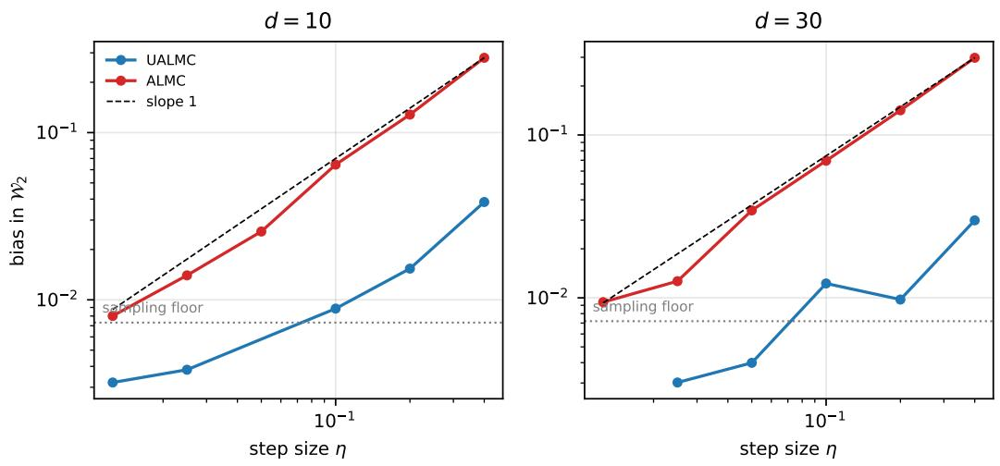
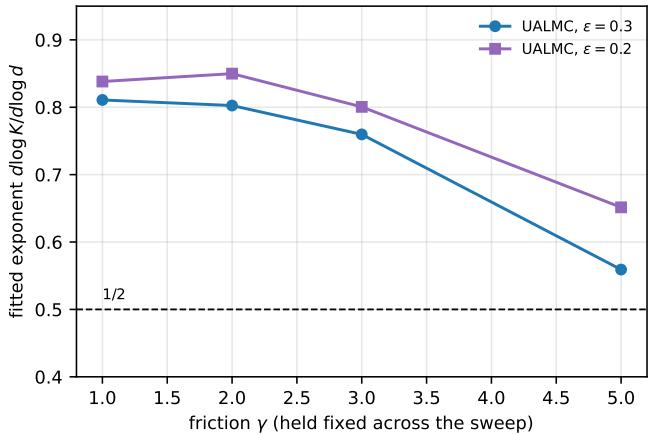
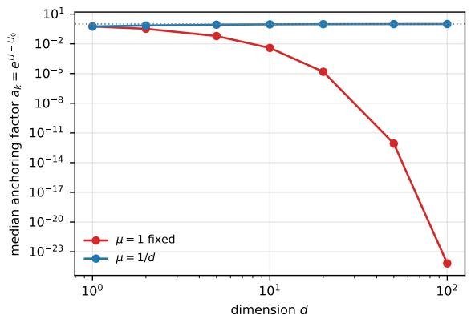
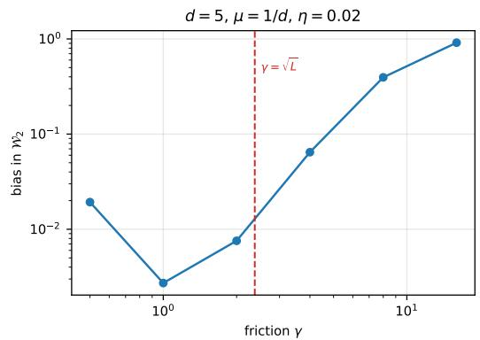
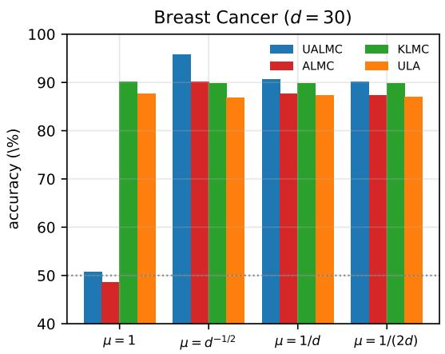
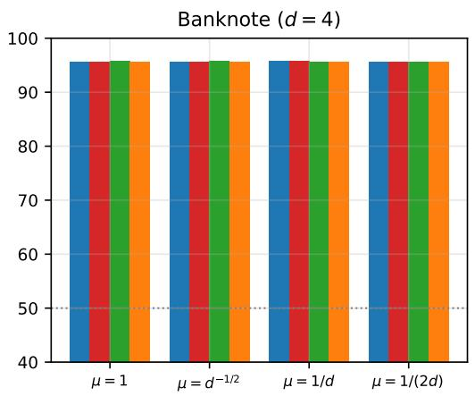
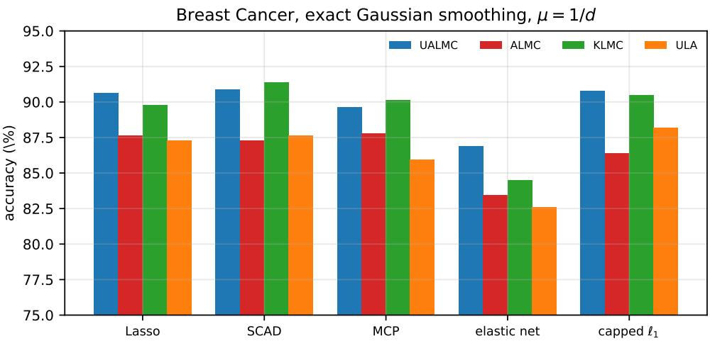
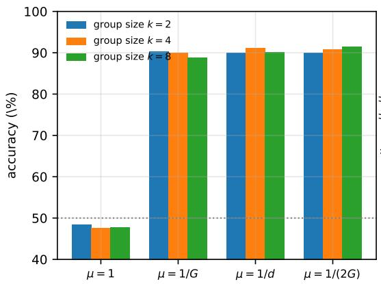
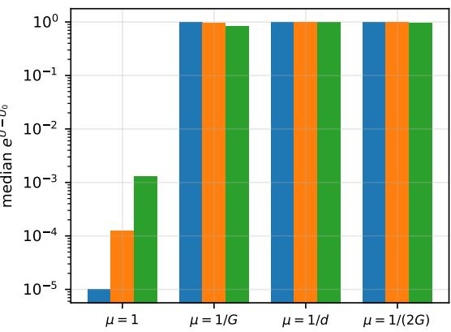
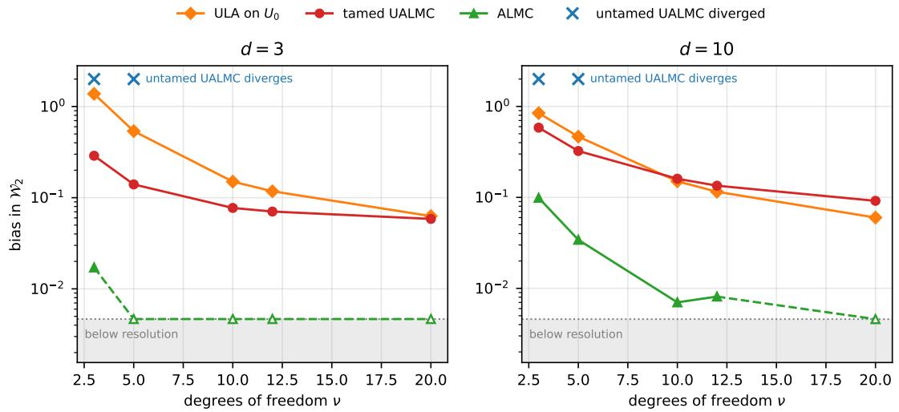

# Underdamped Anchored Langevin Dynamics

Qi Feng 1, Hoang M. Nguyen 2, Lingjiong Zhu 3

October 28, 2026

## Abstract

Classical Langevin Monte Carlo algorithms, such as the unadjusted Langevin algorithm (ULA), are based on discretization schemes of the overdamped Langevin dynamics and are widely used for sampling in machine learning because they scale to high dimensions and large datasets. However, they require diferentiable log-densities, and are less eficient for sampling heavy-tailed distributions. Although various approaches have been proposed in the literature for sampling non-diferentiable and heavy-tailed targets, all of them are developed in the overdamped setting only. We propose a novel momentum-based underdamped anchored Langevin dynamics (UALD), and underdamped anchored Langevin Monte Carlo (UALMC) algorithm based on a discretization scheme of UALD. Our paper is the first to provide a kinetic (momentum-based) Langevin algorithm for non-diferentiable and heavy-tailed targets that is free of asymptotic bias. The method replaces the original potential with a smooth reference potential and modifies the underdamped Langevin dynamics via multiplicative scaling in the drift term. We establish non-asymptotic guarantees in the 2-Wasserstein distance to the target distribution and show that the resulting iteration complexity has better dependence on dimension and accuracy level compared to overdamped-based anchored Langevin algorithms. We provide numerical experiments to illustrate the theory and practical performance of our proposed approach.

## 1 Introduction

The problem of sampling a target distribution $\pi ( x ) \propto \exp ( - U ( x ) )$ for a function $U$ $\mathbb { R } ^ { d } \to \mathbb { R }$ arises in many applications, including Bayesian statistical inference [34], Bayesian formulations of inverse problems [64], and Bayesian classification and regression tasks in machine learning [2, 65, 36, 38, 3, 69]. Langevin algorithms are popular Markov chain Monte Carlo (MCMC) methods that allow one to sample from a target distribution of interest, and the classical one is based on the discretization of overdamped Langevin dynamics [15, 25, 26, 11, 24, 16, 57]:

$$
d X _ { t } = - \nabla U ( X _ { t } ) d t + \sqrt { 2 } d B _ { t } ,\tag{1.1}
$$

where $U : \mathbb { R } ^ { d }  \mathbb { R }$ and $B _ { t }$ is a standard d-dimensional Brownian motion. Under some mild assumptions on $U ( \cdot )$ , the difusion (1.1) admits a unique stationary distribution with the density $\pi ( x ) \propto \exp ( - U ( x ) )$ , also known as the Gibbs distribution [14, 44]. In computing practice, the difusion (1.1) is simulated by considering its discretization, and one of the most commonly used discretization schemes is the Euler–Maruyama discretization of (1.1), often known as the unadjusted Langevin algorithm (ULA) in the literature; see e.g. [24]:

$$
x _ { k + 1 } = x _ { k } - \eta \nabla U ( x _ { k } ) + \sqrt { 2 \eta } \xi _ { k + 1 } ,\tag{1.2}
$$

where $\xi _ { k }$ are independent and identically distributed $( \mathrm { i . i . d . } ) \ N ( 0 , \mathsf { l } _ { d } )$ Gaussian random vectors and $\eta > 0$ is the stepsize.

When the target density $e ^ { - U ( x ) }$ is non-diferentiable or heavy-tailed, classical Langevin methods face serious practical and theoretical limitations. The lack of diferentiability in U causes the gradient-based updates to be ill-defined. Such an issue is not just theoretical curiosity, but arises often in modern Bayesian inference problems, including Bayesian logistic regression with sparsity inducing priors [68], Bayesian deep learning problems with non-smooth activation functions [37, 9, 31]. When the target distribution is heavy-tailed, the exponential ergodicity might fail to hold and concentration behavior assumed in many convergence analyses and can lead to instability or divergence [60, 41, 42, 43].

There have been many studies on sampling non-diferentiable targets. Zeroth-order Langevin algorithms approximate first-order information based on evaluations of the potential function $U$ using finite-diferences [62, 27]. This can be beneficial in some settings when the gradients do not exist or when they are hard to compute. However, zerothorder methods are typically slower than first-order methods, as their gradient estimates tend to be noisier. There are also alternative approaches that rely on approximating the potential with a smooth, diferentiable surrogate to enable gradient-based sampling such as [74]. In addition, proximal MCMC methods approximate the non-smooth function U using its Moreau–Yoshida envelope (MYE) [26, 35, 52, 63, 48, 7, 71, 55, 29], which provides a smooth surrogate. The MYE of a function U yields a smooth approximation $U ^ { \lambda }$ that can be used with gradient-based Langevin algorithms for sampling. However, computing the gradient of the MYE requires evaluating a proximal step with respect to $U ,$ which is typically computationally expensive [35], with eficient computations available only in specific cases. Moreover, using the gradient of $U ^ { \lambda }$ introduces bias and in some cases, a very tight envelope (i.e., a small λ) may be needed to obtain an accurate approximation. This, however, necessitates small stepsizes, leading to slow mixing [35, Example 4.1]. Other envelopes that approximate a non-smooth potential with a smooth one, such as the forward-backward envelope, can also be used [29]; but they still require computing proximal steps. Piecewise-deterministic Markov processes (PDMPs) such as the bouncy particle and zig-zag samplers, which do not sufer from asymptotic bias, ofer an alterna tive. They can be applied to target distributions that are diferentiable almost everywhere [19, 22, 8], and in practice, may be preferable to MYE-based methods—particularly when the MYE is dificult to compute or not well-defined [35]. However, PDMPs may encounter computational dificulties in high dimensions; event-time simulations can be demanding, and their performance can be sensitive to the availability of tight event-rate bounds [35].

Finally, mirror-descent–type algorithms that employ the Bregman–Moreau envelope instead of the MYE to handle non-smoothness on Riemannian manifolds [49]. When U is non-diferentiable but convex, there are also subgradient-based approaches, which relaxes the diferentiability requirement. Among subgradient-based approaches, [23] proposed the stochastic subgradient Langevin dynamics (SSGLD) and provided convergence guarantees by leveraging the fact that sampling can be viewed as optimization in the space of prob ability measures. Other subgradient-based approaches include [40]. Another approach is using Gaussian smoothing [54] where one would obtain a smooth approximation of U by convolving it with a Gaussian kernel. [10] analyze Gaussian-smoothing-based Langevin dynamics for convex and non-smooth U. This approach replaces $\nabla U$ in the Langevin dynamics (1.1) with $\nabla U _ { 0 }$ and then simulates the dynamics, which, as the discretization parameter vanishes, converges to an approximate target density $\pi _ { 0 } ( x ) \propto e ^ { - U _ { 0 } ( x ) }$ and thus sufers from bias.

Sampling from target distributions with heavy tails where $U ( x )$ grows sublinearly presents unique challenges for standard sampling algorithms and the literature is quite limited. Several works introduced modification of classical ULA by using Metropolis steps [46, 6, 5], which can be expensive for some applications involving high dimensionality and large datasets [70]. [43] develops zeroth- and first-order Langevin algorithms for heavytailed distributions whose potentials satisfy weighted Poincar´e inequalities, including tdistributions. Their first-order method discretizes associated Itˆo difusions and extends to zeroth-order variants via Gaussian smoothing. However, when a non-smooth potential U is approximated by a smoothed $U _ { 0 }$ , the limiting Itˆo difusions converge to $\pi _ { 0 } ( x ) \sim e ^ { - U _ { 0 } ( x ) }$ leading to asymptotic bias. In related work, [42] characterize the class of heavy-tailed densities for which polynomial-order complexity guarantees can be obtained when ULA is applied to suitably transformed versions of the target.

To the best of our knowledge, all of the approaches listed above have been developed and analyzed in the overdamped setting only. The Moreau–Yosida/proximal algorithms [26, 55, 35, 52, 63, 48, 7, 71, 29], the subgradient methods [23, 40], the Gaussian-smoothing approach [10] and the Bregman–Moreau envelope method [49] are all obtained by discretizing the first-order difusion (1.1); in particular, a kinetic counterpart of the Bregman– Moreau scheme is explicitly listed as a direction for future work in [49]. Conversely, the nonasymptotic literature on underdamped (kinetic) Langevin algorithms [13, 12, 17, 33, 32, 50] assumes throughout that $\nabla U$ exists and is Lipschitz; the recent relaxations of that hypothesis concern drifts that fail to be globally Lipschitz or that grow superlinearly, but are still diferentiable, and therefore do not cover non-diferentiable targets. The only exception we are aware of is the class of PDMP samplers [19, 22, 8], which are non-reversible but are not discretizations of a kinetic difusion. Accordingly, our paper is the first to provide a kinetic (momentum-based) Langevin algorithm for non-diferentiable targets that is free of asymptotic bias, together with non-asymptotic guarantees; we highlight this as one of the contributions of the paper.

Recently, [39] proposed and studied anchored Langevin dynamics (ALD) that modifies the Langevin dynamics itself, such that it is anchored with a new potential $U _ { 0 }$ and the resulting dynamics converge to the original target $\pi ( x ) \propto e ^ { - U ( x ) }$ and are free of such bias:

$$
d X _ { t } = - \nabla U _ { 0 } ( X _ { t } ) e ^ { U ( X _ { t } ) - U _ { 0 } ( X _ { t } ) } d t + \sqrt { 2 } e ^ { ( U ( X _ { t } ) - U _ { 0 } ( X _ { t } ) ) / 2 } d B _ { t } .\tag{1.3}
$$

Non-asymptotic convergence guarantees are obtained for (1.3) and its Euler-Maruyama discretization in [39]. Very recently, [66] proposed and studied reflected anchored Langevin dynamics (RALD), which is (1.3) with a reflected boundary. This allows sampling on a constrained domain where the target density is not necessarily diferentiable. [1] introduced and studied non-reversible anchored Langevin dynamics (NALD) and non-reversible reflected anchored Langevin dynamics (NRALD) by adding an anti-symmetric matrix to the drift term of ALD and NALD respectively. Through the lens of finite-time nonasymptotic convergence analysis, large deviations analysis and asymptotic variance reduction, [1] showed that by breaking reversibility, NALD and NRALD can converge to the target distributions faster than their reversible counterparts.

In the literature, the algorithms based on underdamped (a.k.a. second-order, inertial or kinetic) Langevin difusion dynamics are popular alternatives to the ones based on overdamped Langevin dynamics; see e.g. [13, 12, 17, 33, 32, 50]:

$$
d { \cal V } _ { t } = - \gamma { \cal V } _ { t } d t - \nabla U ( X _ { t } ) d t + \sqrt { 2 \gamma } d B _ { t } ,\tag{1.4}
$$

$$
d X _ { t } = V _ { t } d t ,\tag{1.5}
$$

where $\gamma > 0$ is the friction coeficient, $X _ { t } , V _ { t } \in \mathbb { R } ^ { d }$ models the position and the momentum of a particle moving in a field of force (described by the gradient of U) plus a random (thermal) force described by the d-dimensional standard Brownian motion $B _ { t }$ . It is known that under some mild assumptions on $U ,$ the Markov process $( X _ { t } , V _ { t } ) _ { t \geq 0 }$ is ergodic and admits a unique stationary distribution π with density $\begin{array} { r } { \pi ( x , v ) \propto \exp \left( - \overline { { \left( \frac { 1 } { 2 } \| v \| ^ { 2 } + U ( x ) \right) } } \right) } \end{array}$ Hence, the x-marginal distribution of the stationary distribution with the density $\pi ( x , v )$ is exactly the invariant distribution of the overdamped Langevin difusion. It is known that the momentum-based underdamped Langevin dynamics can accelerate the convergence to the Gibbs distribution and outperform the overdamped Langevin dynamics [28, 50, 33]. This motivates us to ask the question whether there is an underdamped analog of the anchored Langevin dynamics (1.3). In this paper, we give a positive answer to this question by proposing the underdamped anchored Langevin dynamics (UALD):

$$
d V _ { t } = - \gamma V _ { t } d t - \nabla U _ { 0 } ( X _ { t } ) e ^ { U ( X _ { t } ) - U _ { 0 } ( X _ { t } ) } d t + \sqrt { 2 \gamma } d B _ { t } ,\tag{1.6}
$$

$$
d X _ { t } = V _ { t } e ^ { U ( X _ { t } ) - U _ { 0 } ( X _ { t } ) } d t ,\tag{1.7}
$$

where $U _ { 0 } : \mathbb { R } ^ { d }  \mathbb { R }$ plays the role of reference potential. We will show that UALD preserves the Gibbs distribution $\begin{array} { r } { \pi ( x , v ) \propto \exp \left( - \left( \frac { 1 } { 2 } \| v \| ^ { 2 } + U ( x ) \right) \right) } \end{array}$ as an invariant distribution. Next, we consider the discretization of $( 1 . 6 ) – ( 1 . 7 )$ . It is known in the literature that for underdamped Langevin algorithms, one can use finer discretization scheme than the Euler-Maruyama [13, 17]. Inspired by the discretization scheme for the classical underdamped Langevin dynamics in (1.4)-(1.5) in [13], we introduce the underdamped anchored Langevin Monte Carlo (UALMC) algorithm:

$$
\begin{array} { r l } & { v _ { k + 1 } = \psi _ { 0 } ( \eta ) v _ { k } - \psi _ { 1 } ( \eta ) g _ { k } + \sqrt { 2 \gamma } \xi _ { k + 1 } , } \\ & { x _ { k + 1 } = x _ { k } + a _ { k } \left( \psi _ { 1 } ( \eta ) v _ { k } - \psi _ { 2 } ( \eta ) g _ { k } \right) + \sqrt { 2 \gamma } a _ { k } \xi _ { k + 1 } ^ { \prime } , } \end{array}\tag{1.8}
$$

where $( \xi _ { k + 1 } , \xi _ { k + 1 } ^ { \prime } )$ is a centered 2d-dimensional Gaussian random vector, independent across k and across coordinates, with the per-coordinate covariance

$$
C = \int _ { 0 } ^ { \eta } { \binom { \psi _ { 0 } ( t ) } { \psi _ { 1 } ( t ) } \left( \psi _ { 0 } ( t ) \right) ^ { \top } d t } = \left( \begin{array} { c c } { \frac { 1 - e ^ { - 2 \gamma \eta } } { 2 \gamma } } & { \frac { 1 - 2 e ^ { - \gamma \eta } + e ^ { - 2 \gamma \eta } } { 2 \gamma ^ { 2 } } } \\ { \frac { 1 - 2 e ^ { - \gamma \eta } + e ^ { - 2 \gamma \eta } } { 2 \gamma ^ { 2 } } } & { \frac { 2 \gamma \eta - 3 + 4 e ^ { - \gamma \eta } - e ^ { - 2 \gamma \eta } } { 2 \gamma ^ { 3 } } } \end{array} \right) ,\tag{1.9}
$$

where

$$
\psi _ { 0 } ( t ) = e ^ { - \gamma t } , \qquad \psi _ { 1 } ( t ) = \int _ { 0 } ^ { t } \psi _ { 0 } ( s ) d s = { \frac { 1 - e ^ { - \gamma t } } { \gamma } } , \qquad \psi _ { 2 } ( t ) = \int _ { 0 } ^ { t } \psi _ { 1 } ( s ) d s ,\tag{1.10}
$$

and

$$
a _ { k } : = a ( x _ { k } ) : = e ^ { U ( x _ { k } ) - U _ { 0 } ( x _ { k } ) } , \qquad g _ { k } : = a ( x _ { k } ) \nabla U _ { 0 } ( x _ { k } ) .\tag{1.11}
$$

The UALMC algorithm (1.8) is obtained by discretizing the UALD (1.6)-(1.7) by an exponential integrator that freezes the state-dependent coeficients over each step. To see that (1.8) is a discretization scheme of (1.6)-(1.7), we first introduce the following auxiliary SDE:

$$
d \tilde { V } _ { t } = - \gamma \tilde { V } _ { t } d t - \nabla U _ { 0 } \left( \tilde { X } _ { \eta \lfloor t / \eta \rfloor } \right) e ^ { U ( \tilde { X } _ { \eta \lfloor t / \eta \rfloor } ) - U _ { 0 } ( \tilde { X } _ { \eta \lfloor t / \eta \rfloor } ) } d t + \sqrt { 2 \gamma } d B _ { t } ,\tag{1.12}
$$

$$
d \tilde { X } _ { t } = { \tilde { V } } _ { t } e ^ { U ( \tilde { X } _ { \eta \lfloor t / \eta \rfloor } ) - U _ { 0 } ( \tilde { X } _ { \eta \lfloor t / \eta \rfloor } ) } d t .\tag{1.13}
$$

In other words, for any kη $\leq t < ( k + 1 ) \eta$ with $k \in \mathbb N$

$$
\begin{array} { r } { d \tilde { V } _ { t } = - \gamma \tilde { V } _ { t } d t - \nabla U _ { 0 } \left( \tilde { X } _ { k \eta } \right) e ^ { U ( \tilde { X } _ { k \eta } ) - U _ { 0 } ( \tilde { X } _ { k \eta } ) } d t + \sqrt { 2 \gamma } d B _ { t } , } \end{array}\tag{1.14}
$$

$$
d \tilde { X } _ { t } = \tilde { V } _ { t } e ^ { U ( \tilde { X } _ { k \eta } ) - U _ { 0 } ( \tilde { X } _ { k \eta } ) } d t ,\tag{1.15}
$$

which implies that $( \tilde { V } _ { t } , \tilde { X } _ { t } )$ follows an Ornstein-Uhlenbeck process on $t \in [ k \eta , ( k + 1 ) \eta )$ 2 that can be solved explicitly and $\left( \tilde { V } _ { k \eta } , \tilde { X } _ { k \eta } \right)$ has the same distribution as $( v _ { k } , x _ { k } )$ , where $( v _ { k } , x _ { k } )$ satisfies the iterates (1.8).

The contributions of our paper can be summarized as follows.

• Compared to the existing literature on Langevin-type algorithms for sampling nondiferentiable target densities, our paper is the first to provide a kinetic and momentumbased Langevin algorithm for non-diferentiable targets that is free of asymptotic bias, together with non-asymptotic guarantees.

• We first verify that the continuous-time UALD (1.6)-(1.7) preserves the Gibbs distribution as an invariant distribution (Theorem 1). We obtain a non-asymptotic 2-Wasserstein convergence bound for the continuous-time UALD (1.6)-(1.7) (Theorem 6, Corollary 8). The proof technique is based on using synchronous coupling, establishing a contraction for the linear approximation (Proposition 2) and then for the full dynamics by controlling the perturbation term and our analysis relies on establishing novel Lyapunov bound (Lemma 4) and exponential moment (Lemma 5). We further show that UALD can sample heavy-tailed distributions such as Student’s t distributions with exponential convergence in time (Theorem 13).

• We obtain finite-time non-asymptotic convergence bound for the discrete-time UALMC algorithm (1.8) (Theorem 16). Based on this, we further obtain iteration complexity (Corollary 25), which improves upon that of ALMC algorithm based on the discretization of (1.3) with better dependence on dimension and accuracy level (Remark 27). Compared to the non-asymptotic convergence analysis for the classical KLMC in the literature [17], the novelty of our analysis is threefold. First, the position equation (1.7) carries the state-dependent speed $a ( x ) = e ^ { U ( x ) - U _ { 0 } ( x ) }$ , so both the force and the speed must be frozen; the frozen speed generates a local error term that is quadratic in the velocity (see (2.75)), a term that has no counterpart in the classical KLMC analysis. Second, the local error involves the unbounded stationary velocity and $\nabla U _ { 0 } ,$ which we never bound uniformly but whose moments we control through the Lyapunov structure of Lemma 4; indeed, the anchored force $g = a \nabla U _ { 0 }$ is not globally Lipschitz (see $\left( 2 . 7 3 \right) )$ , and since the local error contains products of two unbounded factors, the $L _ { 2 }$ deviation splitting of [17] does not sufice; we replace it by uniform polynomial moment bounds for the iterates (Lemma 20). And third, Theorem 6 contracts the weighted functional $\mathbb { E } [ \mathcal { H } _ { t } \Psi _ { t } ^ { \prime } ]$ rather than $\mathbb { E } [ \mathcal { H } _ { t } ]$ , so the discrete recursion must propagate a weighted distance (Lemma 18).

• Numerical experiments demonstrate the eficiency of our proposed algorithm. In particular, we conducted synthetic experiments such as sampling Laplace distributions and heavy-tailed multivariate Student’s distributions and Bayesian logistic regression and Bayesian neural network experiments using real data (Section 3).

## Notations

We summarize the notations here for readers’ convenience.

• Define $\mathcal { P } _ { 2 } ( \mathbb { R } ^ { d } )$ as the space consisting of all the Borel probability measures $\mu$ on $\mathbb { R } ^ { d }$ with the finite second moment (based on the Euclidean norm).

• For any $\mu _ { 1 } , \mu _ { 2 } \in \mathcal P _ { 2 } ( \mathbb { R } ^ { d } )$ , the 2-Wasserstein distance $\mathcal { W } _ { 2 }$ between $\mu _ { 1 }$ and $\mu _ { 2 }$ is defined as: $\mathcal { W } _ { 2 } ( \mu _ { 1 } , \mu _ { 2 } ) : = \big ( \operatorname* { i n f } \mathbb { E } \big [ \| X _ { 1 } - X _ { 2 } \| ^ { 2 } \big ] \big ) ^ { 1 / 2 }$ , where the infimum is taken over all

joint distributions of the random variables $X _ { 1 } , X _ { 2 }$ with marginal distributions $\mu _ { 1 } , \mu _ { 2 }$ respectively; see e.g. [67].

• A function $g : \mathbb { R } ^ { d }  \mathbb { R }$ is m-strongly convex and L-smooth if

$$
\frac { L } { 2 } \left\| x - y \right\| ^ { 2 } \geq g ( x ) - g ( y ) - \nabla g ( y ) ^ { \top } ( x - y ) \geq \frac { m } { 2 } \left\| x - y \right\| ^ { 2 } , \quad \mathrm { f o r ~ e v e r y ~ } x , y \in \mathbb { R } ^ { d } .
$$

• $\mathsf { I } _ { d }$ denotes the $d \times$ d identity matrix.

• For a symmetric positive definite matrix $S$ we write $| w | _ { S } : = ( w ^ { \top } S w ) ^ { 1 / 2 }$ , and $\| \cdot \| _ { \mathrm { o p } }$ for the operator norm.

## 2 Main Results

In this section, we present the main results on the theoretical analysis of our paper. We present the theoretical analysis for the continuous-time dynamics (1.6)-(1.7) in Section 2.1, and the theoretical analysis for the discrete-time algorithm (1.8) in Section 2.2.

## 2.1 Continuous-Time Analysis

## 2.1.1 Invariance distribution

First, we verify that the Gibbs distribution $\begin{array} { r } { \pi ( x , v ) \propto \exp \left( - \left( \frac { 1 } { 2 } \| v \| ^ { 2 } + U ( x ) \right) \right) } \end{array}$ is an invariant distribution for the SDEs (1.6)-(1.7).

Theorem 1. The Gibbs distribution $\pi ( x , v )$ ∝ exp $\begin{array} { r l } {  { \bigl ( - \bigl ( \frac { 1 } { 2 } \| v \| ^ { 2 } + U ( x ) \bigr ) \bigr ) } \qquad } & { { } } \end{array}$ is an invariant distribution for the SDEs (1.6)-(1.7).

Proof. The infinitesimal generator of the SDEs (1.6)-(1.7) is given by

$$
\mathcal { L } _ { 0 } : = \gamma \Delta _ { v } - \gamma v \cdot \nabla _ { v } - e ^ { U ( x ) - U _ { 0 } ( x ) } \nabla _ { x } U _ { 0 } ( x ) \cdot \nabla _ { v } + e ^ { U ( x ) - U _ { 0 } ( x ) } v \cdot \nabla _ { x } ,\tag{2.1}
$$

and we have

$$
\begin{array} { r l } & { \mathcal { L } _ { 0 } ^ { * } e ^ { - \frac { 1 } { 2 } \| v \| ^ { 2 } - U ( x ) } } \\ & { \quad = \Delta _ { v } \left( \gamma e ^ { - \frac { 1 } { 2 } \| v \| ^ { 2 } - U ( x ) } \right) + \mathrm { d i v } _ { v } \left( \gamma v e ^ { - \frac { 1 } { 2 } \| v \| ^ { 2 } - U ( x ) } \right) } \\ & { \qquad + \mathrm { d i v } _ { v } \left( e ^ { U ( x ) - U _ { 0 } ( x ) } \nabla _ { x } U _ { 0 } ( x ) e ^ { - \frac { 1 } { 2 } \| v \| ^ { 2 } - U ( x ) } \right) - \mathrm { d i v } _ { x } \left( e ^ { U ( x ) - U _ { 0 } ( x ) } v e ^ { - \frac { 1 } { 2 } \| v \| ^ { 2 } - U ( x ) } \right) } \\ & { \qquad = \Delta _ { v } \left( \gamma e ^ { - \frac { 1 } { 2 } \| v \| ^ { 2 } - U ( x ) } \right) + \mathrm { d i v } _ { v } \left( \gamma v e ^ { - \frac { 1 } { 2 } \| v \| ^ { 2 } - U ( x ) } \right) } \\ & { \qquad + \mathrm { d i v } _ { v } \left( \nabla _ { x } U _ { 0 } ( x ) e ^ { - \frac { 1 } { 2 } \| v \| ^ { 2 } - U _ { 0 } ( x ) } \right) - \mathrm { d i v } _ { x } \left( v e ^ { - \frac { 1 } { 2 } \| v \| ^ { 2 } - U _ { 0 } ( x ) } \right) = 0 , } \end{array}\tag{2}
$$

where $\mathcal { L } _ { 0 } ^ { \ast }$ is the adjoint operator of $\mathcal { L } _ { 0 }$ . Hence, the SDEs (1.6)-(1.7) preserve the Gibbs distribution $\begin{array} { r } { \pi ( x , v ) \propto \exp \left( - \left( \frac { 1 } { 2 } \| v \| ^ { 2 } + U ( x ) \right) \right) } \end{array}$ as its invariant distribution. The proof is complete. □

## 2.1.2 Non-asymptotic convergence bound

In this section, we study the non-asymptotic convergence of the continuous-time UALD (1.6)–(1.7) to its invariant distribution and obtain an explicit upper bound, using the synchronous coupling method together with a Lyapunov argument.

Synchronous coupling. We recall from (1.6)-(1.7) that for the underdamped anchored Langevin dynamics (UALD):

$$
\begin{array} { r } { d V _ { t } = - \gamma V _ { t } d t - \nabla U _ { 0 } ( X _ { t } ) e ^ { U ( X _ { t } ) - U _ { 0 } ( X _ { t } ) } d t + \sqrt { 2 \gamma } d B _ { t } , } \end{array}\tag{2.3}
$$

$$
d X _ { t } = V _ { t } e ^ { U ( X _ { t } ) - U _ { 0 } ( X _ { t } ) } d t ,\tag{2.4}
$$

and consider the synchronous coupling $( X ^ { \prime } , V ^ { \prime } )$ solving the same equations with the same Brownian motion B but a diferent initial condition:

$$
d V _ { t } ^ { \prime } = - \gamma V _ { t } ^ { \prime } d t - \nabla U _ { 0 } ( X _ { t } ^ { \prime } ) e ^ { U ( X _ { t } ^ { \prime } ) - U _ { 0 } ( X _ { t } ^ { \prime } ) } d t + \sqrt { 2 \gamma } d B _ { t } ,\tag{2.5}
$$

$$
d X _ { t } ^ { \prime } = V _ { t } ^ { \prime } e ^ { U ( X _ { t } ^ { \prime } ) - U _ { 0 } ( X _ { t } ^ { \prime } ) } d t .\tag{2.6}
$$

By subtracting (2.5)-(2.6) from (2.3)-(2.4), we obtain

$$
d \left( \begin{array} { l } { V _ { t } - V _ { t } ^ { \prime } } \\ { X _ { t } - X _ { t } ^ { \prime } } \end{array} \right) = \left( - \left[ \gamma ( V _ { t } - V _ { t } ^ { \prime } ) + \nabla U _ { 0 } ( X _ { t } ) e ^ { U ( X _ { t } ) - U _ { 0 } ( X _ { t } ) } - \nabla U _ { 0 } ( X _ { t } ^ { \prime } ) e ^ { U ( X _ { t } ^ { \prime } ) - U _ { 0 } ( X _ { t } ^ { \prime } ) } \right] \right) d t .
$$

By using the interpolation identity

$$
g ( z _ { 1 } ) - g ( z _ { 2 } ) = \left. z _ { 1 } - z _ { 2 } , \int _ { 0 } ^ { 1 } \nabla g ( s z _ { 1 } + ( 1 - s ) z _ { 2 } ) d s \right. ,\tag{2.7}
$$

for $g = e ^ { U - U _ { 0 } }$ , we get

$$
e ^ { U ( X _ { t } ) - U _ { 0 } ( X _ { t } ) } - e ^ { U ( X _ { t } ^ { \prime } ) - U _ { 0 } ( X _ { t } ^ { \prime } ) } = \left. F _ { t } , X _ { t } - X _ { t } ^ { \prime } \right. ,\tag{2.8}
$$

where

$$
F _ { t } : = \int _ { 0 } ^ { 1 } \nabla e ^ { U - U _ { 0 } } \left( s X _ { t } + ( 1 - s ) X _ { t } ^ { \prime } \right) d s ,\tag{2.9}
$$

and by using (2.7) for $g = \nabla U _ { 0 }$ (componentwise), we get

$$
\nabla U _ { 0 } ( X _ { t } ) - \nabla U _ { 0 } ( X _ { t } ^ { \prime } ) = H _ { t } \ \left( X _ { t } - X _ { t } ^ { \prime } \right) ,\tag{2.10}
$$

where

$$
H _ { t } : = \int _ { 0 } ^ { 1 } \nabla ^ { 2 } U _ { 0 } \left( s X _ { t } + ( 1 - s ) X _ { t } ^ { \prime } \right) d s ,\tag{2.11}
$$

that satisfies

$$
m \vert _ { d } \preceq H _ { t } \preceq L \vert _ { d } ,\tag{2.12}
$$

due to Assumption 3(B). Next, let us define the diference:

$$
\begin{array} { r } { W _ { t } : = \left( V _ { t } - V _ { t } ^ { \prime } , X _ { t } - X _ { t } ^ { \prime } \right) ^ { \top } . } \end{array}
$$

Then, a direct computation gives the closed linear system:

$$
\frac { d } { d t } W _ { t } = \left( M _ { 0 } ( H _ { t } ) + E _ { t } \right) W _ { t } , \qquad M _ { 0 } ( H _ { t } ) : = \left( \begin{array} { c c } { - \gamma { \sf I } _ { d } } & { - H _ { t } } \\ { { \sf I } _ { d } } & { 0 } \end{array} \right) ,\tag{2.13}
$$

where

$$
E _ { t } : = \left( { 0 \atop ( a _ { t } - 1 ) ! _ { d } } \quad ( 1 - a _ { t } ) H _ { t } - \nabla U _ { 0 } ( X _ { t } ^ { \prime } ) F _ { t } ^ { \top } \right) , \qquad a _ { t } : = e ^ { U ( X _ { t } ) - U _ { 0 } ( X _ { t } ) } .\tag{2.14}
$$

Next, we introduce the constant symmetric weight

$$
S : = \binom { a \vert _ { d } \epsilon \vert _ { d } } { \epsilon \vert _ { d } b \vert _ { d } } ,
$$

and its quadratic form

$$
\mathcal { H } _ { t } : = W _ { t } ^ { \top } S W _ { t } = a \left\| V _ { t } - V _ { t } ^ { \prime } \right\| ^ { 2 } + 2 \epsilon \left. V _ { t } - V _ { t } ^ { \prime } , X _ { t } - X _ { t } ^ { \prime } \right. + b \left\| X _ { t } - X _ { t } ^ { \prime } \right\| ^ { 2 } .
$$

Here $S \succ 0$ if and only if $a , b > 0$ and $a b > \epsilon ^ { 2 }$ , in which case

$$
\lambda _ { \operatorname* { m i n } } ( S ) \| W \| ^ { 2 } \leq \mathcal H \leq \lambda _ { \operatorname* { m a x } } ( S ) \| W \| ^ { 2 } ,
$$

so that contraction of H yields $\mathcal { W } _ { 2 }$ contraction up to $\sqrt { \lambda _ { \operatorname* { m a x } } / \lambda _ { \operatorname* { m i n } } } .$

Linear contraction. Note that the diference $W _ { t } = \left( V _ { t } - V _ { t } ^ { \prime } , X _ { t } - X _ { t } ^ { \prime } \right) ^ { \top }$ obeys the linear time-varying system (2.13). The matrix $E _ { t }$ collects exactly the discrepancy produced by anchoring to a mismatched potential $U _ { 0 } \neq U :$ it is built from $a _ { t } - 1$ and $F _ { t } ,$ and both vanish identically when $U = U _ { 0 }$ (then $a _ { t } \equiv 1$ 9 $F _ { t } \equiv 0$ , so $E _ { t } \equiv 0 )$ . By removing $E _ { t }$ , we obtain the linearized system:

$$
\dot { W } = M _ { 0 } ( H _ { t } ) W ,
$$

i.e. the frozen-Hessian linearization of the exact underdamped gradient flow of $U _ { 0 }$ . Proposition 2 shows that this $E _ { t } .$ -free part already contracts in the constant metric S, uniformly over the admissible Hessian range $H _ { t } \in [ m \vert _ { d } , L \vert _ { d } ]$ from (2.11); “linear” refers to this unperturbed part. The full (i.e. perturbed) bound is then obtained by controlling $E _ { t }$ , which is small precisely when the anchoring mismatch $( \omega _ { 0 } , \omega _ { 1 } )$ is small.

Proposition 2 (Linear contraction). Let $M _ { 0 } ( H ) = \left( \begin{array} { c c } { { - \gamma | _ { d } } } & { { - H } } \\ { { | _ { d } } } & { { 0 } } \end{array} \right)$ with H symmetric, $m \mathsf { I } _ { d } \preceq H \preceq L \mathsf { I } _ { d } , 0 < m \leq L$ . Take $a = 1 , b = \epsilon \gamma , \epsilon \in ( 0 , \gamma )$ , so $S = \left( { \begin{array} { c c } { \mathsf { I } _ { d } } & { \epsilon \mathsf { I } _ { d } } \\ { \epsilon \mathsf { I } _ { d } } & { \epsilon \gamma \mathsf { I } _ { d } } \end{array} } \right) \succ 0$ . If

$$
\epsilon ( \gamma - \epsilon ) > \frac { L } { 4 } ,\tag{2.15}
$$

then for every symmetric $H \in [ m \mathsf { l } _ { d } , L \mathsf { l } _ { d } ]$

$$
\left( M _ { 0 } ( H ) \right) ^ { \top } S + S M _ { 0 } ( H ) \preceq - 2 \kappa S ,
$$

with the explicit, largest admissible constant

$$
\kappa : = \frac { 1 } { 2 } \left( \gamma - \sqrt { \operatorname* { m a x } \{ q ( m ) , q ( L ) \} } \right) , \qquad q ( h ) : = \gamma ^ { 2 } - 4 h + \frac { h ^ { 2 } } { \epsilon ( \gamma - \epsilon ) } .\tag{2.16}
$$

Condition (2.15) is solvable if and only $i f \gamma > \sqrt { L }$ (optimized at $\epsilon = \gamma / 2 )$ , and is exactly the condition $\kappa > 0$

Proof. With $a = 1 , \ b = \epsilon \gamma _ { ; }$ , a block computation gives

$$
G ^ { \mathrm { l i n } } ( H ) : = \left( M _ { 0 } ( H ) \right) ^ { \top } S + S M _ { 0 } ( H ) = \binom { 2 ( \epsilon - \gamma ) ! _ { d } } { - H } \ ~ - 2 \epsilon H \biggr ) .
$$

The lower-right block $- 2 \epsilon H \prec 0$ . Thus, by the Schur complement criterion for block matrices, see e.g. [45, Theorem 7.7.7], $G ^ { \mathrm { l i n } } ( H ) \preccurlyeq 0$ if and only if $\begin{array} { r } { 2 ( \epsilon - \gamma ) \mathsf { I } _ { d } + \frac { 1 } { 2 \epsilon } H \prec 0 } \end{array}$ Since $H \preceq L \mathsf { I } _ { d }$

$$
2 ( \epsilon - \gamma ) \vert _ { d } + \frac { 1 } { 2 \epsilon } H \preceq \left( 2 ( \epsilon - \gamma ) + \frac { L } { 2 \epsilon } \right) \vert _ { d } \prec 0 ,
$$

where we used (2.15). For the explicit rate, note S is block-scalar and $M _ { 0 } ( H )$ is blockstructured, so conjugating by $\mathrm { d i a g } ( Q , Q )$ that diagonalizes $H = Q \operatorname { d i a g } ( h _ { i } ) Q ^ { \top }$ decouples the problem into d planar systems with $h _ { i } \in [ m , L ]$ . Thus $G ^ { \mathrm { l i n } } ( H ) \preceq - 2 \kappa S$ for all $H \in$ $[ m \vert _ { d } , L \vert _ { d } ]$ if and only if, for every $h \in [ m , L ] , - G ( h ) \succeq 2 \kappa S _ { 0 }$ with

$$
G ( h ) = { \binom { 2 ( \epsilon - \gamma ) } { - h } } \quad - h ) , \qquad S _ { 0 } = { \binom { 1 } { \epsilon } } \quad \epsilon \gamma \nonumber .
$$

The largest such κ is $\begin{array} { r } { \frac { 1 } { 2 } \operatorname* { m i n } _ { h \in [ m , L ] } \mu _ { - } ( h ) } \end{array}$ , where $\mu _ { - } ( h )$ is the smaller generalized eigenvalue of the pencil $\left( - G ( h ) , \overline { { { S } } } _ { 0 } \right)$ . Expanding det $( - G ( h ) - \mu S _ { 0 } ) = 0$ yields

$$
\mu ^ { 2 } - 2 \gamma \mu + \left( 4 h - \frac { h ^ { 2 } } { \epsilon ( \gamma - \epsilon ) } \right) = 0 ,
$$

which implies that

$$
\mu _ { - } ( h ) = \gamma - \sqrt { q ( h ) } , \quad q ( h ) = \gamma ^ { 2 } - 4 h + \frac { h ^ { 2 } } { \epsilon ( \gamma - \epsilon ) } .
$$

Minimizing $\mu _ { - }$ over $[ m , L ]$ means maximizing the convex q, attained at an endpoint, giving (2.16). Moreover $\mu _ { - } ( h ) > 0$ if and only if $4 \epsilon ( \gamma - \epsilon ) > h$ , so $\kappa > 0$ for all $h \leq L$ if and only if (2.15) holds. Finally $\epsilon \mapsto \epsilon ( \gamma - \epsilon )$ peaks at $\epsilon = \gamma / 2$ with value $\gamma ^ { 2 } / 4$ , so (2.15) is solvable if and only if $\gamma > \sqrt { L }$ . The proof is complete. □

Lyapunov bound. Next, we adopt a Lyapunov approach to extend the linear contraction to the full contraction. First, we make the following main assumption.

Assumption 3. We assume throughout the rest of the paper:

(A) Controlled anchoring: $\omega _ { 0 } : = \| U - U _ { 0 } \| _ { \infty }$ and $\omega _ { 1 } : = \| \nabla ( U - U _ { 0 } ) \| _ { \infty }$ are finite.

(B) Confinement: $U _ { 0 }$ is m-strongly convex and L-smooth, with minimizer $x _ { * }$ and $U _ { 0 } ^ { * } : =$ $U _ { 0 } ( x _ { * } )$

Write $a ( x ) = e ^ { U ( x ) - U _ { 0 } ( x ) }$ , so the reference generator is

$$
\begin{array} { r } { \mathcal { A } = a ( \boldsymbol { x } ) \boldsymbol { v } \cdot \nabla _ { \boldsymbol { x } } - \left( \gamma \boldsymbol { v } + a ( \boldsymbol { x } ) \nabla U _ { 0 } \right) \cdot \nabla _ { \boldsymbol { v } } + \gamma \Delta _ { \boldsymbol { v } } . } \end{array}
$$

The plain energy is not self-controlling $\begin{array} { r } { ( A ( U _ { 0 } + \frac { 1 } { 2 } \| v \| ^ { 2 } ) = - \gamma \| v \| ^ { 2 } + \gamma d } \end{array}$ has no $- c ( \cdot )$ on the position part), so we add the hypocoercive cross term

$$
\mathcal { G } ( \boldsymbol { x } , \boldsymbol { v } ) : = ( U _ { 0 } ( \boldsymbol { x } ) - U _ { 0 } ^ { * } ) + \frac { 1 } { 2 } \| \boldsymbol { v } \| ^ { 2 } + \eta _ { 0 } \langle \boldsymbol { v } , \nabla U _ { 0 } ( \boldsymbol { x } ) \rangle ,\tag{2.17}
$$

where $\eta _ { 0 } > 0$ is chosen to be small. Next, we verify a Foster–Lyapunov drift condition.

Lemma 4 (Foster–Lyapunov drift). Under Assumption $\mathcal { B } ( B )$ , there is $\bar { \eta } _ { 0 } > 0$ such that for all $\eta _ { 0 } \in ( 0 , \bar { \eta } _ { 0 } )$ , we have

$$
\frac { 1 } { 2 } \bar { \mathcal { G } } \leq \mathcal { G } \leq \frac { 3 } { 2 } \bar { \mathcal { G } } ,\tag{2.18}
$$

(in particular $\mathcal { G } \geq 0 )$ where

$$
\bar { \mathcal { G } } : = ( U _ { 0 } - U _ { 0 } ^ { * } ) + \frac { 1 } { 2 } \| v \| ^ { 2 } ,\tag{2.19}
$$

and

$$
A \mathcal { G } \ \leq \ - c \mathcal { G } + b , \qquad c > 0 , \quad b = \gamma d ,\tag{2.20}
$$

with c depending only on $( \gamma , m , L , \eta _ { 0 } , a _ { \mathrm { m i n } } , a _ { \mathrm { m a x } } )$ , where $e ^ { - \omega _ { 0 } } = : a _ { \mathrm { m i n } } \leq a \leq a _ { \mathrm { m a x } } : = e ^ { \omega _ { 0 } }$ (finite under Assumption $\mathcal { B } ( A ) )$

Proof. A direct computation gives

$$
\begin{array} { r } { A \mathcal { G } = - \gamma \| v \| ^ { 2 } + \gamma d + \eta _ { 0 } \left( a v ^ { \top } \nabla ^ { 2 } U _ { 0 } v - \gamma v \cdot \nabla U _ { 0 } - a \| \nabla U _ { 0 } \| ^ { 2 } \right) . } \end{array}
$$

By using the bound $a v ^ { \top } \nabla ^ { 2 } U _ { 0 } v \leq a _ { \mathrm { { m a x } } } L \lVert v \rVert ^ { 2 }$ and Young’s inequality $\begin{array} { r } { | \gamma v \cdot \nabla U _ { 0 } | \leq \frac { \gamma \zeta } { 2 } \| v \| ^ { 2 } + } \end{array}$ $\begin{array} { r l } {  { \frac { \gamma } { 2 \zeta } \| \nabla U _ { 0 } \| ^ { 2 } } } \end{array}$ , we get

$$
\mathcal { A } \mathcal { G } \leq - \left( \gamma - \eta _ { 0 } a _ { \operatorname* { m a x } } L - \frac { \eta _ { 0 } \gamma \zeta } { 2 } \right) \Vert v \Vert ^ { 2 } - \eta _ { 0 } \left( a _ { \operatorname* { m i n } } - \frac { \gamma } { 2 \zeta } \right) \Vert \nabla U _ { 0 } \Vert ^ { 2 } + \gamma d .
$$

Choose $\zeta > \gamma / ( 2 a _ { \mathrm { m i n } } )$ and $\eta _ { 0 }$ small so the $\| \boldsymbol { v } \| ^ { 2 }$ coeficient $- c _ { v }$ is negative and both bracketed factors are $> 0$ . The Polyak– Lojasiewicz bound $\| \nabla U _ { 0 } \| ^ { 2 } \ge 2 m ( U _ { 0 } - U _ { 0 } ^ { * } )$ , which is implied by m-strong convexity of $U _ { 0 }$ , see e.g. [53, Theorem 2.1.10], then gives

$$
\begin{array} { r } { A \mathcal { G } \leq - c _ { 0 } \bar { \mathcal { G } } + \gamma d , } \end{array}
$$

with $\begin{array} { r } { c _ { 0 } = \operatorname* { m i n } \{ 2 c _ { v } , 2 m \eta _ { 0 } ( a _ { \mathrm { m i n } } - \frac { \gamma } { 2 \zeta } ) \} } \end{array}$ . Finally, by L-smoothness of $U _ { 0 }$ , we have $\| \nabla U _ { 0 } \| ^ { 2 } \leq$ $2 L ( U _ { 0 } - U _ { 0 } ^ { * } )$ which yields

$$
| \eta _ { 0 } \langle v , \nabla U _ { 0 } \rangle | \leq \frac { \eta _ { 0 } } { 2 } \| v \| ^ { 2 } + \eta _ { 0 } L ( U _ { 0 } - U _ { 0 } ^ { * } ) ,
$$

and hence (2.18) holds for $\eta _ { 0 } \leq \operatorname* { m i n } \{ \frac { 1 } { 2 } , \frac { 1 } { 2 L } \}$ ; combined with $\begin{array} { r } { \bar { \mathcal { G } } \geq \frac { 1 } { 2 } \mathcal { G } } \end{array}$ this yields (2.20) with $c = c _ { 0 } / 2$ □

Perturbation estimates and the drift of ${ \mathcal { H } } _ { t }$ . Under Assumption $3 ( \mathrm { A } )$ , since $a _ { t } =$ $e ^ { U ( X _ { t } ) - U _ { 0 } ( X _ { t } ) }$ and $| U - U _ { 0 } | \le \omega _ { 0 }$ , we have

$$
| a _ { t } - 1 | \leq \alpha _ { 0 } : = e ^ { \omega _ { 0 } } - 1 ,
$$

and by (2.9) and $\nabla e ^ { U - U _ { 0 } } = e ^ { U - U _ { 0 } } \nabla ( U - U _ { 0 } )$ , we have

$$
\begin{array} { r } { \| F _ { t } \| \leq a _ { \operatorname* { m a x } } \omega _ { 1 } = : c _ { F } = e ^ { \omega _ { 0 } } \omega _ { 1 } . } \end{array}
$$

By bounding the blocks of $E _ { t }$ in (2.14) (operator norm, triangle inequality) and using $\nabla ^ { 2 } U _ { 0 } \preceq L \mathsf { I } _ { d }$ , we obtain

$$
\| E _ { t } \| _ { \mathrm { o p } } \leq \alpha _ { 0 } ( 1 + L ) + c _ { F } \left( \left\| V _ { t } ^ { \prime } \right\| + \left\| \nabla U _ { 0 } ( X _ { t } ^ { \prime } ) \right\| \right) .
$$

From $\begin{array} { r } { \bar { \mathcal { G } } = ( U _ { 0 } - U _ { 0 } ^ { * } ) + \frac { 1 } { 2 } \| v \| ^ { 2 } , \| \nabla U _ { 0 } \| ^ { 2 } \leq 2 L ( U _ { 0 } - U _ { 0 } ^ { * } ) } \end{array}$ , and the equivalence (2.18) $( \bar { \mathcal { G } } \leq 2 \mathcal { G } )$ ,

$$
\left\| { V } _ { t } ^ { \prime } \right\| \leq 2 \sqrt { \mathcal { G } _ { t } ^ { \prime } } , \qquad \left\| { \nabla U } _ { 0 } ( X _ { t } ^ { \prime } ) \right\| \leq 2 \sqrt { L } \sqrt { \mathcal { G } _ { t } ^ { \prime } } ,
$$

where

$$
\mathcal { G } _ { t } ^ { \prime } : = \mathcal { G } ( X _ { t } ^ { \prime } , V _ { t } ^ { \prime } ) ,
$$

and hence we obtain

$$
\begin{array} { r } { \| E _ { t } \| _ { \mathrm { o p } } \leq C _ { 1 } + C _ { 2 } \sqrt { \mathcal { G } _ { t } ^ { \prime } } , \qquad C _ { 1 } : = \alpha _ { 0 } ( L + 1 ) , \quad C _ { 2 } : = 2 c _ { F } \left( 1 + \sqrt { L } \right) , } \end{array}\tag{2.21}
$$

with $C _ { 1 } \to 0 , C _ { 2 } \to 0 { \mathrm { ~ a s ~ } } ( \omega _ { 0 } , \omega _ { 1 } ) \to 0 ( { \mathrm { s i n c e ~ } } \alpha _ { 0 } , c _ { F } \to 0 )$ . By diferentiating $\mathcal { H } _ { t } = W _ { t } ^ { \top } S W _ { t }$ along (2.13), we get

$$
\dot { \mathcal { H } } _ { t } = W _ { t } ^ { \top } \left( ( M _ { 0 } ( H _ { t } ) ) ^ { \top } S + S M _ { 0 } ( H _ { t } ) \right) W _ { t } + W _ { t } ^ { \top } \left( E _ { t } ^ { \top } S + S E _ { t } \right) W _ { t } .\tag{2.22}
$$

The first term on the right-hand side of (2.22) can be bounded by using Proposition 2 (valid since $H _ { t } \in [ m \vert _ { d } , L \vert _ { d } ]$ by (2.11)) such that

$$
\begin{array} { r } { W _ { t } ^ { \top } \left( \left( M _ { 0 } ( H _ { t } ) \right) ^ { \top } S + S M _ { 0 } ( H _ { t } ) \right) W _ { t } \leq - 2 \kappa \mathcal { H } _ { t } . } \end{array}\tag{2.23}
$$

Moreover, we can bound the second term on the right-hand side of (2.22) as:

$$
\begin{array} { r } { W _ { t } ^ { \top } \left( E _ { t } ^ { \top } S + S E _ { t } \right) W _ { t } \leq 2 \| S \| \| E _ { t } \| _ { \mathrm { o p } } \| W _ { t } \| ^ { 2 } \leq \beta _ { 0 } \| E _ { t } \| _ { \mathrm { o p } } \mathcal H _ { t } , } \end{array}\tag{2.24}
$$

with $\beta _ { 0 } : = 2 \| S \| / \lambda _ { \operatorname* { m i n } } ( S )$ . Hence, with

$$
K _ { t } : = \beta _ { 0 } \| E _ { t } \| _ { \mathrm { o p } } \leq \beta _ { 0 } \left( C _ { 1 } + C _ { 2 } \sqrt { \mathcal { G } _ { t } ^ { \prime } } \right) ,\tag{2.25}
$$

we have

$$
\dot { \mathcal { H } } _ { t } \ \leq \ ( - 2 \kappa + K _ { t } ) \mathcal { H } _ { t } .\tag{2.26}
$$

Exponential weight. For $\Psi = e ^ { \alpha \mathcal { G } }$ the difusion produces a carr´e-du-champ correction (only $\gamma \Delta _ { \imath }$ contributes),

$$
\begin{array} { r } { A e ^ { \alpha \mathcal { G } } = e ^ { \alpha \mathcal { G } } \left( \alpha A \mathcal { G } + \gamma \alpha ^ { 2 } \| \nabla _ { v } \mathcal { G } \| ^ { 2 } \right) . } \end{array}\tag{2.27}
$$

With $\nabla _ { v } \mathcal { G } = v + \eta _ { 0 } \nabla U _ { 0 }$ , the bounds $\| v \| ^ { 2 } \leq 2 \bar { \mathcal { G } } , \| \nabla U _ { 0 } \| ^ { 2 } \leq 2 L \bar { \mathcal { G } }$ and $\bar { \mathcal { G } } \leq 2 \mathcal { G }$ give

$$
\gamma \| \nabla _ { v } \mathcal { G } \| ^ { 2 } \leq C _ { \Gamma } \mathcal { G } , \qquad C _ { \Gamma } : = 8 \gamma \left( 1 + \eta _ { 0 } ^ { 2 } L \right) .\tag{2.28}
$$

By combining (2.27), (2.28) and the drift (2.20), we conclude that

$$
\mathcal { A } e ^ { \alpha \mathcal { G } } \leq \alpha e ^ { \alpha \mathcal { G } } \left( - ( c - \alpha C _ { \Gamma } ) \mathcal { G } + b \right) , \qquad 0 < \alpha < \frac { c } { C _ { \Gamma } } , \quad c ^ { \prime } : = c - \alpha C _ { \Gamma } > 0 .\tag{2.29}
$$

The exponential drift inequality (2.29) has a consequence that will be used repeatedly below: since the perturbation $K _ { t }$ in (2.25) grows like $\sqrt { \mathcal { G } _ { t } ^ { \prime } }$ , integrating (2.26) produces exponentials of $\int _ { 0 } ^ { t } \sqrt { \mathcal { G } _ { s } ^ { \prime } }$ ds, and the following lemma shows that such exponentials are integrable, with an expectation that grows at most exponentially in t. Besides controlling the perturbation, this is what justifies the martingale argument in the proof of Theorem 6 below.

Lemma 5 (Exponential moment of the integrated potential). Assume Assumption $\mathrm { \mathcal { B } ( A ) }$ (B) and let $\alpha \in ( 0 , c / C _ { \Gamma } )$ , so $c ^ { \prime } = c - \alpha C _ { \Gamma } > 0$ . Then for every $\lambda \geq 0$ and $t \geq 0$

$$
\mathbb { E } \left[ \exp \left( \lambda \int _ { 0 } ^ { t } \sqrt { \mathcal { G } _ { s } ^ { \prime } } d s \right) ~ \Big | \mathcal { F } _ { 0 } \right] \leq e ^ { \alpha \mathcal { G } _ { 0 } ^ { \prime } } e ^ { \rho ^ { * } t } , \qquad \rho ^ { * } = \rho ^ { * } ( \lambda ) : = \alpha b + \frac { \lambda ^ { 2 } } { 4 \alpha c ^ { \prime } } .\tag{2.30}
$$

In particular, $i f [ \operatorname { E } [ e ^ { \alpha \mathcal { G } _ { 0 } ^ { \prime } } ] < \infty$ then

$$
\mathbb { E } \left[ \exp \left( \lambda \int _ { 0 } ^ { t } \sqrt { \mathcal { G } _ { s } ^ { \prime } } d s \right) \right] \leq e ^ { \rho ^ { * } t } \mathbb { E } \left[ e ^ { \alpha \mathcal { G } _ { 0 } ^ { \prime } } \right] < \infty .
$$

Proof. Fix $\lambda \geq 0$ , set

$$
\Psi _ { t } ^ { \prime } = e ^ { \alpha \mathcal { G } _ { t } ^ { \prime } } , \qquad R _ { t } : = \exp \left( \lambda \int _ { 0 } ^ { t } \sqrt { \mathcal { G } _ { s } ^ { \prime } } d s - \rho ^ { * } t \right) , \qquad Z _ { t } : = \Psi _ { t } ^ { \prime } R _ { t } \geq 0 .\tag{2.31}
$$

Since $R _ { t }$ has finite variation with

$$
d R _ { t } = R _ { t } \left( \lambda \sqrt { \mathcal { G } _ { t } ^ { \prime } } - \rho ^ { * } \right) d t ,
$$

and

$$
d \Psi _ { t } ^ { \prime } = ( A \Psi ) _ { t } ^ { \prime } d t + d M _ { t } ,
$$

where $M _ { t }$ is a local martingale; cf. the evolution in the proof of Theorem 6, we have

$$
d Z _ { t } = Z _ { t } \left( \frac { ( A \Psi ) _ { t } ^ { \prime } } { \Psi _ { t } ^ { \prime } } + \lambda \sqrt { \mathcal { G } _ { t } ^ { \prime } } - \rho ^ { * } \right) d t + R _ { t } d M _ { t } .\tag{2.32}
$$

Inserting (2.29) as

$$
\frac { ( \mathcal { A } \Psi ) _ { t } ^ { \prime } } { \Psi _ { t } ^ { \prime } } \leq - \alpha c ^ { \prime } \mathcal { G } _ { t } ^ { \prime } + \alpha b ,
$$

and completing the square,

$$
- \alpha c ^ { \prime } \mathcal { G } _ { t } ^ { \prime } + \lambda \sqrt { \mathcal { G } _ { t } ^ { \prime } } \leq \frac { \lambda ^ { 2 } } { 4 \alpha c ^ { \prime } } ,
$$

the drift term in (2.32) can be bounded as:

$$
Z _ { t } \left( \frac { ( A \Psi ) _ { t } ^ { \prime } } { \Psi _ { t } ^ { \prime } } + \lambda \sqrt { \mathcal { G } _ { t } ^ { \prime } } - \rho ^ { * } \right) \leq Z _ { t } \left( \alpha b + \frac { \lambda ^ { 2 } } { 4 \alpha c ^ { \prime } } - \rho ^ { * } \right) = 0 .
$$

Thus, $Z _ { t }$ is a nonnegative local supermartingale; with a localizing sequence $\left( \tau _ { n } \right)$ and by Fatou’s lemma, $\mathbb { E } [ Z _ { t } \mid { \mathcal { F } } _ { 0 } ] \leq Z _ { 0 } = e ^ { \alpha \mathcal { G } _ { 0 } ^ { \prime } }$ . Since $\Psi _ { t } ^ { \prime } \geq 1$

$$
\begin{array} { r } { \mathbb { E } \left[ e ^ { \lambda \int _ { 0 } ^ { t } \sqrt { \mathcal { G } _ { s } ^ { \prime } } d s } \Big | \mathcal { F } _ { 0 } \right] = e ^ { \rho ^ { * } t } \mathbb { E } [ R _ { t } \mid \mathcal { F } _ { 0 } ] \leq e ^ { \rho ^ { * } t } \mathbb { E } [ Z _ { t } \mid \mathcal { F } _ { 0 } ] \leq e ^ { \alpha \mathcal { G } _ { 0 } ^ { \prime } } e ^ { \rho ^ { * } t } . } \end{array}
$$

This completes the proof.

Now we state the main theorem for the contraction of the continuous-time dynamics.

Theorem 6 (Contraction). Assume Assumption $\mathcal { B } ( A ) - ( B )$ . With the constants $\beta _ { 0 } ~ =$ $2 \| S \| / \lambda _ { \operatorname* { m i n } } ( S ) , \ C _ { 1 } = \alpha _ { 0 } ( L + 1 ) , \ C _ { 2 } = 2 c _ { F } ( 1 + \sqrt { L } )$ (from $( 2 . 2 1 ) ) , C _ { \Gamma } = 8 \gamma ( 1 + \eta _ { 0 } ^ { 2 } L )$ (from (2.28)), $b = \gamma d ,$ fix $\alpha \in \mathsf { \Gamma } ( 0 , c / C _ { \Gamma } )$ and set $c ^ { \prime } = c - \alpha C _ { \Gamma } > 0 , \Psi _ { t } ^ { \prime } : = e ^ { \alpha \mathcal { G } _ { t } ^ { \prime } }$ with $\mathcal { G } _ { t } ^ { \prime } : = \mathcal { G } ( X _ { t } ^ { \prime } , V _ { t } ^ { \prime } )$ the Lyapunov function (2.17) along the coupling process, and $\Phi _ { t } : = \mathcal { H } _ { t } \Psi _ { t } ^ { \prime }$ Then,

$$
\frac { d } { d t } \mathbb { E } [ \Phi _ { t } ] \leq - ( 2 \kappa - \delta ) \mathbb { E } [ \Phi _ { t } ] , \qquad \delta = \delta ( \alpha ) : = \beta _ { 0 } C _ { 1 } + \alpha b + \frac { ( \beta _ { 0 } C _ { 2 } ) ^ { 2 } } { 4 \alpha c ^ { \prime } } ,
$$

and consequently,

$$
\lambda _ { \operatorname* { m i n } } ( S ) \mathbb { E } \left[ \| W _ { t } \| ^ { 2 } \right] \leq \mathbb { E } [ \Phi _ { t } ] \leq e ^ { - ( 2 \kappa - \delta ) t } \mathbb { E } [ \Phi _ { 0 } ] .
$$

Proof. First of all, by (2.18), $\mathcal { G } \geq \frac { 1 } { 2 } \bar { \mathcal { G } } \geq 0$ , so $\Psi _ { t } ^ { \prime } \geq 1 , \mathcal { H } _ { t } \geq 0 , \Phi _ { t } \geq 0$

Synchronous coupling. Synchronous coupling drives both copies by the same Brownian motion with identical additive velocity noise, so the increments cancel in the diference (2.13) and $W _ { t }$ solves an ODE; hence ${ \mathcal { H } } _ { t }$ is finite variation, $d \mathcal { H } _ { t } = \dot { \mathcal { H } } _ { t } d t$

Evolution of $\Phi _ { t }$ . By Dynkin’s formula,

$$
d \Psi _ { t } ^ { \prime } = ( A \Psi ) _ { t } ^ { \prime } d t + d M _ { t } ,
$$

with $( \boldsymbol { A } \boldsymbol { \Psi } ) _ { t } ^ { \prime } = ( \boldsymbol { A } e ^ { \alpha \mathcal { G } } ) ( \boldsymbol { X } _ { t } ^ { \prime } , V _ { t } ^ { \prime } )$ and $M _ { t }$ a local martingale. As ${ \mathcal { H } } _ { t }$ is finite variation, the product rule has no cross-variation term, and thus

$$
d \Phi _ { t } = \left( \Psi _ { t } ^ { \prime } \dot { \mathcal { H } } _ { t } + \mathcal { H } _ { t } ( \mathcal { A } \Psi ) _ { t } ^ { \prime } \right) d t + \mathcal { H } _ { t } d M _ { t } .
$$

Taking expectations (the stochastic integral is a true martingale by Lemma 5),

$$
\frac { d } { d t } \mathbb { E } [ \Phi _ { t } ] = \mathbb { E } [ \Psi _ { t } ^ { \prime } \dot { \mathcal { H } } _ { t } ] + \mathbb { E } [ \mathcal { H } _ { t } ( \mathcal { A } \Psi ) _ { t } ^ { \prime } ] .
$$

Two inputs. Multiplying the drift inequality (2.26) (derived above using Proposition 2 for the $M _ { 0 } ( H _ { t } ) \ \mathrm { p a r t } )$ by $\Psi _ { t } ^ { \prime } \geq 0$ gives

$$
\Psi _ { t } ^ { \prime } \dot { \mathcal { H } } _ { t } \leq ( - 2 \kappa + K _ { t } ) \Phi _ { t } ,
$$

while (2.29) at the primed point gives

$$
\frac { ( \mathcal { A } \Psi ) _ { t } ^ { \prime } } { \Psi _ { t } ^ { \prime } } \leq - \alpha c ^ { \prime } \mathcal { G } _ { t } ^ { \prime } + \alpha b .
$$

Since $\Phi _ { t } \geq 0$

$$
\frac { d } { d t } \mathbb { E } [ \Phi _ { t } ] \leq \mathbb { E } \left[ \Phi _ { t } \left( - 2 \kappa + K _ { t } + \frac { ( A \Psi ) _ { t } ^ { \prime } } { \Psi _ { t } ^ { \prime } } \right) \right] .
$$

Closing the nonlinearity. With $K _ { t } \ \leq \ \beta _ { 0 } C _ { 1 } + \beta _ { 0 } C _ { 2 } \sqrt { \mathcal { G } _ { t } ^ { \prime } }$ , and the inequality by completing the square,

$$
\beta _ { 0 } C _ { 2 } s - \alpha c ^ { \prime } s ^ { 2 } = - \alpha c ^ { \prime } \left( s - \frac { \beta _ { 0 } C _ { 2 } } { 2 \alpha c ^ { \prime } } \right) ^ { 2 } + \frac { ( \beta _ { 0 } C _ { 2 } ) ^ { 2 } } { 4 \alpha c ^ { \prime } } \le \frac { ( \beta _ { 0 } C _ { 2 } ) ^ { 2 } } { 4 \alpha c ^ { \prime } } ,
$$

applying to $s : = \sqrt { \mathcal { G } _ { t } ^ { \prime } } \geq 0$ , we get

$$
- 2 \kappa + K _ { t } + \frac { ( \mathcal { A } \Psi ) _ { t } ^ { \prime } } { \Psi _ { t } ^ { \prime } } \leq - 2 \kappa + \beta _ { 0 } C _ { 1 } + \alpha b + \frac { ( \beta _ { 0 } C _ { 2 } ) ^ { 2 } } { 4 \alpha c ^ { \prime } } = - ( 2 \kappa - \delta ) ,
$$

which yields that

$$
\frac { d } { d t } \mathbb { E } [ \Phi _ { t } ] \leq - ( 2 \kappa - \delta ) \mathbb { E } [ \Phi _ { t } ] .
$$

Conclusion. Gr¨onwall’s inequality gives

$$
\mathbb { E } [ \Phi _ { t } ] \le e ^ { - ( 2 \kappa - \delta ) t } \mathbb { E } [ \Phi _ { 0 } ] ,
$$

and $\Psi _ { t } ^ { \prime } \geq 1 , S \succ 0$ give

$$
\Phi _ { t } \geq \mathcal { H } _ { t } \geq \lambda _ { \operatorname* { m i n } } ( S ) \Vert W _ { t } \Vert ^ { 2 } ,
$$

which proves the claim. The proof is complete.

In Theorem $6 ,$ since $C _ { 1 } , C _ { 2 } \to 0$ as $( \omega _ { 0 } , \omega _ { 1 } )  0$ , the optimized deficit satisfies $\delta _ { \star } : =$ $\mathrm { i n f } _ { \alpha \in ( 0 , c / C _ { \Gamma } ) } \delta ( \alpha )  0 ;$ hence for suficiently small anchoring mismatch $\delta _ { \star } < 2 \kappa$ and the coupled diference contracts in $\mathcal { W } _ { 2 }$ at rate $\frac 1 2 ( 2 \kappa - \delta _ { \star } ) > 0$ . A rigorous quantitative form of this limit is given in Proposition $7$ below.

Proposition $\mathbf { 7 }$ (Small-mismatch rate). With the notation of Theorem $\delta ,$ the choice $\alpha _ { 0 } : =$ $\frac { \beta _ { 0 } C _ { 2 } } { 2 \sqrt { b c ^ { \prime } ( \alpha _ { \circ } ) } } < c / ( 2 C _ { \Gamma } )$ , we have

$$
\delta ( \alpha _ { \circ } ) = \beta _ { 0 } C _ { 1 } + \beta _ { 0 } C _ { 2 } \sqrt { b / c ^ { \prime } ( \alpha _ { \circ } ) } \leq \beta _ { 0 } C _ { 1 } + \beta _ { 0 } C _ { 2 } \sqrt { 2 b / c } .\tag{2.33}
$$

In particular $\delta _ { \star } \le \beta _ { 0 } C _ { 1 } + \beta _ { 0 } C _ { 2 } \sqrt { 2 b / c } \to 0$ as $( \omega _ { 0 } , \omega _ { 1 } )  0$ , so for all suficiently small mismatch $\delta _ { \star } < 2 \kappa$

Proof. For fixed $c ^ { \prime } ,$ by AM–GM inequality, $\begin{array} { r } { \alpha \mapsto \alpha b + \frac { ( \beta _ { 0 } C _ { 2 } ) ^ { 2 } } { 4 \alpha c ^ { \prime } } } \end{array}$ is minimized at $\alpha _ { 0 } =$ $\beta _ { 0 } C _ { 2 } / ( 2 \sqrt { b c ^ { \prime } } )$ with value $\beta _ { 0 } C _ { 2 } \sqrt { b / c ^ { \prime } }$ . As $C _ { 2 }  0 , \alpha _ { \circ }  0$ . Thus, for suficiently small $C _ { 2 } .$ we have $\alpha _ { \circ } < c / ( 2 C _ { \Gamma } )$ and $c ^ { \prime } ( \alpha _ { \circ } ) = c - \alpha _ { \circ } C _ { \Gamma } > c / 2 ;$ substituting the lower bound $c ^ { \prime } ( \alpha _ { \circ } ) > c / 2$ gives the estimate (2.33), and $C _ { 1 } , C _ { 2 }  0$ gives $\delta _ { \star }  0$ . This completes the proof. □

Theorem 6 yields the following $\mathcal { W } _ { 2 }$ convergence guarantee for UALD (2.3)-(2.4) to its invariant law $\pi .$

Corollary 8. Under the assumptions of Theorem 6, if $\mathbb { E } _ { ( X _ { 0 } ^ { \prime } , V _ { 0 } ^ { \prime } ) \sim \pi } [ \Phi _ { 0 } ] < \infty$ then for all   
$t \geq 0$ ，

$$
\mathcal { W } _ { 2 } \left( \mathrm { L a w } ( X _ { t } , V _ { t } ) , \pi \right) \leq \left( \frac { \mathbb { E } _ { ( X _ { 0 } ^ { \prime } , V _ { 0 } ^ { \prime } ) \sim \pi } [ \Phi _ { 0 } ] } { \lambda _ { \operatorname* { m i n } } ( S ) } \right) ^ { 1 / 2 } e ^ { - ( \kappa - \delta / 2 ) t } .
$$

Proof. Take $( X _ { 0 } ^ { \prime } , V _ { 0 } ^ { \prime } ) \sim \pi$ , so that Law $\left( X _ { t } ^ { \prime } , V _ { t } ^ { \prime } \right) = \pi$ for all $t \geq 0$ . By the definition of 2-Wasserstein distance and applying Theorem 6,

$$
\begin{array} { r } { ( \mathcal { W } _ { 2 } \left( \mathrm { L a w } ( X _ { t } , V _ { t } ) , \pi \right) ) ^ { 2 } \leq \mathbb { E } _ { ( X _ { 0 } ^ { \prime } , V _ { 0 } ^ { \prime } ) \sim \pi } \| W _ { t } \| ^ { 2 } \leq \frac { \mathbb { E } _ { ( X _ { 0 } ^ { \prime } , V _ { 0 } ^ { \prime } ) \sim \pi } [ \Phi _ { 0 } ] } { \lambda _ { \operatorname* { m i n } } ( S ) } e ^ { - ( 2 \kappa - \delta ) t } . } \end{array}
$$

This completes the proof.

Sampling heavy-tailed distributions. Next, we show that UALD can sample heavytailed distributions just as ALD in [39]. Following [39], let $q : \mathbb { R } ^ { d }  [ 1 , \infty )$ be $C ^ { 1 }$ with $\begin{array} { r } { \int _ { \mathbb { R } ^ { d } } \left( q ( x ) \right) ^ { - 1 - \beta } d x < \infty } \end{array}$ for some $\beta > 0$ , and take

$$
U _ { 0 } ( x ) : = \beta \log q ( x ) , \qquad U ( x ) : = ( \beta + 1 ) \log q ( x ) , \qquad \mathrm { s o ~ t h a t } \qquad \pi _ { X } ( x ) \propto ( q ( x ) ) ^ { - ( 1 + \beta ) } ,
$$

which has polynomial tails. Since $e ^ { U - U _ { 0 } } = q$ and $\nabla U _ { 0 } = \beta \nabla q / q$ , the UALD (1.6)–(1.7) becomes

$$
d V _ { t } = - \gamma V _ { t } d t - \beta \nabla q ( X _ { t } ) d t + \sqrt { 2 \gamma } d B _ { t } , \qquad d X _ { t } = q ( X _ { t } ) V _ { t } d t .\tag{2.34}
$$

Note that the true force − $\cdot \nabla U = - ( \beta + 1 ) \nabla q / q$ vanishes in the tails—the classical reason why the classical kinetic Langevin dynamics (1.4)–(1.5) fails on heavy-tailed targets— whereas the anchored force $- \beta \nabla q$ does not degenerate; for the multivariate Student’s t target of [39, Example 2], i.e. $\begin{array} { r } { q ( x ) = 1 + \frac { 1 } { \nu } ( x - \mu _ { t } ) ^ { \top } \Sigma ^ { - 1 } ( x - \mu _ { t } ) } \end{array}$ and $\begin{array} { r } { \beta = \frac { d + \nu } { 2 } - 1 } \end{array}$ , it is linear, $\begin{array} { r } { - \beta \nabla q ( x ) = - \frac { 2 \beta } { \nu } \Sigma ^ { - 1 } ( x - \mu _ { t } ) } \end{array}$

We work under the following assumption, which parallels the class of heavy-tailed targets treated in [39, Corollary 13].

Assumption 9 (Strongly convex anchoring of a heavy-tailed target). Let $q \in C ^ { 2 } ( \mathbb { R } ^ { d } )$ satisfy mi $\iota _ { x } q ( x ) = 1$ (a normalization, as multiplying q by a constant only rescales time in $( 2 . 3 4 ) )$ and

$$
m _ { q } \mathsf { l } _ { d } \preceq \nabla ^ { 2 } q ( x ) \preceq L _ { q } \mathsf { l } _ { d } , \qquad x \in \mathbb { R } ^ { d } ,
$$

for some $0 < m _ { q } \le L _ { q } < \infty$ . Let $\beta > 1$ satisfy

$$
\beta > 1 + \frac { ( d + 4 ) L _ { q } } { 2 m _ { q } } ,\tag{2.35}
$$

and set $U _ { 0 } : = \beta$ log $q , U : = ( \beta + 1 )$ log q, so that π $x \propto q ^ { - ( 1 + \beta ) }$ has polynomial tails of order $2 ( 1 + \beta )$ (integrable, since (2.35) implies $2 ( 1 + \beta ) > d )$

Two elementary consequences of Assumption 9 will be used repeatedly: by the Polyak– Lojasiewicz inequality and $L _ { q } .$ -smoothness of $q ,$

$$
\begin{array} { r } { 2 m _ { q } \left( q - 1 \right) \ \leq \ \| \nabla q \| ^ { 2 } \ \leq \ 2 L _ { q } \left( q - 1 \right) \ \leq \ c _ { 0 } ^ { 2 } q , \qquad c _ { 0 } ^ { 2 } : = 2 L _ { q } , \qquad d m _ { q } \leq \Delta q \leq d L _ { q } . } \end{array}\tag{2.36}
$$

For the Student’s t target, $q ( x ) = 1 + \| x \| ^ { 2 } / \nu$ and $\begin{array} { r } { \beta = \frac { d + \nu } { 2 } - 1 } \end{array}$ , so that $\begin{array} { r } { m _ { q } = L _ { q } = \frac { 2 } { \nu } } \end{array}$ and (2.35) reads $\textstyle { \frac { d + \nu } { 2 } } - 1 > 1 + { \frac { d + 4 } { 2 } }$ , i.e. $\nu > 8$ , a dimension-free condition. We further define

$$
\kappa _ { 0 } : = 2 ( \beta - 1 ) m _ { q } - d L _ { q } > 0 , \qquad \theta : = 1 - \frac { 2 c _ { 0 } ^ { 2 } } { \kappa _ { 0 } } = 1 - \frac { 4 L _ { q } } { \kappa _ { 0 } } \in ( 0 , 1 ) ,\tag{2.37}
$$

where positivity of $\kappa _ { 0 }$ and θ is exactly (2.35). Throughout, $\mu : = \pi _ { X }$ with density $\rho \propto$ $q ^ { - ( 1 + \beta ) } , \ M : = \mathcal { N } ( 0 , \mathsf { l } _ { d } ) , \ \pi = \mu \otimes M ;$ ; norms without subscript are those of $L ^ { 2 } ( \pi )$ , and norms of functions of x alone those of $L ^ { 2 } ( \mu )$ . Let $\begin{array} { r } { \Pi f : = \int _ { \mathbb { R } ^ { d } } f ( \cdot , v ) M ( d v ) } \end{array}$ , and

$$
T : = q ( \boldsymbol { x } ) \left[ \boldsymbol { v } \cdot \nabla _ { \boldsymbol { x } } - \nabla U _ { 0 } ( \boldsymbol { x } ) \cdot \nabla _ { \boldsymbol { v } } \right] , \qquad \boldsymbol { S } : = \gamma \left( \Delta _ { \boldsymbol { v } } - \boldsymbol { v } \cdot \nabla _ { \boldsymbol { v } } \right) ,
$$

so that the generator of (2.34) is $\mathcal { A } = T + S$

Our proof of exponential convergence follows the L2-hypocoercivity method of Dolbeault, Mouhot and Schmeiser [20], which rests on three ingredients: the algebraic structure of the splitting $\mathcal { A } = T + S$ of the generator into a transport part and a collision part (microscopic coercivity, the identity $\Pi T \Pi = 0$ , and the properties of the auxiliary operator A), a macroscopic coercivity, i.e. spectral gap, estimate for the position marginal, and a weighted regularity estimate. We establish these in Lemmas 10, 11 and 12 respectively, beginning with the algebraic structure.

Lemma 10 (Structure). Under Assumption 9, the following hold on the core of smooth compactly supported functions.

(i) T is anti-symmetric and S is symmetric in $L ^ { 2 } ( \pi )$ , with $- \langle S f , f \rangle = \gamma \| \nabla _ { v } f \| ^ { 2 } \ge$ $\gamma \| ( 1 - \Pi ) f \| ^ { 2 }$

(ii) ΠTΠ = 0.

(iii) The operator $\Lambda : = ( T \Pi ) ^ { * } ( T \Pi )$ acts on functions $u = u ( x )$ as

$$
\Lambda u = - q ^ { 2 } \Delta u + \left( \beta - 1 \right) q \nabla q \cdot \nabla u = - \frac { 1 } { \rho } \nabla \cdot \left( q ^ { 2 } \rho \nabla u \right) ,
$$

is symmetric and nonnegative on $L ^ { 2 } ( \mu )$ with $\begin{array} { r } { \langle \Lambda u , u \rangle _ { L ^ { 2 } ( \mu ) } = \int _ { \mathbb { R } ^ { d } } q ^ { 2 } \| \nabla u \| ^ { 2 } d \mu } \end{array}$ , and $- \Pi T T u = \Lambda u$

(iv) With $A : = ( 1 + \Lambda ) ^ { - 1 } ( T \Pi ) ^ { * }$ one has $A f = A ( 1 - \Pi ) f \in \Pi L ^ { 2 } ( \pi ) , T A f \in ( 1 - \Pi ) L ^ { 2 } ( \pi )$ 2 and

$$
\| A f \| \leq { \frac { 1 } { 2 } } \| ( 1 - \Pi ) f \| , \qquad \| T A f \| \leq \| ( 1 - \Pi ) f \| .
$$

(v) $A S = - \gamma A .$

Proof. (i) Anti-symmetry of $T$ can be easily checked, valid for any $C ^ { 1 }$ function $q > 0 ;$ the statement for S is Gaussian integration by parts plus the Gaussian Poincar´e inequality for each fixed x.

(ii) $T \Pi f = q v \cdot \nabla ( \Pi f )$ is odd in v.

(iii) For $u = u ( x )$

$$
T T u = q \left( v \cdot \nabla q \right) \left( v \cdot \nabla u \right) + q ^ { 2 } v ^ { \top } \nabla ^ { 2 } u v - q ^ { 2 } \nabla U _ { 0 } \cdot \nabla u ,
$$

and averaging over v with $\begin{array} { r } { \int _ { \mathbb R ^ { d } } v _ { i } v _ { j } M ( d v ) = \delta _ { i j } } \end{array}$ and $\nabla U _ { 0 } = \beta \nabla q / q$ gives the formula; the divergence form is a direct computation with $\rho \propto q ^ { - ( 1 + \beta ) }$

(iv) Since $\Pi T \Pi = 0$ we have $( T \Pi ) ^ { * } \ = \ ( T \Pi ) ^ { * } ( 1 - \Pi ) ; \ u \ : = \ A f$ solves $u + \Lambda u \ =$ $( T \Pi ) ^ { * } ( 1 - \Pi ) f .$ $u = A f = ( 1 + \Lambda ) ^ { - 1 } ( T \Pi ) ^ { \ast } ( 1 - \Pi ) f$ is a function of x alone, so that $u = \Pi u$ , which gives $A f = A ( 1 { - } \Pi ) f \in \Pi L ^ { 2 } ( \pi )$ , and $T A f = T \Pi u$ is odd in v by (ii), so that $T A f \in ( 1 { - } \Pi ) L ^ { 2 } ( \pi )$ . Taking the $L ^ { 2 } ( \pi )$ inner product of the identity $u { + } \Lambda u = ( T \Pi ) ^ { * } ( 1 { - } \Pi ) f$ with u, we obtain

$$
\| u \| ^ { 2 } + \| T \Pi u \| ^ { 2 } = \langle ( T \Pi ) ^ { \ast } ( 1 - \Pi ) f , u \rangle = \langle ( 1 - \Pi ) f , T \Pi u \rangle \leq \| ( 1 - \Pi ) f \| \| T \Pi u \| ,\tag{2.38}
$$

where we used $\langle \Lambda u , u \rangle = \langle ( T \Pi ) ^ { \ast } ( T \Pi ) u , u \rangle = \| T \Pi u \| ^ { 2 }$ on the left-hand side of (2.38) and the definition of the adjoint together with the Cauchy–Schwarz inequality on the righthand side of (2.38). Dropping $\| u \| ^ { 2 } \geq 0$ and dividing by $\Vert T \Pi u \Vert$ (the bound being trivial if $T \Pi u = 0 )$ gives $\| T A f \| = \| T \Pi u \| \leq \| ( 1 - \Pi ) f \|$ , while keeping $\| u \| ^ { 2 }$ and using $x y - y ^ { 2 } \leq { \frac { 1 } { 4 } } x ^ { 2 }$ for $x , y \geq 0$ , with $x = \| ( 1 - \Pi ) f \|$ and $y = \| T \Pi u \|$ , gives

$$
\| A f \| ^ { 2 } = \| u \| ^ { 2 } \leq \| ( 1 - \Pi ) f \| \| T \Pi u \| - \| T \Pi u \| ^ { 2 } \leq \frac { 1 } { 4 } \| ( 1 - \Pi ) f \| ^ { 2 } .
$$

(v) With $\begin{array} { r } { m ( x ) : = \int _ { \mathbb { R } ^ { d } } v g ( x , v ) M ( d v ) } \end{array}$ one has $\Pi T g = q [ \nabla \cdot m - \nabla U _ { 0 } \cdot m ]$ , and since $S v _ { i } = - \gamma v _ { i }$ , the first moment of $S g$ equals $- \gamma m$ ; hence $\Pi T S = - \gamma \Pi T$ and $A S = - \gamma A$ □

The second ingredient is the macroscopic coercivity, i.e. a spectral gap for the operator Λ of Lemma 10(iii), which amounts to a Poincar´e inequality for $\mu$ with the weight $q ^ { 2 }$ in the Dirichlet form. Since $\mu$ has only polynomial tails, we establish this inequality through the Lyapunov-function criterion for Poincar´e inequalities of [4], for which the weight $q ^ { 2 }$ provides the required confinement.

Lemma 11 (Macroscopic coercivity). Under Assumption 9 there is $\lambda _ { M } > 0$ such that for every $u \in L ^ { 2 } ( \mu )$ with $\begin{array} { r } { \int _ { \mathbb { R } ^ { d } } u d \mu = 0 } \end{array}$

$$
\| T \Pi u \| ^ { 2 } = \int _ { \mathbb { R } ^ { d } } q ^ { 2 } \| \nabla u \| ^ { 2 } d \mu \geq \lambda _ { M } \int _ { \mathbb { R } ^ { d } } u ^ { 2 } d \mu .
$$

Proof. The identity follows from $T \Pi u = q v \cdot \nabla u$ . For the inequality, let

$$
G : = - \Lambda = q ^ { 2 } \Delta - ( \beta - 1 ) q \nabla q \cdot \nabla
$$

be the µ-symmetric Markov generator with Dirichlet form $\textstyle \int _ { \mathbb { R } ^ { d } } q ^ { 2 } \| \nabla u \| ^ { 2 } d \mu$ , and take the Lyapunov function $W : = q$ . By (2.36),

$$
\begin{array} { r l } & { G W = q ^ { 2 } \Delta q - ( \beta - 1 ) q \| \nabla q \| ^ { 2 } } \\ & { \qquad \leq d L _ { q } q ^ { 2 } - 2 ( \beta - 1 ) m _ { q } \left( q - 1 \right) q = - \kappa _ { 0 } q W + 2 ( \beta - 1 ) m _ { q } W . } \end{array}
$$

Hence, with $R _ { 0 } : = ( 2 ( \beta - 1 ) m _ { q } + \kappa _ { 0 } ) / \kappa _ { 0 }$ and the compact set $K : = \{ q \leq R _ { 0 } \}$ (compact since strong convexity forces $q ( x ) \to \infty )$ ,

$$
G W ~ \le ~ - \kappa _ { 0 } W + b { \bf 1 } _ { K } , \qquad b : = \operatorname* { s u p } _ { K } \left( G W + \kappa _ { 0 } W \right) < \infty .
$$

Since $W \geq 1$ and $\mu$ restricted to K has a smooth positive density and the difusion matrix $q ^ { 2 } \mathsf { l } _ { d }$ is uniformly elliptic on $K$ , a local Poincar´e inequality holds on $K$ , and the Lyapunov criterion of [4] yields the spectral gap $\lambda _ { M } > 0$ □

The third ingredient is the boundedness of the auxiliary operator $A T ( 1 - \Pi )$ on $L ^ { 2 } ( \pi )$ which in the framework of [20] reduces to a weighted $H ^ { 2 } \mathrm { - t y p e }$ elliptic regularity estimate for the resolvent $( 1 + \Lambda ) ^ { - 1 }$ . Because of the weight $q ^ { 2 }$ in Λ and the polynomial tails of $\mu ,$ this estimate is not a standard one, and we prove it directly, keeping track of the dependence of the constant on $d , \beta , m _ { q }$ and $L _ { q } .$

Lemma 12 (Weighted regularity). Under Assumption $^ { g } ,$ there is an explicit $C _ { M } < \infty$ that depends on $d , \beta , m _ { q } , L _ { q }$ such that

$$
\| A T ( 1 - \Pi ) f \| \ \le \ C _ { M } \| ( 1 - \Pi ) f \| , \qquad f \in L ^ { 2 } ( \pi ) .
$$

Proof. We divide the proof into several steps.

Step 0 (reduction). As $( A T ( 1 - \Pi ) ) ^ { * } = - ( 1 - \Pi ) T A ^ { * }$ with $A ^ { * } w = T \Pi ( 1 + \Lambda ) ^ { - 1 } \Pi w$ it sufices to prove

$$
\| ( 1 - \Pi ) T T u \| \ \leq \ C _ { M } \left( \| u \| + \| \Lambda u \| \right)\tag{2.39}
$$

for $u : = ( 1 + \Lambda ) ^ { - 1 } \Pi w$ , since $\| u \| \vee \| \Lambda u \| \le \| \Pi w \|$ by the spectral theorem; indeed, here, Λ denotes the nonnegative self-adjoint operator on $L ^ { 2 } ( \mu )$ associated with the closed quadratic form $\begin{array} { r } { \boldsymbol { u } \mapsto \int _ { \mathbb { R } ^ { d } } \boldsymbol { q } ^ { 2 } \lVert \nabla \boldsymbol { u } \rVert ^ { 2 } d \mu } \end{array}$ , i.e. the Friedrichs extension of the symmetric nonnegative operator of Lemma 10(iii), see [58, Theorem X.23]; by the functional-calculus form of the spectral theorem for self-adjoint operators [59, Theorem VIII.5], we have $\begin{array} { r } { \| ( 1 + \Lambda ) ^ { - 1 } \| _ { \mathrm { o p } } \le \operatorname* { s u p } _ { s \ge 0 } ( 1 + s ) ^ { - 1 } = 1 } \end{array}$ and $\begin{array} { r } { \| \Lambda ( 1 + \Lambda ) ^ { - 1 } \| _ { \mathrm { o p } } \leq \operatorname* { s u p } _ { s \geq 0 } s ( 1 + s ) ^ { - 1 } \leq 1 } \end{array}$ ， which gives $\| u \| \leq \| \Pi w \|$ and $\| \Lambda u \| \leq \| \Pi w \|$ . We prove (2.39) for smooth compactly supported u and conclude by approximation (Dirichlet resolvents on balls and passage to the limit). Write

$$
N : = \| u \| _ { L ^ { 2 } ( \mu ) } , \quad L : = \| \Lambda u \| _ { L ^ { 2 } ( \mu ) } , \qquad I : = \int _ { \mathbb { R } ^ { d } } q ^ { 2 } u ^ { 2 } d \mu ,
$$

$$
G _ { s } : = \int _ { \mathbb R ^ { d } } q ^ { s } \| \nabla u \| ^ { 2 } d \mu , \qquad H : = \int _ { \mathbb R ^ { d } } q ^ { 4 } \| \nabla ^ { 2 } u \| _ { F } ^ { 2 } d \mu .
$$

Step 1 (chaos decomposition). By Lemma 10(iii),

$$
( 1 - \Pi ) T T u = v ^ { \top } R ( x ) v - \operatorname { t r } R ( x ) ,
$$

with $R : = q \operatorname { s y m } ( \nabla q \otimes \nabla u ) + q ^ { 2 } \nabla ^ { 2 } u$ , and since E $\left[ \left( \boldsymbol { v } ^ { \top } \boldsymbol { R } \boldsymbol { v } - \operatorname { t r } \boldsymbol { R } \right) ^ { 2 } \right] = 2 \| \boldsymbol { R } \| _ { F } ^ { 2 }$ for symmetric R and $v \sim \mathcal { N } ( 0 , \mathsf { l } _ { d } )$ , the bound (2.36) gives

$$
\| ( 1 - \Pi ) T T u \| ^ { 2 } \ \leq \ 4 c _ { 0 } ^ { 2 } G _ { 3 } + 4 H .\tag{2.40}
$$

Step 2 (weighted Hardy inequality). Integrating $\begin{array} { r } { 0 = \int _ { \mathbb { R } ^ { d } } \nabla \cdot \left( u ^ { 2 } q ^ { 1 - \beta } \nabla q \right) d x } \end{array}$ 2

$$
( \beta - 1 ) \int _ { \mathbb { R } ^ { d } } u ^ { 2 } q ^ { - \beta } \| \nabla q \| ^ { 2 } d x = 2 \int _ { \mathbb { R } ^ { d } } u q ^ { 1 - \beta } \nabla u \cdot \nabla q d x + \int _ { \mathbb { R } ^ { d } } u ^ { 2 } q ^ { 1 - \beta } \Delta q d x .
$$

Bounding the left-hand side from below by $2 ( \beta - 1 ) m _ { q } \left( I - J \right)$ with $\begin{array} { r } { J : = \int _ { \mathbb { R } ^ { d } } q u ^ { 2 } d \mu \geq 0 } \end{array}$ (by (2.36)), the last term by $d L _ { q } I$ , the middle term by $c _ { 0 } I ^ { 1 / 2 } G _ { 3 } ^ { 1 / 2 }$ , and $J \le I ^ { 1 / 2 } N$

$$
I ^ { 1 / 2 } \ \le \ \frac { 2 c _ { 0 } } { \kappa _ { 0 } } G _ { 3 } ^ { 1 / 2 } + C _ { q } N , \qquad C _ { q } : = \frac { 2 ( \beta - 1 ) m _ { q } } { \kappa _ { 0 } } .\tag{2.41}
$$

Step 3 (weighted gradient bound). For smooth compactly supported u and $\varphi _ { : }$ the divergence form of Λ in Lemma 10(iii) and an integration by parts (with no boundary terms, since $\varphi$ has compact support) give

$$
\int _ {  { { \mathbb R } } ^ { d } } ( \Lambda u ) \varphi d \mu = - \int _ {  { { \mathbb R } } ^ { d } } \nabla \cdot \left( q ^ { 2 } \rho \nabla u \right) \varphi d x = \int _ {  { { \mathbb R } } ^ { d } } q ^ { 2 } \nabla u \cdot \nabla \varphi d \mu .
$$

Choosing $\varphi : = q u$ and using $\nabla ( q u ) = q \nabla u + u \nabla q$

$$
\int _ { \mathbb { R } ^ { d } } ( \boldsymbol { \Lambda } \boldsymbol { u } ) q \boldsymbol { u } d \mu = \int _ { \mathbb { R } ^ { d } } q ^ { 3 } \| \nabla \boldsymbol { u } \| ^ { 2 } d \mu + \int _ { \mathbb { R } ^ { d } } q ^ { 2 } \boldsymbol { u } \nabla \boldsymbol { u } \cdot \nabla q d \mu = G _ { 3 } + \int _ { \mathbb { R } ^ { d } } q ^ { 2 } \boldsymbol { u } \nabla \boldsymbol { u } \cdot \nabla q d \mu .
$$

Hence, by the Cauchy–Schwarz inequality, ∥qu∥ $L ^ { 2 } ( \mu ) = I ^ { 1 / 2 }$ and $\| \nabla q \| \leq c _ { 0 } \sqrt { q }$ from (2.36),

$$
G _ { 3 } \leq \| \Lambda u \| _ { L ^ { 2 } ( \mu ) } \| q u \| _ { L ^ { 2 } ( \mu ) } + c _ { 0 } \int _ { \mathbb { R } ^ { d } } ( q | u | ) \left( q ^ { 3 / 2 } \| \nabla u \| \right) d \mu \leq L I ^ { 1 / 2 } + c _ { 0 } I ^ { 1 / 2 } G _ { 3 } ^ { 1 / 2 } .
$$

Solving this quadratic inequality for $G _ { 3 } ^ { 1 / 2 }$ and using ${ \sqrt { a + b } } \leq { \sqrt { a } } + { \sqrt { b } }$ gives

$$
G _ { 3 } ^ { 1 / 2 } \le \frac { 1 } { 2 } \left( c _ { 0 } I ^ { 1 / 2 } + \sqrt { c _ { 0 } ^ { 2 } I + 4 L I ^ { 1 / 2 } } \right) \le c _ { 0 } I ^ { 1 / 2 } + L ^ { 1 / 2 } I ^ { 1 / 4 } .
$$

Step 4 (bootstrap). Substituting into (2.41) and using $\theta = 1 - 2 c _ { 0 } ^ { 2 } / \kappa _ { 0 }$ and Young’s inequality,

$$
\theta I ^ { 1 / 2 } \leq \frac { 2 c _ { 0 } } { \kappa _ { 0 } } L ^ { 1 / 2 } I ^ { 1 / 4 } + C _ { q } N \leq \frac { \theta } { 2 } I ^ { 1 / 2 } + \frac { 2 c _ { 0 } ^ { 2 } } { \theta \kappa _ { 0 } ^ { 2 } } L + C _ { q } N ,
$$

so that

$$
I ^ { 1 / 2 } \le K _ { 1 } L + K _ { 2 } N , \qquad G _ { 3 } ^ { 1 / 2 } \le K _ { 3 } L + K _ { 4 } N ,\tag{2.42}
$$

with

$$
K _ { 1 } : = \frac { 4 c _ { 0 } ^ { 2 } } { \theta ^ { 2 } \kappa _ { 0 } ^ { 2 } } , \quad K _ { 2 } : = \frac { 2 C _ { q } } { \theta } , \quad K _ { 3 } : = \left( c _ { 0 } + \frac { 1 } { 2 } \right) K _ { 1 } + \frac { 1 } { 2 } , \quad K _ { 4 } : = \left( c _ { 0 } + \frac { 1 } { 2 } \right) K _ { 2 } .
$$

Step 5 (weighted Hessian bound). From $q ^ { 2 } \Delta u = ( \beta - 1 ) q \nabla q \cdot \nabla u - \Lambda u$ and (2.36),

$$
\int _ { \mathbb { R } ^ { d } } q ^ { 4 } ( \Delta u ) ^ { 2 } d \mu \leq 2 L ^ { 2 } + 2 ( \beta - 1 ) ^ { 2 } c _ { 0 } ^ { 2 } G _ { 3 } .
$$

With $w : = q ^ { 4 } \rho$ and two integrations by parts,

$$
\int _ { \mathbb { R } ^ { d } } q ^ { 4 } ( \Delta u ) ^ { 2 } d \mu = H + \sum _ { i , j } \int _ { \mathbb { R } ^ { d } } \bigl [ \partial _ { i } u \partial _ { i j } u \partial _ { j } w - \partial _ { i } u \partial _ { j j } u \partial _ { i } w \bigr ] d x ,
$$

and since $| \nabla w | \le c _ { 0 } | 3 - \beta | q ^ { 7 / 2 } \rho$ and $| \Delta u | \leq \sqrt { d } \| \nabla ^ { 2 } u \| _ { F }$ , the error terms are bounded by $( 1 + \sqrt { d } ) c _ { 0 } \vert \beta - 3 \vert G _ { 3 } ^ { 1 / 2 } H ^ { 1 / 2 }$ ; Young’s inequality gives

$$
H \leq 4 L ^ { 2 } + K _ { 5 } G _ { 3 } , \qquad K _ { 5 } : = \Big [ 4 ( \beta - 1 ) ^ { 2 } + ( 1 + \sqrt { d } ) ^ { 2 } ( \beta - 3 ) ^ { 2 } \Big ] c _ { 0 } ^ { 2 } .\tag{2.43}
$$

Step 6 (conclusion). Combining (2.40), (2.42), (2.43),

$$
\begin{array} { r } { \left\| ( 1 - \Pi ) T T u \right\| ^ { 2 } \leq 1 6 L ^ { 2 } + 4 \big ( c _ { 0 } ^ { 2 } + K _ { 5 } \big ) \big ( K _ { 3 } L + K _ { 4 } N \big ) ^ { 2 } , } \end{array}
$$

which is (2.39) with $C _ { M } ^ { 2 } : = 1 6 + 4 ( c _ { 0 } ^ { 2 } + K _ { 5 } ) ( K _ { 3 } + K _ { 4 } ) ^ { 2 }$ . This completes the proof. □

In the next theorem, we provide an explicit exponential $L ^ { 2 }$ convergence for heavy-tailed targets.

Theorem 13 (Exponential $L ^ { 2 }$ convergence for heavy-tailed targets). Let Assumption 9 hold and let $( P _ { t } ) _ { t \geq 0 }$ be the semigroup of the UALD (2.34) on $L ^ { 2 } ( \pi ) , \stackrel { \textstyle \prime } { \pi } \propto q ^ { - ( 1 + \beta ) } e ^ { \bar { - } \| v \| ^ { 2 } / 2 }$ With $\lambda _ { M }$ and $C _ { M }$ the constants of Lemmas 11 and $\begin{array} { r } { \boldsymbol { { 1 2 } } , } \end{array}$ set

$$
T _ { M } : = \frac { \lambda _ { M } } { 1 + \lambda _ { M } } , \qquad \varepsilon _ { 0 } : = \operatorname* { m i n } \left\{ 1 , \ \frac { \gamma } { 2 } , \ \frac { \gamma T _ { M } } { 2 \left( C _ { M } + \gamma / 2 \right) ^ { 2 } } \right\} , \qquad \lambda : = \frac { \varepsilon _ { 0 } T _ { M } } { 3 } .
$$

Then for every $f \in L ^ { 2 } ( \pi )$ and all $t \geq 0$

$$
\| P t f - \pi ( f ) \| _ { L ^ { 2 } ( \pi ) } \ \le \ \sqrt { 3 } e ^ { - \lambda t } \ \| f - \pi ( f ) \| _ { L ^ { 2 } ( \pi ) } .
$$

Proof. Without loss of generality $\pi ( f ) = 0$ . Write $f _ { t } : = P _ { t } f .$ , so $\partial _ { t } f _ { t } = ( T + S ) f _ { t }$ on a core, and define, following [20], the modified entropy $\begin{array} { r } { H _ { \varepsilon } [ f ] : = \frac { 1 } { \gamma } \| f \| ^ { 2 } - \varepsilon \langle A f , f \rangle } \end{array}$ with $\varepsilon \in ( 0 , \varepsilon _ { 0 } ]$ $\mathrm { B y }$ Lemma 10(iv), $\begin{array} { r } { | \langle \dot { A } f , \dot { f } \rangle | \leq \frac { 1 } { 4 } \| f \| ^ { 2 } } \end{array}$ , so $\begin{array} { r } { \frac 1 4 \| f \| ^ { 2 } \leq \dot { H _ { \varepsilon } } [ f ] \leq \frac 3 4 \| f \| ^ { 2 } } \end{array}$ . Using the anti-symmetry of $T ,$ symmetry of $S , S ( A f ) = 0 $ , and writing $X : = \| ( 1 - \operatorname { \bar { H } } ) f \| , Y : = \| \Pi f \|$ :

$$
\frac { d } { d t } H _ { \varepsilon } [ f _ { t } ] = \langle S f , f \rangle - \varepsilon \left[ \langle A T \Pi f , f \rangle + \langle A T ( 1 - \Pi ) f , f \rangle + \langle A S f , f \rangle - \langle T A f , f \rangle \right] ,
$$

where, by Lemmas 10–12: $\langle S f , f \rangle \le - \gamma X ^ { 2 } ; \langle A T \Pi f , f \rangle = \langle ( 1 + \Lambda ) ^ { - 1 } \Lambda \Pi f , \Pi f \rangle \ge T _ { M } Y ^ { 2 }$ (spectral calculus and Lemma 11, as Πf has mean zero); $| \langle A T ( 1 - \Pi ) f , f \rangle | \leq C _ { M } X Y$ $\begin{array} { r } { | \langle A S f , f \rangle | = \gamma | \langle A f , \Pi f \rangle | \le \frac { \gamma } { 2 } X Y ; \ : | \langle T A f , f \rangle | \le X ^ { 2 } } \end{array}$ . Hence,

$$
\frac { d } { d t } H _ { \varepsilon } [ f _ { t } ] \leq - ( \gamma - \varepsilon ) X ^ { 2 } - \varepsilon T _ { M } Y ^ { 2 } + \varepsilon \left( C _ { M } + \frac { \gamma } { 2 } \right) X Y .
$$

Since $\varepsilon \le \gamma / 2$ and, by Young’s inequality and the choice of $\begin{array} { c } { { \varepsilon _ { 0 } , \varepsilon ( C _ { M } + \textstyle { \frac { \gamma } { 2 } } ) X Y \le \textstyle { \frac { \gamma } { 4 } } X ^ { 2 } + } } \end{array}$ $\frac { \varepsilon T _ { M } } { 2 } Y ^ { 2 }$ , we conclude

$$
\frac { d } { d t } H _ { \varepsilon } [ f _ { t } ] \leq - \frac { \gamma } { 4 } X ^ { 2 } - \frac { \varepsilon T _ { M } } { 2 } Y ^ { 2 } \leq - \frac { \varepsilon T _ { M } } { 2 } \| f _ { t } \| ^ { 2 } \leq - \frac { 2 \varepsilon T _ { M } } { 3 } H _ { \varepsilon } [ f _ { t } ] ,
$$

and Gr¨onwall’s inequality with the norm equivalence yields

$$
\begin{array} { r } { \| f _ { t } \| ^ { 2 } \leq 3 \| f _ { 0 } \| ^ { 2 } e ^ { - \frac { 2 \varepsilon _ { 0 } T _ { M } } { 3 } t } . } \end{array}
$$

This completes the proof.

Remark 14. Assumption 9 is exactly the class of anchorings considered in $I { \mathcal { B } } ^ { g } ,$ Corollary 13] for the overdamped dynamics: q strongly convex with Lipschitz gradient; the bound $\| \nabla q \| \leq c _ { 0 } \sqrt { q }$ assumed there is automatic from smoothness, by (2.36). The targets covered are the convex-type heavy-tailed measures $\pi _ { X } \propto q ^ { - ( 1 + \beta ) }$ ; for the Student’s t distribution $( m _ { q } = L _ { q } )$ condition (2.35) reads $\nu > 8$ , independently of dimension.

## 2.2 Discrete-Time Analysis

In this section, we obtain finite-time non-asymptotic convergence guarantees for the discretetime UALMC algorithm (1.8):

$$
\begin{array} { r l } & { v _ { k + 1 } = \psi _ { 0 } ( \eta ) v _ { k } - \psi _ { 1 } ( \eta ) g _ { k } + \sqrt { 2 \gamma } \xi _ { k + 1 } , } \\ & { x _ { k + 1 } = x _ { k } + a _ { k } \left( \psi _ { 1 } ( \eta ) v _ { k } - \psi _ { 2 } ( \eta ) g _ { k } \right) + \sqrt { 2 \gamma } a _ { k } \xi _ { k + 1 } ^ { \prime } , } \end{array}\tag{2.44}
$$

where $\psi _ { i } ( \eta ) , i = 0 , 1 , 2$ , are given in (1.10) and $( \xi _ { k + 1 } , \xi _ { k + 1 } ^ { \prime } )$ is a centered 2d-dimensional Gaussian random vector, independent across k and across coordinates, with the percoordinate covariance given in (1.9). We couple the discrete-time dynamics synchronously to the stationary continuous difusion, and propagate the continuous contraction one step at a time, paying at each step a local discretization error of order $\eta ^ { 2 }$

## 2.2.1 Notation and standing constants

Throughout, B denotes the Brownian motion driving $( 1 . 6 ) – ( 1 . 7 ) , d \geq 1$ the dimension, $\pi ( x , v ) \propto e ^ { - U ( x ) - { \frac { 1 } { 2 } } \| v \| ^ { 2 } }$ the joint Gibbs law and $\pi _ { X } \propto e ^ { - U }$ its position marginal. As in Corollary 8, primes decorate the stationary copy of the dynamics. We use the weight S and the twisted form H, the energy G of (2.17), and the constants κ (Proposition 2), $\beta _ { 0 } = 2 \| S \| / \lambda _ { \operatorname* { m i n } } ( S ) , C _ { 1 } = \alpha _ { 0 } ( L + 1 ) , C _ { 2 } = 2 c _ { F } ( 1 + \sqrt { L } )$ with $\alpha _ { 0 } = e ^ { \omega _ { 0 } } - 1 = a _ { \mathrm { m a x } } - 1$ and $c _ { F } = e ^ { \omega _ { 0 } } \omega _ { 1 } = a _ { \mathrm { m a x } } \omega _ { 1 }$ (from $( 2 . 2 1 ) ) , C _ { \Gamma } = 8 \gamma ( 1 + \eta _ { 0 } ^ { 2 } L )$ , and $c > 0 , b = \gamma d$ from Lemma 4. Along the chain (1.8) we abbreviate

$$
\mathcal { G } _ { k } : = \mathcal { G } ( \boldsymbol { x } _ { k } , \boldsymbol { v } _ { k } ) , \qquad \bar { \mathcal { G } } _ { k } : = \bar { \mathcal { G } } ( \boldsymbol { x } _ { k } , \boldsymbol { v } _ { k } ) = ( U _ { 0 } ( \boldsymbol { x } _ { k } ) - U _ { 0 } ^ { * } ) + \frac { 1 } { 2 } \| \boldsymbol { v } _ { k } \| ^ { 2 } ,\tag{2.45}
$$

and we recall from the Notations that η is the stepsize of (1.8) while $\eta _ { 0 }$ is the (fixed) parameter of the hypocoercive energy (2.17). All the elementary properties of the coeficient functions (1.10) that we use below are collected here: for $\eta > 0$

$$
\begin{array} { l l } { 0 < \psi _ { 0 } ( \eta ) = e ^ { - \gamma \eta } \leq 1 , \qquad \psi _ { 1 } ( \eta ) \leq \eta , \qquad \psi _ { 2 } ( \eta ) \leq \displaystyle \frac { 1 } { 2 } \eta ^ { 2 } , } \\ { \psi _ { 1 } ( \eta ) \left( 1 - \psi _ { 0 } ( \eta ) \right) = \displaystyle \frac { \left( 1 - e ^ { - \gamma \eta } \right) ^ { 2 } } { \gamma } \leq \gamma \eta ^ { 2 } , } \end{array}\tag{2.46}
$$

and, with $\begin{array} { r } { \sigma _ { i } ^ { 2 } : = \int _ { 0 } ^ { \eta } \psi _ { i } ^ { 2 } ( s ) d s ~ ( i = 0 , 1 ) } \end{array}$ the diagonal entries of the covariance (1.9),

$$
\sigma _ { 0 } ^ { 2 } = \frac { 1 - e ^ { - 2 \gamma \eta } } { 2 \gamma } \leq \eta , \qquad \sigma _ { 1 } ^ { 2 } \leq \frac { \eta ^ { 3 } } { 3 } ,\tag{2.47}
$$

and, whenever $\begin{array} { r } { \gamma \eta \leq \frac { 1 } { 2 } } \end{array}$

$$
\psi _ { 1 } ( \eta ) \geq \frac { 1 } { 2 } \eta , \qquad 1 - e ^ { - 2 \gamma \eta } \geq \gamma \eta .\tag{2.48}
$$

We fix

$$
\alpha \in \left( 0 , \frac { c } { 2 C _ { \Gamma } } \right) , \qquad c ^ { \prime } : = c - \alpha C _ { \Gamma } > 0 , \qquad c ^ { \prime \prime } : = c - 2 \alpha C _ { \Gamma } > 0 ,\tag{2.49}
$$

(the factor 2 makes $e ^ { 2 \alpha \mathcal { G } }$ integrable at stationarity, see Lemma 19(iii)), and we define, for $p \in \{ 1 , 2 \}$ ,

$$
\delta _ { ( p ) } : = p \beta _ { 0 } C _ { 1 } + \alpha b + \frac { p ^ { 2 } ( \beta _ { 0 } C _ { 2 } ) ^ { 2 } } { 4 \alpha c ^ { \prime } } , \qquad \mathrm { s o ~ t h a t ~ } \delta _ { ( 1 ) } = \delta ( \alpha ) \mathrm { ~ o f ~ T h e o r e m ~ 6 . }\tag{2.50}
$$

Note that $\alpha$ is not multiplied by $p$ in (2.50): the exponential weight $\Psi ^ { \prime } = e ^ { \alpha \mathcal { G } ^ { \prime } }$ is the same for both values of $p ,$ only the power of H changes; see Lemma 18. Our standing smallness condition, the discrete analogue of $\delta < 2 \kappa .$ , is

$$
\delta _ { ( 2 ) } < 4 \kappa , \qquad \theta : = \kappa - \frac 1 4 \delta _ { ( 2 ) } > 0 .\tag{2.51}
$$

The following lemma shows that the standing condition (2.51) is attainable for small anchoring mismatch, and records two of its consequences that will keep the constants of the discrete-time analysis free of the dimension: a bound on the product $c _ { F } { \sqrt { d } } .$ used in the local error estimate of Lemma 22, and a bound on the exponential weight at stationarity, used in Lemma 22 and in Remark 24.

Lemma 15 (Consequences of the standing condition). Let Assumption $\mathrm { \mathcal { B } ( A ) } \mathrm { - } ( \mathrm { B } )$ hold, let α be as in (2.49), and let $\delta _ { ( p ) } , \theta$ be as in (2.50)–(2.51). Then:

(i) (Attainability.) One has $\delta _ { ( 1 ) } ( \alpha ) < \delta _ { ( 2 ) } ( \alpha )$ for every admissible $\alpha _ { ; }$ , and, at the optimizer $\alpha _ { \circ } = \beta _ { 0 } C _ { 2 } / ( 2 \sqrt { b c ^ { \prime } } )$ of Proposition 7,

$$
\delta _ { ( 2 ) } ( \alpha _ { \circ } ) = 2 \delta _ { ( 1 ) } ( \alpha _ { \circ } ) + \alpha _ { \circ } b \leq 3 \delta _ { ( 1 ) } ( \alpha _ { \circ } ) .
$$

Consequently $\delta _ { ( 2 ) } ( \alpha _ { \circ } )  0 \ a s \ ( \omega _ { 0 } , \omega _ { 1 } )  0 \ _ { }$ , so that the standing condition (2.51) holds, and $\theta > 0$ , for all suficiently small anchoring mismatch.

(ii) (Dimension-free mismatch.) Under (2.51),

$$
c _ { F } \sqrt { d } \ \leq \ \frac { \kappa } { \beta _ { 0 } \left( 1 + \sqrt { L } \right) } \sqrt { \frac { c ^ { \prime } } { \gamma } } .\tag{2.52}
$$

In particular, $c _ { F } = \mathcal { O } ( d ^ { - 1 / 2 } )$

(iii) (Dimension-free weight.) Under (2.51),

$$
c _ { w } ^ { 2 } : = \mathbb { E } _ { \pi } \left[ e ^ { 2 \alpha \mathcal { G } } \right] \leq e ^ { 2 \alpha b / c ^ { \prime \prime } } \leq e ^ { 8 \kappa / c ^ { \prime \prime } } .\tag{2.53}
$$

Proof. (i) By (2.50), $\delta _ { ( 2 ) } - \delta _ { ( 1 ) } = \beta _ { 0 } C _ { 1 } + 3 ( \beta _ { 0 } C _ { 2 } ) ^ { 2 } / ( 4 \alpha c ^ { \prime } ) \geq 0$ , with equality only if $C _ { 1 } =$ $C _ { 2 } = 0 ;$ and

$$
\begin{array} { c } { { \delta _ { ( 2 ) } ( \alpha ) - 2 \delta _ { ( 1 ) } ( \alpha ) = ( 2 \beta _ { 0 } C _ { 1 } - 2 \beta _ { 0 } C _ { 1 } ) + ( \alpha b - 2 \alpha b ) + \displaystyle \frac { ( \beta _ { 0 } C _ { 2 } ) ^ { 2 } } { \alpha c ^ { \prime } } \left( 1 - \frac 1 2 \right) } } \\ { { = - \alpha b + \displaystyle \frac { ( \beta _ { 0 } C _ { 2 } ) ^ { 2 } } { 2 \alpha c ^ { \prime } } . } } \end{array}
$$

At $\alpha = \alpha _ { \circ } = \beta _ { 0 } C _ { 2 } / ( 2 \sqrt { b c ^ { \prime } } )$ we have $\begin{array} { r } { \alpha _ { \circ } b = \frac { 1 } { 2 } \beta _ { 0 } C _ { 2 } \sqrt { b / c ^ { \prime } } } \end{array}$ and $( \beta _ { 0 } C _ { 2 } ) ^ { 2 } / ( 2 \alpha _ { \circ } c ^ { \prime } ) = \beta _ { 0 } C _ { 2 } \sqrt { b / c ^ { \prime } }$ and hence $\begin{array} { r } { \delta _ { ( 2 ) } ( \alpha _ { \circ } ) - 2 \delta _ { ( 1 ) } ( \alpha _ { \circ } ) = \frac 1 2 \beta _ { 0 } C _ { 2 } \sqrt { b / c ^ { \prime } } = \alpha _ { \circ } b } \end{array}$ . Since $\alpha _ { \circ } b$ is one of the three nonnegative summands of $\delta _ { ( 1 ) } \big ( \alpha _ { \circ } \big )$ in (2.50), we get $\delta _ { ( 2 ) } ( \alpha _ { \circ } ) \leq 3 \delta _ { ( 1 ) } ( \alpha _ { \circ } )$ , and Proposition 7 gives $\delta _ { ( 1 ) } ( \alpha _ { \circ } )  0 \mathrm { ~ a s ~ } ( \omega _ { 0 } , \dot { \omega _ { 1 } } )  0$

(ii) By the $\mathrm { A M - G M }$ inequality applied to the last two summands of $\delta _ { ( 2 ) }$ in (2.50) with $p = 2$

$$
2 \beta _ { 0 } C _ { 2 } \sqrt { b / c ^ { \prime } } \le \alpha b + \frac { ( \beta _ { 0 } C _ { 2 } ) ^ { 2 } } { \alpha c ^ { \prime } } \le \delta _ { ( 2 ) } < 4 \kappa ,
$$

so $\beta _ { 0 } C _ { 2 } \sqrt { b / c ^ { \prime } } < 2 \kappa$ . Substituting $b = \gamma d$ and ${ \cal C } _ { 2 } = 2 c _ { F } ( 1 + \sqrt { L } )$ and rearranging gives the claim.

(iii) The first inequality is Lemma 19(iii), whose proof is independent of the present lemma. For the second, αb is one of the summands of $\delta _ { ( 2 ) }$ in (2.50), so $\alpha b \le \delta _ { ( 2 ) } < 4 \kappa$ by (2.51). □

## 2.2.2 Non-asymptotic error bounds

Next, we obtain the non-asymptotic 2-Wasserstein error bound between the distribution of the iterate of UALMC algorithm and the target distribution.

Theorem 16 (Discrete contraction and bias). Let Assumption $\mathrm { \mathcal { B } ( A ) - ( B ) }$ hold, fix α as in (2.49) and assume the smallness condition (2.51). Start the scheme (1.8) from $x _ { 0 } \sim \nu _ { 0 }$ and $v _ { 0 } \sim \mathcal { N } ( 0 , \mathsf { I } _ { d } )$ independent, where $\nu _ { 0 }$ satisfies, for some $D _ { 0 } \geq 1$ ，

$$
\left( \mathbb { E } _ { \nu _ { 0 } } \left[ ( U _ { 0 } - U _ { 0 } ^ { * } ) ^ { 8 } \right] \right) ^ { 1 / 8 } \ \leq \ D _ { 0 } d ,\tag{2.54}
$$

and let $\nu _ { k }$ denote the law $o f x _ { k }$ . Then there are $\bar { \eta } \in ( 0 , 1 ]$ and $\mathrm { C } _ { \mathrm { l o c } } > 0$ , depending only on $( \gamma , m , L , \omega _ { 0 } , \omega _ { 1 } , \eta _ { 0 } , \alpha , c , \kappa , D _ { 0 } )$ and not on $d ,$ k or $\eta ,$ such that for every $\eta \leq \bar { \eta }$ and every $k \geq 0$

$$
\mathcal { W } _ { 2 } ( \nu _ { k } , \pi _ { X } ) \leq c _ { \flat } \left( 1 - \frac { 1 } { 2 } \theta \eta \right) ^ { k } \mathcal { D } _ { 0 } + \frac { 2 C _ { \mathrm { l o c } } } { \theta } \sqrt { d } \eta ,\tag{2.55}
$$

where $c _ { \flat } : = \sqrt { \lambda _ { \mathrm { m a x } } ( S ) / \lambda _ { \mathrm { m i n } } ( S ) }$ and

$$
\mathcal D _ { 0 } : = \operatorname* { i n f } _ { \zeta \in \Gamma _ { \perp } ( \nu _ { 0 } , \pi ) } \left( \mathbb E _ { \zeta } \left[ \left\| x - x ^ { \prime } \right\| ^ { 4 } e ^ { \alpha \mathcal G ( x ^ { \prime } , v ^ { \prime } ) } \right] \right) ^ { 1 / 4 } ,\tag{2.56}
$$

where $\Gamma _ { \perp } ( \nu _ { 0 } , \pi )$ denotes the set of couplings $\zeta$ of $( x , x ^ { \prime } , v ^ { \prime } )$ such that $x \sim \nu _ { 0 } , ( x ^ { \prime } , v ^ { \prime } ) \sim \pi$ 2 and $v ^ { \prime }$ is independent of $( x , x ^ { \prime } )$ (such couplings exist since under $\pi$ the marginals $x ^ { \prime }$ and $v ^ { \prime }$ are already independent, $v ^ { \prime } \sim \mathcal { N } ( 0 , \mathsf { l } _ { d } )$ ; the independence requirement is what makes the coupling compatible with the initialization $v _ { 0 } \perp x _ { 0 }$ of the scheme).

Remark 17 (On the initialization condition (2.54)). The moment condition (2.54) cannot be dispensed with in the statement of Theorem $1 6 { : }$ the constant $C _ { \mathrm { l o c } }$ depends on $D _ { 0 }$ , because the local error of Lemma 22 is controlled through the uniform moments of the iterates established in Lemma 20, and those moments are propagated from the initialization. Condition (2.54) is mild: it asks that the initial potential energy have d-proportional moments up to order $e i g h t ,$ which holds for a deterministic start $\nu _ { 0 } = \delta _ { x _ { 0 } }$ with $\| x _ { 0 } - x _ { * } \| ^ { 2 } \lesssim d / L$ , and for $\nu _ { 0 } = \mathcal { N } ( x _ { * } , L ^ { - 1 } | _ { d } )$ . The order eight is dictated by the two Cauchy–Schwarz splittings in Lemma $\mathcal { Z } \mathcal { Z } \left( L _ { 4 } \right.$ against the weight, then a product of two unbounded factors).

We infer from Theorem 16 that the iterates converge to a ball of radius $\begin{array} { r } { \mathcal { O } \left( \frac { C _ { \mathrm { l o c } } } { \theta } \sqrt { d } \eta \right) } \end{array}$ around $\pi _ { X }$ at the geometric rate $\begin{array} { r } { 1 - \frac { 1 } { 2 } \theta \eta ; } \end{array}$ the bias is $\mathcal { O } ( \sqrt { d } \eta )$ . We devote the rest of this section to the proof of Theorem 16.

## 2.2.3 Proof of Theorem 16

Step 0: synchronous coupling, interpolation, and the weighted distance. Let $( X _ { t } ^ { \prime } , V _ { t } ^ { \prime } ) _ { t \geq 0 }$ be a stationary solution of the UALD, $( X _ { 0 } ^ { \prime } , V _ { 0 } ^ { \prime } ) \sim \pi .$ , driven by a Brownian motion $B ;$ by Theorem 1 its position marginal is πX at all times, and we write, as in the continuous section, $\mathcal { G } _ { t } ^ { \prime } : = \mathcal { G } ( X _ { t } ^ { \prime } , V _ { t } ^ { \prime } )$ and $\Psi _ { t } ^ { \prime } : = e ^ { \alpha \mathcal { G } _ { t } ^ { \prime } }$ . On the same probability space, with the same $B ,$ run the continuous interpolation $( \tilde { X } _ { t } , \tilde { V } _ { t } )$ of the scheme (1.8): on each $[ j \eta , ( j + 1 ) \eta ]$ , with $\tilde { a } _ { j } : = a ( \tilde { X } _ { j \eta } )$ and $\tilde { g } _ { j } : = \tilde { a } _ { j } \nabla U _ { 0 } ( \tilde { X } _ { j \eta } )$

$$
\begin{array} { l } { { \displaystyle \tilde { V } _ { t } = \psi _ { 0 } ( t - j \eta ) \tilde { V } _ { j \eta } - \psi _ { 1 } ( t - j \eta ) \tilde { g } _ { j } + \sqrt { 2 \gamma } { \displaystyle \int _ { j \eta } ^ { t } } \psi _ { 0 } ( t - s ) d B _ { s } , } } \\ { { \displaystyle \tilde { X } _ { t } = \tilde { X } _ { j \eta } + \tilde { a } _ { j } \left( \psi _ { 1 } ( t - j \eta ) \tilde { V } _ { j \eta } - \psi _ { 2 } ( t - j \eta ) \tilde { g } _ { j } + \sqrt { 2 \gamma } { \displaystyle \int _ { j \eta } ^ { t } } \psi _ { 1 } ( t - s ) d B _ { s } \right) , } } \end{array}\tag{2.57}
$$

started from $\tilde { V } _ { 0 } = V _ { 0 } ^ { \prime }$ and from $\left( \tilde { X } _ { 0 } , ( X _ { 0 } ^ { \prime } , V _ { 0 } ^ { \prime } ) \right)$ realizing (up to an arbitrarily small error) the infimum in $( 2 . 5 6 )$ . Evaluating (2.57) at $\overset { \prime } { t } = ( j + 1 ) \eta$ recovers (1.8), so an induction gives $\left( \tilde { X } _ { j \eta } , \tilde { V } _ { j \eta } \right) \stackrel { d } { = } ( x _ { j } , v _ { j } )$ for every $j ;$ note that $\tilde { V } _ { 0 } = V _ { 0 } ^ { \prime } \sim { \mathcal N } ( 0 , | _ { d } )$ is independent of $\tilde { X } _ { 0 }$ because the infimum in (2.56) runs over the couplings $\Gamma _ { \perp } ( \nu _ { 0 } , \pi )$ , consistent with the initialization of the scheme. Consequently, since $\tilde { X } _ { k \eta } \sim \nu _ { k }$ and $X _ { k \eta } ^ { \prime } \sim \pi _ { X }$ 2

$$
\mathcal { W } _ { 2 } ( \nu _ { k } , \pi _ { X } ) ~ \le ~ \left. { \tilde { X } } _ { k \eta } - X _ { k \eta } ^ { \prime } \right. _ { L _ { 2 } } .\tag{2.58}
$$

Stack the diference $\tilde { W } _ { t } : = \left( \tilde { V } _ { t } - V _ { t } ^ { \prime } , ~ \tilde { X } _ { t } - X _ { t } ^ { \prime } \right) \in \mathbb { R } ^ { 2 d }$ , write $| w | _ { S } : = \sqrt { w ^ { \top } S w }$ , and define the weighted $L _ { 4 }$ distance

$$
A _ { j } : = \left( \mathbb { E } \left[ \left| \tilde { W } _ { j \eta } \right| _ { S } ^ { 4 } \Psi _ { j \eta } ^ { \prime } \right] \right) ^ { 1 / 4 } .\tag{2.59}
$$

The weight $\Psi ^ { \prime }$ is forced on us by Theorem 6, which contracts $\mathbb { E } [ \mathcal { H } \Psi ^ { \prime } ]$ and not $\mathbb { E } [ \mathcal { H } ]$ : the weight does not cancel between steps and must be carried along; the exponent 4 is needed because the local error below contains products of unbounded quantities. Since $\Psi ^ { \prime } \geq$ 1, Jensen’s inequality and $\lambda _ { \operatorname* { m i n } } ( S ) \| w \| ^ { 2 } \leq | w | _ { S } ^ { 2 } \leq \lambda _ { \operatorname* { m a x } } ( S ) \| w \| ^ { 2 }$ give the two endpoint relations

$$
\begin{array} { r } { \left\| \tilde { X } _ { k \eta } - X _ { k \eta } ^ { \prime } \right\| _ { L _ { 2 } } \leq ( \lambda _ { \operatorname* { m i n } } ( S ) ) ^ { - 1 / 2 } A _ { k } , \qquad A _ { 0 } \leq \sqrt { \lambda _ { \operatorname* { m a x } } ( S ) } \mathcal { D } _ { 0 } , } \end{array}\tag{2.60}
$$

where the first inequality in (2.60) is due to

$$
\begin{array} { r l } & { \mathbb { E } \left\| \tilde { X } _ { k \eta } - X _ { k \eta } ^ { \prime } \right\| ^ { 2 } \leq ( \lambda _ { \operatorname* { m i n } } ( S ) ) ^ { - 1 } \mathbb { E } \left[ \left| \tilde { W } _ { k \eta } \right| _ { S } ^ { 2 } \right] } \\ & { \qquad \leq ( \lambda _ { \operatorname* { m i n } } ( S ) ) ^ { - 1 } \left( \mathbb { E } \left[ \left| \tilde { W } _ { k \eta } \right| _ { S } ^ { 4 } \right] \right) ^ { 1 / 2 } \leq ( \lambda _ { \operatorname* { m i n } } ( S ) ) ^ { - 1 } A _ { k } ^ { 2 } , } \end{array}
$$

and the second inequality in (2.60) is because $\tilde { V } _ { 0 } = V _ { 0 } ^ { \prime }$ makes

$$
\left| \tilde { W } _ { 0 } \right| _ { S } ^ { 2 } \le \lambda _ { \operatorname* { m a x } } ( S ) \left\| \tilde { X } _ { 0 } - X _ { 0 } ^ { \prime } \right\| ^ { 2 } .
$$

The whole proof is a bound on the sequence $( A _ { j } )$

Step 1: one continuous step (weighted contraction). On $[ j \eta , ( j + 1 ) \eta ]$ introduce the auxiliary exact UALD trajectory $( \hat { X } _ { t } , \hat { V } _ { t } )$ driven by the same B and pinned to the interpolant at the left endpoint, $\left( \hat { X } _ { j \eta } , \hat { V } _ { j \eta } \right) = \left( \tilde { X } _ { j \eta } , \tilde { V } _ { j \eta } \right)$ . Write $\Xi _ { t } : = \Big ( \tilde { V } _ { t } - \hat { V } _ { t } , ~ \tilde { X } _ { t } - \hat { X } _ { t } \Big )$ for the local (discretization) diference and

$$
{ \hat { W } } _ { t } : = \left( { \hat { V } } _ { t } - V _ { t } ^ { \prime } , { \hat { X } } _ { t } - X _ { t } ^ { \prime } \right) ,
$$

for the coupled diference of the two exact trajectories, so that

$$
\tilde { W } _ { t } = \Xi _ { t } + \hat { W } _ { t } \qquad \mathrm { a n d } \qquad \hat { W } _ { j \eta } = \tilde { W } _ { j \eta } .
$$

Since $Y \mapsto \left( \mathbb { E } \left[ | Y | ^ { 4 } \Psi _ { ( j + 1 ) \eta } ^ { \prime } \right] \right) ^ { 1 / 4 }$ is a norm (it is an $L _ { 4 }$ norm with respect to the finite measure $\Psi _ { ( j + 1 ) \eta } ^ { \prime } d \mathbb { P } )$ , Minkowski’s inequality implies

$$
A _ { j + 1 } \leq \underbrace { \left( \mathbb { E } \left[ \left| \Xi _ { ( j + 1 ) \eta } \right| _ { S } ^ { 4 } \Psi _ { ( j + 1 ) \eta } ^ { \prime } \right] \right) ^ { 1 / 4 } } _ { = : L _ { j } \mathrm { ~ ( l o c a l ~ e r r o r ) ~ } } + \underbrace { \left( \mathbb { E } \left[ \left| \hat { W } _ { ( j + 1 ) \eta } \right| _ { S } ^ { 4 } \Psi _ { ( j + 1 ) \eta } ^ { \prime } \right] \right) ^ { 1 / 4 } } _ { = : \widehat { C } _ { j } \mathrm { ~ ( c o n t i n u o u s ~ s t e p ) ~ } } .\tag{2.61}
$$

The continuous-step term ${ \widehat { C } } _ { j }$ in (2.61) is controlled by the weighted one-step contraction in the following lemma, which strengthens Theorem 6 in two directions: it is conditional on ${ \mathcal { F } } _ { s } ,$ so that it can be applied step by step along the chain, and it is formulated for the p-th power of Hb with $p \in \{ 1 , 2 \}$ , the case $p = 2$ being the one that matches the weighted $L _ { 4 }$ distance (2.59).

Lemma 18 (Weighted one-step contraction). Let $( \hat { X } , \hat { V } )$ and $( X ^ { \prime } , V ^ { \prime } )$ be two solutions of the UALD driven by the same Brownian motion, with $( X _ { 0 } ^ { \prime } , V _ { 0 } ^ { \prime } ) \sim \pi$ , and let $\widehat { \mathcal { H } } _ { t } : = | \hat { W } _ { t } | _ { S } ^ { 2 }$ Then for $p \in \{ 1 , 2 \}$ and all $0 \leq s \leq t$

$$
\begin{array} { r } { { \mathbb { E } } \left[ \left. \widehat { \mathcal { H } } _ { t } ^ { p } \Psi _ { t } ^ { \prime } \right| { \mathcal { F } } _ { s } \right] \ \leq \ e ^ { - ( 2 p \kappa - \delta _ { ( p ) } ) ( t - s ) } \widehat { \mathcal { H } } _ { s } ^ { p } \Psi _ { s } ^ { \prime } \qquad a . s . } \end{array}\tag{2.62}
$$

Consequently, in (2.61), $\begin{array} { r } { \widehat { C } _ { j } \leq e ^ { - \theta \eta } A _ { j } \leq ( 1 - \frac { 1 } { 2 } \theta \eta ) A _ { j } } \end{array}$ whenever ${ \theta \eta \leq 1 }$

Proof. The pair is a synchronously coupled diference of exactly the kind analyzed in the continuous-time analysis of Section 2.1, namely in the synchronous coupling (2.5)–(2.6), in the derivation of (2.13)–(2.26) and in the proof of Theorem 6, with the stationary copy playing the role of the primed trajectory in (2.14)–(2.21); this matters because the unbounded entries of $E _ { t } \mathrm { \Delta } \left( V _ { t } ^ { \prime } \right)$ and $\nabla U _ { 0 } ( X _ { t } ^ { \prime } ) ,$ are then evaluated along the stationary path, while $a _ { t } = a ( \hat { X } _ { t } ) \in [ a _ { \operatorname* { m i n } } , a _ { \operatorname* { m a x } } ]$ and $\| F _ { t } \| \leq c _ { F }$ are bounded regardless. The derivation of (2.26) is pathwise, so

$$
\dot { \widehat { \mathcal { H } } } _ { t } \leq ( - 2 \kappa + K _ { t } ) \widehat { \mathcal { H } } _ { t } ,
$$

with $K _ { t }$ as in (2.25),

$$
K _ { t } \leq \beta _ { 0 } \left( C _ { 1 } + C _ { 2 } \sqrt { \mathcal { G } _ { t } ^ { \prime } } \right) ,
$$

and since ${ \widehat { \mathcal { H } } } ^ { p }$ is absolutely continuous,

$$
\frac { d } { d t } \widehat { \mathcal { H } } _ { t } ^ { p } \leq p ( - 2 \kappa + K _ { t } ) \widehat { \mathcal { H } } _ { t } ^ { p } .
$$

By Dynkin’s formula, $d \Psi _ { t } ^ { \prime } = ( \mathcal { A } \Psi ) _ { t } ^ { \prime } d t + d M _ { t }$ with M a local martingale, and as ${ \widehat { \mathcal { H } } } ^ { p }$ has finite variation the product rule carries no cross-variation term. Hence, inserting (2.29) in the form

$$
\frac { ( \mathcal { A } \Psi ) _ { t } ^ { \prime } } { \Psi _ { t } ^ { \prime } } \leq - \alpha c ^ { \prime } \mathcal { G } _ { t } ^ { \prime } + \alpha b ,
$$

and writing $s : = \sqrt { \mathcal { G } _ { t } ^ { \prime } }$ , the process

$$
Z _ { t } : = e ^ { ( 2 p \kappa - \delta _ { ( p ) } ) t } \widehat { \mathcal { H } } _ { t } ^ { p } \Psi _ { t } ^ { \prime }
$$

satisfies

$$
\begin{array} { r l } & { d Z _ { t } \leq Z _ { t } \left( \left( 2 p \kappa - \delta _ { ( p ) } \right) - 2 p \kappa + p \beta _ { 0 } C _ { 1 } + p \beta _ { 0 } C _ { 2 } s - \alpha c ^ { \prime } s ^ { 2 } + \alpha b \right) d t } \\ & { \qquad + e ^ { ( 2 p \kappa - \delta _ { ( p ) } ) t } \widehat { \mathcal { H } } _ { t } ^ { p } \Psi _ { t } ^ { \prime } d M _ { t } / \Psi _ { t } ^ { \prime } . } \end{array}
$$

By completing the square, we get

$$
p \beta _ { 0 } C _ { 2 } s - \alpha c ^ { \prime } s ^ { 2 } \leq \frac { p ^ { 2 } ( \beta _ { 0 } C _ { 2 } ) ^ { 2 } } { 4 \alpha c ^ { \prime } } ,
$$

which implies that the drift factor satisfies

$$
\begin{array} { r l } & { \left( 2 p \kappa - \delta _ { ( p ) } \right) - 2 p \kappa + p \beta _ { 0 } C _ { 1 } + p \beta _ { 0 } C _ { 2 } s - \alpha c ^ { \prime } s ^ { 2 } + \alpha b } \\ & { \leq - \delta _ { ( p ) } + p \beta _ { 0 } C _ { 1 } + \alpha b + \cfrac { p ^ { 2 } ( \beta _ { 0 } C _ { 2 } ) ^ { 2 } } { 4 \alpha c ^ { \prime } } = 0 , } \end{array}
$$

by (2.50). Thus $Z$ is a nonnegative local supermartingale; a localizing sequence and Fatou’s lemma (conditionally on $\mathcal { F } _ { s }$ , exactly as in the proof of Lemma 5) give $\mathbb { E } [ Z _ { t } \ | \ { \mathcal { F } } _ { s } ] \leq Z _ { s }$ which is the claim. For $p = 1 , s = 0$ this recovers Theorem 6. Finally, applying the claim (2.62) with $p = 2 , s = j \eta , t = ( j + 1 ) \eta$ and $\begin{array} { r } { \mathcal { \widehat { H } } _ { j \eta } = \left| \operatorname { \tilde { W } } _ { j \eta } \right| _ { S } ^ { 2 } , } \end{array}$

$$
\widehat { C } _ { j } ^ { 4 } = \mathbb { E } \left[ \mathbb { E } \left[ \widehat { \mathcal { H } } _ { ( j + 1 ) \eta } ^ { 2 } \Psi _ { ( j + 1 ) \eta } ^ { \prime } \big | \mathcal { F } _ { j \eta } \right] \right] \leq e ^ { - ( 4 \kappa - \delta _ { ( 2 ) } ) \eta } A _ { j } ^ { 4 } = e ^ { - 4 \theta \eta } A _ { j } ^ { 4 } ,
$$

and $e ^ { - x } \leq 1 - { \frac { 1 } { 2 } } x$ for $x \in [ 0 , 1 ]$ gives the second bound.

Step 2: moment bounds. The local error will be expressed through the path quantities

$$
M _ { j } : = \operatorname* { s u p } _ { 0 \leq \tau \leq \eta } \left\| \hat { V } _ { j \eta + \tau } \right\| , \qquad N _ { j } : = \left\| \nabla U _ { 0 } ( \tilde { X } _ { j \eta } ) \right\| .
$$

Unlike the classical KLMC in [17], the local error below contains the products $M _ { j } N _ { j }$ and $M _ { j } ^ { 2 }$ , so an $L _ { 2 }$ bound on $( M _ { j } , N _ { j } )$ does not sufice. Instead of the deviation splitting in [17] (which controls $M _ { j }$ by ${ \sqrt { d } } + A _ { j }$ in $L _ { \mathrm { 2 } } )$ , we prove uniform polynomial moment bounds directly: for the stationary path from the drift condition (2.20), and for the algorithm iterates from a discrete Foster–Lyapunov inequality. This closes the argument at any polynomial order and, as a by-product, removes the $A _ { j } – \mathrm { d e p e n d e n c e }$ of the local error entirely.

We begin with the stationary copy $( X ^ { \prime } , V ^ { \prime } )$ , whose moments follow from the Gaussian velocity marginal of $\pi$ and from the drift condition (2.20); part (iii) below is the stationary exponential-moment bound anticipated in (2.53).

Lemma 19 (Moments along the stationary path). For every $p \geq 1$ there is $c _ { \sharp } ( p )$ , depending only on $( \gamma , m , L , \omega _ { 0 } , \eta _ { 0 } , p )$ , such that for all $t \geq 0$ and $\eta \leq 1$

(i) $\begin{array} { r } { \left. \operatorname* { s u p } _ { 0 \leq \tau \leq \eta } \left. V _ { t + \tau } ^ { \prime } \right. \right. _ { L _ { v } } \leq c _ { \sharp } ( p ) \sqrt { d } ; } \end{array}$

(ii) $\| \| \nabla U _ { 0 } ( X _ { t } ^ { \prime } ) \| \| _ { L _ { p } } \leq c _ { \sharp } ( p ) \sqrt { d } ;$

(iii) E $\left[ e ^ { 2 \alpha \mathcal { G } _ { t } ^ { \prime } } \right] \leq e ^ { 2 \alpha b / c ^ { \prime \prime } } ;$ , so that $c _ { w }$ of (2.53) is finite and dimension-free under (2.51).

Proof. Under $\pi$ the velocity marginal is exactly $\mathcal { N } ( 0 , \vert _ { d } )$ , and hence all its $L _ { p }$ norms are bounded by $c ( p ) { \sqrt { d } } ,$ , with the explicit constant

$$
\left\| ~ \| V _ { t } ^ { \prime } \| ~ \right\| _ { L _ { p } } = \left( \mathbb { E } \left[ \chi _ { d } ^ { p } \right] \right) ^ { 1 / p } = \sqrt { 2 } \left( \frac { \Gamma \left( \frac { d + p } { 2 } \right) } { \Gamma \left( \frac { d } { 2 } \right) } \right) ^ { 1 / p } \leq \sqrt { d + p } \leq \sqrt { 1 + p } \sqrt { d } ,\tag{2.63}
$$

where $\chi _ { d }$ denotes a chi-distributed random variable with d degrees of freedom; the first inequality follows from

$$
\mathbb { E } \left[ \chi _ { d } ^ { p } \right] \leq \left( \mathbb { E } \left[ \chi _ { d } ^ { 2 \lceil p / 2 \rceil } \right] \right) ^ { p / ( 2 \lceil p / 2 \rceil ) } ,
$$

and

$$
\mathbb { E } \left[ \chi _ { d } ^ { 2 r } \right] = d ( d + 2 ) \cdot \cdot \cdot ( d + 2 r - 2 ) \leq ( d + p ) ^ { r } ,
$$

and the second inequality follows from $d \geq 1$ . Thus one may take $c ( p ) = \sqrt { 1 + p }$ . For the potential part, stationarity gives $\mathbb { E } [ \mathcal { A } \mathcal { G } ^ { p } ] = 0$ (a standard localization argument, using the drift (2.20) to justify that $\mathcal G ^ { p }$ is in the domain of the extended generator and integrable under π); since

$$
\begin{array} { r } { A \mathcal { G } ^ { p } = p \mathcal { G } ^ { p - 1 } \boldsymbol { \mathcal { A } } \mathcal { G } + \gamma p ( p - 1 ) \mathcal { G } ^ { p - 2 } \| \nabla _ { v } \mathcal { G } \| ^ { 2 } , } \end{array}
$$

and $\gamma \| \nabla _ { v } \mathcal { G } \| ^ { 2 } \leq C _ { \Gamma } \mathcal { G }$ by (2.28), the drift (2.20) yields

$$
c \mathbb { E } [ \mathcal { G } ^ { p } ] \leq ( b + ( p - 1 ) C _ { \Gamma } ) \mathbb { E } [ \mathcal { G } ^ { p - 1 } ] ,
$$

and hence by induction

$$
\begin{array} { r } { \mathbb { E } [ \mathcal { G } ^ { p } ] \leq ( ( b + p C _ { \Gamma } ) / c ) ^ { p } \leq ( c ( p ) d ) ^ { p } , } \end{array}
$$

using $b = \gamma d$ and $d \geq 1$ , with $c ( p ) = ( \gamma + p C _ { \Gamma } ) / c$ . Together with (by (2.18))

$$
\begin{array} { r } { \| \nabla U _ { 0 } \| ^ { 2 } \leq 2 L ( U _ { 0 } - U _ { 0 } ^ { * } ) \leq 2 L \bar { \mathcal { G } } \leq 4 L \mathcal { G } , } \end{array}
$$

this proves (ii). For (iii), stationarity and (2.29) at level $\beta \in ( 0 , 2 \alpha ]$ give

$$
\mathbb { E } \left[ \mathcal { G } e ^ { \beta \mathcal { G } } \right] \leq \frac { b } { c - \beta C _ { \Gamma } } \mathbb { E } \left[ e ^ { \beta \mathcal { G } } \right] \leq \frac { b } { c ^ { \prime \prime } } \mathbb { E } \left[ e ^ { \beta \mathcal { G } } \right] ,
$$

which implies that

$$
\frac { d } { d \beta } \log \mathbb { E } \left[ e ^ { \beta \mathcal { G } } \right] \leq \frac { b } { c ^ { \prime \prime } } .
$$

Integrating over [0, 2α] gives (iii). For (i), from the velocity equation and $0 \leq \psi _ { 0 } \leq 1$ 2

$$
\operatorname* { s u p } _ { \tau \leq \eta } \left\| V _ { t + \tau } ^ { \prime } \right\| \leq \left\| V _ { t } ^ { \prime } \right\| + a _ { \operatorname* { m a x } } \int _ { 0 } ^ { \eta } \left\| \nabla U _ { 0 } ( X _ { t + s } ^ { \prime } ) \right\| d s + \sqrt { 2 \gamma } \operatorname* { s u p } _ { \tau \leq \eta } \left\| \int _ { 0 } ^ { \tau } e ^ { - \gamma ( \tau - s ) } d B _ { t + s } \right\| ,
$$

where

$$
\left\| a _ { \operatorname* { m a x } } \int _ { 0 } ^ { \eta } \left\| \nabla U _ { 0 } ( { X } _ { t + s } ^ { \prime } ) \right\| d s \right\| _ { L _ { p } } \leq a _ { \operatorname* { m a x } } \eta c _ { \sharp } ( p ) \sqrt { d } ,
$$

by Minkowski’s integral inequality and (ii), and the stochastic convolution satisfies

$$
\int _ { 0 } ^ { \tau } e ^ { - \gamma ( \tau - s ) } d B _ { s } = B _ { \tau } - \gamma \int _ { 0 } ^ { \tau } e ^ { - \gamma ( \tau - s ) } B _ { s } d s ,
$$

so that

$$
\operatorname* { s u p } _ { \tau \leq \eta } \left\| \int _ { 0 } ^ { \tau } e ^ { - \gamma ( \tau - s ) } d B _ { s } \right\| \leq ( 1 + \gamma \eta ) \operatorname* { s u p } _ { \tau \leq \eta } \| B _ { \tau } \| ,
$$

and by Doob’s inequality, we conclude that

$$
\left\| \operatorname* { s u p } _ { \tau \leq \eta } \left\| \int _ { 0 } ^ { \tau } e ^ { - \gamma ( \tau - s ) } d B _ { s } \right\| \right\| _ { L _ { p } } \leq ( 1 + \gamma \eta ) \left\| \operatorname* { s u p } _ { \tau \leq \eta } \| B _ { \tau } \| \right\| _ { L _ { p } } \leq c ( p ) \sqrt { \eta d } ,
$$

where, for $p > 1$ , one may take $\begin{array} { r } { c ( p ) = \frac { p } { p - 1 } \sqrt { 1 + p } \left( 1 + \gamma \right) } \end{array}$ by Doob’s $L _ { p }$ maximal inequality together with (2.63) applied to $B _ { \eta } / \sqrt { \eta } \sim \mathcal { N } ( 0 , \mathsf { I } _ { d } )$ . Combining this proves (i). □

We next turn to the iterates of the scheme (1.8), which are not stationary. The following lemma shows that their polynomial moments are nevertheless bounded uniformly in k, with the dimension dependence inherited from the initialization (2.54); the proof is a discrete Foster–Lyapunov argument for the hypocoercive energy $\mathcal { G }$ of (2.17), i.e. the discrete-time counterpart of Lemma 4.

Lemma 20 (Uniform moments of the iterates). Let (2.54) hold and recall $\bar { \mathcal { G } } _ { k }$ from (2.45). There are $\bar { \eta } \in \mathsf { \Gamma } ( 0 , 1 ]$ and, for each $p \in [ 1 , 8 ]$ , a constant $c _ { I } ( p )$ , both depending only on $( \gamma , m , L , \omega _ { 0 } , \eta _ { 0 } , p )$ , such that for all $\eta \leq \bar { \eta }$

$$
\operatorname* { s u p } _ { k \geq 0 } \left( \mathbb { E } \left[ \bar { \mathcal { G } } _ { k } ^ { p } \right] \right) ^ { 1 / p } \ \leq \ c _ { I } ( p ) \left( 1 + D _ { 0 } \right) d .
$$

Proof. We verify a one-step drift for the hypocoercive energy $\mathcal { G }$ of (2.17), then upgrade it to $p { \mathrm { - t h } }$ powers, and finally transfer to $\bar { \mathcal { G } }$ by (2.18). Throughout, $C$ denotes a constant depending only on $( \gamma , m , L , \omega _ { 0 } , \eta _ { 0 } , p )$ whose value may change from line to line, and we assume $\begin{array} { r } { \gamma \eta \le \frac { 1 } { 2 } } \end{array}$ so that (2.46)–(2.47) apply.

Step (i): one-step drift for G. Condition on $\mathcal { F } _ { k }$ and write $x = x _ { k } , v = v _ { k } , a = a _ { k } \in$ $[ a _ { \mathrm { m i n } } , a _ { \mathrm { m a x } } ] , g = g _ { k } = a \nabla U _ { 0 } ( x ) , \psi _ { i } = \psi _ { i } ( \eta )$ . It is convenient to split the update (1.8) into its F -measurable part and its noise part,

$$
\begin{array} { r l } & { v _ { k + 1 } = \bar { v } + \sqrt { 2 \gamma } \xi _ { k + 1 } , \qquad \bar { v } : = \psi _ { 0 } v - \psi _ { 1 } g , } \\ & { } \\ & { x _ { k + 1 } = \bar { x } + \sqrt { 2 \gamma } a \xi _ { k + 1 } ^ { \prime } , \qquad \bar { x } : = x + a \left( \psi _ { 1 } v - \psi _ { 2 } g \right) . } \end{array}\tag{2.64}
$$

(a) Kinetic part. Using $\mathbb { E } [ \xi _ { k + 1 } \mid \mathcal { F } _ { k } ] = 0$ and $\mathbb { E } [ \| \xi _ { k + 1 } \| ^ { 2 } \mid \mathcal { F } _ { k } ] = \sigma _ { 0 } ^ { 2 } d ,$

$$
\begin{array} { r l r } {  { \mathbb { E } [ \frac { 1 } { 2 } \| v _ { k + 1 } \| ^ { 2 } \big | \mathcal { F } _ { k } ] = \frac { 1 } { 2 } \psi _ { 0 } ^ { 2 } \| v \| ^ { 2 } - \psi _ { 0 } \psi _ { 1 } \langle v , g \rangle + \frac { 1 } { 2 } \psi _ { 1 } ^ { 2 } \| g \| ^ { 2 } + \gamma \sigma _ { 0 } ^ { 2 } d } } & { } & \\ & { } & { \leq \frac { 1 } { 2 } \| v \| ^ { 2 } - \frac { \gamma \eta } { 2 } \| v \| ^ { 2 } - \psi _ { 0 } \psi _ { 1 } \langle v , g \rangle + \frac { \eta ^ { 2 } } { 2 } \| g \| ^ { 2 } + \gamma \eta d , } \end{array}\tag{2.65}
$$

where we used $\textstyle { \frac { 1 } { 2 } } \psi _ { 0 } ^ { 2 } = { \frac { 1 } { 2 } } - { \frac { 1 } { 2 } } ( 1 - e ^ { - 2 \gamma \eta } ) \leq { \frac { 1 } { 2 } } - { \frac { 1 } { 2 } } \gamma \eta$ and (2.47).

(b) Potential part. By L-smoothness of $U _ { 0 }$

$$
\mathbb { E } \left[ \left. U _ { 0 } ( x _ { k + 1 } ) \right. \mathcal { F } _ { k } \right] \leq U _ { 0 } ( x ) + \mathbb { E } \left[ \left. \nabla U _ { 0 } ( x ) , x _ { k + 1 } - x \right. \big \vert \mathcal { F } _ { k } \right] + \frac { L } { 2 } \mathbb { E } \left[ \left. x _ { k + 1 } - x \right. ^ { 2 } \big \vert \mathcal { F } _ { k } \right] .
$$

Since $a \langle \nabla U _ { 0 } ( x ) , v \rangle = \langle g , v \rangle$ and $\begin{array} { r } { \langle \nabla U _ { 0 } ( x ) , a g \rangle = a ^ { 2 } \| \nabla U _ { 0 } ( x ) \| ^ { 2 } \geq 0 , } \end{array}$

$$
\begin{array} { r } { \mathbb { E } \left[ \langle \nabla U _ { 0 } ( x ) , x _ { k + 1 } - x \rangle \bigm | \mathcal { F } _ { k } \right] = \psi _ { 1 } \langle g , v \rangle - \psi _ { 2 } a ^ { 2 } \| \nabla U _ { 0 } ( x ) \| ^ { 2 } \leq \psi _ { 1 } \langle g , v \rangle , } \end{array}\tag{2.66}
$$

while, by $\| u _ { 1 } + u _ { 2 } + u _ { 3 } \| ^ { 2 } \leq 3 ( \| u _ { 1 } \| ^ { 2 } + \| u _ { 2 } \| ^ { 2 } + \| u _ { 3 } \| ^ { 2 } )$ and (2.46)–(2.47),

$$
\begin{array} { r l r } {  { \mathbb { E } [ \| x _ { k + 1 } - x \| ^ { 2 } \bigm | \mathcal { F } _ { k } ] \le 3 a _ { \operatorname* { m a x } } ^ { 2 } ( \psi _ { 1 } ^ { 2 } \| v \| ^ { 2 } + \psi _ { 2 } ^ { 2 } \| g \| ^ { 2 } + 2 \gamma \sigma _ { 1 } ^ { 2 } d ) } } \\ & { } & { \le 3 a _ { \operatorname* { m a x } } ^ { 2 } ( \eta ^ { 2 } \| v \| ^ { 2 } + \frac { \eta ^ { 4 } } { 4 } \| g \| ^ { 2 } + \frac { 2 \gamma \eta ^ { 3 } } { 3 } d ) . } \end{array}\tag{2.67}
$$

(c) The two cross terms. The two Hamiltonian cross terms in (2.65) and (2.66) are precisely −ψ0ψ1 $\langle v , g \rangle$ , produced by the kinetic part $\mathrm { ( a ) }$ , and $+ \psi _ { 1 } \langle g , v \rangle$ , produced by the potential part (b). In the continuous-time computation of Lemma 4 these two terms cancel exactly; after discretization they only almost cancel, leaving

$$
- \psi _ { 0 } \psi _ { 1 } \langle v , g \rangle + \psi _ { 1 } \langle g , v \rangle = \psi _ { 1 } \left( 1 - \psi _ { 0 } \right) \langle g , v \rangle \le \gamma \eta ^ { 2 } \| v \| \| g \| \le \frac { \gamma \eta ^ { 2 } } { 2 } \left( \| v \| ^ { 2 } + \| g \| ^ { 2 } \right) ,
$$

by $\left( 2 . 4 6 \right)$ ; that is, the exact continuous cancellation survives discretization up to an error of order $\eta ^ { 2 }$

(d) Hypocoercive cross term. Write

$$
\langle v _ { k + 1 } , \nabla U _ { 0 } ( x _ { k + 1 } ) \rangle = \langle v _ { k + 1 } , \nabla U _ { 0 } ( x ) \rangle + \langle v _ { k + 1 } , \nabla U _ { 0 } ( x _ { k + 1 } ) - \nabla U _ { 0 } ( x ) \rangle .\tag{2.68}
$$

For the first summand, (2.64) gives

$$
\begin{array} { r l } & { \mathbb { E } \left[ \langle v _ { k + 1 } , \nabla U _ { 0 } ( x ) \rangle \bigm | \mathcal { F } _ { k } \right] = \psi _ { 0 } \langle v , \nabla U _ { 0 } ( x ) \rangle - \psi _ { 1 } a \| \nabla U _ { 0 } ( x ) \| ^ { 2 } } \\ & { \qquad = \langle v , \nabla U _ { 0 } ( x ) \rangle - ( 1 - \psi _ { 0 } ) \langle v , \nabla U _ { 0 } ( x ) \rangle - \psi _ { 1 } a \| \nabla U _ { 0 } ( x ) \| ^ { 2 } . } \end{array}
$$

The last term yields the position dissipation: by (2.47),

$$
- \psi _ { 1 } a \| \nabla U _ { 0 } ( x ) \| ^ { 2 } \leq - \frac { 1 } { 2 } a _ { \mathrm { m i n } } \eta \| \nabla U _ { 0 } ( x ) \| ^ { 2 } .
$$

For the middle term we use $1 - \psi _ { 0 } \le \gamma \eta$ and Young’s inequality with the parameter $\zeta : = 2 \gamma / a _ { \mathrm { m i n } }$ , exactly as in the proof of Lemma 4,

$$
\bigl | ( 1 - \psi _ { 0 } ) \langle v , \nabla U _ { 0 } ( x ) \rangle \bigr | \le \gamma \eta \left( \frac { \zeta } { 2 } \| v \| ^ { 2 } + \frac { 1 } { 2 \zeta } \| \nabla U _ { 0 } ( x ) \| ^ { 2 } \right) = \frac { \gamma ^ { 2 } \eta } { a _ { \mathrm { m i n } } } \| v \| ^ { 2 } + \frac { a _ { \mathrm { m i n } } \eta } { 4 } \| \nabla U _ { 0 } ( x ) \| ^ { 2 } ,
$$

so that half of the dissipation survives. For the second summand in (2.68), by L-smoothness, the Cauchy–Schwarz inequality (applied to the conditional expectation given $\mathcal { F } _ { k } )$ , (2.64) and (2.67),

$$
\begin{array} { r l } & { | \mathbb { E } [  \langle v _ { k + 1 } , \nabla U _ { 0 } ( x _ { k + 1 } ) - \nabla U _ { 0 } ( x ) \rangle  | \mathcal { F } _ { k } ] | \leq L ( \mathbb { E } [ \| v _ { k + 1 } \| ^ { 2 } \big | \mathcal { F } _ { k } ] ) ^ { 1 / 2 } ( \mathbb { E } [ \| x _ { k + 1 } - x \| ^ { 2 } \big | \mathcal { F } _ { k } ] ) ^ { 1 / 2 } } \\ & { \qquad \leq 3 L a _ { \operatorname* { m a x } } \eta ( \| v \| ^ { 2 } + \eta ^ { 2 } \| g \| ^ { 2 } + 2 \gamma \eta d ) , } \end{array}
$$

where we used

$$
\begin{array} { r } { \left( \mathbb E \left[ \| v _ { k + 1 } \| ^ { 2 } | \mathcal F _ { k } \right] \right) ^ { 1 / 2 } \leq \| v \| + \eta \| g \| + \sqrt { 2 \gamma \eta d } , } \end{array}
$$

and

$$
\begin{array} { r } { \left( \mathbb { E } \left[ \| x _ { k + 1 } - x \| ^ { 2 } | \mathcal { F } _ { k } \right] \right) ^ { 1 / 2 } \leq a _ { \operatorname* { m a x } } \eta \left( \| v \| + \eta \| g \| + \sqrt { 2 \gamma \eta d } \right) . } \end{array}
$$

Collecting. Adding (a)–(d), multiplying (d) by $\eta _ { 0 } ,$ and using $\| g \| ^ { 2 } \leq a _ { \operatorname* { m a x } } ^ { 2 } \| \nabla U _ { 0 } ( x ) \| ^ { 2 }$ we obtain

$$
\begin{array} { r } { \mathbb { E } [ \mathcal { G } _ { k + 1 }  \mathcal { F } _ { k }  \leq \mathcal { G } _ { k } - \eta A _ { v }  v  ^ { 2 } - \eta A _ { g }  \nabla U _ { 0 } ( x )  ^ { 2 } + C _ { 0 } \eta d , } \end{array}
$$

with

$$
\begin{array} { r l } & { A _ { v } : = \cfrac { \gamma } { 2 } - \cfrac { \gamma \eta } { 2 } - \cfrac { 3 L a _ { \operatorname* { m a x } } ^ { 2 } \eta } { 2 } - \eta _ { 0 } \left( \cfrac { \gamma ^ { 2 } } { a _ { \operatorname* { m i n } } } + 3 L a _ { \operatorname* { m a x } } \right) , } \\ & { A _ { g } : = \cfrac { \eta _ { 0 } a _ { \operatorname* { m i n } } } { 4 } - \left( \cfrac { \gamma \eta a _ { \operatorname* { m a x } } ^ { 2 } } { 2 } + \cfrac { 3 L a _ { \operatorname* { m a x } } ^ { 4 } \eta ^ { 3 } } { 8 } + 3 \eta _ { 0 } L a _ { \operatorname* { m a x } } ^ { 3 } \eta ^ { 2 } \right) , } \end{array}
$$

and

$$
C _ { 0 } : = \gamma + 2 \gamma L a _ { \mathrm { m a x } } ^ { 2 } + 6 \eta _ { 0 } \gamma L a _ { \mathrm { m a x } } .
$$

Choosing first $\eta _ { 0 } ~ \le ~ \bar { \eta } _ { 0 }$ so small that $\eta _ { 0 } ( \gamma ^ { 2 } / a _ { \mathrm { m i n } } + 3 L a _ { \mathrm { m a x } } ) \leq \gamma / 8$ , and then $\bar { \eta } \in ( 0 , 1 ]$ so small that $\begin{array} { r } { \frac { \gamma \bar { \eta } } { 2 } + \frac { 3 L a _ { \mathrm { m a x } } ^ { 2 } \bar { \eta } } { 2 } \le \gamma / 8 } \end{array}$ and that the bracket in $A _ { g }$ is at most $\eta _ { 0 } a _ { \mathrm { m i n } } / 8$ , we get $A _ { v } \geq \gamma / 4$ and $A _ { g } \ge \eta _ { 0 } a _ { \mathrm { m i n } } / 8$ for all $\eta \leq \bar { \eta }$ . Finally, the Polyak– Lojasiewicz bound $\| \nabla U _ { 0 } ( x ) \| ^ { 2 } \geq 2 m ( U _ { 0 } ( x ) - U _ { 0 } ^ { * } )$ and (2.18) give

$$
\mathbb { E } \left[ \mathcal { G } _ { k + 1 } \left| \mathcal { F } _ { k } \right. \right] \leq \left( 1 - c _ { d } \eta \right) \mathcal { G } _ { k } + C _ { 0 } \eta d , \qquad c _ { d } : = \frac { 1 } { 3 } \operatorname* { m i n } \left\{ \frac { \gamma } { 2 } , \frac { m \eta _ { 0 } a _ { \operatorname* { m i n } } } { 4 } \right\} > 0 .\tag{2.69}
$$

Step (ii): size of the fluctuation. Let $\mu _ { k } : = \mathbb { E } [ \mathcal { G } _ { k + 1 } \mid \mathcal { F } _ { k } ]$ and $\Delta _ { k } : = \mathcal G _ { k + 1 } - \mu _ { k }$ , so $\mathbb { E } [ \Delta _ { k } \ | \mathcal { F } _ { k } ] = 0$ . We claim that for every $q \geq 2$ there is $C _ { q }$ with

$$
\| \Delta _ { k } \| _ { L _ { q } ( \mathbb { P } ( \cdot | \mathcal { F } _ { k } ) ) } \le C _ { q } \sqrt { \eta } \left( \sqrt { \mathcal { G } _ { k } } + \sqrt { d } \right) , \qquad \eta \le \bar { \eta } .\tag{2.70}
$$

Indeed, writing $\Theta : = \sqrt { 2 \gamma } \xi _ { k + 1 }$ and $\Theta ^ { \prime } : = \sqrt { 2 \gamma } a \xi _ { k + 1 } ^ { \prime }$ , which are conditionally Gaussian with $\| \mathbf { \tau } \| \Theta \| \| _ { L _ { q } } \le c _ { q } \sqrt { \gamma \eta d }$ and $\Vert \mathbf { \nabla } \| \Theta ^ { \prime } \Vert \operatorname { l } _ { q } \leq c _ { q } a _ { \operatorname* { m a x } } \sqrt { \gamma \eta ^ { 3 } d }$ by (2.47) and (2.63), we have

$$
\begin{array} { r } { \| \Delta _ { k } \| _ { L _ { q } } \leq 2 \| \mathcal G _ { k + 1 } - \mathcal G ( \bar { x } , \bar { v } ) \| _ { L _ { q } } , } \end{array}
$$

and, by (2.17), L-smoothness and the Cauchy–Schwarz inequality,

$$
\begin{array} { l } { \displaystyle | \mathcal { G } _ { k + 1 } - \mathcal { G } ( \bar { x } , \bar { v } ) | \leq ( \| \nabla U _ { 0 } ( \bar { x } ) \| + \eta _ { 0 } L \| \bar { v } \| ) \| \Theta ^ { \prime } \| + \displaystyle \frac { L } { 2 } \| \Theta ^ { \prime } \| ^ { 2 } } \\ { \displaystyle \qquad + ( \| \bar { v } \| + \eta _ { 0 } \| \nabla U _ { 0 } ( \bar { x } ) \| ) \| \Theta \| + \displaystyle \frac { 1 } { 2 } \| \Theta \| ^ { 2 } + \eta _ { 0 } L \| \Theta \| \| \Theta ^ { \prime } \| . } \end{array}
$$

By using $\| v \| \leq 2 \sqrt { \mathcal G _ { k } }$ and $\| \nabla U _ { 0 } ( x ) \| \le 2 \sqrt { L \mathcal { G } _ { k } }$ from (2.18), we have

$$
\| { \boldsymbol { \bar { v } } } \| \leq \| { \boldsymbol { v } } \| + \eta \| g \| \leq C { \sqrt { \mathcal G _ { k } } } ,
$$

and

$$
\| \nabla U _ { 0 } ( \bar { x } ) \| \leq \| \nabla U _ { 0 } ( x ) \| + L \| \bar { x } - x \| \leq C \sqrt { \mathcal G _ { k } } ,
$$

for $\eta \leq 1$ , and by taking $L _ { q }$ norms and using $\eta \leq 1$ , it yields (2.70).

Step (iii): p-th moments. Let $p \geq 2$ be an integer. Expanding $\mathcal { G } _ { k + 1 } ^ { p } = ( \mu _ { k } + \Delta _ { k } ) ^ { p }$ and using $\mathbb { E } [ \Delta _ { k } \ | \ \mathcal { F } _ { k } ] = 0$

$$
\mathbb { E } \left[ \mathcal { G } _ { k + 1 } ^ { p } \middle | \mathcal { F } _ { k } \right] = \mu _ { k } ^ { p } + \sum _ { i = 2 } ^ { p } { \binom { p } { i } } \mu _ { k } ^ { p - i } \mathbb { E } \left[ \Delta _ { k } ^ { i } \middle | \mathcal { F } _ { k } \right] .\tag{2.71}
$$

By (2.70), for $i \geq 2$ and $\eta \leq 1$

$$
\begin{array} { r } { | \mathbb { E } [ \Delta _ { k } ^ { i } \mid \mathcal { F } _ { k } ] | \leq ( C _ { p } \sqrt { \eta } ) ^ { i } \left( \sqrt { \mathcal { G } _ { k } } + \sqrt { d } \right) ^ { i } \leq C \eta ( \mathcal { G } _ { k } + d ) ^ { i / 2 } , } \end{array}
$$

while $\mu _ { k } \le \mathcal G _ { k } + C _ { 0 } \eta d$ by (2.69); since $d \geq 1$ implies $\mathcal { G } _ { k } + d \ge 1$ , every term of the sum on the right-hand side of (2.71) is bounded by $C \eta ( \mathcal { G } _ { k } + d ) ^ { p - 1 }$ . Moreover, by the binomial expansion of

$$
\mu _ { k } ^ { p } \leq ( ( 1 - c _ { d } \eta ) \mathcal { G } _ { k } + C _ { 0 } \eta d ) ^ { p } ,
$$

we obtain

$$
\begin{array} { r } { \mu _ { k } ^ { p } \leq ( 1 - c _ { d } \eta ) ^ { p } \mathcal { G } _ { k } ^ { p } + C \eta d \left( \mathcal { G } _ { k } + d \right) ^ { p - 1 } \leq ( 1 - p c _ { d } \eta ) \mathcal { G } _ { k } ^ { p } + C \eta d \left( \mathcal { G } _ { k } + d \right) ^ { p - 1 } . } \end{array}
$$

Applying Young’s inequality $d ( \mathcal { G } _ { k } + d ) ^ { p - 1 } \leq \varepsilon ( \mathcal { G } _ { k } + d ) ^ { p } + C _ { \varepsilon } d ^ { p }$ together with $( { \mathcal { G } } _ { k } + d ) ^ { p } \leq$ $2 ^ { p - 1 } ( \mathcal G _ { k } ^ { p } + d ^ { p } )$ , and choosing ε small enough, we arrive at

$$
\mathbb { E } \left[ \mathcal { G } _ { k + 1 } ^ { p } \big | \mathcal { F } _ { k } \right] \leq \left( 1 - \frac { 1 } { 2 } p c _ { d } \eta \right) \mathcal { G } _ { k } ^ { p } + C _ { p } \eta d ^ { p } , \qquad \eta \leq \bar { \eta } ( p ) .
$$

Taking expectations and iterating over $k ,$

$$
\operatorname* { s u p } _ { k \geq 0 } \mathbb { E } \left[ \mathcal { G } _ { k } ^ { p } \right] \leq \mathbb { E } \left[ \mathcal { G } _ { 0 } ^ { p } \right] + \frac { 2 C _ { p } d ^ { p } } { p c _ { d } } ,
$$

and non-integer $p \in [ 1 , 8 ]$ follows from the integer case by Jensen’s inequality. It remains to bound the initial term: by (2.18),

$$
\mathcal { G } _ { 0 } \leq \frac { 3 } { 2 } \bar { \mathcal { G } } _ { 0 } = \frac { 3 } { 2 } \left( ( U _ { 0 } ( x _ { 0 } ) - U _ { 0 } ^ { * } ) + \frac { 1 } { 2 } \| v _ { 0 } \| ^ { 2 } \right) ,
$$

so by (2.54), the independence of $v _ { 0 } \sim \mathcal { N } ( 0 , \mathsf { I } _ { d } )$ from $x _ { 0 }$ and (2.63),

$$
( \mathbb { E } \left[ \mathcal { G } _ { 0 } ^ { p } \right] ) ^ { 1 / p } \leq \frac { 3 } { 2 } \left( D _ { 0 } d + \frac { 1 } { 2 } \left. \mathbf { \tau } \right. _ { L _ { 2 p } } \right) \leq \frac { 3 } { 2 } \left( D _ { 0 } + \frac { 1 } { 2 } ( 1 + 2 p ) \right) d .
$$

Finally $\bar { \mathcal G } _ { k } ~ \le ~ 2 \mathcal G _ { k }$ by (2.18), which gives the assertion with $c _ { I } ( p )$ depending only on $( \gamma , m , L , \omega _ { 0 } , \eta _ { 0 } , p )$ , as required in the statement of the lemma. □

Combining Lemmas 19 and 20, we now bound the moments of the two path quantities $M _ { j }$ and $N _ { j }$ through which the local error of Step 3 will be expressed; moments of order up to 16 are needed because of the two splittings using Cauchy–Schwarz inequality in the proof of Lemma 22, see also Remark 17.

Lemma 21 (Path moments entering the local error). There are $\bar { \eta } \in ( 0 , 1 ]$ and $c _ { \natural }$ , depending only on $( \gamma , m , L , \omega _ { 0 } , \eta _ { 0 } , D _ { 0 } )$ , such that for $\eta \leq \bar { \eta }$ , every $j$ , and every $p \leq 1 6$

$$
\| M _ { j } \| _ { L _ { p } } \vee \| N _ { j } \| _ { L _ { p } } \le c _ { \natural } \sqrt { d } .
$$

Proof. $N _ { j } \ \leq \ \sqrt { 2 L \bar { \mathcal { G } } _ { j } }$ by L-smoothness, so Lemma 20 (with $p \leq 8$ for $\bar { \mathcal { G } } _ { : }$ , i.e. $p \leq 1 6$ for $N _ { j } )$ gives the second bound. For $M _ { j }$ : exactly as in Lemma $1 9 ( \mathrm { i } )$ , along the auxiliary exact path,

$$
M _ { j } \le \| \tilde { V } _ { j \eta } \| + a _ { \operatorname* { m a x } } \int _ { 0 } ^ { \eta } \left\| \nabla U _ { 0 } ( \hat { X } _ { j \eta + s } ) \right\| d s + \sqrt { 2 \gamma } ( 1 + \gamma \eta ) \operatorname* { s u p } _ { \tau \le \eta } \| B _ { j \eta + \tau } - B _ { j \eta } \| ,
$$

and $\begin{array} { r } { \| \nabla U _ { 0 } ( \hat { X } _ { j \eta + s } ) \| \le N _ { j } + L a _ { \operatorname* { m a x } } s M _ { j } } \end{array}$ since $\lvert | \hat { X } _ { j \eta + s } - \tilde { X } _ { j \eta } \rvert | \leq a _ { \mathrm { m a x } } s M _ { j }$ . Hence,

$$
\left( 1 - \frac 1 2 L a _ { \operatorname* { m a x } } ^ { 2 } \eta ^ { 2 } \right) M _ { j } \leq \Vert \tilde { V } _ { j \eta } \Vert + a _ { \operatorname* { m a x } } \eta N _ { j } + \sqrt { 2 \gamma } ( 1 + \gamma \eta ) \operatorname* { s u p } _ { \tau \leq \eta } \Vert B _ { j \eta + \tau } - B _ { j \eta } \Vert .\tag{2.72}
$$

Here $M _ { j } < \infty$ almost surely, since $\hat { V }$ has continuous paths on the compact interval ${ [ j \eta , ( j + }$ $1 ) \eta ]$ , and $\| M _ { j } \| _ { L _ { p } } < \infty$ by the standard $L _ { p }$ estimates for SDEs with Lipschitz drift and bounded difusion coeficient; see, e.g., [47, Problem 5.3.15] or [51, Chapter 2, Section $4 ] ;$ these estimates require only that the drift be locally Lipschitz and of linear growth and that the difusion coeficient be bounded, which is the case for the UALD (2.3)–(2.4): its drift $( v , x ) \mapsto ( - \gamma v - a ( x ) \nabla U _ { 0 } ( x ) , a ( x ) v )$ satisfies $\| a ( x ) \nabla U _ { 0 } ( x ) \| \leq a _ { \operatorname* { m a x } } L \| x - x _ { * } \|$ and $\| a ( x ) v \| \leq a _ { \operatorname* { m a x } } \| v \|$ by Assumption 3, and its difusion coeficient $\sqrt { 2 \gamma }$ is constant; recall from (2.73) that the force $g = a \nabla U _ { 0 }$ is locally, but not globally, Lipschitz. Therefore (2.72) may be rearranged. The prefactor on the left-hand side of (2.72) satisfies $\begin{array} { r } { 1 - \frac { 1 } { 2 } L a _ { \mathrm { m a x } } ^ { 2 } \eta ^ { 2 } \geq \frac { 1 } { 2 } } \end{array}$ as soon as $\eta \leq \bar { \eta } : =$ min $\left\{ 1 , ( L a _ { \mathrm { m a x } } ^ { 2 } ) ^ { - 1 / 2 } \right\}$ , and then, taking $L _ { p }$ norms in (2.72) and applying the triangle inequality,

$$
\begin{array} { r l } & { \| M _ { j } \| _ { L _ { p } } \leq 2 \left( \left\| \left\| \tilde { V } _ { j \eta } \right\| \right\| _ { L _ { p } } + a _ { \operatorname* { m a x } } \eta \left\| N _ { j } \right\| _ { L _ { p } } + \sqrt { 2 \gamma } ( 1 + \gamma \eta ) \left\| \displaystyle \operatorname* { s u p } _ { \tau \leq \eta } \left\| B _ { j \eta + \tau } - B _ { j \eta } \right\| \right\| _ { L _ { p } } \right) } \\ & { \qquad \leq c _ { \sharp } \sqrt { d } , } \end{array}
$$

where we used

$$
\begin{array} { r } { \| \| \tilde { V } _ { j \eta } \| \| _ { L _ { p } } \leq \sqrt { 2 } \left\| \bar { \mathcal { G } } _ { j } ^ { 1 / 2 } \right\| _ { L _ { p } } \leq \sqrt { 2 } \left( c _ { I } ( p / 2 ) \right) ^ { 1 / 2 } ( ( 1 + D _ { 0 } ) d ) ^ { 1 / 2 } , } \end{array}
$$

from Lemma 20, the bound on $\| N _ { j } \| _ { L _ { p } }$ just proved, and Doob’s $L _ { p }$ maximal inequality together with (2.63) for the Brownian supremum, which contributes $\textstyle { \frac { p } { p - 1 } } { \sqrt { 1 + p } } { \sqrt { \eta d } } . \qquad \bigsqcup$

Step 3: the local discretization error. Recall the coeficient regularity implied by Assumption $3 ( \mathrm { A } ) - ( \mathrm { B } ) \colon a _ { \mathrm { m i n } } \leq a \leq a _ { \mathrm { m a x } }$ and $\nabla a = a \nabla ( U - U _ { 0 } )$ , so that a is Lipschitz with constant $c _ { F } = a _ { \mathrm { m a x } } \omega _ { 1 }$ (the same constant entering $C _ { 2 }$ in (2.21)); and the force $g = a \nabla U _ { 0 }$ obeys, for all $x , y .$

$$
\begin{array} { r } { \| g ( x ) - g ( y ) \| \leq a _ { \operatorname* { m a x } } L \| x - y \| + c _ { F } \| x - y \| \| \nabla U _ { 0 } ( y ) \| , } \end{array}\tag{2.73}
$$

as follows from the decomposition

$$
g ( x ) - g ( y ) = a ( x ) \left( \nabla U _ { 0 } ( x ) - \nabla U _ { 0 } ( y ) \right) + \left( a ( x ) - a ( y ) \right) \nabla U _ { 0 } ( y ) .
$$

We are now ready to estimate the local error term $L _ { j }$ in (2.61). The following lemma shows that it is of order $\eta ^ { 2 }$ with a prefactor of order ${ \sqrt { d } } ;$ after division by the contraction gap $\textstyle { \frac { 1 } { 2 } } \theta \eta$ in the recursion (2.76) below, this is what produces the $\mathcal { O } ( \sqrt { d } \eta )$ bias term in (2.55).

Lemma 22 (Local strong error). There are $\bar { \eta } \in ( 0 , 1 ]$ and $C _ { * } > 0$ , depending only on $( \gamma , m , L , \omega _ { 0 } , \omega _ { 1 } , \eta _ { 0 } , \alpha , c , \kappa , D _ { 0 } )$ and not on $d ,$ such that for all $\eta \leq \bar { \eta }$ and all $j$

$$
L _ { j } \ \leq \ C _ { * } \sqrt { d } \eta ^ { 2 } .
$$

Moreover, the contribution to $C _ { * }$ carrying $c _ { F }$ vanishes as $U _ { 0 } \to U$

Proof. Fix the step, write $\tau \in [ 0 , \eta ]$ , and abbreviate the common left endpoint $\begin{array} { r } { \hat { V } _ { 0 } : = \tilde { V } _ { j \eta } , } \end{array}$ $\hat { X } _ { 0 } : = \tilde { X } _ { j \eta }$ . The interpolant (2.57) and the exact trajectory share the same additive Brownian terms, which cancel in $\Xi ,$ leaving two pathwise identities.

Velocity. The auxiliary exact trajectory $( \hat { X } , \hat { V } )$ solves the UALD (2.3)–(2.4) on $[ j \eta , ( j + 1 ) \eta ]$ ; writing its velocity equation (2.3) in the variation-of-constants (mild) form gives

$$
\hat { V } _ { j \eta + \tau } = \psi _ { 0 } ( \tau ) \hat { V } _ { 0 } - \int _ { 0 } ^ { \tau } \psi _ { 0 } ( \tau - s ) g ( \hat { X } _ { j \eta + s } ) d s + \sqrt { 2 \gamma } \int _ { 0 } ^ { \tau } \psi _ { 0 } ( \tau - s ) d B _ { j \eta + s } ,
$$

with $g = a \nabla U _ { 0 }$ as in (2.73). The interpolant (2.57) has exactly the same form with the force frozen at the left endpoint, since by (1.10),

$$
\psi _ { 1 } ( \tau ) g ( \hat { X } _ { 0 } ) = \int _ { 0 } ^ { \tau } \psi _ { 0 } ( \tau - s ) g ( \hat { X } _ { 0 } ) d s .
$$

Subtracting the two identities, the initial and the Brownian terms cancel and, using $0 \leq$ $\psi _ { 0 } \leq 1$ , (2.73), and

$$
\left\| \hat { X } _ { j \eta + s } - \hat { X } _ { 0 } \right\| = \left\| \int _ { 0 } ^ { s } a ( \hat { X } _ { j \eta + r } ) \hat { V } _ { j \eta + r } d r \right\| \leq a _ { \operatorname* { m a x } } s M _ { j } ,
$$

we get

$$
\left\| { \tilde { V } } _ { j \eta + \tau } - { \hat { V } } _ { j \eta + \tau } \right\| \leq \int _ { 0 } ^ { \tau } \| g ( { \hat { X } } _ { j \eta + s } ) - g ( { \hat { X } } _ { 0 } ) \| d s \leq \frac { 1 } { 2 } a _ { \operatorname* { m a x } } \left( a _ { \operatorname* { m a x } } L + c _ { F } N _ { j } \right) M _ { j } \tau ^ { 2 } .\tag{2.74}
$$

Position. By (2.57) and (1.10), the interpolated position satisfies

$$
\tilde { X } _ { j \eta + \tau } = \hat { X } _ { 0 } + a ( \hat { X } _ { 0 } ) \int _ { 0 } ^ { \tau } \tilde { V } _ { j \eta + s } d s ,
$$

whereas (2.4) gives

$$
\hat { X } _ { j \eta + \tau } = \hat { X } _ { 0 } + \int _ { 0 } ^ { \tau } a ( \hat { X } _ { j \eta + s } ) \hat { V } _ { j \eta + s } d s ;
$$

that is, the scheme freezes the speed a as well as the force. Splitting the diference accordingly,

$$
\tilde { X } _ { j \eta + \tau } - \hat { X } _ { j \eta + \tau } = a ( \hat { X } _ { 0 } ) \int _ { 0 } ^ { \tau } \left( \tilde { V } _ { j \eta + s } - \hat { V } _ { j \eta + s } \right) d s + \int _ { 0 } ^ { \tau } \left( a ( \hat { X } _ { 0 } ) - a ( \hat { X } _ { j \eta + s } ) \right) \hat { V } _ { j \eta + s } d s ,
$$

and using $| a ( \hat { X } _ { 0 } ) - a ( \hat { X } _ { j \eta + s } ) | \leq c _ { F } a _ { \operatorname* { m a x } } s M _ { j }$ and $\lVert \hat { V } _ { j \eta + s } \rVert \leq M _ { j }$

$$
\left\| \tilde { X } _ { j \eta + \tau } - \hat { X } _ { j \eta + \tau } \right\| \leq \frac { 1 } { 6 } a _ { \operatorname* { m a x } } ^ { 2 } \left( a _ { \operatorname* { m a x } } L + c _ { F } N _ { j } \right) M _ { j } \tau ^ { 3 } + \frac { 1 } { 2 } c _ { F } a _ { \operatorname* { m a x } } M _ { j } ^ { 2 } \tau ^ { 2 } .\tag{2.75}
$$

Assembly. Evaluate (2.74)–(2.75) at $\tau = \eta \leq 1$ and use $| w | _ { S } \leq ( \lambda _ { \operatorname* { m a x } } ( S ) ) ^ { 1 / 2 } \| w \| \colon$

$$
\left| \Xi _ { ( j + 1 ) \eta } \right| _ { S } \leq ( \lambda _ { \operatorname* { m a x } } ( S ) ) ^ { 1 / 2 } \eta ^ { 2 } \left[ c _ { 3 } \left( a _ { \operatorname* { m a x } } L + c _ { F } N _ { j } \right) M _ { j } + \frac { 1 } { 2 } a _ { \operatorname* { m a x } } c _ { F } M _ { j } ^ { 2 } \right] ,
$$

with

$$
c _ { 3 } : = a _ { \operatorname* { m a x } } \left( \frac { 1 } { 2 } + \frac { 1 } { 6 } a _ { \operatorname* { m a x } } \right) .
$$

For any nonnegative P, Cauchy–Schwarz inequality and Lemma 19(iii) give

$$
\begin{array} { r } { \left( \mathbb { E } \left[ P ^ { 4 } \Psi _ { ( j + 1 ) \eta } ^ { \prime } \right] \right) ^ { 1 / 4 } \leq \left( \mathbb { E } \left[ P ^ { 8 } \right] \right) ^ { 1 / 8 } \left( \mathbb { E } \left[ e ^ { 2 \alpha \mathcal { G } ^ { \prime } } \right] \right) ^ { 1 / 8 } \leq c _ { w } ^ { 1 / 4 } \left\| P \right\| _ { L _ { 8 } } , } \end{array}
$$

so that with Lemma 21 $( p \leq 1 6 )$ and

$$
\begin{array} { r l } & { \| M _ { j } N _ { j } \| _ { L _ { 8 } } \leq \| M _ { j } \| _ { L _ { 1 6 } } \| N _ { j } \| _ { L _ { 1 6 } } \leq c _ { \natural } ^ { 2 } d , } \\ & { \| M _ { j } ^ { 2 } \| _ { L _ { 8 } } = \| M _ { j } \| _ { L _ { 1 6 } } ^ { 2 } \leq c _ { \natural } ^ { 2 } d , } \end{array}
$$

we get

$$
\begin{array} { r l } & { L _ { j } \le \left( \lambda _ { \operatorname* { m a x } } ( S ) \right) ^ { 1 / 2 } c _ { w } ^ { 1 / 4 } \eta ^ { 2 } \left[ c _ { 3 } a _ { \operatorname* { m a x } } L c _ { \sharp } \sqrt { d } + \left( c _ { 3 } + \frac { 1 } { 2 } a _ { \operatorname* { m a x } } \right) c _ { F } c _ { \sharp } ^ { 2 } d \right] } \\ & { \quad = \left( \lambda _ { \operatorname* { m a x } } ( S ) \right) ^ { 1 / 2 } c _ { w } ^ { 1 / 4 } c _ { \sharp } \left[ c _ { 3 } a _ { \operatorname* { m a x } } L + \left( c _ { 3 } + \frac { 1 } { 2 } a _ { \operatorname* { m a x } } \right) c _ { \sharp } c _ { F } \sqrt { d } \right] \sqrt { d } \eta ^ { 2 } . } \end{array}
$$

By (2.52) the factor $c _ { F } \sqrt { d }$ is bounded by a dimension-free constant under the standing condition (2.51); absorbing everything into $C _ { * }$ proves the bound, and the $c _ { F } – \mathrm { p a r t }$ of the bracket vanishes as $U _ { 0 } \to U$ □

Step 4: the recursion and completing the proof of Theorem 16. Insert Lemmas 18 and 22 into the splitting (2.61): for $\eta \leq \bar { \eta } \land \theta ^ { - 1 }$

$$
A _ { j + 1 } ~ \le ~ \left( 1 - \frac 1 2 \theta \eta \right) A _ { j } + C _ { * } \sqrt { d } \eta ^ { 2 } .\tag{2.76}
$$

Because the local error $L _ { j } \leq C _ { * } \sqrt { d } \eta ^ { 2 }$ of Lemma 22, i.e. the last term in (2.76), no longer involves $A _ { j }$ , no a priori bound or bootstrap is needed: unfolding (2.76) directly,

$$
A _ { k } \leq \left( 1 - \frac { 1 } { 2 } \theta \eta \right) ^ { k } A _ { 0 } + C _ { * } \sqrt { d } \eta ^ { 2 } \sum _ { i = 0 } ^ { k - 1 } \left( 1 - \frac { 1 } { 2 } \theta \eta \right) ^ { i } \leq \left( 1 - \frac { 1 } { 2 } \theta \eta \right) ^ { k } A _ { 0 } + \frac { 2 C _ { * } \sqrt { d } } { \theta } \eta .
$$

Combining with the endpoint relations (2.58) and (2.60),

$$
\mathcal { W } _ { 2 } ( \nu _ { k } , \pi _ { X } ) \le ( \lambda _ { \operatorname* { m i n } } ( S ) ) ^ { - 1 / 2 } A _ { k } \le \sqrt { \frac { \lambda _ { \operatorname* { m a x } } ( S ) } { \lambda _ { \operatorname* { m i n } } ( S ) } } \left( 1 - \frac { 1 } { 2 } \theta \eta \right) ^ { k } \mathcal { D } _ { 0 } + \frac { 2 C _ { * } } { \theta \sqrt { \lambda _ { \operatorname* { m i n } } ( S ) } } \sqrt { d } \eta ,
$$

which is (2.55) with $C _ { \mathrm { l o c } } : = C _ { * } / \sqrt { \lambda _ { \mathrm { m i n } } ( S ) }$ and ¯η redefined as the minimum of the step ceilings of Lemmas 20–22, $( 2 \gamma ) ^ { - 1 }$ and $\theta ^ { - 1 } \wedge 1$ □

Remark 23 (The novelty compared to classical KLMC). The scheme (2.76) is the familiar contraction-plus-local-error recursion of the KLMC analysis $\big [ 1 \big 7 ]$ . Two features are specific to anchoring, and both are visible in the local error. First, the position equation (1.7) is driven at the state-dependent speed $a ( x )$ , which the scheme freezes; this produces the term $\textstyle \frac { 1 } { 2 } c _ { F } a _ { \operatorname* { m a x } } M _ { j } ^ { 2 }$ in $( 2 . 7 5 )$ , quadratic in the velocity, with no counterpart in KLMC. Second, the anchored force $g = a \nabla U _ { 0 }$ is not globally Lipschitz, and the amplitude-dependent term $c _ { F } N _ { j }$ in (2.73)–(2.74) reflects this. Both carry the prefactor $c _ { F } = a _ { \mathrm { m a x } } \omega _ { 1 }$ and hence vanish as $U _ { 0 } \to U$ . Because these two terms are products of unbounded factors, the $L _ { 2 }$ deviation splitting of $\big . \big . \big . \big . \big . \big . \big . \big . \big . \big . \big . \big .$ is no longer available, and we replace it by the uniform polynomial moment bounds of Lemma 20; this in turn forces the weighted $L _ { 4 }$ metric (2.59) and the power $p = 2$ in Lemma 18.

Remark 24 (The initial weighted distance). By Cauchy–Schwarz inequality against the weight and (2.53), $\begin{array} { r } { \mathcal { D } 0 \leq c _ { w } ^ { 1 / 4 } \operatorname* { i n f } _ { \zeta \in \Gamma _ { \perp } ( \nu _ { 0 } , \pi ) } ( \mathbb { E } _ { \zeta } \| x - x ^ { \prime } \| ^ { 8 } ) ^ { 1 / 8 } } \end{array}$ , an L8-Wasserstein-type distance between $\nu _ { 0 }$ and $\pi _ { X }$ . For a deterministic start $\nu _ { 0 } = \delta _ { x _ { 0 } ; }$ , since $U \geq U _ { 0 } - \omega _ { 0 }$ makes $\pi _ { X }$ sub-Gaussian around $x _ { * }$ with proxy variance $\lesssim 1 / m$

$$
\begin{array} { r } { \mathcal { D } _ { 0 } \ \leq \ c _ { w } ^ { 1 / 4 } \left( \mathbb { E } _ { \pi _ { X } } \| x _ { 0 } - X \| ^ { 8 } \right) ^ { 1 / 8 } \ \lesssim \ \| x _ { 0 } - x _ { * } \| + \sqrt { d / m } . } \end{array}
$$

As a corollary of Theorem $^ { 1 6 , }$ we obtain the following iteration complexity for UALMC algorithm.

Corollary 25 (Iteration complexity). Take $\epsilon = \gamma / 2$ and $\gamma \geq 2 \sqrt { L }$ in Proposition 2, so that $\kappa \asymp m / \gamma$ , and assume small mismatch, so that $\theta = \kappa - \delta _ { ( 2 ) } / 4 \asymp m / \gamma$ . Then (2.55) gives $\mathcal { W } _ { 2 } ( \nu _ { K } , \pi _ { X } ) \leq \varepsilon$ after K iterates, where

$$
K = \mathcal { O } \left( \frac { 1 } { \theta \eta } \log \frac { c _ { \mathrm { p } } \mathcal { D } _ { 0 } } { \varepsilon } \right) \quad w i t h \quad \eta \asymp \frac { \theta \varepsilon } { C _ { \mathrm { l o c } } \sqrt { d } } , \qquad i . e . \quad K = \widetilde { \mathcal { O } } \left( \frac { \sqrt { d } } { \varepsilon } \right) ,
$$

where the notation $\widetilde { \mathcal { O } }$ hides logarithmic factors as well as the constants θ and $C _ { \mathrm { l o c } }$ , which are $\mathcal { O } ( 1 )$ in d and ε.

Proof. With $\epsilon = \gamma / 2$ we have $\epsilon ( \gamma - \epsilon ) = \gamma ^ { 2 } / 4$ and $q ( h ) = \gamma ^ { 2 } - 4 h + 4 h ^ { 2 } / \gamma ^ { 2 }$ in (2.16); for $\gamma \ge 2 \sqrt { L } \ge 2 \sqrt { m }$ the convex function q is maximized over $[ m , L ]$ at $h = m$ , and

$$
\kappa = \frac { 1 } { 2 } \left( \gamma - \sqrt { q ( m ) } \right) = \frac { 1 } { 2 } \gamma \left( 1 - \sqrt { 1 - 4 m / \gamma ^ { 2 } + 4 m ^ { 2 } / \gamma ^ { 4 } } \right) \asymp m / \gamma .
$$

Taking $\eta \asymp \theta \varepsilon / ( C _ { \mathrm { l o c } } \sqrt { d } )$ makes the bias term in (2.55) at most $\varepsilon / 2$ , and $( 1 - \frac { 1 } { 2 } \theta \eta ) ^ { k } \leq e ^ { - \theta \eta k / 2 }$ makes the first term at most $\varepsilon / 2$ once $\begin{array} { r } { k \ge \frac { 2 } { \theta \eta } \log ( 2 c _ { \flat } \mathcal { D } _ { 0 } / \varepsilon ) } \end{array}$ . Substituting the value of η gives the stated iteration complexity. □

Remark 26 (Dimension dependence). In Corollary 25, we obtained the same scaling $\tilde { \mathcal { O } } ( \sqrt { d } / \varepsilon )$ as the classical $K L M C \ [ \mathit { 1 } \gamma ] ,$ with all anchoring overhead confined to $C _ { \mathrm { l o c } }$ and to the perturbative gap $\delta _ { ( 2 ) }$ inside θ. One caveat should be made explicit: the standing condition (2.51) is genuinely dimension-dependent. Since $b = \gamma d$ , the optimized deficit scales like $\beta _ { 0 } C _ { 2 } \sqrt { \gamma d / c ^ { \prime } }$ , so (2.51) (like $\delta \ : < \ : 2 \kappa$ in the continuous theory) implicitly requires $\omega _ { 1 } = \mathcal { O } ( d ^ { - 1 / 2 } ) ;$ ; this is inherited from the continuous perturbation argument, not created by the discretization, and it is exactly the mechanism (via (2.52)) that keeps $C _ { \mathrm { l o c } }$ dimension-free.

Remark 27 (Comparison with ALMC). The iteration complexity for anchored Langevin Monte Carlo (ALMC) algorithm, that is based on the Euler-Maruyama discretization of (1.3) is obtained in Theorem $1 \mathit { 4 }$ in ${ \bigl . } { \bigl . } { \bigl . } { \bigl . } { \bigr | } _ { \mathscr { S } } { \boldsymbol { g } }  \bigr \} ,$ which states that

$$
\mathscr { W } _ { 2 } ( \nu _ { k } , \pi ) \leq \sqrt { 2 } e ^ { - ( m - \varsigma ) k \eta } \mathscr { W } _ { 2 } ( \nu _ { 0 } , \pi ) + \sqrt { 2 } C \eta ^ { \frac { 1 } { 2 } } ,\tag{2.77}
$$

where $\nu _ { k }$ is the distribution of the k-th iterate of ALMC and $\pi$ is the target distribution, and the constants $\varsigma , C$ are explicitly given such that $C = \mathcal { O } ( \sqrt { d } )$ . Here ς denotes the constant called α in [39, Assumption ${ \mathit { 1 2 } } { \mathit { ] } } ,$ , renamed to avoid a clash with the parameter α of the exponential weight in (2.49). We can deduce from (2.77) that $\mathcal { W } _ { 2 } ( \nu _ { K } , \pi ) \le \varepsilon$ after K iterates, where

$$
K = \mathcal { O } \left( \frac { 1 } { { \left( m - \varsigma \right) } \eta } \log \frac { \mathcal { W } _ { 2 } ( \nu _ { 0 } , \pi ) } { \varepsilon } \right) \quad w i t h \quad \eta \asymp \frac { \varepsilon ^ { 2 } } { C ^ { 2 } } \asymp \frac { \varepsilon ^ { 2 } } { d } , \qquad i . e . \quad K = \widetilde { \mathcal { O } } \left( \frac { d } { \varepsilon ^ { 2 } } \right) .
$$

Hence, we conclude that the iteration complexity $K = \widetilde { \mathcal { O } } ( \sqrt { d } / \varepsilon )$ of Corollary 25 for UALMC algorithm has better dependence on both dimension d and accuracy level ε than the complexity $K = \widetilde { \mathcal { O } } ( d / \varepsilon ^ { 2 } )$ of ALMC; the improvement is by a factor $\sqrt { d }$ in the dimension and by a factor $1 / \varepsilon$ in the accuracy.

## 3 Numerical Experiments

We conduct numerical experiments to validate the theory and to investigate the practical performance of UALMC. We apply the algorithm to four tasks, in increasing order of complexity: (i) simulating multivariate Laplace distributions (synthetic data, where the exact 2-Wasserstein distance to the target is measurable); (ii) Bayesian logistic regression with the non-diferentiable regularizers above, on two real data sets from the UCI Machine Learning Repository; (iii) Bayesian inference for a two-layer feedforward neural network with ReLU activation, on the same real data sets; and (iv) sampling heavy-tailed multivariate Student’s t distributions (synthetic), the regime of Assumption 9. Every reference potential is evaluated in closed form, using the formulas of Appendix B and their extensions derived there.

## 3.1 Setup

In our numerical examples, U always takes the form:

$$
U ( x ) = f ( x ) + g ( x ) ,\tag{3.1}
$$

where $f ( x )$ is diferentiable but $g ( x )$ is not. We construct the anchored reference potential as

$$
U _ { 0 } ( x ) = f ( x ) + g _ { 0 } ( x ) ,\tag{3.2}
$$

where $g _ { 0 } ( x )$ is a smoothed version of $g ( x )$ , e.g. the Gaussian smoothing; see the discussions in Appendix A:

$$
g _ { 0 } ( x ) = \mathbb { E } _ { \xi } [ g ( x + \mu \xi ) ] , \qquad \xi \sim \mathcal { N } ( 0 , \mathsf { l } _ { d } ) ,\tag{3.3}
$$

and in [39] its gradient $\nabla g _ { 0 } ( x )$ is computed using a Monte Carlo step. As in [39], we consider the following three non-diferentiable regularizers:

• Lasso regularizer: $\begin{array} { r } { g ( x ) = \lambda \sum _ { i = 1 } ^ { d } | x _ { i } | } \end{array}$

• Minimax concave penalty (MCP) regularizer (see $\begin{array} { r l } { \mathrm { e . g . } } & { { } [ 7 2 ] ) } \end{array}$ is $\begin{array} { r } { g ( x ) = \sum _ { i = 1 } ^ { d } p _ { \lambda } ( x _ { i } ) } \end{array}$ where $p _ { \lambda } ( x )$ has the form: $\begin{array} { r } { p _ { \lambda } ( x ) = \lambda | x | - \frac { x ^ { 2 } } { 2 a } \mathrm { ~ i f ~ } | x | \le a \lambda } \end{array}$ , and $\begin{array} { r } { p _ { \lambda } ( x ) = \frac { a \lambda ^ { 2 } } { 2 } } \end{array}$ otherwise, where $\lambda > 0$ is the regularization parameter and $a > 1$ the scaling parameter.

• Smoothly clipped absolute deviation (SCAD) regularizer (see $\begin{array} { r l } { \mathrm { e . g . } } & { { } [ \mathrm { 3 0 } ] ) } \end{array}$ is $g ( x ) =$ $\Sigma _ { i = 1 } ^ { d } p _ { \lambda } ( x _ { i } )$ where $p _ { \lambda } ( x )$ is defined as (with $a > 1 )$ :

$$
\begin{array} { r } { p _ { \lambda } ( x ) = \left\{ \begin{array} { l l } { \lambda | x | } & { \mathrm { i f ~ } | x | \leq \lambda , } \\ { \frac { 2 a \lambda | x | - x ^ { 2 } - \lambda ^ { 2 } } { 2 ( a - 1 ) } } & { \mathrm { i f ~ } \lambda < | x | \leq a \lambda , } \\ { \frac { \lambda ^ { 2 } ( a + 1 ) } { 2 } } & { \mathrm { o t h e r w i s e } . } \end{array} \right. } \end{array}\tag{3.4}
$$

Indeed, all three examples of non-diferentiable regularizers are separable, $g ( x ) \ =$ $\scriptstyle \sum _ { i = 1 } ^ { d } p ( x _ { i } )$ , with $p$ continuous and piecewise quadratic; for such $p$ the Gaussian convolution $\left( \mathrm { { A . 3 } } \right)$ and its derivative are available in closed form in terms of Φ and $\phi ,$ so that no Monte Carlo simulation is needed; see Appendix B for details. The UALMC iteration (1.8) requires, at each step, the two quantities

$$
a _ { k } = e ^ { U ( x _ { k } ) - U _ { 0 } ( x _ { k } ) } = e ^ { g ( x _ { k } ) - g _ { 0 } ( x _ { k } ) } , \qquad \nabla U _ { 0 } ( x _ { k } ) = \nabla f ( x _ { k } ) + \nabla g _ { 0 } ( x _ { k } ) ,
$$

both of which are now evaluated to machine precision in $\mathcal O ( d )$ operations using (B.3)–(B.5) in Appendix B. This removes the inner Monte Carlo estimator of $g _ { 0 }$ and $\nabla g _ { 0 } \colon$ besides the obvious speed-up, it also removes a source of bias, since $a _ { k }$ depends on $g _ { 0 }$ nonlinearly (through the exponential), so that an unbiased Monte Carlo estimator of $g _ { 0 } ( x _ { k } )$ does not produce an unbiased estimator of $a _ { k }$

Simulating Laplace distributions (synthetic). The sampling benchmark is the product Laplace distribution with density

$$
\pi ( x ) = \prod _ { i = 1 } ^ { d } { \frac { 1 } { \sqrt { 2 } } } e ^ { - { \sqrt { 2 } } | x _ { i } | } \propto e ^ { - { \sqrt { 2 } } \| x \| _ { 1 } } , \qquad x \in \mathbb { R } ^ { d } ,\tag{3.5}
$$

i.e. $U ( x ) = { \sqrt { 2 } } \| x \| _ { 1 }$ 1 is the Lasso regularizer with $f \equiv 0$ and $\lambda = \sqrt { 2 }$ , chosen so that each marginal is Laplace with scale $b = 1 / \sqrt { 2 }$ and unit variance. The reference potential $U _ { 0 }$ is its closed-form Gaussian smoothing with parameter $\mu .$ . Because the marginal quantile function is explicit, the 2-Wasserstein distance to the true target is measured rather than proxied, which makes it ideal to validate the theory.

Bayesian logistic regression with regularizers (real data). Given data $( X _ { i } , y _ { i } ) _ { i = 1 } ^ { n }$ 1 with $X _ { i } \in \mathbb { R } ^ { d } , y _ { i } \in \{ 0 , 1 \}$ , the target is the posterior density of the weights $\boldsymbol { x } \in \mathbb { R } ^ { d }$ ，

$$
\pi ( x ) \propto e ^ { - U ( x ) } , \qquad U ( x ) = f ( x ) + m _ { 0 } \| x \| ^ { 2 } + g ( x ) ,\tag{3.6}
$$

where

$$
f ( x ) = - \sum _ { i = 1 } ^ { n } \Bigl [ y _ { i } \log \sigma \bigl ( x ^ { \top } X _ { i } \bigr ) + ( 1 - y _ { i } ) \log \bigl ( 1 - \sigma \bigl ( x ^ { \top } X _ { i } \bigr ) \bigr ) \Bigr ]\tag{3.7}
$$

is the negative log-likelihood with the sigmoid $\sigma ( z ) ~ = ~ 1 / ( 1 + e ^ { - z } )$ , and $e ^ { - m _ { 0 } \| x \| ^ { 2 } }$ −g(x) is the prior: a Gaussian ridge factor, which provides the strong convexity required by Assumption 3(B), times a non-diferentiable penalty factor with g one of the regularizers above. The reference potential replaces g by its Gaussian smoothing, $U _ { 0 } = f + m _ { 0 } \| x \| ^ { 2 } + g _ { 0 }$ We use two real data sets from the UCI Machine Learning Repository [21]: the Breast Cancer Wisconsin (Diagnostic) data set $( n = 5 6 9$ samples, $d = 3 0$ features of cell nuclei in digitized images of breast masses) and the Banknote Authentication data set $( n = 1 3 7 2$ samples, $d = 4$ features extracted from images of genuine and forged banknotes), with features normalized to [−1, 1] and no intercept. Throughout, $m _ { 0 } = 0 . 5 , \lambda = 1$ , and $a = 1 0$ for SCAD and MCP, matching [39]; the elastic net and the capped $\ell _ { 1 }$ penalty of Section 3.6 use $\lambda _ { 2 } = 0 . 5$ and $\theta = 1 . 5$ . Each run evolves 20 particles, initialized from $\textstyle { \mathcal { N } } ( 0 , { \frac { 1 } { 4 } } I _ { d } )$ , for $1 { , } 5 0 0$ iterations with $\eta = 0 . 0 2$ and $\gamma = 1$ . Accuracy is the training-set accuracy of the particles’ classifiers, averaged over the particles and over 3 runs.

Bayesian neural network (real data). The third task is Bayesian inference for a twolayer feedforward network on the same two data sets: 32 hidden units with ReLU activation $r ( t ) = \operatorname* { m a x } ( t , 0 )$ feeding one sigmoid output unit, and

$$
\begin{array} { r } { \pi ( \boldsymbol { w } ) \propto e ^ { - U ( \boldsymbol { w } ) } , \quad U ( \boldsymbol { w } ) = \mathrm { B C E } ( \boldsymbol { w } ) + m _ { 0 } \| \boldsymbol { w } \| ^ { 2 } , \quad \mathrm { p r e d } ( w _ { 1 } , w _ { 2 } ) = \sigma \Big ( \sum _ { j = 1 } ^ { 3 2 } r \left( X w _ { 1 , j } \right) w _ { 2 , j } \Big ) , } \end{array}\tag{3.8}
$$

where BCE is the binary cross-entropy of those predictions, $\boldsymbol { w } = ( w _ { 1 } , w _ { 2 } )$ collects both layers’ weights (992 parameters on Breast Cancer), and a small ridge $m _ { 0 } = 0 . 0 1$ is included for stability. The non-diferentiability now sits in the activation rather than in a penalty: the reference potential smooths r by Corollary 39, so this experiment exercises the closed forms outside the penalty class. We also use the leaky ReLU max(t, 0.1t). Each run evolves 10 particles, initialized from $\mathcal { N } ( 0 , 4 I )$ , for 1,200 iterations with $\gamma = 2$ and $\eta \in \{ 0 . 0 0 3 , 0 . 0 1 \}$ , two runs per step size.

Sampling heavy-tailed distributions (synthetic). The heavy-tailed benchmark is the multivariate Student’s t distribution with ν degrees of freedom and density

$$
\pi ( x ) \propto \left( 1 + \frac { \| x \| ^ { 2 } } { \nu } \right) ^ { - ( \nu + d ) / 2 } , \qquad x \in \mathbb { R } ^ { d } .\tag{3.9}
$$

In the notation of Assumption 9 this is $q ( x ) = 1 { + } \| x \| ^ { 2 } / \nu , U = ( \beta { + } 1 )$ log q and $U _ { 0 } = \beta$ log q with $\beta = ( \nu + d ) / 2 - 1 \mathrm { : }$ ; with $\Sigma = \mathsf { I } _ { d }$ we have $m _ { q } = L _ { q } = 2 / \nu$ and the condition of Assumption 9 reduces to $\nu > 8$ . We sweep ν across both sides of that threshold, with $\gamma = 3$ , step sizes $\eta \in \{ 0 . 0 5 , 0 . 0 1 \}$ , simulated time $T = 4 0 , 2 0 0 , 0 0 0 / d$ chains and two runs per setting.

Algorithms. UALMC is (1.8) with the correlated increment of covariance $C$ in (1.9), initialized as in (2.54) with $v _ { 0 } \sim \mathcal { N } ( 0 , I _ { d } )$ independent of $x _ { 0 }$ . ALMC is the overdamped anchored algorithm of [39]. We also run kinetic Langevin Monte Carlo (KLMC) and unadjusted Langevin algorithm (ULA) on $U _ { 0 } { \mathrm { : } }$ ; these target $\pi _ { 0 } \propto e ^ { - U _ { 0 } }$ and isolate the efect of the anchoring.

Measurement. An empirical $\mathcal { W } _ { 2 }$ carries a finite-sample floor of its own, so alongside every measurement we compute the $\mathcal { W } _ { 2 }$ between the same number of exact i.i.d. draws and the true quantile function, averaged over repetitions, and report the discretization bias as $\sqrt { \operatorname* { m a x } \left( \mathcal { W } _ { 2 } ^ { 2 } - \operatorname { f l o o r } ^ { 2 } , 0 \right) }$ . Where a quantity falls at or below that floor we say so rather than reporting it. Iteration counts K are medians over repetitions, minimized over the free parameters as the definition of iteration complexity requires, with checkpoints every five iterations.

## 3.2 Invariance and the Anchoring Mechanism

Theorem 1 states that UALD preserves $\pi ( x , v ) \propto e ^ { - \| v \| ^ { 2 } / 2 - U ( x ) }$ , so the algorithm targets π and not the smoothed law $\pi _ { 0 }$ . This is what distinguishes the construction from smoothingbased methods such as [10], which converge to the smoothed target and carry an asymptotic bias growing with the smoothing parameter $\mu .$ The efect is directly observable when simulating the univariate Laplace distribution (3.5) at $d = 1 , \eta = 0 . 0 2 , \gamma = 3$ (medians over four repetitions after $T = 3 0 0$ of simulated time):

<table><tr><td> $\mathcal { W } _ { 2 }$  to the true Laplace target</td><td> $\mu = 0 . 5$ </td><td> $\mu = 1 . 0$ </td></tr><tr><td>UALMC  $( 1 . 8 )$ </td><td>0.010</td><td>0.008</td></tr><tr><td>kinetic Langevin on  $U _ { 0 }$ </td><td>0.094</td><td>0.243</td></tr></table>

The un-anchored sampler converges to $\pi _ { 0 }$ and its error to $\pi$ grows with $\mu ,$ as it must; the anchored sampler’s does not — both of its entries are within run-to-run noise of the estimator’s sampling floor $( \approx 0 . 0 0 7 \ \mathrm { h e r e } )$ , so no bias is resolvable in either column. At $\mu = 1$ the improvement is a factor of at least 30 in $\mathcal { W } _ { 2 }$ , and, unlike for the smoothingbased benchmark, the error of the anchored sampler is insensitive to the choice of $\mu$ on this target.

## 3.3 Discretization Bias in the Step Size

We next measure the asymptotic bias in the step size, again on the synthetic Laplace target (3.5), where it is exactly measurable. Theorem 16 bounds it by $( 2 C _ { \mathrm { l o c } } / \theta ) \sqrt { d } \eta .$ and Figure 1 is consistent with this: at $d = 1 0 , \eta = 0 . 4$ the measured UALMC bias is 0.038 against 0.280 for $\mathrm { A L M C } \mathrm { ~ - ~ } \mathrm { a n }$ improvement by a factor of about 7 at the largest step size — and for $\eta \leq 0 . 0 5$ the UALMC bias falls below what the estimator resolves, while ALMC needs $\eta \approx 0 . 0 1 2 5$ to reach the same level. Equivalently, at matched bias the underdamped scheme tolerates a step size four to seven times larger at $d = 1 0$ . The ALMC exponents, fitted over the step sizes whose bias exceeds twice the floor, are +1.14 and +1.04 at $d = 1 0 , 3 0$ (and +1.04 at $d = 1$ in a shorter $T = 3 0 \ \mathrm { r u n } )$

  
Figure 1: Discretization bias against step size on the product Laplace target, $\mu = 1 / d ,$ after $T = 3 0 0$ of simulated time, for UALMC (1.8) with $\gamma = 1 . 5 \sqrt { L }$ and ALMC [39]; one run per step size. Dotted: the estimator’s sampling floor; points whose measured $\mathcal { W } _ { 2 }$ does not exceed the floor are omitted.

Remark 28 (On the comparison of rates). Theorem 14 of $\it { \Delta } [ \it { 3 9 } ]$ bounds the ALMC bias by $\sqrt { 2 } C \eta ^ { 1 / 2 }$ . That estimate comes from a mean-square argument, made necessary by the state-dependent difusion coeficient $\sigma ( x ) = e ^ { ( U - U _ { 0 } ) / 2 } o f$ the overdamped anchored SDE, and strong order 1/2 is generic in that setting. The distributional error measured by $\mathcal { W } _ { 2 }$ is typically one order better than the pathwise error, so the observed $\eta ^ { 1 }$ behavior is compatible with that bound rather than in conflict with it. Both schemes are governed by upper bounds conservative to difering degrees, and the comparison in Remark 27 is best read as a comparison of guarantees rather than of realized performance.

## 3.4 Iteration Complexity in the Dimension

We now test the dimension dependence of the iteration complexity, sweeping d from 1 to 100 on the synthetic Laplace family (3.5) with $\mu = 1 / d$ and counting the iterations K until the measured $\mathcal { W } _ { 2 }$ falls below $\varepsilon .$ Corollary 25 gives $K = \widetilde { \mathcal { O } } ( \sqrt { d } / \varepsilon )$ with $\gamma$ fixed, its contraction constant provided by Proposition 2, which requires $\gamma > { \sqrt { L } }$ . The faithful test is therefore to hold $\gamma$ fixed, sweep the dimension, and minimize K over the step size alone.

Figure 2: Fitted exponent of K in $d ,$ with $\gamma$ held fixed across the sweep as in Corollary 25, against the value at which it is held. Dashed: the exponent $1 / 2$ of Corollary 25.
<table><tr><td>γ</td><td> $d = 1$ </td><td>2</td><td>5</td><td>10</td><td>20</td><td>50</td><td>100</td><td>exponent</td></tr><tr><td>1</td><td>10</td><td>20</td><td>75</td><td>100</td><td>132</td><td>352</td><td>412</td><td>+0.811</td></tr><tr><td>2</td><td>15</td><td>20</td><td>50</td><td>105</td><td>140</td><td>415</td><td>452</td><td>+0.803</td></tr><tr><td>3</td><td>15</td><td>25</td><td>35</td><td>70</td><td>160</td><td>218</td><td>525</td><td>+0.760</td></tr><tr><td>5</td><td>25</td><td>35</td><td>45</td><td>62</td><td>108</td><td>255</td><td>280</td><td>+0.559</td></tr></table>

Table 1: Iterations to $\mathcal { W } _ { 2 } < 0 . 3$ on the product Laplace target, $\mu = 1 / d .$ , minimized over the step size with $\gamma$ held fixed, medians over four repetitions. The exponent approaches the $1 / 2$ of Corollary 25 as $\gamma$ grows; at $\varepsilon = 0 . 2$ the value at $\gamma = 5$ is $+ 0 . 6 5 1$

At $\gamma = 5$ the fitted exponent is +0.559 against the predicted $1 / 2  \it$ , and the approach is monotone in $\gamma$ at $\varepsilon = 0 . 3$ and nearly so at $\varepsilon = 0 . 2$ (Figure 2). This is what the analysis predicts: Proposition 2 produces a contraction in the constant twisted metric only for $\gamma > { \sqrt { L } } ,$ , and Corollary 25 inherits that requirement, so agreement should improve as γ increases and degrade below the threshold, which is what is observed.

Remark 29 (The role of γ). Minimizing K over $\gamma$ as well as η raises the fitted exponent to $+ 0 . 7 3 4 \pm 0 . 0 2 7$ at $\varepsilon = 0 . 3$ (standard error of the least-squares slope over the seven dimensions). Writing $K \asymp T _ { \mathrm { m i x } } / \eta \asymp ( \gamma / m ) ( \sqrt { d } / \varepsilon )$ , an optimal friction growing like $\gamma ^ { \ast } \propto$ $d ^ { 0 . 3 }$ , consistent with the observed $\gamma ^ { * }$ rising from 1 to 5 across the sweep, that yields K ∝ $d ^ { 0 . 8 }$ . The two measurements are accounted for by the same expression and difer only in whether $\gamma$ is a constant or a free parameter. A smaller $\gamma$ buys a smaller bias at fixed d (Figure 3, right) at the cost of a worse dimensional scaling.

  
Figure 3: Left: median anchoring factor $a _ { k } = e ^ { U - U _ { 0 } }$ at draws from the target. Right: bias against friction at $d = 5 , \eta = 0 . 0 2 ;$ ; dashed: $\gamma = \sqrt { L }$ , the threshold of Proposition 2.

## 3.5 Choice of the Smoothing Scale

Assumption $3 ( \mathrm { A } )$ requires $\omega _ { 0 } = \| U - U _ { 0 } \| _ { \infty }$ finite, and the constants of Theorem 16 depend on it. For a separable penalty the mismatch is additive over coordinates, and for the Gaussian-smoothed $\ell _ { 1 }$ penalty it is available exactly:

$$
\omega _ { 0 } ( d ) = d \lambda \mu \sqrt { 2 / \pi } , \qquad \omega _ { 1 } ( d ) = \lambda \sqrt { d } .\tag{3.10}
$$

Assumption $3 ( \mathrm { A } )$ therefore holds for every d and every $\mu _ { : }$ , but keeping $\omega _ { \mathrm { 0 } } .$ , and hence the constants, bounded as the dimension grows requires $\mu = O ( 1 / d )$ . The practical consequence is sharp on the synthetic Laplace family: at $\mu = 1$ the median $a _ { k }$ falls from 0.56 at $d = 1$ to $6 . 6 \times 1 0 ^ { - 2 5 }$ at $d = 1 0 0$ , whereas at $\mu = 1 / d$ it rises to 0.99 (Figure 3, left). Since the position increment carries the factor $a _ { k }$ , the chain is otherwise frozen. The same mechanism operates on real data: in the Bayesian logistic regression (3.6) with the Lasso penalty (Figure 4), the anchored methods collapse to chance accuracy at $\mu = 1$ on Breast Cancer $( d = 3 0 )$ but are untouched on Banknote $( d = 4 )$ , exactly as the exponential-in-d decay of $a _ { k }$ predicts.

## 3.6 Non-Diferentiable Regularizers

We now conduct Bayesian logistic regression with the posterior (3.6) on the real Breast Cancer Wisconsin data set, comparing five separable penalties for $g \colon$ the Lasso, SCAD and MCP regularizers of the main text, and, by Corollary 40, the elastic net and the capped $\ell _ { 1 }$ . UALMC leads ALMC on all five, by 1.9 to 4.4 accuracy points (Figure 5), so the improvement of the underdamped over the overdamped anchored algorithm is not an artifact of a particular regularizer. The elastic net is hardest for every sampler, including KLMC and ULA, which never form $a _ { k }$ , so the drop reflects the target, which carries the extra ridge term $\lambda _ { 2 } x ^ { 2 }$ , rather than the anchoring: its smoothing $\lambda _ { 2 } ( x ^ { 2 } + \mu ^ { 2 } )$ (Corollary 40) adds only a constant $\lambda _ { 2 } \mu ^ { 2 }$ per coordinate to the mismatch $U - U _ { 0 }$ , which rescales $a _ { k }$ uniformly.

  
Figure 4: Bayesian logistic regression with the $\ell _ { 1 }$ penalty and exact Gaussian smoothing, final accuracy against the choice of $\mu ,$ for both data sets and all four samplers. Dotted: chance level. The anchored methods fail at $\mu = 1$ on Breast Cancer $( d = 3 0 )$ and are unafected on Banknote $( d = 4 )$ , as (3.10) predicts.

The choice of $\mu$ dominates everything else. On the same problem, with the Lasso penalty,
<table><tr><td>Breast Cancer,  $d = 3 0$ </td><td> $\mu = 1$ </td><td> $\mu = d ^ { - 1 / 2 }$ </td><td> $\mu = 1 / d$ </td><td> $\mu = 1 / ( 2 d )$ </td></tr><tr><td>UALMC</td><td>50.8%</td><td>95.8%</td><td>90.6%</td><td>90.1%</td></tr><tr><td>ALMC</td><td>48.7%</td><td>90.2%</td><td>87.6%</td><td>87.4%</td></tr><tr><td>KLMC</td><td>90.1%</td><td>89.8%</td><td>89.8%</td><td>89.8%</td></tr><tr><td>median  $a _ { k }$ </td><td> $4 \times 1 0 ^ { - 7 }$ </td><td>0.6</td><td>1.0</td><td>1.0</td></tr></table>

At $\mu = 1$ the anchored methods collapse to chance while KLMC, which never forms ${ \boldsymbol { a } } _ { k } ,$ is unafected. Among the scaled choices the best here is $\mu = d ^ { - 1 / 2 }$ rather than $\mu = 1 / d \colon$ keeping $\omega _ { 0 }$ bounded is what $\mu = \Theta ( 1 / d )$ buys, but at finite d there is a trade-of, since smaller $\mu$ sharpens $U _ { 0 }$ and inflates the contribution $2 \lambda / ( \mu \sqrt { 2 \pi } )$ of $g _ { 0 }$ to $L$ . The lowdimensional Banknote problem $( d = 4 )$ is insensitive to the choice (Figure 4).

Remark 30 (Accuracy as a diagnostic). Classification accuracy is a functional of a decision boundary, not of the law, and it need not separate an asymptotically unbiased sampler from a biased one: KLMC, which targets π0, matches UALMC to within a point at $\mu = 1 / d$ for the Lasso, SCAD, MCP and capped $\ell _ { 1 }$ penalties, and at every µ on Banknote (Figure 4).

  
Figure 5: Bayesian logistic regression on Breast Cancer $( n = 5 6 9 , d = 3 0 )$ with mixed penalty $\begin{array} { r } { U = f + m _ { 0 } \| x \| ^ { 2 } + g . } \end{array}$ , exact Gaussian smoothing, $\mu = 1 / d .$

We report it for comparability with $I ^ { \mathcal { B } g ] ; }$ the $\mathcal { W } _ { 2 }$ experiments of Sections 3.2–3.4 are what discriminate.

## 3.7 Group Penalties

Staying with Bayesian logistic regression on the Breast Cancer data set, we replace the separable penalty in (3.6) by the group-lasso regularizer $g ( x ) \ : = \ : \lambda \sum _ { j = 1 } ^ { G } \| x _ { \mathcal { G } _ { j } } \| _ { 2 }$ , where $\mathcal { G } _ { 1 } , \ldots , \mathcal { G } _ { G }$ partition the $d = 3 0$ coordinates into G contiguous groups of size $k ,$ the last group taking the remainder when k does not divide $d - \mathrm { a }$ non-diferentiable penalty outside the separable piecewise-quadratic class, smoothed exactly by Lemma 41. With this smoothing the mismatch becomes

$$
\omega _ { 0 } = \lambda \mu \sum _ { j = 1 } ^ { G } c _ { | \mathcal { G } _ { j } | } \leq G \lambda \mu c _ { k } , \qquad c _ { k } = \frac { \sqrt { 2 } \Gamma \left( \frac { k + 1 } { 2 } \right) } { \Gamma \left( \frac { k } { 2 } \right) } ,
$$

with equality when all groups have size $k ,$ so it is the number of groups, not the dimension, that sets the scale, and at fixed k the requirement becomes $\mu = O ( 1 / G )$ . At fixed $\mu = 1$ coarser grouping relieves the pressure but does not remove it:
<table><tr><td>k</td><td> $G$ </td><td>at  $\mu = 1$   $\omega _ { 0 }$ </td><td>median  $e ^ { U - U _ { 0 } }$ </td><td>accuracy</td></tr><tr><td>2</td><td>15</td><td>18.8</td><td> $1 \times 1 0 ^ { - 5 }$ </td><td>48.4%</td></tr><tr><td>4</td><td>8</td><td>14.4</td><td> $1 \times 1 0 ^ { - 4 }$ </td><td>47.6%</td></tr><tr><td>8</td><td>4</td><td>10.6</td><td> $1 \times 1 0 ^ { - 3 }$ </td><td>47.9%</td></tr></table>

  
Figure 6: Group-lasso logistic regression on Breast Cancer, UALMC. Left: accuracy. Right: median anchoring factor. Dotted: chance level.

All three remain at chance; with $\mu = 1 / G$ accuracy is $8 8 . 9 \mathrm { - } 9 0 . 4 \%$ and the median anchoring factor lies in [0.8, 1.0] (Figure 6). Since $c _ { k }$ grows like $\sqrt { k }$ while G falls like $1 / k .$ , the product $G c _ { k }$ decreases only like $1 / \sqrt { k }$

## 3.8 Heavy-Tailed Targets

To sample heavy-tailed targets, we need to discretize (2.34) properly. We define the tamed UALMC:

$$
\begin{array} { r l } & { v _ { k + 1 } = \psi _ { 0 } ( \eta ) v _ { k } - \psi _ { 1 } ( \eta ) \beta \nabla q ( x _ { k } ) + \sqrt { 2 \gamma } \xi _ { k + 1 } , } \\ & { x _ { k + 1 } = x _ { k } + \bar { a } _ { k } ( \psi _ { 1 } ( \eta ) v _ { k } - \psi _ { 2 } ( \eta ) \beta \nabla q ( x _ { k } ) ) + \sqrt { 2 \gamma } \bar { a } _ { k } \xi _ { k + 1 } ^ { \prime } , } \end{array}\tag{3.11}
$$

by replacing $a _ { k }$ in (1.8) with

$$
\bar { a } _ { k } : = \frac { q ( x _ { k } ) } { 1 + \sqrt { \eta } q ( x _ { k } ) } \ \leq \ \operatorname* { m i n } \Big \{ q ( x _ { k } ) , \eta ^ { - 1 / 2 } \Big \} ,\tag{3.12}
$$

while keeping the force untamed, $g _ { k } : = a _ { k } \nabla U _ { 0 } ( x _ { k } ) = \beta \nabla q ( x _ { k } )$

We sample the synthetic multivariate Student’s t family (3.9) for $d \in \{ 1 , 3 , 5 , 1 0 \}$ and $\nu \in \{ 3 , 5 , 1 0 , 1 2 , 2 0 \}$ , on both sides of the $\nu > 8$ threshold of Assumption 9 (Figure 7). The anchored force $- \beta \nabla q$ does not degenerate in the tails, where the true force $- ( \beta + 1 ) \nabla q / q$ vanishes. At $\eta = 0 . 0 1$ , ULA on $U _ { 0 }$ is biased by up to 1.90 across the range, against at most $8 . 1 \times 1 0 ^ { - 3 }$ , at or near the estimator’s sampling floor of about $4 \times 1 0 ^ { - 3 }$ , for ALMC inside the range of Assumption 9 and for the untamed kinetic iteration where it survives; the tamed scheme (3.11) carries a larger bias, $5 \times 1 0 ^ { - 2 }$ to $1 . 6 \times 1 0 ^ { - 1 }$ over the same range, the price of the stability established next.

  
Figure 7: Student’s t target (3.9), bias against degrees of freedom ν at $\eta = 0 . 0 1$ for $d = 3$ (left) and $d = 1 0$ (right), mean of two runs. The shaded band lies below the estimator’s sampling floor; an open marker on its edge means the bias is not resolvable in both runs. $\times :$ the untamed iteration diverged in both runs. Where it survives, its bias cannot be told apart from that of ALMC (the two runs overlap, or the bias is not resolvable), so it is not drawn separately. Assumption 9 requires $\nu > 8$

The taming is necessary. The tamed scheme (3.11) did not diverge in any of the 80 runs. The untamed iteration diverged in every run at $\nu = 3 ,$ in 12 of 16 at $\nu = 5 ,$ , and, at $d = 1 0$ with $\eta = 0 . 0 5$ , in both runs at each of $\nu = 1 0$ and $\nu = 1 2 -$ the last two inside the range of Assumption 9:
<table><tr><td>untamed divergences, pooled over d</td><td> $\nu = 3$ </td><td> $\nu = 5$ </td><td> $\nu = 1 0$ </td><td> $\nu = 1 2$   $\nu = 2 0$ </td></tr><tr><td> $\eta = 0 . 0 5$ </td><td> $8 / 8$ </td><td> $6 / 8$ </td><td> $2 / 8$ </td><td> $2 / 8$   $0 / 8$ </td></tr><tr><td> $\eta = 0 . 0 1$ </td><td> $8 / 8$ </td><td> $6 / 8$ </td><td> $0 / 8$   $0 / 8$ </td><td> $0 / 8$ </td></tr></table>

This is the behavior the construction anticipates: $a _ { k } \ = \ q ( x _ { k } )$ grows superlinearly, explicit schemes with superlinearly growing coeficients lose moment boundedness, and the taming $\bar { a } _ { k } = q / ( 1 + \sqrt { \eta } q )$ restores it. Where the untamed iteration does survive it is more accurate — by a factor of 17 to 22 in the two cells at $\eta = 0 . 0 1$ where its bias is resolvable above the sampling floor, and 7 to 16 in the two such cells at $\eta = 0 . 0 5 - \mathrm { s o }$ taming trades accuracy for stability, and in this regime stability is the binding constraint. In summary, on heavy-tailed targets the anchoring reduces the bias of plain Langevin on the smoothed potential by one to two orders of magnitude in $\mathcal { W } _ { 2 }$ wherever both biases are resolvable (a factor of 9 to 80 for ALMC and 15 to 20 for the untamed iteration at $\eta = 0 . 0 1 )$ . The tamed variant (3.11) is the only iteration in the comparison that never diverges; at $\eta = 0 . 0 1$ and $d = 1 0$ its bias is comparable to that of ULA, the price of that stability.

## 3.9 Bayesian Neural Network

Finally, we perform Bayesian inference for the two-layer feedforward network of (3.8) on the two real data sets, smoothing the ReLU activation by Corollary 39 so that no Monte Carlo enters. Here the mismatch accumulates over data points and hidden units rather than over coordinates, and at $\mu = 1$ the anchored methods diverge in all runs for both ReLU and leaky ReLU on both data sets, within their first 25 iterations. The failure is by overflow: evaluated along the KLMC trajectory, which never uses ${ \mathrm { i t } } ,$ the median of $a _ { k } = e ^ { U - U _ { 0 } }$ over the particles reaches $4 \times 1 0 ^ { 6 7 }$ on Banknote. KLMC itself never diverges, and ULA’s few divergences (on Breast Cancer, at $\eta = 0 . 0 1 \rangle$ ) occur at every choice of $\mu ,$ so they do not depend on it. Under any scaled choice of $\mu$ every UALMC and KLMC run is stable, while ALMC and ULA still diverge in some runs at $\eta = 0 . 0 1 ; \mathrm { U A L M C }$ reaches 96.2–98.7% accuracy across the data sets and activations, comparable to the best of the benchmarks on each.

## 4 Conclusion

Although various approaches have been proposed in the Langevin literature for sampling non-diferentiable and heavy-tailed targets in modern-day large-scale machine learning problems, all of them were developed in the overdamped setting only. In this paper, we proposed a novel momentum-based underdamped anchored Langevin dynamics (UALD), and underdamped anchored Langevin Monte Carlo (UALMC) algorithm based on a discretization scheme of UALD. Compared to the existing literature, our algorithm is the first kinetic (momentum-based) Langevin algorithm for non-diferentiable and heavy-tailed targets that is free of asymptotic bias. The method replaces the original potential with a smooth reference potential and modifies the underdamped Langevin dynamics via multiplicative scaling in the drift term. We established non-asymptotic guarantees in the 2-Wasserstein distance to the target distribution and showed that the resulting iteration complexity has better dependence on dimension and accuracy level compared to overdamped-based anchored Langevin algorithms (ALMC). We provided numerical experiments to illustrate the theory and practical performance of our proposed approach.

## Acknowledgements

Qi Feng is partially supported by the grants NSF DMS-2306769 and DMS-2420029. Lingjiong Zhu is partially supported by the grants NSF DMS-2053454 and DMS-2208303.

## References

[1] Pervez Ali, Xiaoyu Wang, Yingli Wang, and Lingjiong Zhu. Accelerating non-smooth and heavy-tailed sampling. arXiv:2610.11139, 2026.

[2] Christophe Andrieu, Nando De Freitas, Arnaud Doucet, and Michael I Jordan. An introduction to MCMC for machine learning. Machine Learning, 50(1):5–43, 2003.

[3] Waheed U. Bajwa, Mert Gurbuzbalaban, Mustafa Ali Kutbay, Lingjiong Zhu, and Muhammad Zulqarnain. DIGing-SGLD: Decentralized and scalable Langevin sampling over time-varying networks. arXiv:2511.12836, 2025.

[4] Dominique Bakry, Franck Barthe, Patrick Cattiaux, and Arnaud Guillin. A simple proof of the Poincar´e inequality for a large class of probability measures including the log-concave case. Electronic Communications in Probability, 13:60–66, 2008.

[5] Cameron Bell, Krzystof Latuszy´nski, and Gareth O Roberts. Adaptive stereographic MCMC. arXiv preprint arXiv:2408.11780, 2024.

[6] Denis Belomestny and Leonid Iosipoi. Fourier transform MCMC, heavy-tailed distributions, and geometric ergodicity. Mathematics and Computers in Simulation, 181:351–363, 2021.

[7] Espen Bernton. Langevin Monte Carlo and JKO splitting. In Proceedings of the 31st Conference on Learning Theory, volume 75 of Proceedings of Machine Learning Research, pages 1777–1798. PMLR, 06–09 Jul 2018.

[8] Joris Bierkens, Gareth O Roberts, and Pierre-Andr´e Zitt. Ergodicity of the zigzag process. The Annals of Applied Probability, 29(4):2266–2301, 2019.

[9] Isma¨el Castillo and Paul Egels. Posterior and variational inference for deep neural networks with heavy-tailed weights. Journal of Machine Learning Research, 26:1–58, 2025.

[10] Niladri Chatterji, Jelena Diakonikolas, Michael I. Jordan, and Peter Bartlett. Langevin Monte Carlo without smoothness. In Proceedings of the Twenty Third International Conference on Artificial Intelligence and Statistics, volume 108 of Proceedings of Machine Learning Research, pages 1716–1726, 26–28 Aug 2020.

[11] Xiang Cheng and Peter L. Bartlett. Convergence of Langevin MCMC in KLdivergence. In Proceedings of the 29th International Conference on Algorithmic Learning Theory (ALT), pages 186–211, 2018.

[12] Xiang Cheng, Niladri S. Chatterji, Yasin Abbasi-Yadkori, Peter L. Bartlett, and Michael I. Jordan. Sharp Convergence Rates for Langevin Dynamics in the Nonconvex Setting. arXiv:1805.01648, 2018.

[13] Xiang Cheng, Niladri S Chatterji, Peter L Bartlett, and Michael I Jordan. Underdamped Langevin MCMC: A non-asymptotic analysis. In Proceedings of the 31st Conference on Learning Theory, volume 75, pages 300–323. PMLR, 2018.

[14] Tzuu-Shuh Chiang, Chii-Ruey Hwang, and Shuenn Jyi Sheu. Difusion for global optimization in Rn. SIAM Journal on Control and Optimization, 25(3):737–753, 1987.

[15] Arnak S Dalalyan. Theoretical guarantees for approximate sampling from smooth and log-concave densities. Journal of the Royal Statistical Society: Series B (Statistical Methodology), 79(3):651–676, 2017.

[16] Arnak S. Dalalyan and Avetik G. Karagulyan. User-friendly guarantees for the Langevin Monte Carlo with inaccurate gradient. Stochastic Processes and their Applications, 129(12):5278–5311, 2019.

[17] Arnak S Dalalyan and Lionel Riou-Durand. On sampling from a log-concave density using kinetic Langevin difusions. Bernoulli, 26(3):1956–1988, 2020.

[18] Damek Davis, Dmitriy Drusvyatskiy, Kellie J MacPhee, and Courtney Paquette. Subgradient methods for sharp weakly convex functions. Journal of Optimization Theory and Applications, 179:962–982, 2018.

[19] George Deligiannidis, Alexandre Bouchard-Cˆot´e, and Arnaud Doucet. Exponential ergodicity of the bouncy particle sampler. Annals of Statistics, 47(3):1268–1287, 2019.

[20] Jean Dolbeault, Cl´ement Mouhot, and Christian Schmeiser. Hypocoercivity for linear kinetic equations conserving mass. Transactions of the American Mathematical Society, 367(6):3807–3828, 2015.

[21] Dheeru Dua and Casey Graf. UCI Machine Learning Repository, 2017.

[22] Alain Durmus, Arnaud Guillin, and Pierre Monmarch´e. Geometric ergodicity of the bouncy particle sampler. The Annals of Applied Probability, 30(5):2069–2098, 2020.

[23] Alain Durmus, Szymon Majewski, and Blazej Miasojedow. Analysis of Langevin Monte Carlo via convex optimization. Journal of Machine Learning Research, 20(1):2666– 2711, 2019.

[24] Alain Durmus and Eric Moulines. Non-asymptotic convergence analysis for the Unadjusted Langevin Algorithm. Annals of Applied Probability, 27(3):1551–1587, 2017.

[25] Alain Durmus and Eric Moulines. High-dimensional Bayesian inference via the Unadjusted Langevin Algorithm. Bernoulli, 25(4A):2854–2882, 2019.

[26] Alain Durmus, Eric Moulines, and Marcelo Pereyra. Eficient Bayesian computation by proximal Markov Chain Monte Carlo: When Langevin meets Moreau. SIAM Journal on Imaging Sciences, 11(1):473–506, 2018.

[27] Raaz Dwivedi, Yuansi Chen, Martin J Wainwright, and Bin Yu. Log-concave sampling: Metropolis-Hastings algorithms are fast. Journal of Machine Learning Research, 20(183):1–42, 2019.

[28] Andreas Eberle, Arnaud Guillin, and Raphael Zimmer. Couplings and quantitative contraction rates for Langevin dynamics. Annals ofProbability, 47(4):1982–2010, 2019.

[29] Armin Eftekhari, Luis Vargas, and Konstantinos C. Zygalakis. The forward–backward envelope for sampling with the overdamped Langevin algorithm. Statistics and Computing, 33(85):1–24, 2023.

[30] Jianqing Fan and Runze Li. Variable selection via nonconcave penalized likelihood and its oracle properties. Journal of the American Statistical Association, 96(456):1348– 1360, 2001.

[31] Vincent Fortuin. Priors in Bayesian deep learning: A review. International Statistical Review, 90(3):563–591, 2022.

[32] Xuefeng Gao, Mert G¨urb¨uzbalaban, and Lingjiong Zhu. Breaking reversibility accelerates Langevin dynamics for global non-convex optimization. In Advances in Neural Information Processing Systems (NeurIPS), volume 33. Curran Associates, Inc., 2020.

[33] Xuefeng Gao, Mert G¨urb¨uzbalaban, and Lingjiong Zhu. Global convergence of Stochastic Gradient Hamiltonian Monte Carlo for non-convex stochastic optimization: Non-asymptotic performance bounds and momentum-based acceleration. Operations Research, 70(5):2931–2947, 2022.

[34] Andrew Gelman, John B Carlin, Hal S Stern, and Donald B Rubin. Bayesian Data Analysis. Chapman & Hall/CRC Press, 1995.

[35] Jacob Vorstrup Goldman, Torben Sell, and Sumeetpal Sidhu Singh. Gradient-based Markov chain Monte Carlo for Bayesian inference with non-diferentiable priors. Journal of the American Statistical Association, 117(540):2182–2193, 2022.

[36] Mert G¨urb¨uzbalaban, Xuefeng Gao, Yunhan Hu, and Lingjiong Zhu. Decentralized stochastic gradient Langevin dynamics and Hamiltonian Monte Carlo. Journal of Machine Learning Research, 22(239):1–69, 2021.

[37] Mert G¨urb¨uzbalaban, Yuanhan Hu, and Lingjiong Zhu. Penalized overdamped and underdamped Langevin Monte Carlo algorithms for constrained sampling. Journal of Machine Learning Research, 25(263):1–67, 2024.

[38] Mert G¨urb¨uzbalaban, Mohammad Rafiqul Islam, Xiaoyu Wang, and Lingjiong Zhu. Generalized EXTRA stochastic gradient Langevin dynamics. arXiv preprint arXiv:2412.01993, 2024.

[39] Mert G¨urb¨uzbalaban, Hoang M. Nguyen, Xicheng Zhang, and Lingjiong Zhu. Anchored Langevin algorithms. arXiv:2509.19455, 2025.

[40] Andreas Habring, Martin Holler, and Thomas Pock. Subgradient Langevin methods for sampling from nonsmooth potentials. SIAM Journal on Mathematics of Data Science, 6(4):897–925, 2024.

[41] Ye He, Krishnakumar Balasubramanian, and Murat A Erdogdu. Heavytailed sampling via transformed unadjusted Langevin algorithm. arXiv preprint arXiv:2201.08349, 2022.

[42] Ye He, Krishnakumar Balasubramanian, and Murat A. Erdogdu. An analysis of transformed Unadjusted Langevin Algorithm for heavy-tailed sampling. IEEE Transactions on Information Theory, 70(1):571–593, 2024.

[43] Ye He, Tyler Farghly, Krishnakumar Balasubramanian, and Murat A. Erdogdu. Meansquare analysis of discretized Itˆo difusions for heavy-tailed sampling. Journal of Machine Learning Research, 25(43):1–44, 2024.

[44] Richard A Holley, Shigeo Kusuoka, and Daniel W Stroock. Asymptotics of the spectral gap with applications to the theory of simulated annealing. Journal of functional analysis, 83(2):333–347, 1989.

[45] Roger A. Horn and Charles R. Johnson. Matrix Analysis. Cambridge University Press, 2nd edition, 2012.

[46] Kenichi Kamatani. Ergodicity of Markov chain Monte Carlo with reversible proposal. Journal of Applied Probability, 54(2):638–654, 2017.

[47] Ioannis Karatzas and Steven E. Shreve. Brownian Motion and Stochastic Calculus, volume 113 of Graduate Texts in Mathematics. Springer-Verlag, New York, second edition, 1991.

[48] Andrew Lamperski. Projected stochastic gradient Langevin algorithms for constrained sampling and non-convex learning. In Proceedings of The 34th Conference on Learning Theory, volume 134 of Proceedings of Machine Learning Research, pages 1–47. PMLR, 2021.

[49] Tim Tsz-Kit Lau and Han Liu. Bregman proximal Langevin Monte Carlo via Bregman–Moreau envelopes. In Proceedings of the 39th International Conference on Machine Learning (ICML 2022), volume 162 of Proceedings of Machine Learning Research, pages 12049–12077, 2022.

[50] Yi-An Ma, Niladri S. Chatterji, Xiang Cheng, Nicolas Flammarion, Peter L. Bartlett, and Michael I. Jordan. Is there an analog of Nesterov acceleration for gradient-based MCMC? Bernoulli, 27(3):1942–1992, 2021.

[51] Xuerong Mao. Stochastic Diferential Equations and Applications. Horwood Publishing, Chichester, second edition, 2007.

[52] Wenlong Mou, Nicolas Flammarion, Martin J. Wainwright, and Peter L. Bartlett. An eficient sampling algorithm for non-smooth composite potentials. Journal of Machine Learning Research, 23(233):1–50, 2022.

[53] Yurii Nesterov. Introductory Lectures on Convex Optimization: A Basic Course, volume 87 of Applied Optimization. Springer, 2004.

[54] Yurii Nesterov and Vladimir Spokoiny. Random gradient-free minimization of convex functions. Foundations of Computational Mathematics, 17(2):527–566, 2017.

[55] Marcelo Pereyra. Proximal Markov chain Monte Carlo algorithms. Statistics and Computing, 26(4):745–760, 2016.

[56] Liqun Qi and Jie Sun. A nonsmooth version of Newton’s method. Mathematical Programming, 58(1-3):353–367, 1993.

[57] Maxim Raginsky, Alexander Rakhlin, and Matus Telgarsky. Non-convex learning via stochastic gradient Langevin dynamics: a nonasymptotic analysis. In Conference on Learning Theory, volume 65, pages 1674–1703. PMLR, 2017.

[58] Michael Reed and Barry Simon. Methods of Modern Mathematical Physics. II: Fourier Analysis, Self-Adjointness. Academic Press, New York, 1975.

[59] Michael Reed and Barry Simon. Methods of Modern Mathematical Physics. I: Functional Analysis. Academic Press, New York, second edition, 1980.

[60] Gareth O Roberts and Richard L Tweedie. Exponential convergence of Langevin distributions and their discrete approximations. Bernoulli, 2(4):341–363, 1996.

[61] R Tyrrell Rockafellar and Roger J-B Wets. Variational Analysis, volume 317. Springer Science & Business Media, 2009.

[62] Abhishek Roy, Lingqing Shen, Krishnakumar Balasubramanian, and Saeed Ghadimi. Stochastic zeroth-order discretizations of Langevin difusions for Bayesian inference. Bernoulli, 28(3):1810–1834, 2022.

[63] Adil Salim and Peter Richtarik. Primal dual interpretation of the proximal stochastic gradient Langevin algorithm. In Advances in Neural Information Processing Systems, volume 33, pages 3786–3796. Curran Associates, Inc., 2020.

[64] Andrew M Stuart. Inverse problems: A Bayesian perspective. Acta Numerica, 19:451– 559, 2010.

[65] Yee Whye Teh, Alexandre H Thiery, and Sebastian J Vollmer. Consistency and fluctuations for stochastic gradient Langevin dynamics. Journal of Machine Learning Research, 17(1):193–225, 2016.

[66] Changwei Tu, Xiaoyu Wang, Yingli Wang, Xicheng Zhang, and Lingjiong Zhu. Reflected anchored Langevin algorithms. arXiv:2610.09522, 2026.

[67] C´edric Villani. Optimal Transport: Old and New. Springer, Berlin, 2009.

[68] Maxime Vono, Nicolas Dobigeon, and Pierre Chainais. Sparse Bayesian binary logistic regression using the split-and-augmented Gibbs sampler. In 2018 IEEE 28th International Workshop on Machine Learning for Signal Processing (MLSP), pages 1–6. IEEE, 2018.

[69] Xiaoyu Wang, Yingli Wang, and Lingjiong Zhu. Regime-switching Langevin Monte Carlo algorithms. arXiv preprint arXiv:2509.00941, 2025.

[70] Max Welling and Yee Whye Teh. Bayesian learning via stochastic gradient Langevin dynamics. In Proceedings of the 28th International Conference on Machine Learning (ICML-11), pages 681–688, 2011.

[71] Andre Wibisono. Proximal Langevin algorithm: Rapid convergence under isoperimetry. arXiv:1911.01469, 2019.

[72] Cun-Hui Zhang. Nearly unbiased variable selection under minimax concave penalty. Annals of Statistics, 38(2):894–942, 2010.

[73] Xuan Zhang, Necdet Aybat, and Mert Gurbuzbalaban. SAPD+: An accelerated stochastic method for nonconvex-concave minimax problems. In Advances in Neural Information Processing Systems, volume 35, pages 21668–21681. Curran Associates, Inc., 2022.

[74] Enlu Zhou and Jiaqiao Hu. Gradient-based adaptive stochastic search for nondiferentiable optimization. IEEE Transactions on Automatic Control, 59(7):1818– 1832, 2014.

[75] Landi Zhu, Mert G¨urb¨uzbalaban, and Andrzej Ruszczy´nski. Distributionally robust learning with weakly convex losses: Convergence rates and finite-sample guarantees. arXiv preprint arXiv:2301.06619, 2023.

## A Non-Smooth Sampling

When the target function $U ( x )$ is not diferentiable, we do not have access to $\nabla U ( x )$ and thus the classical underdamped Langevin algorithm is not directly applicable. By taking $U _ { 0 } ( x )$ as a smoothing function of $U ( x )$ , our underdamped anchored Langevin algorithm can be used for non-smooth sampling. When the target is not diferentiable, smoothing methods have been studied in the literature, including the Gaussian smoothing for Langevin algorithms [10, 39]. We consider the setting where the target function $U ( x )$ can be written as the sum of a smooth function $f ( x )$ and a non-smooth function $g ( x )$

$$
U ( x ) = f ( x ) + g ( x ) .\tag{A.1}
$$

We define $U _ { 0 } ( x )$ as

$$
U _ { 0 } ( x ) = f ( x ) + g _ { 0 } ( x ) ,\tag{A.2}
$$

where $g _ { 0 } ( x )$ is the Gaussian smoothing function of $g ( x )$ :

$$
g _ { 0 } ( x ) = \mathbb { E } _ { \xi } [ g ( x + \mu \xi ) ] , \qquad \xi \sim \mathcal { N } ( 0 , \mathsf { l } _ { d } ) ,\tag{A.3}
$$

where $\mu > 0$ is the smoothing parameter that can be fine-tuned. We next assume that $g ( x )$ is Lipschitz continuous such that it is almost everywhere diferentiable. For such functions, the Clarke subdiferential $\partial g ( x )$ at every point $\boldsymbol { x } \in \mathbb { R } ^ { d }$ exists and is a compact set [61, 56].

Assumption 31. Assume that $g ( x )$ is K-Lipschitz, i.e.

$$
| g ( x ) - g ( y ) | \leq K \| x - y \| , \qquad f o r \ a n y \ x , y \in \mathbb { R } ^ { d } ,\tag{A.4}
$$

Furthermore, assume that $g$ is ϱ-weakly convex for some $\varrho \ge 0$ , i.e. the function $g _ { \varrho } ( x ) : = \qquad $ $\begin{array} { r } { g ( x ) + \frac { \varrho } { 2 } \| x \| ^ { 2 } } \end{array}$ is convex.

ϱ-weakly convex functions arise frequently in machine learning applications [75, 73, 18]. For example, when $g ( x ) = \| x \| _ { 1 }$ , Assumption 31 is satisfied; similarly, smoothly clipped absolute deviation (SCAD) regularizer [30] and minimax concave penalty (MCP) regularizer [72] in machine learning applications are piecewise twice continuously diferentiable admitting directional derivatives and satisfy Assumption 31. In addition, we will assume that $f ( x )$ is smooth and strongly convex.

Assumption 32. Assume that $f ( x )$ is diferentiable and $L _ { f } { - } s m o o t h _ { \scriptscriptstyle 3 }$ , i.e.

$$
\| \nabla f ( x ) - \nabla f ( y ) \| \leq L _ { f } \| x - y \| , \qquad f o r \ a n y \ x , y \in \mathbb { R } ^ { d } ,\tag{A.5}
$$

and further assume that $f ( x )$ is mf-strongly convex, i.e.

$$
\begin{array} { r } { \langle \nabla f ( { x } ) - \nabla f ( { y } ) , { x } - { y } \rangle \ge m _ { f } \| { x } - { y } \| ^ { 2 } , \qquad f o r \ a n y \ x , { y } \in \mathbb { R } ^ { d } . } \end{array}
$$

Next, we quote a series of technical results from [39] that show that under Assumption 31, the diference between $U$ and $U _ { 0 }$ and the diference between the sub-diferential of $U$ and $U _ { 0 }$ are uniformly bounded and can be made arbitrarily small when the smoothing coeficient $\mu$ is chosen to be small.

Lemma 33 ([39]). Under Assumption 31, we have

$$
| U ( x ) - U _ { 0 } ( x ) | \leq K \mu \sqrt { d } .
$$

Lemma 34 ([39]). Let Assumption 31 hold. Then we have

$$
\operatorname* { s u p } _ { x \in \mathbb { R } ^ { d } } d i s t ( \nabla g _ { 0 } ( x ) , \partial g ( x ) ) \leq 3 ^ { 3 / 4 } C _ { g } \mu d ^ { 3 / 2 } ,\tag{A.6}
$$

where $d i s t ( \cdot , \partial g ( \boldsymbol { x } ) )$ denotes the Hausdorf distance to the set $\partial g ( x )$

Proposition 35 ([39]). Suppose Assumptions 31 and 32 hold. Let $\begin{array} { r } { U ( x ) = f ( x ) + m _ { 0 } \| x \| ^ { 2 } + } \end{array}$ $g ( x )$ and assume $U _ { 0 } = f ( x ) + m _ { 0 } \| x \| ^ { 2 } + g _ { 0 } ( x )$ is $c _ { 0 }$ -strongly convex and $L _ { 0 } { - } s m o o t h$ with $c _ { 0 } = \Theta ( 1 )$ as $\mu \to 0$ . Assume also

$$
\operatorname* { s u p } _ { x \in \mathbb { R } ^ { d } } \left\| \nabla U _ { 0 } ( x ) \left( e ^ { g ( x ) - g _ { 0 } ( x ) } - 1 \right) \right\| = o ( \mu ) ,
$$

$$
\operatorname* { s u p } _ { x \in \mathbb { R } ^ { d } } \left\| U _ { 0 } ( x ) \cdot e ^ { g ( x ) - g _ { 0 } ( x ) } \cdot ( \partial g ( x ) - \nabla g _ { 0 } ( x ) ) \right\| = o ( \mu ) ,
$$

as $\mu  0 .$

Remark 36 (Consistency with Assumption 3). Lemma 33 gives $\omega _ { 0 } \leq K \mu { \sqrt { d } } ,$ , and Lemma $\mathcal { B } _ { \mathcal { H } }$ gives $\omega _ { 1 } \leq 3 ^ { 3 / 4 } C _ { g } \mu d ^ { 3 / 2 }$ in the sense of the Clarke subdiferential, so that Assumption ${ \mathcal { 3 } } ( A )$ holds with a mismatch that can be made arbitrarily small by decreasing $\mu .$ In particular, the dimension-dependent smallness requirement $\omega _ { 1 } = \mathcal { O } ( d ^ { - 1 / 2 } )$ of (2.51) is met as soon as $\mu = \mathcal { O } ( d ^ { - 2 } )$

## B Closed-Form Gaussian Smoothing

Lemma 37 (Closed-form Gaussian smoothing of piecewise-quadratic penalties). Let $p :$ R → R be continuous and suppose that there are breakpoints $- \infty = t _ { 0 } < t _ { 1 } < \cdots < t _ { n } <$ $t _ { n + 1 } = + \infty$ and coeficients $c _ { 0 , j } , c _ { 1 , j } , c _ { 2 , j }$ such that

$$
p ( t ) = c _ { 0 , j } + c _ { 1 , j } t + c _ { 2 , j } t ^ { 2 } , \qquad t \in ( t _ { j } , t _ { j + 1 } ) , \quad j = 0 , 1 , \ldots , n .
$$

Fix $\mu > 0$ and $x \in \mathbb { R }$ , and set $u _ { j } : = ( t _ { j } - x ) / \mu ( s o u _ { 0 } = - \infty$ and $u _ { n + 1 } = + \infty )$ and

$$
P _ { j } : = \Phi ( u _ { j + 1 } ) - \Phi ( u _ { j } ) , \quad M _ { j } : = \phi ( u _ { j } ) - \phi ( u _ { j + 1 } ) , \quad Q _ { j } : = P _ { j } + u _ { j } \phi ( u _ { j } ) - u _ { j + 1 } \phi ( u _ { j + 1 } ) ,
$$

where $\phi ( z ) : = ( 2 \pi ) ^ { - 1 / 2 } e ^ { - z ^ { 2 } / 2 }$ and $\begin{array} { r } { \Phi ( z ) : = \int _ { - \infty } ^ { z } \phi ( u ) } \end{array}$ du denote the standard normal density and distribution function, with the conventions $\Phi ( - \infty ) = 0 , \Phi ( + \infty ) = 1 , \phi ( \pm \infty ) = 0$ and $u \phi ( u ) \to 0 \ a s \ u \to \pm \infty$ . Then, with $Z \sim { \mathcal { N } } ( 0 , 1 )$ ,

$$
\begin{array} { l } { { \displaystyle p _ { 0 } ( x ) : = \mathbb { E } \left[ p ( x + \mu Z ) \right] } } \\ { { \displaystyle \quad = \sum _ { j = 0 } ^ { n } \left\{ \left( c _ { 0 , j } + c _ { 1 , j } x + c _ { 2 , j } x ^ { 2 } \right) P _ { j } + \mu \left( c _ { 1 , j } + 2 c _ { 2 , j } x \right) M _ { j } + c _ { 2 , j } \mu ^ { 2 } Q _ { j } \right\} , } } \end{array}\tag{B.1}
$$

and

$$
p _ { 0 } ^ { \prime } ( x ) = \mathbb { E } \left[ p ^ { \prime } ( x + \mu Z ) \right] = \sum _ { j = 0 } ^ { n } \left\{ \left( c _ { 1 , j } + 2 c _ { 2 , j } x \right) P _ { j } + 2 c _ { 2 , j } \mu M _ { j } \right\} .\tag{B.2}
$$

Consequently, $\begin{array} { r } { i f g ( x ) = \sum _ { i = 1 } ^ { d } p ( x _ { i } ) } \end{array}$ , then $\begin{array} { r } { g _ { 0 } ( x ) = \sum _ { i = 1 } ^ { d } p _ { 0 } ( x _ { i } ) } \end{array}$ and

$$
\nabla g _ { 0 } ( x ) = \bigl ( p _ { 0 } ^ { \prime } ( x _ { 1 } ) , \ldots , p _ { 0 } ^ { \prime } ( x _ { d } ) \bigr ) .
$$

Proof. Partition according to $\{ x + \mu Z \in ( t _ { j } , t _ { j + 1 } ) \} = \{ Z \in ( u _ { j } , u _ { j + 1 } ) \}$ . Using $\phi ^ { \prime } ( z ) =$ $- z \phi ( z )$ and integration by parts, for $- \infty \leq u < v \leq + \infty$

$$
\mathbb { E } \left[ \mathbf { 1 } _ { \left\{ u < Z < v \right\} } \right] = \Phi ( v ) - \Phi ( u ) , \qquad \mathbb { E } \left[ Z \mathbf { 1 } _ { \left\{ u < Z < v \right\} } \right] = \phi ( u ) - \phi ( v ) ,
$$

$$
\mathbb { E } \left[ Z ^ { 2 } \mathbf { 1 } _ { \{ u < Z < v \} } \right] = \Phi ( v ) - \Phi ( u ) + u \phi ( u ) - v \phi ( v ) .
$$

Expanding $c _ { 0 , j } + c _ { 1 , j } ( x + \mu Z ) + c _ { 2 , j } ( x + \mu Z ) ^ { 2 }$ and summing over $j \ \mathrm { g i v e s \ ( B . 1 ) }$ . Since $p$ is Lipschitz, dominated convergence justifies diferentiating under the expectation, and $p ^ { \prime }$ is piecewise linear with $p ^ { \prime } ( t ) = c _ { 1 , j } + 2 c _ { 2 , j } t$ on $( t _ { j } , t _ { j + 1 } )$ (the finitely many breakpoints are $Z \mathrm { - n u l l } )$ , which gives (B.2). □

Remark 38. Specializing Lemma $\beta 7$ to the three regularizers gives the following formulas, in which $\lambda > 0$ and $a > 1$

(a) Lasso regularizer. Here, $p ( t ) = \lambda | t |$ . With $n = 1 , t _ { 1 } = 0$ , and (B.1)–(B.2) collapse to

$$
p _ { 0 } ( x ) = \lambda \left\{ x \left( 2 \Phi \left( { \frac { x } { \mu } } \right) - 1 \right) + 2 \mu \phi { \Bigg ( } { \frac { x } { \mu } } { \Bigg ) } \right\} , \qquad p _ { 0 } ^ { \prime } ( x ) = \lambda \left( 2 \Phi \left( { \frac { x } { \mu } } \right) - 1 \right) ,\tag{B.3}
$$

i.e. $p _ { 0 }$ is a Huber-type function:

$$
2 \Phi ( z ) - 1 = \operatorname { e r f } \Big ( z / \sqrt { 2 } \Big ) \ \quad a n d \quad 2 \mu \phi ( x / \mu ) = \mu \sqrt { 2 / \pi } e ^ { - x ^ { 2 } / ( 2 \mu ^ { 2 } ) } .
$$

In particular $\begin{array} { r } { p _ { 0 } ^ { \prime \prime } ( x ) = \frac { 2 \lambda } { \mu } \phi ( x / \mu ) } \end{array}$ , so the smoothed Lasso penalty is $\frac { 2 \lambda } { \mu \sqrt { 2 \pi } } - s m o o t h$ , which quantifies the constant $L$ in Assumption $\mathcal { B } ( B )$

(b) Minimax concave penalty (MCP) regularizer. The breakpoints are $t _ { 1 } = - a \lambda , t _ { 2 } = 0$ , $t _ { 3 } = a \lambda$ and the coeficients $( c _ { 0 , j } , c _ { 1 , j } , c _ { 2 , j } )$ are

$$
\left( \frac { a \lambda ^ { 2 } } { 2 } , 0 , 0 \right) , \left( 0 , - \lambda , - \frac { 1 } { 2 a } \right) , \left( 0 , \lambda , - \frac { 1 } { 2 a } \right) , \left( \frac { a \lambda ^ { 2 } } { 2 } , 0 , 0 \right) ,
$$

so that $p _ { 0 }$ is given by (B.1) and, by (B.2),

$$
p _ { 0 } ^ { \prime } ( x ) = \lambda \left( \Phi ( u _ { 1 } ) + \Phi ( u _ { 3 } ) - 2 \Phi ( u _ { 2 } ) \right) - \frac { x } { a } \left( \Phi ( u _ { 3 } ) - \Phi ( u _ { 1 } ) \right) - \frac { \mu } { a } \left( \phi ( u _ { 1 } ) - \phi ( u _ { 3 } ) \right) ,\tag{B.4}
$$

with $\begin{array} { r } { u _ { 1 } = \frac { - a \lambda - x } { \mu } , u _ { 2 } = \frac { - x } { \mu } , u _ { 3 } = \frac { a \lambda - x } { \mu } } \end{array}$

(c) Smoothly clipped absolute deviation (SCAD) regularizer. The breakpoints are $t _ { 1 } =$ $- a \lambda , \ t _ { 2 } = - \lambda , \ t _ { 3 } = 0 , \ t _ { 4 } = \lambda , \ t _ { 5 } = a \lambda$ , and, writing $\begin{array} { r } { c : = \frac { 1 } { 2 ( a - 1 ) } } \end{array}$ , the coeficients $( c _ { 0 , j } , c _ { 1 , j } , c _ { 2 , j } )$ are

$$
\begin{array} { r l } & { \left( \frac { \lambda ^ { 2 } \left( a + 1 \right) } { 2 } , 0 , 0 \right) , \quad \left( - \lambda ^ { 2 } c , - 2 a \lambda c , - c \right) , \quad \left( 0 , - \lambda , 0 \right) , } \\ & { \left( 0 , \lambda , 0 \right) , \quad \left( - \lambda ^ { 2 } c , 2 a \lambda c , - c \right) , \quad \left( \frac { \lambda ^ { 2 } \left( a + 1 \right) } { 2 } , 0 , 0 \right) , } \end{array}
$$

so that $p _ { 0 }$ is given by (B.1) and, by (B.2),

$$
\begin{array} { c } { { p _ { 0 } ^ { \prime } ( x ) = \displaystyle - \frac { a \lambda + x } { a - 1 } \left( \Phi ( u _ { 2 } ) - \Phi ( u _ { 1 } ) \right) - \frac { \mu } { a - 1 } \left( \phi ( u _ { 1 } ) - \phi ( u _ { 2 } ) \right) } } \\ { { + \lambda \left( \Phi ( u _ { 4 } ) + \Phi ( u _ { 2 } ) - 2 \Phi ( u _ { 3 } ) \right) + \displaystyle \frac { a \lambda - x } { a - 1 } \left( \Phi ( u _ { 5 } ) - \Phi ( u _ { 4 } ) \right) } } \\ { { - \displaystyle \frac { \mu } { a - 1 } \left( \phi ( u _ { 4 } ) - \phi ( u _ { 5 } ) \right) , } } \end{array}\tag{B.5}
$$

with $u _ { j } = ( t _ { j } - x ) / \mu , j = 1 , \ldots , 5 .$

Lemma $3 7$ requires only that $p$ be continuous and piecewise quadratic. It does not need $p$ to be a penalty, even, or nonnegative, and the case $c _ { 2 , j } \equiv 0$ covers piecewise linear functions, in particular activations. Its proof justifies (B.2) through the Lipschitz continuity of $p ;$ when a quadratic piece is unbounded, as for the elastic net below, $p$ is not Lipschitz, but $| p ^ { \prime } ( t ) | \leq A + B | t |$ almost everywhere for some constants $A , B$ , so for $| h | \leq 1$ the diference quotients $| p ( x + h + \mu Z ) - p ( x + \mu Z ) | / | h |$ are bounded by $A + B ( | x | + 1 + \mu | Z | )$ which is integrable, and dominated convergence gives (B.2) as before. Below we use the lemma’s notation — the breakpoints $t _ { j } .$ , the coeficients $( c _ { 0 , j } , c _ { 1 , j } , c _ { 2 , j } ) , u _ { j } = ( t _ { j } - x ) / \mu$ and the quantities $P _ { j } , M _ { j } , Q _ { j } \mathrm { ~ - ~ }$ and (B.1) (the value $p _ { 0 } )$ and (B.2) (the derivative $p _ { 0 } ^ { \prime } )$ .

Corollary 39 (activations). For $p ( t ) = \operatorname* { m a x } ( t , 0 )$ , taking $t _ { 1 } = 0$ with coeficients (0, 0, 0) and (0, 1, 0) in (B.1)–(B.2) gives

$$
p _ { 0 } ( x ) = x \Phi \left( { \frac { x } { \mu } } \right) + \mu \phi \left( { \frac { x } { \mu } } \right) , \qquad p _ { 0 } ^ { \prime } ( x ) = \Phi \left( { \frac { x } { \mu } } \right) .\tag{B.6}
$$

For the leaky variant, $p ( t ) = t$ on $t > 0$ and αt on $t < 0$

$$
p _ { 0 } ( x ) = \alpha x \Phi \left( - \frac { x } { \mu } \right) + x \Phi \left( \frac { x } { \mu } \right) + \mu ( 1 - \alpha ) \phi \left( \frac { x } { \mu } \right) , \quad p _ { 0 } ^ { \prime } ( x ) = \alpha \Phi \left( - \frac { x } { \mu } \right) + \Phi \left( \frac { x } { \mu } \right)\tag{B.7}
$$

which returns (B.6) at $\alpha = 0$ and the identity at $\alpha = 1$

Proof. max(t, 0) is continuous and piecewise linear: with the single breakpoint $t _ { 1 } = 0$ it equals 0 on $( - \infty , 0 )$ and t on $( 0 , \infty )$ , i.e. coeficients $( c _ { 0 , j } , c _ { 1 , j } , c _ { 2 , j } ) = ( 0 , 0 , 0 )$ and $( 0 , 1 , 0 )$ 2 so Lemma 37 applies with $c _ { 2 , j } \equiv 0$ . In its notation $u _ { 1 } = - x / \mu$ , and using $\Phi ( - z ) = 1 - \Phi ( z )$ and $\phi ( - z ) = \phi ( z )$ ，

$$
P _ { 0 } = \Phi ( - x / \mu ) , \quad P _ { 1 } = 1 - \Phi ( - x / \mu ) = \Phi ( x / \mu ) , \quad M _ { 0 } = - \phi ( x / \mu ) , \quad M _ { 1 } = \phi ( x / \mu ) .
$$

Then (B.1) reduces to $p _ { 0 } ( x ) = x P _ { 1 } + \mu M _ { 1 } = x \Phi ( x / \mu ) + \mu \phi ( x / \mu )$ and (B.2) to $p _ { 0 } ^ { \prime } ( x ) =$ $P _ { 1 } = \Phi ( x / \mu )$ , which is (B.6). For the leaky variant the pieces are αt and t, i.e. coeficients $( 0 , \alpha , 0 )$ and $( 0 , 1 , 0 )$ , we have

$$
p _ { 0 } ( x ) = \alpha x P _ { 0 } + \mu \alpha M _ { 0 } + x P _ { 1 } + \mu M _ { 1 } = \alpha x \Phi \bigl ( - x / \mu \bigr ) + x \Phi \bigl ( x / \mu \bigr ) + \mu \bigl ( 1 - \alpha \bigr ) \phi \bigl ( x / \mu \bigr ) ,
$$

$p _ { 0 } ^ { \prime } ( x ) = \alpha P _ { 0 } + P _ { 1 }$ , which is (B.7). $\operatorname { A t } \alpha = 1 , \Phi ( - z ) + \Phi ( z ) = 1$ collapses these to $p _ { 0 } ( x ) = x$ ， $p _ { 0 } ^ { \prime } \equiv 1$ . This completes the proof. □

Since $p _ { 0 } ^ { \prime \prime } ( x ) = \phi ( x / \mu ) / \mu$ , the smoothed ReLU is $1 / ( \mu \sqrt { 2 \pi } )$ -smooth, and the smoothed leaky ReLU, with $p _ { 0 } ^ { \prime \prime } ( x ) = ( 1 - \alpha ) \phi ( x / \mu ) / \mu ,$ , is $\lvert 1 - \alpha \rvert / ( \mu \sqrt { 2 \pi } )$ -smooth. These are the analogues of the constant $2 \lambda / ( \mu \sqrt { 2 \pi } )$ of the smoothed Lasso, which enters L in Assumption 3(B) directly; in the network of Section 3.9 they enter L through the chain rule, multiplied by the weights and the data.

Corollary 40 (further penalties). The elastic net $p ( t ) = \lambda _ { 1 } | t | + \lambda _ { 2 } t ^ { 2 }$ has coeficients $( 0 , - \lambda _ { 1 } , \lambda _ { 2 } ) , ~ ( 0 , \lambda _ { 1 } , \lambda _ { 2 } )$ about $t _ { 1 } = 0$ , giving the smoothed Lasso plus $\lambda _ { 2 } ( x ^ { 2 } + \mu ^ { 2 } )$ . The capped $\ell _ { 1 } \ p e n a l t y \ p ( t ) = \operatorname* { m i n } ( \lambda | t | , \lambda \theta )$ has breakpoints −θ, 0, θ with coeficients $( \lambda \theta , 0 , 0 )$ 2 $( 0 , - \lambda , 0 ) , ( 0 , \lambda , 0 ) , ( \lambda \theta , 0 , 0 )$ . Being bounded, its per-coordinate mismatch is at most λ min $\{ \theta , \mu { \sqrt { 2 / \pi } } \}$ : unlike the Lasso’s $\lambda \mu \sqrt { 2 / \pi }$ , it saturates in the bandwidth $\mu ,$ , so $\theta$ varies the mismatch without varying the scale of the penalty.

Proof. Gaussian smoothing is linear in $p ,$ so the elastic net splits into its two terms. The $\lambda _ { 1 } | t |$ part is the Lasso case (B.3) of the Remark following Lemma $3 7 ;$ equivalently, the stated coeficients are those of $| t |$ scaled by $\lambda _ { 1 }$ with $c _ { 2 , j } = \lambda _ { 2 }$ added to both pieces. For the quadratic term, $\mathbb { E } \left[ ( x + \mu Z ) ^ { 2 } \right] { \stackrel { . . . } { = } } x ^ { 2 } + \mu ^ { 2 }$ and $\mathbb { E } \left[ 2 ( x + \mu Z ) \right] = 2 x$ directly, so that

$$
p _ { 0 } ( x ) = \lambda _ { 1 } \left\{ x ( 2 \Phi ( x / \mu ) - 1 ) + 2 \mu \phi ( x / \mu ) \right\} + \lambda _ { 2 } \left( x ^ { 2 } + \mu ^ { 2 } \right) ,
$$

and

$$
p _ { 0 } ^ { \prime } ( x ) = \lambda _ { 1 } \left( 2 \Phi ( x / \mu ) - 1 \right) + 2 \lambda _ { 2 } x .
$$

For the capped $\ell _ { 1 }$ , the four pieces $\lambda \theta , - \lambda t , \lambda t , \lambda t \mathrm { o n } ( - \infty , - \theta ) , ( - \theta , 0 ) , ( 0 , \theta ) , ( \theta , \infty )$ agree with min $( \lambda | t | , \lambda \theta )$ on each interval and match at the breakpoints (λθ at $t = \pm \theta , 0$ at $t = 0 )$ , so $p$ is continuous and piecewise linear with the stated coeficient triples, and Lemma 37 gives $p _ { 0 }$ and $p _ { 0 } ^ { \prime }$ by substituting them into $( \mathrm { B } . 1 ) { - } ( \mathrm { B } . 2 )$ with $u _ { j } = ( t _ { j } - x ) / \mu ,$ $t _ { j } ~ \in ~ \{ - \theta , 0 , \theta \}$ . For the mismatch claim, write $p = \lambda q$ with $q ( t ) \ = \ \operatorname* { m i n } ( | t | , \theta ) ; \ q$ is 1- Lipschitz and bounded by $\theta ,$ so $| q ( t + s ) - q ( t ) | \leq \operatorname* { m i n } ( | s | , \theta )$ for all $t , s ,$ and

$$
\begin{array} { r l } & { | q _ { 0 } ( t ) - q ( t ) | \leq \mathbb { E } \left[ | q ( t + \mu Z ) - q ( t ) | \right] } \\ & { \qquad \leq \mathbb { E } \left[ \operatorname* { m i n } ( \mu | Z | , \theta ) \right] } \\ & { \qquad \leq \operatorname* { m i n } \left\{ \mu \mathbb { E } | Z | , \theta \right\} = \operatorname* { m i n } \left\{ \mu \sqrt { 2 / \pi } , \theta \right\} , } \end{array}
$$

and hence $\operatorname* { s u p } _ { t } | p ( t ) - p _ { 0 } ( t ) | \leq \lambda \operatorname* { m i n } \{ \theta , \mu { \sqrt { 2 / \pi } } \}$ . For the Lasso this supremum is attained at $t = 0$ where $p _ { 0 } ( 0 ) = \lambda \mu \mathbb { E } | Z | = \lambda \mu { \sqrt { 2 / \pi } }$ , which grows linearly in $\mu ;$ the capped penalty’s mismatch stays below λθ, which it approaches as $\mu$ grows. This completes the proof.

Lemma 41 (group penalties). For $g ( x ) = \lambda \| x \| _ { 2 }$ on a group of size $k ,$ which for $k \geq 2$ is not piecewise quadratic, the smoothing is the mean of a noncentral $\chi _ { k } .$ :

$$
\lambda \mathbb { E } \| x + \mu Z \| _ { 2 } = \lambda \mu \sqrt { 2 } \frac { \Gamma \big ( \frac { k + 1 } { 2 } \big ) } { \Gamma \big ( \frac { k } { 2 } \big ) } { } _ { 1 } F _ { 1 } \bigg ( - \frac { 1 } { 2 } ; \frac { k } { 2 } ; - \frac { \| x \| ^ { 2 } } { 2 \mu ^ { 2 } } \bigg ) , \qquad Z \sim \mathcal { N } ( 0 , I _ { k } ) ,\tag{B.8}
$$

with radial gradient obtained from $\begin{array} { r } { \frac { d } { d z } { _ 1 F _ { 1 } } ( a ; b ; z ) = \frac { a } { b } { _ 1 F _ { 1 } } ( a + 1 ; b + 1 ; z ) } \end{array}$

Proof. Since $\| x + \mu Z \| _ { 2 } = \mu \| m + Z \| _ { 2 }$ with $m : = x / \mu$ , it sufices to show that for $Z \sim$ $\mathcal { N } ( 0 , I _ { k } )$ and $\delta : = \| m \| _ { 2 }$

$$
\mathbb { E } \left[ \left. m + Z \right. _ { 2 } \right] = \sqrt { 2 } \frac { \Gamma \big ( \frac { k + 1 } { 2 } \big ) } { \Gamma \big ( \frac { k } { 2 } \big ) } { _ 1 F _ { 1 } } \bigg ( - \frac 1 2 ; \frac { k } { 2 } ; - \frac { \delta ^ { 2 } } { 2 } \bigg ) ;\tag{B.9}
$$

the lemma follows by multiplying by $\lambda \mu$ and setting $\delta = \| x \| / \mu$

Step 1 (reduction and change of variables). The law of $\| m + Z \|$ depends on m only through $\delta ,$ by rotational invariance of $Z .$ , so take $m = \delta e _ { 1 }$ . Substituting $w = z + \delta e _ { 1 }$ in the Gaussian integral and using $e ^ { - \| w - \delta e _ { 1 } \| ^ { 2 } / 2 } = e ^ { - \delta ^ { 2 } / 2 } e ^ { - \| w \| ^ { 2 } / 2 } e ^ { \delta w _ { 1 } }$ ，

$$
\mathbb { E } \left[ \left. Z + \delta e _ { 1 } \right. \right] = e ^ { - \delta ^ { 2 } / 2 } \mathbb { E } \left[ \left. Z \right. e ^ { \delta Z _ { 1 } } \right] .\tag{B.10}
$$

Step 2 (conditioning on the radius). Write $Z = R U$ with $R = \| Z \| \mathrm { ~ a ~ } \chi _ { k }$ variable independent of $U$ uniform on the unit sphere. The odd moments of $U _ { 1 }$ vanish by symmetry, and the even ones are

$$
\mathbb { E } \left[ U _ { 1 } ^ { 2 j } \right] = \frac { ( 2 j - 1 ) ! ! } { k ( k + 2 ) \cdots ( k + 2 j - 2 ) } = \frac { ( \frac { 1 } { 2 } ) _ { j } } { ( \frac { k } { 2 } ) _ { j } } ,
$$

using $( 2 j - 1 ) ! ! = 2 ^ { j } ( \frac { 1 } { 2 } ) _ { j }$ and $k ( k + 2 ) \cdot \cdot \cdot ( k + 2 j - 2 ) = 2 ^ { j } ( \frac { k } { 2 } ) _ { j }$ for the Pochhammer symbols $( a ) _ { j } = a ( a { + } 1 ) \cdot \cdot \cdot ( a { + } { \bar { j } } { - } 1 )$ . Hence, expanding the exponential and exchanging expectation and sum, which is justified because $| U _ { 1 } | \le 1$ makes the series dominated by $e ^ { \delta r }$ , and using $( 2 j ) ! = 4 ^ { j } j ! ( \textstyle { \frac { 1 } { 2 } } ) _ { j }$ ，

$$
\mathbb { E } \left[ e ^ { \delta r U _ { 1 } } \right] = \sum _ { j \geq 0 } \frac { ( \delta r ) ^ { 2 j } } { ( 2 j ) ! } \frac { ( \frac { 1 } { 2 } ) _ { j } } { ( \frac { k } { 2 } ) _ { j } } = \sum _ { j \geq 0 } \frac { ( \delta ^ { 2 } r ^ { 2 } / 4 ) ^ { j } } { j ! ( \frac { k } { 2 } ) _ { j } } .
$$

Step 3 (radial moments). All terms are nonnegative, so Tonelli’s theorem permits the interchange

$$
\mathbb { E } \left[ \Vert Z \Vert e ^ { \delta Z _ { 1 } } \right] = \sum _ { j \geq 0 } \frac { ( \delta ^ { 2 } / 4 ) ^ { j } } { j ! ( \frac { k } { 2 } ) _ { j } } \mathbb { E } \left[ R ^ { 2 j + 1 } \right] , \qquad \mathbb { E } \left[ R ^ { 2 j + 1 } \right] = 2 ^ { j + \frac { 1 } { 2 } } \frac { \Gamma \left( \frac { k + 1 } { 2 } + j \right) } { \Gamma \left( \frac { k } { 2 } \right) } ,
$$

the latter being the standard $\chi _ { k }$ moment $\begin{array} { r } { \mathtt { E } R ^ { s } = 2 ^ { s / 2 } \Gamma ( \frac { k + s } { 2 } ) / \Gamma ( \frac { k } { 2 } ) \mathrm { ~ a t ~ } s = 2 j + 1 } \end{array}$ . With $\begin{array} { r } { \Gamma ( \frac { k + 1 } { 2 } + j ) = \Gamma ( \frac { k + 1 } { 2 } ) ( \frac { k + 1 } { 2 } ) _ { j } } \end{array}$ this gives

$$
\mathbb { E } \left[ \Vert Z \Vert e ^ { \delta Z _ { 1 } } \right] = \sqrt { 2 } \frac { \Gamma \big ( \frac { k + 1 } { 2 } \big ) } { \Gamma \big ( \frac { k } { 2 } \big ) } \sum _ { j \ge 0 } \frac { \big ( \frac { k + 1 } { 2 } \big ) _ { j } } { \big ( \frac { k } { 2 } \big ) _ { j } } \frac { \big ( \delta ^ { 2 } / 2 \big ) ^ { j } } { j ! } = \sqrt { 2 } \frac { \Gamma \big ( \frac { k + 1 } { 2 } \big ) } { \Gamma \big ( \frac { k } { 2 } \big ) } { _ 1 F _ { 1 } } \bigg ( \frac { k + 1 } { 2 } ; \frac { k } { 2 } ; \frac { \delta ^ { 2 } } { 2 } \bigg ) .
$$

Step 4 (Kummer’s transformation). Kummer’s identity ${ } _ { 1 } F _ { 1 } ( a ; b ; z ) = e ^ { z } { } _ { 1 } F _ { 1 } ( b -$ $a ; b ; - z )$ with $\begin{array} { r } { a = - { \frac { 1 } { 2 } } , \ b = { \frac { k } { 2 } } , \ z = - { \frac { \delta ^ { 2 } } { 2 } } } \end{array}$ reads $\begin{array} { l c r } { { \ O _ { 1 } F _ { 1 } ( - \frac { 1 } { 2 } ; \frac { k } { 2 } ; - \frac { \delta ^ { 2 } } { 2 } ) \ O = e ^ { - \delta ^ { 2 } / 2 } \ O _ { 1 } F _ { 1 } ( \frac { k + 1 } { 2 } ; \frac { k } { 2 } ; \frac { \delta ^ { 2 } } { 2 } ) } } \end{array}$ Combining with (B.10) and Step 3 gives (B.9).

Gradient. The right-hand side of (B.8) is a function of $z = - \| x \| ^ { 2 } / ( 2 \mu ^ { 2 } )$ alone, and ${ _ 1 F _ { 1 } } ( a ; b ; \cdot )$ is entire, so term-by-term diferentiation of its series gives $\begin{array} { r l r } { \frac { d } { d z } { _ 1 F _ { 1 } } ( a ; b ; z ) = } \end{array}$ $\begin{array} { r } { \frac { a } { b } _ { 1 } F _ { 1 } ( a + 1 ; b + 1 ; z ) } \end{array}$ , and the chain rule yields

$$
\nabla _ { \boldsymbol { x } } \lambda \mathbb { E } \left[ \left. \boldsymbol { x } + \mu Z \right. _ { 2 } \right] = \frac { \lambda \sqrt { 2 } } { k \mu } \frac { \Gamma \left( \frac { k + 1 } { 2 } \right) } { \Gamma \left( \frac { k } { 2 } \right) } { _ 1 F _ { 1 } } \left( \frac { 1 } { 2 } ; \frac { k } { 2 } + 1 ; - \frac { \left. \boldsymbol { x } \right. ^ { 2 } } { 2 \mu ^ { 2 } } \right) x .
$$

Finally, the case $k = 1$ is included in the proof above, and (B.9) is consistent with the Lasso formula (B.3): at $k = 1$ it reads $\mathbb { E } | t + Z | = { \sqrt { 2 / \pi } } _ { 1 } F _ { 1 } ( - { \frac { 1 } { 2 } } ; { \frac { 1 } { 2 } } ; - t ^ { 2 } / 2 )$ , while the direct computation behind (B.3) gives $\mathbb { E } | t + Z | = t \left( 2 \Phi ( t ) - 1 \right) + 2 \bar { \phi ( t ) }$ ; equating the two is the classical closed form $_ 1 F _ { 1 } ( - \textstyle { \frac { 1 } { 2 } } ; \textstyle { \frac { 1 } { 2 } } ; - t ^ { 2 } / 2 ) = \sqrt { \pi / 2 } \ [ t ( 2 \Phi ( t ) - 1 ) + 2 \phi ( t ) ]$ of the half-integer Kummer function. This completes the proof. □