# Variational Optimal Control for Diffusion Guidance

Ruoyu Wang1,\* Xinyi Ye1,\* Yunshuo Shi1,2,\* Liangyu Yuan3 Beier Zhu4 Chi Zhang1,†

1AGI Lab, Westlake University 2Shandong University 3Shanghai Jiao Tong University 4University of Science and Technology of China

wangruoyu71@westlake.edu.cn \*Equal contribution †Corresponding author

Code: https://github.com/RuoyuWang-2077/VOG

## Abstract

We present a variational control framework that connects sampling-time guidance and reward-based model adaptation through a shared Jacobian pullback. Startingfrom terminal reward maximization with a path-space KL penalty, the Gibbs variational principle and Doob transform yield a correction to the generative dynamics. A local denoising approximation exposes the pullback that transports output preferences to the controlled variable. This construction gives Variational Optimal Guidance (VOG) in state space and extends to Distilled Variational Optimal Control (DVOC) by amortizing locally improved endpoints into model parameters. The resulting controls share a local variational rule: VOG acts through the denoising Jacobian, while DVOC realizes the parameter pullback by endpoint distillation. Under a linear MMSE model, VOG’s exact correction lies in the data subspace. On ImageNet, VOG reduces DiT-XL/2 FID from 2.27 to 2.04 at 250 sampling steps and from 7.58 to 4.44 at 25 steps. After 20 updates on Z-Image-Turbo, DVOC improves HPSv3++ and four held-out evaluator scores over the untrained model, with the highest corresponding means among the trained methods compared. These results connect inference-time control and reward adaptation through a common geometric principle.

## 1 Introduction

Difusion models have become powerful image generators by learning to transform noise into samples from a data distribution [17, 19, 25, 34]. In many applications, however, faithfully reproducing that distribution is only a starting point: users seek images with particular content, stronger prompt alignment, or preferred visual attributes. These goals call for adapting a pretrained generator to an objective that may difer from its training criterion. The challenge is to improve the desired objective while retaining the quality and diversity supported by the learned prior.

Sampling-time guidance and reward-based fine-tuning ofer two ways to pursue this goal. Classifier-free guidance (CFG) [16] strengthens conditioning by extrapolating between conditional and unconditional predictions, while gradient-based methods steer sampling using an objective evaluated on a predicted clean image [1, 4, 45]. Fine-tuning instead updates model parameters through reward backpropagation or reinforcement learning, incorporating preferences into future generations [2, 6, 27, 42]. Stronger intervention is not always beneficial: increasing the CFG scale can reduce distributional coverage [3, 30], and an external objective can favor directions that depart from the data structure [13].

A central dificulty is that preferences are defined on a completed image, whereas interventions act on noisy intermediate states or model parameters. Translating a desired output change into an efective intervention requires accounting for how the generator responds. We therefore ask how a terminal objective and a cost of intervention should determine the control, and whether a common local principle can govern both sampling-time guidance and parameter adaptation.

We address these questions through variational optimal control (VOC). For sampling, the pretrained conditional process provides a reference, and control maximizes terminal reward while penalizing deviation from that reference through a path-space KL divergence. This objective makes the trade-of between preference and prior explicit. Its optimal solution reweights future denoising trajectories by terminal reward and determines a corresponding correction to the dynamics. A local Gaussian approximation and a denoised reward proxy then yield Variational Optimal Guidance (VOG): the output gradient is transported to the current state through the denoising Jacobian. This Jacobian accounts for which changes in the noisy state afect the predicted clean sample. Under a linear subspace model with an optimal denoiser, the exact correction lies in the data subspace; the practical sampler approximates this pullback for neural denoisers.

The local control principle also suggests how to incorporate terminal improvements into the generator. We introduce Distilled Variational Optimal Control (DVOC), which first refines a sampled terminal latent using reward gradients within a bounded neighborhood, then trains the model to reproduce the resulting target. Diferentiating the distillation loss transports the target displacement through a parameter Jacobian, realizing the parameter-space counterpart of the local VOG control. Selected denoising steps carry this parameter gradient, and the adapted model uses its ordinary sampler at inference. VOG and DVOC thus share a concrete mechanism: a preferred output change is mapped through the sensitivity of the controlled variable, acting on the current state in VOG and on model parameters in DVOC (Figure 1).

Our contributions are:

• A variational account of difusion guidance. We derive VOG from terminal reward maximization with a path-space KL penalty and characterize the subspace support of its exact correction under a linear MMSE model.

• A connection between guidance and model adaptation. We identify a shared local control principle and derive DVOC’s endpoint distillation objective as its parameter-space realization.

• Evaluation across guidance and reward adaptation. VOG improves FID in all twelve ImageNet model–guidance pairings and reduces 25-step DiT-XL/2 FID from 7.58 to 4.44. After 20 updates, DVOC improves HPSv3++ and four held-out evaluator scores over pretrained Z-Image-Turbo, with the highest corresponding means among the trained methods compared.

## 2 Related Work

Sampling-time guidance. Classifier guidance [9] steers sampling with a learned classifier gradient, while CFG [16] combines conditional and unconditional predictions. Subsequent methods adjust guidance direction, strength, or schedule [5, 18, 21, 29, 30, 41]. Manifold-aware guidance uses denoiser geometry [13, 14]. DPS, FreeDoM, and Universal Guidance propagate objectives through a clean prediction [1, 4, 45]. We derive state corrections from a terminal control objective, with their geometry determined by the denoising Jacobian.

Reward-based model adaptation. DDPO and DPOK use policy gradients [2, 11], while Difusion-DPO learns from preference pairs [36]. Flow-GRPO [22] adapts group-relative policy optimization to flow matching via stochastic rollouts. DifusionNFT [46] contrasts positive and negative generations through forward-process flow matching. Advantage Weighted Matching (AWM) [43] reweights score/flow-matching pretraining losses by sample advantages. ReFL, DRaFT, AlignProp, and DRTune backpropagate diferentiable rewards [6, 27, 40, 42]. FlowBP [37] uses a lightweight backward trajectory, and DifusionOPSD [47] distills reward-improved clean outputs. We formulate reward adaptation as amortized control through the same local variational principle and Jacobian pullback as sampling-time guidance.

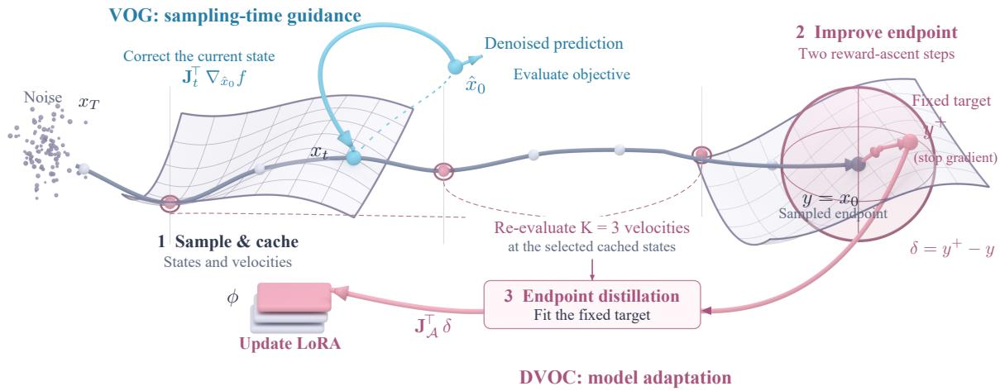  
Figure 1: Variational control for sampling-time guidance and model adaptation. The gray curve illustrates generation from noise to the sampled endpoint. VOG (blue) evaluates the objective at the denoised prediction $\scriptstyle { \hat { x } } _ { 0 }$ and maps its gradient through $\mathbf { J } _ { t }$ to correct the current sampling state. DVOC (pink) caches the trajectory, refines the actual endpoint $y = x _ { 0 }$ within a local neighborhood, and distills the fixed target $y ^ { + }$ into LoRA parameters. The three ringed states supply the selected velocity evaluations $( K = 3 )$ used for endpoint distillation. Target refinement uses two projected reward-ascent steps $\left( J = 2 \right)$

Variational control of generative models. Stochastic optimal control balances terminal reward against deviation from a reference process. Adjoint Matching [10] expresses reward adaptation as control regression. DEFT and h-Edit [8, 24] use Doob transforms for conditioning and editing. Within our variational framework, terminal preferences yield state and parameter corrections through Jacobian pullbacks. VOG and DVOC realize these two forms of control as trajectory guidance and its amortization in the generator.

## 3 Variational Optimal Control and Model Geometry

From terminal preferences to control. VOG and DVOC translate terminal preferences into corrections through the sensitivity of the controlled variable. VOG diferentiates the denoised prediction with respect to the current state. DVOC diferentiates the generated endpoint with respect to model parameters. We first derive the state-space control from the reference process, then develop parameter adaptation from the same local variational principle in Section 3.5.

To analyze VOG’s geometry, we adopt a low-dimensional linear-subspace model [13, 26]. The model gives an explicit characterization of the denoising Jacobian.

Assumption 3.1 (Linear Latent Subspace). We assume the clean data ${ \boldsymbol { x } } ^ { * } \in \mathbb { R } ^ { D }$ resides strictly within a low-dimensional linear subspace $\boldsymbol { s }$ of intrinsic dimension $d \ll D$ . Specifically, the data is generated as $x ^ { * } = U z$ , where $U \in \mathbb { R } ^ { D \times d }$ is an orthogonal basis matrix satisfying $U ^ { \top } U = I _ { d } .$ , and the latent variable z follows a standard Gaussian prior $z \sim \mathcal { N } ( 0 , I _ { d } )$ . Consequently, the data support is defined as ${ \mathcal { S } } \triangleq \operatorname { s p a n } ( U )$

Let $P _ { \| } = U U ^ { \top }$ and $\begin{array} { r } { P _ { \perp } = I _ { D } - U U ^ { \top } } \end{array}$ . Every vector decomposes into components parallel and normal to this subspace.

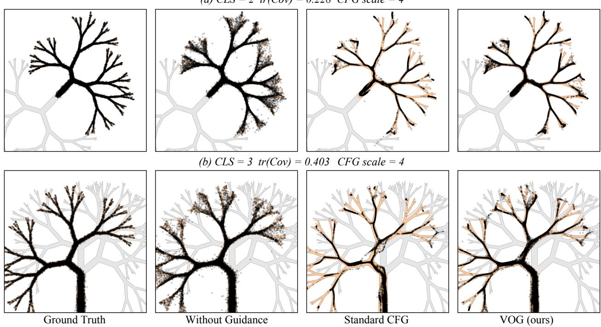  
Figure 2: Toy class-conditional generation on fractal-like 2D branching-tree distributions [18] under two increasingly challenging settings: a two-class benchmark (CLS= 2) and a three-class variant with shared structure (CLS= 3), which induces stronger class overlap. We quantify generation dificulty using tr(Cov) of the class-conditional ground-truth mixture, where larger values indicate greater dificulty. (a) Ground truth samples from the target class distribution. (b) No guidance: conditional sampling with a small difusion model produces outliers and of-class leakage. (c) CFG (ω = 4) suppresses outliers but shows mode collapse, reducing branch coverage; the collapse is more severe as dificulty increases from $\operatorname { t r } ( \operatorname { C o v } ) = 0 . 2 2 8 ( \operatorname { C L S } = 2 )$ to $\mathrm { { t r } ( C o v ) = 0 . 4 0 3 ( C L S = 3 ) }$ . (d) VOG (ours) preserves diversity and branch coverage while achieving strong conditional alignment. Detailed quantitative results are provided in Table S11.

## 3.1 How CFG Shifts the Mean and Reduces Coverage

CFG extrapolates between conditional and unconditional predictions. On the branching-tree example in Figure 2, stronger guidance suppresses outliers but reduces branch coverage. A local probability-flow analysis explains how the prediction contrast can shift the generated distribution. Its assumptions and derivation appear in Appendix E.

Guidance-induced mean shift. A first-order perturbation analysis of the VP probability flow ODE gives

$$
\begin{array} { r } { \mathbb { E } _ { q _ { \omega } } [ x _ { 0 } ] \approx \mu _ { \mathrm { g l o b a l } } + \omega \Delta _ { \mathrm { e f f } } , \quad \quad \quad \quad \quad } \\ { \Delta _ { \mathrm { e f f } } \triangleq \mathbb { E } \left[ \int _ { 0 } ^ { T } \Psi ( \tau ) \big ( \mu _ { c } - \bar { \mu } ( x _ { \tau } ) \big ) d \tau \right] , } \end{array}\tag{1}
$$

where the expectation is over samples $x _ { 0 }$ generated by the ω-guided sampler, $\mu _ { \mathrm { g l o b a l } } = \mathbb { E } _ { q } [ x _ { 0 } ]$ is the unconditional data mean, $\mu _ { c }$ the target class mean, $\begin{array} { r } { \bar { \mu } ( x _ { \tau } ) = \sum _ { u } p ( y \mid x _ { \tau } ) \mu _ { y } } \end{array}$ the posterior-weighted dynamic mean, and $\Psi ( \tau )$ the probability flow kernel of Eq. (26). The integrand is thus the class-uncertainty gap, transported to t = 0 by the flow. The trajectory-dependent term $\Delta _ { \mathrm { e f f } }$ also varies with ω.

Writing ω = 1 + w separates ordinary conditional prediction from further extrapolation. This motivates anchoring the control in Section 3.2 at the conditional policy.

The analysis assumes Bayes-optimal branch mixing and locally afine class denoisers with shared contraction (Assumption E.1 and Assumption E.2).

Geometric interpretation. The transported class contrast links guidance to changes in distributional coverage. An exact subspace denoiser keeps the guided mean in the subspace. An imperfect denoiser can introduce cross-subspace coupling. Whether it yields a normal mean component also depends on the class contrast and cancellation along the trajectory (Appendix E.2).

## 3.2 Variational Optimal Control (VOC)

We formulate sampling-time guidance as variational optimal control: maximize a terminal objective while penalizing deviation from a conditional reference process. Figure 1 relates the resulting state correction to DVOC’s parameter-space pullback.

Current-state conditional formulation. We parameterize denoising time as $t \in [ 0 , T ] ( t = T$ : noise, $t { = } 0 \mathrm { : }$ clean sample). At time $t ,$ the state $X _ { t } = x$ is already realized, so guidance can only modify the future continuation from t to 0. Let $P _ { b , t : 0 } ( \cdot \mid X _ { t } { = } x )$ be the future path measure of a fixed baseline policy $p _ { b } .$ , and let the terminal objective $f ( X _ { 0 } , c )$ say which clean samples are preferred. We seek a controlled path measure $Q _ { t : 0 } ( { \cdot } \mid X _ { t } { = } x )$ solving

$$
\operatorname* { m a x } _ { Q } \left\{ \lambda \mathbb { E } _ { Q } [ f ( X _ { 0 } , c ) ] - D _ { \mathrm { K L } } ( Q \| P _ { b } ) \right\} ,\tag{2}
$$

where Q and $P _ { b }$ abbreviate the future path measures conditioned on $X _ { t } = x$

Conditional reference. For the stochastic VOG formulation, $p _ { b }$ is the pretrained conditional policy predicting $\epsilon _ { c } = \epsilon _ { \theta } ( x _ { t } , t , c )$ Zero control means ordinary conditional sampling. We use the terminal log-ratio $f _ { \mathrm { c f g } } ( X _ { 0 } , c ) = \log p _ { \theta } ( X _ { 0 } \mid c ) - \log p _ { \theta } ( X _ { 0 } )$ , with control strength $w = \omega - 1$ . The reference already carries the conditioning, so extrapolation enters through the terminal objective. For reward adaptation, we instantiate the endpoint objective with a learned evaluator and constrain local improvement within a trust region (Section 3.5).

Optimal solution via exponential tilting. Define the desirability $h _ { t } ( x ) \triangleq \mathbb { E } _ { P _ { b , t ; 0 } } [ \exp ( \lambda f ( X _ { 0 } , c ) ) \mid X _ { t } = x ]$ and its log $\ell _ { t } ( x ) \triangleq \log h _ { t } ( x )$ . By the Gibbs variational identity, the optimizer of Eq. (2) is the exponentially tilted path measure (proof in Appendix B):

$$
\frac { d Q _ { t : 0 } ^ { * } } { d P _ { b , t : 0 } } = \frac { \exp ( \lambda f ( X _ { 0 } , c ) ) } { h _ { t } ( x ) } .\tag{3}
$$

Using an increasing clock along the denoising direction, the Doob h-transform shifts the reference drift by $\Delta b ^ { * } ( x , t ) = a _ { t } ( x ) \nabla _ { x } \ell _ { t } ( x )$ , where $a _ { t }$ is the difusion covariance. This covariance is preserved by the transform.

Practical discretization. For a single denoising step of size $\delta > 0$ (advancing from t to $t - \delta )$ , we use the local Gaussian approximation $X _ { t - \delta } \mid X _ { t } { = } x \approx \mathcal { N } ( \mu _ { t } ( x ) , \Sigma _ { t } )$ with $\mu _ { t } ( x ) = x + b _ { \theta } ( x , t ) \delta$ and $\Sigma _ { t } = a _ { t } ( \boldsymbol { x } ) \delta$ Applying the short-time Doob tilt and linearizing the log-desirability yields a Gaussian with the same covariance and a shifted mean,

$$
\mu _ { t } ^ { \mathrm { V O G } } ( x ) = \mu _ { t } ( x ) + \Delta \mu _ { t } , \qquad \Delta \mu _ { t } = \Sigma _ { t } \nabla _ { x } \ell _ { t } ( x ) .\tag{4}
$$

Since the exact $\ell _ { t }$ requires integrating over all future continuations, we approximate it by the denoised reward proxy and pull the gradient back through the denoising Jacobian $\mathbf J _ { t } = \partial \hat { x } _ { 0 } / \partial x$ , giving $\nabla _ { x } \ell _ { t } ( x )$ ≈ $\lambda \mathbf { J } _ { t } ( x ) ^ { \top } \nabla _ { \hat { x } _ { 0 } } f ( \hat { x } _ { 0 } , c )$ . For isotropic step covariance $\Sigma _ { t } = s _ { t } ^ { 2 } I$ and $\lambda > 0$ , mapping this mean-space correction to the noise-prediction parameterization $( \mu _ { t } = A _ { t } x - C _ { t } \epsilon , C _ { t } > 0 )$ and absorbing all sampler-dependent constants into a positive schedule $\zeta ( t )$ gives our main result:

Proposition 3.2 (Variational Optimal Guidance). Under the current-state conditional VOC of Eq. (2), the Doob h-transform preserves the difusion covariance and shifts the drift by $a _ { t } \nabla _ { x } \ell _ { t }$ . With isotropic step covariance, the short-time Gaussian approximation, and the denoised reward proxy, the first-order local approximation to the optimal noise-space correction is

$$
\begin{array} { r } { \epsilon _ { \mathrm { v o g } } ( x , t , c ) = \epsilon _ { c } ( x , t ) - \zeta ( t ) { \bf J } _ { t } ^ { \top } \nabla _ { \hat { x } _ { 0 } } f ( \hat { x } _ { 0 } , c ) , } \end{array}\tag{5}
$$

where $\epsilon _ { c }$ is the conditional reference prediction, $\mathbf { J } _ { t } = \partial \hat { x } _ { 0 } / \partial x ,$ , and $\zeta ( t ) > 0$ is a sampler-dependent schedule.   
The derivation is in Appendix B.

Role of the denoising Jacobian. The key structural diference from CFG is the Jacobian $\mathbf { J } _ { t } \colon$ CFG adds the guidance signal to the noise prediction directly, whereas VOG first pulls it back through the denoiser via a vector-Jacobian product (VJP). In the linear subspace setting below the MMSE denoising Jacobian is a scaled orthogonal projector, so this VJP is exactly a projection onto the data subspace. For nonlinear denoisers it weights the correction by learned sensitivity. This provides a geometric mechanism for mitigating the normal drift $( P _ { \perp } \Delta _ { \mathrm { e f f } } \neq 0 )$ of Section 3.1.

## 3.3 Geometric Consistency Analysis

We characterize the exact pullback relative to the data subspace $\boldsymbol { \mathcal { S } }$ of Assumption 3.1.

Theorem 3.3 (Subspace support of the exact correction). Let $P _ { \perp } = I - U U ^ { \top }$ project onto the orthogonal complement ofthe data subspace, and let $\mathbf { g } _ { \mathrm { v o g } } \triangleq \mathbf { J } _ { t } ^ { \top } \nabla _ { \hat { x } _ { 0 } } f ( \hat { x } _ { 0 } )$ denote the correction that VOG adds to the baseline. Under Assumption 3.1 and the optimal linear MMSE denoiser $\hat { x } _ { 0 } ( x _ { t } ) = \kappa _ { t } U U ^ { \top } x _ { t }$ , this correction lies in the data subspace, $P _ { \bot } \mathbf { g } _ { \mathrm { v o g } } = 0$

Proof. For the linear subspace denoiser, $\mathbf { J } _ { t } = \kappa _ { t } U U ^ { \top }$ is symmetric with both column and row space contained in S. Hence $\mathbf { g } _ { \mathrm { v o g } } = \kappa _ { t } U U ^ { \top } \nabla _ { \hat { x } _ { 0 } } f \in \mathcal { S } .$ , so $P _ { \mathrm { \perp } } \mathbf { g } _ { \mathrm { v o g } } = 0$ □

The exact linear denoiser therefore filters the reward gradient into ${ \mathcal { S } } .$ . The implementation below approximates this pullback for neural denoisers.

## 3.4 Practical Implementation Strategies

We use three strategies to balance eficiency and stability in practice.

Strided gradient computation. We recompute the pullback every K OG steps and reuse the cached correction in between. This inference stride is distinct from DVOC’s active-step count $K$ Factorized VJP surrogate. We approximate the conditional-noise VJP by $( \mathbf { J } _ { c , t } ^ { \top } \mathbf { 1 } ) \odot \mathbf { g } _ { t }$ , where $\mathbf { J } _ { c , t } = \partial \epsilon _ { c } / \partial x _ { t }$ and $\mathbf { g } _ { t } = \epsilon _ { c } - \epsilon _ { u }$ . The sensitivity factor $\mathbf { J } _ { c , t } ^ { \top } \mathbf { 1 } = \nabla _ { x _ { t } } ( \mathbf { 1 } ^ { \top } \boldsymbol { \epsilon } _ { c } )$ is computed with one backward pass and can be cached separately from the contrast. Appendix C derives the controller and gives the residual bound and diferentiation-branch ablation.

Momentum-enhanced guidance. High-frequency fluctuations in the raw guidance signal $\mathbf { g } _ { t } = \epsilon _ { \theta } ( x _ { t } , c ) -$ $\epsilon _ { \theta } ( x _ { t } , \varnothing )$ can trigger over-suppression under Jacobian-based regularization. We smooth it with exponential momentum, $\mathbf { m } _ { t } = \beta \mathbf { m } _ { t + 1 } + \mathbf { g } _ { t }$ , and replace $\mathbf { g } _ { t }$ by $\mathbf { m } _ { t }$ in the update rule. Here $\beta$ is the momentum coeficient, distinct from the correction schedule $\zeta ( t )$ of Eq. (5). The uncached, zero-momentum core is given in Algorithm S1. The schedules and caching described here are practical extensions.

## 3.5 From State Control to Model Adaptation

The variational construction couples a preferred terminal change with the sensitivity of the controlled variable. VOG acts on the current state. DVOC acts on model parameters, amortizing terminal preferences across future trajectories. Their common local control problem yields the endpoint distillation objective below.

A shared local variational principle. Let $G _ { \xi }$ map a control variable ξ to an output representation, and let d denote a preferred change in that representation. Write $\mathbf { J } _ { \xi } = \partial G _ { \xi } / \partial \xi$ . Linearizing the output response and assigning a quadratic cost to the control gives

$$
u _ { \xi } ^ { \ast } = \arg \operatorname* { m a x } _ { u } \left\{ \langle \mathbf { d } , \mathbf { J } _ { \xi } u \rangle - \frac { \Vert u \Vert _ { 2 } ^ { 2 } } { 2 \gamma } \right\} = \gamma \mathbf { J } _ { \xi } ^ { \top } \mathbf { d } ,\tag{6}
$$

where $\gamma > 0$ sets the control scale. This is the pullback structure exposed by the local VOG derivation. For state control, $G _ { \xi }$ is the denoised prediction and $\xi = x _ { t }$ . For parameter control, the output is a terminal latent and $\xi = \phi$ . Changing the controlled variable changes the Jacobian through which the preferred output displacement acts.

Constructing the terminal control target. For a prompt c, sample a trajectory with the current model and denote its terminal latent by $y = x _ { 0 }$ . Let D be the frozen decoder and define $\mathcal { R } ( y , c ) = R ( D ( y ) , c )$ . We seek a terminal improvement within a local displacement budget:

$$
\operatorname* { m a x } _ { \| u - y \| _ { 2 } \leq r } \mathcal { R } ( u , c ) , \qquad r = \rho \| y \| _ { 2 } .\tag{7}
$$

Starting at y, we approximate this problem with J normalized projected ascent steps. The reward gradient is itself a pullback, $\nabla _ { y } \mathcal { R } = \mathbf { J } _ { D } ^ { \top } \nabla _ { I } R$ . We denote the resulting detached target by $y ^ { + }$ and its displacement by $\delta = y ^ { + } - y$ . The relative radius makes the control budget proportional to the sampled latent’s scale. Updating the reward direction at each ascent step accounts for the local reward geometry along the target path. The projection and iteration are specified in Appendix D.

Distilling the control into parameters. We transfer δ to the generator by fitting $y ^ { + }$ through an endpoint connector $y _ { \phi } ^ { A }$ . Its forward value is the sampled endpoint $y .$ and its parameter Jacobian is $\mathbf { J } _ { \mathcal { A } }$ . For a latent with d coordinates, the per-sample objective is

$$
\begin{array} { r l } & { { \mathcal { L } } _ { \mathrm { { D V O C } } } = \frac { \displaystyle { \lVert { y _ { \phi } ^ { A } - y ^ { + } } \rVert _ { 2 } ^ { 2 } } } { \displaystyle d s _ { \delta } } , } \\ & { ~ \quad \quad s _ { \delta } = \mathrm { s g } \bigg ( \operatorname* { m a x } \{ \frac { \displaystyle { \lVert { \delta } \rVert _ { 1 } } } { \displaystyle d } , 1 0 ^ { - 5 } \} \bigg ) . } \end{array}\tag{8}
$$

The target and normalization are held fixed during fitting. Since the residual at the sampled endpoint is $- \delta ,$ diferentiation yields

$$
- \nabla _ { \phi } \mathcal { L } _ { \mathrm { D V O C } } = \frac { 2 } { d s _ { \delta } } \mathbf { J } _ { \mathcal { A } } ^ { \top } \delta .\tag{9}
$$

Thus endpoint distillation realizes the parameter-space form of Eq. (6), with $\mathbf { d } = \delta$ and scale $2 / ( d s _ { \delta } )$ The terminal target supplies the control signal, while the parameter Jacobian determines how that signal is expressed by the generator. Averaging this loss over sampled prompts and trajectories amortizes the terminal controls into a shared model.

Algorithm 1 DVOC training update   
Require: LoRA parameters ϕ, decoder D, reward R, N sampling steps, $K$ active steps, J target steps.   
1: Sample prompts and generate N-step trajectories.   
2: Cache states, velocities, and terminal latents y without gradients.   
3: Initialize $y ^ { ( 0 ) } = y$ and radius $r = \rho \| y \| _ { 2 } .$   
4: for $j = 0 , \ldots , J - 1$ do   
5: Compute $\nabla _ { y } R ( D ( y ^ { ( j ) } ) , c ) .$   
6: Take a normalized ascent step of length ηr/J and project onto $B ( y , r )$   
7: end for   
8: Detach the target $y ^ { + } = y ^ { ( J ) }$   
9: for each optimization microbatch do   
10: Sample K active steps uniformly without replacement.   
11: Re-evaluate active velocities at the cached states.   
12: Form the endpoint connector in Eq. (23).   
13: Accumulate scaled gradients of Eq. (8).   
14: end for   
15: Average gradients across GPUs and clip their norm.   
16: Update $\phi$ with AdamW and update the EMA adapter.

Eficient parameter pullback. We sample an Euler trajectory without retaining its computation graph, then choose K steps uniformly without replacement. At these steps, we re-evaluate velocities at the cached states with parameter gradients enabled. Their Euler-weighted derivatives define $\mathbf { J } _ { \mathcal { A } }$ . The endpoint connector preserves the sampled forward value while passing gradients through these selected evaluations, as specified in Eq. (23). The complete endpoint supplies the target, and K sets the backward computation. Our experiments use nine sampling steps, $K = 3 .$ , two target-ascent steps, relative radius $\rho = 0 . 1$ , and step multiplier $\eta = 1$ We optimize LoRA parameters and use the EMA adapter for evaluation.

Control geometry and amortization. In Eqs. (5) and (9), both controls weight terminal preferences by the sensitivity of the controlled variable. VOG realizes the state-space geometry characterized in Theorem 3.3. DVOC shares parameter updates across sampled conditions and stores the control in the generator. The adapted model then uses the ordinary sampler at inference. Figure 1 summarizes the two realizations, and Algorithm 1 gives the training procedure.

## 4 Experiments

We evaluate VOG on synthetic and class-conditional ImageNet generation, and DVOC on reward-based Z-Image-Turbo adaptation.

## 4.1 Evaluation Protocols

Sampling-time guidance. We use EDM2 [19] and DiT [25] on ImageNet [7] at $6 4 ^ { 2 } , 2 5 6 ^ { 2 }$ , and $5 1 2 ^ { 2 }$ resolutions. Baselines include CFG, Cosine and Interval schedules, AutoGuidance, APG, and ReCFG [16, 18, 21, 30, 41]. We report FID [15] from 50,000 samples together with Precision and Recall [31]. Architecturespecific settings are provided in the supplement.

Reward-based post-training. DVOC, ReFL, DRTune, and DifusionOPSD start from Z-Image-Turbo [35]. We also evaluate its untrained original weights. The trained methods share the training prompt source, the weighted reward 0.03846 $R _ { \mathrm { H P S v 3 + + } } + R _ { \mathrm { C L I P } }$ , and a nominal budget of 576 trajectories per optimizer update. We evaluate their EMA adapters at update 20, with nine denoising steps per evaluation sample. Each trained experiment uses eight GPUs, LoRA rank 32 and scale 64, AdamW with learning rate $3 \times 1 0 ^ { - 4 }$ , and weight decay $1 0 ^ { - 4 }$ (DVOC, DifusionOPSD) or $1 0 ^ { - 2 }$ (ReFL, DRTune). The supplement reports method settings and observed per-update times (Table S7).

Table 1: VOG as a plug-in correction on top of CFG-style guidance baselines, on class-conditional ImageNet. Shaded rows apply VOG to the baseline immediately above them. We report FID (↓), Precision (↑), and Recall (↑); within each column the best result is bolded and the second best underlined. A dash indicates a configuration the baseline does not support.
<table><tr><td>Guidance</td><td>EDM2-S FID Precision</td><td> $( 5 1 2 \times 5 1 2 )$  Recall</td><td>FID</td><td>DiT-XL/2 (256 × 256) Precision</td><td>Recall</td><td>EDM2-L FID Precision</td><td> $( 6 4 \times 6 4 )$  Recall</td><td>DiT-XL/2 FID</td><td> $( 5 1 2 \times 5 1 2 )$  Precision</td><td>Recall</td></tr><tr><td>CFG [16]</td><td>2.29 0.751</td><td>0.582</td><td>2.27</td><td>0.829</td><td>0.584</td><td>1.99</td><td>0.710 0.601</td><td>3.04</td><td>0.838</td><td>0.541</td></tr><tr><td>+ VOG (Ours)</td><td>2.03 0.755</td><td>0.591</td><td>2.04</td><td>0.756</td><td>0.607</td><td>1.42 0.714</td><td>0.597</td><td>2.89</td><td>0.745</td><td>0.560</td></tr><tr><td>Interval [21]</td><td>1.87 0.760</td><td>0.598</td><td>1.97</td><td>0.801</td><td>0.632</td><td>1.64 0.730</td><td>0.597</td><td>2.41</td><td>0.792</td><td>0.611</td></tr><tr><td>+ VOG (Ours)</td><td>1.67 0.742</td><td>0.614</td><td>1.94</td><td>0.765</td><td>0.611</td><td>1.52 0.720</td><td>0.593</td><td>2.39</td><td>0.760</td><td>0.567</td></tr><tr><td>Cosine [12]</td><td>2.15 0.770</td><td>0.619</td><td>2.30</td><td>0.861</td><td>0.520</td><td>1.67</td><td>0.726 0.587</td><td>3.48</td><td>0.713</td><td>0.586</td></tr><tr><td>+ VOG (Ours)</td><td>2.06 0.758</td><td>0.589</td><td>2.03</td><td>0.757</td><td>0.612</td><td>1.65</td><td>0.727 0.588</td><td>2.83</td><td>0.747</td><td>0.563</td></tr><tr><td>Scheduler [38]</td><td>2.03 0.762</td><td>0.591</td><td>2.14</td><td>0.840</td><td>0.614</td><td></td><td>-</td><td></td><td>-</td><td></td></tr><tr><td>APG [30]</td><td>2.13 0.756</td><td>0.640</td><td>2.11</td><td>0.815</td><td>0.628</td><td></td><td></td><td></td><td></td><td></td></tr><tr><td>ReCFG [41]</td><td>2.23 0.761</td><td>0.608</td><td>2.13</td><td>0.799</td><td>0.601</td><td></td><td></td><td></td><td></td><td></td></tr></table>

The test set is the complete 1,000-prompt Pick-a-Pic split [20]. All methods use the same prompts and initial noise, with 1024 × 1024 outputs, nine deterministic Euler steps, and guidance scale 0. All seven metrics are computed on the same generated images. We use HPSv3++ [23] and CLIP [28] as in-domain evaluators because they enter the training reward. Q-Align quality and aesthetics [39], AES [32], ImageReward [42], and DeQA [44] are out-of-domain (OOD) evaluators because they are held out of optimization. Here OOD denotes evaluators held out of the training objective. All post-training results use one training seed.

## 4.2 Sampling-Time Guidance Results

Synthetic geometry. On the 2D branching-tree benchmark, increasing class overlap makes coverage more dificult. The two-class and three-class settings have covariance traces 0.228 and 0.403. CFG removes outliers but reduces Recall to 0.876 and 0.779, respectively. VOG attains Recall 0.957 and 0.933 while achieving the highest Precision among the guided samplers. The visualization and numerical results are in Figure 2 and the supplement.

ImageNet. Table 1 evaluates VOG on top of three guidance baselines in four model–resolution settings. FID improves in all twelve pairings, including from 1.99 to 1.42 for EDM2-L at $6 4 ^ { 2 }$ . For DiT-XL/2 with Cosine guidance, Recall rises from 0.520 to 0.612 while Precision decreases, producing a better FID operating point.

Guidance scale and sampling budget. VOG remains efective over a wider range of guidance strengths than CFG in Figure S2a. On DiT-XL/2, its FID is below 2.60 at guidance scale 1.7, where CFG exceeds 3.40. The benefit also persists with fewer sampling steps: FID decreases from 7.58 to 4.44 at 25 steps and from 3.69 to 2.99 at 50 steps. The VJP stride and momentum sweep in Figure S2b concerns VOG inference, independently of the active-step budget K used by DVOC.

## 4.3 Reward Alignment and Generalization

In-domain alignment and held-out scores. Table 2 uses the untrained original model as the reference, with DVOC at K = 3. DVOC raises HPSv3++ from 6.72 to 13.79, the highest trained mean. CLIP changes from 0.2757 to 0.2765. DifusionOPSD achieves the highest CLIP score at 0.2782.

Table 2: Reward alignment after 20 optimization updates on Z-Image-Turbo. The untrained base and four trained methods use the same 1,000 prompts and initial noise. HPSv3++/CLIP are in-domain; the others are OOD. ∆: score minus untrained base. Higher is better. Best/second-best: bold/underlined. Blue: DVOC.
<table><tr><td rowspan="3">Method</td><td colspan="4">In-Domain</td><td colspan="10">Out-of-Domain</td></tr><tr><td colspan="2">HPSv3++</td><td colspan="2">CLIP</td><td colspan="2">Q-Align Q.</td><td colspan="2">Q-Align A.</td><td colspan="2">AES</td><td colspan="2">ImageReward</td><td colspan="2">DeQA</td></tr><tr><td>Score↑</td><td>∆</td><td>Score↑</td><td>∆</td><td>Score↑</td><td>∆</td><td>Score↑</td><td>∆</td><td>Score↑</td><td>∆</td><td>Score↑</td><td>∆</td><td>Score↑</td><td>∆</td></tr><tr><td colspan="9">Z-Image-Turbo, 10242, nine-step Euler sampler</td><td></td><td></td><td></td><td></td><td></td><td></td></tr><tr><td>Z-Image-Turbo (untrained)</td><td>6.72</td><td></td><td>0.2757</td><td></td><td>4.825</td><td></td><td>3.533</td><td></td><td>5.412</td><td></td><td>0.959</td><td></td><td>4.439</td><td></td></tr><tr><td>ReFL [42]</td><td>12.22</td><td></td><td>+5.500.2744</td><td>-0.0013</td><td>4.844</td><td>+0.020</td><td>4.223</td><td>+0.691</td><td>5.955</td><td>+0.543</td><td>1.159</td><td>+0.200</td><td>4.133</td><td>-0.306</td></tr><tr><td>DRTune [40]</td><td>12.70</td><td></td><td>+5.970.2688</td><td>-0.0070</td><td>4.932</td><td>+0.107</td><td>4.489</td><td>+0.956</td><td>6.095</td><td>+0.683</td><td>1.225</td><td>+0.266</td><td>4.262</td><td>-0.177</td></tr><tr><td>DiffusionOPSD [47]</td><td>13.56</td><td></td><td>+6.830.2782</td><td>+0.0025</td><td>4.886</td><td>+0.061</td><td>4.452</td><td>+0.920</td><td>6.101</td><td>+0.689</td><td>1.196</td><td>+0.237</td><td>4.014</td><td>-0.425</td></tr><tr><td>DVOC (K = 3)</td><td>13.79</td><td>+7.06</td><td>0.2765</td><td>+0.0008</td><td>4.943</td><td>+0.118</td><td>4.618</td><td>+1.085</td><td>6.288</td><td>+0.876</td><td>1.279</td><td>+0.320</td><td>4.237</td><td>-0.202</td></tr></table>

(a) CLIP evaluation  
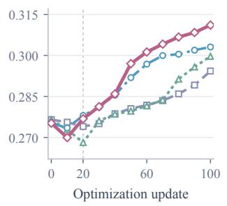

(b) HPSv3++ evaluation  
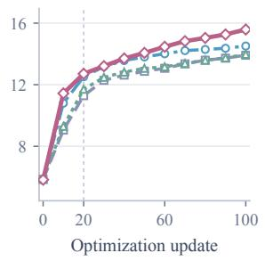

(c) Training reward  
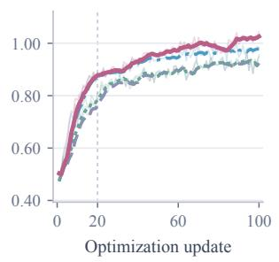

(d) Reward: K ablation  
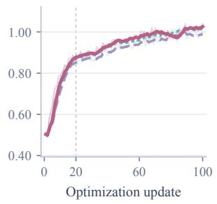  
Figure 3: Evaluation and training dynamics. (a,b) Online EMA evaluation every ten updates, using HPSv3++ condition 0.0 and trainer-specific noise sampling. (c) Training reward, 0.03846 $R _ { \mathrm { H P S v 3 + + } } + R _ { \mathrm { C L I P } } { \mathrm { : } }$ ReFL/DRTune score late-state proxies; DVOC/OPSD score sampled endpoints. (d) DVOC training reward for $K = 1 , 2 , 3 .$ . Training panels show raw means (faint) and trailing five-update averages; evaluation is unsmoothed. The vertical line marks update 20. DVOC uses K = 3 in (a–c); (d) is the ablation.

DVOC leads trained methods on Q-Align quality (4.943), Q-Align aesthetics (4.618), AES (6.288), and ImageReward (1.279), improving over the base on all four. DeQA is 4.237, compared with 4.439 for the base. Table S8 reports paired uncertainty for all seven main-result diferences.

Qualitative comparisons with the base model and the three trained baselines are provided in Figure S1 in the appendix.

Optimization dynamics. Figure 3(a,b) tracks the two in-domain evaluators through 100 updates. From update 20 to 100, DVOC’s online CLIP increases from 0.2768 to 0.3111 and HPSv3++ from 12.71 to 15.59. Panels (c,d) show logged training reward across methods and across K, respectively. These online evaluations use a diferent protocol from the paired main table. Extended histories are in Appendix H.

Table 3: Target construction at fixed K = 3. Three paired runs use 20 updates and 1,000 matched test images. All scores are higher-is-better. Bold marks the highest mean within this ablation.
<table><tr><td></td><td colspan="2">In-domain</td><td colspan="5">OOD</td></tr><tr><td>Variant</td><td>HPSv3++</td><td>CLIP</td><td>Q-Quality</td><td>Q-Aesth.</td><td>AES</td><td>ImageReward</td><td>DeQA</td></tr><tr><td>Endpoint, J = 2</td><td>13.727</td><td>0.2760</td><td>4.947</td><td>4.640</td><td>6.281</td><td>1.2678</td><td>4.252</td></tr><tr><td>Endpoint, J = 1</td><td>13.653</td><td>0.2781</td><td>4.927</td><td>4.629</td><td>6.211</td><td>1.2673</td><td>4.131</td></tr><tr><td>Proxy, J = 2</td><td>13.705</td><td>0.2763</td><td>4.935</td><td>4.618</td><td>6.277</td><td>1.2684</td><td>4.242</td></tr></table>

Table 4: Active-step ablation. Only K changes; J = 2 and the endpoint radius are fixed. Means use the same 1,000 paired prompts at update 20. Bold/underlining mark best/second-best within this table.
<table><tr><td rowspan="2">DVOC variant</td><td colspan="2">In-Domain</td><td colspan="5">Out-of-Domain</td></tr><tr><td>HPSv3++↑</td><td>CLIP↑</td><td>Q-Align Q.↑</td><td>Q-Align A.↑</td><td>AES↑</td><td>ImageReward↑</td><td>DeQA↑</td></tr><tr><td>K = 1</td><td>13.36</td><td>0.2729</td><td>4.948</td><td>4.628</td><td>6.272</td><td>1.224</td><td>4.249</td></tr><tr><td>K = 2</td><td>13.69</td><td>0.2751</td><td>4.947</td><td>4.610</td><td>6.274</td><td>1.257</td><td>4.263</td></tr><tr><td>K = 3 (default)</td><td>13.79</td><td>0.2765</td><td>4.943</td><td>4.618</td><td>6.288</td><td>1.279</td><td>4.237</td></tr></table>

## 4.4 DVOC Ablations

Active-step budget. Table 4 varies K with shared forward sampling and target construction. K = 3 leads on HPSv3++, CLIP, AES, and ImageReward. K = 1 leads on both Q-Align scores, and K = 2 on DeQA, showing that the preferred budget depends on the evaluator.

Target construction. Three paired runs fix K = 3 and share the initial adapter and training streams (Appendix F.4). Relative to one ascent step, endpoint J = 2 raises Q-Align quality by 0.0202, AES by 0.0692, and DeQA by 0.1203, with a CLIP decrease of 0.00210. At the same nominal ascent length, two steps refresh the intermediate reward gradient. One step takes 414.1 seconds per update versus 461.7 for two steps, a 10.3% reduction.

The proxy ablation optimizes the current policy’s late-state clean prediction and transports its displacement to the sampled endpoint. Endpoint J = 2 improves Q-Align quality, Q-Align aesthetics, and DeQA by 0.0125, 0.0215, and 0.0100, respectively. The full seven-metric comparison is in Table 3.

## 4.5 Computational Cost

The nine-step rollout and two target-gradient evaluations are shared across the active-step variants. Increasing K expands the parameter pullback while retaining the same sampled trajectories and target construction. On one eight-GPU node, the observed mean times are 325.8, 391.2, and 458.0 seconds per update for K = 1, 2, 3, respectively (Table S7). Relative to K = 3, K = 1 reduces update time by 28.9% and K = 2 by 14.6%. The main configuration uses $K = 3 ,$ which leads the active-step comparison on HPSv3++, CLIP, AES, and ImageReward.

At fixed $K = 3 .$ , one and two target steps take 414.1 and 461.7 seconds per update. The target ablation in Table 3 reports their quality–cost trade-of. At inference, all DVOC variants use the same nine-step sampler.

## 5 Conclusion

Variational control connects sampling-time guidance and reward adaptation through a shared Jacobian pullback. VOG realizes control on individual trajectories, and DVOC amortizes endpoint improvements into the generator. VOG improves FID across the evaluated ImageNet settings. After 20 updates on Z-Image-Turbo, DVOC improves ${ \mathrm { H P S v 3 + + } }$ and four held-out scores over the base and leads the trained comparators on these metrics. Our analyses characterize the common control geometry through subspace structure and the variational derivation of parameter control.

## A Preliminaries and Notation

We collect the difusion and guidance notation used in the derivations.

## A.1 Difusion and Guidance

The VP perturbation is $x _ { t } = \sqrt { \bar { \alpha } _ { t } } x _ { 0 } + \sqrt { 1 - \bar { \alpha } _ { t } } \epsilon$ , with $\epsilon \sim \mathcal { N } ( 0 , I )$ and cumulative signal power $\bar { \alpha } _ { t }$ . A noise predictor trained by denoising regression [17] gives the model score $s _ { \theta } ( x _ { t } , t ) = - \epsilon _ { \theta } ( x _ { t } , t ) / \sqrt { 1 - \bar { \alpha } _ { t } } [ 3 3 , 3 4 ]$

Classifier guidance adds a scaled gradient of a noisy-image classifier’s log probability to the model score [9]. CFG uses the contrast between conditional and unconditional predictions [16].

Classifier-Free Guidance (CFG). To avoid the complexity of external classifiers, Ho and Salimans [16] proposed efectively learning an implicit classifier by jointly training a single model for both conditional $\epsilon _ { \theta } ( \mathbf { x } _ { t } , c )$ and unconditional $\epsilon _ { \theta } ( \mathbf { x } _ { t } , \emptyset )$ generation. During inference, the guided noise prediction is computed as a linear extrapolation:

$$
\tilde { \epsilon } _ { t } ( \mathbf { x } _ { t } , c ) = \epsilon _ { \theta } ( \mathbf { x } _ { t } , \emptyset ) + \omega \left( \epsilon _ { \theta } ( \mathbf { x } _ { t } , c ) - \epsilon _ { \theta } ( \mathbf { x } _ { t } , \emptyset ) \right) .\tag{10}
$$

Here, ω serves as the guidance scale. Eq. (10) can be interpreted as implicitly performing gradient ascent on the log-likelihood ratio $\log [ p ( c | \mathbf { x } _ { t } ) / p ( c ) ]$ ], treating the diference term as a proxy for the gradient of the condition. Large ω can increase saturation and reduce sample coverage [5, 30].

## A.2 Summary of Notation

Table S1 collects the notation. We distinguish the CFG scale $\omega ,$ VOG correction schedule $\zeta ( t )$ , momentum coeficient $\beta ,$ , and VP noise rate $\beta _ { \mathrm { v p } } ( t )$

## B Derivation of Variational Optimal Guidance

We derive the tilted path measure, its drift correction, and the local Jacobian form used by VOG. Throughout, $P = P _ { b , t : 0 } ( \cdot \mid X _ { t } = x , c )$ is the pretrained conditional continuation from the current state to the clean endpoint.

## B.1 Optimal path measure

Let $h _ { t } ( x ) = \mathbb { E } _ { P } [ \exp ( \lambda f ( X _ { 0 } , c ) ) ]$ and $\ell _ { t } ( x ) = \log h _ { t } ( x )$ . Assume $0 < h _ { t } ( x ) < \infty$ and finite reward and KL terms. For the tilted measure $Q ^ { * }$ in Eq. (3), substitution of its density gives

$$
\lambda \mathbb { E } _ { Q } [ f ] - D _ { \mathrm { K L } } ( Q \Vert P ) = \ell _ { t } ( x ) - D _ { \mathrm { K L } } ( Q \Vert Q ^ { * } ) .\tag{11}
$$

The nonnegativity of KL establishes that $Q ^ { * }$ uniquely maximizes Eq. (2), with value $\ell _ { t } ( x )$

Table S1: Notation used in the main text.
<table><tr><td>Symbol</td><td>Meaning</td></tr><tr><td> $x _ { t } , \hat { x } _ { 0 }$ </td><td>noisy state at time  $t ;$  denoised prediction of the clean sample</td></tr><tr><td> $\epsilon _ { c } , \epsilon _ { u } , \epsilon _ { \mathrm { v o g } }$ </td><td>conditional and unconditional predictions; VOG-corrected prediction</td></tr><tr><td> $\bar { \alpha } _ { t } , \sqrt { 1 - \bar { \alpha } _ { t } }$ </td><td>cumulative signal power and  $\mathrm { V P }$  noise standard deviation</td></tr><tr><td> $c , f ( x _ { 0 } , c )$ </td><td>conditioning signal; terminal reward on the clean sample</td></tr><tr><td> $\omega , w = \omega - 1$ </td><td>CFG guidance scale; its conditional-centered form, the control strength</td></tr><tr><td> $\lambda$ </td><td>reward temperature in the VOC objective</td></tr><tr><td> $\zeta ( t )$ </td><td>schedule of the VOG noise-space correction</td></tr><tr><td> $\beta$ </td><td>momentum coefficient for smoothing the guidance signal</td></tr><tr><td> $K _ { \mathrm { V O G } }$ </td><td>inference-time interval between  $\mathrm { V J P }$  recomputations</td></tr><tr><td> $K , J , \rho$ </td><td>DVOC active-step count, ascent iterations, and relative endpoint radius</td></tr><tr><td> $\mathbf J _ { t } = \partial \hat { x } _ { 0 } / \partial x _ { t }$ </td><td>denoising Jacobian; the correction uses the  $\mathrm { V J P } \mathbf { J } _ { t } ^ { \top } \nabla f$ </td></tr><tr><td> $h _ { t } ( x ) , \ell _ { t } ( x ) = \log h _ { t } ( x )$ </td><td>desirability function and its logarithm</td></tr><tr><td> $b _ { \theta } , a _ { t }$ </td><td>drift and diffusion covariance of the pretrained sampler</td></tr><tr><td> $S = \operatorname { s p a n } ( U ) , P _ { \parallel } , P _ { \perp }$ </td><td>data subspace and the projectors onto it and its complement</td></tr><tr><td> $\phi , \delta , s _ { \delta }$ </td><td>LoRA parameters, endpoint target displacement, and detached loss normalization</td></tr><tr><td> $\mathbf { J } _ { \mathcal { A } } , y _ { \phi } ^ { \mathcal { A } }$ </td><td>selected parameter Jacobian and its endpoint connector</td></tr></table>

## B.2 Drift correction and control cost

Use the increasing denoising clock $s = T - t ,$ , with $Y _ { s } = X _ { T - s }$ . The reference process has drift $b _ { \theta }$ , difusion coeficient $\sigma _ { t } .$ , and covariance $a _ { t } = \sigma _ { t } \sigma _ { t } ^ { \top }$ . Its generator is $\begin{array} { r } { \mathcal { L } _ { t \varphi } = b _ { \theta } ^ { \top } \nabla \varphi + \frac { 1 } { 2 } \operatorname { T r } ( a _ { t } \nabla ^ { 2 } \varphi ) } \end{array}$ . The Markov property of the tilted measure gives

$$
Q ^ { * } ( X _ { r } \in d y \mid X _ { t } = x ) = p _ { b } ( t , x ; r , d y ) \frac { h _ { r } ( y ) } { h _ { t } ( x ) } , \qquad 0 \leq r < t .\tag{12}
$$

The desirability satisfies $- \partial _ { t } h _ { t } + \mathscr { L } _ { t } h _ { t } = 0$ with $h _ { 0 } = \exp ( \lambda f )$ . Applying the product rule to the transformed generator yields

$$
\mathcal { L } _ { t } ^ { h } \varphi = \frac { - \partial _ { t } ( h _ { t } \varphi ) + \mathcal { L } _ { t } ( h _ { t } \varphi ) } { h _ { t } } = \mathcal { L } _ { t } \varphi + ( a _ { t } \nabla \ell _ { t } ) ^ { \top } \nabla \varphi .\tag{13}
$$

Thus the optimal drift is $b ^ { * } = b _ { \theta } + a _ { t } \nabla \ell _ { t }$ , with the reference difusion covariance unchanged.

For a drift perturbation $\Delta b$ and invertible $a _ { t }$ , Girsanov’s identity expresses the path KL as

$$
D _ { \mathrm { K L } } ( Q \Vert P ) = \frac 1 2 \mathbb { E } _ { Q } \left[ \int _ { 0 } ^ { t } \Delta b ( X _ { \tau } , \tau ) ^ { \top } a _ { \tau } ( X _ { \tau } ) ^ { - 1 } \Delta b ( X _ { \tau } , \tau ) d \tau \middle | X _ { t } = x \right] .\tag{14}
$$

This identity assumes an integrable control energy and a true Girsanov martingale. It identifies the covariance-weighted quadratic cost underlying the local control objective.

## B.3 Local transition and Jacobian pullback

For a step of size $\delta ,$ approximate the reference transition by $\textstyle { \mathcal { N } } ( \mu _ { t } , \Sigma _ { t } )$ , where $\mu _ { t } = x + b _ { \theta } ( x , t ) \delta$ and $\Sigma _ { t } = a _ { t } ( x ) \delta$ . Linearizing $\ell _ { t - \delta } ( y )$ in y and writing $g _ { t } = \nabla _ { x } \ell _ { t } ( x )$ gives

$$
\begin{array} { r } { \widetilde { q } ( \boldsymbol { y } \mid \boldsymbol { x } ) \propto \exp \left[ - \frac { 1 } { 2 } ( \boldsymbol { y } - \boldsymbol { \mu } _ { t } ) ^ { \top } \Sigma _ { t } ^ { - 1 } ( \boldsymbol { y } - \boldsymbol { \mu } _ { t } ) + \boldsymbol { g } _ { t } ^ { \top } ( \boldsymbol { y } - \boldsymbol { \mu } _ { t } ) \right] . } \end{array}\tag{15}
$$

Completing the square gives $\mathcal { N } ( \mu _ { t } + \Sigma _ { t } g _ { t } , \Sigma _ { t } )$ , proving the mean shift in Eq. (4).

We evaluate the terminal reward on the conditional clean prediction $\hat { x } _ { 0 , c } = ( x _ { t } - \sqrt { 1 - \bar { \alpha } _ { t } } \epsilon _ { c } ) / \sqrt { \bar { \alpha } _ { t } }$ . The proxy $\ell _ { t } ( x ) \approx \lambda f ( \hat { x } _ { 0 , c } ( x ) , c )$ gives the chain-rule correction

$$
\Delta \mu _ { t } \approx \lambda \Sigma _ { t } \mathbf { J } _ { t } ^ { \top } \nabla _ { \hat { x } _ { 0 } } f ( \hat { x } _ { 0 , c } , c ) , \qquad \mathbf { J } _ { t } = \frac { \partial \hat { x } _ { 0 , c } } { \partial x _ { t } } .\tag{16}
$$

The reverse mean is afine in noise prediction, $\mu _ { t } = A _ { t } x - C _ { t } \epsilon$ with $C _ { t } > 0 .$ , so $\Delta \epsilon _ { t } = - C _ { t } ^ { - 1 } \Delta \mu _ { t }$ . For isotropic covariance $\Sigma _ { t } = s _ { t } ^ { 2 } I$ , setting $\zeta ( t ) = \lambda s _ { t } ^ { 2 } / C _ { t }$ yields Eq. (5). This completes the derivation of Proposition 3.2.

## C The CFG-Specific VOG Controller

We instantiate the terminal objective with the conditional log-ratio defined in Section 3.2. Write $\epsilon _ { c } = $ $\epsilon _ { \theta } ( x _ { t } , t , c ) , \epsilon _ { u } = \epsilon _ { \theta } ( x _ { t } , t , \mathcal { D } ) , \mathbf { g } _ { t } = \epsilon _ { c } - \epsilon _ { u }$ , and $w = \omega - 1$ . Standard CFG is $\mathbf { \epsilon } _ { c } + w \mathbf { g } _ { t }$

## C.1 Conditional clean-prediction pullback

At noise level t, the model score contrast is $s _ { c } - s _ { u } = - \mathbf { g } _ { t } / \sqrt { 1 - \bar { \alpha } _ { t } }$ . We use this contrast as a proxy for the clean-space log-ratio gradient. Its negative sign cancels the mean-to-noise sign in the preceding derivation. Let $\mathbf { J } _ { c , t } = \partial \epsilon _ { c } / \partial x _ { t }$ and $\rho _ { t } = \sqrt { 1 - \bar { \alpha } _ { t } }$ . Diferentiating the conditional clean prediction gives

$$
\mathbf { J } _ { t } ^ { \top } \mathbf { g } _ { t } = \frac { 1 } { \sqrt { \bar { \alpha } _ { t } } } \left( \mathbf { g } _ { t } - \rho _ { t } \mathbf { J } _ { c , t } ^ { \top } \mathbf { g } _ { t } \right) .\tag{17}
$$

The positive scalar factor is included in the guidance schedule.

## C.2 Factorized VJP

We compute the sensitivity $\mathbf { J } _ { c , t } ^ { \top } \mathbf { 1 }$ with one backward pass and combine it element-wise with the guidance contrast. The diference from the full VJP is

$$
\begin{array} { r l } & { \mathbf { J } _ { c , t } ^ { \top } \mathbf { g } _ { t } = ( \mathbf { J } _ { c , t } ^ { \top } \mathbf { 1 } ) \odot \mathbf { g } _ { t } + \mathbf { r } _ { t } , } \\ & { \quad r _ { t , i } = \displaystyle \sum _ { j } \frac { \partial \epsilon _ { c , j } } { \partial x _ { t , i } } ( g _ { t , j } - g _ { t , i } ) . } \end{array}\tag{18}
$$

This identity follows by adding and subtracting $g _ { t , i }$ in each coordinate sum. For the influence set $\begin{array} { r } { \mathbb { Z } ( i ) = \{ j } \end{array}$ $\partial \epsilon _ { c , j } / \partial x _ { t , i } \neq 0 \}$ , the triangle inequality bounds the residual by

$$
\left| r _ { t , i } \right| \leq \left( \sum _ { j } \left| \frac { \partial \epsilon _ { c , j } } { \partial x _ { t , i } } \right| \right) \operatorname* { m a x } _ { j \in \mathbb { Z } ( i ) } \left| g _ { t , j } - g _ { t , i } \right| .\tag{19}
$$

For an empty influence set, the maximum is defined as zero. The residual also vanishes when the contrast is constant on the influence set, including the case of a diagonal Jacobian. Dropping it gives the practical controller

$$
\epsilon _ { \mathrm { v o g } } = \epsilon _ { c } + w \left[ { \bf 1 } - \rho _ { t } \nabla _ { x _ { t } } ( { \bf 1 } ^ { \top } \epsilon _ { c } ) \right] \odot { \bf g } _ { t } .\tag{20}
$$

The sensitivity factor can be cached independently of the contrast. The element-wise update also preserves zero coordinates of the CFG direction. Stride and momentum are specified in Section 3.4.

## C.3 Choice of diferentiation branch

We diferentiate the conditional prediction that defines the reference process. To examine this choice, consider diferentiating $\epsilon _ { \mathrm { c f g } } = \epsilon _ { c } + w \mathbf { g } _ { t }$ instead. With $\mathbf { J } _ { u , t } = \partial \epsilon _ { u } / \partial x _ { t }$ and $\mathbf { A } _ { \mathrm { c f g } , t }$ the resulting clean-prediction Jacobian, its pullback is

$$
w \mathbf { A } _ { \mathrm { c f g } , t } ^ { \top } \mathbf { g } _ { t } = w \mathbf { J } _ { t } ^ { \top } \mathbf { g } _ { t } - \frac { w ^ { 2 } \rho _ { t } } { \sqrt { \bar { \alpha } _ { t } } } ( \mathbf { J } _ { c , t } - \mathbf { J } _ { u , t } ) ^ { \top } \mathbf { g } _ { t } .\tag{21}
$$

The additional term is quadratic in guidance strength. Using the conditional branch keeps the sensitivity map independent of w at a fixed state. Table S2 evaluates the two choices.

Table S2: Diferentiation-branch ablation on DiT-XL/2 $( 2 5 6 \times 2 5 6 )$ , with VJP stride $K _ { \mathrm { V O G } } = 4$ . Runtime is relative to CFG.

<table><tr><td>Controller</td><td>FID (↓)</td><td>Relative runtime</td></tr><tr><td>Pullback through  $\epsilon _ { \mathrm { c f g } }$ </td><td>5.48</td><td></td></tr><tr><td>Pullback through  $\epsilon _ { c } \ : ( \mathrm { V O G } )$ </td><td>2.04</td><td>1.55×</td></tr></table>

Sampling procedure.

Algorithm S1 VOG factorized core controller   
Require: Conditional/unconditional predictor, condition c, guidance strength ω, and baseline numerical sampler.   
1: Sample $x _ { T } ;$ set $w = \omega - 1$   
2: for each reverse sampling step t do   
3: Compute $\epsilon _ { c } = \epsilon _ { \theta } ( x _ { t } , t , c ) , \epsilon _ { u } = \epsilon _ { \theta } ( x _ { t } , t , \mathcal { O } )$ , and $g _ { t } = \epsilon _ { c } - \epsilon _ { u } .$   
4: Compute $h _ { t } = \nabla _ { x _ { t } } ( \mathbf { 1 } ^ { \top } \epsilon _ { c } )$ by one VJP.   
5: Set $\rho _ { t } = \sqrt { 1 - \bar { \alpha } _ { t } }$ for the VP parameterization.   
6: Form $\epsilon _ { \mathrm { v o g } } = \epsilon _ { c } + w \big ( { \bf 1 } - \rho _ { t } h _ { t } \big ) \odot g _ { t }$ as in Eq. (20).   
7: Advance the numerical sampler using ϵvog.   
8: end for   
9: return Final sample.

Architecture-specific schedules, momentum, and VJP stride extend this core as described in Section 3.4.

## D Parameter Control: Target and Implementation

The local objective and its distillation gradient are given in Eqs. (6) and (9). Here we specify how DVOC constructs the target and computes the selected parameter derivatives.

## D.1 Endpoint optimization

Let $r = \rho \| y \| _ { 2 } , y ^ { ( 0 ) } = y$ , and $\boldsymbol { g } ^ { ( j ) } = \nabla _ { \boldsymbol { y } } \mathcal { R } ( \boldsymbol { y } ^ { ( j ) } , c )$ . We use normalized projected ascent:

$$
y ^ { ( j + 1 ) } = \Pi _ { B ( y , r ) } \left( y ^ { ( j ) } + \frac { \eta r } { J } \frac { g ^ { ( j ) } } { \| g ^ { ( j ) } \| _ { 2 } + \varepsilon } \right) , \qquad j = 0 , \ldots , J - 1 .\tag{22}
$$

The Euclidean projection clips the displacement from $y$ to length r. We use $\varepsilon = 1 0 ^ { - 1 2 } , J = 2 , \eta = 1$ $\rho = 0 . 1$ , and zero ascent momentum. The frozen FP32 decoder and reward evaluator supply the latent gradients. The final target is $y ^ { + } = \mathrm { s g } ( y ^ { ( J ) } )$ .

## D.2 Cached endpoint connector

Sample the Euler trajectory without retaining its computation graph and cache states $\boldsymbol { x } _ { t _ { i } }$ , velocities $\bar { v } _ { i } .$ , and increments $h _ { i } = \sigma _ { i + 1 } - \sigma _ { i }$ . The endpoint is $y = x _ { T } + \textstyle \sum _ { i } h _ { i } { \bar { v } } _ { i }$ . Choose a size- $. K$ subset A uniformly without replacement and re-evaluate its velocities with gradients enabled. Define

$$
\begin{array} { l } { \displaystyle \widehat { y } _ { \phi } = y + \sum _ { i \in A } h _ { i } \left[ v _ { \phi } ( \operatorname { s g } ( x _ { t _ { i } } ) , t _ { i } , c ) - \operatorname { s g } ( \bar { v } _ { i } ) \right] , } \\ { \displaystyle y _ { \phi } ^ { A } = \widehat { y } _ { \phi } + \operatorname { s g } ( y - \widehat { y } _ { \phi } ) , } \\ { \displaystyle \mathbf { J } _ { A } = \sum _ { i \in A } h _ { i } \partial _ { \phi } v _ { \phi } ( \operatorname { s g } ( x _ { t _ { i } } ) , t _ { i } , c ) . } \end{array}\tag{23}
$$

All cached quantities are detached. The connector equals $y$ in the forward pass and passes parameter gradients through the selected velocity evaluations. We insert it into Eq. (8) and optimize the LoRA parameters with AdamW. Checkpoint evaluation uses the EMA adapter.

## E Mean Shift of CFG under the VP Probability Flow ODE

This section derives the linearized mean shift in Eq. (1). Let $\beta _ { \mathrm { v p } } ( t )$ denote the VP noise rate, $\bar { \alpha } _ { t }$ the cumulative signal power, and $\mu _ { y }$ the mean of class y. The posterior-weighted class mean is $\begin{array} { r } { \bar { \mu } ( x _ { t } ) = \sum _ { y } p ( y \mid x _ { t } ) \mu _ { y } } \end{array}$

## E.1 Class contrast and guided dynamics

Assumption E.1 (Bayes-optimal branch mixing). The denoisers estimate conditional means, so the unconditional clean prediction satisfies $\begin{array} { r } { \hat { x } _ { 0 } ^ { \mathrm { u c } } = \sum _ { y } p ( y \mid x _ { t } ) \hat { x } _ { 0 } ^ { y } } \end{array}$

Assumption E.2 (Locally afine class denoisers). The class denoisers have the local form $\hat { x } _ { 0 } ^ { y } ( x _ { t } ) =$ $\mu _ { y } + M _ { t } ( x _ { t } - \mu _ { y } )$ , with a symmetric contraction $M _ { t }$ shared across classes.

Subtracting the unconditional mixture from the target-class prediction gives $( I - M _ { t } ) ( \mu _ { c } - \bar { \mu } ( x _ { t } ) )$ . Since the clean-prediction map is afine in noise prediction, CFG induces

$$
\hat { x } _ { 0 } ^ { \mathrm { c f g } } ( x _ { t } ) = \hat { x } _ { 0 } ^ { \mathrm { u c } } ( x _ { t } ) + \omega ( I - M _ { t } ) ( \mu _ { c } - \bar { \mu } ( x _ { t } ) ) .\tag{24}
$$

Write $\Lambda _ { 1 } ( t ) = \beta _ { \mathrm { v p } } ( t ) \bar { \alpha } _ { t } / [ 2 ( 1 - \bar { \alpha } _ { t } ) ]$ and $\Lambda _ { 2 } ( t ) = - \beta _ { \mathrm { v p } } ( t ) \sqrt { \bar { \alpha } _ { t } } / [ 2 ( 1 - \bar { \alpha } _ { t } ) ]$ . Substituting the denoiser-score relation into the VP probability flow ODE gives

$$
\frac { d x _ { t } } { d t } = F _ { t } ( x _ { t } ) + \omega \Lambda _ { 2 } ( t ) ( I - M _ { t } ) ( \mu _ { c } - \bar { \mu } ( x _ { t } ) ) , \quad F _ { t } ( x ) = \Lambda _ { 1 } ( t ) x + \Lambda _ { 2 } ( t ) \hat { x } _ { 0 } ^ { \mathrm { u c } } ( x ) .\tag{25}
$$

The ODE is integrated from noise time $T$ to clean time 0.

## E.2 Transport of the guidance perturbation

Let $\boldsymbol { x } _ { t } ^ { \mathrm { u c } }$ be the unguided trajectory with the same initial noise and $\Phi ( 0 , \tau )$ the state transition matrix for $\partial _ { x } F _ { t }$ along this trajectory. Define

$$
\Psi ( \tau ) = \Phi ( 0 , \tau ) \frac { \beta _ { \mathrm { v p } } ( \tau ) \sqrt { \bar { \alpha } _ { \tau } } } { 2 ( 1 - \bar { \alpha } _ { \tau } ) } ( I - M _ { \tau } ) .\tag{26}
$$

Linearizing $F _ { t }$ around $\boldsymbol { x } _ { t } ^ { \mathrm { u c } }$ and applying variation of constants gives

$$
x _ { 0 } - x _ { 0 } ^ { \mathrm { u c } } \approx \omega \int _ { 0 } ^ { T } \Psi ( \tau ) ( \mu _ { c } - \bar { \mu } ( x _ { \tau } ) ) d \tau .\tag{27}
$$

Assuming the transported contrast is integrable in expectation, taking expectations and using $\mathbb { E } [ x _ { 0 } ^ { \mathrm { u c } } ] = \mu _ { \mathrm { g l o b a } }$ l gives Eq. (1). The expectation includes the path-dependent kernel. The guided class-posterior gap also depends on ω.

Subspace interpretation. If every class mean lies in $s ,$ the contrast lies in $s$ on each trajectory. Its normal response is therefore determined by $P _ { \perp } \Psi ( \tau ) P _ { \| }$ . When $M _ { t }$ preserves ${ \mathcal { S } } _ { : }$ , both the local filter and the unguided linearized flow preserve it, so this normal response vanishes. A learned denoiser can introduce cross-subspace coupling, whose efect depends on the transported contrast. The projection property of VOG’s exact linear-MMSE correction is proved directly in Theorem 3.3.

## F Detailed Experimental Settings

## F.1 General Configuration and Hyperparameters

Table S3: Hyperparameters and settings for ImageNet-64 and ImageNet-512. The experiments are conducted using EDM2-L and EDM2-S architectures. The column ω denotes the guidance scale. The column Guidance interval specifies the range of noise levels σ where classifier-free guidance is applied. For our proposed method (+Ours), k represents the frequency of regularization steps (computing gradients every k steps), and $\beta$ indicates the momentum coeficient. The parameter s refers to the exponent used in Guidance cosine. The columns $\mathrm { E M A } _ { m }$ and $\mathrm { E M A } _ { g }$ indicate the EMA decay lengths for the main generative model and the guiding model, respectively.
<table><tr><td>Resolution Method</td><td></td><td>ω</td><td>K</td><td>β</td><td>S</td><td>Guidance interval</td><td> $\mathrm { E M A } _ { m }$ </td><td> $\mathrm { E M A } _ { g }$ </td></tr><tr><td rowspan="9"> $6 4 \times 6 4$ </td><td>EDM2-L</td><td></td><td></td><td></td><td></td><td></td><td></td><td></td></tr><tr><td>Classifier-free guidance</td><td>1.15</td><td></td><td></td><td></td><td>Full</td><td>0.040</td><td>0.040</td></tr><tr><td>+ VOG (Ours)</td><td>1.05</td><td>2</td><td>0.15</td><td></td><td>Full</td><td>0.040</td><td>0.040</td></tr><tr><td>Guidance interval</td><td>1.15</td><td></td><td></td><td>1</td><td>(0.3,1.5]</td><td>0.040</td><td>0.040</td></tr><tr><td>+ VOG (Ours)</td><td>1.10 2 0.15</td><td></td><td></td><td></td><td>(0.3,1.5]</td><td>0.040</td><td>0.040</td></tr><tr><td>Guidance cosine</td><td>1.05</td><td></td><td></td><td>0.3</td><td>Full</td><td>0.040</td><td>0.040</td></tr><tr><td>+ VOG (Ours)</td><td>1.05</td><td>2 </td><td>0.15 0.3</td><td></td><td>Full</td><td>0.040</td><td>0.040</td></tr><tr><td>EDM2-S</td><td></td><td></td><td></td><td></td><td></td><td></td><td></td></tr><tr><td>Autoguidance</td><td>1.70</td><td></td><td></td><td></td><td>Full</td><td>0.045</td><td>0.110</td></tr><tr><td>+ VOG (Ours)</td><td></td><td>1.70 2</td><td>0.15</td><td></td><td>Full</td><td></td><td>0.045</td><td>0.110</td></tr><tr><td rowspan="6">512 × 512</td><td>EDM2-S</td><td></td><td></td><td></td><td></td><td></td><td></td><td></td></tr><tr><td>Classifier-free guidance</td><td>1.40</td><td></td><td></td><td></td><td>Full</td><td>0.025</td><td>0.025</td></tr><tr><td>+ VOG (Ours)</td><td>1.60</td><td>2 0.15</td><td></td><td>一</td><td>Full</td><td>0.025</td><td>0.025</td></tr><tr><td>Guidance interval</td><td>2.10</td><td></td><td></td><td></td><td>(0.28,2.90]</td><td>0.025</td><td>0.025</td></tr><tr><td>+ VOG (Ours)</td><td>2.30 2 0.15</td><td></td><td></td><td></td><td>(0.28,2.90]</td><td>0.025</td><td>0.025</td></tr><tr><td>Guidance cosine + VOG (Ours)</td><td>1.60 1.65</td><td>2</td><td>0.15 0.3</td><td>0.3</td><td>Full Full</td><td>0.025 0.025</td><td>0.025 0.025</td></tr></table>

The VOG class-conditional sampling experiments use JAX. The DVOC and baseline post-training comparison uses PyTorch. All FID scores use 50k generated samples per configuration. Sampling parameters follow standard practice for each architecture: for EDM2-S we use an evaluation batch size of 8 per device. For DiT models we use 250 sampling steps with a per-process batch size of 8 and the MSE-tuned VAE from the oficial Stable Difusion repository.

Table S4: Hyperparameters and settings for ImageNet-256 and ImageNet-512. The experiments are conducted using the DiT-XL/2 architecture. The column ω denotes the guidance scale. The column Guidance interval specifies the range of noise levels σ where classifier-free guidance is applied. For our proposed method (+Ours), k represents the frequency of regularization steps (computing gradients every k steps), and $\beta$ indicates the momentum coeficient. The parameter s refers to the exponent used in Guidance cosine.
<table><tr><td>Resolution Method</td><td></td><td>ω</td><td>K</td><td>β</td><td>S</td><td>Guidance interval</td></tr><tr><td rowspan="6"> $2 5 6 \times 2 5 6$ </td><td>Classifier-free guidance</td><td>1.50</td><td></td><td></td><td></td><td>Full</td></tr><tr><td>+ VOG (Ours)</td><td>1.50</td><td>4 0.15</td><td></td><td></td><td>Full</td></tr><tr><td>Guidance interval</td><td>1.50</td><td></td><td>1</td><td></td><td>(0.34, 1.02]</td></tr><tr><td>+ VOG (Ours)</td><td>1.90 2</td><td></td><td>0.15</td><td></td><td>(0.34, 1.02]</td></tr><tr><td>Guidance cosine</td><td>1.50</td><td></td><td>一</td><td>0.3</td><td>Full</td></tr><tr><td>+ VOG (Ours)</td><td>1.502</td><td></td><td>0.15</td><td>50.3</td><td>Full</td></tr><tr><td rowspan="6"> $5 1 2 \times 5 1 2$ </td><td>Classifier-free guidance</td><td>1.50</td><td></td><td></td><td></td><td>Full</td></tr><tr><td>+ VOG (Ours)</td><td>1.50 2</td><td>20.15</td><td></td><td></td><td>Full</td></tr><tr><td>Guidance interval</td><td>2.50</td><td></td><td></td><td></td><td>(0.34, 1.02]</td></tr><tr><td>+ VOG (Ours)</td><td>2.50 2 0.15</td><td></td><td></td><td></td><td>(0.34, 1.02]</td></tr><tr><td>Guidance cosine</td><td>1.50</td><td>1</td><td></td><td>0.3</td><td>Full</td></tr><tr><td>+ VOG (Ours)</td><td>1.50 2</td><td></td><td>0.200.3</td><td></td><td>Full</td></tr></table>

We tune the guidance weight ω separately for each architecture and task. The specific hyperparameter configurations and the chosen ω ranges are detailed in Tables S3 and S4. All class-conditional generation results were obtained using eight NVIDIA RTX 4090 GPUs. The DVOC comparison uses eight NVIDIA L20X GPUs per run and evaluates the checkpoint after 20 updates.

## F.2 Structure of the 2D Synthetic Distributions

The branching-tree datasets are Gaussian mixtures. Table S5 summarizes their component weights and spatial spread. The entropy-based efective count $K _ { \mathrm { e n t } }$ is the exponential of the weight entropy, and the HHI-based count $K _ { \mathrm { h h i } }$ is the inverse sum of squared weights. Top 5% Mass is the total weight of the largest 5% of components. The covariance trace measures total spatial variance, and MST is the total Euclidean length of the minimum spanning tree connecting component means.

Table S5: Quantitative dificulty metrics for the 2D synthetic datasets (Class A).
<table><tr><td>Dataset</td><td>K</td><td> $K _ { \mathrm { e n t } }$ </td><td> ${ K } _ { \mathrm { h h i } }$ </td><td>Top 5% Mass</td><td>tr(Cov)</td><td>MST</td></tr><tr><td>CLS-2 (Class A)</td><td>1016</td><td>249.81</td><td>90.29</td><td>0.5429</td><td>0.2275</td><td>15.35</td></tr><tr><td>CLS-3 (Class A)</td><td>1036</td><td>214.05</td><td>102.91</td><td>0.6361</td><td>0.4029</td><td>18.57</td></tr></table>

As indicated in Table S5, the CLS-3 dataset is the harder of the two. Geometrically, CLS-3 exhibits a much larger spatial dispersion, evidenced by the higher total variance $( \mathrm { t r } ( \mathrm { C o v } ) \approx 0 . 4 0 \ \mathrm { v s . \ 0 . 2 3 } )$ and a more extensive Minimum Spanning Tree (18.57 vs. 15.35). Statistically, the distribution of CLS-3 is more skewed. Despite having a similar number of total components, its probability mass is more concentrated in the top few modes (Top 5% Mass $\approx 6 3 . 6 \% )$ , resulting in a lower entropy-based efective number of components $( K _ { \mathrm { e n t } } )$ This combination of high spatial variance and weight imbalance requires the generative model to capture a broader manifold structure while handling sharper density peaks.

## F.3 DVOC and Baseline Reproduction Details

The main DVOC configuration uses K = 3, with K = 1, 2 as active-step ablations. We compare against the untrained Z-Image-Turbo reference and three trained methods: ReFL, DRTune, and DifusionOPSD. All methods use shared prompts and initial noise for paired evaluation.

Hardware and update accounting. Each trained main method and both DVOC K ablations use one eight-GPU node, with reward models colocated on the same devices. The untrained reference uses the same hardware for generation and scoring.

One training step denotes one optimizer update, including its generated trajectories, reward or target computation, accumulated backward passes, and parameter update. It is distinct from an Euler denoising step. The efective trajectory batch is $8 \times 1 \times 7 2 = 5 7 6$ , comprising 48 prompt groups with 12 trajectories each. Thus update 20 corresponds to 11,520 training trajectories. ReFL and DRTune stop their training rollouts at the selected late states. Their separate 512-prompt reward calibration is initialization overhead, outside this per-update trajectory count. The configured runs continue to 100 updates; the main table evaluates their update-20 EMA checkpoints.

Table S6: Method-specific training settings. A diferentiated evaluation carries a parameter gradient.
<table><tr><td>Method</td><td>Backward path</td><td>Reward target or loss</td><td>Weight decay</td></tr><tr><td>ReFL</td><td>One selected late-state evaluation</td><td>Negative standardized reward; loss scale 10−3; no hinge</td><td>10⁻2</td></tr><tr><td>DRTune</td><td>Three connected evaluations in a truncated rollout</td><td>Same reward loss and scale as ReFL; early-stop ratio 0.4</td><td>10⁻2</td></tr><tr><td>DiffusionOPSD</td><td>One queried state</td><td>Positive and negative PGD targets; old-policy mixing;  $J = 2 , \rho = 0 . 1 , \eta = 1$ </td><td>10⁻4</td></tr><tr><td>DVOC (K = 3)</td><td>Three cached states; detached state dependencies</td><td>Actual-endpoint PGD target; J = 2, ρ = 0.1, η = 1; normalized target MSE</td><td>10⁻4</td></tr></table>

DVOC settings. The active indices are sampled uniformly without replacement from all nine Euler steps; no N/K correction rescales their sum. PGD uses two normalized ascent steps, radius 0.1∥y∥2, step multiplier 1, zero momentum, and target-construction microbatch size one. The actual endpoint, optimized target, and cached rollout states are detached. The squared fitting residual is divided by its detached mean absolute displacement, floored at 10−5. Rollout generation uses three trajectories per GPU call and 24 calls per update; fitting uses 72 one-trajectory microbatches. The K = 1, 2 ablations change only the active-step count.

ReFL and DRTune settings. Both use a fixed 512-prompt training-set calibration to standardize the mixed reward, followed by a negative-reward loss with scale 10−3 and no hinge, auxiliary pretraining loss, or reference KL/MSE. ReFL samples one evaluation state in the final 25% of the nine-step schedule. DRTune uses three connected trainable steps with an early-stop ratio of 0.4. The rollout prefix is computed without gradients and the unused sufix is omitted. The two methods share random draws for prompts, noise, state selection, and calibration.

DifusionOPSD settings. DifusionOPSD generates 24 batches of three trajectories per GPU and uses prompt-group advantages clipped at 5, with both advantage signs enabled and policy-mixing coeficient 1.

OPSD forms ascent and descent targets at the old policy’s one-step clean prediction from a queried rollout state. Its requested query noise level is 0.273, mapped to the available schedule. Each target uses two normalized steps, relative radius 0.1, multiplier 1, zero momentum, and microbatch one; both targets are accepted without reward certification. It fits one queried state and applies no auxiliary reference-prediction penalty.

Training time measurement. For the four main methods, we measure elapsed time between consecutive optimizer updates. Table S7 reports means and standard deviations over 18 intervals from updates 2–20, excluding update 11 because it follows evaluation and checkpointing. The intervals include sampling, reward or target construction, fitting, and routine communication overhead. Initialization, periodic evaluation and checkpointing, and the separate ofline evaluation are excluded.

For K = 1, 2, the times are estimated from consecutive rollout-completion records and marked †. Each interval spans one fitting phase and the following rollout. Applying the same estimator to $K = 3$ reproduces its measured mean of 458.0 s over the same 18 intervals, with a maximum per-interval diference of 1.4 s.

Table S7: Training time per optimizer update on one eight-GPU node. Means and standard deviations use 18 intervals from updates 2–20, excluding update 11 because it follows evaluation and checkpointing. Each update uses 576 training trajectories. Standard deviations describe timing variation within a single run. † denotes estimates from rollout-completion intervals; other rows use optimizer-completion intervals.
<table><tr><td>Method</td><td>GPUs</td><td>Seconds / update</td><td>Minutes / update</td><td>GPU-min / update</td></tr><tr><td>ReFL</td><td>8</td><td> $2 7 2 . 8 \pm 1 . 0$ </td><td>4.55</td><td>36.4</td></tr><tr><td>DRTune</td><td>8</td><td> $3 3 6 . 8 \pm 1 . 3$ </td><td>5.61</td><td>44.9</td></tr><tr><td>DiffusionOPSD</td><td>8</td><td> $3 9 7 . 6 \pm 0 . 8$ </td><td>6.63</td><td>53.0</td></tr><tr><td>DVOC (K = 1)†</td><td>8</td><td> $3 2 5 . 8 \pm 0 . 6$ </td><td>5.43</td><td>43.4</td></tr><tr><td>DVOC (K = 2)†</td><td>8</td><td> $3 9 1 . 2 \pm 0 . 4$ </td><td>6.52</td><td>52.2</td></tr><tr><td> $\mathrm { D V O C } \left( K = 3 \right)$ </td><td>8</td><td> $4 5 8 . 0 \pm 0 . 5$ </td><td>7.63</td><td>61.1</td></tr></table>

The same exclusion rule over the 100-update runs gives mean times of 272.9 s (ReFL), 337.2 s (DRTune), 396.8 s (DifusionOPSD), and 456.5 s (DVOC), using 90 intervals per method.

Scorer definitions. All methods use the same evaluator weights and preprocessing. HPSv3++ uses iteration condition 0.3. Q-Align quality and aesthetics are evaluated with OneAlign, and DeQA uses DeQA-Score-Mix3. These two models use half-precision inference with batch size one. AES and Q-Align aesthetics are distinct evaluators and appear in separate columns.

Evaluation setup. Evaluation uses the EMA adapter after 20 optimizer updates and the original Z-Image-Turbo weights as the untrained reference. Each method generates images for the complete 1,000-prompt test set, and all seven evaluators score the same images. Online evaluations use a diferent noise sampling scheme and HPSv3++ condition 0.0; their results are reported separately in Appendix H.1.

Scope of the comparison. The trained rows compare fixed update-20 checkpoints from runs configured for a longer training schedule. They share a nominal generated-sample and optimizer-update budget but difer in gradient paths, reward calls, and targets, giving diferent per-update computational costs. The main table’s gray diferences are relative to the paired untrained original model. The in-domain/OOD split specifies evaluator use during optimization.

Paired uncertainty. For paired metric diferences $d _ { i } .$ , Table S8 reports $\bar { d } { \pm } 1 . 9 6 s _ { d } / \sqrt { 1 0 0 0 }$ . These per-metric intervals summarize variation across the fixed 1,000 prompt/image pairs.

Table S8: Paired diferences: default DVOC $( K = 3 )$ minus untrained Z-Image-Turbo. Normal-approximation 95% intervals use 1,000 paired prompts and are reported per metric.
<table><tr><td>Metric</td><td>Mean difference</td><td>95% interval</td></tr><tr><td>HPSv3++</td><td>+7.06357</td><td>[+6.90034, +7.22679]</td></tr><tr><td>CLIP</td><td>+0.00077</td><td>[-0.00142, +0.00297]</td></tr><tr><td>Q-Align Q.</td><td>+0.11801</td><td>[+0.10556, +0.13046]</td></tr><tr><td>Q-Align A.</td><td>+1.08532</td><td>[+1.05159, +1.11906]</td></tr><tr><td>AES</td><td>+0.87600</td><td>[+0.84961, +0.90238]</td></tr><tr><td>ImageReward</td><td>+0.31966</td><td>[+0.28264, +0.35668]</td></tr><tr><td>DeQA</td><td>-0.20233</td><td>[-0.21682, -0.18784]</td></tr></table>

## F.4 Endpoint-Target Ablations

We compare three target constructions at K = 3: the actual endpoint with two ascent steps $\left( J = 2 \right)$ , the actual endpoint with one step $( J = 1 )$ , and a late-state clean-prediction proxy with two steps. These paired runs share the initial LoRA adapter and random streams for prompts, initial noise, active states, and reward evaluations. Their common initialization is separate from the main experiment.

Target construction. The endpoint target starts from the terminal latent y. The proxy starts from $a = x _ { t _ { q } } - \sigma _ { q } v _ { \phi } ( x _ { t _ { q } } , t _ { q } )$ at the schedule point nearest the requested noise level 0.273, giving $q = 7$ and $\sigma _ { q } \simeq 0 . 3 0 5 0$ . Its optimized displacement is transferred to the endpoint as $y + ( a ^ { + } - a )$ . All variants use radius $0 . 1 \| y \| _ { 2 }$ , step multiplier $\eta = 1$ , zero momentum, and ascent-step length $r / J$

Evaluation and results. Each run uses 20 updates, 576 trajectories per update, and the shared optimizer configuration. The update-20 EMA adapters generate the same 1,000 test prompts with matched seeds and initial latents. All seven evaluators score these saved images.

Two ascent steps improve HPSv3++, Q-Align quality, AES, and DeQA relative to one step. The gains in Q-Align quality, AES, and DeQA are 0.0202, 0.0692, and 0.1203, respectively. CLIP is higher for $J = 1$ Relative to the proxy, the two-step endpoint target improves Q-Align quality, Q-Align aesthetics, and DeQA by 0.0125, 0.0215, and 0.0100. The complete score profile is shown in Table 3.

Computation. On the eight-GPU node, mean update times are 461.7 seconds for endpoint J = 2, 414.1 seconds for endpoint J = 1, and 463.0 seconds for proxy J = 2. These measurements use updates 2–20 and exclude evaluation and checkpoint I/O. One target step reduces update time by 10.3%.

## G Additional Experimental Results

We provide supplementary quantitative and qualitative evaluations to further validate the behavior of the evaluated guidance and post-training settings.

Qualitative comparison of reward-based adaptation. Figure S1 compares DVOC with the base model and the three trained baselines across four scenes. These examples complement the evaluator scores in Table 2 by showing how adaptation afects the visual appearance of generated images.

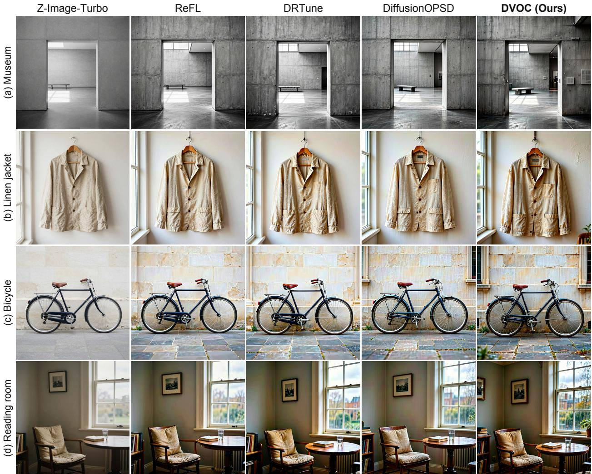  
Figure S1: Qualitative comparison of reward-based adaptation. Columns show Z-Image-Turbo, ReFL, DRTune, DifusionOPSD, and DVOC. Rows show (a) a museum interior, (b) a linen jacket, (c) a bicycle, and (d) a reading room. The examples illustrate diferences in material texture, lighting, and local detail across methods.

Computational eficiency. Table S9 details the computational overhead of VOG. Due to the inclusion of vector-Jacobian products, VOG increases runtime by 1.46× to 1.98× and peak GPU memory by 1.21× to 1.72× across varying resolutions. Despite this overhead, VOG remains practically feasible, with the per-device sampling benchmark fitting on one NVIDIA RTX 4090 GPU. DVOC training uses the separate allocation reported above.

Performance in few-step regimes (Table S10). Table S10 compares 25-step sampling performance on DiT and SiT architectures. For SiT, although the model is trained to predict the interpolant velocity field $v _ { \theta } ( x , t )$ we follow the difusion-SDE sampling setting by converting the learned velocity into the corresponding score:

$$
s _ { \theta } ( x , t ) = \frac { 1 } { \sigma _ { t } } \frac { \alpha _ { t } v _ { \theta } ( x , t ) - \dot { \alpha } _ { t } x } { \dot { \alpha } _ { t } \sigma _ { t } - \alpha _ { t } \dot { \sigma } _ { t } } ,\tag{28}
$$

where $\alpha _ { t }$ and $\sigma _ { t }$ denote the SiT interpolant coeficients. We then apply CFG and VOG on this converted score and use the same difusion SDE sampler for evaluation. VOG improves FID on both architectures, from 7.58 to 4.44 on DiT-XL/2 and from 6.20 to 3.89 on SiT-XL/2. The two architectures trade Precision against Recall in opposite directions: on DiT-XL/2 the gain comes from coverage (Recall 0.429 → 0.545,

Table S9: Runtime and peak memory of VOG relative to CFG, reported as CFG / VOG with the ratio in parentheses. Res/BS denotes resolution and batch size; all measurements are taken on a single NVIDIA RTX 4090.
<table><tr><td>Model</td><td>Res/BS</td><td>CFG/ VOG Runtime (sec)</td></tr><tr><td>EDM2-S DiT-XL/2</td><td>64/8 256/8</td><td>3.66 / 5.33 (1.46x) 10.97 / 17.04 (1.55x)</td></tr><tr><td>EDM2-S DiT-XL/2</td><td>512/8 512/8</td><td>4.66 / 9.22 (1.98x) 39.74 / 65.03 (1.64x)</td></tr><tr><td>Model</td><td>Res/BS</td><td>CFG/ VOG Memory (GB)</td></tr><tr><td>EDM2-S</td><td>64/1</td><td>1.18 / 1.79 (1.53x)</td></tr><tr><td>DiT-XL/2</td><td>256/1</td><td>4.14 / 4.99 (1.21x)</td></tr><tr><td>EDM2-S</td><td>512/1</td><td></td></tr><tr><td>DiT-XL/2</td><td>512/1</td><td>1.19 / 1.81 (1.53x) 4.18 / 7.18 (1.72x)</td></tr></table>

Precision 0.784 → 0.699), whereas on SiT-XL/2 it comes from sample quality (Precision 0.685 → 0.735, Recall 0.555 → 0.516). These configurations also use diferent tuned guidance scales (ω=1.50 for DiT-XL/2, ω=1.10 for SiT-XL/2). In both cases VOG moves the operating point toward a better FID with architecturedependent Precision–Recall trade-ofs. At 50 steps, DiT-XL/2 FID decreases from 3.69 to 2.99. The relative reduction therefore grows from 19% at 50 steps to 41% at 25 steps.

Table S10: Quantitative comparison of 25-step sampling on DiT-XL/2 and SiT-XL/2 (256 × 256, ImageNet). We report FID (↓), Recall (↑), and Precision (↑), together with the guidance scale ω, the momentum coeficient $\beta ,$ and the VJP recomputation interval K.
<table><tr><td>Model</td><td>Method</td><td>FID</td><td>Recall</td><td>Precision</td><td> $\omega$ </td><td> $\beta$ </td><td> $K$ </td></tr><tr><td rowspan="2">DiT-XL/2</td><td>CFG</td><td>7.58</td><td>0.429</td><td>0.784</td><td>1.50</td><td></td><td>-</td></tr><tr><td>VOG</td><td>4.44</td><td>0.545</td><td>0.699</td><td>1.50</td><td>0.15</td><td>2</td></tr><tr><td rowspan="2">SiT-XL/2</td><td>CFG</td><td>6.20</td><td>0.555</td><td>0.685</td><td>1.50</td><td></td><td>1</td></tr><tr><td>VOG</td><td>3.89</td><td>0.516</td><td>0.735</td><td>1.10</td><td>0.15</td><td>2</td></tr></table>

Quantitative analysis on 2D synthetic benchmarks. Table S11 provides the numerical evaluation corresponding to the 2D branching-tree visualizations in Figure 2. While standard CFG efectively filters outliers (high Precision), it loses coverage as the distribution complexity increases, evidenced by the drop in Recall to 0.7785 on the three-class dataset. VOG achieves higher F1-scores and lower Wasserstein distances in both settings, indicating that it aligns samples with the conditional target while better preserving the support of the data manifold.

Extended sensitivity analysis. Figures S3 and S4 supplement the main text with guidance-scale sweeps on EDM2-S and DiT-XL/2. Across the sweep, VOG mitigates the coverage loss that standard CFG exhibits at high guidance scales (e.g., maintaining Recall ≈ 0.58 where CFG drops below 0.50) and avoids the accompanying FID spike, which widens the range of ω over which guidance remains usable.

Composition with other guidance heuristics. VOG is complementary to existing heuristic schedules rather than a replacement for them. Applied on top of Cosine, Interval, and AutoGuidance (Table S12), it improves FID in every case, for instance reducing Interval CFG from 1.637 to 1.523 on EDM2-L, which supports its use as a plug-in guidance correction.

Table S11: Quantitative results on 2D branching-tree generation. We report Precision, Recall, F1-score (higher is better), and Wasserstein distance (lower is better) for both Two-class and Three-class settings. Best results (excluding Ground Truth) are highlighted in bold.
<table><tr><td rowspan="2">Method</td><td colspan="4">Two-class (CLS=2)</td><td colspan="4">Three-class (CLS=3)</td></tr><tr><td>Prec.</td><td>Rec.</td><td>F1</td><td>Wass.</td><td>Prec.</td><td>Rec.</td><td>F1</td><td>Wass.</td></tr><tr><td>Ground Truth</td><td>0.9916</td><td>1.0000</td><td>0.9958</td><td>0.0021</td><td>0.9862</td><td>1.0000</td><td>0.9931</td><td>0.0026</td></tr><tr><td>No Guidance</td><td>0.8948</td><td>0.9989</td><td>0.9440</td><td>0.0031</td><td>0.9194</td><td>0.9970</td><td>0.9567</td><td>0.0035</td></tr><tr><td>Standard CFG</td><td>0.9110</td><td>0.8755</td><td>0.8929</td><td>0.0064</td><td>0.9392</td><td>0.7785</td><td>0.8514</td><td>0.0071</td></tr><tr><td>VOG (ours)</td><td>0.9230</td><td>0.9568</td><td></td><td>0.9396 0.0043</td><td></td><td>0.9536 0.9328</td><td>0.9431</td><td>0.0042</td></tr></table>

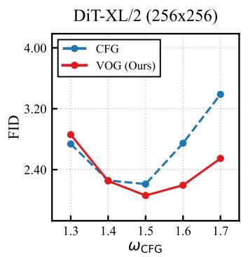  
(a) FID as a function of the guidance scale ωCFG for DiT-XL/2 $( 2 5 6 \times 2 5 6 )$ and EDM2-S $( 5 1 2 \times 5 1 2 )$

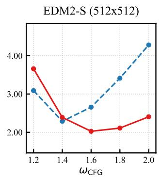

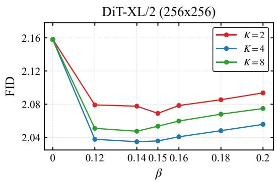  
(b) FID as a function of the momentum coeficient β and the VJP recomputation interval K, on DiT-XL/2 (256 × 256).

Figure S2: Ablation studies on guidance-scale sensitivity (left) and hyperparameter robustness (right).  
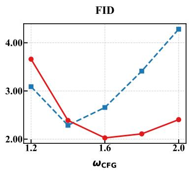

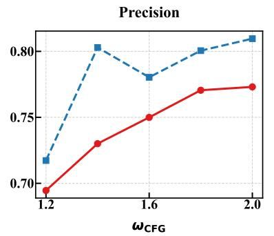  
EDM2-S 512×512

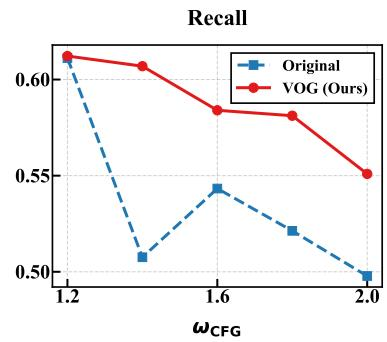  
Figure S3: Quantitative comparison on EDM2-S (512 × 512) across varying guidance scales. We report FID (↓), Precision (↑), and Recall (↑) as a function of the guidance weight ωCFG. VOG (red) demonstrates superior robustness at high scales compared to standard CFG (blue), maintaining an FID of ≈ 2.4 at ω = 2.0 while the baseline degrades beyond 4.0.

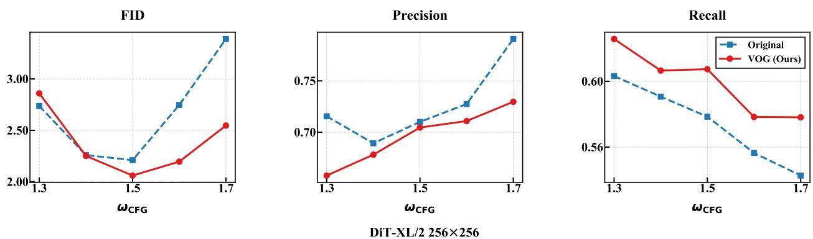  
Figure S4: Quantitative comparison on DiT-XL/2 (256 × 256) across varying guidance scales. While standard CFG sufers from sharp performance degradation at high guidance strengths (e.g., FID > 3.40 at $\omega = 1 . 7 )$ , VOG maintains structural fidelity (high Recall) and generation quality $\mathrm { ( F I D < 2 . 6 0 ) }$ , efectively preventing manifold drift.

Table S12: VOG composed with diferent guidance heuristics on ImageNet $6 4 \times 6 4$ . Each shaded row applies VOG on top of the heuristic immediately above it.
<table><tr><td>Benchmark</td><td>FID</td><td>Precision</td><td>Recall</td></tr><tr><td>EDM2-S</td><td></td><td></td><td></td></tr><tr><td>+AutoGuidance</td><td>1.044</td><td>0.701</td><td>0.626</td></tr><tr><td>+VOG (Ours)</td><td>1.031</td><td>0.696</td><td>0.620</td></tr><tr><td>EDM2-L</td><td></td><td></td><td></td></tr><tr><td>+Standard CFG</td><td>1.993</td><td>0.710</td><td>0.601</td></tr><tr><td>+VOG (Ours)</td><td>1.418</td><td>0.714</td><td>0.597</td></tr><tr><td>+Cosine CFG</td><td>1.667</td><td>0.726</td><td>0.587</td></tr><tr><td>+VOG (Ours)</td><td>1.649</td><td>0.727</td><td>0.588</td></tr><tr><td>+Interval CFG</td><td>1.637</td><td>0.730</td><td>0.597</td></tr><tr><td>+VOG (Ours)</td><td>1.523</td><td>0.720</td><td>0.593</td></tr></table>

## H Reward and Evaluation Histories

We report 100-update training runs for ReFL, DRTune, DifusionOPSD, and DVOC $( K = 3 )$ , with K = 1, 2 confined to the ablation. The primary seven-metric comparison remains the fixed, paired update-20 evaluation in the main paper.

Training reward and evaluation reward. The training reward is $0 . 0 3 8 4 6 R _ { \mathrm { H P S v 3 + + } } + R _ { \mathrm { C L I P } }$ . ReFL and DRTune score one-step clean predictions from sampled late states, whereas DVOC and DifusionOPSD score complete sampled endpoints. These quantities are plotted in separate panels in Figure S5; the two upper panels share their vertical scale. The lower panels show the HPSv3++ and CLIP components for DVOC and DifusionOPSD.

All raw update means are shown as thin, translucent lines. The stronger line is a trailing mean over at most five updates, using the same window for every method. The horizontal axis indicates the optimizer update associated with each training batch, from 1 to 100. Each point is the mean reward on that batch.

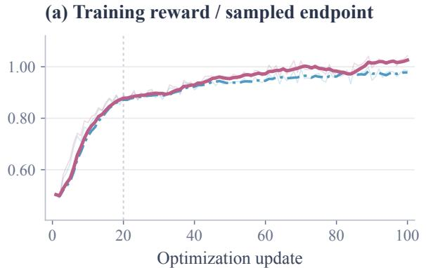

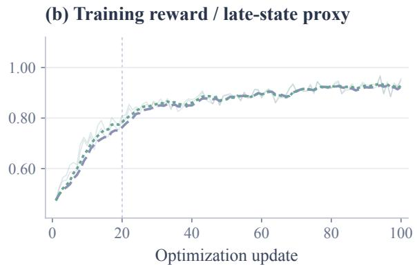  
(d) CLIP / sampled endpoint

(c) HPSv3++ / sampled endpoint  
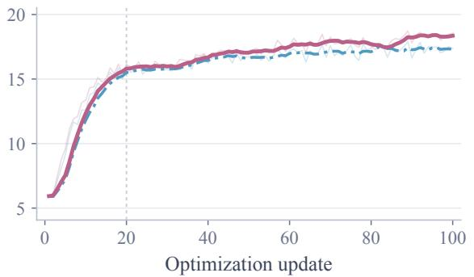

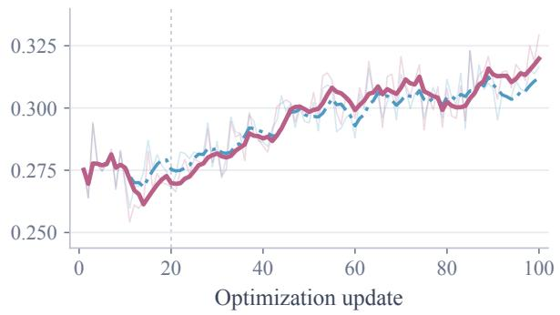  
Figure S5: Training reward histories. Separate panels distinguish sampled endpoints from late-state proxies. Thin lines show every raw update mean; strong lines show the trailing five-update mean. The vertical reference marks update 20. The HPSv3++ and CLIP panels show DVOC and DifusionOPSD.

## H.1 Online Evaluation

We evaluate each method at initialization and every ten updates through update 100, giving 11 checkpoints. Every evaluation uses the EMA adapter, the same 1,000 prompts, $1 0 2 4 ^ { 2 }$ outputs, nine sampling steps, guidance scale zero, and HPSv3++ iteration condition 0.0. Online evaluations use each trainer’s noise sampling scheme; the main comparison pairs initial noise across methods and uses HPSv3++ condition 0.3.

Figure S6 reports HPSv3++ and CLIP as in-domain metrics, alongside the held-out ImageReward evaluator. Markers show measured checkpoint means, with straight lines connecting successive evaluations. The first two panels of Figure 3 show the same CLIP and HPSv3++ histories. The combined evaluation reward is 0.03846 HPSv3 + + + CLIP.

For DVOC, the online weighted evaluation reward rises from 0.766 at update 20 to 0.911 at update 100. ImageReward rises from 1.267 to 1.366 over the same interval.

## H.2 Active-Step Histories

Figure S7 complements the fixed update-20 ablation with all recorded histories for K = 1, 2, 3. Each run uses the same nine-step sampler and two-step PGD target construction. Panel (a) shows training reward with the same raw-line and trailing-mean convention as Figure S5; panels (b)–(f) show unsmoothed online EMA evaluation. The three variants have exactly matching initialization scores on all four displayed evaluators.

Larger K improves the later weighted evaluation reward in these runs, while K = 1 retains a higher late-training AES score. ImageReward varies without a consistent ordering across all checkpoints. These histories complement the fixed update-20 comparison; per-update costs are reported in Table S7.

(a) HPSv3++ ↑  
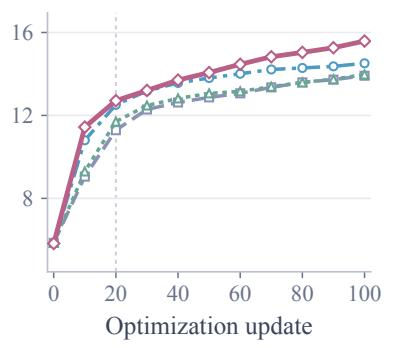

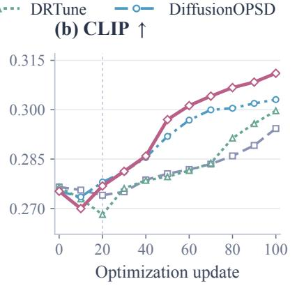

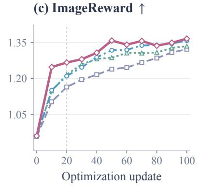  
Figure S6: Online evaluation histories. HPSv3++ and CLIP are in-domain evaluators; ImageReward is held out of training. Each marker is a checkpoint mean, with no smoothing. The vertical line marks update 20. The HPSv3++ condition and noise sampling difer from the paired evaluation in the main table.

(a) Training reward ↑  
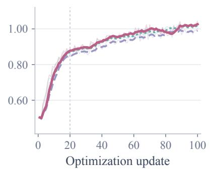

(b) HPSv3++ ↑  
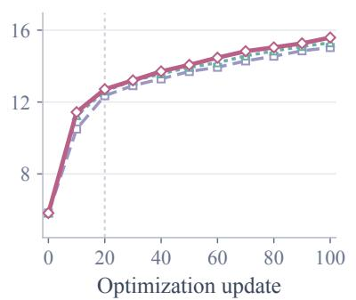

(c) CLIP ↑  
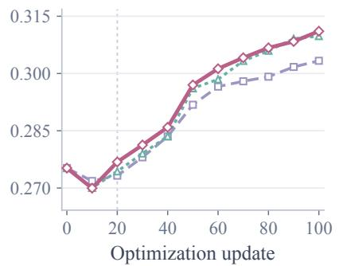  
(f) ImageReward ↑

(d) Evaluation reward ↑  
(e) AES ↑  
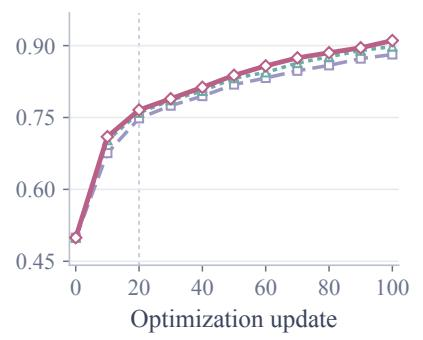

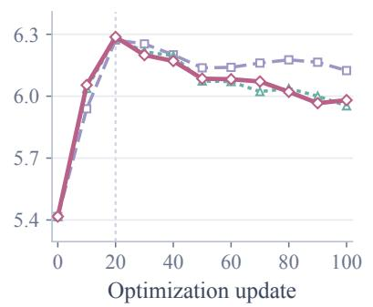

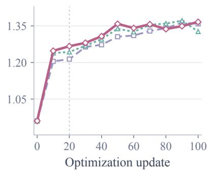  
Figure S7: DVOC active-step ablation over optimization. K = 1, 2 appear only in the ablation; the main method remains K = 3. Training reward includes all raw points and a trailing five-update mean. Evaluation panels show only recorded checkpoint means. The vertical line marks the main paper’s update-20 checkpoint.

## References

[1] Arpit Bansal, Hong-Min Chu, Avi Schwarzschild, Soumyadip Sengupta, Micah Goldblum, Jonas Geiping, and Tom Goldstein. Universal guidance for difusion models. In Proc. ICLR, 2024.

[2] Kevin Black, Michael Janner, Yilun Du, Ilya Kostrikov, and Sergey Levine. Training difusion models with reinforcement learning. In Proc. ICLR, 2024.

[3] Muthu Chidambaram, Khashayar Gatmiry, Sitan Chen, Holden Lee, and Jianfeng Lu. What does guidance do? a fine-grained analysis in a simple setting. In Proc. NeurIPS, 2024.

[4] Hyungjin Chung, Jeongsol Kim, Michael Thompson McCann, Marc Louis Klasky, and Jong Chul Ye. Difusion posterior sampling for general noisy inverse problems. In Proc. ICLR, 2023.

[5] Hyungjin Chung, Jeongsol Kim, Geon Yeong Park, Hyelin Nam, and Jong Chul Ye. CFG++: Manifold-constrained classifier free guidance for difusion models. In Proc. ICLR, 2025.

[6] Kevin Clark, Paul Vicol, Kevin Swersky, and David J. Fleet. Directly fine-tuning difusion models on diferentiable rewards. In Proc. ICLR, 2024.

[7] Jia Deng, Wei Dong, Richard Socher, Li-Jia Li, Kai Li, and Li Fei-Fei. ImageNet: A large-scale hierarchical image database. In Proc. CVPR, 2009.

[8] Alexander Denker, Francisco Vargas, Shreyas Padhy, Kieran Didi, Simon Mathis, Vincent Dutordoir, Riccardo Barbano, Emile Mathieu, Urszula Julia Komorowska, and Pietro Lio. DEFT: Eficient fine-tuning of difusion models by learning the generalised h-transform. In Proc. NeurIPS, 2024.

[9] Prafulla Dhariwal and Alexander Nichol. Difusion models beat GANs on image synthesis. In Proc. NeurIPS, 2021.

[10] Carles Domingo-Enrich, Michal Drozdzal, Brian Karrer, and Ricky T. Q. Chen. Adjoint matching: Fine-tuning flow and difusion generative models with memoryless stochastic optimal control. In Proc. ICLR, 2025.

[11] Ying Fan, Olivia Watkins, Yuqing Du, Hao Liu, Moonkyung Ryu, Craig Boutilier, Pieter Abbeel, Mohammad Ghavamzadeh, Kangwook Lee, and Kimin Lee. DPOK: Reinforcement learning for fine-tuning text-to-image difusion models. In Proc. NeurIPS, 2023.

[12] Shanghua Gao, Pan Zhou, Ming-Ming Cheng, and Shuicheng Yan. Masked difusion transformer is a strong image synthesizer. In Proc. ICCV, 2023.

[13] Yingqing Guo, Hui Yuan, Yukang Yang, Minshuo Chen, and Mengdi Wang. Gradient guidance for difusion models: An optimization perspective. In Proc. NeurIPS, 2024.

[14] Yutong He, Naoki Murata, Chieh-Hsin Lai, Yuhta Takida, Toshimitsu Uesaka, Dongjun Kim, Wei-Hsiang Liao, Yuki Mitsufuji, J. Zico Kolter, Ruslan Salakhutdinov, and Stefano Ermon. Manifold preserving guided difusion. In Proc. ICLR, 2024.

[15] Martin Heusel, Hubert Ramsauer, Thomas Unterthiner, Bernhard Nessler, and Sepp Hochreiter. GANs trained by a two time-scale update rule converge to a local Nash equilibrium. In Proc. NeurIPS, 2017.

[16] Jonathan Ho and Tim Salimans. Classifier-free difusion guidance. arXiv preprint arXiv:2207.12598, 2022.

[17] Jonathan Ho, Ajay Jain, and Pieter Abbeel. Denoising difusion probabilistic models. In Proc. NeurIPS, 2020.

[18] Tero Karras, Miika Aittala, Tuomas Kynkäänniemi, Jaakko Lehtinen, Timo Aila, and Samuli Laine. Guiding a difusion model with a bad version of itself. In Proc. NeurIPS, 2024.

[19] Tero Karras, Miika Aittala, Jaakko Lehtinen, Janne Hellsten, Timo Aila, and Samuli Laine. Analyzing and improving the training dynamics of difusion models. In Proc. CVPR, 2024.

[20] Yuval Kirstain, Adam Polyak, Uriel Singer, Shahbuland Matiana, Joe Penna, and Omer Levy. Pick-a-Pic: An open dataset of user preferences for text-to-image generation. In Proc. NeurIPS, 2023.

[21] Tuomas Kynkäänniemi, Miika Aittala, Tero Karras, Samuli Laine, Timo Aila, and Jaakko Lehtinen. Applying guidance in a limited interval improves sample and distribution quality in difusion models. In Proc. NeurIPS, 2024.

[22] Jie Liu, Gongye Liu, Jiajun Liang, Yangguang Li, Jiaheng Liu, Xintao Wang, Pengfei Wan, Di Zhang, and Wanli Ouyang. Flow-GRPO: Training flow matching models via online RL. In Proc. NeurIPS, 2025.

[23] Yijun Liu, Jie Huang, Zeyue Xue, Yuming Li, Ruizhe He, Haoran Li, Shijia Ge, and Siming Fu. HPSv3++: Scaling reward models across the full spectrum of difusion model capabilities. arXiv preprint arXiv:2606.14657, 2026.

[24] Toan Nguyen, Kien Do, Duc Kieu, and Thin Nguyen. h-Edit: Efective and flexible difusion-based editing via Doob’s h-transform. In Proc. CVPR, 2025.

[25] William Peebles and Saining Xie. Scalable difusion models with transformers. In Proc. ICCV, 2023.

[26] Phillip Pope, Chen Zhu, Ahmed Abdelkader, Micah Goldblum, and Tom Goldstein. The intrinsic dimension of images and its impact on learning. In Proc. ICLR, 2021.

[27] Mihir Prabhudesai, Anirudh Goyal, Deepak Pathak, and Katerina Fragkiadaki. Aligning text-to-image difusion models with reward backpropagation. CoRR, abs/2310.03739, 2023.

[28] Alec Radford, Jong Wook Kim, Chris Hallacy, Aditya Ramesh, Gabriel Goh, Sandhini Agarwal, Girish Sastry, Amanda Askell, Pamela Mishkin, Jack Clark, Gretchen Krueger, and Ilya Sutskever. Learning transferable visual models from natural language supervision. In Proceedings of the 38th International Conference on Machine Learning, pages 8748–8763, 2021.

[29] Seyedmorteza Sadat, Jakob Buhmann, Derek Bradley, Otmar Hilliges, and Romann M. Weber. CADS: Unleashing the diversity of difusion models through condition-annealed sampling. In Proc. ICLR, 2024.

[30] Seyedmorteza Sadat, Otmar Hilliges, and Romann M Weber. Eliminating oversaturation and artifacts of high guidance scales in difusion models. In Proc. ICLR, 2025.

[31] Mehdi S. M. Sajjadi, Olivier Bachem, Mario Lucic, Olivier Bousquet, and Sylvain Gelly. Assessing generative models via precision and recall. In Proc. NeurIPS, 2018.

[32] Christoph Schuhmann. LAION-Aesthetics. LAION blog, 2022.

[33] Yang Song and Stefano Ermon. Generative modeling by estimating gradients of the data distribution. In Proc. NeurIPS, 2019.

[34] Yang Song, Jascha Sohl-Dickstein, Diederik P. Kingma, Abhishek Kumar, Stefano Ermon, and Ben Poole. Score-based generative modeling through stochastic diferential equations. In Proc. ICLR, 2021.

[35] Tongyi-MAI. Z-Image-Turbo. Model card and released checkpoint, 2025.

[36] Bram Wallace, Meihua Dang, Rafael Rafailov, Linqi Zhou, Aaron Lou, Senthil Purushwalkam, Stefano Ermon, Caiming Xiong, Shafiq Joty, and Nikhil Naik. Difusion model alignment using direct preference optimization. In Proc. CVPR, 2024.

[37] Ruoyu Wang, Boye Niu, Xiangxin Zhou, Yushi Huang, Tongliang Liu, and Chi Zhang. Exploring the design space of reward backpropagation for flow matching. arXiv preprint arXiv:2606.11075, 2026.

[38] Xi Wang, Nicolas Dufour, Nefeli Andreou, Marie-Paule Cani, Victoria Fernández Abrevaya, David Picard, and Vicky Kalogeiton. Analysis of classifier-free guidance weight schedulers. Transactions on Machine Learning Research, 2024.

[39] Haoning Wu, Zicheng Zhang, Weixia Zhang, Chaofeng Chen, Liang Liao, Chunyi Li, Yixuan Gao, Annan Wang, Erli Zhang, Wenxiu Sun, Qiong Yan, Xiongkuo Min, Guangtao Zhai, and Weisi Lin. Q-Align: Teaching LMMs for visual scoring via discrete text-defined levels. In Proc. ICML, pages 54015–54029, 2024.

[40] Xiaoshi Wu, Yiming Hao, Manyuan Zhang, Keqiang Sun, Zhaoyang Huang, Guanglu Song, Yu Liu, and Hongsheng Li. Deep reward supervisions for tuning text-to-image difusion models. In European Conference on Computer Vision, pages 108–124. Springer, 2024.

[41] Mengfei Xia, Nan Xue, Yujun Shen, Ran Yi, Tieliang Gong, and Yong-Jin Liu. Rectified difusion guidance for conditional generation. In Proc. CVPR, 2025.

[42] Jiazheng Xu, Xiao Liu, Yuchen Wu, Yuxuan Tong, Qinkai Li, Ming Ding, Jie Tang, and Yuxiao Dong. ImageReward: Learning and evaluating human preferences for text-to-image generation. In Proc. NeurIPS, 2023.

[43] Shuchen Xue, Chongjian Ge, Shilong Zhang, Yichen Li, and Zhi-Ming Ma. Advantage weighted matching: Aligning RL with pretraining in difusion models. In Proc. ICML, pages 143146–143169, 2026.

[44] Zhiyuan You, Xin Cai, Jinjin Gu, Tianfan Xue, and Chao Dong. Teaching large language models to regress accurate image quality scores using score distribution. In IEEE/CVF Conference on Computer Vision and Pattern Recognition, pages 14483–14494, 2025.

[45] Jiwen Yu, Yinhuai Wang, Chen Zhao, Bernard Ghanem, and Jian Zhang. FreeDoM: Training-free energy-guided conditional difusion model. In Proc. ICCV, 2023.

[46] Kaiwen Zheng, Huayu Chen, Haotian Ye, Haoxiang Wang, Qinsheng Zhang, Kai Jiang, Hang Su, Stefano Ermon, Jun Zhu, and Ming-Yu Liu. DifusionNFT: Online difusion reinforcement with forward process. In Proc. ICLR, 2026.

[47] Wei Zhou, Xiongwei Zhu, Lingdong Kong, Bo Chen, Lei Zhang, Yongyuan Liang, Xiaoxia Hou, Ye Tian, Xian Sun, Yingshuo Wang, Linfeng Li, Shengqiong Wu, Leigang Qu, Feng Li, Wei Liu, Julian McAuley, and Tat-Seng Chua. On-policy self-distillation in difusion models. arXiv preprint arXiv:2608.24646, 2026.