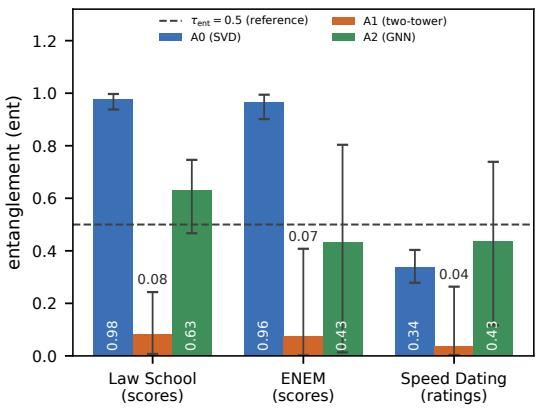
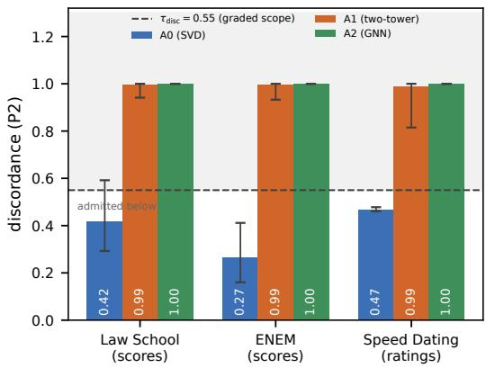
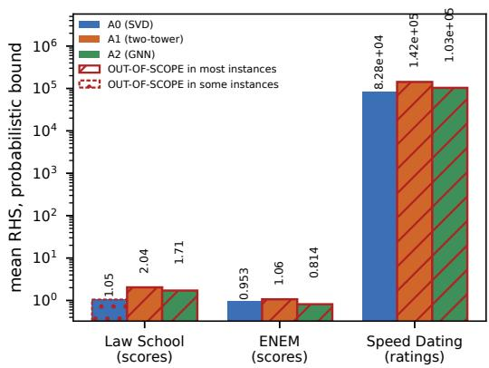

# When Is a Cheap Fairness Edit Safe? Screening Post-Hoc Edits in Two-Sided Matching Markets

Moirangthem Tiken Singha,∗, Rabinder Kumar Prasada

aDepartment of Computer Science and Engineering, Dibrugarh University Institute of Engineering and Technology, Dibrugarh University, Dibrugarh, Assam, India

## Abstract

Two-sided matching systems, such as admissions pipelines, allocate opportunities jointly. Reducing a protected attribute’s influence usually requires encoder retraining. We study a closed-form linear projector that does this at inference time. For markets that stay vertically ordered before and after the edit, we bound the mean welfare change by the edit-induced appeal shift and an explicit remainder. A probabilistic refinement replaces worst-case constants with a data-dependent deviation term. A pre-deployment screen combines a verticality test with a welfare sweep and returns PASS, KILL, or OUT-OF-SCOPE. An exact tier requires every opportunity to rank applicants by appeal, and a graded tier admits near-vertical markets. On 30 held-out synthetic markets, the screen agrees with every pre-specified regime verdict, with no observed false PASS. On 60 exactly vertical markets, no bound is violated, and the probabilistic bound is informative in 69% to 87% of configurations. On 2700 configurations from three realistic markets, which do not reach the exact tier, no plug-in bound expression is violated. A closed-form factorization stays within graded scope in 90% to 100% of instances, whereas two-tower and graph neural network encoders fall outside it in every instance. Architecture choice thus appears to afect whether a post-hoc edit is admissible.

Keywords: Fairness in recommendation, Two-sided matching, Post-hoc intervention, Concept erasure, Welfare bound, Model selection

## 1. Introduction

Many machine learning systems make one-sided decisions, such as approving a loan or selecting an item to display. Two-sided matching systems instead allocate opportunities jointly across two populations. Examples include school and university admissions, residency matching, ride-sharing platforms, and freelance marketplaces. School choice and residency matching commonly use deferred acceptance. Under deferred acceptance, an agent’s outcome depends on the scores of all other agents. Raising one applicant’s score can trigger a chain of reassignments that displaces other applicants from their matches [1]. A small score change can therefore produce a large and discontinuous change in the final matching. Standard smoothness arguments do not directly apply to the efect of a model adjustment on such a mechanism.

Consider a platform that scores applicants with a deployed model and allocates them through such a mechanism. Automated systems that decide access or admission to education are classified as high-risk under the European Union’s Artificial Intelligence Act [2]. In such settings, a regulator or an internal policy team may require a protected attribute, such as race or gender, to exert less influence on the matching. These requirements also change over time. In 2023, for example, the Supreme Court of the United States held that raceconscious admissions programs at two universities violated the Equal Protection Clause [3]. The platform could retrain the model after each change, but retraining is costly. Deep recommendation models are among the most compute-intensive training workloads in large production data centers [4], and graph-based recommenders at web scale are trained on multi-GPU hardware over graphs with billions of nodes [5]. Repeated retraining may therefore be impractical, which motivates the following research question.

Research question. Can the dependence of a deployed matching system on a protected attribute be reduced after deployment, without retraining, while providing a provable bound on the loss in match quality and a predeployment check that reports whether the bound applies?

We address this question without diferentiating the matching mechanism. We treat the mechanism as a black box, run it before and after a closed-form edit of the encoder output, and bound the resulting change in mean welfare. Because deferred acceptance is discontinuous in the scores, a bound of this kind requires structural assumptions on the market. The central problem is therefore to identify a market structure under which the edit has a bounded welfare cost, and to check that structure before deployment.

## Contributions.

• We formulate four requirements for a post-hoc fairness intervention that leaves the encoder unchanged. A linear projection of the encoder output satisfies three of them by construction. The fourth is a provable bound on the loss in match quality.

• For markets in which both sides share a ranking criterion before and after the edit, we prove a bound on the change in match quality that neither smooths nor approximates the matching mechanism. To our knowledge, this is the first such guarantee for a post-hoc edit in two-sided matching. An explicit form of the bound depends on quantities that can be estimated before deployment from the representations and a labeled validation set: the overlap between the removed information and agent merit, the alignment of the removed information with the ranking criterion, and the dispersion of merit among agents with equal appeal.

• We derive a probabilistic refinement that replaces worst-case quantities with a data-dependent deviation term at a specified failure probability.

• We combine the scope condition of the guarantees with an empirical welfare sweep in a predeployment screen that returns Pass, Kill, or Out-of-Scope according to predefined scope, gapclosure, and surplus-retention criteria.

• We evaluate, on controlled and realistic markets, how the encoder architecture afects the scope conditions and the deployment verdicts.

Section 2 positions the work in the literature. Section 3.1 formulates the problem and the intervention, and Section 3.2 develops the theoretical analysis. Section 3.3 presents the screening rule, and Section 4 reports the experiments. Section 5 interprets the findings and states the scope of the results, and Section 6 concludes.

## 2. Related work

Four lines of work address parts of the deployment problem considered here: concept erasure, postprocessing fairness, in-processing fair ranking and recommendation, and fair matching mechanisms. Table 1 compares them on four properties of a deployable intervention: operation after training, retargeting to a new fairness objective without retraining, closed-form construction, and a bound on welfare cost. Classical twosided matching theory, reviewed last, supplies the mechanism analysis rather than a competing intervention.

Concept erasure: Early methods removed a target attribute from static word embeddings by projecting out an estimated bias direction [6]. Later work introduced iterative nullspace projection [7], adversarial linear erasure [8], and closed-form projectors such as LEACE [9]. These methods prevent a linear classifier from recovering a concept from the representation. They operate post hoc and can be retargeted, and some admit closedform solutions. Their guarantees concern the linear predictability of the attribute and the distortion of the representation. They do not bound the allocation that a discontinuous mechanism computes from all scores jointly.

The projector analyzed here has the same structure as LEACE for a binary attribute. It removes the group mean-diference direction in whitened coordinates and maps the result back. It difers in whitening the pooled representations of both market sides and in allowing partial erasure. The contribution of this work is therefore not the projector itself but the analysis of its efect on the resulting allocation.

Post-processing fairness: Post-processing methods adjust decisions or scores after training. Examples include equalized-odds post-processing [10], its calibrated variant [11], and reject-option classification [12]. Fair ranking methods such as FA\*IR [13] and exposureconstrained rankings [14] similarly re-rank a given scored list. Like concept erasure, these methods are post hoc and can be reapplied to new targets. Their guarantees, however, concern individual predictions, aggregate classifier performance, or a single ranked list. Deferred acceptance processes all adjusted scores simultaneously, so a guarantee for independent decisions does not transfer to the induced matching.

Table 1: Properties of representative approaches. The welfare guarantee of this work is conditional on vertical-market assumptions.
<table><tr><td>Method</td><td>Post-hoc</td><td>Retargetable</td><td>Closed-form</td><td>Welfare Bound</td></tr><tr><td>Concept erasure</td><td>Yes</td><td>Yes</td><td>Partial</td><td>No</td></tr><tr><td>Post-processing fairness</td><td>Yes</td><td>Yes</td><td>Partial</td><td>No</td></tr><tr><td>In-processing fair ranking/recommendation</td><td>No</td><td>No</td><td>No</td><td>No</td></tr><tr><td>Fair matching mechanisms</td><td>N/A</td><td>N/A</td><td>N/A</td><td>No (mechanism only)</td></tr><tr><td>This work</td><td>Yes</td><td>Yes</td><td>Yes</td><td>Yes (conditional)</td></tr></table>

Representation neutralization [15] is the closest method in this group. It keeps the encoder fixed and retrains only the classification head on neutralized representations, so it also avoids retraining the encoder. It difers from the edit studied here in two respects. It retrains the head for each fairness target, and it addresses individual classification rather than a jointly computed allocation.

In-processing fair ranking and recommendation: In-processing methods build fairness into the training objective. Early approaches learned representations that retained predictive information while obscuring group membership [16]. Later work added fairness regularizers to collaborative filtering [17], decomposed embeddings into bias-aware and bias-free components for news recommendation [18], and learned exposure-fair ranking policies [19]. These methods retrain the model when the fairness criterion changes. Filter-based methods [20] keep the base encoder fixed but train a separate filter for each fairness target. Neither class is retargetable without training, and neither provides a closedform inference-time edit. When the protected attribute correlates with match quality, these methods also fix the accuracy-fairness tradeof during training rather than measure it at inference time.

Fair matching mechanisms: Fair matching methods change the allocation mechanism itself, through quotas, capacity constraints, or fair stable-matching procedures [21, 22, 23]. They impose distributional constraints on group representation directly. This work instead keeps the deployed mechanism fixed and edits only its inputs. The first three properties in Table 1 describe edits to the inputs of a fixed mechanism, so they are marked not applicable for these methods. The two approaches are complementary, and a platform could use both.

Two-sided matching theory: The mechanism analysis builds on classical results on stability and deferred acceptance [24], their application to school choice [25], and the broader market design literature [26]. Stable assortative matching under vertical preferences is central to the theoretical framework. Recent work learns matching mechanisms that trade of stability and strategy-proofness [27], whereas the mechanism here is given. To our knowledge, prior work has not connected assortative matching theory to post-hoc edits of trained representations or to welfare guarantees for such edits.

Among the methods reviewed here, none combines post-hoc operation, retargetability, closed-form construction, and a welfare bound for the induced matching. The present framework provides all four properties for markets that satisfy explicit structural assumptions.

## 3. Methodology

## 3.1. Problemformulation

## 3.1.1. Two-sided matching systems

A two-sided matching system contains two populations. Side A contains applicants, such as users, students, or job seekers, while side B contains opportunities, such as items, schools, or positions. A trained encoder E maps each agent to a representation, where $x _ { a } =$ $E ( a ) , x _ { b } = E ( b )$ , and $x _ { a } , x _ { b } \in \mathbb { R } ^ { d }$ . A scorer assigns each pair the compatibility score $s ( a , b ) = \langle \phi ( x _ { a } ) , \psi ( x _ { b } ) \rangle$ . In the preference model studied here, side B ranks applicants by this score, while side A ranks opportunities by their fixed quality $q _ { b } .$ . An allocation mechanism M maps the two sides’ rankings to a matching $\mu = \mathcal { M } ( s , q )$ Throughout this paper, M is deferred acceptance. Side A carries a protected attribute $z \in \{ 0 , 1 \}$ that may afect the scores and, consequently, the allocation.

Only the ranking by side B depends on the edit. The qualities of side B are therefore fixed primitives, and the analysis of Section 3.2 attributes any welfare change to the movement of applicants along the quality ladder.

Throughout, the market is balanced, one to one, and complete: $| { \mathcal { A } } | = | { \mathcal { B } } | = n$ , every agent ranks every agent on the other side, and no agent is left unmatched. Ties in the edited scores are broken by agent index, which fixes the matching uniquely when a projection creates exact ties.

## 3.1.2. Design requirements

A post-hoc intervention on a deployed matcher should meet four deployment-oriented requirements, stated in Definition 1.

Definition 1 (Post-hoc fairness control with bounded cost). An intervention on a trained matcher satisfies:

(D1) It acts at inference time on the fixed encoder, without gradient updates to it.

(D2) It is adjustable across fairness targets by changing few parameters, without retraining.

(D3) It admits a closed form, recomputable cheaply when the attribute or population changes.

(D4) It carries a bound on the match qualityforfeited as afunction ofthe intervention’s strength.

Requirements D1–D3 distinguish post-hoc interventions from in-processing approaches. In-processing methods generally retrain the encoder when the protected attribute or fairness objective changes, which violates D1 and D2. They also provide no closed-form update for inexpensive recomputation, which violates D3. The projector introduced next satisfies D1–D3 by construction (Section 3.1.4). D4 instead requires a bound on the match quality forfeited as a function of edit strength. Construction alone cannot provide this bound because deferred acceptance is discontinuous in the scores. Without additional structure, a small input perturbation need not produce a small change in the matching. Establishing D4 is therefore the main theoretical problem. Section 3.2 establishes it for markets with a shared ranking criterion.

## 3.1.3. Post-hoc fairness intervention

The deployed encoder already serves allocations, and the fairness requirement may change faster than the encoder can be retrained. To meet D1–D3, the intervention acts on the inference pipeline. It inserts one linear transformation between the encoder and the scorer without modifying either component. Let W be the whitening map for the pooled representations, and let uˆ be the between-group mean-diference direction for the whitened side-A representations. The transformation attenuates ˆu in whitened coordinates and maps the result back to the original coordinates. The operator applied to side A is

$$
\begin{array} { r } { T _ { \gamma } = W ^ { - 1 } ( I - \gamma \hat { u } \hat { u } ^ { \top } ) W , \qquad \gamma \in [ 0 , 1 ] , } \end{array}\tag{1}
$$

with $\gamma ~ = ~ 0$ recovering the original system and $\gamma ~ =$ 1 removing the direction entirely. Scoring proceeds in the original coordinates the deployed scorer uses, $s _ { \gamma } ( a , b ) ~ = ~ \langle \phi ( T _ { \gamma } x _ { a } ) , \psi ( x _ { b } ) \rangle$ , and the mechanism produces $\mu _ { \gamma } = \mathcal { M } ( s _ { \gamma } , q )$

The analysis in Section 3.2 concerns this operator and uses two of its properties. The inverse whitening map $W ^ { - 1 }$ is part of the edit, so scoring remains in the geometry of the deployed scorer. The edit acts only on side A, and side-B qualities remain fixed primitives.

## 3.1.4. Construction of the projector

Algorithm 1 states the procedure that a deployment runs. It first whitens the pooled representations of both sides. It then estimates the protected direction ˆu from the whitened group means. It erases that direction at strength γ. It finally maps the result back through the inverse whitening transform, which Remark 1 shows is required for the edit to be the identity at $\gamma = 0 .$

Algorithm 1 One-sided erasure, the edit analyzed in   
Theorems 1 and 2.   
Require: representations $\{ \boldsymbol { x } _ { a } \} _ { a \in \mathcal { A } } , \quad \{ \boldsymbol { x } _ { b } \} _ { b \in \mathcal { B } } ,$ labels   
$\{ z _ { a } \} _ { a \in \mathcal { A } } ,$ strength $\gamma \in [ 0 , 1 ]$   
Ensure: edited side-A representations $\{ x _ { a } ^ { \prime } \} _ { a \in \mathcal { A } } ;$ side B   
unchanged   
1: X ← row-stack of $\{ x _ { a } \} \cup \{ x _ { b } \}$   
2: $\Sigma  \operatorname { C o v } ( X )$ A $d \times d ,$ independent of z and $\gamma$   
3: (Q eigvals) ← EigenDecomposition(Σ)   
4: floor the eigenvalues at $1 0 ^ { - 1 0 }$ max(eigvals) A   
singular-covariance policy   
5: $\begin{array} { r l r l } { W } & { { }  } & { } & { { } Q _ { \Sigma } } \end{array}$ diag(eigval $\boldsymbol { \mathrm { s } } ^ { - 1 / 2 } ) \boldsymbol { Q } _ { \Sigma } ^ { \intercal }$ $W ^ { - 1 }$   
QΣ diag(eigvals1/2) Q⊤Σ   
6: $x _ { a } ^ { w } \gets W x _ { a }$ for all a   
7: $\nu  \mathrm { m e a n } _ { a \cdot z _ { a } = 1 } ( x _ { a } ^ { w } ) - \mathrm { m e a n } _ { a \cdot z _ { a } = 0 } ( x _ { a } ^ { w } )$   
8: if $\left\| \nu \right\| = 0$ or a group is empty then   
9: return $\{ x _ { a } \}$ ▷ no estimable direction; edit is the   
identity   
10: end if   
11: $\hat { u }  \nu / \| \nu \|$   
12: for each $a \in { \mathcal { A } }$ do   
13: $x _ { a } ^ { w \prime } \gets x _ { a } ^ { w } - \gamma \left( x _ { a } ^ { w } \cdot \hat { u } \right) \hat { u }$   
14: end for   
15: $x _ { a } ^ { \prime } \gets W ^ { - 1 } x _ { a } ^ { w \prime }$ for all a ▷ map back; see Remark 1   
16: return $\{ x _ { a } ^ { \prime } \} .$ , with $x _ { b } ^ { \prime } = x _ { b }$ for all $b \in { \mathcal { B } }$

The construction satisfies the first three requirements of Definition 1. The projector acts on the output of the fixed encoder at inference time and performs no gradient update, thereby satisfying D1. $\mathrm { A t } \gamma = 0 ,$ , the identity property establishes that the edit family contains the deployed system.

Remark 1 $( \gamma = 0$ is exactly the identity). $A t \gamma = 0 ,$ , line 13 leaves $x _ { a } ^ { w \prime } = x _ { a } ^ { w } .$ . Line 15 then computes $W ^ { - 1 } W x _ { a } =$ $x _ { a }$ exactly, because $W ^ { - 1 }$ uses the same eigenvectors and the reciprocal eigenvalues. Algorithm 1 therefore returns the original representations unchanged at $\gamma = 0$ The inverse map in line 15 is necessary because whitening rescales every dimension to unit variance. Returning $x _ { a } ^ { w }$ would change the representation even at zero attenuation, whereas mapping through $W ^ { - 1 }$ reproduces the deployed system exactly.

The complexity of Algorithm 1 establishes D3. Line 2 costs $O ( n d ^ { 2 } )$ , and line 3 costs $O ( d ^ { 3 } )$ independently of n. The dense transformations in lines 6 and 15 cost $O ( n d ^ { 2 } )$ , while each remaining line costs $O ( n d )$ . The total cost is therefore $O ( n d ^ { 2 } + d ^ { 3 } )$ , compared with $O ( n ^ { 2 } )$ for one call to M. When $d ^ { 2 } \ll n$ , the matching mechanism asymptotically dominates the projector.

Retargeting to a new attribute establishes D2. The whitening transforms W and $W ^ { - 1 }$ in Algorithm 1 depend only on the representations, not on z, and can therefore be cached. Given new labels $\{ z _ { a } ^ { \prime } \} _ { a \in \mathcal { A } }$ and cached representations $x _ { a } ^ { w } \ = \ W x _ { a } ,$ , retargeting recomputes only the direction, $\begin{array} { r l r } { { \hat { u } } ^ { \prime } } & { { } = } & { \nu ^ { \prime } / \| \nu ^ { \prime } \| } \end{array}$ with $\nu ^ { \prime } =$ $\mathrm { m e a n } _ { a : z _ { a } ^ { \prime } = 1 } ( x _ { a } ^ { w } ) - \mathrm { m e a n } _ { a : z _ { a } ^ { \prime } = 0 } ( x _ { a } ^ { w } )$ , and reapplies lines $1 2 -$ 15 of Algorithm 1 with $\hat { u } ^ { \prime }$ replacing ˆu. The cost is O(nd) per target when the rank-one update is applied algebraically and $O ( n d ^ { 2 } )$ when each representation is multiplied by a dense $W ^ { - 1 }$ . Retargeting requires group labels for the new attribute.

Both the initial construction and retargeting produce a rank-one edit along the direction ˆu. The guarantees of Section 3.2 are proved for this rank-one edit.

## 3.1.5. Theoretical scope

Because deferred acceptance is discontinuous in the scores (Section 3.1.2), the welfare analysis assumes a vertically ordered market in which both sides rank agents by a shared criterion. Under this structure, the stable matching is assortative, and the efect of the edit can be expressed as rank displacement. Markets with substantially idiosyncratic preferences fall outside this theoretical scope.

## 3.2. Theoretical analysis

## 3.2.1. Assortative markets

Let $k \in \mathbb { R } ^ { d }$ be a unit desirability direction and let $n = | \mathcal { A } | = | \mathcal { B } |$ . Applicant a has appeal $\theta _ { a } = \langle x _ { a } , k \rangle$ , and opportunity $b \in { \mathcal { B } }$ has quality $q _ { b } \in \mathbb { R }$ . The true utility of a match is $U ( a , b ) = V ( \theta _ { a } ^ { * } , q _ { b } )$ , where the true merit $\theta _ { a } ^ { * }$ may difer from the observed appeal $\theta _ { a }$ because of bias. The welfare of a matching is $\begin{array} { r } { \mathcal { W } ( \mu ) = \frac { 1 } { n } \sum _ { a } U ( a , \mu ( a ) ) } \end{array}$

The following four assumptions define the vertically ordered markets considered in our analysis and provide the regularity conditions needed for the welfare bounds. The first imposes a shared ranking criterion. The remaining assumptions constrain the appeal distribution, the quality distribution, and the utility function.

Assumption 1 (Vertical market, V). Every $b \in { \mathcal { B } }$ ranks A by descending θ; every a ∈ A ranks B by descending $q ;$ both orderings are strict.

Assumption 2 (Bounded appeal density, $\mathrm { D } 1 ^ { \prime } )$ . There exists $\bar { f } ~ < ~ \infty$ such that for every $t \in \mathbb { R } , w \ > \ 0 ,$ , the number ofagents with $\theta _ { a } \in [ t , t + w ]$ is at most ${ \bar { f } } w n + 1 .$

Assumption 3 (Bounded quality spread, D2′). There exists $\Lambda <$ ∞ such that $| q _ { ( r ) } - q _ { ( s ) } | \leq \Lambda | r - s | / n f$ or all ranks $r , s ,$ where $q _ { ( r ) }$ is the r-th largest quality.

Assumption 4 (Lipschitz utility, L). There exists $M <$ ∞ such that $| V ( \theta ^ { * } , q ) - V ( \theta ^ { * } , q ^ { \prime } ) | \le M | q - q ^ { \prime } | f o r$ every $\theta ^ { * } , q , q ^ { \prime }$

For the post-edit market, Assumption 1 is read with the post-edit appeal $\theta ^ { \prime }$ defined below in place of $\theta , \ \mathrm { A s } \cdot$ sumption 1 requires both sides to agree on a common ranking criterion. It fails where preferences are idiosyncratic. In residency matching, for example, programs and candidates rank each other by criteria that do not reduce to a shared scalar. Section 5.4 returns to this case.

Lemma 1 (Assortativity). Under Assumption 1, the unique stable matching pairs the rank-r agent of A with the rank-r agent of B, for every r.

Applying $T _ { \gamma }$ to side A changes applicant appeal. Let $\theta _ { a } ^ { \prime } = \langle T _ { \gamma } x _ { a } , k \rangle$ denote applicant $\boldsymbol { a } ^ { \prime } \boldsymbol { \mathrm { s } }$ post-edit appeal. Let $r ( a )$ and $r ^ { \prime } ( a )$ denote the rank of a in descending order of $\{ \theta _ { a } \}$ and $\{ \theta _ { a } ^ { \prime } \}$ , respectively. We write $\mu = \mu _ { 0 }$ and $\mu ^ { \prime } = \mu _ { \gamma }$ for the stable matchings before and after the edit. Because W and $W ^ { - 1 }$ are symmetric, the appeal shift for applicant a is

$$
\zeta _ { a } = \theta _ { a } - \theta _ { a } ^ { \prime } = \gamma \langle W x _ { a } , \hat { u } \rangle \langle W ^ { - 1 } \hat { u } , k \rangle .\tag{2}
$$

The coeficient $\langle W ^ { - 1 } \hat { u } , k \rangle$ measures the alignment of the erased direction with the desirability direction in the original coordinates. It is not bounded by one, because $W ^ { \overline { { - 1 } } }$ can stretch the erased direction. Theorem 1 uses $\zeta _ { a }$ only through the $( 1 - \varepsilon )$ quantile of its magnitude, whereas Proposition 1 depends on the coeficient explicitly. For $ { \varepsilon } \in ( 0 , 1 )$ , let $\delta _ { \varepsilon }$ be the $( 1 - \varepsilon )$ quantile of {|ζa|}, and let $O = \{ a : | \zeta _ { a } | > \delta _ { \varepsilon } \}$ be the set of outliers, so that $| O | \leq \varepsilon n$

Lemma 2 (Local displacement). For every non-outlier a $\notin O , | r ^ { \prime } ( a ) - r ( a ) | \leq \# \{ a ^ { \prime } \neq a : | \theta _ { a ^ { \prime } } - \theta _ { a } | \leq 2 \delta _ { \varepsilon } \} + | O |$

## 3.2.2. Bounded welfare guarantee

Lemma 2 bounds the rank displacement of each nonoutlying agent. Theorem 1 treats outliers separately using the full quality range. The remaining assumptions convert local rank displacement into bounded changes in partner quality and, consequently, bounded changes in welfare.

Theorem 1 (Bounded-stakes welfare guarantee). Suppose Assumption 1 holds for both the pre-edit and the post-edit market at the specified $\gamma \in [ 0 , 1 ] .$ . Under Assumptions $2 \mathrm { - } 4 ,$ for every $ { \varepsilon } \in ( 0 , 1 )$

$$
\begin{array} { r l r } {  {  \mathcal { W } ( \mu ) - \mathcal { W } ( \mu ^ { \prime } )  \le C \delta _ { \varepsilon } + \mathcal { R } _ { \varepsilon } , } } \\ & { } & { w h e r e \qquad C = 4 M \Lambda \bar { f } , } \\ & { } & { \mathcal { R } _ { \varepsilon } = 2 M \Lambda \varepsilon + \frac { M \Lambda } { n } . } \end{array}\tag{3}
$$

The left-hand side is the change in mean matched utility because $\mathcal { W }$ includes the factor $1 / n .$ . The bound neither linearizes nor relaxes M. It compares the exact outputs obtained by running the mechanism once before and once after the edit. The proof combines local rank displacement (Lemma 2) with bounded quality spread (Assumption 3).

Theorem 1 establishes requirement D4 of Definition 1 for vertical markets. In Equation (2), the quantities W, ˆu, and k do not depend on γ, so every |ζ | is proportional to $\gamma .$ The quantile therefore satisfies $\delta _ { \varepsilon } ( \gamma ) = \gamma \delta _ { \varepsilon } ( 1 )$ , and the bound becomes $C \gamma \delta _ { \varepsilon } ( 1 ) + \mathcal { R } _ { \varepsilon }$ an explicit function of the edit strength. The guarantee holds at each $\gamma$ for which Assumption 1 holds before and after the edit, which is the condition that the exact tier of the screening rule checks (Section 3.3). The remainder $\mathcal { R } _ { \varepsilon }$ does not vanish at $\gamma = 0$ , where the welfare change is zero, so the bound is conservative for small edits.

The constants M, Λ, and $\bar { f }$ are population quantities. We estimate each with the sample analogue required by its assumption. Specifically, Λ is the largest adjacent-rank quality gap multiplied by n, and M is the largest per-agent utility-quality slope because Assumption 4 requires a supremum. We compute $\bar { f }$ over all appeal windows. For each count $j ,$ the narrowest window containing j agents determines the lower limit $( j - 1 ) / ( n w _ { \mathrm { m i n } } ( j ) )$ . Taking the largest such limit ensures that the sample estimate satisfies Assumption 2 by construction.

## 3.2.3. A probabilistic refinement

The constant $C = 4 M \Lambda \bar { f }$ depends on Λ. Assumption 3 requires Λ to bound every adjacent-rank gap. In a finite sample, the largest gap therefore determines Λ, even if the realized displacement pattern places little or no weight on that gap. The following refinement replaces this worst-case quantity with the average gap under one additional assumption and a failure probability η.

Let the sorted quality gaps be $g _ { r } = q _ { ( r ) } - q _ { ( r + 1 ) }$ and let the range be $\Delta _ { q } = q _ { ( 1 ) } - q _ { ( n ) }$ . The gaps telescope exactly, so their mean is $\bar { g } = \Delta _ { q } / ( n - 1 )$ . Define the total realized displacement $\begin{array} { r } { D = \sum _ { a } | r ^ { \prime } ( a ) - r ( a ) | } \end{array}$ , computed directly from the two rank assignments.

Assumption 5 (Exchangeable gaps, EXCH). Conditional on the vector of crossing multiplicities m = $( m _ { 1 } , \ldots , m _ { n - 1 } )$ , where $m _ { r }$ counts the agents whose rank path covers gap position r, the gap vector $( g _ { 1 } , \dotsc , g _ { n - 1 } )$ is exchangeable: its law is invariant under relabeling of the gap positions.

By construction $\begin{array} { r } { \sum _ { r } m _ { r } = D } \end{array}$ . The assumption constrains only the labeling of gap positions relative to the displacement pattern, and the proof of Theorem 2 uses no further property of the gaps. Spacings of sorted independent Gaussian draws are not exchangeable, because their distribution depends on rank position. Interior spacings of sorted independent uniform draws are exchangeable marginally. If the crossing multiplicities are independent of the quality vector, that exchangeability also holds conditional on m. The independence required concerns all representations that enter the pooled whitening map, including those of side B.

Theorem 2 (Probabilistic bounded-stakes guarantee). Suppose Assumption 1 holds for both the pre-edit and the post-edit market at the specified $\gamma \in [ 0 , 1 ] .$ . Under Assumptions 4 and 5, let $n \geq 3 ,$ , put $N = n - 1 , \bar { g } = \Delta _ { q } / N ,$ $\bar { m } = D / N ,$ , and

$$
\sigma ^ { 2 } = \frac { 1 } { N - 1 } \sum _ { r = 1 } ^ { N } ( m _ { r } - \bar { m } ) ^ { 2 } \sum _ { r = 1 } ^ { N } ( g _ { r } - \bar { g } ) ^ { 2 } .\tag{4}
$$

Then for every $\eta \in ( 0 , 1 )$ , with probability at least $1 - \eta ,$

$$
\left| { \mathcal { W } } ( \mu ) - { \mathcal { W } } ( \mu ^ { \prime } ) \right| \leq \frac { M } { n } \left( D \bar { g } + \sqrt { \frac { \sigma ^ { 2 } } { \eta } } \right) .\tag{5}
$$

$I f \sigma ^ { 2 } = 0 ;$ , the bound holds with probability one.

For $n = 2$ there is a single gap, and the bound holds deterministically without the deviation term. Theorem 2 replaces an outlier-dominated constant with a deviation term at the cost of a nonzero failure probability. It does not use Assumptions 2 and 3 because $\Delta _ { q }$ is the realized quality range. Both D and $\sigma ^ { 2 }$ are computed from the pre-edit and post-edit rank assignments and the quality vector. Thus, the bound contains no fitted constant other than $M ^ { 1 }$

## 3.2.4. The role of representation entanglement

Theorems 1 and 2 bound the welfare change through rank displacement, but they do not identify which properties of the representations make an edit costly. A complementary diagnostic is the overlap between the erased direction and true merit, which can be measured before deployment.

All directions in this subsection live in whitened coordinates, since ˆu does. Let $\theta _ { a } ^ { * } = \theta _ { 0 } ^ { * } + s _ { m } \langle W x _ { a } , \hat { m } _ { w } \rangle$ for a unit merit direction $\hat { m } _ { w }$ in those coordinates and a scale $s _ { m } > 0$ , with $\hat { m } _ { w }$ oriented so that $\langle \hat { u } , \hat { m } _ { w } \rangle \geq 0$ Define entanglement ent $= \langle \hat { u } , \hat { m } _ { w } \rangle \in [ 0 , 1 ]$ , and decompose ˆu = ent $\hat { m } _ { w } + \sqrt { 1 - \mathrm { e n t } ^ { 2 } } \hat { m } _ { w \perp }$ with $\hat { m } _ { w \perp }$ a unit vector orthogonal to $\hat { m } _ { w }$

Lemma 3 (Merit-neutral reorderings preserve welfare). ${ \cal I } f \theta _ { a } ^ { * } = \theta _ { a ^ { \prime } } ^ { * }$ , exchanging $a , a ^ { \prime } \bar { s }$ partners leaves welfare unchanged.

Erasing ˆu changes appeal by $\zeta _ { a } .$ Only the component that reorders agents across merit levels can afect welfare. Even a shift orthogonal to $\hat { m } _ { w }$ can reorder agents with diferent merits when merit varies among agents with similar appeal. Entanglement alone therefore does not determine the welfare-relevant perturbation. It can be estimated from trained representations and a labeled validation set before editing, so it serves as a pre-deployment diagnostic. Conditional cost bounds additionally require the appeal alignment, representation spread, and merit regularity introduced below.

## 3.2.5. An explicit residual bound

Three further assumptions give an explicit inequality in terms of the quantities of Section 3.2.4. The first is the quantitative form of Lemma 3.

Assumption 6 (Bounded exchange cost, $L _ { \mathrm { m i x } } )$ . There exists $L _ { \mathrm { m i x } } <$ ∞ such that $| V ( \theta _ { 1 } , q ) - V ( \theta _ { 1 } , q ^ { \prime } ) - V ( \theta _ { 2 } , q ) +$ $V ( \theta _ { 2 } , q ^ { \prime } ) | \leq L _ { \operatorname * { m i x } } | \theta _ { 1 } - \theta _ { 2 } | | q - q ^ { \prime } | f o r a l l \theta _ { 1 } , \theta _ { 2 } , q , q ^ { \prime } .$

Assumption 7 (Bounded representations, $B _ { x } ) .$ $\| W x _ { a } \| _ { 2 } \leq B _ { x }$ for every a $\in { \mathcal { A } } .$

Assumption 8 (Merit regularity, $( \kappa , \nu ) )$ . There exist $\kappa \geq$ 0 and $\nu \geq 0$ such that $| \theta _ { a } ^ { * } - \theta _ { a ^ { \prime } } ^ { * } | \leq \kappa | \theta _ { a } - \theta _ { a ^ { \prime } } | + \nu f o r$ all $a , a ^ { \prime } \in { \mathcal { A } } .$

Setting $\theta _ { 1 } ~ = ~ \theta _ { 2 }$ in Assumption 6 yields zero and recovers the merit-neutrality result of Lemma 3. The constant κ controls how quickly merit changes with observed appeal, while ν bounds merit dispersion among agents with equal appeal. Both can be estimated from a labeled validation set. Assumption 7 ensures that the spreads $A _ { \parallel }$ and $B _ { \perp }$ , and hence $\delta _ { \gamma } ,$ are finite. The constant $B _ { x }$ does not appear in (7) because the bound is expressed through $\delta _ { \gamma }$

Write $c \ = \ | \langle W ^ { - 1 } { \hat { u } } , k \rangle |$ for the coeficient of Equation (2), put $\begin{array} { r l r } { A _ { \parallel } } & { { } = } & { \operatorname* { m a x } _ { a } | \langle W x _ { a } , \hat { m } _ { w } \rangle | } \end{array}$ and $\begin{array} { r l } { B _ { \perp } } & { { } = } \end{array}$ ma $\mathbf { x } _ { a } \| W x _ { a } - \langle W x _ { a } , \hat { m } _ { w } \rangle \hat { m } _ { w }$ ∥2, with $\hat { m } _ { w }$ as above, and define the shift scale

$$
\delta _ { \gamma } = \gamma c ( \mathrm { e n t } A _ { \| } + \sqrt { 1 - \mathrm { e n t } ^ { 2 } } B _ { \perp } ) \geq \operatorname* { m a x } _ { a } | \zeta _ { a } | .\tag{6}
$$

Every quantity in (6) is computable from the representations, the labels, and $\gamma _ { : }$ , without running the mechanism.

Proposition 1 (Explicit residual bound). Suppose Assumption 1 holdsfor both the pre-edit and the post-edit market at the specified $\gamma \in [ 0 , 1 ]$ . Under Assumptions 2, 3, and 6–8,

$$
\big | \mathcal { W } ( \mu ) - \mathcal { W } ( \mu ^ { \prime } ) \big | \leq L _ { \operatorname* { m i x } } \Lambda ( 2 \kappa \delta _ { \gamma } + \nu ) \big ( 2 \bar { f } \delta _ { \gamma } + \frac { 1 } { 2 n } \big ) .\tag{7}
$$

The proof decomposes the rank permutation into adjacent transpositions, bounds the merit gap of each transposed pair by $2 \kappa \delta _ { \gamma } + \nu ,$ and bounds their number by Assumption 2. It is given in the supplementary material.

Expanding the right-hand side of (7) gives

$$
L _ { \mathrm { m i x } } \Lambda \Bigl ( 4 \kappa \bar { f } \delta _ { \gamma } ^ { 2 } + \frac { \kappa \delta _ { \gamma } } { n } + 2 \nu \bar { f } \delta _ { \gamma } + \frac { \nu } { 2 n } \Bigr ) .\tag{8}
$$

Proposition 1 clarifies the role of ent in three cases. First, when $\nu = 0$ , the bound contains the quadratic term $4 L _ { \operatorname* { m i x } } \Lambda \kappa \bar { f } \delta _ { \gamma } ^ { 2 }$ plus the linear term $L _ { \mathrm { m i x } } \Lambda \kappa \delta _ { \gamma } / n$ , which vanishes as n grows. The quadratic order occurs because a larger edit displaces more pairs and moves each pair across a larger merit gap. Second, when $\nu > 0 .$ the bound includes the term $2 L _ { \operatorname* { m i x } } \Lambda \nu \bar { f } \delta _ { \gamma }$ , which is linear in $\delta _ { \gamma } ,$ and the term $L _ { \mathrm { m i x } } \Lambda \nu / ( 2 n )$ , which does not vanish as $\delta _ { \gamma }  0$ in this upper bound. This constant reflects the counting bound rather than a positive welfare cost in a fixed finite market. Strict appeal order gives a minimum separation $h > 0 .$ , and no ranks change when $2 \delta _ { \gamma } < h$ . The actual welfare change is then zero.

Third, entanglement enters only through $\delta _ { \gamma }$ , together with the appeal alignment c and the spreads $A _ { \parallel }$ and $B _ { \perp }$ If $\langle W ^ { - 1 } \hat { u } , k \rangle = 0$ , then $\delta _ { \gamma } \ = \ 0$ and no reordering occurs, regardless of ent. If ent $A _ { \parallel } \gg \sqrt { 1 - \mathrm { e n t } ^ { 2 } } B _ { \perp }$ , then $\delta _ { \gamma } \approx \gamma c \operatorname { e n t } A _ { \| }$ , and ent governs the bound.

## 3.3. The deployment screening rule

The theory provides a formal scope condition and a measurable cost diagnostic. Verticality is required by Theorem 1, while Proposition 1 identifies the shift scale $\delta _ { \gamma } .$ This scale combines entanglement, the alignment of the erased direction with appeal, and representation spread. The screening rule combines a scope test with an empirical sweep to produce an operational verdict before deployment.

Definition 2 (Pre-deployment screening rule). Given a market, a target attribute, and a set of tested edit strengths that includes $\gamma = 0 ,$ , the screening rule proceeds infour steps.

(S1) Exact scope. The θ-discordance $P 2 _ { \theta }$ is thefraction of applicant pairs $( a , a ^ { \prime } )$ for which signs(a b) − $s ( a ^ { \prime } , b ) ) = \mathrm { s i g n } ( \theta _ { a } - \theta _ { a ^ { \prime } } )$ fails for some b. It is computed before the edit and, with θ′ in place of θ, at every tested γ. $P 2 _ { \theta } = 0$ exactly when Assumption 1 holds with strict orders before and after the edit. At each γ with $P 2 _ { \theta } = 0 ,$ , the market lies in the exact tier, where Theorems 1 and 2 apply.

(S2) Graded scope. The discordance P2 is the fraction of applicant pairs $( a , a ^ { \prime } )$ for which the sign of $s ( a , b ) - s ( a ^ { \prime } , b )$ is not the samefor every opportunity b. It is computed at every tested γ. $P 2 = 0$ is necessaryfor Assumption 1 but not suficient, since every opportunity could agree on an order other than descending θ. The rule returns Out-of-Scope if the maximum of P2 over the tested γ exceeds a calibrated threshold $\tau _ { \mathrm { d i s c } }$ . Otherwise the market lies in the graded tier. A market in the exact tier at every tested γ has $P 2 ~ = ~ 0$ throughout and is therefore admitted.

(S3) Fairness and welfare sweep. For each tested γ, the rule computes thefraction ofthe group gap closed and thefraction ofassortative surplus retained, defined in Equations (9)–(11) below.

(S4) Verdict. For an admitted market, the rule returns Pass if some tested γ closes at least a target fraction $\tau _ { \mathrm { g a p } }$ of the gap while retaining at least a target fraction τsurp of surplus, and reports the smallest such γ. It returns Kill if no tested γ meets both targets: either every gap-closing edit drops surplus below $\tau _ { \mathrm { s u r p } } ,$ or no tested edit closes $\tau _ { \mathrm { g a p } }$ of the gap. Under Kill, it reports the smallest tested γ that closes $\tau _ { \mathrm { g a p } }$ of the gap, if one exists. A zero initial group gap leaves the gap-closure ratio undefined, and a nonpositive initial surplus leaves the retention target undefined or uninterpretable. Either condition gives Kill, including when both occur together.

The entanglement ent of Section 3.2.4 is reported with the verdict as an explanatory diagnostic and does not enter it.

The sweep uses three quantities. Let $\mu _ { \gamma }$ be the matching at edit strength γ, let q be the partner-quality vector, and let z be the protected attribute of side A. The group gap, the welfare, and the assortative surplus are

$$
\begin{array} { r } { \mathrm { g a p } ( \gamma ) = \Big | \mathrm { m e a n } _ { z _ { a } = 1 } q _ { \mu _ { \gamma } ( a ) } - \mathrm { m e a n } _ { z _ { a } = 0 } q _ { \mu _ { \gamma } ( a ) } \Big | , } \end{array}\tag{9}
$$

$$
\begin{array} { r } { \mathcal { W } ( \mu _ { \gamma } ) = \frac { 1 } { n } \sum _ { a } U ( a , \mu _ { \gamma } ( a ) ) , } \end{array}\tag{10}
$$

$$
\operatorname { s u r p } ( \gamma ) = \mathcal { W } ( \mu _ { \gamma } ) - \overline { { U } } ,\tag{11}
$$

where $\overline { { U } }$ is the mean of U, which is the expected welfare of a uniformly random matching. The sweep reports the fraction of the gap closed, $( \mathrm { g a p } ( 0 ) - \mathrm { g a p } ( \gamma ) ) / \mathrm { g a p } ( 0 )$ , and the fraction of surplus retained, surp(γ)/surp(0).

Computing the gap requires only the realized matching, the partner-quality vector, and the group labels. Computing welfare and surplus also requires an estimate of the true utility U. A deployment must estimate both U and $q ,$ because q is derived from U.

Decision thresholds are selected on calibration data that are independent of the evaluation data and are held fixed during evaluation. Within the exact tier, the guarantees of Theorems 1 and 2 apply under their remaining assumptions. Within the graded tier, a Pass verdict is supported by the empirical sweep and the graded scope criterion, not by those theorems.

Remark 2 (Discordance and the rank-one share). The fraction of score-matrix variance explained by the leading singular direction, which equals 1 when the score matrix is rank one, does not test Assumption 1. For a bilinear score the matrix $\theta q ^ { \top }$ is rank one whatever the signs of θ and q, and a negative entry of q reverses the ranking that the corresponding agent induces over the other side. A market in which some agents prefer the worst partners therefore attains a leading-singularvalue share of1 while violating Assumption 1for those agents. Discordance counts a pair unless every agent on the other side orders it the same way, so the same configuration scores near 1.

The appeal and quality scales must therefore be oriented consistently. A monotone positive shift preserves the rankings and priority orders that define the market. A standardized score that assigns negative merit leaves a rank-one score matrix intact while violating Assumption 1.

## 4. Experimental evaluation

## 4.1. Setup

Synthetic markets: The controlled evaluation uses nominally vertical two-sided markets with representation dimension $\textit { d } = \ 2 4$ Side-A appeal correlates with the protected attribute at strength ω, which represents merit correlation. It also contains a component at strength $\beta$ whose sign is set by the protected attribute and which does not enter true utility. This component represents spurious bias. Side-B quality is drawn independently and uniformly from a positive range. Each side-B representation scales with the quality of its opportunity and also loads on the bias direction, allowingβ to afect the scores. Because the pooled whitening map then depends on quality, the crossing multiplicities need not be independent of the gaps, and Assumption 5 is not established on these markets. True utility is supermodular in appeal and quality, so assortative sorting maximizes welfare. For the non-vertical negative control, we replace the shared-direction structure with independent, unstructured representations on both sides. In every experiment, the desirability direction k is the normalized mean of the side-B representations.

Synthetic regimes: Three synthetic regimes are used throughout. The low-merit, high-bias regime (LM-HB) sets $\omega = 0 . 0 5$ and $\beta = 0 . 6 5$ . The high-merit, low-bias regime (HM-LB) sets $\omega ~ = ~ 0 . 6 5$ and $\beta ~ = ~ 0 . 0 5$ The non-vertical regime (NV) is the negative control. Each regime has a reference verdict determined by its generating parameters: PASS for LM-HB, KILL for HM-LB, and OUT-OF-SCOPE for NV.

The exact-scope evaluation uses the same generator with two changes. Representation noise is set to zero, and the side-B scale factors are drawn independently of the qualities. Every side-B representation is then a positive multiple of one vector v, so $k = \nu / | | \nu | |$ and every opportunity ranks applicants by $\langle x _ { a } , \nu \rangle$ , which is the descending θ order, before and after the one-sided edit. True utility is $U = \theta ^ { * } q ^ { \top }$ with $\theta ^ { * } > 0$ , so in the native coordinates Assumption 4 holds with $M = \operatorname* { m a x } _ { a } \theta _ { a } ^ { * }$ and Assumption 6 with $L _ { \mathrm { m i x } } = 1$ . Assumptions 2, 3 and 8 concern the n agents of the market, so ¯f , Λ and ν are computed exactly on each instance, with ν the maximum over all applicant pairs for the fitted κ.

Realistic datasets: The realistic evaluation uses three markets. The first two are semi-synthetic: they take real applicant records and generate the side-B quality ladder and the utility matrix. The third uses observed ratings on both sides. The first two are score-priority markets, in which a single merit score sets priority. The first is a law-school-admissions-style market using LSAT score and self-reported race, following the LSAC National Longitudinal Bar Passage Study [28]. The second is a national-exam-style market that combines four subject scores and an essay score into one merit score, with self-reported race or color as the protected attribute, following Brazil’s ENEM microdata [29]. In both markets the quality of side B is a generated monotone ladder, and true utility is the outer product of the merit score and quality. Every encoder observes a noise-injected interaction proxy built from this utility, as specified below. The third market is a sparse mutual-ratings market built from the Speed Dating ex periment data [30]. Each record is a directional (rater, rated, rating) triple, with the overall liking score as the rating. Gender defines the two sides: side A holds the 274 women and side B the 277 men. The protected attribute is the self-reported race of side A, binarized as the majority category versus all others. True utility is the mean of both directions’ ratings where both exist, and the available rating otherwise. Across instances, a mean of 94 7% of directional ratings are missing. Missing ratings are imputed by row- and column-bias correction, and a small jitter breaks discrete-rating collisions. The ratings-market qualities are data-derived, so Assumption 5 is not guaranteed on that market. Each seed defines one instance. For the two score-priority markets, each instance draws a fresh subsample of 400 applicants. For the ratings market, each instance uses all 274 women and draws 274 of the 277 men. The subsample, the interaction-proxy noise, and the encoder initialization all change with the seed.

Encoder architectures: We encode each market’s raw interaction data using three architectures, all with embedding dimension $d = 1 6$ . A0 applies a deterministic rank-d SVD to the observed interaction matrix. It obtains $x _ { a }$ and $x _ { b }$ from the top-d singular vectors scaled by the square roots of their singular values. Its diagnostics vary across instances only because of subsampling and interaction noise. A1 is a two-tower network with separate embedding tables for the two sides. Each table is passed through a two-layer MLP (linear, ReLU, linear), and the network is trained with pairwise BPR loss against sampled negative pairs [31]. A2 is a bipartite GNN based on LightGCN [32]. It propagates the same embedding tables for two layers over a degreenormalized bipartite graph, averages the layer outputs, and uses the BPR procedure of A1. Thus, A1 and A2 difer only in the function that maps the embedding tables to $x _ { a }$ and $x _ { b }$ . Both also vary across instances because of SGD stochasticity and subsampling.

Interaction proxy and BPR pair sampling: For the score-priority markets, Law School and ENEM, applicant scores are standardized, $\mathrm { s c o r e } _ { z } [ a ] ~ = ~ ( \mathrm { s c o r e } [ a ] ~ -$ score)¯ /sd(score), and shifted to a positive range as Remark 2 requires. The quality ladder of side B is sorted descending from $0 . 5 + 1 . 5 \epsilon _ { b }$ with $\epsilon _ { b } \sim \mathrm { U n i f o r m } ( 0 , 1 )$ i.i.d. True utility is the noiseless outer product $U [ a , b ] =$ score [a]·quality[b]. The interaction proxy observed by every encoder, A0, A1, and A2 alike, is

$$
\mathbf { R } [ a , b ] = U [ a , b ] + 0 . 1 5 \xi _ { a , b } , \qquad \xi _ { a , b } \sim N ( 0 , 1 ) \mathrm { i . i . d . }\tag{12}
$$

For the ratings market, R is the imputed rating matrix defined above.

A1 and A2 use the same BPR pair-sampling procedure on R [31]. Before training, we compute the fixed threshold median(R) and define the positive set $P = \{ ( a , b ) : { \bf R } [ a , b ] > \mathrm { m e d i a n } ( { \bf R } ) \}$ . During each of 200 training epochs, we pair every positive example $( a , b ^ { + } ) ~ \in ~ P$ with one negative $b ^ { - }$ sampled uniformly from the complement of that agent’s positive set. We resample these negatives in every epoch:

$$
\mathcal { L } = - \frac { 1 } { | P | } \sum _ { ( a , b ^ { + } ) \in P } \log \sigma ( s ( a , b ^ { + } ) - s ( a , b ^ { - } ) ) ,\tag{13}
$$

optimized by Adam [33] with learning rate $1 0 ^ { - 2 }$ . Here $s ( a , b )$ is the score function of Section 3.1.1 with $\phi$ and $\psi$ taken as the identity, since $x _ { a } , x _ { b }$ are already the final post-tower representations.

Statistical procedures: All confidence intervals use a 95% level. The independent market or seed is the sampling unit; configurations from the same market are not treated as independent, and encoders fitted to the same market instance form one cluster. Bootstrap intervals are bias-corrected and accelerated (BCa) using 2000 resamples of this unit. We report the upper endpoints of two-sided exact Clopper–Pearson intervals for violation rates and two-sided Wilson score intervals for false-PASS rates. Paired comparisons use the two-sided Wilcoxon signed-rank test with the exact null distribution over 10 seeds. The associated matched-pairs rank-biserial correlation ranges from −1 to 1; ±1 indicates that every seed has a diference with the same sign. The synthetic intervals concern independent market draws from the stated generator. Realistic-data intervals concern independently randomized runs conditional on each fixed source dataset.

Every evaluation of Theorem 1 uses the outlier fraction $\varepsilon = 0 . 0 5$ , and every evaluation of Theorem 2 uses the failure probability $\eta \ : = \ : 0 . 0 5$ . For a configuration i with realized welfare change $L _ { i }$ and bound $B _ { i } .$ , tightness is $L _ { i } / B _ { i }$ . Reported mean tightness is the mean of these configuration-level ratios over configurations with $B _ { i } > 0$ . Configurations with $L _ { i } = B _ { i } = 0$ are reported separately and excluded from the tightness average. Let $\mathfrak { M } _ { n }$ denote the set of complete one-to-one matchings. We define the full feasible welfare range of an instance as

$$
\mathcal { R } _ { \mathcal { W } } = \operatorname* { m a x } _ { \mu \in \mathfrak { M } _ { n } } \mathcal { W } ( \mu ) - \operatorname* { m i n } _ { \mu \in \mathfrak { M } _ { n } } \mathcal { W } ( \mu ) .\tag{14}
$$

Both extrema are computed exactly by solving the maximum-weight and minimum-weight assignment problems on U. A bound is informative when $B _ { i } < \mathcal { R } _ { W }$ for that instance.

Estimation coordinates: On the exactly vertical markets, the constants are computed in the native coordinates $( \theta ^ { * } , q )$ . On the nominally vertical synthetic markets and the realistic markets, they are estimated in fixed merit and quality coordinates. The merit coordinate of applicant a is $\begin{array} { r } { t _ { a } = n ^ { - 1 } \sum _ { b } U ( a , b ) } \end{array}$ . The quality coordinate $\widetilde { q }$ is the leading right singular vector of $U - { \bar { U } } \mathbf { 1 } \mathbf { 1 } ^ { \top }$ where $\bar { U }$ is the mean entry of U, with unit norm and with the sign that makes its inner product with the column means of $U$ nonnegative. $L _ { \mathrm { m i x } } , \kappa$ , and ν use $t ; L _ { \mathrm { m i x } } .$ $\Lambda ,$ , and M use ${ \widetilde { q } } .$ When $U = s q ^ { \top }$ for a positive merit vector $s ,$ as in the score-priority markets, the individual constants depend on this choice of coordinates. The products MΛ, Mg¯, $L _ { \mathrm { m i x } } \Lambda \kappa ,$ and $L _ { \mathrm { m i x } } \Lambda \nu$ do not. The right-hand sides of Theorems 1 and 2 and Proposition 1 therefore coincide with those computed in the native coordinates $( s , q )$

## 4.2. Screening accuracy on synthetic markets

All thresholds are selected on a calibration grid and are held fixed during evaluation. The grid crosses five merit-correlation levels, five bias levels, and five seeds, giving 125 markets that are independent of the evaluation markets. The gap target is $\tau _ { \mathrm { g a p } } ~ = ~ 0 . 4 0$ The surplus-retention threshold is selected against a reference criterion: a calibration market receives a reference PASS label when some tested γ closes at least half of the gap while retaining at least 75% of surplus, and a reference KILL label otherwise. The criterion labels 118 calibration markets PASS and 7 KILL, and $\tau _ { \mathrm { s u r p } } = 0 . 9 0$ attains the highest balanced accuracy against these labels, 0 840. For the discordance threshold, the calibration records, for each candidate value, the fraction of nominally vertical grid markets admitted and the fraction of non-vertical controls excluded. The threshold is the lowest candidate value that attains the best balanced accuracy. Discordance runs from 0 177 to 0 501 on the grid markets and equals 1 000 on every control, so $\tau _ { \mathrm { d i s c } } = 0 . 5 5$ attains balanced accuracy 1 000. No grid market attains the exact tier. The same grid yields a reference entanglement level $\tau _ { \mathrm { e n t } } = 0 . 5 0$ . It is used only to interpret verdicts against Proposition 1 and does not enter the verdict rule.

Table 2: Screening-rule verdicts against the reference verdict of each synthetic regime, with $n = 2 0 0$ agents per side and 10 held-out seeds per regime (30 markets).
<table><tr><td rowspan="2">Regime (reference)</td><td colspan="3">Screening-rule verdict</td></tr><tr><td>PASS</td><td>KILL</td><td>OUT</td></tr><tr><td>LM-HB (PASS)</td><td>10</td><td>0</td><td>0</td></tr><tr><td>HM-LB (KILL)</td><td>0</td><td>10</td><td>0</td></tr><tr><td>NV (OUT)</td><td>0</td><td>0</td><td>10</td></tr></table>

With these thresholds, the screening verdict agreed with the reference verdict for all 30 held-out test markets, with 10 seeds for each of the LM-HB, HM-LB, and NV regimes. Table 2 gives the confusion matrix. The observed accuracy was 1 00, and the observed false-PASS rate among the 20 markets whose reference verdict is not PASS was 0/20, with a two-sided Wilson 95% upper confidence bound of 0 161. No NV market received a PASS verdict.

As a sensitivity check, the confusion matrix in Table 2 is unchanged at each of sixteen candidate values of $\tau _ { \mathrm { d i s c } } .$

## 4.3. Evaluation within the exact scope

Each regime contains 30 markets at n = 200 with ten non-zero edit strengths, $\gamma \in \{ 0 . 1 , 0 . 2 , \ldots , 1 . 0 \}$ . On every market and at every tested $\gamma , \mathrm { { } } \mathrm { P } 2 _ { \theta } \mathrm { ~ = ~ } 0$ before and after the edit, the orders of θ, θ′, and q are strict, the stable matchings before and after the edit are assortative, U is positive and of rank one, and $\delta _ { \gamma } \geq \operatorname* { m a x } _ { a }$ |ζa|. The qualities and the side-B scale factors are drawn independently. The pooled whitening map and the crossing multiplicities therefore do not depend on quality, and Assumption 5 holds by the suficient condition proved in the supplementary material. Table 3 compares the realized welfare change with the three right-hand sides.

No bound was violated on any of the 60 markets, and the exact 95% upper bound on the per-market violation rate is 0 116 in each regime. The mean realized welfare change is 0 066 in the LM-HB regime and 0 014 in the HM-LB regime. Within the exact scope the probabilistic bound is below the feasible welfare range in 68 7% of LM-HB and 87 3% of HM-LB configurations. The deterministic bound and the explicit residual bound are above the feasible welfare range in every configuration.

Table 3: Welfare change against the three bounds on exactly vertical markets $( n = 2 0 0$ , 30 markets per regime, 10 values o ${ \dot { \gamma } } ) .$ . Informative is the share of configurations whose right-hand side is below the full feasible welfare range in Equation (14). Violations are counted per market.
<table><tr><td>Regime</td><td>Bound</td><td>Mean RHS</td><td>Tightness</td><td>Informative</td><td>Violations</td></tr><tr><td>LM-HB</td><td>Theorem 1</td><td> $2 . 6 \times 1 0 ^ { 5 }$ </td><td> $2 . 6 \times 1 0 ^ { - 6 }$ </td><td>0.00</td><td>0/30</td></tr><tr><td>LM-HB</td><td>Theorem 2</td><td> $_ { 0 . 8 7 }$ </td><td> $1 . 0 \times 1 0 ^ { - 1 }$ </td><td>0.69</td><td>0/30</td></tr><tr><td>LM-HB</td><td>Proposition 1</td><td> $1 . 4 \times 1 0 ^ { 5 }$ </td><td> $4 . 4 \times 1 0 ^ { - 6 }$ </td><td>0.00</td><td>0/30</td></tr><tr><td>HM-LB</td><td>Theorem 1</td><td> $2 . 6 \times 1 0 ^ { 5 }$ </td><td> $3 . 6 \times 1 0 ^ { - 7 }$ </td><td>0.00</td><td>0/30</td></tr><tr><td>HM-LB</td><td>Theorem 2</td><td> $_ { 0 . 3 8 }$ </td><td> $2 . 0 \times 1 0 ^ { - 2 }$ </td><td>0.87</td><td>0/30</td></tr><tr><td>HM-LB</td><td>Proposition 1</td><td> $3 . 1 \times 1 0 ^ { 5 }$ </td><td> $3 . 1 \times 1 0 ^ { - 7 }$ </td><td>0.00</td><td>0/30</td></tr></table>

Table 4: Mean right-hand side and mean tightness ratio of the worstcase and probabilistic bounds in the three synthetic regimes (n = 200 agents per side, 30 seeds, 11 values of γ). Worst-case tightness uses all 330 configurations. Probabilistic tightness uses the 300 configurations with $\gamma > 0 ,$ because the probabilistic right-hand side is zero at $\gamma = 0 .$ NV denotes the non-vertical regime.
<table><tr><td rowspan="2">Regime</td><td colspan="2">Worst-Case</td><td colspan="2">Probabilistic</td></tr><tr><td>Mean RHS</td><td>Tightness</td><td>Mean RHS</td><td>Tightness</td></tr><tr><td>LM-HB</td><td> $1 . 1 0 \times 1 0 ^ { 5 }$ </td><td> $2 . 7 \times 1 0 ^ { - 6 }$ </td><td>1.79</td><td> $7 . 1 0 \times 1 0 ^ { - 2 }$ </td></tr><tr><td>HM-LB</td><td> $2 . 8 7 \times 1 0 ^ { 6 }$ </td><td> $2 . 6 \times 1 0 ^ { - 6 }$ </td><td>1.86</td><td> $9 . 3 6 \times 1 0 ^ { - 2 }$ </td></tr><tr><td>NV</td><td> $7 . 8 2 \times 1 0 ^ { 1 0 }$ </td><td> $3 . 6 \times 1 0 ^ { - 1 1 }$ </td><td> $7 . 7 4 \times 1 0 ^ { 5 }$ </td><td> $1 . 7 \times 1 0 ^ { - 6 }$ </td></tr></table>

The smallest margin of $\delta _ { \gamma }$ over $\operatorname* { m a x } _ { a } \left| \zeta _ { a } \right|$ is 0 007. In the 18 configurations where no applicant changes rank, the realized welfare change and the right-hand side of Theorem 2 are both zero, while the right-hand sides of Theorem 1 and Proposition 1 remain positive. Over the remaining configurations, the right-hand side of Theorem 2 exceeds the realized change by at least 77% of its value.

## 4.4. Stress tests outside the exact scope

Each regime contains 330 configurations from 30 seeds and 11 values of γ, with $n = 2 0 0$ agents per side. The independent unit is the market, which is counted as a violation if any tested γ violates the expression. The nominally vertical markets do not reach the exact tier. Their results therefore characterize the plug-in bound expressions outside the full assumptions of the theorems. The non-vertical regime provides a further stress test outside Assumption 1. Neither plug-in expression is violated in any of the 30 markets in each regime. The exact 95% upper bound on the per-market violation rate is 0 116. Table 4 reports the mean right-hand side and mean tightness ratio for both expressions.

The worst-case right-hand side exceeds the full feasible welfare range in every configuration across all three regimes. The probabilistic refinement improves mean tightness by four to five orders of magnitude. Under the criterion of Equation (14), the probabilistic bound is non-informative in 61 5% of LM-HB configurations, 53 9% of HM-LB configurations, and 90 9% of NV configurations. It therefore provides numerical information for 38 5% of the LM-HB and 46 1% of the HM-LB configurations, compared with 68 7% and 87 3% within the exact scope (Section 4.3). Mean right-hand side and tightness separate the NV regime from the two nominally vertical regimes but not LM-HB from HM-LB. The probabilistic mean right-hand side is 1 79 for LM-HB and 1 86 for HM-LB, compared with $7 . 7 4 \times 1 0 ^ { 5 }$ for NV, and the corresponding tightness ratios are $7 . 1 \times 1 0 ^ { - 2 } , 9 . 4 \times 1 0 ^ { - 2 }$ , and $1 . 7 \times 1 0 ^ { - 6 }$

Table 5: Constants of Proposition 1 in the three synthetic regimes, as means over 30 seeds. $L _ { \mathrm { m i x } }$ is the exchange-cost constant of Assumption 6, κ and ν are the merit-regularity constants of Assumption 8, c is the appeal alignment of the erased direction, and δ is the shift scale of Equation (6) averaged over the sweep. All are plug-in estimates, with merit and quality measured in the coordinates stated in Section 4.1. NV denotes the non-vertical regime.
<table><tr><td>Regime</td><td> $L _ { \mathrm { m i x } }$ </td><td>K</td><td>ν</td><td>C</td><td>ent</td><td> $\delta _ { \gamma }$ </td></tr><tr><td>LM-HB</td><td>4.90</td><td>0.21</td><td>6.11</td><td>1.35</td><td>0.02</td><td>4.71</td></tr><tr><td>HM-LB</td><td> $5 . 9 5$ </td><td>2.12</td><td>1.59</td><td>0.69</td><td>0.63</td><td>2.92</td></tr><tr><td>NV</td><td> $4 . 7 \times 1 0 ^ { 7 }$ </td><td>0.51</td><td>0.46</td><td>0.17</td><td>0.17</td><td>0.62</td></tr></table>

The expression of Proposition 1 was evaluated on the same configurations. No violation was observed, and the shift scale of Equation (6) dominated the realized appeal shift at every γ in every instance. Its mean righthand side is $6 . 3 9 \times 1 0 ^ { 4 }$ for LM-HB, $2 . 1 8 \times 1 0 ^ { 6 }$ for HM-LB, and $1 . 3 6 \times 1 0 ^ { 1 1 }$ for NV, which places it beside the worst-case bound and four to six orders of magnitude above the probabilistic one (4 6, 6 1, and 5 2 orders in the LM-HB, HM-LB, and NV regimes). The probabilistic expression has the smallest mean right-hand side in each evaluated regime.

Table 5 reports the constants of Proposition 1. Two quantities separate the LM-HB and HM-LB regimes. The merit-appeal coupling κ is ten times larger in HM-LB than in LM-HB, and entanglement is larger in HM-LB as well. The exchange-cost constant $L _ { \mathrm { m i x } }$ rises by six orders of magnitude in the non-vertical control, while the geometric quantities $c , A _ { \parallel } , B _ { \perp }$ , and $\delta _ { \gamma }$ remain of the same order as in the vertical regimes.

## 4.5. Entanglement, assortativity, and alignment

Proposition 1 identifies $\delta _ { \gamma }$ as the shift scale that governs the efective tightness of the bound. This scale combines entanglement, appeal alignment, and representation spread. Three analyses isolate these components: the association between entanglement and welfare loss, the agreement between assortative prediction and deferred acceptance, and the welfare efect of aligned versus unaligned perturbations of equal magnitude.

Table 6: Relationship between entanglement and welfare loss over the $7 \times 7 \left( \omega , \beta \right)$ grid.
<table><tr><td colspan="2">Statistic Value</td></tr><tr><td>Spearman ρ</td><td>0.779</td></tr><tr><td>p-value</td><td> $4 . 5 \times 1 0 ^ { - 5 1 }$ </td></tr><tr><td>Grid samples (n)</td><td>245</td></tr><tr><td>Positive-loss samples</td><td>102</td></tr><tr><td>Log-log slope</td><td>0.79</td></tr><tr><td>95% CI (slope)</td><td>[0.64, 1.07]</td></tr></table>

At full erasure, we define welfare loss as max $( 0 , \mathcal { W } ( \mu ) - \mathcal { W } ( \mu _ { 1 } ) )$ . Entanglement is positively associated with this loss, with Spearman $\rho \ = \ 0 . 7 7 9$ $( p ~ = ~ 4 . 5 \times 1 0 ^ { - 5 1 } , ~ n ~ = ~ 2 4 5$ across a $7 \times 7$ grid over $( \omega , \beta )$ ; Table 6). Among the 102 markets with positive loss, the log-log slope is 0 79, with a 95% confidence interval of [0 64 1 07]. The slope is taken with respect to entanglement rather than the shift scale $\delta _ { \gamma }$ of Proposition 1, so it does not identify the order of the bound in $\delta _ { \gamma }$

Across a mix of nominally vertical and non-vertical regimes, the assortative prediction and exact deferred acceptance assigned the same partner in 26 8% of cases (Table 7). Kendall’s τ on partner-quality rank was 0 76. Kendall’s τ tracked the discordance P2 of Definition 2, at Spearman $\rho = 0 . 9 2$ between τ and one minus discordance $( p ~ = ~ 3 . 2 \times 1 0 ^ { - 1 7 } )$ , whereas the correlation of τ with the rank-one share of Remark 2 was 0 46 $( p = 0 . 0 0 3 )$ . The assortative approximation degrades as discordance rises, and discordance predicts that degra dation more closely than the rank-one share does.

Table 7: Assortative-prediction agreement with exact deferred accep tance, across mixed nominally vertical and non-vertical regimes.
<table><tr><td colspan="2">Statistic Value</td></tr><tr><td>Exact partner-match rate</td><td> $2 6 . 8 \% \mathrm { C I } [ 2 1 . 4 , 3 1 . 4 ] \%$ </td></tr><tr><td>Kendall&#x27;s τ (partner-quality rank)</td><td>0.76 CI [0.62, 0.87]</td></tr><tr><td>τ vs. 1-discordance, Spearman  $\rho$ </td><td> $0 . 9 2 ( p = 3 . 2 \times 1 0 ^ { - 1 7 } )$ </td></tr><tr><td>τ vs. rank-one share, Spearman  $\rho$ </td><td> $0 . 4 6 \left( p = 0 . 0 0 3 \right)$ </td></tr></table>

The structural ablation compares coherent rank-one erasure with incoherent random perturbation of matched magnitude, and one-sided with two-sided erasure. The two-sided variant, Algorithm 2, applies the same estimated direction to both market sides and is not covered

by Theorem 1 or Theorem 2.  
Algorithm 2 Two-sided variant used in the structural   
ablation.   
1: run Algorithm 1 lines 1–11 to obtain $W , W ^ { - 1 }$ and ˆu   
2: for each a ∈ A and each b ∈ B do   
3: $x _ { a } ^ { w \prime } \gets x _ { a } ^ { w } - \gamma \left( x _ { a } ^ { w } \cdot \hat { u } \right) \hat { u } ; \quad x _ { b } ^ { w \prime } \gets x _ { b } ^ { w } - \gamma \left( x _ { b } ^ { w } \cdot \hat { u } \right) \hat { u }$   
4: end for   
5: return $\{ W ^ { - 1 } x _ { a } ^ { w \prime } \} , \{ W ^ { - 1 } x _ { b } ^ { w \prime } \}$

For perturbations of equal magnitude and side coverage, coherent rank-one erasure causes more welfare disruption than incoherent random perturbation. The random-to-structured cost ratio is 0 19, with $p = 0 . 0 0 2$ and rank-biserial correlation −1 0 (Table 8). This result indicates that alignment with merit, rather than edit magnitude alone, contributes to cost. One-sided erasure edits side A only, as in Algorithm 1, or side B only; two-sided erasure is Algorithm 2. At $\gamma \ = \ 0 . 5 ,$ twosided erasure leaves a smaller residual gap than either one-sided variant, and its gap curve has a smaller area over the full γ sweep $( p = 0 . 0 0 2$ , efect size 1 0 for both tests).

Table 8: Structural ablations: coherent vs. incoherent erasure, and one- vs. two-sided erasure at $\gamma = 0 . 5 ( n = 1 0$ seeds, Wilcoxon signedrank, exact, paired). One-sided A and one-sided B edit only side A or only side B; two-sided erasure is Algorithm 2.
<table><tr><td>Comparison</td><td>Value</td><td>Test statistic</td></tr><tr><td>Random / structured cost ratio</td><td>0.19 CI [0.17,0.21]</td><td> $p = 0 . 0 0 2 ,$  rank-biserial -1.0</td></tr><tr><td>Residual gap: one-sided A</td><td>0.116</td><td rowspan="3">p = 0.002, effect 1.0 (A vs. both)</td></tr><tr><td>Residual gap:</td><td>0.104</td></tr><tr><td>one-sided B Residual gap:</td><td>0.070</td></tr><tr><td>two-sided</td><td></td><td rowspan="3">p = 0.002, effect 1.0</td></tr><tr><td>Gap AUC: one-sided A</td><td>0.098</td></tr><tr><td>Gap AUC: one-sided B Gap AUC: two-sided</td><td>0.086 0.064</td></tr></table>

## 4.6. Attribute leakage, retargeting, and computational cost

At the PASS operating point, two probes predict the protected attribute from the edited side-A representations at the γ selected by the screen: a logistic regression and a multilayer perceptron with one hidden layer of 32 units, each scored by three-fold cross-validated AUROC. Across 15 seeds, the linear probe attains an AUROC of 1 000 and the nonlinear probe attains 0 982. The nonlinear minus linear diference is −0 018, with a confidence interval of [−0 048 −0 002]. These probe results show that a PASS verdict concerns the empirical gap-closure and surplus-retention thresholds, not protected-attribute unpredictability.

Retargeting under partial labels degraded the estimated direction monotonically, with cosine distance 0 at full labels, 0 030 at 50%, 0 203 at 10%, and 0 553 at 1%.

The full edit of Algorithm 1, including whitening, direction estimation, erasure, and the map back, took 0 79 ms for n=200, 1 25 ms for $n { = } 5 0 0 .$ , and 1 82 ms for n=1000, against 19 ms, 128 ms, and 531 ms for one call of deferred acceptance, as medians of five runs. The projector was therefore not the bottleneck at the evaluated scales. A rank-ℓ variant repeats the directionestimation step of Algorithm 1 against the residual after removing each previously estimated direction. Replacing the rank-one edit with rank-2 and rank-4 variants left the verdict unchanged on all 10 LM-HB and all 10 HM-LB markets at n = 200.

## 4.7. Realistic datasets

Each of the three markets is encoded with A0, A1, and A2, yielding 30 instances × 3 architectures × 3 datasets = 270 instances. Each instance is tested at ten nonzero values of γ. Neither the probabilistic nor the worst-case expression is violated in any of the 30 runs per dataset, where a run comprises one subsample and the three encoders fitted to it. The exact 95% upper bound on the per-run violation probability is 0 116, conditional on each fixed source dataset. No real-data cell reaches the exact tier, so these results characterize the plug-in expressions outside the full assumptions of the theorems rather than verify the guarantees in their exact scope.

Table 9 and Figures 1–3 show that the scope verdict depends on the encoder even when the data are fixed. For the deterministic factorization A0, mean discordance ranges from 0 27 to 0 47, and 90% to 100% of instances remain within graded scope in all three markets. For both trained encoders, mean discordance ranges from 0 99 to 1 00, and every instance is out of scope. Thus, under the two trained encoders, side-B rankings do not exhibit the agreement required by Assumption 1, for either applicant records or observed ratings. Discordance remains above zero even under A0, so every admitted real-data cell satisfies only the graded tier.

Discordance and the rank-one share of Remark 2 disagree in both directions. Under A1 both score markets have a leading-singular-value share of 0 99 with discordance 0 99: the score matrix is almost exactly rank one, yet essentially no pair of applicants is ranked unanimously, which is the sign configuration of Remark 2. The ratings market under A0 is the opposite case, with a share of 0 10 and discordance 0 47, so a rank-one reading would exclude the market that the screen admits most clearly.

Within a cell, discordance under A0 ranges from 0 29 to 0 59 on the law-school market across instances that difer only in subsample and interaction noise, which moves that cell out of scope in 10% of instances, while ENEM A0 stays in scope throughout. Under A1 and A2, SGD variation moves entanglement across most of its range, as Figure 1 shows, without moving the scope verdict.

Among in-scope cells, PASS rates are not monotonic in entanglement. A0 passes every ratings instance at $\mathrm { e n t } = 0 . 3 4$ and 70% of ENEM instances at $\mathrm { e n t } = 0 . 9 6 .$ In contrast, no law-school instance passes, although 90% of that cell is in scope. Passing instances use partial edits, with mean selected γ values of 0 56 for ENEM and 0 73 for the ratings market. Section 5.3 interprets this pattern using Proposition 1.

On the real markets the merit-appeal coupling κ tracks entanglement across the nine cells, from 2 00 at $\mathrm { e n t } = 0 . 9 6$ down to 0 06 at $\mathrm { e n t } = 0 . 0 8$ , and no violation of the expression of Proposition 1 was observed in any of the 2700 configurations. Its right-hand side lies between $1 . 1 \times 1 0 ^ { 5 }$ and $2 . 1 \times 1 0 ^ { 1 1 }$ , driven by $L _ { \mathrm { m i x } }$ , which is 7 33 on the law-school market, 7 37 on the nationalexam market, and $8 . 0 \times 1 0 ^ { 5 }$ on the ratings market, as means over instances. These values use the estimation coordinates of Section 4.1.

  
Figure 1: Encoder-dependence of the screening rule’s entanglement diagnostic, over 30 instances per cell. Bar heights are means, and whiskers give the observed minimum and maximum across instances. The reference line is $\tau _ { \mathrm { e n t } } = 0 . 5 0 .$ . A0’s entanglement on the scorepriority datasets is near 1, while the trained encoders spread across nearly the full range on identical data.

  
Figure 2: Encoder-dependence of the discordance statistic P2, over 30 instances per cell. Bar heights are means, and whiskers give the observed minimum and maximum across instances. Lower values indicate closer agreement among side-B rankings. The dashed line is the calibrated screen threshold $\tau _ { \mathrm { d i s c } } = 0 . 5 5$ , and the shaded band above it is the excluded region. No cell attains the exact tier, which requires a discordance of zero.

  
Figure 3: Encoder-dependence of the mean right-hand side of the probabilistic bound, log scale, over 30 instances per cell. Bar heights are means over instances. Solid red hatching marks cells that are out of scope in most instances, and dotted red hatching marks cells that are out of scope in some instances.

Figure 3 plots the mean probabilistic RHS and marks the cells whose majority verdict is OUT-OF-SCOPE. Magnitude does not identify those cells. On the ratings market the in-scope A0 cell gives a mean RHS of $8 . 3 \times 1 0 ^ { 4 }$ and the out-of-scope A1 cell gives $1 . 4 \times 1 0 ^ { 5 }$ On the score-priority markets the bound spans 0 81 to 2 04 across cells that are variously in and out of scope, five orders of magnitude below the ratings cells. Magnitude tracks the market rather than the scope verdict.

Table 9: Summary over three realistic markets and three architectures, 30 instances per cell. Each instance draws its own subsample, interaction noise, and encoder initialization. Ent. and Mean RHS are means over instances. P2 is the discordance of Definition 2, with its observed minimum and maximum across instances, and the next column is the leading-singular-value share of Remark 2. Lower discordance indicates closer agreement among side-B rankings, and the graded screen admits an instance at $\mathrm { P } 2 \leq 0 . 5 5$ . PASS and OUT are the fractions of instances receiving those verdicts; the remainder are KILL. Mean RHS is the probabilistic right-hand side, and the next column is the right-hand side of Proposition 1 on the same instances. Viol. counts violations of the probabilistic bound over the ten non-zero values of in each instance.
<table><tr><td>Dataset</td><td>Arch.</td><td>Ent.</td><td>P2, discordance (range)</td><td>Rank-1 share</td><td>PASS</td><td>OUT</td><td>Mean RHS</td><td> ${ \mathrm { P r o p . ~ } } 1 { \mathrm { ~ R H S } }$ </td><td>Viol.</td></tr><tr><td>Law School</td><td>A0</td><td>0.98</td><td>0.42 [0.29, 0.59]</td><td>0.99</td><td>0.00</td><td>0.10</td><td>1.05</td><td> $2 . 6 \times 1 0 ^ { 7 }$ </td><td>0/300</td></tr><tr><td>Law School</td><td>A1</td><td>0.08</td><td>0.99 [0.94, 1.00]</td><td>0.99</td><td>0.00</td><td>1.00</td><td>2.04</td><td> $2 . 3 \times 1 0 ^ { 5 }$ </td><td>0/300</td></tr><tr><td>Law School</td><td>A2</td><td>0.63</td><td>1.00 [1.00, 1.00]</td><td>0.87</td><td>0.00</td><td>1.00</td><td>1.71</td><td> $8 . 0 \times 1 0 ^ { 5 }$ </td><td>0/300</td></tr><tr><td>ENEM</td><td>A0</td><td>0.96</td><td>0.27 [0.16, 0.41]</td><td>0.99</td><td>0.70</td><td>0.00</td><td>0.95</td><td> $2 . 5 \times 1 0 ^ { 5 }$ </td><td>0/300</td></tr><tr><td>ENEM</td><td>A1</td><td>0.07</td><td>1.00 [0.93, 1.00]</td><td>0.99</td><td>0.00</td><td>1.00</td><td>1.06</td><td> $1 . 1 \times 1 0 ^ { 5 }$ </td><td>0/300</td></tr><tr><td>ENEM</td><td>A2</td><td>0.43</td><td>1.00 [1.00, 1.00]</td><td>0.82</td><td>0.00</td><td>1.00</td><td>0.81</td><td> $1 . 1 \times 1 0 ^ { 5 }$ </td><td>0/300</td></tr><tr><td>Ratings</td><td>A0</td><td>0.34</td><td>0.47 [0.46, 0.48]</td><td>0.10</td><td>1.00</td><td>0.00</td><td> $8 . 3 \times 1 0 ^ { 4 }$ </td><td> $2 . 1 \times 1 0 ^ { 1 1 }$ </td><td>0/300</td></tr><tr><td>Ratings</td><td>A1</td><td>0.04</td><td>0.99 [0.82, 1.00]</td><td>0.75</td><td>0.00</td><td>1.00</td><td> $1 . 4 \times 1 0 ^ { 5 }$ </td><td> $9 . 9 \times 1 0 ^ { 1 0 }$ </td><td>0/300</td></tr><tr><td>Ratings</td><td>A2</td><td>0.43</td><td>1.00 [1.00, 1.00]</td><td>0.67</td><td>0.00</td><td>1.00</td><td> $1 . 0 \times 1 0 ^ { 5 }$ </td><td> $6 . 4 \times 1 0 ^ { 9 }$ </td><td>0/300</td></tr></table>

## 4.8. Comparison to prior post-hoc interventions

We compare the proposed method with iterative nullspace projection [7] and three simplified reimplementations of prior approaches. The RLACEstyle baseline alternates a linear adversary with an exponential-moving-average update of the erased direction rather than using the constrained minimax solver in [8]. Group score standardization rescales each group’s appeal scores to the pooled mean and standard deviation, following the general post-processing principle of [10], without outcome labels. The reject-optionstyle baseline moves disadvantaged-group scores within a band around the pooled median halfway toward the advantaged-group mean, following [12]. All four baselines operate at inference time on a fixed encoder and use the same market, mechanism, and metrics. Tables 10 and 11 report the fraction of the group gap closed and the welfare retained relative to the uncorrected system. For the proposed method, the screening rule selects both γ and the verdict. We evaluate the LM-HB and HM-LB regimes of Section 4.1, each with n = 400 agents per side and 30 seeds. Because the proposed method is a screening and selection procedure, it applies the smallest tested edit that meets both targets under a PASS verdict, or the gap target alone under a KILL verdict. Each baseline is evaluated at its standard full-correction operating point. The comparison therefore assesses the procedures as deployed, not interventions of equal strength.

In the LM-HB regime, the screening rule returns PASS for all 30 seeds and selects a mean γ of 0 89. At the selected edit, the proposed method closes 61 1% of the gap and retains 102 4% of welfare, corresponding to a 2 4% increase relative to the uncorrected matching.

Table 10: Comparison with post-hoc baselines on the LM-HB market $( \omega = 0 . 0 5 , \beta = 0 . 6 5 , n = 4 0 0 .$ , 30 seeds), relative to the uncorrected system. Values are means over seeds. Welfare retention above 100% means that welfare improved relative to the uncorrected matching. RLACE-style, group score standardization, and reject-option-style are simplified reimplementations.
<table><tr><td>Method</td><td>Gap (%)</td><td>Welfare (%)</td><td>Verdict</td><td>Retrain</td></tr><tr><td>Ours (with verdict)</td><td>61.1</td><td>102.4</td><td>Yes</td><td>No</td></tr><tr><td>INLP [7]</td><td>69.9</td><td>102.5</td><td>No</td><td>No</td></tr><tr><td>RLACE-style [8]</td><td>36.5</td><td>101.7</td><td>No</td><td>No</td></tr><tr><td>Group score standardization [10]</td><td>97.0</td><td>101.2</td><td>No</td><td>No</td></tr><tr><td>Reject-option-style [12]</td><td>5.5</td><td>98.2</td><td>No</td><td>No</td></tr></table>

Group score standardization closes 97 0% of the gap, and iterative nullspace projection closes 69 9%, both with comparable welfare retention. The RLACE-style and reject-option-style baselines close 36 5% and 5 5%, respectively.

In the HM-LB regime, the protected direction is strongly entangled with true merit at $\omega ~ = ~ 0 . 6 5$ The screen returns KILL for 8 seeds and OUT-OF-SCOPE for 22. The scope verdict in this regime depends on market size. With the generator and thresholds fixed, the discordance used by the screen, the maximum over the tested γ, has mean 0 32 at n = 100, 0 44 at $n = 2 0 0$ 0 55 at $n = 3 0 0 .$ , and 0 60 at $n \ = \ 4 0 0 .$ , and the share of seeds above $\tau _ { \mathrm { d i s c } }$ is 0 00, 0 03, 0 47, and 0 73. Preedit discordance stays between 0 11 and 0 15 at every size, so the exclusions arise in the edited markets. The ten HM-LB markets of Table 2 at $n = 2 0 0$ all lie below the threshold. In the LM-HB regime, the same quantity stays between 0 22 and 0 27, and every seed receives PASS at every size.

For the 8 seeds receiving KILL, no tested γ both closes $\tau _ { \mathrm { g a p } }$ of the gap and retains $\tau _ { \mathrm { s u r p } }$ of the surplus.

Table 11: Comparison with post-hoc baselines on the HM-LB market (ω = 0 65, β = 0 05, n = 400, 30 seeds), relative to the uncorrected system. The row for the proposed method averages the 8 seeds returning KILL; baseline rows average all 30 seeds. RLACE-style, group score standardization, and reject-option-style are simplified reimplementations.
<table><tr><td>Method</td><td>Gap (%)</td><td>Welfare (%)</td><td>Verdict</td><td>Retrain</td></tr><tr><td>Ours (with verdict)</td><td>85.6</td><td>95.0</td><td>Yes</td><td>No</td></tr><tr><td>INLP [7]</td><td>6.3</td><td>100.1</td><td>No</td><td>No</td></tr><tr><td>RLACE-style [8]</td><td>47.1</td><td>87.8</td><td>No</td><td>No</td></tr><tr><td>Group score standardization [10]</td><td>98.0</td><td>96.9</td><td>No</td><td>No</td></tr><tr><td>Reject-option-style [12]</td><td>25.3</td><td>99.0</td><td>No</td><td>No</td></tr></table>

At the smallest γ that meets the gap target, whose mean is 0 95, the method closes 85 6% of the gap and retains 95 0% of welfare. INLP closes 6 3% of the gap with 100 1% welfare retention. The RLACE-style baseline closes 47 1% with 87 8% welfare retention, group score standardization closes 98 0% with 96 9% retention, and the reject-option-style baseline closes 25 3%.

On the same 30 LM-HB seeds, group score standardization closes more of the gap than the proposed edit at comparable welfare retention. In the HM-LB regime, the proposed edit is averaged over the eight seeds receiving KILL, while baseline averages cover all 30 seeds; those means do not establish a paired method comparison. The property that distinguishes the proposed method is the pre-deployment verdict. It returned PASS on all 30 LM-HB seeds and on none of the HM-LB seeds. None of the evaluated baselines reports a verdict or a welfare-cost bound for its edit.

## 4.9. Synthesis

The empirical results support three findings. First, the screen agrees with the reference verdicts of the prespecified synthetic regimes. Second, the probabilistic expression has the smallest mean right-hand side among the three evaluated bounds in every regime. Third, the realistic-data scope verdict depends on both the encoder and the market. The trained encoders yield nearmaximal discordance, whereas the closed-form factorization retains lower discordance and usually remains within graded scope. Tables 4, 9, and 12 provide the corresponding quantitative evidence.

## 5. Discussion

## 5.1. Interpretation ofthe welfare bounds

The two welfare guarantees serve distinct roles. Theorem 1 is deterministic under its stated assumptions. Theorem 2 replaces the outlier-dominated constant with a deviation term and a nonzero failure probability under the exchangeability assumption, which can yield a tighter finite-sample bound.

At the evaluated scales, the plug-in constants place the deterministic right-hand side above the feasible welfare range. The probabilistic refinement is numerically informative for 68 7% to 87 3% of the configurations within the exact scope (Section 4.3) and for 38 5% to 46 1% of the nominally vertical configurations (Section 4.4).

Bound magnitude is interpretable only jointly with the scope verdict. On the synthetic markets, mean righthand side and mean tightness distinguish the NV regime from the two nominally vertical regimes, even where the binary informative criterion does not. On the realistic markets, magnitude tracks the market rather than the scope verdict (Section 4.7). A bound computed outside Assumption 1 carries no guarantee, whether it is large or small. Scope is therefore reported as a separate field, and magnitude serves as a continuous severity indicator only within scope.

## 5.2. Screen availability as a model-selection criterion

The three encoders represent common classes of production systems. A0 represents classical matrixfactorization recommenders and score-priority allocation systems, such as admissions based on standardized tests. A1 represents two-tower retrieval architectures that combine user and item towers at serving time. A2 represents graph-based recommenders that propagate information over an interaction graph. The closedform factorization remains within graded scope for 90% to 100% of instances across the three markets, while both trained encoders are out of scope in every instance, despite using the same data, attribute, and target. These results suggest that a fairness audit may not transfer across architectures. Applying the screen to candidate representations before architecture selection would indicate whether the edit is admissible under the chosen empirical thresholds. This result can then be considered with predictive performance and latency.

## 5.3. Entanglement as a diagnostic rather than a gate

For the in-scope real-data cells, PASS rates are not monotonic in entanglement (Section 4.7). Proposition 1 bounds the welfare change at each edit strength γ, while Section 4.5 evaluates full erasure. The screen selects the smallest tested edit meeting both gap-closure and surplus-retention targets. Passing instances use partial edits that retain most of the assortative surplus. High entanglement therefore indicates that full erasure may be costly, but it does not imply that every gap-closing partial edit is costly.

Table 12: Principal empirical claims and their quantitative evidence.
<table><tr><td>Claim</td><td>Test / Metric</td><td>Key Evidence</td></tr><tr><td>Screening accuracy on labeled markets</td><td>Wilson 95% CI</td><td>0/20 false PASS among markets with a non-PASS reference verdict; 30/30 verdicts agree with the reference regime verdict; upper 95% bound = 0.161</td></tr><tr><td>Scope test detects sign failures</td><td>Discordance vs. rank- one share</td><td>Rank-one share 0.99 with discordance 0.99 (Law School and ENEM under A1); share 0.10 with discordance 0.47 (Ratings under A0)</td></tr><tr><td>Entanglement is associated with welfare loss</td><td>Spearman, bootstrap</td><td> $\rho = 0 . 7 7 9 , p = 4 . 5 \times 1 0 ^ { - 5 1 }$  ; log–log slope 0.79 (95% CI [0.64, 1.07])</td></tr><tr><td>Residual-bound expression (Prop. 1)</td><td>Violation count; domi- nance check</td><td>No observed violation in 990 synthetic configurations across three regimes and 2700 real-data configurations;  $\delta _ { \gamma }$  dominated the realized shift in every instance</td></tr><tr><td>No bound violation within the exact scope</td><td>Violation count</td><td>0/60 exactly vertical markets violate any evaluated bound; probabilistic bound informative in 68.7% (LM-HB) and 87.3% (HM-LB) of configurations</td></tr><tr><td>Assortativity tracks discordance Kendall τ, Spearman</td><td></td><td>τ = 0.76 (95% CI [0.62, 0.87]);  $\rho = 0 . 9 2$  with 1-discordance,  $\stackrel { - } { p } = 3 . 2 \times 1 0 ^ { - 1 7 }$ </td></tr><tr><td>Aligned erasure costs more than Wilcoxon signed-rank random perturbation</td><td></td><td>Cost ratio 0.19 (95% CI [0.17, 0.21]);  $p = 0 . 0 0 2 ;$  rank-biserial = -1.0</td></tr><tr><td>Two-sided erasure closes the gap faster</td><td>Wilcoxon; AUC</td><td>Residual gap 0.070 vs. 0.116/0.104;  $p = 0 . 0 0 2 ;$  effect size = 1.0</td></tr><tr><td>A PASS verdict does not imply attribute unpredictability</td><td>AUROC; bootstrap</td><td>Linear AUROC 1.000; nonlinear AUROC 0.982; difference -0.018 (95% CI [-0.048, −0.002])</td></tr><tr><td>Retargeting is label-gated</td><td>Trend analysis</td><td>Cosine distance increased monotonically from 0 to 0.553 as label availability decreased</td></tr><tr><td>Projector is not the bottleneck</td><td>Wall-clock timing</td><td>Projector: 0.8–1.8 ms; matching: 19–531 ms at the evaluated sizes</td></tr></table>

Proposition 1 also shows that entanglement alone does not determine the cost of an edit. The measurable shift scale $\delta _ { \gamma }$ in Equation (6) depends on $\boldsymbol { c } = | \langle \boldsymbol { W } ^ { - 1 } \hat { \boldsymbol { u } } , \boldsymbol { k } \rangle |$ and the perpendicular spread $B _ { \perp } ,$ in addition to ent. Unless representation spread is concentrated along the merit direction, entanglement alone does not determine the bound. The surplus sweep instead measures the realized cost of each candidate edit, and the verdict uses this measurement. For deployments that require full erasure rather than a target-driven partial edit, entanglement remains a directly relevant diagnostic.

## 5.4. Scope and limitations

The guarantees are market-design results based on order statistics, ranks, and a Lipschitz utility function. They are independent of the training loss, optimization procedure, and encoder construction. Their scope is limited to inference-time sensitivity: they neither smooth M nor provide a surrogate gradient for end-toend training through the mechanism. The locality argument in Lemma 2 applies to the rank-one perturbation in Equation (2) and does not directly cover an unconstrained multidirectional edit such as fine-tuning.

The exact guarantees require a vertical market with a common ranking criterion before and after editing. Substantially idiosyncratic preferences, as in residency matching and freelance platforms, violate this structure.

The analysis also assumes a balanced, one-to-one, complete market; capacities, unmatched agents, and incomplete preference lists are outside its scope. The graded tier admits near-vertical markets through a calibrated discordance threshold but has no corresponding theorem. In that tier, the screening verdict is supported by the empirical surplus-retention sweep, which re-solves the mechanism exactly.

The intervention removes one linear mean-diference direction and does not eliminate nonlinear protectedattribute information or information distributed across several directions. The screening rule also requires estimates of utility and partner quality to evaluate surplus. Numerical use of the deterministic guarantee requires valid upper estimates of the population constants M, Λ, and ¯f. The probabilistic refinement additionally requires exchangeability of quality-gap positions relative to the displacement pattern, which may fail for dataderived quality ladders.

Within this scope, Theorems 1 and 2 bound the welfare efect of editing the output of a trained encoder, and Proposition 1 identifies the measurable quantities that control the cost. The screening rule connects these analytical conditions to the exact output of the allocation mechanism and separates exact-tier guarantees from graded empirical decisions.

## 6. Conclusion and future work

We studied whether an inference-time edit can attenuate the influence of a protected attribute on learned two-sided matching without retraining and with a cost that can be checked before deployment. For markets that remain vertically ordered before and after the edit, the welfare change caused by a closed-form projector is bounded by the edit-induced appeal shift and an explicit finite-sample and outlier remainder (Theorem 1). Under an additional exchangeability assumption, a probabilistic refinement improves finite-sample tightness by several orders of magnitude (Theorem 2). These results underlie a three-outcome screening rule. On 30 controlled synthetic markets, the screen agrees with every pre-specified regime verdict, with no observed false PASS. On exactly vertical synthetic markets, no evaluated bound is violated, and the probabilistic bound is informative in 69% to 87% of configurations. Across 270 instances from three realistic markets, the closedform factorization remains within graded scope in at least 90% of instances, whereas both trained encoders are out of scope in every instance. The realistic markets do not reach the exact tier, so their evaluations are stress tests. On such markets the screen supports modelselection and retraining audits under the graded criterion.

Future work should first tighten the constants or develop high-probability surrogates for the supremum estimates in Proposition 1. A second direction is to generalize Theorems 1 and 2 beyond rank-one edits and derive an analytical guarantee for the rank-ℓ variant. A third direction is to identify weaker structural assumptions that support closed-form bounds in markets with idiosyncratic preferences, such as residency matching. Finally, the observed dependence on encoder architecture motivates training objectives that preserve a common ranking by construction. Such objectives could make screen compatibility a model-design constraint rather than only a post-training diagnostic.

## Declaration of competing interest

The author declares no known competing financial interests or personal relationships that could have appeared to influence the work reported in this paper.

## Data availability

The law-school market is built from the LSAC National Longitudinal Bar Passage Study [28], which is available from the Law School Admission Council under its own access conditions. The national-exam market is built from the public ENEM microdata [29]. The ratings market is built from the public Speed Dating experiment data [30]. No new data were collected for this study. Every market used here can be reproduced from the cited sources and the seed values recorded in the configuration files. These files will be made publicly available upon publication.

## Code availability

The implementation, the configuration files, and the raw result files supporting all reported values will be made publicly available in an archival repository upon publication.

## Declaration of generative AI and AI-assisted technologies in the writing process

During the preparation of this work, the author used Grammarly and Paperpal to improve language clarity and readability. After using these tools, the authors reviewed and edited the content as needed and takes full responsibility for the content of the published article.

## References

[1] A. E. Roth, Deferred acceptance algorithms: history, theory, practice, and open questions, International Journal of Game Theory 36 (3-4) (2008) 537–569. doi:10.1007/s00182-008-0117-6.

[2] European Parliament and Council of the European Union, Regulation (EU) 2024/1689 of the European Parliament and of the Council of 13 June 2024 laying down harmonised rules on artificial intelligence (Artificial Intelligence Act), Oficial Journal of the European Union, L 2024/1689, 12 July 2024. http://data.europa.eu/eli/ reg/2024/1689/oj (2024).

[3] Students for Fair Admissions, Inc. v. President and Fellows of Harvard College, 600 U.S. 181, Supreme Court of the United States, decided June 29, 2023 (2023). URL https://www.supremecourt.gov/ opinions/22pdf/20-1199\_hgdj.pdf

[4] B. Acun, M. Murphy, X. Wang, J. Nie, C.-J. Wu, K. Hazelwood, Understanding Training Eficiency of Deep Learning Recommendation

Models at Scale , in: 2021 IEEE International Symposium on High-Performance Computer Architecture (HPCA), IEEE Computer Society, Los Alamitos, CA, USA, 2021, pp. 802–814. doi:10.1109/HPCA51647.2021.00072. URL https://doi.ieeecomputersociety. org/10.1109/HPCA51647.2021.00072

[5] R. Ying, R. He, K. Chen, P. Eksombatchai, W. L. Hamilton, J. Leskovec, Graph convolutional neural networks for web-scale recommender systems, in: Proceedings of the 24th ACM SIGKDD International Conference on Knowledge Discovery & Data Mining, KDD ’18, Association for Computing Machinery, New York, NY, USA, 2018, p. 974–983. doi:10.1145/3219819.3219890. URL https://doi.org/10.1145/3219819. 3219890

[6] T. Bolukbasi, K.-W. Chang, J. Zou, V. Saligrama, A. Kalai, Man is to computer programmer as woman is to homemaker? debiasing word embeddings, in: Proceedings of the 30th International Conference on Neural Information Processing Systems, NIPS’16, Curran Associates Inc., Red Hook, NY, USA, 2016, p. 4356–4364.

[7] S. Ravfogel, Y. Elazar, H. Gonen, M. Twiton, Y. Goldberg, Null it out: Guarding protected attributes by iterative nullspace projection, in: Proceedings of the 58th Annual Meeting of the Association for Computational Linguistics (ACL), 2020, pp. 7237–7256. doi:10.18653/v1/2020. acl-main.647.

[8] S. Ravfogel, M. Twiton, Y. Goldberg, R. Cotterell, Linear adversarial concept erasure, in: Proceedings of the 39th International Conference on Machine Learning (ICML), Vol. 162, 2022, pp. 18400–18421.

[9] N. Belrose, D. Schneider-Joseph, S. Ravfogel, R. Cotterell, E. Raf, S. Biderman, LEACE: Perfect linear concept erasure in closed form, in: Advances in Neural Information Processing Systems 36 (NeurIPS 2023), New Orleans, LA, USA, 2023.

[10] M. Hardt, E. Price, N. Srebro, Equality of opportunity in supervised learning, in: Advances in Neural Information Processing Systems 29 (NeurIPS 2016), 2016, pp. 3323–3331.

[11] G. Pleiss, M. Raghavan, F. Wu, J. Kleinberg, K. Q. Weinberger, On fairness and calibration, in: Proceedings of the 31st International Conference on

Neural Information Processing Systems, NIPS’17, Curran Associates Inc., Red Hook, NY, USA, 2017, p. 5684–5693.

[12] F. Kamiran, A. Karim, X. Zhang, Decision theory for discrimination-aware classification, in: 2012 IEEE 12th International Conference on Data Mining (ICDM), 2012, pp. 924–929. doi:10.1109/ ICDM.2012.45.

[13] M. Zehlike, F. Bonchi, C. Castillo, S. Hajian, M. Megahed, R. Baeza-Yates, FA\*IR: A fair topk ranking algorithm, in: Proceedings of the 2017 ACM on Conference on Information and Knowledge Management (CIKM ’17), 2017, pp. 1569– 1578. doi:10.1145/3132847.3132938.

[14] A. Singh, T. Joachims, Fairness of exposure in rankings, in: Proceedings of the 24th ACM SIGKDD International Conference on Knowledge Discovery & Data Mining, KDD ’18, Association for Computing Machinery, New York, NY, USA, 2018, p. 2219–2228. doi:10.1145/3219819.3220088. URL https://doi.org/10.1145/3219819. 3220088

[15] M. Du, S. Mukherjee, G. Wang, R. Tang, A. H. Awadallah, X. Hu, Fairness via representation neutralization (2021). arXiv:2106.12674. URL https://arxiv.org/abs/2106.12674

[16] R. Zemel, Y. Wu, K. Swersky, T. Pitassi, C. Dwork, Learning fair representations, in: S. Dasgupta, D. McAllester (Eds.), Proceedings of the 30th International Conference on Machine Learning, Vol. 28 of Proceedings of Machine Learning Research, PMLR, Atlanta, Georgia, USA, 2013, pp. 325–333. URL https://proceedings.mlr.press/ v28/zemel13.html

[17] S. Yao, B. Huang, Beyond parity: fairness objectives for collaborative filtering, in: Proceedings of the 31st International Conference on Neural Information Processing Systems, NIPS’17, Curran Associates Inc., Red Hook, NY, USA, 2017, p. 2925–2934.

[18] C. Wu, F. Wu, X. Wang, Y. Huang, X. Xie, Fairness-aware news recommendation with decomposed adversarial learning, in: Proceedings of the AAAI Conference on Artificial Intelligence, Vol. 35, 2021, pp. 4462–4469.

[19] A. Singh, T. Joachims, Policy learning for fairness in ranking, Curran Associates Inc., Red Hook, NY, USA, 2019.

[20] L. Wu, L. Chen, P. Shao, R. Hong, X. Wang, M. Wang, Learning fair representations for recommendation: A graph-based perspective, in: Proceedings of the Web Conference 2021 (WWW ’21), 2021, pp. 2198–2208. doi:10.1145/ 3442381.3450015.

[21] Y. Kamada, F. Kojima, Eficient matching under distributional constraints: Theory and applications, American Economic Review 105 (1) (2015) 67–99. doi:10.1257/aer.20101552. URL https://www.aeaweb.org/articles? id=10.1257/aer.20101552

[22] F. Kojima, School choice: Impossibilities for afirmative action, Games and Economic Behavior 75 (2) (2012) 685–693. doi:10.1016/j.geb.2012.03.003. URL https://www.sciencedirect.com/ science/article/pii/S0899825612000437

[23] I. E. Hafalir, M. B. Yenmez, M. A. Yildirim, Efective afirmative action in school choice, Theoretical Economics 8 (2) (2013) 325– 363. arXiv:https://onlinelibrary. wiley.com/doi/pdf/10.3982/TE1135, doi:10.3982/TE1135. URL https://onlinelibrary.wiley.com/ doi/abs/10.3982/TE1135

[24] D. Gale, L. S. Shapley, College admissions and the stability of marriage, American Mathematical Monthly 69 (1) (1962) 9–15. doi:10.2307/ 2312726.

[25] A. Abdulkadiroglu, T. Sönmez, School choice:˘ A mechanism design approach, American Economic Review 93 (3) (2003) 729–747. doi:10.1257/000282803322157061. URL https://www.aeaweb.org/articles? id=10.1257/000282803322157061

[26] A. E. Roth, M. A. O. Sotomayor, Two-Sided Matching: A Study in Game-Theoretic Modeling and Analysis, Econometric Society Monographs, Cambridge University Press, Cambridge, UK, 1990.

[27] S. S. Ravindranath, Z. Feng, S. Li, J. Ma, S. D. Kominers, D. C. Parkes, Deep learning for twosided matching (2023). arXiv:2107.03427. URL https://arxiv.org/abs/2107.03427

[28] L. F. Wightman, LSAC national longitudinal bar passage study, LSAC Research Report Series, Law School Admission Council (1998).

[29] Instituto Nacional de Estudos e Pesquisas Educacionais Anísio Teixeira (INEP), Microdados do exame nacional do ensino médio (ENEM), Ministério da Educação, Brasília (2023). URL https://www.gov.br/inep/pt-br/ acesso-a-informacao/dados-abertos/ microdados

[30] R. Fisman, S. S. Iyengar, E. Kamenica, I. Simonson, Gender diferences in mate selection: Evidence from a speed dating experiment, The Quarterly Journal of Economics 121 (2) (2006) 673– 697. doi:10.1162/qjec.2006.121.2.673.

[31] S. Rendle, C. Freudenthaler, Z. Gantner, L. Schmidt-Thieme, BPR: Bayesian personalized ranking from implicit feedback, in: Proceedings of the Twenty-Fifth Conference on Uncertainty in Artificial Intelligence (UAI ’09), 2009, pp. 452–461.

[32] X. He, K. Deng, X. Wang, Y. Li, Y. Zhang, M. Wang, LightGCN: Simplifying and powering graph convolution network for recommendation, in: Proceedings of the 43rd International ACM SI-GIR Conference on Research and Development in Information Retrieval (SIGIR ’20), 2020, pp. 639– 648. doi:10.1145/3397271.3401063.

[33] D. P. Kingma, J. Ba, Adam: A method for stochastic optimization, in: 3rd International Conference on Learning Representations (ICLR), 2015.