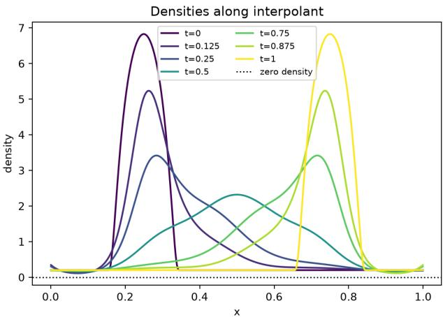
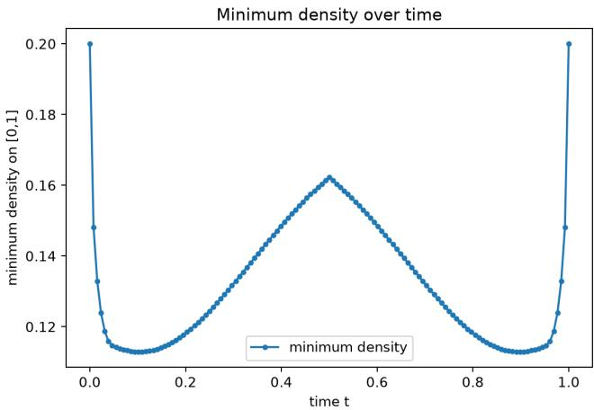
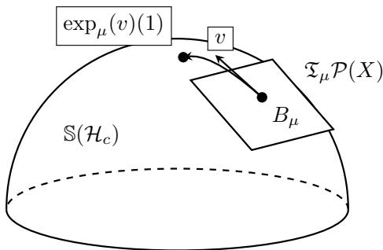
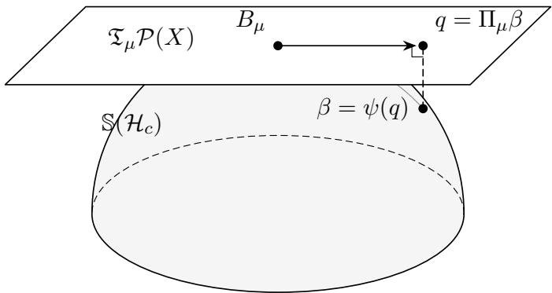
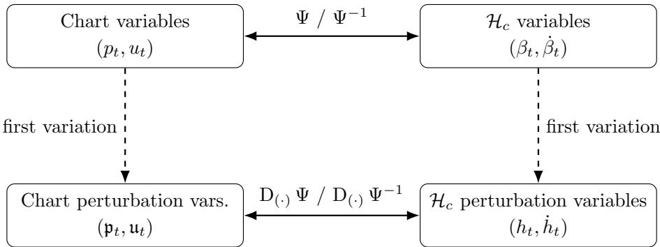
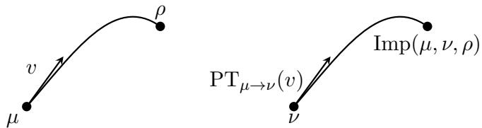
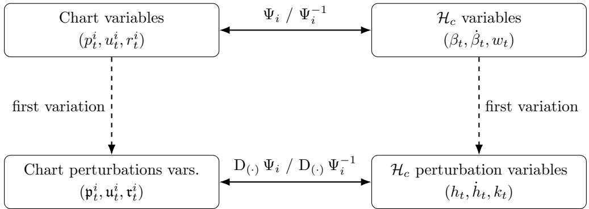

# Second-order Sinkhorn Geometry and √n-Inference

Tristan Luca Saidi† Florian Gunsilius∗ Gonzalo Mena† tsaidi@andrew.cmu.edu fgunsil@emory.edu gmena@andrew.cmu.edu

†Department of Statistics and Data Science, Carnegie Mellon University ∗Department of Economics, Emory University

October 28, 2026

## Abstract

The Sinkhorn divergence, a debiased form of entropic optimal transport, has been widely used in various scientific disciplines due to its computational and statistical tractability. Unlike the quadratic Wasserstein distance, however, the Sinkhorn divergence is not a metric and it does not naturally admit a formal Riemannian structure. These properties are central to many applications of optimal transport methods that utilize interpolation, barycentric averaging, parallel transport or other geometric operations. Recent work addresses these shortcomings by constructing a formal Riemannian tangent space and a metric tensor on the space of probability measures that quadratically approximates the Sinkhorn divergence. In this work, we extend this framework with two major threads of contributions. For a suitable class of finite-smoothness cost functions, we prove Hadamard diferentiability of the Sinkhorn metric tensor and we derive the Levi-Civita covariant derivative in this geometry; we then use the covariant derivative to obtain the geodesic and parallel transport equations, each of which amount to an ODE on a fixed Reproducing Kernel Hilbert Space (RKHS) with smooth coeficients. Our second contribution is to linearize the solutions to the geodesic and parallel transport equations using standard tools from Banach space ODE theory. We show that under standard regularity conditions these linearizations imply √n-limiting Gaussian processes centered at population values for the plu- gin estimators of the exponential map, the logarithmic map, parallel transport and the induced Sinkhorn distance. Moreover, we show that the nonparametric bootstrap is consistent for all objects mentioned. To the best of our knowledge, these are the first n–limit theorems and bootstrap consistency results for canonical geometric operations in a transport-based geometry on the space of probability measures.

## 1 Introduction

The Entropic Optimal Transport (EOT) cost was proposed by Cuturi (2013) as a method to regularize the Wasserstein distance arising from the classical Kantorovich optimal transport problem (Santambrogio, 2015). Since then, it has been used extensively in the biological sciences, machine learning and statistics communities due to its favorable computational and statistical properties. Despite this widespread adoption, EOT sufers from some drawbacks; for example, it does not endow the space of probability measures with metric or Riemannian structure and its associated cost does not even satisfy the criteria of a statistical divergence (Nishiyama, 2018). To rectify the latter issue, the Sinkhorn divergence was proposed by Genevay et al. (2017) to debias the EOT cost, and it has become a standard tool amongst scientists and statisticians who use optimal transport.

Despite this rectification, the Sinkhorn divergence still does not endow the space of probability measures with metric or Riemannian structure. Lavenant et al. (2026a) propose a solution to this by constructing a formal Riemannian tangent space and metric tensor that quadratically approximates the Sinkhorn divergence. Their construction has laid the groundwork for the study of gradient flows on entropic geometries (Hardion and Lavenant, 2025) and the convergence of EOT to unregularized Optimal Transport (OT) (Mordant and Xu, 2026); with that said, many important geometric objects in the construction have remained underived, and many open questions about the statistical tractability of the construction remain unanswered.

In this work we address these open questions by extending the geometric constructions of Lavenant et al. (2026a) and deriving the statistical properties of associated geometric objects. The principal statistical consequence of our geometric construction can be summarized informally as follows. Given independent samples from the underlying distributions, and under the regularity conditions developed below, the plug-in estimators of the Sinkhorn geodesic interpolant, logarithmic map, parallel-imputation trajectory, and squared geodesic distance admit $\sqrt { n } -$ Gaussian limits. In particular, for each such operation Θ, we establish

$$
\sqrt { n } ( \widehat { \Theta } _ { n } - \Theta )  \mathbb { Z } _ { \Theta } ,
$$

where $\mathbb { Z } _ { \Theta }$ is a centered Gaussian element in the appropriate function space, and the nonparametric bootstrap consistently approximates its limiting distribution. These results are especially pertinent to single-cell genomics: there, optimal transport is used routinely to infer cell-state trajectories from snapshot RNA-sequencing measurements Schiebinger et al. (2019). More recently Saidi et al. (2026b) employed parallel imputation to transfer gene-expression dynamics across biological systems. However, statistical estimation for the associated functionals is both computationally and statistically prohibitive. Our results provide a tractable statistical foundation for uncertainty quantification for these estimands when using the Sinkhorn geometry as a surrogate of the Wasserstein geometry.

Contributions. We briefly remark on our contributions in this work more formally. Specifically, our results fall into two categories:

1. Analytical: Our first contribution is to further the construction of Lavenant et al. (2026a) by deriving the Levi-Civita covariant derivative using the technique employed by Gigli (2012). This derivation requires that we prove a suficiently strong notion of diferentiability – in particular, we prove full Hadamard diferentiability – for the metric tensor $\tilde { \mathbf { g } } _ { \mu }$ along suitable curves of measures. We note that our results restrict to a class of finite smoothness costs; despite this restriction, the setting is widely applicable, as it subsumes costs that are both widely used in practice and approximate the squared Euclidean cost arbitrarily well. As an immediate corollary, the Levi-Civita covariant derivative yields the geodesic equations and the parallel transport equations, the first of which further yields the exponential and logarithmic maps in this geometry. Our analysis reveals that both the exponential map and paralle transport each amount to an ODE on a fixed Reproducing Kernel Hilbert Space (RKHS) with smooth coeficients. This finding has immediate practical implications, as it suggests a path to a tractable computational procedure for geodesic interpolation and parallel transport.

2. Statistical: Leveraging the diferentiation results described above, we derive linearizations of the solutions to the geodesic and parallel transport equations. We then use the functional delta method to obtain root-n Gaussian process limits for the plugin estimator of the exponential map, the logarithmic map, parallel transport and the Sinkhorn distance. Moreover, we show that our linearizations are suficiently smooth for validity of the nonparametric bootstrap, circumventing the need for a derivation of an asymptotic variance estimator. To the best of our knowledge, the statistical results presented here are the first $\sqrt { n }$ –limit theorems and bootstrap consistency results for canonical geometric operations in a transport-based geometry on the space of probability measures.

Outline of the paper. In Section 1.2 we introduce important notation, while in Section 1.1 and Section 1.3 we review prior work and recall preceding results on the Sinkhorn Riemannian geometry. In Section 2.1 we reparameterize the Sinkhorn metric tensor $\tilde { \mathbf { g } } _ { \mu }$ through a family of operators on a fixed RKHS. This provides the starting point for the first major technical contribution of the paper: establishing the Hadamard diferentiability of the metric tensor in Section 2.2.1 (Theorem 2.2). This result does not follow immediately from existing diferentiability results for the Schr¨odinger potentials. Indeed, its proof requires developing a series of operator-level linearizations in the relevant negative Sobolev and RKHS topologies. These analytical arguments constitute a substantial portion of the mathematical contribution of the first part of the work. With this regularity theory established, in Section 2.3 we derive the Levi-Civita covariant derivative, and in Section 2.4 we instantiate covariant diferentiation to obtain the geodesic and parallel transport equations. These constructions, comprising Theorem 2.5, Equation (GE) and Equation (PT), follow from standard Riemannian-geometric principles, albeit through extensive calculations. We note that our interest in Hadamard diferentiability is motivated by statistical inference, since it provides the foundation for applying the functional delta method. However, obtaining limit theorems for the remaining geometric objects requires additional linearizations that do not follow directly from the diferentiability of the metric tensor.

In Section 3 we establish linearizations of the Sinkhorn Riemannian distance (Lemma 3.10), the Riemannian exponential map (Section 3.1), the Riemannian logarithmic map (Section 3.2) and the solutions to the parallel transport equations (Section 3.3). The second major technical contribution of the paper concerns the regularity theory needed to obtain the latter three linearizations. Although the diferentiability of solutions to suficiently smooth Banach space ODEs is well understood, the equations derived in Section 2.4 are not immediately amenable to these results, as they do not directly define ODEs on an open subset of a Banach space. Consequently, in Section C.3 we construct smooth extensions and reparameterizations of these equations on suitable open neighborhoods in the ambient function spaces. Establishing the existence and smoothness of these extensions, particularly the nonlinear coeficients of the geodesic equations, requires additional functional analytic arguments and constitutes the principal technical challenge of the second part of the work. The central regularity result is Lemma C.6. Once this regularity has been established, the remaining ODE linearizations can be obtained using standard Banach space ODE theory, together with the additional analysis required for the logarithmic map. Finally, in Section 3.5 we apply the functional delta method (Van der Vaart, 2000) to these linearizations to establish Gaussian process limits for the plugin estimators of the aforementioned geometric objects.

## 1.1 Related Work

Our work relates to many diferent areas of optimal transport and statistical inference. We discuss each area below.

Optimal Transport Geometry. The geometric interpretation of quadratic optimal transport originates with displacement interpolation (McCann, 1997), the dynamic formulation of Benamou and Brenier (2000), and the formal Riemannian calculus of Otto (2001). This structure was subsequently developed to include second-order geometric operations. In particular, Lott (2008) computed the formal Levi–Civita connection and curvature, Ambrosio and Gigli (2008) constructed parallel transport along regular Wasserstein curves, and Gigli (2012) developed a comprehensive second-order calculus encompassing covariant diferentiation, parallel transport, the exponential map, and Jacobi fields. These constructions underpin a broad algorithmic literature that uses the Wasserstein tangent-space, geodesic interpolation, and parallel transport for procedures on the space of probability measures.

Statistical Inference for Optimal Transport. Statistical inference for such geometric objects has, however, largely been developed in special settings or for individual functionals. Sommerfeld and Munk (2018) derive distributional limits for empirical Wasserstein distances on finite spaces, while del Barrio et al. (2019) establish central limit theorems and bootstrap procedures for onedimensional Wasserstein barycentric functionals. In Bures–Wasserstein geometry, Kroshnin et al. (2021) prove asymptotic normality for empirical barycenters and Kroshnin et al. (2024) develop corresponding bootstrap guarantees. More recently, Sadhu et al. (2024) obtain limit theorems and nonparametric bootstrap consistency for Brenier maps in the semidiscrete setting. Tangent space comparison and parallel transport have also been incorporated into statistical methodology for univariate distributions (Chen et al., 2023), and multivariate distributional dynamics modeling (Saidi et al., 2026b). These results motivate the study of inference on transport-geometric quantities, though they typically concern restricted geometries or particular operations.

The construction directly underlying our work in this paper is due to Lavenant et al. (2026a); they define a Riemannian metric tensor from the Hessian of the Sinkhorn divergence, identify the associated RKHS-based tangent space, and construct the induced geodesic distance. Subsequent work has studied gradient flows in this geometry (Hardion and Lavenant, 2025) and its relation to Wasserstein geometry as the regularization vanishes (Mordant and $\mathrm { X u , }$ , 2026). More recently, Lavenant et al. (2026b) developed spatial and temporal discretization schemes for approximating the geodesic Sinkhorn distance, establishing convergence of both the discrete distances and associated geodesics. We instead develop its second-order diferential geometry: following the strategy of Gigli (2012), we derive the Levi–Civita covariant derivative and the corresponding geodesic and paralle transport equations, which in turn define the exponential and logarithmic maps studied below.

Statistical Inference for EOT. Entropic regularization is well known to substantially improve the statistical behavior of optimal transport at fixed regularization. Genevay et al. (2019) established parametric-rate sample-complexity bounds for Sinkhorn divergences, while Mena and Niles-Weed (2019) proved a central limit theorem for the empirical EOT cost and Rigollet and Stromme (2025) obtained dimension-free parametric rates for several EOT quantities. In discrete settings, Bigot et al. (2019) and Klatt et al. (2020) developed limit theory and bootstrap procedures for regularized transport costs, plans, and Sinkhorn divergences. Gonz´alez-Sanz et al. (2022) established functional central limit theorems for empirical Schr¨odinger potentials and weak limits for empirical entropic transport plans evaluated against test functions, together with asymptotic distributions for the Sinkhorn divergence under both the null and alternative hypotheses. Goldfeld et al. (2024) establish first and second-order Hadamard diferentiability of the Schr¨odinger potentials and derive Gaussian limits and bootstrap consistency for empirical EOT potentials, barycentric EOT maps, and the Sinkhorn divergence. We note, however, that these EOT quantities are distinct from the Riemannian operations studied here and, unlike our exponential map, do not generally yield an endpoint-interpolating analogue of the Brenier map.

## 1.2 Notation

Statistics and Analysis. Suppose $\mathbb { B } _ { 1 } , \mathbb { B } _ { 2 }$ are Banach spaces. We write $\mathbb { B } ^ { \ast }$ for the continuous dual of a Banach space $\mathbb { B }$ and $\mathcal { L } ( \mathbb { B } _ { 1 } , \mathbb { B } _ { 2 } )$ for the space of bounded linear operators from $\mathbb { B } _ { 1 }$ to $\mathbb { B } _ { 2 } .$ , endowed with the operator norm $\begin{array} { r } { \| A \| _ { \mathrm { o p } } : = \operatorname* { s u p } _ { \| x \| _ { \mathbb { B } _ { 1 } } \leq 1 } \| A x \| _ { \mathbb { B } _ { 2 } } } \end{array}$ . For normed spaces E and $\mathbb { F } _ { : }$ , we write $\mathbb { E } \hookrightarrow$ F when E injects continuously into $\mathbb { F } .$ For nonnegative quantities a and $b ,$ we write $a \lesssim b$ if $a \leq C b$ for a constant $C > 0$ independent of the quantities under consideration, and $a \asymp b$ if both $a \lesssim b$ and $b \lesssim a ;$ dependence of the implicit constant may be indicated by a subscript for emphasis. We write $C ^ { m } ( X )$ for the space of functions from X to R with m continuous derivatives, equipped with the norm $\begin{array} { r } { \| f \| _ { C ^ { m } } : = \sum _ { | \alpha | \leq m } \| \partial ^ { \alpha } f \| _ { L ^ { \infty } ( X ) } } \end{array}$ . Similarly, $C ^ { ( m , m ) } ( X \times X )$ denotes the space of functions whose mixed derivatives of the $( \alpha , \beta )$ order are continuous for every $| \alpha | , | \beta | \le m$ . We denote the constant-one function on X by $\mathbb { 1 } _ { X }$ . Suppose $( \mathcal { F } , \| \cdot \| _ { \mathcal { F } } )$ is a normed vector space of functions from X to R. We denote by $\mathcal { F } / \mathbb { R }$ the space $\mathcal { F }$ modulo constant functions, with elements denoted by $[ f ]$ , and equip it with the quotient norm $\left\| [ f ] \right\| _ { { \mathcal { F } } / { \mathbb { R } } } : = \operatorname* { i n f } _ { \lambda \in { \mathbb { R } } } \left\| f - \lambda \mathbb { 1 } _ { X } \right\| _ { { \mathcal { F } } }$ . For any Hilbert space H and closed subspace $M$ , we equip $H / M$ with the canonical Hilbert-space structure induced by the identification $H / M \simeq M ^ { \perp }$ , namely $\langle [ f ] , [ g ] \rangle _ { H / M } : = \langle P _ { M ^ { \perp } } f , P _ { M ^ { \perp } } g \rangle _ { H }$ (Fricain and Mashreghi, 2016, Equation 16.6). In particular, since $\mu$ is a probability measure, we identify $L ^ { 2 } ( \mu ) / \mathbb { R }$ with the subspace of mean-zero functions and write

$$
\langle [ f ] , [ g ] \rangle _ { L ^ { 2 } ( \mu ) / \mathbb { R } } : = \left. f - \int _ { X } f d \mu , g - \int _ { X } g d \mu \right. _ { L ^ { 2 } ( \mu ) } .
$$

Diferentiation and Convergence. For a map $F : \mathbb { E }  \mathbb { F }$ between normed spaces, $\mathrm { D } _ { h } F _ { x }$ denotes the derivative of $F$ at $x$ in the direction $h ,$ while D $F _ { x }$ denotes the corresponding derivative operator. When the base point is clear from context, we may suppress the subscript x. If $F$ has several arguments, $\mathrm { D } _ { i , h } F$ denotes diferentiation with respect to its ith argument in the direction $h ,$ and $\mathrm { D } _ { ( h _ { 1 } , . . . , h _ { k } ) } ^ { k } F _ { x }$ denotes the kth derivative evaluated in the directions $( h _ { 1 } , \ldots , h _ { k } )$ . The notion of diferentiability—Fr´echet or Hadamard—will be clear from context. We write ⇝ for weak convergence of random elements and $ B$ for conditional weak convergence of bootstrap random elements, in outer probability. We write $\mu _ { n }  \mu$ for narrow convergence of probability measures, $x _ { n } \xrightarrow { w }$ x for weak convergence in a Banach space $( \mathrm { i . e . , }$ convergence against every continuous linear functional), and $x _ { n } \to x$ for convergence in norm.

Diferential and Riemannian Geometry. For a manifold M and $p \in { \mathcal { M } } , T _ { p } { \mathcal { M } }$ denotes the tangent space to M at $p$ , and we denote by $T \mathcal M : = \{ ( p , v ) : p \in \mathcal M , v \in T _ { p } \mathcal M \}$ its tangent bundle. We write $\exp _ { p }$ and $\log _ { p }$ for the Riemannian exponential and logarithmic maps, respectively, and $\mathrm { P T } _ { p \to q }$ for parallel transport from $p$ to $q$ along the curve under consideration.

## 1.3 Preliminaries

In this section we review important background material relevant to our results. We will begin by reviewing the EOT cost and its debiased counterpart, the Sinkhorn divergence. We will then introduce the formal Riemannian geometry proposed by Lavenant et al. (2026a) that quadratically approximates the Sinkhorn divergence.

## 1.3.1 The Sinkhorn Divergence

In this work we will consider the following setting. Suppose that X is a convex and compact subset of $\mathbb { R } ^ { d }$ such that $X = { \overline { { \operatorname { i n t } ( X ) } } }$ , the ground cost $c : X \times X \to [ 0 , \infty )$ is some symmetric and nonnegative cost function to be specified in more detail later, and ${ \mathcal { P } } ( X )$ is the set of Borel probability measures on X. Fix an $\varepsilon > 0$ as a regularization parameter, which we regard as fixed throughout this work. The entropic optimal transport (EOT) cost is defined by

$$
\operatorname { O T } _ { \varepsilon } ( \mu , \nu ) = \operatorname* { i n f } _ { \pi \in \Pi ( \mu , \nu ) } \left\{ \int _ { X \times X } c d \pi + \varepsilon \operatorname { K L } ( \pi | \mu \otimes \nu ) \right\}\tag{1}
$$

where $\Pi ( \mu , \nu )$ is the set of probability measures on $X \times X$ with marginals $( \mu , \nu )$ and KL is the Kullback-Leibler divergence,

$$
\begin{array} { r } { \mathrm { K L } ( { \boldsymbol \pi } \mid { \boldsymbol \rho } ) = \left\{ \begin{array} { l l } { \int _ { { \boldsymbol X } \times { \boldsymbol X } } \log \left( \frac { d { \boldsymbol \pi } } { d { \boldsymbol \rho } } \right) d \pi } & { \mathrm { i f ~ } { \boldsymbol \pi } \ll { \boldsymbol \rho } } \\ { + \infty } & { \mathrm { e l s e } } \end{array} \right. . } \end{array}
$$

The entropic optimal transport problem also admits a dual formulation, given by

$$
\operatorname { O T } _ { \varepsilon } ( \mu , \nu ) = \operatorname* { s u p } _ { f , g \in C _ { b } ( X ) } \left\{ \int _ { X } f d \mu + \int _ { X } g d \nu - \varepsilon \int _ { X \times X } \left( \exp \left( \frac { 1 } { \varepsilon } \left( f \oplus g - c \right) \right) - 1 \right) d ( \mu \otimes \nu ) \right\}\tag{2}
$$

where $f \oplus g$ is the map $( x , y ) \mapsto f ( x ) + g ( y )$ and $C _ { b } ( X )$ is the set of bounded and continuous functions over X. The dual problem admits maximizers $f _ { \mu , \nu } , g _ { \mu , \nu ; \ l }$ , called Schr¨odinger potentials, that satisfy $\begin{array} { r } { \operatorname { O T } _ { \varepsilon } ( \mu , \nu ) \ : = \ : \int _ { X } f _ { \mu , \nu } d \mu + \int _ { X } g _ { \mu , \nu } } \end{array}$ dν and are solutions to the so-called Schr¨odinger system

$$
f _ { \mu , \nu } ( y ) = - \varepsilon \log \int _ { X } \exp \left( \frac { 1 } { \varepsilon } \left( g _ { \mu , \nu } ( x ) - c ( y , x ) \right) \right) d \nu ( x )\tag{3}
$$

$$
g _ { \mu , \nu } ( y ) = - \varepsilon \log \int _ { X } \exp \left( \frac { 1 } { \varepsilon } \left( f _ { \mu , \nu } ( x ) - c ( x , y ) \right) \right) d \mu ( x )\tag{4}
$$

for every $y \in X$ . With optimal dual potentials, the optimal transport plan π is simply given by the reweighted product measure, $d \pi = \exp ( ( f _ { \mu , \nu } \oplus g _ { \mu , \nu } - c ) / \varepsilon ) d ( \mu \otimes \nu )$

Note that the Schr¨odinger potentials are unique modulo the following equivalence: $( f , g ) \sim$ $( f + \lambda \mathbb { 1 } _ { X } , g - \lambda \mathbb { 1 } _ { X } )$ for any $\lambda \in \mathbb { R }$ . A canonical selection principle is obtained by setting $f _ { \mu , \nu } ( x _ { 0 } ) =$ $g _ { \mu , \nu } ( x _ { 0 } )$ for some fixed $x _ { 0 } \in X$ , which yields the property $f _ { \mu , \nu } = g _ { \nu , \mu }$ , and therefore $f _ { \mu , \mu } = g _ { \mu , \mu } .$

Lemma 1.1. If the cost c satisfies $c ( x , y ) = c ( y , x )$ and $\left( f _ { \mu , \nu } , g _ { \mu , \nu } \right)$ are optimal Schr¨odinger potentials for $( \mu , \nu )$ , then $( g _ { \mu , \nu } , f _ { \mu , \nu } )$ are optimal Schr¨odinger potentials for the pair $( \nu , \mu )$ . Moreover, if $f _ { \mu , \nu } ( x _ { 0 } ) = g _ { \mu , \nu } ( x _ { 0 } )$ for some fixed $x _ { 0 } \in X$ , then $f _ { \mu , \nu } = g _ { \nu , \mu }$

The entropic cost $\mathrm { O T } _ { \varepsilon }$ is not a valid distance metric nor a statistical divergence, as $\mathrm { O T } _ { \varepsilon } ( \mu , \mu )$ is nonzero in general. The Sinkhorn divergence was proposed by Genevay et al. (2017) to rectify this bias, and is defined by

$$
S _ { \varepsilon } ( \mu , \nu ) = \mathrm { O T } _ { \varepsilon } ( \mu , \nu ) - \frac { 1 } { 2 } \mathrm { O T } _ { \varepsilon } ( \mu , \mu ) - \frac { 1 } { 2 } \mathrm { O T } _ { \varepsilon } ( \nu , \nu ) .\tag{5}
$$

Observe that $S _ { \varepsilon } ( \mu , \mu ) = 0$ and $S _ { \varepsilon } ( \mu , \nu ) \geq 0$ , with equality if and only if $\mu = \nu .$ . Nevertheless, $\sqrt { S _ { \varepsilon } }$ fails to satisfy the triangle inequality, as shown by Lavenant et al. (2026a), and hence does not itself define a metric on ${ \mathcal { P } } ( X )$ . From a statistical perspective, however, the Sinkhorn divergence re-tains the favorable √n-rate estimability of EOT (Goldfeld et al., 2024; del Barrio et al., 2023; Mena and Niles-Weed, 2019; Gonzalez-Sanz et al., 2022), making it an attractive transport-based divergence for statistical applications. This combination of transport structure and statistical regularity motivates the Riemannian approximation proposed by Lavenant et al. (2026a). Their construction equips ${ \mathcal { P } } ( X )$ with a formal Riemannian structure that locally approximates the Sinkhorn divergence and, much like the Wasserstein geometry of OT, lifts the underlying geometry of X to the space of probability measures, while seeking to preserve the smoothness and favorable statistical properties induced by entropic regularization.

Riemannian Geometry. In this section we will review key aspects of the Riemannian construction proposed by Lavenant et al. (2026a). Their construction formalizes the Riemannian tangent space at a measure, and then obtains the Hessian of the Sinkhorn divergence with respect to perturbations within this tangent space. We will assume that X is a compact and convex subset of $\mathbb { R } ^ { d }$ and $c \in C ^ { ( m , m ) } ( X \times X )$ , and we recall the following definition of $C ^ { - m }$ perturbations of a measure from Lavenant et al. (2026a).

Definition 1.2 $( C ^ { - m }$ perturbations, Lavenant et al. (2026a)). Let $m > 0$ and $\tau > 0$ . We call a path $( \mu _ { t } ) _ { t \in ( - \tau , \tau ) }$ valued in ${ \mathcal { P } } ( X ) \ a \ C ^ { - m }$ -perturbation of $\mu = \mu _ { 0 }$ if it is continuously diferentiable in $C ^ { m } ( X ) ^ { * }$ endowed with the weak-∗ topology. In particular, for every $\phi \in C ^ { m } ( X )$ it must hold that

$$
\frac { d } { d t } \int \phi d \mu _ { t } = \dot { \mu } _ { t } ( \phi )
$$

for some $\dot { \mu } _ { t } \in C ^ { m } ( X ) ^ { * }$ , where $\dot { \mu } _ { t }$ is weakly continuous. We write $\dot { \mu } \in C ^ { m } ( X ) ^ { * }$ for the derivative of the curve at time $t = 0$

Note that m does not denote the order to which the perturbation approximates $\mu _ { t }$ . Instead, it controls the regularity of the test function class, and therefore determines the topology in which the curve is diferentiated. Since $C ^ { 0 } ( X ) ^ { * } \subset C ^ { 1 } ( X ) ^ { * } \subset \dots ,$ a larger m yields a larger dual space and a weaker topology. Therefore, a $C ^ { - k }$ perturbation is automatically a $C ^ { - m }$ perturbation for any $k \leq m$ . Thus, the space of perturbations gets “rougher” as m gets larger, while it gets smoother as m approaches 0.

Now we’ll introduce important objects that will feature prominently in the tangent space and metric tensor. Define $k _ { c } ( x , y ) = \exp ( - c ( x , y ) / \varepsilon )$ , and define the so-called self-transport kernel,

$$
k _ { \mu } ( x , y ) : = \exp \left( \frac { 1 } { \varepsilon } \left( f _ { \mu , \mu } ( x ) + f _ { \mu , \mu } ( y ) - c ( x , y ) \right) \right) .
$$

Recall that our selection principle for the Schr¨odinger potentials implies $f _ { \mu , \nu } = g _ { \nu , \mu } $ , and thus $f _ { \mu , \mu } = g _ { \mu , \mu }$ . By our assumptions on $c ,$ the kernels $k _ { \mu }$ and $k _ { c }$ are both non-negative, continuous, positive-definite and universal. A kernel k satisfying such properties induces a unique Reproducing Kernel Hilbert Space (RKHS) $\mathcal { H } _ { k } ;$ ; thus, we will write $\mathcal { H } _ { \mu } , \mathcal { H } _ { c }$ to be the RKHSs associated with $k _ { \mu }$ and $k _ { c }$ respectively. For more information on the theory of RKHSs, we direct readers to Section 1.4.

Definition 1.3 (Integral operators). For $\mu \in { \mathcal { P } } ( X )$ , define the following operators $K _ { \mu } , H _ { \mu } , H _ { c }$ by

$$
K _ { \mu } : \mathcal { H } _ { \mu }  \mathcal { H } _ { \mu } , \quad K _ { \mu } ( \phi ) ( y ) = \int _ { X } \phi ( x ) k _ { \mu } ( x , y ) d \mu ( x )
$$

$$
H _ { \mu } : \mathcal { H } _ { \mu } ^ { * } \to \mathcal { H } _ { \mu } , \quad H _ { \mu } ( \nu ) ( y ) = \nu ( k _ { \mu } ( \cdot , y ) ) \quad a n d \quad H _ { c } : \mathcal { H } _ { c } ^ { * } \to \mathcal { H } _ { c } , \quad H _ { c } ( \nu ) ( y ) = \nu ( k _ { c } ( \cdot , y ) ) .
$$

For a bounded linear functional $\sigma \in \mathcal { H } _ { \mu } ^ { * }$ , the element $H _ { \mu } ( \sigma )$ is its Riesz representative in ${ \mathcal { H } } _ { \mu }$ (Lavenant et al., 2026a), thus satisfying $\dot { \sigma } ( \phi ) = \langle H _ { \mu } ( \sigma ) , \phi \rangle _ { \mathcal { H } _ { \mu } }$ for any $\phi ~ \in { \mathcal { H } } _ { \mu }$ Also observe that $K _ { \mu } ( \phi ) = H _ { \mu } ( \phi \mu )$ can therefore be interpreted as the Riesz representative of the functional $\psi \mapsto \textstyle \int _ { X } \phi \psi d \mu$ induced by the signed measure $\phi \mu$ . Note that if ν is a signed Borel measure on $X$ then $H _ { \mu }$ and $H _ { c }$ can be written in integral form as

$$
H _ { \mu } ( \nu ) = \int _ { X } k _ { \mu } ( x , \cdot ) d \nu ( x ) \quad { \mathrm { a n d } } \quad H _ { c } ( \nu ) = \int _ { X } k _ { c } ( x , \cdot ) d \nu ( x ) .
$$

When ν is a Borel probability measure, the operators $H _ { \mu }$ and $H _ { c }$ are often referred to as the kernel mean embeddings of ν into the RKHSs $\mathcal { H } _ { \mu } , \mathcal { H } _ { c }$ respectively (Muandet et al., 2017).

The Metric and Tangent Space. Write $\mathcal { H } _ { \mu } / \mathbb { R }$ as the space ${ \mathcal { H } } _ { \mu }$ modulo constant functions, equipped with the canonical quotient inner product. This space $\mathcal { H } _ { \mu } / \mathbb { R }$ is dual to $\mathcal { H } _ { \mu , 0 } ^ { * } ,$ the space of bounded linear functionals σ on ${ \mathcal { H } } _ { \mu }$ such that $\sigma ( \mathbb { 1 } _ { X } ) = 0$ (Lavenant et al., 2026a, Lemma 4.5). Therefore, $H _ { \mu }$ can be restricted to an operator $H _ { \mu } : \mathcal { H } _ { \mu , 0 } ^ { \ast } \to \mathcal { H } _ { \mu } / \mathbb { R }$ that also maps a $\sigma \in \mathcal { H } _ { \mu , 0 } ^ { * }$ to its Riesz representative $H _ { \mu } ( \sigma ) \in \mathcal { H } _ { \mu } / \mathbb { R }$ . Lavenant et al. (2026a) prove that the Sinkhorn divergence has the following second order behavior

$$
\operatorname * { l i m } _ { t  0 } \frac { S _ { \varepsilon } ( \mu , \mu _ { t } ) } { t ^ { 2 } } = \frac { \varepsilon } { 2 }  H _ { \mu } ( \dot { \mu } ) , ( \mathrm { i d } _ { \mathcal { H } _ { \mu } / \mathbb { R } } - K _ { \mu } ^ { 2 } ) ^ { - 1 } H _ { \mu } ( \dot { \mu } )  _ { \mathcal { H } _ { \mu } / \mathbb { R } }
$$

for $\mathrm { ~ a ~ } C ^ { - m }$ perturbation $( \mu _ { t } ) _ { t }$ of $\mu = \mu _ { 0 }$ . This characterization readily leads to a definition of the metric tensor and the tangent space.

Definition 1.4 (The metric on the tangent space). Suppose $c \in C ^ { ( m , m ) } ( X \times X )$ is symmetric and nonnegative, and $k _ { c } = \exp ( - c / \varepsilon )$ is positive definite and universal. Define the Sinkhorn tangent space to a measure $\mu \in { \mathcal { P } } ( X )$ as

$$
T _ { \mu } \mathcal { P } ( X ) : = \overline { { C ^ { m } ( X ) _ { 0 } ^ { * } } } ^ { \| \cdot \| _ { \mathbf { g } _ { \mu } } } \ w h e r e \ \| \sigma \| _ { \mathbf { g } _ { \mu } } : = \sqrt { \mathbf { g } _ { \mu } ( \sigma , \sigma ) } .
$$

and for $\dot { \mu } _ { 1 } , \dot { \mu } _ { 2 }$ in $C ^ { m } ( X ) _ { 0 } ^ { * }$ define the metric tensor $\mathbf { g } _ { \mu }$ as

$$
\mathbf { g } _ { \mu } ( \dot { \mu } _ { 1 } , \dot { \mu } _ { 2 } ) = \frac { \varepsilon } { 2 } \dot { \mu } _ { 1 } \left( ( \mathrm { i d } - K _ { \mu } ^ { 2 } ) ^ { - 1 } H _ { \mu } ( \dot { \mu } _ { 2 } ) \right) = \frac { \varepsilon } { 2 } \left. H _ { \mu } ( \dot { \mu } _ { 1 } ) , ( \mathrm { i d } _ { \mathcal { H } _ { \mu } / \mathbb { R } } - K _ { \mu } ^ { 2 } ) ^ { - 1 } H _ { \mu } ( \dot { \mu } _ { 2 } ) \right. _ { \mathcal { H } _ { \mu } / \mathbb { R } } .\tag{6}
$$

Remark 1.5 (Lavenant et al. (2026a), Theorem 4.6). The Sinkhorn tangent space satisfies $T _ { \mu } { \mathcal { P } } ( X ) \cong$ $\mathcal { H } _ { \mu , 0 } ^ { * } ,$ thereby justifying the evaluation of $H _ { \mu }$ at an element in $C ^ { m } ( X ) _ { 0 } ^ { * }$ (since $C ^ { m } ( X ) ^ { * } \hookrightarrow \mathcal { H } _ { \mu } ^ { * }$ by Proposition 1.6).

Observe that these definitions and the result above together imply that the quadratic approximation to the Sinkhorn divergence is only sensitive to a perturbation $\dot { \mu }$ through its Riesz representer in ${ \mathcal { H } } _ { \mu }$

Change of variables. Lavenant et al. (2026a) propose using the change of variables $\mu \mapsto$ $\exp ( - f _ { \mu , \mu } / \varepsilon )$ employed previously in the EOT literature by Feydy et al. (2019). This change of variables maps ${ \mathcal { P } } ( X )$ to a subset of the unit sphere of the RKHS $\mathcal { H } _ { c }$ induced by the kernel $k _ { c } = \exp ( - c / \varepsilon )$ , allowing all geometry to operate in the fixed ambient Hilbert space $\mathcal { H } _ { c }$ . Write $a _ { \mu } = \exp ( f _ { \mu , \mu } / \varepsilon )$ , and define the change of variable map $B : { \mathcal { P } } ( X ) \to { \mathcal { H } } _ { c }$ given by

$$
B _ { \mu } = H _ { c } \left( a _ { \mu } \mu \right) = \exp \left( - \frac { 1 } { \varepsilon } f _ { \mu , \mu } \right) .
$$

As alluded to, one can readily verify that for all $\mu \in \mathcal P ( \boldsymbol X ) , \| \boldsymbol B _ { \mu } \| _ { \mathcal H _ { c } } = 1$ ; thus, $B [ \mathcal { P } ( X ) ] \subset \mathbb { S } ( \mathcal { H } _ { c } )$ where $\mathbb { S } ( \mathcal { H } _ { c } )$ is the unit-sphere in the fixed Hilbert space $\mathcal { H } _ { c }$

Theorem 1.1 (The metric under $\mu \mapsto B _ { \mu } .$ , (Lavenant et al., 2026a), Theorem 4.12 ). Let $( \mu _ { t } ) _ { t }$ be a curve of measures such that $\beta _ { t } = B _ { \mu _ { t } }$ is weakly diferentiable in $\mathcal { H } _ { c }$ at $t = 0$ . Then $\langle \dot { \beta } , B _ { \mu } \rangle _ { \mathcal { H } _ { c } } = 0$ the path $( \mu _ { t } ) _ { t }$ is weakly diferentiable in $\mathcal { H } _ { \mu } ^ { \ast }$ at $t = 0$ , and ${ \bf g } _ { \mu } ( \dot { \mu } , \dot { \mu } ) = \tilde { \bf g } _ { \mu } ( \dot { \beta } , \dot { \beta } )$ where

$$
\tilde { \mathbf { g } } _ { \mu } ( \dot { \beta } , \dot { \beta } ) = \frac { \varepsilon } { 2 } \left( \lVert \dot { \beta } \rVert _ { \mathcal { H } _ { c } } ^ { 2 } + 2 \left. a _ { \mu } \dot { \beta } , ( \mathrm { i d } _ { L ^ { 2 } ( \mu ) / \mathbb { R } } - K _ { \mu } ) ^ { - 1 } ( a _ { \mu } \dot { \beta } ) \right. _ { L ^ { 2 } ( \mu ) } \right) .
$$

Moreover, $i f { \dot { \beta } } _ { 1 } , { \dot { \beta } } _ { 2 } \in \mathcal { H } _ { c }$ with $\langle \dot { \beta } _ { 1 } , B _ { \mu } \rangle _ { \mathcal { H } _ { c } } = \langle \dot { \beta } _ { 2 } , B _ { \mu } \rangle _ { \mathcal { H } _ { c } } = 0$ , then we have

$$
\tilde { \mathbf { g } } _ { \mu } ( \dot { \beta } _ { 1 } , \dot { \beta } _ { 2 } ) = \frac { \varepsilon } { 2 } \left( \langle \dot { \beta } _ { 1 } , \dot { \beta } _ { 2 } \rangle _ { \mathcal { H } _ { c } } + 2 \left. a _ { \mu } \dot { \beta } _ { 1 } , ( \mathrm { i d } _ { L ^ { 2 } ( \mu ) / \mathbb { R } } - K _ { \mu } ) ^ { - 1 } ( a _ { \mu } \dot { \beta } _ { 2 } ) \right. _ { L ^ { 2 } ( \mu ) } \right) .
$$

Since $\tilde { { \bf g } } _ { \mu } ( a , a )$ is a quadratic form, the symmetric bilinear form $\tilde { \mathbf { g } } _ { \mu } ( a , b )$ can be recovered from the quadratic form via the polarization identities (Thomas, 2014) and an application of the fact that $\left( \mathrm { i d } _ { L ^ { 2 } ( \mu ) / \mathbb { R } } - K _ { \mu } \right)$ is self-adjoint on $L ^ { 2 } ( \mu ) / \mathbb { R }$ (Lavenant et al., 2026a, Theorem 4.3). The result shows that the Sinkhorn Riemannian geometry can be described as an augmented inner product on an appropriate subset of $\mathbb { S } ( \mathcal { H } _ { c } )$ . We’ll define the set

$$
\mathfrak { T } _ { \mu } \mathcal { P } ( X ) = \left\{ \dot { \beta } \in \mathcal { H } _ { c } : \langle \dot { \beta } , B _ { \mu } \rangle _ { \mathcal { H } _ { c } } = 0 \right\} .
$$

Throughout the paper, we will denote $T _ { \mu } { \mathcal { P } } ( X )$ as the original tangent space at $\mu ,$ and ${ \mathfrak { T } } _ { \mu } { \mathcal { P } } ( X )$ will denote the tangent space to $\mathbb { S } ( \mathcal { H } _ { c } )$ at $B _ { \mu }$

## 1.4 Preliminaries on Reproducing Kernel Hilbert Spaces (RKHS)

For a thorough treatment of the theory of RKHSs, we recommend Paulsen and Raghupathi (2016).   
We will provide a brief overview of the theory and some relevant results in this section.

For any non-negative, continuous, positive-definite and universal kernel $k : X \times X \to [ 0 , \infty )$ there exists a unique so-called Reproducing Kernel Hilbert Space H associated to it. The RKHS H consists of the completion of the linear span of kernel sections $\{ k ( x , \cdot ) | x \in X \}$ under the metric induced by inner product

$$
\left. \sum _ { i = 1 } ^ { n } \alpha _ { i } k ( x _ { i } , \cdot ) , \sum _ { j = 1 } ^ { m } \beta _ { j } k ( x _ { j } , \cdot ) \right. _ { \mathscr { H } } = \sum _ { i = 1 } ^ { n } \sum _ { j = 1 } ^ { m } \alpha _ { i } \beta _ { j } k ( x _ { i } , x _ { j } ) .
$$

Moreover, function evaluation in this RKHS can be written $f ( x ) = \langle f , k ( x , \cdot ) \rangle _ { \mathcal { H } }$ , rendering it a bounded linear functional on the space.

Proposition 1.6. $I f c \in C ^ { ( m , m ) } ( X \times X )$ , then $\mathcal { H } _ { c } \hookrightarrow C ^ { m } ( X )$ and $\mathcal { H } _ { \mu } \hookrightarrow C ^ { m } ( X )$

We provide the proof in Section D.1. For our results in subsequent sections, we will restrict our analysis to specific cost functions that induce a finite, but suficiently high, smoothness RKHS $\mathcal { H } _ { c }$ . We distinguish the smoothness order $m ,$ which governs the $C ^ { - m }$ perturbation and statistical theory, from the Sobolev order s of the RKHS.

Assumption 1.7 (Spectral decay). Fix an integer $m > d / 2$ and let $s > m + d / 2$ with $s \in \mathbb { N }$ . Let $c ( x , y ) = - \varepsilon \log \kappa ( x - y )$ , where $\kappa : \mathbb { R } ^ { d }  ( 0 , \infty )$ is symmetric, continuous and positive $d e f i n i t e$ and suppose that its Fourier transform satisfies $\widehat { \kappa } ( \omega ) \asymp ( 1 + \| \omega \| ^ { 2 } ) ^ { - s }$

Under Assumption 1.7, the kernel $k _ { c } = \exp ( - c / \varepsilon ) = \kappa$ induces an RKHS $\mathcal { H } _ { c }$ that is normequivalent to $H ^ { s } ( X )$ Indeed, Wendland, Corollary 10.48 implies $\mathcal { H } _ { c } \simeq H ^ { s } ( X )$ . Moreover, the condition $s > m + d / 2$ guarantees suficient classical regularity of the kernel for the $C ^ { - m }$ perturbation theory. In particular,

$$
\int _ {  { \mathbb { R } } ^ { d } } \| \omega \| ^ { 2 m } \widehat { \kappa } ( \omega ) d \omega < \infty ,
$$

so $\widehat { \kappa }$ is nonnegative and integrable. The Fourier diferentiation theorem (Folland, 1999, Theorem $8 . 2 2 ( \mathrm { d } ) )$ implies that $\kappa \in C ^ { 2 m } (  { \mathbb { R } } ^ { d } )$ , and hence $k _ { c } ( x , y ) = \kappa ( x - y )$ belongs to $C ^ { ( m , m ) } ( X \times X )$ Since κ is strictly positive and $X - X$ is compact, $\mathrm { i n f } _ { z \in X - X } \kappa ( z ) > 0$ , and therefore $c ( x , y ) =$ $- \varepsilon \log \kappa ( x - y )$ also belongs to $C ^ { ( m , m ) } ( X \times X )$

Lemma 1.8. Let $k _ { c } = \exp ( - c / \varepsilon )$ . Under Assumption 1.7, the RKHS $\mathcal { H } _ { c }$ induced by $k _ { c }$ is normequivalent to $H ^ { s } ( X )$

Since $s > d / 2 , H ^ { s } ( X )$ is a Banach algebra under pointwise multiplication (Adams and Fournier, 2003, Theorem 4.39). In particular, there exists $C > 0$ such that $\| f g \| _ { H ^ { s } ( X ) } \leq C \| f \| _ { H ^ { s } ( X ) } \| g \| _ { H ^ { s } ( X ) }$ for all $f , g \in H ^ { s } ( X )$ . By the norm equivalence $\mathcal { H } _ { c } \simeq H ^ { s } ( X )$ , the same property holds in $\mathcal { H } _ { c } .$ . In particular, for any $f , g \in { \mathcal { H } } _ { c }$ , the pointwise product $f g$ is also an element of $\mathcal { H } _ { c } .$ . As a preview of the utility of this property, it will guarantee that the Levi–Civita covariant derivative for the Sinkhorn Riemannian geometry is a bounded operator on the tangent space ${ \mathfrak { T } } _ { \mu } { \mathcal { P } } ( X )$

Remark 1.9 (Smoothness of the tangent space). Combining Lemma 1.8, Definition 1.4 and the change of variables leads one to conclude somewhat surprisingly that

$$
\overline { { { C ^ { m } ( X ) _ { 0 } ^ { * } } } } ^ { \lVert \cdot \rVert _ { \mathbf { g } _ { \mu } } } \cong H ^ { s } ( X ) _ { 0 } ^ { * } \quad \mathrm { w i t h ~ } s > m + d / 2 .
$$

Thus, although the Sinkhorn tangent space is constructed initially from m-th order distributional perturbations, its metric completion is governed by the Sobolev regularity of the RKHS induced by the transport kernel.

It should also be made explicit that the squared Euclidean cost $c ( x , y ) \propto \| x - y \| _ { 2 } ^ { 2 }$ is not an admissible cost under the present finite-smoothness assumptions, as it induces an RKHS that is not closed under pointwise multiplication. For $c ( x , y ) = \| x - y \| _ { 2 } ^ { 2 }$ , the induced kernel is the Gaussian kernel $k _ { c } ( x , y ) = \exp ( - \| x - y \| _ { 2 } ^ { 2 } / \varepsilon )$ . Its Fourier transform satisfies $\widehat { k } _ { c } ( \omega ) \propto \exp ( - \varepsilon \| \omega \| _ { 2 } ^ { 2 } / 4 )$ , and the associated RKHS is characterized by

$$
\int _ { \mathbb { R } ^ { d } } | \widehat { f } ( \omega ) | ^ { 2 } \exp \left( \frac { \varepsilon } { 4 } \| \omega \| _ { 2 } ^ { 2 } \right) d \omega < \infty
$$

as shown in Vert and Vert (2006, Section 3.1, Lemma 10). This space is not closed under pointwise multiplication. By contrast, under Assumption 1.7 we have $\mathcal { H } _ { c } \simeq H ^ { s } ( X )$ with $s > d / 2$ , and hence $\mathcal { H } _ { c }$ is a Banach algebra.

Example 1.10 (The Mat´ern Kernel). A canonical family of kernels κ satisfying both Assumption 1.7 and the hypotheses of the previous sections (i.e. positive definiteness and universality) is the Mat´ern family,

$$
\kappa _ { \vartheta , \ell } ( r ) = \frac { 2 ^ { 1 - \vartheta } } { \Gamma ( \vartheta ) } \left( \frac { \sqrt { 2 \vartheta } r } { \ell } \right) ^ { \vartheta } K _ { \vartheta } \left( \frac { \sqrt { 2 \vartheta } r } { \ell } \right)\tag{7}
$$

where $K _ { \vartheta }$ is the modified Bessel function of the second kind (Abramowitz and Stegun, 1964, Section $g . 6 )$

The Mat´ern kernel $\kappa _ { \vartheta , \ell }$ has spectral decay $\widehat { \kappa } _ { \vartheta , \ell } ( \omega ) \asymp _ { \vartheta , \ell , d } ( 1 + \| \omega \| _ { 2 } ^ { 2 } ) ^ { - ( \vartheta + d / 2 ) }$ (Rasmussen and Williams, 2006, Equation 4.15), and therefore has a Sobolev order of $s = \vartheta + d / 2$ . Consequently, the condition $\vartheta > m , \vartheta + d / 2 \in \mathbb { N }$ implies $s > m + d / 2$ , and hence the Mat´ern kernel satisfies Assumption 1.7. Importantly, it induces the cost $c _ { \vartheta , \ell } ( x , y ) = - \varepsilon \log \kappa _ { \vartheta , \ell } ( x - y )$ , which approximates the squared Euclidean cost in the sense that

$$
- \varepsilon \log \kappa _ { \vartheta , \ell } ( x - y ) \stackrel { \vartheta \to \infty } { \longrightarrow } \frac { \varepsilon } { 2 \ell ^ { 2 } } \| x - y \| _ { 2 } ^ { 2 } .
$$

## 2 Sinkhorn Riemannian Geometry

In this section, we further the construction of the Sinkhorn Riemannian geometry by deriving its Levi-Civita covariant derivative \`a la Gigli (2012), and subsequently obtaining the corresponding geodesic and parallel transport equations. Recall that the Levi-Civita covariant derivative is the unique metric-compatible and torsion-free covariant derivative, and underpins many of the fundamental constructions of Riemannian geometry that have found algorithmic applications. For a review of covariant diferentiation and Riemannian geometry, we recommend Lee (2018). Unlike in finite dimensions, however, the existence of a Levi-Civita connection is not automatic in infinite dimensions, and its construction requires establishing suficient regularity of the metric tensor.

Our approach proceeds in four steps. First, in Section 2.1, we show that the Sinkhorn metric tensor can be characterized as the inner product induced by a bounded linear operator $S _ { \mu }$ on $\mathcal { H } _ { c }$ Next, in Section 2.2, we establish Hadamard diferentiability of $\mu \mapsto S _ { \mu }$ and derive its time derivative along suficiently regular curves of measures. These results provide the necessary ingredients for verifying metric compatibility. In Section 2.3, we use metric compatibility and the torsion-free requirement to identify a Levi-Civita covariant derivative. Finally, in Section 2.4, we derive the associated geodesic and parallel transport equations and establish their smooth ODE formulations on $\mathcal { H } _ { c }$

## 2.1 Parameterizing the Action of $\tilde { \mathbf { g } } _ { \mu }$

In this subsection we re-express the metric tensor evaluated at two tangent directions $v , w \in$ ${ \mathfrak { T } } _ { \mu } { \mathcal { P } } ( X )$ as an inner product induced by a bounded linear operator $S _ { \mu } , \tilde { \mathbf { g } } _ { \mu } ( v , w ) = \textstyle { \frac { \varepsilon } { 2 } } \langle S _ { \mu } v , w \rangle _ { \mathcal { H } _ { c } }$ We note that the non-bolded operators $R _ { \mu }$ and $J _ { \mu }$ introduced below act on µ-dependent spaces, whereas their boldface counterparts $\mathbf { R } _ { \mu }$ and $\mathbf { J } _ { \mu }$ are obtained through a change of variables and belong to $\mathcal { L } ( \mathcal { H } _ { c } , \mathcal { H } _ { c } )$ . This reformulation places the operators on a common, µ-independent Hilbert space, facilitating the subsequent analysis of their diferentiability with respect to $\mu .$

Corollary 2.1. Let $\mu \in { \mathcal { P } } ( X ) , \beta = B _ { \mu }$ and let $v \in { \mathfrak { T } } _ { \mu } { \mathcal { P } } ( X )$ . Then the operator w $\mapsto \tilde { \mathbf { g } } _ { \mu } ( v , w )$ is a bounded linear operator on $\mathcal { H } _ { c }$

One can readily verify that Lavenant et al. (2026a, Proposition 4.15) and Cauchy–Schwarz imply Corollary 2.1. By the Riesz representation theorem, for a fixed $v \in { \mathfrak { T } } _ { \mu } { \mathcal { P } } ( X )$ , there exists a unique element $G _ { v } \in { \mathfrak { T } } _ { \mu } { \mathcal { P } } ( X )$ such that $\begin{array} { r } { \tilde { \bf g } _ { \mu } ( v , w ) = \frac { \varepsilon } { 2 } \langle G _ { v } , w \rangle _ { \mathcal { H } _ { c } } } \end{array}$ . By the symmetry of $\tilde { \bf g } _ { \mu } ( v , w )$ this can be extended to the statement that there exist unique elements $G _ { v } , G _ { w } \in \mathfrak { T } _ { \mu } \mathcal { P } ( X )$ such that $\begin{array} { r } { \tilde { \bf g } _ { \mu } ( v , w ) = \frac { \varepsilon } { 2 } \langle G _ { v } , w \rangle _ { \mathcal { H } _ { c } } = \frac { \varepsilon } { 2 } \langle v , G _ { w } \rangle _ { \mathcal { H } _ { c } } } \end{array}$ We will now show that $v \mapsto G _ { v }$ can be written as a self-adjoint and bounded linear operator $S _ { \mu }$ . To see this, define $\mathcal { Q } _ { \mu } = \mathcal { H } _ { \mu } / \mathbb { R }$ and recall the isometric isomorphism $\iota _ { \mu } : { \mathcal { H } } _ { c } \to { \mathcal { H } } _ { \mu }$ defined in Lavenant et al. (2026a, Proposition 4.7) given by $\iota _ { \mu } u = a _ { \mu } u$ Using $\iota _ { \mu } ^ { - 1 }$ , we can pull back constant functions in ${ \mathcal { H } } _ { \mu }$ to $\mathcal { H } _ { c }$ with $\iota _ { \mu } ^ { - 1 } \lambda = a _ { \mu } ^ { - 1 } \lambda$ , where $a _ { u } ^ { - 1 }$ is the pointwise reciprocal of $a _ { \mu }$ . Set $E _ { \mu } : = \operatorname { s p a n } \{ B _ { \mu } \}$ . Writing $\mathcal { Q } _ { \mu } = \mathcal { H } _ { \mu } / \dot { \mathbb { R } }$ and noting that $a _ { \mu } ^ { \underline { { { \cdot } } } \underline { { { 1 } } } } = B _ { \mu } ,$ we can deduce that constant functions pull back to span $\{ a _ { \mu } ^ { - 1 } \} = \mathfrak { T } _ { \mu } \mathcal { P } ( X ) ^ { \perp }$ , and ${ \mathcal { Q } } _ { \mu }$ pulls back to ${ \mathfrak { T } } _ { \mu } { \mathcal { P } } ( X )$ under ι. Now define $\Pi _ { \mu } : { \mathcal { H } } _ { c } \to { \mathfrak { T } } _ { \mu } { \mathcal { P } } ( X )$ as the H -orthogonal projection onto ${ \mathfrak { T } } _ { \mu } { \mathcal { P } } ( X )$ and consider the operator,

$$
S _ { \mu } = \mathrm { i d } _ { \mathcal { H } _ { c } } + 2 J _ { \mu } R _ { \mu } A _ { \mu } , \quad \mathrm { w h e r e ~ } A _ { \mu } : \mathcal { H } _ { c } \to \mathcal { Q } _ { \mu } \mathrm { ~ i s ~ g i v e n ~ b y ~ } A _ { \mu } z = [ a _ { \mu } z ]
$$

$$
R _ { \mu } : Q _ { \mu } \to Q _ { \mu } { \mathrm { ~ i s ~ g i v e n ~ b y ~ } } R _ { \mu } [ z ] = ( \operatorname { i d } _ { Q _ { \mu } } - K _ { \mu } ) ^ { - 1 } [ z ] ,\tag{8}
$$

$$
\mathrm { a n d ~ } J _ { \mu } : \mathcal { Q } _ { \mu } \to \mathcal { H } _ { c } \mathrm { ~ i s ~ g i v e n ~ b y ~ } J _ { \mu } [ z ] = H _ { c } ( a _ { \mu } ^ { 2 } \Pi _ { \mu } ( a _ { \mu } ^ { - 1 } [ z ] ) \mu ) .
$$

Note that $\Pi _ { \mu }$ is also the $\tilde { \mathbf { g } } _ { \mu }$ -orthogonal projection onto ${ \mathfrak { T } } _ { \mu } { \mathcal { P } } ( X )$ where $\tilde { \mathbf { g } } _ { \mu }$ is regarded as an inner product on $\mathcal { H } _ { c }$ instead of solely ${ \mathfrak { T } } _ { \mu } { \mathcal { P } } ( X )$ ; this fact is due to Lemma B.12. Indeed, the operators $R _ { \mu }$ and $J _ { \mu }$ are well-defined as maps on the quotient $\mathcal { Q } _ { \mu } .$ , as proved in Proposition B.1. The operator $S _ { \mu }$ will be the mechanism through which we will study the metric tensor $\tilde { \mathbf { g } } _ { \mu }$ . Under this definition, we show that $\tilde { \mathbf { g } } _ { \mu } ( v , w ) = \frac { \varepsilon } { 2 } \langle S _ { \mu } v , w \rangle _ { \mathcal { H } _ { c } }$ in Section B.2.1.

Theorem 2.1. For every $v , w \in \mathfrak { T } _ { \mu } \mathcal { P } ( X )$ the metric tensor satisfies $\tilde { \mathbf { g } } _ { \mu } ( v , w ) = \textstyle \frac { \varepsilon } { 2 } \langle S _ { \mu } v , w \rangle _ { \mathcal { H } _ { c } }$ Moreover, $S _ { \mu } : { \mathcal { H } } _ { c } \to { \mathcal { H } } _ { c }$ is self-adjoint, and the restriction $S _ { \mu } | _ { \mathfrak { T } _ { \mu } \mathcal { P } ( X ) } : \mathfrak { T } _ { \mu } \mathcal { P } ( X ) \overset { \vartriangle } {  } \mathfrak { T } _ { \mu } \mathcal { P } ( X )$ is self-adjoint.

As we will discuss in detail in Section 2.3, to obtain the Levi-Civita covariant derivative one needs to show metric compatibility (Lee, 2018). This entails finding a curvewise derivative operator $\nabla _ { \dot { \mu } _ { t } }$ satisfying the identity $\begin{array} { r } { \frac { d } { d t } \tilde { \bf g } _ { \mu _ { t } } ( v _ { t } , w _ { t } ) = \tilde { \bf g } _ { \mu _ { t } } ( \nabla _ { \dot { \mu } _ { t } } v _ { t } , w _ { t } ) + \tilde { \bf g } _ { \mu _ { t } } ( v _ { t } , \nabla _ { \dot { \mu } _ { t } } w _ { t } ) } \end{array}$ for a suficiently regular curve of measures $\left( \mu _ { t } \right)$ and tangents $( v _ { t } ) _ { t } , ( w _ { t } ) _ { \bar { \mathbf { \Gamma } } }$ t. To make sense of the left-hand-side of this identity, we need to diferentiate $S _ { \mu }$ along $( \mu _ { t } ) _ { t }$

Reparameterizing $S _ { \mu }$ . To facilitate diferentiation of the map $\mu \mapsto S _ { \mu } ,$ we will reparameterize $S _ { \mu }$ so intermediate (co)domains in Equation (8) are independent of $\mu .$ . To do this, observe that we can associate with each $f \in \mathcal { H } _ { \mu } / \mathbb { R }$ a function in $\mathfrak { T } _ { \mu } \mathcal { P } ( X ) \subset \mathcal { H } _ { c }$ through a map $\Theta _ { \mu } : \mathcal { H } _ { \mu } / \mathbb { R } \to \mathfrak { T } _ { \mu } \mathcal { P } ( X )$ given by $[ f ] \mapsto \Pi _ { \mu } \iota _ { \mu } ^ { - 1 } f .$ . With it, we can write

$$
\begin{array} { r l } { S _ { \mu } = \mathrm { i d } _ { \mathcal { H } _ { c } } + 2 { \bf J } _ { \mu } { \bf R } _ { \mu } , } & { \mathrm { w h e r e ~ } { \bf J } _ { \mu } : \mathcal { H } _ { c }  \mathcal { H } _ { c } \mathrm { ~ i s ~ g i v e n ~ b y ~ } { \bf J } _ { \mu } = J _ { \mu } \boldsymbol { \Theta } _ { \mu } ^ { - 1 } \Pi _ { \mu } } \\ & { \mathrm { ~ a n d ~ } { \bf R } _ { \mu } : \mathcal { H } _ { c }  \mathcal { H } _ { c } \mathrm { ~ i s ~ g i v e n ~ b y ~ } { \bf R } _ { \mu } = \boldsymbol { \Theta } _ { \mu } R _ { \mu } \boldsymbol { \Theta } _ { \mu } ^ { - 1 } \Pi _ { \mu } } \end{array}\tag{9}
$$

since $\Theta _ { \mu } A _ { \mu } = \Pi _ { \mu }$ . Note that the added composition with $\Pi _ { \mu }$ serves to extend the domains of the operators to all of $\mathcal { H } _ { c }$ where needed. One can readily verify that $\Theta _ { \mu }$ is indeed a well-defined map from the quotient $\mathcal { H } _ { \mu } / \mathbb { R }$ with a well-defined inverse (Lemma B.2).

## 2.2 Operator Diferentiability

Now we will use the parameterization described in Section 2.1 to diferentiate the metric tensor. Since the ambient RKHS is fixed, diferentiating $\tilde { \mathbf { g } } _ { \mu } ( v , w ) = \frac { \varepsilon } { 2 } \langle S _ { \mu } v , w \rangle _ { \mathcal { H } _ { c } }$ reduces to diferentiating the operator valued map $\mu \mapsto S _ { \mu }$ . Our strategy is chosen with statistical inference in mind, as in statistical theory, full Hadamard diferentiability is the standard regularity condition underlying the functional delta method and related asymptotic results for plug-in estimators (Van der Vaart, 2000). It therefore provides a common diferentiability framework for both the geometric and statistical results that follow. Along curves $( \mu _ { t } ) _ { t }$ that are diferentiable in a suitable topology, the Hadamard derivative yields the corresponding time derivative of $S _ { \mu _ { t } }$ by the chain rule, while at the same time yielding a suficiently strong notion of diferentiability for the limit theorems developed in Section 3.

## 2.2.1 Hadamard Diferentiability

We will proceed with proving Hadamard diferentiability of the metric tensor $\mu \mapsto \tilde { \mathbf { g } } _ { \mu }$ using the operator $S _ { \mu }$ . For a primer on notions of diferentiability of maps between normed spaces, we refer the reader to Section A.1 and Van der Vaart (2000, Chapter 20). We have deferred many proofs required for the results in this section to Section B.

The Statistical Tangent Space. To establish Hadamard diferentiability, we will first choose a suitable functional space and norm; in particular, we will follow the construction of Goldfeld et al. (2024). Fix an $m \in \mathbb { N } ,$ define $B ^ { m } = \{ f \in C ^ { m } ( X ) : \| f \| _ { C ^ { m } ( X ) } \leq 1 \}$ and denote $\ell ^ { \infty } ( B ^ { m } )$ as the space of bounded real-valued functions on $B ^ { m }$ , equipped with the induced supremum norm

$$
\ell ^ { \infty } ( B ^ { m } ) = \left\{ z : \operatorname* { s u p } _ { f \in B ^ { m } } | z ( f ) | < \infty \right\} .
$$

The fact that $\ell ^ { \infty } ( B ^ { m } ) \neq C ^ { m } ( X ) ^ { * }$ is noteworthy, and follows from the requirement that $C ^ { m } ( X ) ^ { * }$ functionals are linear. For any signed measure $\gamma _ { : }$ , we can associate to it the functional $\textstyle ( f \mapsto \int _ { X } f d \gamma )$ equipped with the same supremum norm. This construction therefore identifies ${ \mathcal { P } } ( X )$ with a subset of the normed space $( \ell ^ { \infty } ( B ^ { m } ) , \| \cdot \| _ { C ^ { m } ( X ) ^ { * } } )$ . Now fix a $\mu \in { \mathcal { P } } ( X )$ and write

$$
\mathcal { P } _ { \mu } = \{ \nu \in \mathcal { P } ( X ) : \operatorname { s u p p } ( \nu ) \subseteq \operatorname { s u p p } ( \mu ) \} \quad \mathrm { a n d } \quad \mathfrak { M } _ { \mu } = \{ t ( \nu - \mu ) : \nu \in \mathcal { P } _ { \mu } , t > 0 \} .
$$

Note that when $m > d / 2$ the Sobolev embedding theorem (Adams and Fournier, 2003, Chapter 4) implies $H ^ { m } ( X ) \hookrightarrow C ^ { 0 } ( X )$ ; thus, for every $\sigma \in { \mathfrak { M } } _ { \mu }$ we have $\vert \sigma ( f ) \vert \leq \| \sigma \| _ { \mathrm { T V } } \| f \| _ { \infty } \lesssim \| \sigma \| _ { \mathrm { T V } } \| f \| _ { H ^ { m } ( X ) }$ for all $f \in H ^ { m } ( X )$ , therefore implying ${ \mathfrak { M } } _ { \mu } \subset H ^ { m } ( X ) ^ { * }$ With this in mind, we will define our statistical tangent space at $\mu \in { \mathcal { P } } ( X )$ , denoted with $\mathbb { T } _ { \mu } ^ { m }$ , to be the $H ^ { m } ( X ) ^ { * }$ –closure of ${ \mathfrak { M } } _ { \mu }$ . This statistical tangent space is generally smaller than the full Riemannian tangent space under our assumptions on the ground cost c (Assumption 1.7). Under a further positive-density assumption, however, it embeds continuously and densely into the Riemannian tangent space.

Proposition 2.2 (Statistical and Riemannian tangent spaces). Suppose $X = { \overline { { \operatorname { i n t } ( X ) } } }$ is convex, $c \in C ^ { ( m , m ) } ( X \times X )$ , and $\mathcal { H } _ { c }$ is norm-equivalent to $H ^ { s } ( X )$ with $s > m$ . Let $\mu = \rho d x \in \mathcal { P } ( X )$ satisfy $\rho \ge \rho _ { \mathrm { m i n } } > 0$ . Then $\mathbb { T } _ { \mu } ^ { m } = H ^ { m } ( X ) _ { 0 } ^ { * }$ , while $T _ { \mu } { \mathcal { P } } ( X ) \cong H ^ { s } ( X ) _ { 0 } ^ { * }$ with equivalent norms. In particular, the inclusion $\mathbb { T } _ { \mu } ^ { m } \overset { \cdot } {  } T _ { \mu } \mathcal { P } ( X )$ is continuous and has dense range.

Remark 2.3 (On the distinction of the statistical and Riemannian tangent spaces). The distinction between the statistical perturbation space and the Riemannian tangent space arises naturally from the required regularity. In particular, the derivation of the Levi–Civita covariant derivative requires $\mathcal { H } _ { c }$ to be closed under pointwise multiplication to ensure boundedness (see Section 2.3 and discussion therein). We therefore restrict to kernels whose RKHS is norm-equivalent to a finite-order Sobolev space $H ^ { s } ( X )$ with $s > d / 2$ , so that $\mathcal { H } _ { c }$ is a Banach algebra. At the same time, in order for a translation-invariant kernel with spectral decay $\widehat { \kappa } ( \omega ) \asymp ( 1 + \| \omega \| ^ { 2 } ) ^ { - s }$ to induce a cost $c = - \varepsilon$ log κ of class $C ^ { ( m , m ) }$ , we require $s > m + d / 2$ . Consequently, the classical smoothness order m governing the $C ^ { - m }$ perturbation and statistical theory is necessarily lower than the Sobolev order s governing the RKHS. This yields two corresponding tangent topologies: the statistical perturbation space is $\mathbb { T } _ { \mu } ^ { m } = H ^ { m } ( X ) _ { 0 } ^ { * }$ , while the Riemannian tangent space is naturally identified with $H ^ { s } ( X ) _ { 0 } ^ { * }$

Diferentiating $\mu \mapsto S _ { \mu }$ . We will now prove that the map $S _ { ( \cdot ) } : \mathcal { P } ( X ) \subset \ell ^ { \infty } ( B ^ { m } )  \mathcal { L } ( \mathcal { H } _ { c } , \mathcal { H } _ { c } )$ given by $\mu \mapsto S _ { \mu }$ is Hadamard diferentiable at $\mu$ tangentially to $\mathbb { T } _ { \mu } ^ { m }$ . Note that when dealing with the product space $\ell ^ { \infty } ( B ^ { m } ) \times \ell ^ { \infty } ( B ^ { m } )$ we equip it with the norm $\| \mu \| _ { C ^ { m } ( X ) ^ { * } } \vee \| \nu \| _ { C ^ { m } ( X ) ^ { * } }$ for $( \mu , \nu ) \in \mathcal P ( \boldsymbol X ) \times \mathcal P ( \boldsymbol X )$ . With this tangent space definition in place, we are now ready to invoke the Hadamard diferentiability of the Schr¨odinger potentials.

Proposition 2.4 (Hadamard diferentiability of self-Schr¨odinger potentials). Fix a $\mu \ \in \ { \mathcal { P } } ( X )$ The self-Schr¨odinger potential $f _ { \mu , \mu }$ , regarded as a map ${ \mathcal { P } } ( X ) \subset \ell ^ { \infty } ( B ^ { m } ) \to C ^ { m } ( X )$ , is Hadamard diferentiable at $\mu$ tangentially to $\mathbb { T } _ { \mu } ^ { m }$ with derivative $\gamma \mapsto \operatorname { D } _ { \gamma } f _ { \mu , \mu }$

We provide the proof of Proposition 2.4 in Section B.4. Because the operator $S _ { \mu }$ depends upon the self-Schr¨odinger potential (among other objects), the above result is directly applicable to the diferentiability of the constituent operators in Equation (8), the operator $S _ { \mu }$ and therefore the metric tensor. As a result, we prove Hadamard diferentiability of $S _ { \mu }$ and the metric tensor $\tilde { \mathbf { g } } _ { \mu }$ in Theorem 2.2.

Theorem 2.2 (Hadamard diferentiability of the metric). The map $S _ { ( \cdot ) } : \mathcal { P } ( X ) \subset \ell ^ { \infty } ( B ^ { m } ) $ $\mathcal { L } ( \mathcal { H } _ { c } , \mathcal { H } _ { c } )$ given by $S _ { \mu } = \mathrm { i d } _ { \mathcal { H } _ { c } } + 2 { \bf J } _ { \mu } { \bf R } _ { \mu }$ is Hadamard diferentiable at $\mu$ tangentially to $\mathbb { T } _ { \mu } ^ { m }$ , with a Hadamard derivative given by

$$
\mathrm { D } _ { \gamma } S _ { \mu } = 2 ( \mathrm { D } _ { \gamma } { \bf J } _ { \mu } ) { \bf R } _ { \mu } + 2 { \bf J } _ { \mu } ( \mathrm { D } _ { \gamma } { \bf R } _ { \mu } )
$$

where $\gamma \mapsto \operatorname { D } _ { \gamma } \mathbf { J } _ { \mu }$ and $\gamma \mapsto \operatorname { D } _ { \gamma } \mathbf { R } _ { \mu }$ are the Hadamard derivatives of $\mathbf { J } _ { \mu } , \mathbf { R } _ { \mu }$ respectively. Moreover, the map $( \mu , v , w ) \mapsto \tilde { \mathbf { g } } _ { \mu } ( v , w )$ regarded as a map from $\mathcal { P } ( X ) \times \mathcal { H } _ { c } \times \mathcal { H } _ { c } \to \mathbb { R }$ is Hadamard diferentiable at $( \mu , v , w )$ tangentially to $( \mathbb { T } _ { \mu } ^ { m } \times \mathcal { H } _ { c } \times \mathcal { H } _ { c } )$ with Hadamard derivative,

$$
\mathrm { D } _ { ( \gamma , \dot { v } , \dot { w } ) } \tilde { \mathbf { g } } _ { \mu } ( v , w ) = \frac { \varepsilon } { 2 } \bigg [ \big \langle ( \mathrm { D } _ { \gamma } S _ { \mu } ) v , w \big \rangle _ { \mathcal { H } _ { c } } + \big \langle S _ { \mu } \dot { v } , w \big \rangle _ { \mathcal { H } _ { c } } + \big \langle S _ { \mu } v , \dot { w } \big \rangle _ { \mathcal { H } _ { c } } \bigg ] .
$$

We provide the proof of Theorem 2.2 in Section B.5. We note that the proof of this result utilizes many auxiliary results. In particular, it requires diferentiation of $\mu \mapsto \mathbf { J } _ { \mu }$ and $\mu \mapsto \mathbf { R } _ { \mu } ,$ each of which are obtained by compositions of several operators (see Equation (9)). The proofs of all auxiliary results involved here can be found in Section B.13, and follow from standard arguments in conjunction with the Hadamard diferentiability of the self-Schr¨odinger potentials (Proposition 2.4).

Using the Hadamard diferentiability of the map $( \mu , v , w ) \mapsto \tilde { \mathbf { g } } _ { \mu } ( v , w )$ , we can now consider the time derivative of the metric tensor along a curve of measures $( \mu _ { t } ) _ { t \in [ 0 , 1 ] }$ . In particular, we will show that the needed regularity for time-diferentiation of these operators follows from mild assumptions on the curve of measures $\mu _ { t }$ . From there, the time derivative of the metric tensor follows from another application of the Hadamard chain rule. We provide the proof in Section B.6.

Theorem 2.3 (Time derivative of the metric). For a curve of measures $\mu _ { t } \in H ^ { 1 } ( [ 0 , 1 ] ; H ^ { m } ( X ) ^ { * } )$ satisfying the positive density criterion, it holds that for almost every $t \in [ 0 , 1 ]$

$$
\frac { d } { d t } S _ { \mu _ { t } } = \dot { S } _ { \mu _ { t } } = \operatorname { D } _ { \dot { \mu } _ { t } } S _ { \mu _ { t } } ,
$$

where the time derivative is taken with respect to the $\mathcal { L } ( \mathcal { H } _ { c } , \mathcal { H } _ { c } )$ topology. Moreover, $i f$ we let $v _ { t } , w _ { t } \in H ^ { 1 } ( [ 0 , 1 ] ; \mathcal { H } _ { c } )$ be two µt-tangent curves $( i . e . \ v _ { t } , w _ { t } \in \mathfrak { T } _ { \mu _ { t } } \mathcal { P } ( X )$ for all $t \in [ 0 , 1 ] )$ then the metric tensor $\tilde { \mathbf { g } } _ { \mu _ { t } }$ evaluated at $( v _ { t } , w _ { t } )$ is time diferentiable for a.e. $t \in [ 0 , 1 ]$ with the derivative

$$
\frac { d } { d t } \tilde { \bf g } _ { \mu _ { t } } ( v _ { t } , w _ { t } ) = \frac { \varepsilon } { 2 } \left[ \left. \dot { S } _ { \mu _ { t } } v _ { t } , w _ { t } \right. _ { \mathcal { H } _ { c } } + \left. S _ { \mu _ { t } } \dot { v } _ { t } , w _ { t } \right. _ { \mathcal { H } _ { c } } + \left. S _ { \mu _ { t } } v _ { t } , \dot { w } _ { t } \right. _ { \mathcal { H } _ { c } } \right] .
$$

Theorem 2.3 establishes the needed diferentiability to verify the metric compatibility of a candidate covariant diferentiation operator ∇. In the following section we will use this result extensively in constructing the Levi-Civita covariant derivative. But before we move on, we remark on a key aspect of our proof strategy.

We remark that the preceding time-diferentiation result does not require Hadamard diferentiability of $\mu \mapsto S _ { \mu } ;$ suitable diferentiability along curves of measures would sufice. Nevertheless, as previously noted, our decision to establish Hadamard diferentiability is motivated by statistical inference, as it enables an application of the functional delta method to metric-based plugin estimators, particularly the logarithmic-map-based estimator of the squared Sinkhorn distance (Theorem 3.5). The limit theorems for the remaining geometric operations require additional linearizations, developed in Section 3.

## 2.3 Deriving the Covariant Derivative

Now we’ll apply an analogous technique to that of Gigli (2012) to derive a family of metric compatible covariant derivatives. Once we have said family, we will then identify the torsion-free element of the family. Just as a reminder, we restate all accumulated assumptions thus far.

Assumption 2.5 (Standing assumptions). Fix integers $m > d / 2$ and $s > m + d / 2$ . Throughout the remainder of the manuscript, we impose the following assumptions on the domain and kernel, and on population measures whenever their positive-density condition is invoked.

1. The domain $X \subset \mathbb { R } ^ { d }$ is a closed Euclidean ball of positive radius.

2. The cost $c : X \times X \to [ 0 , \infty )$ is symmetric and belongs to $C ^ { ( m , m ) } ( X \times X )$ Moreover, $k _ { c } = \exp ( - c / \varepsilon )$ is symmetric, positive definite and universal, and is the restriction to $X \times X$ of a strictly positive translation-invariant kernel $\kappa ( x - y )$ satisfying $\widehat { \kappa } ( \omega ) \asymp ( 1 + \| \omega \| _ { 2 } ^ { 2 } ) ^ { - s }$

3. We restrict attention to measures $\mu \in { \mathcal { P } } ( X )$ that admit a Lebesgue density $\mu = \rho$ dx satisfying $\rho ( x ) \ge \rho _ { \mathrm { m i n } } > 0$ for every $x \in X$

Under Assumption 2.5, $\mathcal { H } _ { c }$ is norm-equivalent to $H ^ { s } ( X )$ and is therefore a Banach algebra under pointwise multiplication (see Section 1.4). Moreover, Proposition 2.2 gives

$$
\mathbb { T } _ { \mu } ^ { m } = H ^ { m } ( X ) _ { 0 } ^ { * } \hookrightarrow T _ { \mu } \mathcal { P } ( X ) \cong H ^ { s } ( X ) _ { 0 } ^ { * } ,
$$

where the inclusion is continuous and dense. Thus the Riemannian geometry uses the weaker negative-Sobolev topology $H ^ { s } ( X ) ^ { * }$ , whereas the statistical diferentiability theory is carried out on the dense subspace $H ^ { m } ( X ) ^ { * }$

Remark 2.6 (On the standing assumptions). The conditions in Assumption 2.5 are intended as convenient suficient conditions for the regularity theory developed below, rather than as necessary conditions for the existence of a Sinkhorn Riemannian structure. Assumptions 1–2 provide a particularly transparent setting in which the RKHS $\mathcal { H } _ { c }$ can be identified, with equivalent norms, with the Sobolev space $H ^ { s } ( X )$ and consequently inherits the algebra and embedding properties used throughout our arguments. Similar results should therefore extend to other domains and kernels whenever the corresponding RKHS enjoys the same properties.

Assumption 3 is probably the strongest restriction. The uniform lower bound $\rho \ge \rho _ { \mathrm { m i n } } > 0$ ensures that suficiently small two-sided zero-mass density perturbations remain probability measures, which facilitates the dense embedding $\mathbb { T } _ { \mu } ^ { m } \hookrightarrow T _ { \mu } \mathscr { P } ( X )$ and the diferentiation arguments used below. We do not expect such a lower bound, or even absolute continuity, to be intrinsically necessary for a more general Sinkhorn Riemannian regularity theory. Rather, singular or vanishing-density measures introduce boundary phenomena for which the admissible perturbation space may depend more delicately on $\mu ,$ and treating these cases would require additional analysis beyond the scope of the present work.

## 2.3.1 Regular Curves

Defining a candidate covariant derivative ∇ along a curve of measures $\left( \mu _ { t } \right)$ first requires a suitable notion of regularity for $\left( \mu _ { t } \right)$ and any tangent vector fields along it.

Lemma 2.7 (Bijectivity of $\operatorname { D } _ { ( \cdot ) } B _ { \mu } )$ . The map $\operatorname { D } _ { ( \cdot ) } B _ { \mu } : T _ { \mu } { \mathcal { P } } ( X ) \to { \mathfrak { T } } _ { \mu } { \mathcal { P } } ( X )$ is a bijection and admits an inverse

$$
\left( \mathrm { D } _ { ( \cdot ) } \mathrm { \cal { B } } _ { \mu } \right) ^ { - 1 } ( w ) = H _ { \mu } ^ { - 1 } \left( \left( \mathrm { i d } _ { { \mathcal { H } } _ { \mu } } + K _ { \mu } \right) ( a _ { \mu } w ) \right) .
$$

We provide the proof of Lemma 2.7 in Section B.9. Note that we identify the corresponding ${ \mathcal { H } } _ { c ^ { - } }$ level tangent velocity under the change of variables $\mu _ { t } \mapsto B _ { \mu t } : = \beta _ { t }$ with $\dot { \beta } _ { t } = \operatorname { D } _ { \dot { \mu } _ { t } } B _ { \mu t } \in \mathfrak { T } _ { \mu _ { t } } \mathcal { P } ( X )$ Indeed, one could readily verify that under Assumption $2 . 5$ , the following commutative diagram holds,

$$
\begin{array} { l } { { C ^ { m } ( X ) _ { 0 } ^ { * } \xrightarrow { \mathrm { \tiny ~ D } _ { ( \cdot ) } B _ { \mu } } ( \mathrm { \bf D } _ { ( \cdot ) } B _ { \mu } ) [ C ^ { m } ( X ) _ { 0 } ^ { * } ] } } \\ { { \Bigg \downarrow } } \\ { { T _ { \mu } \mathcal { P } ( X ) \xrightarrow [ \mathrm { \bf ~ D } _ { ( \cdot ) } B _ { \mu } ] { } \mathcal { \bar { Z } } _ { \mu } \mathcal { P } ( X ) } } \end{array}
$$

where the vertical arrows denote the inclusions into the respective completions. In particular,

$$
T _ { \mu } \mathcal { P } ( \boldsymbol { X } ) = \overline { { C ^ { m } ( \boldsymbol { X } ) _ { 0 } ^ { * } } } ^ { \| \cdot \| _ { \mathfrak { g } _ { \mu } } } , \quad \mathrm { a n d } \quad \mathfrak { T } _ { \mu } \mathcal { P } ( \boldsymbol { X } ) = \overline { { \mathrm { D } _ { ( \cdot ) } \mathrm { ~ } B _ { \mu } [ C ^ { m } ( \boldsymbol { X } ) _ { 0 } ^ { * } ] } } ^ { \| \cdot \| _ { \mathfrak { g } _ { \mu } } } .
$$

Indeed, these two parameterizations of the tangent space are isomorphic as $T _ { \mu } { \mathcal { P } } ( X ) \cong H ^ { s } ( X ) _ { 0 } ^ { * }$ (due to Proposition 2.2) while ${ \mathfrak { T } } _ { \mu } { \mathcal { P } } ( X ) = B _ { \mu } ^ { \perp } \cong H ^ { s } ( X ) _ { 0 } ^ { * }$ (see Section 1.4).

Definition 2.8 (First-order Sinkhorn regular curves). A curve $\mu : [ 0 , 1 ] \to { \mathcal { P } } ( X )$ is called firstorder Sinkhorn regular $i f \mu \in H ^ { 1 } ( [ 0 , 1 ] ; H ^ { m } ( X ) ^ { * } )$

Under the positive-density condition in Assumption 2.5, the velocity of a first-order Sinkhorn regular curve satisfies $\dot { \mu } _ { t } \in H ^ { m } ( X ) _ { 0 } ^ { * } = \mathbb { T } _ { \mu _ { t } } ^ { m }$ for almost every $t \in [ 0 , 1 ]$ . Since $s > m$ , the continuous embedding $H ^ { m } ( X ) ^ { * } \hookrightarrow H ^ { s } ( X ) ^ { * }$ implies that every first-order Sinkhorn regular curve is also an $H ^ { 1 } ( [ 0 , 1 ] ; H ^ { s } ( X ) ^ { * } )$ -valued curve. Consequently, its image under the change of variables satisfies $B _ { \mu } \in H ^ { 1 } ( [ 0 , 1 ] ; \mathcal { H } _ { c } )$ . We prove this fact rigorously in Lemma B.16. We warn, however, that the converse implication need not hold. Indeed, admissibility only requires $B _ { \mu } \in H ^ { 1 } ( [ 0 , 1 ] ; \mathcal { H } _ { c } )$ , which under the identification $\mathcal { H } _ { c } \simeq H ^ { s } ( X )$ corresponds to regularity in the weaker $H ^ { s } ( X ) ^ { * }$ topology. Since $s > m$ , our first-order Sinkhorn regularity condition therefore restricts attention to a stronger class of curves.

To define covariant diferentiation, we also need the tangent velocity fields along a curve of measures $\left( \mu _ { t } \right)$ to be suficiently regular. This motivates the following definition.

Definition 2.9 (Sinkhorn regular tangent field). Let $( \mu _ { t } ) _ { t \in [ 0 , 1 ] } , ( \beta _ { t } ) _ { t \in [ 0 , 1 ] }$ be a Sinkhorn regular curve (Definition 2.8). A map $v : [ 0 , 1 ] \to \mathcal { H } _ { c }$ is called a Sinkhorn regular tangent field along $( \mu _ { t } ) _ { t \in [ 0 , 1 ] } \ i f \ v _ { t } \in H ^ { 1 } ( [ 0 , 1 ] ; \mathcal { H } _ { c } )$ and $v _ { t } \in \mathfrak { T } _ { \mu _ { t } } \mathcal { P } ( X )$ for a.e. $t \in [ 0 , 1 ]$

We will see that Sinkhorn regular tangent fields have enough regularity for diferentiation along suficiently regular curves. Finally, to reason about geodesic paths on the space of probability measures we will need a second order notion of diferentiability as well. We therefore define second order Sinkhorn regular curves to be those Sinkhorn regular curves with tangent velocities that are diferentiable in this sense.

Definition 2.10 (Second-order Sinkhorn regular curves). A curve $( \mu _ { t } ) _ { t \in [ 0 , 1 ] } \subset \mathcal { P } ( X )$ is called a second-order Sinkhorn regular curve $i f$

1. it is first-order Sinkhorn regular;

2. its Hc-level velocity $\dot { \beta } _ { t } = \operatorname { D } _ { \dot { \mu } _ { t } } B _ { \mu t }$ is a Sinkhorn regular tangent field.

Unless otherwise specified, we take “Sinkhorn regular” to implicitly mean “first-order Sinkhorn regular.”

With these rigorous notions of curvewise and tangent field regularity, we can now formalize the construction of covariant diferentiation.

## 2.3.2 The Covariant Derivative

Following the curvewise formulation of Gigli (2012, Chapter 5), we regard a covariant derivative along a Sinkhorn-regular curve as an R-linear operator on regular tangent fields satisfying the Leibniz rule with respect to scalar functions of time. In the classical smooth manifold setting, such an operator is induced by an afine connection and additionally satisfies the compatibility property of Lee (2018, Theorem 4.24); since we do not assume an a priori smooth afine connection on ${ \mathcal { P } } ( X )$ we instead construct the curvewise derivative directly.

Theorem 2.4 (Metric-compatible covariant derivative family). Let $v _ { t } \in H ^ { 1 } ( [ 0 , 1 ] ; \mathcal { H } _ { c } )$ be a Sinkhorn regular tangent vector field along a curve of measures $( \mu _ { t } ) _ { t \in [ 0 , 1 ] }$ , and suppose Assumption 2.5 holds. $I f \ \Omega _ { \mu _ { t } } \ \in \ { \mathcal { L } } ( \mathfrak { T } _ { \mu _ { t } } { \mathcal { P } } ( X ) , \mathfrak { T } _ { \mu _ { t } } { \mathcal { P } } ( X ) )$ satisfies $\langle S _ { \mu _ { t } } \Omega _ { \mu _ { t } } v , w \rangle _ { \mathcal { H } _ { c } } + \langle S _ { \mu _ { t } } v , \Omega _ { \mu _ { t } } w \rangle _ { \mathcal { H } _ { c } } = 0$ for all $v _ { t } , w _ { t } \in { \mathfrak { T } } _ { \mu _ { t } } { \mathcal { P } } ( X )$ then

$$
\nabla _ { \dot { \beta } _ { t } } ^ { \Omega } v _ { t } = \Pi _ { \mu _ { t } } \left( \dot { v } _ { t } + \left( \frac { 1 } { 2 } S _ { \mu _ { t } } ^ { - 1 } \dot { S } _ { \mu _ { t } } + \Omega _ { \mu _ { t } } \right) v _ { t } \right) ,
$$

defines a $\tilde { \mathbf { g } } _ { \mu _ { t } }$ -metric compatible covariant derivative.

Note that we identify objects indexed by $\dot { \beta } _ { t }$ and $\dot { \mu } _ { t }$ since $\dot { \beta } _ { t }$ and $\dot { \mu } _ { t }$ refer to two parameterizations of the same tangent, as discussed in Section 2.3.1. We provide the proof of Theorem 2.4 in Section B.7, wherein we verify that all curvewise covariant derivatives of the form stated above indeed satisfy the metric compatibility criterion,

$$
\frac { d } { d t } \tilde { \mathbf { g } } _ { \mu _ { t } } ( v _ { t } , w _ { t } ) = \tilde { \mathbf { g } } _ { \mu _ { t } } ( \nabla _ { \dot { \mu } _ { t } } ^ { \Omega } v _ { t } , w _ { t } ) + \tilde { \mathbf { g } } _ { \mu _ { t } } ( v _ { t } , \nabla _ { \dot { \mu } _ { t } } ^ { \Omega } w _ { t } ) .
$$

Now that we have verified metric compatibility for a family of covariant derivatives, it remains to identify a torsion-free one. By Corollary C.5, the derivative $\gamma \mapsto \operatorname { D } _ { \gamma } S _ { \mu }$ extends uniquely and continuously from the statistical tangent space $\mathbb { T } _ { \mu } ^ { m } = H ^ { m } ( X ) _ { 0 } ^ { * }$ to the full Riemannian tangent space $T _ { \mu } { \mathcal { P } } ( X ) \cong H ^ { s } ( X ) _ { 0 } ^ { * }$ . Accordingly, for $w \in { \mathfrak { T } } _ { \mu } ^ { \cdot } { \mathcal { P } } ( X )$ and $\sigma _ { w } = ( \operatorname { D } _ { ( . ) } B _ { \mu } ) ^ { - 1 } ( w ) \in T _ { \mu } { \mathcal { P } } ( X )$ , we interpret $\mathrm { D } _ { \sigma _ { w } } S _ { \mu }$ as this extended derivative, since $\sigma _ { w }$ need not belong to the smaller statistical tangent space $\mathbb { T } _ { \mu } ^ { m }$ . Fix a $\mu \in { \mathcal { P } } ( X )$ , and for every u, $v \in \mathfrak { T } _ { \mu } \mathcal { P } ( X )$ , define the functional $C _ { \mu } ( u , v )$ ${ \mathfrak { T } } _ { \mu } { \mathcal { P } } ( X ) \to \mathbb { R }$ given by

$$
C _ { \mu } ( u , v ) ( w ) : = \left. ( \mathrm { D } _ { \sigma _ { w } } S _ { \mu } ) u , v \right. _ { \mathscr { H } _ { c } } , \qquad \sigma _ { w } : = \left( \mathrm { D } _ { ( \cdot ) } B _ { \mu } \right) ^ { - 1 } ( w ) .
$$

Note that Lemma B.18 shows that $C _ { \mu } ( u , v )$ admits a Riesz representative $C _ { \mu } ( u , v ) ^ { \sharp }$ in ${ \mathfrak { T } } _ { \mu } { \mathcal { P } } ( X )$ for every $( \mu , u , v ) \in \mathcal { P } ( X ) \times \mathfrak { T } _ { \mu } \mathcal { P } ( X ) \times \mathfrak { T } _ { \mu } \mathcal { P } ( X )$

$$
C _ { \mu } ( u , v ) ^ { \sharp } = 2 \left( a _ { \mu } ( \mathbf { R } _ { \mu } u ) ( \mathbf { R } _ { \mu } v ) - H _ { c } \big [ a _ { \mu } ^ { 3 } ( \mathbf { R } _ { \mu } u ) ( \mathbf { R } _ { \mu } v ) \mu \big ] \right) \in \mathscr { H } _ { c } .
$$

Herein lies the need for the finite smoothness of the ground cost c. As we discuss in Section 1.4, infinitely smooth costs like the squared Euclidean distance induce an RKHS that is not closed under pointwise multiplication. In such a setting, the functional $C _ { \mu } ( u , v )$ would not be bounded, and therefore it would not admit a Riesz representative. This can also be seen in the expression for $C _ { \mu } ( u , v ) ^ { \sharp }$ above, as it contains the pointwise product of many $\mathcal { H } _ { c }$ elements. A lack of closure under pointwise multiplication would therefore violate the membership in $\mathcal { H } _ { c }$ . In this case, one would have to define the Levi-Civita covariant derivative weakly; in particular one would have to define it as a functional and characterize it by testing against every element of ${ \mathfrak { T } } _ { \mu } { \mathcal { P } } ( X )$

Remark 2.11 (Trading of smoothness and geometry). One interpretation of this phenomenon is as follows: when one chooses an infinitely smooth cost, the ambient RKHS $\mathcal { H } _ { c }$ becomes so smooth and restrictive that it may no longer be closed under the action of second-order objects. In this sense, the ambient space is suficiently rich to support the first-order geometry, but may be too smal to realize the second-order geometry classically. Choosing a cost c according to Assumption 2.5 remedies this by ensuring that the induced RKHS is suficiently large to retain the required second order objects. We emphasize that the cost induced by the widely used Mat´ern kernel both has this property, and approximates the squared Euclidean cost arbitrarily well (see Section 1.4)

The preceding Riesz representation allows us to express the correction required by torsionfreeness as an element of the Riemannian tangent space. We can therefore identify the Levi-Civita covariant derivative within the family of metric-compatible connections constructed above.

Theorem 2.5 (The Levi-Civita covariant derivative). Let $( \mu _ { t } ) _ { t \in [ 0 , 1 ] }$ be a Sinkhorn regular curve and let $( v _ { t } ) _ { t \in [ 0 , 1 ] }$ be a Sinkhorn regular tangent field along $( \mu _ { t } ) _ { t \in [ 0 , 1 ] }$ . For every $u \in { \mathfrak { T } } _ { \mu } { \mathcal { P } } ( X )$ , define the functional $\mathfrak { Q } : \mathfrak { T } _ { \mu } \mathcal { P } ( X ) \times \mathfrak { T } _ { \mu } \mathcal { P } ( X ) \to \mathfrak { T } _ { \mu } \mathcal { P } ( X )$ given by

$$
\Omega _ { ( u ) } v = \frac { 1 } { 2 } \Pi _ { \mu } S _ { \mu } ^ { - 1 } \left( \left( \mathrm { D } _ { \sigma _ { v } } S _ { \mu } \right) u - C _ { \mu } ( u , v ) ^ { \sharp } \right) , \quad \sigma _ { v } = \left( \mathrm { D } _ { ( \cdot ) } B _ { \mu } \right) ^ { - 1 } ( v ) .
$$

Then under Assumption ${ \it 2 . 5 , }$ we have that

$$
\nabla _ { \dot { \beta } _ { t } } ^ { \mathrm { L C } } v _ { t } = \Pi _ { \mu _ { t } } \bigg ( \dot { v } _ { t } + \frac { 1 } { 2 } S _ { \mu _ { t } } ^ { - 1 } \dot { S } _ { \mu _ { t } } v _ { t } + \Omega _ { \dot { \beta } _ { t } } v _ { t } \bigg )\tag{LC}
$$

is a metric-compatible and torsion-free covariant derivative, and it therefore defines a Levi-Civita covariant derivative associated with $\tilde { \bf g }$ on ${ \mathfrak { T } } _ { \mu } { \mathcal { P } } ( X )$

We provide the proof of Theorem 2.5 in Section B.8. For shorthand, we will occasionally write

$$
\Gamma _ { \mu } ( u , v ) = \Pi _ { \mu } \left( { \frac { 1 } { 2 } } S _ { \mu } ^ { - 1 } ( \mathrm { D } _ { \sigma _ { u } } S _ { \mu } ) v + \Omega _ { u } v \right)\tag{10}
$$

where $u , v \in \mathfrak { T } _ { \mu } \mathcal { P } ( X )$ and $\sigma _ { u } = ( \mathrm { D } _ { ( . ) } B _ { \mu } ) ^ { - 1 } ( u )$ , and we identify $\Gamma _ { \beta } ( u , v )$ with this expression when $\beta = B _ { \mu }$ . We will briefly remark on the similarities and diferences between the Levi-Civita covariant derivative arising in the Sinkhorn Riemannian geometry and that of Wasserstein geometry. Recall, for a curve of measures $( \mu _ { t } ) _ { t }$ t on a boundaryless, complete and $C ^ { \infty }$ Riemannian manifold $( \mathcal { M } , g )$ driven by a tangent velocity field $\nabla \varphi _ { t } ~ ( \mathrm { i . e . } ~ \dot { \mu } _ { t } = - \operatorname { d i v } _ { g } ( \mu _ { t } \nabla \varphi _ { t } ) )$ for some $\varphi \in C _ { c } ^ { \infty } ( \mathcal { M } \times [ 0 , 1 ] )$ ), the Levi-Civita covariant derivative (Gigli, 2012, Remark 5.3) is given by

$$
\nabla _ { \dot { \mu } _ { t } } ^ { W _ { 2 } } v _ { t } = P _ { \mu _ { t } } \left( \dot { v } _ { t } + \nabla _ { ( \nabla \varphi _ { t } ) } ^ { M } v _ { t } \right)\tag{11}
$$

where $P _ { \mu _ { t } }$ is the $L ^ { 2 } ( \mu _ { t } )$ -orthogonal projection onto $\overline { { \{ \nabla \varphi : \varphi \in C _ { c } ^ { \infty } ( \mathcal { M } ) \} } } ^ { L ^ { 2 } ( \mu _ { t } ) }$ . This projection $\mathrm { r e - }$ quires solving a weighted elliptic PDE (Lavenant, 2019, Equation 2.6), and it is therefore nontrivial in both a computational and statistical sense (see Saidi et al. (2026b) for a proposed estimator in the $\mathcal { M } = \mathbb { R } ^ { d }$ case). Unlike this orthogonal projection, the one required in the Sinkhorn covariant derivative is simply given by $v \mapsto v - \langle v , B _ { \mu _ { t } } \rangle _ { \mathcal { H } _ { c } } B _ { \mu _ { t } }$ (Lemma B.12). Since both v and $B _ { \mu _ { t } }$ are elements of the fixed RKHS $\mathcal { H } _ { c } ,$ this particularly simple form suggests that the Sinkhorn covariant derivative, and the geometric objects derived from it, may be amenable to both computational and statistical treatment. As we show in Section 3, the latter is indeed the case.

While Equation (11) and (LC) are quite distinct, they share the same basic structure. In both cases, the covariant derivative is obtained by taking an ambient time derivative $\dot { v } _ { t } .$ adding a correction term that accounts for the variation of the tangent geometry along the base curve, and projecting the resulting ambient vector back onto the tangent space at $\mu _ { t }$ . This is directly analogous to covariant diferentiation in finite-dimensional Riemannian geometry. Indeed, in local coordinates the covariant derivative associated with an afine connection satisfies

$$
( \nabla _ { X } Y ) _ { k } = \sum _ { i = 1 } ^ { d } X _ { i } { \frac { \partial Y _ { k } } { \partial x _ { i } } } + \sum _ { i , j = 1 } ^ { d } \Gamma _ { i j } ^ { k } X _ { i } Y _ { j }
$$

(Lee, 2018, Proposition 4.6) for vector fields X and Y. Note that the first term diferentiates the vector field in the ambient (local) coordinates and the second term corrects for the variation of the tangent spaces (where $\Gamma _ { i j } ^ { k }$ are the Christofel symbols associated to the connection ∇). In Equation (11), this correction is given by the covariant derivative of the vector fields on the base manifold $\nabla _ { \bigtriangledown _ { \bigtriangledown _ { \bigtriangledown _ { t } } } { v _ { t } } } ^ { M }$ , whereas in the Sinkhorn geometry it is encoded by $\frac { 1 } { 2 } S _ { \mu _ { t } } ^ { - 1 } \dot { S } _ { \mu _ { t } } v _ { t } + \Omega _ { \dot { \beta } _ { t } } v _ { t }$

## 2.4 The Geodesic Equations and Parallel Transport

With the Levi-Civita covariant derivative in hand, we obtain intrinsic notions of geodesics and parallel transport. In particular, geodesics are characterized by vanishing covariant acceleration, while parallel tangent fields are characterized by vanishing covariant derivative along a curve (Lee, 2018, Chapter 4). Specializing these definitions to the Sinkhorn Riemannian geometry yields the following characterization.

Theorem 2.6 (The geodesic equations). Let $( \mu _ { t } ) _ { t \in [ 0 , 1 ] }$ be a second-order Sinkhorn regular curve of measures with tangent velocity $\dot { \beta } _ { t } = \operatorname { D } _ { \dot { \mu } _ { t } } B _ { \mu _ { t } }$ . Then $( \mu _ { t } ) _ { t \in [ 0 , 1 ] }$ is a Sinkhorn geodesic if and only if for a.e. $t \in [ 0 , 1 ]$ we have

$$
\Pi _ { \mu _ { t } } \left( \ddot { \beta } _ { t } + \frac { 1 } { 2 } S _ { \mu _ { t } } ^ { - 1 } \dot { S } _ { \mu _ { t } } \dot { \beta } _ { t } + \Omega _ { \dot { \beta } _ { t } } \dot { \beta } _ { t } \right) = 0 .\tag{GE}
$$

The proof follows immediately from Theorem 2.5. Importantly, (GE) characterizes geodesics through their covariant acceleration, but does not itself enforce the nonnegativity of the underlying measures or guarantee that its solutions minimize the Riemannian action. In contrast, Lavenant et al. (2026a) define geodesics variationally as action-minimizing curves of probability measures, with the associated Riemannian distance given by

$$
d _ { S } ^ { 2 } ( \mu _ { 0 } , \mu _ { 1 } ) = \operatorname* { i n f } \left\{ \int _ { 0 } ^ { 1 } \tilde { \mathbf { g } } _ { \mu t } ( \dot { \beta } _ { t } , \dot { \beta } _ { t } ) d t : \beta _ { t } \in H ^ { 1 } ( ( 0 , 1 ) ; \mathcal { H } _ { c } ) , \mu _ { t = 0 } = \mu _ { 0 } , \mu _ { t = 1 } = \mu _ { 1 } \right\}\tag{12}
$$

where $\beta _ { t } = B _ { \mu t }$ . They establish the existence of a minimizer through the direct method of the calculus of variations (Theorem 5.4).

The diferential and variational characterizations need not coincide in general, since the nonnegativity constraint on the underlying measures may be active along a variational minimizer. Nevertheless, when a minimizer admits a uniformly positive density, suficiently small smooth mass-preserving variations remain admissible. In this case, the weak Euler–Lagrange equations yield the unconstrained geodesic equations, as established by the following result. We emphasize that the uniform density lower bound is imposed on the minimizing interpolant itself and is not known to follow from the corresponding endpoint conditions. The numerical example in Figure 1 provides evidence that Sinkhorn geodesics may retain uniformly positive densities when the endpoints satisfy that property. Although the endpoint density lower bound of 0.2 is not preserved, the minimum density along the discretized interpolant is approximately 0.113.

Proposition 2.12 (Variational minimizers satisfy the geodesic equations). Fix $\mu _ { 0 } , \mu _ { 1 }$ satisfying Assumption 2.5.3 and let $( \mu _ { t } ^ { \star } ) _ { t \in [ 0 , 1 ] }$ be any minimizer of Equation (12). Suppose moreover that $\mu _ { t } ^ { \star } = \rho _ { t } ^ { \star }$ dx and

$$
\operatorname* { i n f } _ { t \in [ 0 , 1 ] } \operatorname* { i n f } _ { x \in X } \rho _ { t } ^ { \star } ( x ) \geq \rho _ { \operatorname* { m i n } } > 0 .
$$

Then $\mathrm { ( a ) } ~ ( \mu _ { t } ^ { \star } ) _ { t \in [ 0 , 1 ] }$ is second-order Sinkhorn regular and (b) it satisfies (GE) for a.e. $t \in [ 0 , 1 ]$ . In particular, it is a Sinkhorn geodesic.

The proof, provided in Sections B.12.1 and B.12.2, uses the weak Euler–Lagrange equation (Rindler, 2018, Chapter 3.1) to establish both the regularity of the minimizer and its satisfaction of the geodesic equations.

  
Figure 1: Eulerian chain approximation of a Sinkhorn geodesic on $X = [ 0 , 1 ]$ , computed using the numerical scheme of Lavenant et al. (2026b). The endpoint densities are $\rho _ { 0 } ( x ) = 0 . 2 \substack { + 0 . 8 \eta ( x - 0 . 2 5 ) }$ and $\rho _ { 1 } ( x ) = 0 . 2 + 0 . 8 \eta ( x - 0 . 7 5 )$ , where $\eta$ is a normalized smooth bump supported on $[ - 0 . 1 , 0 . 1 ]$ The approximation uses a $\mathrm { M a t e r n { - } 5 / 2 }$ kernel, $\varepsilon = 0 . 0 2$ , 500 spatial cells, and 128 temporal steps. Left: densities at selected interpolation times, with the dotted line indicating zero. Right: minimum density over the spatial grid as a function of time. We note that the intermediate densities remain strictly positive throughout the discretized interpolation.

The Levi-Civita covariant derivative also directly yields equations governing parallel transport in the Sinkhorn Riemannian geometry. Parallel transport in related geometries, including Wasserstein geometry on probability measures and Hellinger–Kantorovich geometry on nonnegative Radon measures, has recently been studied for applications in machine learning and causal inference (Said et al., 2026b,a). These developments suggest that a computationally tractable notion of Sinkhorn parallel transport may likewise provide a useful tool for transferring tangent information between probability distributions.

Theorem 2.7 (The parallel transport equations). Let $( \mu _ { t } ) _ { t \in [ 0 , 1 ] }$ be a Sinkhorn regular curve of measures with tangent velocity $\dot { \beta } _ { t } = \operatorname { D } _ { \dot { \mu } _ { t } } B _ { \mu _ { t } }$ , and let $( v _ { t } ) _ { t \in [ 0 , 1 ] }$ be a Sinkhorn regular tangent field along $( \mu _ { t } ) _ { t \in [ 0 , 1 ] }$ . Then $v _ { t }$ is parallel along $( \mu _ { t } ) _ { t \in [ 0 , 1 ] }$ if and only if for a.e. $t \in [ 0 , 1 ]$ we have

$$
\Pi _ { \mu _ { t } } \left( { \dot { v } } _ { t } + { \frac { 1 } { 2 } } S _ { \mu _ { t } } ^ { - 1 } { \dot { S } } _ { \mu _ { t } } v _ { t } + \Omega _ { { \dot { \beta } } _ { t } } v _ { t } \right) = 0 .\tag{PT}
$$

In particular, given $v _ { 0 } \in \mathfrak { T } _ { \mu _ { 0 } } \mathcal { P } ( X )$ , the parallel transport of v0 along $( \mu _ { t } ) _ { t \in [ 0 , 1 ] }$ is characterized by the above equation together with the initial condition $v _ { t } \big | _ { t = 0 } = v _ { 0 }$

Worth addressing are the existence and uniqueness properties of solutions to (GE) and (PT). To address this, Proposition 2.13 establishes that the coeficients of the ODEs defining the geodesic and parallel transport equations are smooth enough to guarantee the existence and uniqueness of local solutions in general (under the regularity assumptions of Assumption 2.5). We provide the proof of the following result in Section B.10.

Proposition 2.13 (Local existence and uniqueness of geodesics and parallel transport). Suppose Assumption 2.5 holds. Then for every $\mu \in { \mathcal { P } } ( X )$ and $v \in { \mathfrak { T } } _ { \mu } { \mathcal { P } } ( X )$ , there exists $\tau > 0$ such that the geodesic initial-value problem with $\beta _ { 0 } = B _ { \mu }$ and $\dot { \beta } _ { 0 } = v$ admits a unique solution on $( - \tau , \tau )$ Moreover, let $( \mu _ { t } ) _ { t \in [ 0 , T ] }$ be a second-order Sinkhorn-regular curve. Then for every $t _ { 0 } \in [ 0 , T ]$ and every $v _ { 0 } \in \mathfrak { T } _ { \mu _ { t _ { 0 } } } \mathcal { P } ( X )$ , there exists a neighborhood I of t0 and a unique parallel tangent field $( w _ { t } ) _ { t \in I }$ satisfying ${ w _ { t } } _ { 0 } = w _ { 0 }$

Remark 2.14 (Ambient geodesics). Proposition 2.13 establishes local existence and uniqueness for the geodesic ODE, but we emphasize that it does not assert that the resulting curve $( \beta _ { t } )$ remains in $B [ { \mathcal { P } } ( X ) ]$ . Indeed, the inverse change of variables $M ( \beta _ { t } ) = \beta _ { t } H _ { c } ^ { - 1 } ( \beta _ { t } )$ is valued in $H ^ { s } ( X ) ^ { * }$ (Lemma C.3); although $M ( \beta _ { t } ) ( \mathbb { 1 } _ { X } ) = \| \beta _ { t } \| _ { \mathcal { H } _ { c } } ^ { 2 } = 1$ , it need not be a nonnegative measure. To sidestep this, Proposition 2.12 starts with a probability-measure-valued variational minimizer and shows, under its stated assumptions, that its image under B satisfies the geodesic ODE. In this sense, the equations derived here provide a local extension of the infinitesimal Sinkhorn geometry to the ambient RKHS, agreeing with the intrinsic Riemannian operations along suficiently regular probability-measure-valued curves without requiring that their solutions remain probabilitymeasure-valued.

Having remarked on this potential nonidentification of $\beta _ { t }$ with a curve of probability measures, we can now move on to further interpretation of the result. In particular, the geodesic existence and uniqueness result restricts to measures satisfying Assumption 2.5 (i.e. absolutely continuous measures with densities bounded away from zero), but imposes no further restrictions on the tangent elements. The parallel transport result also guarantees local existence and uniqueness, but the base curve must be second-order Sinkhorn-regular. To contextualize this discussion, we will briefly compare with analogous existence and uniqueness of geodesics and parallel transport results from the unregularized optimal transport literature. We also provide a tabular description of the analogous equations in Table 1.

Remark 2.15 (Comparison with Wasserstein geometry). The well-posedness conditions above difer notably from those appearing in the unregularized Wasserstein geometry. In particular, Gigli (2012, Definition 2.7) calls an absolutely continuous curve $( \mu _ { t } ) _ { t \in [ 0 , 1 ] }$ regular when its tangent velocity field $( v _ { t } ) _ { t \in [ 0 , 1 ] }$ satisfies

$$
\int _ { 0 } ^ { 1 } \| v _ { t } \| _ { L ^ { 2 } ( \mu _ { t } ) } ^ { 2 } d t < \infty \qquad \mathrm { a n d } \qquad \int _ { 0 } ^ { 1 } L ( v _ { t } ) d t < \infty ,
$$

where $L ( v _ { t } )$ denotes the spatial Lipschitz constant of $v _ { t }$ . The latter condition is the essential additional regularity requirement used to control the variation of the spaces $L ^ { 2 } ( \mu _ { t } )$ and the associated Wasserstein tangent spaces; parallel transport is then constructed along curves satisfying this condition. By contrast, in the Sinkhorn geometry the change of variables $B _ { \mu }$ realizes the tangent spaces inside the fixed RKHS $\mathcal { H } _ { c } .$ and the projection and tangent spaces vary smoothly with the base point. Consequently, our well-posedness argument requires no analogous spatial Lipschitz condition on the tangent velocity; second-order Sinkhorn regularity instead supplies suficient temporal regularity of the RKHS-valued curve for the parallel transport equation to be treated as a Banach-space ODE.

<table><tr><td></td><td>Sinkhorn</td><td>Wasserstein</td></tr><tr><td>Geodesics</td><td> $\begin{array} { r } { \Pi _ { \mu _ { t } } \Big ( \ddot { \beta } _ { t } + \frac { 1 } { 2 } S _ { \mu _ { t } } ^ { - 1 } \dot { S } _ { \mu _ { t } } \dot { \beta } _ { t } + \Omega _ { \dot { \beta } _ { t } } \dot { \beta } _ { t } \Big ) = 0 } \end{array}$   $S e c o n d \ - o r d e r \ O D E \ i n \ \mathcal { H } _ { c } .$ </td><td> $\begin{array} { r } { \partial _ { t } \mu _ { t } + \nabla \cdot \left( \mu _ { t } v _ { t } \right) = 0 , } \end{array}$   $\partial _ { t } v _ { t } + \nabla _ { v _ { t } } v _ { t } = 0$  First-order PDE system.</td></tr><tr><td>Parallel transport</td><td> $\begin{array} { r } { \Pi _ { \mu _ { t } } \Big ( \dot { u } _ { t } + \frac { 1 } { 2 } S _ { \mu _ { t } } ^ { - 1 } \dot { S } _ { \mu _ { t } } u _ { t } + \Omega _ { \dot { \beta } _ { t } } u _ { t } \Big ) = 0 } \end{array}$   $F i r s t - o r d e r \ l i n e a r \ O D E \ i n \ \mathcal { H } _ { c } .$ </td><td> $P _ { \mu _ { t } } \Big ( \partial _ { t } w _ { t } + \nabla _ { v _ { t } } w _ { t } \Big ) = 0$   $F i r s t - o r d e r \ P D E .$ </td></tr></table>

Table 1: Comparison of geodesic and parallel transport equations in Sinkhorn and Wasserstein geometry. For the Wasserstein equations listed, see Gigli (2012) or Ambrosio and Gigli (2008).

A related distinction appears for the geodesic initial-value problem. While minimizing Wasserstein geodesics between prescribed endpoints exist under very general assumptions, obtaining a geodesic from a prescribed initial tangent requires additional care. For example, Gigli (2012, Proposition 6.1) shows that, for $\mu \in \mathcal P _ { c } ( M )$ and $\varphi \in C _ { c } ^ { \infty } ( M )$ , the curve $t \mapsto ( \exp ( t \nabla \varphi ) ) _ { \# } \mu$ is a regular Wasserstein geodesic for all suficiently small t, with $\mathrm { s u p } _ { t } L ( v _ { t } ) < \infty$ . Thus the existence is established there for suficiently spatially smooth initial directions. In contrast, Proposition 2.13 yields a unique local Sinkhorn geodesic for every $v \in { \mathfrak { T } } _ { \mu } { \mathcal { P } } ( X )$ under Assumption 2.5. In this sense, the RKHS representation restores more conventional geodesic initial-value properties (see Theorem 4.27 in Lee (2018), for example), although the regularity assumptions in the two settings should not be regarded as strictly ordered. In particular, Wasserstein geometry imposes spatial regularity on the velocity field, whereas the Sinkhorn Riemannian geometry places the corresponding regularity on the temporal evolution of RKHS-valued objects.

## 3 Limit Theorems via Linearization

While Section 2 was dedicated to the derivation of the Levi-Civita covariant derivative, the geodesic equations and parallel transport, the principal goal of this section is to establish √n-Gaussian limit theorems for the plugin estimators of the corresponding geometric operations. In particular, we obtain limit theorems for geodesic interpolants, the Riemannian logarithmic map, the Sinkhorn Riemannian distance (all contained in Theorem 3.5), and the parallel imputation map (Theorem 3.7), which has found applications in causal inference and machine learning (Saidi et al., 2026b) (Section 3.5). To establish these results, we build upon the diferentiability theory of the preceding section by constructing smooth extensions of the geodesic and parallel transport equations (Section C.3), allowing us to linearize their solution maps using Banach space ODE theory (Theorem 3.1 Theorem 3.3 and Theorem 3.4). Together with a separate Hadamard diferentiability argument for the variationally defined distance (Lemma 3.10), these linearizations yield the desired limit theorems through the functional delta method.

Empirical Process Theory. We will briefly recall some relevant notation and definitions from van der Vaart and Wellner (1996) that will be of use in this section. Denote the empirical measure associated to n i.i.d. samples $X _ { 1 } , \ldots , X _ { n }$ from a measure $\mu$ as $\begin{array} { r } { \hat { \mu } _ { n } : = \frac { 1 } { n } \sum _ { i = 1 } ^ { n } \delta _ { X _ { i } } } \end{array}$ where $\delta _ { X _ { i } }$ is a Dirac measure at $X _ { i }$ . Given a function class $\mathcal { F }$ of measurable functions from $X \to \mathbb { R }$ , a measure $\mu$ on X induces a map from $\mathcal { F }$ to R given by $\textstyle f \mapsto \int _ { X } f d \mu : = \mu ( f )$ . Thus, for a fixed function class $\mathcal { F }$ we can define a normed space $\ell ^ { \infty } ( { \mathcal { F } } )$ as the set of functionals on $\mathcal { F }$ equipped with the supremum norm $\| \mu \| _ { \ell ^ { \infty } ( \mathcal { F } ) } = \operatorname* { s u p } _ { f \in \mathcal { F } } | \mu ( f ) |$

  
Figure 2: Visualization of the Sinkhorn exponential map in the $\mathcal { H } _ { c }$ parameterization.

For a probability measure $\mu ,$ we can define the F-indexed empirical process $( \mathbb { G } _ { n } ( f ) ) _ { f \in \mathcal { F } }$ where $\mathbb { G } _ { n }$ is the (random) functional on $\mathcal { F }$ given by $\begin{array} { r } { \mathbb G _ { n } f : = \sqrt { n } ( \hat { \mu } _ { n } - \mu ) ( f ) = \frac { 1 } { \sqrt { n } } \sum _ { i = 1 } ^ { n } ( f ( \dot { X _ { i } } ) - \mu ( f ) ) } \end{array}$ where $X _ { 1 } , \ldots , X _ { n }$ are i.i.d. draws from $\mu .$ . Empirical process theory is concerned with the conditions on $\mathcal { F }$ under which the random functional $\mathbb G _ { n } \ \in \ \ell ^ { \infty } ( \mathcal F )$ converges weakly to a limiting random functional $\mathbb { G } _ { \mu }$ (also known as a µ-Brownian bridge) in the normed space $\ell ^ { \infty } ( \mathcal { F } )$ . Recall that weak convergence in any space is tantamount to the requirement that $\mathbb { E } [ \Phi ( \mathbb { G } _ { n } ) ]  \mathbb { E } [ \Phi ( \mathbb { G } _ { \mu } ) ]$ (modulo measurability qualifications) for every bounded and continuous functional $\Phi : \ell ^ { \infty } ( \mathcal { F } ) \to \mathbb { R }$ . If we take ${ \mathcal { F } } = B ^ { m } = \{ f \in C ^ { m } ( X ) : \| f \| _ { C ^ { m } ( X ) } \leq 1 \}$ from Section 2.2.1, then when $m > d / 2$ it holds that $B ^ { m }$ is µ-Donsker (Goldfeld et al., 2024, Proof of Corollary 1), and it holds that $\mathbb { G } _ { n } = \sqrt { n } ( \hat { \mu } _ { n } - \mu )  \mathbb { G } _ { \mu }$ in $\ell ^ { \infty } ( B ^ { m } )$ . Moreover, by Lemma C.13 it also holds that $\mathbb { G } _ { \boldsymbol { \mu } } \in \mathbb { T } _ { \boldsymbol { \mu } } ^ { m }$ almost surely. This fact will be key for our results in this section.

## 3.1 The Exponential Map

In finite-dimensional Riemannian geometry, the exponential map provides a canonical way to move from a point on the manifold in the direction of a tangent vector. Given a Riemannian manifold M, a point $p \in \mathcal { M }$ , and a tangent vector $v \in T _ { p } { \mathcal { M } }$ , one defines $\begin{array} { r } { \exp _ { p } ( v ) = \gamma _ { v } ( 1 ) } \end{array}$ , where $\gamma _ { v }$ is the geodesic satisfying $\gamma _ { v } ( 0 ) = p$ and $\dot { \gamma } _ { v } ( 0 ) = v$ . More generally, the curve $t \mapsto \exp _ { p } ( t v )$ traces the geodesic emanating from p with initial velocity v (Lee, 2018).

This construction has a familiar interpretation in the Riemannian geometry of optimal transport: whenever v induces an optimal transport map $T = \operatorname { i d } + v$ , the corresponding Wasserstein geodesic is the displacement interpolation $\mu _ { t } = ( ( 1 - t ) \operatorname { i d } + t T ) _ { \# } \mu$ , so that the Wasserstein expo nential map is realized by pushing the measure forward along the associated particle trajectories. We now develop the analogous exponential map for the Sinkhorn Riemannian geometry through the geodesic equations derived in Section 2.4. Let $\mu \in { \mathcal { P } } ( X )$ and $v \in { \mathfrak { T } } _ { \mu } { \mathcal { P } } ( X )$ , and let $\eta _ { \mu , v }$ denote the solution to (GE) with initial conditions $\beta _ { 0 } = B _ { \mu }$ and $\dot { \beta } _ { 0 } = v$ . The exponential map exp is then defined as the flow map of the ODE as a function of $t , \exp ( v ) = \eta _ { v }$ . This difers from the standard endpoint-valued definition of the exponential map, as we seek a limit theorem for the entire tracedout curve. On the domain ${ \mathfrak { D } } _ { \exp }$ specified in Theorem 3.1, define exp $\mathbf { \Phi } ( \mu , v ) = \eta _ { \mu , v } \in C ^ { 1 } ( [ 0 , 1 ] ; \mathbb { S } ( \mathcal { H } _ { c } ) )$ . For fixed $\mu ,$ write $\exp _ { \mu } ( v ) = \eta _ { \mu , v }$ for every v satisfying $( \mu , v ) \in \mathfrak { D } _ { \exp }$ . Unlike the usual endpointvalued exponential map, this map represents the entire geodesic.

Remark 3.1 (Probability-valuedness of ambient geodesics). As discussed in Remark 2.14, solutions to the ambient geodesic equations are not guaranteed to remain in $B [ { \mathcal { P } } ( X ) ]$ , even though they remain on the unit sphere $\mathbb { S } ( \mathcal { H } _ { c } )$ . Consequently, their inverse images under M are only guaranteed to be elements of $H ^ { s } ( X ) ^ { * }$ with unit mass, rather than probability measures. However, if v is the initial velocity of a variational minimizer joining $\mu$ and ν whose associated curve of measures satisfies the uniform density lower bound of Proposition $2 . 1 2 ,$ then that result and uniqueness of the geodesic initial-value problem imply that $\exp _ { \mu } ( v ) ( t ) \in B [ \mathcal { P } ( X ) ]$ for every $t \in [ 0 , 1 ]$ . Thus, the ambient geodesic coincides with the probability-measure-valued variational interpolant.

To linearize the exponential map, consider perturbations $( \mu ^ { s } , v ^ { s } )$ of the initial position and velocity and let $( \beta _ { t } ^ { s } ) _ { t \in [ 0 , 1 ] }$ denote the corresponding family of geodesics. The derivative of the exponential map will be given by the induced first variation $\begin{array} { r } { h _ { t } = \frac { d } { d s } \beta _ { t } ^ { s } | _ { s = 0 } } \end{array}$ . The only compatibility condition on the initial perturbation comes from tangency of the perturbed velocity. Indeed, since $v ^ { s } \in { \mathfrak { T } } _ { \mu ^ { s } } { \mathcal { P } } ( X )$ , we have $\langle v ^ { s } , B _ { \mu ^ { s } } \rangle _ { \mathcal { H } _ { c } } = 0$ , and diferentiation at $s = 0$ gives

$$
\langle a , B _ { \mu } \rangle _ { \mathcal { H } _ { c } } + \langle v , \mathrm { D } _ { \gamma } B _ { \mu } \rangle _ { \mathcal { H } _ { c } } = 0 ,
$$

where $\gamma$ and a denote the perturbations of $\mu$ and $v ,$ respectively. Our strategy for linearizing the geodesic flow is to reduce the geodesic equations to a smooth ODE on an open subset of a Banach space, allowing us to invoke standard results on the diferentiability of ODE solution maps. To do so, we introduce local coordinates on the unit sphere $\mathbb { S } ( \mathcal { H } _ { c } )$ and rewrite the second-order geodesic equations as a first-order system in position and velocity, following the standard construction used in the proof of Theorem 4.27 of Lee (2018). The smooth extensions of the geodesic coeficients then allow us to apply Banach space ODE theory to obtain the following pathwise linearization.

Let $U _ { + }$ be defined as in Equation (47), and, for an ambient geodesic $( \beta _ { t } ) _ { t \in [ 0 , 1 ] }$ contained in $U _ { + } \cap \mathbb { S } ( \mathcal { H } _ { c } )$ , write $\mu _ { t } = M ( \beta _ { t } ) \in H ^ { s } ( X ) ^ { * }$ . At each t, we use the inverse change of variables from Lemma C.3 satisfying $B _ { \mu _ { t } } = \beta _ { t }$ , and identify the operators with the corresponding compositions of this inverse and the extensions from Lemma C.6. In particular, for $h _ { t } \in \beta _ { t } ^ { \perp }$ , writing $\sigma _ { h _ { t } } =$ $\mathrm { D } _ { h _ { t } } M ( \beta _ { t } )$ , we identify derivatives in distributional directions with the corresponding derivatives in β-coordinates, so that

$$
\mathrm { D } _ { \sigma _ { h _ { t } } } \Pi _ { \mu _ { t } } = \mathrm { D } _ { h _ { t } } \Pi _ { \beta _ { t } } , \qquad \mathrm { D } _ { \sigma _ { h _ { t } } } \Gamma _ { \beta _ { t } } = \mathrm { D } _ { h _ { t } } \Gamma _ { \beta _ { t } } .
$$

These identifications agree with the original operators and derivatives whenever $\mu _ { t }$ is a probability measure.

Theorem 3.1 (Linearization of the exponential map). Define the domain of the exponential map

$$
\mathfrak { D } _ { \exp } = \{ ( \mu , v ) \in \mathcal { P } ( X ) \times \mathcal { H } _ { c } : v \in \mathfrak { T } _ { \mu } \mathcal { P } ( X ) , \ \eta _ { \mu , v } \ \ e x i s t s \ o n \ [ 0 , 1 ] , \ \eta _ { \mu , v } ( [ 0 , 1 ] ) \subset U _ { + } \}
$$

and let $( \mu , v ) \in \mathfrak { D } _ { \exp } ,$ and $( \gamma , a )$ be a tangential direction. Then the map exp $: \mathfrak { D } _ { \exp } \subset \ell ^ { \infty } ( B ^ { m } ) \times$ $\mathcal { H } _ { c }  C ^ { 1 } ( [ 0 , 1 ] ; \mathcal { H } _ { c } )$ given by $( \exp _ { \mu } ( v ) ) ( t ) = \eta _ { \mu , v } ( t )$ is Hadamard diferentiable at $( \mu , v )$ tangentially to the set $\mathbb { T } _ { ( \mu , v ) } \mathfrak { D } _ { \exp } : = \big \{ ( \overset { \cdot } { \gamma } , a ) \in \mathbb { T } _ { \mu } ^ { m } \times \mathcal { H } _ { c } : \langle a , B _ { \mu } \rangle _ { \mathcal { H } _ { c } } + \langle v , \mathrm { D } _ { \gamma } B _ { \mu } \rangle _ { \mathcal { H } _ { c } } = 0 \big \}$ . Moreover, its Hadamard derivative is given by $\operatorname { D } _ { ( \gamma , a ) } \exp _ { \mu } ( v ) = ( h _ { t } ) _ { t \in [ 0 , 1 ] }$ where $( h _ { t } ) _ { t \in [ 0 , 1 ] }$ is the unique solution, subject to $\langle h _ { t } , \beta _ { t } \rangle _ { \mathcal { H } _ { c } } = 0$ for every $t \in [ 0 , 1 ]$ , of the linear initial value problem

$$
( \mathrm { D } _ { \sigma _ { h _ { t } } } \Pi _ { \mu _ { t } } ) ( a _ { t } ) + \Pi _ { \mu _ { t } } \left( \ddot { h } _ { t } + ( \mathrm { D } _ { \sigma _ { h _ { t } } } \Gamma _ { \beta _ { t } } ) ( \dot { \beta } _ { t } , \dot { \beta } _ { t } ) + \Gamma _ { \beta _ { t } } ( \dot { h } _ { t } , \dot { \beta } _ { t } ) + \Gamma _ { \beta _ { t } } ( \dot { \beta } _ { t } , \dot { h } _ { t } ) \right) = 0\tag{13}
$$

for every $t \in [ 0 , 1 ]$ where Γ is defined in Equation (10), $\sigma _ { h _ { t } } = ( \mathrm { D } _ { ( \cdot ) } B _ { \mu _ { t } } ) ^ { - 1 } ( h _ { t } ) , h _ { 0 } = \mathrm { D } _ { \gamma } B _ { \mu } , \dot { h } _ { 0 } = a$ and $a _ { t } = \ddot { \beta } _ { t } + \Gamma _ { \beta _ { t } } ( \dot { \beta } _ { t } , \dot { \beta } _ { t } )$

Thus, the solution $h = ( h _ { t } ) _ { t \in [ 0 , 1 ] }$ characterizes the first-order variation of the entire geodesic trajectory with respect to perturbations of its initial position and velocity. This pathwise linearization is subsequently used to establish the Gaussian process limit for the plugin geodesic interpolant in Section 3.5.

  
Figure 3: Visualization of the coordinate chart ψ : $V _ { R } \subset \mathfrak { T } _ { \mu } \mathcal { P } ( X ) \to \mathbb { S } ( \mathcal { H } _ { c } )$

  
Figure 4: Notation for the exponential-map linearization on the chart $I _ { t _ { i } }$

Proof of Theorem 3.1. As mentioned, we will analyze the geodesic equations in a fixed local coordinate system on the ${ \mathcal { H } } _ { c } { \mathrm { - u n i t } }$ sphere. Fix a reference measure $\mu \in { \mathcal { P } } ( X )$ and write $B _ { \mu } \in \mathbb { S } ( \mathcal { H } _ { c } )$ for its image under the Sinkhorn change of variables. Since $\mathfrak { T } _ { \mu } \mathcal { P } ( X ) = B _ { \mu } ^ { \perp } = T _ { B _ { \mu } } \mathbb { S } ( \mathcal { H } _ { c } )$ , a neighborhood of $B _ { \mu }$ on the sphere can be parameterized by the tangent plane ${ \mathfrak { T } } _ { \mu } { \mathcal { P } } ( X )$ . In particular, define

$$
\psi ( q ) = B _ { \mu } \sqrt { 1 - \| q \| _ { \mathcal { H } _ { c } } ^ { 2 } } + q , \qquad q \in V _ { R } ,
$$

where $V _ { R } : = \{ q \in \mathfrak { T } _ { \mu } \mathcal { P } ( X ) : \| q \| _ { \mathcal { H } _ { c } } < R < 1 \}$ with R chosen suficiently small so that $\psi ( V _ { R } ) \subset U _ { + }$ Then ψ parameterizes a neighborhood of $B _ { \mu }$ contained in the hemisphere $\{ \beta \in \mathbb { S } ( \mathcal { H } _ { c } ) : \langle \beta , B _ { \mu } \rangle _ { \mathcal { H } _ { c } } > 0 \}$ and its inverse is simply $\psi ^ { - 1 } ( \beta ) = \Pi _ { \mu } \beta$ . Thus the nonlinear spherical constraint is removed locally by representing $\beta$ through the unconstrained coordinate $p = \Pi _ { \mu } \beta \in V _ { R }$

Since the geodesic equation is second order, we must simultaneously keep track of position and velocity. The natural state space is therefore the tangent bundle of the sphere over $\psi ( V _ { R } )$ ，

$$
T \psi ( V _ { R } ) = \left\{ ( \beta , u ) : \beta \in \psi ( V _ { R } ) , \ u \in T _ { \beta } \mathbb { S } ( \mathcal { H } _ { c } ) \right\} .
$$

The base-space chart $\psi ^ { - 1 }$ induces the standard tangent-bundle chart Ψ : $T \psi ( V _ { R } ) \to V _ { R } \times { \mathfrak { T } } _ { \mu } { \mathcal { P } } ( X )$ given by

$$
\Psi ( \beta , u ) = \left( \psi ^ { - 1 } ( \beta ) , \mathrm { D } _ { u } \psi _ { \beta } ^ { - 1 } \right) .\tag{14}
$$

Since $\psi ^ { - 1 }$ is the restriction of the linear projection $\Pi _ { \mu } ,$ its derivative is independent of the base point and satisfies $\mathrm { D } _ { ( \cdot ) } \psi _ { \beta } ^ { - 1 } = \Pi _ { \mu } ( \cdot )$ , and consequently, $\Psi ( \beta , u ) = ( \Pi _ { \mu } \beta , \Pi _ { \mu } u )$ . The state space in these local coordinates is therefore the open subset $U : = V _ { R } \times { \mathfrak { T } } _ { \mu } { \mathcal { P } } ( X )$ of the Hilbert space $\mathbb { E } : = \mathfrak { T } _ { \mu } \mathcal { P } ( X ) \times \mathfrak { T } _ { \mu } \mathcal { P } ( X )$

For a set of initial conditions in (GE) given by $( B _ { \mu } , v )$ with $v \in { \mathfrak { T } } _ { \mu } { \mathcal { P } } ( X )$ , we have $\Psi ( B _ { \mu } , v ) = $ $( 0 , v )$ . Now, for t suficiently small let $( \beta _ { t } , \dot { \beta } _ { t } )$ be a geodesic remaining in $T \psi ( V _ { R } )$ and define its coordinate representation with $( p _ { t } , u _ { t } ) : = \Psi ( \beta _ { t } , \dot { \beta } _ { t } )$ . Since $p _ { t } = \Pi _ { \mu } \beta _ { t }$ and $u _ { t } = \Pi _ { \mu } \dot { \beta } _ { t }$ , we immediately obtain $\dot { p } _ { t } = u _ { t }$ . The remaining task is therefore to express $\dot { u } _ { t }$ in terms of $( p _ { t } , u _ { t } )$ using the geodesic equations. This yields a first-order system of the form

$$
\frac { d } { d t } \left( { p _ { t } \atop u _ { t } } \right) = \left( { u _ { t } \atop \mathscr { A } ( p _ { t } , u _ { t } ) } \right)
$$

on the fixed Hilbert space E. Once the acceleration map $\mathcal { A }$ is shown to be suficiently smooth, standard Banach-space ODE theory yields a local flow and the corresponding smooth dependence on the initial position and velocity.

Lemma 3.2 (Chart geodesic ODE). The geodesic equations in the $( p , u )$ -coordinates induced $b y$ the chart Ψ can be expressed as

$$
{ \frac { d } { d t } } \left( { \begin{array} { l } { p _ { t } } \\ { u _ { t } } \end{array} } \right) = { \left( { \begin{array} { l } { u _ { t } } \\ { { \mathcal { A } } ( p _ { t } , u _ { t } ) } \end{array} } \right) } \quad s . t . \ p _ { 0 } = \psi ^ { - 1 } ( \beta _ { 0 } ) \ a n d \ u _ { 0 } = ( \mathrm { D } \ \psi ( p _ { 0 } ) ) ^ { - 1 } { \dot { \beta } } _ { 0 } = \Pi _ { \mu } { \dot { \beta } } _ { 0 }
$$

where A : $V _ { R } \times { \mathfrak { T } } _ { \mu } { \mathcal { P } } ( X ) \to { \mathfrak { T } } _ { \mu } { \mathcal { P } } ( X )$ is given by

$$
\begin{array} { r } { \mathcal { A } ( p , u ) = - \| \mathrm { D } _ { u } \psi ( p ) \| _ { \mathcal { H } _ { c } } ^ { 2 } p - \Pi _ { \mu } \Pi _ { \psi ( p ) } \Gamma _ { \psi ( p ) } ( \mathrm { D } _ { u } \psi ( p ) , \mathrm { D } _ { u } \psi ( p ) ) . } \end{array}
$$

We provide the proof of Lemma 3.2 in Section C.1. By Lemma C.8, the map $\mathcal { A } : V _ { R } { \times } \mathfrak { T } _ { \mu } \mathcal { P } ( X ) \to$ ${ \mathfrak { T } } _ { \mu } { \mathcal { P } } ( X )$ is $C ^ { \infty }$ , and therefore $C ^ { 1 }$ . Fix an $\epsilon > 0$ , let $J = \left( - \epsilon , \epsilon \right)$ , and define the vector field $f : J \times U  \mathbb { E }$ by

$$
f ( t , ( p , u ) ) = \binom { u } { \mathcal { A } ( p , u ) } .
$$

Since $\mathcal { A }$ is $C ^ { 1 }$ , the vector field $f$ belongs to $C ^ { 1 } ( J \times U , \mathbb { E } )$ The coordinate geodesic equations can therefore be regarded as the Banach-space initial value problem ${ \dot { x } } _ { t } = f ( t , x _ { t } )$ on the open set $U \subset \mathbb { E }$ . We may now invoke standard Banach-space ODE theory. In particular, we recall below the Local Smoothness Theorem of Lang (2012), which guarantees the local existence and regularity of the flow generated by a suficiently smooth vector field on a possibly infinite-dimensional Banach space. This result will allow us to transfer the regularity of the coordinate vector field $f$ to the local geodesic flow and, subsequently, to its dependence on the initial position and velocity.

Theorem 3.2 (Local Smoothness Theorem, Lang (2012), Theorem 1.11). Let J be an open interval in R containing 0 and let U be open in the Banach space E. Let $f : J \times U  \mathbb { E }$ be $a C ^ { p }$ morphism with $p \geq 1$ , and let $x _ { 0 } \in U$ . Then there exists a unique local flow for $f$ at $x _ { 0 }$ . We can select an open subinterval $J _ { 0 }$ of J containing 0 and an open subset $U _ { 0 }$ of U containing $x _ { 0 }$ such that the unique local flow

$$
\alpha : J _ { 0 } \times U _ { 0 }  U
$$

is of class $C ^ { p }$ and such that $\operatorname { D } _ { 2 } \alpha$ satisfies

$$
\mathrm { D } _ { 1 } \mathrm { D } _ { 2 } \alpha ( t , x ) = \mathrm { D } _ { 2 } f ( t , \alpha ( t , x ) ) \mathrm { D } _ { 2 } \alpha ( t , x )
$$

on $J _ { 0 } \times U _ { 0 }$ with initial condition $\mathrm { D } _ { 2 } \alpha ( 0 , x ) = \mathrm { i d }$

Thus, we may invoke Theorem 3.2 to conclude that there exist open sets $J _ { 0 } \subset J$ and $U _ { 0 } \subset U$ together with a local flow $\alpha : J _ { 0 } \times U _ { 0 }  U$ of class $C ^ { 1 }$ . Moreover, its derivative with respect to the initial condition satisfies

$$
\frac { d } { d t } \operatorname { D } _ { 2 } \alpha ( t , ( p , u ) ) = \operatorname { D } _ { 2 } f \big ( t , \alpha ( t , ( p , u ) ) \big ) \circ \operatorname { D } _ { 2 } \alpha ( t , ( p , u ) ) ,
$$

with initial condition $\mathrm { D } _ { 2 } \alpha ( 0 , ( p , u ) ) \ = \ \mathrm { i d } _ { \mathbb { E } }$ . Write $\alpha ( t , ( p , u ) ) ~ = ~ ( p _ { t } , u _ { t } )$ and note that, since $f ( t , ( p , u ) ) = \left( u \quad { \mathcal { A } } ( p , u ) \right) ^ { ! }$ , its derivative with respect to the state variable is

$$
\mathrm { D } _ { 2 , ( a , b ) } f ( t , ( p , u ) ) = \binom { b } { \mathrm { D } _ { ( a , b ) } \mathcal { A } ( p , u ) } = \binom { b } { \mathrm { D } _ { 1 , a } \mathcal { A } ( p , u ) + \mathrm { D } _ { 2 , b } \mathcal { A } ( p , u ) }
$$

for every $( a , b ) \in \mathbb { E }$ . Now fix an initial state $( p _ { 0 } , u _ { 0 } ) \in U _ { 0 }$ and an initial perturbation $\left( \mathfrak { p } _ { 0 } , \mathfrak { u } _ { 0 } \right) \in \mathbb { E }$ Define the propagated perturbation by $( { \mathfrak { p } } _ { t } , { \mathfrak { u } } _ { t } ) : = \mathrm { D } _ { 2 , ( { \mathfrak { p } } _ { 0 } , { \mathfrak { u } } _ { 0 } ) } \alpha ( t , ( p _ { 0 } , u _ { 0 } ) )$ . Then the equation above implies that $\left( \mathfrak { p } _ { t } , \mathfrak { u } _ { t } \right)$ satisfies

$$
\frac { d } { d t } \left( \begin{array} { c } { \mathfrak { p } _ { t } } \\ { \mathfrak { u } _ { t } } \end{array} \right) = \left( \begin{array} { c c } { \mathfrak { u } _ { t } } \\ { \mathrm { D } _ { 1 , \mathfrak { p } _ { t } } \mathscr { A } ( p _ { t } , u _ { t } ) + \mathrm { D } _ { 2 , \mathfrak { u } _ { t } } \mathscr { A } ( p _ { t } , u _ { t } ) } \end{array} \right) ,\tag{15}
$$

with prescribed initial condition $( { \mathfrak { p } } _ { 0 } , { \mathfrak { u } } _ { 0 } )$ . Thus, the local geodesic flow $\alpha _ { t } : ( p _ { 0 } , u _ { 0 } ) \mapsto ( p _ { t } , u _ { t } )$ is $C ^ { 1 }$ in its initial condition, and its derivative is characterized by the linear equation Equation (15). In particular, because $\mathcal { A }$ is $C ^ { \infty }$ , its Fr´echet derivative $\textnormal { D } \mathcal { A } ( p _ { t } , u _ { t } )$ exists, is bounded and linear in $\left( \mathfrak { p } _ { t } , \mathfrak { u } _ { t } \right)$ , and depends smoothly on the base trajectory $( p _ { t } , u _ { t } )$

Remark 3.3 (Chart locality). Note that our argument implicitly assumes that $\Psi ( \beta _ { t } , \dot { \beta } _ { t } ) \in V _ { R } \times$ ${ \mathfrak { T } } _ { \mu } { \mathcal { P } } ( X )$ for every $t \in J .$ , which we have not established. To circumvent this, we employ the following argument. For every $t \in [ 0 , 1 ]$ , choose a sphere chart $\psi _ { t }$ centered at $\beta _ { t }$ with image contained in $U _ { + }$ and let $\Psi _ { t }$ be its tangent-bundle chart. By continuity of the state and Theorem 3.2, we may choose a relative open interval $I _ { t }$ containing t such that $\Psi _ { t } ( \beta _ { s } , \dot { \beta } _ { s } ) \in V _ { R _ { t } } \times \beta _ { t } ^ { \perp }$ for every $s \in I _ { t }$ . Shrinking $I _ { t }$ further, we may ensure that these coordinate states lie in the initial-condition neighborhood of the local flow and that the length of $I _ { t }$ is smaller than its common positive existence time. Thus, $\{ I _ { t } \} _ { t \in [ 0 , 1 ] }$ is an open cover of [0, 1]; by Cousin’s lemma (Bartle, 2001, Theorem 1.4), there exists a tagged partition $0 = s _ { 0 } < s _ { 1 } < \dots < s _ { N } = 1$ , with tags $t _ { i } \in [ s _ { i - 1 } , s _ { i } ]$ , such that $[ s _ { i - 1 } , s _ { i } ] \subset I _ { t _ { i } }$ In particular, $I _ { t _ { i } } \cap I _ { t _ { i + 1 } } \neq \emptyset$ , so composing the associated flow maps and smooth chart transitions gives $C ^ { 1 }$ dependence on the initial condition along the entire trajectory. We make this rigorous in the stitching lemma (Lemma 3.4).

Now we need to stitch together the local flows $\alpha _ { i }$ obtained by each partition $t _ { i }$ . Since this is technical and doesn’t ofer much by way of insight, we defer its proof to the Appendix, Section C.2.

Lemma 3.4 (Stitching lemma). Let $( \beta _ { t } ) _ { t \in [ 0 , 1 ] }$ be a solution of the ambient geodesic equations satisfying $\beta _ { t } \in U _ { + } \cap \mathbb { S } ( \mathcal { H } _ { c } )$ for every $t \in [ 0 , \bar { 1 } ]$ where $U _ { + }$ is defined in Equation (47). Then there exists an open neighborhood $\mathcal { N } _ { 0 }$ of $( \beta _ { 0 } , \dot { \beta } _ { 0 } )$ in $T \mathbb { S } ( \mathcal { H } _ { c } )$ such that the ambient geodesic flow is defined on [0, 1] for every initial state in $\mathcal { N } _ { 0 }$ , and the resulting trajectories remain in $U _ { + }$ . Moreover, the trajectory map

$$
G : \mathcal { N } _ { 0 }  C ^ { 0 } ( [ 0 , 1 ] ; \mathcal { H } _ { c } \times \mathcal { H } _ { c } )
$$

is $C ^ { 1 }$ , and its first component is $C ^ { 1 }$ as a map into $C ^ { 1 } ( [ 0 , 1 ] ; \mathcal { H } _ { c } )$ . Its derivative is obtained by solving the chartwise variational equations Equation (15) and transporting the perturbations between adjacent charts by the diferentials of the transition maps.

Finally, we identify the equation satisfied by $h _ { t }$ . Every nearby geodesic satisfies $\Pi _ { \mu _ { t } ^ { n } } ( a _ { t } ^ { n } ) = 0$ with the operators interpreted through the local extensions above. Set $\sigma _ { h _ { t } } = \operatorname { D } _ { h _ { t } } M ( \beta _ { t } )$ , and note that diferentiating the first-order coordinate system and reconstructing the ambient variation shows that the full first variation of $a _ { t } = \ddot { \beta } _ { t } + \Gamma _ { \beta _ { t } } ( \dot { \bar { \beta } } _ { t } , \dot { \beta } _ { t } )$ is

$$
\ddot { h } _ { t } + ( \mathrm { D } _ { \sigma _ { h _ { t } } } \Gamma _ { \beta _ { t } } ) ( \dot { \beta } _ { t } , \dot { \beta } _ { t } ) + \Gamma _ { \beta _ { t } } ( \dot { h } _ { t } , \dot { \beta } _ { t } ) + \Gamma _ { \beta _ { t } } ( \dot { \beta } _ { t } , \dot { h } _ { t } ) .
$$

Diferentiating $\Pi _ { \mu _ { t } } ( a _ { t } ) = 0$ therefore gives exactly the projected linearized equation in Theorem 3.1. The initial conditions are $h _ { 0 } = \operatorname { D } _ { \gamma } B _ { \mu }$ and $\dot { h } _ { 0 } = a ,$ , while diferentiation of the unit-sphere constraint gives $\langle h _ { t } , \beta _ { t } \rangle _ { \mathcal { H } _ { c } } = 0$ . Uniqueness follows from Lemma C.10, and bounded linearity follows from Lemma C.20, completing the proof. □

## 3.2 The Logarithmic Map

In finite-dimensional Riemannian geometry, the logarithmic map solves the inverse problem to that of the exponential map. Given two suficiently close points $p , q \in { \mathcal { M } }$ , the logarithmic map $\log _ { p } ( q ) \in T _ { p } { \mathcal { M } }$ is the unique tangent vector satisfying $\exp _ { p } ( \log _ { p } ( q ) ) = q$ . Equivalently, the curve $t \mapsto \exp _ { p } ( t \log _ { p } ( q ) )$ is the geodesic emanating from $p$ that reaches $q$ at time one. The analogous object in Wasserstein geometry is the displacement induced by the Brenier map. In particular, if T is the optimal transport map pushing $\mu$ to $\nu ,$ then $\log _ { \mu } ( \nu ) = T - \mathrm { i d }$ , and the curve $\mu _ { t } =$ $( ( 1 - t ) \mathrm { i d } + t T ) _ { \# } \mu$ is the corresponding Wasserstein geodesic.

Definition 3.5 (The Sinkhorn logarithmic map). For $\mu , \nu \in { \mathcal { P } } ( X )$ , we define $\log _ { \mu } ( \nu ) = v$ where $\exp _ { \mu } ( v ) | _ { t = 1 } = B _ { \nu }$ , whenever such $a ~ v \in { \mathfrak { T } } _ { \mu } { \mathcal { P } } ( X )$ exists and is unique.

We define the Sinkhorn logarithmic map in direct analogy to that of Wasserstein geometry. The only distinction is that our exponential map is valued in the β-parameterization of probability measures. So for $\mu , \nu \in { \mathcal { P } } ( X )$ , the logarithmic map seeks an initial velocity $v \in { \mathfrak { T } } _ { \mu } { \mathcal { P } } ( X )$ whose geodesic satisfies $\exp _ { \mu } ( v ) ( 1 ) = B _ { \nu }$ . As in finite-dimensional Riemannian geometry, the logarithmic map need not be globally well defined or regular. We will therefore restrict attention to pairs of measures $( \mu , \nu )$ for which the minimizing tangent vector $v = \log _ { \mu } ( \nu )$ exists uniquely and the exponential map is locally invertible with respect to its initial velocity at v. More precisely, suppose

$$
{ \operatorname { D } } _ { 2 } E ( \mu , v ) : { \mathfrak { T } } _ { \mu } { \mathcal { P } } ( X ) \to { \mathfrak { T } } _ { \nu } { \mathcal { P } } ( X )
$$

is a bounded linear isomorphism, where $E ( \mu , v ) : = \exp _ { \mu } ( v ) ( 1 )$ denotes the endpoint map. In analogy with the finite-dimensional characterization of conjugate points (Lee, 2018, Proposition 10.20), we say that $\mu$ and $\nu$ are nonconjugate along the geodesic $t \mapsto \exp _ { \mu } ( v ) ( t )$ whenever this condition holds. We then define the regular domain of the logarithmic map by

$$
\mathfrak { D } _ { \mathrm { l o g } } : = \left\{ ( \mu , \nu ) \in \mathcal { P } ( X ) \times \mathcal { P } ( X ) : \begin{array} { c } { \log _ { \mu } ( \nu ) \mathrm { ~ e x i s t s ~ u n i q u e l y , ~ a n d ~ } } \\ { \mathrm { D } _ { 2 } E ( \mu , \log _ { \mu } ( \nu ) ) \mathrm { ~ i s ~ a ~ b o u n d e d ~ l i n e a r ~ i s o m o r p h i s m } } \end{array} \right\} .
$$

The defining relation between the exponential and logarithmic maps is therefore $E ( \mu , \log _ { \mu } ( \nu ) ) =$ $B _ { \nu }$ . Note that the appearance of $B _ { \nu }$ rather than ν reflects the fact that our exponential map is valued in the β-parameterization of probability measures. This identity provides a convenient route to the linearization of the logarithmic map: rather than diferentiating the minimizing representation directly, we may diferentiate the inverse relation between the exponential and logarithmic maps.

The implicit function theorem used below establishes local rather than global uniqueness of the logarithmic map. In particular, near a nonconjugate pair $( \mu , \nu )$ , it yields a unique initial velocity in a neighborhood of $v = \log _ { \mu } ( \nu )$ satisfying the endpoint equation for each suficiently close pair $( \mu ^ { \prime } , \nu ^ { \prime } )$ We continue to denote this locally defined map by $\log _ { \mu ^ { \prime } } ( \nu ^ { \prime } )$ , which coincides with the original logarithmic map wherever the latter is uniquely defined.

Theorem 3.3 (Linearization of the logarithmic map). Let $( \mu , \nu ) \in \mathfrak { D } _ { \log }$ and let $v = \log _ { \mu } ( \nu )$ where $v = \dot { \beta } _ { 0 } ^ { \star }$ for a variational minimizing geodesic $( \mu _ { t } ^ { \star } ) _ { t \in [ 0 , 1 ] }$ satisfying the assumptions of Proposition 2.12, where $\beta _ { t } ^ { \star } = B _ { \mu _ { t } ^ { \star } }$ . Then the logarithmic map $( \mu ^ { \prime } , \nu ^ { \prime } ) \mapsto \log _ { \mu ^ { \prime } } ( \nu ^ { \prime } )$ , regarded as an Hc-valued map, is Hadamard diferentiable at $( \mu , \nu )$ tangentially to $\mathbb { T } _ { \mu } ^ { m } \times \mathbb { T } _ { \nu } ^ { m }$ . For $( \gamma , \eta ) \in \mathbb { T } _ { \mu } ^ { m } \times \mathbb { T } _ { \nu } ^ { m }$ , define $a _ { \gamma , \eta } ^ { \mathfrak { T } } \in \mathfrak { T } _ { \mu } \mathcal { P } ( X )$ by

$$
a _ { \gamma , \eta } ^ { \mathfrak { T } } = \left[ \mathrm { D } _ { 2 , ( \cdot ) } E ( \mu , v ) \right] ^ { - 1 } \left[ \mathrm { D } _ { \eta } B _ { \nu } - \mathrm { D } _ { ( \gamma , - \langle v , \mathrm { D } _ { \gamma } B _ { \mu } \rangle _ { \mathcal { H } _ { c } } B _ { \mu } ) } E ( \mu , v ) \right] .\tag{16}
$$

Then

$$
\mathrm { D } _ { ( \gamma , \eta ) } \log _ { \mu } ( \nu ) = a _ { \gamma , \eta } ^ { \mathfrak { T } } - \langle v , \mathrm { D } _ { \gamma } B _ { \mu } \rangle _ { \mathcal { H } _ { c } } B _ { \mu } .\tag{17}
$$

We regard $a _ { \gamma , \eta } ^ { \mathfrak { T } }$ as the tangent variation of the logarithmic map as induced by the variation in $\mu , \nu ,$ while the final derivative is obtained by adding the normal component. The distinction between the ambient variation of the logarithmic map and its variation in fixed tangent coordinates is important when the base point varies. Indeed, if $v = \log _ { \mu } ( \nu )$ and $a = \mathrm { D } _ { ( \gamma , \eta ) } \log _ { \mu } ( \nu )$ , then $\log _ { \mu ^ { \prime } } ( \nu ^ { \prime } ) \in \mathfrak { T } _ { \mu ^ { \prime } } \mathcal { P } ( X )$ implies

$$
\langle a , B _ { \mu } \rangle _ { \mathcal { H } _ { c } } + \langle v , \mathrm { D } _ { \gamma } B _ { \mu } \rangle _ { \mathcal { H } _ { c } } = 0 .
$$

Thus, writing $a = a ^ { \mathfrak { T } } - \langle v , \mathrm { D } _ { \gamma } B _ { \mu } \rangle _ { \mathcal { H } _ { c } } B _ { \mu }$ with $a ^ { \mathfrak { T } } \in { \mathfrak { T } } _ { \mu } { \mathcal { P } } ( X )$ separates the variation of the velocity coordinate from the variation of the tangent space. The pair

$$
( \gamma , - \langle v , \mathrm { D } _ { \gamma } B _ { \mu } \rangle _ { \mathcal { H } _ { c } } B _ { \mu } )
$$

is a tangent direction to ${ \mathfrak { D } } _ { \exp } .$ , as is $( 0 , a ^ { \mathfrak { T } } )$ . Diferentiating the identity $E ( \mu , \log _ { \mu } ( \nu ) ) = B _ { \nu }$ therefore yields

$$
\mathrm { D } _ { ( \gamma , - \langle v , \mathsf { D } _ { \gamma } B _ { \mu } \rangle _ { \mathcal { H } _ { c } B _ { \mu } } ) } E ( \mu , v ) + \mathrm { D } _ { 2 , a ^ { \Im } } E ( \mu , v ) = \mathrm { D } _ { \eta } B _ { \nu } .
$$

The nonconjugacy assumption allows us to solve uniquely for $a ^ { \mathfrak { T } }$ , yielding Equation (16), and the ambient derivative then follows from the decomposition above. The proof below makes this formal calculation rigorous by applying the implicit function theorem to the defining relation between the exponential and logarithmic maps.

Proof of Theorem 3.3. As in the proof of Theorem 3.1, we work in the spherical coordinate charts centered at $B _ { \mu }$ and $B _ { \nu }$ . Throughout the proof, the subscripts on ψ and Ψ indicate the measures around which the corresponding charts are centered. Let $v = \log _ { \mu } ( \nu )$ , and write $E _ { \mathrm { a m b } } ( \beta , w )$ such that for $( \mu ^ { \prime } , w ) \in \mathfrak { D } _ { \exp } ,$ we have $E ( \mu ^ { \prime } , w ) = E _ { \mathrm { a m b } } ( B _ { \mu ^ { \prime } } , w )$

By Proposition 2.12 and Lemma C.2, the reference geodesic solves the ambient geodesic equations and remains in $U _ { + }$ throughout [0, 1]. Thus, Lemma 3.4 gives an open neighborhood $\mathcal { D } _ { \exp }$ of $( 0 , v )$ in $V _ { \mu } \times { \mathfrak { T } } _ { \mu } { \mathcal { P } } ( X )$ on which the ambient geodesic flow with initial state $\Psi _ { \mu } ^ { - 1 } ( p , u )$ exists on [0, 1] and depends $C ^ { 1 }$ -smoothly on $( p , u )$ . Since $E _ { \mathrm { a m b } } ( B _ { \mu } , v ) = B _ { \nu } $ , continuity of the endpoint map allows us to restrict $\mathcal { D } _ { \exp }$ so that all corresponding endpoints belong to $\psi _ { \nu } ( V _ { \nu } )$

Applying the Implicit Function Theorem. To apply the implicit function theorem, define $\mathcal { E } _ { \mu , \nu } ^ { o } =$ $\psi _ { \nu } ^ { - 1 } \circ E _ { \mathrm { a m b } } \circ \Psi _ { \mu } ^ { - 1 }$ and note that $\mathcal { E } _ { \mu , \nu } ( 0 , v ) = 0$ . Moreover, define the map $\mathcal { M } _ { \mu , \nu } ( p , y , u ) = \mathcal { E } _ { \mu , \nu } ( p , u ) -$ y. Then $\mathscr { M } _ { \mu , \nu } ( 0 , 0 , v ) = 0$ . Recall that

$$
\Psi _ { \mu } ^ { - 1 } ( p , u ) = \bigl ( \psi _ { \mu } ( p ) , \mathrm { D } _ { u } \psi _ { \mu } ( p ) \bigr ) .
$$

Since $\mathrm { D } _ { a } \psi _ { \mu } ( 0 ) = a$ , for every $a \in { \mathfrak { T } } _ { \mu } { \mathcal { P } } ( X )$ we have $\mathrm { D } _ { 2 , a } \Psi _ { \mu } ^ { - 1 } ( 0 , \boldsymbol { v } ) = ( 0 , a )$ and $\mathrm { D } _ { ( 0 , a ) } E _ { \mathrm { a m b } } ( B _ { \mu } , v ) =$ $\operatorname { D 2 } , a \ E ( \mu , v )$ . Thus, by the chain rule, the derivative of $\mathcal { M } _ { \mu , \nu }$ with respect to the unknown u at $( 0 , 0 , v )$ is

$$
\mathrm { D } _ { 3 , ( \cdot ) } \mathcal { M } _ { \mu , \nu } ( 0 , 0 , v ) = \mathrm { D } _ { 2 , ( \cdot ) } \mathcal { E } _ { \mu , \nu } ( 0 , v ) = \mathrm { D } \psi _ { \nu } ^ { - 1 } \big | _ { B _ { \nu } } \circ \mathrm { D } _ { 2 , ( \cdot ) } E ( \mu , v ) .
$$

By Lemma C.19, the diferentials of $\psi _ { \nu } ^ { - 1 }$ and $\Psi _ { \mu } ^ { - 1 }$ appearing above are bounded linear isomorphisms. Moreover, since $( \mu , \nu )$ is nonconjugate, $\mathrm { D } _ { 2 , ( \cdot ) } E ( \mu , v )$ is a bounded linear isomorphism as well. Hence $\mathrm { D } _ { 3 , ( \cdot ) } \mathcal { M } _ { \mu , \nu } ( 0 , 0 , v )$ is a bounded linear isomorphism. The Banach-space implicit function theorem (Abraham et al., 2012, Theorem 2.5.7) therefore yields neighborhoods $U _ { \mu } \subset V _ { \mu }$ of 0, $W _ { \nu } \subset V _ { \nu }$ of $0 ,$ and a neighborhood $O _ { v } \subset { \mathfrak { T } } _ { \mu } { \mathcal { P } } ( X )$ of $v ,$ together with a unique $C ^ { 1 }$ map $g : U _ { \mu } \times W _ { \nu } \to O _ { v }$ satisfying $\mathcal { E } _ { \mu , \nu } ( p , g ( p , y ) ) = y$ for every $( p , y ) \in U _ { \mu } \times W _ { \nu }$

Regularity ofthe logarithmic map. Now let $\mu ^ { \prime } , \nu ^ { \prime }$ be suficiently close to $\mu , \nu$ that $p ^ { \prime } = \psi _ { \mu } ^ { - 1 } ( B _ { \mu ^ { \prime } } ) \in$ $U _ { \mu }$ and $y ^ { \prime } = \psi _ { \nu } ^ { - 1 } ( B _ { \nu ^ { \prime } } ) \in W _ { \nu }$ . By construction, $E _ { \mathrm { a m b } } ( \Psi _ { \mu } ^ { - 1 } \bigl ( p ^ { \prime } , g ( p ^ { \prime } , y ^ { \prime } ) \bigr ) ) = B _ { \nu ^ { \prime } }$ . Consequently, the second component of $\Psi _ { \mu } ^ { - 1 } ( p ^ { \prime } , g ( p ^ { \prime } , y ^ { \prime } ) )$ is the locally unique initial velocity near $v$ satisfying the endpoint equation, which we continue to denote by $\log _ { \mu ^ { \prime } } ( \nu ^ { \prime } )$ . We note, however, that the implicit function theorem does not exclude other initial velocities outside $O _ { v }$ reaching the same endpoint. Since $g$ and $\Psi _ { \mu } ^ { - 1 }$ are $C ^ { 1 }$ , the logarithmic map is $C ^ { 1 }$ as a function of the local coordinates $( p ^ { \prime } , y ^ { \prime } )$ By Corollary B.10, the maps $\mu ^ { \prime } \mapsto B _ { \mu ^ { \prime } }$ and $\nu ^ { \prime } \mapsto B _ { \nu ^ { \prime } }$ ′ are Hadamard diferentiable tangentially to $\mathbb { T } _ { \mu } ^ { m }$ and $\mathbb { T } _ { \nu } ^ { m }$ , respectively. Composing these maps with $\psi _ { \mu } ^ { - 1 } , \psi _ { \nu } ^ { - 1 } , g ;$ , and $\Psi _ { \mu } ^ { - 1 }$ , and applying the Hadamard chain rule, shows that $( \mu ^ { \prime } , \nu ^ { \prime } ) \mapsto \log _ { \mu ^ { \prime } } ( \nu ^ { \prime } )$ is Hadamard diferentiable at $( \mu , \nu )$ tangentially to $\mathbb { T } _ { \mu } ^ { m } \times \mathbb { T } _ { \nu } ^ { m }$

Identifying the Hadamard derivative. Let $a = \mathrm { D } _ { ( \gamma , \eta ) } \log _ { \mu } ( \nu ) \in \mathcal { H } _ { c }$ . Since $\log _ { \mu ^ { \prime } } ( \nu ^ { \prime } ) \in \mathfrak { T } _ { \mu ^ { \prime } } \mathcal { P } ( X )$ for every nearby pair $( \mu ^ { \prime } , \nu ^ { \prime } )$ , we have $\langle \log _ { \mu ^ { \prime } } ( \nu ^ { \prime } ) , B _ { \mu ^ { \prime } } \rangle _ { \mathcal { H } _ { c } } = 0 \mathrm { ~ }$ . Diferentiating this identity at $( \mu , \nu )$ gives $\langle a , B _ { \mu } \rangle _ { \mathcal { H } _ { c } } = - \langle v , \mathrm { D } _ { \gamma } B _ { \mu } \rangle _ { \mathcal { H } _ { c } }$ . Therefore, writing $a ^ { \mathfrak { T } } = \Pi _ { \mu } a$ , we have

$$
a = a ^ { \mathfrak { T } } - \langle v , \mathrm { D } _ { \gamma } B _ { \mu } \rangle _ { \mathcal { H } _ { c } } B _ { \mu } , \qquad a ^ { \mathfrak { T } } \in \mathfrak { T } _ { \mu } \mathcal { P } ( X ) .
$$

Now diferentiate the defining identity $E ( \mu , \log _ { \mu } ( \nu ) ) = B _ { \nu }$ . Since $( \gamma , a )$ is a tangent direction to ${ \mathfrak { D } } _ { \exp }$ , Theorem 3.1 gives $\mathrm { D } _ { ( \gamma , a ) } E ( \mu , v ) = \mathrm { D } _ { 7 } B _ { \nu } ^ { \cdot } . \mathrm { B y }$ linearity of the derivative and the preceding decomposition of $a$

$$
\mathrm { D } _ { ( \gamma , - \langle v , \mathsf { D } _ { \gamma } B _ { \mu } \rangle _ { \mathcal { H } _ { c } } B _ { \mu } ) } E ( \mu , v ) + \mathrm { D } _ { 2 , a ^ { \mathfrak { T } } } E ( \mu , v ) = \mathrm { D } _ { \eta } B _ { \nu } .
$$

Both directions appearing on the left-hand side belong to $\mathbb { T } _ { ( \mu , v ) } \mathfrak { D } _ { \exp } \colon$ the first satisfies the linearized tangency condition by construction, while the second does so because $a ^ { \mathfrak { T } } \perp B _ { \mu }$ . Since $( \mu , \nu )$ is nonconjugate, $\operatorname { D } _ { 2 , ( \cdot ) } E ( \mu , v )$ is a bounded linear isomorphism. Hence

$$
a ^ { \mathfrak { T } } = \left[ \mathrm { D } _ { 2 , ( \cdot ) } E ( \mu , v ) \right] ^ { - 1 } \left[ \mathrm { D } _ { \eta } B _ { \nu } - \mathrm { D } _ { ( \gamma , - \langle v , \mathrm { D } _ { \gamma } B _ { \mu } \rangle _ { \mathcal { H } _ { c } } B _ { \mu } ) } E ( \mu , v ) \right] ,
$$

which is Equation (16). Substituting this into the decomposition of a gives Equation (17). Finally, the right-hand side of Equation (17) is bounded and linear in $( \gamma , \eta )$ by Theorem 3.1, Corollary B.10, and the bounded invertibility of $\operatorname { D } _ { 2 , ( \cdot ) } E ( \mu , v )$ . This completes the proof.

## 3.3 Parallel Transport

In finite-dimensional Riemannian geometry, parallel transport provides a canonical way to compare tangent vectors attached to diferent points of a manifold. Given a smooth curve $\gamma _ { t }$ from $p$ to $q$ and a tangent vector $v \in T _ { p } { \mathcal { M } }$ , parallel transport evolves $v$ along $\gamma _ { t }$ through the equation $\nabla _ { { \dot { \gamma } } _ { t } } v _ { t } = 0$ with $v _ { 0 } ~ = ~ v$ , producing a tangent vector $\mathrm { P T } _ { p \to q } ( v ) = v _ { 1 } \in T _ { q } { \mathcal M }$ . In the Sinkhorn geometry, we apply the same construction along the geodesic $t \mapsto \exp _ { \mu } ( \log _ { \mu } ( \nu ) ) ( t )$ joining $\mu$ to $\nu ,$ thereby obtaining a map that transports tangent directions in ${ \mathfrak { T } } _ { \mu } { \mathcal { P } } ( X )$ to tangent directions in ${ \mathfrak { T } } _ { \nu } { \mathcal { P } } ( X )$

  
Figure 5: Visualization of the parallel imputation map, Imp(µ, ν, ρ).

Combining the exponential map, logarithmic map, and parallel transport yields a natural operation that we refer to as parallel imputation. Given three measures $( \mu , \nu , \rho )$ , the tangent $\log _ { \mu } ( \rho )$ represents the initial direction of the geodesic from $\mu$ to $\rho .$ We transport this direction along the geodesic from $\mu$ to $\nu ,$ and then use the resulting tangent at ν as the initial velocity of a new geodesic. In this sense, parallel imputation transfers the displacement from $\mu$ to $\rho$ onto the new base point $\nu .$ Formally, writing $\operatorname { P T } _ { \mu \to \nu }$ for parallel transport along the geodesic from $\mu$ to $\nu ,$ this construction takes the form Im $\begin{array} { r } { \mathsf { \Omega } _ { 0 } ( \mu , \nu , \rho ) = \exp _ { \nu } \bigl ( \operatorname { P T } _ { \mu \to \nu } \bigl ( \log _ { \mu } ( \rho ) \bigr ) \bigr ) } \end{array}$ . Closely related constructions have been used to transfer distributional efects across populations in causal inference and machine learning (Saidi et al., 2026b,a).

For the linearization below, we introduce notation for the constituent maps. $\mathrm { A s }$ in the preceding section, write $L ( \mu , \rho ) = \log _ { \mu } ( \rho )$ and $E ( \mu , v ) = \exp _ { \mu } ( v ) | _ { t = 1 }$ . For initial geodesic data $( \mu , v )$ , let $\beta _ { t } = \exp _ { \mu } ( v ) ( t )$ , and for $u \in { \mathfrak { T } } _ { \mu } { \mathcal { P } } ( X )$ let $( w _ { t } ) _ { t \in [ 0 , 1 ] }$ solve the parallel transport equation

$$
\Pi _ { \mu _ { t } } \left( \dot { w } _ { t } + \Gamma _ { \beta _ { t } } ( \dot { \beta } _ { t } , w _ { t } ) \right) = 0 , \qquad w _ { 0 } = u .
$$

We denote the resulting parallel transport map by $\mathcal T ( \mu , v , u ) = ( w _ { t } ) _ { t \in [ 0 , 1 ] }$ . In particular, if $( \mu , \nu )$ belongs to the regular domain of the logarithmic map, then parallel transport from $\mu$ to $\nu$ is obtained along the geodesic $\beta _ { t } ^ { \mu , \nu } = \exp _ { \mu } ( \log _ { \mu } ( \nu ) ) ( t )$ . With this notation, the parallel imputation map introduced above can be written as

$$
\mathrm { I m p } ( \mu , \nu , \rho ) = \mathrm { e x p } _ { \nu } \left( \mathcal { T } \left( \mu , \log _ { \mu } ( \nu ) , \log _ { \mu } ( \rho ) \right) \Big | _ { t = 1 } \right) .\tag{18}
$$

Thus, Imp is obtained by composing the logarithmic map, parallel transport, and the exponential map. We will study the linearization of this composition about a fixed triplet $( \mu , \nu , \rho )$ ; this will subsequently yield a Gaussian limiting process for its plug-in estimator.

A heuristic calculation. To further understand what is required to linearize Imp, we will proceed with an informative, albeit informal, calculation. For a formal linearization, see the proof of Theorem 3.4 below. For shorthand, we’ll write $\mathcal { T } _ { 1 } = \mathcal { T } ( \mu , \log _ { \mu } ( \nu ) , \log _ { \mu } ( \rho ) ) | _ { t = 1 }$ . Diferentiating Equation (18) in the direction $( \gamma , \eta , \zeta )$ suggests $\mathrm { D } _ { ( \gamma , \eta , \zeta ) } \mathrm { I m p } ( \mu , \nu , \hat { \rho } ) = \mathrm { D } _ { ( \eta , k _ { 1 } ) } \exp _ { \nu } ( \mathcal { T } _ { 1 } )$ , where $k _ { 1 }$ is the first variation of $\mathcal { T } _ { 1 }$ . Applying the chain rule gives

$$
\begin{array} { r } { k _ { 1 } = \mathrm { D } _ { ( \gamma , i _ { 0 } , k _ { 0 } ) } \mathcal { T } ( \mu , \log _ { \mu } ( \nu ) , \log _ { \mu } ( \rho ) ) \big | _ { t = 1 } , } \end{array}
$$

where $h _ { 0 } = \mathrm { D } _ { \gamma } B _ { \mu } , \dot { h } _ { 0 } = \mathrm { D } _ { ( \gamma , \eta ) } \log _ { \mu } ( \nu )$ , and $k _ { 0 } = \mathrm { D } _ { ( \gamma , \zeta ) } \log _ { \mu } ( \rho )$ . The joint derivative of $\mathcal { T }$ will be obtained by linearizing the coupled geodesic and parallel transport equations, using a modified version of the argument in Theorem 3.1.

Theorem 3.4 (Linearization of Imp). Let $( \mu , \nu , \rho ) \in \mathcal P ( X ) ^ { 3 }$ and suppose that both $( \mu , \rho )$ and $( \mu , \nu )$ are nonconjugate elements of ${ \mathfrak { D } } _ { \log }$ . Write $w = \mathcal { T } ( \mu , \log _ { \mu } ( \nu ) , \log _ { \mu } ( \rho ) ) | _ { t = 1 }$ and suppose that $( \nu , w ) \in$ ${ \mathfrak { D } } _ { \exp }$ . Suppose moreover that the geodesics associated with lo $\mathrm { g } _ { \mu } (  { \boldsymbol \nu } )$ and $\log _ { \mu } ( \rho )$ are variational

minimizing geodesics satisfying the assumptions of Proposition 2.12. Then the map Imp described in Equation (18), regarded as a $C ^ { 1 } ( [ 0 , 1 ] ; \mathcal { H } _ { c } )$ -valued map, is Hadamard diferentiable at $( \mu , \nu , \rho )$ tangentially to $\mathbb { T } _ { \mu } ^ { m } \times \mathbb { T } _ { \nu } ^ { m } \times \mathbb { T } _ { \rho } ^ { m }$ , with derivative

$$
\mathrm { D } _ { ( \gamma , \eta , \zeta ) } \mathrm { I m p } ( \mu , \nu , \rho ) = \mathrm { D } _ { ( \eta , k _ { 1 } ) } \exp _ { \nu } ( w ) .
$$

In the charts of Lemma 3.7, let $( \mathfrak { p } _ { t } ^ { i } , \mathfrak { u } _ { t } ^ { i } )$ be the chart variations of the geodesic from $\mu$ to ν induced by $( \gamma , \eta )$ . The chart variation $\mathfrak { r } _ { t } ^ { i }$ of the parallel transported field is the unique solution of

$$
\dot { \mathrm { r } } _ { t } ^ { i } = \mathrm { D } _ { 1 , \mathrm { p } _ { t } ^ { i } } \mathcal { R } _ { i } ( p _ { t } ^ { i } , u _ { t } ^ { i } , r _ { t } ^ { i } ) + \mathrm { D } _ { 2 , \mathrm { u } _ { t } ^ { i } } \mathcal { R } _ { i } ( p _ { t } ^ { i } , u _ { t } ^ { i } , r _ { t } ^ { i } ) + \mathrm { D } _ { 3 , \mathrm { r } _ { t } ^ { i } } \mathcal { R } _ { i } ( p _ { t } ^ { i } , u _ { t } ^ { i } , r _ { t } ^ { i } ) , \qquad t \in I _ { t _ { i } } ,
$$

with the initial and chart-transition conditions of Lemma 3.8. The variation $k _ { t }$ is reconstructed from the chart variations by (23); in particular, $k _ { 0 } = \mathrm { D } _ { ( \gamma , \zeta ) } \log _ { \mu } ( \rho )$

Remark 3.6 (On the assumptions of Theorem 3.4). We emphasize that the preceding result does not require the population imputation trajectory to be probability-measure-valued. Rather, the assumption $( \nu , w ) \in \mathfrak { D } _ { \mathrm { e x p } }$ requires only that the associated ambient geodesic exist throughout [0, 1] and remain in $U _ { + }$ , where its coeficients are smooth by Lemma C.6. In particular, Proposition C.9 guarantees this condition whenever $\lVert \boldsymbol { w } \rVert _ { \mathcal { H } _ { c } } < \delta _ { \nu }$ for some $\delta _ { \nu } > 0$ . Moreover, since parallel transport preserves the metric and the source geodesic joining $\mu$ to $\rho$ is constant-speed minimizing, we have

$$
\frac { \varepsilon } { 2 } \| w \| _ { \mathcal { H } _ { c } } ^ { 2 } \le \tilde { \mathbf { g } } _ { \nu } ( w , w ) = d _ { S } ^ { 2 } ( \mu , \rho ) .
$$

Consequently, $d _ { S } ( \mu , \rho ) \ < \ \sqrt { \varepsilon / 2 } \delta _ { \nu }$ is a suficient condition for $( \nu , w ) \in \mathfrak { D } _ { \mathrm { e x p } } .$ . Thus, our limit theorem applies even when the population imputation trajectory leaves $B [ { \mathcal { P } } ( X ) ]$

Our proof strategy will closely mirror that used for the exponential map in Theorem 3.1. There, the coordinate charts allowed us to represent the position and velocity of a geodesic by coordinates $( p _ { t } , u _ { t } )$ taking values in a fixed Hilbert space, so that the geodesic equations became a first-order Banach-space ODE. Here, we augment this coordinate system with a third variable $r _ { t }$ that encodes the parallel transported tangent field $w _ { t }$ in the same chart. More precisely, if $\psi$ is a local chart along the base geodesic, we write $r _ { t } = ( \mathrm { D } _ { ( . ) } \psi ( p _ { t } ) ) ^ { - 1 } ( w _ { t } )$ , so that $\left( p _ { t } , u _ { t } , r _ { t } \right)$ jointly encode the position, velocity, and transported tangent vector. The coupled geodesic and parallel transport equations can then be written locally as a first-order system of the form $\dot { p } _ { t } = u _ { t } , \dot { u } _ { t } = \mathcal { A } ( p _ { t } , u _ { t } )$ and $\dot { r } _ { t } = \mathcal { R } ( p _ { t } , u _ { t } , r _ { t } )$ . Once the smoothness of $\mathcal { A }$ and $\mathcal { R }$ is established, the same Banach-space ODE argument used for the exponential map yields a smooth local flow in these three coordinates. Diferentiating this flow with respect to its initial data then gives the linearized parallel transport equation, which can be combined with the linearizations of the logarithmic and exponential maps to obtain the derivative of the parallel imputation map.

Proof of Theorem 3.4. Let $\{ I _ { t _ { i } } \} _ { i \in \{ 1 , \dots , N \} }$ be the finite covering of [0, 1] from Theorem 3.1 and let $\psi _ { t _ { i } }$ be the associated coordinate charts. Let i be any element of the set $\{ 1 , \ldots , N \}$ and define $( p _ { t } ^ { i } , u _ { t } ^ { i } )$ such that $p _ { t } ^ { i } = \Pi _ { \mu _ { t _ { i } } } \beta _ { t } , u _ { t } ^ { i } = \Pi _ { \mu _ { t _ { i } } } \dot { \beta } _ { t }$ for $t \in I _ { t _ { i } }$ . Observe that $\dot { p } _ { t } ^ { i } = \Pi _ { \mu _ { t _ { i } } } \dot { \vec { \beta } } _ { t } = u _ { t } ^ { i }$ , and recall the identities

$$
\beta _ { t } = \psi _ { t _ { i } } ( p _ { t } ^ { i } ) \quad \mathrm { a n d } \quad \dot { \beta } _ { t } = \mathrm { D } _ { u _ { t } ^ { i } } \psi _ { t _ { i } } ( p _ { t } ^ { i } ) .
$$

Now we’ll add a new coordinate (denoted with the variable r) to encode the parallel transported field induced by the chart $\psi _ { t _ { i } }$ . In particular, define $r _ { t } ^ { i } = ( \mathrm { D } _ { ( . ) } \psi _ { t _ { i } } ( p _ { t } ^ { i } ) ) ^ { - 1 } ( w _ { t } )$ where $w _ { t }$ is the solution to $( \mathrm { P T } )$ , which exists due to our assumptions and Proposition 2.13. In addition, note that the formula from Equation (52) implies that $\Pi _ { \mu _ { t _ { i } } } w _ { t } = \Pi _ { \mu _ { t _ { i } } } \mathrm { D } _ { r _ { t } ^ { i } } \psi _ { t _ { i } } ( p _ { t } ^ { i } ) = r _ { t } ^ { i }$ for $t \in I _ { t _ { i } }$ . Note that in this section we will abuse notation and redefine Ψ (Equation (14)) to be $\Psi _ { t _ { i } } ( \beta , u _ { 1 } , u _ { 2 } ) = ( \Pi _ { \mu _ { t _ { i } } } \beta , \Pi _ { \mu _ { t _ { i } } } u _ { 1 } , \Pi _ { \mu _ { t _ { i } } } u _ { 2 } )$ This simply extends the former definition to include the additional variable r in the chart.

  
Figure 6: Notation for the parallel transport / Imp linearization on the chart $I _ { t _ { i } }$ , in direct analogy with that of Figure 4.

Lemma 3.7. The coordinates $( p _ { t } ^ { i } , u _ { t } ^ { i } , r _ { t } ^ { i } )$ have a time derivative that can be described as

$$
\frac { d } { d t } \left( { n _ { t } ^ { i } \atop { n _ { t } ^ { i } } } \right) = \left( { \begin{array} { c } { { u _ { t } ^ { i } } } \\ { { \mathcal { A } _ { i } ( p _ { t } ^ { i } , u _ { t } ^ { i } ) } } \\ { { \mathcal { R } _ { i } ( p _ { t } ^ { i } , u _ { t } ^ { i } , r _ { t } ^ { i } ) } } \end{array} } \right)\tag{19}
$$

where $\mathcal { R } _ { i } : V _ { R _ { t _ { i } } } \times ( \mathfrak { T } _ { \mu _ { t _ { i } } } \mathcal { P } ( X ) ) ^ { 2 }  \mathcal { H } _ { c }$ and $\mathcal { A } _ { i } : V _ { R _ { t _ { i } } } \times \mathfrak { T } _ { \mu _ { t _ { i } } } \mathcal { P } ( X ) \to \mathfrak { T } _ { \mu _ { t _ { i } } } \mathcal { P } ( X )$ are given by

$$
\begin{array} { r l } & { \mathcal { R } _ { i } ( p , u , r ) = - \langle \mathrm { D } _ { r } \psi _ { t _ { i } } ( p ) , \mathrm { D } _ { u } \psi _ { t _ { i } } ( p ) \rangle _ { \mathcal { H } _ { c } } p - \Pi _ { \mu _ { t _ { i } } } \Pi _ { \psi _ { t _ { i } } ( p ) } \Gamma _ { \psi _ { t _ { i } } ( p ) } ( \mathrm { D } _ { u } \psi _ { t _ { i } } ( p ) , \mathrm { D } _ { r } \psi _ { t _ { i } } ( p ) ) } \\ & { \qquad \mathcal { A } _ { i } ( p , u ) = - \| \mathrm { D } _ { u } \psi _ { t _ { i } } ( p ) \| _ { \mathcal { H } _ { c } } ^ { 2 } p - \Pi _ { \mu _ { t _ { i } } } \Pi _ { \psi _ { t _ { i } } ( p ) } \Gamma _ { \psi _ { t _ { i } } ( p ) } ( \mathrm { D } _ { u } \psi _ { t _ { i } } ( p ) , \mathrm { D } _ { u } \psi _ { t _ { i } } ( p ) ) . } \end{array}
$$

We provide the proof of Lemma 3.7 in Section C.4. By Lemma C.8 we know that $\mathcal { A } _ { i } : \mathcal { }$ $V _ { R _ { t _ { i } } } \times \mathfrak { T } _ { \mu _ { t _ { i } } } \mathcal { P } ( X )  \mathfrak { T } _ { \mu _ { t _ { i } } } \mathcal { P } ( X )$ is $C ^ { 1 }$ and by Corollary C.11 we know that $\mathcal { R } _ { i } : V _ { R _ { t _ { i } } } \times \mathfrak { T } _ { \mu _ { t _ { i } } } \mathcal { P } ( X ) \times$ ${ \mathfrak { T } } _ { \mu _ { t _ { i } } } { \mathcal { P } } ( X ) \to { \mathfrak { T } } _ { \mu _ { t _ { i } } } { \mathcal { P } } ( X )$ is $C ^ { 1 }$ as well. Thus, if we define $\Xi _ { i } ( p _ { t } ^ { i } , u _ { t } ^ { i } , r _ { t } ^ { i } )$ as the right-hand side of Equation (19), then $\Xi _ { i }$ is $C ^ { 1 }$ as well. Therefore, one can invoke the local smoothness theorem Theorem 3.2 as was done in Theorem 3.1 to conclude that the local flow $\alpha _ { i }$ generated by $\Xi _ { i }$ is $C ^ { 1 }$ -dependent on its initial condition. As in the proof of Theorem 3.1, the finitely many local flows may be composed with the $C ^ { 1 }$ transition maps $\Psi _ { i + 1 } \circ \Psi _ { i } ^ { - 1 }$ and pulled back through the inverse charts to define the augmented trajectory map

$$
G _ { \mathrm { P T } } : U _ { \mathrm { P T } } \to C ^ { 1 } ( [ 0 , 1 ] ; \mathcal { H } _ { c } \times \mathcal { H } _ { c } \times \mathcal { H } _ { c } ) \quad \mathrm { g i v e n ~ b y ~ } \left( \beta _ { 0 } , \dot { \beta } _ { 0 } , w _ { 0 } \right) \to \left( \left( \beta _ { t } , \dot { \beta } _ { t } , w _ { t } \right) \right) _ { t \in [ 0 , 1 ] } .\tag{20}
$$

Here $U _ { \mathrm { P T } }$ is a relatively open neighborhood of $( \beta _ { 0 } , \dot { \beta } _ { 0 } , w _ { 0 } )$ in

$$
\{ ( \beta , u , w ) \in \mathcal { H } _ { c } ^ { 3 } : \beta \in U _ { + } \cap \mathbb { S } ( \mathcal { H } _ { c } ) , \ u , w \in \beta ^ { \perp } \} .
$$

Its image under $\Psi _ { 1 }$ is open in the corresponding coordinate space $V _ { R _ { t _ { 1 } } } \times ( \beta _ { t _ { 1 } } ^ { \perp } ) ^ { 2 }$ . More precisely, the initial coordinate state is $\Psi _ { 1 } ( \beta _ { 0 } , \dot { \beta } _ { 0 } , w _ { 0 } )$ , each coordinate trajectory is generated by the corresponding local flow $\alpha _ { i } .$ , and adjacent coordinate trajectories are joined through $\Psi _ { i + 1 } \circ \Psi _ { i } ^ { - 1 }$ . Since the local flows, transition maps, and inverse charts are $C ^ { 1 }$ , the map $G _ { \mathrm { P T } }$ is $C ^ { 1 }$

Now let $( \mathfrak { p } _ { t } ^ { i } , \mathfrak { u } _ { t } ^ { i } , \mathfrak { r } _ { t } ^ { i } )$ denote the first variation of $( p _ { t } ^ { i } , u _ { t } ^ { i } , r _ { t } ^ { i } )$ for $t \in I _ { t _ { i } }$ . Taking the first variation of Equation (19) and swapping the order of the spatial and temporal diferentiation implies

$$
\frac { d } { d t } \left( \begin{array} { c } { \mathsf { \smallskip } \mathsf { p } _ { t } ^ { i } } \\ { \mathsf { \smallskip u } _ { t } ^ { i } } \\ { \mathsf { \smallskip } \mathsf { r } _ { t } ^ { i } } \end{array} \right) = \left( \begin{array} { c } { \mathsf { u } _ { t } ^ { i } } \\ { \mathsf { D } _ { 1 , \mathsf { p } _ { t } ^ { i } } \mathcal { A } _ { i } ( p _ { t } ^ { i } , u _ { t } ^ { i } ) + \mathsf { D } _ { 2 , \mathsf { u } _ { t } ^ { i } } \mathcal { A } _ { i } ( p _ { t } ^ { i } , u _ { t } ^ { i } ) } \\ { \mathsf { D } _ { 1 , \mathsf { p } _ { t } ^ { i } } \mathcal { R } _ { i } ( p _ { t } ^ { i } , u _ { t } ^ { i } , r _ { t } ^ { i } ) + \mathsf { D } _ { 2 , \mathsf { u } _ { t } ^ { i } } \mathcal { R } _ { i } ( p _ { t } ^ { i } , u _ { t } ^ { i } , r _ { t } ^ { i } ) + \mathsf { D } _ { 3 , \mathsf { r } _ { t } ^ { i } } \mathcal { R } _ { i } ( p _ { t } ^ { i } , u _ { t } ^ { i } , r _ { t } ^ { i } ) } \end{array} \right) .\tag{21}
$$

The first two equations are precisely the chartwise perturbation equations appearing in the proof of Theorem 3.1. We defer the derivation of the temporal boundary conditions to the Appendix, in Section C.5.

Lemma 3.8 (Chart perturbation boundary condition). Let $( \mathfrak { p } _ { t } ^ { i } , \mathfrak { u } _ { t } ^ { i } , \mathfrak { r } _ { t } ^ { i } ) _ { t \in I _ { t _ { i } } }$ be the perturbation of the $( p ^ { i } , u ^ { i } , r ^ { i } )$ coordinates of the geodesic and tangent induced by the perturbation $( \gamma , \eta , \zeta )$ of $( \mu , \nu , \rho )$ Then the chart perturbations $( \mathfrak { p } _ { t } ^ { i } , \mathfrak { u } _ { t } ^ { i } , \mathfrak { r } _ { t } ^ { i } ) _ { t \in I _ { t _ { i } } }$ satisfy the boundary conditions

$$
\begin{array} { r }  \left( \begin{array} { l } { \mathfrak { p } _ { s _ { i - 1 } } ^ { i } } \\ { \mathfrak { u } _ { s _ { i - 1 } } ^ { i } } \\ { \mathfrak { r } _ { s _ { i - 1 } } ^ { i } \rule { 0 ex } { 5 ex } \right) = \left\{ \begin{array} { l l } { \mathrm { D } _ { ( \mathfrak { p } _ { s _ { i - 1 } } ^ { i - 1 } , \mathfrak { u } _ { s _ { i - 1 } } ^ { i - 1 } , \mathfrak { r } _ { s _ { i - 1 } } ^ { i - 1 } ) } ( \Psi _ { i } \circ \Psi _ { i - 1 } ^ { - 1 } ) ( p _ { s _ { i - 1 } } ^ { i - 1 } , u _ { s _ { i - 1 } } ^ { i - 1 } , r _ { s _ { i - 1 } } ^ { i - 1 } ) } & { i f i > 1 } \\ { \mathrm { D } _ { ( h _ { 0 } , \dot { h } _ { 0 } , k _ { 0 } ) } \Psi _ { 1 } ( \beta _ { 0 } , \dot { \beta } _ { 0 } , w _ { 0 } ) \ } & { o t h e r w i s e } \end{array} \right. } \end{array} \end{array}\tag{22}
$$

where

$$
( \beta _ { 0 } , \hat { \beta } _ { 0 } , w _ { 0 } ) = ( B _ { \mu } , \log _ { \mu } ( \nu ) , \log _ { \mu } ( \rho ) ) , \quad a n d \quad ( h _ { 0 } , \dot { h } _ { 0 } , k _ { 0 } ) = ( \mathrm { D } _ { \gamma } B _ { \mu } , \mathrm { D } _ { ( \gamma , \eta ) } \log _ { \mu } ( \nu ) , \mathrm { D } _ { ( \gamma , \zeta ) } \log _ { \mu } ( \rho ) ) ,
$$

respectively.

Now we will convert the chart perturbations $( \mathfrak { p } _ { t } ^ { i } , \mathfrak { u } _ { t } ^ { i } , \mathfrak { r } _ { t } ^ { i } )$ back to the $\mathcal { H } _ { c }$ perturbations $( h _ { t } , \dot { h } _ { t } , k _ { t } )$ For $k _ { t }$ , recall that $w _ { t } = \mathrm { D } _ { r _ { t } ^ { i } } \psi _ { t _ { i } } ( p _ { t } ^ { i } ) : = F _ { 1 } ( r _ { t } ^ { i } , p _ { t } ^ { i } )$ . If we regard $k _ { t }$ as the variation of $w _ { t }$ induced by the perturbation triplet, then we can diferentiate $F _ { 1 } ( r _ { t } ^ { i } , p _ { t } ^ { i } )$ in the perturbation direction $( \mathfrak { r } _ { t } ^ { i } , \mathfrak { p } _ { t } ^ { i } )$ to write $k _ { t } = \mathrm { D } _ { ( \mathfrak { r } _ { t } ^ { i } , \mathfrak { p } _ { t } ^ { i } ) } \mathrm { D } _ { \mathfrak { r } _ { t } ^ { i } } \psi _ { t _ { i } } ( \boldsymbol { p } _ { t } ^ { i } )$ . For $\dot { \beta } _ { t } .$ , recall that $\dot { \beta } _ { t } = \dot { \mathrm { D } } _ { u _ { \ast } ^ { i } } \psi _ { t _ { i } } ( p _ { t } ^ { i } ) : = F _ { 2 } ( u _ { t } ^ { i } , p _ { t } ^ { i } )$ . Then, diferentiating in the direction $( \mathfrak { u } _ { t } ^ { i } , \mathfrak { p } _ { t } ^ { i } )$ implies $\dot { h } _ { t } = \mathrm { D } _ { ( \mathfrak { u } _ { t } ^ { i } , \mathfrak { p } _ { t } ^ { i } ) } \mathrm { D } _ { u _ { t } ^ { i } } \psi _ { t _ { i } } ( p _ { t } ^ { i } )$ . Finally, because $\beta _ { t } = \psi _ { t _ { i } } ( p _ { t } ^ { i } )$ , we diferentiate to get $h _ { t } = \mathrm { D } _ { \mathfrak { p } _ { t } ^ { i } } \psi _ { t _ { i } } ( p _ { t } ^ { i } )$ . Summarizing, we have that the $\mathcal { H } _ { c }$ perturbation variables are characterized by

$$
\begin{array} { r } { \binom { h _ { t } } { h _ { t } } = \binom { \mathrm { D } _ { \mathfrak { p } _ { t } ^ { i } } \psi _ { t _ { i } } ( { p } _ { t } ^ { i } ) } { \mathrm { D } _ { ( \mathfrak { u } _ { t } ^ { i } , \mathfrak { p } _ { t } ^ { i } ) } \mathrm { D } _ { \mathfrak { u } _ { t } ^ { i } } \psi _ { t _ { i } } ( { p } _ { t } ^ { i } ) } \quad \mathrm { ~ f o r ~ } t \in I _ { t _ { i } } . } \end{array}\tag{23}
$$

Now consider the initial-condition map $I ( \mu , \nu , \rho ) = \left( B _ { \mu } , \log _ { \mu } ( \nu ) , \log _ { \mu } ( \rho ) \right)$ . By Corollary B.10 and Theorem 3.3, I is Hadamard diferentiable at $( \mu , \nu , \rho )$ tangentially to $\dot { \mathbb T } _ { \mu } ^ { m } \times \mathbb T _ { \nu } ^ { m } \times \mathbb T _ { \rho } ^ { m }$ , with derivative $\mathrm { D } _ { ( \gamma , \eta , \zeta ) } I ( \mu , \nu , \rho ) = ( h _ { 0 } , \dot { h } _ { 0 } , k _ { 0 } )$ . Also, recall that the trajectory map $G _ { \mathrm { P T } }$ constructed above is $C ^ { 1 }$ in these initial data and is therefore Hadamard diferentiable. The Hadamard chain rule consequently yields Hadamard diferentiability of $( \mu , \nu , \rho ) \to \mathcal { T } \left( \mu , \log _ { \mu } ( \nu ) , \log _ { \mu } ( \rho ) \right)$ , with derivative $( k _ { t } ) _ { t \in [ 0 , 1 ] }$ obtained from Equation (21) and Equation (23).

In particular, if $w = \mathcal { T } ( \mu , \log _ { \mu } ( \nu ) , \log _ { \mu } ( \rho ) ) | _ { t = 1 }$ , then its first variation induced by $( \gamma , \eta , \zeta )$ is $k _ { 1 }$ . Since $w \in \mathfrak { T } _ { \nu } \mathcal { P } ( X )$ , diferentiating $\langle w , B _ { \nu } \rangle _ { \mathcal { H } _ { c } } = 0$ gives $\langle k _ { 1 } , B _ { \nu } \rangle _ { \mathcal { H } _ { c } } + \langle w , \mathrm { D } _ { \eta } B _ { \nu } \rangle _ { \mathcal { H } _ { c } } = 0$ . Thus $( \eta , k _ { 1 } )$ is an admissible joint direction for the derivative of the exponential map at $( \nu , w )$ . Recalling that $\mathrm { I m p } ( \mu , \nu , \rho ) = \mathrm { e x p } _ { \nu } ( w )$ , the Hadamard chain rule yields $\mathrm { D } _ { ( \gamma , \eta , \zeta ) } \mathrm { I m p } ( \mu , \nu , \rho ) = \mathrm { D } _ { ( \eta , k _ { 1 } ) } \exp _ { \nu } ( w )$ Linearity of the Hadamard derivative follows from Lemma C.21, completing the proof. □

## 3.4 Sinkhorn Distance

In this subsection we will present results regarding our final linearization. In particular, we will obtain the first variation of the squared Sinkhorn distance $d _ { S } ^ { 2 }$ defined in Equation (12). To do so, consider a one parameter family of perturbations of $\mu$ and ν respectively given by

$$
\mu ^ { r } = \frac { e ^ { r u _ { 0 } } \mu } { \mu ( e ^ { r u _ { 0 } } ) } , \quad \nu ^ { r } = \frac { e ^ { r u _ { 1 } } \nu } { \nu ( e ^ { r u _ { 1 } } ) }\tag{24}
$$

where $u _ { 0 } , u _ { 1 } \in C ^ { \infty } ( X )$ , and let $\pmb { \mu } ^ { r }$ be the associated minimizing curve connecting $\mu ^ { r }$ and $\nu ^ { r }$ . Unlike earlier linearizations, we now need to perturb a curve $\pmb { \mu } ^ { r }$ connecting $\mu ^ { r }$ to $\nu ^ { r }$ whose regularity is unknown. Additive perturbations therefore may violate probability-valuedness, but the perturbations above are guaranteed not to. These perturbations instead exponentially “tilt” the mass according to a scalar-valued function $u _ { i } : X  \mathbb { R }$

Lemma 3.9 (First variation of the Sinkhorn distance). Suppose $m > d / 2$ , the pair $( \mu , \nu )$ is nonconjugate with $\mu \neq \nu .$ , and the population variational geodesic $( \mu _ { t } ) _ { t \in [ 0 , 1 ] }$ is the unique constantspeed minimizing geodesic joining µ and ν with a uniformly positive Lebesgue density. Then $r \mapsto d _ { S } ^ { 2 } ( \mu ^ { r } , \nu ^ { r } )$ is diferentiable at $r = 0$ , with

$$
\frac { d } { d r } d _ { S } ^ { 2 } ( \mu ^ { r } , \nu ^ { r } ) \bigg | _ { r = 0 } = - 2 \tilde { \bf g } _ { \mu } ( v , \mathrm { D } _ { h } B _ { \mu } ) + 2 \tilde { \bf g } _ { \nu } ( \dot { \beta } _ { 1 } , \mathrm { D } _ { k } B _ { \nu } ) ,
$$

where $h = ( u _ { 0 } - \mu ( u _ { 0 } ) ) \mu , k = ( u _ { 1 } - \nu ( u _ { 1 } ) ) \nu , a n d v = \dot { \beta } _ { 0 }$

We provide the proof of Lemma 3.9 in Section C.6, where we employ the following argument. We construct admissible interpolant competitors for both the original $( \mu , \nu )$ and perturbed $( \mu ^ { r } , \nu ^ { r } )$ variational problems. The strong stability of minimizing geodesics (Lemma C.15) then allows us to identify the first variation of the optimal value without diferentiating the minimizers themselves. Invoking the Euler–Lagrange equation derived in Proposition 2.12 and integration by parts ensures that the interior variation vanishes, leaving only contributions from the endpoint perturbations. Since this argument initially establishes diferentiability only along directions described in Equation (24), we next exploit their density in $H ^ { s } ( X ) _ { 0 } ^ { * }$ , together with the local Lipschitz continuity of $d _ { S } ^ { 2 }$ , to establish full Hadamard diferentiability. The proof of Lemma 3.10 is provided in Section C.7.

Lemma 3.10 (Hadamard diferentiability of the Sinkhorn distance). Under the assumptions of Lemma 3.9 and Theorem 3.3, the map $( \mu , \nu ) \mapsto d _ { S } ^ { 2 } ( \mu , \nu )$ is fully Hadamard diferentiable at $( \mu , \nu )$ tangentially to $H ^ { s } ( X ) _ { 0 } ^ { * } \times H ^ { s } ( X ) _ { 0 } ^ { * }$ , with bounded linear derivative

$$
\mathrm { D } _ { ( \gamma , \eta ) } d _ { S } ^ { 2 } ( \mu , \nu ) = \frac { \varepsilon } { 2 } \left. ( \mathrm { D } _ { \gamma } S _ { \mu } ) v , v \right. _ { \mathcal { H } _ { c } } + \varepsilon \left. S _ { \mu } v , \mathrm { D } _ { ( \gamma , \eta ) } \log _ { \mu } ( \nu ) \right. _ { \mathcal { H } _ { c } } ,
$$

where $v = \log _ { \mu } ( \nu ) = \dot { \beta } _ { 0 }$ . In particular, the result holds tangentially to $\mathbb { T } _ { \mu } ^ { m } \times \mathbb { T } _ { \nu } ^ { m }$

## 3.5 Central Limit Theorems

The linearization results of the preceding sections allow us to transfer the empirical process limit to statistical inference for the corresponding plug-in estimators. Let $X _ { 1 } , \dots , X _ { n } \sim \mu , Y _ { 1 } , \dots , Y _ { n } \sim \nu _ { ! }$ and $Z _ { 1 } , \dots , Z _ { n } \sim \rho$ be three mutually independent i.i.d. samples, with associated empirical measures $\widehat { \mu } _ { n } , \widehat { \nu } _ { n }$ , and $\widehat { \rho } _ { n }$ . Since $m > d / 2$ , the corresponding empirical processes converge jointly as

$$
\sqrt { n } \left( \begin{array} { l } { \widehat { \mu } _ { n } - \mu } \\ { \widehat { \nu } _ { n } - \nu } \\ { \widehat { \rho } _ { n } - \rho } \end{array} \right) \longleftrightarrow \left( \begin{array} { l } { \mathbb { G } _ { \mu } } \\ { \mathbb { G } _ { \nu } } \\ { \mathbb { G } _ { \rho } } \end{array} \right) \qquad \mathrm { i n ~ } \ell ^ { \infty } ( B ^ { m } ) \times \ell ^ { \infty } ( B ^ { m } ) \times \ell ^ { \infty } ( B ^ { m } ) ,
$$

where $\mathbb { G } _ { \mu } , \mathbb { G } _ { \nu }$ , and $\mathbb { G } _ { \rho }$ are independent tight Brownian bridges. Moreover, by Lemma C.13, it holds that $\mathbb { G } _ { \mu } , \mathbb { G } _ { \nu }$ and $\mathbb { G } _ { \rho }$ are elements of $\mathbb { T } _ { \mu } ^ { m } , \ \mathbb { T } _ { \nu } ^ { m }$ and $\mathbb { T } _ { \rho } ^ { m }$ almost surely. The preceding linearization results show that the operators considered below are fully Hadamard diferentiable with bounded linear derivatives. Their plug-in limit distributions therefore follow immediately from the functional delta method.

## 3.5.1 Geodesics, logarithmic map and Sinkhorn distance

For the following section, we suppose that $( \beta _ { t } ^ { \mu , \nu } ) _ { t \in [ 0 , 1 ] }$ is the variational geodesic obtained from Equation (12) with endpoints $\mu , \nu$ such that $( \mu _ { t } ) _ { t \in [ 0 , 1 ] } \ = \ ( B ^ { - 1 } ( \beta _ { t } ^ { \mu , \nu } ) ) _ { t \in [ 0 , 1 ] }$ admits a Lebesgue density uniformly bounded away from zero. Recall that under these assumptions, $( \beta _ { t } ^ { \mu , \nu } ) _ { t \in [ 0 , 1 ] }$ is second-order Sinkhorn regular and satisfies (GE). Write $v = \log _ { \mu } ( \nu ) = \dot { \beta } _ { 0 } ^ { \mu , \nu }$ and define the geodesic $\beta ^ { \mu , \nu } = ( \beta _ { t } ^ { \mu , \nu } ) _ { t \in [ 0 , 1 ] }$ by $\beta _ { t } ^ { \mu , \nu } = \exp _ { \mu } ( v ) ( t )$ . Its natural plug-in estimator is therefore $\widehat { \beta } _ { t } =$ $\exp _ { \widehat { \mu } _ { n } } \bigl ( \log _ { \widehat { \mu } _ { n } } ( \widehat { \nu } _ { n } ) \bigr ) ( t )$ . We further assume that $( \mu _ { t } ) _ { t \in [ 0 , 1 ] }$ is the unique constant-speed minimizer of Equation (12) among all admissible probability-measure-valued curves joining $\mu$ and ν.

Theorem 3.5 (Limit theory for the geodesic, logarithmic map and Sinkhorn distance). Suppose $m > d / 2$ , the assumptions of Theorem 3.3 hold at the nonconjugate pair $( \mu , \nu )$ with $\mu \neq \nu ,$ and the assumptions of Theorem 3.1 hold at $( \mu , v )$ , where $v = \log _ { \mu } ( \nu )$ . Define

$$
\mathbb { Z } _ { \mu , \nu } ^ { \mathrm { l o g } } = \mathrm { D } _ { ( \mathbb { G } _ { \mu } , \mathbb { G } _ { \nu } ) } \log _ { \mu } ( \nu ) = a _ { \mathbb { G } _ { \mu } , \mathbb { G } _ { \nu } } ^ { \mathfrak { T } } - \langle v , \mathrm { D } _ { \mathbb { G } _ { \mu } } B _ { \mu } \rangle _ { \mathcal { H } _ { c } } B _ { \mu } ,\tag{25}
$$

where $a _ { \mathbb { G } _ { \mu } , \mathbb { G } _ { \nu } } ^ { \mathfrak { T } }$ is defined by Equation (16). Let $\mathbb { Z } _ { \mu , \nu } ^ { \mathrm { e x p } } = \operatorname { D } _ { ( \mathbb { G } _ { \mu } , \mathbb { Z } _ { \mu , \nu } ^ { \mathrm { l o g } } ) } \exp _ { \mu } ( v )$ and define

$$
\mathbb { Z } _ { \mu , \nu } ^ { d } = \frac { \varepsilon } { 2 } \left. ( \mathrm { D } _ { \mathbb { G } _ { \mu } } S _ { \mu } ) v , v \right. _ { \mathcal { H } _ { c } } + \varepsilon \left. S _ { \mu } v , \mathbb { Z } _ { \mu , \nu } ^ { \mathrm { l o g } } \right. _ { \mathcal { H } _ { c } } .\tag{26}
$$

Then

$$
\sqrt { n } \left( \begin{array} { c } { { \widehat { \beta } - \beta ^ { \mu , \nu } } } \\ { { \log _ { \widehat { \mu } _ { n } } ( \widehat { \nu } _ { n } ) - \log _ { \mu } ( \nu ) } } \\ { { \tilde { \mathbf { g } } _ { \widehat { \mu } _ { n } } ( \log _ { \widehat { \mu } _ { n } } ( \widehat { \nu } _ { n } ) , \log _ { \widehat { \mu } _ { n } } ( \widehat { \nu } _ { n } ) ) - d _ { S } ^ { 2 } ( \mu , \nu ) } } \\ { { d _ { S } ^ { 2 } ( \widehat { \mu } _ { n } , \widehat { \nu } _ { n } ) - d _ { S } ^ { 2 } ( \mu , \nu ) } } \end{array} \right) \overset { \iff } { \longleftrightarrow } \left( \begin{array} { c } { { \mathbb Z _ { \mu , \nu } ^ { \mathrm { e x p } } } } \\ { { \mathbb Z _ { \mu , \nu } ^ { \log } } } \\ { { \mathbb Z } _ { \mu , \nu } ^ { d } } \\ { { \mathbb Z } _ { \mu , \nu } ^ { d } } \\ { { \mathbb Z } _ { \mu , \nu } ^ { d } } \end{array} \right)\tag{27}
$$

in $C ^ { 1 } ( [ 0 , 1 ] ; \mathcal { H } _ { c } ) \times \mathcal { H } _ { c } \times \mathbb { R } \times \mathbb { R }$ R where the limiting element is a centered Gaussian with dependent entries. In particular, $\mathbb { Z } _ { \mu , \nu } ^ { d } \sim N ( 0 , \sigma _ { \mu , \nu } ^ { 2 } )$ , where $\sigma _ { \mu , \nu } ^ { 2 } = \operatorname { V a r } ( \mathbb { Z } _ { \mu , \nu } ^ { d } )$

Proof. Define

$$
\Theta ( \mu , \nu ) = \bigl ( \beta ^ { \mu , \nu } , \log _ { \mu } ( \nu ) , \tilde { \mathbf { g } } _ { \mu } ( \log _ { \mu } ( \nu ) , \log _ { \mu } ( \nu ) ) , d _ { S } ^ { 2 } ( \mu , \nu ) \bigr )
$$

as a map into $\mathbb { Y } : = C ^ { 1 } ( [ 0 , 1 ] ; \mathcal { H } _ { c } ) \times \mathcal { H } _ { c } \times \mathbb { R } ^ { 2 }$ . By Theorem 3.3, the map $( \mu , \nu ) \mapsto \log _ { \mu } ( \nu )$ is fully Hadamard diferentiable at $( \mu , \nu )$ tangentially to $\mathbb { T } _ { \mu } ^ { m } \times \mathbb { T } _ { \nu } ^ { m }$ . Since $\beta ^ { \mu , \nu } = \exp _ { \mu } ( \log _ { \mu } ( \nu ) )$ , Theorem 3.1 together with the Hadamard chain rule implies that $( \mu , \nu ) \mapsto \beta ^ { \mu , \nu }$ is fully Hadamard diferentiable, with derivative in the direction $( \gamma , \eta )$ given by

$$
\mathrm { D } _ { ( \gamma , \mathrm { D } _ { ( \gamma , \eta ) } \log _ { \mu } ( \nu ) ) } \exp _ { \mu } ( v ) , \qquad v = \log _ { \mu } ( \nu ) .
$$

Moreover, Theorem 2.2, Theorem 3.3 and the Hadamard chain rule imply that the map $( \mu , \nu ) \mapsto$ $\tilde { \mathbf { g } } _ { \mu } ( \log _ { \mu } ( \nu ) , \log _ { \mu } ( \nu ) )$ is fully Hadamard diferentiable, with derivative

$$
\frac { \varepsilon } { 2 } \left. ( \mathrm { D } _ { \gamma } S _ { \mu } ) v , v \right. _ { \mathcal { H } _ { c } } + \varepsilon \left. S _ { \mu } v , \mathrm { D } _ { ( \gamma , \eta ) } \log _ { \mu } ( \nu ) \right. _ { \mathcal { H } _ { c } } .
$$

By Lemma 3.10, the squared Sinkhorn distance is fully Hadamard diferentiable with the same derivative. Furthermore, Proposition C.12 gives $\tilde { \bf g } _ { \mu } ( v , v ) \ : = \ : d _ { S } ^ { 2 } ( \mu , \nu )$ Consequently, Θ is fully Hadamard diferentiable at $( \mu , \nu )$ , tangentially to $\mathbb { T } _ { \mu } ^ { m } \times \mathbb { T } _ { \nu } ^ { m }$ , with bounded linear derivative given by the four components above. Since $m > d / 2$ , the joint empirical process satisfies

$$
\begin{array} { r } { \sqrt { n } \left( \widehat { \mu } _ { n } - \mu , \widehat { \nu } _ { n } - \nu \right) \mapsto ( \mathbb G _ { \mu } , \mathbb G _ { \nu } ) \qquad \mathrm { i n ~ } \ell ^ { \infty } ( B ^ { m } ) \times \ell ^ { \infty } ( B ^ { m } ) . } \end{array}
$$

Lemma C.13 and the functional delta method (Lemma A.1 or van der Vaart and Wellner (1996, Theorem 3.9.4)) therefore yield

$$
\sqrt { n } \left( \Theta ( \widehat { \mu } _ { n } , \widehat { \nu } _ { n } ) - \Theta ( \mu , \nu ) \right) \not \sim \mathrm { D } _ { \left( \mathbb { G } _ { \mu } , \mathbb { G } _ { \nu } \right) } \Theta ( \mu , \nu ) .
$$

The four components of the derivative are precisely $\mathbb { Z } _ { \mu , \nu } ^ { \mathrm { e x p } } , \ \mathbb { Z } _ { \mu , \nu } ^ { \mathrm { l o g } } , \ \mathbb { Z } _ { \mu , \nu } ^ { d } ,$ and $\mathbb { Z } _ { \mu , \nu } ^ { d } .$ . Since $( \mathbb { G } _ { \mu } , \mathbb { G } _ { \nu } )$ is centered Gaussian and D Θ is bounded and linear, the limiting random element is centered Gaussian. In particular, $\mathbb { Z } _ { \mu , \nu } ^ { d }$ is a centered Gaussian random variable with variance $\sigma _ { \mu , \nu } ^ { 2 } .$ . Moreover, since the last two components have the same limit, their diference satisfies

$$
\begin{array} { r } { \tilde { \mathbf { g } } _ { \hat { \mu } _ { n } } ( \log _ { \widehat { \mu } _ { n } } ( \widehat { \nu } _ { n } ) , \log _ { \widehat { \mu } _ { n } } ( \widehat { \nu } _ { n } ) ) - d _ { S } ^ { 2 } ( \widehat { \mu } _ { n } , \widehat { \nu } _ { n } ) = o _ { \mathbb { P } } ( n ^ { - 1 / 2 } ) . } \end{array}
$$

Remark 3.11 (Two plug-in estimators of the Sinkhorn distance). Theorem 3.5 provides two asymptotically equivalent estimators of the squared Sinkhorn distance. The first evaluates the empirical metric tensor at the empirical logarithmic map, which can be obtained by solving the geodesic boundary-value problem in the ambient RKHS. The second directly evaluates the intrinsic Sinkhorn distance between the empirical measures, which admits a variational characterization through (12). Although the two estimators need not coincide at finite sample sizes, their diference is $o _ { \mathbb { P } } ( n ^ { - 1 / 2 } )$ , and both admit the same limiting Gaussian distribution.

Remark 3.12 (Convergence of the induced distribution-valued curve). The preceding limit theorem is stated in the β-parameterization, but it also yields a limit theorem in the original distributional coordinates. Write $\mu _ { t } = M ( \beta _ { t } )$ for the population geodesic and define the empirical interpolant by ${ \widehat { \mu } } _ { n , t } = M ( { \widehat { \beta } } _ { n , t } )$ , where $M ( \beta ) = \beta H _ { c } ^ { - 1 } ( \beta )$ . Lemma C.6, the functional delta method and Theorem 3.5 give

$$
( \sqrt { n } ( \widehat { \mu } _ { n , t } - \mu _ { t } ) ) _ { t \in [ 0 , 1 ] } \ \mapsto \ ( \mathrm { D } _ { h _ { t } } M ( \beta _ { t } ) ) _ { t \in [ 0 , 1 ] } \quad \mathrm { i n ~ } C ^ { 1 } ( [ 0 , 1 ] ; H ^ { s } ( X ) ^ { * } ) ,
$$

where $h _ { t } = \mathbb { Z } _ { \mu , \nu } ^ { \mathrm { e x p } } ( t )$ and $\mathrm { D } _ { h _ { t } } M ( \beta _ { t } ) = h _ { t } H _ { c } ^ { - 1 } ( \beta _ { t } ) + \beta _ { t } H _ { c } ^ { - 1 } ( h _ { t } )$ . In particular,

$$
\operatorname* { s u p } _ { t \in [ 0 , 1 ] } \Vert \widehat { \mu } _ { n , t } - \mu _ { t } \Vert _ { H ^ { s } ( X ) ^ { * } } = O _ { \mathbb { P } } ( n ^ { - 1 / 2 } ) .
$$

Although $\widehat { \mu } _ { n , t } ( \mathbb { 1 } _ { X } ) = 1$ for every $t \in [ 0 , 1 ]$ , the empirical geodesic $\widehat { \mu } _ { n , t }$ is not guaranteed to be a finite signed measure. Thus the convergence above takes place in the Sobolev dual $H ^ { s } ( X ) ^ { * }$ rather than in $( { \mathcal { P } } ( X ) , d _ { S } )$ , while the population curve $( \mu _ { t } ) _ { t \in [ 0 , 1 ] }$ indeed remains probability-measure-valued. In particular, let $\Phi : C ^ { 1 } ( [ 0 , 1 ] ; H ^ { s } ( X ) ^ { * } )  C ^ { 1 } ( [ 0 , 1 ] ; \mathbb { R } )$ be any fully Hadamard diferentiable functional at $\pmb { \mu } = ( \mu _ { t } ) _ { t \in [ 0 , 1 ] }$ . Writing $\widehat { \pmb { \mu } } _ { n } = ( \widehat { \mu } _ { n , t } ) _ { t \in [ 0 , 1 ] }$ , the functional delta method gives

$$
\sqrt { n } ( \Phi ( \widehat { \pmb { \mu } } _ { n } ) - \Phi ( { \pmb { \mu } } ) )  \mathrm { D } _ { ( \mathrm { D } _ { h _ { t } } M ( \beta _ { t } ) ) _ { t \in [ 0 , 1 ] } } \Phi ( { \pmb { \mu } } ) \quad \mathrm { i n ~ } C ^ { 1 } ( [ 0 , 1 ] ; \mathbb { R } ) ,
$$

where $h _ { t } = \mathbb { Z } _ { \mu , \nu } ^ { \mathrm { e x p } } ( t )$ and the limiting random element is a centered Gaussian process.

For the corresponding bootstrap result, let $\widehat { \mu } _ { n } ^ { B }$ and $\widehat { \nu } _ { n } ^ { B }$ denote empirical measures obtained from independent size-n nonparametric bootstrap samples drawn from $\widehat { \mu } _ { n }$ and $\widehat { \nu } _ { n }$ , conditional on the original data. Define $\mathbb { Y } = C ^ { 1 } ( [ 0 , 1 ] ; \mathcal { H } _ { c } ) \times \mathcal { H } _ { c } \times \mathbb { R } \times \mathbb { R }$ , and

$$
\Theta ( \mu , \nu ) = \big ( \beta ^ { \mu , \nu } , \log _ { \mu } ( \nu ) , \tilde { \mathbf { g } } _ { \mu } ( \log _ { \mu } ( \nu ) , \log _ { \mu } ( \nu ) ) , d _ { S } ^ { 2 } ( \mu , \nu ) \big ) .
$$

Write $\widehat { \Theta } _ { n } = \Theta ( \widehat { \mu } _ { n } , \widehat { \nu } _ { n } )$ and $\widehat { \Theta } _ { n } ^ { B } = \Theta ( \widehat { \mu } _ { n } ^ { B } , \widehat { \nu } _ { n } ^ { B } )$

Theorem 3.6 (Bootstrap consistency for the geodesic, logarithmic map and Sinkhorn distance). Under the assumptions of Theorem $3 . 5 ,$ write $\mathbb { Z } _ { \mu , \nu } ~ = ~ ( \mathbb { Z } _ { \mu , \nu } ^ { \mathrm { e x p } } , \mathbb { Z } _ { \mu , \nu } ^ { \mathrm { l o g } } , \mathbb { Z } _ { \mu , \nu } ^ { d } , \mathbb { Z } _ { \mu , \nu } ^ { d } )$ . Then $\sqrt { n } ( \widehat { \Theta } _ { n } ^ { B } -$ $\widehat { \Theta } _ { n } ) \sim \mathbb { w } \mathbb { Z } _ { \mu , \nu }$ in outer probability. Equivalently,

$$
\operatorname* { s u p } _ { h \in \mathrm { B L } _ { 1 } ( \mathbb { Y } ) } | \mathbb { E } _ { B } [ h ( \sqrt { n } ( \widehat { \Theta } _ { n } ^ { B } - \widehat { \Theta } _ { n } ) ) ] - \mathbb { E } [ h ( \mathbb { Z } _ { \mu , \nu } ) ] |  0\tag{28}
$$

in outer probability as $n \to \infty$ , where $\mathbb { E } _ { B }$ denotes conditional expectation given the original samples and $\operatorname { B L } _ { 1 } ( \mathbb { Y } )$ denotes the class of functions $h : \mathbb { Y } \to [ - 1 , 1 ]$ with Lipschitz constant at most one.

Proof. Since $B ^ { m }$ is Donsker and the two bootstrap samples are drawn independently conditional on the original data, the nonparametric bootstrap empirical processes satisfy

$$
\sqrt { n } \left( \widehat { \mu } _ { n } ^ { B } - \widehat { \mu } _ { n } , \widehat { \nu } _ { n } ^ { B } - \widehat { \nu } _ { n } \right) \{ \mathbb { G } _ { \mu } , { \mathbb { G } } _ { \nu } \} \qquad \mathrm { i n ~ } \ell ^ { \infty } ( B ^ { m } ) \times \ell ^ { \infty } ( B ^ { m } ) ,
$$

in outer probability by Theorem 3.6.1 of van der Vaart and Wellner (1996). By the proof of Theorem 3.5, the map Θ is fully Hadamard diferentiable at $( \mu , \nu )$ tangentially to $\mathbb { T } _ { \mu } ^ { m } \times \mathbb { T } _ { \nu } ^ { m }$ , with bounded linear derivative D Θ. In particular, Lemma 3.10 guarantees that the last two components have the same derivative.

The bootstrap functional delta method (van der Vaart and Wellner, 1996, Theorem 3.9.11) therefore gives conditional weak convergence of $\sqrt { n } ( \widehat { \Theta } _ { n } ^ { B } - \widehat { \Theta } _ { n } )$ to $\operatorname { D } _ { ( \mathbb { G } _ { \mu } , \mathbb { G } _ { \nu } ) } \Theta ( \mu , \nu ) = \mathbb { Z } _ { \mu , \nu }$ . This can be equivalently written as

$$
\operatorname* { s u p } _ { h \in \mathrm { B L } _ { 1 } ( \mathbb { Y } ) } | \mathbb { E } _ { B } [ h ( \sqrt { n } ( \widehat { \Theta } _ { n } ^ { B } - \widehat { \Theta } _ { n } ) ) ] - \mathbb { E } [ h ( \mathbb { Z } _ { \mu , \nu } ) ] |  0
$$

in outer probability, which is Equation (28).

Corollary 3.13 (Bootstrap consistency for functionals of the geodesic). Under the same assumptions, define the bootstrap geodesic and its image by

$$
\widehat { \beta } _ { n } ^ { B } : = \exp _ { \widehat { \mu } _ { n } ^ { B } } \bigl ( \log _ { \widehat { \mu } _ { n } ^ { B } } ( \widehat { \nu } _ { n } ^ { B } ) \bigr ) , \qquad \widehat { \mu } _ { n } ^ { B } : = \bigl ( M ( \widehat { \beta } _ { n } ^ { B } ( t ) ) \bigr ) _ { t \in [ 0 , 1 ] } .
$$

Then the bootstrap functional delta method gives

$$
\sqrt { n } \left( \Phi ( \widehat { \pmb { \mu } } _ { n } ^ { B } ) - \Phi ( \widehat { \pmb { \mu } } _ { n } ) \right) \underset { { \substack { \mathrm { \scriptsize \cdots } \mathrm { \scriptsize \emptyset } } } } { \substack { \longrightarrow } } \mathrm { D } _ { ( \mathrm { D } _ { h _ { t } } M ( \beta _ { t } ) ) _ { t \in [ 0 , 1 ] } } \Phi ( \pmb { \mu } ) \quad i n \ C ^ { 1 } ( [ 0 , 1 ] ; \mathbb { R } ) ,
$$

in outer probability, where $h _ { t } = \mathbb { Z } _ { \mu , \nu } ^ { \mathrm { e x p } } ( t )$

Proof. By Lemma C.6, the map $\beta \mapsto ( M ( \beta _ { t } ) ) _ { t \in [ 0 , 1 ] }$ is continuously Fr´echet diferentiable from $C ^ { 1 } ( [ 0 , 1 ] ; \mathcal { H } _ { c } )$ into $C ^ { 1 } ( [ 0 , 1 ] ; H ^ { s } ( X ) ^ { * } )$ , with derivative $( h _ { t } ) _ { t \in [ 0 , 1 ] } \mapsto ( \operatorname { D } _ { h _ { t } } M ( \beta _ { t } ) ) _ { t \in [ 0 , 1 ] }$ . The result therefore follows from Theorem 3.6 and the bootstrap functional delta method. □

## 3.5.2 Parallel imputation via parallel transport

For parallel imputation, let $X _ { 1 } , \dots , X _ { n } \sim \mu , Y _ { 1 } , \dots , Y _ { n } \sim \nu _ { \mathrm { { \ell } } }$ , and $Z _ { 1 } , \dots , Z _ { n } \sim \rho$ be three mutually independent i.i.d. samples with empirical measures $\widehat { \mu } _ { n } , \widehat { \nu } _ { n }$ , and $\widehat { \rho } _ { n }$ . Recall that the parallel imputation map returns the entire imputed geodesic,

$$
\mathrm { I m p } ( \mu , \nu , \rho ) = \exp _ { \nu } \left( \mathrm { P T } _ { \mu \to \nu } ( \log _ { \mu } ( \rho ) ) \right) \in C ^ { 1 } ( [ 0 , 1 ] ; \mathcal { H } _ { c } ) ,
$$

where, as throughout this section, $\exp _ { \nu } ( q )$ denotes the entire curve, whose value at time t is $\exp _ { \nu } ( q ) ( t )$

Theorem 3.7 (Parallel imputation CLT). Suppose $m > d / 2$ and that the assumptions of Theorem 3.4 hold at $( \mu , \nu , \rho )$ . Then

$$
\sqrt { n } ( \mathrm { I m p } ( \widehat { \mu } _ { n } , \widehat { \nu } _ { n } , \widehat { \rho } _ { n } ) - \mathrm { I m p } ( \mu , \nu , \rho ) )  \mathbb { Z } _ { \mu , \nu , \rho } ^ { \mathrm { I m p } } \qquad \mathrm { \it { i n } } \ C ^ { 1 } ( [ 0 , 1 ] ; \mathcal { H } _ { c } ) ,\tag{29}
$$

where $\mathbb { Z } _ { \mu , \nu , \rho } ^ { \mathrm { I m p } } = \operatorname { D } _ { \left( \mathbb { G } _ { \mu } , \mathbb { G } _ { \nu } , \mathbb { G } _ { \rho } \right) }$ Imp(µ, ν, ρ). More explicitly, let $q = \operatorname { P T } _ { \mu \to \nu } ( \log _ { \mu } ( \rho ) )$ , and let $( k _ { t } ) _ { t \in [ 0 , 1 ] }$ denote the variation of the parallel transported field characterized in Theorem 3.4 under the perturbation $\left( \mathbb { G } _ { \mu } , \mathbb { G } _ { \nu } , \mathbb { G } _ { \rho } \right)$ . Then

$$
\mathbb { Z } _ { \mu , \nu , \rho } ^ { \mathrm { I m p } } = \mathrm { D } _ { ( \mathbb { G } _ { \nu } , k _ { 1 } ) } \exp _ { \nu } ( q ) \qquad i n C ^ { 1 } ( [ 0 , 1 ] ; \mathcal { H } _ { c } ) .\tag{30}
$$

In particular, $\mathbb { Z } _ { \mu , \nu , \rho } ^ { \mathrm { I m p } }$ is a centered Gaussian random element of $C ^ { 1 } ( [ 0 , 1 ] ; \mathcal { H } _ { c } )$

Proof. By Theorem 3.4, the map $( \mu , \nu , \rho ) \mapsto \mathrm { I m p } ( \mu , \nu , \rho )$ is fully Hadamard diferentiable at $( \mu , \nu , \rho )$ tangentially to $\mathbb { T } _ { \mu } ^ { m } \times \mathbb { T } _ { \nu } ^ { m } \times \mathbb { T } _ { \rho } ^ { m }$ , with bounded linear derivative taking values in $C ^ { 1 } ( [ 0 , 1 ] ; \mathcal { H } _ { c } )$ . Since the three samples are mutually independent,

$$
\begin{array} { r } { \sqrt { n } ( \widehat { \mu } _ { n } - \mu , \widehat { \nu } _ { n } - \nu , \widehat { \rho } _ { n } - \rho ) \mapsto ( \mathbb { G } _ { \mu } , \mathbb { G } _ { \nu } , \mathbb { G } _ { \rho } ) \quad \quad \mathrm { i n ~ } \ell ^ { \infty } ( B ^ { m } ) \times \ell ^ { \infty } ( B ^ { m } ) \times \ell ^ { \infty } ( B ^ { m } ) \mathrm { . } } \end{array}
$$

Lemma C.13 and the functional delta method (van der Vaart and Wellner, 1996, Theorem 3.9.4) therefore yield

$$
\sqrt { n } ( \mathrm { I m p } ( \widehat { \mu } _ { n } , \widehat { \nu } _ { n } , \widehat { \rho } _ { n } ) - \mathrm { I m p } ( \mu , \nu , \rho ) )  \mathrm { D } _ { ( \mathbb { G } _ { \mu } , \mathbb { G } _ { \nu } , \mathbb { G } _ { \rho } ) } \mathrm { I m p } ( \mu , \nu , \rho )
$$

in $C ^ { 1 } ( [ 0 , 1 ] ; \mathcal { H } _ { c } )$ . By Theorem 3.4, the perturbation of the transported tangent $q = \operatorname { P T } _ { \mu \to \nu } ( \log _ { \mu } ( \rho ) )$ is k1. Applying the linearization of the exponential map to the perturbed initial data $( \nu , q )$ therefore gives

$$
\mathrm { D } _ { ( \mathbb { G } _ { \mu } , \mathbb { G } _ { \nu } , \mathbb { G } _ { \rho } ) } \mathrm { I m p } ( \mu , \nu , \rho ) = \mathrm { D } _ { ( \mathbb { G } _ { \nu } , k _ { 1 } ) } \exp _ { \nu } ( q ) ,
$$

which proves Equation (30). Since this derivative is bounded and linear and $\left( \mathbb { G } _ { \mu } , \mathbb { G } _ { \nu } , \mathbb { G } _ { \rho } \right)$ is jointly centered Gaussian, the limiting random element is centered Gaussian in $C ^ { 1 } ( [ 0 , 1 ] ; \mathcal { H } _ { c } )$ □

Remark 3.14 (Distribution-valued parallel imputation). The preceding limit theorem also admits an interpretation in distributional coordinates, in direct analogy with that discussed in Remark 3.12. Write $I _ { t } = \mathrm { I m p } ( \mu , \nu , \rho ) ( t ) , \lambda _ { t } = M ( I _ { t } )$ , and $\widehat { \lambda } _ { n , t } = M ( \mathrm { I m p } ( \widehat { \mu } _ { n } , \widehat { \nu } _ { n } , \widehat { \rho } _ { n } ) ( t ) )$ ). Since M is continuously Fr´echet diferentiable by Lemma C.6, the functional delta method and Theorem 3.7 give

$$
\sqrt { n } ( \widehat { \lambda } _ { n } - \lambda )  \mathbb { Z } _ { \mu , \nu , \rho } ^ { \lambda } \mathrm { i n } C ^ { 1 } ( [ 0 , 1 ] ; H ^ { s } ( X ) ^ { * } ) ,
$$

where $\mathbb { Z } _ { \mu , \nu , \rho } ^ { \lambda } = ( \operatorname { D } _ { \mathbb { Z } _ { u , \nu , o } ^ { \mathrm { I m p } } ( t ) } M ( I _ { t } ) ) _ { t \in [ 0 , 1 ] }$ . Although $\lambda _ { t } ( \mathbb { 1 } _ { X } ) = \widehat { \lambda } _ { n , t } ( \mathbb { 1 } _ { X } ) = 1$ , neither curve is guaran teed to be probability-measure-valued, or even finite signed measure-valued. Unlike the geodesic interpolant, this qualification applies even to the population imputation curve. Nevertheless, for any fully Hadamard diferentiable functional Φ $\rangle : C ^ { 1 } ( [ 0 , 1 ] ; H ^ { s } ( X ) ^ { * } ) \to C ^ { 1 } ( [ 0 , 1 ] ; \mathbb { R } )$ at λ, the functional delta method gives

$$
\sqrt { n } ( \Phi ( \widehat { \lambda } _ { n } ) - \Phi ( \lambda ) ) \ \{  \mathrm { D } _ { \mathbb { Z } _ { \mu , \nu , \rho } ^ { \lambda } } \Phi ( \lambda ) \quad \mathrm { i n ~ } C ^ { 1 } ( [ 0 , 1 ] ; \mathbb { R } ) ,
$$

where the limiting random element is a centered Gaussian process.

Let $\widehat { \mu } _ { n } ^ { B } , \widehat { \nu } _ { n } ^ { B }$ , and $\widehat { \rho } _ { n } ^ { B }$ denote the empirical measures obtained from independent size-n nonparametric bootstrap samples from $\widehat { \mu } _ { n } , \widehat { \nu } _ { n }$ , and $\widehat { \rho } _ { n }$ , respectively, conditional on the original samples. Write ${ \widehat { I } } _ { n } ~ = ~ \mathrm { I m p } ( { \widehat { \mu } } _ { n } , { \widehat { \nu } } _ { n } , { \widehat { \rho } } _ { n } )$ for the imputed curve obtained from the original samples and let $\widehat { I } _ { n } ^ { B } = \mathrm { I m p } ( \widehat { \mu } _ { n } ^ { B } , \widehat { \nu } _ { n } ^ { B } , \widehat { \rho } _ { n } ^ { B } )$ denote its bootstrap analogue.

Theorem 3.8 (Bootstrap consistency for parallel imputation). Under the assumptions of Theorem 3.7,

$$
\operatorname* { s u p } _ { \substack { h \in \mathrm { B L } _ { 1 } ( C ^ { 1 } ( [ 0 , 1 ] ; \mathcal { H } _ { c } ) ) } }  \mathbb { E } _ { B } [ h ( \sqrt { n } ( \widehat { I } _ { n } ^ { B } - \widehat { I } _ { n } ) ) ] - \mathbb { E } [ h ( \mathbb { Z } _ { \mu , \nu , \rho } ^ { \mathrm { I m p } } ) ]   0\tag{31}
$$

in outer probability.

Proof. Since $B ^ { m }$ is Donsker and the three bootstrap samples are drawn independently conditional on the original data, Theorem 3.6.1 of van der Vaart and Wellner (1996) yields

$$
\sqrt { n } \left( \widehat { \mu } _ { n } ^ { B } - \widehat { \mu } _ { n } , \widehat { \nu } _ { n } ^ { B } - \widehat { \nu } _ { n } , \widehat { \rho } _ { n } ^ { B } - \widehat { \rho } _ { n } \right) \ \cdots _ { B } \left( \mathbb { G } _ { \mu } , \mathbb { G } _ { \nu } , \mathbb { G } _ { \rho } \right) \qquad \mathrm { i n ~ } \ell ^ { \infty } ( B ^ { m } ) \times \ell ^ { \infty } ( B ^ { m } ) \times \ell ^ { \infty } ( B ^ { m } )
$$

in outer probability. By Theorem 3.4, the parallel imputation map is fully Hadamard diferentiable at $( \mu , \nu , \rho )$ , with bounded linear derivative taking values in $C ^ { 1 } ( [ 0 , 1 ] ; \mathcal { H } _ { c } )$ . Hence the bootstrap functional delta method (van der Vaart and Wellner, 1996, Theorem 3.9.11) gives

$$
\operatorname* { s u p } _ { \substack { h \in \mathrm { B L } _ { 1 } ( C ^ { 1 } ( [ 0 , 1 ] ; \mathcal { H } _ { c } ) ) } }  \mathbb { E } _ { B } [ h ( \sqrt { n } ( \widehat { I } _ { n } ^ { B } - \widehat { I } _ { n } ) ) ] - \mathbb { E } [ h ( \mathbb { Z } _ { \mu , \nu , \rho } ^ { \mathrm { I m p } } ) ]   0
$$

in outer probability, proving Equation (31).

Remark 3.15 (Bootstrap inference for functionals of parallel imputation). The bootstrap consistency in Theorem 3.8 extends to the induced distribution-valued curve and smooth functionals of it. Define $\widehat { \lambda } _ { n , t } ^ { B } = M ( \widehat { I } _ { n } ^ { B } ( t ) )$ , and note that by the smoothness of M established in Lemma C.6 and the bootstrap functional delta method, we have

$$
\sqrt { n } ( \widehat { \mathbf { \lambda } } _ { n } ^ { B } - \widehat { \mathbf { \lambda } } _ { n } )  _ { B } \mathbb { Z } _ { \mu , \nu , \rho } ^ { \lambda } \quad \mathrm { i n ~ } C ^ { 1 } ( [ 0 , 1 ] ; H ^ { s } ( X ) ^ { * } )
$$

in outer probability. Thus, for any fully Hadamard diferentiable functional Φ : $C ^ { 1 } ( [ 0 , 1 ] ; H ^ { s } ( X ) ^ { * } ) \to$ $C ^ { 1 } ( [ 0 , 1 ] ; \mathbb { R } )$ at λ,

$$
\sqrt { n } ( \Phi ( \widehat { \mathbf { A } } _ { n } ^ { B } ) - \Phi ( \widehat { \mathbf { A } } _ { n } ) )  _ { B } \mathrm { D } _ { \mathbb { Z } _ { \mu , \nu , \rho } ^ { \lambda } } \Phi ( \lambda ) \quad \mathrm { i n ~ } C ^ { 1 } ( [ 0 , 1 ] ; \mathbb { R } ) ,
$$

in outer probability. Note that bootstrap inference for these functionals does not require the imputed curves to be probability-measure-valued. We leave a more detailed investigation of the behavior of functionals of parallel-imputation curves, such as their means and higher-order moments, and the development of corresponding application-specific inferential procedures to future work.

## 4 Discussion

In this work, we extended the Riemannian geometry of the Sinkhorn divergence by deriving the Levi-Civita covariant derivative and the associated geodesic and parallel transport equations. Our strategy centered around proving a suficiently strong notion of diferentiability to both enable the construction of covariant diferentiation (Section 2) and obtain limit theorems for relevant Sinkhorn geometric objects (Section 3.5). These results leave several directions for future work. From a statistical and computational perspective, the plug-in estimators studied here remain infinitedimensional objects, motivating the development of computationally tractable finite-dimensional approximations to the geodesic, logarithmic map, and parallel transport equations. Of particular interest would be approximation schemes whose error is $o _ { \mathbb { P } } ( n ^ { - 1 / 2 } )$ , so that the limiting distributions and bootstrap guarantees established here are inherited by their computational implementations.

From an analytical perspective, it remains to understand the extent to which some of our regularity assumptions are intrinsic to the geometry. In particular, our lower bound on the density (Assumption 2.5.3) removes many singularities and boundary issues in the geometry; determining whether this assumption can be weakened, or whether genuinely new phenomena arise near measures whose densities vanish, is a relevant analytical open problem. Finally, these developments suggest several applied directions. Combining computational approximations of the geometric objects with the root-n inference developed here could provide uncertainty quantification for procedures based on distributional interpolation and trajectory estimation. Single-cell biology, where optimal transport is frequently used to interpolate between observed cell populations and infer developmental trajectories, provides one particularly natural setting in which such inferential procedures could be useful.

## 5 Acknowledgments

The authors would like to thank Dejan Slepˇcev and Hugo Lavenant for their suggestions regarding analytical results, and Larry Wasserman for his comments on the overall direction of this manuscript. The authors would also like to thank Nikola Pavlovic for fruitful conversations regard ing RKHS regularity. Finally, the authors acknowledge that ChatGPT 5.6 Sol was used extensively to assist with proof auditing and writing, though the authors take full responsibility for the results presented in this manuscript.

## Appendix A Technical tools

## A.1 Normed-space Diferentiability

In this section, suppose that D, B are two (possibly infinite-dimensional) normed spaces (unless otherwise specified) with $\phi : \mathbb { D } $ B a map between them. Following the notation and definitions of Van der Vaart (2000), we will examine diferent notions of diferentiability of $\phi .$

Gˆateaux Diferentiability. We will start with the weakest notion of diferentiability. The map $\phi : \mathbb { D }  \mathbb { B }$ is said to be Gˆateaux diferentiable at some $\theta \in \mathbb { D }$ if for every fixed $\gamma \in \mathbb { D }$ there exists an element $\mathrm { D } _ { \gamma } \phi _ { \theta } \in \mathbb { B }$ such that

$$
\left\| \frac { \phi ( \theta + t \gamma ) - \phi ( \theta ) } { t } - \mathrm { D } _ { \gamma } \phi _ { \theta } \right\| _ { \mathbb { B } } \to 0
$$

as $t \downarrow 0$ . Gˆateaux diferentiability is often considered “directional diferentiability” for normed spaces.

Hadamard diferentiability. In some cases, one may require a stronger notion of diferentiability than that of Gˆateaux. Again, let D, B be normed spaces, and let $\phi : \Theta \subset \mathbb { D } $ B be a map. Define ${ \mathfrak { T } } _ { \Theta } ( \theta )$ to be the tangent cone to Θ at $\theta _ { ; }$

$$
{ \mathfrak { T } } _ { \Theta } ( \theta ) = \left\{ \gamma \in \mathbb { D } : \gamma = \operatorname* { l i m } _ { t \downarrow 0 } { \frac { \theta _ { t } - \theta } { t } } { \mathrm { ~ f o r ~ s o m e ~ } } \theta _ { t } \to \theta { \mathrm { ~ i n ~ } } \Theta { \mathrm { ~ w i t h ~ } } t \downarrow 0 \right\} .
$$

We say that $\phi$ is Hadamard directionally diferentiable at $\theta \in \Theta$ if there exists a map $\operatorname { D } _ { ( \cdot ) } \phi _ { \theta } ~ :$ ${ \mathfrak { T } } _ { \Theta } ( \theta ) \to { \mathbb { B } }$ such that

$$
\Bigg \| \frac { \phi ( \theta + t \gamma _ { t } ) - \phi ( \theta ) } { t } - \mathrm { D } _ { \gamma } \phi _ { \theta } \Bigg \| _ { \mathbb { B } }  0
$$

for any sequence $( \theta + t \gamma _ { t } ) _ { t > 0 } \subset \Theta$ with $\gamma _ { t } \to \gamma$ as $t \downarrow 0$ . If the limit above holds only for a subset ${ \mathfrak { D } } _ { 0 } \subset { \mathfrak { T } } _ { \Theta } ( \theta )$ then we say that $\phi$ is Hadamard directionally diferentiable at θ tangentially to ${ \mathfrak { D } } _ { 0 }$ in which case the derivative $\operatorname { D } _ { ( \cdot ) } \phi _ { \theta }$ is defined only on ${ \mathfrak { D } } _ { 0 }$ . Moreover, if the map $\operatorname { D } _ { \gamma } \phi _ { \theta }$ is also linear then we say $\phi$ is Hadamard diferentiable.

Lemma A.1 (Functional delta method, R¨omisch (2014)). Let $\mathbb { D } , \mathbb { B }$ be normed spaces and let $\phi$ : $\Theta \subset \mathbb { D } $ B be a map that is Hadamard directionally diferentiable at a $\theta \in \Theta$ tangentially to a set ${ \mathfrak { D } } _ { 0 } \subset { \mathfrak { T } } _ { \Theta } ( \theta )$ . Let $T _ { n } : \Omega \to \Theta$ be maps such that $r _ { n } ( T _ { n } - \theta ) \ { \stackrel { d } { \to } } \quad$ T for some $r _ { n } \to \infty$ and some Borel measurable map $T : \Omega  \mathbb { D }$ with values in a separable subset of ${ \mathfrak { D } } _ { 0 }$ . Then it holds that $r _ { n } ( \phi ( T _ { n } ) - \phi ( \theta ) ) \stackrel { d } { \to } \mathrm { D } _ { T } \phi _ { \theta }$

Fr´echet diferentiability. The final notion of diferentiability we will discuss is the strongest. Let D and B be two normed spaces and let Θ be a nonempty subset of D. A map $\phi : \Theta \to { \mathbb { B } }$ is said to be Fr´echet diferentiable at a $\theta \in \Theta$ if

$$
\operatorname* { l i m } _ { \| \gamma \| _ { \mathbb { D } } \to 0 } \frac { \| \phi ( \theta + \gamma ) - \phi ( \theta ) - \mathrm { D } _ { \gamma } \phi _ { \theta } \| _ { \mathbb { B } } } { \| \gamma \| _ { \mathbb { D } } } = 0
$$

for some continuous linear map $\gamma \mapsto \mathrm { D } _ { \gamma } \phi _ { \theta }$ (Van der Vaart, 2000).

Proposition A.2 (H´ajek and Johanis (2014), Proposition 79). Let $X _ { 1 } , \ldots , X _ { n }$ and Y be normed linear spaces, and let

$$
M : X _ { 1 } \times \cdot \cdot \cdot \times X _ { n } \to Y
$$

be a continuous n-linear map. Then M is infinitely Fr´echet diferentiable as a map from

$$
X : = X _ { 1 } \oplus \cdot \cdot \cdot \oplus X _ { n }
$$

into Y . In particular, for $x = ( x _ { 1 } , \ldots , x _ { n } ) \in X$ and $\gamma = ( \gamma _ { 1 } , \dots , \gamma _ { n } ) \in X$ ，

$$
\mathrm { D } _ { \gamma } M ( x ) = \sum _ { j = 1 } ^ { n } M ( x _ { 1 } , \ldots , x _ { j - 1 } , \gamma _ { j } , x _ { j + 1 } , \ldots , x _ { n } ) .
$$

Moreover, $\mathrm { D } ^ { k } M \equiv 0$ for every $k > n$ . Consequently, every continuous multilinear map between normed linear spaces is Hadamard diferentiable.

## Appendix B Proofs for Section 2

## B.1 Proof of Lemma 1.1

Note that the symmetry of c straightforwardly guarantees that $( g _ { \mu , \nu } , f _ { \mu , \nu } )$ are solutions to the Schr¨odinger system for $( \nu , \mu )$ . Let $( f _ { \nu , \mu } , g _ { \nu , \mu } )$ be the independently normalized potentials for $( \nu , \mu )$ satisfying $f _ { \nu , \mu } ( x _ { 0 } ) = g _ { \nu , \mu } ( x _ { 0 } )$ . By the uniqueness of the potential pairs modulo constants, we know that there exist $\lambda _ { 1 } , \lambda _ { 2 } \in$ R such that

$$
g _ { \nu , \mu } = f _ { \mu , \nu } + \lambda _ { 1 } \quad \mathrm { a n d } \quad f _ { \nu , \mu } = g _ { \mu , \nu } + \lambda _ { 2 } .
$$

In fact, satisfaction of the Schr¨odinger system guarantees that $\lambda _ { 1 } = - \lambda _ { 2 }$ , allowing us to redefine $\lambda : = \lambda _ { 1 } = - \lambda _ { 2 }$ . Evaluating this system at $x _ { 0 } ~ \in ~ X$ , combining the equations, and using the representative pairs characterized by $f _ { \mu , \nu } ( x _ { 0 } ) = g _ { \mu , \nu } ( x _ { 0 } ) , f _ { \nu , \mu } ( x _ { 0 } ) = g _ { \nu , \mu } ( x _ { 0 } )$ implies

$$
f _ { \mu , \nu } ( x _ { 0 } ) - g _ { \mu , \nu } ( x _ { 0 } ) = - 2 \lambda .
$$

By our selection principle the left side is zero, and thus $\lambda \ : = \ : 0$ . Thus, we can conclude that $f _ { \mu , \nu } = g _ { \nu , \mu }$ as desired. □

## B.2 Proofs for Section 2.1

Proposition B.1. The operators $R _ { \mu }$ and $J _ { \mu }$ are independent of the chosen representative from the equivalence class ${ \mathcal { Q } } _ { \mu }$ and are therefore well-defined maps on ${ \mathcal { Q } } _ { \mu }$

Proof. Due to Lemma B.28, $( \mathrm { i d } _ { \mathscr { Q } _ { \mu } } - K _ { \mu } ) ^ { - 1 }$ is also a well defined operator on ${ \mathcal { Q } } _ { \mu }$ , which completes the proof for $R _ { \mu }$ . Now we’ll prove that $J _ { \mu }$ is well defined. Let $[ z ] \in \mathcal { Q } _ { \mu }$ and let v, w be two distinct representatives for [z]. Thus, there exists a $\lambda \in \mathbb { R }$ such that $v \equiv w + \lambda$ . It follows that

$$
\Pi _ { \mu } ( a _ { \mu } ^ { - 1 } v ) = \Pi _ { \mu } ( a _ { \mu } ^ { - 1 } w + \lambda a _ { \mu } ^ { - 1 } \mathbb { 1 } _ { X } ) = \Pi _ { \mu } ( a _ { \mu } ^ { - 1 } w ) + \lambda \Pi _ { \mu } ( a _ { \mu } ^ { - 1 } ) .
$$

Since $a _ { \mu } ^ { - 1 } \in E _ { \mu }$ by construction, the second term on the right hand side is 0. Hence $\Pi _ { \mu } ( a _ { \mu } ^ { - 1 } v ) =$ $\Pi _ { \mu } ( a _ { \mu } ^ { - 1 } w )$ and $J _ { \mu } [ z ]$ is independent of the choice of representative for [z]. □

Lemma B.2. The map $\Theta _ { \mu } : \mathcal { H } _ { \mu } / \mathbb { R } \to \mathfrak { T } _ { \mu } \mathcal { P } ( X )$ is well defined, and it admits an inverse $\Theta _ { \mu } ^ { - 1 }$ ${ \mathfrak { T } } _ { \mu } { \mathcal { P } } ( X ) \to { \mathcal { H } } _ { \mu } / \mathbb { R }$ given by $\Theta _ { \mu } ^ { - 1 } u = [ \iota _ { \mu } u ] = [ a _ { \mu } u ]$ . Consequently, the pulled back operator $\mathbf { J } _ { \mu } =$ $J _ { \mu } \Theta _ { \mu } ^ { - 1 } \Pi _ { \mu }$ satisfies ${ \mathbf J } _ { \mu } u = H _ { c } ( \dot { a _ { \mu } ^ { 2 } } \Pi _ { \mu } u \mu )$ for any $u \in \mathcal { H } _ { c }$

Proof. Recall that $\Theta _ { \mu } [ f ] = \Pi _ { \mu } \iota _ { \mu } ^ { - 1 } f$ , and fix a $u \in { \mathfrak { T } } _ { \mu } { \mathcal { P } } ( X )$ . We will first show that the value of $\Theta _ { \mu }$ is independent of the equivalence class representative chosen. To see this, fix an $f \in { \mathcal { H } } _ { \mu } , \lambda \in \mathbb { R }$ and note that

$$
\Pi _ { \mu } \iota _ { \mu } ^ { - 1 } ( f + \lambda \mathbb { 1 } _ { X } ) = \Pi _ { \mu } \iota _ { \mu } ^ { - 1 } f + \lambda \Pi _ { \mu } \big ( \iota _ { \mu } ^ { - 1 } \mathbb { 1 } _ { X } \big ) = \Pi _ { \mu } \big ( \iota _ { \mu } ^ { - 1 } f \big )
$$

since constant functions pull back to $E _ { \mu }$ under $\iota _ { \mu } ^ { - 1 }$ and $\Pi _ { \mu }$ is the orthogonal projection onto ${ \mathfrak { T } } _ { \mu } { \mathcal { P } } ( X )$ . Thus $\Theta _ { \mu }$ indeed can be regarded as a function on the quotient $\mathcal { H } _ { \mu } / \mathbb { R }$ . Now we consider the function $\Theta _ { \mu } ^ { - 1 }$ defined above. Fix a $u \in { \mathfrak { T } } _ { \mu } { \mathcal { P } } ( X )$ and observe that we have

$$
\Theta _ { \mu } \Theta _ { \mu } ^ { - 1 } u = \Theta _ { \mu } ( [ a _ { \mu } u ] ) = \Pi _ { \mu } \iota _ { \mu } ^ { - 1 } a _ { \mu } u = \Pi _ { \mu } u = u .
$$

Conversely, fix an $[ f ] \in \mathcal { H } _ { \mu } / \mathbb { R }$ . Then we have

$$
\Theta _ { \mu } ^ { - 1 } \Theta _ { \mu } ( [ f ] ) = \Theta _ { \mu } ^ { - 1 } ( \Pi _ { \mu } \iota _ { \mu } ^ { - 1 } f ) = [ a _ { \mu } \Pi _ { \mu } \iota _ { \mu } ^ { - 1 } f ] .\tag{32}
$$

We will return to this expression shortly. For now, observe that $\iota _ { \mu } ^ { - 1 } f - \Pi _ { \mu } \iota _ { \mu } ^ { - 1 } f \in E _ { \mu }$ , which implies $\iota _ { \mu } ^ { - 1 } f - \Pi _ { \mu } \iota _ { \mu } ^ { - 1 } f = \lambda a _ { \mu } ^ { - 1 }$ for some $\lambda \in \mathbb { R }$ . Multiplying both sides by $a _ { \mu }$ yields the implication

$$
f - a _ { \mu } \Pi _ { \mu } \iota _ { \mu } ^ { - 1 } f = \lambda \mathbb { 1 } _ { X } ,
$$

which further implies $[ f ] = [ a _ { \mu } \Pi _ { \mu } \iota _ { \mu } ^ { - 1 } f ] $ . Returning to Equation (32) yields the conclusion that $\Theta _ { \mu } ^ { - 1 } \Theta _ { \mu } ( [ f ] ) = [ f ]$ , which proves that $\Theta _ { \mu } ^ { - 1 }$ is indeed the inverse of the map $\Theta _ { \mu }$ . Finally, for the expression of $\mathbf { J } _ { \mu }$ it simply follows from the definition and the fact that $\Pi _ { \mu } ^ { 2 } = \Pi _ { \mu } ^ { \dot { } } .$

$$
\mathbf { J } _ { \mu } u = J _ { \mu } [ a _ { \mu } \Pi _ { \mu } u ] = H _ { c } ( a _ { \mu } ^ { 2 } \Pi _ { \mu } ( a _ { \mu } ^ { - 1 } a _ { \mu } \Pi _ { \mu } u ) \mu ) = H _ { c } ( a _ { \mu } ^ { 2 } \Pi _ { \mu } u \mu ) .
$$

Lemma B.3 (Invertibility of $S _ { \mu }$ on $\mathcal { H } _ { c } )$ . It holds that $S _ { \mu }$ is invertible with an inverse $S _ { \mu } ^ { - 1 } : \mathcal { H } _ { c } \to$ $\mathcal { H } _ { c }$ given by

$$
S _ { \mu } ^ { - 1 } = \mathrm { i d } _ { \mathcal { H } _ { c } } - 2 J _ { \mu } ( \mathrm { i d } _ { \mathcal { Q } _ { \mu } } + K _ { \mu } ) ^ { - 1 } A _ { \mu } .
$$

Moreover, $\| S _ { \mu } ^ { - 1 } \| _ { \mathcal { L } ( \mathcal { H } _ { c } , \mathcal { H } _ { c } ) } \leq 1$ for every $\mu \in { \mathcal { P } } ( X )$

Proof. Write $Q _ { \mu } : = ( \mathrm { i d } _ { \mathscr { Q } _ { \mu } } + K _ { \mu } ) ^ { - 1 }$ , which exists as an operator from $\mathcal { H } _ { \boldsymbol { \mu } } / \mathbb { R }  \mathcal { H } _ { \boldsymbol { \mu } } / \mathbb { R }$ due to Lemma B.28. Briefly, we will recall the domains and codomains of the operators in the expression above to ensure compatibility. We have

$$
A _ { \mu } : \mathcal { H } _ { c } \to \mathcal { H } _ { \mu } / \mathbb { R } , \quad Q _ { \mu } : \mathcal { H } _ { \mu } / \mathbb { R } \to \mathcal { H } _ { \mu } / \mathbb { R } , \quad J _ { \mu } : \mathcal { H } _ { \mu } / \mathbb { R } \to \mathcal { H } _ { c } .
$$

We will prove the statement by showing that $S _ { \mu } ( \mathrm { i d } _ { \mathcal { H } _ { c } } - 2 J _ { \mu } Q _ { \mu } A _ { \mu } ) = \mathrm { i d } _ { \mathcal { H } _ { c } }$ . To see this, we will expand the definition of $S _ { \mu }$

$$
\begin{array} { r l } & { ( \mathrm { i d } _ { \mathcal { H } _ { c } } + 2 J _ { \mu } R _ { \mu } A _ { \mu } ) ( \mathrm { i d } _ { \mathcal { H } _ { c } } - 2 J _ { \mu } Q _ { \mu } A _ { \mu } ) = \mathrm { i d } _ { \mathcal { H } _ { c } } - 2 J _ { \mu } Q _ { \mu } A _ { \mu } + 2 J _ { \mu } R _ { \mu } A _ { \mu } - 4 J _ { \mu } R _ { \mu } A _ { \mu } J _ { \mu } Q _ { \mu } A _ { \mu } } \\ & { \qquad = \mathrm { i d } _ { \mathcal { H } _ { c } } - 2 J _ { \mu } \left( Q _ { \mu } - R _ { \mu } + 2 R _ { \mu } A _ { \mu } J _ { \mu } Q _ { \mu } \right) A _ { \mu } . } \end{array}
$$

Since $A _ { \mu } J _ { \mu } = K _ { \mu }$ , it remains to show that $Q _ { \mu } - R _ { \mu } + 2 R _ { \mu } K _ { \mu } Q _ { \mu } = 0$ . Using the standard inverse identity $\dot { A ^ { - 1 } } - \dot { B } ^ { - 1 } = B ^ { - 1 } ( B - A ) A ^ { - 1 }$ with $A = \operatorname { i d } _ { \mathscr { Q } _ { \mu } } - K _ { \mu }$ and $B = \mathrm { i d } _ { \mathscr { Q } _ { \mu } } + K _ { \mu }$ we conclude that

$$
Q _ { \mu } - R _ { \mu } = - R _ { \mu } ( \mathrm { i d } _ { \mathcal { Q } _ { \mu } } + K _ { \mu } - \mathrm { i d } _ { \mathcal { Q } _ { \mu } } + K _ { \mu } ) Q _ { \mu } = - 2 R _ { \mu } K _ { \mu } Q _ { \mu }
$$

as desired, proving that $S _ { \mu }$ is the left inverse of $\operatorname { i d } _ { \mathcal { H } _ { c } } - 2 J _ { \mu } Q _ { \mu } A _ { \mu }$ . To prove the right inverse property, note that we have

$$
\begin{array} { r l } & { ( \mathrm { i d } \mathscr { u } _ { c } - 2 J _ { \mu } Q _ { \mu } A _ { \mu } ) ( \mathrm { i d } \mathscr { u } _ { c } + 2 J _ { \mu } R _ { \mu } A _ { \mu } ) = \mathrm { i d } \mathscr { u } _ { \varkappa } + 2 J _ { \mu } R _ { \mu } A _ { \mu } - 2 J _ { \mu } Q _ { \mu } A _ { \mu } - 4 J _ { \mu } Q _ { \mu } A _ { \mu } J _ { \mu } R _ { \mu } A _ { \mu } } \\ & { \qquad = \mathrm { i d } \mathscr { u } _ { \varkappa } + 2 J _ { \mu } R _ { \mu } A _ { \mu } - 2 J _ { \mu } Q _ { \mu } A _ { \mu } - 4 J _ { \mu } Q _ { \mu } K _ { \mu } R _ { \mu } A _ { \mu } } \\ & { \qquad \quad ( A _ { \mu } J _ { \mu } = K _ { \mu } ) } \\ & { \qquad = \mathrm { i d } \mathscr { u } _ { \varkappa } + 2 J _ { \mu } ( R _ { \mu } - Q _ { \mu } - 2 Q _ { \mu } K _ { \mu } R _ { \mu } ) A _ { \mu } . } \end{array}
$$

Using another standard inverse identity $A ^ { - 1 } - B ^ { - 1 } = A ^ { - 1 } ( B - A ) B ^ { - 1 }$ we conclude that

$$
Q _ { \mu } - R _ { \mu } = - Q _ { \mu } ( \mathrm { i d } _ { \mathcal { Q } _ { \mu } } + K _ { \mu } - \mathrm { i d } _ { \mathcal { Q } _ { \mu } } + K _ { \mu } ) R _ { \mu } = - 2 Q _ { \mu } K _ { \mu } R _ { \mu } .
$$

Combining this with the panel above proves that $S _ { \mu }$ is also the right inverse of $\mathrm { i d } \varkappa _ { \varkappa } - 2 J _ { \mu } Q _ { \mu } A _ { \mu } .$ completing the proof of the first statement. The second statement regarding the operator norm of the inverse is proved in Lemma B.20. □

## B.2.1 Proof of Theorem 2.1

By the definition $S _ { \mu } = \mathrm { i d } _ { \mathcal { H } _ { c } } + 2 J _ { \mu } R _ { \mu } A _ { \mu }$ we have

$$
\frac { \varepsilon } { 2 } \left. S _ { \mu } v , w \right. _ { \mathcal { H } _ { c } } = \frac { \varepsilon } { 2 } \left( \left. v , w \right. _ { \mathcal { H } _ { c } } + 2 \left. J _ { \mu } R _ { \mu } A _ { \mu } v , w \right. _ { \mathcal { H } _ { c } } \right) .
$$

By Lemma B.4, $\langle J _ { \mu } R _ { \mu } A _ { \mu } v , w \rangle _ { \mathcal { H } _ { c } } = \langle [ a _ { \mu } v ] , R _ { \mu } [ a _ { \mu } w ] \rangle _ { L ^ { 2 } ( \mu ) / \mathbb { R } }$ . Since $a _ { \mu } v$ has zero $\mu$ mean by Remark B.5, let $r \in L ^ { 2 } ( \mu )$ be any representative of the quotient element $R _ { \mu } [ a _ { \mu } w ] \in L ^ { 2 } ( \mu ) / \mathbb { R }$ . The inner product on $L ^ { 2 } ( \mu ) / \mathbb { R }$ is obtained from Fricain and Mashreghi (2016), Chapter 16.1. In particular,

$$
\begin{array} { r l } & { \langle [ a _ { \mu } v ] , R _ { \mu } [ a _ { \mu } w ] \rangle _ { L ^ { 2 } ( \mu ) / \mathbb { R } } = \left. a _ { \mu } v , r - \displaystyle \int _ { X } r d \mu \right. _ { L ^ { 2 } ( \mu ) } } \\ & { \qquad = \langle a _ { \mu } v , r \rangle _ { L ^ { 2 } ( \mu ) } - \left( \displaystyle \int _ { X } a _ { \mu } v d \mu \right) \left( \displaystyle \int _ { X } r d \mu \right) = \langle a _ { \mu } v , r \rangle _ { L ^ { 2 } ( \mu ) } . } \end{array}
$$

Moreover, this expression is independent of the chosen representative. Indeed, any other representative is of the form $r + \lambda$ for some $\lambda \in \mathbb { R }$ , and

$$
\langle a _ { \mu } v , r + \lambda \rangle _ { L ^ { 2 } ( \mu ) } = \langle a _ { \mu } v , r \rangle _ { L ^ { 2 } ( \mu ) } + \lambda \int _ { X } a _ { \mu } v , d \mu \langle a _ { \mu } v , r \rangle _ { L ^ { 2 } ( \mu ) } .
$$

Thus, since any representative of $R _ { \mu } [ a _ { \mu } w ]$ may be used, we may write

$$
\langle [ a _ { \mu } v ] , R _ { \mu } [ a _ { \mu } w ] \rangle _ { L ^ { 2 } ( \mu ) / \mathbb { R } } = \langle a _ { \mu } v , R _ { \mu } [ a _ { \mu } w ] \rangle _ { L ^ { 2 } ( \mu ) } .
$$

where the expression is independent of the representative chosen for $R _ { \mu } [ a _ { \mu } w ]$ since $a _ { \mu } v$ is orthogonal to constants in $L ^ { 2 } ( \mu )$ . Consequently,

$$
\begin{array} { l } { \displaystyle \frac { \varepsilon } { 2 } \left. S _ { \mu } v , w \right. _ { \mathcal { H } _ { c } } = \frac { \varepsilon } { 2 } \left( \left. v , w \right. _ { \mathcal { H } _ { c } } + 2 \left. a _ { \mu } v , R _ { \mu } [ a _ { \mu } w ] \right. _ { L ^ { 2 } ( \mu ) } \right) } \\ { \displaystyle \qquad = \widetilde { \mathbf { g } } _ { \mu } ( v , w ) , } \end{array}
$$

where the last equality follows from Theorem 1.1. This completes the proof of the expression for the metric tensor. Now we will show the self-adjointness of $S _ { \mu }$ on the appropriate subspace. By Lemma $\mathrm { B } . 6 , S _ { \mu }$ maps ${ \mathfrak { T } } _ { \mu } { \mathcal { P } } ( X )$ onto itself. Moreover, the symmetry of the metric tensor gives

$$
\langle S _ { \mu } v , w \rangle _ { \mathcal { H } _ { c } } = \frac { 2 } { \varepsilon } \widetilde { \mathbf { g } } _ { \mu } ( v , w ) = \frac { 2 } { \varepsilon } \widetilde { \mathbf { g } } _ { \mu } ( w , v ) = \langle S _ { \mu } w , v \rangle _ { \mathcal { H } _ { c } } = \langle v , S _ { \mu } w \rangle _ { \mathcal { H } _ { c } } .
$$

Thus the restriction of $S _ { \mu }$ to ${ \mathfrak { T } } _ { \mu } { \mathcal { P } } ( X )$ is self-adjoint. Full self-adjointness on $\mathcal { H } _ { c }$ is given by Lemma B.8. □

## B.2.2 Supplemental Results

Lemma B.4. Let $v , w \in \mathfrak { T } _ { \mu } \mathcal { P } ( X )$ and recall the operator $R _ { \mu } : L ^ { 2 } ( \mu ) / \mathbb { R } \to L ^ { 2 } ( \mu ) / \mathbb { R }$ given by $R _ { \mu } : = ( \mathrm { i d } _ { L ^ { 2 } ( \mu ) / \mathbb { R } } - K _ { \mu } ) ^ { - 1 }$ . It holds that

$$
\langle J _ { \mu } R _ { \mu } A _ { \mu } v , w \rangle _ { \mathcal { H } _ { c } } = \langle R _ { \mu } [ a _ { \mu } v ] , [ a _ { \mu } w ] \rangle _ { L ^ { 2 } ( \mu ) / \mathbb { R } } .
$$

Equivalently, using the self-adjointness of $R _ { \mu }$ ,

$$
\langle J _ { \mu } R _ { \mu } A _ { \mu } v , w \rangle _ { \mathcal { H } _ { c } } = \langle [ a _ { \mu } v ] , R _ { \mu } [ a _ { \mu } w ] \rangle _ { L ^ { 2 } ( \mu ) / \mathbb { R } } .
$$

Proof. Define $u : = \Theta _ { \mu } R _ { \mu } A _ { \mu } v \in \mathfrak { T } _ { \mu } \mathcal { P } ( X )$ . Plugging the expression for $J _ { \mu }$ into the inner product in the statement yields

$$
\begin{array} { r l } & { \langle J _ { \mu } R _ { \mu } A _ { \mu } v , w \rangle _ { \mathcal { H } _ { c } } = \langle H _ { c } ( a _ { \mu } ^ { 2 } \Pi _ { \mu } ( a _ { \mu } ^ { - 1 } [ R _ { \mu } A _ { \mu } v ] ) \mu ) , w \rangle _ { \mathcal { H } _ { c } } } \\ & { \qquad = \langle H _ { c } ( a _ { \mu } ^ { 2 } \Theta _ { \mu } ( [ R _ { \mu } A _ { \mu } v ] ) \mu ) , w \rangle _ { \mathcal { H } _ { c } } = \langle H _ { c } ( a _ { \mu } ^ { 2 } u \mu ) , w \rangle _ { \mathcal { H } _ { c } } . } \end{array}
$$

Applying the definition for $H _ { c } \mathrm { ~ y ~ }$ ields,

$$
\begin{array} { c l } { { \langle J _ { \mu } R _ { \mu } { \mit A } _ { \mu } v , w \rangle _ { \mathcal { H } _ { \mathrm { c } } } = \displaystyle \int _ { X } a _ { \mu } ^ { 2 } ( x ) u ( x ) \langle k _ { c } ( x , \cdot ) , w \rangle _ { \mathcal { H } _ { c } } d \mu ( x ) } } \\ { { } } & { { } } \\ { { } } & { { = \displaystyle \int _ { X } a _ { \mu } ^ { 2 } u w d \mu = \displaystyle \int _ { X } ( a _ { \mu } u ) ( a _ { \mu } w ) d \mu = \langle a _ { \mu } u , a _ { \mu } w \rangle _ { L ^ { 2 } ( \mu ) } . } } \end{array}
$$

We will now show that the two arguments of the inner product can be replaced with their equivalence class elements $[ a _ { \mu } u ] , [ a _ { \mu } w ] \in \mathcal { Q } _ { \mu }$ respectively.

Remark B.5. We can write $\langle a _ { \mu } u , a _ { \mu } w \rangle _ { L ^ { 2 } ( \mu ) } = \langle [ a _ { \mu } u ] , [ a _ { \mu } w ] \rangle _ { L ^ { 2 } ( \mu ) / \mathbb { R } } .$

Proof. Since $u , w \in { \mathfrak { T } } _ { \mu } { \mathcal { P } } ( X )$ , it follows that $[ a _ { \mu } w ] = \Theta _ { \mu } ^ { - 1 } w \in \mathcal { Q } _ { \mu }$ and $[ a _ { \mu } u ] = \Theta _ { \mu } ^ { - 1 } u \in \mathcal { Q } _ { \mu }$ . Thus, since constant functions pull back to $E _ { \mu }$ under the isometric isomorphism $\iota _ { \mu } ^ { - 1 } = a _ { \mu } ^ { - 1 }$ , it follows that $\langle a _ { \mu } w , \mathbb { 1 } _ { X } \rangle _ { \mathcal { H } _ { \mu } } = 0$ and $\langle a _ { \mu } u , \mathbb { 1 } _ { X } \rangle _ { \mathcal { H } _ { \mu } } = 0$ . Applying the Riesz map $H _ { \mu }$ implies the condition

$$
0 = \langle a _ { \mu } w , \mathbb { 1 } _ { X } \rangle _ { \mathcal { H } _ { \mu } } = \int _ { X } \langle k _ { \mu } ( x , \cdot ) , a _ { \mu } w \rangle _ { \mathcal { H } _ { \mu } } d \mu = \int _ { X } a _ { \mu } ( x ) w ( x ) d \mu ( x ) .
$$

Applying the same logic yields the analogous conclusion $\textstyle \int _ { X } a _ { \mu } u d \mu = 0$ . Hence $a _ { \mu } w , a _ { \mu } u$ are orthogonal to constants. Write $f : = a _ { \mu } u , g : = a _ { \mu } w$ and observe that $f + g , f - g$ are also orthogonal to constants. Applying the polarization identities (Thomas, 2014) allows us to say

$$
\langle [ f ] , [ g ] \rangle _ { L ^ { 2 } ( \mu ) / \mathbb { R } } = \frac { 1 } { 4 } \left( \| [ f + g ] \| _ { L ^ { 2 } ( \mu ) / \mathbb { R } } ^ { 2 } - \| [ f - g ] \| _ { L ^ { 2 } ( \mu ) / \mathbb { R } } ^ { 2 } \right) .
$$

For any h that is orthogonal to constants, $\| [ h ] \| _ { L ^ { 2 } ( \mu ) / \mathbb { R } } = \operatorname* { i n f } _ { \lambda \in \mathbb { R } } \| h + \lambda \| _ { L ^ { 2 } ( \mu ) } = \| h \| _ { L ^ { 2 } ( \mu ) }$ . Since $f + g , f - g$ are orthogonal to constants, it holds that

$$
\begin{array} { l } { { \displaystyle \langle [ f ] , [ g ] \rangle _ { L ^ { 2 } ( \mu ) / \mathbb { R } } = \frac { 1 } { 4 } \left( \| [ f + g ] \| _ { L ^ { 2 } ( \mu ) / \mathbb { R } } ^ { 2 } - \| [ f - g ] \| _ { L ^ { 2 } ( \mu ) / \mathbb { R } } ^ { 2 } \right) } } \\ { { \displaystyle \qquad = \frac { 1 } { 4 } \left( \| f + g \| _ { L ^ { 2 } ( \mu ) } ^ { 2 } - \| f - g \| _ { L ^ { 2 } ( \mu ) } ^ { 2 } \right) = \langle f , g \rangle _ { L ^ { 2 } ( \mu ) } } } \end{array}
$$

via the polarization identities.

Thus, by Remark B.5,

$$
\langle J _ { \mu } R _ { \mu } A _ { \mu } v , w \rangle _ { \mathcal { H } _ { c } } = \langle a _ { \mu } u , a _ { \mu } w \rangle _ { L ^ { 2 } ( \mu ) } = \langle [ a _ { \mu } u ] , [ a _ { \mu } w ] \rangle _ { L ^ { 2 } ( \mu ) / \mathbb { R } } .
$$

By Lemma B.2, it holds that

$$
[ a _ { \mu } u ] = \Theta _ { \mu } ^ { - 1 } u = R _ { \mu } A _ { \mu } v = R _ { \mu } [ a _ { \mu } v ] .
$$

Thus, $[ a _ { \mu } u ] = R _ { \mu } [ a _ { \mu } v ]$ as elements of ${ \mathcal { Q } } _ { \mu }$ . Now, applying $\overline { { j } } _ { \mu }$ from Proposition B.7 implies

$$
[ a _ { \mu } u ] _ { L ^ { 2 } ( \mu ) / \mathbb { R } } = \overline { j } _ { \mu } [ a _ { \mu } u ] _ { \mathcal { Q } _ { \mu } } = \overline { j } _ { \mu } R _ { \mu } ^ { \mathcal { Q } } [ a _ { \mu } v ] _ { \mathcal { Q } _ { \mu } } = R _ { \mu } ^ { L ^ { 2 } } \overline { j } _ { \mu } [ a _ { \mu } v ] _ { \mathcal { Q } _ { \mu } } = R _ { \mu } ^ { L ^ { 2 } } [ a _ { \mu } v ] _ { L ^ { 2 } ( \mu ) / \mathbb { R } } .
$$

Thus $\langle J _ { \mu } R _ { \mu } A _ { \mu } v , w \rangle _ { \mathcal { H } _ { c } } = \langle R _ { \mu } [ a _ { \mu } v ] , [ a _ { \mu } w ] \rangle _ { L ^ { 2 } ( \mu ) / \mathbb { R } }$ . Finally, $R _ { \mu }$ is self-adjoint on $L ^ { 2 } ( \mu ) / \mathbb { R }$ , and hence $\langle R _ { \mu } [ a _ { \mu } v ] , [ a _ { \mu } w ] \rangle _ { L ^ { 2 } ( \mu ) / \mathbb { R } } = \langle [ a _ { \mu } v ] , R _ { \mu } [ a _ { \mu } w ] \rangle _ { L ^ { 2 } ( \mu ) / \mathbb { R } }$ □

Lemma B.6 (Invariance of the tangent space). The operator $S _ { \mu } = \mathrm { i d } _ { \mathcal { H } _ { c } } + 2 J _ { \mu } R _ { \mu } A _ { \mu }$ maps ${ \mathfrak { T } } _ { \mu } { \mathcal { P } } ( X )$ onto itself.

Proof. By the definition of $S _ { \mu } ,$ it sufices to show that $J _ { \mu } ( \mathcal { Q } _ { \mu } ) \subseteq \mathfrak { T } _ { \mu } \mathcal { P } ( X )$ . To see this, fix $q \in \mathcal { Q } _ { \mu }$ and recall $J _ { \mu } q = H _ { c } \left( a _ { \mu } ^ { 2 } \Theta _ { \mu } [ q ] \dot { \mu } \right)$ . Therefore,

$$
\begin{array} { l } { { \displaystyle \left. J _ { \mu } q , a _ { \mu } ^ { - 1 } \right. _ { \mathcal { H } _ { c } } = \left. H _ { c } \left( a _ { \mu } ^ { 2 } \Theta _ { \mu } [ q ] \mu \right) , a _ { \mu } ^ { - 1 } \right. _ { \mathcal { H } _ { c } } = \int _ { X } a _ { \mu } ^ { 2 } \Theta _ { \mu } [ q ] a _ { \mu } ^ { - 1 } d \mu } } \\ { { { } } } \\ { { { } ~ = \int _ { X } a _ { \mu } \Theta _ { \mu } [ q ] d \mu = \left. H _ { c } ( a _ { \mu } \mu ) , \Theta _ { \mu } [ q ] \right. _ { \mathcal { H } _ { c } } = \left. a _ { \mu } ^ { - 1 } , \Theta _ { \mu } [ q ] \right. _ { \mathcal { H } _ { c } } = 0 , } } \end{array}
$$

because $\Theta _ { \mu } [ q ] \in \mathfrak { T } _ { \mu } \mathcal { P } ( X )$ and $E _ { \mu } = \mathrm { s p a n } \{ a _ { \mu } ^ { - 1 } \}$ . Hence $J _ { \mu } q \in { \mathfrak { T } } _ { \mu } { \mathcal { P } } ( X )$ . Now let $v \in { \mathfrak { T } } _ { \mu } { \mathcal { P } } ( X )$ and note that, since $J _ { \mu } R _ { \mu } A _ { \mu } v \in { \mathfrak { T } } _ { \mu } { \mathcal { P } } ( X )$ , we have $S _ { \mu } v = v + 2 J _ { \mu } R _ { \mu } A _ { \mu } v \in \mathfrak { T } _ { \mu } \mathcal { P } ( X )$ . Thus $S _ { \mu } ( { \mathfrak { T } } _ { \mu } { \mathcal { P } } ( X ) )$ indeed is a subset of ${ \mathfrak { T } } _ { \mu } { \mathcal { P } } ( X )$ □

Proposition B.7. Define the operator $\overline { { j } } _ { \mu } : \mathcal { H } _ { \mu } / \mathbb { R } \to L ^ { 2 } ( \mu ) / \mathbb { R }$ given by

$$
\overline { { j } } _ { \mu } ( [ f ] _ { \mathcal { Q } _ { \mu } } ) : = [ f ] _ { L ^ { 2 } ( \mu ) / \mathbb { R } } .
$$

Then ${ \overline { { j } } } _ { \mu }$ is well defined. Moreover, if $R ^ { \mathscr { Q } } : = ( \mathrm { i d } _ { \mathscr { Q } _ { \mu } } - K _ { \mu } ) ^ { - 1 }$ and $R ^ { L ^ { 2 } } : = ( \mathrm { i d } _ { L ^ { 2 } ( \mu ) / \mathbb { R } } - K _ { \mu } ) ^ { - 1 }$ , then $\overline { { { j } } } _ { \mu } R _ { \mu } ^ { \mathcal { Q } _ { \mu } } = R ^ { L ^ { 2 } } \overline { { { j } } } _ { \mu }$

Proof. Fix $f \in \mathcal { H } _ { \mu }$ and observe that

$$
| f ( x ) | \leq \| f \| _ { \mathcal { H } _ { \mu } } \| k _ { \mu } ( x , \cdot ) \| _ { \mathcal { H } _ { \mu } } = \| f \| _ { \mathcal { H } _ { \mu } } \sqrt { k _ { \mu } ( x , x ) }
$$

where we applied the reproducing property and Cauchy–Schwarz. Thus,

$$
\| j _ { \mu } f \| _ { L ^ { 2 } ( \mu ) } ^ { 2 } = \int _ { X } | f ( x ) | ^ { 2 } d \mu ( x ) \leq \left( \int _ { X } k _ { \mu } ( x , x ) d \mu ( x ) \right) \| f \| _ { \mathcal H _ { \mu } } ^ { 2 } .
$$

Thus, the assumption that $k _ { \mu }$ is bounded and X is compact guarantees that every element $f \in \mathcal { H } _ { \mu }$ also belongs to $L ^ { 2 } ( \mu )$ . Now, we will prove that $\overline { { j } } _ { \mu }$ is a well defined operator from $\mathcal { Q } _ { \mu } \to L ^ { 2 } ( \mu ) / \mathbb { R }$ Indeed, define

$$
\overline { { { j } } } _ { \mu } : \mathcal { Q } _ { \mu } \to L ^ { 2 } ( \mu ) / \mathbb { R } , \qquad \overline { { { j } } } _ { \mu } \left( [ f ] _ { \mathcal { Q } _ { \mu } } \right) : = [ f ] _ { L ^ { 2 } ( \mu ) / \mathbb { R } } .
$$

We will show that this is well defined. Indeed, if $[ f ] _ { \mathscr { Q } _ { \mu } } = [ g ] _ { \mathscr { Q } _ { \mu } }$ then $f - g = \lambda$ for some $\lambda \in \mathbb { R }$ , and thus $[ f ] _ { L ^ { 2 } ( \mu ) / \mathbb { R } } = [ g ] _ { L ^ { 2 } ( \mu ) / \mathbb { R } }$ . Now note that the two realizations of $K _ { \mu }$ in $R ^ { L ^ { 2 } }$ and $R ^ { \mathcal { Q } }$ are induced by the same kernel integral operator. Hence, for any $[ f ] \in \mathcal { Q } _ { \mu }$ 2

$$
\overline { { j } } _ { \mu } K _ { \mu } ^ { Q } [ f ] = [ K _ { \mu } f ] _ { L ^ { 2 } ( \mu ) / \mathbb { R } } = K _ { \mu } ^ { L ^ { 2 } } [ f ] _ { L ^ { 2 } ( \mu ) / \mathbb { R } } = K _ { \mu } ^ { L ^ { 2 } } \overline { { j } } _ { \mu } [ f ]
$$

where the superscript on the operator $K _ { \mu }$ is used to distinguish the realizations. Thus $\bar { j } _ { \mu } K _ { \mu } ^ { \mathcal { Q } } =$ $K _ { \mu } ^ { L ^ { 2 } } { \bar { \mathcal { I } } } _ { \mu }$ and consequently

$$
\begin{array} { r } { \overline { { j } } _ { \mu } ( \mathrm { i d } _ { \mathcal { Q } _ { \mu } } - K _ { \mu } ^ { \mathcal { Q } } ) = ( \mathrm { i d } _ { L ^ { 2 } ( \mu ) / \mathbb { R } } - K _ { \mu } ^ { L ^ { 2 } } ) \overline { { j } } _ { \mu } . } \end{array}
$$

Left-composition with $R _ { \mu } ^ { L ^ { 2 } }$ and right-composition with $R _ { \mu } ^ { \mathcal { Q } }$ yields $\overline { { { j } } } _ { \mu } R _ { \mu } ^ { Q } = R ^ { L ^ { 2 } } \overline { { { j } } } _ { \mu }$ as desired.

Lemma B.8 (Ambient self-adjointness of the metric operators). Under Assumption ${ \mathcal { Q . } } 5 , S _ { \mu }$ and $S _ { \mu } ^ { - 1 }$ are self-adjoint operators on the full space $\mathcal { H } _ { c }$ . Moreover, $i f \left( \mu _ { t } \right) _ { t \in \left[ 0 , 1 \right] }$ satisfies the assumptions of Theorem 2.3, then $\dot { S } _ { \mu _ { t } }$ is self-adjoint on $\mathcal { H } _ { c }$ for almost every $t \in [ 0 , 1 ]$

Proof. By Theorem 2.1, $S _ { \mu }$ preserves ${ \mathfrak { T } } _ { \mu } { \mathcal { P } } ( X )$ and its restriction to ${ \mathfrak { T } } _ { \mu } { \mathcal { P } } ( X )$ is self-adjoint. On the other hand, $\mathrm { i f ~ } z \in { \mathfrak { T } } _ { \mu } { \mathcal { P } } ( X ) ^ { \perp }$ , then $\Pi _ { \mu } z = 0$ , and hence the definition of $\mathbf { R } _ { \mu }$ in (9) gives ${ \mathbf { R } } _ { \mu } z = 0$ Therefore $S _ { \mu } z = z$ . Thus, with respect to the orthogonal decomposition ${ \mathcal { H } } _ { c } = { \mathfrak { T } } _ { \mu } { \mathcal { P } } ( X ) \oplus { \mathfrak { T } } _ { \mu } { \mathcal { P } } ( X ) ^ { \perp }$ the operator $S _ { \mu }$ is block diagonal, with a self-adjoint restriction on the first factor and the identity on the second. Hence $S _ { \mu }$ is self-adjoint on $\mathcal { H } _ { c }$ . Since $S _ { \mu }$ is invertible by Lemma B.3, we have $( S _ { \mu } ^ { - 1 } ) ^ { * } = ( S _ { \mu } ^ { * } ) ^ { - 1 } = S _ { \mu } ^ { - 1 }$ , so $S _ { \mu } ^ { - 1 }$ is also self-adjoint.

Finally, by Theorem $2 . 3 , i \mapsto S _ { \mu _ { t } }$ is diferentiable in $\mathcal { L } ( \mathcal { H } _ { c } , \mathcal { H } _ { c } )$ for almost every t. At every such $t ,$ the diference quotients $\left( S _ { \mu _ { t + h } } - S _ { \mu _ { t } } \right) / h$ are self-adjoint, and the space of bounded self-adjoint operators is closed in the operator norm. Their operator-norm limit $\dot { S } _ { \mu _ { t } }$ is therefore self-adjoint.

Theorem B.1 (Diferentiability of $f _ { \mu , \nu }$ for smooth cost, (Goldfeld et al., 2024), Theorem 3). Let X be a closed Euclidean ball of positive radius, and let $c \in C ^ { \infty } ( X \times X )$ . Then for every integer $m > d / 2$ and $( \mu , \nu ) \in \mathcal { P } ( X ) \times \mathcal { P } ( X )$ each satisfying Assumption 2.5.3, the map ${ \mathcal { P } } ( X ) \times { \mathcal { P } } ( X ) \subset$ $\ell ^ { \infty } ( B ^ { m } ) \times \ell ^ { \infty } ( B ^ { m } ) \to C ^ { m } ( X ) \times C ^ { m } ( X )$ given by $( \mu , \nu ) \mapsto ( f _ { \mu , \nu } , g _ { \mu , \nu } )$ is Hadamard diferentiable at $( \mu , \nu )$ tangentially to $\mathbb { T } _ { \mu } ^ { m } \times \mathbb { T } _ { \nu } ^ { m }$

Proof. Since our definition of $\mathbb { T } _ { \mu } ^ { m }$ difers slightly from that of Goldfeld et al. (2024), the above statement requires a qualification. Because $C ^ { m } ( X ) \hookrightarrow H ^ { m } ( X )$ , duality implies $H ^ { m } ( X ) ^ { * } \subset C ^ { m } ( X ) ^ { * }$ and $\| \cdot \| _ { C ^ { m } ( X ) ^ { * } } \lesssim \| \cdot \| _ { H ^ { m } ( X ) ^ { * } }$ (Lemma D.1). Consequently, $\mathbb { T } _ { \mu } ^ { m }$ is contained in the closure of ${ \mathfrak { M } } _ { \mu }$ with respect to the $C ^ { m } ( { \dot { X } } ) ^ { * }$ norm. Note that the result of this closure is the tangent space of perturbations chosen by Goldfeld et al. (2024). Since Hadamard diferentiability tangentially to a set $\mathbb { T }$ passes to subsets $\mathbb { T } ^ { \prime } \subset \mathbb { T }$ with the same topology, the statement follows.

Proposition B.9 (Finite-smoothness extension of Goldfeld et al. (2024)). The assumptions on the cost c in Theorem B.1 can be weakened to the requirement that $c \in C ^ { ( m , m ) } ( X \times X )$

Proof. The proof follows that of Goldfeld et al. (2024, Theorem 3), with one modification. On page 1026, Goldfeld et al. (2024) invoke the Arzel\`a–Ascoli theorem to obtain uniform convergence, along a subsequence, of the derivatives $\left( \mathrm { D } ^ { \alpha } f _ { \mu _ { n } , \nu _ { n } } , \mathrm { D } ^ { \alpha } g _ { \mu _ { n } , \nu _ { n } } \right)$ . Their $C ^ { \infty }$ assumption on c provides uniform bounds on derivatives of the Schr¨odinger potentials of arbitrary finite order. In particular, when $| \alpha | \le m$ , uniform control at order $| \alpha | + 1$ yields equicontinuity of $( \mathrm { D } ^ { \alpha } f _ { \mu _ { n } , \nu _ { n } } , \mathrm { D } ^ { \alpha } g _ { \mu _ { n } , \nu _ { n } } ) _ { n }$ , so that Arzel\`a–Ascoli may be applied to obtain uniform convergence. At the highest order $| { \boldsymbol { \alpha } } | = m$ this argument implicitly uses regularity beyond $C ^ { ( m , m ) } ( X \times X )$

We will instead show that $c \in C ^ { ( m , m ) } ( X \times X )$ is suficient for the uniform convergence required at order m. Recall that the Schr¨odinger potentials satisfy

$$
\begin{array} { l } { { f _ { \mu _ { n } , \nu _ { n } } ( x ) = - \varepsilon \log \left( \displaystyle \int _ { X } \exp \left( \frac { g _ { \mu _ { n } , \nu _ { n } } ( y ) - c ( x , y ) } { \varepsilon } \right) d \nu _ { n } ( y ) \right) , } } \\ { { g _ { \mu _ { n } , \nu _ { n } } ( y ) = - \varepsilon \log \left( \displaystyle \int _ { X } \exp \left( \frac { f _ { \mu _ { n } , \nu _ { n } } ( x ) - c ( x , y ) } { \varepsilon } \right) d \mu _ { n } ( x ) \right) . } } \end{array}
$$

Convergence at order 0. We first establish convergence at order zero. The uniform $C ^ { 0 }$ bounds in Goldfeld et al. (2024, Lemma 1(ii)) depend only on boundedness of c and therefore remain valid under the present assumptions. Moreover, the Schr¨odinger system and the $L ^ { \infty }$ Lipschitz property of the log-sum-exp functional

$$
\left| \log \int _ { X } e ^ { u } d \nu - \log \int _ { X } e ^ { v } d \nu \right| \leq \| u - v \| _ { L ^ { \infty } ( X ) }
$$

directly give

$$
\begin{array} { r l } & { | f _ { \mu _ { n } , \nu _ { n } } ( x ) - f _ { \mu _ { n } , \nu _ { n } } ( x ^ { \prime } ) | \leq \underset { y \in { \cal X } } { \operatorname* { s u p } } | c ( x , y ) - c ( x ^ { \prime } , y ) | } \\ & { | g _ { \mu _ { n } , \nu _ { n } } ( y ) - g _ { \mu _ { n } , \nu _ { n } } ( y ^ { \prime } ) | \leq \underset { x \in { \cal X } } { \operatorname* { s u p } } | c ( x , y ) - c ( x , y ^ { \prime } ) | . } \end{array}
$$

Since c is uniformly continuous on the compact set $X \times X$ , the families $( f _ { \mu _ { n } , \nu _ { n } } ) _ { n }$ and $( g _ { \mu _ { n } , \nu _ { n } } ) _ { n }$ are uniformly bounded and equicontinuous. Thus, by Arzel\`a–Ascoli, every subsequence $( f _ { \mu _ { n ^ { \prime } } , \nu _ { n ^ { \prime } } } , g _ { \mu _ { n ^ { \prime } } , \nu _ { n ^ { \prime } } } )$ admits a further subsequence $( f _ { \mu _ { n ^ { \prime \prime } } , \nu _ { n ^ { \prime \prime } } } , g _ { \mu _ { n ^ { \prime \prime } } , \nu _ { n ^ { \prime \prime } } } )$ converging uniformly to some $( f ^ { * } , g ^ { * } ) \stackrel { \cdot \cdot } { \in } C ( \ddot { X } ) \stackrel { \cdot \cdot } { \times }$ $C ( X )$ . Supposing that $\mu _ { n }  \mu$ and $\nu _ { n } \to \nu ,$ then uniform convergence of the potentials implies

$$
\exp \left( \frac { g _ { \mu _ { n ^ { \prime \prime } } , \nu _ { n ^ { \prime \prime } } } ( y ) - c ( x , y ) } { \varepsilon } \right) \to \exp \left( \frac { g ^ { * } ( y ) - c ( x , y ) } { \varepsilon } \right)
$$

uniformly on $X \times X$ . The same conclusion holds for the second Schr¨odinger equation. Moreover, if $q \in C ( X \times X )$ and $\nu _ { n } \to \nu ,$ , then

$$
\operatorname* { s u p } _ { x \in X } \left| \int _ { X } q ( x , y ) d ( \nu _ { n } - \nu ) ( y ) \right| \to 0 .
$$

Indeed, the map $x \mapsto q ( x , \cdot )$ is continuous from compact X into $C ( X )$ and therefore has compact image. Since the linear functionals $\nu _ { n } - \nu \in C ( X ) ^ { * }$ converge pointwise to zero and satisfy $| \nu _ { n }$ $\nu | _ { C ( X ) ^ { * } } \leq 2$ , their convergence is uniform on compact subsets of $C ( X )$ . We may therefore pass to the limit in both Schr¨odinger equations and conclude that $( f ^ { * } , g ^ { * } )$ solves the Schr¨odinger system associated with $( \mu , \nu )$ . The normalization convention is preserved under uniform convergence, so uniqueness of the normalized Schr¨odinger potentials implies $( f ^ { * } , g ^ { * } ) \ : = \ : ( f _ { \mu , \nu } , g _ { \mu , \nu } )$ . Since every subsequence admits a further subsequence converging uniformly to the same limit, it follows that $f _ { \mu _ { n } , \nu _ { n } } \to f _ { \mu , \nu }$ and $g _ { \mu _ { n } , \nu _ { n } }  g _ { \mu , \nu }$ uniformly on $X$

Convergence at order $| { \boldsymbol { \alpha } } | > 0$ . We now consider positive derivative orders. Fix a multi-index α with $1 \leq | { \boldsymbol { \alpha } } | \leq m$ and define

$$
Z _ { n } ( x ) = \int _ { X } \exp \left( \frac { g _ { \mu _ { n } , \nu _ { n } } ( y ) - c ( x , y ) } { \varepsilon } \right) d \nu _ { n } ( y ) ,
$$

so that $f _ { \mu _ { n } , \nu _ { n } } = - \varepsilon \log Z _ { n }$ . Repeated diferentiation and the chain rule show that $\mathrm { D } ^ { \alpha } f _ { \mu _ { n } , \nu _ { n } }$ is a finite combination of products and quotients of $Z _ { n }$ and its derivatives $\begin{array} { r } { \mathrm { D } ^ { \alpha ^ { \prime } } Z _ { n } , 1 \le | \alpha ^ { \prime } | \le | \alpha | } \end{array}$ . Each such derivative can be written as

$$
\mathrm { D } ^ { \alpha ^ { \prime } } Z _ { n } ( x ) = \int _ { X } q _ { \alpha ^ { \prime } , n } ( x , y ) d \nu _ { n } ( y ) ,
$$

where ${ { q } _ { \alpha ^ { \prime } , n } }$ is the product of $\exp ( ( g _ { \mu _ { n } , \nu _ { n } } ( y ) - c ( x , y ) ) / \varepsilon )$ with a polynomial in the derivatives

$$
\left\{ \mathrm { D } _ { 1 } ^ { \gamma } c ( x , y ) : 1 \leq | \gamma | \leq | \alpha ^ { \prime } | \right\} .
$$

Since $c \in C ^ { ( m , m ) } ( X \times X )$ and $g _ { \mu _ { n } , \nu _ { n } }  g _ { \mu , \nu }$ uniformly, we have $q _ { \alpha ^ { \prime } , n } \to q _ { \alpha ^ { \prime } }$ uniformly on $X \times X$ for every $| \alpha ^ { \prime } | \le m$ . Consequently,

$$
\begin{array} { l } { \displaystyle \operatorname* { s u p } _ { x \in \mathcal { X } } \left. \int _ { X } q _ { \alpha ^ { \prime } , n } ( x , y ) d \nu _ { n } ( y ) - \int _ { X } q _ { \alpha ^ { \prime } } ( x , y ) d \nu ( y ) \right. \leq \| q _ { \alpha ^ { \prime } , n } - q _ { \alpha ^ { \prime } } \| _ { L ^ { \infty } ( X \times X ) } } \\ { \displaystyle \qquad + \operatorname* { s u p } _ { x \in \mathcal { X } } \left. \int _ { X } q _ { \alpha ^ { \prime } } ( x , y ) d ( \nu _ { n } - \nu ) ( y ) \right. \to 0 . } \end{array}
$$

The first term converges to zero by uniform convergence of the integrands, while the second converges to zero by the compactness of $\{ q _ { \alpha ^ { \prime } } ( x , \cdot ) : x \in X \}$ . Hence $\mathrm { D } ^ { \alpha ^ { \prime } } Z _ { n }  \mathrm { D } ^ { \alpha ^ { \prime } } Z$ uniformly on X for every $| \alpha ^ { \prime } | \le m$

Note that the denominators introduced by diferentiating the logarithm are uniformly bounded away from zero. Indeed, the Schr¨odinger equation gives $Z _ { n } ( x ) = \exp \left( - f _ { \mu _ { n } , \nu _ { n } } ( x ) / \varepsilon \right)$ , while the uniform $C ^ { 0 }$ bound established above therefore implies inf $\therefore n \in \mathbb { N }$ in $\complement _ { x \in X } Z _ { n } ( x ) > 0$ . It follows by continuity of the finite algebraic combinations appearing in the derivatives of log $Z _ { n }$ that $\| \mathrm { D } ^ { \alpha } f _ { \mu _ { n } , \nu _ { n } } -$ $\operatorname { D } ^ { \alpha } f _ { \mu , \nu } \Vert _ { L ^ { \infty } ( X ) } \to 0$ for every $| \alpha | \le m$ . Applying the same argument to the second Schr¨odinger equation, with the roles of $\mu _ { n }$ and $\nu _ { n }$ and of the two arguments of c reversed, gives $\parallel \mathrm { D } ^ { \alpha } g _ { \mu _ { n } , \nu _ { n } } \mathrm { ~ - ~ }$ $\operatorname { D } ^ { \alpha } g _ { \mu , \nu } \| _ { L ^ { \infty } ( X ) } \to 0$ for every $| \alpha | \leq m$ . Therefore, $( f _ { \mu _ { n } , \nu _ { n } } , g _ { \mu _ { n } , \nu _ { n } } )  ( f _ { \mu , \nu } , g _ { \mu , \nu } )$ in $C ^ { m } ( X ) \times C ^ { m } ( X )$ as desired.

It remains to verify that the remainder of the proof of Goldfeld et al. (2024, Theorem 3) does not require additional regularity. For a multi-index α with $| \alpha | \leq m$ , the diferentiated Schr¨odinger equations used in their Step 1 involve functions of the form

$$
q _ { t } ( x _ { 1 } , x _ { 2 } ) = \zeta _ { \alpha } ( x _ { 1 } , x _ { 2 } ) \exp \left( \frac { f _ { \mu t , \nu _ { t } } ( x _ { 1 } ) + g _ { \mu t , \nu _ { t } } ( x _ { 2 } ) - c ( x _ { 1 } , x _ { 2 } ) } { \varepsilon } \right) ,
$$

where $\zeta _ { \alpha }$ is a polynomial in derivatives of c of order at most $| \alpha |$ in the variable being diferentiated. Their argument requires the resulting function, with the diferentiated variable fixed, to belong to $C ^ { m } ( X )$ in the opposite variable. Diferentiating up to order m in that opposite variable produces mixed derivatives $\mathrm { D } _ { 1 } ^ { \gamma } \mathrm { D } _ { 2 } ^ { \alpha ^ { \prime } } ~ c$ for $| \gamma | \le m$ and $| \alpha ^ { \prime } | \le m$ . These derivatives exist and are continuous under $c \in C ^ { ( m , m ) } ( X ^ { \bar { \times } } X )$

This, taken together with (1) the $C ^ { m }$ -continuity of the Schr¨odinger potentials established above and (2) the fact that $C ^ { m } ( X )$ is a Banach algebra under pointwise multiplication (Moore, 2017, Equation 1.11), yields the $C ^ { m }$ convergence of the test functions $q _ { t }$ required in Step 1 of their proof (they use the notation $g _ { t } .$ , which we avoid due to clashes with existing notation in our manuscript). Step 2 then assembles the derivatives of orders $| \alpha | \le m$ using completeness of $C ^ { m } ( X )$ and requires no additional derivatives of c. Thus the remainder of the proof of Goldfeld et al. (2024, Theorem 3) applies at the fixed order $m ,$ completing the proof. □

Corollary B.10 (Hadamard diferentiability of the change of variable map). The map $B : { \mathcal { P } } ( X ) \subset$ $\ell ^ { \infty } ( B ^ { m } ) \to \mathcal { H } _ { c }$ is Hadamard diferentiable at $\mu$ tangentially to $\mathbb { T } _ { \mu } ^ { m }$ with derivative

$$
\mathrm { D } _ { \gamma } B _ { \mu } = H _ { c } \Big ( \frac { a _ { \mu } \mu } { \varepsilon } \mathrm { D } _ { \gamma } f _ { \mu , \mu } + a _ { \mu } \gamma \Big ) .
$$

Proof. This result follows from Lemma B.22 because $B _ { \mu } = e _ { \mu }$

## B.3 Proof of Proposition 2.2

We first characterize the statistical tangent space. Since every element of ${ \mathfrak { M } } _ { \mu }$ has zero total mass and $H ^ { m } ( X ) _ { 0 } ^ { * }$ is closed in $H ^ { m } ( X ) ^ { * }$ , we immediately have $\mathbb { T } _ { \mu } ^ { m } \subseteq H ^ { m } ( X ) _ { 0 } ^ { * }$ (Brezis, 2011, Proposition 1.5). For the reverse inclusion, let $\sigma \in H ^ { m } ( X ) _ { 0 } ^ { * }$ . By the density of functionals induced by smooth, compactly supported functions in $H ^ { m } ( X ) ^ { * }$ (McLean, 2000, Theorem 3.29(ii) and 3.30(i)), there exists a sequence $g _ { n } \ \in \ C _ { c } ^ { \infty } ( \operatorname { i n t } ( X ) )$ such that $g _ { n } d x  \sigma$ in $H ^ { m } ( X ) ^ { * }$ Fix $\psi \in C _ { c } ^ { \infty } ( \operatorname { i n t } ( X ) )$ satisfying $\textstyle \int _ { X }$ ψ dx = 1 and define $\begin{array} { r } { h _ { n } = g _ { n } - ( \int _ { X } g _ { n } d x ) \psi } \end{array}$ . Since $\sigma ( \mathbb { 1 } _ { X } ) = 0$ , we have $\textstyle \int _ { X } g _ { n } d x \to 0$ and consequently $h _ { n } d x  \sigma$ in $H ^ { m } ( X ) ^ { * }$ . Moreover, $\textstyle \int _ { X } h _ { n } d x = 0$ . Recall that $\mu = \rho$ dx with $\rho \ge \rho _ { \mathrm { m i n } } > 0$ . For each $n ,$ choose $t _ { n } > 0$ suficiently large that $\rho ( x ) + h _ { n } ( x ) / t _ { n } \geq 0$ for every $x \in X$ and set $\nu _ { n } = ( \rho + h _ { n } / t _ { n } )$ dx. Then $\nu _ { n } \in \mathcal { P } ( X )$ and, since $\operatorname { s u p p } ( \mu ) = X$ , we have $\nu _ { n } \in \mathcal { P } _ { \mu }$ . Hence $h _ { n } d x = t _ { n } ( \nu _ { n } - \mu ) \in \mathfrak { M } _ { \mu }$ . It follows that $\sigma \in \mathbb { T } _ { \mu } ^ { m }$ , and therefore $\mathbb { T } _ { \mu } ^ { m } = H ^ { m } ( X ) _ { 0 } ^ { * }$

We next characterize the Riemannian tangent space. By Lavenant et al. (2026a, Theorem $4 . 6 )$ $T _ { \mu } \mathcal { P } ( X ) = \mathcal { H } _ { \mu , 0 } ^ { * }$ with equivalent norms. Moreover, ${ \mathcal { H } } _ { \mu }$ is isomorphic to $\mathcal { H } _ { c }$ c through multiplication by the Schr¨odinger scaling $a _ { \mu }$ (Lavenant et al., 2026a, Proposition 4.7). Since $\mathcal { H } _ { c } \simeq H ^ { s } ( X )$ and multiplication by $a _ { \mu }$ and $a _ { \mu } ^ { - 1 } = B _ { \mu }$ are bounded on $H ^ { s } ( X )$ , it follows that ${ \mathcal { H } } _ { \mu }$ and $H ^ { s } ( X )$ coincide as sets with equivalent norms. Therefore $T _ { \mu } { \mathcal { P } } ( X ) \cong H ^ { s } ( X ) _ { 0 } ^ { * }$ Finally, since $s > m$ and $X$ bounded, the Sobolev embedding $H ^ { s } ( X ) \hookrightarrow H ^ { m } ( X )$ is continuous and dense (McLean, 2000, Theorem 3.27(ii) and Theorem 3.29 (ii)). By duality, the canonical inclusion $H ^ { m } ( X ) ^ { * } \hookrightarrow H ^ { s } ( X ) ^ { * }$ is therefore continuous (one can employ the same argument as that of Lemma D.1). To see that the corresponding inclusion $H ^ { m } ( X ) _ { 0 } ^ { * } \hookrightarrow H ^ { s } ( X ) _ { 0 } ^ { * }$ has dense range, let $\sigma \in H ^ { s } ( X ) _ { 0 } ^ { * }$ . By McLean (2000, Theorems $3 . 2 9 ( \mathrm { i i } )$ and $3 . 3 0 ( \mathrm { i } ) )$ , there exists a sequence $g _ { n } \in C _ { c } ^ { \infty } ( \operatorname { i n t } ( X ) )$ such that $g _ { n } d x  \sigma$ in $H ^ { s } ( X ) ^ { * }$ . Fix $\psi \in C _ { c } ^ { \infty } ( \operatorname { i n t } ( X ) )$ satisfying $\textstyle \int _ { X } \psi d x = 1$ and set $\begin{array} { r } { h _ { n } = g _ { n } - ( \int _ { X } g _ { n } d x ) \psi } \end{array}$ . Since $\sigma ( \mathbb { 1 } _ { X } ) =$ 0, we have $\begin{array} { r } { \int _ { X } g _ { n } d x  0 , \mathrm { s o } \ h _ { n } d x  \sigma } \end{array}$ in $\overleftarrow { H ^ { s } } ( X ) ^ { * }$ . Moreover, $\textstyle \int _ { X } h _ { n } d x \overset { \dotsc } { = } 0$ and $h _ { n } d x \in H ^ { m } ( X ) _ { 0 } ^ { * }$ for every n. Thus the inclusion $H ^ { m } ( X ) _ { 0 } ^ { * } \hookrightarrow H ^ { s } ( X ) _ { 0 } ^ { * }$ is continuous with dense range. Combining the preceding identities gives the claimed continuous dense embedding $\mathbb { T } _ { \mu } ^ { m } \hookrightarrow T _ { \mu } \mathcal { P } ( X )$ . □

## B.4 Proof of Proposition 2.4

In order to obtain this result, we need to compose with a map $\Delta : { \mathcal { P } } ( X )  { \mathcal { P } } ( X ) \times { \mathcal { P } } ( X )$ given by $\mu \mapsto ( \mu , \mu )$ . Then, writing the Schr¨odinger potential map as $f : = ( ( \mu , \nu ) \mapsto f _ { \mu , \nu } )$ , the self-Schr¨odinger map $\mathfrak { f } : \mathcal { P } ( X ) \to C ^ { m } ( X )$ given by ${ \mathfrak { f } } _ { \mu } = f _ { \mu , \mu }$ can be written as $\mathsf { f } = f \circ \Delta$ . Note that $\Delta$ is

Hadamard diferentiable at $\mu$ tangentially to $\mathbb { T } _ { \mu } ^ { m }$ due to linearity (Proposition A.2), with Hadamard derivative $\mathrm { D } _ { \gamma } \Delta _ { \mu } = ( \gamma , \gamma )$ . By the Hadamard chain rule (Van der Vaart, 2000, Lemma 3.9.3) and Proposition B.9 it therefore follows that ${ \mathfrak { f } } _ { \mu }$ is Hadamard diferentiable at $\mu$ tangentially to $\mathbb { T } _ { \mu } ^ { m }$ . □

## B.5 Proof of Theorem 2.2

We will begin with Hadamard diferentiability of $S _ { \mu }$ . By Lemma B.24 and Lemma B.26, $\mu \mapsto \mathbf { J } _ { \mu }$ and $\mu \mapsto \mathbf { R } _ { \mu }$ are Hadamard diferentiable as maps from $\mathcal { P } ( X ) \subset \ell ^ { \infty } ( B ^ { m } )  \mathcal { L } ( \mathcal { H } _ { c } , \mathcal { H } _ { c } )$ . In particular, they are Hadamard diferentiable at $\mu \in { \mathcal { P } } ( X )$ tangentially to $\mathbb { T } _ { \mu } ^ { m }$ . Now, define the map $\mathsf { S } : =$ $\mathfrak { S o } \left( \mathbf { J } _ { \left( \cdot \right) } , \mathbf { R } _ { \left( \cdot \right) } \right)$ where $\mathfrak { S } : \mathcal { L } ( \mathcal { H } _ { c } , \mathcal { H } _ { c } ) \times \mathcal { L } ( \mathcal { H } _ { c } , \mathcal { H } _ { c } ) \to \mathcal { L } ( \mathcal { H } _ { c } , \mathcal { H } _ { c } )$ is given by $\mathfrak { S } ( A , B ) : = \mathrm { i d } _ { \mathcal { H } _ { c } } + 2 A B$ Observe that $S _ { ( \cdot ) } \equiv \mathfrak { S o } \left( \mathbf { J } _ { ( \cdot ) } , \mathbf { R } _ { ( \cdot ) } \right)$ , and note that by Proposition $\mathrm { A . 2 } , \mathfrak { S }$ is Hadamard diferentiable at $( A , B )$ tangentially to $\dot { \mathcal { L } } ( \mathcal { H } _ { c } , \mathcal { H } _ { c } ) \times \mathcal { L } ( \mathcal { H } _ { c } , \mathcal { H } _ { c } )$ with Hadamard derivative

$$
\mathrm { D } _ { ( \dot { A } , \dot { B } ) } \mathfrak { S } _ { ( A , B ) } = 2 \dot { A } B + 2 A \dot { B } .
$$

Thus, we can apply the Hadamard chain rule (Van der Vaart, 2000, Lemma 3.9.3) to complete the derivation of the derivative. The observation that the derivative is a linear function of $\gamma$ completes the proof.

Now we will prove the Hadamard diferentiability of the metric tensor. Define the map $\sf G$ : $\mathcal { L } ( \mathcal { H } _ { c } , \mathcal { H } _ { c } ) \times \mathcal { H } _ { c } \times \mathcal { H } _ { c } \to$ R given by $\mathsf { G } ( \mathsf { S } , \mathsf { v } , \mathsf { w } ) = \frac { \varepsilon } { 2 } \langle \mathsf { S } \mathsf { v } , \mathsf { w } \rangle _ { \mathcal { H } _ { c } }$ , which is clearly trilinear and bounded. As such, it is also Hadamard diferentiable (Proposition A.2) with Hadamard derivative

$$
\mathrm { D } _ { ( \dot { \mathsf { S } } , \dot { \mathsf { v } } , \dot { \mathsf { w } } ) } \mathsf { G } ( \mathsf { S } , \mathsf { v } , \mathsf { w } ) = \frac { \varepsilon } { 2 } \left[ \langle \dot { \mathsf { S } } \mathsf { v } , \mathsf { w } \rangle _ { \mathcal { H } _ { c } } + \langle \mathsf { S } \dot { \mathsf { v } } , \mathsf { w } \rangle _ { \mathcal { H } _ { c } } + \langle \mathsf { S } \mathsf { v } , \dot { \mathsf { w } } \rangle _ { \mathcal { H } _ { c } } \right] .
$$

Furthermore, define $\mathsf { F } : \mathcal { P } ( X ) \times \mathcal { H } _ { c } \times \mathcal { H } _ { c } \to \mathcal { L } ( \mathcal { H } _ { c } , \mathcal { H } _ { c } ) \times \mathcal { H } _ { c } \times \mathcal { H } _ { c }$ given by $\mathsf { F } ( \mu , v , w ) = ( S _ { \mu } , v , w )$ ， which (by the proof above) is Hadamard diferentiable tangentially to $\mathbb { T } _ { \mu } ^ { m } \times \mathcal { H } _ { c } \times \mathcal { H } _ { c }$ with Hadamard derivative

$$
\operatorname { D } _ { ( \gamma , \dot { v } , \dot { w } ) } \mathsf { F } ( \mu , v , w ) = ( \operatorname { D } _ { \gamma } S _ { \mu } , \dot { v } , \dot { w } ) .
$$

Since $\tilde { \mathbf { g } } = \mathsf { G o F } ,$ , we can apply the Hadamard chain rule (Van der Vaart, 2000, Lemma 3.9.3) to complete the proof. □

## B.6 Proof of Theorem 2.3

We begin with proving time diferentiability of $S _ { \mu _ { t } }$ . Since $\mu _ { t } ( \mathbb { 1 } _ { X } ) = 1$ for every t, we have $\dot { \mu } _ { t } ( \mathbb { 1 } _ { X } ) =$ 0 for almost every $t \in [ 0 , 1 ]$ Consequently, by Proposition 2.2, $\dot { \mu } _ { t } \in H ^ { m } ( X ) _ { 0 } ^ { * } = \mathbb { T } _ { \mu _ { t } } ^ { m }$ for almost every t. Moreover, the positive-density assumption implies supp $( \mu _ { t } ) = X$ , so that $\dot { \mathcal { P } } _ { \mu _ { t } } = \mathcal { P } ( X )$ Since $C ^ { m } ( X ) \hookrightarrow H ^ { m } ( X )$ continuously, duality yields $H ^ { m } ( X ) ^ { * } \hookrightarrow C ^ { m } ( X ) ^ { * }$ (Lemma D.1). Thus, $\mu _ { t }$ is diferentiable in $C ^ { m } ( X ) ^ { * }$ for almost every t, with derivative belonging to $\mathbb { T } _ { \mu _ { t } } ^ { m }$ . The conclusion follows from the Hadamard chain rule and Theorem 2.2.

Now we will prove the statement concerning the metric tensor. Since $v _ { t } , w _ { t } \in H ^ { 1 } ( [ 0 , 1 ] ; \mathcal { H } _ { c } )$ they admit absolutely continuous representatives that are $\mathcal { H } _ { c } \mathrm { - n o r m }$ diferentiable (Evans, 2022, Theorem 5.9.2). As such, $\mathrm { D } _ { \lambda } v _ { t } = \lambda \dot { v } _ { t }$ and $\mathrm { D } _ { \lambda } w _ { t } = \lambda \dot { w } _ { t } , \lambda \in \mathbb { R }$ are the Hadamard derivatives of $t \mapsto v _ { t }$ and $t \mapsto w _ { t }$ respectively, where $\dot { v } _ { t }$ and $\dot { w } _ { t }$ are the weak time derivatives of $v _ { t } , w _ { t }$ respectively. Now define the map H : ${ \bf  { [ 0 , 1 ] } }  \mathcal { P } ( X ) \times \mathcal { H } _ { c } \times \mathcal { H } _ { c }$ given by $\mathsf { H } ( t ) = ( \mu _ { t } , v _ { t } , w _ { t } )$ , and note that its Hadamard derivative is given by

$$
\mathrm { D } _ { \lambda } \mathsf { H } ( t ) = ( \lambda \dot { \mu } _ { t } , \lambda \dot { \upsilon } _ { t } , \lambda \dot { w } _ { t } ) \quad \mathrm { f o r ~ a . e . ~ } t \in [ 0 , 1 ]
$$

since $\mu _ { t }$ is $C ^ { m } ( X ) ^ { * }$ -norm diferentiable for a.e. $t \in [ 0 , 1 ]$ . Observing that $\tilde { \mathbf { g } } _ { \mu _ { t } } ( v _ { t } , w _ { t } ) = ( \tilde { \mathbf { g } } \circ \mathsf { H } ) ( t )$ we can apply the Hadamard chain rule and Theorem 2.2 to obtain the Hadamard derivative of $t \mapsto \tilde { \mathbf { g } } _ { \mu _ { t } } ( v _ { t } , w _ { t } )$ which is given by

$$
\mathrm { D } _ { \lambda } \tilde { \mathbf { g } } _ { \mu _ { t } } ( v _ { t } , w _ { t } ) = \frac { \lambda \varepsilon } { 2 } \left[ \left. ( \mathrm { D } _ { \dot { \mu } _ { t } } S _ { \mu _ { t } } ) v _ { t } , w _ { t } \right. _ { \mathcal { H } _ { c } } + \left. S _ { \mu _ { t } } \dot { v } _ { t } , w _ { t } \right. _ { \mathcal { H } _ { c } } + \left. S _ { \mu _ { t } } v _ { t } , \dot { w } _ { t } \right. _ { \mathcal { H } _ { c } } \right] .
$$

Setting λ = 1 gives $\begin{array} { r } { \frac { d } { d t } \tilde { \bf g } _ { \mu _ { t } } ( v _ { t } , w _ { t } ) } \end{array}$

## B.7 Proof of Theorem 2.4

Lemma B.11. For every $\Omega \in \mathcal { L } ( \mathcal { H } _ { c } , \mathcal { H } _ { c } )$ such that $S _ { \mu _ { t } } \Omega _ { \mu _ { t } } + \Omega _ { \mu _ { t } } ^ { * } S _ { \mu _ { t } } = 0$ , the operator $\nabla ^ { \Omega }$ is a valid covariant derivative along the curve $( \mu _ { t } ) _ { t }$

Proof. As alluded to in the text preceding Theorem 2.4, we will verify the first two (but not the third) properties described in Lee (2018, Theorem 4.24). In particular, a covariant derivative along a curve needs to satisfy (i) linearity over R, (ii) the Leibniz rule. We will verify each in turn.

(i) Let $a , b \in \mathbb { R }$ and let $v _ { t } , w _ { t } \in H ^ { 1 } ( [ 0 , 1 ] ; \mathcal { H } _ { c } )$ be two Sinkhorn regular tangent vector fields along the curve of measures $( \mu _ { t } ) _ { t \in [ 0 , 1 ] }$ . Then

$$
\begin{array} { r l } & { \nabla _ { \hat { \beta } _ { t } } ^ { \Omega } ( a v _ { t } + b w _ { t } ) = \Pi _ { \mu t } ( \partial _ { t } ( a v _ { t } + b w _ { t } ) + ( \frac { 1 } { 2 } S _ { \mu t } ^ { - 1 } \dot { S } _ { \mu t } + \Omega _ { \mu t } ) ( a v _ { t } + b w _ { t } ) ) } \\ & { \quad \quad \quad \quad = \Pi _ { \mu t } ( \partial _ { t } ( a v _ { t } ) + \partial _ { t } ( b w _ { t } ) + ( \frac { 1 } { 2 } S _ { \mu t } ^ { - 1 } \dot { S } _ { \mu t } + \Omega _ { \mu t } ) ( a v _ { t } )  } \\ & { \quad \quad \quad \quad \quad \quad \quad \quad \quad \quad \quad \quad \quad \quad \quad \quad + ( \frac { 1 } { 2 } S _ { \mu t } ^ { - 1 } \dot { S } _ { \mu t } + \Omega _ { \mu t } ) ( b w _ { t } ) ) } \\ & { \quad \quad \quad \quad \quad = a \nabla _ { \hat { \beta } _ { t } } ^ { \Omega } v _ { t } + b \nabla _ { \hat { \mu } _ { t } } ^ { \Omega } w _ { t } } \end{array}
$$

by the linearity of $\Pi _ { \mu _ { t } } , S _ { \mu _ { t } }$ and $\dot { S } _ { \mu _ { t } }$

(ii) For any $f _ { t } \in C ^ { \infty } ( [ 0 , 1 ] )$ we have

$$
\begin{array} { r l } & { \nabla _ { \dot { \beta } _ { t } } ^ { \Omega } ( f _ { t } v _ { t } ) = \Pi _ { \mu _ { t } } \left( \partial _ { t } ( f _ { t } v _ { t } ) + \left( \frac { 1 } { 2 } S _ { \mu _ { t } } ^ { - 1 } \dot { S } _ { \mu _ { t } } + \Omega _ { \mu _ { t } } \right) ( f _ { t } v _ { t } ) \right) } \\ & { \quad \quad \quad = \Pi _ { \mu _ { t } } \left( \dot { f } _ { t } v _ { t } + f _ { t } \dot { v } _ { t } + f _ { t } \left( \frac { 1 } { 2 } S _ { \mu _ { t } } ^ { - 1 } \dot { S } _ { \mu _ { t } } + \Omega _ { \mu _ { t } } \right) ( v _ { t } ) \right) } \\ & { \quad \quad \quad = \dot { f } _ { t } v _ { t } + f _ { t } \nabla _ { \mu _ { t } } ^ { \Omega } v _ { t } . } \end{array}
$$

Now suppose $v _ { t } , w _ { t } \in H ^ { 1 } ( [ 0 , 1 ] ; \mathcal { H } _ { c } )$ are two tangent vector fields along $( \mu _ { t } ) _ { t \in [ 0 , 1 ] }$ . Metric compatibility of a connection $\nabla$ with respect to $\tilde { \mathbf { g } } _ { \mu _ { t } }$ is then characterized by the identity

$$
\frac { d } { d t } \tilde { \bf g } _ { \mu _ { t } } ( v _ { t } , w _ { t } ) = \tilde { \bf g } _ { \mu _ { t } } \left( \nabla _ { \dot { \mu } _ { t } } v _ { t } , w _ { t } \right) + \tilde { \bf g } _ { \mu _ { t } } \left( v _ { t } , \nabla _ { \dot { \mu } _ { t } } w _ { t } \right) .
$$

Note that by Theorem 2.3 we have for a.e. $t \in [ 0 , 1 ]$

$$
\begin{array} { c } { \displaystyle \frac { d } { d t } \tilde { \bf g } _ { \mu _ { t } } ( v _ { t } , w _ { t } ) = \frac { \varepsilon } { 2 } \langle \dot { S } _ { \mu _ { t } } v _ { t } , w _ { t } \rangle _ { \mathcal { H } _ { c } } + \frac { \varepsilon } { 2 } \langle S _ { \mu _ { t } } \partial _ { t } v _ { t } , w _ { t } \rangle _ { \mathcal { H } _ { c } } + \frac { \varepsilon } { 2 } \langle S _ { \mu _ { t } } v _ { t } , \partial _ { t } w _ { t } \rangle _ { \mathcal { H } _ { c } } } \\ { = \frac { \varepsilon } { 2 } \langle \dot { S } _ { \mu _ { t } } v _ { t } , w _ { t } \rangle _ { \mathcal { H } _ { c } } + \tilde { \bf g } _ { \mu _ { t } } ( \partial _ { t } v _ { t } , w _ { t } ) + \tilde { \bf g } _ { \mu _ { t } } ( v _ { t } , \partial _ { t } w _ { t } ) . } \end{array}
$$

By Lemma B.12, $\Pi _ { \mu _ { t } }$ is the $\tilde { \mathbf { g } } _ { \mu _ { t } }$ -orthogonal projection onto the tangent space. Since $v _ { t } , w _ { t }$ are tangent,

$$
\begin{array} { l } { \displaystyle \frac { d } { d t } \tilde { \mathbf { g } } _ { \mu _ { t } } ( v _ { t } , w _ { t } ) = \frac { \varepsilon } { 2 } \left. \Pi _ { \mu _ { t } } \left( \dot { S } _ { \mu _ { t } } v _ { t } \right) , w _ { t } \right. _ { \mathcal { H } _ { c } } + \tilde { \mathbf { g } } _ { \mu _ { t } } \left( \Pi _ { \mu _ { t } } ( \partial _ { t } v _ { t } ) , w _ { t } \right) + \tilde { \mathbf { g } } _ { \mu _ { t } } \left( v _ { t } , \Pi _ { \mu _ { t } } ( \partial _ { t } w _ { t } ) \right) } \\ { \displaystyle \qquad = \frac { \varepsilon } { 2 } \left. \dot { S } _ { \mu _ { t } } v _ { t } , w _ { t } \right. _ { \mathcal { H } _ { c } } + \tilde { \mathbf { g } } _ { \mu _ { t } } \left( \Pi _ { \mu _ { t } } ( \partial _ { t } v _ { t } ) , w _ { t } \right) + \tilde { \mathbf { g } } _ { \mu _ { t } } \left( v _ { t } , \Pi _ { \mu _ { t } } ( \partial _ { t } w _ { t } ) \right) . } \end{array}
$$

It therefore sufices to show that

$$
\begin{array} { r l } & { \frac { \varepsilon } { 2 } \left. \Pi _ { \mu \nu } \left( \dot { S } _ { \mu \nu } v _ { t } \right) , w _ { t } \right. _ { \mathcal { H } _ { c } } = \tilde { \mathbf { g } } _ { \mu t } \left( \Pi _ { \mu t } \left( \left( \frac { 1 } { 2 } S _ { \mu t } ^ { - 1 } \dot { S } _ { \mu t } + \Omega _ { \mu t } \right) v _ { t } \right) , w _ { t } \right) } \\ & { \qquad + \tilde { \mathbf { g } } _ { \mu t } \left( v _ { t } , \Pi _ { \mu t } \left( \left( \frac { 1 } { 2 } S _ { \mu t } ^ { - 1 } \dot { S } _ { \mu t } + \Omega _ { \mu t } \right) w _ { t } \right) \right) } \end{array}
$$

for any $\Omega _ { \mu _ { t } }$ satisfying $S _ { \mu _ { t } } \Omega _ { \mu _ { t } } { + } \Omega _ { \mu _ { t } } ^ { * } S _ { \mu _ { t } } = 0$ . To simplify notation, write $\mathcal { A } _ { \mu _ { t } } : = \textstyle { \frac { 1 } { 2 } } S _ { \mu _ { t } } ^ { - 1 } \dot { S } _ { \mu _ { t } } + \Omega _ { \mu _ { t } }$ . Since $v _ { t } , w _ { t }$ are tangent and $S _ { \mu _ { t } } \Pi _ { \mu _ { t } } = \Pi _ { \mu _ { t } } S _ { \mu _ { t } }$ , the right-hand side equals $\gimel _ { 2 } \langle ( S _ { \mu _ { t } } \mathcal { A } _ { \mu _ { t } } + \mathcal { A } _ { \mu _ { t } } ^ { * } S _ { \mu _ { t } } ) v _ { t } , w _ { t } \rangle _ { \mathcal { H } _ { c } }$ Thus metric compatibility is equivalent to $\Pi _ { \mu _ { t } } ( S _ { \mu _ { t } } A _ { \mu _ { t } } + A _ { \mu _ { t } } ^ { * } S _ { \mu _ { t } } - { \dot { S } } _ { \mu _ { t } } ) \Pi _ { \mu _ { t } } = 0$ . For the stated choice of $\mathcal { A } _ { \mu _ { t } }$ , we will verify the stronger identity $S _ { \mu _ { t } } \mathcal { A } _ { \mu _ { t } } + \mathcal { A } _ { \mu _ { t } } ^ { * } S _ { \mu _ { t } } = \dot { S } _ { \mu _ { t } }$ . Indeed,

$$
\begin{array} { l } { { S _ { \mu _ { t } } { \cal A } _ { \mu _ { t } } + { \cal A } _ { \mu _ { t } } ^ { * } S _ { \mu _ { t } } = S _ { \mu _ { t } } \left( \displaystyle \frac 1 2 S _ { \mu _ { t } } ^ { - 1 } { \dot { S } } _ { \mu _ { t } } + \Omega _ { \mu _ { t } } \right) + \left( \displaystyle \frac 1 2 S _ { \mu _ { t } } ^ { - 1 } { \dot { S } } _ { \mu _ { t } } + \Omega _ { \mu _ { t } } \right) ^ { * } S _ { \mu _ { t } } } } \\ { { \mathrm { } = \displaystyle \frac 1 2 { \dot { S } } _ { \mu _ { t } } + S _ { \mu _ { t } } \Omega _ { \mu _ { t } } + \displaystyle \frac 1 2 ( S _ { \mu _ { t } } ^ { - 1 } { \dot { S } } _ { \mu _ { t } } ) ^ { * } S _ { \mu _ { t } } + \Omega _ { \mu _ { t } } ^ { * } S _ { \mu _ { t } } } } \\ { { \mathrm { } = \displaystyle \frac 1 2 { \dot { S } } _ { \mu _ { t } } + S _ { \mu _ { t } } \Omega _ { \mu _ { t } } + \displaystyle \frac 1 2 ( { \dot { S } } _ { \mu _ { t } } ) ^ { * } ( S _ { \mu _ { t } } ^ { - 1 } ) ^ { * } S _ { \mu _ { t } } + \Omega _ { \mu _ { t } } ^ { * } S _ { \mu _ { t } } . } } \end{array}
$$

By Lemma $\mathrm { B } . 8 , S _ { \mu _ { t } } , S _ { \mu _ { t } } ^ { - 1 }$ and $\dot { S } _ { \mu _ { t } }$ are self-adjoint on $\mathcal { H } _ { c }$ . Thus

$$
S _ { \mu t } \mathcal { A } _ { \mu t } + \mathcal { A } _ { \mu t } ^ { * } S _ { \mu t } = \frac { 1 } { 2 } \dot { S } _ { \mu t } + S _ { \mu t } \Omega _ { \mu t } + \frac { 1 } { 2 } \dot { S } _ { \mu t } S _ { \mu t } ^ { - 1 } S _ { \mu t } + \Omega _ { \mu t } ^ { * } S _ { \mu t } = \dot { S } _ { \mu t } + S _ { \mu t } \Omega _ { \mu t } + \Omega _ { \mu t } ^ { * } S _ { \mu t } .
$$

By the definition of $\Omega _ { \mu _ { t } } .$ , it follows that $S _ { \mu _ { t } } \mathcal { A } _ { \mu _ { t } } + \mathcal { A } _ { \mu _ { t } } ^ { * } S _ { \mu _ { t } } = \dot { S } _ { \mu _ { t } }$ as desired. Hence $\begin{array} { r l } { \frac { d } { d t } \tilde { \mathbf { g } } _ { \mu _ { t } } ( v _ { t } , w _ { t } ) = } \end{array}$ $\tilde { \mathbf { g } } _ { \mu _ { t } } ( \nabla _ { \dot { \beta } _ { t } } ^ { \Omega } v _ { t } , w _ { t } ) + \tilde { \mathbf { g } } _ { \mu _ { t } } ( v _ { t } , \nabla _ { \dot { \beta } _ { t } } ^ { \Omega } w _ { t } )$ for any $\Omega _ { \mu _ { t } } \in \mathcal { L } ( \mathcal { H } _ { c } , \mathcal { H } _ { c } )$ such that $S _ { \mu _ { t } } \Omega _ { \mu _ { t } } + \Omega _ { \mu _ { t } } ^ { * } S _ { \mu _ { t } } = 0$ □

## B.7.1 Supplemental Results

Lemma B.12. The map $\Pi _ { \mu } : { \mathcal { H } } _ { c } \to { \mathfrak { T } } _ { \mu } { \mathcal { P } } ( X )$ is the g˜µ-orthogonal projection onto ${ \mathfrak { T } } _ { \mu } { \mathcal { P } } ( X )$

Proof. To verify this we need to show that ${ \mathrm { ( i ) ~ } } \Pi _ { \mu }$ is self adjoint, (ii) Ran $( \Pi _ { \mu } ) = \mathfrak { T } _ { \mu } \mathcal { P } ( X )$ , and (iii) $\Pi _ { \mu } ^ { 2 } = \Pi _ { \mu }$ . Since $\Pi _ { \mu }$ was constructed as the $\mathcal { H } _ { c }$ -orthogonal projection onto ${ \mathfrak { T } } _ { \mu } { \mathcal { P } } ( X )$ , the latter two properties hold. It remains to prove that $\Pi _ { \mu }$ is self-adjoint with respect to $\tilde { \mathbf { g } } _ { \mu }$

We know that $S _ { \mu } ( E _ { \mu } ^ { \bot } ) \subseteq E _ { \mu } ^ { \bot }$ , and for $z \in E _ { \mu } , A _ { \mu } z = 0$ , so $S _ { \mu } z = z$ . Hence $S _ { \mu } \Pi _ { \mu } = \Pi _ { \mu } S _ { \mu }$ Since $\Pi _ { \mu }$ is the usual Hc-orthogonal projection, $\Pi _ { \mu } ^ { * } = \Pi _ { \mu } ;$ thus, for $u , v \in \mathcal { H } _ { c } .$

$$
\tilde { \mathbf { g } } _ { \mu } ( \Pi _ { \mu } u , v ) = \frac { \varepsilon } { 2 } \langle S _ { \mu } \Pi _ { \mu } u , v \rangle _ { \mathcal { H } _ { c } } = \frac { \varepsilon } { 2 } \langle \Pi _ { \mu } S _ { \mu } u , v \rangle _ { \mathcal { H } _ { c } } = \frac { \varepsilon } { 2 } \langle S _ { \mu } u , \Pi _ { \mu } v \rangle _ { \mathcal { H } _ { c } } = \tilde { \mathbf { g } } _ { \mu } ( u , \Pi _ { \mu } v ) .
$$

Thus $\Pi _ { \mu }$ is $\tilde { \mathbf { g } } _ { \mu }$ -self-adjoint.

## B.8 Proof of Theorem 2.5

We will first verify metric compatibility. Fix $t \in [ 0 , 1 ]$ and let $v , w \in \mathfrak { T } _ { \mu _ { t } } \mathcal { P } ( X )$ . Writing $\Omega _ { \dot { \beta } _ { t } } =$ $S _ { \mu _ { t } } ^ { - 1 } L _ { \dot { \beta } _ { t } }$ as in Lemma B.14, we have

$$
\langle S _ { \mu _ { t } } \Omega _ { \dot { \beta } _ { t } } v , w \rangle _ { \mathcal { H } _ { c } } + \langle S _ { \mu _ { t } } \Omega _ { \dot { \beta } _ { t } } w , v \rangle _ { \mathcal { H } _ { c } } = \langle L _ { \dot { \beta } _ { t } } v , w \rangle _ { \mathcal { H } _ { c } } + \langle L _ { \dot { \beta } _ { t } } w , v \rangle _ { \mathcal { H } _ { c } } = 0 ,
$$

where the final equality follows from Lemma B.14. Thus $\Omega _ { \dot { \beta } _ { t } }$ satisfies the condition of Theorem 2.4, and hence the stated covariant derivative is metric compatible.

It remains to verify torsion-freeness. We first consider Sinkhorn regular curves $\left( \mu _ { t } \right)$ and $\left( \nu _ { t } \right)$ that are diferentiable at $t = 0 ,$ with $\mu _ { 0 } = \nu _ { 0 } = \mu$ , and cross tangent fields $u ^ { \mu }$ and $u ^ { \nu } ;$ note that the superscript on the tangent field denotes which curve’s initial velocity is encoded by that tangent field. As such, suppose the fields satisfy the initial conditions $u _ { 0 } ^ { \mu } = \mathrm { D } _ { \dot { \mu } _ { 0 } } B _ { \mu }$ , and $u _ { 0 } ^ { \nu } = \mathrm { D } _ { \dot { \nu } _ { 0 } } B _ { \mu }$

Now fix $\varphi \in { \mathcal { H } } _ { c }$ and consider the functional $F _ { \varphi } : { \mathcal { P } } ( X ) \to$ R defined by $F _ { \varphi } ( \eta ) : = \langle B _ { \eta } , \varphi \rangle _ { \mathcal { H } _ { c } }$ . For any $u \in \mathfrak { T } _ { \eta } \mathcal { P } ( X )$ , let $\sigma _ { u } = ( \mathrm { D } _ { ( . ) } B _ { \eta } ) ^ { - 1 } ( u )$ . Then the action of u on $F _ { \varphi }$ is naturally defined by

$$
\begin{array} { r } { u ( F _ { \varphi } ) : = \operatorname { D } _ { \sigma _ { u } } F _ { \varphi } ( \eta ) = \langle \operatorname { D } _ { \sigma _ { u } } B _ { \eta } , \varphi \rangle _ { \mathcal { H } _ { c } } = \langle u , \varphi \rangle _ { \mathcal { H } _ { c } } . } \end{array}
$$

Applying this identity to the cross tangent fields gives

$$
u _ { 0 } ^ { \nu } \big ( u ^ { \mu } ( F _ { \varphi } ) \big ) : = \frac { d } { d t } \bigg | _ { t = 0 } \langle u _ { t } ^ { \mu } , \varphi \rangle _ { \mathcal { H } _ { c } } = \langle \dot { u } _ { 0 } ^ { \mu } , \varphi \rangle _ { \mathcal { H } _ { c } }
$$

and similarly,

$$
u _ { 0 } ^ { \mu } \big ( u ^ { \nu } ( F _ { \varphi } ) \big ) = \langle \dot { u } _ { 0 } ^ { \nu } , \varphi \rangle _ { \mathcal { H } _ { c } } .
$$

Following the functional characterization of the commutator used by Gigli (2012), we therefore define its action on $F _ { \varphi }$ by

$$
[ u ^ { \nu } , u ^ { \mu } ] ( F _ { \varphi } ) ( \mu ) : = u _ { 0 } ^ { \nu } \big ( u ^ { \mu } ( F _ { \varphi } ) \big ) - u _ { 0 } ^ { \mu } \big ( u ^ { \nu } ( F _ { \varphi } ) \big ) = \langle \dot { u } _ { 0 } ^ { \mu } - \dot { u } _ { 0 } ^ { \nu } , \varphi \rangle _ { \mathcal { H } _ { c } } .
$$

By Lemma B.15, $\dot { u } _ { 0 } ^ { \mu } - \dot { u } _ { 0 } ^ { \nu } \in \mathfrak { T } _ { \mu } \mathcal { P } ( X )$ . By the Riesz representation theorem, the continuous linear functional $\varphi \mapsto \langle \dot { u } _ { 0 } ^ { \mu } - \dot { u } _ { 0 } ^ { \nu } , \varphi \rangle _ { \mathcal { H } _ { c } }$ is uniquely represented by the element $\dot { u } _ { 0 } ^ { \mu } - \dot { u } _ { 0 } ^ { \nu } \in \mathcal { H } _ { c }$ . Hence the tangent vector representing the commutator is uniquely given by

$$
[ u ^ { \nu } , u ^ { \mu } ] ( \mu ) = \dot { u } _ { 0 } ^ { \mu } - \dot { u } _ { 0 } ^ { \nu } .
$$

Consequently, torsion-freeness amounts to verifying

$$
\nabla _ { u _ { 0 } ^ { \nu } } ^ { \Omega } u _ { 0 } ^ { \mu } - \nabla _ { u _ { 0 } ^ { \mu } } ^ { \Omega } u _ { 0 } ^ { \nu } = [ u ^ { \nu } , u ^ { \mu } ] ( \mu ) .
$$

We now compute the diference of the two covariant derivatives to check this torsion free identity. Fix $w \in { \mathfrak { T } } _ { \mu } { \mathcal { P } } ( X )$ . Since $u _ { 0 } ^ { \nu } = \mathrm { D } _ { \dot { \nu } _ { 0 } } B _ { \mu }$ , and $u _ { 0 } ^ { \mu } = \operatorname { D } _ { \dot { \mu } _ { 0 } } B _ { \mu }$ , the bijectivity of $\mathrm { D } _ { ( \cdot ) } B _ { \mu }$ (Lemma 2.7) implies $\sigma _ { u _ { 0 } ^ { \nu } } = \dot { \nu } _ { 0 }$ , and $\sigma _ { u _ { 0 } ^ { \mu } } = \dot { \mu } _ { 0 }$ . Hence,

$$
\nabla _ { \mathsf { D } _ { \hat { v } _ { 0 } } } ^ { \mathrm { L C } } { } _ { B _ { \mu } } u _ { 0 } ^ { \mu } - \nabla _ { \mathsf { D } _ { \hat { \mu } _ { 0 } } } ^ { \mathrm { L C } } { } _ { B _ { \mu } } u _ { 0 } ^ { \nu } = \Pi _ { \mu } \biggl [ \dot { u } _ { 0 } ^ { \mu } - \dot { u } _ { 0 } ^ { \nu } + \frac { 1 } { 2 } S _ { \mu } ^ { - 1 } \bigl ( ( \mathsf { D } _ { \dot { v } _ { 0 } } S _ { \mu } ) u _ { 0 } ^ { \mu } - ( \mathsf { D } _ { \dot { \mu } _ { 0 } } S _ { \mu } ) u _ { 0 } ^ { \nu } \bigr )
$$

$$
+ \Omega _ { ( u _ { 0 } ^ { \nu } ) } u _ { 0 } ^ { \mu } - \Omega _ { ( u _ { 0 } ^ { \mu } ) } u _ { 0 } ^ { \nu } \biggr ] .\tag{33}
$$

By the definition of Ω and the identities $\sigma _ { u _ { 0 } ^ { \mu } } = \dot { \mu } _ { 0 }$ and $\sigma _ { u _ { 0 } ^ { \nu } } = \dot { \nu } _ { 0 }$ , we have

$$
\Omega _ { ( u _ { 0 } ^ { \nu } ) } u _ { 0 } ^ { \mu } - \Omega _ { ( u _ { 0 } ^ { \mu } ) } u _ { 0 } ^ { \nu } = \frac { 1 } { 2 } \Pi _ { \mu } S _ { \mu } ^ { - 1 } \left( ( \mathrm { D } _ { \mu _ { 0 } } S _ { \mu } ) u _ { 0 } ^ { \nu } - C _ { \mu } ( u _ { 0 } ^ { \nu } , u _ { 0 } ^ { \mu } ) ^ { \sharp } \right) - \frac { 1 } { 2 } \Pi _ { \mu } S _ { \mu } ^ { - 1 } \left( ( \mathrm { D } _ { \dot { \nu } _ { 0 } } S _ { \mu } ) u _ { 0 } ^ { \mu } - C _ { \mu } ( u _ { 0 } ^ { \mu } , u _ { 0 } ^ { \nu } ) ^ { \sharp } \right) .
$$

Since $C _ { \mu }$ is symmetric by Lemma B.13, its Riesz representatives satisfy $C _ { \mu } ( u _ { 0 } ^ { \nu } , u _ { 0 } ^ { \mu } ) ^ { \sharp } = C _ { \mu } ( u _ { 0 } ^ { \mu } , u _ { 0 } ^ { \nu } ) ^ { \sharp }$ Therefore,

$$
\Omega _ { ( u _ { 0 } ^ { \nu } ) } u _ { 0 } ^ { \mu } - \Omega _ { ( u _ { 0 } ^ { \mu } ) } u _ { 0 } ^ { \nu } = - \frac 1 2 \Pi _ { \mu } S _ { \mu } ^ { - 1 } \left( ( \mathrm { D } _ { \dot { \nu } _ { 0 } } S _ { \mu } ) u _ { 0 } ^ { \mu } - ( \mathrm { D } _ { \dot { \mu } _ { 0 } } S _ { \mu } ) u _ { 0 } ^ { \nu } \right) .
$$

Combining this identity with Equation (33), the derivative terms involving $S _ { \mu }$ cancel, yielding

$$
\nabla _ { \mathrm { D } _ { \boldsymbol { \dot { \nu } } _ { 0 } } } ^ { \mathrm { L C } } { } _ { B _ { \mu } } u _ { 0 } ^ { \mu } - \nabla _ { \mathrm { D } _ { \boldsymbol { \dot { \mu } } _ { 0 } } } ^ { \mathrm { L C } } { } _ { B _ { \mu } } u _ { 0 } ^ { \nu } = \Pi _ { \mu } \left( \dot { u } _ { 0 } ^ { \mu } - \dot { u } _ { 0 } ^ { \nu } \right) .
$$

By Lemma B.15, $\dot { u } _ { 0 } ^ { \mu } - \dot { u } _ { 0 } ^ { \nu } \in \mathfrak { T } _ { \mu } \mathcal { P } ( X )$ , so the projection can be dropped. By the preceding characterization of the commutator, $[ u ^ { \nu } , u ^ { \mu } ] ( \mu ) = \dot { u } _ { 0 } ^ { \mu } - \dot { u } _ { 0 } ^ { \nu }$ . Consequently,

$$
\nabla _ { \mathrm { D } _ { \hat { \nu } _ { 0 } } } ^ { \mathrm { L C } } { \cal B } _ { \mu } u _ { 0 } ^ { \mu } - \nabla _ { \mathrm { D } _ { \hat { \mu } _ { 0 } } } ^ { \mathrm { L C } } { \cal B } _ { \mu } u _ { 0 } ^ { \nu } = [ u ^ { \nu } , u ^ { \mu } ] ( \mu ) .
$$

Therefore the torsion-free identity holds. Since metric compatibility follows from Theorem 2.4, $\nabla ^ { \mathrm { L C } }$ is the Levi-Civita covariant derivative associated with $\tilde { \bf g }$ on ${ \mathfrak { T } } _ { \mu } { \mathcal { P } } ( X )$ . The preceding argument establishes torsion-freeness for tangent directions induced by smooth bounded zero-mass density perturbations. Under Assumption 2.5, such perturbations generate probability-valued curves for suficiently small times and are dense in the completed tangent space by Proposition 2.2. Since the left hand side of Equation (33) is a continuous bilinear function of the initial tangent directions (as follows from the continuity of the constituent operators) the identity extends to all tangent directions.

## B.8.1 Supplemental Results

Lemma B.13. For every $u , v , w \in { \mathfrak { T } } _ { \mu } { \mathcal { P } } ( X )$ we have $C _ { \mu } ( u , v ) ( w ) = C _ { \mu } ( v , u ) ( w )$

Proof. Fix $w \in { \mathfrak { T } } _ { \mu } { \mathcal { P } } ( X )$ and write $\sigma _ { w } = ( \mathrm { D } _ { ( \cdot ) } B _ { \mu } ) ^ { - 1 } ( w ) \in T _ { \mu } \mathcal { P } ( X ) \cong H ^ { s } ( X ) _ { 0 } ^ { * }$ . By Proposition 2.2, there exists a sequence $( \gamma _ { n } ) _ { n } \subset \mathbb { T } _ { \mu } ^ { m }$ such that $\gamma _ { n }  \sigma _ { w }$ in $H ^ { s } ( X ) ^ { * }$

For each $\gamma _ { n } \in \mathbb { T } _ { \mu } ^ { m }$ , the Hadamard derivative $\mathrm { D } _ { \gamma _ { n } } S _ { \mu }$ is self-adjoint on $\mathcal { H } _ { c }$ . Indeed, it is obtained as an operator-norm limit of diference quotients of the self-adjoint operators $S _ { \eta } . \mathrm { \textrm { B y } }$ Corollary C.5, the map $\sigma \mapsto \operatorname { D } _ { \sigma } S _ { \mu }$ is bounded from $H ^ { s } ( X ) ^ { * }$ into $\mathcal { L } ( \mathcal { H } _ { c } , \mathcal { H } _ { c } )$ . Hence $\mathrm { D } _ { \gamma _ { n } } S _ { \mu } \to \mathrm { D } _ { \sigma _ { w } } S _ { \mu }$ in operator norm. Since the space of bounded self-adjoint operators on $\mathcal { H } _ { c }$ is closed in the operator norm, $\mathrm { D } _ { \sigma _ { w } } S _ { \mu }$ is self-adjoint. Therefore,

$$
\begin{array} { r } { C _ { \mu } ( u , v ) ( w ) = \langle ( \mathrm { D } _ { \sigma _ { w } } S _ { \mu } ) u , v \rangle _ { \mathcal { H } _ { c } } = \langle u , ( \mathrm { D } _ { \sigma _ { w } } S _ { \mu } ) v \rangle _ { \mathcal { H } _ { c } } = C _ { \mu } ( v , u ) ( w ) , } \end{array}
$$

which proves the claim.

Lemma B.14. Define $L _ { ( u ) }$ such that $\Omega _ { ( u ) } = S _ { \mu } ^ { - 1 } L _ { ( u ) }$ . Then for every $u , v , w \in { \mathfrak { T } } _ { \mu } { \mathcal { P } } ( X )$ , we have $\begin{array} { r } { \big \langle L _ { ( u ) } v , w \big \rangle _ { \mathcal { H } _ { c } } + \big \langle L _ { ( u ) } w , v \big \rangle _ { \mathcal { H } _ { c } } = 0 } \end{array}$

Proof. Plugging in the definition of L directly, and using the fact that $C _ { \mu } ( u , v ) ^ { \sharp }$ is the Riesz representative of $C _ { \mu } ( u , v )$ yields

$$
\begin{array} { r l } & { \left. L _ { ( u ) } v , w \right. _ { \mathcal { H } _ { c } } + \left. L _ { ( u ) } w , v \right. _ { \mathcal { H } _ { c } } = \displaystyle \frac { 1 } { 2 } \left( \left. ( \mathrm { D } _ { \sigma _ { v } } S _ { \mu } ) u , w \right. _ { \mathcal { H } _ { c } } - \left. ( \mathrm { D } _ { \sigma _ { w } } S _ { \mu } ) u , v \right. _ { \mathcal { H } _ { c } } \right) } \\ & { \qquad + \displaystyle \frac { 1 } { 2 } \left( \left. ( \mathrm { D } _ { \sigma _ { w } } S _ { \mu } ) u , v \right. _ { \mathcal { H } _ { c } } - \left. ( \mathrm { D } _ { \sigma _ { v } } S _ { \mu } ) u , w \right. _ { \mathcal { H } _ { c } } \right) = 0 . } \end{array}
$$

Thus $\begin{array} { r } { \big \langle L _ { ( u ) } v , w \big \rangle _ { \mathcal { H } _ { c } } + \big \langle L _ { ( u ) } w , v \big \rangle _ { \mathcal { H } _ { c } } = 0 . } \end{array}$

Lemma B.15. Let $\epsilon > 0$ and let $( \mu _ { t } ) _ { t \in ( - \epsilon , \epsilon ) }$ and $\left( \nu _ { t } \right) _ { t \in \left( - \epsilon , \epsilon \right) }$ be Sinkhorn regular curves satisfying $\mu _ { 0 } = \nu _ { 0 } = \mu$ and diferentiable at $t = 0$ . Let $u ^ { \mu } , u ^ { \nu }$ be Sinkhorn regular tangent fields along $\nu _ { t }$ and $\mu _ { t }$ respectively, such that they satisfy the initial conditions

$$
u _ { 0 } ^ { \mu } = \mathrm { D } _ { \dot { \mu } _ { 0 } } B _ { \mu } , \qquad u _ { 0 } ^ { \nu } = \mathrm { D } _ { \dot { \nu } _ { 0 } } B _ { \mu }
$$

and such that they are also diferentiable at $t = 0$ . Then $\dot { u } _ { 0 } ^ { \mu } - \dot { u } _ { 0 } ^ { \nu } \in \mathfrak { T } _ { \mu } \mathcal { P } ( X )$

Proof. Since $u _ { t } ^ { \mu } \in \mathfrak { T } _ { \nu _ { t } } \mathcal { P } ( X ) = B _ { \nu _ { t } } ^ { \perp }$ , we have $\langle u _ { t } ^ { \mu } , B _ { \nu _ { t } } \rangle _ { \mathcal { H } _ { c } } = 0$ . Diferentiating at $t = 0$ and using

$$
\left. { \frac { d } { d t } } \right| _ { t = 0 } B _ { \nu _ { t } } = \operatorname { D } _ { { \dot { \nu } } _ { 0 } } B _ { \mu }
$$

gives $\langle \dot { u } _ { 0 } ^ { \mu } , B _ { \mu } \rangle _ { \mathcal { H } _ { c } } + \langle u _ { 0 } ^ { \mu } , \mathrm { D } _ { \dot { \nu } _ { 0 } } B _ { \mu } \rangle _ { \mathcal { H } _ { c } } = 0$ . By the initial condition stipulation, we know that $\mathrm { D } _ { \dot { \nu } _ { 0 } } B _ { \mu } =$ $u _ { 0 } ^ { \nu } .$ and therefore

$$
\langle \dot { u } _ { 0 } ^ { \mu } , B _ { \mu } \rangle _ { \mathcal { H } _ { c } } + \langle u _ { 0 } ^ { \mu } , u _ { 0 } ^ { \nu } \rangle _ { \mathcal { H } _ { c } } = 0 .
$$

Similarly, since $u _ { t } ^ { \nu } \in \mathfrak { T } _ { \mu _ { t } } \mathcal { P } ( X ) = B _ { \mu _ { t } } ^ { \perp }$ , we obtain

$$
\langle \dot { u } _ { 0 } ^ { \nu } , B _ { \mu } \rangle _ { \mathcal { H } _ { c } } + \langle u _ { 0 } ^ { \nu } , u _ { 0 } ^ { \mu } \rangle _ { \mathcal { H } _ { c } } = 0 .
$$

Subtracting the two identities and using symmetry of the $\mathcal { H } _ { c }$ inner product yields $\langle \dot { u } _ { 0 } ^ { \mu } - \dot { u } _ { 0 } ^ { \nu } , B _ { \mu } \rangle _ { \mathcal { H } _ { c } } =$ 0. Hence ${ \dot { u } } _ { 0 } ^ { \mu } - { \dot { u } } _ { 0 } ^ { \nu } \in B _ { \mu } ^ { \perp } = { \mathfrak { T } } _ { \mu } { \mathcal { P } } ( X )$ , as claimed. □

## B.9 Proof of Lemma 2.7

Fix $\mu \in { \mathcal { P } } ( X )$ . By Lemma C.3, the map B admits a smooth local extension to an open neighborhood of $\mu$ in $H ^ { s } ( X ) ^ { * }$ , and its derivative is the inverse of D $M ( B _ { \mu } )$ . Moreover, Lemma C.3 establishes that the restriction of D $M ( B _ { \mu } )$ to $B _ { \mu } ^ { \perp }$ is a bounded linear isomorphism onto $H ^ { s } ( X ) _ { 0 } ^ { * }$ . Its inverse is precisely the restriction of D $B _ { \mu }$ to $H ^ { s } ( X ) _ { 0 } ^ { * }$ . Since $T _ { \mu } { \mathcal { P } } ( X ) \cong H ^ { s } ( X ) _ { 0 } ^ { * }$ by Proposition 2.2 and ${ \mathfrak { T } } _ { \mu } { \mathcal { P } } ( X ) = B _ { \mu } ^ { \perp }$ by definition, we conclude that $\mathrm { D } _ { ( \cdot ) } B _ { \mu }$ is a bounded linear bijection from $T _ { \mu } { \mathcal { P } } ( X )$ onto ${ \mathfrak { T } } _ { \mu } { \mathcal { P } } ( X )$ . It remains to identify its inverse. Fix w $\ d S _ { \mu } \ d P (  { \boldsymbol { X } } ) \in \mathfrak { T } _ { \mu } \mathcal { P } (  { \boldsymbol { X } } ) = { \cal B } _ { \mu } ^ { \perp }$ and set $\gamma = \mathrm { D } _ { w } M ( B _ { \mu } )$ By Lemma C.3, $\gamma = w H _ { c } ^ { - 1 } ( B _ { \mu } ) + B _ { \mu } H _ { c } ^ { - 1 } ( w )$ . Since $H _ { c } ^ { - 1 } ( B _ { \mu } ) = a _ { \mu } \mu$ and $B _ { \mu } = a _ { \mu } ^ { - 1 }$ , Lemma B.17 gives

$$
\begin{array} { r l } & { H _ { \mu } ( \gamma ) = a _ { \mu } H _ { c } ( a _ { \mu } \gamma ) } \\ & { \qquad = a _ { \mu } H _ { c } \left( a _ { \mu } ^ { 2 } w \mu + H _ { c } ^ { - 1 } ( w ) \right) } \\ & { \qquad = K _ { \mu } ( a _ { \mu } w ) + a _ { \mu } w = ( \mathrm { i d } _ { \mathcal { H } _ { \mu } } + K _ { \mu } ) ( a _ { \mu } w ) . } \end{array}
$$

Consequently, $\gamma = H _ { \mu } ^ { - 1 } \left( ( \mathrm { i d } _ { \mathcal { H } _ { \mu } } + K _ { \mu } ) ( a _ { \mu } w ) \right)$ , which is the claimed inverse formula. Finally, $\gamma$ has zero total mass, since

$$
\gamma ( \mathbb { 1 } _ { X } ) = 2 \langle w , B _ { \mu } \rangle _ { \mathcal { H } _ { c } } = 0 .
$$

This completes the proof.

## B.10 Proof of Proposition 2.13

The geodesic statement follows from Lemma 3.2, Lemma C.8, and Theorem 3.2. Indeed, in the tangent-bundle coordinates Equation (14), the geodesic equation is equivalent to a first-order ODE on ${ \mathfrak { T } } _ { \mu } { \mathcal { P } } ( X ) ^ { 2 }$ with a $C ^ { 1 }$ vector field, and Theorem 3.2 therefore yields a unique local solution for every coordinate initial condition (0, v), corresponding to the ambient initial state $( B _ { \mu } , v )$

For parallel transport, fix $t _ { 0 } \in [ 0 , T ]$ and choose a local chart containing the base curve on a neighborhood I of $t _ { 0 } . \mathrm { \textrm { ~ B y } }$ Section C.4, writing $w _ { t } = \mathrm { D } _ { r _ { t } } \psi ( p _ { t } )$ transforms the parallel transport equation into

$$
\dot { r } _ { t } = \mathcal { R } ( p _ { t } , u _ { t } , r _ { t } ) .
$$

Since the base curve is second-order Sinkhorn regular, $\beta \in H ^ { 2 } ( [ 0 , T ] ; \mathcal { H } _ { c } )$ , and therefore $\beta \ \in$ $C ^ { 1 } ( [ 0 , T ] ; \mathcal { H } _ { c } )$ and $\dot { \beta } \in C ^ { 0 } ( [ 0 , T ] ; \mathcal { H } _ { c } )$ . Consequently, the corresponding chart coordinates $p _ { t }$ and $u _ { t }$ are continuous, with $p _ { t }$ continuously diferentiable. By Corollary C.11, $\mathcal { R }$ is smooth in $( p , u , r )$ and bounded linear in $r$ for fixed $( p , u )$ . Thus the parallel transport equation is a locally Lipschitz Banach-space ODE with continuous time-dependent coeficients; by the Cauchy-Lipschitz theorem for Banach-space ODEs (Lang, 2012, Proposition 1.1), it admits a unique local solution through the prescribed value $r _ { t _ { 0 } }$ . Pulling this solution back through the chart yields the unique local parallel tangent field satisfying ${ w _ { t } } _ { 0 } = { w _ { 0 } }$ □

## B.11 Additional Results for Section 2.3

Lemma B.16 (Sinkhorn regular curves are admissible). Under Assumption ${ \it 2 . 5 , }$ every first-order Sinkhorn regular curve is admissible in the sense of Lavenant et al. (2026a, Definition $5 . 1 ( { 1 } ) )$ . In particular, $i f \mu \in H ^ { 1 } ( [ 0 , 1 ] ; H ^ { m } ( X ) ^ { * } )$ , then its associated curve $\beta _ { t } = B _ { \mu _ { t } }$ satisfies $\beta \in H ^ { 1 } ( [ 0 , 1 ] ; \mathcal { H } _ { c } )$

Proof. Let $\mu \in H ^ { 1 } ( [ 0 , 1 ] ; H ^ { m } ( X ) ^ { * } )$ . By Lavenant et al. (2026a, Theorem 5.2), for any $\mu , \nu \in { \mathcal { P } } ( X )$

$$
\sqrt { \frac { \varepsilon } { 2 } } \| B _ { \mu } - B _ { \nu } \| _ { \mathcal { H } _ { c } } \leq d _ { S } ( \mu , \nu ) .
$$

Moreover, Lavenant et al. (2026a, Proposition 5.9) gives $d _ { S } ( \mu , \nu ) \ \lesssim _ { c , \varepsilon , m } \ \| \mu - \nu \| _ { C ^ { m } ( X ) ^ { * } }$ . Since $C ^ { m } ( X ) \hookrightarrow H ^ { m } ( X )$ continuously, duality yields $H ^ { m } ( X ) ^ { * } \hookrightarrow C ^ { m } ( X ) ^ { * }$ (Lemma D.1), and therefore

$$
\begin{array} { r } { \| B _ { \mu } - B _ { \nu } \| _ { \mathcal H _ { c } } \lesssim _ { c , \varepsilon , m } \| \mu - \nu \| _ { H ^ { m } ( X ) ^ { * } } . } \end{array}
$$

Thus B is Lipschitz from ${ \mathcal { P } } ( X ) \subset H ^ { m } ( X ) ^ { * }$ into $\mathcal { H } _ { c }$ . Since $\mu \in H ^ { 1 } ( [ 0 , 1 ] ; H ^ { m } ( X ) ^ { * } )$ , the equivalence between Hilbert-valued $H ^ { 1 }$ and $A C ^ { 2 }$ curves implies $\mu \in A C ^ { 2 } ( [ 0 , 1 ] ; H ^ { m } ( X ) ^ { * } )$ (Lavenant et al., 2026a, Theorem C.2). The Lipschitz composition property for absolutely continuous curves then gives $B _ { \mu . } \ \in \ A C ^ { 2 } ( [ 0 , 1 ] ; \mathcal { H } _ { c } )$ , and another application of the same equivalence yields $B _ { \mu . } \in$ $H ^ { 1 } ( [ 0 , 1 ] ; \mathcal { H } _ { c } )$ . Hence $( \mu _ { t } ) _ { t \in [ 0 , 1 ] }$ is admissible in the sense of Lavenant et al. (2026a, Definition $5 . 1 ( 1 ) )$ □

Lemma B.17. Let $\mu \in { \mathcal { P } } ( X )$ and let $\sigma \in \mathcal { H } _ { \mu } ^ { * }$ . Define $a _ { \mu } \sigma \in \mathcal { H } _ { c } ^ { * }$ by $( a _ { \mu } \sigma ) ( \varphi ) : = \sigma ( a _ { \mu } \varphi )$ for any $\varphi \in { \mathcal { H } } _ { c }$ . Then

$$
H _ { \mu } ( \sigma ) = a _ { \mu } H _ { c } ( a _ { \mu } \sigma ) .
$$

Proof. Recalling that $k _ { \mu } ( x , y ) = a _ { \mu } ( x ) a _ { \mu } ( y ) k _ { c } ( x , y )$ yields for every $y \in X$

$$
\begin{array} { r l } & { H _ { \mu } ( \sigma ) ( y ) = \sigma \big ( k _ { \mu } ( \cdot , y ) \big ) = \sigma \big ( a _ { \mu } ( \cdot ) a _ { \mu } ( y ) k _ { c } ( \cdot , y ) \big ) = a _ { \mu } ( y ) \sigma \big ( a _ { \mu } ( \cdot ) k _ { c } ( \cdot , y ) \big ) } \\ & { \qquad = a _ { \mu } ( y ) ( a _ { \mu } \sigma ) \big ( k _ { c } ( \cdot , y ) \big ) = a _ { \mu } ( y ) H _ { c } ( a _ { \mu } \sigma ) ( y ) . } \end{array}
$$

Since this holds for every $y \in X$ , we conclude that $H _ { \mu } ( \sigma ) = a _ { \mu } H _ { c } ( a _ { \mu } \sigma )$

Lemma B.18. For every $\mu \ \in \ { \mathcal { P } } ( X )$ and for every $u , v \in { \mathfrak { T } } _ { \mu } { \mathcal { P } } ( X )$ , the functional $C _ { \mu } ( u , v ) \in$ ${ \mathfrak { T } } _ { \mu } { \mathcal { P } } ( X ) ^ { * }$ admits the Riesz representative

$$
C _ { \mu } ( u , v ) ^ { \sharp } = 2 \left( a _ { \mu } ( { \bf R } _ { \mu } u ) ( { \bf R } _ { \mu } v ) - H _ { c } \big [ a _ { \mu } ^ { 3 } ( { \bf R } _ { \mu } u ) ( { \bf R } _ { \mu } v ) \mu \big ] \right) .
$$

For directions $\sigma _ { w } \in T _ { \mu } \mathcal { P } ( X )$ that need not belong to $\mathbb { T } _ { \mu } ^ { m }$ , all base-point derivatives below are understood as derivatives of the $H ^ { s } ( X ) ^ { * }$ smooth extensions from Corollary C.5. On $\mathbb { T } _ { \mu } ^ { m }$ , these coincide with the Hadamard derivatives derived above.

Proof. Recall that $\mathbf { K } _ { \mu } = \Pi _ { \mu } \mathbf { J } _ { \mu }$ . Since $\mathbf { J } _ { \mu }$ maps into ${ \mathfrak { T } } _ { \mu } { \mathcal { P } } ( X ) = E _ { \mu } ^ { \perp }$ , we have $\Pi _ { \mu } \mathbf { J } _ { \mu } = \mathbf { J } _ { \mu }$ , and hence $\mathbf { K } _ { \mu } = \mathbf { J } _ { \mu }$ . Moreover, $\mathbf { J } _ { \mu }$ is self-adjoint, since for any $h , g \in \mathcal { H } _ { c }$

$$
\langle \mathbf { J } _ { \mu } h , g \rangle _ { \mathcal { H } _ { c } } = \int _ { X } a _ { \mu } ^ { 2 } ( \Pi _ { \mu } h ) ( \Pi _ { \mu } g ) d \mu = \langle h , \mathbf { J } _ { \mu } g \rangle _ { \mathcal { H } _ { c } } .
$$

In particular, $\mathbf { K } _ { \mu }$ is self-adjoint. By the definition of $\mathbf { R } _ { \mu } ,$ we have $( \mathrm { i d } _ { \mathcal { H } _ { c } } - \mathbf { K } _ { \mu } ) \mathbf { R } _ { \mu } = \boldsymbol { \Pi } _ { \mu }$ . Thus $\mathbf { K } _ { \mu } \mathbf { R } _ { \mu } = \mathbf { R } _ { \mu } - \boldsymbol { \Pi } _ { \mu }$ , and consequently $S _ { \mu } = \mathrm { i d } _ { \mathcal { H } _ { c } } + 2 ( \mathbf { R } _ { \mu } - \boldsymbol { \Pi } _ { \mu } )$ . Diferentiating in the direction $\sigma _ { w }$ gives

$$
\mathrm { D } _ { \sigma _ { w } } S _ { \mu } = 2 \left( \mathrm { D } _ { \sigma _ { w } } \mathbf { R } _ { \mu } - \mathrm { D } _ { \sigma _ { w } } \Pi _ { \mu } \right) .
$$

Furthermore, diferentiating $( \mathrm { i d } _ { \mathcal { H } _ { c } } - \mathbf { K } _ { \mu } ) \mathbf { R } _ { \mu } = \Pi _ { \mu }$ yields

$$
( \mathrm { i d } _ { \mathcal { H } _ { c } } - \mathbf { K } _ { \mu } ) \mathrm { D } _ { \sigma _ { w } } \mathbf { R } _ { \mu } = ( \mathrm { D } _ { \sigma _ { w } } \mathbf { K } _ { \mu } ) \mathbf { R } _ { \mu } + \mathrm { D } _ { \sigma _ { w } } \boldsymbol { \Pi } _ { \mu } .
$$

Since $u , v \in { \mathfrak { T } } _ { \mu } { \mathcal { P } } ( X )$ , we have $\Pi _ { \mu } u = u$ and $\Pi _ { \mu } v = v$ , and therefore $( \mathrm { i d } _ { \mathcal { H } _ { c } } - \mathbf { K } _ { \mu } ) \mathbf { R } _ { \mu } v = v$ . Using the self-adjointness of $\mathrm { i d } _ { \mathcal { H } _ { c } } - \mathbf { K } _ { \mu }$ , it follows that

$$
\begin{array} { r l } & { \frac { 1 } { 2 } C _ { \mu } ( u , v ) ( w ) = \left. ( \mathrm { D } _ { \sigma _ { w } } \mathbf { R } _ { \mu } - \mathrm { D } _ { \sigma _ { w } } \Pi _ { \mu } ) u , v \right. _ { \mathcal { H } _ { c } } } \\ & { \qquad \quad = \left. ( \mathrm { D } _ { \sigma _ { w } } \mathbf { K } _ { \mu } ) \mathbf { R } _ { \mu } u , \mathbf { R } _ { \mu } v \right. _ { \mathcal { H } _ { c } } + \left. ( \mathrm { D } _ { \sigma _ { w } } \Pi _ { \mu } ) u , \mathbf { R } _ { \mu } v - v \right. _ { \mathcal { H } _ { c } } . } \end{array}
$$

By definition of $\sigma _ { w }$ , we have $\mathrm { D } _ { \sigma _ { w } } B _ { \mu } = w$ . Since $\Pi _ { \mu } = \mathrm { i d } _ { \mathcal { H } _ { c } } - B _ { \mu } \otimes B _ { \mu }$ and $w \in B _ { \mu } ^ { \perp }$ , diferentiation of the smooth extension of $\Pi _ { \mu }$ gives

$$
( \mathrm { D } _ { \sigma _ { w } } \Pi _ { \mu } ) u = - \langle u , w \rangle _ { \mathcal { H } _ { c } } e _ { \mu } - \langle u , e _ { \mu } \rangle _ { \mathcal { H } _ { c } } w = - \langle u , w \rangle _ { \mathcal { H } _ { c } } e _ { \mu } .
$$

On the other hand, $\mathbf { R } _ { \mu } v - v = \mathbf { K } _ { \mu } \mathbf { R } _ { \mu } v \in E _ { \mu } ^ { \perp }$ . Hence

$$
\begin{array} { r } { \langle ( \mathrm { D } _ { \sigma _ { w } } \Pi _ { \mu } ) u , \mathbf { R } _ { \mu } v - v \rangle _ { \mathcal { H } _ { c } } = 0 . } \end{array}
$$

The smooth extensions satisfy $\mathbf { K } _ { \lambda } = \mathbf { J } _ { \lambda }$ in a neighborhood of $\mu ,$ since $\mathbf { J } _ { \lambda }$ takes values in $B _ { \lambda } ^ { \perp }$ and hence $\Pi _ { \lambda } { \bf J } _ { \lambda } = { \bf J } _ { \lambda }$ . Therefore,

$$
\operatorname { D } _ { \sigma _ { w } } \mathbf { K } _ { \mu } = \operatorname { D } _ { \sigma _ { w } } \mathbf { J } _ { \mu } .
$$

By Corollary C.5, the map $\lambda \mapsto \mathbf { J } _ { \lambda }$ is Fr´echet diferentiable in the $H ^ { s } ( X ) ^ { * }$ topology. Diferentiating $\begin{array} { r } { \mathbf { J } _ { \lambda } z = H _ { c } \left( a _ { \lambda } ^ { 2 } \Pi _ { \lambda } z \lambda \right) } \end{array}$ in the direction $\sigma _ { w }$ gives

$$
( \mathrm { D } _ { \sigma _ { w } } { \bf J } _ { \mu } ) z = H _ { c } \left( ( a _ { \mu } ^ { 2 } \Pi _ { \mu } z ) \sigma _ { w } \right) + H _ { c } \left( \left[ 2 a _ { \mu } ( \mathrm { D } _ { \sigma _ { w } } a _ { \mu } ) \Pi _ { \mu } z + a _ { \mu } ^ { 2 } ( \mathrm { D } _ { \sigma _ { w } } \Pi _ { \mu } ) z \right] \mu \right) .
$$

Since ${ \mathbf { R } } _ { \mu } u , { \mathbf { R } } _ { \mu } v \in E _ { \mu } ^ { \perp }$ , the projection terms simplify to give

$$
\frac { 1 } { 2 } C _ { \mu } ( u , v ) ( w ) = \sigma _ { w } \left( a _ { \mu } ^ { 2 } ( \mathbf { R } _ { \mu } u ) ( \mathbf { R } _ { \mu } v ) \right) + \int _ { X } \left[ 2 a _ { \mu } ( \mathrm { D } _ { \sigma _ { w } } a _ { \mu } ) ( \mathbf { R } _ { \mu } u ) + a _ { \mu } ^ { 2 } ( \mathrm { D } _ { \sigma _ { w } } \Pi _ { \mu } ) ( \mathbf { R } _ { \mu } u ) \right] ( \mathbf { R } _ { \mu } v ) d \mu .
$$

Since $a _ { \mu } = e _ { \mu } ^ { - 1 }$ and $\operatorname { D } _ { \sigma _ { w } } e _ { \mu } = w$ , the chain rule gives $\mathrm { D } _ { \sigma _ { w } } a _ { \mu } = - a _ { \mu } ^ { 2 } w$ . Moreover,

$$
( \mathrm { D } _ { \sigma _ { w } } \Pi _ { \mu } ) ( { \bf R } _ { \mu } u ) = - \langle { \bf R } _ { \mu } u , w \rangle _ { \mathcal { H } _ { c } } e _ { \mu } ,
$$

because $\mathbf { R } _ { \mu } u \in E _ { \mu } ^ { \perp }$ . The contribution of this projection term vanishes, since

$$
\int _ { X } a _ { \mu } ^ { 2 } e _ { \mu } ( \mathbf { R } _ { \mu } v ) d \mu = \int _ { X } a _ { \mu } ( \mathbf { R } _ { \mu } v ) d \mu = \langle e _ { \mu } , \mathbf { R } _ { \mu } v \rangle _ { \mathcal { H } _ { c } } = 0 .
$$

Hence

$$
\frac { 1 } { 2 } C _ { \mu } ( u , v ) ( w ) = \sigma _ { w } \left( a _ { \mu } ^ { 2 } ( { \bf R } _ { \mu } u ) ( { \bf R } _ { \mu } v ) \right) - 2 \int _ { X } a _ { \mu } ^ { 3 } ( { \bf R } _ { \mu } u ) ( { \bf R } _ { \mu } v ) w d \mu .
$$

By Lemma 2.7, $H _ { \mu } ( \sigma _ { w } ) = ( \mathrm { i d } _ { { \mathcal { H } } _ { \mu } } + K _ { \mu } ) ( a _ { \mu } w )$ . Since multiplication by $a _ { \mu }$ is the isometric isomorphism from $\mathcal { H } _ { c }$ to ${ \mathcal { H } } _ { \mu } ,$ we obtain

$$
\begin{array} { l } { { \displaystyle \sigma _ { w } \left( a _ { \mu } ^ { 2 } ( { \bf R } _ { \mu } u ) ( { \bf R } _ { \mu } v ) \right) = \left. H _ { \mu } ( \sigma _ { w } ) , a _ { \mu } ^ { 2 } ( { \bf R } _ { \mu } u ) ( { \bf R } _ { \mu } v ) \right. _ { \mathcal { H } _ { \mu } } } } \\ { ~ = \left. ( \mathrm { i d } _ { \mathcal { H } _ { \mu } } + K _ { \mu } ) ( a _ { \mu } w ) , a _ { \mu } ^ { 2 } ( { \bf R } _ { \mu } u ) ( { \bf R } _ { \mu } v ) \right. _ { \mathcal { H } _ { \mu } } } \\ { ~ = \left. w , a _ { \mu } ( { \bf R } _ { \mu } u ) ( { \bf R } _ { \mu } v ) \right. _ { \mathcal { H } _ { c } } + \displaystyle \int _ { X } a _ { \mu } ^ { 3 } ( { \bf R } _ { \mu } u ) ( { \bf R } _ { \mu } v ) w d \mu . } \end{array}
$$

Combining the previous two displays gives

$$
\begin{array} { r } { \frac { 1 } { 2 } C _ { \mu } ( u , v ) ( w ) = \langle w , a _ { \mu } ( \mathbf { R } _ { \mu } u ) ( \mathbf { R } _ { \mu } v ) \rangle _ { \mathcal { H } _ { c } } - \displaystyle \int _ { X } a _ { \mu } ^ { 3 } ( \mathbf { R } _ { \mu } u ) ( \mathbf { R } _ { \mu } v ) w d \mu } \\ { = \langle w , a _ { \mu } ( \mathbf { R } _ { \mu } u ) ( \mathbf { R } _ { \mu } v ) - H _ { c } \big [ a _ { \mu } ^ { 3 } ( \mathbf { R } _ { \mu } u ) ( \mathbf { R } _ { \mu } v ) \mu \big ] \rangle _ { \mathcal { H } _ { c } } . } \end{array}
$$

Therefore,

$$
C _ { \mu } ( u , v ) ( w ) = \left. 2 \left( a _ { \mu } ( { \bf R } _ { \mu } u ) ( { \bf R } _ { \mu } v ) - H _ { c } \big [ a _ { \mu } ^ { 3 } ( { \bf R } _ { \mu } u ) ( { \bf R } _ { \mu } v ) \mu \big ] \right) , w \right. _ { \mathcal { H } _ { c } } .
$$

Finally, it remains to show that the element in the first argument is tangent. Since

$$
\begin{array} { l } { { \displaystyle \left. a _ { \mu } ( \mathbf { R } _ { \mu } u ) ( \mathbf { R } _ { \mu } v ) - H _ { c } [ a _ { \mu } ^ { 3 } ( \mathbf { R } _ { \mu } u ) ( \mathbf { R } _ { \mu } v ) \mu ] \right. _ { c } \epsilon _ { \mu } \rangle _ { \mathcal { H } _ { c } } } } \\ { ~ } \\ { { \displaystyle ~ = \int _ { X } a _ { \mu } ^ { 2 } ( \mathbf { R } _ { \mu } u ) ( \mathbf { R } _ { \mu } v ) d \mu - \int _ { X } a _ { \mu } ^ { 2 } ( \mathbf { R } _ { \mu } u ) ( \mathbf { R } _ { \mu } v ) d \mu = 0 } . } \end{array}
$$

Thus it belongs to ${ \mathfrak { T } } _ { \mu } { \mathcal { P } } ( X )$ , and the claimed expression is the Riesz representative of $C _ { \mu } ( u , v )$ .

## B.12 Additional Results for Section 2.4

Lemma B.19. Let $d / 2 \ < \ r \ < \ m \ < \ s$ , and let $p \in \mathbb N$ satisfy $p ( m - r ) > s - m$ . Suppose $( \mu _ { t } ) _ { t \in [ 0 , 1 ] } \subset { \mathcal { P } } ( X )$ is $C ^ { p + 1 }$ as an $H ^ { s } ( X ) ^ { * }$ -valued curve. Then $\mu \in C ^ { 1 } ( [ 0 , 1 ] ; H ^ { m } ( X ) ^ { * } )$ . In particular, $\mu \in \dot { H ^ { 1 } } ( [ 0 , 1 ] ; H ^ { m } ( X ) ^ { * } )$

Proof. Set $\theta = ( m - r ) / ( s - r ) \in ( 0 , 1 )$ . By the Sobolev interpolation theorem (Bergh and L¨ofstr¨om, 1976, Theorem 6.4.5), there exists a constant $C > 0$ such that

$$
\| z \| _ { H ^ { m } ( X ) ^ { * } } \leq C \| z \| _ { H ^ { r } ( X ) ^ { * } } ^ { 1 - \theta } \| z \| _ { H ^ { s } ( X ) ^ { * } } ^ { \theta }
$$

for every $z \in H ^ { r } ( X ) ^ { * }$ . Since $r > d / 2$ , the Sobolev embedding $H ^ { r } ( X ) \hookrightarrow C ( X )$ implies

$$
\operatorname* { s u p } _ { t \in [ 0 , 1 ] } \| \mu _ { t } \| _ { H ^ { r } ( X ) ^ { * } } \lesssim \operatorname* { s u p } _ { t \in [ 0 , 1 ] } \| \mu _ { t } \| _ { \mathrm { T V } } = 1 .
$$

In particular, applying the preceding interpolation inequality to $\mu _ { t } - \mu _ { q }$ shows that continuity of $t \mapsto \mu _ { t }$ in $H ^ { s } ( X ) ^ { * }$ implies continuity in $H ^ { m } ( X ) ^ { * }$

Now choose constants $c _ { 0 } , \ldots , c _ { p }$ satisfying $\begin{array} { r } { \sum _ { j = 0 } ^ { p } c _ { j } = 0 , \sum _ { j = 0 } ^ { p } j c _ { j } = 1 } \end{array}$ , and $\textstyle \sum _ { j = 0 } ^ { p } j ^ { \ell } c _ { j } \ = \ 0$ for $2 \leq \ell \leq p$ (noting that such constants necessarily exist by invertibility of the corresponding Vandermonde matrix). For $t \in [ 0 , 1 / 2 ]$ and $0 < h \leq 1 / ( 2 p )$ , define

$$
Q _ { h } ( t ) : = \frac { 1 } { h } \sum _ { j = 0 } ^ { p } c _ { j } \mu _ { t + j h } .
$$

Taylor expansion in the Banach space $H ^ { s } ( X ) ^ { * }$ gives, uniformly for $t \in [ 0 , 1 / 2 ] , \| Q _ { h } ( t ) - \dot { \mu } _ { t } \| _ { H ^ { s } ( X ) ^ { * } } \lesssim$ $h ^ { p } .$ . On the other hand, the uniform $H ^ { r } ( X ) ^ { * }$ bound on the probability measures gives $\| Q _ { h } ( t ) \| _ { H ^ { r } ( X ) ^ { * } } \lesssim$ $h ^ { - 1 }$ . Now let $h _ { n } = 2 ^ { - n } h _ { 0 }$ for some fixed $h _ { 0 } \leq 1 / ( 2 p )$ . The preceding bounds imply

$$
\| Q _ { h _ { n } } ( t ) - Q _ { h _ { n + 1 } } ( t ) \| _ { H ^ { r } ( X ) ^ { * } } \lesssim h _ { n } ^ { - 1 } \quad \mathrm { a n d } \quad \| Q _ { h _ { n } } ( t ) - Q _ { h _ { n + 1 } } ( t ) \| _ { H ^ { s } ( X ) ^ { * } } \lesssim h _ { n } ^ { p } .
$$

Hence, by the interpolation inequality,

$$
\| Q _ { h _ { n } } ( t ) - Q _ { h _ { n + 1 } } ( t ) \| _ { H ^ { m } ( X ) ^ { * } } \lesssim h _ { n } ^ { \delta } , \qquad \delta : = p \theta - ( 1 - \theta ) = \frac { p ( m - r ) - ( s - m ) } { s - r } > 0 .
$$

Thus $( Q _ { h _ { n } } ) _ { n }$ is uniformly Cauchy in $C ( [ 0 , 1 / 2 ] ; H ^ { m } ( X ) ^ { * } )$ . Its limit agrees with $\dot { \mu }$ in $H ^ { s } ( X ) ^ { * }$ , and therefore $\dot { \mu } _ { t } \in H ^ { m } ( X ) ^ { * }$ for $t \in [ 0 , 1 / 2 ]$ . The same argument using backward diferences applies on $[ 1 / 2 , 1 ]$ , and the two limits agree at $t = 1 / 2$ because they both agree with the $H ^ { s } ( X ) ^ { * }$ derivative there. Consequently, $\dot { \mu } \in C ( [ 0 , 1 ] ; H ^ { m } ( X ) ^ { * } )$ . Finally, the identity $\begin{array} { r } { \mu _ { t } - \mu _ { 0 } = \int _ { 0 } ^ { t } \dot { \mu } _ { q } d q } \end{array}$ , initially valid in $H ^ { s } ( X ) ^ { * } .$ , is also an identity in $H ^ { m } ( X ) ^ { * }$ because the integrand is continuous in $H ^ { m } ( X ) ^ { * }$ . Hence $\mu \in C ^ { 1 } ( [ 0 , 1 ] ; H ^ { m } ( X ) ^ { * } )$ □

## B.12.1 Proof of Proposition 2.12 (a)

Since $( \mu _ { t } ^ { \star } ) _ { t \in [ 0 , 1 ] }$ is a minimizer of Equation (12), its associated curve $\beta _ { t } ^ { \star } = B _ { \mu _ { t } ^ { \star } }$ belongs to $H ^ { 1 } ( [ 0 , 1 ] ; \mathcal { H } _ { c } )$ Recall that $\dot { M } \dot { ( } \beta ) = \beta H _ { c } ^ { - 1 } ( \beta )$ satisfies ${ \cal M } ( B _ { \mu } ) = \mu$ . Since multiplication $\mathcal { H } _ { c } \times \mathcal { H } _ { c } ^ { * } \to \mathcal { H } _ { c } ^ { * }$ is bounded bilinear, $M : \mathcal { H } _ { c } \to \mathcal { H } _ { c } ^ { * }$ is $C ^ { \infty }$ . Using $\mathcal { H } _ { c } ^ { * } \simeq H ^ { s } ( X ) ^ { * }$ and the Banach-valued chain rule therefore gives

$$
\pmb { \mu } ^ { \star } \in H ^ { 1 } ( [ 0 , 1 ] ; H ^ { s } ( X ) ^ { * } ) .
$$

The variational criterion. For each $\mu$ along the curve, define $A _ { \mu } : H ^ { s } ( X ) _ { 0 } ^ { * } \to H ^ { s } ( X ) _ { 0 } ^ { * }$ by Riesz representation through $\langle A _ { \mu } u , v \rangle _ { H ^ { s } ( X ) ^ { * } } = \langle S _ { \mu } \mathrm { D } _ { u } B _ { \mu } , \mathrm { D } _ { v } B _ { \mu } \rangle _ { \mathcal { H } _ { c } }$ . This is a bounded self-adjoint operator since $\operatorname { D } _ { u } B _ { \mu } , \operatorname { D } _ { v } B _ { \mu } \in \mathfrak { T } _ { \mu } \mathcal { P } ( \dot { X } )$ and $S _ { \mu }$ is self-adjoint on ${ \mathfrak { T } } _ { \mu } { \mathcal { P } } ( X )$ by Theorem 2.1. The proof of Lemma C.3 establishes that B admits a local $C ^ { \infty }$ extension and is a local $C ^ { \infty }$ difeomorphism, while Corollary C.5 establishes that $S _ { \mu }$ depends $C ^ { \infty }$ -smoothly on the base point in operator norm. Consequently, $\mu \mapsto A _ { \mu }$ is locally $C ^ { \infty }$ as a map into ${ \mathcal { L } } ( H ^ { s } ( X ) _ { 0 } ^ { * } )$ . Since $\mu ^ { \star } \in H ^ { 1 } ( [ 0 , 1 ] ; H ^ { s } ( X ) ^ { * } )$ has a continuous representative (and therefore compact image), the operator norms of $A _ { \mu _ { t } ^ { \star } }$ and $\mathrm { D } A _ { \mu _ { t } ^ { \star } }$ are uniformly bounded along the path. With this notation, the energy can be written as

$$
\mathcal { E } ( \mu ) = \frac { \varepsilon } { 2 } \int _ { 0 } ^ { 1 } \left. A _ { \mu _ { t } } \dot { \mu } _ { t } , \dot { \mu } _ { t } \right. _ { H ^ { s } ( X ) ^ { * } } d t .\tag{34}
$$

Indeed, $\dot { \beta } _ { t } = \operatorname { D } _ { \dot { \mu } _ { t } } B _ { \mu _ { t } }$ , so this is precisely the objective in Equation (12). Now consider perturbations of the form

$$
\sigma _ { t } = \zeta ( t ) h d x , \qquad \zeta \in C _ { c } ^ { \infty } ( ( 0 , 1 ) ) , \qquad h \in C ^ { \infty } ( X ) , \qquad \int _ { X } h d x = 0 .
$$

Since $\rho _ { t } ^ { \star } \geq \rho _ { \mathrm { m i n } } > 0$ uniformly in $( t , x )$ and $\zeta h$ is bounded, $\mu _ { t } ^ { \star } + \epsilon \sigma _ { t }$ remains a probability measure for all suficiently small $| \epsilon |$ . Moreover, $\pmb { \sigma } \in H ^ { 1 } ( [ 0 , 1 ] ; H ^ { s } ( X ) ^ { * } )$ . By the local $H ^ { s } ( X ) ^ { * }$ -smoothness of the change of variables established in Lemma $\mathrm { C . 3 }$ , the corresponding curve $B _ { \mu ^ { \star } + \epsilon \sigma }$ belongs to $H ^ { 1 } ( [ 0 , 1 ] ; \mathcal { H } _ { c } )$ for suficiently small $| \epsilon | .$ . Therefore $\pmb { \mu } ^ { \star } + \epsilon \pmb { \sigma }$ is an admissible competitor in Equation (12), and minimality implies $\delta \mathcal { E } ( \pmb { \mu } ^ { \star } ) [ \pmb { \sigma } ] = 0$ (Troutman, 2012, Proposition 5.5). Diferentiating the pulled-back energy gives

$$
0 = \int _ { 0 } ^ { 1 } \zeta ( t ) \left. ( \operatorname { D } _ { h d x } A _ { \mu _ { t } ^ { \star } } ) \dot { \mu } _ { t } ^ { \star } , \dot { \mu } _ { t } ^ { \star } \right. _ { H ^ { s } ( X ) ^ { \star } } d t + 2 \int _ { 0 } ^ { 1 } \dot { \zeta } ( t ) \left. A _ { \mu _ { t } ^ { \star } } \dot { \mu } _ { t } ^ { \star } , h d x \right. _ { H ^ { s } ( X ) ^ { \star } } d t .
$$

Since $\zeta \in C _ { c } ^ { \infty } ( ( 0 , 1 ) )$ is arbitrary, the definition of the distributional derivative yields the variational criterion

$$
\frac { d } { d t } \left. A _ { \mu _ { t } ^ { \star } } \dot { \mu } _ { t } ^ { \star } , h { d x } \right. _ { H ^ { s } ( X ) ^ { \ast } } = \frac { 1 } { 2 } \left. ( \mathrm { D } _ { h d x } A _ { \mu _ { t } ^ { \star } } ) \dot { \mu } _ { t } ^ { \star } , \dot { \mu } _ { t } ^ { \star } \right. _ { H ^ { s } ( X ) ^ { \ast } }\tag{VC}
$$

in the distributional sense. Uniform boundedness of D $A _ { \mu _ { t } ^ { \star } }$ along the path gives a constant $C > 0$ such that

$$
\begin{array} { r } { \left| \big \langle ( \mathrm { D } _ { \psi } A _ { \mu _ { t } ^ { \star } } ) \dot { \mu } _ { t } ^ { \star } , \dot { \mu } _ { t } ^ { \star } \big \rangle _ { H ^ { s } ( X ) ^ { * } } \right| \leq C \| \psi \| _ { H ^ { s } ( X ) ^ { * } } \| \dot { \mu } _ { t } ^ { \star } \| _ { H ^ { s } ( X ) ^ { * } } ^ { 2 } . } \end{array}\tag{35}
$$

Since $\mu ^ { \star } \in H ^ { 1 } ( [ 0 , 1 ] ; H ^ { s } ( X ) ^ { * } )$ , we have $\dot { \mu } ^ { \star } \in L ^ { 2 } ( [ 0 , 1 ] ; H ^ { s } ( X ) _ { 0 } ^ { \ast } )$ , so the right-hand side of Equation (35) is integrable in time.

Regularity of $\dot { \mu } _ { t } ^ { \star }$ . Now, by the density argument in the proof of Proposition 2.2, smooth zeromass densities h dx are dense in $H ^ { s } ( X ) _ { 0 } ^ { * }$ . Since both sides of (VC) depend continuously and linearly on the spatial test direction, the identity extends uniquely to every $\psi \in H ^ { s } ( X ) _ { 0 } ^ { * }$ by the bounded linear extension theorem (Kreyszig, 1991, Theorem 2.7-11). Thus

$$
\frac { d } { d t } \left. A _ { \mu _ { t } ^ { \star } } \dot { \mu } _ { t } ^ { \star } , \psi \right. _ { H ^ { s } ( X ) ^ { \ast } } = \frac { 1 } { 2 } \left. ( \mathrm { D } _ { \psi } A _ { \mu _ { t } ^ { \star } } ) \dot { \mu } _ { t } ^ { \star } , \dot { \mu } _ { t } ^ { \star } \right. _ { H ^ { s } ( X ) ^ { \ast } } \qquad \mathrm { f o r ~ e v e r y ~ } \psi \in H ^ { s } ( X ) _ { 0 } ^ { \ast } .\tag{36}
$$

For almost every $t ,$ the right-hand side defines a bounded linear functional of $\psi$ . Let $\mathfrak { F } _ { t } \in H ^ { s } ( X ) _ { 0 } ^ { * }$ denote its Riesz representative, so that

$$
\langle { \mathfrak { F } } _ { t } , \psi \rangle _ { H ^ { s } ( X ) ^ { * } } = { \frac { 1 } { 2 } } \left. ( \operatorname { D } _ { \psi } A _ { \mu _ { t } ^ { \star } } ) { \dot { \mu } } _ { t } ^ { \star } , { \dot { \mu } } _ { t } ^ { \star } \right. _ { H ^ { s } ( X ) ^ { * } } .\tag{37}
$$

By Equation (35), $\| \mathfrak { F } _ { t } \| _ { H ^ { s } ( X ) ^ { * } } \leq C \| \dot { \mu } _ { t } ^ { \star } \| _ { H ^ { s } ( X ) ^ { * } } ^ { 2 }$ , and therefore $\mathfrak { F } \in L ^ { 1 } ( [ 0 , 1 ] ; H ^ { s } ( X ) _ { 0 } ^ { * } )$ . Moreover, uniform boundedness of $A _ { \mu _ { t } ^ { \star } }$ and $\dot { \mu } ^ { \star } \in L ^ { 2 }$ imply $A _ { \mu ^ { \star } } \dot { \mu } ^ { \star } \in L ^ { 2 } ( [ 0 , 1 ] ; H ^ { s } ( X ) _ { 0 } ^ { * } ) \subset L ^ { 1 } ( [ 0 , 1 ] ; H ^ { s } ( X ) _ { 0 } ^ { * } )$ Hence the distributional identity in Equation (36) is precisely the statement that $\mathfrak { F }$ is the $H ^ { s } ( X ) _ { 0 } ^ { * } -$ valued weak derivative of $A _ { \mu ^ { \star } } \dot { \mu } ^ { \star }$ . Consequently,

$$
A _ { \mu ^ { \star } } \dot { \mu } ^ { \star } \in W ^ { 1 , 1 } ( [ 0 , 1 ] ; H ^ { s } ( X ) _ { 0 } ^ { * } ) .\tag{38}
$$

We next verify that $A _ { \mu _ { t } ^ { \star } }$ is uniformly coercive, which will allow us to transfer the regularity on $A _ { \mu ^ { \star } } \dot { \mu } ^ { \star }$ to $\dot { \mu } ^ { \star }$ . By Theorem 2.1 and Lemma B.3, $S _ { \mu _ { t } ^ { \star } }$ is positive on ${ \mathfrak { T } } _ { \mu _ { t } ^ { \star } } { \mathcal { P } } ( X )$ and satisfies $\langle S _ { \mu _ { t } ^ { \star } } v , v \rangle _ { \mathcal { H } _ { c } } \geq$ $\| v \| _ { \mathcal { H } _ { c } } ^ { 2 }$ . Furthermore, the proof of Lemma C.3 shows that B is a local $C ^ { \infty }$ difeomorphism, so $( \mathrm { D } _ { ( \cdot ) } \bar { B } _ { \mu } ) ^ { - 1 }$ depends continuously on the base point. Since $\pmb { \mu } ^ { \star } \in H ^ { 1 } ( [ 0 , 1 ] ; H ^ { s } ( X ) ^ { * } )$ , it admits a continuous representative as an $H ^ { s } ( X ) ^ { * }$ ∗-valued curve by the characterization $H ^ { 1 } = A C ^ { 2 }$ for Hilbert-valued curves (Gigli and Tyulenev, 2021, Theorem 2.11). Hence the image $\{ \mu _ { t } ^ { \star } : t \in [ 0 , 1 ] \}$ is compact in $H ^ { s } ( X ) ^ { * }$ as the continuous image of the compact interval [0, 1]. Compactness of the image of $( \mu _ { t } ^ { \star } ) _ { t \in [ 0 , 1 ] }$ therefore gives a constant $C _ { B } > 0$ such that $\| u \| _ { H ^ { s } ( X ) ^ { * } } \leq C _ { B } \| \operatorname { D } _ { u } B _ { \mu _ { t } ^ { \star } } \| _ { \mathcal { H } _ { c } }$ uniformly in t. Consequently,

$$
\begin{array} { r } { \big \langle A _ { \mu _ { t } ^ { \star } } u , u \big \rangle _ { H ^ { s } ( X ) ^ { * } } \geq C _ { B } ^ { - 2 } \| u \| _ { H ^ { s } ( X ) ^ { * } } ^ { 2 } . } \end{array}\tag{39}
$$

The Lax–Milgram theorem (Evans, 2022, Section 6.2.1, Theorem 1) therefore implies that $A _ { \mu _ { t } ^ { \star } }$ is invertible and that $A _ { \mu _ { t } ^ { \star } } ^ { - 1 }$ is uniformly bounded along the path. By Equation (38), $A _ { \mu ^ { \star } } \dot { \mu } ^ { \star }$ admits an absolutely continuous representative and is therefore bounded on [0, 1]. Hence $\dot { \mu } _ { t } ^ { \star } = A _ { \mu _ { t } ^ { \star } } ^ { - 1 } \left( A _ { \mu _ { t } ^ { \star } } \dot { \mu } _ { t } ^ { \star } \right)$ implies $\dot { \mu } ^ { \star } \in L ^ { \infty } ( [ 0 , 1 ] ; H ^ { s } ( X ) _ { 0 } ^ { * } )$ , and therefore

$$
\mu ^ { \star } \in W ^ { 1 , \infty } ( [ 0 , 1 ] ; H ^ { s } ( X ) ^ { * } ) .\tag{40}
$$

Regularity of $\mu _ { t } ^ { \star }$ . Returning to Equation (35), the improved regularity $\dot { \mu } ^ { \star } \in L ^ { \infty }$ now gives $\mathfrak { F } \in L ^ { \infty } ( [ 0 , 1 ] ; H ^ { s } ( X ) _ { 0 } ^ { * } )$ . Thus

$$
A _ { \mu ^ { \star } } \dot { \mu } ^ { \star } \in W ^ { 1 , \infty } ( [ 0 , 1 ] ; H ^ { s } ( X ) _ { 0 } ^ { * } ) .\tag{41}
$$

Since $\mu ^ { \star } \in W ^ { 1 , \infty } ( [ 0 , 1 ] ; H ^ { s } ( X ) ^ { * } )$ and $\mu \mapsto A _ { \mu }$ is $C ^ { 1 }$ in operator norm, Banach-valued chain rule gives $A _ { \mu ^ { \star } } \in W ^ { 1 , \infty } ( [ 0 , 1 ] ; { \mathcal { L } } ( H ^ { s } ( X ) _ { 0 } ^ { * } , H ^ { s } ( X ) _ { 0 } ^ { * } ) )$ Using the argument of Lemma B.26, inversion is Fr´echet diferentiable on the open subset of invertible operators, so applying the chain rule again gives $A _ { \mu ^ { \star } } ^ { - 1 } \in W ^ { 1 , \infty } ( [ 0 , 1 ] ; \mathcal { L } ( H ^ { s } ( X ) _ { 0 } ^ { * } , H ^ { s } ( X ) _ { 0 } ^ { * } ) )$

Combining Equation (41) with the $W ^ { 1 , \infty }$ regularity of $A _ { \mu ^ { \star } } ^ { - 1 }$ gives

$$
\dot { \mu } ^ { \star } = A _ { \mu ^ { \star } } ^ { - 1 } ( A _ { \mu ^ { \star } } \dot { \mu } ^ { \star } ) \in W ^ { 1 , \infty } ( [ 0 , 1 ] ; H ^ { s } ( X ) _ { 0 } ^ { * } ) .
$$

In particular, $\mu ^ { \star } \in W ^ { 2 , \infty } ( [ 0 , 1 ] ; H ^ { s } ( X ) ^ { * } )$ . Now, for $\mu$ in a neighborhood of the path and $v \in H ^ { s } ( X ) _ { 0 } ^ { * }$ let $\mathfrak { F } ( \mu , v ) \in H ^ { s } ( X ) _ { 0 } ^ { * }$ denote the Riesz representative characterized by

$$
\langle \mathfrak { F } ( \mu , v ) , \psi \rangle _ { H ^ { s } ( X ) ^ { * } } = \frac { 1 } { 2 } \langle ( \mathrm { D } _ { \psi } A _ { \mu } ) v , v \rangle _ { H ^ { s } ( X ) ^ { * } } .
$$

Since $\mu \mapsto A _ { \mu }$ is $C ^ { \infty }$ in operator norm, $( \mu , v ) \mapsto \mathfrak { F } ( \mu , v )$ is $C ^ { \infty }$ . The variational identity may therefore be written in strong form as

$$
\ddot { \mu } _ { t } ^ { \star } = A _ { \mu _ { t } ^ { \star } } ^ { - 1 } \left[ \mathfrak { F } ( \mu _ { t } ^ { \star } , \dot { \mu } _ { t } ^ { \star } ) - ( \mathrm { D } _ { \dot { \mu } _ { t } ^ { \star } } A _ { \mu _ { t } ^ { \star } } ) \dot { \mu } _ { t } ^ { \star } \right] \qquad \mathrm { f o r ~ a . e . ~ } t .
$$

The right-hand side is a $C ^ { \infty }$ function of $( \mu _ { t } ^ { \star } , \dot { \mu } _ { t } ^ { \star } )$ as an $H ^ { s } ( X ) ^ { * } \times H ^ { s } ( X ) _ { 0 } ^ { * }$ -valued variable. Since $( \mu ^ { \star } , \dot { \mu } ^ { \star } ) \in W ^ { 1 , \infty }$ , the right-hand side is continuous, and hence $( \mu ^ { \star } , \dot { \mu } ^ { \star } )$ is $C ^ { 1 }$ . Iterating the chain rule then gives

$$
\mu ^ { \star } \in C ^ { \infty } ( [ 0 , 1 ] ; H ^ { s } ( X ) ^ { * } ) .
$$

Now choose any $r \in ( d / 2 , m )$ and then choose $p \in \mathbb N$ suficiently large that $p ( m - r ) > s - m$ . Since $\mu _ { t } ^ { \star } \in { \mathcal { P } } ( X )$ for every t and $\mu ^ { \star } \in C ^ { \infty } ( [ 0 , 1 ] ; H ^ { s } ( X ) ^ { * } )$ , Lemma B.19 yields

$$
\mu ^ { \star } \in C ^ { 1 } ( [ 0 , 1 ] ; H ^ { m } ( X ) ^ { * } ) \subset H ^ { 1 } ( [ 0 , 1 ] ; H ^ { m } ( X ) ^ { * } ) .
$$

Thus $( \mu _ { t } ^ { \star } ) _ { t \in [ 0 , 1 ] }$ is first-order Sinkhorn regular.

Putting it together. Finally, the map B is locally $C ^ { \infty }$ from $H ^ { s } ( X ) ^ { * }$ into $\mathcal { H } _ { c } .$ . Since $\mu ^ { \star } \in$ $C ^ { \infty } ( [ 0 , 1 ] ; H ^ { s } ( X ) ^ { * } )$ , it follows that $\beta ^ { \star } = B _ { \mu } \ :$ ⋆ is $C ^ { \infty }$ as an $\mathcal { H } _ { c }$ -valued curve. In particular, $\dot { \beta } ^ { \star } \in$ $H ^ { 1 } ( [ 0 , 1 ] ; \mathcal { H } _ { c } )$ , so $\dot { \beta } ^ { \star }$ is a Sinkhorn regular tangent field. Together with the first-order Sinkhorn regularity established above, this shows that $( \mu _ { t } ^ { \star } ) _ { t \in [ 0 , 1 ] }$ is second-order Sinkhorn regular. □

## B.12.2 Proof of Proposition 2.12 (b)

Consider the variational criterion (VC) for any minimizer of the objective in Equation (12):

$$
\frac { d } { d t } \left. A _ { \mu _ { t } ^ { \star } } \dot { \mu } _ { t } ^ { \star } , \psi \right. _ { H ^ { s } ( X ) ^ { \ast } } = \frac { 1 } { 2 } \left. ( \mathrm { D } _ { \psi } A _ { \mu _ { t } ^ { \star } } ) \dot { \mu } _ { t } ^ { \star } , \dot { \mu } _ { t } ^ { \star } \right. _ { H ^ { s } ( X ) ^ { \ast } } \qquad \mathrm { f o r ~ e v e r y ~ } \psi \in H ^ { s } ( X ) _ { 0 } ^ { \ast } .
$$

In Section B.12.1 we showed that $t \ \mapsto \ A _ { \mu _ { t } ^ { \star } } \ \in \ W ^ { 1 , \infty } ( [ 0 , 1 ] ; \mathcal { L } ( H ^ { s } ( X ) _ { 0 } ^ { * } , H ^ { s } ( X ) _ { 0 } ^ { * } ) )$ and $t \mapsto \dot { \mu } _ { t } ^ { \star } \in$ $W ^ { 1 , \infty } ( [ 0 , 1 ] ; H ^ { s } ( X ) ^ { * } )$ . Thus, we can diferentiate the variational criterion to say

$$
\Big \langle \bigl ( \mathrm { D } _ { \dot { \mu } _ { t } ^ { \star } } A _ { \mu _ { t } ^ { \star } } \bigr ) \dot { \mu } _ { t } ^ { \star } , \psi \Big \rangle _ { H ^ { s } ( X ) ^ { * } } + \Big \langle A _ { \mu _ { t } ^ { \star } } \ddot { \mu } _ { t } ^ { \star } , \psi \Big \rangle _ { H ^ { s } ( X ) ^ { * } } = \frac { 1 } { 2 } \Big \langle \bigl ( \mathrm { D } _ { \psi } A _ { \mu _ { t } ^ { \star } } \bigr ) \dot { \mu } _ { t } ^ { \star } , \dot { \mu } _ { t } ^ { \star } \Big \rangle _ { H ^ { s } ( X ) ^ { * } }
$$

for all $\psi \in H ^ { s } ( X ) _ { 0 } ^ { * }$ and a.e. $t \in [ 0 , 1 ]$ . Using the definition of $A _ { \mu }$ and diferentiating it in the base point, the first term on the left-hand side satisfies

$$
\begin{array} { r l } & { \big \langle ( \mathrm { D } _ { \dot { \mu } _ { t } ^ { \star } } A _ { \mu _ { t } ^ { \star } } ) \dot { \mu } _ { t } ^ { \star } , \psi \big \rangle _ { H ^ { s } ( X ) ^ { \star } } = \Big \langle ( \mathrm { D } _ { \dot { \mu } _ { t } ^ { \star } } S _ { \mu _ { t } ^ { \star } } ) \dot { \beta } _ { t } ^ { \star } , \mathrm { D } _ { \psi } B _ { \mu _ { t } ^ { \star } } \Big \rangle _ { \mathcal { H } _ { \mathrm { c } } } + \big \langle S _ { \mu _ { t } ^ { \star } } \mathrm { D } _ { \dot { \mu } _ { t } ^ { \star } } \mathrm { D } _ { \dot { \mu } _ { t } ^ { \star } } B _ { \mu _ { t } ^ { \star } } , \mathrm { D } _ { \psi } B _ { \mu _ { t } ^ { \star } } \big \rangle _ { \mathcal { H } _ { c } } } \\ & { \qquad + \Big \langle S _ { \mu _ { t } ^ { \star } } \dot { \beta } _ { t } ^ { \star } , \mathrm { D } _ { \dot { \mu } _ { t } ^ { \star } } \mathrm { D } _ { \psi } B _ { \mu _ { t } ^ { \star } } \Big \rangle _ { \mathcal { H } _ { c } } . } \end{array}
$$

Moreover, $\langle A _ { \mu _ { t } ^ { \star } } \ddot { \mu } _ { t } ^ { \star } , \psi \rangle _ { H ^ { s } ( X ) ^ { \star } } = \langle S _ { \mu _ { t } ^ { \star } } \mathrm { D } _ { \ddot { \mu } _ { t } ^ { \star } } B _ { \mu _ { t } ^ { \star } } , \mathrm { D } _ { \psi } B _ { \mu _ { t } ^ { \star } } \rangle _ { \mathcal { H } _ { c } }$ . Since $\mathrm { D } _ { \dot { \mu } _ { t } ^ { \star } } S _ { \mu _ { t } ^ { \star } } = \dot { S } _ { \mu _ { t } ^ { \star } }$ and $\ddot { \beta } _ { t } ^ { \star } = \mathrm { D } _ { \ddot { \mu } _ { t } ^ { \star } } B _ { { \mu } _ { t } ^ { \star } } +$ $\mathrm { D } _ { \dot { \mu } _ { t } ^ { \star } } \mathrm { D } _ { \dot { \mu } _ { t } ^ { \star } } B _ { \mu _ { t } ^ { \star } }$ , the left-hand side of the variational identity therefore becomes

$$
\left. S _ { \mu _ { t } ^ { \star } } \ddot { \beta } _ { t } ^ { \star } + \dot { S } _ { \mu _ { t } ^ { \star } } \dot { \beta } _ { t } ^ { \star } , \mathrm { D } _ { \psi } B _ { \mu _ { t } ^ { \star } } \right. _ { \mathcal { H } _ { c } } + \left. S _ { \mu _ { t } ^ { \star } } \dot { \beta } _ { t } ^ { \star } , \mathrm { D } _ { \dot { \mu } _ { t } ^ { \star } } \mathrm { D } _ { \psi } B _ { \mu _ { t } ^ { \star } } \right. _ { \mathcal { H } _ { c } } .
$$

Similarly, expanding the right-hand side using the definition of $A _ { \mu }$ gives

$$
\begin{array} { r l } & { \frac { 1 } { 2 } \left. ( \mathrm { D } _ { \psi } A _ { \mu _ { t } ^ { \star } } ) \dot { \mu } _ { t } ^ { \star } , \dot { \mu } _ { t } ^ { \star } \right. _ { H ^ { s } ( X ) ^ { \star } } = \frac { 1 } { 2 } \left. ( \mathrm { D } _ { \psi } S _ { \mu _ { t } ^ { \star } } ) \dot { \beta } _ { t } ^ { \star } , \dot { \beta } _ { t } ^ { \star } \right. _ { \mathcal { H } _ { c } } } \\ & { \phantom { \frac { 1 } { 2 } } + \frac { 1 } { 2 } \left. S _ { \mu _ { t } ^ { \star } } \mathrm { D } _ { \psi } \mathrm { D } _ { \dot { \mu } _ { t } ^ { \star } } B _ { \mu _ { t } ^ { \star } } , \dot { \beta } _ { t } ^ { \star } \right. _ { \mathcal { H } _ { c } } + \frac { 1 } { 2 } \left. S _ { \mu _ { t } ^ { \star } } \dot { \beta } _ { t } ^ { \star } , \mathrm { D } _ { \psi } \mathrm { D } _ { \dot { \mu } _ { t } ^ { \star } } B _ { \mu _ { t } ^ { \star } } \right. _ { \mathcal { H } _ { c } } . } \end{array}
$$

By the smoothness of B established in the proof of Lemma C.3, the mixed derivatives commute. Moreover, $S _ { \mu _ { t } ^ { \star } }$ is self-adjoint on $\mathcal { H } _ { c } .$ , which follows from Theorem 2.1, Lemma B.6, and the fact that $S _ { \mu } B _ { \mu } = B _ { \mu }$ . Hence the latter two terms above coincide, and their sum cancels with the final term on the left-hand side. We therefore obtain

$$
\left. S _ { \mu _ { t } ^ { \star } } \ddot { \beta } _ { t } ^ { \star } + { \dot { S } } _ { \mu _ { t } ^ { \star } } \dot { \beta } _ { t } ^ { \star } , \mathrm { D } _ { \psi } B _ { \mu _ { t } ^ { \star } } \right. _ { \mathcal { H } _ { c } } = \frac { 1 } { 2 } \left. ( \mathrm { D } _ { \psi } S _ { \mu _ { t } ^ { \star } } ) \dot { \beta } _ { t } ^ { \star } , \dot { \beta } _ { t } ^ { \star } \right. _ { \mathcal { H } _ { c } } .
$$

Recalling the definition of $C _ { \mu }$ , the right-hand side can be written as $\frac { 1 } { 2 } \langle C _ { \mu _ { t } ^ { \star } } ( \dot { \beta } _ { t } ^ { \star } , \dot { \beta } _ { t } ^ { \star } ) ^ { \sharp } , \mathrm { D } _ { \psi } B _ { \mu _ { t } ^ { \star } } \rangle _ { \mathcal { H } _ { c } }$ Thus

$$
\left. S _ { \mu _ { t } ^ { \star } } \ddot { \beta } _ { t } ^ { \star } + \dot { S } _ { \mu _ { t } ^ { \star } } \dot { \beta } _ { t } ^ { \star } - \frac { 1 } { 2 } C _ { \mu _ { t } ^ { \star } } ( \dot { \beta } _ { t } ^ { \star } , \dot { \beta } _ { t } ^ { \star } ) ^ { \sharp } , \mathrm { D } _ { \psi } B _ { \mu _ { t } ^ { \star } } \right. _ { \mathcal { H } _ { c } } = 0 .
$$

Since $\operatorname { D } _ { ( \cdot ) } B _ { \mu _ { t } ^ { \star } }$ is a bijection from $T _ { \mu _ { t } ^ { \star } } \mathcal { P } ( X )$ onto ${ \mathfrak { T } } _ { \mu _ { t } ^ { \star } } { \mathcal { P } } ( X )$ by Lemma 2.7, this holds against every element of ${ \mathfrak { T } } _ { \mu _ { t } ^ { \star } } { \mathcal { P } } ( X )$ . Equivalently,

$$
\Pi _ { \mu _ { t } ^ { \star } } S _ { \mu _ { t } ^ { \star } } ^ { - 1 } \left( S _ { \mu _ { t } ^ { \star } } \ddot { \beta } _ { t } ^ { \star } + \dot { S } _ { \mu _ { t } ^ { \star } } \dot { \beta } _ { t } ^ { \star } - \frac 1 2 C _ { \mu _ { t } ^ { \star } } ( \dot { \beta } _ { t } ^ { \star } , \dot { \beta } _ { t } ^ { \star } ) ^ { \sharp } \right) = 0 ,
$$

where we used that $\Pi _ { \mu _ { t } ^ { \star } }$ is also the g˜µ⋆-orthogonal projection onto ${ \mathfrak { T } } _ { \mu _ { t } ^ { \star } } { \mathcal { P } } ( X )$ by Lemma B.12. Finally, since $\mathrm { D } _ { \dot { \mu } _ { t } ^ { \star } } S _ { \mu _ { t } ^ { \star } } = \dot { S } _ { \mu _ { t } ^ { \star } }$ and

$$
\Omega _ { \dot { \beta } _ { t } ^ { \star } } \dot { \beta } _ { t } ^ { \star } = \frac { 1 } { 2 } \Pi _ { \mu _ { t } ^ { \star } } S _ { \mu _ { t } ^ { \star } } ^ { - 1 } \left( \dot { S } _ { \mu _ { t } ^ { \star } } \dot { \beta } _ { t } ^ { \star } - C _ { \mu _ { t } ^ { \star } } ( \dot { \beta } _ { t } ^ { \star } , \dot { \beta } _ { t } ^ { \star } ) ^ { \sharp } \right) ,
$$

the preceding identity is exactly

$$
\Pi _ { \mu _ { t } ^ { \star } } \left( \ddot { \beta } _ { t } ^ { \star } + \frac { 1 } { 2 } S _ { \mu _ { t } ^ { \star } } ^ { - 1 } \dot { S } _ { \mu _ { t } ^ { \star } } \dot { \beta } _ { t } ^ { \star } + \Omega _ { \dot { \beta } _ { t } ^ { \star } } \dot { \beta } _ { t } ^ { \star } \right) = 0 .
$$

Thus $( \mu _ { t } ^ { \star } ) _ { t \in [ 0 , 1 ] }$ satisfies the geodesic equations in (GE).

## B.13 Operator Regularity

## B.13.1 Main results

Lemma B.20 (Uniform inverse bound for $S _ { \mu } )$ . Under the hypotheses of Theorem 2.3, it holds that $\| S _ { \mu } ^ { - 1 } \| _ { \mathcal { L } ( \mathcal { H } _ { c } , \mathcal { H } _ { c } ) } \leq 1$

Proof. By Lavenant et al. (2026a, Proposition 4.15) we know that for any $z \in \mathcal { H } _ { c }$ we have

$$
\frac { \varepsilon } 2 \| z \| _ { \mathcal H _ { c } } ^ { 2 } \le \tilde { \mathbf g } _ { \mu } ( z , z ) = \frac { \varepsilon } 2 \langle S _ { \mu } z , z \rangle _ { \mathcal H _ { c } } .
$$

Canceling the $\varepsilon / 2$ yields the bound $\| z \| _ { \mathcal { H } _ { c } } ^ { 2 } \le \langle S _ { \mu } z , z \rangle _ { \mathcal { H } _ { c } }$ , which implies $S _ { \mu }$ is strongly coercive with coercivity constant 1. By the Lax-Milgram theorem Evans (2022, Section 6.2.1, Theorem 1), for every $y \in \mathcal { H } _ { c }$ there exists a unique $u \in \mathcal { H } _ { c }$ such that

$$
\langle S _ { \mu } u , v \rangle _ { \mathcal { H } _ { c } } = \langle y , v \rangle _ { \mathcal { H } _ { c } }
$$

for every $v \in \mathcal { H } _ { c }$ . Thus, $S _ { \mu } ^ { - 1 } y = u$ . Taking $v = u ,$ , applying uniform coercivity and Cauchy–Schwarz allows us to say

$$
\| u \| _ { \mathcal { H } _ { c } } ^ { 2 } \le \langle y , u \rangle _ { \mathcal { H } _ { c } } \le \| y \| _ { \mathcal { H } _ { c } } \| u \| _ { \mathcal { H } _ { c } }
$$

and thus

$$
\| S _ { \mu } ^ { - 1 } y \| _ { \mathcal { H } _ { c } } = \| u \| _ { \mathcal { H } _ { c } } \leq \| y \| _ { \mathcal { H } _ { c } }
$$

for every $y \in \mathcal { H } _ { c }$

Lemma B.21. The map $\mu \mapsto a _ { \mu }$ from ${ \mathcal { P } } ( X ) \subset { \ell } ^ { \infty } ( B ^ { m } )$ to $C ^ { m } ( X )$ is Hadamard diferentiable at any $\mu \in { \mathcal { P } } ( X )$ tangentially to the set $\mathbb { T } _ { \mu } ^ { m }$ . Moreover, the Hadamard derivative is given by

$$
\mathrm { D } _ { \gamma } a _ { \mu } = \frac { a _ { \mu } } { \varepsilon } \mathrm { D } _ { \gamma } f _ { \mu , \mu } .
$$

Writing $e _ { \mu } = a _ { \mu } ^ { - 1 }$ as the pointwise reciprocal of $a _ { \mu } { } _ { ; }$ , it moreover holds that the map $\mu \mapsto e _ { \mu }$ from ${ \mathcal { P } } ( X ) \subset { \dot { \ell } } ^ { \infty } ( B ^ { \acute { m } } )$ to $C ^ { m } ( X )$ is also Hadamard diferentiable tangentially to $\mathbb { T } _ { \mu } ^ { m }$ with Hadamard derivative

$$
\mathrm { D } _ { \gamma } e _ { \mu } = - \frac { e _ { \mu } } { \varepsilon } \mathrm { D } _ { \gamma } f _ { \mu , \mu } .
$$

Proof. Define $\textsf { a } : C ^ { m } ( X ) \to C ^ { m } ( X )$ by $\mathsf { a } ( f ) = e ^ { f / \varepsilon }$ ; note that the codomain is correct because composition with the $C ^ { \infty }$ function $z \mapsto e ^ { z / \varepsilon }$ preserves $C ^ { m } ( X )$ (Abraham and Marsden, 1978, Theorem 1.3.7). We first show that a is continuously Fr´echet diferentiable. Fix $f \in C ^ { m } ( X )$ and choose $R > \| f \| _ { \infty }$ . Let $V : = ( - R , R )$ and define g : int $( X ) \times V \to \mathbb { R }$ by $g ( x , z ) = e ^ { z / \varepsilon }$ . By assumption, $X = { \overline { { \operatorname { i n t } ( X ) } } }$ , and int $( X ) \subset \mathbb { R } ^ { d }$ is open and bounded. Moreover, V is open, bounded, and convex, and R is a Banach space. Since g is the restriction of the smooth function $( x , z ) \mapsto e ^ { z / \varepsilon }$ on $\mathbb { R } ^ { d } \times \mathbb { R }$ , we have $g \in C ^ { m } ( \overline { { \operatorname { i n t } ( X ) \times V } } )$ . Furthermore,

$$
\mathrm { D } _ { 2 , a } g ( x , z ) = { \frac { 1 } { \varepsilon } } e ^ { z / \varepsilon } a ,
$$

so $\operatorname { D } _ { 2 } g \in C ^ { m } ( { \overline { { \operatorname { i n t } ( X ) \times V } } } , { \mathcal { L } } ( \mathbb { R } , \mathbb { R } ) )$ . Thus the hypotheses of the local Ω-lemma (Wittmann, 2019, Lemma $2 . 3 )$ are satisfied with $r = m$ and $l = 1$ . Consequently, a is continuously Fr´echet diferentiable at $f ,$ with

$$
\mathrm { D } _ { \gamma } \mathsf { a } _ { f } = \frac { 1 } { \varepsilon } e ^ { f / \varepsilon } \gamma = \frac { 1 } { \varepsilon } \mathsf { a } ( f ) \gamma .
$$

Since $f \in C ^ { m } ( X )$ was arbitrary, a is continuously Fr´echet diferentiable on $C ^ { m } ( X )$ and hence Hadamard diferentiable with the same derivative.

Now, recall that $a _ { \mu } = \mathsf { a } ( f _ { \mu , \mu } )$ . By the Hadamard diferentiability of the map $\mu \mapsto f _ { \mu , \mu }$ at $\mu$ tangentially to $\mathbb { T } _ { \mu } ^ { m }$ , together with the Hadamard chain rule, the map $\mu \mapsto a _ { \mu }$ is Hadamard diferentiable at $\mu$ tangentially to $\mathbb { T } _ { \mu } ^ { m }$ . For every $\gamma \in \mathbb { T } _ { \mu } ^ { m }$ ,

$$
\mathrm { D } _ { \gamma } a _ { \mu } = \mathrm { D } _ { \mathrm { D } _ { \gamma } } f _ { \mu , \mu } { \sf a } f _ { \mu , \mu } = \frac { 1 } { \varepsilon } e ^ { f _ { \mu , \mu } / \varepsilon } \mathrm { D } _ { \gamma } f _ { \mu , \mu } = \frac { 1 } { \varepsilon } a _ { \mu } \mathrm { D } _ { \gamma } f _ { \mu , \mu } .
$$

Hence $\textstyle \operatorname { D } _ { \gamma } a _ { \mu } = { \frac { 1 } { \varepsilon } } a _ { \mu } \operatorname { D } _ { \gamma } f _ { \mu , \mu } .$ , as claimed. For the second claim, choose $L > \| f _ { \mu , \mu } \| _ { \infty }$ , which is finite since X is compact and $f _ { \mu , \mu } \in C ^ { m } ( X )$ (Lavenant et al., 2026a, Proposition 3.7). Set $V : = ( - L , L )$ ， which contains the range of $f _ { \mu , \mu } .$ , and define $g : \operatorname { i n t } ( X ) \times V \to \mathbb { R }$ by $g ( x , z ) = e ^ { - z / \varepsilon }$ . Since $g$ is the restriction of an infinitely diferentiable function on $\mathbb { R } ^ { d } \times \mathbb { R }$ , it holds that $g \in C ^ { m } ( \overline { { \operatorname { i n t } ( X ) \times V } } )$ for any $m \geq 0$ . Moreover,

$$
\mathrm { D } _ { 2 , a } g ( x , z ) = - \frac 1 \varepsilon e ^ { - z / \varepsilon } a
$$

and thus D2 $g \in C ^ { m } ( { \overline { { \operatorname { i n t } ( X ) \times V } } } , \mathcal { L } ( \mathbb { R } , \mathbb { R } ) )$ . Thus the hypotheses of the local Ω-lemma (Wittmann, 2019, Lemma 2.3) are again satisfied with $r = m$ and $l = 1$ . Applying the same logic as above yields the second part of the claim. The observation that the derivatives are linear in $\gamma$ yields full Hadamard diferentiability and completes the proof. □

Lemma B.22. Write $e _ { \mu } = a _ { \mu } ^ { - 1 }$ as the pointwise reciprocal of $a _ { \mu }$ . Then the map $\mu \mapsto e _ { \mu }$ from ${ \mathcal { P } } ( X ) \subset \ell ^ { \infty } ( B ^ { m } )$ to $\mathcal { H } _ { c }$ is Hadamard diferentiable at any $\mu \in { \mathcal { P } } ( X )$ tangentially to the set $\mathbb { T } _ { \mu } ^ { m }$ Moreover, the Hadamard derivative is given by

$$
\mathrm { D } _ { \gamma } e _ { \mu } = H _ { c } \Big ( { \frac { a _ { \mu } \mu } { \varepsilon } } \mathrm { D } _ { \gamma } f _ { \mu , \mu } + a _ { \mu } \gamma \Big ) .
$$

Proof. By Lemma B.27 we know that $e _ { \mu } = H _ { c } ( a _ { \mu } \mu )$ , where $\begin{array} { r } { H _ { c } ( \nu ) = \int _ { X } k _ { c } ( x , \cdot ) d \nu ( x ) } \end{array}$ . To prove the Hadamard diferentiability of $\mu \mapsto e _ { \mu }$ regarded as a map into $\mathcal { H } _ { c }$ we will employ a direct analytical argument. Fix $\gamma \in \mathbb { T } _ { \mu } ^ { m }$ , let $t \downarrow 0$ and let $\gamma _ { t } \in \ell ^ { \infty } ( B ^ { m } )$ be arbitrary admissible perturbations satisfying $\mu + t \gamma _ { t } \in \mathcal { P } ( \dot { \boldsymbol { X } } )$ and $\| \gamma _ { t } - \gamma \| _ { C ^ { m } ( X ) ^ { * } } \to 0$ . Then we have

$$
\frac { e _ { \mu + t \gamma _ { t } } - e _ { \mu } } { t } = H _ { c } \left( \frac { a _ { \mu + t \gamma _ { t } } ( \mu + t \gamma _ { t } ) - a _ { \mu } \mu } { t } \right) = H _ { c } \left( \mu \frac { ( a _ { \mu + t \gamma _ { t } } - a _ { \mu } ) } { t } \right) + H _ { c } \left( a _ { \mu + t \gamma _ { t } } \gamma _ { t } \right) .\tag{42}
$$

Now we will analyze the above. Regarding the first term, by Lemma B.21 and the definition of Hadamard diferentiability, we know that

$$
\frac { a _ { \mu + t \gamma _ { t } } - a _ { \mu } } { t } \to \frac { a _ { \mu } } { \varepsilon } \operatorname { D } _ { \gamma } f _ { \mu , \mu } \quad \mathrm { i n ~ } C ^ { m } ( X ) \mathrm { ~ a s ~ } t \downarrow 0 .
$$

Moreover, we have

$$
\left. \mu \left( \frac { a _ { \mu + t \gamma _ { t } } - a _ { \mu } } { t } - \frac { a _ { \mu } } { \varepsilon } \mathrm { D } _ { \gamma } f _ { \mu , \mu } \right) \right. _ { C ^ { m } ( X ) ^ { * } } \lesssim _ { m , d } \Vert \mu \Vert _ { C ^ { m } ( X ) ^ { * } } \left. \frac { a _ { \mu + t \gamma _ { t } } - a _ { \mu } } { t } - \frac { a _ { \mu } } { \varepsilon } \mathrm { D } _ { \gamma } f _ { \mu , \mu } \right. _ { C ^ { m } ( X ) }
$$

due to Lemma B.32. Note that the object in the parentheses is necessarily $C ^ { m } ( X )$ valued as $a _ { \mu } ^ { - 1 } \in C ^ { m } ( X )$ due to Lavenant et al. (2026a, Proof of Proposition 3.7) and inversion, multiplication and summation preserve $C ^ { m } ( X )$ (Makarov et al., 2021, Section 6.5) (for inversion the function must be nonvanishing, which is trivially true for $a _ { \mu }$ for all $\mu )$ . Furthermore, by Lavenant et al. (2026a, Lemma B.1), we know that

$$
\left\| \mu \left( \frac { a _ { \mu + t \gamma _ { t } } - a _ { \mu } } { t } - \frac { a _ { \mu } } { \varepsilon } \operatorname { D } _ { \gamma } f _ { \mu , \mu } \right) \right\| _ { \mathcal { H } _ { c } ^ { * } } \lesssim _ { c , m } \left\| \mu \left( \frac { a _ { \mu + t \gamma _ { t } } - a _ { \mu } } { t } - \frac { a _ { \mu } } { \varepsilon } \operatorname { D } _ { \gamma } f _ { \mu , \mu } \right) \right\| _ { C ^ { m } ( X ) ^ { * } } .
$$

Combining the previous three panels therefore implies

$$
\begin{array} { r } { \mu \frac { a _ { \mu + t \gamma _ { t } } - a _ { \mu } } { t } \to \frac { a _ { \mu } \mu } { \varepsilon } \operatorname { D } _ { \gamma } f _ { \mu , \mu } \quad \mathrm { i n } \ \mathcal { H } _ { c } ^ { * } \mathrm { a s } \ t \downarrow 0 . } \end{array}
$$

Since $H _ { c }$ is the Riesz map for $\mathcal { H } _ { c } ,$ it holds that for any $\nu \in \mathcal { H } _ { c } ^ { * }$ we have $\| H _ { c } ( \nu ) \| _ { \mathcal { H } _ { c } } = \| \nu \| _ { \mathcal { H } _ { c } ^ { * } }$ and thus,

$$
\left\| { \cal H } _ { c } \left( \mu \frac { ( a _ { \mu + t \gamma _ { t } } - a _ { \mu } ) } { t } \right) - { \cal H } _ { c } \left( \frac { a _ { \mu \mu } } { \varepsilon } \mathrm { D } _ { \gamma } f _ { \mu , \mu } \right) \right\| _ { { \cal H } _ { c } } = \left\| \mu \frac { a _ { \mu + t \gamma _ { t } } - a _ { \mu } } { t } - \frac { a _ { \mu \mu } } { \varepsilon } \mathrm { D } _ { \gamma } f _ { \mu , \mu } \right\| _ { { \cal H } _ { c } ^ { s } } ,
$$

which we have already established goes to 0 as $t \downarrow 0$ . For the second term in Equation (42), the Hadamard diferentiability of $\mu \mapsto a _ { \mu }$ as a map from ${ \mathcal { P } } ( X ) \subset \ell ^ { \infty } ( B ^ { m } ) \to C ^ { m } ( X )$ directly guarantees that $a _ { \mu + t \gamma _ { t } } \to a _ { \mu }$ . To see this, simply observe that sup $\ L _ { t } \| t ^ { - 1 } ( a _ { \mu + t \gamma _ { t } } - a _ { \mu } ) \| _ { C ^ { m } ( X ) } <$ ∞ since it has a finite $C ^ { m } ( X )$ limit – this directly implies that $t \| t ^ { - 1 } ( a _ { \mu + t \gamma _ { t } } - a _ { \mu } ) \| _ { C ^ { m } ( X ) } = \| a _ { \mu + t \gamma _ { t } } - a _ { \mu } \| _ { C ^ { m } ( X ) } \to 0$ as $t \downarrow 0$ . This, the stipulation that $\gamma _ { t } \to \gamma$ in $\mathbb { T } _ { \mu } ^ { m }$ and Lemma B.32 implies

$$
\begin{array} { r l } & { \| a _ { \mu + t \gamma _ { t } } \gamma _ { t } - a _ { \mu } \gamma \| _ { C ^ { m } ( X ) ^ { * } } \leq \| a _ { \mu + t \gamma _ { t } } ( \gamma _ { t } - \gamma ) \| _ { C ^ { m } ( X ) ^ { * } } + \| ( a _ { \mu + t \gamma _ { t } } - a _ { \mu } ) \gamma \| _ { C ^ { m } ( X ) ^ { * } } } \\ & { \qquad \lesssim \| a _ { \mu + t \gamma _ { t } } \| _ { C ^ { m } ( X ) } \| \gamma _ { t } - \gamma \| _ { C ^ { m } ( X ) ^ { * } } + \| \gamma \| _ { C ^ { m } ( X ) ^ { * } } \| a _ { \mu + t \gamma _ { t } } - a _ { \mu } \| _ { C ^ { m } ( X ) } } \\ & { \qquad \to 0 . } \end{array}
$$

Thus, $a _ { \mu + t \gamma _ { t } } \gamma _ { t } \to a _ { \mu } \gamma$ in $C ^ { m } ( X ) ^ { * }$ . By the same arguments employed above, this further implies convergence in $\mathcal { H } _ { c } ^ { * }$ and convergence of the second term in Equation (42) to $H _ { c } ( a _ { \mu } \gamma )$ in $\mathcal { H } _ { c }$ . The observation that the obtained derivative is linear completes the proof. □

Lemma B.23. The map $\mu \mapsto \Pi _ { \mu }$ from ${ \mathcal { P } } ( X ) \subset \ell ^ { \infty } ( B ^ { m } )$ to $\mathcal { L } ( \mathcal { H } _ { c } , \mathcal { H } _ { c } )$ is Hadamard diferentiable at any $\mu \in { \mathcal { P } } ( X )$ tangentially to the set $\mathbb { T } _ { \mu } ^ { m }$ with a Hadamard derivative given by

$$
\begin{array} { r } { ( \mathrm { D } _ { \gamma } \Pi _ { \mu } ) u = - \langle u , \mathrm { D } _ { \gamma } e _ { \mu } \rangle _ { \mathcal { H } _ { c } } e _ { \mu } - \langle u , e _ { \mu } \rangle _ { \mathcal { H } _ { c } } \mathrm { D } _ { \gamma } e _ { \mu } . } \end{array}
$$

Proof. Define the map $\mathsf { P } : \mathcal { H } _ { c } \to \mathcal { L } ( \mathcal { H } _ { c } , \mathcal { H } _ { c } )$ defined by $\mathsf { P } ( e ) u = u - \langle u , e \rangle _ { \mathcal { H } _ { c } } e$ . It holds that

$$
\left[ \frac { \mathsf { P } ( e + t h _ { t } ) - \mathsf { P } ( e ) } { t } \right] u = - \langle u , h _ { t } \rangle _ { \mathcal { H } _ { c } } e - \langle u , e \rangle _ { \mathcal { H } _ { c } } h _ { t } - t \langle u , h _ { t } \rangle _ { \mathcal { H } _ { c } } h _ { t }
$$

for any $h _ { t } \to h$ in $\mathcal { H } _ { c }$ as $t \downarrow 0$ . Taking the supremum over $\| u \| _ { \mathcal { H } _ { c } } \leq 1$ in the preceding expression gives

$$
\left\| \frac { \mathsf { P } ( e + t h _ { t } ) - \mathsf { P } ( e ) } { t } - \mathsf { D } _ { h } \mathsf { P } ( e ) \right\| _ { \mathrm { o p } } \leq 2 \| e \| _ { \mathcal { H } _ { c } } \| h _ { t } - h \| _ { \mathcal { H } _ { c } } + t \| h _ { t } \| _ { \mathcal { H } _ { c } } ^ { 2 } \to 0 .
$$

Thus, P is Hadamard diferentiable in operator norm, with

$$
( \mathrm { D } _ { h } \mathsf { P } ( e ) ) u = - \langle u , h \rangle _ { \mathscr { H } _ { c } } e - \langle u , e \rangle _ { \mathscr { H } _ { c } } h .
$$

Applying the Hadamard chain rule to this fact and Lemma B.22 completes the proof, since $( \mu \mapsto$ $\Pi _ { \mu } ) = { \sf P } \circ ( \mu \mapsto e _ { \mu } )$ □

Lemma B.24. The map $\mu \mapsto \mathbf { J } _ { \mu }$ is Hadamard diferentiable as a map from ${ \mathcal { P } } ( X ) \subset \ell ^ { \infty } ( B ^ { m } ) \to$ $\mathcal { L } ( \mathcal { H } _ { c } , \mathcal { H } _ { c } )$ tangentially to the set $\mathbb { T } _ { \mu } ^ { m }$ with a Hadamard derivative given by

$$
( \mathrm { D } _ { \gamma } { \bf J } _ { \mu } ) u = H _ { c } ( ( a _ { \mu } ^ { 2 } \Pi _ { \mu } u ) \gamma ) + H _ { c } \left( \left[ 2 a _ { \mu } \mathrm { D } _ { \gamma } a _ { \mu } \Pi _ { \mu } u + a _ { \mu } ^ { 2 } ( \mathrm { D } _ { \gamma } \Pi _ { \mu } ) u \right] \mu \right) .
$$

Proof. Recall the characterization ${ \mathbf J } _ { \mu } u = H _ { c } ( a _ { \mu } ^ { 2 } \Pi _ { \mu } u \mu )$ from Lemma B.2, and define the operator $\mathsf { J } : C ^ { m } ( X ) \times \mathcal { L } ( \mathcal { H } _ { c } , \mathcal { H } _ { c } ) \times C ^ { m } ( X ) ^ { * } \to \mathcal { L } ( \mathcal { H } _ { c } , \mathcal { H } _ { c } )$ characterized by $\mathsf { J } ( a , \mathsf { P } , \sigma ) u = H _ { c } ( a ( \mathsf { P } u ) \sigma )$ for all $u \in \mathcal { H } _ { c }$ . It is clear that J is tri-linear, and its operator norm is given by

$$
\begin{array} { r } { \| \boldsymbol { \mathrm { J } } \| _ { \mathrm { o p } } = \operatorname* { s u p } \left\{ \| \boldsymbol { \mathrm { J } } ( \boldsymbol { a } , \boldsymbol { \mathrm { P } } , \boldsymbol { \sigma } ) \| _ { \mathcal { L } ( \mathcal { H } _ { c } , \mathcal { H } _ { c } ) } : \| \boldsymbol { \mathrm { a } } \| _ { C ^ { m } ( X ) } \leq 1 , \| \boldsymbol { \mathrm { P } } \| _ { \mathcal { L } ( \mathcal { H } _ { c } , \mathcal { H } _ { c } ) } \leq 1 , \| \boldsymbol { \sigma } \| _ { \ell ^ { \infty } ( B ^ { m } ) } \leq 1 \right\} . } \end{array}
$$

For $a \in C ^ { m } ( X ) , \mathsf { P } \in \mathcal { L } ( \mathcal { H } _ { c } , \mathcal { H } _ { c } )$ , and $\sigma \in C ^ { m } ( X ) ^ { * }$ , the reproducing property and the definition of dual multiplication give

$$
\begin{array} { r l } & { \| \mathsf { J } ( a , \mathsf { P } , \sigma ) \| _ { \mathrm { o p } } = \underset { \| u \| _ { \mathcal { H } _ { c } } , \| v \| _ { \mathcal { H } _ { c } } \leq 1 } { \operatorname* { s u p } } \left| \langle H _ { c } ( a ( \mathsf { P } u ) \sigma ) , v \rangle _ { \mathcal { H } _ { c } } \right| } \\ & { \qquad = \underset { \| u \| _ { \mathcal { H } _ { c } } , \| v \| _ { \mathcal { H } _ { c } } \leq 1 } { \operatorname* { s u p } } \left| \sigma ( a ( \mathsf { P } u ) v ) \right| } \\ & { \qquad \lesssim \| a \| _ { C ^ { m } ( X ) } \| \mathsf { P } \| _ { \mathrm { o p } } \| \sigma \| _ { C ^ { m } ( X ) ^ { * } } , } \end{array}
$$

where the last inequality follows from the Banach algebra property of $C ^ { m } ( X )$ and $\mathcal { H } _ { c } \hookrightarrow C ^ { m } ( X )$ (Proposition 1.6). Thus, J is bounded trilinear in operator norm. Thus, it is also Hadamard diferentiable tangentially to the normed space $C ^ { m } ( X ) \times \mathcal { L } ( \mathcal { H } _ { c } , \mathcal { H } _ { c } ) \times C ^ { m } ( X ) ^ { * }$ equipped with the norm $\| \cdot \| _ { C ^ { m } ( X ) } \vee \| \cdot \| _ { \mathcal { L } ( \mathcal { H } _ { c } , \mathcal { H } _ { c } ) } \vee \| \cdot \| _ { C ^ { m } ( X ) }$ ∗ by Proposition A.2. In particular, its Hadamard derivative is given by

$$
\begin{array} { r } { \mathrm { D } _ { ( b , \mathsf { G } , \gamma ) } \mathsf { J } ( a , \mathsf { P } , \sigma ) = \mathsf { J } ( b , \mathsf { P } , \sigma ) + \mathsf { J } ( a , \mathsf { G } , \sigma ) + \mathsf { J } ( a , \mathsf { P } , \gamma ) . } \end{array}
$$

Now, note that ${ \mathbf J } _ { \mu } = { \mathsf J } ( a _ { \mu } ^ { 2 } , { \Pi } _ { \mu } , \mu )$ and the map $\mu \mapsto ( a _ { \mu } ^ { 2 } , \Pi _ { \mu } , \mu )$ is Hadamard diferentiable with Hadamard derivative

$$
\gamma \mapsto ( 2 a _ { \mu } \mathrm { D } _ { \gamma } a _ { \mu } , \mathrm { D } _ { \gamma } \Pi _ { \mu } , \gamma ) .
$$

To see this, note that $a \mapsto a ^ { 2 }$ can be regarded as the map $( a , b ) \mapsto a b$ from $C ^ { m } ( X ) \times C ^ { m } ( X ) \to$ $C ^ { m } ( X )$ , which is clearly bilinear and bounded, and thus Hadamard diferentiable (Proposition A.2). The Hadamard diferentiability of $\mu \mapsto a _ { \mu }$ due to Lemma B.21 and the Hadamard diferentiability of $\mu \mapsto \Pi _ { \mu }$ Lemma B.23 complete the justification of $\mu \mapsto ( a _ { \mu } ^ { 2 } , \Pi _ { \mu } , \mu )$ . Finally, we can apply the Hadamard chain rule to conclude that

$$
( \mathrm { D } _ { \gamma } \mathbf { J } _ { \mu } ) u = \left( \mathsf { J } ( 2 a _ { \mu } \mathrm { D } _ { \gamma } a _ { \mu } , \Pi _ { \mu } , \mu ) + \mathsf { J } ( a _ { \mu } ^ { 2 } , \mathrm { D } _ { \gamma } \Pi _ { \mu } , \mu ) + \mathsf { J } ( a _ { \mu } ^ { 2 } , \Pi _ { \mu } , \gamma ) \right) u
$$

for any $u \in \mathcal { H } _ { c }$ . Substituting in the definition of J and simplifying completes the derivation of the expression in the statement. The observation that the derivative is indeed a linear function of $\gamma$ completes the proof of full Hadamard diferentiability. □

Corollary B.25. The map $\mu \mapsto \mathbf { K } _ { \mu }$ is Hadamard diferentiable as a map from ${ \mathcal { P } } ( X ) \subset \ell ^ { \infty } ( B ^ { m } ) \to$ $\mathcal { L } ( \mathcal { H } _ { c } , \mathcal { H } _ { c } )$ tangentially to the set $\mathbb { T } _ { \mu } ^ { m }$ with a Hadamard derivative given by

$$
\mathrm { D } _ { \gamma } { \bf K } _ { \mu } = ( \mathrm { D } _ { \gamma } \Pi _ { \mu } ) { \bf J } _ { \mu } + \Pi _ { \mu } ( \mathrm { D } _ { \gamma } { \bf J } _ { \mu } ) .
$$

Proof. By Lemma B.30, we can write $\mathbf { K } _ { \mu } = \Pi _ { \mu } \mathbf { J } _ { \mu } = \mathsf { K } ( \Pi _ { \mu } , \mathbf { J } _ { \mu } )$ where ${ \sf K } : \mathcal { L } ( \mathcal { H } _ { c } , \mathcal { H } _ { c } ) \times \mathcal { L } ( \mathcal { H } _ { c } , \mathcal { H } _ { c } ) $ $\mathcal { L } ( \mathcal { H } _ { c } , \mathcal { H } _ { c } )$ is given by $\mathsf { K } ( A , B ) = A B$ . Since operator multiplication is bounded and bilinear, it is Hadamard diferentiable (Proposition A.2) with Hadamard derivative

$$
\mathrm { D } _ { ( \dot { A } , \dot { B } ) } \mathsf { K } ( A , B ) = \dot { A } B + A \dot { B } .
$$

Now note that Lemma B.24 and Lemma B.23 guarantee that the map $\mu \mapsto ( \Pi _ { \mu } , \mathbf { J } _ { \mu } )$ is Hadamard diferentiable with Hadamard derivative $\gamma \mapsto ( \mathrm { D } _ { \gamma } \Pi _ { \mu } , \mathrm { D } _ { \gamma } \mathbf { J } _ { \mu } )$ . Finally, since ${ \bf K } _ { \mu } = { \sf K } \circ ( \mu \mapsto $ $( \Pi _ { \mu } , \mathbf { J } _ { \mu } ) )$ we can apply the Hadamard product rule to conclude that $\mathbf { K } _ { \mu }$ is indeed Hadamard diferentiable with a Hadamard derivative

$$
\mathrm { D } _ { \gamma } { \bf K } _ { \mu } = ( \mathrm { D } _ { \gamma } \Pi _ { \mu } ) { \bf J } _ { \mu } + \Pi _ { \mu } ( \mathrm { D } _ { \gamma } { \bf J } _ { \mu } )
$$

as desired.

Lemma B.26. The map $\mu \mapsto \mathbf { R } _ { \mu }$ is Hadamard diferentiable as a map from ${ \mathcal { P } } ( X ) \subset \ell ^ { \infty } ( B ^ { m } ) \to$ $\mathcal { L } ( \mathcal { H } _ { c } , \mathcal { H } _ { c } )$ tangentially to the set $\mathbb { T } _ { \mu } ^ { m }$ with a Hadamard derivative given by

$$
\mathrm { D } _ { \gamma } \mathbf { R } _ { \mu } = \overline { { { R } } } _ { \mu } ( \mathrm { D } _ { \gamma } \mathbf { K } _ { \mu } ) \overline { { { R } } } _ { \mu } \Pi _ { \mu } + \overline { { { R } } } _ { \mu } ( \mathrm { D } _ { \gamma } \Pi _ { \mu } ) .
$$

Proof. By Lemma B.29, we can write $\mathbf { R } _ { \mu } = \overline { { R } } _ { \mu } \Pi _ { \mu }$ where $\overline { { R } } _ { \mu } = ( \mathrm { i d } _ { \mathcal { H } _ { c } } - \mathbf { K } _ { \mu } ) ^ { - 1 }$ . Since $\mathrm { i d } _ { \mathcal { H } _ { c } } - \mathbf { K } _ { \mu }$ is invertible (Lemma B.29) and since $\mathbf { K } _ { \mu } \in \mathcal { L } ( \mathcal { H } _ { c } , \mathcal { H } _ { c } )$ , by the inverse mapping theorem (Vershynin, 2010, Theorem 3.1.6.) we know that $\overline { { R } } _ { \mu } \in \mathcal { L } ( \mathcal { H } _ { c } , \mathcal { H } _ { c } )$ . By Driver (2020, Example 2.3), since $\mathcal { H } _ { c }$ is a Banach space then $\mathcal { L } ( \mathcal { H } _ { c } , \mathcal { H } _ { c } )$ is a Banach algebra in operator norm with identity, and since the operator norm is submultiplicative, the algebra is also unital. Thus, by Garc´ıa and Palacios (2018, Theorem 1.1.23.), the map inv : $\mathrm { G L } ( \mathcal { H } _ { c } )  \mathcal { L } ( \mathcal { H } _ { c } , \mathcal { H } _ { c } )$ given by $\operatorname { i n v } ( A ) = A ^ { - 1 }$ is Fr´echet diferentiable at any invertible A with Fr´echet derivative

$$
\operatorname { D } _ { \dot { A } } \operatorname { i n v } ( A ) = - A ^ { - 1 } { \dot { A } } A ^ { - 1 } .
$$

Since Fr´echet is a stronger notion of diferentiation than Hadamard, this too is the Hadamard derivative of $A \mapsto A ^ { - 1 }$ . Because $\mu \mapsto \mathrm { i d } _ { \mathscr { H } _ { c } } - \mathbf { K } _ { \mu }$ is Hadamard diferentiable tangentially to $\mathbb { T } _ { \mu } ^ { m }$ with derivative $\gamma \mapsto - \mathsf { D } _ { \gamma } \mathbf { K } _ { \mu }$ , and since $\overline { { { R } } } _ { \mu } =$ inv $\circ ( \mu \mapsto ( \operatorname { i d } _ { \mathcal { H } _ { c } } - \mathbf { K } _ { \mu } ) )$ , we can apply the Hadamard chain rule to conclude that $\mu \mapsto { \overline { { R } } } _ { \mu }$ is Hadamard diferentiable tangentially to $\mathbb { T } _ { \mu } ^ { m }$ with derivative

$$
\mathrm { D } _ { \gamma } \overline { { { R } } } _ { \mu } = \overline { { { R } } } _ { \mu } ( \mathrm { D } _ { \gamma } { \bf K } _ { \mu } ) \overline { { { R } } } _ { \mu } .
$$

Finally, because ${ \mathbf { R } } _ { \mu } = { \overline { { R } } } _ { \mu } { \Pi } _ { \mu } .$ , we can apply the argument involving the multiplication operator $\mathsf { K } ( A , B ) = A B$ employed in Corollary B.25 to obtain the expression for the Hadamard derivative. Since the derivative is linear in γ, the map $\mu \mapsto \mathbf { R } _ { \mu }$ is indeed fully Hadamard diferentiable.

## B.13.2 Supplemental results

Lemma B.27. The pointwise reciprocal of the map $a _ { \mu } \in \mathcal { H } _ { c }$ is simply the kernel mean embedding $a _ { \mu } ^ { - 1 } = H _ { c } ( a _ { \mu } \mu )$ . Furthermore, it satisfies $\| a _ { \mu } ^ { - 1 } \| _ { \mathcal { H } _ { c } } = 1$

Proof. Recall that the optimal coupling of $\mu$ with itself, denoted $\pi ,$ , satisfies

$$
{ \frac { d \pi } { d ( \mu \otimes \mu ) } } ( x , y ) = \mathrm { e x p } \left( { \frac { f _ { \mu , \mu } ( x ) + f _ { \mu , \mu } ( y ) - c ( x , y ) } { \varepsilon } } \right) = k _ { c } ( x , y ) a _ { \mu } ( x ) a _ { \mu } ( y ) .
$$

Since the coupling has marginals $\mu ,$ for each fixed y we know that

$$
\int _ { X } k _ { c } ( x , y ) a _ { \mu } ( x ) a _ { \mu } ( y ) d \mu ( x ) = 1 .
$$

Factoring out $a _ { \mu } ( y )$ and bringing it to the other side finishes the proof that $a _ { \mu } ^ { - 1 }$ is the kernel mean embedding. For the proof of the second fact, note that the integral operator representation of $a _ { \mu } ^ { - 1 }$ as $H _ { c } ( a _ { \mu } \mu )$ straightforwardly implies

$$
\begin{array} { l } { { \langle a _ { \mu } ^ { - 1 } , a _ { \mu } ^ { - 1 } \rangle _ { \mathcal { H } _ { c } } = \displaystyle \int _ { X \times X } k _ { c } ( x , y ) a _ { \mu } ( x ) a _ { \mu } ( y ) d \mu ( x ) d \mu ( y ) } } \\ { { \displaystyle \qquad = \int _ { X \times X } \exp \left( \frac { f _ { \mu , \mu } ( x ) + f _ { \mu , \mu } ( y ) - c ( x , y ) } { \varepsilon } \right) d ( \mu \otimes \mu ) ( x , y ) } } \\ { { \displaystyle \qquad = \int _ { X \times X } d \pi ( x , y ) = 1 } . } \end{array}
$$

Lemma B.28 (Existence of $Q _ { \mu }$ on $\mathcal { Q } _ { \mu } )$ . The operators $\mathrm { i d } _ { { \mathscr { Q } } _ { \mu } } + K _ { \mu } , \mathrm { i d } _ { { \mathscr { Q } } _ { \mu } } - K _ { \mu }$ are invertible on $\mathcal { H } _ { \mu } / \mathbb { R }$ , and hence $Q _ { \mu } = ( \mathrm { i d } + K _ { \mu } ) ^ { - 1 }$ is well defined on $\mathcal { H } _ { \mu } / \mathbb { R }$ . Moreover, $\| Q _ { \mu } \| _ { \mathcal { L } ( \mathcal { H } _ { \mu } / \mathbb { R } ) } \leq 1$

Proof. The spectral bounds of Lavenant et al. (2026a, Proposition 4.2) indicate that $\sigma ( K _ { \mu } | _ { \mathcal { H } _ { \mu } / \mathbb { R } } ) \subset$ $[ 0 , q _ { \mu } ]$ for some $q _ { \mu } < 1$ . Thus,

$$
\sigma \left( \left( \mathrm { i d } + K _ { \mu } \right) \Big | _ { \mathscr { H } _ { \mu } / \mathbb { R } } \right) \subset [ 1 , 1 + q _ { \mu } ]
$$

and hence $Q _ { \mu } ^ { - 1 } = \mathrm { i d } + K _ { \mu }$ and the operator id ${ \mathcal { Q } } _ { \mu } - K _ { \mu }$ are invertible on $\mathcal { H } _ { \mu } / \mathbb { R }$ . Furthermore, the spectral bound above guarantees

$$
\| Q _ { \mu } \| _ { \mathcal { L } ( \mathcal { H } _ { \mu } / \mathbb { R } ) } \leq 1 .
$$

Lemma B.29. The operator $\overline { { R } } _ { \mu } : = { \bf R } _ { \mu } + \mathrm { i d } _ { \mathcal { H } _ { c } } - \Pi _ { \mu }$ can be expressed as

$$
\overline { { { R } } } _ { \mu } = ( \mathrm { i d } _ { \mathcal { H } _ { c } } - \mathbf { K } _ { \mu } ) ^ { - 1 } \quad w h e r e \quad \mathbf { K } _ { \mu } : = \Theta _ { \mu } K _ { \mu } \Theta _ { \mu } ^ { - 1 } \Pi _ { \mu } : \mathcal { H } _ { c } \to \mathcal { H } _ { c }
$$

and satisfies ${ \mathbf { R } } _ { \mu } = \overline { { R } } _ { \mu } \Pi _ { \mu }$

Proof. Since $\overline { { R } } _ { \mu } = \mathbf { R } _ { \mu } + \mathrm { i d } _ { \mathcal { H } _ { c } } - \Pi _ { \mu } ,$

$$
\overline { { { R } } } _ { \mu } \Pi _ { \mu } = ( \mathbf { R } _ { \mu } + \mathrm { i d } _ { \mathcal { H } _ { c } } - \Pi _ { \mu } ) \Pi _ { \mu } = \mathbf { R } _ { \mu }
$$

which completes the proof of the second property. For the first, recall the definition $R _ { \mu } ~ =$ $( \mathrm { i d } _ { \mathscr { Q } _ { \mu } } - K _ { \mu } ) ^ { - 1 }$ , and note that $\Theta _ { \mu } K _ { \mu } \Theta _ { \mu } ^ { - 1 }$ sends functions in $\mathfrak { T } _ { \mu } \mathcal { P } ( X ) \subset \mathcal { H } _ { c }$ to $\mathcal { H } _ { c }$ . Through standard manipulations, we have

$$
( \mathrm { i d } _ { \bar { z } _ { \mu } P ( X ) } - \Theta _ { \mu } K _ { \mu } \Theta _ { \mu } ^ { - 1 } ) \Theta _ { \mu } R _ { \mu } \Theta _ { \mu } ^ { - 1 } = \Theta _ { \mu } ( \mathrm { i d } _ { \mathcal { Q } _ { \mu } } - K _ { \mu } ) \Theta _ { \mu } ^ { - 1 } \Theta _ { \mu } R _ { \mu } \Theta _ { \mu } ^ { - 1 } = \Theta _ { \mu } R _ { \mu } ^ { - 1 } R _ { \mu } \Theta _ { \mu } ^ { - 1 } = \mathrm { i d } _ { \bar { z } _ { \mu } P ( X ) } .\tag{43}
$$

Moreover,

$$
\Theta _ { \mu } R _ { \mu } \Theta _ { \mu } ^ { - 1 } ( \mathrm { i d } _ { E _ { \mu } ^ { \perp } } - \Theta _ { \mu } K _ { \mu } \Theta _ { \mu } ^ { - 1 } ) = \Theta _ { \mu } R _ { \mu } ( \mathrm { i d } _ { \mathscr Q _ { \mu } } - K _ { \mu } ) \Theta _ { \mu } ^ { - 1 } = \mathrm { i d } _ { \mathfrak T _ { \mu } \mathscr P ( X ) } .\tag{44}
$$

Thus, if we write $T _ { \mu } : = \Theta _ { \mu } R _ { \mu } \Theta _ { \mu } ^ { - 1 }$ , then Equation (43) and Equation (44) imply

$$
T _ { \mu } = ( \mathrm { i d } _ { E _ { \mu } ^ { \perp } } - \Theta _ { \mu } K _ { \mu } \Theta _ { \mu } ^ { - 1 } ) ^ { - 1 } .\tag{45}
$$

We will return to this identity shortly. For now, through standard manipulations

$$
( \mathrm { i d } \varkappa _ { c } - \mathbf { K } _ { \mu } ) \overline { { R } } _ { \mu } = ( \mathrm { i d } \varkappa _ { c } - \mathbf { K } _ { \mu } ) ( \mathbf { R } _ { \mu } + \mathrm { i d } \varkappa _ { c } - \Pi _ { \mu } ) = \mathbf { R } _ { \mu } + \mathrm { i d } \varkappa _ { c } - \Pi _ { \mu } - \mathbf { K } _ { \mu } \mathbf { R } _ { \mu } - \mathbf { K } _ { \mu } ( \mathrm { i d } \varkappa _ { c } - \Pi _ { \mu } ) .
$$

But $\mathbf { K } _ { \mu } \mathbf { R } _ { \mu } = \Theta _ { \mu } K _ { \mu } \Theta _ { \mu } ^ { - 1 } \Pi _ { \mu } \mathbf { R } _ { \mu } = \Theta _ { \mu } K _ { \mu } \Theta _ { \mu } ^ { - 1 } \mathbf { R } _ { \mu }$ since Im $( \mathbf { R } _ { \mu } ) \subset \mathfrak { T } _ { \mu } \mathcal { P } ( X )$ , and

$$
\mathbf { K } _ { \mu } ( \mathrm { i d } _ { \mathcal { H } _ { c } } - \Pi _ { \mu } ) = \Theta _ { \mu } K _ { \mu } \Theta _ { \mu } ^ { - 1 } \Pi _ { \mu } ( \mathrm { i d } _ { \mathcal { H } _ { c } } - \Pi _ { \mu } ) = 0 .
$$

Using these identities to further manipulate the right-hand side above yields

$$
\begin{array} { r l r } {  { ( \mathrm { i d } _ { \mathcal H _ { c } } - { \bf K } _ { \mu } ) \overline { { R } } _ { \mu } = \mathrm { i d } _ { \mathcal H _ { c } } - \Pi _ { \mu } + { \bf R } _ { \mu } - \Theta _ { \mu } K _ { \mu } \Theta _ { \mu } ^ { - 1 } { \bf R } _ { \mu } } } \\ & { } & { \quad = \mathrm { i d } _ { \mathcal H _ { c } } - \Pi _ { \mu } + \bigl ( \mathrm { i d } _ { \mathfrak Z _ { \mu } \mathcal P ( X ) } - \Theta _ { \mu } K _ { \mu } \Theta _ { \mu } ^ { - 1 } \bigr ) \Theta _ { \mu } R _ { \mu } \Theta _ { \mu } ^ { - 1 } \Pi _ { \mu } } \\ & { } & { \quad = \mathrm { i d } _ { \mathcal H _ { c } } - \Pi _ { \mu } + \Pi _ { \mu } = \mathrm { i d } _ { \mathcal H _ { c } } . } \end{array}
$$

Thus, $\overline { { R } } _ { \mu }$ is the right inverse of $\mathrm { i d } _ { \mathcal { H } _ { c } } - \mathbf { K } _ { \mu }$ . Now we will prove that it is also the left inverse. Write $F _ { \mu } : = \Theta _ { \mu } ^ { \dot { } } K _ { \mu } \Theta _ { \mu } ^ { - 1 }$ , and observe that we have

$$
\begin{array} { r l } & { \overline { { R } } _ { \mu } ( \mathrm { i d } _ { \mathcal { H } _ { c } } - \mathbf { K } _ { \mu } ) = ( \mathbf { R } _ { \mu } + \mathrm { i d } _ { \mathcal { H } _ { c } } - \Pi _ { \mu } ) ( \mathrm { i d } _ { \mathcal { H } _ { c } } - \mathbf { K } _ { \mu } ) } \\ & { \quad \quad \quad \quad \quad \quad \quad \quad \quad \quad \quad = ( T _ { \mu } \Pi _ { \mu } + ( \mathrm { i d } _ { \mathcal { H } _ { c } } - \Pi _ { \mu } ) ) ( \mathrm { i d } _ { \mathcal { H } _ { c } } - F _ { \mu } \Pi _ { \mu } ) } \\ & { \quad \quad \quad \quad \quad \quad \quad \quad = T _ { \mu } \Pi _ { \mu } - T _ { \mu } \Pi _ { \mu } F _ { \mu } \Pi _ { \mu } + \mathrm { i d } _ { \mathcal { H } _ { c } } - \Pi _ { \mu } - ( \mathrm { i d } _ { \mathcal { H } _ { c } } - \Pi _ { \mu } ) F _ { \mu } \Pi _ { \mu } . } \end{array}
$$

Since Im $( \Theta _ { \mu } ) \subset \mathfrak { T } _ { \mu } \mathcal { P } ( X )$ we have $( \mathrm { i d } _ { \mathcal { H } _ { c } } - \Pi _ { \mu } ) F _ { \mu } = 0$ , which kills the last term. Moreover, this implies that $\Pi _ { \mu } F _ { \mu } = F _ { \mu }$ . Continuing yields

$$
\begin{array} { r l } & { \overline { { R } } _ { \mu } ( \mathrm { i d } _ { \mathcal { H } _ { c } } - \mathbf { K } _ { \mu } ) = T _ { \mu } \Pi _ { \mu } - T _ { \mu } F _ { \mu } \Pi _ { \mu } + \mathrm { i d } _ { \mathcal { H } _ { c } } - \Pi _ { \mu } } \\ & { \qquad = T _ { \mu } ( \mathrm { i d } _ { \mathfrak { T } _ { \mu } \mathcal { P } ( X ) } - F _ { \mu } ) \Pi _ { \mu } + \mathrm { i d } _ { \mathcal { H } _ { c } } - \Pi _ { \mu } } \\ & { \qquad = \Pi _ { \mu } + \mathrm { i d } _ { \mathcal { H } _ { c } } - \Pi _ { \mu } } \\ & { \qquad = \mathrm { i d } _ { \mathcal { H } _ { c } } } \end{array}
$$

which completes the proof that it is also a left inverse. Thus, $\overline { { R } } _ { \mu } = ( \mathrm { i d } _ { \mathcal { H } _ { c } } - \mathbf { K } _ { \mu } ) ^ { - 1 }$ , completing the proof. □

Lemma B.30. The operator $\mathbf { K } _ { \mu } : \mathcal { H } _ { c } \to \mathcal { H } _ { c }$ can be expressed as $\mathbf { K } _ { \mu } = \Pi _ { \mu } \mathbf { J } _ { \mu }$

Proof. By Lemma B.29, we know that ${ \mathbf { R } } _ { \mu } = \overline { { R } } _ { \mu } \Pi _ { \mu }$ and $\overline { { \cal R } } _ { \mu } = ( \mathrm { i d } - { \bf K } _ { \mu } ) ^ { - 1 }$ where $\mathbf { K } _ { \mu } = \Theta _ { \mu } K _ { \mu } \Theta _ { \mu } ^ { - 1 } \Pi _ { \mu }$ We will manipulate $\mathbf { K } _ { \mu }$ like so,

$$
\mathbf { K } _ { \mu } = \Theta _ { \mu } K _ { \mu } \Theta _ { \mu } ^ { - 1 } \Pi _ { \mu } = \Theta _ { \mu } L _ { \mu } J _ { \mu } \Theta _ { \mu } ^ { - 1 } \Pi _ { \mu }
$$

where $L _ { \mu } : \mathcal { H } _ { c } \to \mathcal { Q } _ { \mu }$ is given by $L _ { \mu } z = [ a _ { \mu } z ]$ . Now note that $\Theta _ { \mu } L _ { \mu } z = \Pi _ { \mu } \iota _ { \mu } ^ { - 1 } ( a _ { \mu } z ) = \Pi _ { \mu } z$ , and thus $\mathbf { K } _ { \mu } = \Pi _ { \mu } J _ { \mu } \Theta _ { \mu } ^ { - 1 } \Pi _ { \mu } = \Pi _ { \mu } \mathbf { J } _ { \mu } ,$ □

Lemma B.31. Define $L _ { \mu } : \mathcal { H } _ { c } \to \mathcal { Q } _ { \mu }$ given by $L _ { \mu } z = [ a _ { \mu } z ]$ . Then $K _ { \mu } = L _ { \mu } J _ { \mu }$ as operators on ${ \mathcal { Q } } _ { \mu }$ Proof. Fix $[ \ell ] \in \mathcal { Q } _ { \mu }$ , and choose its representative $\ell \in \mathcal { H } _ { \mu }$ satisfying $\mu ( \ell ) = 0$ . Since $\langle a _ { \mu } ^ { - 1 } \ell , B _ { \mu } \rangle _ { \mathcal { H } _ { c } } =$ $\mu ( \ell ) = 0$ , we have $\mathrm { { \dot { I } } } \mathrm { I } _ { \mu } ( a _ { \mu } ^ { - 1 } \ell ) = a _ { \mu } ^ { - 1 } \ell$ . Thus $L _ { \mu } J _ { \mu } [ \ell ] = [ a _ { \mu } J _ { \mu } [ \ell ] ]$ . Note that

$$
\begin{array} { l } { \displaystyle ( a _ { \mu } J _ { \mu } [ \ell ] ) ( y ) = a _ { \mu } ( y ) \int _ { X } k _ { c } ( x , y ) a _ { \mu } ( x ) \ell ( x ) d \mu ( x ) = \int _ { X } a _ { \mu } ( y ) k _ { c } ( x , y ) a _ { \mu } ( x ) \ell ( x ) d \mu ( x ) } \\ { \displaystyle \qquad = \int _ { X } k _ { \mu } ( x , y ) \ell ( x ) d \mu ( x ) = K _ { \mu } \ell ( y ) . } \end{array}
$$

Thus, as quotient elements $L _ { \mu } J _ { \mu } [ \ell ] = [ K _ { \mu } \ell ]$ . To complete the proof, we will quickly show that $K _ { \mu }$ descends as an operator on $\mathcal { Q } _ { \mu } . \mathrm { L e t } [ z ] \in \mathcal { Q } _ { \mu }$ and suppose $v , w \in [ z ]$ . In particular, this means there exists ${ \mathrm { ~ a ~ } } \lambda \in \mathbb { R }$ such that $v + \lambda \equiv w$ . By linearity, we also know that

$$
K _ { \mu } w = K _ { \mu } ( v + \lambda ) = K _ { \mu } v + \lambda K _ { \mu } \mathbb { 1 } _ { X } .
$$

Analyzing the second term,

$$
( K _ { \mu } \mathbb { 1 } _ { X } ) ( y ) = \int _ { X } k _ { \mu } ( x , y ) d \mu ( x ) = a _ { \mu } ( y ) \int _ { X } k _ { c } ( x , y ) a _ { \mu } ( x ) d \mu ( x ) = a _ { \mu } ( y ) ( H _ { c } ( a _ { \mu } \mu ) ) ( y ) .
$$

By Lemma B.27 we know that $a _ { \mu } ^ { - 1 } = H _ { c } ( a _ { \mu } \mu )$ , and thus $K _ { \mu } \mathbb { 1 } _ { X } \equiv 1$ . Moreover, by the panel above, $K _ { \mu } w = K _ { \mu } v + \lambda$ and thus $K _ { \mu } w \sim K _ { \mu } v$ . Furthermore, the assignment $K _ { \mu } [ z ] : = [ K _ { \mu } z ]$ is independent of the chosen representative and defines an operator $K _ { \mu } : \mathcal { Q } _ { \mu } \to \mathcal { Q } _ { \mu }$ □

Lemma B.32. Let $f \in C ^ { m } ( X )$ and $\sigma \in C ^ { m } ( X ) ^ { * }$ . Define $f \sigma \in C ^ { m } ( X ) ^ { * }$ by $( f \sigma ) ( \phi ) = \sigma ( f \phi )$ for $\phi \in C ^ { m } ( X )$ . Then

$$
\begin{array} { r } { \| f \sigma \| _ { C ^ { m } ( { \cal { X } } ) ^ { * } } \lesssim _ { m , d } \| f \| _ { C ^ { m } ( { \cal { X } } ) } \| \sigma \| _ { C ^ { m } ( { \cal { X } } ) ^ { * } } . } \end{array}
$$

Proof. By the definition of the dual norm and the Banach algebra property of $C ^ { m } ( X )$ (Moore, 2017, Equation 1.11),

$$
\begin{array} { l } { \displaystyle \| f \sigma \| _ { C ^ { m } ( X ) ^ { * } } = \underset { \| \phi \| _ { C ^ { m } ( X ) } \leq 1 } { \operatorname* { s u p } } | \sigma ( f \phi ) | } \\ { \displaystyle \qquad \leq \| \sigma \| _ { C ^ { m } ( X ) ^ { * } } \underset { \| \phi \| _ { C ^ { m } ( X ) } \leq 1 } { \operatorname* { s u p } } \| f \phi \| _ { C ^ { m } ( X ) } } \\ { \displaystyle \qquad \lesssim _ { m , d } \| f \| _ { C ^ { m } ( X ) } \| \sigma \| _ { C ^ { m } ( X ) ^ { * } } . } \end{array}
$$

## Appendix C Proofs for Section 3

## C.1 Proof of Lemma 3.2

We will derive the vector field induced by the geodesic equations and the chart Ψ in the variables $( p , u )$ . In order to do this, we need to obtain an expression for $\ddot { \beta } _ { t }$ in terms of the two state space variables. Observe that the geodesic equation states

$$
\Pi _ { \mu _ { t } } \left( \ddot { \beta } _ { t } + \Gamma _ { \beta _ { t } } ( \dot { \beta } _ { t } , \dot { \beta } _ { t } ) \right) = 0
$$

combined with the unit-sphere constraint $\| \beta _ { t } \| _ { \mathcal { H } _ { c } } ^ { 2 } = 1$ . Diferentiating the unit sphere condition twice implies $\langle \beta _ { t } , \ddot { \beta } _ { t } \rangle _ { \mathcal { H } _ { c } } = - \| \dot { \beta } _ { t } \| _ { \mathcal { H } _ { c } } ^ { 2 }$ . Decomposing $\ddot { \beta } _ { t }$ into its ${ \mathfrak { T } } _ { \mu _ { t } } { \mathcal { P } } ( X )$ and ${ \mathfrak { T } } _ { \mu _ { t } } { \mathcal { P } } ( X )$ –orthogonal parts gives

$$
\ddot { \beta } _ { t } = \langle \ddot { \beta } _ { t } , \beta _ { t } \rangle _ { \mathcal { H } _ { c } } \beta _ { t } + ( \mathrm { i d } - \beta _ { t } \otimes \beta _ { t } ) \ddot { \beta } _ { t } = - \| \dot { \beta } _ { t } \| _ { \mathcal { H } _ { c } } ^ { 2 } \beta _ { t } + \Pi _ { \mu _ { t } } \ddot { \beta } _ { t } .
$$

The second term – the tangential acceleration – is determined by the geodesic equations. In particular, plugging in the expression above into (GE) gives

$$
0 = \Pi _ { \mu _ { t } } \left( - \| \dot { \beta } _ { t } \| _ { \mathcal { H } _ { c } } ^ { 2 } \beta _ { t } + \Pi _ { \mu _ { t } } \ddot { \beta } _ { t } + \Gamma _ { \beta _ { t } } ( \dot { \beta } _ { t } , \dot { \beta } _ { t } ) \right)
$$

which implies

$$
\Pi _ { \mu _ { t } } \ddot { \beta } _ { t } = \| \dot { \beta } _ { t } \| _ { \mathcal { H } _ { c } } ^ { 2 } \Pi _ { \mu _ { t } } ( \beta _ { t } ) - \Pi _ { \mu _ { t } } \left( \Gamma _ { \beta _ { t } } ( \dot { \beta } _ { t } , \dot { \beta } _ { t } ) \right) .
$$

Since $\beta _ { t } \perp \mathfrak { T } _ { \mu _ { t } } \mathcal { P } ( X )$ , the first term on the right is zero. Thus, the tangential acceleration satisfies

$$
\Pi _ { \mu _ { t } } \ddot { \beta } _ { t } = - \Pi _ { \mu _ { t } } \Gamma _ { \beta _ { t } } ( \dot { \beta } _ { t } , \dot { \beta } _ { t } )
$$

and the aggregate acceleration satisfies $\ddot { \beta } _ { t } = - \| \dot { \beta } _ { t } \| _ { \mathcal { H } _ { c } } ^ { 2 } \beta _ { t } - \Pi _ { \mu _ { t } } \Gamma _ { \beta _ { t } } \big ( \dot { \beta } _ { t } , \dot { \beta } _ { t } \big )$ . Thus, we get the ambient diferential equation

$$
\begin{array}{c} \frac { d } { d t } \left( { \beta } _ { t } \right) = \binom { \dot { \beta } _ { t } } { - \| \dot { \beta } _ { t } \| _ { \mathcal { H } _ { c } } ^ { 2 } \beta _ { t } - \Pi _ { \mu _ { t } } \Gamma _ { \beta _ { t } } ( \dot { \beta } _ { t } , \dot { \beta } _ { t } ) . } \end{array}
$$

Now we will convert this into state-space variables $\left( p _ { t } , u _ { t } \right) = \left( \Pi _ { \mu } \beta _ { t } , \Pi _ { \mu } \dot { \beta } _ { t } \right)$ . In particular, we have $\dot { p } _ { t } = \Pi _ { \mu } \dot { \beta } _ { t }$ and $\dot { u } _ { t } = \Pi _ { \mu } \ddot { \beta } _ { t }$ . Note that $\dot { u } _ { t }$ can be equivalently written as

$$
\begin{array} { r } { \dot { u } _ { t } = - \| \mathrm { D } _ { u _ { t } } \psi ( p _ { t } ) \| _ { \mathcal { H } _ { c } } ^ { 2 } p _ { t } - \Pi _ { \mu } \Pi _ { \psi ( p _ { t } ) } \Gamma _ { \psi ( p _ { t } ) } ( \mathrm { D } _ { u _ { t } } \psi ( p _ { t } ) , \mathrm { D } _ { u _ { t } } \psi ( p _ { t } ) ) . } \end{array}
$$

Now if we define

$$
\mathcal { A } ( p , u ) = - \| \mathrm { D } _ { u } \psi ( p ) \| _ { \mathcal { H } _ { c } } ^ { 2 } p - \Pi _ { \mu } \Pi _ { \psi ( p ) } \Gamma _ { \psi ( p ) } ( \mathrm { D } _ { u } \psi ( p ) , \mathrm { D } _ { u } \psi ( p ) )\tag{46}
$$

then the geodesic equations are clearly characterized by the state-space ODE

$$
\frac { d } { d t } \left( { p _ { t } \atop u _ { t } } \right) = \left( { u _ { t } \atop \mathcal { A } ( p _ { t } , u _ { t } ) . } \right)
$$

as desired.

## C.2 Proof of the Stitching Lemma

Since $\beta _ { t } \in U _ { + }$ for every $t \in [ 0 , 1 ]$ and $U _ { + }$ is open, for every t there exists a sphere chart centered at $\beta _ { t }$ whose image is contained in $U _ { + }$ . By Lemma C.6, the geodesic coeficients are $C ^ { \infty }$ on these chart images. Consequently, Lemma C.8 and Theorem 3.2 provide smooth local flows in the corresponding tangent-bundle coordinates. Since the population trajectory is continuous and [0, 1] is compact, the tagged-partition argument of Remark 3.3 gives a finite collection of charts covering the trajectory. We may therefore compose the associated local flows using their smooth transition maps.

Now suppose the tagged partition gives $[ s _ { i - 1 } , s _ { i } ] \subset I _ { t _ { i } }$ . Write $\Psi _ { i } : = \Psi _ { t _ { i } }$ for the corresponding tangent-bundle chart and let $\alpha _ { i } : [ 0 , s _ { i } - s _ { i - 1 } ] \times U _ { i } \to ( \beta _ { t _ { i } } ^ { \perp } ) ^ { 2 }$ denote its local flow, where $U _ { i }$ is an open neighborhood of $x _ { i } : = \Psi _ { i } ( \beta _ { s _ { i - 1 } } , \dot { \beta } _ { s _ { i - 1 } } )$ . Since the partition is finite, we may successively restrict to an open neighborhood U of $( \beta _ { 0 } , \dot { \beta } _ { 0 } )$ in $T \mathbb { S } ( \mathcal { H } _ { c } )$ so that all local flows and chart transitions remain well-defined and their position components remain in the prescribed chart images contained in $U _ { + }$ Then the geodesic flow satisfies

$$
( ( \beta _ { t } , \dot { \beta } _ { t } ) ) _ { t \in [ 0 , 1 ] } = \bigoplus _ { i = 1 } ^ { N } \left( \Psi _ { i } ^ { - 1 } ( \alpha _ { i } ( t - s _ { i - 1 } , x _ { i } ) ) \right) _ { t \in [ s _ { i - 1 } , s _ { i } ] } .
$$

Since each local flow $\alpha _ { i } .$ each chart and its inverse $\Psi _ { i } , \Psi _ { i } ^ { - 1 }$ , and each transition map $\Psi _ { i + 1 } \circ \Psi _ { i } ^ { - 1 }$ is $C ^ { 1 }$ , and their derivatives are continuous uniformly over the corresponding compact time intervals, their finite composition implies that the trajectory map $G : \mathcal { U } \to C ^ { 0 } ( [ 0 , 1 ] ; \mathcal { H } _ { c } \times \mathcal { H } _ { c } )$ given by $( \beta _ { 0 } , \dot { \beta } _ { 0 } ) \mapsto ( ( \beta _ { t } , \dot { \beta } _ { t } ) ) _ { t \in [ 0 , 1 ] }$ is $C ^ { 1 }$ , and hence Hadamard diferentiable. Moreover, since the second component is the time derivative of the first, the first-component map is $C ^ { 1 }$ into $C ^ { 1 } ( [ 0 , 1 ] ; \mathcal { H } _ { c } )$ . Its Hadamard derivative is given by

$$
\mathrm { D } _ { ( h _ { 0 } , \dot { h } _ { 0 } ) } G ( \beta _ { 0 } , \dot { \beta } _ { 0 } ) = ( ( h _ { t } , \dot { h } _ { t } ) ) _ { t \in [ 0 , 1 ] } ,
$$

where, writing $( \mathfrak { p } _ { t } ^ { i } , \mathfrak { u } _ { t } ^ { i } )$ for the coordinate variation on $[ s _ { i - 1 } , s _ { i } ]$ , we have $( \mathfrak { p } _ { 0 } ^ { 1 } , \mathfrak { u } _ { 0 } ^ { 1 } ) = \mathrm { D } _ { ( h _ { 0 } , \dot { h } _ { 0 } ) } \Psi _ { 1 } ( \beta _ { 0 } , \dot { \beta } _ { 0 } )$ and

$$
( \mathfrak { p } _ { t } ^ { i } , \mathfrak { u } _ { t } ^ { i } ) = \mathrm { D } _ { 2 , ( \mathfrak { p } _ { s _ { i - 1 } } ^ { i } , \mathfrak { u } _ { s _ { i - 1 } } ^ { i } ) } \alpha _ { i } ( t - s _ { i - 1 } , x _ { i } )
$$

for $t \in [ s _ { i - 1 } , s _ { i } ]$ . At each chart transition, we have

$$
( \mathfrak { p } _ { s _ { i } } ^ { i + 1 } , \mathfrak { u } _ { s _ { i } } ^ { i + 1 } ) = \mathrm { D } _ { ( \mathfrak { p } _ { s _ { i } } ^ { i } , \mathfrak { u } _ { s _ { i } } ^ { i } ) } ( \Psi _ { i + 1 } \circ \Psi _ { i } ^ { - 1 } ) \big ( \alpha _ { i } \big ( s _ { i } - s _ { i - 1 } , x _ { i } \big ) \big ) ,
$$

and the corresponding variation in the $\beta$ variable is recovered by

$$
( h _ { t } , \dot { h } _ { t } ) = \mathrm { D } _ { ( \mathfrak { p } _ { t } ^ { i } , \mathfrak { u } _ { t } ^ { i } ) } \Psi _ { i } ^ { - 1 } \big ( \alpha _ { i } ( t - s _ { i - 1 } , x _ { i } ) \big ) \quad \mathrm { f o r } t \in [ s _ { i - 1 } , s _ { i } ] .
$$

Finally, since $\exp _ { \mu } ( v ) = ( \beta _ { t } ) _ { t \in [ 0 , 1 ] }$ is obtained by composing $( \mu , v ) \mapsto ( B _ { \mu } , v )$ , the global trajectory map $G ,$ and projection onto the first component, the Hadamard chain rule implies $\mathrm { D } _ { ( \gamma , a ) } \exp _ { \mu } ( v ) =$ $( h _ { t } ) _ { t \in [ 0 , 1 ] }$ , where $h _ { 0 } = \mathrm { D } _ { \gamma } B _ { \mu }$ and $\dot { h } _ { 0 } = a$ □

## C.3 Extension and Smoothness of ODE Coeficients

In this section we establish the regularity of the coeficients appearing in the ODEs of Section 3. We first construct the relevant operators directly in β-coordinates on an open subset of $\mathcal { H } _ { c }$ containing $B [ { \mathcal { P } } ( X ) ]$ denoted $U _ { + }$ . The inverse of the map $M ( \beta ) = \beta H _ { c } ^ { - 1 } ( \beta )$ , which we call $B ,$ then transfers the extensions to distribution $( \mathrm { i . e . } ~ H ^ { s } ( X ) ^ { * } )$ indexed operators. Note that we intentionally denote the local inverse of M by $\lambda \mapsto B _ { \lambda }$ , with $B _ { M ( \beta ) } = \beta ;$ we choose this notation because it agrees with the original change of variables at probability measures in its domain. All constructions use the domain and kernel conditions in Assumption 2.5.

The basic calculus for $a _ { \beta } , M$ , and $\Pi _ { \beta }$ is established in Lemma C.1, while the detailed operatornorm smoothness proofs for $\mathbf { J } _ { \beta } , \mathbf { K } _ { \beta } , \mathbf { R } _ { \beta }$ , and $C _ { \beta } ( u , v ) ^ { \sharp }$ are collected in Lemmas C.16 to C.18 in the Supplemental Results. The resulting ambient operator properties are summarized in Lemmas C.2 and C.4. Smoothness of the extended inverse change of variables (Lemma C.3) then transfers these constructions to $H ^ { s } ( X ) ^ { * }$ ; this is proved in Corollary C.5 and used in Lemma 3.10. Finally, smoothness of the geodesic and parallel transport ODE coeficients is established in Lemma C.6.

## C.3.1 The Ambient Domain $U _ { + }$

Define $V _ { + } \ = \ \{ \beta \ \in \ \mathcal { H } _ { c } : \ \operatorname* { m i n } _ { x \in X } \beta ( x ) \ > \ 0 \}$ . For $\beta \in \ V _ { + }$ , set $a _ { \beta } = 1 / \beta , \ : M ( \beta ) = \beta H _ { c } ^ { - 1 } ( \beta )$ and $\Pi _ { \beta } = \mathrm { i d } _ { \mathcal { H } _ { c } } - \beta \otimes \beta / \| \beta \| _ { \mathcal { H } _ { c } } ^ { 2 }$ where $( \beta \otimes \beta ) ( u ) = \langle \beta , u \rangle _ { \mathcal { H } _ { c } } \beta$ . The reciprocal belongs to $\mathcal { H } _ { c }$ by Lemma D.3 and Lemma 1.8. We extend the operators in Equation (9) and Lemma B.30 by defining $\mathbf { J } _ { \beta } u = H _ { c } \big ( a _ { \beta } ^ { 2 } ( \Pi _ { \beta } u ) M ( \beta ) \big )$ and $\mathbf { K } _ { \beta } = \Pi _ { \beta } \mathbf { J } _ { \beta }$ . Finally, define

$$
\begin{array} { r } { U _ { + } = \left\{ \beta \in V _ { + } : \| \mathbf { J } _ { \beta } \| _ { \mathrm { o p } } < 1 \right\} . } \end{array}\tag{47}
$$

It should be clear from the definitions that $\mathbf { J } _ { \mu } = \mathbf { J } _ { B ( \mu ) }$ and $\mathbf { K } _ { \mu } = \mathbf { K } _ { B ( \mu ) }$ . This construction extends the indexing variable from $B [ { \mathcal { P } } ( X ) ]$ to $U _ { + }$ (where the operators continue to act on $\mathcal { H } _ { c } ,$ of course).

Lemma C.1 (Elementary ambient smoothness). $T h e$ set $V _ { + } \textit { i s }$ open in $\mathcal { H } _ { c } ,$ and the maps $a \in$ $C ^ { \infty } ( V _ { + } ; \mathcal { H } _ { c } ) , M \in C ^ { \infty } ( \mathcal { H } _ { c } ; H ^ { s } ( X ) ^ { * } )$ , and $\Pi \in C ^ { \infty } ( V _ { + } ; \mathcal { L } ( \mathcal { H } _ { c } , \mathcal { H } _ { c } ) )$ are smooth in their respective norm topologies.

Proof. We start by showing that $V _ { + }$ is indeed open. Fix a $\beta \in V _ { + }$ ; we claim that there exists an $r > 0$ such that for all $h \in \mathcal { H } _ { c }$ such that $\| h \| _ { \mathcal { H } _ { c } } < r ,$ we have $\beta + h \in V _ { + }$ . To see why this holds, note that by Proposition 1 $. 6 , \mathcal { H } _ { c } \hookrightarrow C ^ { m } ( X ) \hookrightarrow C ( X )$ continuously, so there exists $C > 0$ such that $\| f \| _ { C ( X ) } \leq C \| f \| _ { \mathcal { H } _ { c } }$ for all $f \in \mathcal { H } _ { c }$ . Moreover, by continuity of $\beta$ we know that min $_ { \cdot x \in X } \beta ( x ) = \delta > 0$ Thus, set $r = \delta / 2 C$ and note that whenever $\| h \| _ { \mathcal { H } _ { c } } < r$ , we have min $x ( \beta + h ) \geq \delta - \| h \| _ { C ( X ) } > \delta / 2$ and thus $\beta + h \in V _ { + }$ . This completes the proof of openness.

To establish smoothness of the reciprocal map, consider $F : V _ { + } \times \mathcal { H } _ { c } \to \mathcal { H } _ { c }$ given by $F ( \beta , g ) =$ $\beta g \mathrm { ~ - ~ } \mathbb { 1 } _ { X }$ . By Lemma D.2, $F$ is $C ^ { \infty }$ , and $F ( \beta , 1 / \beta ) = 0$ . Its Fr´echet derivative in the second argument is

$$
h \mapsto \mathrm { D } _ { 2 , h } F ( { \boldsymbol { \beta } } , { \boldsymbol { g } } ) = \beta h
$$

and thus, at $\beta , 1 / \beta$ we have $\mathrm { D } _ { 2 , h } F ( \beta , 1 / \beta ) = \beta h$ , which is a bounded linear isomorphism with bounded inverse $h \mapsto h / \beta$ . The Banach-space Implicit Function Theorem (Abraham et al., 2012, Theorem 2.5.7) therefore gives open neighborhoods $U _ { \beta } \subset V _ { + }$ of $\beta$ and $W _ { 0 } \subset { \mathcal { H } } _ { c }$ of 0, together with an implicit solution $g \in C ^ { \infty } ( U _ { \beta } \times W _ { 0 } ; \mathcal { H } _ { c } )$ satisfying $F ( \alpha , g ( \alpha , z ) ) = z$ for every $( \alpha , z ) \in U _ { \beta } \times W _ { 0 }$ Taking $z = 0$ gives $g ( \alpha , 0 ) = 1 / \alpha$ for every $\alpha \in U _ { \beta }$ , so the reciprocal map is $C ^ { \infty }$ on $U _ { \beta }$ . Since $\beta \in V _ { + }$ was arbitrary, the reciprocal map belongs to $C ^ { \infty } ( V _ { + ; } \mathcal { H } _ { c } )$ . This establishes smoothness of the reciprocal map. Now, by Lemma D.2, the map

$$
\begin{array} { c } { { M : { \mathcal { H } } _ { c } \to H ^ { s } ( X ) ^ { * } } } \\ { { \beta \mapsto \beta H _ { c } ^ { - 1 } ( \beta ) } } \end{array}
$$

is a continuous quadratic map induced by bounded bilinear multiplication, and hence belongs to $C ^ { \infty } ( \mathcal { H } _ { c } ; H ^ { s } ( X ) ^ { * } )$ (Kriegl and Michor, 1997, Lemma 5.5). By the same reasoning, the map

$$
\begin{array} { r } { \Pi : V _ { + } \to \mathcal { L } ( \mathcal { H } _ { c } , \mathcal { H } _ { c } ) } \\ { \beta \mapsto \mathrm { i d } _ { \mathcal { H } _ { c } } - \frac { \left. \cdot , \beta \right. _ { \mathcal { H } _ { c } } } { \| \beta \| _ { \mathcal { H } _ { c } } ^ { 2 } } \beta } \end{array}
$$

belongs to $C ^ { \infty } ( V _ { + } ; \mathcal { L } ( \mathcal { H } _ { c } , \mathcal { H } _ { c } ) )$ , since its numerator depends quadratically on $\beta$ and $\beta \mapsto \| \beta \| _ { \mathcal H _ { c } } ^ { - 2 }$ is $C ^ { \infty }$ on $V _ { + }$ □

Lemma C.2 (Ambient domain). The sets $V _ { + }$ and $U _ { + }$ are open in $\mathcal { H } _ { c . }$ , and $B [ { \mathcal { P } } ( X ) ] \subset U _ { + }$ . More precisely, writing $\begin{array} { r } { k _ { \operatorname* { m i n } } = \operatorname* { m i n } _ { { x } , { y } \in X } k _ { c } ( { x } , { y } ) > 0 } \end{array}$ and $k _ { \mathrm { m a x } } = \operatorname* { m a x } _ { x \in X } k _ { c } ( x , x )$ , we have minX $B _ { \mu } \geq$ ${ k _ { \operatorname* { m i n } } } / { \sqrt { k _ { \operatorname* { m a x } } } }$ and $\| \mathbf { J } _ { B _ { \mu } } \| _ { \mathrm { o p } } < 1$ for every $\mu \in { \mathcal { P } } ( X )$ . Moreover, the maps

$$
\begin{array} { r l r l r l } { a : V _ { + } \to \mathcal { H } _ { c } } & { } & { \Pi : V _ { + } \to \mathcal { L } ( \mathcal { H } _ { c } , \mathcal { H } _ { c } ) } & { } & { \textbf { J } : V _ { + } \to \mathcal { L } ( \mathcal { H } _ { c } , \mathcal { H } _ { c } ) } & { } & { \textbf { K } : V _ { + } \to \mathcal { L } ( \mathcal { H } _ { c } , \mathcal { H } _ { c } ) } \\ { \beta \mapsto a _ { \beta } } & { } & { \beta \mapsto \Pi _ { \beta } } & { } & { \beta \mapsto \mathbf { J } _ { \beta } } & { } & { \beta \mapsto \mathbf { K } _ { \beta } } \end{array}
$$

are $C ^ { \infty }$ in their respective norm topologies. Finally, for every $\beta \in V _ { + } , \mathbf { J } _ { \beta }$ is self-adjoint and satisfies $\Pi _ { \beta } { \bf J } _ { \beta } = { \bf J } _ { \beta } \Pi _ { \beta } = { \bf J } _ { \beta } = { \bf K } _ { \beta }$

Proof. By Lemmas C.1, C.16 and C.17, $V _ { + }$ is open, the maps $^ { a , }$ Π, J, and K are $C ^ { \infty }$ in their respective norm topologies, and $\mathbf { K } _ { \beta } = \mathbf { J } _ { \beta }$ for every $\beta \in V _ { + }$ . In particular, $\beta \mapsto \| \mathbf { J } _ { \beta } \| _ { \mathrm { o p } }$ is continuous on $V _ { + }$ , so $U _ { + }$ is open. Moreover, $\Pi _ { \beta } { \bf J } _ { \beta } = { \bf J } _ { \beta }$ by Lemma $\mathrm { C . 1 7 } _ { }$ , while $\mathbf { J } _ { \beta } \Pi _ { \beta } = \mathbf { J } _ { \beta }$ follows from the definition of $\mathbf { J } _ { \beta }$ . Thus, for every $u , v \in \mathcal { H } _ { c }$ , the Riesz identity and dual multiplication yield

$$
\langle \mathbf { J } _ { \beta } u , v \rangle _ { \mathcal { H } _ { c } } = M ( \beta ) \big ( a _ { \beta } ^ { 2 } ( \Pi _ { \beta } u ) ( \Pi _ { \beta } v ) \big ) ,
$$

which is symmetric in $u , v .$ . Hence $\mathbf { J } _ { \beta } = \mathbf { K } _ { \beta }$ is self-adjoint.

Finally, we aim to show that for all $\mu \in { \mathcal { P } } ( X )$ we have $B _ { \mu } \in U _ { + }$ . Fix $\mu \in { \mathcal { P } } ( X )$ , set $\beta = B _ { \mu } ,$ and observe that by Lemma B.27, ∥ $| B _ { \mu } | | _ { \mathcal { H } _ { c } } = 1$ and $B _ { \mu } = H _ { c } ( ( 1 / B _ { \mu } ) \mu )$ , so ${ \cal M } ( B _ { \mu } ) = \mu$ and $a _ { ( B _ { \mu } ) } =$ $a _ { \mu }$ . The reproducing property gives $\beta ( x ) \leq \sqrt { k _ { \operatorname* { m a x } } } .$ , and hence $\begin{array} { r } { \beta ( x ) = \int _ { X } k _ { c } ( x , y ) / \beta ( y ) d \mu ( y ) \ge } \end{array}$ ${ k _ { \operatorname* { m i n } } } / { \sqrt { k _ { \operatorname* { m a x } } } }$ . Thus $\beta \in V _ { + }$ , and Lemma B.2 identifies $\mathbf { J } _ { \beta }$ with $\mathbf { J } _ { \mu } .$ . The preceding quadratic-form identity now shows that $\mathbf { J } _ { \mu }$ is a positive semidefinite operator, because

$$
\langle \mathbf { J } _ { \mu } u , u \rangle _ { \mathcal { H } _ { c } } = \mu \left( a _ { \mu } ^ { 2 } ( \Pi _ { \mu } u ) ^ { 2 } \right) = \int _ { X } a _ { \mu } ^ { 2 } ( \Pi _ { \mu } u ) ^ { 2 } d \mu \geq 0
$$

for every $u \in \mathcal { H } _ { c }$ . For $u \in \mathcal { H } _ { c }$ , set $f = a _ { \mu } \Pi _ { \mu } u$ . Since $\iota _ { \mu }$ is an isometry and $\iota _ { \mu } B _ { \mu } = \mathbb { 1 } _ { X }$ , we have

$$
\langle f , \mathbb { 1 } _ { X } \rangle _ { \mathcal { H } _ { \mu } } = \langle \Pi _ { \mu } u , B _ { \mu } \rangle _ { \mathcal { H } _ { c } } = 0
$$

and thus $\| [ f ] \| _ { \mathcal { Q } _ { \mu } } = \| \Pi _ { \mu } u \| _ { \mathcal { H } _ { c } }$ . The reproducing property and the spectral bound $q _ { \mu } < 1$ used in the proof of Lemma B.28 therefore yield

$$
\langle \mathbf { J } _ { \mu } u , u \rangle _ { \mathcal { H } _ { c } } = \int _ { X } f ^ { 2 } d \mu = \langle K _ { \mu } [ f ] , [ f ] \rangle _ { \mathcal { Q } _ { \mu } } \leq q _ { \mu } \| [ f ] \| _ { \mathcal { Q } _ { \mu } } ^ { 2 } = q _ { \mu } \| \Pi _ { \mu } u \| _ { \mathcal { H } _ { c } } ^ { 2 } \leq q _ { \mu } \| u \| _ { \mathcal { H } _ { c } } ^ { 2 } .
$$

Since $\mathbf { J } _ { \mu }$ is positive semidefinite and self-adjoint, $\| \mathbf { J } _ { \mu } \| _ { \mathrm { o p } } \leq q _ { \mu } < 1$ . Thus $B _ { \mu } \in U _ { + }$ , completing the proof. □

## C.3.2 Inverting the change of variables

Lemma C.3 (Inverse change of variables on $U _ { + } )$ . For every $\beta \in U _ { + }$ , the map

$$
M : \mathcal { H } _ { c } \to H ^ { s } ( X ) ^ { * } g i v e n b y M ( \beta ) = \beta H _ { c } ^ { - 1 } ( \beta )
$$

can be restricted to $a ~ C ^ { \infty }$ difeomorphism between an open neighborhood of β contained in $U _ { + }$ and an open neighborhood of $M ( \beta )$ in $H ^ { s } ( X ) ^ { * }$ . We intentionally denote the local inverse of M by $\lambda \mapsto B _ { \lambda }$ , with $B _ { M ( \beta ) } = \beta _ { ; }$ ; we choose this notation because it agrees with the original change of variables at probability measures in its domain. For every $\boldsymbol { h } \in \mathcal { H } _ { c } ,$ , we have

$$
\big ( \mathrm { D } _ { ( \cdot ) } B _ { M ( \beta ) } \big ) ^ { - 1 } ( h ) = \mathrm { D } _ { h } M ( \beta ) = h H _ { c } ^ { - 1 } ( \beta ) + \beta H _ { c } ^ { - 1 } ( h ) .
$$

In particular,

$$
\begin{array} { r } { ( \beta \mapsto  { \operatorname { D } M ( \beta ) } ) \in C ^ { \infty } ( \mathcal { H } _ { c } ; \mathcal { L } ( \mathcal { H } _ { c } , H ^ { s } ( X ) ^ { * } ) ) . } \end{array}
$$

Finally, if $\beta \in \mathbb { S } ( \mathcal { H } _ { c } )$ , then M can be restricted to relatively open neighborhoods of $\beta$ in $\mathbb { S } ( \mathcal { H } _ { c } )$ and of $M ( \beta )$ in $\{ \lambda \in H ^ { s } ( X ) ^ { * } : \lambda ( \mathbb { 1 } _ { X } ) = 1 \}$ , and $\mathrm { D } _ { h } M ( \beta ) \in H ^ { s } ( X ) _ { 0 } ^ { * }$ for every $h \in \beta ^ { \perp }$

Proof. By Lemma C.1, $M \in C ^ { \infty } ( { \mathcal { H } } _ { c } ; H ^ { s } ( X ) ^ { * } )$ , and diferentiating gives the displayed formula for $\mathrm { D } _ { h } M ( \beta )$ . Decomposing $h = \Pi _ { \beta } h + ( \mathrm { i d } _ { \mathcal { H } _ { c } } - \Pi _ { \beta } ) h$ and using the definition of $\mathbf { J } _ { \beta }$ gives

$$
\begin{array} { r l } & { H _ { c } \big [ a _ { \beta } \mathrm { D } _ { h } M ( \beta ) \big ] = h + H _ { c } \big [ a _ { \beta } h H _ { c } ^ { - 1 } ( \beta ) \big ] } \\ & { \quad \quad \quad = h + H _ { c } [ a _ { \beta } ( \Pi _ { \beta } h ) H _ { c } ^ { - 1 } ( \beta ) ] + H _ { c } [ a _ { \beta } ( \mathrm { i d } _ { \mathcal { H } _ { c } } - \Pi _ { \beta } ) ( h ) H _ { c } ^ { - 1 } ( \beta ) ] } \\ & { \quad \quad \quad = h + \mathbf { J } _ { \beta } h + H _ { c } [ a _ { \beta } ( \mathrm { i d } _ { \mathcal { H } _ { c } } - \Pi _ { \beta } ) ( h ) H _ { c } ^ { - 1 } ( \beta ) ] . } \end{array}
$$

Since $\begin{array} { r } { ( \mathrm { i d } _ { \mathcal { H } _ { c } } - \Pi _ { \beta } ) h = \frac { \langle h , \beta \rangle _ { \mathcal { H } _ { c } } } { \| \beta \| _ { \mathcal { H } _ { c } } ^ { 2 } } \beta } \end{array}$ , the term on the right above becomes

$$
H _ { c } \big [ a _ { \beta } ( \mathrm { i d } _ { \mathcal { H } _ { c } } - \Pi _ { \beta } ) ( h ) H _ { c } ^ { - 1 } ( \beta ) \big ] = H _ { c } \left[ a _ { \beta } \frac { \langle h , \beta \rangle \varkappa _ { c } } { \| \beta \| _ { \mathcal { H } _ { c } } ^ { 2 } } \beta H _ { c } ^ { - 1 } ( \beta ) \right] = \frac { \langle h , \beta \rangle \varkappa _ { c } } { \| \beta \| _ { \mathcal { H } _ { c } } ^ { 2 } } H _ { c } [ H _ { c } ^ { - 1 } ( \beta ) ] = ( \mathrm { i d } _ { \mathcal { H } _ { c } } - \Pi _ { \beta } ) h ,
$$

and therefore $H _ { c } [ a _ { \beta } \mathrm { D } _ { h } M ( \beta ) ] = ( 2 \mathrm { i d } _ { \mathcal { H } _ { c } } - \Pi _ { \beta } + \mathbf { J } _ { \beta } ) h$ . Solving for $\mathrm Ḋ M Ḍ ( \beta )$ yields

$$
\begin{array} { r } { \mathrm D _ { h } { M } ( \beta ) = \beta H _ { c } ^ { - 1 } \left( ( 2 \mathrm { i } \mathrm { d } _ { \mathcal { H } _ { c } } - \Pi _ { \beta } + \mathbf { J } _ { \beta } ) ( h ) \right) . } \end{array}
$$

By the definition of $\mathbf { J } _ { \beta }$ , the operator $2 \operatorname { i d } _ { \mathcal { H } _ { c } } - \Pi _ { \beta } + \mathbf { J } _ { \beta }$ acts as multiplication by 2 on span $\{ \beta \}$ and as $\operatorname { i d } _ { \beta ^ { \perp } } + \mathbf { J } _ { \beta } | _ { \beta ^ { \perp } }$ on $\beta ^ { \underline { { \mathrm { i } } } }$ . Both restrictions are boundedly invertible because $\| \mathbf { J } _ { \beta } \| _ { \mathrm { o p } } < 1$ Thus $( 2 \operatorname { i d } _ { \mathcal { H } _ { c } } - \Pi _ { \beta } + \mathbf { J } _ { \beta } )$ is boundedly invertible. Furthermore, by Lemmas 1.8 and D.3, both $\beta$ and $a _ { \beta } = \beta ^ { - 1 }$ belong to $H ^ { s } ( X )$ . Thus, by Lemma D.2, multiplication by $a _ { \beta }$ and multiplication by $\beta$ are bounded linear operators on $H ^ { s } ( X ) ^ { * }$ . Since $a _ { \beta } \beta = \mathbb { 1 } _ { X }$ , these operators are mutual inverses, so multiplication by $a _ { \beta }$ is a bounded linear isomorphism. Finally, $H _ { c } : H ^ { s } ( X ) ^ { * } \to \mathcal { H } _ { c }$ is a bounded linear isomorphism since it is the Riesz map for the RKHS $\mathcal { H } _ { c } .$ Thus, $h \mapsto \mathrm { D } _ { h } M ( \beta )$ is a bounded linear isomorphism. Applying the Banach-space Implicit Function Theorem (Abraham et al., 2012, Theorem 2.5.7) to $M ( \alpha ) - \lambda = 0$ gives open neighborhoods $W \subset H ^ { s } ( X ) ^ { * }$ of $M ( \beta )$ and $L \subset U _ { + }$ and a smooth local inverse $B : W  L$ . By the local uniqueness assertion of the Implicit Function Theorem, $M ( \alpha ) = \lambda$ for $( \lambda , \alpha ) \in W \times L$ if and only if $\alpha = B _ { \lambda }$ . Setting $L ^ { \prime } = L \cap M ^ { - 1 } ( W )$ , we obtain an open neighborhood of $\beta$ in $\mathcal { H } _ { c } ,$ since M is continuous. Moreover, $B ( M ( \alpha ) ) = \alpha$ for every $\alpha \in L ^ { \prime }$ and $M ( B _ { \lambda } ) = \lambda$ for every $\lambda \in W$ . Thus $M : L ^ { \prime } \to W$ is a $C ^ { \infty }$ difeomorphism with inverse $B .$ . Diferentiating $B ( M ( \alpha ) ) = \alpha$ gives D $B _ { M ( \beta ) } \circ \mathrm { D } M ( \beta ) = \mathrm { i d } _ { \mathcal { H } _ { c } }$ . Since D $M ( \beta )$ is a bounded linear isomorphism, composing on the right with $( \operatorname { D } M ( \beta ) ) ^ { - 1 }$ yields D $\cdot B _ { M ( \beta ) } = ( \operatorname { D } M ( \beta ) ) ^ { - 1 }$ , and hence $\operatorname { D } M ( \beta ) \circ \operatorname { D } B _ { M ( \beta ) } = \operatorname { i d } _ { H ^ { s } ( X ) ^ { * } }$ . This is precisely the inverse-derivative identity associated with the Banach-space Inverse Function Theorem (Abraham et al., 2012, Theorem 2.5.7).

For agreement at probability measures, fix $\mu \in { \mathcal { P } } ( X )$ . Since ${ \cal M } ( B _ { \mu } ) = \mu $ , the preceding construction gives an open neighborhood $W$ of $\mu$ in $H ^ { s } ( X ) ^ { * }$ on which the smooth local inverse of $M$ is defined. Now let $\lambda \in W \cap { \mathcal { P } } ( X )$ and define α as the inverse image of λ. Writing $B _ { \lambda }$ temporarily for the original change of variables, we have $H _ { c } ^ { - 1 } ( \alpha ) = \alpha ^ { - 1 } \lambda$ by definition, and thus $H _ { c } ^ { - 1 } ( B _ { \lambda } ) = B _ { \lambda } ^ { - 1 } \lambda$ by Lemma B.27. Therefore, by Riesz representation and using the fact that $\alpha ^ { - 1 } - B _ { \lambda } ^ { - 1 } = ( \overset { . . } { B } _ { \lambda } - \alpha ) / ( \alpha B _ { \lambda } )$ , we have

$$
\| \alpha - B _ { \lambda } \| _ { \mathcal { H } _ { c } } ^ { 2 } = \int _ { X } ( \alpha - B _ { \lambda } ) ( \alpha ^ { - 1 } - B _ { \lambda } ^ { - 1 } ) d \lambda = - \int _ { X } \frac { ( \alpha - B _ { \lambda } ) ^ { 2 } } { \alpha B _ { \lambda } } d \lambda \leq 0 .
$$

This implies $\alpha = B _ { \lambda }$ , proving agreement at probability measures. Finally, we have

$$
M ( \alpha ) ( \mathbb { 1 } _ { X } ) = \bigl ( \alpha H _ { c } ^ { - 1 } ( \alpha ) \bigr ) ( \mathbb { 1 } _ { X } ) = H _ { c } ^ { - 1 } ( \alpha ) ( \alpha \mathbb { 1 } _ { X } ) = H _ { c } ^ { - 1 } ( \alpha ) ( \alpha ) = \langle \alpha , \alpha \rangle _ { \mathcal { H } _ { c } } = \| \alpha \| _ { \mathcal { H } _ { c } } ^ { 2 } .
$$

Now suppose $\beta \in U _ { + } \cap \mathbb { S } ( \mathcal { H } _ { c } )$ . The preceding identity shows that, for every $\alpha \in L ^ { \prime }$ , we have $\alpha \in \mathbb { S } ( \mathcal { H } _ { c } )$ if and only if $M ( \alpha ) \in \{ \lambda \in H ^ { s } ( X ) ^ { * } : \lambda ( \mathbb { 1 } _ { X } ) = 1 \}$ . Consequently,

$$
M ( L ^ { \prime } \cap \mathbb { S } ( \mathcal { H } _ { c } ) ) = W \cap \{ \lambda \in H ^ { s } ( X ) ^ { * } : \lambda ( \mathbb { 1 } _ { X } ) = 1 \} .
$$

Since $L ^ { \prime }$ is open in $\mathcal { H } _ { c }$ and W is open in $H ^ { s } ( X ) ^ { * }$ , these intersections are relatively open neighborhoods of $\beta$ and $M ( \beta )$ in $U _ { + } \cap \mathbb { S } ( \mathcal { H } _ { c } )$ and $\{ \lambda \in H ^ { s } ( X ) ^ { * } : \lambda ( \mathbb { 1 } _ { X } ) = 1 \}$ , respectively. The restrictions of $M$ and B are smooth and inverses of each other, and hence define a $C ^ { \infty }$ difeomorphism between these relatively open neighborhoods. Moreover, since $\mathrm { D } _ { h } { \cal M } ( \beta ) = h H _ { c } ^ { - 1 } ( \beta ) + \beta H _ { c } ^ { - 1 } ( h )$ , the definition of dual multiplication and the Riesz identity give

$$
\begin{array} { r } { ( \mathrm { D } _ { h } { M } ( \beta ) ) ( \mathbb { 1 } _ { X } ) = \big ( h H _ { c } ^ { - 1 } ( \beta ) + \beta H _ { c } ^ { - 1 } ( h ) \big ) ( \mathbb { 1 } _ { X } ) = H _ { c } ^ { - 1 } ( \beta ) ( h ) + H _ { c } ^ { - 1 } ( h ) ( \beta ) \qquad } \\ { = \langle \beta , h \rangle _ { \mathcal H _ { c } } + \langle h , \beta \rangle _ { \mathcal H _ { c } } = 2 \langle \beta , h \rangle _ { \mathcal H _ { c } } = 0 , } \end{array}
$$

where the last equality follows from $h \in \beta ^ { \perp }$

Lemma C.4 (Smoothness of the relevant operators). For $\beta \in U _ { + }$ , define

$$
\begin{array} { r l } & { \mathbf { R } : U _ { + } \to \mathcal { L } ( \mathcal { H } _ { c } , \mathcal { H } _ { c } ) } \\ & { \qquad \beta \mapsto ( \mathrm { i d } _ { \mathcal { H } _ { c } } - \mathbf { K } _ { \beta } ) ^ { - 1 } \Pi _ { \beta } } \end{array} \qquad \begin{array} { r l } & { S : U _ { + } \to \mathcal { L } ( \mathcal { H } _ { c } , \mathcal { H } _ { c } ) } \\ & { \qquad \beta \mapsto \mathrm { i d } _ { \mathcal { H } _ { c } } + 2 \mathbf { J } _ { \beta } \mathbf { R } _ { \beta } . } \end{array}
$$

These operators agree with the original ones at $\beta = B _ { \mu } ,$ , and the maps $( \beta \mapsto \mathbf { R } _ { \beta } ) , ( \beta \mapsto S _ { \beta } )$ , and $( \beta \mapsto S _ { \beta } ^ { - 1 } )$ are elements of $C ^ { \infty } ( U _ { + } ; { \mathcal { L } } ( { \mathcal { H } } _ { c } , { \mathcal { H } } _ { c } ) )$ . Moreover, we have the explicit expressions

$$
\begin{array} { r } { S _ { \beta } = ( \mathrm { i d } _ { \mathcal { H } _ { c } } + \mathbf { J } _ { \beta } ) ( \mathrm { i d } _ { \mathcal { H } _ { c } } - \mathbf { J } _ { \beta } ) ^ { - 1 } , \quad a n d \quad S _ { \beta } ^ { - 1 } = ( \mathrm { i d } _ { \mathcal { H } _ { c } } - \mathbf { J } _ { \beta } ) ( \mathrm { i d } _ { \mathcal { H } _ { c } } + \mathbf { J } _ { \beta } ) ^ { - 1 } . } \end{array}
$$

Proof. By Lemma C.2, $\mathbf { K } _ { \beta } = \mathbf { J } _ { \beta }$ and $\mathbf { J } _ { \beta } \Pi _ { \beta } = \Pi _ { \beta } \mathbf { J } _ { \beta } = \mathbf { J } _ { \beta }$ . Since $\| \mathbf { J } _ { \beta } \| _ { \mathrm { o p } } < 1$ , both ${ \bf \nabla } . \mathrm { d } _ { \mathcal { H } _ { c } } \pm { \bf J } _ { \beta }$ are boundedly invertible. Moreover, $\Pi _ { \beta }$ commutes with $\mathrm { i d } _ { \mathcal { H } _ { c } } - \mathbf { J } _ { \beta }$ , and hence with its inverse (Robinson, 2020, Section 11.5, pp. 149–150). Using $\mathbf { J } _ { \beta } \Pi _ { \beta } = \mathbf { J } _ { \beta }$ , we obtain

$$
S _ { \beta } = \mathrm { i d } _ { \mathcal { H } _ { c } } + 2 \mathbf { J } _ { \beta } ( \mathrm { i d } _ { \mathcal { H } _ { c } } - \mathbf { J } _ { \beta } ) ^ { - 1 } \Pi _ { \beta } = \mathrm { i d } _ { \mathcal { H } _ { c } } + 2 \mathbf { J } _ { \beta } ( \mathrm { i d } _ { \mathcal { H } _ { c } } - \mathbf { J } _ { \beta } ) ^ { - 1 } = ( \mathrm { i d } _ { \mathcal { H } _ { c } } + \mathbf { J } _ { \beta } ) ( \mathrm { i d } _ { \mathcal { H } _ { c } } - \mathbf { J } _ { \beta } ) ^ { - 1 } ,
$$

which also yields the displayed formula for $S _ { \beta } ^ { - 1 }$ . Smoothness of $\beta \mapsto \mathbf { R } _ { \beta }$ in operator norm follows from Lemma C.18. By Lemma $\mathrm { C } . 1 6 , \beta \mapsto \mathbf { J } _ { \beta }$ is $C ^ { \infty }$ in operator norm, so boundedness of operator composition gives the asserted smoothness of $S _ { \beta } = \mathrm { i d } _ { \mathcal { H } _ { c } } + 2 \mathbf { J } _ { \beta } \mathbf { R } _ { \beta }$ The formula above for $S _ { \beta } ^ { - 1 }$ together with smoothness of operator inversion established in the proof of Lemma C.18, yields smoothness of $\beta \mapsto S _ { \beta } ^ { - 1 }$ . Finally, at $\beta = B _ { \mu }$ , we have $M ( \beta ) = \mu , a _ { \beta } = a _ { \mu }$ , and $\Pi _ { \beta } = \Pi _ { \mu }$ . Thus Lemmas B.2, B.29 and B.30 and Equation (9) identify $\mathbf { J } _ { \beta } , \mathbf { K } _ { \beta } , \mathbf { R } _ { \beta } ,$ , and $S _ { \beta }$ with their original counterparts. □

Corollary C.5 (Smoothness of extended operators). For every $\mu \in { \mathcal { P } } ( X )$ , there exists an open neighborhood $W \subset H ^ { s } ( X ) ^ { * } o f \mu$ such that the maps

$$
\begin{array} { r l r l r l } { a : W \to { \mathscr { H } } _ { c } } & { } & { B : W \to { \mathscr { H } } _ { c } } & { } & { \Pi : W \to { \mathscr { L } } ( { \mathscr { H } } _ { c } , { \mathscr { H } } _ { c } ) } & { } & { \mathbf { J } : W \to { \mathscr { L } } ( { \mathscr { H } } _ { c } , { \mathscr { H } } _ { c } ) } \\ { \lambda \mapsto a _ { \lambda } } & { } & { \lambda \mapsto B _ { \lambda } } & { } & { \lambda \mapsto \Pi _ { \lambda } } & { } & { \lambda \mapsto \mathbf { J } _ { \lambda } } \end{array}
$$

and

$$
\begin{array} { r l r } { \mathbf { K } : W  \mathcal { L } ( \mathcal { H } _ { c } , \mathcal { H } _ { c } ) } & { \quad \mathbf { R } : W  \mathcal { L } ( \mathcal { H } _ { c } , \mathcal { H } _ { c } ) } & { \quad S : W  \mathcal { L } ( \mathcal { H } _ { c } , \mathcal { H } _ { c } ) } \\ { \lambda \mapsto \mathbf { K } _ { \lambda } } & { \quad \lambda \mapsto \mathbf { R } _ { \lambda } } & { \quad \lambda \mapsto S _ { \lambda } } \end{array}
$$

are $C ^ { \infty }$ in their respective norm topologies. For every $\gamma \in \mathbb { T } _ { \mu } ^ { m }$ , the Fr´echet derivative of each extension in direction γ agrees with its previously derived Hadamard derivative from Section B.13. If µ additionally satisfies Assumption 2.5.3, its restriction to $H ^ { s } ( X ) _ { 0 } ^ { * } \cong T _ { \mu } { \mathcal { P } } ( X )$ is the unique continuous extension of the statistical Hadamard derivative.

Proof. Since $B _ { \mu } \in U _ { + }$ , Lemma C.3 gives an open neighborhood $W \subset H ^ { s } ( X ) ^ { * }$ of $\mu$ and $\mathrm { ~ a ~ } C ^ { \infty }$ local inverse $\lambda \mapsto B _ { \lambda } \in U _ { + }$ of M, which agrees with the original change of variables on $W \cap { \mathcal { P } } ( X )$ For every $\lambda \in W$ , define the extended operators by $a _ { \lambda } = a _ { B _ { \lambda } } = ( B _ { \lambda } ) ^ { - 1 } , \Pi _ { \lambda } = \Pi _ { B _ { \lambda } } , { \bf J } _ { \lambda } = { \bf J } _ { B _ { \lambda } }$ $\mathbf { K } _ { \lambda } = \mathbf { K } _ { B _ { \lambda } } , \mathbf { R } _ { \lambda } = \mathbf { R } _ { B _ { \lambda } }$ , and $S _ { \lambda } = S _ { B _ { \lambda } }$ . By Lemmas C.2 and $\mathrm { C . 4 }$ , each of the corresponding maps in β-coordinates is $C ^ { \infty }$ on $U _ { + }$ . Since $\lambda \mapsto B _ { \lambda }$ is also $C ^ { \infty }$ , the Banach-space chain rule implies that all the extended maps are $C ^ { \infty }$ on W in their respective norm topologies. This proves the smoothness of the extended operator-valued maps on the neighborhood W of $\mu$ in $H ^ { s } ( X ) ^ { * }$

We now prove coincidence of the Fr´echet derivatives with the previously derived Hadamard derivatives at $\lambda = \mu$ . By Lemma D.1, the embeddings

$$
H ^ { m } ( X ) ^ { * } \hookrightarrow C ^ { m } ( X ) ^ { * } \hookrightarrow H ^ { s } ( X ) ^ { * }
$$

are continuous. In particular, convergence in $C ^ { m } ( X ) ^ { * }$ implies convergence in $H ^ { s } ( X ) ^ { * }$ . Since the constructed extensions are Fr´echet diferentiable in the latter topology and agree with the original maps at probability measures, their restrictions to ${ \mathcal { P } } ( X )$ are Hadamard diferentiable tangentially to $\mathbb { T } _ { \mu } ^ { m }$ in the $C ^ { m } ( X ) ^ { * }$ topology, with derivatives given by the restrictions of their Fr´echet derivatives. Note that this follows from the fact that the admissible sequences for Hadamard diferentiation in the $C ^ { m } ( X ) ^ { * }$ topology are also admissible in $H ^ { s } ( X ) ^ { * }$ topology. Moreover, by definition, ${ \mathfrak { M } } _ { \mu }$ is dense in $\mathbb { T } _ { \mu } ^ { m }$ in the $H ^ { m } ( X ) ^ { * }$ topology, and hence also in the $C ^ { m } ( X ) ^ { * }$ topology. Since both derivatives agree on the admissible perturbation directions ${ \mathfrak { M } } _ { \mu }$ (because the original maps agree on a neighborhood of $\mu$ due to Lemma C.3), uniqueness of the Hadamard derivative (Gill, 1989, Lemma 1) implies that they coincide on all of $\mathbb { T } _ { \mu } ^ { m }$ . Finally, by Proposition 2.2, if $\mu$ satisfies Assumption 2.5.3 then $\mathbb { T } _ { \mu } ^ { m } = H ^ { m } ( X ) _ { 0 } ^ { * }$ is dense in $H ^ { \dot { s } } ( X ) _ { 0 } ^ { * } ,$ , so the restriction of the Fr´echet derivative to $H ^ { s } ( X ) _ { 0 } ^ { * }$ is the unique continuous extension of the statistical Hadamard derivative, which again follows from Gill (1989, Lemma 1). □

## C.3.3 Smoothness of Coeficients

Lemma C.6 (Smoothness and extension of the geodesic coeficients in β-coordinates). The maps

$$
\begin{array} { r l r } & { \Pi : U _ { + } \to \mathcal { L } ( \mathcal { H } _ { c } , \mathcal { H } _ { c } ) } & { \mathbf { R } : U _ { + } \to \mathcal { L } ( \mathcal { H } _ { c } , \mathcal { H } _ { c } ) } & { S : U _ { + } \to \mathcal { L } ( \mathcal { H } _ { c } , \mathcal { H } _ { c } ) } \\ & { \beta \mapsto \Pi _ { \beta } } & { \beta \mapsto \mathbf { R } _ { \beta } } & { \beta \mapsto S _ { \beta } } \end{array}
$$

and

$$
\begin{array} { r l } { S ^ { - 1 } : U _ { + } \to \mathcal L ( \mathcal H _ { c } , \mathcal H _ { c } ) \quad } & { \Gamma : U _ { + } \times \mathcal H _ { c } \times \mathcal H _ { c } \to \mathcal H _ { c } } \\ { \beta \mapsto S _ { \beta } ^ { - 1 } } & { ( \beta , u , v ) \mapsto \Gamma _ { \beta } ( u , v ) } \end{array}
$$

are $C ^ { \infty }$ in their respective norm topologies. Moreover, $\Gamma _ { \beta }$ is bounded bilinear in its vector arguments and takes values in $\beta ^ { \perp }$

Proof. Smoothness of $\Pi _ { \beta } , { \bf R } _ { \beta } , S _ { \beta }$ , and $S _ { \beta } ^ { - 1 }$ follows from Lemmas C.2 and C.4. Since $\beta \mapsto S _ { \beta }$ is $C ^ { \infty }$ , the map $( \beta , u ) \mapsto \operatorname { D } _ { u } S _ { \beta }$ is also $C ^ { \infty }$ . By Lemma C.18, the extended Riesz representative

$$
C _ { \beta } ( u , v ) ^ { \sharp } = 2 \left( a _ { \beta } ( \mathbf { R } _ { \beta } u ) ( \mathbf { R } _ { \beta } v ) - H _ { c } \big [ a _ { \beta } ^ { 3 } ( \mathbf { R } _ { \beta } u ) ( \mathbf { R } _ { \beta } v ) M ( \beta ) \big ] \right)
$$

is $C ^ { \infty }$ in $( \beta , u , v )$ . Define

$$
\Gamma _ { \beta } ( u , v ) = \frac 1 2 \Pi _ { \beta } S _ { \beta } ^ { - 1 } \left[ ( \mathrm { D } _ { \Pi _ { \beta } u } S _ { \beta } ) \Pi _ { \beta } v + ( \mathrm { D } _ { \Pi _ { \beta } v } S _ { \beta } ) \Pi _ { \beta } u - C _ { \beta } ( u , v ) ^ { \sharp } \right] .
$$

Every constituent map is $C ^ { \infty }$ , so boundedness of operator composition and evaluation proves smoothness of Γ. Its displayed formula also proves bounded bilinearity in $u , v$ and membership in $\beta ^ { \perp } . { \mathrm { ~ A t ~ } } \beta = B _ { \mu }$ , the constituent operators agree with the original ones. For u $\in { \mathfrak { T } } _ { \mu } { \mathcal { P } } ( X )$ , set $\sigma _ { u } = \mathrm { D } _ { u } M ( \beta )$ . By Lemma C.3 and Corollary C.5, the chain rule gives $\mathrm { D } _ { u } S _ { \beta } = \mathrm { D } _ { \sigma _ { u } } S _ { \mu }$ . Together with Lemma B.18, this identifies the extended connection with Equation (10) on tangent inputs at probability-valued points. □

Lemma C.7 (Metric compatibility of the ambient connection). For every $\beta \in U _ { + }$ and $h , u , v \in \beta ^ { \perp }$ , the extended operators satisfy

$$
\Big \langle C _ { \beta } ( u , v ) ^ { \sharp } , h \Big \rangle _ { { \mathscr { H } _ { c } } } = \langle ( \mathrm { D } _ { h } S _ { \beta } ) u , v \rangle _ { \mathscr { H } _ { c } } .
$$

Consequently, the extended covariant derivative $\nabla _ { \dot { \beta } _ { t } } u _ { t } = \Pi _ { \beta _ { t } } \dot { u } _ { t } + \Gamma _ { \beta _ { t } } ( \dot { \beta } _ { t } , u _ { t } )$ is metric-compatible along every $C ^ { 1 }$ curve $( \beta _ { t } ) \subset U _ { + } \cap \ S ( \mathcal { H } _ { c } )$ . In particular, for any $C ^ { 1 }$ tangent fields $u _ { t } , v _ { t } \in \beta _ { t } ^ { \perp }$ 2

$$
\frac { d } { d t } \tilde { \mathbf { g } } _ { \beta _ { t } } ( u _ { t } , v _ { t } ) = \tilde { \mathbf { g } } _ { \beta _ { t } } ( \nabla _ { \dot { \beta } _ { t } } u _ { t } , v _ { t } ) + \tilde { \mathbf { g } } _ { \beta _ { t } } ( u _ { t } , \nabla _ { \dot { \beta } _ { t } } v _ { t } ) ,
$$

where $\smash { \tilde { \mathbf { g } } _ { \beta } ( u , v ) = \frac { \varepsilon } { 2 } \langle S _ { \beta } u , v \rangle _ { \mathcal { H } _ { c } } }$ . Moreover, every ambient geodesic contained in $U _ { + } \cap \mathbb { S } ( \mathcal { H } _ { c } )$ has constant metric speed.

Proof. Fix $\beta \in U _ { + }$ and $h , u , v \in \beta ^ { \perp }$ , and write $\xi = \mathbf { R } _ { \beta } u$ and $\zeta = \mathbf { R } _ { \beta } v$ . By Lemma C.2, $\xi , \zeta \in \beta ^ { \perp }$ The definition of $\mathbf { J } _ { \beta }$ gives

$$
\begin{array} { r l } { \langle \mathbf { J } _ { \beta } \boldsymbol { \xi } , \boldsymbol { \zeta } \rangle _ { \mathcal { H } _ { c } } = \langle H _ { c } [ a _ { \beta } ^ { 2 } ( \Pi _ { \beta } \boldsymbol { \xi } ) { M } ( \beta ) ] , \boldsymbol { \zeta } \rangle _ { \mathcal { H } _ { c } } } & { } \\ { = \left( a _ { \beta } ^ { 2 } ( \Pi _ { \beta } \boldsymbol { \xi } ) { M } ( \beta ) \right) ( \boldsymbol { \zeta } ) } & { } \\ { = { M } ( \beta ) \left( a _ { \beta } ^ { 2 } ( \Pi _ { \beta } \boldsymbol { \xi } ) \boldsymbol { \zeta } \right) } & { } \\ { = \beta H _ { c } ^ { - 1 } ( \beta ) \left( a _ { \beta } ^ { 2 } ( \Pi _ { \beta } \boldsymbol { \xi } ) \boldsymbol { \zeta } \right) } & { } \\ { = H _ { c } ^ { - 1 } ( \beta ) \left( a _ { \beta } ( \Pi _ { \beta } \boldsymbol { \xi } ) ( \Pi _ { \beta } \boldsymbol { \zeta } ) \right) . } \end{array}
$$

By Lemma C.1, the map $\beta \mapsto a _ { \beta } = \beta ^ { - 1 }$ is $C ^ { \infty }$ on $V _ { + }$ . Diferentiating $a _ { \beta } \beta = \mathbb { 1 } _ { X }$ in direction $h$ and applying the product rule gives $( \mathrm { D } _ { h } a _ { \beta } ) \beta + a _ { \beta } h = 0$ , and hence $\mathrm { D } _ { h } a _ { \beta } = - a _ { \beta } ^ { 2 } h$ . Recall that $\xi , \zeta \in \beta ^ { \perp } .$ , so $\Pi _ { \beta } \xi = \xi$ and $\Pi _ { \beta } \zeta ~ = ~ \zeta .$ Moreover, diferentiating the identity $\Pi _ { \beta } w = w -$ $\langle w , \beta \rangle _ { \mathcal { H } _ { c } } \beta / \| \beta \| _ { \mathcal { H } _ { c } } ^ { 2 }$ with respect to $\beta _ { i }$ holding w fixed, gives $( \mathrm { D } _ { h } \Pi _ { \beta } ) \xi = - \langle h , \xi \rangle _ { \mathcal { H } _ { c } } \beta / \| \beta \| _ { \mathcal { H } _ { c } } ^ { 2 }$ , and similarly for $\zeta .$ Diferentiating the identity in the preceding frame with respect to $\beta$ in direction $h$ (holding $\xi , \zeta$ fixed) therefore yields

$$
\begin{array} { r l } & { \langle (  { \mathbf Ḋ h _ { \beta } } } \mathbf Ḋ  { \mathbf Ḋ \xi Ḍ } , \boldsymbol { \zeta } \rangle _ { \mathcal { H } _ { c } } = H _ { c } ^ { - 1 } ( h ) ( a _ { \beta } \xi \boldsymbol { \zeta } ) - H _ { c } ^ { - 1 } ( \beta ) ( a _ { \beta } ^ { 2 } h \xi \boldsymbol { \zeta } )  \\ & { \qquad \quad + H _ { c } ^ { - 1 } ( \beta ) \big ( a _ { \beta } ( (  { \mathbf Ḋ h Ḍ } _ { h }  { \mathbf Ḋ \xi Ḍ } ) \boldsymbol { \xi } ) \big ) + H _ { c } ^ { - 1 } ( \beta ) \big ( a _ { \beta } \xi ( (  { \mathbf Ḋ h Ḍ } _ { h }  { \mathbf Ḋ \xi Ḍ } ) \boldsymbol { \zeta } ) \big ) } \\ & { \qquad \quad = H _ { c } ^ { - 1 } ( h ) ( a _ { \beta } \xi \boldsymbol { \zeta } ) - H _ { c } ^ { - 1 } ( \beta ) ( a _ { \beta } ^ { 2 } h \xi \boldsymbol { \zeta } ) } \\ & { \qquad \quad - \frac { \langle h , \xi \rangle _ { \mathcal Ḋ H Ḍ _ { c } } } { \| \beta \| _ { \mathcal Ḋ H Ḍ _ { c } } ^ { 2 } } H _ { c } ^ { - 1 } ( \beta ) ( \boldsymbol \boldsymbol \zeta ) - \frac { \langle h , \zeta \rangle _ { \mathcal Ḋ H Ḍ _ { c } } } { \| \beta \| _ { \mathcal Ḋ H Ḍ _ { c } } ^ { 2 } } H _ { c } ^ { - 1 } ( \beta ) ( \boldsymbol \xi ) } \\ & { \qquad \quad = H _ { c } ^ { - 1 } ( h ) ( a _ { \beta } \xi \boldsymbol { \zeta } ) - H _ { c } ^ { - 1 } ( \beta ) ( a _ { \beta } ^ { 2 } h \xi \boldsymbol { \zeta } ) } \\ & { \qquad \quad = \langle a _ { \beta } \xi \boldsymbol { \zeta } , h \rangle _ { \mathcal Ḋ H Ḍ _ { c } } - M ( \beta ) ( a _ { \beta } ^ { 3 } h \xi \boldsymbol { \zeta } ) . } \end{array}
$$

Here, the third equality follows from the Riesz identity and the orthogonality relations $H _ { c } ^ { - 1 } ( \beta ) ( \xi ) =$ $\langle \beta , \xi \rangle _ { \mathcal { H } _ { c } } = 0$ and $H _ { c } ^ { - 1 } ( \beta ) ( \zeta ) = \langle \beta , \zeta \rangle _ { \mathcal { H } _ { c } } = 0$ The final equality uses $M ( \beta ) = \beta H _ { c } ^ { - 1 } ( \beta )$ and $\beta a _ { \beta } = \mathbb { 1 } _ { X }$ . By Lemma C.4, $S _ { \beta } = 2 ( \mathrm { i d } - \mathbf { J } _ { \beta } ) ^ { - 1 } - \mathrm { i d }$ . Diferentiating and using the definition of $\mathbf { R } _ { \beta }$ therefore yields

$$
\left. (  { \mathbf Ḋ h Ḍ } _ { h } S _ { \beta } )  { \boldsymbol Ḋ u Ḍ } ,  { \boldsymbol Ḋ v Ḍ } \right. _ {  { \mathcal Ḋ H Ḍ } _ { c } } = 2 \left. (  { \mathbf Ḋ h Ḍ } _ { h } \mathbf J _ { \beta } ) \boldsymbol { \xi } , \zeta \right. _ {  { \mathcal Ḋ H Ḍ } _ { c } } = 2 \left( \left. a _ { \beta } \boldsymbol { \xi } \zeta , h \right. _ {  { \mathcal Ḋ H Ḍ } _ { c } } - M ( \beta ) ( a _ { \beta } ^ { 3 } h \boldsymbol { \xi } \zeta ) \right) = \left. C _ { \beta } ( { \boldsymbol u } , { \boldsymbol v } ) ^ { \sharp } , h \right. _ {  { \mathcal Ḋ H Ḍ } _ { c } } ,
$$

where the final equality follows from the expression for $C _ { \beta } ( u , v ) ^ { \sharp }$ in Lemma C.6 and the Riesz identity.

We now establish metric compatibility. Since $S _ { \beta }$ is self-adjoint and commutes with $\Pi _ { \beta }$ by Lemmas C.2 and C.4, the definition of $\Gamma _ { \beta }$ in Lemma C.6 gives

$$
\begin{array} { r l } & { 2 \left. S _ { \beta } \Gamma _ { \beta } ( h , u ) , v \right. _ { \mathcal { H } _ { c } } + 2 \left. S _ { \beta } u , \Gamma _ { \beta } ( h , v ) \right. _ { \mathcal { H } _ { c } } = 2 \left. ( \mathrm { D } _ { h } S _ { \beta } ) u , v \right. _ { \mathcal { H } _ { c } } + \left. ( \mathrm { D } _ { u } S _ { \beta } ) h , v \right. _ { \mathcal { H } _ { c } } - \left. C _ { \beta } ( h , v ) ^ { \sharp } , u \right. _ { \mathcal { H } _ { + } } } \\ & { \qquad + \left. ( \mathrm { D } _ { v } S _ { \beta } ) h , u \right. _ { \mathcal { H } _ { \mathrm { c } } } - \left. C _ { \beta } ( h , u ) ^ { \sharp } , v \right. _ { \mathcal { H } _ { + } } } \\ & { \qquad = 2 \left. ( \mathrm { D } _ { h } S _ { \beta } ) u , v \right. _ { \mathcal { H } _ { c } } , } \end{array}
$$

where the final equality follows from the identity proved above. Applying this with $h = { \dot { \beta } } _ { t }$ and diferentiating $\tilde { \mathbf { g } } _ { \beta _ { t } } ( u _ { t } , v _ { t } )$ gives the stated metric-compatibility identity, since $S _ { \beta _ { t } }$ preserves $\beta _ { t } ^ { \perp }$ . Finally, if $( \beta _ { t } )$ satisfies the ambient geodesic equation, then $\nabla _ { \dot { \beta } _ { t } } { \dot { \beta } } _ { t } = 0$ . Applying metric compatibility with $u _ { t } = v _ { t } = \dot { \beta } _ { t }$ shows that $\begin{array} { r } { \frac { d } { d t } \tilde { \bf g } _ { \beta _ { t } } ( \dot { \boldsymbol \beta } _ { t } , \dot { \boldsymbol \beta } _ { t } ) = 0 } \end{array}$ , completing the proof. □

All distribution $\ ( \mathrm { i . e . } \ H ^ { s } ( X ) ^ { * } )$ indexed operators at a point $\mu = M ( \beta )$ are henceforth interpreted through the operators associated with $\beta = B _ { \mu }$ . In particular, for $h \in \mathcal { H } _ { c }$ and $\sigma _ { h } = \mathrm { D } _ { h } M ( \beta )$ , the chain rule gives $\mathrm { D } _ { \sigma _ { h } } \Pi _ { \mu } = \mathrm { D } _ { h } \Pi _ { \beta }$ and $\mathrm { D } _ { \sigma _ { h } } S _ { \mu } = \mathrm { D } _ { h } S _ { \beta }$ . A distributional base derivative of $\Gamma _ { \beta }$ is interpreted as the derivative of $\lambda \mapsto \Gamma _ { B _ { \lambda } }$ , holding the vector arguments fixed. These are local identifications and do not require $M ( \beta )$ to be a probability measure.

Lemma C.8 (Smoothness of the chart acceleration). Fix $\beta _ { * } \in U _ { + } \cap \mathbb { S } ( \mathcal { H } _ { c } )$ . Let $V _ { R } = \{ p \in \beta _ { * } ^ { \perp } \ ;$ $\| p \| _ { \mathcal { H } _ { c } } < R \}$ and $\psi ( p ) = \beta _ { * } \sqrt { 1 - \| p \| _ { \mathcal { H } _ { c } } ^ { 2 } + p } ;$ , where $R \in ( 0 , 1 )$ is chosen suficiently small that $\psi ( V _ { R } ) \subset U _ { + }$ . Identifying the coeficients with their extensions from Lemma $C . 6 ,$ define

$$
\begin{array} { r } { \mathcal { A } ( p , u ) = - \| \mathrm { D } _ { u } \psi ( p ) \| _ { \mathcal { H } _ { c } } ^ { 2 } p - \Pi _ { \beta _ { * } } \Pi _ { \psi ( p ) } \Gamma _ { \psi ( p ) } \big ( \mathrm { D } _ { u } \psi ( p ) , \mathrm { D } _ { u } \psi ( p ) \big ) . } \end{array}
$$

Then $\mathcal { A } : V _ { R } \times \beta _ { * } ^ { \perp } \to \beta _ { * } ^ { \perp } \mathrm { ~ } i s C ^ { \infty }$ and is quadratic in u for each fixed $p .$

Proof. The choice of R is possible because $\psi ( 0 ) = \beta _ { * }$ and $U _ { + }$ is open by Lemma C.2. The chart is smooth, and $\mathrm { D } _ { u } \psi ( p ) = u - \langle p , u \rangle _ { \mathcal { H } _ { c } } ( 1 - \| p \| _ { \mathcal { H } _ { c } } ^ { 2 } ) ^ { - 1 / 2 } \beta _ { * }$ Thus $( p , u ) \mapsto \mathrm { D } _ { u } \psi ( p )$ is $C ^ { \infty }$ . By Lemma C.6, the maps $\beta \mapsto \Pi _ { \beta }$ and $( \beta , u , v ) \mapsto \Gamma _ { \beta } ( u , v )$ are $C ^ { \infty }$ on their respective domains over $U _ { + }$ Boundedness of the inner product, operator evaluation, and the fixed projection $\Pi _ { \beta _ { * } }$ therefore gives smoothness of $\mathcal { A }$ by composition. Both terms take values in $\beta _ { * } ^ { \perp }$ , and their quadratic dependence on u follows from linearity of $\mathrm { D } _ { ( \cdot ) } \psi ( \boldsymbol { p } )$ and bilinearity of $\Gamma _ { \psi ( p ) }$ □

Proposition C.9 (Existence of ambient geodesics). Fix $\nu \in { \mathcal { P } } ( X )$ and let $\beta _ { 0 } = B _ { \nu }$ . For every w $\in \mathfrak { T } _ { \nu } \mathcal { P } ( X )$ , the ambient geodesic initial-value problem with initial conditions $( \beta _ { 0 } , w )$ admits a unique local solution in $U _ { + } \cap \mathbb { S } ( \mathcal { H } _ { c } )$ . Moreover, there exists $\delta _ { \nu } > 0$ such that, whenever $\| \boldsymbol { w } \| _ { \mathcal { H } _ { c } } < \delta _ { \nu }$ this solution exists throughout [0, 1] and remains in $U _ { + } \cap \mathbb { S } ( \mathcal { H } _ { c } )$

Proof. By Lemma C.2, $\beta _ { 0 } \in U _ { + }$ , so choose a sphere chart $\psi$ centered at $\beta _ { 0 }$ with image in $U _ { + }$ as in Lemma C.8. By Lemma 3.2, the coordinate equation is $\dot { p } _ { t } = u _ { t } , \dot { u } _ { t } = \mathcal { A } ( p _ { t } , u _ { t } )$ , with $( p _ { 0 } , u _ { 0 } ) = ( 0 , w )$ . Its vector field is $C ^ { \infty }$ , so Theorem 3.2 gives a unique local solution. Pulling it back through ψ proves the first assertion.

Apply Theorem 3.2 at $( p , u ) = ( 0 , 0 )$ . Choose $\tau > 0$ with $[ 0 , \tau ]$ contained in its common open time interval, and $r > 0$ such that every $( 0 , v )$ with $\| \boldsymbol { v } \| _ { \mathcal { H } _ { c } } < r$ belongs to its neighborhood of initial conditions. The resulting solutions $( p _ { t } ^ { v } , u _ { t } ^ { v } )$ are defined on $[ 0 , \tau ]$ and satisfy $\psi ( p _ { t } ^ { v } ) \in U _ { + }$ . Set $\delta _ { \nu } = \tau r$ . For $\lVert \boldsymbol { w } \rVert _ { \mathcal { H } _ { c } } < \delta _ { \nu }$ , take $v = w / \tau$ and define $p _ { t } = p _ { \tau t } ^ { v } , u _ { t } = \tau u _ { \tau t } ^ { v }$ for $t \in [ 0 , 1 ]$ . Quadratic dependence of $\mathcal { A }$ on its velocity argument gives

$$
\dot { p } _ { t } = u _ { t } , \qquad \dot { u } _ { t } = \tau ^ { 2 } \mathcal { A } ( p _ { \tau t } ^ { v } , u _ { \tau t } ^ { v } ) = \mathcal { A } ( p _ { t } , u _ { t } ) .
$$

Since $( p _ { 0 } , u _ { 0 } ) = ( 0 , w )$ , uniqueness identifies this curve with the desired coordinate geodesic. Its image under $\psi$ lies in $U _ { + } \cap \mathbb { S } ( \mathcal { H } _ { c } )$ for every $t \in [ 0 , 1 ]$ □

Lemma C.10 (Uniqueness of the linearized geodesic equation). For every tangent-bundle chart Ψ induced by a sphere chart as in Lemma C.8, D $\Psi _ { ( \beta , u ) }$ is a bounded linear isomorphism with inverse $\operatorname { D } \Psi _ { \Psi ( \beta , u ) } ^ { - 1 }$ . Consequently, the linear initial value problem in Theorem $3 . 1 ,$ subject to its tangency constraint, admits at most one solution.

Proof. The tangent-bundle chart is $\Psi ( \beta , u ) = ( \Pi _ { \beta _ { * } } \beta , \Pi _ { \beta _ { * } } u )$ , with smooth inverse $\Psi ^ { - 1 } ( p , u ) =$ $( \psi ( p ) , \mathrm { D } _ { u } \psi ( p ) )$ . Diferentiating the two inverse relations shows that their diferentials are bounded linear inverses on the corresponding tangent spaces.

Suppose $h _ { t }$ and $\widetilde { h } _ { t }$ solve the linear initial value problem with the same initial data. The tangency condition and its time derivative give $\langle h _ { t } , \beta _ { t } \rangle _ { \mathcal { H } _ { c } } = 0$ and $\langle \dot { h } _ { t } , \beta _ { t } \rangle _ { \mathcal { H } _ { c } } + \langle h _ { t } , \dot { \beta } _ { t } \rangle _ { \mathcal { H } _ { c } } = 0$ , and similarly for $\widetilde { h } _ { t }$ . Thus $( h _ { t } , \dot { h } _ { t } )$ and $( \widetilde { h } _ { t } , \dot { \widetilde { h } } _ { t } )$ belong to the tangent space of $T \mathbb { S } ( \mathcal { H } _ { c } )$ at $( \beta _ { t } , \dot { \beta } _ { t } )$ . On each chart interval, applying $\textrm { D } \Psi _ { ( \beta _ { t } , \dot { \beta } _ { t } ) }$ to these pairs converts the linearized geodesic equation into Equation (15). The resulting coordinate variations have the same initial data, so uniqueness of the linear variational equation in Theorem 3.2 makes them equal. Applying D $\Psi ^ { - 1 }$ gives equality of the original pairs. Repeating across a finite sequence of chart intervals covering the compact reference trajectory proves $h _ { t } = \widetilde { h } _ { t }$ throughout [0, 1]. □

Corollary C.11 (Smoothness of the chart parallel transport field). Under the hypotheses and notation of Lemma $C . 8 ,$ and identifying the coeficients with the same extensions on $U _ { + }$ , define

$$
\begin{array} { r } { \mathcal { R } ( p , u , r ) = - \left. \mathrm { D } _ { r } \psi ( p ) , \mathrm { D } _ { u } \psi ( p ) \right. _ { \mathcal { H } _ { c } } p - \Pi _ { \beta _ { * } } \Pi _ { \psi ( p ) } \Gamma _ { \psi ( p ) } \big ( \mathrm { D } _ { u } \psi ( p ) , \mathrm { D } _ { r } \psi ( p ) \big ) . } \end{array}
$$

Then $\mathcal { R } : V _ { R } \times \beta _ { * } ^ { \perp } \times \beta _ { * } ^ { \perp } \to \beta _ { * } ^ { \perp }$ is $C ^ { \infty }$ . Moreover, for each fixed $( p , u ) \in V _ { R } \times \beta _ { * } ^ { \perp }$ , the map $r \mapsto { \mathcal { R } } ( p , u , r )$ is bounded linear.

Proof. By the proof of Lemma C.8, both $( p , u ) \mapsto \mathrm { D } _ { u } \psi ( p )$ and $( p , r ) \mapsto \mathrm { D } _ { r } \psi ( p )$ are $C ^ { \infty }$ . Together with Lemma C.6, boundedness of the inner product and operator evaluation, and boundedness of $\Pi _ { \beta _ { * } }$ , this proves that both terms defining $\mathcal { R }$ are $C ^ { \infty }$ by composition. Both take values in $\beta _ { * } ^ { \perp }$ Finally, for fixed $( p , u ) , r \mapsto \mathrm { D } _ { r } \psi ( p )$ is bounded linear and $\Gamma _ { \psi ( p ) }$ is bounded bilinear in its vector arguments. Hence both terms defining $\mathcal { R } ( p , u , r )$ are bounded linear in $r .$ □

## C.4 Proof of Lemma 3.7

We seek an expression for $\dot { r } _ { t } ^ { i }$ , which we will do through $w _ { t }$ . Note that $\dot { w } _ { t } = \Pi _ { \mu _ { t } } \dot { w } _ { t } + ( \mathrm { i d } - \Pi _ { \mu _ { t } } ) \dot { w } _ { t }$ and by the parallel transport equations,

$$
\Pi _ { \mu _ { t } } \dot { w } _ { t } = - \Pi _ { \mu _ { t } } \Gamma _ { \beta _ { t } } ( \dot { \beta } _ { t } , w _ { t } ) .
$$

To obtain the normal component of $\dot { w } _ { t }$ , we can diferentiate the identity $\langle w _ { t } , \beta _ { t } \rangle _ { \mathcal { H } _ { c } } = 0$ to say $\langle \dot { w } _ { t } , \beta _ { t } \rangle _ { \mathcal { H } _ { c } } = - \langle w _ { t } , \dot { \beta } _ { t } \rangle _ { \mathcal { H } _ { c } } ,$ and thus $\begin{array} { r } { \dot { w } _ { t } = - \langle w _ { t } , \dot { \beta } _ { t } \rangle _ { \mathcal { H } _ { c } } \beta _ { t } - \Pi _ { \mu _ { t } } \Gamma _ { \beta _ { t } } ( \dot { \beta } _ { t } , w _ { t } ) } \end{array}$ . It therefore follows that

$$
\begin{array} { r } { \dot { r } _ { t } ^ { i } = - \langle w _ { t } , \dot { \beta } _ { t } \rangle _ { \mathcal { H } _ { c } } \Pi _ { \mu _ { t _ { i } } } \beta _ { t } - \Pi _ { \mu _ { t _ { i } } } \Pi _ { \mu _ { t } } \Gamma _ { \beta _ { t } } ( \dot { \beta } _ { t } , w _ { t } ) \quad \mathrm { f o r } t \in I _ { t _ { i } } . } \end{array}
$$

Converting to state-space coordinates $( p ^ { i } , u ^ { i } , r ^ { i } )$ and identifying $\Pi _ { \mu _ { t } }$ with $\Pi _ { \beta _ { t } }$ implies

$$
\begin{array} { r } { \dot { r } _ { t } ^ { i } = - \langle \mathrm { D } _ { r _ { t } ^ { i } } \psi _ { t _ { i } } ( p _ { t } ^ { i } ) , \mathrm { D } _ { u _ { t } ^ { i } } \psi _ { t _ { i } } ( p _ { t } ^ { i } ) \rangle _ { \mathcal { H } _ { c } p _ { t } ^ { i } } - \Pi _ { \mu _ { t _ { i } } } \Pi _ { \psi _ { t _ { i } } ( p _ { t } ^ { i } ) } \Gamma _ { \psi _ { t _ { i } } ( p _ { t } ^ { i } ) } ( \mathrm { D } _ { u _ { t } ^ { i } } \psi _ { t _ { i } } ( p _ { t } ^ { i } ) , \mathrm { D } _ { r _ { t } ^ { i } } \psi _ { t _ { i } } ( p _ { t } ^ { i } ) ) . } \end{array}
$$

We see that $\dot { r } _ { t } ^ { i } = \mathcal { R } _ { i } ( p _ { t } ^ { i } , u _ { t } ^ { i } , r _ { t } ^ { i } )$ indeed. Recalling the definition of $\mathcal { A }$ from Lemma 3.2 and specializing it to the chart $\psi _ { t _ { i } }$ concludes the proof. □

## C.5 Proof of Lemma 3.8

Recall that $\dot { r } _ { t } ^ { i } = \mathcal { R } _ { i } ( p _ { t } ^ { i } , u _ { t } ^ { i } , r _ { t } ^ { i } )$ . Thus, we can readily compute the time derivative of the first variation of $r _ { t } ^ { i }$ by taking the spatial derivative of $( p _ { t } ^ { i } , u _ { t } ^ { i } , r _ { t } ^ { i } ) \mapsto \mathcal { R } _ { i } ( p _ { t } ^ { i } , u _ { t } ^ { i } , r _ { t } ^ { i } )$ as

$$
\begin{array} { r } { \dot { \mathrm { r } } _ { t } ^ { i } = \mathrm { D } _ { 1 , \mathrm { p } _ { t } ^ { i } } \mathcal { R } _ { i } ( p _ { t } ^ { i } , u _ { t } ^ { i } , r _ { t } ^ { i } ) + \mathrm { D } _ { 2 , \mathrm { u } _ { t } ^ { i } } \mathcal { R } _ { i } ( p _ { t } ^ { i } , u _ { t } ^ { i } , r _ { t } ^ { i } ) + \mathrm { D } _ { 3 , \mathrm { r } _ { t } ^ { i } } \mathcal { R } _ { i } ( p _ { t } ^ { i } , u _ { t } ^ { i } , r _ { t } ^ { i } ) \quad \mathrm { f o r ~ } t \in I _ { t _ { i } } . } \end{array}
$$

For $i > 1$ , the initial condition is obtained from the solution in the previous chart. In particular, it is obtained via the diferential of the chart transition as

$$
\begin{array} { r } { \left( \begin{array} { l } { \mathfrak { p } _ { s _ { i - 1 } } ^ { i } } \\ { \mathfrak { u } _ { s _ { i - 1 } } ^ { i } } \\ { \mathfrak { r } _ { s _ { i - 1 } } ^ { i } } \end{array} \right) = \operatorname { D } _ { ( \mathfrak { p } _ { s _ { i - 1 } } ^ { i - 1 } , \mathfrak { u } _ { s _ { i - 1 } } ^ { i - 1 } , \mathfrak { r } _ { s _ { i - 1 } } ^ { i - 1 } ) } ( \Psi _ { i } \circ \Psi _ { i - 1 } ^ { - 1 } ) ( p _ { s _ { i - 1 } } ^ { i - 1 } , u _ { s _ { i - 1 } } ^ { i - 1 } , r _ { s _ { i - 1 } } ^ { i - 1 } ) . } \end{array}
$$

Otherwise, if $i \ = \ 1$ , then $( \mathfrak { p } _ { 0 } ^ { 1 } , \mathfrak { u } _ { 0 } ^ { 1 } , \mathfrak { r } _ { 0 } ^ { 1 } )$ is obtained by converting the initial condition of the $\mathcal { H } _ { c }$ perturbation variables to chart perturbation variables (Figure 6). In particular, recall that our initial position in $\mathcal { H } _ { c }$ coordinates and our initial perturbation in $\mathcal { H } _ { c }$ coordinates are given by

$$
( \beta _ { 0 } , \dot { \beta } _ { 0 } , w _ { 0 } ) = ( B _ { \mu } , \log _ { \mu } ( \nu ) , \log _ { \mu } ( \rho ) ) , \quad \mathrm { a n d } \quad ( h _ { 0 } , \dot { h } _ { 0 } , k _ { 0 } ) = ( \mathrm { D } _ { \gamma } B _ { \mu } , \mathrm { D } _ { ( \gamma , \eta ) } \log _ { \mu } ( \nu ) , \mathrm { D } _ { ( \gamma , \zeta ) } \log _ { \mu } ( \rho ) ) ,
$$

respectively. To convert this to chart perturbation variables we simply push through $\mathrm { D } _ { ( \cdot ) } \Psi _ { 1 }$ . In particular, we obtain the initial condition

$$
\begin{array} { r } { \left( \begin{array} { c } { \mathfrak { p } _ { 0 } ^ { 1 } } \\ { \mathfrak { u } _ { 0 } ^ { 1 } } \\ { \mathfrak { r } _ { 0 } ^ { 1 } } \end{array} \right) = \mathrm { D } _ { ( h _ { 0 } , \dot { h } _ { 0 } , k _ { 0 } ) } \Psi _ { 1 } ( \beta _ { 0 } , \dot { \beta } _ { 0 } , w _ { 0 } ) . } \end{array}
$$

Summarizing, we have

$$
\begin{array} { r }  \left( \begin{array} { l } { \mathfrak { p } _ { s _ { i - 1 } } ^ { i } } \\ { \mathfrak { u } _ { s _ { i - 1 } } ^ { i } } \\ { \mathfrak { r } _ { s _ { i - 1 } } ^ { i } \rule { 0 ex } { 5 ex } \right) = \left\{ \begin{array} { l l } { \mathrm { D } _ { ( \mathfrak { p } _ { s _ { i - 1 } } ^ { i - 1 } , \mathfrak { u } _ { s _ { i - 1 } } ^ { i - 1 } , \mathfrak { r } _ { s _ { i - 1 } } ^ { i - 1 } ) } ( \Psi _ { i } \circ \Psi _ { i - 1 } ^ { - 1 } ) ( p _ { s _ { i - 1 } } ^ { i - 1 } , u _ { s _ { i - 1 } } ^ { i - 1 } , r _ { s _ { i - 1 } } ^ { i - 1 } ) } & { \mathrm { i f ~ } i > 1 } \\ { \mathrm { D } _ { ( h _ { 0 } , h _ { 0 } , k _ { 0 } ) } \Psi _ { 1 } ( \beta _ { 0 } , \dot { \beta } _ { 0 } , w _ { 0 } ) } & { \mathrm { o t h e r w i s e } . } \end{array} \right. } \end{array} \end{array}\tag{48}
$$

## C.6 Proof of Lemma 3.9

Set $u _ { t } = ( 1 - t ) u _ { 0 } + t u _ { 1 }$ and, for any probability-valued curve $\eta ,$ define $( T _ { r } \pmb { \eta } ) _ { t } = e ^ { r u _ { t } } \eta _ { t } / \eta _ { t } ( e ^ { r u _ { t } } )$ Let $\pmb { \mu } ^ { r }$ be a variational minimizer joining $\mu ^ { r }$ and $\nu ^ { r }$ . Since $T _ { r } \mu$ is an admissible competitor for the variational problem with endpoints $( \mu ^ { r } , \nu ^ { r } )$ and $T _ { - r } \pmb { \mu } ^ { r }$ is an admissible competitor for the variational problem with endpoints $( \mu , \nu )$ , minimality gives

$$
\mathcal { C } ( \mu ^ { r } ) - \mathcal { E } ( T _ { - r } \mu ^ { r } ) \leq d _ { S } ^ { 2 } ( \mu ^ { r } , \nu ^ { r } ) - d _ { S } ^ { 2 } ( \mu , \nu ) \leq \mathcal { E } ( T _ { r } \mu ) - \mathcal { E } ( \mu ) .\tag{49}
$$

By Lemma C.15, $( B _ { \mu _ { t } ^ { r } } ) _ { t } \to ( B _ { \mu _ { t } } ) _ { \bar { \mu } }$ t strongly in $H ^ { 1 } ( [ 0 , 1 ] ; \mathcal { H } _ { c } )$ . Since M is smooth near the population curve by Lemma $\mathrm { { C . 3 } } .$ , it follows that $\pmb { \mu } ^ { r }  \pmb { \mu }$ strongly in $H ^ { 1 } ( [ 0 , 1 ] ; H ^ { s } ( X ) ^ { * } )$

Recall that the proof of Proposition 2.12 establishes the local $C ^ { \infty }$ regularity of $\lambda \mapsto A _ { \lambda }$ in operator norm and diferentiates the energy $\mathcal { E } ^ { \mathcal { C } } .$ . The proof of Proposition 2.12 establishes that the energy $\mathcal { E } ^ { \mathcal { C } }$ admits a continuously Fr´echet diferentiable extension to an $H ^ { 1 } ( [ 0 , 1 ] ; H ^ { s } ( X ) ^ { * } ,$ )-neighborhood of $\pmb { \mu } .$ . It therefore sufices to establish the first-order expansion of the reweighting. For any probabilityvalued curve $\eta ,$ we have

$$
\frac { ( T _ { r } \eta ) _ { t } - \eta _ { t } } { r } = \frac { b _ { r , t } \eta _ { t } - \eta _ { t } ( b _ { r , t } ) \eta _ { t } } { 1 + r \eta _ { t } ( b _ { r , t } ) } , \quad \mathrm { w h e r e } \quad b _ { r , t } = \frac { e ^ { r u _ { t } } - 1 } { r } .
$$

By the smoothness of pointwise exponentiation established in Lemma D.2, we have $( b _ { r , t } ) _ { t }  ( u _ { t } ) _ { t }$ in $W ^ { 1 , \infty } ( [ 0 , 1 ] ; H ^ { s } ( X ) )$ ). Moreover, the boundedness of multiplication and dual pairing on $H ^ { s } ( X )$

and its dual, together with the Banach-valued product rule, imply that these operations extend to bounded bilinear maps from $W ^ { 1 , \infty } ( [ 0 , 1 ] ; H ^ { s } ( X ) ) \times H ^ { 1 } ( [ 0 , 1 ] ; H ^ { s } ( X ) ^ { * } )$ into $H ^ { 1 } ( [ 0 , 1 ] ; H ^ { s } ( X ) ^ { * } )$ and $H ^ { 1 } ( [ 0 , 1 ] )$ , respectively. Thus, whenever $\eta ^ { r } \to \mu$ strongly in the space $H ^ { 1 } ( [ 0 , 1 ] ; H ^ { s } ( X ) ^ { * } )$ we obtain $b _ { r } \pmb { \eta } ^ { r } $ uµ and $\pmb { \eta } ^ { r } ( b _ { r } )  \pmb { \mu } ( u )$ in their respective $H ^ { 1 }$ spaces. Since multiplication $H ^ { 1 } ( [ 0 , 1 ] ) \times H ^ { 1 } ( [ 0 , 1 ] ; H ^ { s } ( X ) ^ { * } ) \to H ^ { 1 } ( [ 0 , 1 ] ; H ^ { s } ( X ) ^ { * } )$ is also bounded bilinear, it follows that

$$
b _ { r } \eta ^ { r } - \eta ^ { r } ( b _ { r } ) \eta ^ { r }  ( u - \pmb { \mu } ( u ) ) \pmb { \mu } = : \pmb { \sigma } \quad \mathrm { i n ~ } H ^ { 1 } ( [ 0 , 1 ] ; H ^ { s } ( X ) ^ { * } ) .
$$

On the other hand, $\eta _ { t } ^ { r } ( e ^ { r u _ { t } } ) = 1 + r \eta _ { t } ^ { r } ( b _ { r , t } )$ , since $\eta _ { t } ^ { r } ( \mathbb { 1 } _ { X } ) = 1$ . Hence the denominators converge to one in $H ^ { 1 } ( [ 0 , 1 ] )$ . By the Sobolev embedding $H ^ { 1 } ( [ 0 , 1 ] ) \hookrightarrow C ( [ 0 , 1 ] )$ (Adams and Fournier, 2003, Theorem 4.12), the denominators remain uniformly positive for suficiently small $| r |$ . Continuity of scalar inversion in $H ^ { 1 } ( [ 0 , 1 ] )$ therefore gives $\eta ^ { r } ( e ^ { r u } ) ^ { - 1 }  1$ in $H ^ { 1 } ( [ 0 , 1 ] )$ . Combining the convergence of the numerator and denominator yields

$$
\frac { T _ { r } \eta ^ { r } - \eta ^ { r } } { r } \to \sigma \quad \mathrm { i n ~ } H ^ { 1 } ( [ 0 , 1 ] ; H ^ { s } ( X ) ^ { * } ) , \qquad \sigma _ { t } = ( u _ { t } - \mu _ { t } ( u _ { t } ) ) \mu _ { t } .
$$

Applying this both to $\eta ^ { r } = \mu$ and to $\pmb { \eta } ^ { r } = \pmb { \mu } ^ { r }$ , with −r in the latter case, continuous Fr´echet diferentiability of $\mathcal { E }$ yields

$$
\begin{array} { r } { \mathcal { E } ( T _ { r } \mu ) - \mathcal { E } ( \mu ) = r \mathrm { D } _ { \sigma } \mathcal { E } ( \mu ) + o ( { | r | } ) , \quad \mathrm { a n d } \quad \mathcal { E } ( \mu ^ { r } ) - \mathcal { E } ( T _ { - r } \mu ^ { r } ) = r \mathrm { D } _ { \sigma } \mathcal { E } ( \mu ) + o ( { | r | } ) . } \end{array}
$$

Consequently, Equation (49) gives

$$
d _ { S } ^ { 2 } ( \mu ^ { r } , \nu ^ { r } ) - d _ { S } ^ { 2 } ( \mu , \nu ) = r \operatorname { D } _ { \sigma } \mathcal { E } ( \mu ) + o ( | r | ) .
$$

It remains to identify the energy variation. Recall the operator $A _ { \mu }$ from the proof of Proposition 2.12. Diferentiating the energy and applying the Euler–Lagrange identity (VC), together with the regularity established in Proposition 2.12, gives

$$
\begin{array} { l } { \displaystyle \mathrm { D } _ { \sigma } \mathcal { E } ( \mu ) = \frac { \varepsilon } { 2 } \int _ { 0 } ^ { 1 } \left[ \langle ( \mathrm { D } _ { \sigma _ { t } } A _ { \mu _ { t } } ) \dot { \mu } _ { t } , \dot { \mu } _ { t } \rangle _ { H ^ { s } ( X ) ^ { * } } + 2 \langle A _ { \mu _ { t } } \dot { \mu } _ { t } , \dot { \sigma } _ { t } \rangle _ { H ^ { s } ( X ) ^ { * } } \right] d t } \\ { \displaystyle = \varepsilon \left[ \langle A _ { \mu _ { t } } \dot { \mu } _ { t } , \sigma _ { t } \rangle _ { H ^ { s } ( X ) ^ { * } } \right] _ { t = 0 } ^ { t = 1 } } \\ { \displaystyle = 2 \tilde { \bf g } _ { \nu } ( \dot { \beta } _ { 1 } , \mathrm { D } _ { k } B _ { \nu } ) - 2 \tilde { \bf g } _ { \mu } ( v , \mathrm { D } _ { h } B _ { \mu } ) . } \end{array}\tag{50}
$$

Here the second equality follows by integration by parts, while the final equality follows from the definition of $A _ { \mu }$ and $\tilde { \mathbf { g } } _ { \mu }$ . Substitution into the preceding expansion proves the claim. □

## C.7 Proof of Lemma 3.10

We first establish Hadamard diferentiability. By Lavenant et al. (2026a, Theorem 5.2), $d _ { S }$ is uniformly equivalent to the $\mathcal { H } _ { c }$ distance in B-coordinates. Since B admits a local $C ^ { 1 }$ extension by Corollary C.5, there exist neighborhoods of $\mu , \nu$ $H ^ { s } ( X ) ^ { * }$ and $C > 0$ such that

$$
| d _ { S } ^ { 2 } ( \alpha , \zeta ) - d _ { S } ^ { 2 } ( \alpha ^ { \prime } , \zeta ^ { \prime } ) | \leq C \left( \| \alpha - \alpha ^ { \prime } \| _ { H ^ { s } ( X ) ^ { * } } + \| \zeta - \zeta ^ { \prime } \| _ { H ^ { s } ( X ) ^ { * } } \right)\tag{51}
$$

for probability measures in these neighborhoods. Next, we note that the reweighting directions considered in Lemma 3.9 are dense in $H ^ { s } ( X ) _ { 0 } ^ { * }$ . Indeed, the proof of Proposition 2.2 shows that smooth zero-mass densities h dx are dense in this space. Since $\mu = \rho$ dx with $\rho \ge \rho _ { \mathrm { m i n } } > 0$ , we can write $h d x = ( h / \rho ) \mu$ , where $\mu ( h / \rho ) = 0$ . Since $h / \rho \in L ^ { 1 } ( \mu )$ , the density of $C ( X )$ in $L ^ { 1 } ( \mu )$

(Rudin, 1987, Theorem 3.14), together with the density of polynomials in $C ( X )$ (Rudin, 1976, Theorem 7.32, Stone-Weierstrauss Theorem), yields $u _ { j } \in C ^ { \infty } ( X )$ such that $u _ { j } \to h / \rho$ in $L ^ { 1 } ( \mu )$ Since $\textstyle \int _ { X } h d x = 0$ and $H ^ { s } ( X ) \hookrightarrow C ( X )$ (Adams and Fournier, 2003, Theorem 4.12), we have

$$
\begin{array} { r l } { \| \big ( u _ { j } - \mu ( u _ { j } ) \big ) \mu - h d x \| _ { \mathcal H ( X ) ^ { s } } = } & { \displaystyle \operatorname* { s u p } _ { \| \varphi \| _ { L ^ { \infty } ( X ) \leq 1 } } | \mu ( ( u _ { j } - \frac h \rho ) \varphi ) - \mu ( u _ { j } - \frac h \rho ) \mu ( \varphi ) | } \\ & { \leq \displaystyle \operatorname* { s u p } _ { \| \varphi \| _ { L ^ { \infty } ( X ) \leq 1 } } | | \mu ( ( u _ { j } - \frac h \rho ) \varphi ) | + | \mu ( u _ { j } - \frac h \rho ) | | \mu ( \varphi ) | ^ { - 1 } } \\ & { \leq \displaystyle \operatorname* { s u p } _ { \| \varphi \| _ { L ^ { \infty } ( X ) \leq 1 } } ( \| \varphi \| _ { \infty } + | \mu ( \varphi ) | ) \| u _ { j } - \frac h \rho \| _ { L ^ { 1 } ( \mu ) } } \\ & { \leq 2 \displaystyle \operatorname* { s u p } _ { \| \varphi \| _ { L ^ { \infty } ( X ) \leq 1 } } \| \varphi \| _ { \infty } \| u _ { j } - \frac h \rho \| _ { L ^ { 1 } ( \mu ) } } \\ & { \lesssim 2 \| u _ { j } - \frac h \rho \| _ { L ^ { 1 } ( \mu ) } \to 0 , } \end{array}
$$

The same argument applies at ν. Now write $\Lambda ( \gamma , \eta ) : = - 2 \tilde { \bf g } _ { \mu } ( v , \mathrm { D } _ { \gamma } B _ { \mu } ) + 2 \tilde { \bf g } _ { \nu } ( \dot { \beta } _ { 1 } , \mathrm { D } _ { \eta } B _ { \nu } )$ for the expression in the lemma statement, which is bounded and linear. Let $t _ { n } \downarrow 0$ and let $( \alpha _ { n } , \zeta _ { n } ) \in$ ${ \mathcal { P } } ( X ) \times { \mathcal { P } } ( X )$ satisfy

$$
{ \frac { \alpha _ { n } - \mu } { t _ { n } } }  \gamma , \qquad { \frac { \zeta _ { n } - \nu } { t _ { n } } }  \eta
$$

in $H ^ { s } ( X ) ^ { * }$ . Given a $\delta > 0$ , choose reweighting directions $h = ( u _ { 0 } - \mu ( u _ { 0 } ) ) \mu$ and $k = ( u _ { 1 } - \nu ( u _ { 1 } ) ) \nu$ such that $\| \gamma - h \| _ { H ^ { s } ( X ) ^ { * } } + \| \eta - k \| _ { H ^ { s } ( X ) ^ { * } } < \delta$ . Define $\alpha _ { n } ^ { \prime } = e ^ { t _ { n } u _ { 0 } } \mu / \mu ( e ^ { t _ { n } u _ { 0 } } )$ and $\zeta _ { n } ^ { \prime } = e ^ { t _ { n } u _ { 1 } } \nu / \nu ( e ^ { t _ { n } u _ { 1 } } )$ Since $( e ^ { t _ { n } u _ { 0 } } - 1 ) / t _ { n } \stackrel { . } { \to } u _ { 0 }$ uniformly on X and $\mu ( e ^ { t _ { n } u _ { 0 } } ) \to 1$ , we have

$$
\frac { \alpha _ { n } ^ { \prime } - \mu } { t _ { n } } = \frac { ( e ^ { t _ { n } u _ { 0 } } - 1 ) / t _ { n } - \mu ( ( e ^ { t _ { n } u _ { 0 } } - 1 ) / t _ { n } ) } { \mu ( e ^ { t _ { n } u _ { 0 } } ) } \mu \to h
$$

in $H ^ { s } ( X ) ^ { * }$ , and the same argument gives $( \zeta _ { n } ^ { \prime } - \nu ) / t _ { n } \to k$ . By Lemma 3.9,

$$
{ \frac { d _ { S } ^ { 2 } ( \alpha _ { n } ^ { \prime } , \zeta _ { n } ^ { \prime } ) - d _ { S } ^ { 2 } ( \mu , \nu ) } { t _ { n } } } \to \Lambda ( h , k ) .
$$

The preceding Lipschitz bound (51) and boundedness of Λ therefore imply

$$
\begin{array} { l } { \displaystyle \frac { \left| d _ { S } ^ { 2 } ( \alpha _ { n } , \zeta _ { n } ) - d _ { S } ^ { 2 } ( \mu , \nu ) \right. } { t _ { n } } - \Lambda ( \gamma , \eta ) \Bigg | \leq \frac { \left| d _ { S } ^ { 2 } ( \alpha _ { n } , \zeta _ { n } ) - d _ { S } ^ { 2 } ( \alpha _ { n } ^ { \prime } , \zeta _ { n } ^ { \prime } ) \right| } { t _ { n } } } \\ { \displaystyle \qquad + \left| \frac { d _ { S } ^ { 2 } ( \alpha _ { n } ^ { \prime } , \zeta _ { n } ^ { \prime } ) - d _ { S } ^ { 2 } ( \mu , \nu ) } { t _ { n } } - \Lambda ( h , k ) \right| + \left| \Lambda ( h - \gamma , k - \eta ) \right| . } \end{array}
$$

which then gives

$$
\operatorname* { l i m } _ { n \to \infty } \left| \frac { d _ { S } ^ { 2 } ( \alpha _ { n } , \zeta _ { n } ) - d _ { S } ^ { 2 } ( \mu , \nu ) } { t _ { n } } - \Lambda ( \gamma , \eta ) \right| \leq ( C + \| \Lambda \| _ { \mathrm { o p } } ) \delta .
$$

Since $\delta > 0$ is arbitrary, this proves full Hadamard diferentiability. The restriction to $\mathbb { T } _ { \mu } ^ { m } \times \mathbb { T } _ { \nu } ^ { m }$ follows from Proposition 2.2.

It remains to identify Λ with the derivative of the norm of the logarithmic map. Fix $( \gamma , \eta ) \in$ $H ^ { s } ( X ) _ { 0 } ^ { * } \times H ^ { s } ( X ) _ { 0 } ^ { * }$ and consider the mass-one perturbations $\alpha ^ { r } = \mu + r \gamma$ and $\zeta ^ { r } = \nu + r \eta$ in the smooth extensions of Corollary C.5. By the implicit-function construction in the proof of Theorem 3.3, these determine a $C ^ { 1 }$ family of β-variable geodesics $\beta ^ { r }$ with initial velocities $v ^ { r } =$ $\log _ { \alpha ^ { r } } ( \zeta ^ { r } )$ . Set $\lambda _ { t } ^ { r } = M ( \beta _ { t } ^ { r } )$ and $\sigma _ { t } = \partial _ { r } \lambda _ { t } ^ { r } | _ { r = 0 }$ . Then $\sigma _ { 0 } = \gamma$ and $\sigma _ { 1 } = \eta$ . The extended geodesic equations and metric compatibility established in Lemma C.7 therefore give

$$
\frac { d } { d t } \left. S _ { \lambda _ { t } ^ { r } } \dot { \beta } _ { t } ^ { r } , \dot { \beta } _ { t } ^ { r } \right. _ { \mathcal { H } _ { c } } = - \left. ( \mathrm { D } _ { \dot { \lambda } _ { t } ^ { r } } S _ { \lambda _ { t } ^ { r } } ) \dot { \beta } _ { t } ^ { r } , \dot { \beta } _ { t } ^ { r } \right. _ { \mathcal { H } _ { c } } + C _ { \lambda _ { t } ^ { r } } ( \dot { \beta } _ { t } ^ { r } , \dot { \beta } _ { t } ^ { r } ) ( \dot { \beta } _ { t } ^ { r } ) = 0 .
$$

Thus energy satisfies $\mathcal { E } ( \lambda ^ { r } ) = \tilde { \bf g } _ { \alpha ^ { r } } ( v ^ { r } , v ^ { r } )$ . Diferentiating at $r = 0$ and applying the Euler–Lagrange identity (VC), as in the proof of Lemma 3.9, yields

$$
\frac { d } { d r } \bigg | _ { r = 0 } \tilde { \bf g } _ { \alpha ^ { r } } ( v ^ { r } , v ^ { r } ) = 2 \tilde { \bf g } _ { \nu } ( \dot { \beta } _ { 1 } , \mathrm { D } _ { \eta } B _ { \nu } ) - 2 \tilde { \bf g } _ { \mu } ( v , \mathrm { D } _ { \gamma } B _ { \mu } ) = \Lambda ( \gamma , \eta ) .
$$

On the other hand, diferentiating the initial metric speed using Theorem 2.1 and Theorem 3.3 gives

$$
\frac { d } { d r } \bigg \vert _ { r = 0 } \tilde { \mathbf { g } } _ { \alpha ^ { r } } ( v ^ { r } , v ^ { r } ) = \frac { \varepsilon } { 2 } \left. ( \mathrm { D } _ { \gamma } S _ { \mu } ) v , v \right. _ { \mathcal { H } _ { c } } + \varepsilon \left. S _ { \mu } v , \mathrm { D } _ { ( \gamma , \eta ) } \log _ { \mu } ( \nu ) \right. _ { \mathcal { H } _ { c } } .
$$

Combining these identities establishes the second representation of the derivative and completes the proof. □

## C.8 Additional Results for Section 3.5

Proposition C.12. Under the assumptions of Theorem 3.5, we have $d _ { S } ^ { 2 } ( \mu , \nu ) = \tilde { \bf g } _ { \mu } ( v , v )$

Proof. By definition and by our assumption that $\beta _ { t } ^ { \mu , \nu }$ is the variational minimizer,

$$
d _ { S } ^ { 2 } ( \mu , \nu ) = \int _ { 0 } ^ { 1 } \tilde { \bf g } _ { \mu t } ( \dot { \beta } _ { t } ^ { \mu , \nu } , \dot { \beta } _ { t } ^ { \mu , \nu } ) d t .
$$

Since $\beta _ { t } ^ { \mu , \nu }$ satisfies the geodesic equations (Proposition 2.12) we know that $\nabla _ { \dot { \beta } _ { t } } ^ { \mathrm { L C } } { \dot { \beta } _ { t } } = 0$ for a.e. $t \in [ 0 , 1 ]$ , where we write $\beta _ { t } = \beta _ { t } ^ { \mu , \nu }$ for shorthand. Then, since $\nabla ^ { \mathrm { L C } }$ is Levi-Civita (Theorem 2.5), metric compatibility reads

$$
\frac { d } { d t } \tilde { \bf g } _ { \mu } ( \dot { \beta } _ { t } , \dot { \beta } _ { t } ) = \tilde { \bf g } _ { \mu _ { t } } ( \nabla _ { \dot { \beta } _ { t } } ^ { \mathrm { L C } } \dot { \beta } _ { t } , \dot { \beta } _ { t } ) + \tilde { \bf g } _ { \mu _ { t } } ( \dot { \beta } _ { t } , \nabla _ { \dot { \beta } _ { t } } ^ { \mathrm { L C } } \dot { \beta } _ { t } ) = 0 .
$$

Thus, $\tilde { \bf g } _ { \mu _ { t } } ( \dot { \beta } _ { t } , \dot { \beta } _ { t } ) = \tilde { \bf g } _ { \mu } ( v , v )$ since $v = \dot { \beta } _ { 0 }$

Lemma C.13 (Brownian bridge in the statistical tangent space). Let $m > d / 2$ and $\mu \in { \mathcal { P } } ( X )$ . The µ-Brownian bridge $\mathbb { G } _ { \mu }$ in $\ell ^ { \infty } ( B ^ { m } )$ admits a tight, Borel measurable realization in $\mathbb { T } _ { \mu } ^ { m }$ , equipped with the $H ^ { m } ( X ) ^ { * }$ norm. In particular, under the canonical embedding into $\ell ^ { \infty } ( B ^ { m } ) , { \overset { \cdot } { \mathbb { G } } } _ { \mu }$ takes values almost surely in a separable subset of $\mathbb { T } _ { \mu } ^ { m }$

Proof. We proceed with a modified version of the proof of Lemma 17 from Goldfeld et al. (2024). Since $m > d / 2$ , the continuous Sobolev embedding $H ^ { m } ( X ) \hookrightarrow C ^ { 0 } ( X )$ implies

$$
| \delta _ { x } ( f ) | = | f ( x ) | \leq \| f \| _ { C ^ { 0 } ( X ) } \lesssim \| f \| _ { H ^ { m } ( X ) }
$$

uniformly in $x \in X$ , and hence $\begin{array} { r } { \operatorname* { s u p } _ { x \in { \cal { X } } } \| \delta _ { x } \| _ { H ^ { m } ( { \cal { X } } ) ^ { * } } < \infty } \end{array}$ . Thus, since $H ^ { m } ( X )$ is a separable Hilbert space, it admits an orthonormal basis $( e _ { j } ) _ { j \geq 1 }$ of $H ^ { m } ( X )$ . Parseval’s identity (Brezis, 2011, Theorem 5.9) and the Tonelli–Fubini theorems (Brezis, 2011, Theorems 4.4–4.5) then give

$$
\sum _ { j = 1 } ^ { \infty } \operatorname { V a r } _ { \mu } ( e _ { j } ) \leq \sum _ { j = 1 } ^ { \infty } \int _ { X } | e _ { j } ( x ) | ^ { 2 } d \mu ( x ) \leq \int _ { X } \sum _ { j = 1 } ^ { \infty } | e _ { j } ( x ) | ^ { 2 } d \mu ( x ) = \int _ { X } \| \delta _ { x } \| _ { H ^ { m } ( X ) ^ { * } } ^ { 2 } d \mu ( x ) < \infty .
$$

Now let $\mathcal { F } _ { H } = \{ f \in H ^ { m } ( X ) : \| f \| _ { H ^ { m } ( X ) } \leq 1 \}$ and consider the covariance bilinear form

$$
\begin{array} { r } { \mathcal { C } _ { \mu } ( \boldsymbol { f } , \boldsymbol { g } ) : = \mathrm { C o v } _ { \mu } ( \boldsymbol { f } , \boldsymbol { g } ) , \qquad \boldsymbol { f } , \boldsymbol { g } \in H ^ { m } ( X ) . } \end{array}
$$

By Cauchy–Schwarz and the continuous embedding $H ^ { m } ( X ) \hookrightarrow C ^ { 0 } ( X )$

$$
\begin{array} { r } { | \mathcal { C } _ { \mu } ( f , g ) | \leq \sqrt { \mathrm { V a r } _ { \mu } ( f ) } \sqrt { \mathrm { V a r } _ { \mu } ( g ) } \lesssim \| f \| _ { H ^ { m } ( X ) } \| g \| _ { H ^ { m } ( X ) } . } \end{array}
$$

Hence, by the Riesz representation theorem, there exists a bounded self-adjoint operator $Q _ { \mu }$ $H ^ { m } ( X ) \to H ^ { m } ( X )$ satisfying $\langle Q _ { \mu } f , g \rangle _ { H ^ { m } ( X ) } = \operatorname { C o v } _ { \mu } ( f , g )$ . Moreover, the operator $Q _ { \mu }$ is positive since $\langle Q _ { \mu } f , f \rangle _ { H ^ { m } ( X ) } = \operatorname { V a r } _ { \mu } ( f ) \geq 0$ , and the preceding estimate gives

$$
\mathrm { t r } ( Q _ { \mu } ) = \sum _ { j = 1 } ^ { \infty } \langle Q _ { \mu } e _ { j } , e _ { j } \rangle _ { H ^ { m } ( X ) } = \sum _ { j = 1 } ^ { \infty } \mathrm { V a r } _ { \mu } ( e _ { j } ) < \infty .
$$

Thus $Q _ { \mu }$ is positive and trace class. $\mathrm { B y }$ Dashti and Stuart (2017, Lemma 23), there exists a centered Gaussian random element $Z _ { \mu }$ in $H ^ { m } ( X )$ with covariance operator $Q _ { \mu }$ . Consequently,

$$
\widetilde { \mathbb { G } } _ { \mu } ( f ) : = \langle Z _ { \mu } , f \rangle _ { H ^ { m } ( X ) } , \qquad f \in \mathcal { F } _ { H } ,
$$

defines a tight µ-Brownian bridge in $\ell ^ { \infty } ( \mathcal { F } _ { H } )$ , since $\mathbb { E } [ \widetilde { \mathbb { G } } _ { \mu } ( f ) \widetilde { \mathbb { G } } _ { \mu } ( g ) ] = \mathrm { C o v } _ { \mu } ( f , g )$ . In particular, $\mathcal { F } _ { H }$ is µ-pre-Gaussian. We may therefore apply Goldfeld et al. (2024, Lemma 17) with $\mathcal { F } = \mathcal { F } _ { H }$ Writing

$\mathcal { M } _ { \mu } : = \{ g \mu : g$ is bounded and measurable and $\mu ( g ) = 0 \}$

their result gives $\mathrm { s p t } ( \widetilde { \mathbb { G } } _ { \mu } ) \ \subseteq \ \overline { { \mathcal { M } _ { \mu } } } ^ { \ell ^ { \infty } ( \mathcal { F } _ { H } ) }$ . For every $g \mu \in { \mathcal { M } } _ { \mu } .$ , choose $t > \| g \| _ { \infty }$ and set $\nu =$ $( 1 + g / t ) \mu$ . Then $\nu \in \mathcal { P } _ { \mu }$ and $g \mu = t ( \nu - \mu ) \in \mathfrak { M } _ { \mu }$ . Hence ${ \mathcal { M } } _ { \mu } \subseteq { \mathfrak { M } } _ { \mu }$ . Moreover, on linear functionals on $H ^ { m } ( X )$

$$
\| \sigma \| _ { \ell ^ { \infty } ( \mathcal { F } _ { H } ) } = \operatorname* { s u p } _ { \| f \| _ { H ^ { m } ( X ) } \leq 1 } | \sigma ( f ) | = \| \sigma \| _ { H ^ { m } ( X ) ^ { * } } .
$$

It follows that spt $( \widetilde { \mathbb { G } } _ { \mu } ) \subseteq \overline { { \mathfrak { M } _ { \mu } } } ^ { H ^ { m } ( X ) ^ { * } } = \mathbb { T } _ { \mu } ^ { m }$ . Thus $\widetilde { \mathbb { G } } _ { \mu }$ takes values almost surely in $\mathbb { T } _ { \mu } ^ { m }$

Finally, since $C ^ { m } ( X ) \hookrightarrow H ^ { m } ( X )$ continuously, restriction to $B ^ { m }$ defines a continuous map $H ^ { m } ( X ) ^ { * } \ \to \ \ell ^ { \infty } ( B ^ { m } )$ The restriction of $\widetilde { \mathbb { G } } _ { \mu }$ to $B ^ { m }$ is a centered tight Gaussian process with covariance $\operatorname { C o v } _ { \mu } ( f , g )$ , and therefore gives a realization of the µ-Brownian bridge $\mathbb { G } _ { \mu }$ in $\ell ^ { \infty } ( B ^ { m } )$ Since $\mathbb { T } _ { \mu } ^ { m }$ is a closed subspace of the separable Hilbert space $H ^ { m } ( X ) ^ { * }$ , it is separable, and so its image under the canonical embedding into $\ell ^ { \infty } ( B ^ { m } )$ is separable as well. □

Lemma C.14 (Stability of variational geodesics). Suppose $( \mu _ { t } ) _ { t \in [ 0 , 1 ] }$ is the unique constant-speed minimizer of the variational problem in Equation (12) among admissible probability-measure-valued curves joining µ and ν. Let $\mu _ { n }  \mu$ and $\nu _ { n } \to \nu ,$ , and let $( \mu _ { t } ^ { n } ) _ { t \in [ 0 , 1 ] }$ be any constant-speed minimizer of the same variational problem joining $\mu _ { n }$ and $\nu _ { n }$ . Then

$$
\operatorname* { s u p } _ { t \in [ 0 , 1 ] } d _ { S } ( \mu _ { t } ^ { n } , \mu _ { t } ) \to 0 .
$$

Proof. Since $d _ { S }$ metrizes weak convergence, the triangle inequality gives

$$
| d _ { S } ( \mu _ { n } , \nu _ { n } ) - d _ { S } ( \mu , \nu ) | \leq d _ { S } ( \mu _ { n } , \mu ) + d _ { S } ( \nu _ { n } , \nu ) \to 0 .
$$

Since $( \mu _ { t } ^ { n } ) _ { t \in [ 0 , 1 ] }$ is a variational minimizing geodesic, $\mathcal { E } ( \mu ^ { n } ) \ = \ d _ { S } ^ { 2 } ( \mu _ { n } , \nu _ { n } ) \ \to \ d _ { S } ^ { 2 } ( \mu , \nu ) \ < \ \infty$ Consequently, $\operatorname* { s u p } _ { n } \mathcal { E } ( \pmb { \mu } ^ { n } ) < \infty$ . By Lavenant et al. (2026b, Theorem 2.11), every subsequence admits a further subsequence converging uniformly in $d _ { S }$ to a limiting curve $( \tilde { \mu } _ { t } ) _ { t \in [ 0 , 1 ] }$ . Since $d _ { S } ( \mu _ { s } ^ { n } , \mu _ { t } ^ { n } ) = | t - s | d _ { S } ( \mu _ { n } , \nu _ { n } )$ , passing to the limit gives $d _ { S } ( \tilde { \mu } _ { s } , \tilde { \mu } _ { t } ) = | t - s | d _ { S } ( \mu , \nu )$ for every $s , t \in [ 0 , 1 ]$ . Moreover, ${ \tilde { \mu } } _ { 0 } = \mu$ and ${ \tilde { \mu } } _ { 1 } = \nu ,$ so $( \tilde { \mu } _ { t } ) _ { t \in [ 0 , 1 ] }$ is a constant-speed minimizing metric geodesic joining $\mu$ and $\nu .$ As noted by Lavenant et al. (2026a, Remark 5.5), a metric geodesic is not necessarily known to minimize the variational energy, so we must establish this property before invoking uniqueness of the variational minimizer. In particular, by the weak $H ^ { 1 } ( [ 0 , 1 ] ; \mathcal { H } _ { c } )$ convergence in Lavenant et al. (2026b, Theorem 2.11) and the weak lower semicontinuity of the energy (Lavenant et al., 2026b, Theorem 3.4), we have

$$
d _ { S } ^ { 2 } ( \mu , \nu ) \leq \mathcal { E } ( \tilde { \mu } ) \leq \operatorname* { l i m } _ { k \to \infty } \operatorname { i n f } \mathcal { E } ( \mu ^ { n _ { k } } ) = d _ { S } ^ { 2 } ( \mu , \nu ) .
$$

Hence $( \tilde { \mu } _ { t } ) _ { t \in [ 0 , 1 ] }$ is a variational minimizer joining $\mu$ and $\nu .$ Uniqueness identifies it with $( \mu _ { t } ) _ { t \in [ 0 , 1 ] }$ and the conclusion follows. □

Lemma C.15 (Strong stability of variational geodesics). Under the assumptions of Lemma $C . 1 \llangle$ write $\beta _ { t } ^ { n } = B _ { \mu _ { t } ^ { n } }$ and $\beta _ { t } = B _ { \mu _ { t } }$ . Then $\beta ^ { n } \to \beta$ strongly in $H ^ { 1 } ( [ 0 , 1 ] ; \mathcal { H } _ { c } )$

Proof. By Lemma C.14 and Lavenant et al. (2026b, Theorem 2.11), we have $\beta ^ { n }  \beta$ strongly in $C ( [ 0 , 1 ] ; \mathcal { H } _ { c } )$ and $\dot { \beta } ^ { n } \stackrel { w } {  } \dot { \beta }$ weakly in $L ^ { 2 } ( [ 0 , 1 ] ; \mathcal { H } _ { c } )$ . Moreover, Lavenant et al. (2026b, Proposition 4.7) and uniform convergence in $d _ { S }$ imply

$$
\operatorname* { s u p } _ { t \in [ 0 , 1 ] } \| S _ { \mu _ { t } ^ { n } } - S _ { \mu _ { t } } \| _ { \mathrm { o p } } \to 0 .
$$

Since the minimizing energies converge and the metric tensor is uniformly coercive by Lavenant et al. (2026b, Equation (2.11)), the sequence $( { \dot { \beta } } ^ { n } )$ is bounded in $L ^ { 2 } ( [ 0 , 1 ] ; \mathcal { H } _ { c } )$ . Consequently,

$$
\begin{array} { r l r } { \left. { \int _ { 0 } ^ { 1 } \langle S _ { \mu _ { t } } \dot { \beta } _ { t } ^ { n } , \dot { \beta } _ { t } ^ { n } \rangle _ { \mathcal { H } _ { c } } d t = \int _ { 0 } ^ { 1 } \langle S _ { \mu _ { t } ^ { n } } \dot { \beta } _ { t } ^ { n } , \dot { \beta } _ { t } ^ { n } \rangle _ { \mathcal { H } _ { c } } d t + o ( 1 ) } } \\ & { } & { = \frac { 2 } { \varepsilon } \mathcal { E } ( \pmb { \mu } ^ { n } ) + o ( 1 ) } \\ & { } & { \right. \frac { 2 } { \varepsilon } \mathcal { E } ( \pmb { \mu } ) = \int _ { 0 } ^ { 1 } \langle S _ { \mu t } \dot { \beta } _ { t } , \dot { \beta } _ { t } \rangle _ { \mathcal { H } _ { c } } d t . } \end{array}
$$

Since $S _ { \mu _ { t } }$ is bounded by construction, weak convergence of $\dot { \beta } ^ { n }$ and self adjointness of $S _ { \mu _ { t } }$ (Theorem 2.1) give

$$
\int _ { 0 } ^ { 1 } \langle S _ { \mu _ { t } } \dot { \beta } _ { t } ^ { n } , \dot { \beta } _ { t } \rangle _ { \mathcal { H } _ { c } } d t \to \int _ { 0 } ^ { 1 } \langle S _ { \mu _ { t } } \dot { \beta } _ { t } , \dot { \beta } _ { t } \rangle _ { \mathcal { H } _ { c } } d t .
$$

Combining these identities yields

$$
\int _ { 0 } ^ { 1 } \langle S _ { \mu _ { t } } ( \dot { \beta } _ { t } ^ { n } - \dot { \beta } _ { t } ) , \dot { \beta } _ { t } ^ { n } - \dot { \beta } _ { t } \rangle _ { \mathcal { H } _ { c } } d t  0 .
$$

By Lemmas B.6 and $\mathrm { B } . 8 , S _ { \mu _ { t } }$ is self-adjoint, preserves $B _ { \mu _ { t } } ^ { \perp }$ , and acts as the identity on span $\{ B _ { \mu _ { t } } \}$ Consequently, the tangent coercivity bound of Lavenant et al. (2026a, Proposition 4.15) extends to all of $\mathcal { H } _ { c }$ by orthogonal decomposition. Together with the strong convergence of $\beta ^ { n }$ in $C ( [ 0 , 1 ] ; \mathcal { H } _ { c } )$ ， this proves the claim. □

## C.9 Supplemental Results

Lemma C.16 (Smoothness of $\mathbf { J } _ { \beta } )$ . The map $\beta \mapsto \mathbf { J } _ { \beta }$ is $C ^ { \infty }$ from $V _ { + }$ into $\mathcal { L } ( \mathcal { H } _ { c } , \mathcal { H } _ { c } )$

Proof. For $\textit { g } \in \mathcal { H } _ { c } ,$ define the multiplication operator $\mathsf { L } _ { g } \in \mathcal { L } ( \mathcal { H } _ { c } , \mathcal { H } _ { c } )$ by ${ \mathsf { L } } _ { g } u = g u$ . Since $\mathcal { H } _ { c }$ is a Banach algebra (Lemma D.2), we have $\| \mathsf { L } _ { g } u \| _ { \mathcal { H } _ { c } } \lesssim \| \bar { g } \| _ { \mathcal { H } _ { c } } \| u \| _ { \mathcal { H } _ { c } }$ , so $g \mapsto { \mathsf { L } } _ { g }$ is bounded linear. Similarly, for $\lambda \ \in \ \mathcal { H } _ { c } ^ { * }$ , define ${ \sf Q } _ { \lambda } \in \mathcal L ( \mathcal H _ { c } , \mathcal H _ { c } ^ { * } )$ by $\mathsf Q _ { \lambda } ( g ) = g \lambda$ . By the boundedness of dual multiplication established in the proof of Lemma D.2, we have

$$
\lVert \mathsf { Q } _ { \lambda } g \rVert _ { \mathcal { H } _ { c } ^ { * } } \lesssim \lVert g \rVert _ { \mathcal { H } _ { c } } \lVert \lambda \rVert _ { \mathcal { H } _ { c } ^ { * } } ,
$$

so $\lambda \mapsto \mathsf { Q } _ { \lambda }$ is bounded linear. By definition,

$$
\mathbf { J } _ { \beta } = H _ { c } \circ \mathsf { Q } _ { M ( \beta ) } \circ \mathsf { L } _ { a _ { \beta } ^ { 2 } } \circ \Pi _ { \beta } .
$$

By Lemma C.1, the maps $\beta \mapsto a _ { \beta } = \beta ^ { - 1 }$ and $\beta \mapsto \Pi _ { \beta }$ are $C ^ { \infty }$ on $V _ { + }$ , and $\beta \mapsto M ( \beta )$ is a smooth quadratic map. Since pointwise multiplication is bounded bilinear on $\mathcal { H } _ { c } .$ , the map $\beta \mapsto a _ { \beta } ^ { 2 }$ is also $C ^ { \infty }$ . Consequently, $\beta \mapsto \mathsf { L } _ { a _ { \beta } ^ { 2 } }$ and $\beta \mapsto \mathsf { Q } _ { M ( \beta ) }$ are $C ^ { \infty }$ in operator norm. Finally, $\displaystyle H _ { c } : \mathcal { H } _ { c } ^ { * } \to \mathcal { H } _ { c }$ is bounded linear and operator composition is bounded multilinear. Therefore $\beta \mapsto \mathbf { J } _ { \beta }$ is $C ^ { \infty }$ in operator norm. □

Lemma C.17 (Smoothness of $\mathbf { K } _ { \beta } )$ . The map $\beta \mapsto { \bf K } _ { \beta }$ is $C ^ { \infty }$ from $V _ { + }$ into $\mathcal { L } ( \mathcal { H } _ { c } , \mathcal { H } _ { c } )$ . Moreover, $\mathbf { K } _ { \beta } = \mathbf { J } _ { \beta }$ for every $\beta \in V _ { + }$

Proof. For $\beta \in V _ { + }$ and $u \in \mathcal { H } _ { c } ,$ the reproducing property gives

$$
\langle \mathbf { J } _ { \beta } u , \beta \rangle _ { \mathcal { H } _ { c } } = M ( \beta ) ( a _ { \beta } \Pi _ { \beta } u ) = \langle \Pi _ { \beta } u , \beta \rangle _ { \mathcal { H } _ { c } } = 0 .
$$

Thus $\Pi _ { \beta } { \bf J } _ { \beta } = { \bf J } _ { \beta }$ , and hence $\mathbf { K } _ { \beta } = \Pi _ { \beta } \mathbf { J } _ { \beta } = \mathbf { J } _ { \beta }$ . The asserted smoothness therefore follows directly from Lemma C.16. □

Lemma C.18 (Smoothness of $\mathbf { R } _ { \beta }$ and $C _ { \beta } ( u , v ) ^ { \sharp } )$ . The map $\beta \mapsto \mathbf { R } _ { \beta }$ is $C ^ { \infty }$ from $U _ { + }$ into $\mathcal { L } ( \mathcal { H } _ { c } , \mathcal { H } _ { c } )$ ， and the map $( \beta , u , v ) \mapsto C _ { \beta } ( u , v ) ^ { \sharp } \ i s \ C ^ { \infty }$ from $U _ { + } \times \mathcal { H } _ { c } \times \mathcal { H } _ { c }$ into $\mathcal { H } _ { c } .$

Proof. By Lemmas C.1 and C.17, the maps $\beta \mapsto \mathbf { K } _ { \beta }$ and $\beta \mapsto \Pi _ { \beta }$ are $C ^ { \infty }$ in operator norm. Since $\mathbf { K } _ { \beta } = \mathbf { J } _ { \beta }$ and $\| \mathbf { J } _ { \beta } \| _ { \mathrm { o p } } < 1$ for every $\beta \in U _ { + }$ , the operator $\mathrm { i d } _ { \mathcal { H } _ { c } } - \mathbf { K } _ { \beta }$ is boundedly invertible. Moreover, operator inversion is $C ^ { \infty }$ on the open set of boundedly invertible operators: its Fr´echet derivative is $\operatorname { D } _ { H } \operatorname { i n v } ( A ) = - A ^ { - 1 } H A ^ { - 1 }$ by the argument in Lemma B.26, and bounded bilinearity of operator composition allows this formula to be diferentiated repeatedly. Therefore

$$
\mathbf { R } _ { \beta } = ( \mathrm { i d } _ { \mathcal { H } _ { c } } - \mathbf { K } _ { \beta } ) ^ { - 1 } \boldsymbol { \Pi } _ { \beta }
$$

depends $C ^ { \infty }$ -smoothly on $\beta \in U _ { + }$ in operator norm. Recall from Lemma B.18 that the Riesz representative admits the extension

$$
C _ { \beta } ( u , v ) ^ { \sharp } = 2 \left( a _ { \beta } ( \mathbf { R } _ { \beta } u ) ( \mathbf { R } _ { \beta } v ) - H _ { c } \left[ a _ { \beta } ^ { 3 } ( \mathbf { R } _ { \beta } u ) ( \mathbf { R } _ { \beta } v ) M ( \beta ) \right] \right) .
$$

Since $\beta \mapsto \mathbf { R } _ { \beta }$ is $C ^ { \infty }$ in operator norm, and the evaluation map $( A , u ) \mapsto A$ u is bounded bilinear, both $( \beta , u ) \mapsto \mathbf { R } _ { \beta } u$ and $( \beta , v ) \mapsto \mathbf { R } _ { \beta } v$ are $C ^ { \infty }$ . Moreover, $\beta \mapsto a _ { \beta }$ is $C ^ { \infty }$ on $V _ { + }$ by Lemma C.1. By the Banach algebra property of $\mathcal { H } _ { c } ,$ pointwise multiplication is bounded multilinear. Consequently, the maps

$$
( \beta , u , v ) \mapsto a _ { \beta } ( \mathbf { R } _ { \beta } u ) ( \mathbf { R } _ { \beta } v ) , \qquad ( \beta , u , v ) \mapsto a _ { \beta } ^ { 3 } ( \mathbf { R } _ { \beta } u ) ( \mathbf { R } _ { \beta } v )
$$

are $C ^ { \infty }$ into $\mathcal { H } _ { c } .$ Since $\beta \mapsto M ( \beta )$ is $C ^ { \infty }$ into $\mathcal { H } _ { c } ^ { * }$ and multiplication $\mathcal { H } _ { c } \times \mathcal { H } _ { c } ^ { * } \to \mathcal { H } _ { c } ^ { * }$ is bounded bilinear, the map

$$
( \beta , u , v ) \mapsto a _ { \beta } ^ { 3 } ( \mathbf { R } _ { \beta } u ) ( \mathbf { R } _ { \beta } v ) M ( \beta )
$$

is $C ^ { \infty }$ into $\mathcal { H } _ { c } ^ { * }$ . Finally, $\displaystyle H _ { c } : \mathcal { H } _ { c } ^ { * } \to \mathcal { H } _ { c }$ is bounded linear, so both terms defining $C _ { \beta } ( u , v ) ^ { \sharp }$ are $C ^ { \infty }$ into $\mathcal { H } _ { c } ,$ , as desired. □

Lemma C.19. The change of variables maps $\psi$ and $\Psi$ are difeomorphisms onto their images. Moreover, their Fr´echet derivatives are bounded linear isomorphisms at every point of their respective domains.

Proof. Recall that $V _ { R } = \{ q \in \mathfrak { T } _ { \mu } \mathcal { P } ( X ) : \| q \| _ { \mathcal { H } _ { c } } < R < 1 \}$ and the sphere chart $\psi$ is given by

$$
\psi ( q ) = B _ { \mu } \sqrt { 1 - \| q \| _ { \mathcal { H } _ { c } } ^ { 2 } } + q .
$$

Since $R < 1$ , the map $q \mapsto ( 1 - \Vert q \Vert _ { \mathcal { H } _ { c } } ^ { 2 } ) ^ { 1 / 2 }$ is smooth on $V _ { R }$ , rendering ψ a smooth map. Moreover, since $\Pi _ { \mu } B _ { \mu } = 0$ and $\Pi _ { \mu } q = q$ for $\bar { q } \in \mathfrak { T } _ { \mu } \mathcal { P } ( X ) , \Pi _ { \mu } \psi ( q ) = q$ . Thus the inverse of $\psi$ on $\psi ( V _ { R } )$ is simply $\psi ^ { - 1 } ( \beta ) = \Pi _ { \mu } \beta$ , which is the restriction of a bounded linear operator and is therefore smooth. Hence ψ is a difeomorphism onto its image.

Now we will compute the Fr´echet derivative of ψ. Fix $q \in V _ { R }$ and $\gamma \in { \mathfrak { T } } _ { \mu } { \mathcal { P } } ( X )$ . Since $B _ { \mu }$ is fixed with respect to $q ,$ it sufices to diferentiate the scalar-valued map $q \mapsto ( \mathrm { i } - \| q \| _ { \mathcal { H } _ { c } } ^ { 2 } ) ^ { 1 / 2 }$ . First, by the bilinearity of the inner product,

$$
\begin{array} { r } { \mathrm { D } _ { \gamma } \| q \| _ { \mathcal { H } _ { c } } ^ { 2 } = \mathrm { D } _ { \gamma } \langle q , q \rangle _ { \mathcal { H } _ { c } } = 2 \langle q , \gamma \rangle _ { \mathcal { H } _ { c } } . } \end{array}
$$

Applying the chain rule to the map $s \mapsto { \sqrt { s } }$ therefore gives

$$
\mathrm { D } _ { \gamma } \sqrt { 1 - \| q \| _ { \mathcal { H } _ { c } } ^ { 2 } } = - \frac { \langle q , \gamma \rangle _ { \mathcal { H } _ { c } } } { \sqrt { 1 - \| q \| _ { \mathcal { H } _ { c } } ^ { 2 } } } .
$$

Since the Fr´echet derivative of $q \mapsto q$ in the direction $\gamma$ is simply $\gamma ,$ we conclude that

$$
\mathrm { D } _ { \gamma } \psi ( q ) = \gamma - \frac { \langle q , \gamma \rangle _ { \mathscr { H } _ { c } } } { \sqrt { 1 - \| q \| _ { \mathscr { H } _ { c } } ^ { 2 } } } B _ { \mu } .\tag{52}
$$

The denominator is strictly positive since $q \in V _ { R }$ and $R < 1$ . In particular, at the center of the chart, $\mathrm { D } _ { \gamma } \psi ( 0 ) = \gamma$ . Observe that the Fr´echet derivative is a bounded linear map from ${ \mathfrak { T } } _ { \mu } { \mathcal { P } } ( X )$ to $T _ { \psi ( q ) } \mathbb { S } ( \mathcal { H } _ { c } ) = \psi ( q ) ^ { \perp }$ , and its inverse is simply the restriction $\Pi _ { \mu } | _ { \psi ( q ) ^ { \perp } }$ . To see this, firstly note that we have $\Pi _ { \mu } \mathrm { D } _ { \gamma } \psi ( q ) = \gamma$ . Conversely, if $h \in \psi ( q ) ^ { \perp }$ , write $h = \Pi _ { \mu } h + \lambda B _ { \mu }$ ; taking the inner product of this expression with $\psi ( q )$ and rearranging to solve for λ yields

$$
\lambda = - \frac { \langle \Pi _ { \mu } h , \psi ( q ) \rangle _ { \mathcal { H } _ { c } } } { \langle B _ { \mu } , \psi ( q ) \rangle _ { \mathcal { H } _ { c } } } = - \frac { \langle \Pi _ { \mu } h , B _ { \mu } ( 1 - \| q \| _ { \mathcal { H } _ { c } } ^ { 2 } ) ^ { 1 / 2 } + q \rangle _ { \mathcal { H } _ { c } } } { \langle B _ { \mu } , B _ { \mu } ( 1 - \| q \| _ { \mathcal { H } _ { c } } ^ { 2 } ) ^ { 1 / 2 } + q \rangle _ { \mathcal { H } _ { c } } } = - \frac { \langle q , \Pi _ { \mu } h \rangle _ { \mathcal { H } _ { c } } } { \sqrt { 1 - \| q \| _ { \mathcal { H } _ { c } } ^ { 2 } } }
$$

Then, using the formula of Equation (52) and taking $\gamma = \Pi _ { \mu } h$ yields $\mathrm { D } _ { \Pi _ { \mu } h } \psi ( q ) = \Pi _ { \mu } h + \lambda B _ { \mu } = h$ Thus, since $\gamma \mapsto \mathrm { D } _ { \gamma } \psi ( q )$ is a bounded linear bijection between two Banach spaces, the bounded inverse theorem (Rudin, 1991, Corollary 2.12) implies that its inverse is continuous and thus bounded. Thus the Fr´echet derivative is a bounded linear isomorphism. Now recall that the induced tangentbundle chart is $\Psi ( \beta , u ) = ( \Pi _ { \mu } \beta , \Pi _ { \mu } u ) . \mathrm { ~ I f ~ } ( p , w ) \in V _ { R } \times \mathfrak { T } _ { \mu } \mathcal { P } ( X )$ , then

$$
\begin{array} { r } { \Psi ^ { - 1 } ( p , w ) = \left( \psi ( p ) , \mathrm { D } _ { w } \psi ( p ) \right) . } \end{array}
$$

Indeed, $\mathrm { D } _ { w } \psi ( p ) \in T _ { \psi ( p ) } \mathbb { S } ( \mathcal { H } _ { c } ) = \psi ( p ) ^ { \perp }$ and $\Pi _ { \mu } \mathrm { D } _ { w } \psi ( p ) = w$ . Since ψ is smooth, the map $( p , w ) \mapsto$ $\mathrm { D } _ { w } \psi ( p )$ is smooth, and hence $\Psi ^ { - 1 }$ is smooth. The map Ψ itself is the restriction of the bounded linear map $( \beta , u ) \mapsto ( \Pi _ { \mu } \beta , \Pi _ { \mu } u )$ , and is therefore smooth. Consequently, Ψ is a difeomorphism onto its image.

Since $\psi$ and Ψ are difeomorphisms, their inverses are Fr´echet diferentiable. Diferentiating both identities $\psi ^ { - 1 } \circ \psi = \mathrm { i d }$ and $\psi \circ \psi ^ { - 1 } = \mathrm { i d }$ gives

$$
\mathrm { D } _ { ( \cdot ) } \psi ^ { - 1 } ( \psi ( q ) ) \circ \mathrm { D } _ { ( \cdot ) } \psi ( q ) = \mathrm { i d } , \quad \mathrm { a n d } \quad \mathrm { D } _ { ( \cdot ) } \psi ( q ) \circ \mathrm { D } _ { ( \cdot ) } \psi ^ { - 1 } ( \psi ( q ) ) = \mathrm { i d } .
$$

Hence $\gamma \mapsto \operatorname { D } _ { \gamma } \psi ( q )$ is invertible with inverse $\gamma \mapsto \mathrm { D } _ { \gamma } \psi ^ { - 1 } ( \psi ( q ) )$ . Since Fr´echet derivatives are bounded linear operators, $\gamma \mapsto \mathrm { D } _ { \gamma } \psi ( q )$ is a bounded linear isomorphism. The same argument applied to Ψ yields the corresponding conclusion for $\mathrm { D } _ { ( \cdot ) } \Psi ( \beta , u )$ □

Lemma C.20. The map $( \gamma , a ) \mapsto \mathrm { D } _ { ( \gamma , a ) } \exp _ { \mu } ( v )$ is a bounded linear map in $( \gamma , a )$

Proof. On each interval $[ s _ { i - 1 } , s _ { i } ]$ , the map $( \mathfrak { p } _ { s _ { i - 1 } } ^ { i } , \mathfrak { u } _ { s _ { i - 1 } } ^ { i } ) \mapsto ( \mathfrak { p } _ { t } ^ { i } , \mathfrak { u } _ { t } ^ { i } )$ given by $\mathrm { D } _ { 2 } \alpha _ { i } ( t - s _ { i - 1 } , x _ { i } )$ is bounded and linear since $\alpha _ { i }$ is $C ^ { 1 }$ . Likewise, the diferentials of the transition maps $\Psi _ { i + 1 } \circ \Psi _ { i } ^ { - 1 }$ and the chart inverses $\Psi _ { i } ^ { - 1 }$ are bounded linear. Since only finitely many charts are required, their composition shows that $( \dot { h } _ { 0 } , \dot { h } _ { 0 } ) \mapsto ( ( h _ { t } , \dot { h } _ { t } ) ) _ { t \in [ 0 , 1 ] }$ is bounded and linear as a map into $C ^ { 0 } ( [ 0 , 1 ] ; \mathcal { H } _ { c } \times$ $\mathcal { H } _ { c } )$ . Equivalently, $( h _ { 0 } , \dot { h } _ { 0 } ) \mapsto ( h _ { t } ) _ { t \in [ 0 , 1 ] }$ is bounded and linear into $C ^ { 1 } ( [ 0 , 1 ] ; \mathcal { H } _ { c } )$ . Finally, since $( \gamma , a ) \mapsto ( \mathrm { D } _ { \gamma } B _ { \mu } , a )$ is bounded linear, the derivative $( \gamma , a ) \mapsto \mathrm { D } _ { ( \gamma , a ) } \exp _ { \mu } ( v ) = ( h _ { t } ) _ { t \in [ 0 , 1 ] }$ is a bounded linear map on $\mathbb { T } _ { ( \mu , v ) } \mathfrak { D } _ { \exp }$ , and hence the exponential map is fully Hadamard diferentiable. □

Lemma C.21 (Linearity of the parallel imputation Hadamard derivative). Suppose that the assumptions of Theorem 3.4 hold, and let $k _ { t }$ be the variation of the parallel field induced by $( \gamma , \eta , \zeta ) \in$ $\mathbb { T } _ { \mu } ^ { m } \times \mathbb { T } _ { \nu } ^ { m } \times \mathbb { T } _ { \rho } ^ { m }$ . Then the map

$$
( \gamma , \eta , \zeta ) \to ( k _ { t } ) _ { t \in [ 0 , 1 ] }
$$

is bounded and linear as a map into $C ^ { 1 } ( [ 0 , 1 ] ; \mathcal { H } _ { c } )$ . In particular, $( \gamma , \eta , \zeta ) \mapsto k _ { 1 }$ is bounded and linear. Consequently, writing $w = \mathrm { P T } _ { \mu \to \nu } ( \log _ { \mu } ( \rho ) )$ , the map

$$
( \gamma , \eta , \zeta ) \mapsto \mathrm { D } _ { ( \eta , k _ { 1 } ) } \exp _ { \nu } ( w )
$$

is bounded and linear.

Proof. By Corollary B.10 and Theorem 3.3, the map

$$
( \gamma , \eta , \zeta )  ( h _ { 0 } , \dot { h } _ { 0 } , k _ { 0 } ) = ( \mathrm { D } _ { \gamma } B _ { \mu } , \mathrm { D } _ { ( \gamma , \eta ) } \log _ { \mu } ( \nu ) , \mathrm { D } _ { ( \gamma , \zeta ) } \log _ { \mu } ( \rho ) )
$$

is bounded and linear. Since $\Psi _ { 1 }$ and $G _ { \mathrm { P T } }$ are $C ^ { 1 }$ , their diferentials are bounded linear operators. Projecting the diferential of $G _ { \mathrm { P T } }$ onto its third component therefore shows that $( \gamma , \eta , \zeta ) \mapsto ( k _ { t } ) _ { t \in [ 0 , 1 ] }$ is bounded and linear. Since evaluation at $t ~ = ~ 1$ is bounded and linear, the same holds for $( \gamma , \eta , \zeta ) \mapsto k _ { 1 }$

Finally, by Theorem 3.1, the diferential of the exponential map is bounded and linear in its joint perturbation. Since $( \gamma , \eta , \zeta ) \mapsto ( \eta , k _ { 1 } )$ is bounded and linear, the claimed bounded linearity of the parallel imputation variation follows by composition. □

## Appendix D Miscellaneous Results

Lemma D.1 (Duality of ,→ for Sobolev spaces). Let $X \subset \mathbb { R } ^ { d }$ be a closed Euclidean ball of positive radius and let $m \in \mathbb { N }$ . Then $C ^ { m } ( X ) \hookrightarrow H ^ { m } ( X )$ densely, and $H ^ { m } ( X ) ^ { * } \hookrightarrow C ^ { m } ( X ) ^ { * }$ . Moreover, if $s > m + d / 2$ , then $H ^ { s } ( X ) \hookrightarrow C ^ { m } ( X )$ continuously and densely. Consequently,

$$
H ^ { m } ( X ) ^ { * } \hookrightarrow C ^ { m } ( X ) ^ { * } \hookrightarrow H ^ { s } ( X ) ^ { * } .
$$

Proof. Define the inclusion operator $i : C ^ { m } ( X )  H ^ { m } ( X )$ given by $i ( f ) = f .$ . Definitionally, we have

$$
\| f \| _ { H ^ { m } ( X ) } = \left( \sum _ { | \alpha | \leq m } \| \partial ^ { \alpha } f \| _ { L ^ { 2 } ( X ) } ^ { 2 } \right) ^ { 1 / 2 } \leq \sum _ { | \alpha | \leq m } \| \partial ^ { \alpha } f \| _ { L ^ { 2 } ( X ) } \lesssim _ { X } \sum _ { | \alpha | \leq m } \| \partial ^ { \alpha } f \| _ { L ^ { \infty } ( X ) } = \| f \| _ { C ^ { m } ( X ) } .
$$

Thus, i is clearly a bounded – hence, continuous – linear operator. Since i is linear, establishing injectivity can be achieved by showing that $i ( f ) = 0 \implies f = 0$ . Since $i ( f ) = f \in H ^ { m } ( X )$ and equality in $H ^ { m } ( X )$ is defined a.e., we know that $i ( f ) = 0$ implies $f = 0$ Lebesgue a.e. on X. Since f is continuous and is Lebesgue a.e. 0, we know $f$ must also be zero everywhere. This proves injectivity of i. Thus, $C ^ { m } ( X ) \hookrightarrow H ^ { m } ( X )$ . For the density of the image of $i ,$ see Adams and Fournier (2003, Theorem 3.17).

Now for the reverse embedding, we can define the dual inclusion map $i ^ { * } : H ^ { m } ( X ) ^ { * } \to C ^ { m } ( X ) ^ { * }$ as $i ^ { * } ( \sigma ) = \sigma$ . Definitionally, for any $\sigma \in H ^ { m } ( X ) ^ { * }$ we have

$$
\| \sigma \| _ { C ^ { m } ( X ) ^ { * } } = \operatorname* { s u p } _ { \| f \| _ { C ^ { m } ( X ) } \leq 1 } | \sigma ( f ) | \lesssim _ { X } \operatorname* { s u p } _ { \| f \| _ { H ^ { m } ( X ) } \leq 1 } | \sigma ( f ) | = \| \sigma \| _ { H ^ { m } ( X ) ^ { * } } .
$$

Thus $i ^ { * }$ is a bounded linear operator. Again, one can show injectivity by showing that $i ^ { * } ( \sigma ) =$ $0 \implies \sigma = 0$ . To see why this holds, note that $0 = i ^ { * } ( \sigma ) = \sigma$ in $C ^ { m } ( X ) ^ { * }$ . We will now show that $\sigma = 0$ in $C ^ { m } ( X ) ^ { * }$ implies $\sigma = 0$ in $H ^ { m } ( X ) ^ { * }$ . Let $f \in H ^ { m } ( X )$ be arbitrary and let $\{ f _ { n } \} \subset C ^ { m } ( X )$ be a sequence of functions converging to f in $H ^ { m } ( X )$ (which we know exists by density). Then $\sigma ( f _ { n } ) = i ^ { * } ( \sigma ) ( f _ { n } ) = 0$ for all n since $\sigma = 0$ in $C ^ { m } ( X ) ^ { * }$ . Now by boundedness (and thus continuity) of $\sigma _ { \mathrm { : } }$ ,

$$
0 = \operatorname* { l i m } _ { n \to \infty } \sigma ( f _ { n } ) = \sigma ( \operatorname* { l i m } _ { n \to \infty } f _ { n } ) = \sigma ( f ) .
$$

Since $f \in H ^ { m } ( X )$ was arbitrary, we conclude $\sigma = 0 \mathrm { ~ i n ~ } H ^ { m } ( X ) ^ { * }$ . This completes the proof of injectivity.

Finally, since $s > m + d / 2$ , the Sobolev embedding theorem (Adams and Fournier, 2003, Theorem 4.12) gives $H ^ { s } ( X ) \hookrightarrow C ^ { m } ( X )$ continuously. Moreover, since X is a closed Euclidean ball, Whitney’s extension and approximation results (Whitney, 1934, Theorem I and Lemma 5) imply that restrictions of $C ^ { \infty } ( \mathbb { R } ^ { d } )$ functions are dense in $C ^ { m } ( X )$ in the $C ^ { m }$ norm. Since these restric tions belong to $H ^ { s } ( X )$ , the inclusion $H ^ { s } ( X ) \hookrightarrow C ^ { m } ( X )$ has dense image. Duality then yields the continuous injection $C ^ { m } ( X ) ^ { * } \hookrightarrow H ^ { s } ( X ) ^ { * }$

Lemma D.2 (Multiplication and pointwise exponentiation). Pointwise multiplication $\mathcal { H } _ { c } \times \mathcal { H } _ { c } \to$ $\mathcal { H } _ { c }$ and dual multiplication $\mathcal { H } _ { c } \times \mathcal { H } _ { c } ^ { * } \to \mathcal { H } _ { c } ^ { * }$ , defined by $( g \lambda ) ( f ) = \lambda ( g f )$ , are bounded bilinear maps. Moreover, pointwise exponentiation $\bar { f } \mapsto e ^ { f / \varepsilon }$ is $C ^ { \infty }$ from $\mathcal { H } _ { c }$ to itself, i.e. $( f \mapsto e ^ { f / \varepsilon } ) \in$ $C ^ { \infty } ( \mathcal { H } _ { c } ; \mathcal { H } _ { c } ) ,$ ; its kth derivative at $f$ maps $( h _ { 1 } , \ldots , h _ { k } )$ to $\varepsilon ^ { - k } e ^ { f / \varepsilon } \prod _ { i = 1 } ^ { k } h _ { i }$ for every $k \geq 1$ . The same assertions hold with $H ^ { s } ( X )$ and $H ^ { s } ( X ) ^ { * }$ in place of $\mathcal { H } _ { c }$ and $\mathcal { H } _ { c } ^ { * }$

Proof. By Lemma 1.8 and the Sobolev multiplication theorem (Adams and Fournier, 2003, Theorem 4.39), there exists $C _ { A } \geq 1$ such that $\| f g \| _ { \mathcal { H } _ { c } } \leq C _ { A } \| f \| _ { \mathcal { H } _ { c } } \| g \| _ { \mathcal { H } _ { c } }$ . Consequently,

$$
\| g \lambda \| _ { \mathcal H _ { c } ^ { * } } = \operatorname* { s u p } _ { \| f \| _ { \mathcal H _ { c } } \leq 1 } | \lambda ( g f ) | \leq C _ { A } \| g \| _ { \mathcal H _ { c } } \| \lambda \| _ { \mathcal H _ { c } ^ { * } } .
$$

This proves the bounded bilinearity of dual multiplication. For pointwise exponentiation, since $\mathbb { 1 } _ { X } \in H ^ { s } ( X ) \simeq \mathcal { H } _ { c }$ and $\| f ^ { j } \| _ { \mathcal { H } _ { c } } \le C _ { A } ^ { j - 1 } \| f \| _ { \mathcal { H } _ { c } } ^ { j }$ for $j \geq 1$ , the exponential series $\textstyle e ^ { f / \varepsilon } = \sum _ { i = 0 } ^ { \infty } f ^ { j } / ( \varepsilon ^ { j } j ! )$ converges absolutely in $\mathcal { H } _ { c }$ . Indeed, for every $R > 0$ and $\| f \| _ { \mathcal { H } _ { c } } \leq R$ , we have

$$
\left\| \frac { f ^ { j } } { \varepsilon ^ { j } j ! } \right\| _ { \mathcal { H } _ { c } } = \frac { 1 } { \varepsilon ^ { j } j ! } \| f ^ { j } \| _ { \mathcal { H } _ { c } } \leq \frac { C _ { A } ^ { j - 1 } } { \varepsilon ^ { j } j ! } \| f \| _ { \mathcal { H } _ { c } } ^ { j } \leq \frac { C _ { A } ^ { j - 1 } R ^ { j } } { \varepsilon ^ { j } j ! } = \frac { 1 } { C _ { A } } \frac { ( C _ { A } R / \varepsilon ) ^ { j } } { j ! } .
$$

Summing then gives

$$
\sum _ { j = 1 } ^ { \infty } \left\| \frac { f ^ { j } } { \varepsilon ^ { j } j ! } \right\| _ { \mathcal { H } _ { c } } \leq \sum _ { j = 1 } ^ { \infty } \frac { 1 } { C _ { A } } \frac { ( C _ { A } R / \varepsilon ) ^ { j } } { j ! } = \frac { 1 } { C _ { A } } \sum _ { j = 1 } ^ { \infty } \frac { ( C _ { A } R / \varepsilon ) ^ { j } } { j ! } = \frac { 1 } { C _ { A } } \left( e ^ { C _ { A } R / \varepsilon } - 1 \right) < \infty .
$$

Moreover, for every $N \geq 1$ , the triangle inequality gives

$$
\operatorname* { s u p } _ { \| \boldsymbol { f } \| _ { \mathcal { H } _ { c } } \le R } \left\| \sum _ { j = N } ^ { \infty } \frac { f ^ { j } } { \varepsilon ^ { j } j ! } \right\| _ { \mathcal { H } _ { c } } \le \frac { 1 } { C _ { A } } \sum _ { j = N } ^ { \infty } \frac { ( C _ { A } R / \varepsilon ) ^ { j } } { j ! } \to 0
$$

as $N  \infty$ , since the right-hand side is the tail of a convergent exponential series. Thus, by the Weierstrass M-test for Banach-space-valued series (Erdman, 2014, Proposition 28.1.18), the exponential series converges uniformly on every bounded subset of $\mathcal { H } _ { c }$ . Moreover, for every $k \geq 1$ and $j \geq k$ , repeated diferentiation gives

$$
\mathrm { D } ^ { k } \left( \frac { f ^ { j } } { \varepsilon ^ { j } j ! } \right) [ h _ { 1 } , \dots , h _ { k } ] = \frac { f ^ { j - k } } { \varepsilon ^ { j } ( j - k ) ! } \prod _ { i = 1 } ^ { k } h _ { i } .
$$

By the same multiplication bound, whenever $\| f \| _ { \mathcal { H } _ { c } } \leq R .$

$$
\left\| \mathrm { D } ^ { k } \left( \frac { f ^ { j } } { \varepsilon ^ { j } j ! } \right) \right\| _ { \mathrm { o p } } \le \frac { C _ { A } ^ { k - 1 } } { \varepsilon ^ { k } } \frac { ( C _ { A } R / \varepsilon ) ^ { j - k } } { ( j - k ) ! } .
$$

Consequently, the series of kth derivatives converges uniformly on bounded subsets in the norm of bounded k-linear operators, since its terms are dominated by a convergent exponential series. $\mathrm { A s }$ this holds for every $k \geq 1$ , termwise diferentiation is justified to all orders, proving that pointwise exponentiation is $C ^ { \infty }$ with $\begin{array} { r } { \mathrm { D } ^ { k } ( e ^ { f / \varepsilon } ) [ h _ { 1 } , \dots , h _ { k } ] \ = \ \varepsilon ^ { - k } e ^ { f / \varepsilon } \prod _ { i = 1 } ^ { k } h _ { i } } \end{array}$ . Hence pointwise exponentiation is $C ^ { \infty }$ with the stated derivatives. The assertions for $H ^ { s } ( X )$ and its dual follow from norm equivalence. □

Lemma D.3 (Sobolev regularity of reciprocals and logarithms). Let $X \subset \mathbb { R } ^ { d }$ be a closed Euclidean ball and let $s \in \mathbb N$ satisfy $s > d / 2$ . If $u \in H ^ { s } ( X )$ satisfies $u \geq \delta$ on X for some $\delta > 0$ , then $1 / u , \log u \in H ^ { s } ( X )$

Proof. Since $H ^ { s } ( X ) \hookrightarrow C ( X )$ continuously, the range of u is contained in a compact interval $[ \delta , M ] \subset ( 0 , \infty )$ . The conclusion follows from the Sobolev composition theorem (Avalos, 2026, Lemma 2.1), applied to the smooth functions $t \mapsto 1 / t$ and t 7→ log t on an open interval containing $[ \delta , M ]$ □

## D.1 Proof of Proposition 1.6

The assumption $c \in C ^ { ( m , m ) } ( X \times X )$ implies that $k _ { c } = \exp ( - c / \varepsilon ) \in C ^ { ( m , m ) } ( X \times X )$ . Therefore, Lavenant et al. (2026a, Lemma B.1) gives, for every $f \in \mathcal { H } _ { c }$

$$
\| f \| _ { C ^ { m } ( X ) } \leq \| f \| _ { \mathcal { H } _ { c } } \| k _ { c } \| _ { C ^ { ( m , m ) } ( X \times X ) } ^ { 1 / 2 } .
$$

Since H is an RKHS of functions on X, the canonical inclusion $\mathcal { H } _ { c } \to C ^ { m } ( X )$ is injective, and hence $\mathcal { H } _ { c } \hookrightarrow C ^ { m } ( X )$ continuously. For the self-transport kernel, Lavenant et al. (2026a, Proposition 3.7) shows that $f _ { \mu , \mu } \in C ^ { m } ( X )$ . Consequently, $a _ { \mu } = \exp ( f _ { \mu , \mu } / \varepsilon ) \in C ^ { m } ( X )$ , and since

$$
k _ { \mu } ( x , y ) = a _ { \mu } ( x ) a _ { \mu } ( y ) k _ { c } ( x , y ) ,
$$

it follows that $k _ { \mu } \in C ^ { ( m , m ) } ( X \times X )$ . Applying Lavenant et al. (2026a, Lemma B.1) once more yields

$$
\| f \| _ { C ^ { m } ( X ) } \leq \| f \| _ { \mathcal { H } _ { \mu } } \| k _ { \mu } \| _ { C ^ { ( m , m ) } ( X \times X ) } ^ { 1 / 2 }
$$

for every $f \in \mathcal { H } _ { \mu }$ . Again, the canonical inclusion is injective because ${ \mathcal { H } } _ { \mu }$ is an RKHS of functions on X. Therefore $\mathcal { H } _ { \mu } \hookrightarrow C ^ { m } ( X )$ continuously. □

## References

R. Abraham and J. E. Marsden. Foundations of Mechanics. Benjamin/Cummings, 2 edition, 1978.

R. Abraham, J. E. Marsden, and T. Ratiu. Manifolds, tensor analysis, and applications. Springer Science & Business Media, 2012.

M. Abramowitz and I. A. Stegun. Handbook of mathematical functions with formulas, graphs, and mathematical tables, volume 55. US Government printing ofice, 1964.

R. A. Adams and J. J. F. Fournier. Sobolev Spaces, volume 140 of Pure and Applied Mathematics. Academic Press, Amsterdam, 2 edition, 2003.

L. Ambrosio and N. Gigli. Construction of the parallel transport in the Wasserstein space. Methods and Applications of Analysis, 15(1):1–30, 2008.

R. Avalos. Sobolev regularity of compactified 3-manifolds and the adm center of mass. Annals of PDE, 12(35), 2026. doi: 10.1007/s40818-026-00252-4.

R. G. Bartle. A Modern Theory of Integration, volume 32 of Graduate Studies in Mathematics. American Mathematical Society, Providence, RI, 2001. doi: 10.1090/gsm/032.

J.-D. Benamou and Y. Brenier. A computational fluid mechanics solution to the Monge– Kantorovich mass transfer problem. Numerische Mathematik, 84(3):375–393, 2000. doi: 10.1007/s002110050002.

J. Bergh and J. L¨ofstr¨om. Interpolation Spaces: An Introduction. Springer, Berlin, 1976.

J. Bigot, E. Cazelles, and N. Papadakis. Central limit theorems for entropy-regularized optimal transport on finite spaces and statistical applications. Electronic Journal of Statistics, 13(2): 5120–5150, 2019. doi: 10.1214/19-EJS1637.

H. Brezis. Functional Analysis, Sobolev Spaces and Partial Diferential Equations. Springer, 2011.

Y. Chen, Z. Lin, and H.-G. M¨uller. Wasserstein regression. Journal of the American Statistical Association, 118(542):869–882, 2023. doi: 10.1080/01621459.2021.1956937.

M. Cuturi. Sinkhorn distances: Lightspeed computation of optimal transport. Advances in neural information processing systems, 26, 2013.

M. Dashti and A. M. Stuart. The bayesian approach to inverse problems. In R. Ghanem, D. Higdon, and H. Owhadi, editors, Handbook of Uncertainty Quantification, pages 311–428. Springer, Cham, 2017. doi: 10.1007/978-3-319-12385-1 7.

E. del Barrio, P. Gordaliza, H. Lescornel, and J.-M. Loubes. Central limit theorem and bootstrap procedure for Wasserstein’s variations with an application to structural relationships between distributions. Journal of Multivariate Analysis, 169:341–362, 2019. doi: 10.1016/j.jmva.2018.09. 014.

E. del Barrio, A. G. Sanz, J.-M. Loubes, and J. Niles-Weed. An improved central limit theorem and fast convergence rates for entropic transportation costs. SIAM Journal on Mathematics of Data Science, 5(3):639–669, 2023.

B. K. Driver. Math 241b lecture notes: Functional analysis. https://mathweb.ucsd.edu/ \~bdriver/241B\_W2020/Lecture%20Notes/241Functional\_2020\_Ver5.pdf, 2020. University of California, San Diego. Lecture Notes as of February 25, 2020 (Version 5).

J. M. Erdman. A ProblemText in Advanced Calculus. 2014. URL https://web.pdx.edu/ erdman/ PTAC/problemtext\_pdf.pdf. Version of July 1, 2014.

L. C. Evans. Partial diferential equations, volume 19. American mathematical society, 2022.

J. Feydy, T. S´ejourn´e, F.-X. Vialard, S.-i. Amari, A. Trouv´e, and G. Peyr´e. Interpolating between optimal transport and mmd using sinkhorn divergences. In The 22nd international conference on artificial intelligence and statistics, pages 2681–2690. PMLR, 2019.

G. B. Folland. Real Analysis: Modern Techniques and Their Applications. John Wiley & Sons, 2 edition, 1999.

E. Fricain and J. Mashreghi. The Theory of H(b) Spaces, volume 21 of New Mathematical Monographs. Cambridge University Press, 2016. ISBN 9781107027787.

M. C. Garc´ıa and A. R. Palacios. ´ Non-Associative Normed Algebras: Volume 2, Representation Theory and the Zel’manov Approach, volume 167. Cambridge University Press, 2018.

A. Genevay, G. Peyr´e, and M. Cuturi. Learning generative models with sinkhorn divergences, 2017. URL https://arxiv.org/abs/1706.00292.

A. Genevay, L. Chizat, F. Bach, M. Cuturi, and G. Peyr´e. Sample complexity of Sinkhorn divergences. In Proceedings of the Twenty-Second International Conference on Artificial Intelligence and Statistics, volume 89 of Proceedings of Machine Learning Research, pages 1574–1583. PMLR, 2019.

N. Gigli. Second Order Analysis on $\mathscr { P } _ { 2 } ( M )$ . American Mathematical Soc., 2012.

N. Gigli and A. Tyulenev. Korevaar–schoen’s directional energy and ambrosio’s regular lagrangian flows. Mathematische Zeitschrift, 298:1221–1261, 2021. doi: 10.1007/s00209-020-02637-y.

R. D. Gill. Non- and semi-parametric maximum likelihood estimators and the von mises method (part 1). Scandinavian Journal of Statistics, 16(2):97–128, 1989.

Z. Goldfeld, K. Kato, G. Rioux, and R. Sadhu. Limit theorems for entropic optimal transport maps and sinkhorn divergence. Electronic Journal of Statistics, 18(1):980–1041, 2024.

A. Gonzalez-Sanz, J.-M. Loubes, and J. Niles-Weed. Weak limits of entropy regularized optimal transport; potentials, plans and divergences. arXiv preprint arXiv:2207.07427, 2022.

A. Gonz´alez-Sanz, J.-M. Loubes, and J. Niles-Weed. Weak limits of entropy regularized optimal transport; potentials, plans and divergences, 2022. URL https://arxiv.org/abs/2207.07427.

P. H´ajek and M. Johanis. Smooth analysis in Banach spaces, volume 19. Walter de Gruyter GmbH & Co KG, 2014.

M. Hardion and H. Lavenant. Gradient flows of potential energies in the geometry of sinkhorn divergences. arXiv preprint arXiv:2511.14278, 2025.

M. Klatt, C. Tameling, and A. Munk. Empirical regularized optimal transport: Statistical theory and applications. SIAM Journal on Mathematics of Data Science, 2(2):419–443, 2020. doi: 10.1137/19M1278788.

E. Kreyszig. Introductory functional analysis with applications. John Wiley & Sons, 1991.

A. Kriegl and P. W. Michor. The Convenient Setting of Global Analysis, volume 53 of Mathematical Surveys and Monographs. American Mathematical Society, Providence, RI, 1997. doi: 10.1090/ surv/053.

A. Kroshnin, V. Spokoiny, and A. Suvorikova. Statistical inference for Bures–Wasserstein barycenters. The Annals of Applied Probability, 31(3):1264–1298, 2021. doi: 10.1214/20-AAP1618.

A. Kroshnin, V. Spokoiny, and A. Suvorikova. Generalized bootstrap in the Bures–Wasserstein space. Technical Report 3145, Weierstrass Institute for Applied Analysis and Stochastics, 2024.

S. Lang. Fundamentals of diferential geometry. Springer Science & Business Media, 2012.

H. Lavenant. Courbes et applications optimales \`a valeurs dans l’espace de Wasserstein. PhD thesis, Universit´e Paris-Saclay, 2019.

H. Lavenant, J. Luckhardt, G. Mordant, B. Schmitzer, and L. Tamanini. The Riemannian geometry of Sinkhorn divergences. Annales de l’Institut Henri Poincar´e C, Analyse non lin´eaire, 43(5): 1079–1144, 2026a. doi: 10.4171/AIHPC/165.

H. Lavenant, J. Luckhardt, and B. Schmitzer. Approximation and computation of the geodesic sinkhorn distance, 2026b. URL https://arxiv.org/abs/2610.02007.

J. M. Lee. Introduction to Riemannian manifolds, volume 2. Springer, 2018.

J. Lott. Some geometric calculations on wasserstein space. Communications in Mathematical Physics, 277(2):423–437, 2008. doi: 10.1007/s00220-007-0367-3.

B. M. Makarov, A. N. Podkorytov, et al. Smooth functions and maps. Springer, 2021.

R. J. McCann. A convexity principle for interacting gases. Advances in Mathematics, 128(1): 153–179, 1997. doi: 10.1006/aima.1997.1634.

W. C. H. McLean. Strongly elliptic systems and boundary integral equations. Cambridge university press, 2000.

G. Mena and J. Niles-Weed. Statistical bounds for entropic optimal transport: Sample complexity and the central limit theorem. In Advances in Neural Information Processing Systems, volume 32, 2019.

J. D. Moore. Introduction to Global Analysis: Minimal Surfaces in Riemannian Manifolds, volume 187 of Graduate Studies in Mathematics. American Mathematical Society, Providence, RI, 2017.

G. Mordant and L. Xu. Convergence of the sinkhorn riemannian metric for finitely supported measures. arXiv preprint arXiv:2609.14651, 2026.

K. Muandet, K. Fukumizu, B. K. Sriperumbudur, and B. Sch¨olkopf. Kernel mean embedding of distributions: A review and beyond. Foundations and Trends in Machine Learning, 10(1–2): 1–141, 2017. doi: 10.1561/2200000060.

T. Nishiyama. Generalized bregman and jensen divergences which include some f-divergences. arXiv preprint arXiv:1808.06148, 2018.

F. Otto. The geometry of dissipative evolution equations: The porous medium equation. Communications in Partial Diferential Equations, 26(1–2):101–174, 2001. doi: 10.1081/PDE-100002243.

V. I. Paulsen and M. Raghupathi. An introduction to the theory of reproducing kernel Hilbert spaces, volume 152. Cambridge university press, 2016.

C. E. Rasmussen and C. K. I. Williams. Gaussian Processes for Machine Learning. MIT Press, 2006.

P. Rigollet and A. J. Stromme. On the sample complexity of entropic optimal transport. The Annals of Statistics, 53(1):61–90, 2025. doi: 10.1214/24-AOS2455.

F. Rindler. Calculus of variations. Springer, 2018.

J. C. Robinson. An Introduction to Functional Analysis. Cambridge University Press, 2020. doi: 10.1017/9781139030267.

W. R¨omisch. Delta method, infinite dimensional. Wiley StatsRef: Statistics Reference Online, 2014.

W. Rudin. Principles of Mathematical Analysis. McGraw-Hill, 3 edition, 1976.

W. Rudin. Real and Complex Analysis. McGraw-Hill, 3 edition, 1987.

W. Rudin. Functional Analysis. McGraw-Hill, 2 edition, 1991.

R. Sadhu, Z. Goldfeld, and K. Kato. Stability and statistical inference for semidiscrete optimal transport maps. The Annals of Applied Probability, 34(6):5694–5736, 2024. doi: 10.1214/ 24-AAP2104.

T. L. Saidi, G. Mena, and F. Gunsilius. On the diferential-geometric equivalence of hellingerkantorovich and cone-wasserstein spaces, 2026a. URL https://arxiv.org/abs/2605.24329.

T. L. Saidi, G. Mena, L. Wasserman, and F. Gunsilius. Wasserstein parallel transport for predicting the dynamics of statistical systems, 2026b. URL https://arxiv.org/abs/2603.23736.

F. Santambrogio. Optimal Transport for Applied Mathematicians: Calculus of Variations, PDEs, and Modeling, volume 87 of Progress in Nonlinear Diferential Equations and Their Applications. Birkh¨auser, Cham, 2015. ISBN 978-3-319-20827-5. doi: 10.1007/978-3-319-20828-2.

G. Schiebinger, J. Shu, M. Tabaka, B. Cleary, et al. Optimal-transport analysis of single-cell gene expression identifies developmental trajectories in reprogramming. Cell, 176(4):928–943.e22, 2019. doi: 10.1016/j.cell.2019.01.006.

M. Sommerfeld and A. Munk. Inference for empirical Wasserstein distances on finite spaces. Journal of the Royal Statistical Society: Series B (Statistical Methodology), 80(1):219–238, 2018. doi: 10.1111/rssb.12236.

E. G. Thomas. A polarization identity for multilinear maps. Indagationes Mathematicae, 25(3): 468–474, 2014.

J. L. Troutman. Variational calculus and optimal control: optimization with elementary convexity. Springer Science & Business Media, 2012.

A. W. Van der Vaart. Asymptotic statistics, volume 3. Cambridge university press, 2000.

A. W. van der Vaart and J. A. Wellner. Weak Convergence and Empirical Processes: With Applications to Statistics. Springer Series in Statistics. Springer New York, 1996. ISBN 978-1-4757- 2545-2. doi: 10.1007/978-1-4757-2545-2.

R. Vershynin. Lectures in functional analysis. Lecture notes for Math 602, Real Analysis II, University of Michigan, 2010. URL https://www.math.uci.edu/ rvershyn/teaching/2010-11/ 602/functional-analysis.pdf.

R. Vert and J.-P. Vert. Consistency and convergence rates of one-class svms and related algorithms. The Journal of Machine Learning Research, 7:817–854, 2006.

H. Wendland. Scattered Data Approximation, volume 17 of Cambridge Monographs on Applied and Computational Mathematics. Cambridge University Press.

H. Whitney. Analytic extensions of diferentiable functions defined in closed sets. Transactions of the American Mathematical Society, 36(1):63–89, 1934. doi: 10.2307/1989708.

J. Wittmann. The banach manifold Ck(M, N). Diferential Geometry and its Applications, 63: 166–185, 2019. doi: 10.1016/j.difgeo.2019.01.001.