# Hidden Phase Transition in Single-Polymer Stretching under Elongational Flow

Aiqing Zhu1, Fushuai Wang2,3, Eleonore Vissol-Gaudin4, Qianxiao Li∗1,3, and Beatrice W. Soh†2,3

Department of Mathematics, National University of Singapore, 10 Lower Kent Ridge Road, 119076, Singapore 2Department of Chemical and Biomolecular Engineering, National University of Singapore, 4 Engineering Drive 4, 117585, Singapore

3Institute for Functional Intelligent Materials, National University of Singapore, 4 Science Drive 2, 117544, Singapore 4Fujitsu Research of Europe, 3–9 Albert Street, Slough SL1 2BE, United Kingdom

## Abstract

Using machine learning, we identify a second transition in polymer chain stretching driven by planar elongational flow, beyond the well-known coil-stretch transition. We achieve this by developing a conditional extension of Universal and Identifiable Dissipative Dynamics (UIDD) that jointly learns reduced stochastic dynamics from microscopic trajectories across flow strengths and yields the corresponding stationary nonequilibrium free energy landscapes. As the flow strength increases, the evolving landscape exhibits the expected coil-stretch transition, and then a previously unrecognized dynamical transition. In the latter, the stretched states persist, but the distribution along a folding coordinate becomes bimodal when conditioned on small end-to-end separation. Large-deviation analysis of a simplified analytical chain model reproduces both transitions and shows that they are phase transitions in the long-chain limit. Single-molecule DNA experiments provide qualitative support for the dynamical transition through the predicted reversal of the folding response.

Introduction— The coil-stretch transition in elongational flow is a paradigmatic problem in nonequilibrium polymer dynamics, with important consequences for the rheology of polymer solutions [1, 2]. As predicted by de Gennes [3], the competition between flow-induced deformation and entropic relaxation drives a sharp change from an entropically coiled state to a highly extended state above a critical flow strength, while conformationdependent hydrodynamic drag gives rise to hysteresis. Single-molecule experiments have resolved this transi tion directly [4, 5] and observed hysteresis for suficiently long chains [6]. Minimal analytical models capture this behavior with a single extension variable [3, 7, 8]. Although a single chain is a finite system, the transition sharpens with increasing chain length, so coil-stretch behaves as a phase transition in the long-chain limit [3, 6]. These models leave open the question of whether coilstretch fully defines the transition structure of the microscopic chain, or whether additional transitions emerge along conformational degrees of freedom not resolved by extension.

Experiments and simulations suggest that the underlying dynamics are richer than extension alone. Singlemolecule experiments reveal “molecular individualism” during stretching, in which chains with the same extension adopt qualitatively distinct conformations and evolve along diferent pathways [4, 5]. Brownian dynamics simulations reproduce these conformational classes and show that populations shift with flow strength [9]. This motivates examining how the overall conformational distribution reorganizes with flow strength, without restricting the description to extension alone.

The direct construction of such a description from microscopic dynamics remains dificult, due to the high dimensionality of the underlying polymer system and its many coupled degrees of freedom. Conventional tools each address only part of the problem. Histograms in chosen coordinates presuppose which coordinates matter, while dimensionality reduction methods such as principal component analysis and difusion maps[10] can identify relevant coordinates, but do not yield dynamics or an interpretable potential. Deep learning ofers a way to learn reduced coordinates and their dynamics jointly [11–14]. Stochastic OnsagerNet demonstrated that effective landscapes can be learned directly from microscopic polymer trajectories [15]. Universal and Identi fiable Dissipative Dynamics (UIDD) further established the identifiability of the learned potential [16]. In previous work, landscapes were learned separately at each flow strength, so the reduced coordinates were not nec essarily consistent across conditions, making it dificult to track how the landscape reorganizes and to identify new transitions. Since UIDD identifies the landscape uniquely, extending it to a single model with varying driving conditions would place all landscapes in shared coordinates. Their reorganization with flow strength can then be tracked directly. This turns landscape learning into a systematic tool for detecting transitions, including those invisible to conventional order parameters.

In this Letter, we develop this approach to revisit the transition structure of a single polymer chain in planar elongational flow (Fig. 1) and show that, beyond coil stretch, the chain undergoes a second dynamical transition. At higher flow strength, oppositely backfolded saddle states emerge among chains with small end-to-end separation, while the dominant stretched states persist, which is a change invisible in extension. We then develop an independent analytical model and derive its nonequilibrium free energy landscapes using large-deviation theory. This simplified model reproduces both transitions and traces them to a competition between conformational entropy and flow-driven axial spreading. In the long-chain limit, the second becomes a phase transition between unfolded and oppositely folded states. Our single-molecule DNA experiments further provide qualitative support for the dynamical transition.

Kinetic model— The microscopic kinetic model we use is Brownian dynamics for linear, touching-bead polymer chains subjected to an external planar elongational flow of strain rate ϵ˙ [17], where ϵ˙ serves as the control parameter, as illustrated in Fig. 1(a). Each chain consists of $N + 1 = 3 0 0$ beads, connected by N rigid rods. The governing stochastic dynamics accounts for excluded volume and Brownian fluctuations, and neglects hydrodynamic interactions (Supplemental Material). For each microscopic conformation, we record the three-dimensional coordinates of all beads, from which the chain extension $Z _ { 1 }$ along the elongational axis x is computed. To construct an efective reduced description, we augment $Z _ { 1 }$ with two additional coordinates [15], $Z _ { 2 }$ and $Z _ { 3 }$ , using a symmetry-preserving principal component analysis (PCA). Correlation analysis associates $Z _ { 2 }$ and $Z _ { 3 }$ with the signed end-to-end extension and the signed fold edness, respectively (End Matter). Each microscopic trajectory at strain rate ϵ˙ thus yields a time series of $( Z _ { 1 } , Z _ { 2 } , Z _ { 3 } )$

To learn how dynamics and stationary statistics vary with external conditions, we introduce conditional UIDD, an extension of UIDD [16]. For a d-dimensional state $\mathbf { Z } \in \mathbb { R } ^ { d }$ and condition $c \in { \mathcal { C } }$ , shared neural functions define a family of Itô SDEs of the form

$$
\begin{array} { r l } & { \mathrm { d } \mathbf { Z } _ { t } = \left[ - \left( M ( \mathbf { Z } _ { t } ; c ) + W ( \mathbf { Z } _ { t } ; c ) \right) \nabla _ { \mathbf { Z } } V ( \mathbf { Z } _ { t } ; c ) \right. } \\ & { \left. + \nabla _ { \mathbf { Z } } \cdot M ( \mathbf { Z } _ { t } ; c ) + \nabla _ { \mathbf { Z } } \cdot W ( \mathbf { Z } _ { t } ; c ) \right] \mathrm { d } t + \sigma ( \mathbf { Z } _ { t } ; c ) \mathrm { d } \mathbf { B } _ { t } , } \end{array}\tag{1}
$$

where V is a scalar potential and M, W, σ are d $\times \ d$ matrices depending on state Z and condition c. Here, the difusion σ and Brownian motion $\mathbf { B } _ { t }$ model the thermal fluctuations, and the symmetric matrix $M =$ $\sigma \sigma ^ { \top } / 2$ characterizes the dissipative response satisfying the fluctuation-dissipation relation. The conservative parts are encoded by a banded antisymmetric matrix W with nonzero entries only on the first sub- and superdiagonals. The fields depend on $( \mathbf { Z } , c )$ , while all derivatives act only on Z.

This construction possesses desirable structural properties linking the dynamics to its stationary statistics under fixed condition. It is proved that the dynamics retains full expressivity, and the resulting density

$$
\rho ( \mathbf { Z } ; c ) = \frac { 1 } { \mathcal { Z } ( c ) } \exp [ - V ( \mathbf { Z } ; c ) ]\tag{2}
$$

satisfies the stationary Fokker-Planck equation, constituting a key advantage over other neural dynamics models [13–15, 18, 19] (End Matter and Supplemental Material). Consequently, V is identifiable and coincides, up to an additive constant, with $F = - \ln \rho$ . We refer to V (and F) as the nonequilibrium free energy; in a driven steady state, its minima and barriers encode the stationary statistics of the chain. Therefore, changes in the critical point structure of the learned landscape $V ( \mathbf { Z } ; c )$ as c varies provide finite-size signatures of transitions.

Here, we express the flow strength in dimensionless form as the Weissenberg number $\mathrm { W i } = \dot { \varepsilon } \tau$ , where τ is the longest relaxation time of the chain. We take the condition parameter to be $c = \mathrm { W i }$ and the reduced state to be $\mathbf { Z } = ( Z _ { 1 } , Z _ { 2 } , Z _ { 3 } )$ . V, W and σ are each parameterized as trainable deep neural networks, and their parameters are fitted by jointly maximizing the conditional transition likelihood (End Matter). The learned dynamics, validated on various initial chain conformations, accurately predict the evolution of chain extension $Z _ { 1 }$ in all cases (Supplemental Material).

To examine end-separation statistics and the associated folding structure, we introduce the dimensionless marginal free energies

$$
\begin{array} { l } { { \displaystyle F _ { 2 3 } ( Z _ { 2 } , Z _ { 3 } ; c ) = - \ln \int \exp [ - V ( \mathbf { Z } ; c ) ] \mathrm { d } Z _ { 1 } } , \ ~ } \\ { { \displaystyle F _ { 2 } ( Z _ { 2 } ; c ) = - \ln \int \int \exp [ - V ( \mathbf { Z } ; c ) ] \mathrm { d } Z _ { 1 } \mathrm { d } Z _ { 3 } } , \ } \end{array}
$$

and the section $F _ { 2 3 } ( 0 , Z _ { 3 } ; c )$ , which probes the landscape along $Z _ { 2 } = 0$ (small-end-separation) and is distinct from a marginal free energy obtained by integrating over $Z _ { 2 }$ The results are presented in Fig. 2 (a-d).

At $\mathrm { W i } = 0 . 0 1 , F _ { 2 3 }$ has a single minimum at the origin and $F _ { 2 }$ exhibits a single well, consistent with a chain in the coiled state. By $\mathrm { W i } = 0 . 6 6$ , the origin becomes a saddle of $F _ { 2 3 }$ , with two dominant minima along $Z _ { 2 } ; ~ F _ { 2 }$ becomes double-welled while $F _ { 2 3 } ( 0 , Z _ { 3 } )$ retains a single minimum at $Z _ { 3 } ~ = ~ 0$ Since $Z _ { 2 }$ is strongly correlated with the signed end-to-end separation, the two minima correspond to the two orientations of a stretched chain. Hence, the coil-stretch transition appears as a symmetric splitting of the coiled minimum, consistent with the absence of coil-stretch bistability in a model without hydrodynamic interactions [20]. This reorganization recovers the onset of coil-stretch near the critical value $\mathrm { W i } _ { t } = 0 . 5 \ [ 3 , 4 ]$ commonly identified through chain extension, here as a change in the nonequilibrium free energy landscape learned from the microscopic kinetic model.

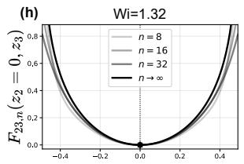

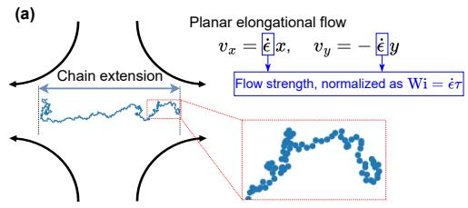

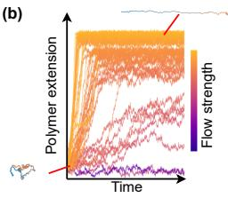

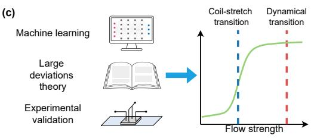  
Figure 1: Overview of the polymer system and transition analysis. (a) A single polymer chain is represented by a bead-rod model, subjected to planar elongational flow, with chain extension measured along the elongational axis. (b) Plot of chain extension as a function of time across varying flow strengths. (c) Microscopic trajectories are reduced by PCA and fitted with conditional UIDD to identify phase transitions; large-deviation theory independently supports both transitions, while single-molecule DNA experiments provide qualitative support for the second transition.

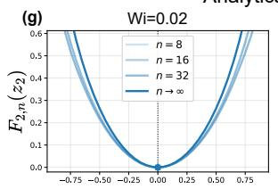

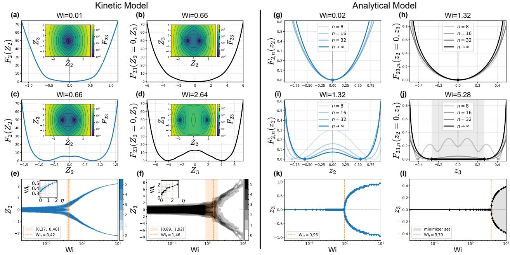  
Figure 2: Free energy landscapes and transition diagrams. (a-d) Learned marginal free energies $F _ { 2 } ( Z _ { 2 } )$ and sections $F _ { 2 3 } ( 0 , Z _ { 3 } )$ at the indicated Wi. Insets show the corresponding landscapes $F _ { 2 3 } ( Z _ { 2 } , Z _ { 3 } )$ . (e,f) Near-minimizing sets of the learned $F _ { 2 } \ ( \eta = 0 . 6 )$ and $F _ { 2 3 } ( 0 , \cdot ) ~ ( \eta = 1 . 0 )$ , respectively, defined by $\left\{ q : F ( q ; \mathrm { W i } ) - \operatorname* { m i n } _ { q ^ { \prime } } F ( q ^ { \prime } ; \mathrm { W i } ) \leq \eta \right\}$ . Color intensity indicates the number of the five independently trained models satisfying this condition. For each model, the transition point $\mathrm { W i } _ { t }$ is determined by the first crossing of $\begin{array} { r } { F ( 0 ; \mathrm { W i } ) - \operatorname* { m i n } _ { q } F ( q ; \mathrm { W i } ) } \end{array}$ above $\eta .$ Orange dashed lines and bands indicate the mean and range of $\mathrm { W i } _ { t }$ across models, respectively, with sensitivities shown in the insets. (g-j) Free energy profiles per bond of the analytical model, $F _ { 2 , n } ( z _ { 2 } )$ and $F _ { 2 3 , n } ( 0 , z _ { 3 } )$ . (k,l) Minimizing sets of $F _ { 2 , \infty } ( z _ { 2 } )$ and $F _ { 2 3 , \infty } ( 0 , z _ { 3 } )$ , respectively. Beyond the second transition, the gray region in (l) denotes the minimizing interval, with diamonds marking its endpoints.

At $\mathrm { W i } = 2 . 6 4$ , the origin changes from a saddle to a local maximum of $F _ { 2 3 }$ , while two symmetry-related saddles emerge along $Z _ { 3 } ,$ , appearing as of-center minima of $F _ { 2 3 } ( 0 , Z _ { 3 } )$ . This marks a second transition, which splits the small-end-separation population into two oppositely oriented backfolded conformations, while the dominant stretched minima persist. Unlike coil-stretch, this transition changes the unstable states of the landscape instead of the dominant stable states. Since saddles govern the pathways and timescales of unfolding, we refer to it as a dynamical transition, and show below that it becomes a phase transition in the long-chain limit. Previous work [15] identified prolonged residence near folded state saddles as a key driver of heterogeneous unfolding times [4–6]. This transition thus indicates the flow-induced emergence of the unstable states underlying this dynamical heterogeneity, consistent with the growing prevalence of folded unraveling pathways at strong flows. To our knowledge, this transition has not been identified previously, and it is invisible to analyses restricted to stable states

Fig. 2 (e,f) locate the two transitions through a sys tematic scan of Wi in the learned landscapes. Learning errors introduce seed-dependent variations in the free energy profiles, so we track near-minimizing sets, defined as the regions where the free energy lies within a tolerance η of its minimum, across five independently trained models. The near-minimizing set first separates into stretched branches along $Z _ { 2 } .$ , followed by a separation in the section $F _ { 2 3 } ( 0 , Z _ { 3 } )$ at higher flow strength. The stretched branches persist through the dynamical transition, distinguishing the reorganization of the smallend-separation population from the initial coil-stretch transition. At the selected tolerances, the mean transition estimates are $\mathrm { W i } _ { t } ^ { ( 1 ) } \simeq 0 . 4 2$ and $\mathrm { W i } _ { t } ^ { ( 2 ) } \simeq 1 . 4 6$ , with respective ranges [0.37, 0.46] and [0.89, 1.92]. The two ranges do not overlap, confirming that the transitions are distinct.

Analytical model— To assess the theoretical plausibility of the two transitions and explore their mechanism, we consider a simplified two-dimensional model. It consists of $n + 1$ beads at positions $r _ { 0 } , \ldots , r _ { n } \in \mathbb { R } ^ { 2 }$ , subject to $\scriptstyle \sum _ { k = 0 } ^ { n } r _ { k } = 0$ and $| r _ { k } - r _ { k - 1 } | = 1$ for $k = 1 , \dots , n$ , with no additional inter-bead interactions. The dimensionless efective flow potential for a planar elongational flow is

$$
U _ { n , \lambda } ( \{ r _ { k } \} _ { k = 0 } ^ { n } ) = - \frac { \lambda } { n ^ { 2 } } \sum _ { k = 0 } ^ { n } \left( r _ { k , x } ^ { 2 } - r _ { k , y } ^ { 2 } \right) ,\tag{3}
$$

where $\lambda \geq 0$ controls the elongational strength $\mathrm { ( W i ~ = ~ }$ 0.096λ, see Sec. S3.C). The interpretation of the learned closure coordinates motivates the reduced observables

$$
\hat { z } _ { 2 } = ( r _ { n , x } - r _ { 0 , x } ) / n , \quad \hat { z } _ { 3 } = ( r _ { n , x } + r _ { 0 , x } ) / n .
$$

To compare with the learned estimates, we introduce

$$
\begin{array} { c } { \displaystyle \mathcal { Z } _ { 2 , n } ( z _ { 2 } ; \lambda ) = \displaystyle \int e ^ { - U _ { n , \lambda } } \delta ( z _ { 2 } - \hat { z } _ { 2 } ) \mathrm { d } \nu _ { n } , } \\ { \displaystyle \mathcal { Z } _ { 2 3 , n } ( 0 , z _ { 3 } ; \lambda ) = \displaystyle \int e ^ { - U _ { n , \lambda } } \delta ( \hat { z } _ { 2 } ) \delta ( z _ { 3 } - \hat { z } _ { 3 } ) \mathrm { d } \nu _ { n } , } \end{array}
$$

where δ denotes the Dirac distribution and $\nu _ { n }$ is the reference configurational measure induced by independent, uniformly distributed bond directions. The corresponding dimensionless free energies per bond are

$$
F _ { 2 , n } = - \ln \mathcal { Z } _ { 2 , n } / n , \quad F _ { 2 3 , n } = - \ln \mathcal { Z } _ { 2 3 , n } / n .\tag{4}
$$

In the long-chain limit, the scaled interpolated chain belongs to the following subset of the absolutely continuous path space $\operatorname { A C } ( [ 0 , 1 ] ; \mathbb { R } ^ { 2 } )$ ):

$$
\begin{array} { r } { \mathcal { A } = \left\{ m \in \mathrm { A C } ( [ 0 , 1 ] ; \mathbb { R } ^ { 2 } ) : m ( 0 ) = 0 , ~ | m ^ { \prime } ( s ) | \leq 1 \mathrm { ~ a . e . } \right\} . } \end{array}
$$

Writing $\begin{array} { r } { \bar { m } = \int _ { 0 } ^ { 1 } m ( s ) } \end{array}$ , ds, we define the efective energy and conformational entropy by

$$
\begin{array} { l } { \displaystyle \mathcal { E } [ m ] = - \int _ { 0 } ^ { 1 } \big [ ( m _ { x } - \bar { m } _ { x } ) ^ { 2 } - ( m _ { y } - \bar { m } _ { y } ) ^ { 2 } \big ] \mathrm { d } s , } \\ { \displaystyle \mathcal { S } [ m ] = - \int _ { 0 } ^ { 1 } \operatorname* { s u p } _ { h \in \mathbb { R } } \big \{ h | m ^ { \prime } | - \ln I _ { 0 } ( h ) \big \} \mathrm { d } s , } \end{array}\tag{5}
$$

where $\begin{array} { r l r } { I _ { 0 } ( h ) } & { { } = } & { ( 2 \pi ) ^ { - 1 } \int _ { 0 } ^ { 2 \pi } e ^ { h \cos \theta } \mathrm { d } \theta } \end{array}$ is the modified Bessel function of the first kind of order zero. By Mogulskii’s theorem and Varadhan’s lemma [21–23], the limiting free energies are given by (End Matter)

$$
\begin{array} { c } { { F _ { 2 , \infty } ( z _ { 2 } ; \lambda ) = \displaystyle \operatorname* { i n f } _ { m \in \cal A } \left\{ \lambda \mathcal { E } [ m ] - \mathcal { S } [ m ] \right\} , \hfill } } \\ { { \displaystyle } } \\ { { F _ { 2 3 , \infty } ( 0 , z _ { 3 } ; \lambda ) = \displaystyle \operatorname* { i n f } _ { m \in \cal A , \ m _ { x } ( 1 ) = 0 } \left\{ \lambda \mathcal { E } [ m ] - \mathcal { S } [ m ] \right\} . \hfill } } \\ { { \displaystyle \quad \quad \bar { m } _ { x } = - z _ { 3 } / 2 } } \end{array}\tag{6}
$$

These variational problems show that the topological changes of free energy minima arise from the competition between the energetic preference for axial spreading and the entropic cost of local alignment.

Fig. 2 (g-j) presents the variational solutions of (6) and Monte Carlo estimates of finite chain free energies (4). The analytical model qualitatively reproduces both the coil-stretch transition, marked by the splitting of the extension minimum, and the subsequent dynamical transition at zero axial end separation. This sequence arises as increasing Wi (and hence λ) strengthens the elongational energy contribution relative to entropy, reshaping the free energy landscape. At $\mathrm { W i } = 5 . 2 8 , F _ { 2 3 , \infty } ( 0 , z _ { 3 } )$ is minimized on a symmetric interval containing the origin (Theorem S3), which finite-size efects turn into the two isolated minima seen for $n = 1 6 , 3 2$ and in the machine learning results. This flat interval signals phase coexistence between oppositely folded states, making the second transition a phase transition in the long-chain limit. Scans of the variational free energies locate the two transitions at $\mathrm { W i } _ { t } ^ { ( 1 ) } \simeq 0 . 9 5$ and $\mathrm { W i } _ { t } ^ { ( 2 ) } \simeq 3 . 7 9 \ [ \mathrm { F i g . \ 2 \ ( k , l ) } ]$ ], in qualitative agreement with the learned estimates for the full kinetic model.

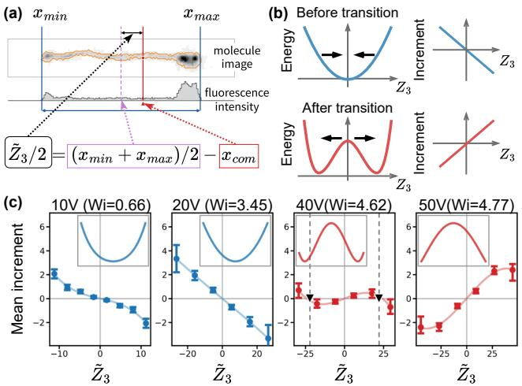  
Figure 3: (a) Definition of the image-based folding coordinate ${ \widetilde { Z } } _ { 3 }$ . (b) Schematic of the single-well to doublewell transition in the free energy landscape and the corresponding increments near the origin. (c) Experimental signatures of folding reorganization. Symbols show the odd component of the conditional finite-lag mean increment of ${ \widetilde { Z } } _ { 3 }$ . Error bars indicate uncertainty in the estimated response. Curves show polynomial fits; triangles mark zero crossings interpolated from the binned data at 40 V. Insets show apparent potentials obtained as negative antiderivatives of the fitted polynomials.

Experimental signatures— To test whether the predicted dynamical transition appears in experiment, we performed single-molecule experiments [24] on DNA molecules stretched in a planar elongational electrokinetic field that is analogous to a planar elongational flow, with the field strength controlled by the applied voltage (Supplemental Material). The applied voltages of 10-50 flV correspond to Wi ≈ [0.7,4.8]. The transition is characterized by changes in the free energy landscape along $Z _ { 3 } ,$ but this coordinate is not directly accessible from molecular images. Motivated by the association of $Z _ { 3 }$ with the axial displacement of the chain-end midpoint from the center of mass, we define its image-based surrogate ${ \widetilde { Z } } _ { 3 }$ as twice the axial displacement of the midpoint between the molecule’s axial edges from the intensity-weighted centroid, centered by its trajectory median [Fig. 3(a)].

Across the second transition, the origin of $F _ { 2 3 } ( 0 , Z _ { 3 } )$ changes from a local minimum to a local maximum. Since the drift near the origin follows the local slope of the landscape, small deviations of $Z _ { 3 }$ from zero should be restored below the transition and amplified above it, reversing the slope of the mean response at the origin from negative to positive [Fig. 3(b)]. To test this, we measure the mean change in ${ \widetilde { Z } } _ { 3 }$ over a fixed time lag, conditioned on its current value, for molecules within a common window of normalized extension during initial stretching, and retain its odd component. As seen in Fig. 3(c), at 10 and 20 V, the response is restoring near $\stackrel { \sim } { Z } _ { 3 } = 0$ , whereas at 40 and 50 V it is repelling, with outer zero crossings at 40 V marking the two folded states, see End Matter for details. This reversal agrees with the predicted change of the landscape and provides qualitative experimental support for the dynamical transition.

Discussion— Beyond the coil-stretch transition, a polymer chain in planar elongational flow undergoes a second dynamical transition, in which backfolded saddle states emerge among chains with small end-to-end separation, while the stretched states persist. To identify this, we developed conditional UIDD to learn stochastic dynamics and free energy landscapes jointly across flow strengths. Large-deviation analysis on a simplified model reproduces both transitions and shows that they are phase transitions in the long-chain limit. Since sad dles divide the pathways by which chains stretch, sending a fraction of chains through folded intermediates, this transition ofers a landscape-level explanation for why folds become common during unraveling at strong flows [5, 9]. As this transition is invisible in the end-to-end vector, it also identifies a folding coordinate that dumbbellbased constitutive models omit. The landscapes further specify what to measure in experiment, namely a reversal of the folding response from restoring to repelling, which our single-molecule DNA experiments observe.

More broadly, our workflow applies to any system observed through trajectories under a tunable control, such as biomolecules under force or colloidal assembly at varying interaction strength. Since its identifiability does not require detailed balance and it accommodates several conditions at once, it can map transitions across nonequilibrium phase diagrams by tracking how unstable states change across multi-parameter spaces, including those that change unstable states while the most probable states stay the same.

## Methods

Closure coordinates— In our previous study of the same polymer system [15, 16], two closure coordinates are identified and associated with the axial end-to-end distance and degree of foldedness, respectively. These coordinates were obtained from a nonlinear PCA-ResNet encoder and interpreted a posteriori through geometric correlations [15]. To compare conformational statistics and free energy landscapes across flow strength without ambiguity from changes in the representation itself, we construct a common symmetry-preserving PCA representation with prescribed parity under the physical symmetries of the chain. Here $\mathbf { r } _ { i } = ( r _ { i , x } , r _ { i , y } , r _ { i , z } )$ is the position of bead $i = 0 , \ldots , N$ , with 0 and N labeling the chain ends. The x axis is the elongational direction, and $r _ { \mathrm { c o m } , x } = ( N + 1 ) ^ { - 1 } \textstyle \sum _ { i = 0 } ^ { N } r _ { i , x }$ is the axial center-of-mass coordinate. Specifically, we impose chain-end exchange ${ R \ : : \ : \mathbf { r } _ { i } \ : \mapsto \ : \mathbf { r } _ { N - i } }$ and the three Cartesian coordinate reflections $T _ { \alpha } : r _ { i , \alpha } \mapsto - r _ { i , \alpha } , \alpha = x , y , z$ . The coordinate $Z _ { 2 }$ is odd under R and $T _ { x }$ and even under $T _ { y }$ and $T _ { z } .$ whereas $Z _ { 3 }$ is even under R, odd under $T _ { x } .$ , and even under $T _ { y }$ and $T _ { z }$ . A single projection and normalization are used over all data. Details are given in Supplemental Material.

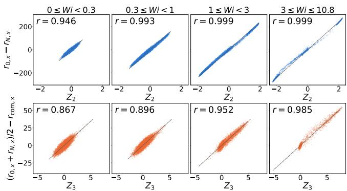  
Figure 4: Correlations of the PCA coordinates. Top: $Z _ { 2 }$ versus the signed axial endpoint diference, $r _ { 0 , x } \ -$ $r _ { N , x }$ . Bottom: $Z _ { 3 }$ versus the signed foldedness, $( r _ { 0 , x } +$ $r _ { N , x } ) / 2 - r _ { \mathrm { c o m } , x } .$ . Correlation coeficients are computed separately for each Wi interval.

We then test whether these symmetry-adapted coordinates retain the geometric interpretations across flow strengths by evaluating the corresponding correlations separately. As shown in Fig. $4 , Z _ { 2 }$ is strongly correlated with the signed axial endpoint diference, whereas $Z _ { 3 }$ is strongly correlated with the signed foldedness.

Conditional UIDD— Conditional UIDD learns a family of stochastic dynamics on $\mathbb { R } ^ { d }$ from trajectories labeled by a fixed external condition $c \in { \mathcal { C } } \subset \mathbb { R } ^ { p }$ . It couples the inference problems at diferent conditions through shared state-and-condition maps V, W, and $\sigma .$ For each fixed $^ { c , }$ normalizability and dissipation conditions [25] yield the existence and uniqueness of the stationary density for Eq. (1). Substituting ρ from $\operatorname { E q . } \ ( 2 )$ into the Fokker-Planck current [26] we have

$$
\mathbf { J } = f \rho - \nabla \mathbf { z } \cdot ( M \rho ) = \nabla \mathbf { z } \cdot ( W \rho ) ,
$$

where $\begin{array} { r } { ( \nabla _ { \mathbf { Z } } \cdot A ) _ { i } = \sum _ { j } \partial _ { Z _ { j } } A _ { i j } } \end{array}$ . The tensor $W \rho$ is antisymmetric, so its double divergence vanishes and thus

$$
\nabla _ { \mathbf { Z } } \cdot \mathbf { J } = 0 .
$$

Consequently, the energy potential within each condition are identifiable, although the scalar reference $C ( c )$ need not be unique.

We first split the time series into multiple transitions. For each transition $^ { a , }$ the state $\mathbf { Z } _ { a } .$ , condition $c _ { a } ,$ increment $\Delta \mathbf { Z } _ { a }$ , and observation interval $\Delta t _ { a }$ enter a joint conditional likelihood. With f denoting the drift of Eq. (1), define $e _ { a } \ = \ \Delta \mathbf { Z } _ { a } \ - \ f ( \mathbf { Z } _ { a } ; c _ { a } ) \Delta t _ { a }$ and the positive-definite covariance $C _ { a } = 2 M ( \mathbf { Z } _ { a } ; c _ { a } ) \Delta t _ { a }$ . The

Euler-Maruyama approximation gives, up to parameterindependent terms, the objective [26–28]

$$
\mathcal { L } ( \theta ) = \frac { 1 } { 2 } \sum _ { a } \left[ e _ { a } ^ { \top } C _ { a } ^ { - 1 } e _ { a } + \ln \operatorname* { d e t } C _ { a } \right] .\tag{7}
$$

Minimizing this objective over all condition-labeled transitions fits the parameters θ. Training requires neither stationary initial samples nor evaluation of the normalization $\mathcal { Z } ( c )$ . The proof of universality of the conditional UIDD representation, the network construction, training settings, and landscape evaluation are given in Supplemental Material.

Large-deviation derivation— Fix $\lambda \geq 0$ and linearly in terpolate $m _ { n } ( k / n ) = ( r _ { k } - r _ { 0 } ) / n$ These paths lie in $\mathcal { A } ;$ write $\mathbb { P } _ { n }$ for their distribution under $\nu _ { n } .$ . The unit bond directions are independent and uniform, with log moment-generating function

$$
\Lambda ( \mathbf { h } ) = \ln \langle e ^ { \mathbf { h } \cdot ( r _ { 1 } - r _ { 0 } ) } \rangle _ { \nu _ { n } } = \ln I _ { 0 } ( | \mathbf { h } | ) .
$$

Its Legendre transform is therefore radial:

$$
\Lambda ^ { * } ( v ) = \ell ( | v | ) , \qquad \ell ( u ) = \operatorname* { s u p } _ { h \in \mathbb { R } } \{ h u - \ln I _ { 0 } ( h ) \} .\tag{8}
$$

Because Λ is finite on $\mathbb { R } ^ { 2 }$ , Mogulskii’s theorem [21] gives a path large-deviation principle (LDP) in the uniform topology, with speed n and conformational entropy (5):

$$
\begin{array} { r } { \pmb { S } [ m ] = - \displaystyle \int _ { 0 } ^ { 1 } \ell ( | m ^ { \prime } ( s ) | ) \mathrm { d } s , \qquad m \in \mathcal { A } , } \end{array}
$$

with $s [ m ] = - \infty$ outside ${ \mathcal { A } } .$

The zero center-of-mass condition gives the exact relation

$$
\frac { r _ { k } } { n } = m _ { n } ( k / n ) - \frac { 1 } { n + 1 } \sum _ { j = 0 } ^ { n } m _ { n } ( j / n ) .
$$

Substitution into Eq. (3) gives

$$
\begin{array} { l } { \displaystyle - U _ { n , \lambda } = - \lambda n \mathcal { E } [ m _ { n } ] + o ( n ) , \qquad \hat { z } _ { 2 } = m _ { n , x } ( 1 ) , \medskip } \\ { \displaystyle \mathcal { E } [ m ] = - \int _ { 0 } ^ { 1 } \big [ ( m _ { x } - \bar { m } _ { x } ) ^ { 2 } - ( m _ { y } - \bar { m } _ { y } ) ^ { 2 } \big ] \mathrm { d } s . } \end{array}
$$

The error is uniform because the paths are 1-Lipschitz. Thus the $n ^ { - 2 }$ prefactor makes the flow exponent scale with the LDP speed n. For $| z _ { 2 } | < 1$ , integrating the partition density over a window of fixed width 2ε gives

$$
\begin{array} { c l } { W _ { 2 , n , \varepsilon } ( z _ { 2 } ; \lambda ) = \displaystyle \int e ^ { - U _ { n , \lambda } } \mathbf { 1 } _ { \{ | \hat { z } _ { 2 } - z _ { 2 } | < \varepsilon \} } \mathrm { d } \nu _ { n } } \\ { \displaystyle } & { \displaystyle \asymp \int _ { | m _ { x } ( 1 ) - z _ { 2 } | < \varepsilon } e ^ { - n \lambda \mathcal { E } [ m ] } \mathrm { d } \mathbb { P } _ { n } ( m ) , } \end{array}
$$

where ≍ means that the logarithms difer by $o ( n )$ . The energy E is bounded and continuous on ${ \mathcal { A } } .$ The constrained Laplace bounds [22] therefore give

$$
- \operatorname* { l i m } _ { n \to \infty } \frac { 1 } { n } \ln W _ { 2 , n , \varepsilon } = \operatorname* { i n f } _ { m \in A \atop | m _ { x } ( 1 ) - z _ { 2 } | < \varepsilon } \{ \lambda \mathcal { E } [ m ] - \mathcal { S } [ m ] \} .
$$

At each suficiently large fixed n, the continuous density satisfies $W _ { 2 , n , \varepsilon } / ( 2 \varepsilon ) \to \mathcal { Z } _ { 2 , n } ( z _ { 2 } ; \lambda )$ as $\varepsilon \downarrow 0$ . Theorem S2 in the Supplemental Material proves that the ε and n limits commute at the logarithmic scale. Consequently,

$$
\begin{array} { l } { { \displaystyle F _ { 2 , \infty } ( z _ { 2 } ; \lambda ) = - \operatorname* { l i m } _ { \varepsilon \downarrow 0 } \operatorname* { l i m } _ { n  \infty } \frac 1 n \ln \biggl [ \frac { W _ { 2 , n , \varepsilon } ( z _ { 2 } ; \lambda ) } { 2 \varepsilon } \biggr ] } } \\ { { = \operatorname* { i n f } _ { m \in \mathcal { A } } \{ \lambda \mathcal { E } [ m ] - \mathcal { S } [ m ] \} . } } \\ { { \displaystyle m _ { x } ( 1 ) = z _ { 2 } } } \end{array}\tag{9}
$$

The section $F _ { 2 3 , \infty } ( 0 , z _ { 3 } ; \lambda )$ is obtained in the same way. Conditional response of image asymmetry— We examine how the mean response of image asymmetry changes with increasing voltage (Fig. 3). To compare similar stages of initial stretching, reference frames are selected within a common window of normalized image span. The raw dataset comprises 48 trajectories (47,339 frames) at 10 V, 201 (34,716 frames) at 20 V, 335 (27,922 frames) at 40 V, and 448 (33,726 frames) at 50 V.

For each image, let M be the retained molecular mask, $x _ { \mathrm { m i n } } , x _ { \mathrm { m a x } }$ its axial extrema, and $I _ { p }$ the backgroundcorrected intensity at pixel coordinate $x _ { p }$ . Define

$$
\begin{array} { l } { \displaystyle x _ { \mathrm { c o m } } = \frac { \sum _ { p \in \mathcal { M } } I _ { p } x _ { p } } { \sum _ { p \in \mathcal { M } } I _ { p } } , \quad \displaystyle \frac { q } { 2 } = \frac { x _ { \mathrm { m i n } } + x _ { \mathrm { m a x } } } { 2 } - x _ { \mathrm { c o m } } , } \\ { \displaystyle \widetilde { Z } _ { 3 } ^ { ( i ) } ( t ) = q _ { i } ( t ) - \operatorname* { m e d i a n } _ { s \in { \mathcal { Q } _ { i } } } q _ { i } ( s ) . } \end{array}\tag{10}
$$

Here $\mathcal { Q } _ { i }$ contains all quality-filtered frames of trajectory $i ( \mathrm { S e c . ~ S 4 . A } ) ;$ coordinates are in pixels. Such imagebased coordinate ${ \tilde { Z } } _ { 3 }$ correlates with the microscopic folding asymmetry $( r _ { 0 , x } + r _ { N , x } ) / 2 - r _ { \mathrm { c o m } , x } ,$ as shown in Fig. 5. For conditioning, set $z ( t ) = \widetilde { Z } _ { 3 } ( t ) - \mu$ , where $\mu$ is the mean reference value at each voltage. This shift leaves increments unchanged. For two later frames, $0 < \delta _ { 1 } < \delta _ { 2 }$ , we define

$$
\begin{array} { r l } & { \Delta \tilde { Z } _ { 3 } ( t ) = \tilde { Z } _ { 3 } ( t + \delta _ { 2 } ) - \tilde { Z } _ { 3 } ( t + \delta _ { 1 } ) , } \\ & { \quad f ( z ) = \left. \Delta \tilde { Z } _ { 3 } ( t ) \mid z ( t ) = z \right. , } \\ & { \quad g ( z ) = \frac { f ( z ) - f ( - z ) } { 2 } . } \end{array}\tag{11}
$$

The use of two later frames separates the conditioning measurement from the finite-lag increment. The antisymmetrization extracts the component odd under $z \mapsto - z$ , thereby focusing the analysis on the restoring or amplifying tendency shared by positive and negative deviations from the chosen center.

We estimate g in symmetric bins and quantify uncertainty by bootstrap resampling entire trajectories within each voltage ensemble, with the bin edges held fixed. The error bars in Fig. 3 denote pointwise 16th-84th percentile intervals from 2000 bootstrap resamples. The resampling specification and its remaining implementation details are discussed in Sec. S4.B. The marked zero crossings at 40 V are obtained by linear interpolation between adjacent odd-response bins.

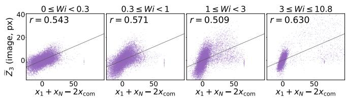  
Figure 5: Correlations of the image-based coordinates. The image-based coordinate ${ \tilde { Z } } _ { 3 }$ is extracted from images generated from simulated polymer conformations, whereas the microscopic folding asymmetry $x _ { 1 } + x _ { N } -$ $2 x _ { \mathrm { { c o m } } }$ are computed directly from the simulated configurations.

The smooth curves in Fig. 3 are unweighted leastsquares fits of

$$
g _ { \mathrm { f i t } } ( z ) = c _ { 1 } z + c _ { 3 } z ^ { 3 }
$$

to the retained bins, with no sign constraints on the coeficients. The corresponding apparent potentials are defined by

$$
U _ { \mathrm { a p p } } ( z ) = - \int _ { 0 } ^ { z } g _ { \mathrm { f i t } } ( u ) \mathrm { d } u + C = - \frac { c _ { 1 } z ^ { 2 } } { 2 } - \frac { c _ { 3 } z ^ { 4 } } { 4 } + C .
$$

Each inset is shifted to zero minimum over the displayed range and rescaled independently, so the comparison concerns the evolution of potential shape across voltages. These apparent potentials provide a compact representation of the fitted finite-lag responses. Experimental details, selection and lag parameters, and sensitivity analyses are given in Supplemental Material.

## References

[1] Ronald G Larson. The rheology of dilute solutions of flexible polymers: Progress and problems. Journal of Rheology, 49(1):1–70, 2005.

[2] CM Schroeder. Single polymer dynamics for molec ular rheology. Journal of Rheology, 62(1):371–403, 2018.

[3] PG De Gennes. Coil-stretch transition of dilute flexible polymers under ultrahigh velocity gradients. The Journal of Chemical Physics, 60(12): 5030–5042, 1974.

[4] Thomas T Perkins, Douglas E Smith, and Steven Chu. Single polymer dynamics in an elongational flow. Science, 276(5321):2016–2021, 1997.

[5] Douglas E Smith and Steven Chu. Response of flexible polymers to a sudden elongational flow. Science, 281(5381):1335–1340, 1998.

[6] Charles M Schroeder, Hazen P Babcock, Eric SG Shaqfeh, and Steven Chu. Observation of polymer conformation hysteresis in extensional flow. Science, 301(5639):1515–1519, 2003.

[7] EJ Hinch. Mechanical models of dilute polymer solutions in strong flows. The Physics of Fluids, 20 (10):S22–S30, 1977.

[8] RG Larson and JJ Magda. Coil-stretch transitions in mixed shear and extensional flows of dilute polymer solutions. Macromolecules, 22(7):3004–3010, 1989.

[9] RG Larson, Hua Hu, DE Smith, and S Chu. Brownian dynamics simulations of a dna molecule in an extensional flow field. Journal of Rheology, 43(2): 267–304, 1999.

[10] Ronald R Coifman and Stéphane Lafon. Difusion maps. Applied and computational harmonic analysis, 21(1):5–30, 2006.

[11] Ricky TQ Chen, Yulia Rubanova, Jesse Bettencourt, and David K Duvenaud. Neural ordinary diferential equations. In Advances in neural information processing systems, volume 31, 2018.

[12] Pinchen Xie, Roberto Car, and Weinan E. Ab initio generalized langevin equation. Proceedings of the National Academy of Sciences, 121(14): e2308668121, 2024.

[13] Haijun Yu, Xinyuan Tian, Weinan E, and Qianxiao Li. Onsagernet: Learning stable and interpretable dynamics using a generalized onsager prin ciple. Physical Review Fluids, 6(11):114402, 2021.

[14] Zhen Zhang, Yeonjong Shin, and George Em Karniadakis. GFINNs: GENERIC formalism informed neural networks for deterministic and stochastic dynamical systems. Philosophical Transactions of the Royal Society A, 380(2229):20210207, 2022.

[15] Xiaoli Chen, Beatrice W Soh, Zi-En Ooi, Eleonore Vissol-Gaudin, Haijun Yu, Kostya S Novoselov, Kedar Hippalgaonkar, and Qianxiao Li. Constructing custom thermodynamics using deep learning. Nature Computational Science, 4(1):66–85, 2024.

[16] Aiqing Zhu, Beatrice W Soh, Grigorios A Pavliotis, and Qianxiao Li. Identifiable learning of dissipative dynamics. Nature Communications, 17(1): 9460, 2026. doi: 10.1038/s41467-026-76255-3.

[17] Beatrice W Soh, Alexander R Klotz, and Patrick S Doyle. Untying of complex knots on stretched polymers in elongational fields. Macromolecules, 51(23): 9562–9571, 2018.

[18] Shaan A Desai, Marios Mattheakis, David Sondak, Pavlos Protopapas, and Stephen J Roberts. Porthamiltonian neural networks for learning explicit time-dependent dynamical systems. Physical Review E, 104(3):034312, 2021.

[19] Kookjin Lee, Nathaniel Trask, and Panos Stinis. Machine learning structure preserving brackets for forecasting irreversible processes. Advances in Neural Information Processing Systems, 34:5696–5707, 2021.

[20] US Agarwal, Rohit Bhargava, and RA Mashelkar. Brownian dynamics simulation of a polymer molecule in solution under elongational flow. The Journal of chemical physics, 108(4):1610–1617, 1998.

[21] Anatolii A Mogul’skii. Large deviations for trajecto ries of multi-dimensional random walks. Theory of Probability & Its Applications, 21(2):300–315, 1977.

[22] SR Srinivasa Varadhan. Large deviations, volume 27. American Mathematical Soc., 2016.

[23] Arsen Akopyan and Vladislav Vysotsky. Large deviations of convex hulls of planar random walks and Brownian motions. Annales Henri Lebesgue, 4:1163–1201, 2021. doi: 10.5802/ahl.100.

[24] Beatrice W Soh, Zi-En Ooi, Eleonore Vissol-Gaudin, Chang Jie Leong, and Kedar Hippalgaonkar. Automated electrokinetic stretcher for manipulating nanomaterials. Lab on a Chip, 23(16): 3716–3726, 2023.

[25] Wen Huang, Min Ji, Zhenxin Liu, and Yingfei Yi. Steady states of fokker–planck equations: I. existence. Journal of Dynamics and Diferential Equations, 27(3):721–742, 2015.

[26] Grigorios A Pavliotis. Stochastic processes and applications. Texts in applied mathematics, 60:41–43, 2014.

[27] Felix Dietrich, Alexei Makeev, George Kevrekidis, Nikolaos Evangelou, Tom Bertalan, Sebastian Reich, and Ioannis G Kevrekidis. Learning efective stochastic diferential equations from microscopic simulations: Linking stochastic numerics to deep learning. Chaos: An Interdisciplinary Journal of Nonlinear Science, 33(2), 2023.

[28] Aiqing Zhu and Qianxiao Li. DynGMA: A robust approach for learning stochastic diferential equations from data. Journal of Computational Physics, 513:113200, 2024.

[29] Alexander Vologodskii. Brownian dynamics simulation of knot difusion along a stretched dna molecule. Biophysical journal, 90(5):1594–1597, 2006.

[30] Tony W Liu. Flexible polymer chain dynamics and rheological properties in steady flows. The Journal of chemical physics, 90(10):5826–5842, 1989.

[31] Madan Somasi, Bamin Khomami, Nathanael J Woo, Joe S Hur, and Eric SG Shaqfeh. Brownian dynamics simulations of bead-rod and bead-spring chains: numerical algorithms and coarse-graining issues. Journal of non-newtonian fluid mechanics, 108(1-3):227–255, 2002.

[32] Kang Feng and Zaijiu Shang. Volume-preserving algorithms for source-free dynamical systems. Numerische Mathematik, 71(4):451–463, 1995.

[33] Kurt Hornik, Maxwell Stinchcombe, and Halbert White. Universal approximation of an unknown mapping and its derivatives using multilayer feedforward networks. Neural networks, 3(5):551–560, 1990.

[34] Milton Abramowitz. Handbook of mathematical functions, national bureau of standards. Applied Mathematics Series, (55), 1964.

# Supplemental Material for Hidden Phase Transition in Single-Polymer Stretching under Elongational Flow

## S1 Microscopic dynamics and reduced coordinates

## S1.A Bead-rod chain and its numerical integration

We generate the microscopic trajectories using a Brownian dynamics model of a linear chain of $N + 1 = 3 0 0$ touching beads in three dimensions [17]. Each bead has diameter b = 10nm, and adjacent beads are connected by rigid rods of the same length:

$$
| \mathbf { r } _ { i + 1 } - \mathbf { r } _ { i } | = b , \qquad i = 0 , \ldots , N - 1 .\tag{S1}
$$

where the beads are indexed by $i = 0 , \ldots , N , \mathbf { r } _ { i } ( t )$ is the position of bead i and $\begin{array} { r } { \mathbf { r } _ { \mathrm { c m } } ( t ) = ( N + 1 ) ^ { - 1 } \sum _ { i = 0 } ^ { N } \mathbf { r } _ { i } ( t ) } \end{array}$ is the instantaneous center of mass. The imposed planar elongational flow is evaluated relative to the center of mass:

$$
\mathbf { u } _ { i } ( t ) = \kappa [ \mathbf { r } _ { i } ( t ) - \mathbf { r } _ { \mathrm { c m } } ( t ) ] , \qquad \kappa = \dot { \epsilon } \left( \begin{array} { c c c } { 1 } & { 0 } & { 0 } \\ { 0 } & { - 1 } & { 0 } \\ { 0 } & { 0 } & { 0 } \end{array} \right) .
$$

The stagnation point follows the instantaneous center of mass, with extension along the x-axis, compression along the y-axis and no imposed velocity in the z-axis.

Let ζ = 3πηb denote the Stokes drag coeficient of a single bead in a solvent of viscosity η. We neglect hydrodynamic interactions between beads, such that the solvent acts only through the imposed flow and the bead-wise drag coeficient. Neglecting inertia, the force balance is

$$
\zeta \dot { \mathbf { r } } _ { i } = \zeta \mathbf { u } _ { i } + \mathbf { F } _ { i } ^ { \mathrm { e v } } + \mathbf { F } _ { i } ^ { \mathrm { c } } + \mathbf { F } _ { i } ^ { \mathrm { B } } ,
$$

where $\mathbf { F } _ { i } ^ { \mathrm { e v } }$ is the excluded volume force, $\mathbf { F } _ { i } ^ { \mathrm { c } }$ enforces Eq. (S1) and $\mathbf { F } _ { i } ^ { \mathrm { B } }$ is the random Brownian force. With $r _ { i j } = { }$ $| \mathbf { r } _ { i } - \mathbf { r } _ { j } |$ , the short-range contact repulsion is given by

$$
\mathbf { F } _ { i } ^ { \mathrm { e v } } = \mu \sum _ { \substack { j \neq i , \ r _ { i j } < b } } [ \mathbf { r } _ { i } - \mathbf { r } _ { j } ] / r _ { i j } ,
$$

where $\mu = 3 5$ pN is chosen to suppress chain crossings [29]. For $r _ { i j } \neq b$ , this force follows from the continuous pair potential $\begin{array} { r } { E _ { \mathrm { e v } } = \mu \sum _ { i < j } ( b - r _ { i j } ) _ { + } } \end{array}$ , where $( a ) _ { + } = \operatorname* { m a x } ( a , 0 )$ . Defining the bond unit vector $\widehat { \mathbf { b } } _ { i } = ( \mathbf { r } _ { i + 1 } - \mathbf { r } _ { i } ) / b$ and setting $T _ { - 1 } = T _ { N } = 0$ (with the boundary terms omitted), the constraint force on bead i is

$$
{ \bf F } _ { i } ^ { \mathrm { c } } = T _ { i } \widehat { { \bf b } } _ { i } - T _ { i - 1 } \widehat { { \bf b } } _ { i - 1 } .
$$

The tensions $T _ { i }$ enforce the fixed length constraints. The Brownian force $\mathbf { F } _ { i } ^ { \mathrm { B } }$ has zero mean and satisfies the fluctuation-dissipation relation

$$
\langle \mathbf { { F } } _ { i } ^ { \mathrm { B } } ( t ) \rangle = 0 , \quad \langle \mathbf { { F } } _ { i } ^ { \mathrm { B } } ( t ) \mathbf { { F } } _ { j } ^ { \mathrm { B } } ( t ^ { \prime } ) ^ { \top } \rangle = 2 \zeta k _ { \mathrm { B } } T \delta _ { i j } \mathbf { { I } } \delta ( t - t ^ { \prime } ) .
$$

We integrate the force balance equation with a predictor-corrector scheme [30] and solve the nonlinear bondtension equations by Newton’s method at each step [31]. We use a time step $\Delta t = 5 \times 1 0 ^ { - 4 } \tau _ { d }$ , where $\tau _ { d } = b ^ { 2 } \zeta / ( k _ { \mathrm { B } } T )$ the dimensionless contact repulsion strength is $\mu b / ( k _ { \mathrm { B } } T ) ~ = ~ 8 5 . 0$ . Each chain is equilibrated for $1 0 ^ { 4 } \tau _ { d }$ (without any flow) before turning on the flow. A single-exponential fit to the final 30% extension during relaxation of an initially stretched chain yields the longest relaxation time $\tau = 4 3 2 1 \tau _ { d } .$ , defining the Weissenberg number $\mathrm { W i } = \dot { \epsilon } \tau$ . In simulation units, $\widetilde { \mathbf { r } } = \mathbf { r } / b , \widetilde { t } = t / \tau _ { d }$ , and $\widetilde { \mathbf { F } } = b \mathbf { F } / ( k _ { \mathrm { B } } T )$ , such that

$$
\widetilde { \dot { \epsilon } } = \dot { \epsilon } \tau _ { d } , \qquad \mathrm { W i } = \widetilde { \dot { \epsilon } } \frac { \tau } { \tau _ { d } } = 4 3 2 1 \widetilde { \dot { \epsilon } } .
$$

## S1.B Symmetry-adapted dimensionality reduction

We represent each conformation by the stacked bead positions $ { \mathbf { r } } = (  { \mathbf { r } } _ { 0 } ^ { \top } , \ldots ,  { \mathbf { r } } _ { N } ^ { \top } ) ^ { \top } \in \mathbb { R } ^ { 9 0 0 }$ , retaining the instantaneous center-of-mass position. The first reduced coordinate is the normalized chain extension,

$$
Z _ { 1 } = \frac { \operatorname* { m a x } _ { i } r _ { i , x } - \operatorname* { m i n } _ { i } r _ { i , x } } { ( N + 1 ) b } .
$$

To construct the two additional coordinates, we sample K training conformations across chain-extension bins within each batch, supplemented by random draws without replacement.

We constrain the projection directions by chain reversal R and coordinate reflections $T _ { x } , T _ { y } , T _ { z }$ . These operations commute and each squares to the identity. Their 16 combinations form the symmetry group ${ \bf \bar { \cal G } } = \{ R ^ { a _ { R } } T _ { x } ^ { a _ { x } } T _ { y } ^ { a _ { y } } T _ { z } ^ { a _ { z } } :$ $a _ { R } , a _ { x } , a _ { y } , a _ { z } \in \{ 0 , 1 \} \}$ . For each $g \in G$ , an orthogonal matrix $U _ { q } \in \mathbb { R } ^ { 9 0 0 \times 9 0 0 }$ represents its action on r. Specifically, $( U _ { R } { \bf r } ) _ { i } = { \bf r } _ { N - i } $ , where i labels a three-component bead block, and $U _ { T _ { \alpha } }$ is diagonal with −1 on the α-coordinate entries of all beads and +1 elsewhere $( \alpha = x , y , z )$ . Composed operations satisfy $U _ { g h } = U _ { g } U _ { h }$ for $g , h \in G$ . A one-dimensional character $\chi : G \to \{ + 1 , - 1 \}$ satisfies $\chi ( g h ) \ : = \ : \chi ( g ) \chi ( h )$ and is labeled by the generator signs $( \chi ( R ) , \chi ( T _ { x } ) , \chi ( T _ { y } ) , \chi ( T _ { z } ) )$ . Each character defines a symmetry subspace of projection vectors $\mathbf { v } \in \mathbb { R } ^ { 9 0 0 }$ satisfying $U _ { g } \mathbf { v } = \chi ( g ) \mathbf { v }$ for all $g \in G$ , where $\chi ( g ) = + 1 ~ \mathrm { o r } ~ - 1$ indicates that $g$ preserves or reverses $\mathbf { v } ,$ respectively. The orthogonal projector onto this subspace is

$$
P _ { \chi } = \frac { 1 } { 1 6 } \sum _ { g \in G } \chi ( g ) U _ { g } .
$$

We select $\chi _ { 2 } = ( - 1 , - 1 , + 1 , + 1 )$ and $\chi _ { 3 } = ( + 1 , - 1 , + 1 , + 1 )$ for the two PCA directions.

The group-averaged sample mean vanishes under the coordinate reflections. Accordingly, for the sampled conformations $\mathbf { r } ^ { ( m ) } , m = 1 , \ldots , K$ , we form the second-moment matrices

$$
C _ { 0 } = \frac { 1 } { K - 1 } \sum _ { m = 1 } ^ { K } \mathbf { r } ^ { ( m ) } \mathbf { r } ^ { ( m ) \top } , \qquad C = \frac { 1 } { 1 6 } \sum _ { g \in G } U _ { g } C _ { 0 } U _ { g } ^ { \top } .
$$

This enforces a zero mean by symmetry without removing the center of mass from individual conformations. Within each subspace, the unit vector $\mathbf { v } _ { j }$ maximizing $\mathbf { v } ^ { \top } C \mathbf { v }$ is obtained as the normalized leading eigenvector of $P _ { \chi _ { j } } C P _ { \chi _ { j } }$ For the projections $a _ { j } ^ { ( m ) } = \mathbf { v } _ { j } ^ { \top } \mathbf { r } ^ { ( m ) }$ on the original fitting samples, define

$$
\bar { a } _ { j } = \frac { 1 } { K } \sum _ { m } a _ { j } ^ { ( m ) } , \quad s _ { j } ^ { 2 } = \frac { 1 } { K } \sum _ { m } ( a _ { j } ^ { ( m ) } - \bar { a } _ { j } ) ^ { 2 } , \quad Z _ { j } = \frac { \mathbf { v } _ { j } ^ { \top } \mathbf { r } } { s _ { j } } , \quad j = 2 , 3 .
$$

Thus, each coordinate is scaled by its sample standard deviation without mean subtraction. The resulting map ${ \bf r } \mapsto { \bf Z } = ( Z _ { 1 } , Z _ { 2 } , Z _ { 3 } )$ , including direction signs and scales, is fixed across all flow strengths and training and test trajectories.

## S2 Conditional UIDD: formulation, learning, and landscape analysis

## S2.A Expressivity and identifiability

We next establish the expressivity and identifiability of conditional UIDD. Specifically, we show that any difusion family satisfying the assumptions below admits a conditional UIDD representation whose potential is unique up to a c-dependent additive constant. Consider a family of Itô SDEs on $\mathbb { R } ^ { d } \left( d \geq 1 \right)$ indexed by a condition $c \in \mathcal { U } \subset \mathbb { R } ^ { p }$

$$
\mathrm { d } \mathbf { Z } _ { t } = b ( \mathbf { Z } _ { t } ; c ) \mathrm { d } t + \sigma ( \mathbf { Z } _ { t } ; c ) \mathrm { d } \mathbf { B } _ { t } .\tag{S2}
$$

Here $\mathbf { B } _ { t }$ is a standard d-dimensional Brownian motion, $b ( \mathbf { Z } ; c ) \in \mathbb { R } ^ { d }$ is the drift, and $\sigma ( \mathbf { Z } ; c ) \in \mathbb { R } ^ { d \times d }$ is the noise coeficient. The condition domain U is an open set containing the conditions ${ \mathcal { C } } ,$ and c is fixed along each trajectory. We assume a positive-definite difusion matrix $M = \sigma \sigma ^ { \top } / 2 .$ We write $\mathbf { e } _ { i }$ for the standard basis vectors of $\mathbb { R } ^ { d }$

Assumption S1. For each fixed $c \in { \mathcal { U } } ,$ the coeficients $b ( \cdot ; c ) \in C ^ { 1 }$ and $\sigma ( \cdot ; c ) \in C ^ { 2 }$ of Eq. (S2) satisfy global linear growth and Lipschitz bounds in Z (with c-dependent constants), and the process admits a unique invariant probability density $\tau ( \cdot ; c ) \in C ^ { 2 } \cap L ^ { 1 }$

Assumption S2. For all $i , j = 1 , \ldots , d ,$ assume

$$
\begin{array} { r l r } & { } & { b , \ \partial _ { Z _ { i } } b \in C ^ { 0 } ( \mathbb { R } ^ { d } \times \mathcal { U } ) , } \\ & { } & { M , \ \partial _ { Z _ { i } } M , \ \partial _ { Z _ { i } } \partial _ { Z _ { j } } M \in C ^ { 0 } ( \mathbb { R } ^ { d } \times \mathcal { U } ) , } \\ & { } & { \pi , \ \partial _ { Z _ { i } } \pi , \ \partial _ { Z _ { i } } \partial _ { Z _ { j } } \pi \in C ^ { 0 } ( \mathbb { R } ^ { d } \times \mathcal { U } ) . } \end{array}
$$

Here continuity is joint in $( \mathbf { Z } , c )$ and is understood componentwise for vector and matrix fields.

For Eq. (S2), the stationary Fokker-Planck equation requires a divergence-free probability current:

$$
{ \bf J } = b \pi - \nabla { \bf z } \cdot ( M \pi ) , \qquad \nabla { \bf z } \cdot { \bf J } = 0 .\tag{S3}
$$

Here $\mathbf { J } ( \cdot ; c ) \in C ^ { 1 }$ for each c. Under Assumption S2, J and its first Z-derivatives are jointly continuous in $( \mathbf { Z } , c )$

Lemma S1. Let $d \geq 2$ and ${ \bf J } : \mathbb { R } ^ { d } \times \mathcal { U }  \mathbb { R } ^ { d } \ s a t i s f y \ \nabla _ { \bf Z } \cdot { \bf J } = 0$ and $\mathbf { J } , \partial _ { Z _ { i } } \mathbf { J } \in C ^ { 0 } ( \mathbb { R } ^ { d } \times \mathcal { U } )$ for $i = 1 , \ldots , d .$ . There exists a skew-symmetric matrix $\mathit { f i e l d } \ \Psi : \mathbb { R } ^ { d } \times \mathcal { U }  \mathbb { R } ^ { d \times d } ;$ with $\Psi _ { i j } = 0 \ f o r \ | i - j | > 1$ , such that $\nabla _ { \mathbf Z } \cdot \boldsymbol { \Psi } = \mathbf J$ and $\Psi , \partial _ { Z _ { i } } \Psi _ { i , i + 1 } , \partial _ { Z _ { i + 1 } } \Psi _ { i , i + 1 } \in C ^ { 0 } ( \mathbb { R } ^ { d } \times \mathcal { U } ) \ f o r \ i = 1 , \dots , d - 1$

Proof. We adapt the coordinate-integration construction in Ref. [32], using the reference hyperplanes $Z _ { j } = 0$ for every c. For a scalar field $f = f ( \mathbf { Z } ; c )$ , define

$$
( I _ { j } f ) ( \mathbf { Z } ; c ) = \int _ { 0 } ^ { Z _ { j } } f ( Z _ { 1 } , \ldots , s , \ldots , Z _ { d } ; c ) \mathrm { d } s , \quad ( E _ { j } f ) ( \mathbf { Z } ; c ) = f ( Z _ { 1 } , \ldots , 0 , \ldots , Z _ { d } ; c ) ,
$$

where s or 0 replaces the jth coordinate of Z at fixed c. Both operators preserve joint continuity in $( \mathbf { Z } , c )$ , since $E _ { j }$ is a coordinate evaluation and

$$
( I _ { j } f ) ( { \bf Z } ; c ) = Z _ { j } \int _ { 0 } ^ { 1 } f ( Z _ { 1 } , \ldots , u Z _ { j } , \ldots , Z _ { d } ; c ) \mathrm { d } u
$$

is continuous in $( \mathbf { Z } , c )$ by uniform continuity on compact sets. Define $\begin{array} { r } { S _ { i } ( { \bf Z } ; c ) = \sum _ { k = 1 } ^ { i } \partial _ { Z _ { k } } J _ { k } ( { \bf Z } ; c ) } \end{array}$ and $S _ { 0 } = 0$ . For $d = 2$ , set

$$
A _ { 1 } ( \mathbf { Z } ; c ) = ( I _ { 2 } J _ { 1 } - I _ { 1 } E _ { 2 } J _ { 2 } ) ( \mathbf { Z } ; c ) .
$$

At each $c ,$ the divergence-free condition $\nabla _ { \mathbf { Z } } \cdot \mathbf { J } = 0$ implies $\partial _ { Z _ { 2 } } A _ { 1 } ( { \bf Z } ; c ) = J _ { 1 } ( { \bf Z } ; c )$ and $\partial _ { Z _ { 1 } } A _ { 1 } ( { \bf Z } ; c ) = - J _ { 2 } ( { \bf Z } ; c )$ . For $d \geq 3 ,$ we take

$$
\begin{array} { r l } & { ~ A _ { 1 } ( { \mathbf Z } ; c ) = ( I _ { 2 } J _ { 1 } ) ( { \mathbf Z } ; c ) , } \\ & { ~ A _ { i } ( { \mathbf Z } ; c ) = ( I _ { i + 1 } J _ { i } + I _ { i + 1 } I _ { i } S _ { i - 1 } ) ( { \mathbf Z } ; c ) , \quad 2 \leq i \leq d - 2 , } \\ & { ~ A _ { d - 1 } ( { \mathbf Z } ; c ) = ( I _ { d } E _ { d - 1 } J _ { d - 1 } - I _ { d - 1 } J _ { d } ) ( { \mathbf Z } ; c ) . } \end{array}
$$

Diferentiating at fixed c and using $\partial _ { Z _ { i } } ( I _ { i } S _ { i - 1 } ) = S _ { i - 1 }$ , we obtain that, for $1 \leq i \leq d - 2 .$

$$
\begin{array} { r l } & { \partial _ { Z _ { i } } A _ { i } ( \mathbf { Z } ; c ) = [ I _ { i + 1 } ( \partial _ { Z _ { i } } J _ { i } + S _ { i - 1 } ) ] ( \mathbf { Z } ; c ) = ( I _ { i + 1 } S _ { i } ) ( \mathbf { Z } ; c ) , } \\ & { \partial _ { Z _ { i + 1 } } A _ { i } ( \mathbf { Z } ; c ) = J _ { i } ( \mathbf { Z } ; c ) + ( I _ { i } S _ { i - 1 } ) ( \mathbf { Z } ; c ) . } \end{array}
$$

For the last entry, $\nabla _ { \mathbf Z } \cdot \mathbf J ( \mathbf Z ; c ) = 0$ yields

$$
\partial _ { Z _ { d - 1 } } A _ { d - 1 } ( { \bf Z } ; c ) = - J _ { d } ( { \bf Z } ; c ) , \quad \partial _ { Z _ { d } } A _ { d - 1 } ( { \bf Z } ; c ) = J _ { d - 1 } ( { \bf Z } ; c ) + ( I _ { d - 1 } S _ { d - 2 } ) ( { \bf Z } ; c ) .
$$

Set $\Psi _ { i , i + 1 } ( { \bf Z } ; c ) = A _ { i } ( { \bf Z } ; c ) = - \Psi _ { i + 1 , i } ( { \bf Z } ; c )$ and all other entries to zero. Then

$$
\begin{array} { r l } & { ( \nabla _ { \mathbf { Z } } \cdot \Psi ) _ { 1 } ( \mathbf { Z } ; c ) = J _ { 1 } ( \mathbf { Z } ; c ) , } \\ & { ( \nabla _ { \mathbf { Z } } \cdot \Psi ) _ { i } ( \mathbf { Z } ; c ) = - \partial _ { Z _ { i - 1 } } A _ { i - 1 } ( \mathbf { Z } ; c ) + \partial _ { Z _ { i + 1 } } A _ { i } ( \mathbf { Z } ; c ) = J _ { i } ( \mathbf { Z } ; c ) , \quad 2 \leq i \leq d - 1 , } \\ & { ( \nabla _ { \mathbf { Z } } \cdot \Psi ) _ { d } ( \mathbf { Z } ; c ) = - \partial _ { Z _ { d - 1 } } A _ { d - 1 } ( \mathbf { Z } ; c ) = J _ { d } ( \mathbf { Z } ; c ) . } \end{array}
$$

Since $J _ { i }$ and $S _ { i }$ are jointly continuous in $( \mathbf { Z } , c )$ and $I _ { j } , E _ { j }$ preserve continuity, Ψ and its stated derivatives are jointly continuous. The construction requires no c-derivatives and needs only $\mathbf { J } ( \cdot ; c ) \in C ^ { 1 }$ at each fixed c. For $d = 2 , 3 .$ all first Z-derivatives of Ψ are jointly continuous; for $d \geq 4 ,$ , this holds if all second Z-derivatives of J are jointly continuous. □

Theorem S1 (Expressivity and identifiability). For the family of SDEs in $E q .$ (S2) satisfying Assumption S1, there exist a potential $V ( \cdot ; c ) \in C ^ { 2 } ( \mathbb R ^ { d } )$ and an antisymmetric matrix W $\mathbf { \nabla } ^ { \prime } ( \mathbf { Z } ; c )$ , with $W _ { i j } = 0 ~ f o r ~ | i - j | > 1$ , such that $e ^ { - V ( \cdot ; c ) } \overset { \cdot } { \in } L ^ { 1 } ( \mathbb R ^ { d } )$ and

$$
b ( \mathbf { Z } ; c ) = - [ M ( \mathbf { Z } ; c ) + W ( \mathbf { Z } ; c ) ] \nabla _ { \mathbf { Z } } V ( \mathbf { Z } ; c ) + \nabla _ { \mathbf { Z } } \cdot M ( \mathbf { Z } ; c ) + \nabla _ { \mathbf { Z } } \cdot W ( \mathbf { Z } ; c )\tag{S4}
$$

for every $( \mathbf { Z } , c ) \in \mathbb { R } ^ { d } \times \mathcal { U }$ , with $W = 0 f o r d = 1$ . For each fixed c, the entries $H _ { i } = W _ { i , i + 1 }$ and their derivatives $\partial _ { Z _ { i } } H _ { i }$ $\partial _ { Z _ { i + 1 } } H _ { i }$ are continuous in Z. The potential can be chosen as $V = - \ln \pi$ . Among representations with continuous potentials whose normalized exponentials are invariant for Eq. (S2), it is unique up to an additive function C(c) independent of Z.

If Assumption S2 also holds, V (up to second Z-derivatives) and $H _ { i } , \partial _ { Z _ { i } } H _ { i } , \partial _ { Z _ { i + 1 } } H _ { i }$ can be chosen jointly continuous in $( \mathbf { Z } , c )$

Proof. We follow the UIDD decomposition [16], first fixing c. On any bounded ball, the stationary Fokker-Planck operator is uniformly elliptic. Bounding its zeroth-order coeficient below by a nonpositive constant makes $\pi \geq 0$ a supersolution, so the strong minimum principle and normalization imply $\pi > 0 \mathrm { ~ o n ~ } \mathbb { R } ^ { d }$ . Using the stationary current in Eq. (S3), decompose the drift as

$$
b = \frac { \nabla { \bf z } \cdot ( M \pi ) } { \pi } + \frac { { \bf J } } { \pi } , \qquad \nabla { \bf z } \cdot { \bf J } = 0 .
$$

For $d \geq 2$ , the construction in Lemma S1 yields a banded antisymmetric matrix Ψ with $\nabla _ { \mathbf Z } \cdot \Psi = \mathbf J$ . Define

$$
V ( \mathbf { Z } ; c ) = - \ln \pi ( \mathbf { Z } ; c ) , \qquad W ( \mathbf { Z } ; c ) = { \frac { \Psi ( \mathbf { Z } ; c ) } { \pi ( \mathbf { Z } ; c ) } } .
$$

The matrix W has the same banded antisymmetric structure as Ψ. Since $\nabla _ { \mathbf { Z } } \pi = - \pi \nabla _ { \mathbf { Z } } V$ , the two terms in the drift become

$$
\frac { \nabla _ { \mathbf { Z } } \cdot \left( M \pi \right) } { \pi } = - M \nabla _ { \mathbf { Z } } V + \nabla _ { \mathbf { Z } } \cdot M , \quad \frac { \mathbf { J } } { \pi } = \frac { \nabla _ { \mathbf { Z } } \cdot \left( W \pi \right) } { \pi } = - W \nabla _ { \mathbf { Z } } V + \nabla _ { \mathbf { Z } } \cdot W .
$$

Adding these identities yields $\mathrm { E q . ~ ( S 4 ) }$ , and $e ^ { - V } = \pi$ is normalized and invariant.

Under Assumption S2, J and its first Z-derivatives are jointly continuous, so Lemma S1 yields $\mathrm { ~ a ~ } \Psi ( \mathbf { Z } ; c )$ with the stated joint continuity. Dividing by $\pi > 0$ and applying the chain rule gives the claimed regularity of W and V without diferentiating in c.

Finally, if Ve is another continuous potential whose normalized exponential is invariant, uniqueness of the continuous invariant density implies

$$
\frac { e ^ { - \widetilde { V } ( { \mathbf Z } ; c ) } } { \widetilde { \mathcal { Z } } ( c ) } = \pi ( { \mathbf Z } ; c ) , \quad \widetilde { \mathcal { Z } } ( c ) = \int _ { \mathbb { R } ^ { d } } e ^ { - \widetilde { V } ( { \mathbf Z } ; c ) } \mathrm { d } { \mathbf Z } .
$$

Thus $\widetilde V ( \mathbf Z ; c ) = - \ln \pi ( \mathbf Z ; c ) + C ( c )$ with $C ( c ) = - \ln \widetilde { \mathcal { Z } } ( c )$ , proving identifiability.

## S2.B Neural parameterization

We extend the UIDD network modules [16] by supplying the joint input $( \mathbf { Z } , c )$ and sharing all parameters θ across conditions:

$$
\sigma _ { \boldsymbol { \theta } } ( \mathbf { Z } ; c ) = \sqrt { 2 } \left[ \alpha _ { \sigma } T _ { \boldsymbol { \theta } } ( \mathbf { Z } ; c ) + \mathrm { d i a g } \phi ( s _ { \boldsymbol { \theta } } ( \mathbf { Z } ; c ) ) \right] ,
$$

$$
W _ { \theta } ( \mathbf { Z } ; c ) = \left( \begin{array} { c c c c c c c } { 0 } & { H _ { \theta , 1 } ( \mathbf { Z } ; c ) } & { 0 } & { \cdots } & { 0 } & { 0 } \\ { - H _ { \theta , 1 } ( \mathbf { Z } ; c ) } & { 0 } & { H _ { \theta , 2 } ( \mathbf { Z } ; c ) } & { \cdots } & { 0 } & { 0 } \\ { 0 } & { - H _ { \theta , 2 } ( \mathbf { Z } ; c ) } & { 0 } & { \cdots } & { 0 } & { 0 } \\ { \vdots } & { \vdots } & { \vdots } & { \ddots } & { \vdots } & { \vdots } \\ { 0 } & { 0 } & { 0 } & { \cdots } & { 0 } & { H _ { \theta , d - 1 } ( \mathbf { Z } ; c ) } \\ { 0 } & { 0 } & { 0 } & { \cdots } & { - H _ { \theta , d - 1 } ( \mathbf { Z } ; c ) } & { 0 } \end{array} \right) ,
$$

where $T _ { \theta } \in \mathbb { R } ^ { d \times d }$ is strictly lower triangular, $s _ { \theta } \in \mathbb { R } ^ { d } , H _ { \theta } \in \mathbb { R } ^ { d - 1 }$ , and $\phi ( s ) = ( \sqrt { 1 + s ^ { 2 } } + s ) / 2$ is applied componentwise. Thus $M _ { \theta } = \sigma _ { \theta } \sigma _ { \theta } ^ { \top } / 2 = L _ { \theta } L _ { \theta } ^ { \top }$ , where $L _ { \theta } = \alpha _ { \sigma } T _ { \theta } + \mathrm { d i a g } \phi ( s _ { \theta } )$ has positive diagonal. The of-diagonal scale factor is fixed at $\alpha _ { \sigma } = 0 . 1$ . The potential is

$$
V _ { \theta } ( \mathbf { Z } ; c ) = \frac { \beta _ { 1 } } { 2 } \| U _ { \theta } ( \mathbf { Z } ; c ) + \beta _ { 2 } \boldsymbol { \Gamma } ( \mathbf { Z } ^ { \top } , c ^ { \top } ) ^ { \top } \| ^ { 2 } + \beta _ { 3 } \| \mathbf { Z } \| ^ { 2 } ,
$$

with $U _ { \theta } \in \mathbb { R } ^ { m } , m \geq 1$ , trainable $\Gamma \in \mathbb { R } ^ { m \times ( d + p ) }$ , and fixed $\beta _ { 1 } , \beta _ { 2 } , \beta _ { 3 } > 0$ . Thus $M _ { \theta }$ is positive definite, $W _ { \theta }$ is banded and antisymmetric, and $e ^ { - V _ { \theta } } \leq e ^ { - \beta _ { 3 } \| \mathbf { Z } \| ^ { 2 } }$ is integrable.

To establish expressivity, consider tanh networks. Under Assumptions S1 and S2, let $V , W$ be the fields in Theorem S1 and let $Q = K \times \mathcal { C } _ { 0 }$ , where $K \subset \mathbb { R } ^ { d }$ and $\mathcal { C } _ { 0 } \subset \mathcal { U }$ are nonempty compact sets. For every $\epsilon > 0$ , there exist shared parameters θ and a constant $C _ { Q }$ , independent of $c ,$ such that

$$
\operatorname* { s u p } _ { ( \mathbf { Z } , c ) \in Q } [ | V _ { \theta } - V - C _ { Q } | + \| f _ { \theta } - b \| + \| M _ { \theta } - M \| ] < \epsilon ,\tag{S5}
$$

where $f _ { \theta }$ is the drift in Eq. (1) assembled from the neural fields.

To see this, let $M = L L ^ { \top }$ be the Cholesky factorization, with L lower triangular and $L _ { i i } > 0$ . We approximate $1 0 L _ { i j }$ for $i > j$ and $\phi ^ { - 1 } ( L _ { i i } )$ by the corresponding components of $T _ { \theta }$ and $s _ { \theta }$ , respectively. For the potential, we choose $C _ { Q }$ such that $V + C _ { Q } - \beta _ { 3 } \| { \bf Z } \| ^ { 2 } > 0$ on a neighborhood of $Q ,$ set $\Gamma = 0$ , and approximate

$$
q ( \mathbf { Z } ; c ) = \sqrt { \frac { 2 } { \beta _ { 1 } } \left[ V ( \mathbf { Z } ; c ) + C _ { Q } - \beta _ { 3 } \| \mathbf { Z } \| ^ { 2 } \right] }
$$

by one component of $U _ { \theta } .$ , with the remaining components set to zero. We approximate these targets together with their required Z-derivatives (in particular, $H _ { i } = W _ { i , i + 1 }$ along with $\partial _ { Z _ { i } } H _ { i }$ and $\partial _ { Z _ { i + 1 } } H _ { i } )$ . By Assumption S2 and Lemma S1, all targets and required derivatives are jointly continuous in $( \mathbf { Z } , c )$ . Multiplying by a smooth cutof equal to one near Q and mollifying in $( \mathbf { Z } , c )$ yields smooth functions that converge uniformly on $Q$ together with these derivatives. Simultaneous neural approximation of functions and derivatives [33], combined with the product and chain rules, then yields Eq. (S5).

Polymer implementation. We symmetrize the potential as

$$
V _ { \theta } ^ { \mathrm { s y m } } ( \mathbf { Z } ; c ) = \frac { 1 } { 4 } \sum _ { g \in G _ { Z } } V _ { \theta } ( g \mathbf { Z } ; c ) , \qquad G _ { Z } = \{ \mathrm { d i a g } ( 1 , \pm 1 , \pm 1 ) \} .
$$

The generators $\mathrm { d i a g } ( 1 , - 1 , 1 )$ and dia $\mathrm { g } ( 1 , - 1 , - 1 )$ are the reduced actions of R and $T _ { x }$ , respectively (Sec. S1.B). Thus the potential is even in $Z _ { 2 }$ and $Z _ { 3 }$ and retains the Gaussian bound; $\sigma _ { \theta }$ and $W _ { \theta }$ are not symmetrized. For a $G _ { Z }$ -invariant target potential and a $G _ { Z } .$ -invariant $K ,$ , averaging does not increase the uniform errors in the potentia and its state gradient. The preceding approximation argument therefore also applies to this symmetry-restricted class.

Network hyperparameters are summarized in the table below.

<table><tr><td>Output</td><td>Layer widths</td><td>Hidden activation</td></tr><tr><td> $\overline { { U _ { \theta } } }$ </td><td> $\overline { { 4  1 2 8  3 2 } }$ </td><td>r</td></tr><tr><td> $s _ { \theta }$ </td><td> $4  3 2  3 2  3$ </td><td>r</td></tr><tr><td> $T _ { \theta }$  (before triangular projection)</td><td> $4  3 2  3 2  9$ </td><td>r</td></tr><tr><td> $H _ { \theta }$ </td><td> $4  3 2  3 2  2$ </td><td>tanh</td></tr></table>

Here $r ( x ) = \mathrm { m a x } ( 0 , x ) ^ { 2 } - \mathrm { m a x } ( 0 , x - \frac { 1 } { 2 } ) ^ { 2 }$ . For $T _ { \theta }$ , the nine outputs are reshaped into a $3 \times 3$ matrix before retaining its strictly lower-triangular part. Here Γ is a bias-free linear layer with $m = 3 2$ , and $( \beta _ { 1 } , \beta _ { 2 } , \beta _ { 3 } ) = ( 1 0 0 , 1 , 0 . 0 1 )$

## S2.C Training and testing

We fit the conditional model to 11145 trajectories by minimizing the loss in Eq. (7). Of these, 4945 trajectories start from a pool of coiled conformations and another 4945 from a single folded conformation. Both ensembles span $\mathrm { W i } \in ( 0 . 0 0 5 , 1 0 . 8 ]$ with closely matched condition distributions. An additional 1255 trajectories sample $\mathrm { W i } \in ( 0 , 1 )$ from the same pool of coiled conformations. The condition is held fixed along each trajectory.

Training uses adjacent transitions from 500-frame segments with $\Delta t _ { \mathrm { t r a i n } } = 5 \times 1 0 ^ { - 4 }$ . Minibatches contain at most 256 segments and are processed in a fixed order. For each minibatch, a single transformation is drawn from the identity, R, and $T _ { x }$ with probabilities $1 / 2 , 1 / 4$ , and $1 / 4$ , respectively. The model is trained for 300 epochs with Adam, starting from a learning rate of $1 0 ^ { - 3 }$ , which is reduced when the loss plateaus. We retain the parameters from the final epoch and train five independent models from diferent random initializations.

We evaluate transient stretching from three initial microscopic conformations (labeled fast, medium, and slow) excluded from both PCA fitting and model training. For each conformation and each of ten test Wi values, we compare 500 microscopic trajectories against 500 reduced trajectories simulated from the corresponding encoded initial state. To quantify unfolding times, let $Z _ { 1 } ^ { ( j ) } ( t )$ denote the normalized span of trajectory $j ,$ and define the unfolding step $n _ { \mathrm { u } } ^ { ( j ) }$ as

$$
n _ { \mathrm { u } } ^ { ( j ) } = \operatorname* { m i n } \left\{ n \in \{ 0 , \dots , n _ { \operatorname* { m a x } } \} : Z _ { 1 } ^ { ( j ) } ( n \Delta t _ { \mathrm { t e s t } } ) > 0 . 9 5 Z _ { 1 } ^ { ( j ) } ( t _ { \mathrm { m a x } } ) \right\} ,\tag{S6}
$$

where $n _ { \mathrm { m a x } } = t _ { \mathrm { m a x } } / \Delta t _ { \mathrm { t e s t } }$ . This threshold is defined relative to each trajectory’s final extension and is recorded at discrete output steps without interpolation $( n _ { \mathrm { u } } ^ { ( j ) } = 0$ if exceeded initially). Figure S1 shows that the conditional UIDD model accurately reproduces the ensemble mean and standard deviation of $Z _ { 1 } ( t )$ as well as the normalized histograms of $n _ { \mathrm { u } }$ across all three initial conformations and flow strengths.

## S2.D Landscape evaluation and transition estimates

We evaluate the marginal integrals using uniform-grid Riemann sums (via log-sum-exp) with equal grid-spacing weights on the following grids:

<table><tr><td></td><td colspan="2"></td><td colspan="2">Profile Integration grids (nodes) Tabulation grid (nodes; spacing)</td></tr><tr><td></td><td></td><td> $Z _ { 1 } \in [ - 0 . 5 , 2 . 5 ] ( 5 1 2 ) .$ </td><td></td><td></td></tr><tr><td> $F _ { 2 }$ </td><td></td><td> $Z _ { 3 } \in \left[ - 1 5 , 1 5 \right] \left( 7 6 9 \right)$ </td><td></td><td> $Z _ { 2 } \in [ - 3 , 3 ] ~ ( 6 0 1 ; 0 . 0 1 )$ </td></tr><tr><td> $F _ { 2 3 } ( 0 , \cdot )$ </td><td> $Z _ { 1 } \in [ - 0 . 5 , 2 . 5 ]$ </td><td>(512)</td><td></td><td> $Z _ { 3 } \in [ - 1 5 , 1 5 ] ~ ( 2 4 0 1 ; 0 . 0 1 2 5 )$ </td></tr></table>

All profiles and insets use the same 512-node quadrature over $Z _ { 1 } \in [ - 0 . 5 , 2 . 5 ] .$

For $k = 1 , \ldots , 5 .$ , let $\mathcal { F } _ { k } ( q ; \mathrm { W i } )$ denote either $F _ { 2 } ^ { ( k ) } ( q ; \mathrm { W i } )$ or $F _ { 2 3 } ^ { ( k ) } ( 0 , q ; \mathrm { W i } )$ , and let Q be the corresponding tabulation grid, which includes zero. For $\eta > 0$ , define

$$
\begin{array} { r l } & { \mathcal A _ { \eta , k } ( \mathrm { W i } ) = \left\{ q \in \mathcal Q : \mathcal F _ { k } ( q ; \mathrm { W i } ) - \displaystyle \operatorname* { m i n } _ { q ^ { \prime } \in \mathcal Q } \mathcal F _ { k } ( q ^ { \prime } ; \mathrm { W i } ) \le \eta \right\} , } \\ & { \quad D _ { k } ( \mathrm { W i } ) = \mathcal F _ { k } ( 0 ; \mathrm { W i } ) - \displaystyle \operatorname* { m i n } _ { q \in \mathcal Q } \mathcal F _ { k } ( q ; \mathrm { W i } ) . } \end{array}
$$

The condition $0 \notin \mathcal { A } _ { \eta , k }$ is equivalent to ${ \cal D } _ { k } > \eta$ . Using $\eta = 0 . 6$ for $F _ { 2 }$ and $\eta = 1 . 0$ for $F _ { 2 3 } ( 0 , \cdot )$ [Fig. 2(i,l)], we estimate each model’s transition point $\operatorname { W i } _ { t , k }$ (denoted $\mathrm { W i } _ { t }$ in the main text) by linearly interpolating $D _ { k } ( \mathrm { W i } ) - \eta$ across its first upward zero crossing. The $F _ { 2 }$ scan contains 146 values of Wi: spacing 0.02 on [0.02, 1], refined to 0.005 on [0.15, 0.55]; spacing 0.05 on $[ 1 . 0 5 , 2 ] ;$ and 15 logarithmically spaced values on [2.2, 10]. The $F _ { 2 3 } ( 0 , \cdot )$ scan uses 439 values: spacing 0.01 on [0.02, 3] and 0.05 on [3.05, 10]. At finite $\eta , \mathrm { W i } _ { t , k }$ marks where the central barrier reaches $\eta ,$ rather than the exact onset of peak splitting.

The tolerance-sensitivity panels in Fig. 2(j,m) show the individual model estimates, their mean, and error bars of one sample standard deviation over five initializations, with

$$
\begin{array} { r l } { F _ { 2 } : } & { \eta \in \{ 0 . 0 2 , 0 . 0 5 , 0 . 1 , 0 . 2 , 0 . 3 , 0 . 4 , 0 . 5 , 0 . 6 , 0 . 8 , 1 . 0 , 1 . 2 , 1 . 5 , 2 . 0 \} , } \end{array}
$$

$$
\begin{array} { r } { F _ { 2 3 } ( 0 , \cdot ) : \eta \in \{ 0 . 0 5 , 0 . 1 , 0 . 2 , 0 . 3 , 0 . 4 , 0 . 6 , 0 . 8 , 1 . 0 , 1 . 2 , 1 . 5 , 2 . 0 , 3 . 0 \} . } \end{array}
$$

The spread across models reflects initialization sensitivity on the fixed training set. For visibility in Fig. 2(i,l), nearminimizing regions are plotted with minimum widths of four $Z _ { 2 }$ and nine $Z _ { 3 }$ grid cells; all $\operatorname { W i } _ { t , k }$ estimates use the unbroadened sets.

The numerical quadratures are stable under grid refinement. Increasing the $F _ { 2 }$ quadrature to 1023 nodes in $Z _ { 1 }$ and 1537 nodes in $Z _ { 3 }$ , and the section quadrature to 2048 nodes in $Z _ { 1 }$ , changes Dk $D _ { k }$ by less than $1 0 ^ { - 3 }$ at the tested conditions with $\mathrm { W i } \le 3$ and by less than $4 \times 1 0 ^ { - 2 }$ at those up to $\mathrm { W i } = 1 0$ . All tabulated minima of $F _ { 2 3 } ( 0 , Z _ { 3 } )$ satisfy $| Z _ { 3 } | < 9$ . To test domain truncation, we compare the integral $I _ { \mathrm { w i n } }$ on the default window with $I _ { \mathrm { r e f } }$ on an expanded window $( Z _ { 1 } \in [ - 1 . 5 0 , 3 . 5 0 ] , Z _ { 3 } \in [ - 2 0 , 2 0 ] )$ at matched spacings $( 3 / 5 1 1$ in $Z _ { 1 } , 1 0 / 2 5 6$ in $Z _ { 3 } )$ ). Across all five models, evaluating $1 - I _ { \mathrm { w i n } } / I _ { \mathrm { r e f } }$ at $Z _ { 2 } = 0$ and at the grid minimizer for five representative controls (the point nearest $\mathrm { W i } _ { t , k } ^ { ( 1 ) }$ namely 0.385, 0.455, 0.435, 0.370, 0.460, plus $\mathrm { W i } = 1 , 2 . 7 3 , 5 . 2 3 , 1 0 )$ yields values below $1 0 ^ { - 1 2 }$ , confirming negligible truncation error.

## S3 Large-deviation analysis of the analytical model

We prove the limit interchange in Eq. (9) and characterize the minimizing set of the joint free energy. We use the potential, observables, and reference measure of the main-text analytical model, with $\mathcal { E }$ and S defined in Eq. (5), and ℓ in Eq. (8). For $\alpha = 2 , 2 3$ , write $d _ { \alpha } = 1 , 2$ , respectively, and set

$$
\hat { Q } _ { 2 } = \hat { z } _ { 2 } , \quad \hat { Q } _ { 2 3 } = ( \hat { z } _ { 2 } , \hat { z } _ { 3 } ) , \qquad Q _ { 2 } ( m ) = m _ { x } ( 1 ) , \quad Q _ { 2 3 } ( m ) = ( m _ { x } ( 1 ) , m _ { x } ( 1 ) - 2 \bar { m } _ { x } ) .
$$

Combined Statistics Comparison Across All Conditions  
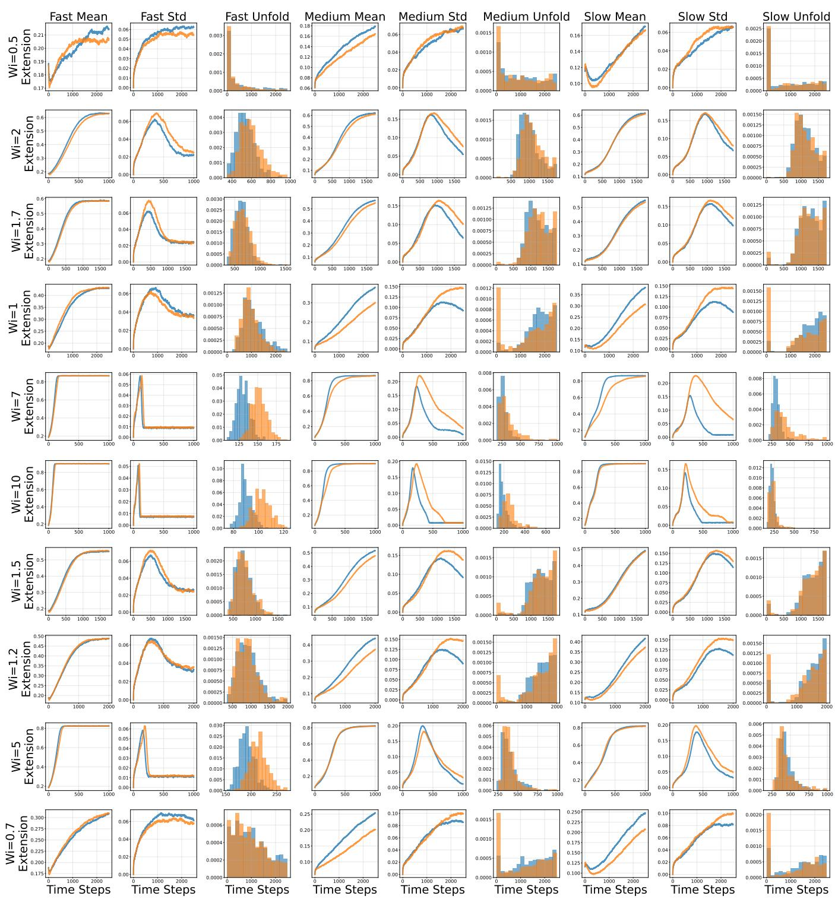  
Figure S1: Transient stretching from the fast, medium, and slow initial conformations (column groups) at diferent Wi (rows). Each group compares the mean and standard deviation of $Z _ { 1 }$ and the distribution of $n _ { \mathrm { u } }$ defined in Eq. (S6) obtained from microscopic simulations (blue) and the conditional UIDD model (orange), using 500 realizations per ensemble. Horizontal axes are given in output-step units.

Let ${ \mathcal { Z } } _ { \alpha , n }$ be the unnormalized Boltzmann-weighted density of $\hat { Q } _ { \alpha }$ , defined by the Dirac δ integrals in the main text. We use its continuous version for all suficiently large n and define

$$
W _ { \alpha , n , \varepsilon } ( q ; \lambda ) = \int e ^ { - U _ { n , \lambda } } \mathbf { 1 } _ { \left\{ | \hat { Q } _ { \alpha } - q | _ { \infty } < \varepsilon \right\} } \mathrm { d } \nu _ { n } , \quad A _ { \alpha , n , \varepsilon } ( q ; \lambda ) = \frac { W _ { \alpha , n , \varepsilon } ( q ; \lambda ) } { ( 2 \varepsilon ) ^ { d _ { \alpha } } } .
$$

Here $| \cdot | _ { \infty }$ denotes the maximum norm, unsubscripted norms are Euclidean, and we set log $0 = - \infty$ and inf $\mathcal { D } = + \infty$ We now state our two main results.

Theorem S2 (Exchange of the two limits in Eq. (9)). Fix $\lambda \geq 0$ . For $\alpha = 2 _ { \mathrm { { i } } }$ , let $q = z _ { 2 } \in ( - 1 , 1 ) ; f o r \alpha = 2 3$ , let $q = ( 0 , z _ { 3 } )$ with $\vert z _ { 3 } \vert < 1 / 2$ . The pointwise limits $\begin{array} { r } { F _ { \alpha , \infty } ( q ; \lambda ) : = \operatorname* { l i m } _ { n \to \infty } F _ { \alpha , n } ( q ; \lambda ) } \end{array}$ , where $F _ { \alpha , n } = - n ^ { - 1 } \log \mathcal { Z } _ { \alpha , n }$ , exist and satisfy

$$
F _ { \alpha , \infty } ( q ; \lambda ) = - \operatorname* { l i m } _ { n \to \infty } \operatorname* { l i m } _ { \varepsilon \downarrow 0 } \frac { 1 } { n } \log A _ { \alpha , n , e } ( q ; \lambda ) = - \operatorname* { l i m } _ { \varepsilon \downarrow 0 } \operatorname* { l i m } _ { n \to \infty } \frac { 1 } { n } \log A _ { \alpha , n , e } ( q ; \lambda ) = \operatorname* { i n f } _ { Q _ { \alpha } ^ { m \in A } = q } \left\{ \lambda \mathcal { E } [ m ] - S [ m ] \right\} .
$$

Theorem S3 (The minimizing set is an interval). For every finite $\lambda \geq 0$ , there is $a _ { \lambda } \geq 0$ such that

$$
\operatorname * { a r g m i n } _ { c \in \mathbb { R } } F _ { 2 3 , \infty } ( 0 , c ; \lambda ) = [ - a _ { \lambda } , a _ { \lambda } ] .\tag{S7}
$$

The interval opens at the exact threshold $\lambda _ { 2 } = 4 \pi ^ { 2 }$ . That is, $a _ { \lambda } = 0 ~ ( 0 \leq \lambda \leq 4 \pi ^ { 2 } ) , ~ a _ { \lambda } > 0 ~ ( \lambda > 4 \pi ^ { 2 } )$

The two-dimensional variational problem is able to be reduced to a scalar one. Let $\begin{array} { r } { \bar { u } = \int _ { 0 } ^ { 1 } u ( s ) \mathrm { d } s } \end{array}$ , and take

$$
\mathcal { A } _ { 1 } = \{ u \in \mathrm { A C } [ 0 , 1 ] : u ( 0 ) = 0 , ~ | u ^ { \prime } | \leq 1 \mathrm { ~ a . e . } \} , \quad \mathcal { F } _ { \lambda } ^ { ( 1 ) } [ u ] = \int _ { 0 } ^ { 1 } \ell ( u ^ { \prime } ) \mathrm { d } s - \lambda \int _ { 0 } ^ { 1 } ( u - \bar { u } ) ^ { 2 } \mathrm { d } s .
$$

Since ℓ is even, convex, and nondecreasing on [0, 1] and $\lambda \geq 0$ , projecting $m \ : = \ : ( u , v )$ onto $( u , 0 )$ preserves the constraints, drops the nonnegative transverse energy, and does not increase the entropy cost:

$$
\lambda \mathcal { E } [ ( u , v ) ] - { \mathcal { S } } [ ( u , v ) ] \geq \lambda \mathcal { E } [ ( u , 0 ) ] - { \mathcal { S } } [ ( u , 0 ) ] = { \mathcal { F } } _ { \lambda } ^ { ( 1 ) } [ u ] .
$$

Theorem S2 therefore yields the scalar variational formulas used in the proof of Theorem S3 and in the numerical evaluation:

$$
F _ { 2 , \infty } ( z _ { 2 } ; \lambda ) = \operatorname* { i n f } _ { \stackrel { u \in A _ { 1 } } { u ( 1 ) = z _ { 2 } } } \mathcal { F } _ { \lambda } ^ { ( 1 ) } [ u ] , \quad F _ { 2 3 , \infty } ( 0 , z _ { 3 } ; \lambda ) = \operatorname* { i n f } _ { \stackrel { u \in A _ { 1 } } { u ( 1 ) = 0 , \ \stackrel { u = - z _ { 3 } / 2 } { u ( 1 - z ) } } } \mathcal { F } _ { \lambda } ^ { ( 1 ) } [ u ] .\tag{S8}
$$

## S3.A Proof of the limit-interchange theorem

Window limit. We use the path large-deviation principle and uniform energy approximation from the End Matter. With $\begin{array} { r } { \bar { m } _ { n , x } = \int _ { 0 } ^ { 1 } m _ { n , x } ( s ) \ d s \ d s \qquad } \end{array}$ )ds denoting the continuum average of the piecewise-linear path $m _ { n }$ , trapezoidal integration yields that the observables satisfy $\hat { z } _ { 2 } = m _ { n , x } ( 1 )$ and

$$
\hat { z } _ { 3 } = \frac { n } { n + 1 } \big [ m _ { n , x } ( 1 ) - 2 \bar { m } _ { n , x } \big ] = \frac { 1 } { n } \sum _ { i = 1 } ^ { n } \frac { 2 i - n - 1 } { n + 1 } \cos \theta _ { i } .
$$

Thus $\hat { Q } _ { 2 3 } = Q _ { 2 3 } ( m _ { n } ) + O ( n ^ { - 1 } )$ uniformly, so windows of widths $\varepsilon - \eta$ and $\varepsilon + \eta$ give the constrained Laplace bounds for any fixed $0 < \eta < \varepsilon$

For $q$ as in Theorem S2, define

$$
m _ { \mathrm { r e f } } ( s ) = \left\{ \begin{array} { l l } { ( z _ { 2 } s , 0 ) , } & { \alpha = 2 , \quad q = z _ { 2 } , } \\ { ( - 2 z _ { 3 } \operatorname* { m i n } ( s , 1 - s ) , 0 ) , } & { \alpha = 2 3 , \quad q = ( 0 , z _ { 3 } ) . } \end{array} \right.
$$

Each path lies in A and satisfies $Q _ { \alpha } ( m _ { \mathrm { r e f } } ) = q$ . Its y-component is zero, so $\mathcal { E } [ m _ { \mathrm { r e f } } ] \leq 0$ . The derivative is

$$
m _ { \mathrm { r e f } } ^ { \prime } ( s ) = \left\{ \begin{array} { l l } { ( z _ { 2 } , 0 ) , } & { \alpha = 2 , } \\ { ( - 2 z _ { 3 } , 0 ) , } & { \alpha = 2 3 , \quad 0 < s < 1 / 2 , } \\ { ( 2 z _ { 3 } , 0 ) , } & { \alpha = 2 3 , \quad 1 / 2 < s < 1 . } \end{array} \right.
$$

Substituting into the entropy integral and using $\ell ( - a ) = \ell ( a )$ gives

$$
J ( q ) : = - \mathscr { S } [ m _ { \mathrm { r e f } } ] = \int _ { 0 } ^ { 1 } \ell ( | m _ { \mathrm { r e f } } ^ { \prime } ( s ) | ) \mathrm { d } s = \left\{ \ell ( z _ { 2 } ) , \quad \alpha = 2 , \ldots \right.
$$

These entropy costs are finite because $| z _ { 2 } | < 1$ for $\alpha = 2$ and $2 | z _ { 3 } | < 1$ for $\alpha = 2 3$

For any finite-entropy path m in the closed window $| Q _ { \alpha } ( m ) - q | _ { \infty } \leq \varepsilon ,$ linearity of $Q _ { \alpha }$ and $Q _ { \alpha } ( m _ { \mathrm { r e f } } ) = q$ imply that $( 1 - \delta ) m + \delta m _ { \mathrm { r e f } }$ lies in the open window $| Q _ { \alpha } ( \cdot ) - q | _ { \infty } < \varepsilon$ for every $\delta \in ( 0 , 1 ]$ . Convexity of −S and continuity of $\mathcal { E }$ ensure that its free energy approaches that of m as $\delta \downarrow 0 .$ . The two window infima therefore agree. Letting $\eta \downarrow 0$ then $\varepsilon \downarrow 0 .$ , compactness of $\mathcal { A }$ and lower semicontinuity of $\lambda { \mathcal { E } } - S$ give

$$
\begin{array} { l } { S _ { \alpha , \varepsilon } ( q ) : = \underset { n  \infty } { \operatorname* { l i m } } \frac { 1 } { n } \log A _ { \alpha , n , \varepsilon } ( q ; \lambda ) = - \underset { | Q _ { \alpha } ( m ) - q | _ { \infty } < \varepsilon } { \operatorname* { i n f } } \{ \lambda \mathcal { E } [ m ] - \mathcal { S } [ m ] \} , } \\ { S _ { \alpha , \varepsilon } ( q )  S _ { \alpha } ( q ) : = - \underset { Q _ { \alpha } ( m ) = q } { \operatorname* { i n f } } \{ \lambda \mathcal { E } [ m ] - \mathcal { S } [ m ] \} \quad ( \varepsilon \downarrow 0 ) . } \end{array}\tag{S9}
$$

All infima are over $\mathcal { A } ;$ the fixed volume factor $( 2 \varepsilon ) ^ { d _ { \alpha } }$ does not afect the exponential rate.

Continuous densities. Under $\begin{array} { r } { \nu _ { n } = \prod _ { i } \mathrm { d } \theta _ { i } / ( 2 \pi ) } \end{array}$ , set $H _ { n } = - U _ { n , \lambda }$ and $d = d _ { \alpha }$ . Write

$$
\begin{array} { r l r } { \displaystyle } & { { } \displaystyle T _ { n } = \frac { 1 } { n } \sum _ { i = 1 } ^ { n } w _ { i } \cos \theta _ { i } = \hat { Q } _ { \alpha } , } & { \displaystyle G = \frac { 1 } { n } \sum _ { i = 1 } ^ { n } \sin ^ { 2 } \theta _ { i } w _ { i } w _ { i } ^ { T } , } \\ { \displaystyle } & { { } \displaystyle w _ { i } = 1 \ ( d = 1 ) , \qquad w _ { i } = ( 1 , c _ { i } ) ^ { T } , } & { \displaystyle c _ { i } = \frac { 2 i - n - 1 } { n + 1 } \ ( d = 2 ) . } \end{array}
$$

The matrix $G$ measures the sensitivity of the observables to bond rotations. For a continuous periodic weight Ω, write

$$
f _ { \Omega } ( q ) = \int \Omega ( \theta ) \delta ( T _ { n } ( \theta ) - q ) \mathrm { d } \nu _ { n } ( \theta ) , \qquad f _ { n } = f _ { e ^ { H _ { n } } } .
$$

In ordinary integral terms, $\int _ { D } f _ { \Omega } ( q )$ dq is the total weight of configurations with $T _ { n } ( \theta ) ~ \in ~ D$ , for any box $D$ in observable space. We write $\begin{array} { r } { \mathbb { P } ( \mathbf { \tilde { \boldsymbol { B } } } ) = \int \mathbf { 1 } _ { B } \mathrm { d } \nu _ { n } } \end{array}$ for the probability of an angular event B.

Lemma S2 (Smoothing by a few bonds). For all suficiently large $n , q \mapsto f _ { \Omega } ( q )$ is continuous for every continuous periodic angular weight $\Omega ( \theta )$ . Moreover, there is a choice of $J _ { n }$ containing three indices for $d = 1$ , or six $\ f o r \ d = 2$ such that, with $\theta _ { \mathrm { o u t } } : = ( \theta _ { i } ) _ { i \notin J _ { n } }$ 2

$$
0 \leq \Omega ( \theta ) \leq K \mathbf { 1 } _ { B } ( \theta _ { \mathrm { o u t } } ) \quad \Longrightarrow \quad 0 \leq f _ { \Omega } ( q ) \leq K C n ^ { d } \mathbb { P } ( B ) \quad ( q \in \mathbb { R } ^ { d } ) .
$$

Here $K > 0$ , the event B depends only on $\theta _ { \mathrm { o u t } }$ , and $C$ is independent of $n , q , \Omega , K , B$

Proof. Choose $J _ { n }$ as any three indices for $d = 1$ , or the six indices nearest $n j / 7 , j = 1 , \dotsc , 6 .$ , for $d = 2$ . With $\theta _ { \mathrm { o u t } }$ fixed, write

$$
q _ { \mathrm { o u t } } : = \frac { 1 } { n } \sum _ { i \notin J _ { n } } w _ { i } \cos \theta _ { i } , \qquad T _ { n } = q _ { \mathrm { o u t } } + \frac { 1 } { n } \sum _ { i \in J _ { n } } w _ { i } \cos \theta _ { i } .
$$

Let only $\theta _ { i } , i \in J _ { n }$ , be random, independently and uniformly distributed on [0, 2π). Then $T _ { n }$ has probability density

$$
g _ { J _ { n } } ( q \mid \theta _ { \mathrm { o u t } } ) : = \int _ { [ 0 , 2 \pi ) ^ { | J _ { n } | } } \delta \left( q _ { \mathrm { o u t } } + { \frac { 1 } { n } } \sum _ { i \in J _ { n } } w _ { i } \cos \theta _ { i } - q \right) \prod _ { i \in J _ { n } } { \frac { \mathrm { d } \theta _ { i } } { 2 \pi } } .
$$

A single projection $X _ { i } = \cos \theta _ { i }$ has the arcsine law and its Fourier transform $\varphi$ is the Bessel function of the first kind of order zero. The Bessel asymptotics give $| \varphi ( t ) | \leq C ( 1 + | t | ) ^ { - 1 / 2 }$ ; the same decay holds with any polynomia amplitude $P ( \cos \theta )$ , by expansion in $\cos ( k \theta )$ and the fixed-order Bessel asymptotics [34].

Let $\begin{array} { r } { Y : = \sum _ { i \in J _ { n } } w _ { i } X _ { i } } \end{array}$ . Independence gives its Fourier transform explicitly as

$$
\mathbb { E } [ e ^ { \mathrm { i } s \cdot Y } ] = \prod _ { i \in J _ { n } } \varphi ( s \cdot w _ { i } ) .
$$

For $d = 1$ , this is $\varphi ( s ) ^ { 3 }$ . For $d = 2 ,$ , the six selected coeficients satisfy $\lvert c _ { i } - c _ { j } \rvert \geq \delta _ { c } > 0$ for $i \neq j$ , with $\delta _ { c }$ independent of n for large n. At most one index can satisfy $| s _ { 1 } + c _ { i } s _ { 2 } | < b | s |$ for a suficiently small fixed $b > 0$ . Indeed, if two indices $i \neq j$ satisfied this inequality, subtracting the two expressions and using $| c _ { i } | \leq 1$ would imply

$$
\begin{array} { r l r l } { \displaystyle | s _ { 2 } | < \frac { 2 b } { \delta _ { c } } | s | , } & { \displaystyle | s _ { 1 } | } & { \le \big | s _ { 1 } + c _ { i } s _ { 2 } \big | + \big | c _ { i } \big | \big | s _ { 2 } \big | < \left( 1 + \frac { 2 } { \delta _ { c } } \right) b \big | s \big | , } \end{array}
$$

which contradicts $| s | ^ { 2 } = s _ { 1 } ^ { 2 } + s _ { 2 } ^ { 2 }$ . Thus at least five factors satisfy

$$
| \varphi ( s _ { 1 } + c _ { i } s _ { 2 } ) | \leq C ( 1 + | s | ) ^ { - 1 / 2 } ,
$$

while any remaining factor is bounded by one. Consequently,

$$
\begin{array} { r } { \big | \mathbb { E } [ e ^ { \mathrm { i } s \cdot Y } ] \big | \le C \left\{ \begin{array} { l l } { ( 1 + | s | ) ^ { - 3 / 2 } , } & { d = 1 , } \\ { ( 1 + | s | ) ^ { - 5 / 2 } , } & { d = 2 . } \end{array} \right. } \end{array}
$$

The first bound is integrable on $\mathbb { R } ;$ the second is integrable on $\mathbb { R } ^ { 2 }$ . Fourier inversion therefore gives $Y$ a continuous bounded density. Rescaling by $1 / n$ and shifting by $q _ { \mathrm { o u t } }$ shows that $g _ { J _ { n } }$ is continuous and

$$
0 \leq g _ { J _ { n } } ( q \mid \theta _ { \mathrm { o u t } } ) \leq C n ^ { d } \qquad \mathrm { u n i f o r m l y ~ i n ~ } q , \theta _ { \mathrm { o u t } } .
$$

For $X = ( X _ { i } ) \in [ - 1 , 1 ] ^ { n }$ , define the sign-averaged weight

$$
\overline { { \Omega } } ( X ) : = 2 ^ { - n } \sum _ { \varepsilon \in \{ - 1 , 1 \} ^ { n } } \Omega ( \varepsilon _ { 1 } \operatorname { a r c c o s } X _ { 1 } , \dots , \varepsilon _ { n } \operatorname { a r c c o s } X _ { n } ) ,
$$

where the angles are interpreted periodically. This is continuous on $[ - 1 , 1 ] ^ { n }$ . Since the changes of variables $\theta _ { i } \mapsto - \theta _ { i }$ preserve the uniform angular average and $T _ { n }$ , for every box $D ,$ , we have

$$
\int _ { \{ T _ { n } \in D \} } \Omega ( \theta ) \mathrm { d } \nu _ { n } = \int _ { \{ T _ { n } \in D \} } \overline { { \Omega } } ( X ( \theta ) ) \mathrm { d } \nu _ { n } .
$$

Choose polynomials $P _ { m }$ converging uniformly to $\overline { { \Omega } }$ on $[ - 1 , 1 ] ^ { n }$ , and set $\Omega _ { m } ( \theta ) : = P _ { m } ( X ( \theta ) )$ . Each $P _ { m }$ is a finite linear combination of products $\prod _ { i } p _ { i } ( X _ { i } )$ , so it sufices to prove continuity for one such product. For each one-variable polynomial $p ,$ write $\begin{array} { r } { \varphi _ { p } ( t ) : = \frac { 1 } { 2 \pi } \int _ { 0 } ^ { 2 \pi } p ( \cos { \theta } ) e ^ { \mathrm { i } t \cos { \theta } } \mathrm { d } \theta } \end{array}$ . The polynomial-amplitude estimate above gives $| \varphi _ { p } ( t ) | \le C _ { p } ( 1 + | t | ) ^ { - 1 / 2 }$ . For a product $\begin{array} { r } { P ( X ) = \prod _ { i } p _ { i } ( X _ { i } ) } \end{array}$ , set $\Omega _ { P } ( \theta ) : = P ( X ( \theta ) )$ and define its weighted density with $\theta _ { \mathrm { o u t } }$ fixed by

$$
h _ { P } ( q \mid \theta _ { \mathrm { o u t } } ) : = \int _ { [ 0 , 2 \pi ) ^ { | J _ { n } | } } \Omega _ { P } ( \theta ) \delta ( T _ { n } ( \theta ) - q ) \prod _ { i \in J _ { n } } \frac { \mathrm { d } \theta _ { i } } { 2 \pi } .
$$

Its Fourier transform in $q$ can be expressed as

$$
\widehat { h } _ { P } ( s \mid \theta _ { \mathrm { o u t } } ) : = \int _ { \mathbb { R } ^ { d } } e ^ { { \mathbf { i } } s \cdot q } h _ { P } ( q \mid \theta _ { \mathrm { o u t } } ) \mathrm { d } q = e ^ { { \mathbf { i } } s \cdot q _ { \mathrm { o u t } } } \left[ \prod _ { i \notin J _ { n } } p _ { i } ( \cos \theta _ { i } ) \right] \prod _ { i \in J _ { n } } \varphi _ { p _ { i } } \left( \frac { s \cdot w _ { i } } { n } \right) .
$$

The bracketed product is uniformly bounded because every $p _ { i }$ is bounded on $[ - 1 , 1 ]$ . Using the same three or six reserved factors as above therefore yields

$$
| \widehat { h } _ { P } ( s \mid \theta _ { \mathrm { o u t } } ) | \leq M _ { P , n } ( s ) : = C _ { P , n } \left\{ ( 1 + | s | ) ^ { - 3 / 2 } , d = 1 , \right.
$$

$M _ { P , n }$ is integrable, and its Fourier inversion implies $h _ { P }$ continuous in $q ,$ and the continuity estimate

$$
| h _ { P } ( q + u \mid \theta _ { \mathrm { o u t } } ) - h _ { P } ( q \mid \theta _ { \mathrm { o u t } } ) | \leq { \frac { 1 } { ( 2 \pi ) ^ { d } } } \int _ { \mathbb { R } ^ { d } } | e ^ { - \mathrm { i } s \cdot u } - 1 | M _ { P , n } ( s ) \mathrm { d } s \longrightarrow 0 \qquad ( u  0 ) .
$$

Since the right-hand side is independent of $\theta _ { \mathrm { o u t } }$ , it also bounds the change in the full density

$$
f _ { \Omega _ { P } } ( q ) = \int h _ { P } ( q \mid \theta _ { \mathrm { o u t } } ) \prod _ { i \notin J _ { n } } { \frac { \mathrm { d } \theta _ { i } } { 2 \pi } } .
$$

Hence $f _ { \Omega _ { F } }$ is continuous. By linearity in the weight, the same holds for each $f _ { \Omega _ { m } }$

The bound on $g _ { J _ { n } }$ also gives the unweighted density bound

$$
f _ { 1 } ( q ) = \int g _ { J _ { n } } ( q \mid \theta _ { \mathrm { o u t } } ) \prod _ { i \notin J _ { n } } { \frac { \mathrm { d } \theta _ { i } } { 2 \pi } } \leq C n ^ { d } .
$$

For any box $D ,$ the defining integral identities for $f _ { \Omega _ { m } }$ and $f _ { \Omega _ { k } }$ give

$$
\left| \int _ { D } ( f _ { \Omega _ { m } } - f _ { \Omega _ { k } } ) ( p ) \mathrm { d } p \right| = \left| \int _ { \{ T _ { n } \in D \} } [ P _ { m } ( X ( \theta ) ) - P _ { k } ( X ( \theta ) ) ] \mathrm { d } \nu _ { n } \right| \le \| P _ { m } - P _ { k } \| _ { \infty } \int _ { D } f _ { 1 } ( p ) \mathrm { d } p .
$$

Take $D = D _ { r } ( q ) : = q + ( - r , r ) ^ { d }$ , divide by its volume $( 2 r ) ^ { d } .$ , and let $r \downarrow 0$ . Since $f _ { \Omega _ { m } } , f _ { \Omega _ { k } }$ , and $f _ { 1 }$ are continuous, their averages over $D _ { r } ( q )$ converge to their values at q. Hence

$$
| f _ { \Omega _ { m } } ( q ) - f _ { \Omega _ { k } } ( q ) | \leq \| P _ { m } - P _ { k } \| _ { \infty } f _ { 1 } ( q ) \leq C n ^ { d } \| P _ { m } - P _ { k } \| _ { \infty } .
$$

At fixed $n ,$ uniform convergence of $P _ { m }$ makes the right-hand side tend to zero as $m , k \to \infty$ , uniformly in $q .$ Thus the densities have a uniform limit, which we denote by $F ( q ) : = \operatorname* { l i m } _ { m  \infty } f _ { \Omega _ { m } } ( q )$ . As a uniform limit of continuous functions, F is continuous. For each m and each fixed bounded box D,

$$
\int _ { D } f _ { \Omega _ { m } } ( q ) \mathrm { d } q = \int _ { \{ T _ { n } \in D \} } P _ { m } ( X ( \theta ) ) \mathrm { d } \nu _ { n } .
$$

Both sides have limits as $m  \infty$ . Passing to the limit in the preceding identity, and then using the sign-averaging identity, we obtain

$$
\int _ { D } F ( \boldsymbol { q } ) \mathrm { d } \boldsymbol { q } = \int _ { \{ T _ { n } \in D \} } \overline { { \Omega } } ( \boldsymbol { X } ( \boldsymbol { \theta } ) ) \mathrm { d } \nu _ { n } = \int _ { \{ T _ { n } \in D \} } \Omega ( \boldsymbol { \theta } ) \mathrm { d } \nu _ { n } .
$$

Thus $F$ is the continuous density $f _ { \Omega }$ .

Finally, assume $0 \leq \Omega ( \theta ) \leq K \mathbf { 1 } _ { B } ( \theta _ { \mathrm { o u t } } )$ .Averaging first over the angles in $J _ { n }$ gives, we obtain for any box $D ,$

$$
\int _ { D } f _ { \Omega } ( q ) \mathrm { d } q \le K \int \mathbf { 1 } _ { B } \bigl ( \theta _ { \mathrm { o u t } } \bigr ) \left[ \int _ { D } g _ { J _ { n } } ( q | \theta _ { \mathrm { o u t } } ) \mathrm { d } q \right] \prod _ { i \notin J _ { n } } \frac { \mathrm { d } \theta _ { i } } { 2 \pi } \le K C n ^ { d } \mathbb { P } ( B ) | D | .
$$

Taking $D = D _ { r } ( q )$ , dividing by $( 2 r ) ^ { d }$ , and letting $r \downarrow 0$ concludes that

$$
0 \leq f _ { \Omega } ( q ) \leq K C n ^ { d } \mathbb { P } ( B ) .
$$

Negligible degenerate configurations. We first show that configurations with small det G contribute an arbitrarily small exponential remainder to the density. Choose a smooth function $\chi : [ 0 , \infty )  [ 0 , 1 ]$ that is zero on [0, 1] and one on $[ 2 , \infty )$ , and set

$$
\chi _ { \kappa } ( \theta ) = \chi \bigg ( \frac { \operatorname * { d e t } G ( \theta ) } { \kappa } \bigg ) , \qquad b _ { n , \kappa } = f _ { ( 1 - \chi _ { \kappa } ) e ^ { H _ { n } } } .
$$

Lemma S3 (An arbitrarily small exponential remainder). For every $M > 0$ , there exist $\kappa \in ( 0 , 1 / 2 ]$ and $C _ { M } > 0$ such that, for all suficiently large n and all $q ,$

$$
0 \leq b _ { n , \kappa } ( q ) \leq B _ { n } : = C _ { M } n ^ { d } e ^ { - M n } .\tag{S10}
$$

Proof. We need an upper bound on $H _ { n }$ to control the Boltzmann weight. We also record its angular derivative bound for the transport argument below. The centered bead positions satisfy

$$
r _ { k } = \sum _ { i = 1 } ^ { n } b _ { k i } ( \cos \theta _ { i } , \sin \theta _ { i } ) , \qquad b _ { k i } = { \bf 1 } _ { \left\{ i \leq k \right\} } - { \frac { n + 1 - i } { n + 1 } } , \qquad k = 0 , \ldots , n .
$$

Since $| b _ { k i } | \leq 1$ , we have $| r _ { k } | \le n$ and $| \partial _ { \theta _ { i } } r _ { k } | \le 1$ . Thus

$$
H _ { n } = \frac { \lambda } { n ^ { 2 } } \sum _ { k = 0 } ^ { n } ( r _ { k , x } ^ { 2 } - r _ { k , y } ^ { 2 } ) \leq \lambda ( n + 1 ) , \quad | \partial _ { \theta _ { i } } H _ { n } | \leq \frac { 2 \lambda } { n ^ { 2 } } \sum _ { k = 0 } ^ { n } | r _ { k } | | \partial _ { \theta _ { i } } r _ { k } | \leq \frac { 2 \lambda ( n + 1 ) } { n } .
$$

We then have

$$
H _ { n } \leq 2 \lambda n , \quad \quad | \partial _ { \theta _ { i } } H _ { n } | \leq 4 \lambda .\tag{S11}
$$

We first construct an event depending only on $\theta _ { \mathrm { o u t } }$ so that Lemma S2 applies to the weight $( 1 - \chi _ { \kappa } ) e ^ { H _ { n } }$ . Define

$$
G _ { \mathrm { o u t } } = \frac { 1 } { n } \sum _ { i \notin J _ { n } } \sin ^ { 2 } \theta _ { i } w _ { i } w _ { i } ^ { T } .
$$

Here matrix norms are operator norms. The definitions give

$$
0 \leq G _ { \mathrm { o u t } } \leq G , \qquad \| G _ { \mathrm { o u t } } \| \leq \mathrm { t r } G \leq 2 .\tag{S12}
$$

For any $\kappa \in ( 0 , 1 / 2 ]$ , set $\eta = \sqrt { 2 \kappa }$ . Then det $G \leq 2 \kappa$ yields $\lambda _ { \operatorname* { m i n } } ( G ) \leq \eta$ . Since $G _ { \mathrm { o u t } } \leq G$ by Eq. (S12), we have

$$
\{ \operatorname* { d e t } G \leq 2 \kappa \} \subset \mathcal { B } _ { \eta } , \qquad \mathcal { B } _ { \eta } : = \{ \lambda _ { \operatorname* { m i n } } ( G _ { \mathrm { o u t } } ) \leq \eta \} .\tag{S13}
$$

Since $1 - \chi _ { \kappa }$ vanishes for det $G \geq 2 \kappa .$ combining estimates (S13) and (S11) we obtain

$$
0 \leq ( 1 - \chi _ { \kappa } ) e ^ { H _ { n } } \leq e ^ { 2 \lambda n } \mathbf { 1 } _ { \mathcal { B } _ { \eta } } ( \theta _ { \mathrm { o u t } } ) .
$$

The event $B _ { \eta }$ depends only on $\theta _ { \mathrm { o u t } }$ . Using Lemma S2, with taking $K = e ^ { 2 \lambda n }$ and $\begin{array} { r } { B = B _ { \eta } , } \end{array}$ , we obtain

$$
b _ { n , \kappa } ( q ) \leq C n ^ { d } e ^ { 2 \lambda n } \mathbb { P } ( B _ { \eta } ) .\tag{S14}
$$

It remains to make this probability decay fast enough to compensate for $e ^ { 2 \lambda n }$

To estimate $\mathbb { P } ( B _ { \eta } )$ , we will show that a small eigenvalue forces the sine squares of many independent angles to have a small sum. We first ensure that every direction has enough indices with a fixed lower bound on $| a \cdot w _ { i } | ^ { 2 }$ . For this purpose, define the deterministic matrix

$$
K _ { \mathrm { o u t } } = \frac { 1 } { n } \sum _ { i \notin J _ { n } } w _ { i } w _ { i } ^ { T } .
$$

Direct summation of the coeficients $w _ { i }$ gives

$$
\frac { 1 } { n } \sum _ { i = 1 } ^ { n } w _ { i } w _ { i } ^ { T } = \left\{ \begin{array} { l l } { 1 , } & { d = 1 , } \\ { \mathrm { d i a g } \bigg ( 1 , \frac { n - 1 } { 3 ( n + 1 ) } \bigg ) , } & { d = 2 . } \end{array} \right.
$$

Deleting $| J _ { n } | \leq 6$ terms changes this matrix by at most $1 2 / n$ since $| w _ { i } | ^ { 2 } \leq 2$ . Therefore, for suficiently large n,

$$
K _ { \mathrm { o u t } } \geq I _ { d } / 1 2 .\tag{S15}
$$

For any unit vector $^ { a , }$ we set

$$
I _ { a } = \{ i \notin J _ { n } : | a \cdot w _ { i } | ^ { 2 } \geq 1 / 2 4 \} .\tag{S16}
$$

Using Eq. (S15), the definition in Eq. (S16), and $| a \cdot w _ { i } | ^ { 2 } \leq 2$ , we obtain

$$
\frac { n } { 1 2 } \leq \sum _ { i \notin J _ { n } } | a \cdot w _ { i } | ^ { 2 } \leq \frac { n } { 2 4 } + 2 | I _ { a } | , \qquad | I _ { a } | \geq \frac { n } { 4 8 } .\tag{S17}
$$

A unit eigenvector corresponding to $\lambda _ { \operatorname* { m i n } } ( G _ { \mathrm { o u t } } )$ may depend on the angles. Using this vector as a in Eq. (S16) could therefore make the index set depend on the angles. Instead, we first choose a finite set $\mathcal { N } _ { \eta }$ of unit vectors, independently of the angles and of $n ,$ such that

$$
\mathrm { f o r ~ e v e r y ~ } v \in \mathbb { R } ^ { d } \mathrm { ~ w i t h ~ } | v | = 1 , \quad \mathrm { t h e r e ~ i s ~ } a \in \mathcal { N } _ { \eta } \mathrm { ~ w i t h ~ } | a - v | \le \eta / 4 .
$$

For $d = 1$ , take $\mathcal { N } _ { \eta } = \{ - 1 , 1 \}$ ; for $d = 2$ , take suficiently many equally spaced points on the unit circle. For each fixed $a \in \mathcal { N } _ { \eta }$ , the set $I _ { a }$ in Eq. (S16) depends only on a and the given coeficients $w _ { i }$ , and hence does not depend on the angles.

Now consider any angle configuration in $B _ { \eta } .$ . Choose a unit eigenvector v for the smallest eigenvalue of $G _ { \mathrm { o u t } }$ , and then choose $a \in \mathcal { N } _ { \eta }$ with $| a - v | \le \eta / 4$ . Using Eq. (S12), we get

$$
a ^ { T } G _ { \mathrm { o u t } } a \le v ^ { T } G _ { \mathrm { o u t } } v + 2 \| G _ { \mathrm { o u t } } \| | a - v | \le \eta + 4 \frac { \eta } { 4 } = 2 \eta .
$$

For this a, the definition in Eq. (S16) implies

$$
\frac { 1 } { 2 4 n } \sum _ { i \in I _ { a } } \sin ^ { 2 } \theta _ { i } \leq a ^ { T } G _ { \mathrm { o u t } } a \leq 2 \eta .
$$

Thus, for every configuration in $B _ { \eta }$ , this inequality holds for at least one $a \in \mathcal { N } _ { \eta }$ . The choice of a may vary with the configuration, so we take the union over all these fixed directions:

$$
B _ { \eta } \subset \bigcup _ { a \in \mathcal { N } _ { \eta } } \left\{ \sum _ { i \in I _ { a } } \sin ^ { 2 } \theta _ { i } \leq 4 8 \eta n \right\} .\tag{S18}
$$

The bound $| I _ { a } | \geq n / 4 8$ from Eq. (S17) applies to every fixed index set in this union.

We next bound the probability of each scalar-sum event in Eq. (S18). For $t > 0$ , define

$$
\psi ( t ) = \frac { 1 } { 2 \pi } \int _ { 0 } ^ { 2 \pi } e ^ { - t \sin ^ { 2 } \theta } \mathrm { d } \theta .
$$

Splitting this integral into | sin $\theta | \leq r$ and its complement gives

$$
\psi ( t ) \leq \frac { 2 } { \pi } \arcsin r + e ^ { - t r ^ { 2 } } , \qquad 0 < r < 1 .
$$

Letting $t \to \infty$ and then $r \downarrow 0$ shows that $\psi ( t )  0$ . The exponential Markov inequality and independence now $\mathrm { g i v e }$ for each fixed $a \in \mathcal { N } _ { \eta }$

$$
\mathbb { P } \Bigg \{ \sum _ { i \in I _ { a } } \sin ^ { 2 } \theta _ { i } \leq 4 8 \eta m \Bigg \} \leq e ^ { 4 8 t \eta n } \mathbb { E } \Bigg [ e ^ { - t \sum _ { i \in I _ { a } } \sin ^ { 2 } \theta _ { i } } \Bigg ] = e ^ { 4 8 t \eta n } \psi ( t ) ^ { | I _ { a } | } \leq \exp \Bigg \{ n \left[ 4 8 t \eta + \frac { 1 } { 4 8 } \log \psi ( t ) \right] \Bigg \} .\tag{S19}
$$

The last inequality uses $0 < \psi ( t ) \leq 1$ and the cardinality bound in $\operatorname { E q . }$ (S17). Combining the event inclusion in Eq. (S18) with Eq. (S19), and summing over the finite set of directions, yields

$$
\mathbb { P } ( \boldsymbol { B } _ { \eta } ) \leq | \mathcal { N } _ { \eta } | \exp \left\{ n \left[ 4 8 t \eta + \frac { 1 } { 4 8 } \log \psi ( t ) \right] \right\} .\tag{S20}
$$

To compensate for the factor $e ^ { 2 \lambda n }$ in Eq. (S14) and obtain the prescribed rate M, first choose t so that $( \log \psi ( t ) ) / 4 8 <$ $- ( M + 2 \lambda + 2 )$ , and then choose κ so that $4 8 t \sqrt { 2 \kappa } < 1$ . With these choices, Eq. (S20) gives

$$
\mathbb { P } ( \mathcal { B } _ { \eta } ) \le | \mathcal { N } _ { \eta } | e ^ { - n ( M + 2 \lambda + 1 ) } ,\tag{S21}
$$

and both κ and $| \mathcal { N } _ { \eta } |$ are independent of $n .$

Substituting Eq. (S21) into the density bound in Eq. (S14), we conclude that

$$
b _ { n , \kappa } ( q ) \leq C n ^ { d } e ^ { 2 \lambda n } | \Lambda _ { \eta } | e ^ { - n ( M + 2 \lambda + 1 ) } = C | \mathcal { N } _ { \eta } | n ^ { d } e ^ { - n ( M + 1 ) } \leq C _ { M } n ^ { d } e ^ { - M n } ,
$$

where the fixed factor $C | \mathcal { N } _ { \eta } |$ is absorbed into $C _ { M }$

Density comparison by bond rotations. For configurations with $\chi _ { \kappa } > 0$ , we use bond rotations to translate $T _ { n }$ from q to a nearby $p .$ We bound the changes in the Boltzmann weight and angular volume to compare the densities at these points. Lemma S3 bounds the remaining contribution to the density.

Lemma S4 (Density comparison by transport). Let κ and $B _ { n }$ be as in Lemma S3, and set $\delta _ { \kappa } = \kappa / ( 1 6 \sqrt { 2 } )$ and $L _ { \kappa } = 8 \lambda / \sqrt { \kappa } + 8 \sqrt { 2 } / \kappa$ . For all suficiently large n and all $p , q \in \mathbb { R } ^ { d }$ with $| p - q | < \delta _ { \kappa }$ , we have

$$
f _ { n } ( q ) \leq e ^ { n L _ { \kappa } | p - q | } f _ { n } ( p ) + B _ { n } .\tag{S22}
$$

Proof. For a unit vector $a \in \mathbb { R } ^ { d }$ and det $G > 0$ , define

$$
b _ { i } = w _ { i } ^ { T } G ^ { - 1 } { } a , \qquad d _ { i } = w _ { i } ^ { T } G ^ { - 1 } { } w _ { i } , \qquad \mathcal { V } _ { i } = - \sin { \theta _ { i } } b _ { i } .
$$

We write $\begin{array} { r } { \mathcal { V } A = \sum _ { i } \mathcal { V } _ { i } \partial _ { \theta _ { i } } A } \end{array}$ for the derivative of an angular function A along the vector field V. Since $\partial _ { \theta _ { i } } T _ { n } =$ $- n ^ { - 1 }$ sin $\theta _ { i } w _ { i }$

$$
\mathcal { V } T _ { n } = \frac { 1 } { n } \sum _ { i } \sin ^ { 2 } \theta _ { i } w _ { i } w _ { i } ^ { T } G ^ { - 1 } a = G G ^ { - 1 } a = a .
$$

Thus moving the angles with velocity V translates $T _ { n }$ at unit speed in direction a.

To bound the change in det G and the divergence of $\nu ,$ diferentiate G and its inverse:

$$
\partial _ { \theta _ { i } } G = \frac { 2 } { n } \sin { \theta _ { i } } \cos { \theta _ { i } } w _ { i } w _ { i } ^ { T } , \qquad \partial _ { \theta _ { i } } G ^ { - 1 } = - G ^ { - 1 } ( \partial _ { \theta _ { i } } G ) G ^ { - 1 } .
$$

Hence $\partial _ { \theta _ { i } }$ log det $G \ = \ ( 2 / n )$ sin $\theta _ { i }$ cos $\theta _ { i } d _ { i }$ and $\partial _ { \theta _ { i } } b _ { i } \ = \ - ( 2 / n )$ sin θi cos $\theta _ { i } d _ { i } b _ { i }$ . Substituting into V log det G and div $\begin{array} { r } { \mathcal { V } : = \sum _ { i } \partial _ { \theta _ { i } } \mathcal { V } _ { i } } \end{array}$ yields

$$
\begin{array} { c } { { \displaystyle \gamma \log \operatorname* { d e t } G = - \frac { 2 } { n } \sum _ { i } \sin ^ { 2 } \theta _ { i } \cos \theta _ { i } b _ { i } d _ { i } , } } \\ { { \displaystyle \qquad \operatorname { d i v } \mathcal { V } = - \sum _ { i } \cos \theta _ { i } b _ { i } + \frac { 2 } { n } \sum _ { i } \sin ^ { 2 } \theta _ { i } \cos \theta _ { i } d _ { i } b _ { i } , } } \\ { { \displaystyle \frac { 1 } { n } \sum _ { i } \sin ^ { 2 } \theta _ { i } d _ { i } = \mathrm { t r } ( G ^ { - 1 } G ) = d . } } \end{array}\tag{S23}
$$

Set $\mu = \lambda _ { \mathrm { m i n } } ( G )$ . The first and third identities in Eq. (S23), together with $d _ { i } \geq 0$ and $| b _ { i } | \leq \sqrt { 2 } / \mu$ , give

$$
\left| \mathcal { V } \operatorname* { d e t } G \right| \leq \frac { 2 \operatorname* { d e t } G } { n } \operatorname* { m a x } _ { i } \left| b _ { i } \right| \sum _ { i } \sin ^ { 2 } \theta _ { i } d _ { i } \leq 2 d \sqrt { 2 } \frac { \operatorname* { d e t } G } { \mu } \leq 8 \sqrt { 2 } .\tag{S24}
$$

Here det $G / \mu = 1$ for $d = 1$ , while for $d = 2$ it equals $\lambda _ { \operatorname* { m a x } } ( G ) \leq \operatorname { t r } G \leq 2 .$

To obtain a smooth invertible flow for the angular change of variables, we extend V to all angles. Choose a smooth $\rho : [ 0 , \infty )  [ 0 , 1 ]$ that is zero on $[ 0 , 1 / 4 ]$ and one on $\lbrack 1 / 2 , \infty )$ . Define

$$
\widetilde { \mathcal { V } } = \rho ( \operatorname* { d e t } G / \kappa ) \mathcal { V } \quad ( \operatorname* { d e t } G > 0 ) , \qquad \widetilde { \mathcal { V } } = 0 \quad ( \operatorname* { d e t } G = 0 ) ,
$$

and let $\Phi _ { t } ( \theta )$ solve

$$
\frac { \mathrm { d } } { \mathrm { d } t } \Phi _ { t } ( \theta ) = \widetilde { \mathcal { V } } ( \Phi _ { t } ( \theta ) ) , \qquad \Phi _ { 0 } ( \theta ) = \theta .
$$

All angles are interpreted periodically. The extended field is smooth and bounded, so its flow exists for all t and has inverse $\Phi _ { - t }$

Consider a trajectory starting at θ with $\chi _ { \kappa } ( \theta ) > 0$ , so det $G ( \theta ) > \kappa$ . Along this trajectory, the cutof $\rho ( \operatorname* { d e t } G / \kappa )$ equals one until det G first reaches $\kappa / 2$ . Equation (S24) then gives

$$
\operatorname* { d e t } G ( \Phi _ { t } \theta ) \geq \operatorname* { d e t } G ( \theta ) - 8 \sqrt { 2 } t > \frac { \kappa } { 2 } , \qquad 0 \leq t < \delta _ { \kappa } = \frac { \kappa } { 1 6 \sqrt { 2 } } .
$$

Thus det G remains above $\kappa / 2$ for $0 \leq t < \delta _ { \kappa }$ . On this interval,

$$
T _ { n } ( \Phi _ { t } \theta ) = T _ { n } ( \theta ) + t a , \qquad \mu \geq \frac { \operatorname * { d e t } G } { 2 } > \frac { \kappa } { 4 } .
$$

The eigenvalue bound uses det $G / \mu \leq 2$

To bound the change in $H _ { n }$ along these trajectories, substitute the angular velocities and use $\begin{array} { r } { \sum _ { i } \sin ^ { 2 } \theta _ { i } w _ { i } w _ { i } ^ { T } = n G ; } \end{array}$

$$
\sum _ { i } \mathcal { V } _ { i } ^ { 2 } = \sum _ { i } \sin ^ { 2 } \theta _ { i } ( w _ { i } ^ { T } G ^ { - 1 } a ) ^ { 2 } = a ^ { T } G ^ { - 1 } \left( \sum _ { i } \sin ^ { 2 } \theta _ { i } w _ { i } w _ { i } ^ { T } \right) G ^ { - 1 } a = n a ^ { T } G ^ { - 1 } G G ^ { - 1 } a = n a ^ { T } G ^ { - 1 } a \leq \frac { n } { \mu } \leq \frac { 4 n } { \kappa } .
$$

Cauchy–Schwarz yields $\begin{array} { r } { \sum _ { i } | \mathcal { V } _ { i } | \leq 2 n / \sqrt { \kappa } . } \end{array}$ , so $\operatorname { E q } .$ . (S11) implies

$$
\left| \mathcal { V } H _ { n } \right| \leq 4 \lambda \sum _ { i } \left| \mathcal { V } _ { i } \right| \leq \frac { 8 \lambda n } { \sqrt { \kappa } } .
$$

For the angular volume change, we bound div V. Using $| b _ { i } | \leq 4 \sqrt { 2 } / \kappa$ in Eq. (S23) we obtain

$$
| \operatorname { d i v } \mathcal { V } | \leq n \operatorname* { m a x } _ { i } \left| b _ { i } \right| + \frac { 2 } { n } \operatorname* { m a x } _ { i } \left| b _ { i } \right| \sum _ { i } \sin ^ { 2 } \theta _ { i } d _ { i } \leq \frac { 4 \sqrt { 2 } n + 1 6 \sqrt { 2 } } { \kappa } \leq \frac { 8 \sqrt { 2 } n } { \kappa } \qquad ( n \geq 4 ) .
$$

The Jacobian of the angular change of variables is

$$
j _ { t } ( \theta ) = | \operatorname * { d e t } D _ { \theta } \Phi _ { t } ( \theta ) | .
$$

Diferentiating the flow equation with respect to the initial angles gives

$$
\frac { \mathrm { d } } { \mathrm { d } t } D _ { \theta } \Phi _ { t } ( \theta ) = D \widetilde { \mathcal { V } } ( \Phi _ { t } \theta ) D _ { \theta } \Phi _ { t } ( \theta ) ,
$$

where $D \widetilde { \nu }$ is the matrix with entries $\partial _ { \theta _ { i } } \widetilde { \mathcal { V } } _ { i }$ . The matrix $D _ { \theta } \Phi _ { t }$ is invertible because $\Phi _ { t }$ has the smooth inverse $\Phi _ { - t }$ Jacobi’s formula and cyclic invariance of the trace give

$$
\frac { \mathrm { d } } { \mathrm { d } t } \log j _ { t } ( \theta ) = \mathrm { t r } \bigg [ \big ( D _ { \theta } \Phi _ { t } \big ) ^ { - 1 } \frac { \mathrm { d } } { \mathrm { d } t } D _ { \theta } \Phi _ { t } \bigg ] = \mathrm { t r } \Big [ \big ( D _ { \theta } \Phi _ { t } \big ) ^ { - 1 } D \widetilde { \mathcal { V } } \big ( \Phi _ { t } \theta \big ) D _ { \theta } \Phi _ { t } \Big ] = \mathrm { t r } D \widetilde { \mathcal { V } } \big ( \Phi _ { t } \theta \big ) = \big ( \mathrm { d i v } \widetilde { \mathcal { V } } \big ) \big ( \Phi _ { t } \theta \big ) .
$$

For trajectories starting at $\theta$ with $\chi _ { \kappa } ( \theta ) > 0$ , the cutof $\rho ( \operatorname* { d e t } G / \kappa )$ equals one in a neighborhood of every trajectory point for $0 \leq t < \delta _ { \kappa }$ . Hence $\widetilde { \nu }$ and its derivatives agree with V there. Combining the bounds on $\mathcal { V } H _ { n }$ and div V gives

$$
\left. \frac { \mathrm { d } } { \mathrm { d } t } \log \Bigl [ e ^ { H _ { n } ( \Phi _ { t } \theta ) } j _ { t } ( \theta ) \Bigr ] \right. = \vert ( \mathcal { V } H _ { n } + \mathrm { d i v } \mathcal { V } ) ( \Phi _ { t } \theta ) \vert \le n L _ { \kappa } .
$$

Integrating from 0 to t, with $j _ { 0 } = 1$ , yields

$$
e ^ { H _ { n } ( \theta ) } \leq e ^ { n L _ { \kappa } t } e ^ { H _ { n } ( \Phi _ { t } \theta ) } j _ { t } ( \theta ) , \qquad \chi _ { \kappa } ( \theta ) > 0 , \quad 0 \leq t < \delta _ { \kappa } .\tag{S25}
$$

For any box $D \subset \mathbb { R } ^ { d }$ , the identity $T _ { n } ( \Phi _ { t } \theta ) = T _ { n } ( \theta ) + t a$ shows that $\Phi _ { t }$ maps $\{ T _ { n } \in D , \chi _ { \kappa } > 0 \}$ into $\{ T _ { n } \in D + t a \}$ Integrating Eq. (S25), using $0 \leq \chi _ { \kappa } \leq 1$ , and changing angular variables by $\Phi _ { t }$ gives

$$
\int _ { D } f _ { \chi _ { \kappa } e ^ { H _ { n } } } ( x ) \mathrm { d } x = \int _ { \{ T _ { n } \in D \} } \chi _ { \kappa } e ^ { H _ { n } } \mathrm { d } \nu _ { n } \leq e ^ { n L _ { \kappa } t } \int _ { \{ T _ { n } \in D , \chi _ { \kappa } > 0 \} } e ^ { H _ { n } ( \Phi _ { \epsilon } \theta ) } j _ { t } ( \theta ) \mathrm { d } \nu _ { n } ( \theta ) \leq e ^ { n L _ { \kappa } t } \int _ { D + t a } f _ { n } ( x ) \mathrm { d } x .
$$

Take $D = D _ { r } ( q ) = q + ( - r , r ) ^ { d }$ , divide by $( 2 r ) ^ { d } .$ , and let $r \downarrow 0$ . The densities $f _ { \chi _ { \kappa } e ^ { H _ { n } } }$ and $f _ { n }$ are continuous by Lemma S2, so

$$
f _ { n } ( q ) - b _ { n , \kappa } ( q ) = f _ { \chi _ { \kappa } e ^ { H _ { n } } } ( q ) \leq e ^ { n L _ { \kappa } t } f _ { n } ( q + t a ) .
$$

For $p \neq q .$ , choose $a = ( p - q ) / | p - q |$ and $t = | p - q |$ . The bound $b _ { n , \kappa } ( q ) \leq B _ { n }$ from Lemma S3 then concludes Eq. (S22). □

## From window averages to pointwise free energies.

Proof of Theorem S2. Fix q as in Theorem S2 and abbreviate $A _ { n , \varepsilon } = A _ { \alpha , n , \varepsilon } ( q ; \lambda )$ . For $m _ { \mathrm { r e f } }$ and $J ( q )$ defined above, we have $Q _ { \alpha } ( m _ { \mathrm { r e f } } ) = q , \mathcal { E } [ m _ { \mathrm { r e f } } ] \leq 0$ , and $J ( q ) < \infty$ . Evaluating the variational problems at $m _ { \mathrm { r e f } }$ gives

$$
S _ { \alpha , \varepsilon } ( q ) \geq S _ { \alpha } ( q ) \geq - J ( q ) > - \infty .
$$

Choose $M > J ( q ) + 5$ and the corresponding $\kappa , B _ { n }$ from Lemma S3. These choices are independent of $\varepsilon .$

For $| p - q | _ { \infty } < \varepsilon < \delta _ { \kappa } / \sqrt { d } .$ we have $| p - q | \leq { \sqrt { d } } \varepsilon$ . Applying Lemma S4 in both directions and using $f _ { n } \geq 0$ gives

$$
f _ { n } ( q ) \leq e ^ { n C _ { \kappa } \varepsilon } f _ { n } ( p ) + B _ { n } , \qquad f _ { n } ( p ) \leq e ^ { n C _ { \kappa } \varepsilon } f _ { n } ( q ) + B _ { n } , \qquad C _ { \kappa } = \sqrt { d } L _ { \kappa } .
$$

Averaging over $| p - q | _ { \infty } < \varepsilon$ and rearranging yields

$$
e ^ { - n C _ { \kappa } \varepsilon } [ f _ { n } ( q ) - B _ { n } ] \leq A _ { n , \varepsilon } \leq e ^ { n C _ { \kappa } \varepsilon } f _ { n } ( q ) + B _ { n } , \qquad 0 < \varepsilon < \delta _ { \kappa } / \sqrt { d } .\tag{S26}
$$

To show that $B _ { n } / f _ { n } ( q ) \to 0$ independently of $\varepsilon ,$ we first bound $f _ { n } ( q )$ from below. Fix $0 < \varepsilon _ { 0 } < \delta _ { \kappa } / \sqrt { d }$ with $C _ { \kappa } \varepsilon _ { 0 } \leq 1$ . Equation (S9) and $S _ { \alpha , \varepsilon _ { 0 } } ( q ) \geq - J ( q )$ give

$$
A _ { n , \varepsilon _ { 0 } } \geq e ^ { - n \left[ J ( q ) + 1 \right] } \qquad \mathrm { ~ f o r ~ s u f f c i e n t l y ~ l a r g e ~ } n .
$$

Since $M > J ( q ) + 5$ , we also have $B _ { n } \leq { \frac { 1 } { 2 } } e ^ { - n [ J ( q ) + 1 ] }$ for suficiently large n. The upper bound in Eq. (S26) at $\varepsilon = \varepsilon _ { 0 }$ therefore implies

$$
\begin{array} { r } { f _ { n } ( q ) \geq e ^ { - n C _ { \kappa } \varepsilon _ { 0 } } [ A _ { n , \varepsilon _ { 0 } } - B _ { n } ] \geq \frac 1 2 e ^ { - n [ J ( q ) + 2 ] } > 0 . } \end{array}\tag{S27}
$$

Combining Eqs. (S27) and (S10) gives

$$
\mathcal { R } _ { n } : = \frac { B _ { n } } { f _ { n } ( q ) } \leq 2 C _ { M } n ^ { d } e ^ { - n \left[ M - J ( q ) - 2 \right] } \longrightarrow 0 ,
$$

This bound is independent of ε. Dividing Eq. (S26) by $f _ { n } ( q )$ and using $e ^ { n C _ { \kappa } \varepsilon } \geq 1$ we obtain

$$
e ^ { - n C _ { \kappa } \varepsilon } ( 1 -  { \mathcal { R } } _ { n } ) \leq \frac { A _ { n , \varepsilon } } { f _ { n } ( q ) } \leq e ^ { n C _ { \kappa } \varepsilon } ( 1 +  { \mathcal { R } } _ { n } ) .\tag{S28}
$$

Since $\mathcal { R } _ { n } < 1$ for suficiently large n, the lower bound in Eq. (S28) is positive. Taking logarithms gives

$$
- C _ { \kappa } \varepsilon + \frac { 1 } { n } \log ( 1 - \mathcal { R } _ { n } ) \leq \frac { 1 } { n } \log A _ { n , \varepsilon } - \frac { 1 } { n } \log f _ { n } ( q ) \leq C _ { \kappa } \varepsilon + \frac { 1 } { n } \log ( 1 + \mathcal { R } _ { n } ) .
$$

Since $\log ( 1 + \mathcal { R } _ { n } ) \leq - \log ( 1 - \mathcal { R } _ { n } )$ , this yields

$$
\left| \frac { 1 } { n } \log A _ { n , { \varepsilon } } - \frac { 1 } { n } \log f _ { n } ( q ) \right| \leq C _ { \kappa } { \varepsilon } + { \xi } _ { n } , \qquad { \xi } _ { n } : = - \frac { 1 } { n } \log ( 1 - \mathcal { R } _ { n } ) \longrightarrow 0 .\tag{S29}
$$

The error $\xi _ { n }$ is independent of ε. For each fixed $0 < \varepsilon < \delta _ { \kappa } / \sqrt { d } .$ , combining estimates (S29) and (S9), we obtain

$$
S _ { \alpha , \varepsilon } ( q ) - C _ { \kappa } \varepsilon \le \operatorname* { l i m i n f } _ { n \to \infty } \frac { 1 } { n } \log f _ { n } ( q ) \le \operatorname* { l i m s u p } _ { n \to \infty } \frac { 1 } { n } \log f _ { n } ( q ) \le S _ { \alpha , \varepsilon } ( q ) + C _ { \kappa } \varepsilon .
$$

Letting $\varepsilon \downarrow 0$ and using Eq. (S9) shows that

$$
\operatorname* { l i m } _ { n \to \infty } \frac { 1 } { n } \log f _ { n } ( q ) = S _ { \alpha } ( q ) .\tag{S30}
$$

To take $\varepsilon \downarrow 0$ before $n \to \infty$ , fix n large enough for Eq. (S27). The continuity of $f _ { n }$ from Lemma S2 and the bound $f _ { n } ( q ) > 0$ imply

$$
\operatorname* { l i m } _ { \varepsilon \downarrow 0 } \frac { 1 } { n } \log A _ { n , \varepsilon } = \frac { 1 } { n } \log f _ { n } ( q ) .
$$

Taking $n  \infty$ and using Eq. (S30), we obtain $\begin{array} { r } { \operatorname* { l i m } _ { n \to \infty } \operatorname* { l i m } _ { \varepsilon \downarrow 0 } n ^ { - 1 } \log A _ { n , \varepsilon } \ = \ S _ { \alpha } ( q ) \quad } \end{array}$ . Equation (S9) yields lim $\begin{array} { r } { \mathsf { \Pi } _ { \mathfrak { s } \downarrow 0 } \operatorname* { l i m } _ { n \to \infty } n ^ { - 1 } \log A _ { n , \varepsilon } = S _ { \alpha } ( q ) } \end{array}$ for the opposite order of limits. Thus both iterated limits agree,which concludes Theorem S2. □

## S3.B Proof of the minimizing-interval theorem

Proof. We begin with the scalar variational problem in Eq. (S8). Write its constrained value as

$$
G _ { \lambda } ( c ) : = \operatorname* { i n f } _ { \stackrel { u \in A _ { 1 } } { u ( 1 ) = 0 , ~ - 2 \bar { u } = c } } \mathcal { F } _ { \lambda } ^ { ( 1 ) } [ u ] , \qquad c \in \mathbb { R } .
$$

Equation (S8) implies $G _ { \lambda } ( c ) = F _ { 2 3 , \infty } ( 0 , c ; \lambda )$ for $| c | < 1 / 2 ;$ we verify the boundary and exterior values below. First, drop the mean constraint and define

$$
\mathcal { M } _ { \lambda } = \underset { u \in \mathcal { A } _ { 1 } } { \mathrm { a r g m i n } } \mathcal { F } _ { \lambda } ^ { ( 1 ) } [ u ] .
$$

The admissible set is compact in the uniform topology by the Arzelà–Ascoli theorem. On this set, the convex entropy integral is lower semicontinuous, while the quadratic energy term is continuous and bounded. Since the entropy term is nonnegative and $\mathcal { F } _ { \lambda } ^ { ( 1 ) } [ 0 ] = 0 \ :$ , the minimum $\begin{array} { r } { m _ { \lambda } : = \operatorname* { m i n } _ { u \in \mathcal { A } _ { 1 } , u ( 1 ) = 0 } \mathcal { F } _ { \lambda } ^ { ( 1 ) } [ u ] \le 0 } \end{array}$ is finite, $\mathcal { M } _ { \lambda }$ is nonempty and compact, and its elements have finite entropy cost. Fixing the mean restricts the admissible set, so $G _ { \lambda } ( c ) \geq m _ { \lambda }$ for every $c \in \mathbb { R }$ . If $u \in \mathcal { M } _ { \lambda }$ and $c = - 2 \bar { u }$ , then

$$
m _ { \lambda } \leq G _ { \lambda } ( c ) \leq \mathcal { F } _ { \lambda } ^ { ( 1 ) } [ u ] = m _ { \lambda } .
$$

Thus each such c minimizes $G _ { \lambda }$ , with min $G _ { \lambda } ( c ) = m _ { \lambda }$ . Conversely, if c minimizes $G _ { \lambda }$ , the fixed-mean set is compact with finite infimum $G _ { \lambda } ( c ) = m _ { \lambda }$ , which is attained by a path $u _ { c } \in \mathcal { M } _ { \lambda }$ satisfying $c = - 2 \bar { u } _ { c }$ . Therefore,

$$
\operatorname * { a r g m i n } _ { c \in \mathbb { R } } G _ { \lambda } ( c ) = \{ - 2 \bar { u } : u \in \mathcal { M } _ { \lambda } \} .
$$

For $u \in \mathcal { M } _ { \lambda }$ , let $\widetilde { u }$ be its 1-periodic extension and shift the starting point by $a \in [ 0 , 1 ]$ . Subtracting $u ( a )$ preserves the zero endpoint values, and the shifted paths satisfy

$$
\begin{array} { r l r l r l } { u _ { a } ( s ) = \widetilde { u } ( s + a ) - u ( a ) , } & { \quad u _ { a } ( 0 ) = u _ { a } ( 1 ) = 0 , } & { \quad \mathcal { F } _ { \lambda } ^ { ( 1 ) } [ u _ { a } ] } & { = \mathcal { F } _ { \lambda } ^ { ( 1 ) } [ u ] , } & { \quad - 2 \bar { u } _ { a } = 2 \big ( u ( a ) - \bar { u } \big ) . } \end{array}\tag{S31}
$$

Indeed, the derivative is shifted over one period, and subtracting a constant leaves the variance unchanged. Thus $u _ { a } \in \mathcal { M } _ { \lambda }$ . As a varies over $[ 0 , 1 ]$ , continuity of u ensures that $- 2 \bar { u } _ { a }$ sweeps out $[ 2 ( \operatorname* { m i n } u - \bar { u } ) , 2 ( \operatorname* { m a x } u - \bar { u } ) ]$ , which contains 0. Every such interval consists of minimizing values of $^ { c , }$ and every minimizing value belongs to one of them by taking $a = 0 \ ( { \mathrm { s i n c e } } \ u _ { 0 } = u )$ . Their union over $u \in \mathcal { M } _ { \lambda }$ is therefore an interval containing 0. It is compact because the mean map $u \mapsto \bar { u }$ is continuous on $\mathcal { M } _ { \lambda }$ , and symmetric because $u \mapsto - u$ preserves the functional. Consequently,

$$
\underset { c \in \mathbb { R } } { \mathrm { a r g m i n } } G _ { \lambda } ( c ) = [ - a _ { \lambda } , a _ { \lambda } ] ,
$$

where

$$
a _ { \lambda } = 2 \operatorname* { m a x } _ { u \in \mathcal { M } _ { \lambda } } | \bar { u } | .
$$

We next determine when the interval opens. The series $\begin{array} { r } { I _ { 0 } ( h ) = \sum _ { k > 0 } ( h ^ { 2 } / 4 ) ^ { k } / ( k ! ) ^ { 2 } } \end{array}$ gives $I _ { 0 } ( h ) < e ^ { h ^ { 2 } / 4 }$ for $h \neq 0$ Taking $h = 2 v$ in the Legendre supremum gives $\ell ( v ) > v ^ { 2 }$ for $v \neq 0 .$ . Set $K ( h ) = \log I _ { 0 } ( h )$ . Since K is strictly convex and $K ^ { \prime \prime } ( 0 ) = 1 / 2$ , the Legendre maximizer near $v = 0$ solves $K ^ { \prime } ( h ) = v$ . The series gives

$$
\begin{array} { c } { { \displaystyle { K ( h ) = \frac { h ^ { 2 } } { 4 } - \frac { h ^ { 4 } } { 6 4 } + O ( h ^ { 6 } ) } , \qquad K ^ { \prime } ( h ) = \frac { h } { 2 } - \frac { h ^ { 3 } } { 1 6 } + O ( h ^ { 5 } ) , } } \\ { { \displaystyle { h ( v ) = 2 v + v ^ { 3 } + O ( v ^ { 5 } ) } . } } \end{array}
$$

Substitution into $\ell ( v ) = v h ( v ) - K ( h ( v ) )$ yields

$$
\begin{array} { r } { \ell ( 0 ) = 0 , \qquad \ell ( v ) > v ^ { 2 } \quad ( v \ne 0 ) , \qquad \ell ( v ) = v ^ { 2 } + \frac { 1 } { 4 } v ^ { 4 } + O ( v ^ { 6 } ) \quad ( v  0 ) . } \end{array}\tag{S32}
$$

For nonzero $u \in A _ { 1 }$ with $u ( 1 ) = 0$ , the periodic Wirtinger inequality gives $\begin{array} { r } { \int _ { 0 } ^ { 1 } | u ^ { \prime } | ^ { 2 } \mathrm { d } s \geq 4 \pi ^ { 2 } \int _ { 0 } ^ { 1 } ( u - \bar { u } ) ^ { 2 } } \end{array}$ ds. Together with Eq. (S32), this implies $\mathcal { F } _ { \lambda } ^ { ( 1 ) } [ u ] > 0$ when $\lambda \le 4 \pi ^ { 2 }$ . Hence $\mathcal { M } _ { \lambda } = \{ 0 \}$ and $a _ { \lambda } = 0$ in this range. For $\lambda > 4 \pi ^ { 2 }$ , the trial path $u _ { \varepsilon } ( s ) = \varepsilon \sin ( 2 \pi s )$ is admissible for $| \varepsilon | \leq ( 2 \pi ) ^ { - 1 }$ and satisfies

$$
\mathcal { F } _ { \lambda } ^ { ( 1 ) } [ u _ { \varepsilon } ] = \frac { \varepsilon ^ { 2 } } { 2 } ( 4 \pi ^ { 2 } - \lambda ) + O ( \varepsilon ^ { 4 } ) < 0
$$

for suficiently small $\varepsilon \neq 0$ . Thus $m _ { \lambda } < 0$ , and every $u \in \mathcal { M } _ { \lambda }$ is nonconstant. Choosing $a \in [ 0 , 1 ]$ with $u ( a ) \neq \bar { u }$ in Eq. (S31) then gives a minimizing path $u _ { a } \in \mathcal { M } _ { \lambda }$ with nonzero mean. Consequently, $a _ { \lambda } > 0$

Finally, we identify $G _ { \lambda }$ with the density-defined free energy on the remaining values of c. For $h > 0$ and $0 < r < \pi .$ splitting the angular integral gives $e ^ { - h } I _ { 0 } ( h ) \leq r / \pi + e ^ { - h ( 1 - \cos r ) }$ . Letting $h \to \infty$ and then $r \downarrow 0$ gives $e ^ { - h } I _ { 0 } ( h ) \to 0$ so the Legendre definition yields $\ell ( \pm 1 ) = + \infty$ . Any finite-entropy $u \in { \mathcal { A } } _ { 1 }$ with $u ( 1 ) = 0$ then has $| u ^ { \prime } | < 1$ almost everywhere; integration from either endpoint gives $| u ( s ) | < \operatorname* { m i n } ( s , 1 - s )$ for $0 < s < 1$ , and hence $| \bar { u } | < 1 / 4$ . Thus $G _ { \lambda } ( c ) = + \infty \mathrm { f o r } | c | \geq 1 / 2$ . Since $\begin{array} { r } { | \hat { z } _ { 3 } | \le n ^ { - 1 } \sum _ { i } | c _ { i } | \le n / [ 2 ( n + 1 ) ] < 1 / 2 } \end{array}$ , the density-defined free energy is also $+ \infty$ there. Together with Eq. (S8) on $| c | < 1 / 2$ , this gives $G _ { \lambda } ( c ) = F _ { 2 3 , \infty } ( 0 , c ; \lambda )$ for all $c \in \mathbb { R }$ , proving Eq. (S7) and the stated threshold. □

First transition. For the endpoint observable, $| \hat { z } _ { 2 } | \le 1$ , so its continuous weighted density vanishes for $| z _ { 2 } | > 1$ and, by continuity, $\mathrm { a t ~ } z _ { 2 } = \pm 1$ . In the scalar problem, $u ( 1 ) = \pm 1$ forces $u ^ { \prime } = \pm 1$ almost everywhere and hence infinite entropy cost, while $| u ( 1 ) | > 1$ is impossible. Thus Eq. (S8) extends to

$$
F _ { 2 , \infty } ( z _ { 2 } ; \lambda ) = \operatorname* { i n f } _ { u \in \mathcal { A } _ { 1 } \atop u ( 1 ) = z _ { 2 } } \mathcal { F } _ { \lambda } ^ { ( 1 ) } [ u ] , \qquad z _ { 2 } \in \mathbb { R } .
$$

A similar argument determines the first transition threshold $\lambda _ { 1 } ~ = ~ \pi ^ { 2 }$ . Since the admissible set $\mathcal { A } _ { 1 }$ is compact in the uniform topology and $\mathcal { F } _ { \lambda } ^ { ( 1 ) }$ is lower semicontinuous, $\mathcal { F } _ { \lambda } ^ { ( 1 ) }$ attains its global minimum on $\mathcal { A } _ { 1 }$ , and argmin $\ L _ { z _ { 2 } \in \mathbb { R } } F _ { 2 , \infty } ( z _ { 2 } ; \lambda ) = \{ u ( 1 ) : u \in$ argmin ${ \bf \mathcal { A } } _ { 1 } \mathcal { F } _ { \lambda } ^ { ( 1 ) } \}$ . For $w = u - \bar { u }$ without the periodic boundary condition, expanding in the cosine basis $\{ \cos ( \pi k s ) \} _ { k \geq 1 } \ \mathrm { o n } \ [ 0 , 1 ]$ yields the sharp Poincaré inequality $\begin{array} { r } { \int _ { 0 } ^ { 1 } | w ^ { \prime } | ^ { 2 } \mathrm { d } s \geq \pi ^ { 2 } \int _ { 0 } ^ { 1 } w ^ { 2 } \mathrm { d } s } \end{array}$ By Eq. (S32), $u = 0$ is therefore the unique global minimizer of $\mathcal { F } _ { \lambda } ^ { ( 1 ) }$ for all $\lambda \le \pi ^ { 2 }$ . For $\lambda > \pi ^ { 2 }$ , the trial path $u _ { \varepsilon } ( s ) = \varepsilon [ \cos ( \pi s ) - 1 ]$ satisfies $\begin{array} { r } { \mathcal { F } _ { \lambda } ^ { ( 1 ) } [ u _ { \varepsilon } ] = \frac { 1 } { 2 } \varepsilon ^ { 2 } ( \pi ^ { 2 } - \lambda ) + O ( \varepsilon ^ { 4 } ) < 0 } \end{array}$ for suficiently small $\varepsilon \neq 0$ , so any global minimizer is nonconstant. Moreover, every global minimizer u must be monotone. Indeed, replacing u with $\begin{array} { r } { v ( t ) = \int _ { 0 } ^ { t } | u ^ { \prime } ( s ) } \end{array}$ |ds preserves the entropy cost while increasing the variance:

$$
\int _ { 0 } ^ { 1 } ( u - \bar { u } ) ^ { 2 } \mathrm { d } t = \frac 1 2 \int _ { 0 } ^ { 1 } \int _ { 0 } ^ { 1 } [ u ( t ) - u ( s ) ] ^ { 2 } \mathrm { d } s \mathrm { d } t \le \frac 1 2 \int _ { 0 } ^ { 1 } \int _ { 0 } ^ { 1 } [ v ( t ) - v ( s ) ] ^ { 2 } \mathrm { d } s \mathrm { d } t = \int _ { 0 } ^ { 1 } ( v - \bar { v } ) ^ { 2 } \mathrm { d } t .\tag{S33}
$$

If u′ takes both positive and negative values on sets of positive measure, then $| u ( 1 ) - u ( 0 ) | < v ( 1 ) - v ( 0 )$ . By continuity, $| u ( t ) - u ( s ) | < | v ( t ) - v ( s ) |$ holds on a neighborhood of $( s , t ) = ( 0 , 1 )$ , making the inequality in Eq. (S33) strict and thus strictly decreasing $\mathcal { F } _ { \lambda } ^ { ( 1 ) }$ . Consequently, for $\lambda > \pi ^ { 2 }$ , every global minimizer is nonconstant and monotone, and thus has a nonzero endpoint value $u ( 1 )$ , with opposite signs occurring in pairs by the reflection symmetry $u \mapsto - u$

## S3.C Numerical evaluation

The scalar variational problems in Eq. (S8) are evaluated by a piecewise-linear discretization on M uniform intervals of length $h = 1 / M$ . Writing $v _ { j }$ for the slope on interval $j ,$ we set

$$
u _ { 0 } = 0 , \qquad u _ { j } = h \sum _ { i = 1 } ^ { j } v _ { i } , \qquad | v _ { j } | \leq 1 - 1 0 ^ { - 6 } , \qquad j = 1 , \ldots , M .
$$

With trapezoidal weights $\omega _ { 0 } = \omega _ { M } = 1 / 2$ and $\omega _ { j } = 1$ otherwise, the discrete functional is

$$
\bar { u } _ { M } = h \sum _ { j = 0 } ^ { M } \omega _ { j } u _ { j } , \qquad \mathcal { F } _ { \lambda , M } ^ { ( 1 ) } ( v ) = h \sum _ { j = 1 } ^ { M } \ell ( v _ { j } ) - \lambda h \sum _ { j = 0 } ^ { M } \omega _ { j } ( u _ { j } - \bar { u } _ { M } ) ^ { 2 } .
$$

Both problems impose $u _ { M } = z _ { 2 }$ . The joint problem also imposes the mean constraint

$$
h \sum _ { j = 1 } ^ { M } ( 1 - s _ { j - 1 / 2 } ) v _ { j } = \frac { z _ { 2 } - z _ { 3 } } { 2 } , \qquad s _ { j - 1 / 2 } = ( j - \textstyle { \frac { 1 } { 2 } } ) h ,
$$

and the section used in the main text is obtained by setting $z _ { 2 } = 0$

For $0 < | v | < 1$ , we evaluate the entropy density from

$$
\ell ( v ) = h _ { v } | v | - \log I _ { 0 } ( h _ { v } ) , \qquad { \frac { I _ { 1 } ( h _ { v } ) } { I _ { 0 } ( h _ { v } ) } } = | v | ,
$$

with $h _ { v } \geq 0$ determined numerically and $\ell ( 0 ) = 0$ . Here $I _ { 0 }$ and $I _ { 1 }$ are modified Bessel functions. The constrained minimization is performed with $\mathrm { S L S Q P }$ to a tolerance of $1 0 ^ { - 9 }$ . The endpoint solutions are continued in $| z _ { 2 } |$ from constant-slope initializations. For the joint problem, continuation is supplemented by multiple projected initial izations; solutions with residuals above $2 \times 1 0 ^ { - 7 }$ are discarded, and the smallest converged objective is retained. Reflection symmetry supplies the negative half of each coordinate grid.

At fixed λ, let ${ \widehat { \mathcal { F } } } ( q )$ denote the retained minimum on the coordinate grid $\mathcal { Q } .$ The corresponding numerical free energy profile, shifted to zero minimum, is $\begin{array} { r } { \widehat { F } ( q ) = \widehat { \mathcal { F } } ( q ) - \operatorname* { m i n } _ { q ^ { \prime } \in \mathcal { Q } } \widehat { \mathcal { F } } ( q ^ { \prime } ) } \end{array}$ . For the joint section, the minimizing interval is estimated from the connected grid points whose objective lies within $1 0 ^ { - 6 }$ of the grid minimum, with adjacent exterior points bracketing its endpoints.

Finally, the analytical-model parameter can be related to the flow strength used for the kinetic model. For beadwise mobility $1 / \zeta$ and physical bond length $b ,$ matching the quadratic planar-flow potential in units of $k _ { \mathrm { B } } T$ to Eq. (3) gives

$$
\lambda = \frac { \zeta \dot { \epsilon } b ^ { 2 } n ^ { 2 } } { 2 k _ { \mathrm { B } } T } = \frac { \zeta b ^ { 2 } n ^ { 2 } } { 2 k _ { \mathrm { B } } T \tau } \mathrm { W i } , \qquad \mathrm { W i } = \dot { \epsilon } \tau .
$$

For the 300-bead reference chain, $\widetilde { \dot { \epsilon } } = \dot { \epsilon } \tau _ { d }$ and $\tau / \tau _ { d } = 4 3 2 1$ , so we have $\begin{array} { r } { \frac { \lambda } { n ^ { 2 } } = \frac { \tilde { \epsilon } } { 2 } , \mathrm { W i } = \frac { 8 6 4 0 } { n ^ { 2 } } \lambda } \end{array}$ . Using the approximation $n \simeq 3 0 0$ for this reference chain, we express the analytical results in Fig. 2 in terms of $\begin{array} { r } { \mathrm { W i } = \frac { 8 6 4 \bar { 0 } } { 3 0 0 ^ { 2 } } \lambda = 0 . 0 9 6 \lambda } \end{array}$

## S4 Single-molecule experiments and image-response analysis

## S4.A Experimental protocol and image observables

We acquired single-molecule DNA fluorescence trajectories using the automated electrokinetic stretcher of Ref. [24], which controls field strength via the applied voltages and keeps the molecule near the stagnation point via active feedback control (see Ref. [24] for experimental details).

Image coordinates and trajectory centering follow Eq. (10). We threshold pixels at $I _ { p } \geq 2 0$ , discard frames with fewer than 40 foreground pixels, and remove connected components smaller than 10% of the largest component to extract the projected span $L = x _ { \operatorname* { m a x } } - x _ { \operatorname* { m i n } }$ . Since $x _ { \mathrm { m i n } }$ and $x _ { \mathrm { m a x } }$ can lie on folded interior segments rather than the true chain ends, these image observables serve as surrogates, instead of exact matches to the microscopic coordinates.

We define the reference span $L _ { \mathrm { m a x } }$ as the 99th percentile of L under matched optics. We retain frames whose mask stays clear of the image boundary and changes in L by less than $0 . 2 5 L _ { \mathrm { m a x } }$ between consecutive frames. Reference frames are further restricted to $0 . 3 0 \leq L ( t ) / L _ { \mathrm { m a x } } < 0 . 5 5$ prior to the first crossing of $L > 0 . 7 2 L _ { \mathrm { m a x } }$ , isolating a common stage of initial stretching (rather than imposing $Z _ { 2 } = 0 )$ .

## S4.B Lag selection and response estimation

Both future frames in each finite-lag increment (End Matter) must also pass these quality checks. At each voltage, we select the lag pair $( \delta _ { 1 } , \delta _ { 2 } )$ such that the mean relative span growth

$$
r _ { L } ( \delta _ { 1 } , \delta _ { 2 } ) = \left. \frac { L ( t + \delta _ { 2 } ) - L ( t + \delta _ { 1 } ) } { L ( t ) } \right. .
$$

is closest to $5 \%$ . The table below lists the resulting lag pairs, relative growth $r _ { L }$ , and number of contributing trajectories $N { : }$

<table><tr><td>Voltage (V)</td><td>N  $\delta _ { 1 }$ </td><td>(frames)  $\overline { { { \delta _ { 2 } } \mathrm { ~ ( f r a m e s ) } } }$ </td><td> $r _ { L }$ </td></tr><tr><td>10</td><td>44 20</td><td>59</td><td>0.006</td></tr><tr><td>20</td><td>201 2</td><td>5</td><td>0.047</td></tr><tr><td>40</td><td>335 1</td><td>2</td><td>0.045</td></tr><tr><td>50</td><td>444 1</td><td>2</td><td>0.058</td></tr></table>

The conditioning coordinate $z ( t )$ , increment $\Delta \widetilde { Z } _ { 3 } ( t )$ , raw response $f ,$ and odd response g follow Eq. (11), with all valid pairs weighted equally. By default, we use eight equal-width bins over $[ - 2 . 6 \sigma _ { z } , 2 . 6 \sigma _ { z } ]$ (where $\sigma _ { z }$ is the standard deviation of z), requiring at least 800 valid pairs overall and 150 per retained bin. Figure $\mathrm { S 2 ( a , b ) }$ compares f and $g$ at 20 and 40 ${ \mathrm { V } } ,$ showing that the central positive slope and outer downturn at 40 V are already evident in the raw response f prior to odd symmetrization.

Odd-response estimates require both symmetric bins in a pair to be valid. We compute error bars from the 16th–84th percentiles across 2000 bootstrap resamples of the N trajectories (with replacement and fixed bin edges, omitting bins with fewer than 150 pairs). We estimate the central slope s by a linear fit to the odd response over bins with $| z | \leq \sigma _ { z }$ (requiring at least three valid bins; four innermost bins by default), which provides a local alternative to the full-range cubic coeficient $c _ { 1 }$ in the End Matter.

To test robustness across analysis parameters [Fig. S2(c)], we vary the span window ([0.28, 0.52), [0.30, 0.55), [0.32, 0.58)), target growth $r _ { L } ~ ( 0 . 0 4 0 , 0 . 0 5 1 , 0 . 0 6 0 )$ , bin count, and binning range $( \pm 2 . 3 \sigma _ { z } , \pm 2 . 6 \sigma _ { z } , \pm 2 . 9 \sigma _ { z } )$ . Among the 108 combinations, all 72 admissible settings yield $s _ { 0 } < 0$ at 20 V and $s _ { 0 } > 0$ at 40 V, confirming a robust sign reversal of the central slope despite sampling uncertainty at 40 V; the outer zero crossing is resolved in 54 of the 72 settings.

(a)  
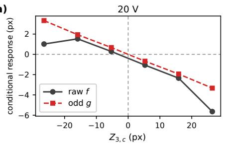

(b)  
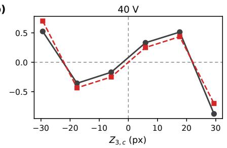

(c)  
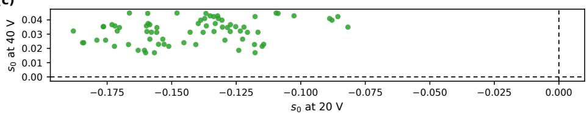  
Figure S2: Experimental response checks and sensitivity to analysis choices. (a,b) Raw conditional response $f$ (gray circles) and odd component $g$ (red squares) at 20 and 40 V. (c) Central slopes $s _ { 0 }$ at 20 and 40 V for the $7 2$ admissible analysis settings.