# How to Loop Your Transformer: Loop Scaling, Specialization, and Parallel Inference

Chanakya Ekbote1,2,†, Artidoro Pagnoni1,∗, Devendra Singh Sachan1, Shruti Bhosale1, Mike Lewis1, Maryam Fazel-Zarandi1, Shashank Rajput1,∗, Sujan Kumar Gonugondla1,∗

1FAIR at Meta, 2MIT

†Work done at FAIR/Meta, ∗Equal contribution

Looping in transformer models reuses weights by repeatedly applying the same transformer, or parts of it, to token representations, efectively making the model deeper without increasing its parameter count. Whether looping is useful depends on which constraint dominates: model size, training compute, or autoregressive inference eficiency. We study these trade-ofs jointly in dense decoder-only transformers trained from scratch, varying which parts of the model are looped, how many loops are applied, and how information is passed between loops. Our experiments span models with up to 1B parameters, trained on up to 155B tokens using up to 1.07 × 1021 training FLOPs, with up to 32 loops. We find that looping the full transformer generally gives the strongest quality at a fixed parameter budget, whereas looping a middle block of layers gives a better return when training FLOPs are constrained. These trade-ofs also depend on the number of loops: adding loops is not uniformly beneficial, and gains eventually saturate, reverse, or become unstable. This saturation motivates asking whether forcing every loop to use exactly the same weights limits the benefit of deeper looping. We address this by adding small loop-specific low-rank adapters that improve quality, with larger gains as more loops are added. A separate practical concern for looped transformers is the sequential dependency during autoregressive generation, which causes a slowdown proportional to the number of loops. Parallel Loop Transformers address this limitation by passing information between loops across adjacent token positions via hidden states, allowing loop stages to run concurrently during decoding. However, in our experiments the original formulation does not consistently retain the quality gains of ordinary looping. We find that preserving the current-token embedding and separately normalizing it and the previous-token hidden state before combining them recovers strong performance across model scales and training budgets. Together, these results show that efective looping requires matching the design to the resource constraint and inference setting.

Date: October 2026

Correspondence: Sujan Kumar Gonugondla at sujan@meta.com

∞Meta

## 1 Introduction

Looping in transformer models reuses weights by repeatedly applying the same transformer, or selected parts of it, to token representations, allowing the model to behave like a deeper network without storing a new set of parameters at every ‘depth’ (Dehghani et al., 2018; Saunshi et al., 2025; Geiping et al., 2025). This makes looping attractive when model size is constrained, but the additional depth is not free: every extra loop must still be executed. As a result, a design that uses parameters eficiently may not use training compute eficiently. Prior work reflects this trade-of, showing that repeated shared computation can recover some of the benefits of additional depth, while adding independently parameterized layers can be preferable when training compute is constrained (Schwethelm et al., 2026; Prairie et al., 2026). The same weight reuse, however, raises another question as more loops are added. In ordinary looping, every loop applies the same weights, even though later loops operate on representations that have already been transformed several times. This suggests that exact weight sharing may give diminishing returns with deeper looping. Prior work has relaxed this constraint by giving each loop iteration a diferent low-rank adapter while keeping the main transformer weights shared (Bae et al., 2025).

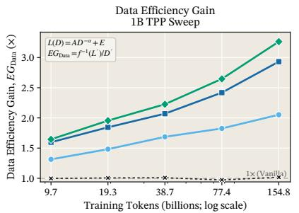

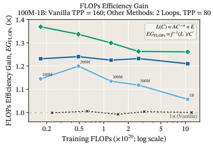  
Method

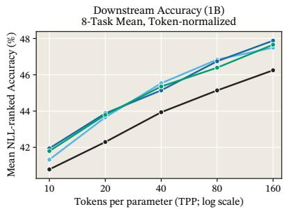  
Vanilla (No Looping) Standard Looping Modified PLT (Ours) - Shifted Re-Injection Modified PLT (Ours) - Unshifted Re-Injection (Standard Looping with Embeddings)  
Figure 1 Looping can improve data and compute efficiency (in over-trained regimes) while retaining downstream quality. We compare Vanilla (no looping), Standard Looping (repeatedly applying the same Transformer sequentially), and our modified versions Parallel Loop Transformer (PLT) (Wu et al., 2025) and Looped Transformers. Left: for 1B models trained across TPP 10–160, all looping methods achieve a given DCLM (Li et al., 2024) bits-per-byte (BPB) value with fewer training tokens than the fitted Vanilla baseline, with the modified PLT variants providing the largest relative data-eficiency gains. Center: across model sizes from 100M to 1B, we compare Vanilla models trained at TPP = 160 with two-loop models trained at $\mathrm { T P P } = 8 0 $ . All looping methods achieve a given DCLM BPB with fewer training FLOPs than the fitted Vanilla baseline, and the modified PLT and Looped variants are more eficient than Standard Looping. Right: for 1B models across TPP 10–160, looping retains or improves mean NLL-ranked accuracy across eight reasoning and question-answering tasks; the modified PLT variants match or exceed Standard Looping. See Appendix D for the eficiency calculation and task-level results.

Looped transformers also sufer from a separate issue during autoregressive generation: each loop for a token still depends on the output of the previous loop, so the model must execute them one after another, increasing the sequential computation required to generate each token. Parallel Loop Transformers (PLTs) reorganize this dependency by passing hidden states from one loop to the next across adjacent token positions, allowing multiple loop stages to be evaluated in parallel during decoding (Wu et al., 2025). This change alters the information available to each loop, and recent work reports that gains can decrease as more parallel loops are added (Yang et al., 2026). This leaves open what information the shifted transition must preserve for parallel looping to remain efective at greater loop depth. Together, these studies show that looping is not a single design choice but a set of coupled trade-ofs. Repeating more of the model can make better use of a fixed parameter budget but requires more training compute; reusing the same weights across more loops can make exact sharing increasingly restrictive; and changing the dependency between loops can parallelize sequential looping while also changing the information available to each loop. These trade-ofs may also change with model scale and training budget. Despite prior work studying these choices in diferent settings, it remains unclear which conclusions generalize and how the choices interact. We therefore study them within a common training from-scratch setting across model scales and training budgets, and ask:

## How should transformer layers be looped under constraints on model size, training compute, and autoregressive inference?

We address this question through a controlled study of dense decoder-only transformers trained from scratch. Our experiments span models with up to 1B parameters, up to 155B training tokens, up to $\mathbf { 1 . 0 7 \times 1 0 ^ { 2 1 } }$ training FLOPs, and up to 32 loops. We organize the study around three linked aspects of looping:

## Main Contributions.

1. We characterize where and how much to loop. We compare diferent looping designs and vary the number of loops across each design. We find that looping the full transformer gives the strongest quality at a fixed parameter budget, whereas looping a contiguous block of transformers layers in the middle of the network, gives a better return when training FLOPs are constrained. We also find that adding more loops is not uniformly beneficial: gains eventually saturate, reverse, or become unstable (subsection 3.2).

2. We show when loop-specific specialization becomes useful. We compare exact weight sharing across loops with small loop-specific low-rank adapters that allow each loop to learn a slightly diferent transformation. These adapters provide only modest gains when few loops are used, but become consistently more useful as the same weights are reused across more loops (subsection 3.3).

3. We present small modifications that improve stacked looping and PLTs We study Parallel Loop Transformers (PLTs) (Wu et al., 2025), which change the dependency between loops so that their computations can be parallelized during autoregressive decoding. Naively applying PLT in our setting does not preserve the gains from looping: quality can degrade as more loops are added. We find that preserving the current-token representation, separately normalizing it and the recurrent state, and controlling how they are combined substantially improves PLT. With these changes, parallel looping can outperform looping the full transformer while retaining a parallelizable decoding dependency. Applying similar changes to standard looping improves full-transformer looping further, showing that the modification is useful beyond the parallel setting (subsection 3.4).

## 2 Background and Methods

## 2.1 Different Ways to Loop a Transformer

We consider several ways to loop a transformer by varying which parts of the model are looped and the order in which the loops are applied. In Full-Stack Looping, the output of the final transformer block is fed back to the first block, so the entire stack of transformer blocks is applied again at each loop. In Per-Layer Looping, the output of each transformer block is fed back to the same block for all loops before moving to the next transformer block. We also consider looping only a contiguous set of transformer blocks in the middle of the model. In Middle-Stack Looping, the output of the last block in this region is fed back to the first, so the middle blocks are looped as a group. In Middle-Layer Looping, each transformer block in the middle region is looped before moving to the next transformer block. The transformer blocks outside this region are applied once. Finally, we vary which part of a transformer block is looped: the full block, attention only, the MLP only, or attention and the MLP independently. See Figure 2 and subsection B.1 for details.

## 2.2 Loop-Specific Specialization

In standard transformer looping, every loop uses the same transformer weights. This keeps parameter storage low, but may limit what later loops can learn, since they operate on representations already transformed by earlier loops. Giving each loop a separate set of weights would remove this constraint, but would also give up much of the parameter savings from looping. We instead use Low-Rank Adaptation (LoRA) (Hu et al., 2021) to give each loop a small loop-specific adapter while keeping the main transformer weights shared, as defined in Def. 1. We refer to this as loop-specific specialization.

Definition 1: Loop-Specific Low-Rank Adapter. For a weight matrix $W \in \mathbb { R } ^ { d _ { \mathrm { o u t } } \times d _ { \mathrm { i n } } }$ shared across loops, loop ℓ uses $\begin{array} { r } { \dot { \pmb { W } } ^ { ( \ell ) } = \dot { \pmb { W } } + \frac { \alpha } { r } \pmb { B } ^ { ( \ell ) } \pmb { A } ^ { ( \ell ) } } \end{array}$ , where $\pmb { A } ^ { ( \ell ) } \in \mathbb { R } ^ { r \times \bar { d } _ { \mathrm { i n } } }$ and $B ^ { ( \ell ) } \in \mathbb { R } ^ { d _ { \mathrm { o u t } } \times r }$ are learned specifically for loop ℓ.

We also evaluate alternative ways of parameterizing and combining these loop-specific low-rank adapters; see Figure 4 and subsection B.2 for details.

## 2.3 Parallelizing Loops During Inference

In ordinary looping, each token is processed through each loop one after another: loop ℓ receives the representation of that same token produced by loop ℓ − 1. As a result, loop ℓ cannot begin until loop ℓ − 1 has finished. Parallel Loop Transformers (PLTs) (Wu et al., 2025) change this dependency through Cross-Loop Parallelism (CLP). Instead of passing the hidden state between loops at the same token position, CLP passes the state from the previous loop at the preceding token position. As these previous-token states are already available during autoregressive decoding, all the loop computations for the current token can be evaluated simultaneously. To make this dependency (CLP) precise, let $e _ { n }$ denote the embedding of token n, let $\pmb { b } _ { n } ^ { ( \ell ) }$ and $\pmb { h } _ { n } ^ { ( \ell ) }$ denote the input and output of loop ℓ, and let $\mathcal { F } _ { \theta }$ denote the transformer whose weights are shared across loops.

Definition 2: Cross-Loop Parallelism (CLP). The first loop receives the current-token embedding, $b _ { n } ^ { ( 1 ) } = e _ { n }$ Each later loop receives the current-token embedding together with the state produced by the previous loop for the preceding token:

$$
{ \pmb b } _ { n } ^ { ( \ell ) } = { \pmb e } _ { n } + { \pmb h } _ { n - 1 } ^ { ( \ell - 1 ) } , \qquad { \pmb h } _ { n } ^ { ( \ell ) } = \mathcal { F } _ { \boldsymbol \theta } \Big ( { \pmb b } _ { n } ^ { ( \ell ) } \Big ) .
$$

The original PLT combines CLP with two mechanisms that reduce KV-cache memory: KV sharing and (G-SWA). KV sharing lets later loops reuse the full KV cache produced by the first loop instead of storing a separate full cache for every loop. Each later loop also keeps a small local sliding-window cache, and gated sliding-window attention (G-SWA) combines the attention outputs from the shared and local caches. In our experiments, we separate CLP, KV sharing, and G-SWA to study their efects independently. See Figure 6 and subsection B.3 for details.

## 3 Experiments

## 3.1 Experimental Setup

We train models with 70M, 100M, 200M, 300M, 500M, and 1B parameters, containing 4, 6, 8, 10, 12, and 16 stored transformer layers, respectively. Training budgets range from 10 to 160 tokens per parameter (TPP). All models use the same pretraining mixture of natural language, code, mathematical, and scientific content, with the data sources, sampling distribution, preprocessing, tokenizer, and training setup held fixed across architectures. We use a fixed subset of the DCLM Baseline 1.0 validation set (Li et al., 2024), containing approximately 41 million tokens, as our primary measure of language-modeling quality and report bits per byte (BPB; lower is better). To test whether the trends observed on DCLM hold across datasets, we additionally evaluate on other language-modeling corpora and a broader set of mathematical, code, reasoning, and question-answering benchmarks. These results, together with the full model configurations, training details, evaluation protocols, and task-level results, are provided in the appendix (see Appendix C).

## 3.2 Which Forms of Looping Work, and When?

While keeping the model size fixed, there is a large design space for deciding which components of the transformer to loop, in what order, and how many times to loop them. We investigate which of these choices improve model quality and whether their efects depend on model scale and training budget. We compare seven designs (Figure 2) across five dense model scales ranging from 70M to 500M parameters, token-to-parameter ratios (TPP) of up to 160, and loop factors $L \in \{ 2 , 4 , 8 , 1 6 , 3 2 \}$ , where available. At each model size, we consider experiments that constrain either (a) the total amount of training data (i.e., fixed TPP) or (b) the total training compute (i.e., a fixed FLOP budget). Our primary metric is DCLM validation bits per byte (BPB; lower is better). Figure 3 shows the results at the 100M and 500M scales. Complete sweeps and targeted 1B comparisons appear in Appendix E.

Benefits and limits of looping. Using a moderate loop factor $( L \leq 1 6 )$ , looping improves quality across the evaluated designs, model scales, and TPP settings: relative to the corresponding no-looping model, increasing the loop factor L reduces DCLM BPB (Figure 3). However, the marginal gains diminish as L increases, and performance eventually degrades at very large L. This efect is clearest in the 70M and 100M sweeps, which extend to $L = 3 2$ . The point at which these gains saturate or reverse depends on both the looping strategy and TPP. At higher TPP, increasing L produces more consistent gains, whereas lower-TPP runs tend to saturate or regress sooner. The strategy that loops attention and the MLP independently degrades sharply as L increases, whereas Full-Stack Looping and Middle-Stack Looping avoid regression over a wider range of L (Figure 13). Moreover, the relative performance of the looping strategies changes with model size: the benefits of looping persist as model size increases, while the strongest strategies become more consistent. At

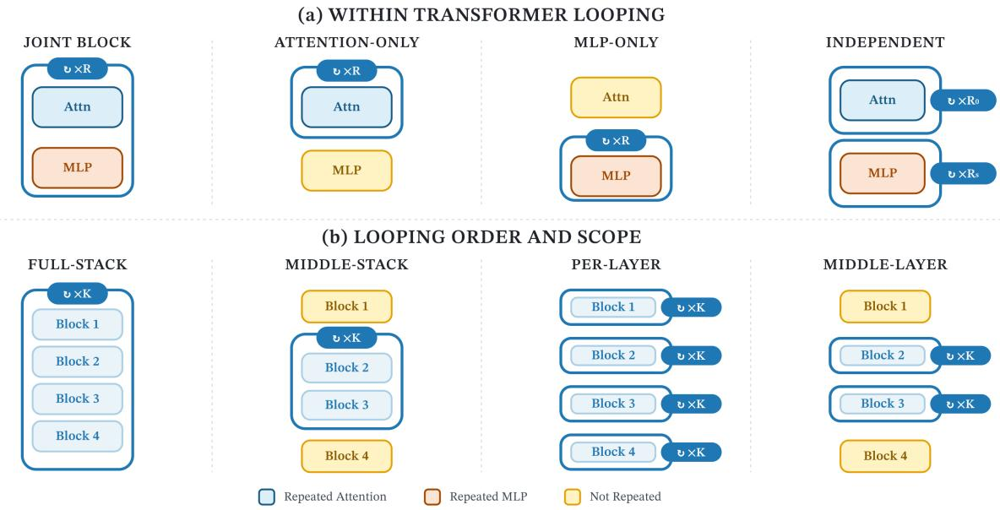  
Figure 2 Looping designs: what is repeated, where, and in what order. Top: the looped component can be the complete transformer block, attention alone, the MLP alone, or attention and the MLP separately. Bottom: full-stack looping traverses the complete transformer for L loops, whereas per-layer looping completes L loops of each block before advancing to the next. Middle-stack and middle-layer looping restrict the corresponding schedule to the central blocks. For a model containing B blocks, the first and last ⌊B/3⌋ blocks are run once.

100M and 200M, Per-Layer Looping and Middle-Stack Looping can be competitive with Full-Stack Looping when a smaller $L \leq 2$ is used, depending on TPP. At 300M and especially 500M, Full-Stack Looping and Middle-Stack Looping perform well across TPP settings and loop factors, with Full-Stack Looping achieving the lowest BPB as TPP increases (Figure 14). The 200M–500M sweeps extend only to $L = 8$ and 1B sweeps up to $L = 4$ , because the computational cost of looping grows linearly with L. Within these ranges, we still see diminishing relative improvements with L (see Figure 45 and Figure 46 for 1B ablations). Comparing performance as a function of total training FLOPs shows that some looping strategies use compute more efectively than others. At lower training FLOP budgets, Middle-Stack Looping provides the best return on additional compute, but when compute is not a constraint, Full-Stack Looping can achieve lower absolute BPB, as shown in Figure 3 and Figure 46.

Note that similar trends hold across additional model scales and evaluation datasets (Appendix E). The diminishing returns from adding more loops raise a natural question: does sharing exactly the same weights across loops limit further improvements? We investigate this question in subsection 3.3.

## 3.3 When Should Loops Specialize?

We now investigate whether requiring every loop to reuse the same weights limits model quality. To do so, we explore a middle ground between complete weight sharing in a standard looped model and using unique weights at every depth in a deeper model. For our primary experiments, we use Full-Stack Looping because it generally provides the strongest absolute improvements. However, the proposed approach applies to any looping design, and we evaluate it with other designs in Appendix F. Figure 4 illustrates three ways to introduce loop-specific adapters. Given a weight matrix W shared across L loops, loop $\ell \in \{ 1 , \ldots , L \}$ uses a loop-specific weight defined as $W ^ { ( \ell ) } = W + \Delta W ^ { ( \ell ) }$ . We use diferent designs for $\Delta \boldsymbol { W } ^ { ( \ell ) }$ : Loop LoRA assigns each loop its own low-rank adapter, $\Delta W ^ { ( \ell ) } = B _ { \ell } A _ { \ell }$ . Loop Matrix learns an unconstrained mixing matrix $M \in \mathbb { R } ^ { L \times L }$ , where $M _ { \ell j }$ controls the contribution of low-rank component $j$ to loop $\begin{array} { r } { \ell \colon \Delta W ^ { ( \ell ) } = \sum _ { j = 1 } ^ { L } M _ { \ell j } B _ { j } A _ { j } } \end{array}$ . Loop Softmax parameterizes these coeficients using a learned score matrix $S \in \mathbb { R } ^ { L \times L }$ , with $M _ { \ell j } = \mathrm { s o f t m a x } ( S _ { \ell , : } ) _ { j }$ . This makes the coeficients nonnegative and normalizes them to sum to one. Loop Matrix and Loop Softmax can combine several low-rank components, increasing the efective rank and expressivity of each loop-specific adapter; see Appendix F. For these experiments, each low-rank component has rank at most 8. We use unit scaling and jointly train the shared weights and loop-specific adapters from initialization, and apply the updates to the attention and MLP weights in every transformer block. As in the preceding section, the main-text analysis focuses on DCLM. Figure 5 shows the results for 300M models with $L \in \{ 2 , 4 , 8 \}$ at TPP 40 and 100.

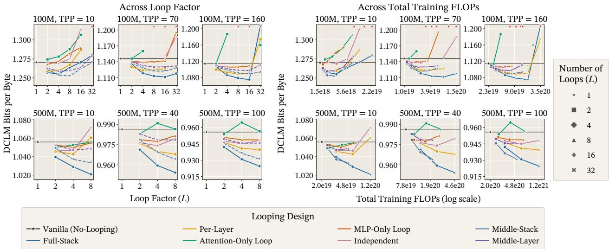  
Figure 3 Full-Stack Looping is favored under fixed parameter-count and training-data budgets, whereas Middle-Stack Looping is favored under FLOP constraints. DCLM validation BPB versus the number of loops or total training FLOPs for 100M and 500M models. Each panel holds the model size and training-data budget constant, so the diferences reflect how each strategy uses the additional computation introduced by looping. The advantage of full-stack looping becomes clearer at larger model scales and training budgets. Middle-Stack Looping with fewer loops achieves lower BPB when compute is limited, whereas Full-Stack Looping can attain lower BPB when more compute is available. Increasing the number of loops does not improve quality indefinitely: the 100M results exhibit saturation, regression, and instability when more loops are used. Lower BPB is better; red triangles indicate unstable or clipped runs.

Benefits and costs of loop-specific specialization. The gains from loop-specific specialization are marginal at L = 2 but become clear at L ∈ {4, 8} (Figure 5). Among the three specialization options, Loop Matrix provides the largest improvement, though the relative diferences are smaller than the gain over the unspecialized looping baseline. We therefore use Loop Matrix by default in subsequent experiments involving loop-specific specialization, including those in subsection 3.4. At 300M, these specialization methods increase the number of non-embedding parameters by only 1.1–4.3%, compared with 51.4% for doubling the model depth. At comparable training FLOPs, the doubled-depth reference (the brown pentagon) achieves lower BPB than loop-specific models. Loop-specific specialization therefore ofers a parameter-eficient, rather than compute eficient, way to improve quality. We observe the same overall trends for 70M–200M models across TPP 10, 40, and 100, in targeted 500M and 1B experiments, and on the downstream datasets introduced in subsection 3.1. Full results are provided in Appendix F; a more exhaustive study of specialization methods is left for future work. Loop-specific specialization improves quality but does not change the fact that the loops must be evaluated one after another for each generated token.

## 3.4 Stabilizing PLT and Looping

Looping improves quality but requires loops to run serially during autoregressive decoding. PLT (subsection B.3) shifts the connections between loops across adjacent tokens, allowing diferent loops to run in parallel (Figure 6). In our experiments, however, PLT underperforms Full-Stack Looping (Figure 7). We investigate whether this quality loss is an inherent limitation of PLT or whether it can be mitigated by reconstructing PLT one component at a time.

Recovering and improving PLT quality. To isolate the source of the quality degradation, we reconstruct PLT one component at a time. As defined in Figure 6, CLP passes $\pmb { b } _ { n } ^ { ( \ell ) } = \pmb { e } _ { n } + \pmb { h } _ { n - 1 } ^ { ( \tilde { \ell } - 1 ) }$ to loop ℓ, while our unshifted control uses $\pmb { b } _ { n } ^ { ( \ell ) } = \pmb { e } _ { n } + \pmb { h } _ { n } ^ { ( \ell - 1 ) }$ . The unshifted control can therefore be viewed as Full-Stack Looping with the current-token embedding added again at every loop. Starting from raw shifted CLP, we add KV sharing and normalized G-SWA to reconstruct Original PLT (subsection B.3). For the 200M model at both TPP 40 and 80, neither Original PLT nor the intermediate variants formed by adding its components recover the performance of Full-Stack Looping. These shifted variants perform near the Vanilla (No Looping) baseline when fewer loops are used $( L \leq 2 )$ , while raw shifted CLP can become even worse as the number of loops increases. In contrast, the unshifted control outperforms Full-Stack Looping (Figure 7). Our experiments reveal a second source of degradation: the RMS magnitudes of the current-token embedding and the previoustoken state difer substantially, with the magnitude of this mismatch varying across TPP settings and loop depths (subsection G.2). When the two inputs are added directly, the higher-magnitude representation can overwhelm the contribution of the other. To mitigate this mismatch, we define $\hat { \boldsymbol e } _ { n } = \mathrm { R M S N o r m } ( \boldsymbol e _ { n } )$ and $\hat { \pmb { h } } _ { n - 1 } ^ { ( \ell - 1 ) } = \mathrm { R M S N o r m } ( \pmb { h } _ { n - 1 } ^ { ( \ell - 1 ) } )$ , and combine them using a gate $\pmb { g } _ { n } ^ { ( \ell ) } \in [ 0 , 1 ] ^ { d } ; \ b _ { n } ^ { ( \ell ) } = \pmb { g } _ { n } ^ { ( \ell ) } \odot \hat { \pmb { e } } _ { n } + ( \mathbf { 1 } - \pmb { g } _ { n } ^ { ( \ell ) } ) \odot \hat { \pmb { h } } _ { n - 1 } ^ { ( \ell - 1 ) }$ As seen in Figure 7, simply applying RMSNorm to both inputs and then adding them performs worse than controlling their mixture, showing that their relative weighting also matters. For Figure 7, we use the fixed equal mixture $\begin{array} { r } { g _ { n } ^ { ( \ell ) } = \frac { 1 } { 2 } \mathbf { 1 } } \end{array}$ . Across the evaluated TPP settings, numbers of loops, and PLT component configurations, the resulting shifted, inference-eficient variants approach the quality of Full-Stack Looping. The normalized and gated unshifted control also improves over the unnormalized unshifted control and again outperforms Full-Stack Looping. Maintaining a separate KV cache for each loop provides the best quality across the evaluated designs; however, KV sharing combined with normalized G-SWA, as in Original PLT, approaches this performance while requiring less cache storage. Additional ablations at 300M appear in subsection G.1.

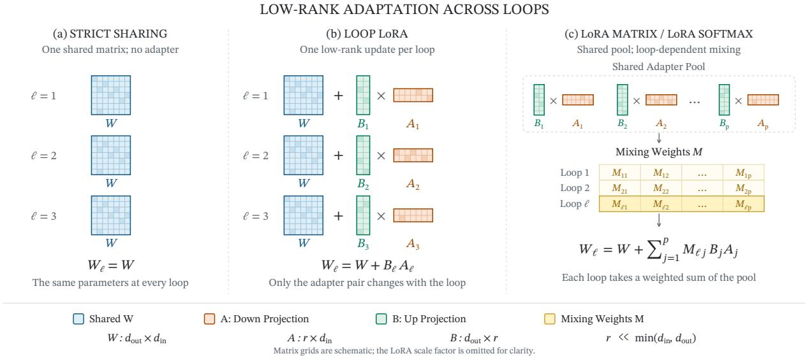

Figure 4 Three ways to vary weights across loops. All designs retain the same base weights. Loop LoRA gives each loop a separate low-rank adapter. Loop Matrix lets each loop learn a combination of these adapters, while Loop Softmax  
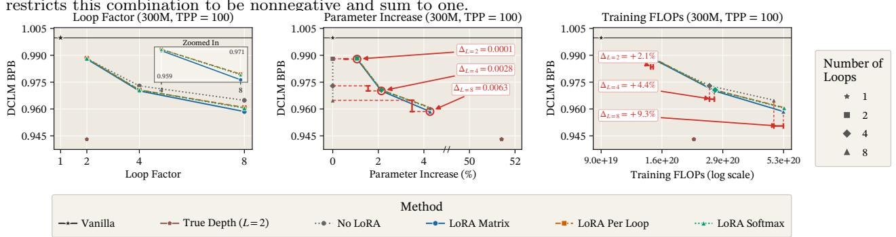  
Figure 5 Loop-specific corrections become more useful with deeper looping while adding few parameters. DCLM BPB for 300M models with Full-Stack Looping at TPP 100. The left, middle, and right panels plot BPB against loop count, non-embedding parameter count, and total training FLOPs, respectively. The break in the logarithmic parameter axis shows both parameter ranges. FLOPs include the corrections and the training tokens allocated at TPP 100. Lower BPB is better.

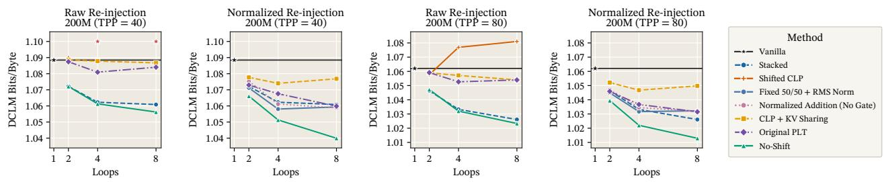

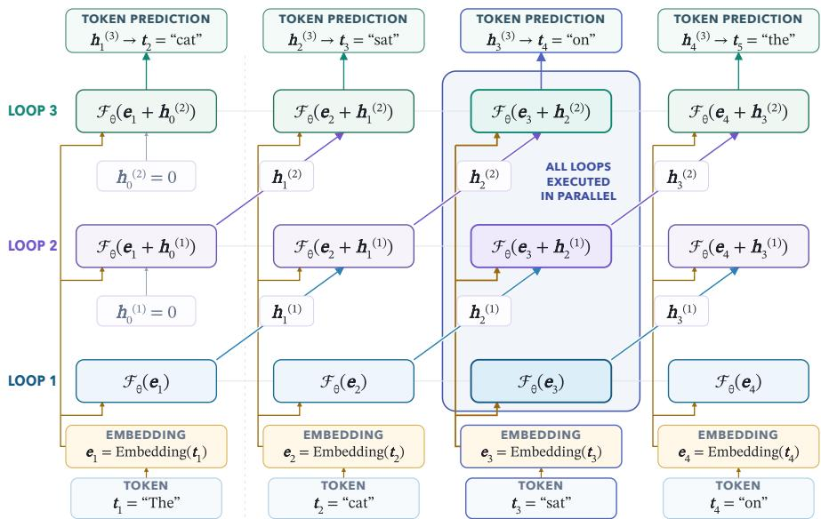  
Figure 6 PLT shifts the connection between loops across tokens. Loop ℓ at token n receives the current-token embedding and the state from loop ℓ − 1 at token n − 1. KV sharing and G-SWA are omitted for clarity.  
Figure 7 Separate normalization recovers much of the quality lost by the shifted transition. DCLM BPB for 200M models at TPP 40 and 80. Each raw panel is followed by its normalized counterpart. Except for Normalized Addition, normalized variants use separate RMS normalization and fixed 50/50 mixing. Red stars mark unstable runs clipped for visualization. Lower BPB is better.

The current-token embedding matters more than the exact gate. The analysis above uses the fixed gate $\pmb { g } _ { n } ^ { ( \ell ) } = \frac { 1 } { 2 } \mathbf { 1 }$ To test whether a more expressive gate improves quality, we compare four alternatives defined in subsection G.3: fixed 50/50, scalar, rank-8 linear, and rank-8 MLP gates. They perform similarly across model scales, TPP settings, and numbers of loops, although the rank-8 linear gate is marginally better. We use the rank-8 linear gate in subsequent experiments. It is shared across loops and adds less than 0.015% to the non-embedding parameter count. We separately test the role of the current-token embedding in subsection G.4. Removing it causes shifted PLT to perform worse than Vanilla (No Looping), and several runs diverge. We hypothesize that, without $\mathbf { } _ { e _ { n } , }$ each shifted loop must infer the current token solely from the previous-token state. As this state represents a contextual prediction rather than the token that actually occurred, prediction errors may propagate through subsequent loops and accumulate across token positions, causing quality degradation or divergence. Reintroducing $e _ { n }$ anchors every loop to the observed current token and limits this accumulation.

Our normalized shifted PLT scales. Hereafter, Normalized Shifted PLT refers to our modified design that uses the previous token’s hidden state and allows loops to run in parallel, whereas Normalized Unshifted PLT uses the current token’s hidden state and therefore remains sequential. Both variants separately normalize the current-token embedding and hidden state, combine them using a rank-8 linear gate, and maintain a separate KV cache for each loop. Unlike Original PLT, neither uses KV sharing nor G-SWA. We evaluate both variants from 100M to 1B. At 1B and L = 2, Normalized Shifted PLT achieves lower DCLM BPB than Full-Stack Looping at every displayed training budget and closely tracks Normalized Unshifted PLT (Figure 8). At $L = 4 .$ it remains competitive with Full-Stack Looping, although its gap to Normalized Unshifted PLT widens. The same trends hold across six evaluation corpora at 1B (subsection H.1). Additional sweeps across model sizes, numbers of loops, and TPP settings appear in subsection H.2 and subsection H.3. We next examine the training-data and training-FLOP eficiency of looping.

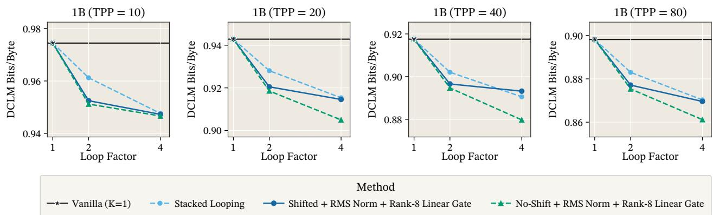  
Figure 8 Normalized shifted PLT retains the benefit of looping at 1B. DCLM BPB at TPP 10, 20, 40, and 80. Shifted and unshifted PLT use separate RMS normalization and a rank-8 linear gate. At L = 2, shifted PLT closely tracks the unshifted control and improves upon Full-Stack Looping; at L = 4, a clearer gap to the unshifted control remains. Lower BPB is better.

Looping can improve data and FLOP efficiency. As shown in Figure 1, looping can reach a given DCLM BPB using fewer training tokens than Vanilla (No Looping), suggesting that looping can partly substitute for additional training data. Data eficiency does not automatically imply FLOP eficiency because each loop adds computation per token. In the evaluated over-trained regime, however, the reduction in required training tokens outweighs this additional cost: across model sizes from 100M to 1B, two-loop models trained at TPP 80 reach a given BPB using fewer training FLOPs than Vanilla models trained at TPP 160. This advantage does not hold uniformly across numbers of loops: although L = 4 can achieve lower absolute BPB, it provides a weaker improvement per training FLOP (subsection H.4).

## 4 Related Work

Prior work studies looping from several complementary angles. Scaling studies ask how much additional looping is worth under diferent parameter, data, and compute budgets, either through scaling laws or by comparing shared recurrence with added physical depth (Prairie et al., 2026; Schwethelm et al., 2026). Other work explores particular choices for where and how recurrence is introduced in the transformer (Cai et al., 2026; Zeitoun et al., 2026). As these studies use diferent looping designs and evaluate them under diferent resource constraints, it is dificult to separate the efect of the design from the efect of the budget. We instead vary where and how much to loop within a common dense model family and evaluate these choices under both parameter and training-compute constraints. Another line of work asks whether every loop should use exactly the same weights. Relaxed Recursive Transformers (Bae et al., 2025) give each loop a small set of additional parameters when converting a pretrained transformer into a looped model. We instead train the looped transformer and its loop-specific adapters together from scratch and test whether these adapters become more useful as the number of loops increases. Looping also raises a separate challenge during autoregressive inference. In ordinary looping, the model must finish one loop for a token before starting the next. Parallel Loop Transformers (PLTs) combat this by shifting information across adjacent token positions so that loop computations can be parallelized during decoding (Wu et al., 2025). This change alters the information available to each loop, and recent work reports that gains can diminish as more parallel loops are added (Yang et al., 2026). This leaves open what the shifted transition must preserve to retain quality as the number of loops increases. We find that preserving the current-token embedding and separately normalizing it and the state passed from the previous token substantially improves parallel looping at larger loop counts. Our work therefore connects three aspects of looping within a common setting: where and how much to loop, whether diferent loops should use exactly the same weights, and how loops can be parallelized during autoregressive inference. See Appendix A for a more detailed discussion.

## 5 Conclusion and Future Directions

We show that looping is a multidimensional design problem that must jointly account for stored parameters, training FLOPs, data eficiency, and inference eficiency. A promising future direction is to find ways of combining PLT with speculative decoding to further reduce inference latency. Another is to develop a theory of how normalization and current-token embedding reinjection afect stability in both the cross-token recurrence of PLT and the same-token recurrence of standard looping, and to identify which regimes favor each approach.

## 6 AI Use Statement

In this work, we used generative AI tools, specifically ChatGPT, Codex, Claude, and Claude Code, for assistance with writing, code development and editing, debugging, and auxiliary sanity checks. We did not use generative AI tools to develop the core research methodology, formulate the main research hypotheses, design the experiments, or interpret the experimental results. All AI-generated or AI-suggested text and code were reviewed by the authors. AI-assisted code was tested and validated for correctness before being used in the reported experiments. The authors made all methodological and experimental decisions and independently verified the analyses and reported results. We take full responsibility for the final content of this work, including any text, code, claims, or artifacts produced with the assistance of generative AI tools.

## References

Jacob Austin, Augustus Odena, Maxwell Nye, Maarten Bosma, Henryk Michalewski, David Dohan, Ellen Jiang, Carrie Cai, Michael Terry, Quoc Le, and Charles Sutton. Program synthesis with large language models, 2021. https://arxiv.org/abs/2108.07732.

Sangmin Bae, Adam Fisch, Hrayr Harutyunyan, Ziwei Ji, Seungyeon Kim, and Tal Schuster. Relaxed recursive transformers: Efective parameter sharing with layer-wise lora. In International Conference on Learning Representations, volume 2025, pages 34282–34327, 2025.

Sangmin Bae, Yujin Kim, Reza Bayat, Sungnyun Kim, Jiyoun Ha, Tal Schuster, Adam Fisch, Hrayr Harutyunyan, Ziwei Ji, Aaron Courville, et al. Mixture-of-recursions: Learning dynamic recursive depths for adaptive token-level computation. Advances in Neural Information Processing Systems, 38:96572–96617, 2026.

Yonatan Bisk, Rowan Zellers, Ronan Le Bras, Jianfeng Gao, and Yejin Choi. Piqa: Reasoning about physical commonsense in natural language, 2019. https://arxiv.org/abs/1911.11641.

Ziyang Cai, Xingyu Zhu, Yihe Dong, Yinghui He, and Sanjeev Arora. T2MLR: Transformer with temporal middlelayer recurrence. In Workshop on Latent & Implicit Thinking – Going Beyond CoT Reasoning, 2026. https: //openreview.net/forum?id=fQbk1EQWBO.

Mark Chen, Jerry Tworek, Heewoo Jun, Qiming Yuan, Henrique Ponde De Oliveira Pinto, Jared Kaplan, Harri Edwards, Yuri Burda, Nicholas Joseph, Greg Brockman, et al. Evaluating large language models trained on code. arXiv preprint arXiv:2107.03374, 2021.

Peter Clark, Isaac Cowhey, Oren Etzioni, Tushar Khot, Ashish Sabharwal, Carissa Schoenick, and Oyvind Tafjord. Think you have solved question answering? try arc, the ai2 reasoning challenge. arXiv preprint arXiv:1803.05457, 2018.

Karl Cobbe, Vineet Kosaraju, Mohammad Bavarian, Mark Chen, Heewoo Jun, Lukasz Kaiser, Matthias Plappert, Jerry Tworek, Jacob Hilton, Reiichiro Nakano, et al. Training verifiers to solve math word problems. arXiv preprint arXiv:2110.14168, 2021.

Mostafa Dehghani, Stephan Gouws, Oriol Vinyals, Jakob Uszkoreit, and Łukasz Kaiser. Universal transformers. arXiv preprint arXiv:1807.03819, 2018.

Jonas Geiping, Sean Michael McLeish, Neel Jain, John Kirchenbauer, Siddharth Singh, Brian R. Bartoldson, Bhavya Kailkhura, Abhinav Bhatele, and Tom Goldstein. Scaling up test-time compute with latent reasoning: A recurrent depth approach. In The Thirty-ninth Annual Conference on Neural Information Processing Systems, 2025. https: //openreview.net/forum?id=S3GhJooWIC.

Dan Hendrycks, Collin Burns, Steven Basart, Andy Zou, Mantas Mazeika, Dawn Song, and Jacob Steinhardt. Measuring massive multitask language understanding, 2021a. https://arxiv.org/abs/2009.03300.

Dan Hendrycks, Collin Burns, Saurav Kadavath, Akul Arora, Steven Basart, Eric Tang, Dawn Song, and Jacob Steinhardt. Measuring mathematical problem solving with the math dataset. arXiv preprint arXiv:2103.03874, 2021b.

Edward J Hu, Yelong Shen, Phillip Wallis, Zeyuan Allen-Zhu, Yuanzhi Li, Shean Wang, Lu Wang, and Weizhu Chen. Lora: Low-rank adaptation of large language models. arXiv preprint arXiv:2106.09685, 2021.

Da Ju, Stephen Roller, Sainbayar Sukhbaatar, and Jason E Weston. Staircase attention for recurrent processing of sequences. Advances in neural information processing systems, 35:13203–13213, 2022.

Bum Jun Kim, Kohei Hayashi, Shunsuke Kamiya, Masanori Koyama, Yusuke Iwasawa, and Yutaka Matsuo. Looped transformers with source-centered state evolution. arXiv preprint arXiv:2607.27656, 2026.

Asher Labovich. Stability and generalization in looped transformers. arXiv preprint arXiv:2604.15259, 2026.

Ryan Lee, Jacob Biloki, Edward J. Hu, and Jonathan May. Sparse layers are critical to scaling looped language models, 2026. https://arxiv.org/abs/2605.09165.

Jefrey Li, Alex Fang, Georgios Smyrnis, Maor Ivgi, Matt Jordan, Samir Gadre, Hritik Bansal, Etash Guha, Sedrick Keh, Kushal Arora, et al. Datacomp-lm: In search of the next generation of training sets for language models. Advances in Neural Information Processing Systems, 37:14200–14282, 2024.

Ian Magnusson, Akshita Bhagia, Valentin Hofmann, Luca Soldaini, Ananya H Jha, Oyvind Tafjord, Dustin Schwenk, Evan Walsh, Yanai Elazar, Kyle Lo, et al. Paloma: A benchmark for evaluating language model fit. Advances in Neural Information Processing Systems, 37:64338–64376, 2024.

Stephen Merity, Caiming Xiong, James Bradbury, and Richard Socher. Pointer sentinel mixture models. arXiv preprint arXiv:1609.07843, 2016.

Todor Mihaylov, Peter Clark, Tushar Khot, and Ashish Sabharwal. Can a suit of armor conduct electricity? a new dataset for open book question answering. In Proceedings of the 2018 conference on empirical methods in natural language processing, pages 2381–2391, 2018.

Hayden Prairie, Zachary Novack, Taylor Berg-Kirkpatrick, and Daniel Y Fu. Parcae: Scaling laws for stable looped language models. In Third Conference on Language Modeling, 2026. https://openreview.net/forum?id=pIBqtrqFeP.

Colin Rafel, Noam Shazeer, Adam Roberts, Katherine Lee, Sharan Narang, Michael Matena, Yanqi Zhou, Wei Li, and Peter J Liu. Exploring the limits of transfer learning with a unified text-to-text transformer. Journal of machine learning research, 21(140):1–67, 2020.

Keisuke Sakaguchi, Ronan Le Bras, Chandra Bhagavatula, and Yejin Choi. Winogrande: An adversarial winograd schema challenge at scale, 2019. https://arxiv.org/abs/1907.10641.

Maarten Sap, Hannah Rashkin, Derek Chen, Ronan LeBras, and Yejin Choi. Socialiqa: Commonsense reasoning about social interactions, 2019. https://arxiv.org/abs/1904.09728.

Nikunj Saunshi, Nishanth Dikkala, Zhiyuan Li, Sanjiv Kumar, and Sashank J Reddi. Reasoning with latent thoughts: On the power of looped transformers. In International Conference on Learning Representations, volume 2025, pages 14855–14881, 2025.

Kristian Schwethelm, Daniel Rueckert, and Georgios Kaissis. How much is one recurrence worth? iso-depth scaling laws for looped language models, 2026. https://arxiv.org/abs/2604.21106.

Luca Soldaini, Rodney Kinney, Akshita Bhagia, Dustin Schwenk, David Atkinson, Russell Authur, Ben Bogin, Khyathi Chandu, Jennifer Dumas, Yanai Elazar, et al. Dolma: An open corpus of three trillion tokens for language model pretraining research. In Proceedings of the 62nd Annual Meeting of the Association for Computational Linguistics (Volume 1: Long Papers), pages 15725–15788, 2024.

Alon Talmor, Jonathan Herzig, Nicholas Lourie, and Jonathan Berant. Commonsenseqa: A question answering challenge targeting commonsense knowledge, 2019. https://arxiv.org/abs/1811.00937.

The Microsoft AI Team. Mai-thinking-1: Building a hill-climbing machine. Technical report, Microsoft AI, 2026.

Yubo Wang, Xueguang Ma, Ge Zhang, Yuansheng Ni, Abhranil Chandra, Shiguang Guo, Weiming Ren, Aaran Arulraj, Xuan He, Ziyan Jiang, et al. Mmlu-pro: A more robust and challenging multi-task language understanding benchmark. Advances in Neural Information Processing Systems, 37:95266–95290, 2024.

Maurice Weber, Daniel Fu, Quentin Anthony, Yonatan Oren, Shane Adams, Anton Alexandrov, Xiaozhong Lyu, Huu Nguyen, Xiaozhe Yao, Virginia Adams, Ben Athiwaratkun, Rahul Chalamala, Kezhen Chen, Max Ryabinin, Tri Dao, Percy Liang, Christopher Ré, Irina Rish, and Ce Zhang. Redpajama: an open dataset for training large language models, 2024. https://arxiv.org/abs/2411.12372.

Bohong Wu, Mengzhao Chen, Xiang Luo, Shen Yan, Qifan Yu, Fan Xia, Tianqi Zhang, Hongrui Zhan, Zheng Zhong, Xun Zhou, et al. Parallel loop transformer for eficient test-time computation scaling. arXiv preprint arXiv:2510.24824, 2025.

Jian Yang, Shawn Guo, Wei Zhang, Tianyu Zheng, Yaxin Du, Haau-Sing Li, Jiajun Wu, Yue Song, Yan Xing, Qingsong Cai, et al. Loopcoder-v2: Only loop once for eficient test-time computation scaling. arXiv preprint arXiv:2606.18023, 2026.

Abbas Zeitoun, Lucas Torroba-Hennigen, and Yoon Kim. Hyperloop transformers, 2026. https://arxiv.org/abs/2604. 21254.

Rowan Zellers, Ari Holtzman, Yonatan Bisk, Ali Farhadi, and Yejin Choi. Hellaswag: Can a machine really finish your sentence? In Proceedings of the 57th annual meeting of the association for computational linguistics, pages 4791–4800, 2019.

Rui-Jie Zhu, Zixuan Wang, Kai Hua, Tianyu Zhang, Ziniu Li, Haoran Que, Boyi Wei, Zixin Wen, Fan Yin, He Xing, Lu Li, Jiajun Shi, Kaijing Ma, Shanda Li, Taylor Kergan, Andrew Smith, Xingwei Qu, Mude Hui, Bohong Wu, Qiyang Min, Hongzhi Huang, Xun Zhou, Wei Ye, Jiaheng Liu, Jian Yang, Yunfeng Shi, Chenghua Lin, Enduo Zhao, Tianle Cai, Ge Zhang, Wenhao Huang, Yoshua Bengio, and Jason Eshraghian. Scaling latent reasoning via looped language models, 2026. https://arxiv.org/abs/2510.25741.

## Appendix

## Contents

1 Introduction 1   
2 Background and Methods   
2.1 Diferent Ways to Loop a Transformer   
2.2 Loop-Specific Specialization   
2.3 Parallelizing Loops During Inference 3   
3 Experiments 4   
3.1 Experimental Setup 4   
3.2 Which Forms of Looping Work, and When? 4   
3.3 When Should Loops Specialize? 5   
3.4 Stabilizing PLT and Looping 6   
4 Related Work 9   
5 Conclusion and Future Directions 10   
6 AI Use Statement 10   
A Related Work 15   
B Background 17   
B.1 Looped Transformers . 17   
B.2 Low-Rank Adaptation and Relaxed Weight Sharing 22   
B.3 Parallel Loop Transformers 22   
C Model Sizes and Training Budgets 26   
D Details Behind the Headline Figure 28   
D.1 Relative Data and Compute Eficiency 28   
D.2 Task-Level Results Behind the Headline Comparison 28   
E Additional Results on Looping Designs and Regimes 32   
E.1 Experimental Setup for the Additional Results 32   
E.2 BPB Results on DCLM 32   
E.3 Do the Looping Trends Hold Across Other Datasets? 36   
E.3.1 C4 English 37   
E.3.2 WikiText-103 40   
E.3.3 Dolma v1.5 43   
E.3.4 RedPajama 46   
E.3.5 Dolma Programming Languages 49   
E.3.6 GSM8K 52   
E.3.7 MATH . 54   
E.3.8 HumanEval 56   
E.3.9 MBPP . 58   
E.4 Looping at 1B Scale 60   
E.4.1 DCLM . 60   
E.4.2 C4 60   
E.4.3 Dolma v1.5 61   
E.4.4 Dolma Programming Languages 61   
E.4.5 RedPajama 61   
E.4.6 WikiText-103 64   
F Additional Results for Loop-Specific Specialization 65   
F.1 Experimental Setup 65   
F.2 Results from 70M to 300M 66   
F.2.1 DCLM . 67   
F.2.2 C4 English 71   
F.2.3 WikiText-103 75   
F.2.4 Dolma v1.5 79   
F.2.5 RedPajama 83   
F.2.6 Dolma Programming Languages 87   
F.3 Mathematical and Code Likelihood Evaluations from 70M to 300M 91   
F.3.1 GSM8K 91   
F.3.2 MATH . 95   
F.3.3 HumanEval 99   
F.3.4 MBPP . 103   
F.4 Where Is Loop-Specific Specialization Useful? 107   
F.5 Does Specialization Persist at 500M and 1B? 109   
F.5.1 DCLM . 109   
F.5.2 C4 English 112   
F.5.3 WikiText-103 114   
F.5.4 Dolma v1.5 116   
F.5.5 RedPajama 118   
F.5.6 Dolma Programming Languages 120   
G Additional Results for Parallel Looping 122   
G.1 Which Part of PLT Causes the Quality Loss? 122   
G.2 Why Does Normalization Help PLT? 125   
G.3 Does PLT Need a Learned Gate? 129   
G.4 Why Does Shifted Looping Need the Current-Token Embedding? 132   
H Evaluating PLT Across Datasets and Resource Budgets 134   
H.1 How Does PLT Perform Across Evaluation Datasets at 1B? 134   
H.2 How Does PLT Change with Model Size and Loop Count? 134   
H.3 How Does PLT Change with Model Scale and Training Budget? 138   
H.4 Stored Parameters and Training FLOPs 141   
H.4.1 Training-FLOP Results for Each Model Size 143   
Parallel Looping with Loop-Specific Specialization 145   
I.1 DCLM Results 145   
I.2 Results Across Six Language-Modeling Corpora . 145   
J Limitations 146

## A Related Work

Looped Transformers. Looped Transformers increase efective depth by repeatedly applying shared computation (Dehghani et al., 2018). Saunshi et al. (2025) show that shared looping can recover much of the benefit of unique depth on iterative reasoning problems. Geiping et al. (2025) instead study looping as a mechanism for scaling latent test-time computation, training a language model whose loop depth can vary at inference. More recently, Zhu et al. (2026) combine looped pretraining with learned depth allocation at substantially larger data scale. Relatedly, Staircase Attention (Ju et al., 2022) combines looping across sequence time and depth, with its Ladder variant repeatedly applying a shared Transformer core. Together, these works establish that repeated computation can provide useful capability and reasoning benefits. Compared with prior looping work, we provide a more systematic account of the trade-ofs among parameter eficiency, training FLOPs, specialization, and the architectural requirements for eficient autoregressive inference. Our analysis shows that looping is not uniformly beneficial: the preferred design depends on which resource is constrained.

Scaling and eficiency of weight reuse. Recent work studies looping from scaling, capacity, and eficiency perspectives. Prairie et al. (2026) develop a stable looped architecture by analyzing the looped residual stream as a dynamical system, and use it to derive scaling laws for loop depth and data under fixed parameter and compute budgets. Schwethelm et al. (2026) instead quantify the efective capacity of repeated shared computation relative to unique depth, finding that each additional loop provides only partial equivalence to an additional untied block. Other work modifies the looping architecture itself. Hyperloop combines a looped middle block with hyper-connections to improve parameter eficiency (Zeitoun et al., 2026), while T2MLR introduces a temporal pathway through intermediate layers (Cai et al., 2026). Mixture-of-Recursions uses token-level routing to allocate diferent loop depths across tokens (Bae et al., 2026). Sparse looped models use expert routing to allow the same physical layers to realize diferent efective transformations across loop applications (Lee et al., 2026). Unlike work that studies a single scaling relation or advocates a particular architectural modification, we hold the backbone dense and the training setup fixed while jointly varying loop placement, loop depth, loop-specific specialization, and state propagation during autoregressive decoding. We evaluate these choices under fixed parameter, training-data, and training-FLOP budgets. This design reveals trade-ofs that are obscured when only one resource is considered. Our goal is therefore not to identify a universally optimal looping mechanism, but to characterize how the preferred design changes with the resource constraint.

Relaxing Exact Parameter Sharing. Strict looping requires the same parameters to serve every depth application. Relaxed Recursive Transformers (RRTs) relax this constraint by converting a pretrained untied Transformer into a compact looped model and adding depth-specific low-rank adapters (Bae et al., 2025). This procedure substantially improves over strict tying and can recover much of the performance lost when originally distinct layers are collapsed into a shared block. Related work introduces flexibility through diferent mechanisms. Hyperloop augments a looped middle block with loop-level hyper-connections, allowing the residual pathway to vary across loop applications with little additional parameter cost (Zeitoun et al., 2026). Mixture-of-Recursions instead uses routers to assign individual tokens diferent loop depths, combining parameter sharing with adaptive computation (Bae et al., 2026). Sparse looped models select diferent experts at diferent loop applications, so weight sharing need not imply that every loop realizes the same efective transformation (Lee et al., 2026). Our setting isolates a diferent question. Rather than converting a pretrained untied model or introducing routing and expert-specific capacity, we train a dense looped model from initialization and add small loop-specific corrections to the shared block. We use these corrections primarily as a diagnostic: does the value of depth-specific capacity increase as the same shared transformation is applied more times? This controlled comparison distinguishes the general cost of exact sharing from the benefits of a particular architectural mechanism, while preserving a common backbone, training setup, and parameter-sharing structure.

Parallel Looping and State Propagation. Conventional looping reduces the number of unique parameters, but places successive loop applications on the sequential path of autoregressive generation. Parallel Loop Transformers (PLTs) reorganize this dependency through Cross-Loop Parallelism (CLP): recurrent state is shifted across token positions, allowing loop stages to be pipelined during decoding. PLTs combine this schedule with shared KV caches and gated sliding-window attention to bound cache growth (Wu et al., 2025). LoopCoder-v2 studies this design at larger scale and finds a strongly non-monotonic dependence on loop count: a second loop improves performance, whereas three or more loops regress as the benefit of further refinement is outweighed by the positional mismatch introduced by CLP (Yang et al., 2026). Related work studies how looped dynamics can remain stable and input-dependent. Labovich (2026) analyze fixed-point stability in looped Transformers, showing that recall together with outer normalization can yield reachable, input-dependent, and trainable dynamics. Kim et al. (2026) develop source-centered state evolution, which preserves an input-conditioned anchor while allowing deviations from that anchor to drive recurrent computation. Our work addresses the interface created specifically by cross-token parallelization. Under CLP, a loop stage must combine a representation of the current token with a shifted state produced at a diferent token position and loop depth. We find that the main limitation of naïve PLT is this shifted re-injection transition, rather than cache sharing itself. Our controlled ablations isolate the contributions of the cross-token shift, attention and cache mechanisms, normalization, recurrent-state mixing, and access to the current-token representation. This identifies separate normalization of the current-token and shifted-state streams, together with preservation of the current-token path, as the central repair. Thus, rather than proposing normalization or input preservation as general primitives, we characterize their role in making the parallel looping interface efective.

## B Background

Notation. We use bold uppercase letters to denote matrices $( \mathrm { e . g . } , X , W )$ , bold lowercase letters to denote vectors $( \mathrm { e . g . , ~ } x )$ , and unbolded letters for scalars and indices. Calligraphic letters denote functions or transformations $( \mathrm { e . g . , } \mathcal { F } )$ , while Greek letters are used for scalar- or vector-valued parameters when convenient. For a positive integer K, we write $[ K ] : = \{ 1 , \dots , K \}$ . We use $[ A , B ]$ to denote concatenation along the feature dimension and [A; B] to denote stacking along the sequence or row dimension. The operator ⊙ denotes element-wise multiplication, and $\sigma ( \cdot )$ denotes the logistic sigmoid. For a Transformer with L physical layers, we denote the parameters of layer $m \in [ L ] \ \mathrm { b y } \ \theta _ { m }$ , and write $\Theta : = \{ \theta _ { 1 } , \ldots , \theta _ { L } \}$ for the collection of all Transformerlayer parameters. When a layer or block is reused across multiple loop iterations, the same parameter set $\theta _ { m }$ is used at every corresponding invocation unless explicitly stated otherwise. Architecture-specific notation is introduced alongside the corresponding construction.

## B.1 Looped Transformers

Transformer blocks. We begin with the basic unit of computation that will be reused throughout the paper. Let $\mathcal { A } _ { \theta _ { A } }$ denote causal self-attention and $\mathcal { M } _ { \theta _ { M } }$ denote the position-wise MLP. We use a pre-normalized Transformer block, in which attention and the MLP each act on a normalized residual stream.

Definition 3: Pre-normalized Transformer block. Given a sequence representation $\pmb { X } \in \mathbb { R } ^ { N \times D }$ , a Transformer block with parameters $\theta = ( \theta _ { A } , \theta _ { M } )$ computes

$$
\begin{array} { r } { U : = X + A _ { \theta _ { A } } ( \mathrm { L N } _ { A } ( { \pmb X } ) ) , } \\ { \mathcal { T } _ { \theta } ( \pmb X ) : = U + \mathcal { M } _ { \theta _ { M } } ( \mathrm { L N } _ { M } ( \pmb U ) ) . } \end{array}
$$

A standard depth-B Transformer composes B such blocks, each with its own parameters (Note that H denotes hidden representations):

$$
\begin{array} { r l } & { H _ { 0 } : = X , } \\ & { H _ { b } : = { \mathcal { T } } _ { \theta _ { b } } ( H _ { b - 1 } ) , \qquad \forall b \in [ B ] . } \end{array}
$$

In a standard Transformer, computational depth and parameter depth grow together: moving from $\mathbf { \delta } _ { H _ { b - 1 } }$ to $\pmb { H } _ { b }$ introduces both computation by another transformer block and a new parameter set $\theta _ { b } .$ . Increasing depth therefore increases not only the amount of computation performed on each token, but also the number of parameters that must be stored. Looping breaks this coupling. Rather than introducing a new transformation at every additional depth, it repeatedly applies the same transformation, allowing computational depth to grow while keeping the parameters fixed.

Weight reuse through looping. To formalize this distinction, let $\mathcal { F } _ { \theta }$ denote any Transformer computation chosen for reuse. Depending on the construction, $\mathcal { F } _ { \theta }$ may correspond to a single Transformer block, a contiguous group of blocks, or the entire Transformer stack. A looped Transformer applies this same parameterized function repeatedly.

Definition 4: Looped Transformer (Saunshi et al., 2025; Geiping et al., 2025; Dehghani et al., 2018). Given an input representation $\boldsymbol { X }$ , the L-loop model induced by $\mathcal { F } _ { \theta }$ is

$$
\begin{array} { r l } & { H ^ { ( 0 ) } : = X , } \\ & { H ^ { ( \ell ) } : = \mathcal { F } _ { \boldsymbol { \theta } } \Big ( H ^ { ( \ell - 1 ) } \Big ) , \qquad \forall \ell \in [ L ] . } \end{array}
$$

The parameter set $\theta$ is shared across all loop iterations. Thus, the superscript $( \ell )$ indexes repeated applications of the same transformation rather than distinct parameterized layers.

This separation between stored depth and executed depth is the central appeal of looping. Suppose a single application of $\mathcal { F } _ { \theta }$ contains $P$ parameters and incurs compute cost C. Repeating it L times requires approximately $L C$ compute while still storing only the same $P$ parameters: $P _ { \mathrm { l o o p } } \approx P , C _ { \mathrm { l o o p } } \approx L C$ . Looping therefore trades additional computation for parameter reuse: it can increase the efective computational depth of a model without requiring a proportional increase in parameter memory. The extra depth is not free, however, since the reused function must still be evaluated at every loop iteration. This definition deliberately leaves $\mathcal { F } _ { \theta }$ unspecified. In a Transformer, there are several natural choices for what computation to reuse and in what order to reuse it. One may repeat the entire stack, repeatedly apply each layer before advancing to the next, restrict reuse to a middle portion of the network, or loop only particular subcomponents such as attention or the MLP. These choices induce diferent computational graphs despite sharing the same underlying principle of parameter reuse. We define the constructions considered in this work next.

Loop placement and computation order. A natural next question is where this weight reuse can occur and in what order the repeated operations are executed. These choices are distinct: two architectures may reuse exactly the same set of Transformer blocks the same number of times, yet induce diferent computational graphs because the repetitions are ordered diferently. To make this distinction explicit, we write ${ \mathcal { G } } ^ { \circ R }$ for R successive applications of a transformation ${ \mathcal { G } } .$

Definition 5: Full-Stack and Per-Layer Looping. Let $\mathcal { F } _ { \theta } = \mathcal { T } _ { \theta _ { B } } \circ \cdot \cdot \cdot \circ \mathcal { T } _ { \theta _ { 1 } }$ denote a stack of B Transformer blocks.

1. Full-Stack Looping repeatedly applies the complete stack of the layers of a transformer model:

$$
\pmb { H } ^ { ( L ) } = \mathcal { F } _ { \theta } ^ { \circ L } ( \pmb { X } ) .
$$

2. Per-Layer Looping instead completes the looping of each block before advancing to the next. If block b is applied $R _ { b }$ times, define

$$
\begin{array} { r l } & { Z _ { 1 , 0 } : = X , } \\ & { Z _ { b , 0 } : = Z _ { b - 1 , R _ { b - 1 } } , \quad \quad \forall b \in \{ 2 , \ldots , B \} , } \\ & { Z _ { b , r } : = { \mathcal { T } } _ { \theta _ { b } } ( Z _ { b , r - 1 } ) , \quad \quad \forall b \in [ B ] , \forall r \in [ R _ { b } ] . } \end{array}
$$

When $R _ { b } = L$ for every block, Full-Stack and Per-Layer Looping use the same stored parameters and perform the same number of Transformer-block evaluations; they difer only in the ordering of those evaluations. Full-Stack Looping repeatedly traverses the full stack of transformer blocks, whereas Per-Layer Looping completes all loops of a block before advancing to the next. Since a Transformer block is itself composed of attention and MLP sublayers, we next consider whether reuse should operate on the entire block or on its individual components.

Independent attention and MLP looping. Per-Layer Looping can be refined further by choosing which subcomponents of a Transformer block are reused. To make these choices explicit, we define again the residual attention and MLP maps as follows.

$$
\begin{array} { r } { \widehat { \mathcal { A } } _ { \theta _ { A } } ( \pmb { X } ) : = \pmb { X } + \mathcal { A } _ { \theta _ { A } } ( \mathrm { L N } _ { A } ( \pmb { X } ) ) , \ ~ } \\ { \widehat { \mathcal { M } } _ { \theta _ { M } } ( \pmb { X } ) : = \pmb { X } + \mathcal { M } _ { \theta _ { M } } ( \mathrm { L N } _ { M } ( \pmb { X } ) ) , \ ~ } \end{array}
$$

Then a standard Transformer block can be written as

$$
\mathcal { T } _ { \theta } = \widehat { \mathcal { M } } _ { \theta _ { M } } \circ \widehat { \mathcal { A } } _ { \theta _ { A } } .
$$

This decomposition lets us distinguish whether repeated computation is allocated to attention, to the MLP, or to the complete block.

Definition 6: Joint and independent sublayer looping. Let $R _ { A }$ and $R _ { M }$ denote the numbers of attention and MLP applications, respectively. We consider four designs:

1. Joint Block Looping repeats attention and the MLP together as a complete Transformer block. (Note that this is in principle similar to Per-Layer Looping):

$$
\mathcal { T } _ { \mathrm { j o i n t } } ^ { ( R ) } : = \left( \widehat { \mathcal { M } } _ { \theta _ { M } } \circ \widehat { \mathcal { A } } _ { \theta _ { A } } \right) ^ { \circ R } .
$$

2. Attention-Only Looping repeats attention while applying the MLP once:

$$
\mathcal { T } _ { \mathrm { a t t n } } ^ { ( R _ { A } ) } : = \widehat { \mathcal { M } } _ { \theta _ { M } } \circ \widehat { \mathcal { A } } _ { \theta _ { A } } ^ { \circ R _ { A } } .
$$

3. MLP-Only Looping applies attention once and repeats the MLP:

$$
\mathcal { T } _ { \operatorname* { m l p } } ^ { ( R _ { M } ) } : = \widehat { \mathcal { M } } _ { \theta _ { M } } ^ { \circ } \circ \widehat { \mathcal { A } } _ { \theta _ { A } } .
$$

4. Independent Attention, MLP Looping repeats the two sublayers separately:

$$
\mathcal { T } _ { \mathrm { i n d } } ^ { ( R _ { A } , R _ { M } ) } : = \widehat { \mathcal { M } } _ { \theta _ { M } } ^ { \circ { R _ { M } } } \circ \widehat { \mathcal { A } } _ { \theta _ { A } } ^ { \circ { R _ { A } } } \mathrm { . }
$$

In every case, repeated applications of a sublayer reuse the same parameters.

These designs separate two aspects of looping. Joint looping repeatedly alternates token mixing and channelwise transformation, whereas independent looping groups repeated applications of each operation. Attentiononly and MLP-only looping further isolate whether additional computation is more useful for token mixing or for position-wise transformation. The constructions above determine what computation is reused and how repeated operations are ordered. A separate design choice is where in the network this reuse is introduced. In particular, recent looped architectures often preserve distinct input and output layers while restricting recurrence to an intermediate portion of the network (Prairie et al., 2026). We introduce this middle-looping construction next.

Middle-Stack Looping. The constructions above specify what is repeated and how repeated computations are ordered. A separate choice is where recurrence is introduced. Instead of reusing every block in the network, one can preserve unique transformations at the beginning and end of the model and restrict recurrence to a contiguous middle region. This retains input and output processing while concentrating repeated computation in the interior of the network. Within the looping region, the same ordering choices remain: the selected blocks can either be repeated individually or reused together as a complete stack.

Definition 7: Middle-Layer and Middle-Stack Looping. Consider a depth-B Transformer and choose indices $1 \leq s \leq e \leq B$ . We partition the model into a prefix, a recurrent middle region, and a sufix:

$$
\begin{array} { r l } & { \mathcal { F } _ { \mathrm { p r e } } : = \mathcal { T } _ { \boldsymbol { \theta } _ { s - 1 } } \circ \cdot \cdot \cdot \circ \mathcal { T } _ { \boldsymbol { \theta } _ { 1 } } , } \\ & { \mathcal { F } _ { \mathrm { m i d } } : = \mathcal { T } _ { \boldsymbol { \theta } _ { e } } \circ \cdot \cdot \cdot \circ \mathcal { T } _ { \boldsymbol { \theta } _ { s } } , } \\ & { \mathcal { F } _ { \mathrm { p o s t } } : = \mathcal { T } _ { \boldsymbol { \theta } _ { B } } \circ \cdot \cdot \cdot \circ \mathcal { T } _ { \boldsymbol { \theta } _ { e + 1 } } , } \end{array}
$$

where an empty prefix or sufix is interpreted as the identity map.

1. Middle-Layer Looping repeats each block in the selected middle region before advancing to the next block. If block b is applied $R _ { b }$ times, then

$$
\begin{array} { r l } & { Z _ { s , 0 } : = \mathcal { F } _ { \mathrm { p r e } } ( X ) , } \\ & { Z _ { b , 0 } : = Z _ { b - 1 , R _ { b - 1 } } , \qquad \forall b \in \{ s + 1 , \ldots , e \} , } \\ & { Z _ { b , r } : = \mathcal { T } _ { \theta _ { b } } ( Z _ { b , r - 1 } ) , \qquad \forall b \in \{ s , \ldots , e \} , \ \forall r \in [ R _ { b } ] , } \\ & { \mathrm { i d d l e - l a y e r } \big ( X \big ) : = \mathcal { F } _ { \mathrm { p o s t } } \big ( Z _ { e , R _ { e } } \big ) . } \end{array}
$$

2. Middle-Stack Looping treats the entire selected middle region as a single composite transformation

and repeats that transformation L times:

$$
\begin{array} { r l } { { \pmb Z } ^ { ( 0 ) } : = \mathcal { F } _ { \mathrm { p r e } } ( \pmb X ) , } & { } \\ { { \pmb Z } ^ { ( \ell ) } : = \mathcal { F } _ { \mathrm { m i d } } \Big ( { \pmb Z } ^ { ( \ell - 1 ) } \Big ) , \qquad \forall \ell \in [ L ] , } \\ { \mathcal { F } _ { \mathrm { m i d d l e - s t a c k } } ( \pmb X ) : = \mathcal { F } _ { \mathrm { p o s t } } \Big ( { \pmb Z } ^ { ( L ) } \Big ) . } \end{array}
$$

Middle-layer and Middle-Stack Looping therefore reuse the same region of the network but impose diferent computation orders. When every selected block is repeated the same number of times, $R _ { b } = L$ , Middle-Layer Looping applies all repetitions of one block before moving to the next, $\mathcal { T } _ { \theta _ { e } } ^ { \circ L } \circ \cdots \circ \mathcal { T } _ { \theta _ { s } } ^ { \circ L }$ whereas Middle-Stack Looping repeatedly traverses the entire recurrent region, $( \mathcal T _ { \theta _ { e } } \circ \cdots \circ \mathcal T _ { \theta _ { s } } ) ^ { \circ L }$ . In both cases, the prefix and sufix are evaluated only once and retain their own parameters. Middle looping therefore separates the question of where additional computation is allocated from the question of how that computation is ordered.

Why the form of looping matters. Looping is often described simply as a way to obtain more computation from a fixed set of parameters. This description is correct, but incomplete. In practice, the usefulness of weight reuse depends on which resource is scarce. Parameters, training FLOPs, memory movement, communication, and sequential inference time impose diferent constraints, and diferent looping constructions trade among these resources in diferent ways. Consequently, two architectures that reuse the same number of parameters can behave very diferently as computational systems. The choice of what to loop, where to loop it, and in what order to execute the repeated computation is therefore not merely an architectural detail; it determines what kind of resource eficiency the model is attempting to obtain.

Consider first the distinction between full-stack and middle looping. Full-Stack Looping repeatedly evaluates the entire Transformer, and therefore uses the additional compute budget everywhere in the network. If parameter memory is the primary constraint while additional FLOPs are comparatively cheap, this is a natural strategy: every extra loop provides another complete pass through attention, MLP computation, and the hierarchy of learned representations. In such a regime, there is little reason to leave part of the network idle simply to save computation. The situation changes when training FLOPs themselves become the limiting resource. Repeating the complete network may then spend substantial compute on layers for which additional evaluation provides relatively little marginal benefit. Middle looping ofers a diferent trade-of: the beginning and end of the network are evaluated once, while the additional compute is concentrated in a smaller recurrent core. Thus, even when full-stack and middle looping are motivated by the same goal of parameter reuse, they answer diferent resource-allocation questions. The former asks how much quality can be extracted from a fixed parameter budget when more compute is available, while the latter asks whether that additional compute can be spent more selectively.

Computation order introduces a diferent systems consideration. Suppose the same collection of layers is evaluated the same number of times. Stack looping cycles through the entire collection before returning to the first layer, whereas Per-Layer Looping repeatedly evaluates one layer before moving on to the next. Their arithmetic FLOPs can therefore be identical, yet their execution patterns are diferent. This distinction can matter in regimes where the cost of moving parameters is comparable to, or larger than, the cost of performing arithmetic with parameters that are already resident on the accelerator. A per-layer schedule repeatedly uses the same weights in consecutive operations, potentially allowing more computation to be performed while those weights remain locally available. Stack looping instead revisits a layer only after the intervening layers have been executed. We do not assume that one design is universally faster; the answer depends on the hardware, batch size, and whether execution is compute- or memory-bound, but the two designs expose diferent opportunities for parameter reuse at the systems level even when their nominal FLOP counts are matched. The distinction between attention and MLP looping is similarly motivated by the fact that Transformer components need not have comparable costs. In a standard dense Transformer, repeating attention spends additional computation on token-to-token interaction, whereas repeating the MLP spends it on position-wise feature transformation. In other model families, however, the systems consequences can be much larger. Consider a mixture-of-experts (MoE) Transformer in which the MLP is replaced by routed experts distributed across diferent accelerators or nodes. Repeating the MLP may then require not only additional matrix multiplications, but also repeated token routing, all-to-all communication, and expert-weight access. Attention-only looping would increase efective computational depth without repeatedly incurring those expert-related costs. Conversely, for very long sequences, attention itself can become an increasingly expensive part of the model because its compute and memory trafic depend on sequence length, making additional MLP computation comparatively attractive. These examples are not claims about our dense experiments as we do not evaluate MoE models here, but they illustrate why deciding whether to loop attention, the MLP, or the complete block can become an important systems choice rather than a cosmetic architectural ablation. Finally, reuse depth determines how aggressively the model makes this parameter–compute trade. Increasing the number of loops allows the same parameters to support progressively greater efective depth, which is the central appeal of looping. At the same time, every additional application must still be executed. Training FLOPs therefore increase with loop count, and under conventional looping the loops are also executed sequentially, leading to slower autoregressive generation during inference. A model can consequently become more parameter-eficient while becoming less attractive from the standpoint of training compute or autoregressive latency. This tension becomes particularly important at large loop factors: the question is not simply whether more loops continue to improve loss, but whether their marginal improvement justifies the additional computation and sequential depth.

Taken together, these examples show why there is no single notion of the “best” looping architecture independent of the resource regime. Full-stack looping may be preferable when parameters are expensive and additional FLOPs are available; middle looping may be preferable when compute must be allocated more selectively; Per-Layer Looping changes the pattern with which shared weights are reused by the hardware; and attentionversus MLP-level looping can become important when the two components have diferent computational or communication costs. The architectural choices introduced above therefore correspond to diferent ways of allocating a fixed parameter budget across computation, memory movement, communication, and sequential depth.

Our architectural ablations. Motivated by these trade-ofs, we systematically vary loop placement, computation order, sublayer choice, and reuse depth across model scales and training budgets. We compare these constructions both at matched data and as a function of executed FLOPs, since the two views answer diferent questions: the former measures how much quality can be extracted from a fixed parameter budget when additional computation is available, while the latter measures how efectively each construction uses a constrained compute budget. Individual points in this design space have precedents. Prior work repeats complete Transformer stacks (Saunshi et al., 2025), while other approaches retain distinct outer layers and apply looping to a middle stack (Zeitoun et al., 2026; Prairie et al., 2026). We therefore do not treat any individual looping primitive as the contribution of this work. Rather, our goal is to compare these choices within a common dense, from-scratch setting and determine how their relative behavior changes with model scale, training budget, loop depth, and the resource under which they are compared.

Sequential inference. The discussion above concerns how much repeated computation should be performed and where that computation should be allocated. It leaves open a separate issue that becomes especially important at inference time: in conventional looping, the additional efective depth is realized through a sequence of dependent computations. Since $H ^ { ( \ell ) } \stackrel { \cdot } { = } \mathcal { F } _ { \boldsymbol { \theta } } \big ( H ^ { ( \ell - 1 ) } \big )$ , loop ℓ cannot be evaluated before loop ℓ − 1 has completed. Increasing the loop factor therefore increases not only executed computation, but also the amount of sequential computation on the inference critical path. This creates a tension that is not captured by training FLOPs alone. A looping construction may be attractive because it achieves better quality for a fixed parameter budget, or even because it provides a favorable quality–FLOP trade-of, yet still be unattractive for autoregressive decoding if obtaining that gain requires proportionally more sequential model evaluations for every generated token. In other words, reducing the amount of repeated computation, for example by looping only a middle region, does not resolve the fact that the remaining loop iterations are still ordered sequentially. Parameter eficiency, compute eficiency, and inference latency are therefore distinct objectives. This observation motivates the next question we study: whether the benefits of repeated computation can be retained while relaxing the serial dependency imposed by conventional looping.

## B.2 Low-Rank Adaptation and Relaxed Weight Sharing

A looped Transformer repeats the same layer, or group of layers, L times. Normally, every loop uses the same attention and MLP weights. Sharing the weights in this way keeps the model small, since adding loops does not require storing new Transformer layers. However, the loops do not all receive the same kind of input. The first loop processes the initial representation, while later loops process representations that have already passed through the shared layers one or more times. It may therefore be useful for diferent loops to learn slightly diferent transformations.

One option would be to give every loop its own attention and MLP weights. This would provide complete specialization, but it would also make the loops equivalent to separately parameterized Transformer layers. The number of stored parameters would then grow with the number of loops, removing much of the motivation for weight reuse. We instead use Low-Rank Adaptation (LoRA) (Hu et al., 2021) to place a small loop-specific correction around a larger shared weight matrix.

Definition 8: Loop-specific LoRA. Consider a weight matrix $W \in \mathbb { R } ^ { d _ { \mathrm { o u t } } \times d _ { \mathrm { i n } } }$ that is shared across L loops. In loop $\ell \in \{ 1 , \ldots , L \}$ , we use

$$
W ^ { ( \ell ) } = W + \frac { \alpha } { r } B ^ { ( \ell ) } A ^ { ( \ell ) }
$$

, where $\pmb { A } ^ { ( \ell ) } \in \mathbb { R } ^ { r \times d _ { \mathrm { i n } } }$ and $B ^ { ( \ell ) } \in \mathbb { R } ^ { d _ { \mathrm { o u t } } \times r }$ are learned separately for that loop. The rank r controls the size of the correction, and $\alpha / r$ controls its scale. Each loop-specific correction adds $r ( d _ { \mathrm { i n } } + d _ { \mathrm { o u t } } )$ parameters, rather than the $d _ { \mathrm { i n } } d _ { \mathrm { o u t } }$ parameters required to store another complete version of W.

For one adapted weight matrix, using the same weights in every loop requires $d _ { \mathrm { i n } } d _ { \mathrm { o u t } }$ parameters. Loop-specific LoRA requires $d _ { \mathrm { i n } } d _ { \mathrm { o u t } } + L r ( d _ { \mathrm { i n } } + d _ { \mathrm { o u t } } )$ parameters, while giving every loop a diferent weight matrix requires $L d _ { \mathrm { i n } } d _ { \mathrm { o u t } }$ parameters. Loop-specific LoRA therefore lies between these two choices: most parameters remain shared, but each loop has a small amount of capacity with which to specialize.

Prior work explores a similar middle ground in Relaxed Recursive Transformers (RRTs) (Bae et al., 2025). RRT begins with a pretrained Transformer whose layers have diferent weights and converts it into a smaller looped model by replacing groups of those layers with repeated uses of shared weights. Because this conversion removes diferences among the original layers, RRT gives each loop a low-rank adapter initialized from a truncated SVD of the diference between the original weight and its shared replacement. The converted model is then trained further. Our setting difers because we do not begin with a larger pretrained model or attempt to preserve its layer-specific weights. Instead, the Transformer is looped from the beginning, and the shared weights and loop-specific adapters are trained jointly from initialization. We use this setting to ask whether loop-specific specialization is useful during looped pretraining itself and whether its value increases as the same weights are reused across more loops.

## B.3 Parallel Loop Transformers

In conventional looping, loop ℓ for token n receives the output of loop ℓ − 1 for that same token. The model must therefore finish loop 1 before starting loop 2, finish loop 2 before starting loop 3, and continue in this way through all L loops. Producing one token consequently requires L consecutive evaluations of the shared Transformer. Parallel Loop Transformers (PLTs) (Wu et al., 2025) remove this dependency. For loop ℓ, PLT combines the current token representation with the output of loop $\ell - 1$ from the preceding token $n - 1$ . When decoding token $n ,$ the model has already processed token $n - 1$ , so all of these preceding-token outputs are available. The inputs to the $L$ loops can therefore be constructed at the same time and evaluated together, rather than waiting for one loop to finish before beginning the next. PLT still performs L evaluations and therefore does not reduce total FLOPs, but parallel hardware can execute them concurrently, reducing the time required to produce each token. Formally, let $\pmb { t } = ( t _ { 1 } , \ldots , t _ { N } )$ denote a token sequence. At position $n \in [ N ]$ , let $\boldsymbol { e } _ { n } \in \mathbb { R } ^ { D }$ denote the token embedding, $b _ { n } ^ { ( \ell ) } \in \mathbb { R } ^ { D }$ the representation supplied to loop ℓ, and $\pmb { h } _ { n } ^ { ( \ell ) } \in \mathbb { R } ^ { D }$ the corresponding output state. We use the boundary condition $h _ { 0 } ^ { ( \ell ) } = 0$ and initialize the first loop with the token embedding, $b _ { n } ^ { ( 1 ) } = e _ { n }$ . The key departure from conventional looping appears in every

subsequent loop.

Definition 9: Cross-loop PLT transition (CLP). For every position n and loop $\ell \geq 2 .$ , the input to the next loop combines the current token embedding with the previous token’s state from the preceding loop:

$$
\begin{array} { r l } & { \pmb { b } _ { n } ^ { ( 1 ) } : = \pmb { e } _ { n } , } \\ & { \pmb { b } _ { n } ^ { ( \ell ) } : = \pmb { e } _ { n } + \pmb { h } _ { n - 1 } ^ { ( \ell - 1 ) } , \qquad \forall n \in [ N ] , \forall \ell \in \{ 2 , \dots , L \} , } \\ & { \pmb { h } _ { n } ^ { ( \ell ) } : = \mathcal { F } _ { \theta } ^ { ( \ell ) } \Big ( \pmb { b } _ { n } ^ { ( \ell ) } \Big ) , \qquad \forall n \in [ N ] , \forall \ell \in [ L ] . } \end{array}
$$

Here, $\mathcal { F } _ { \theta } ^ { ( \ell ) }$ denotes the ℓ-th application of the same shared Transformer weights. The superscript therefore indexes the computation stage rather than a distinct parameter set. The essential distinction from conventional looping is the recurrent source: PLT uses $\pmb { h } _ { n - 1 } ^ { ( \hat { \ell } - 1 ) }$ , whereas ordinary recurrence would feed the same-token state $\pmb { h } _ { n } ^ { ( \ell - 1 ) }$ into the next loop.

The goal of PLT is not to reduce the total computation introduced by looping. Training still evaluates the loops sequentially, and inference still applies the shared Transformer L times. Instead, PLT targets the way this computation is executed during autoregressive decoding. Conventional looping requires L consecutive evaluations for every generated token. These single-token evaluations expose little parallel work and repeatedly access the same shared weights. PLT reorganizes the dependencies so that the L loop inputs become available together and can be processed as a batch. This can reduce decoding latency and increase arithmetic intensity by performing more computation per weight load. We first describe the training algorithm below (as seen in Wu et al. (2025)).

PLT Training. Let ${ \pmb E } : = [ { \pmb e } _ { 1 } ; \ldots ; { \pmb e } _ { N } ] , { \pmb B } ^ { ( \ell ) } : = [ { \pmb b } _ { 1 } ^ { ( \ell ) } ; \ldots ; { \pmb b } _ { N } ^ { ( \ell ) } ]$ , and $\pmb { H } ^ { ( \ell ) } : = [ \pmb { h } _ { 1 } ^ { ( \ell ) } ; \dots ; \pmb { h } _ { N } ^ { ( \ell ) } ]$ . We define the one position causal shift by Shif $( [ \pmb { h } _ { 1 } ; . . . ; \pmb { h } _ { N } ] ) : = [ \pmb { 0 } ; \pmb { h } _ { 1 } ; . . . ; \pmb { h } _ { N - 1 } ]$ . The first loop receives the token embeddings directly, while every subsequent loop receives the embeddings together with the shifted state of the preceding loop:

$$
\begin{array} { r l } & { B ^ { ( 1 ) } : = E , } \\ & { B ^ { ( \ell ) } : = E + \mathrm { S h i f t } \Big ( H ^ { ( \ell - 1 ) } \Big ) , \qquad \forall \ell \in \{ 2 , \ldots , L \} . } \end{array}
$$

Note that at the token level we use the boundary convention $h _ { 0 } ^ { ( \ell ) } : = \mathbf { 0 }$ for every $\ell \in [ L ]$ , so that $b _ { 1 } ^ { ( \ell ) } = e _ { 1 }$ at the left boundary, while $\pmb { b } _ { n } ^ { ( \ell ) } = \pmb { e } _ { n } + \pmb { h } _ { n - 1 } ^ { ( \ell - 1 ) }$ for $n > 1$ and $\ell > 1$ . To reiterate, this shift changes the dependency structure in an important way. Conventional looping connects successive loop iterations at the same token position, so the next loop cannot begin until the preceding loop for that token has completed. PLT instead makes the input to loop ℓ at the current position depend on a state that was produced at the preceding position. During training, the full sequence is available, so the model is evaluated one loop at a time while retaining parallelism over token positions. Below we describe the training algorithm for PLT.

Algorithm 1. Training a Parallel Loop Transformer   
Require: tokens $\pmb { t } = ( t _ { 1 } , \ldots , t _ { N } )$ , loop count $L ,$ shared Transformer ${ \mathcal { F } } _ { \theta } ,$ , prediction head $g$   
1: E ← Embed(t)   
$B ^ { ( 1 ) }  E$   
$H ^ { ( 1 ) } \gets \mathcal { F } _ { \theta } ( B ^ { ( 1 ) } )$   
$\ell = 2 , \ldots , L$ do   
5: B(ℓ) ← E + Shift $\left( H ^ { ( \ell - 1 ) } \right)$   
6: $H ^ { ( \ell ) } \gets \mathcal { F } _ { \theta } ( B ^ { ( \ell ) } )$   
7: end for   
8: $Z  g ( { \cal H } ^ { ( L ) } )$   
9: return $- \textstyle \sum _ { n = 1 } ^ { N - 1 } \log \bigl ( \operatorname { s o f t m a x } ( Z _ { n } ) _ { t _ { n + 1 } } \bigr )$

On the other hand, the cost of looping appears diferently during training and inference. During training, the entire token sequence is available, so all token positions can be processed in parallel within each loop. The L loops must still be evaluated one after another, and we accept this additional training cost. During autoregressive decoding, however, tokens are generated one at a time. If the L loops are also evaluated consecutively, every additional loop directly increases the time required to generate each token.

CLP is designed to improve this inference-time behavior rather than reduce training compute. Before token n is processed, token $n - 1$ has already produced and cached the states $\{ h _ { n - 1 } ^ { ( \ell ) } \} _ { \ell = 1 } ^ { L - 1 }$ . The L inputs for token n can therefore be constructed together, stacked along the loop dimension, and passed through the shared Transformer as a single batch. The model performs the same $L$ loop computations, but parallel hardware can execute them together rather than consecutively. Because every loop uses the same Transformer weights, this batching can also improve arithmetic intensity by applying each loaded weight to multiple loop inputs. Note that, at the beginning of a sequence, some preceding-token states are unavailable and are replaced by the zero boundary state. After the prompt or initial tokens populate the cache, decoding reaches a steady state in which every loop receives a state computed at the preceding token position. The algorithm below describes one decoding step in this steady-state regime.

Algorithm 2. Steady-state autoregressive decoding with PLT   
Require: current token $t _ { n } ,$ loop count $L ,$ cached predecessor states $\{ h _ { n - 1 } ^ { ( \ell ) } \} _ { \ell = 1 } ^ { L - 1 }$ shared Transformer ${ \mathcal { F } } _ { \theta } .$   
prediction head g   
1: $\pmb { e } _ { n } \gets \mathrm { E m b e d } ( t _ { n } )$   
2: $b _ { n } ^ { ( 1 ) }  e _ { n }$   
3: for $\ell = 2 , \ldots , L$ do   
4: $b _ { n } ^ { ( \ell ) } \gets e _ { n } + h _ { n - 1 } ^ { ( \ell - 1 ) }$   
5: end for   
6: $B _ { n } \gets \mathrm { B a t c h } \Big ( b _ { n } ^ { ( 1 ) } , \dots , b _ { n } ^ { ( L ) } \Big )$   
7: $\pmb { H _ { n } }  \mathcal { F } _ { \pmb { \theta } } ( \pmb { B } _ { n } )$ ▷ loop stages evaluated along the batch dimension   
8: for $\ell = 1 , \ldots , L$ do   
9: $h _ { n } ^ { ( \ell ) } \gets [ H _ { n } ] _ { \ell }$   
10: end for   
11: $p ( t _ { n + 1 } \mid t _ { \leq n } ) $ softmax $\Big ( g ( h _ { n } ^ { ( L ) } ) \Big )$   
12: sample or select $t _ { n + 1 }$ and cache $\{ h _ { n } ^ { ( \ell ) } \} _ { \ell = 1 } ^ { L - 1 }$

Here, Batch(·) stacks the L loop inputs along an independent batch dimension rather than concatenating them along the token dimension. The shared Transformer $\mathcal { F } _ { \theta }$ processes this batch in one invocation, and $[ H _ { n } ] _ { \ell }$ denotes the output corresponding to loop ℓ. The algorithm therefore maps the loop dimension onto the batch dimension during steady-state decoding.

Shared global and loop-local context. Evaluating the L loops together reduces the delay caused by running them one after another, but it does not reduce the memory needed for attention. If each loop stores its own sequence-wide KV cache, then a model with sequence length N, hidden dimension D, and L loops requires $\mathcal { O } ( L N D )$ cache memory. PLT avoids this cost by storing one global cache, produced by the first loop, and sharing it with all later loops. This gives every loop access to the full preceding sequence without storing another complete set of keys and values.

Using only the shared cache, however, would prevent later loops from retaining attention states produced by their own computations. PLT therefore gives each later loop an additional private cache containing only its most recent w positions. The shared cache provides global context from the first loop, while the private window provides recent context specific to the current loop. Together, these caches require $\mathcal { O } ( N D + ( L - 1 ) w D )$ memory.

PLT combines the two sources of context using gated sliding-window attention (G-SWA). For loop $\ell \geq 2 .$ , let $Q ^ { ( \ell ) }$ denote its queries, $( K _ { \mathrm { s h a r e } } , V _ { \mathrm { s h a r e } } )$ the global KV cache from the first loop, and $( K _ { \mathrm { l o c a l } } ^ { ( \ell ) } , V _ { \mathrm { l o c a l } } ^ { ( \ell ) } )$ its private KV cache over the most recent w positions. G-SWA computes attention over the shared and local caches separately and uses a learned head-wise gate to combine the two outputs. Below we describe this concretely.

Definition 10: Gated Sliding Window Attention (G-SWA). For every loop $\ell \geq 2 .$ , define

$$
Y _ { \mathrm { g l o b a l } } ^ { ( \ell ) } : = \mathrm { A t t n } \Big ( Q ^ { ( \ell ) } , K _ { \mathrm { s h a r e } } , V _ { \mathrm { s h a r e } } \Big ) ,
$$

$$
\begin{array} { r } { \pmb { Y } _ { \mathrm { l o c a l } } ^ { ( \ell ) } : = \mathrm { S W A } \Big ( \pmb { Q } ^ { ( \ell ) } , \pmb { K } _ { \mathrm { l o c a l } } ^ { ( \ell ) } , \pmb { V } _ { \mathrm { l o c a l } } ^ { ( \ell ) } ; w \Big ) , } \end{array}
$$

$$
\pmb { g } ^ { ( \ell ) } : = \sigma \Big ( f _ { \mathrm { g a t e } } \Big ( \pmb { Q } ^ { ( \ell ) } \Big ) \Big ) ,
$$

$$
\widetilde { \pmb { Y } } ^ { ( \ell ) } : = \pmb { g } ^ { ( \ell ) } \odot \pmb { Y } _ { \mathrm { l o c a l } } ^ { ( \ell ) } + \left( \pmb { 1 } - \pmb { g } ^ { ( \ell ) } \right) \odot \pmb { Y } _ { \mathrm { g l o b a l } } ^ { ( \ell ) } .
$$

Here, $f _ { \mathrm { g a t e } }$ produces one scalar gate for each attention head, which is broadcast across the corresponding head representation. Each head can therefore determine how much of its output should come from loop-local recent context versus the global context shared from the first loop.

The shared first-loop cache requires $\mathcal { O } ( N D )$ memory, while the private sliding-window caches contribute $\mathcal { O } ( ( L - 1 ) w D )$ . The resulting KV-cache memory complexity is therefore $\mathcal { O } ( N D + ( L - 1 ) w D )$ rather than $\mathcal { O } ( L N D )$ . When $w \ll N , \mathrm { G { \mathrm { - } S W A } }$ allows later loops to retain their own recent attention state without requiring a separate sequence-length cache for every recurrent stage. The two main components of PLT therefore address diferent costs of recurrent computation. The cross-loop transition in Def. 9 changes the dependency structure, allowing recurrent stages to be pipelined across token positions during autoregressive decoding. KV sharing and G-SWA address the separate memory cost of maintaining attention state for those stages. The former supplies a common global context, while the latter restores a small amount of loop-specific context that would otherwise disappear under complete KV sharing.

Relation to our study. Our study examines whether the change in information flow introduced by CLP afects model quality independently of its inference benefits. In the original PLT transition, each later loop directly adds the current-token embedding $e _ { n }$ to the shifted state $\pmb { h } _ { n - 1 } ^ { ( \ell - 1 ) }$ . These representations play diferent roles and may have diferent scales, so how they are combined can determine whether parallel looping preserves the benefits of ordinary looping. We isolate this efect by reconstructing PLT component by component, separating the shifted transition from KV sharing and G-SWA. We then vary access to the current-token representation, normalization, and the mechanism used to combine it with the shifted state. These experiments distinguish limitations of CLP itself from limitations of the transition and cache mechanisms used to implement it.

## C Model Sizes and Training Budgets

We train six model sizes, ranging from 70M to 1B, and vary the amount of training data from 10 to 160 tokens per parameter (TPP). This section specifies the architecture used at each model size, explains how the model-size labels are assigned, and describes how TPP determines the training-token budget.

Table 1 Model configurations used in our experiments. Transformer layers give the number of Transformer blocks. Model width is the dimension of the representation passed between layers, and MLP width is the intermediate dimension of the SwiGLU MLP. Q/KV gives the numbers of query heads and key–value heads, respectively. The first parameter column excludes the input embedding and is used to assign the model label and set the training-token budget. The final column includes the input embedding and gives the total number of trainable parameters. Parameter counts are reported in millions. All models use a vocabulary of 128,256 tokens, a context length of 8,192, and an attention-head dimension of 128.
<table><tr><td></td><td colspan="4">Architecture</td><td colspan="2">Parameter count (M)</td></tr><tr><td>Model label</td><td>Transformer layers</td><td>Model width</td><td>MLP width</td><td>Attention heads (Q/KV)</td><td>Excluding input embedding</td><td>Including input embedding</td></tr><tr><td>70M</td><td>4</td><td>512</td><td>1,536</td><td>4/1</td><td>77.726</td><td>143.397</td></tr><tr><td>100M</td><td>6</td><td>768</td><td>2,048</td><td>6/1</td><td>135.070</td><td>233.580</td></tr><tr><td>200M</td><td>8</td><td>1,024</td><td>2,816</td><td>8/1</td><td>219.415</td><td>350.766</td></tr><tr><td>300M</td><td>10</td><td>1,280</td><td>3,584</td><td>10/1</td><td>337.838</td><td>502.033</td></tr><tr><td>500M</td><td>12</td><td>1,536</td><td>4,096</td><td>12/2</td><td>489.554</td><td>686.594</td></tr><tr><td>1B</td><td>16</td><td>2,048</td><td>5,632</td><td>16/2</td><td>967.311</td><td>1,230.047</td></tr></table>

Model-size labels. We assign each model the label closest to its number of parameters excluding the input embedding, rounding up or down to the nearest scale in our model ladder. For example, the model with 489.554M such parameters is labeled 500M, while the model with 967.311M is labeled 1B. These labels are therefore convenient rounded names rather than exact parameter counts. The total parameter count is larger because it also includes the input embedding. This diference is largest for the smaller models. For example, the model labeled 70M has 77.726M parameters when the input embedding is excluded and 143.397M parameters when it is included. We retain the same model-size label for looped variants so that it continues to identify the underlying model dimensions, even when weight sharing changes the number of parameters that must be stored.

Training-token budgets. TPP specifies the number of training tokens allocated per parameter, excluding the input embedding. We use TPP values of 10, 20, 40, 80, and 160. The target number of training tokens is $D = { \mathrm { T P P } } \times P _ { \mathrm { n o n - e m b e d } }$ , where $P _ { \mathrm { n o n - e m b e d } }$ is the parameter count in the second-to-last column of Table 1. For example, the 100M model has 135.070M non-embedding parameters and is trained on approximately 5.403 billion tokens at TPP 40. Across all model sizes and TPP values, the training budgets range from 0.777 billion to 154.770 billion tokens. For looped models, parameters reused across multiple loops are counted once, and any loop-specific parameters are also included. Adding loops also increases training FLOPs even when it does not increase the parameter count or token budget. We therefore report training tokens and training FLOPs separately when comparing models. We note that in Table 1, the non-embedding parameter count used to determine the token budget omits the RMSNorm parameters. These account for less than 0.008% of every model and do not meaningfully change either the reported model size or its token budget.

Models, training, data, and evaluation. We train models with 70M, 100M, 200M, 300M, 500M, and 1B parameters, containing 4, 6, 8, 10, 12, and 16 stored transformer layers, respectively. All models use groupedquery attention, SwiGLU MLPs, RoPE with $\theta = 1 0 { , } 0 0 0$ , document-causal attention, a context length of 8,192, and an attention head dimension of 128. We use a Llama-3-compatible tiktoken tokenizer with a vocabulary of 128,256 and untied input and output embeddings. We train in bfloat16 with AdamW $( \beta _ { 1 } = 0 . 9 , \beta _ { 2 } = 0 . 9 5$ $\epsilon = 1 0 ^ { - 8 } )$ , gradient clipping at 1.0, and a peak learning rate of $3 \times 1 0 ^ { - 4 }$ . The learning rate is warmed up over the first 10% of training and then cosine-decayed. Training budgets range from 10 to 160 tokens per parameter (TPP), and all models are trained with the same random seeds. Additional model configurations and training budgets are given in Appendix C. All models use the same pretraining mixture of natural language, code, mathematical, and scientific content, with the data sources, sampling distribution, preprocessing, and tokenizer held fixed across architectures. We use a fixed subset of the DCLM Baseline 1.0 validation set (Li et al., 2024), comprising approximately 41 million scored tokens, as our primary language-modeling evaluation corpus. We use DCLM as our primary metric because it is the largest corpus in our evaluation suite and provides the broadest estimate of language-modeling quality. To test whether the observed trends generalize across domains, we additionally evaluate on the Paloma benchmark (Magnusson et al., 2024) versions of C4, WikiText-103, Dolma v1.5, RedPajama, and Dolma Programming Languages (Rafel et al., 2020; Merity et al., 2016; Soldaini et al., 2024; Weber et al., 2024). We also evaluate likelihood on the mathematical and code datasets GSM8K (Cobbe et al., 2021), MATH (Hendrycks et al., 2021b), HumanEval (Chen et al., 2021), and MBPP (Austin et al., 2021). For these evaluations, we teacher-force the reference sequence and report bits per byte (BPB; lower is better). We separately evaluate downstream multiple-choice performance on ARC-Easy and ARC-Challenge (Clark et al., 2018), HellaSwag (Zellers et al., 2019), PIQA (Bisk et al., 2019), WinoGrande (Sakaguchi et al., 2019), OpenBookQA (Mihaylov et al., 2018), CommonsenseQA (Talmor et al., 2019), and SocialIQA (Sap et al., 2019). For each question, we score every candidate answer using its average negative log-likelihood per tokenizer token and predict the candidate with the lowest score. We report NLL-ranked accuracy as well as the normalized NLL assigned to the correct answer. The headline downstream result is the unweighted mean of NLL-ranked accuracy across these eight tasks. We report MMLU (Hendrycks et al., 2021a) and MMLU-Pro (Wang et al., 2024) separately as knowledge diagnostics. These multiple-choice evaluations measure discrimination among the provided answer choices rather than freely generated answers.

## D Details Behind the Headline Figure

The headline figure combines two complementary evaluations of looping. The relative-eficiency panels measure how much training data or total training compute a candidate model requires to attain a given DCLM BPB, relative to a fitted Vanilla (no looping) baseline. Here, we provide the raw scaling curves, fitting procedure, and task-level results underlying these comparisons.

## D.1 Relative Data and Compute Efficiency

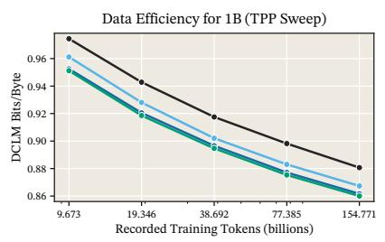

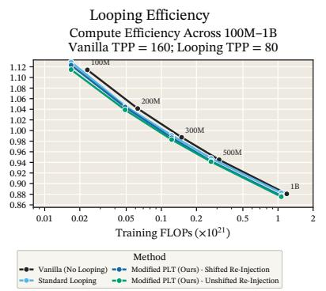

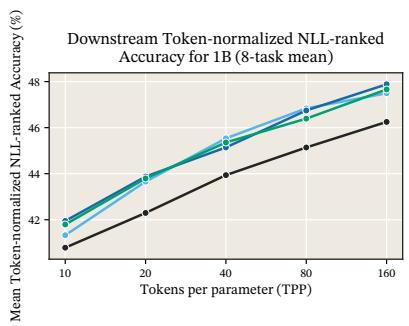  
Figure 9 Raw scaling curves underlying the relative-efficiency analysis. We plot observed DCLM validation BPB together with unconstrained Vanilla scaling-law fits. Left: BPB as a function of actual training tokens for fixed 1B models across training-token budgets. Middle: BPB as a function of total training FLOPs across model families from 100M to 1B. Vanilla models use TPP = 160, whereas looping models use two loops and $\mathrm { T P P } = 8 0 $ . Points show observed runs, connecting lines show empirical trajectories, and dashed black curves show fitted Vanilla scaling laws. Lower BPB is better.

Looping increases the computation applied to each token but may reduce the amount of training needed to reach a given quality. We measure data eficiency by the number of training tokens required by a model to reach a target BPB, and $F L O P$ eficiency by the total training FLOPs required by a model to reach the same BPB. Following Team (2026), we fit two curves to the BPB achieved by Vanilla (No Looping) models: one as a function of training tokens and one as a function of total training FLOPs. Both use $L ( x ) = A x ^ { - \alpha } + E .$ , with A, α, and E estimated by unweighted, unconstrained nonlinear least squares minimizing $\textstyle \sum _ { i } [ L _ { i } - ( A x _ { i } ^ { - \alpha } + E ) ] ^ { 2 }$ . Only non-looping models are used to fit these curves. For a looped model achieving BPB $L ^ { \prime }$ at cost $x ^ { \prime }$ , we estimate the cost that a non-looping model would require to achieve the same BPB as $f ^ { - 1 } ( L ^ { \prime } ) = [ A / ( L ^ { \prime } - E ) ] ^ { 1 / \alpha }$ . We define the relative eficiency gain as $E G _ { x } = f ^ { - 1 } ( L ^ { \prime } ) / x ^ { \prime }$ , where $E G _ { x } > 1$ means that the looped model uses fewer tokens or FLOPs than the fitted non-looping baseline. For data eficiency, we fit 1B non-looping models across training-token budgets. The looping models reach a given BPB using fewer tokens, with the modified PLT variants providing the largest relative gains. For FLOP eficiency, we fit non-looping models from 100M to 1B using their total training FLOPs. In the evaluated over-trained regime, two-loop models trained at TPP 80 reach a given BPB using fewer FLOPs than non-looping models trained at TPP 160. The key conclusion is that looping is not only parameter-eficient. In the evaluated over-trained regime, its additional computation per token reduces the required training data enough to lower total training FLOPs, making looping both data- and FLOP-eficient. This benefit is not uniform, however, and weakens as the number of loops increases.

## D.2 Task-Level Results Behind the Headline Comparison

The right panel of Figure 1 reports the unweighted mean across eight reasoning and question-answering tasks. Here, we provide task-level results and report MMLU and MMLU-Pro separately to evaluate performance across a broad range of academic subjects. We compare four 1B model families at $\mathrm { T P P } \in \{ 1 0 , 2 0 , 4 0 , 8 0 , 1 6 0 \}$ : Vanilla (L = 1), Full-Stack Looping (L = 2, labeled Standard Looping in the headline figure), Normalized Shifted PLT (L = 2), and Normalized Unshifted PLT (L = 2). Both PLT variants use the rank-8 linear gate.

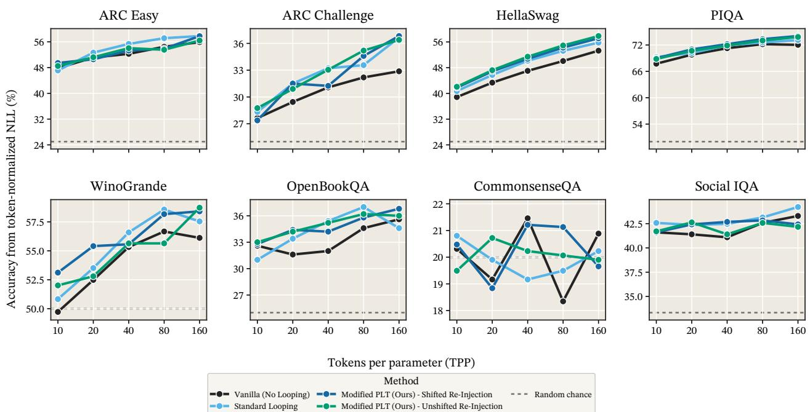  
Figure 10 Task-level NLL-ranked accuracy for the 1B models. Results are shown for ARC Easy, ARC Challenge, HellaSwag, PIQA, WinoGrande, OpenBookQA, CommonsenseQA, and Social IQA. For each question, the model predicts the candidate with the lowest token-normalized NLL. Dashed horizontal lines denote random-choice accuracy. Lines connect measured checkpoints and are not fitted scaling laws. Higher is better.

Downstream metrics. For each question, we score every answer option c by its average negative log-likelihood (NLL) per tokenizer token, $\begin{array} { r } { q _ { c } \stackrel { \bullet } { = } - \frac { 1 } { T _ { c } } \sum _ { t = 1 } ^ { T _ { c } } \log p _ { \theta } ( x _ { c , t } } \end{array}$ | prompt, xc,<t), where $T _ { c }$ is the number of tokens in option $c , \ x _ { c , t }$ is its t-th token, and $x _ { c , < t }$ denotes its preceding tokens. We predict the option with the lowest $q _ { c } .$ . Figure 10 reports NLL-ranked accuracy on ARC Easy, ARC Challenge, HellaSwag, PIQA, WinoGrande, OpenBookQA, CommonsenseQA, and Social IQA. The headline figure reports the unweighted mean across these eight tasks. The upper panel of Figure 12 reports macro-averaged accuracy for MMLU and MMLU-Pro. NLL-ranked accuracy records only whether the correct answer option has the best score, not how strongly it is preferred. For a question with $C$ answer options, we therefore normalize the scores as $\begin{array} { r } { \pi ( c ) = \exp ( - q _ { c } ) / \sum _ { j = 1 } ^ { C } \exp ( - q _ { j } ) } \end{array}$ , and report the target NLL − log π(c⋆), where $c ^ { \star }$ is the correct option. A lower value means that the model assigns greater relative preference to the correct option, even when the predicted answer remains unchanged. These results appear in Figure 11 and the lower panel of Figure 12. Dashed lines show the random-choice baselines $1 / C$ for accuracy and log C for target NLL. Both metrics evaluate the provided answer options rather than free-form generation.

Looping improves performance on most downstream tasks. At TPP = 160, Full-Stack Looping, Normalized Shifted PLT, and Normalized Unshifted PLT outperform Vanilla on six of the eight tasks in Figure 10. The clearest improvements occur on ARC Challenge and HellaSwag, with additional gains on ARC Easy, PIQA, WinoGrande, and OpenBookQA. CommonsenseQA remains close to the random-choice baseline and varies non-monotonically across training budgets, while Social IQA shows no consistent improvement. No looping method dominates every task, but Normalized Shifted PLT generally tracks the sequential looping methods, suggesting that parallel loop execution does not impose a systematic downstream-accuracy penalty.

Looping lowers correct-answer NLL on most downstream tasks. The target-NLL results in Figure 11 show the same general pattern as accuracy. At TPP = 160, every looping method achieves lower choice-normalized target NLL than Vanilla on the same six tasks. CommonsenseQA remains variable and close to its random-choice baseline, while Social IQA shows smaller, method-dependent diferences. Thus, the aggregate improvement is distributed across several tasks rather than driven by a single benchmark, although it is not universal.

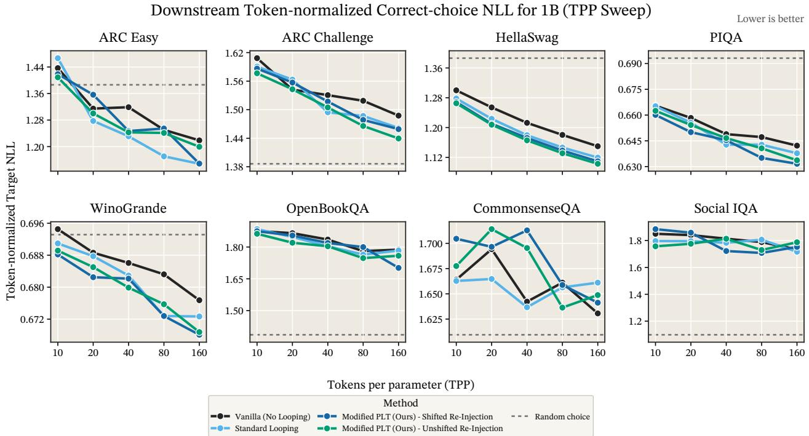  
Figure 11 Candidate-normalized correct-answer NLL for the same eight tasks. Candidate scores are computed from token-normalized NLL and normalized across the available answers. This continuous metric measures how strongly the model prefers the correct answer relative to the alternatives, including changes that do not alter the top-ranked answer. Dashed lines show the random-choice value log C for a task with C candidates. Because choice counts and prompt formats difer, values should be compared within, rather than across, datasets. Lower is better.

MMLU and MMLU-Pro remain near chance. We exclude these benchmarks from the eight-task headline mean and report them separately in Figure 12. None of the architectures produces a consistent NLL-ranked accuracy advantage across the TPP sweep. Although the candidate-normalized correct-answer NLL on MMLU-Pro generally improves with additional training, it remains above the random-choice reference. These results provide a useful knowledge diagnostic, but do not show that looping improves MMLU-style performance at this scale.

MMLU NLL-ranked Accuracy for 1B (TPP Sweep)  
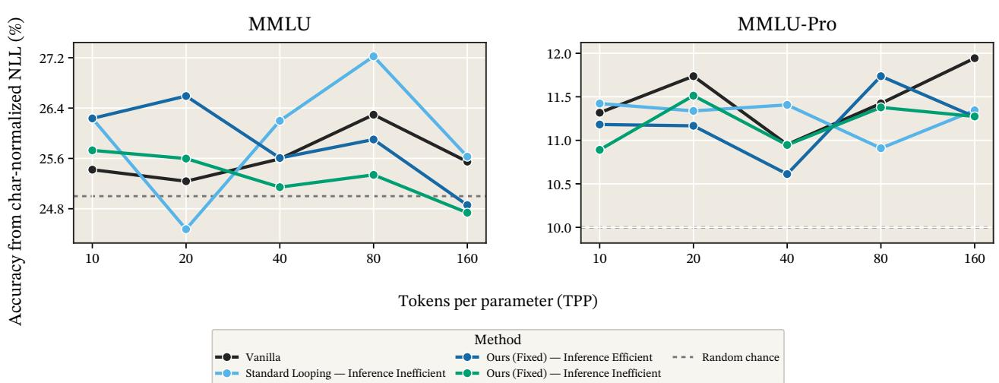  
MMLU Correct-choice Normalized NLL for 1B (TPP Sweep)

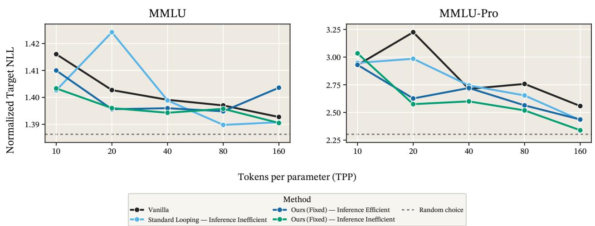  
Figure 12 MMLU and MMLU-Pro results for the 1B models. Top: macro-averaged NLL-ranked accuracy, where the predicted answer is the candidate with the lowest token-normalized NLL. Bottom: candidate-normalized correct-answer NLL. Accuracy remains near the respective random-choice baselines, while candidate-normalized correct-answer NLL remains at or above the random-choice reference, particularly on MMLU-Pro. Dashed lines denote random-choice performance. Higher accuracy and lower NLL are better.

## E Additional Results on Looping Designs and Regimes

This appendix section provides the additional results supporting subsection 3.2. The 100M and 500M results shown in Figure 3 are complemented by experiments at 70M, 200M, and 300M, a separate 1B study, and evaluations on additional datasets. We first summarize the models, loop factors, and evaluation setup used in these experiments, and then present the full DCLM results, other dataset comparisons, the 1B extension, and mathematical and code likelihood evaluations.

## E.1 Experimental Setup for the Additional Results

Models and loop factors. For 70M and 100M models, we evaluate TPP values 10, 20, 40, 70, 100, 120, 140, and 160, with loop factors $L \in \{ 1 , 2 , 4 , 8 , 1 6 , 3 2 \}$ . For 200M, 300M, and 500M models, we evaluate TPP values 10, 20, 40, 70, and 100, with loop factors $L \in \{ 1 , 2 , 4 , 8 \}$ . Not every configuration produces a stable run. The 1B experiments use a smaller set of loop factors and are described separately in subsection E.4.

Looping designs and training compute. We use the same looping designs introduced in subsection B.1 and illustrated in Figure 2. In the figure legends, Stack Loop denotes Full-Stack Looping, Layer Loop denotes per-layer looping, and Both Loop denotes separately looping the attention and MLP sublayers. All designs use exact parameter sharing across loops. For a model with B Transformer Blocks, Full-Stack Looping repeats the entire sequence of Transformer Blocks L times, while Per-Layer Looping repeats each Transformer Block L times before proceeding to the next; both therefore have an efective depth of LB. The middle variants restrict this repeated computation to the middle M Transformer Blocks of the network. Middle-Stack Looping repeats these M Transformer Blocks together as a stack, whereas Middle-Layer Looping repeats each of these Transformer Blocks individually. The Transformer Blocks before and after the middle region are used only once, giving both middle variants an efective depth of $B + ( L - 1 ) M$ . Thus, at the same loop factor L, the middle variants require less training compute because only the middle portion of the network is repeated.

Evaluation. Each panel fixes model scale and TPP, where TPP denotes training tokens per non-embedding parameter. We report teacher-forced bits per byte (BPB), with lower values indicating better likelihood. The L = 1 model is the standard non-looped baseline and is labeled Vanilla. In figures with training FLOPs on the horizontal axis, marker shape denotes the loop factor. These comparisons capture training compute only; they do not account for system-level efects such as communication overhead or realized hardware throughput.

Unstable runs. Some configurations become unstable during training and are excluded by our shared stability criterion. We mark these runs with red stars in the figures. If the corresponding BPB falls outside the displayed y-axis range, the star is shown at the edge of the panel only to indicate that the run was unstable; its vertical position should not be interpreted as the measured BPB. These points are therefore diferent from configurations for which an evaluation is simply missing. For example, in the small-model mathematical and code experiments, 11 of the 80 Both Loop configurations are unstable, mostly at $L = 3 2$ and at several high-TPP 100M settings with $L = 8$

## E.2 BPB Results on DCLM

How looping behavior changes with scale and loop factor. Figure 13 and Figure 14 show how the preferred looping design changes across model scales and as the loop factor L increases. At 70M and 100M, several designs are competitive at small L, and the strongest choice depends on TPP. The 200M results remain mixed: Middle-Stack Looping can match or outperform Full-Stack Looping at lower TPP, while full-stack looping becomes stronger as TPP increases. At 300M and 500M, full-stack looping more consistently reaches the lowest BPB. At the same time, increasing L shows diminishing returns. In the 70M and 100M sweeps, which extend to $L = 3 2$ , the reduction in BPB typically becomes smaller as L grows and can eventually saturate or reverse, especially for designs that loop the attention and MLP sublayers separately. Full-stack and Middle-Stack Looping remain more stable over a wider range of L, but their gains also diminish as looping increases. The 200M–500M experiments extend only to $L = 8 ,$ so they do not directly establish where these gains eventually saturate or reverse. However, the marginal reduction in BPB already becomes smaller as L increases, suggesting that further looping would eventually reach a saturation regime rather than continue providing comparable gains at each increase in loop factor.

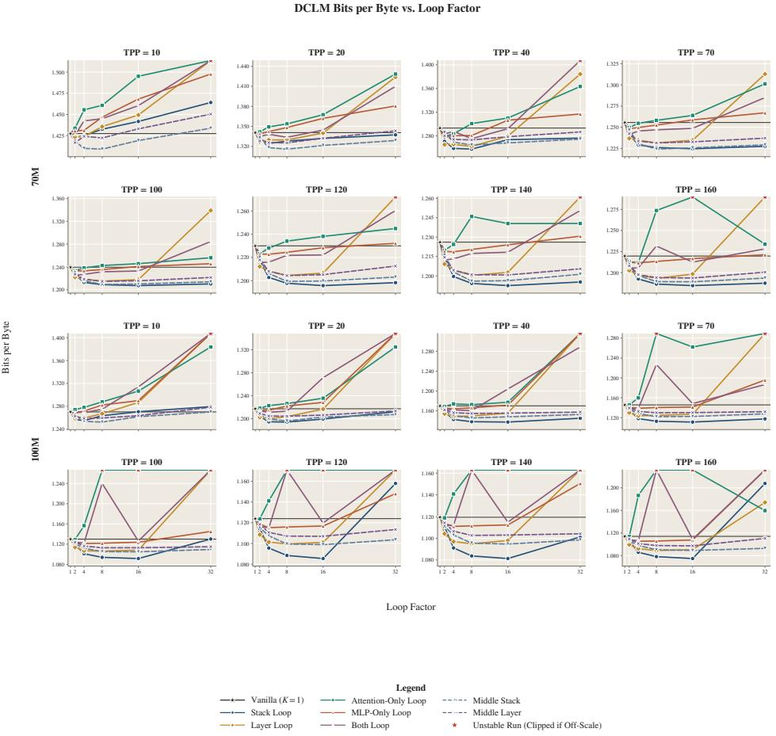  
Figure 13 DCLM BPB versus loop factor L: 70M and 100M models. Results span TPP 10 to 160 and loop factors $L \in \{ 1 , 2 , 4 , 8 , 1 6 , 3 2 \}$ . Each panel fixes model scale and TPP, allowing the efect of increasing the loop factor to be compared across looping designs. Lower BPB is better; red stars denote unstable runs as described in subsection E.1.

How the compute budget changes the preferred looping design. Figure 15 and Figure 16 compare DCLM BPB against total training FLOPs across all model scales. When only a modest increase in training compute is available, Middle-Stack Looping often provides a larger improvement for the additional FLOPs because only the middle portion of the network is repeated. With a larger compute budget, Full-Stack Looping can attain lower absolute BPB, particularly at 300M and 500M, where it more consistently reaches the strongest quality among the evaluated looping designs. The 70M and 100M results also show that spending progressively more compute by increasing the loop factor L eventually gives diminishing returns: the BPB reductions become smaller and can ultimately saturate or reverse. The 200M–500M sweeps extend only to L = 8, but their marginal gains also tend to shrink as L increases. Together, these results support the same trade-of observed in the main text: Middle-Stack Looping is often more attractive when additional training compute is limited, whereas Full-Stack Looping can achieve better quality when more compute is available.

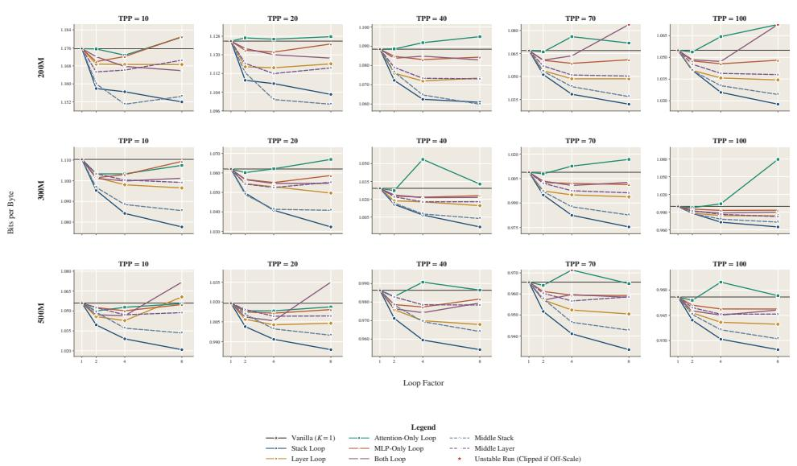  
Figure 14 DCLM BPB versus loop factor L: 200M, 300M, and 500M models. Results span TPP 10 to 100 and loop factors $L \in \{ 1 , 2 , 4 , 8 \}$ . Each panel fixes model scale and TPP, allowing the efect of increasing the loop factor to be compared across looping designs. Lower BPB is better; red stars denote unstable runs as described in subsection E.1.

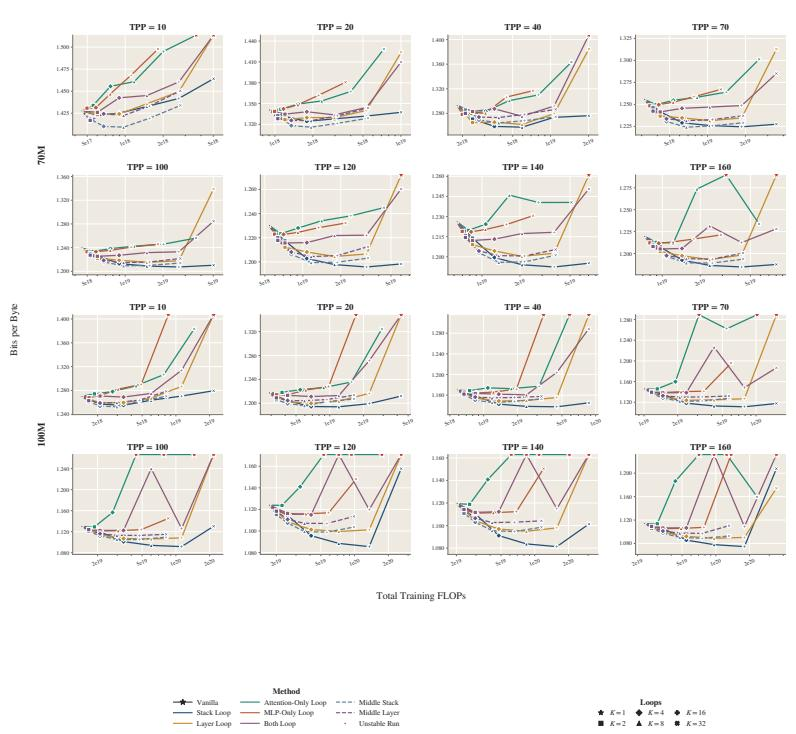  
Figure 15 DCLM BPB versus total training FLOPs: 70M and 100M models. Results span TPP 10 to 160 and loop factors $L \in \{ 1 , 2 , 4 , 8 , 1 6 , 3 2 \}$

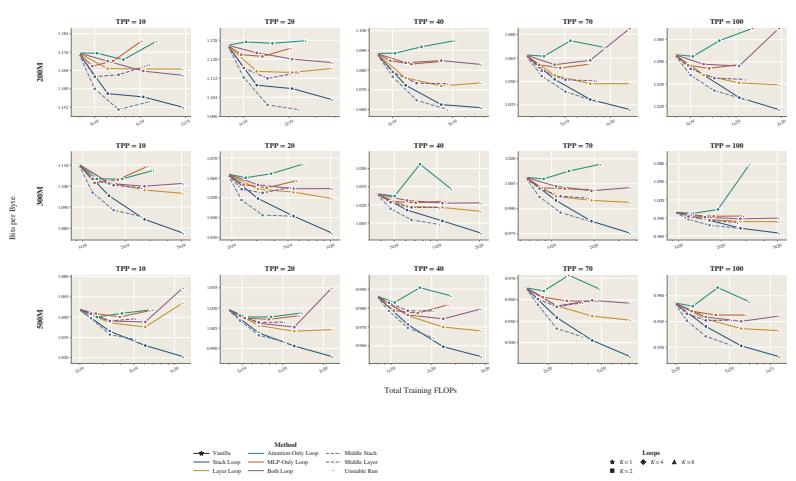  
Figure 16 DCLM BPB versus total training FLOPs: 200M, 300M, and 500M models. Results span TPP 10 to 100 and loop factors $L \in \{ 1 , 2 , 4 , 8 \}$ . Middle-Stack Looping often achieves strong gains for a smaller increase in compute, while Full-Stack Looping can attain lower BPB when more training compute is available.

## E.3 Do the Looping Trends Hold Across Other Datasets?

We next ask whether the trends observed on DCLM persist across other datasets. We first evaluate additiona pretraining corpora: C4 (subsubsection E.3.1), WikiText-103 (subsubsection E.3.2), Dolma v1.5 (subsubsection E.3.3), RedPajama (subsubsection E.3.4), and Dolma Programming Languages (subsubsection E.3.5). We then consider more specialized mathematical and code datasets: GSM8K (subsubsection E.3.6), MATH (subsubsection E.3.7), HumanEval (subsubsection E.3.8), and MBPP (subsubsection E.3.9). Across the additional pretraining corpora, the same broad pattern observed on DCLM generally persists. At smaller model scales and lower TPP, full-stack and Middle-Stack Looping are often competitive, while full-stack looping becomes more consistently favorable as model scale and TPP increase. When training compute is considered, shallow Middle-Stack Looping remains an attractive alternative because it can achieve substantial quality gains while repeating only part of the network. The mathematical and code datasets exhibit more variation across looping designs, but broadly retain the tendency for Full-Stack Looping to become more favorable at larger scales and higher TPP. Across both groups of datasets, the gains from increasing the loop factor L also tend to diminish as L grows.

## E.3.1 C4 English

The C4 sweeps in Figure 17, Figure 18, Figure 19, and Figure 20 closely follow the DCLM pattern: rankings are more mixed at smaller scales, while Full-Stack Looping becomes more favorable at larger scales and middle-stack remains attractive for modest compute increments.

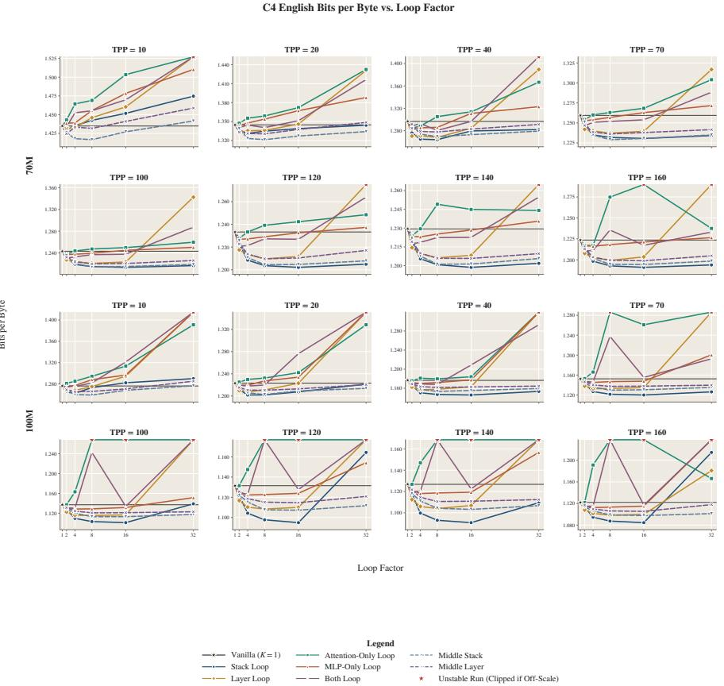  
Figure 17 C4 English BPB versus loop factor L: 70M and 100M models. Results span TPP 10 to 160 and loop factors $L \in \{ 1 , 2 , 4 , 8 , 1 6 , 3 2 \}$ . At these smaller scales, several looping designs remain competitive, while the improvement from increasing L generally diminishes at larger loop factors. Each panel fixes model scale and TPP. Lower BPB is better; red stars denote unstable runs as described in subsection E.1.

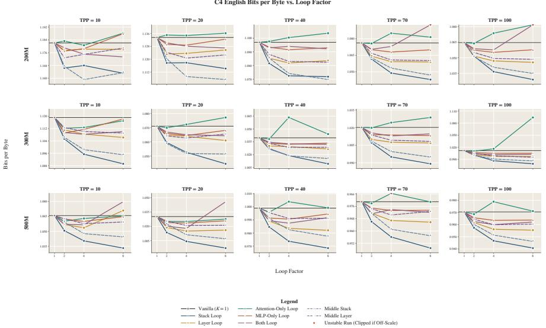  
Figure 18 C4 English BPB versus loop factor L: 200M, 300M, and 500M models. Results span TPP 10 to 100 and loop factors $L \in \{ 1 , 2 , 4 , 8 \}$ . As model scale and TPP increase, Full-Stack Looping more consistently attains lower BPB, while the marginal improvement from increasing L becomes smaller. Each panel fixes model scale and TPP. Lower BPB is better; red stars denote unstable runs as described in subsection E.1.

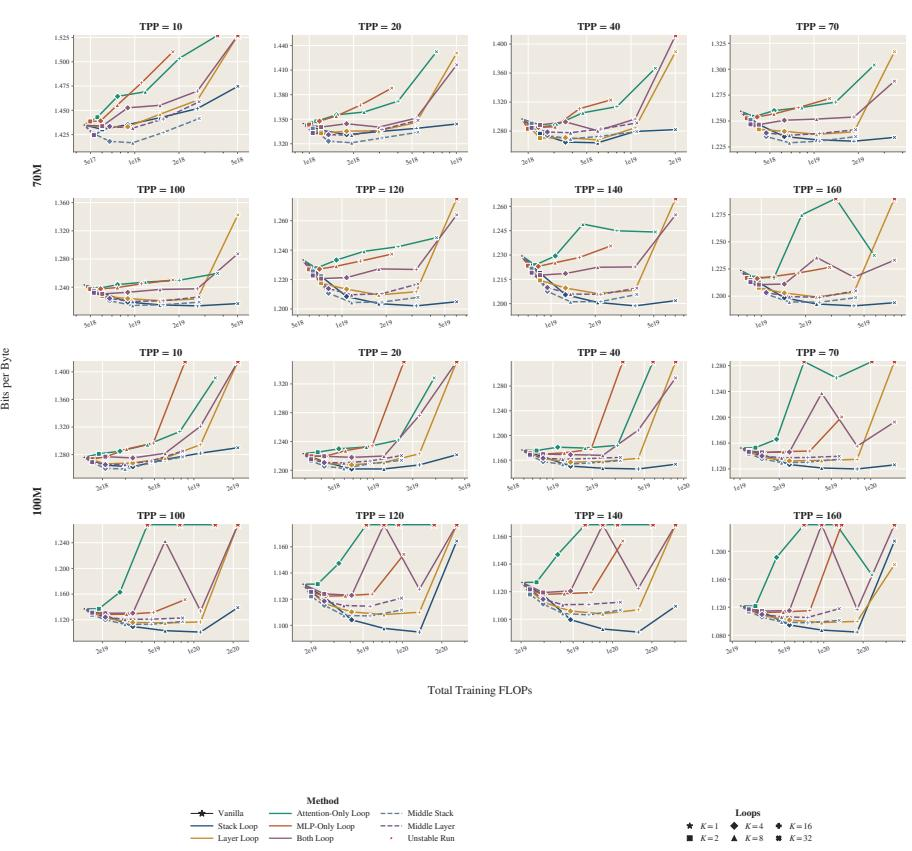  
Figure 19 C4 English BPB versus total training FLOPs: 70M and 100M models. Results span TPP 10 to 160 and loop factors $L \in \{ 1 , 2 , 4 , 8 , 1 6 , 3 2 \}$ . Middle-Stack Looping often captures much of the quality improvement with a smaller increase in training compute, while spending additional FLOPs through larger loop factors eventually shows diminishing returns. Each panel fixes model scale and TPP. Lower BPB is better; red stars denote unstable runs as described in subsection E.1.

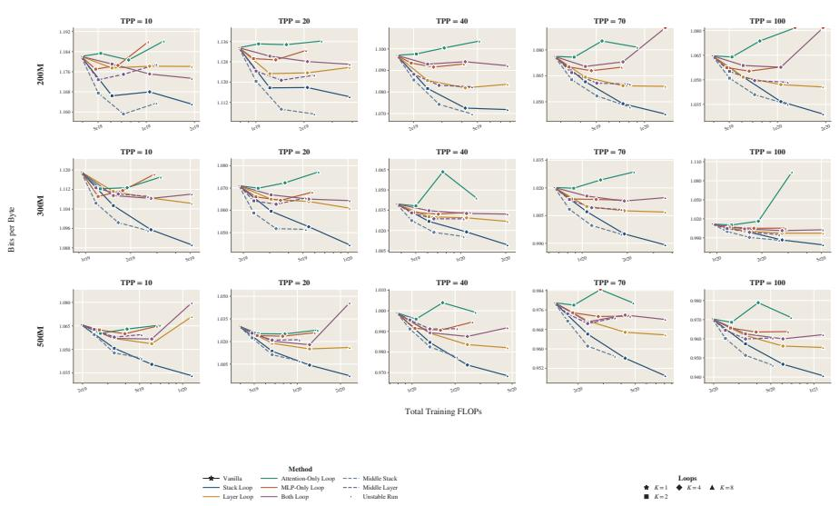  
Figure 20 C4 English BPB versus total training FLOPs: 200M, 300M, and 500M models. Results span TPP 10 to 100 and loop factors $L \in \{ 1 , 2 , 4 , 8 \}$ . Middle-Stack Looping often provides strong gains for a smaller increase in training compute, while Full-Stack Looping can attain lower BPB when more compute is available, particularly at the larger model scales. Each panel fixes model scale and TPP. Lower BPB is better; red stars denote unstable runs as described in subsection E.1.

## E.3.2 WikiText-103

The WikiText-103 results in Figure 21, Figure 22, Figure 23, Figure 24 show the same broad trends observed on DCLM and C4. At smaller model scales and lower TPP, several looping designs remain competitive, and the preferred design depends on the training regime and loop factor L. As model scale and TPP increase, Full-Stack Looping more consistently attains lower BPB. When training compute is considered, however, shallow Middle-Stack Looping remains attractive because it can achieve substantial quality improvements with a smaller increase in FLOPs. The gains from increasing L also tend to diminish at larger loop factors.

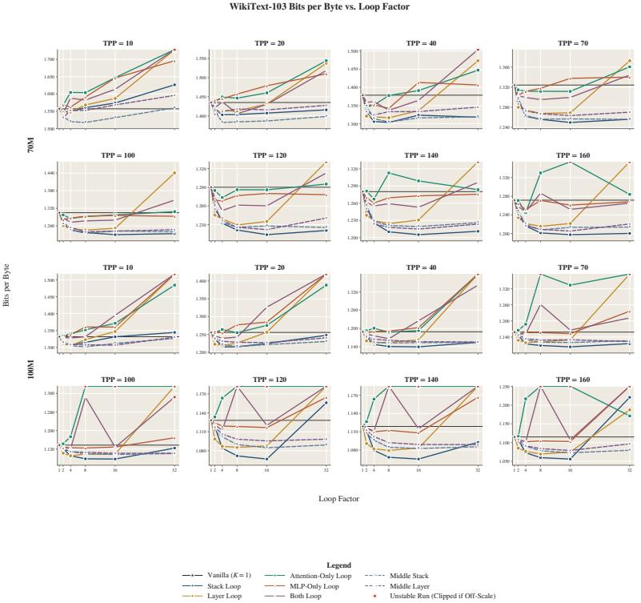  
Figure 21 WikiText-103 BPB versus loop factor L: 70M and 100M models. Results span TPP 10 to 160 and loop factors $L \in \{ 1 , 2 , 4 , 8 , 1 6 , 3 2 \}$ . At these smaller scales, several looping designs remain competitive, while the improvement from increasing L generally diminishes at larger loop factors. Each panel fixes model scale and TPP. Lower BPB is better; red stars denote unstable runs as described in subsection E.1.

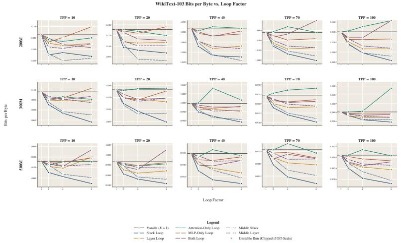  
Figure 22 WikiText-103 BPB versus loop factor L: 200M, 300M, and 500M models. Results span TPP 10 to 100 and loop factors $L \in \{ 1 , 2 , 4 , 8 \}$ . As model scale and TPP increase, Full-Stack Looping more consistently attains lower BPB, while the marginal improvement from increasing L becomes smaller. Each panel fixes model scale and TPP. Lower BPB is better; red stars denote unstable runs as described in subsection E.1.

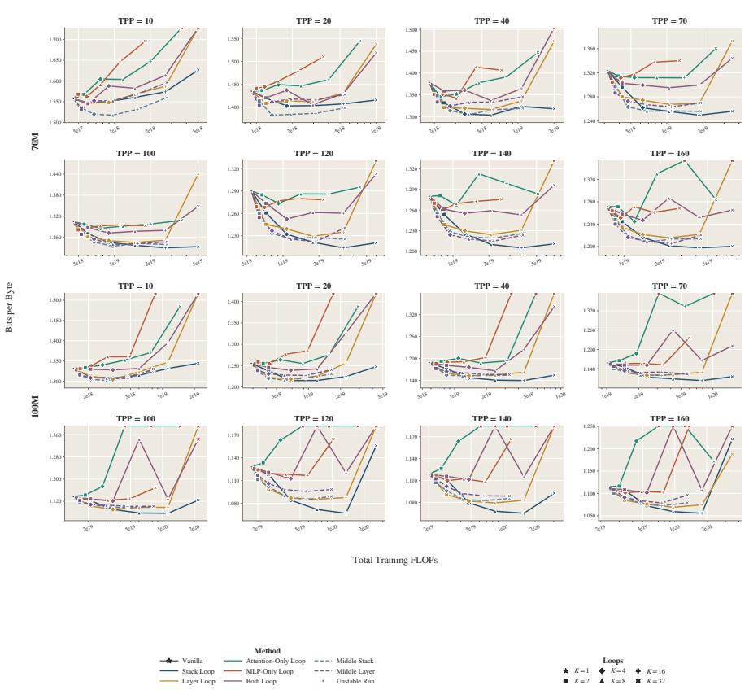  
Figure 23 WikiText-103 BPB versus total training FLOPs: 70M and 100M models. Results span TPP 10 to 160 and loop factors $L \in \{ 1 , 2 , 4 , 8 , 1 6 , 3 2 \}$ . Middle-Stack Looping often captures much of the quality improvement with a smaller increase in training compute, while increasing the loop factor further eventually gives diminishing returns. Each panel fixes model scale and TPP. Lower BPB is better; red stars denote unstable runs as described in subsection E.1.

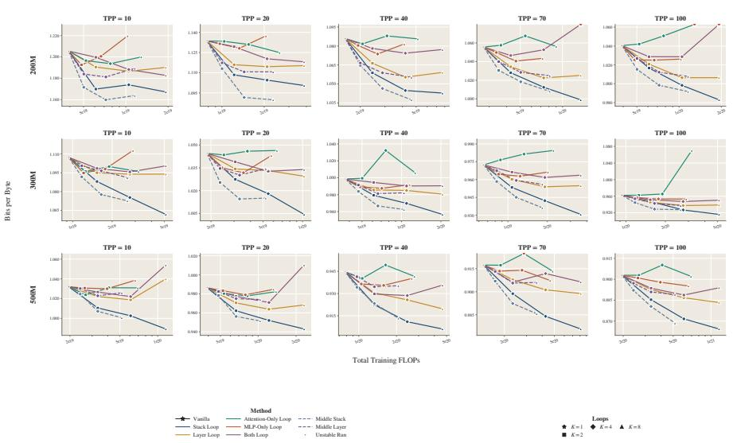  
Figure 24 WikiText-103 BPB versus total training FLOPs: 200M, 300M, and 500M models. Results span TPP 10 to 100 and loop factors $L \in \{ 1 , 2 , 4 , 8 \}$ . Middle-Stack Looping often provides strong gains for a smaller increase in training compute, while Full-Stack Looping can attain lower BPB when more compute is available, particularly at larger model scales. Each panel fixes model scale and TPP. Lower BPB is better; red stars denote unstable runs as described in subsection E.1.

## E.3.3 Dolma v1.5

The Dolma v1.5 results in Figure 25, Figure 26, Figure 27, Figure 28 show the same broad trends observed on DCLM, C4, and WikiText-103. At smaller model scales and lower TPP, several looping designs remain competitive, and the preferred design depends on the training regime and loop factor L. As model scale and TPP increase, Full-Stack Looping more consistently attains lower BPB. When training compute is considered, however, shallow Middle-Stack Looping remains attractive because it can provide substantial quality gains with a smaller increase in FLOPs. The benefit from increasing L also tends to diminish at larger loop factors.

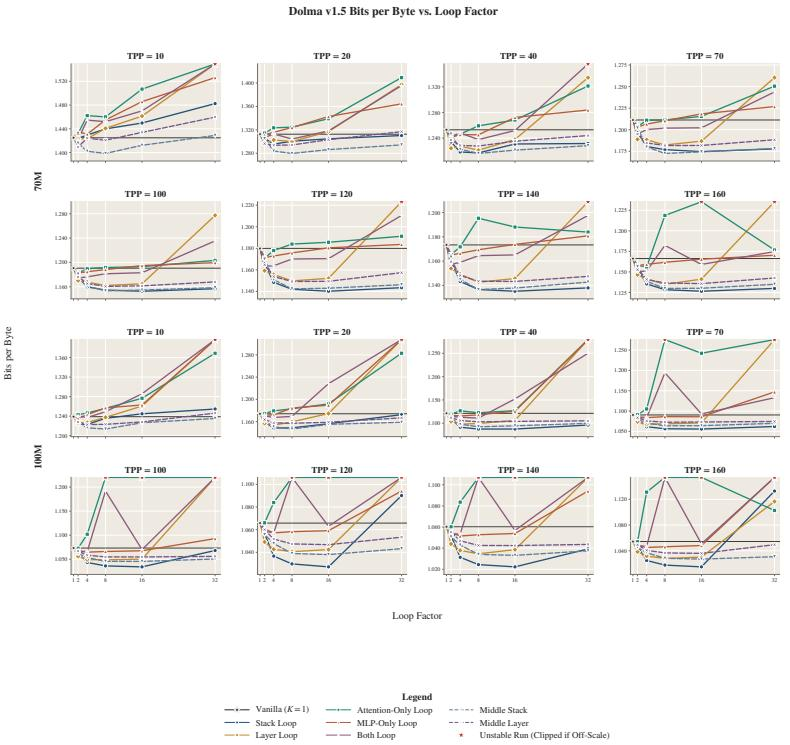  
Figure 25 Dolma v1.5 BPB versus loop factor L: 70M and 100M models. Results span TPP 10 to 160 and loop factors $L \in \{ 1 , 2 , 4 , 8 , 1 6 , 3 2 \}$ . At these smaller scales, several looping designs remain competitive, while the improvement from increasing L generally diminishes at larger loop factors. Each panel fixes model scale and TPP. Lower BPB is better; red stars denote unstable runs as described in subsection E.1.

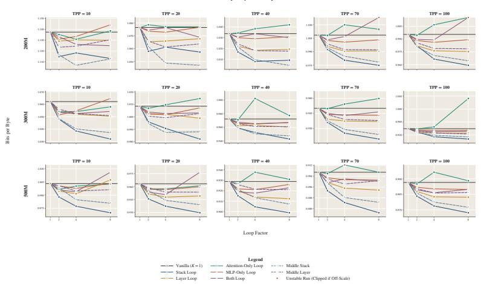  
Figure 26 Dolma v1.5 BPB versus loop factor L: 200M, 300M, and 500M models. Results span TPP 10 to 100 and loop factors $L \in \{ 1 , 2 , 4 , 8 \}$ . As model scale and TPP increase, Full-Stack Looping more consistently attains lower BPB, while the marginal improvement from increasing L becomes smaller. Each panel fixes model scale and TPP. Lower BPB is better; red stars denote unstable runs as described in subsection E.1.

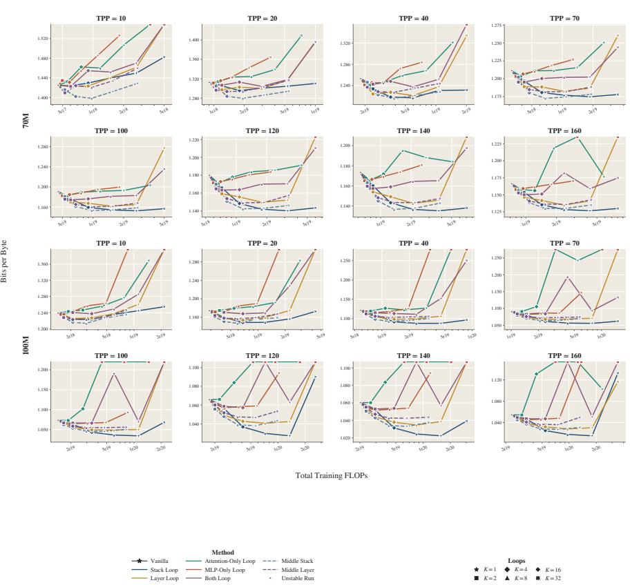  
Figure 27 Dolma v1.5 BPB versus total training FLOPs: 70M and 100M models. Results span TPP 10 to 160 and loop factors $L \in \{ 1 , 2 , 4 , 8 , 1 6 , 3 2 \}$ . Middle-Stack Looping often captures much of the quality improvement with a smaller increase in training compute, while increasing the loop factor further eventually gives diminishing returns. Each panel fixes model scale and TPP. Lower BPB is better; red stars denote unstable runs as described in subsection E.1.

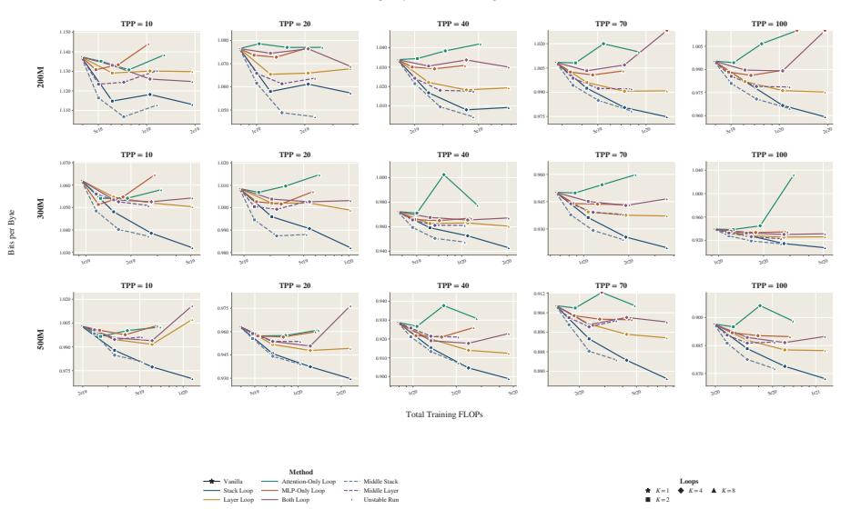  
Figure 28 Dolma v1.5 BPB versus total training FLOPs: 200M, 300M, and 500M models. Results span TPP 10 to 100 and loop factors $L \in \{ 1 , 2 , 4 , 8 \}$ . Middle-Stack Looping often provides strong gains for a smaller increase in training compute, while Full-Stack Looping can attain lower BPB when more compute is available, particularly at larger model scales. Each panel fixes model scale and TPP. Lower BPB is better; red stars denote unstable runs as described in subsection E.1.

## E.3.4 RedPajama

The RedPajama results in Figure 29, Figure 30, Figure 31, Figure 32 show the same broad trends observed across the other pretraining corpora. At smaller model scales and lower TPP, several looping designs remain competitive, and the preferred design depends on the training regime and loop factor L. As model scale and TPP increase, Full-Stack Looping more consistently attains lower BPB. When training compute is considered, however, shallow Middle-Stack Looping remains attractive because it can provide substantial quality gains with a smaller increase in FLOPs. The benefit from increasing L also tends to diminish at larger loop factors.

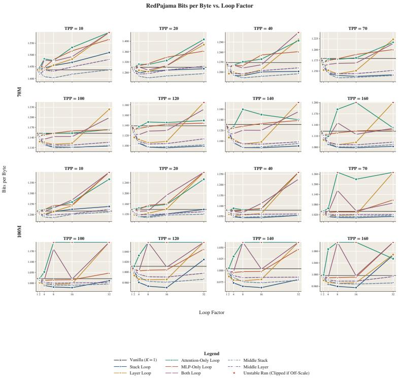  
Figure 29 RedPajama BPB versus loop factor L: 70M and 100M models. Results span TPP 10–160 and loop factors $L \in \{ 1 , 2 , 4 , 8 , 1 6 , 3 2 \}$ . At these smaller scales, several looping designs remain competitive, while the improvement from increasing L generally diminishes at larger loop factors. Each panel fixes model scale and TPP. Lower BPB is better; red stars denote unstable runs as described in subsection E.1.

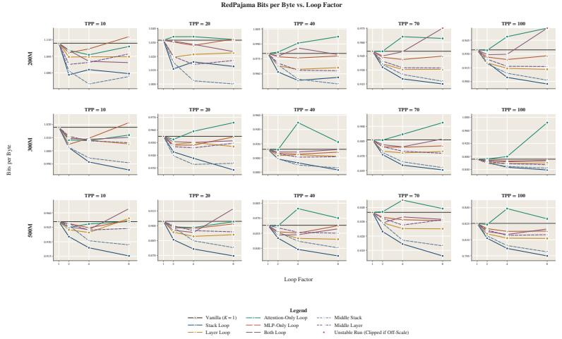  
Figure 30 RedPajama BPB versus loop factor L: 200M, 300M, and 500M models. Results span TPP 10–100 and loop factors $L \in \{ 1 , 2 , 4 , 8 \}$ . As model scale and TPP increase, Full-Stack Looping more consistently attains lower BPB, while the marginal improvement from increasing L becomes smaller. Each panel fixes model scale and TPP. Lower BPB is better; red stars denote unstable runs as described in subsection E.1.

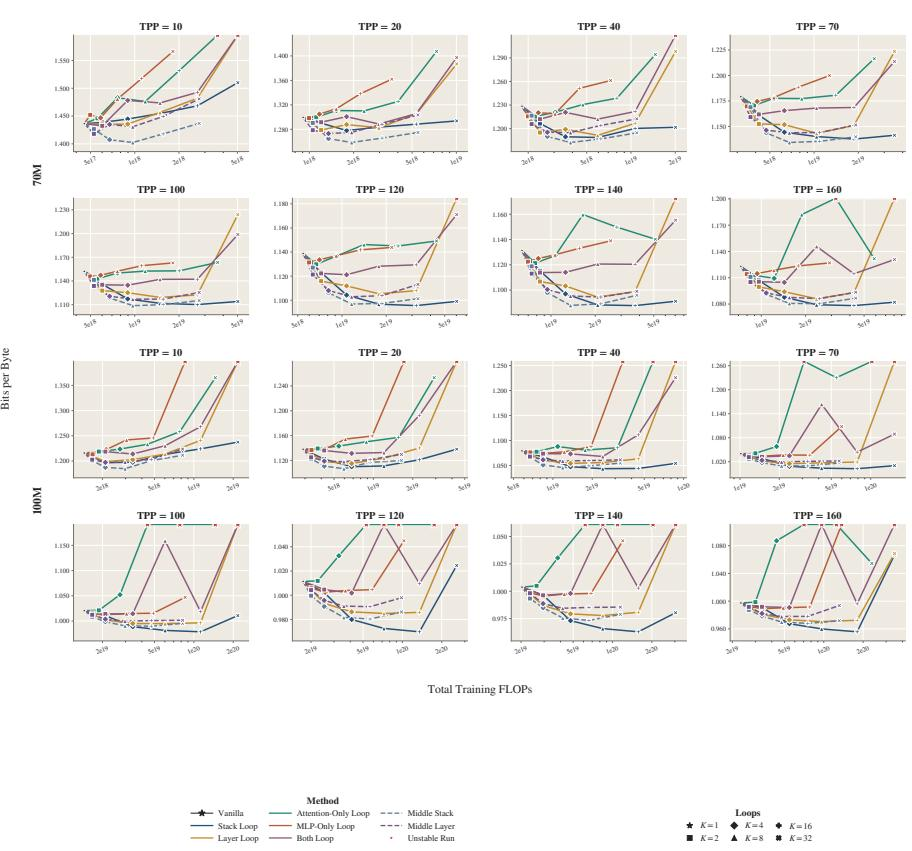  
Figure 31 RedPajama BPB versus total training FLOPs: 70M and 100M models. Results span TPP 10–160 and loop factors $L \in \{ 1 , 2 , 4 , 8 , 1 6 , 3 2 \}$ . Middle-Stack Looping often captures much of the quality improvement with a smaller increase in training compute, while increasing the loop factor further eventually gives diminishing returns. Each panel fixes model scale and TPP. Lower BPB is better; red stars denote unstable runs as described in subsection E.1.

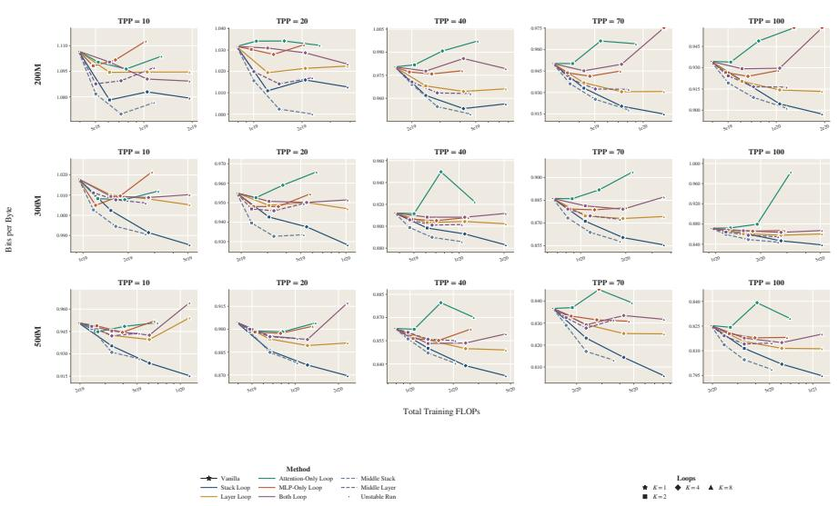  
Figure 32 RedPajama BPB versus total training FLOPs: 200M, 300M, and 500M models. Results span TPP 10–100 and loop factors $L \in \{ 1 , 2 , 4 , 8 \}$ . Middle-Stack Looping often provides strong gains for a smaller increase in training compute, while Full-Stack Looping can attain lower BPB when more compute is available, particularly at larger model scales. Each panel fixes model scale and TPP. Lower BPB is better; red stars denote unstable runs as described in subsection E.1.

## E.3.5 Dolma Programming Languages

The Dolma programming-language results in Figure 33, Figure 34, Figure 35, and Figure 36 show a similar overall pattern, although the diferences between looping designs are more pronounced at lower training budgets. At smaller model scales and lower TPP, Middle-Stack Looping is often especially competitive with Full-Stack Looping. As model scale and TPP increase, Full-Stack Looping more consistently attains lower BPB, particularly at 500M. When training compute is considered, shallow Middle-Stack Looping remains attractive because it can provide strong quality gains with a smaller increase in FLOPs. As on the other corpora, the improvement from increasing the loop factor L also tends to diminish at larger loop factors.

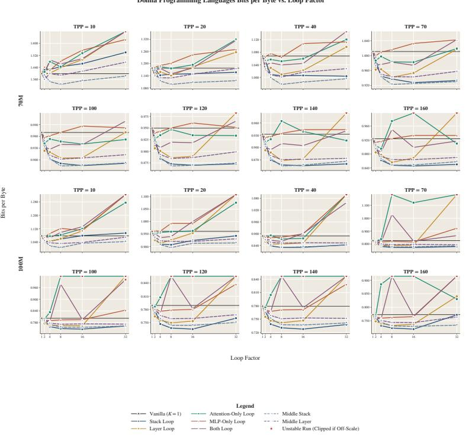  
Figure 33 Dolma programming-language BPB versus loop factor $L { : }$ 70M and 100M models. Results span TPP 10–160 and loop factors $L \in \{ 1 , 2 , 4 , 8 , 1 6 , 3 2 \}$ . At these smaller scales, Middle-Stack Looping is often competitive with Full-Stack Looping, while the improvement from increasing L generally diminishes at larger loop factors. Each panel fixes model scale and TPP. Lower BPB is better; red stars denote unstable runs as described in subsection E.1.

Dolma Programming Languages Bits per Byte vs. Total Training FLOPs  
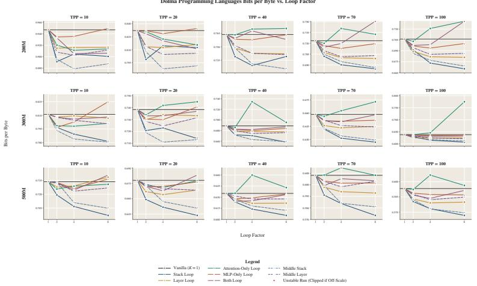  
Figure 34 Dolma programming-language BPB versus loop factor L: 200M, 300M, and 500M models. Results span TPP 10–100 and loop factors $L \in \{ 1 , 2 , 4 , 8 \}$ . As model scale and TPP increase, Full-Stack Looping becomes more consistently favorable, while the marginal improvement from increasing L becomes smaller. Each panel fixes model scale and TPP. Lower BPB is better; red stars denote unstable runs as described in subsection E.1.

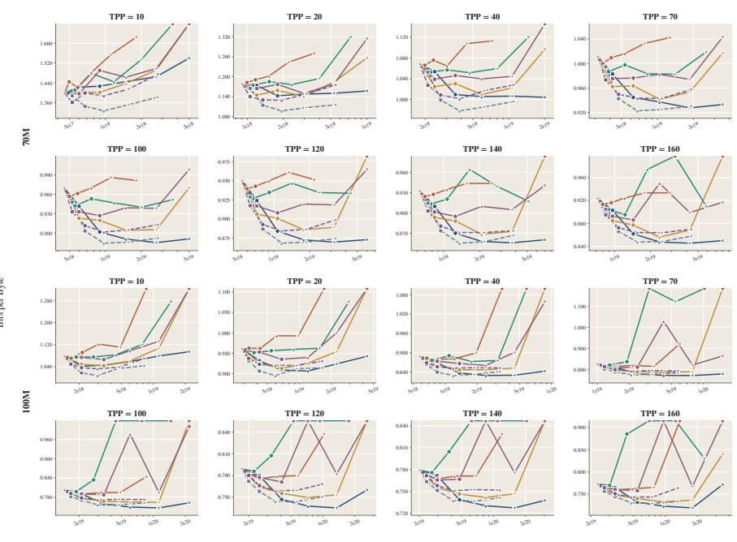  
Figure 35 Dolma programming-language BPB versus total training FLOPs: 70M and 100M models. Results span TPP 10–160 and loop factors $L \in \{ 1 , 2 , 4 , 8 , 1 6 , 3 2 \}$ . Middle-Stack Looping often provides strong quality improvements for a smaller increase in training compute, while spending additional FLOPs through larger loop factors eventually shows diminishing returns. Each panel fixes model scale and TPP. Lower BPB is better; red stars denote unstable runs as described in subsection E.1.

Dolma Programming Languages Bits per Byte vs. Total Training FLOPs  
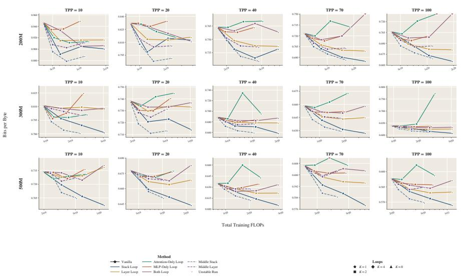  
Figure 36 Dolma programming-language BPB versus total training FLOPs: 200M, 300M, and 500M models. Results span TPP 10–100 and loop factors $L \in \{ 1 , 2 , 4 , 8 \}$ . Middle-Stack Looping remains competitive for smaller increases in training compute, while Full-Stack Looping can attain lower BPB when more compute is available, particularly at the larger model scales. Each panel fixes model scale and TPP. Lower BPB is better; red stars denote unstable runs as described in subsection E.1.

## E.3.6 GSM8K

The GSM8K results in Figure 37 and Figure 38 show more variation across looping designs than the general pretraining corpora. At smaller model scales and lower TPP, several designs remain competitive, with no single design consistently attaining the lowest BPB. As model scale and TPP increase, Full-Stack Looping becomes more favorable, although the trend is less uniform than on DCLM. The smaller-model sweeps also show diminishing returns as the loop factor L increases: BPB typically improves initially, but the reduction becomes smaller at larger L and can eventually saturate or reverse. These results measure teacher-forced likelihood on GSM8K rather than generated-answer accuracy.

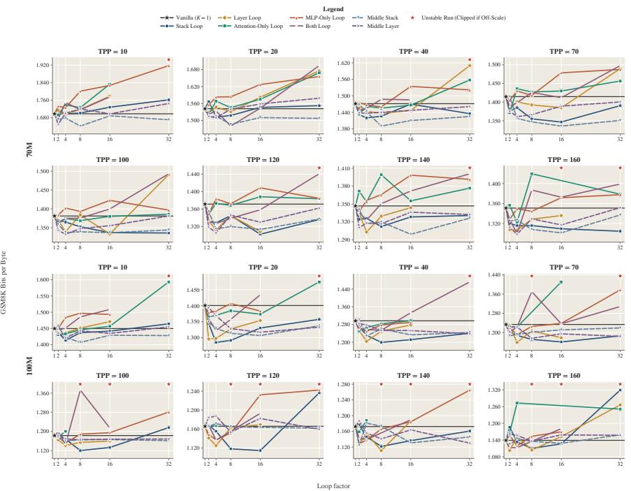  
Figure 37 GSM8K BPB versus loop factor L: 70M and 100M models. Results span TPP 10–160 and loop factors $L \in \{ 1 , 2 , 4 , 8 , 1 6 , 3 2 \}$ . Several looping designs remain competitive, while the improvement from increasing L generally diminishes at larger loop factors. Each panel fixes model scale and TPP. BPB measures teacher-forced likelihood rather than answer accuracy; lower BPB is better. Red stars denote unstable runs as described in subsection E.1.

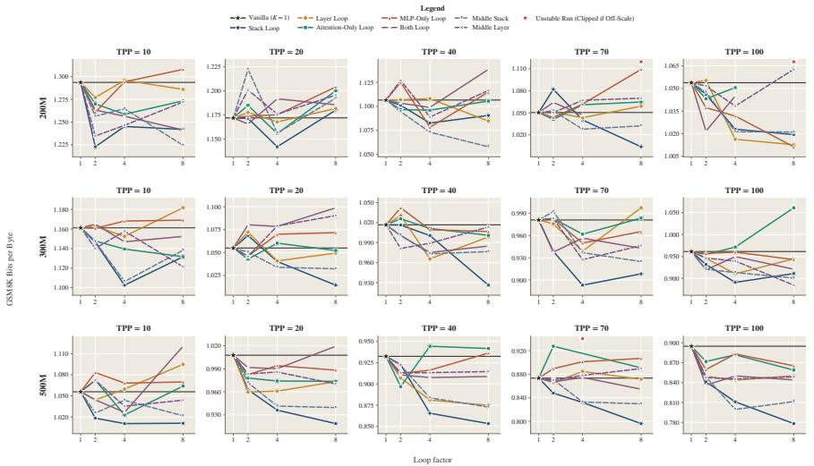  
Figure 38 GSM8K BPB versus loop factor L: 200M, 300M, and 500M models. Results span TPP 10–100 and loop factors $L \in \{ 1 , 2 , 4 , 8 \}$ . Full-Stack Looping becomes more favorable as model scale and TPP increase, although the diferences across looping designs remain less uniform than on the general pretraining corpora. Each panel fixes model scale and TPP. BPB measures teacher-forced likelihood rather than answer accuracy; lower BPB is better.

## E.3.7 MATH

The MATH results in Figure 39 and Figure 40 show a clearer preference for Full-Stack Looping than GSM8K, particularly as model scale and TPP increase. At smaller scales and lower TPP, several looping designs remain competitive, while at larger scales and higher TPP full-stack looping more consistently attains lower BPB. The small-model sweeps also show diminishing returns as the loop factor L increases: the reduction in BPB generally becomes smaller at larger L, and deeper looping can eventually cease to improve quality. These results measure teacher-forced likelihood on MATH rather than mathematical answer accuracy.

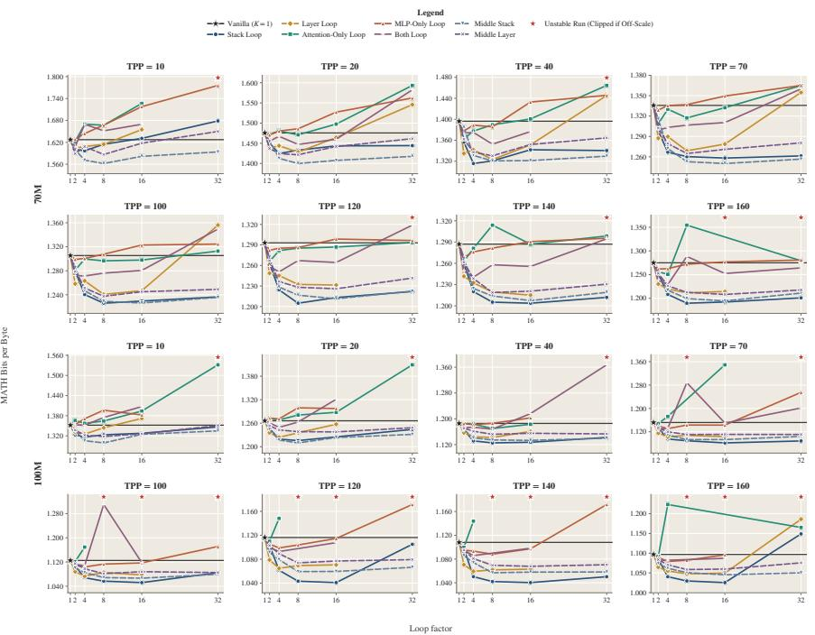  
Figure 39 MATH BPB versus loop factor $L { : }$ 70M and 100M models. Results span TPP 10–160 and loop factors $L \in \{ 1 , 2 , 4 , 8 , 1 6 , 3 2 \}$ . Several looping designs remain competitive at smaller training budgets, while the improvement from increasing L generally diminishes at larger loop factors. Each panel fixes model scale and TPP. BPB measures teacher-forced likelihood rather than answer accuracy; lower BPB is better. Red stars denote unstable runs as described in subsection E.1.

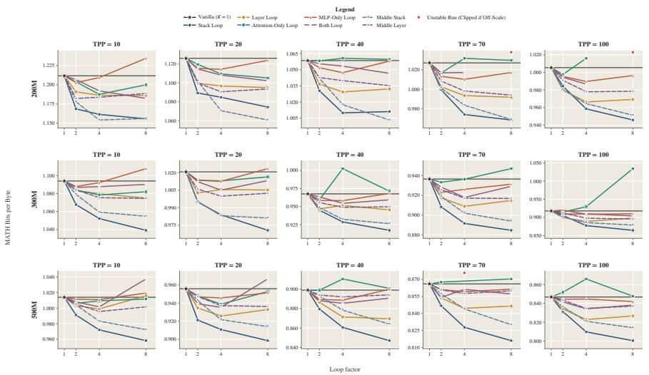  
Figure 40 MATH BPB versus loop factor L: 200M, 300M, and 500M models. Results span TPP 10–100 and loop factors $L \in \{ 1 , 2 , 4 , 8 \}$ . Full-Stack Looping becomes more consistently favorable as model scale and TPP increase. Each panel fixes model scale and TPP. BPB measures teacher-forced likelihood rather than answer accuracy; lower BPB is better.

## E.3.8 HumanEval

The HumanEval results in Figure 41 and Figure 42 show that the preferred looping design changes with model scale and TPP. At smaller scales and lower TPP, Full-Stack Looping is not consistently better than the alternatives; it becomes more favorable as scale and TPP increase. The deeper small-model sweeps also show diminishing returns: additional loops can eventually stop reducing BPB or reverse earlier gains. These results measure teacher-forced likelihood on reference code, not whether generated programs pass the HumanEval tests.

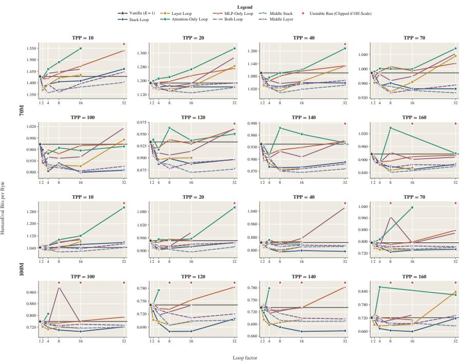  
Figure 41 HumanEval BPB versus loop factor L: 70M and 100M models. Results span TPP 10–160 and loop factors $L \in \{ 1 , 2 , 4 , 8 , 1 6 , 3 2 \}$ . The preferred design varies across training budgets, and increasing L does not always improve BPB. Each panel fixes model scale and TPP. BPB measures teacher-forced likelihood rather than execution accuracy; lower BPB is better. Red stars denote unstable runs as described in subsection E.1.

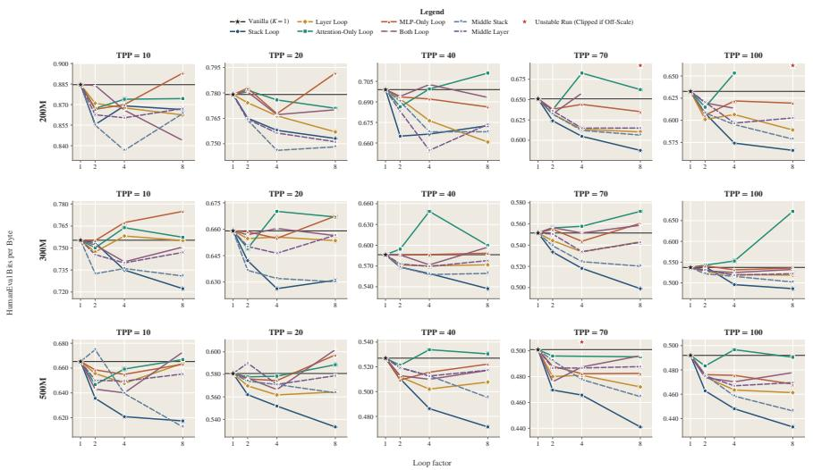  
Figure 42 HumanEval BPB versus loop factor L: 200M, 300M, and 500M models. Results span TPP 10–100 and loop factors $L \in \{ 1 , 2 , 4 , 8 \}$ . Full-Stack Looping becomes more favorable at larger model scales and higher TPP, although it does not dominate every setting. Each panel fixes model scale and TPP. Lower BPB is better.

## E.3.9 MBPP

The MBPP results in Figure 43 and Figure 44 show substantial variation across looping designs, particularly at smaller scales and lower TPP. Full-Stack Looping becomes more favorable as model scale and TPP increase, but the preference is less consistent than on the general pretraining corpora. The small-model sweeps also exhibit diminishing returns as the loop factor L increases: additional looping produces progressively smaller reductions in BPB and can eventually cease to improve quality. These results measure teacher-forced likelihood on MBPP code rather than execution accuracy or pass@k.

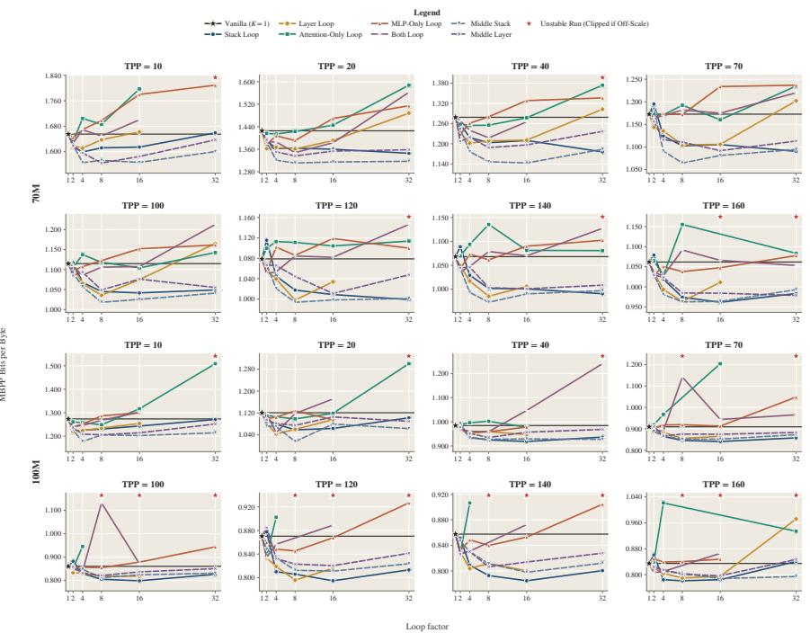  
Figure 43 MBPP BPB versus loop factor L: 70M and 100M models. Results span TPP 10–160 and loop factors $L \in \{ 1 , 2 , 4 , 8 , 1 6 , 3 2 \}$ . Several looping designs remain competitive, while the improvement from increasing L generally diminishes at larger loop factors. Each panel fixes model scale and TPP. BPB measures teacher-forced likelihood rather than execution accuracy; lower BPB is better. Red stars denote unstable runs as described in subsection E.1.

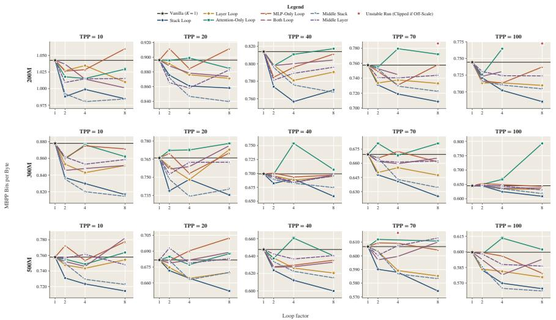  
Figure 44 MBPP BPB versus loop factor L: 200M, 300M, and 500M models. Results span TPP 10–100 and loop factors $L \in \{ 1 , 2 , 4 , 8 \}$ . Full-Stack Looping becomes more favorable as model scale and TPP increase, although the preferred design remains more task-dependent than on the general pretraining corpora. Each panel fixes model scale and TPP. Lower BPB is better.

## E.4 Looping at 1B Scale

We test whether the quality–compute trade-of observed at smaller scales persists at 1B parameters across DCLM (subsubsection E.4.1), C4 (subsubsection E.4.2), Dolma v1.5 (subsubsection E.4.3), Dolma programming languages (subsubsection E.4.4), RedPajama (subsubsection E.4.5), and WikiText-103 (subsubsection E.4.6). We focus on the designs that were most competitive in the smaller-scale sweeps: full-stack and middle-stack looping, together with Per-Layer Looping at shallow loop counts. At TPP 10 and 40, we compare these designs at $L = 2$ and $L = 4$ against the non-looped $L = 1$ model. The corpus-specific loop-count and training-FLOP comparisons appear in Figure 45–Figure 56. Across these corpora, the same broad conclusion holds: looping generally lowers BPB; Full-Stack Looping tends to achieve the lowest BPB at a matched loop count, while Middle-Stack Looping obtains gains with fewer training FLOPs. Thus, even at 1B, the preferred schedule depends on whether the priority is quality at a fixed stored parameter count or the cost of additional computation.

## E.4.1 DCLM

On DCLM, all three looping schedules improve over the non-looped model, and Full-Stack Looping attains the lowest BPB at matched loop counts (Figure 45). Middle-Stack Looping uses fewer additional training FLOPs, while Full-Stack Looping can spend more compute to reach lower BPB (Figure 46).

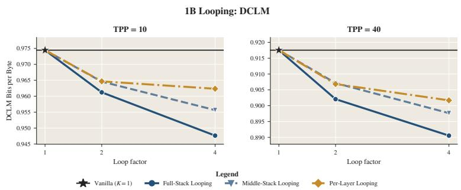  
Figure 45 DCLM BPB versus loop factor L at 1B. Full-stack, middle-stack, and Per-Layer Looping are evaluated at TPP 10 and 40 over $L \in \{ 1 , 2 , 4 \}$ . All three improve over the non-looped L = 1 model, with Full-Stack Looping attaining the lowest BPB at matched loop counts. Lower is better.

  
Figure 46 DCLM BPB versus training FLOPs at 1B. The same models are compared at TPP 10 and 40. Middle-Stack Looping improves BPB with a smaller increase in FLOPs, while full-stack looping reaches lower BPB with more compute. The horizontal axis is logarithmic; marker shape denotes L. Lower is better.

## E.4.2 C4

The C4 panels repeat the matched loop-count and training-compute comparisons on a second public text corpus (Figure 47 and Figure 48).

Figure 47 C4 BPB versus loop factor L at 1B. Non-looped, full-stack, middle-stack, and per-layer models are compared at TPP 10 and 40 over $L \in \{ 1 , 2 , 4 \}$ . Each panel fixes TPP; lower BPB is better.  
  
Figure 48 C4 BPB versus training FLOPs at 1B. The same checkpoints are plotted against total training FLOPs at TPP 10 and 40. The horizontal axis is logarithmic; marker shape denotes L. Lower BPB is better.

## E.4.3 Dolma v1.5

We evaluate the same 1B checkpoints on Dolma v1.5 to compare their quality and compute trade-ofs on another pretraining corpus (Figure 49 and Figure 50).

  
Figure 49 Dolma v1.5 BPB versus loop factor L at 1B. Non-looped, full-stack, middle-stack, and per-layer models are compared at TPP 10 and 40 over $L \in \{ 1 , 2 , 4 \}$ . Each panel fixes TPP; lower BPB is better.

## E.4.4 Dolma Programming Languages

The Dolma programming-languages split tests whether the preferred looping schedule changes when quality is measured on code (Figure 51 and Figure 52).

## E.4.5 RedPajama

The RedPajama panels provide another test of whether the 1B schedule comparison transfers beyond DCLM (Figure 53 and Figure 54).

  
Figure 50 Dolma v1.5 BPB versus training FLOPs at 1B. The same checkpoints are plotted against total training FLOPs at TPP 10 and 40. The horizontal axis is logarithmic; marker shape denotes L. Lower BPB is better.

  
Figure 51 Dolma programming-languages BPB versus loop factor L at 1B. Non-looped, full-stack, middle-stack, and per-layer models are compared at TPP 10 and 40 over $L \in \{ 1 , 2 , 4 \}$ . Each panel fixes TPP; lower BPB is better.

  
Figure 52 Dolma programming-languages BPB versus training FLOPs at 1B. The same checkpoints are plotted against total training FLOPs at TPP 10 and 40. The horizontal axis is logarithmic; marker shape denotes L. Lower BPB is better.

  
Figure 53 RedPajama BPB versus loop factor L at 1B. Non-looped, full-stack, middle-stack, and per-layer models are compared at TPP 10 and 40 over $L \in \{ 1 , 2 , 4 \}$ . Each panel fixes TPP; lower BPB is better.

  
Figure 54 RedPajama BPB versus training FLOPs at 1B. The same checkpoints are plotted against total training FLOPs at TPP 10 and 40. The horizontal axis is logarithmic; marker shape denotes L. Lower BPB is better.

## E.4.6 WikiText-103

Finally, the WikiText-103 panels show the matched 1B comparison on the remaining public corpus (Figure 55 and Figure 56).

  
Vanilla (K= 1) Full-Stack Looping Middle-Stack Looping Per-Layer Looping  
Figure 55 WikiText-103 BPB versus loop factor L at 1B. Non-looped, full-stack, middle-stack, and per-layer models are compared at TPP 10 and 40 over L ∈ {1, 2, 4}. Each panel fixes TPP; lower BPB is better.

  
Figure 56 WikiText-103 BPB versus training FLOPs at 1B. The same checkpoints are plotted against total training FLOPs at TPP 10 and 40. The horizontal axis is logarithmic; marker shape denotes L. Lower BPB is better.

## F Additional Results for Loop-Specific Specialization

This section provides the additional results supporting subsection 3.3. The main text uses 300M full-stack models on DCLM to show that loop-specific corrections become more useful as the number of loops increases. Here, we test whether this conclusion holds across model sizes, training budgets, looping schedules, and evaluation datasets. subsection F.1 describes the experimental setup and parameter and compute accounting. subsection F.2 reports the core sweep over 70M–300M models at TPP 10, 40, and 100 on DCLM, C4 English, WikiText-103, Dolma v1.5, RedPajama, and Dolma Programming Languages. For each corpus, we examine how the benefit of specialization changes with loop count, how many parameters it adds, how it compares with adding independently parameterized layers, and how much training compute it requires. subsection F.3 reports teacher-forced likelihood on GSM8K, MATH, HumanEval, and MBPP; subsection F.4 compares full-stack, per-layer, middle-stack, and Middle-Layer Looping to determine where specialization is useful; and subsection F.5 tests whether the full-stack result persists at 500M and 1B. All results use bits per byte (BPB), for which lower is better.

## F.1 Experimental Setup

Models and coverage. The main sweep covers 70M, 100M, 200M, and 300M models at TPP 10, 40, and 100, with loop counts $L \in \{ 2 , 4 , 8 \}$ . We evaluate full-stack, per-layer, middle-stack, and Middle-Layer Looping. For every setting, the baseline uses shared weights in every loop, and we compare it with Loop LoRA, Loop Matrix, and Loop Softmax. We classify a run as unstable and exclude it when its globally averaged training loss exceeds 5. This criterion excludes only the three specialization variants of the 300M per-layer model at L = 8 and TPP 100. Their points are omitted, and curves are not drawn across the gaps. The targeted 500M and 1B experiments use Full-Stack Looping.

Loop-specific specialization. The baseline reuses the same weight matrix in every loop. Giving every loop a diferent full weight matrix would allow specialization but would largely remove the parameter savings from weight reuse. We instead retain a shared weight matrix and add a small loop-specific low-rank correction.

Definition 11: Loop-specific specialization.Let $W \in \mathbb { R } ^ { d _ { \mathrm { o u t } } \times d _ { \mathrm { i n } } }$ be shared across L loops. Loop ℓ uses

$$
\begin{array} { r } { W ^ { ( \ell ) } : = W + \Delta W ^ { ( \ell ) } . } \end{array}
$$

Let $\{ ( A _ { j } , B _ { j } ) \} _ { j = 1 } ^ { L }$ denote L low-rank components, with $A _ { j } \in \mathbb { R } ^ { q \times d _ { \mathrm { i n } } }$ and $B _ { j } \in \mathbb { R } ^ { d _ { \mathrm { o u t } } \times q }$ Loop LoRA assigns one component directly to each loop:

$$
\Delta W ^ { ( \ell ) } : = \frac { \alpha } { q } B _ { \ell } A _ { \ell } .
$$

Loop Matrix learns an arbitrary linear combination:

$$
\Delta W ^ { ( \ell ) } : = \frac { \alpha } { q } \sum _ { j = 1 } ^ { L } M _ { \ell j } B _ { j } A _ { j } , \qquad M \in \mathbb { R } ^ { L \times L } .
$$

We initialize M to the identity.

Loop Softmax uses the same mixture with nonnegative coeficients that sum to one:

$$
\Delta W ^ { ( \ell ) } : = \frac { \alpha } { q } \sum _ { j = 1 } ^ { L } \mathrm { s o f t m a x } ( S _ { \ell , : } ) _ { j } B _ { j } A _ { j } , \qquad S \in \mathbb { R } ^ { L \times L } .
$$

The logits initially favor the component corresponding to each loop.

Loop LoRA uses a single rank-q component, so rank $( \Delta \boldsymbol { W } ^ { ( \ell ) } ) \le q$ . Loop Matrix and Loop Softmax can instead

combine several such components. By subadditivity of matrix rank,

$$
\operatorname { r a n k } \Bigl ( \Delta W ^ { ( \ell ) } \Bigr ) \leq \sum _ { j : M _ { \ell j } \neq 0 } \operatorname { r a n k } ( B _ { j } A _ { j } ) \leq L q .
$$

The mixed variants therefore increase the maximum rank that a loop-specific correction can represent, although a learned correction need not attain this upper bound. We use $q = 8$ and unit scaling, $\alpha = q .$ , and apply the corrections to all attention and SwiGLU MLP projections in every looped Transformer block. The shared weights and corrections are trained jointly from initialization

Parameter and compute accounting. For one adapted projection, the corrections add $L q ( d _ { \mathrm { i n } } \substack { + } d _ { \mathrm { o u t } } )$ parameters, plus $L ^ { 2 }$ mixing coeficients for Loop Matrix or Loop Softmax. At fixed nominal TPP, these parameters also slightly increase the token budget because we recompute $D = { \mathrm { T P P } } \times P _ { \mathrm { n o n - e m b e d } }$ for each model. Reported training FLOPs include the realized token count, repeated Transformer execution, attention-score computation, and the low-rank corrections.

## F.2 Results from 70M to 300M

We evaluate the models on DCLM, C4 English, WikiText-103, Dolma v1.5, RedPajama, Dolma Programming Languages, GSM8K, MATH, HumanEval, and MBPP.

## F.2.1 DCLM

As in the main text, we use DCLM as our primary evaluation corpus because it is the largest corpus in our evaluation suite. Here, we use DCLM to study four questions: how the benefit of specialization changes with the number of loops, how many additional parameters it requires, how it compares with adding independently parameterized layers, and how the comparison changes when training FLOPs are taken into account. We evaluate 70M–300M full-stack models at TPP 10, 40, and 100, with the available physical-depth comparison also including 500M models.

Loop count. The same loop-count pattern appears at TPP 10, 40, and 100. Specialization usually provides only a small improvement at $L = 2$ , while its advantage over using identical weights becomes clearer at L = 4 and L = 8. The three specialization methods remain closer to one another than to the identical-weight baseline, although Loop Matrix is most often strongest. Figure 57 reports the complete loop-count comparison.

  
Figure 57 Specialization helps more as the number of loops increases, consistently across TPP. DCLM BPB versus loop count for 70M–300M full-stack models at TPP 10, 40, and 100. Specialization provides a small improvement at $L = 2$ and clearer gains at L = 4 and L = 8. Increasing TPP also generally lowers BPB. Lower is better.

Stored parameters. Across all three TPP values, loop-specific corrections improve BPB while adding relatively few stored parameters. Specialization is therefore most attractive when the number of parameters that can be stored is constrained. The corresponding parameter comparison appears in Figure 58.

Loop-specific specialization or physical depth. To place the parameter savings from specialization in context, we compare against a doubled-depth Transformer. This reference is a conventional Transformer with twice as many blocks as the corresponding baseline, with each block using its own independently learned parameters. It therefore adds depth by storing new layers rather than by repeatedly applying the same layers. Across the evaluated TPP values, the doubled-depth model can achieve lower BPB, but requires substantially more stored parameters. Figure 59 compares these choices directly. Physical-depth references are available for 100M–500M rather than for the complete 70M–300M grid used in the other views.

Training FLOPs. This comparison includes the training cost of running the additional loops and their loopspecific corrections. At a similar number of training FLOPs, a Transformer with twice as many independently parameterized layers can achieve lower BPB across the evaluated TPP values. Therefore, if training compute is limited but storing more parameters is acceptable, training a deeper Transformer may be a better use of compute than adding and specializing more loops. The complete comparison is shown in Figure 60.

  
(c) 200M  
(d) 300M  
Figure 58 Specialization improves DCLM BPB with relatively few additional parameters across TPP. Results cover 70M–300M full-stack models at TPP 10, 40, and 100. The horizontal axis reports additional non-embedding parameters relative to the identical-weight model. Higher TPP generally lowers BPB. Lower is better.

DCLM summary. The same qualitative conclusions hold at TPP 10, 40, and 100: specialization provides a small benefit at $L = 2$ and a clearer benefit at L = 4 and $L = 8 ;$ the precise specialization method matters less than allowing the loops to specialize; and Loop Matrix is most often the strongest choice. Increasing TPP also generally lowers BPB for both shared and specialized models. Thus, training on more tokens improves overall quality without changing the main conclusion that specialization becomes more useful as the number of loops increases. In terms of resources, specialization is most useful when stored parameters are constrained. If training FLOPs are instead the main constraint and more parameters can be stored, training a deeper Transformer can provide better quality for the same amount of training compute.

  
Figure 59 Adding independently parameterized layers can achieve lower BPB but requires substantially more storage. Rows show 100M, 200M, 300M, and 500M models; columns show TPP 10, 40, and 100. The purple diamond is the matched doubled-depth model. The final tick after the broken axis gives its true increase in non-embedding parameters. Lower BPB is better.

  
(a) 70M  
(b) 100M

  
(c) 200M  
(d) 300M  
Figure 60 When parameters can be stored, additional physical depth can be a better use of training FLOPs. DCLM BPB versus total training FLOPs for 70M–300M models at TPP 10, 40, and 100. Training FLOPs include repeated loop execution, loop-specific corrections, attention-score computation, and the realized token budget. Lower BPB is better.

## F.2.2 C4 English

C4 English provides a second large web-text evaluation. It therefore tests whether the conclusions drawn from DCLM depend on our primary evaluation corpus. We repeat the four comparisons used for DCLM: loop count, added parameter storage, additional independently parameterized layers, and total training FLOPs. We evaluate 70M–300M full-stack models at TPP 10, 40, and 100. The doubled-depth comparison also includes 500M models.

Loop count. The same broad pattern appears at TPP 10, 40, and 100. Specialization usually provides only a small improvement at $L = 2 ,$ , while its advantage over using identical weights becomes clearer at $L = 4$ and $L = 8$ . The three specialization methods remain closer to one another than to the identical-weight baseline, although Loop Matrix is most often strongest. Increasing TPP also generally lowers BPB. Figure 61 reports the complete loop-count comparison.

  
Figure 61 Specialization generally helps more as the number of loops increases. C4 English BPB versus loop count for 70M–300M full-stack models at TPP 10, 40, and 100. Specialization is generally more useful at L = 4 and $L = 8$ than at L = 2. Increasing TPP also generally lowers BPB. Lower is better.

Stored parameters. Across all three TPP values, loop-specific corrections improve BPB while adding relatively few stored parameters. Specialization therefore provides a useful middle ground when parameter storage is constrained: most weights remain shared, while each loop receives a small correction. The corresponding comparison appears in Figure 62.

Loop-specific specialization or additional Transformer layers. To put this parameter saving in context, we use the same doubled-depth reference as in the DCLM comparison. This reference is a conventional Transformer with twice as many blocks as the corresponding baseline, and every block has its own independently learned parameters. It therefore adds depth by storing new layers rather than by applying the same layers multiple times. Across the evaluated TPP values, the doubled-depth Transformer can achieve lower BPB, but requires substantially more stored parameters. Figure 63 compares the two choices. The doubled-depth references cover 100M–500M models rather than the complete 70M–300M grid used in the other comparisons.

Training FLOPs. The FLOP comparison includes the cost of executing the additional loops and their loop-specific corrections. At a similar number of training FLOPs, the doubled-depth Transformer can often achieve lower BPB. Therefore, when training compute is the main constraint and more parameters can be stored, training a deeper Transformer may be a better use of compute than adding and specializing more loops. The complete comparison appears in Figure 64.

  
(c) 200M  
(d) 300M  
Figure 62 Specialization improves C4 English BPB with relatively few additional parameters. Results cover 70M–300M full-stack models at TPP 10, 40, and 100. The horizontal axis reports additional non-embedding parameters relative to the identical-weight model. Higher TPP generally lowers BPB. Lower is better.

C4 English summary. The C4 English results reproduce the main DCLM pattern. Specialization provides a small benefit at L = 2 and a clearer benefit at L = 4 and L = 8, while the precise specialization method matters less than allowing the loops to specialize. Loop Matrix is most often the strongest choice. Increasing TPP generally lowers BPB for both identical-weight and specialized models, so training on more tokens improves overall quality without changing the main loop-count pattern. In terms of resources, specialization is most useful when stored parameters are constrained. If training FLOPs are instead the main constraint and more parameters can be stored, a deeper Transformer can provide better quality for the same amount of training compute.

  
Figure 63 Adding independently parameterized layers can achieve lower C4 English BPB but requires substantially more storage. Rows show 100M, 200M, 300M, and 500M models; columns show TPP 10, 40, and 100. The purple diamond is the matched doubled-depth Transformer. The final tick after the broken axis gives its true increase in non-embedding parameters. Lower BPB is better.

  
(a) 70M  
(b) 100M

  
(c) 200M  
(d) 300M  
Figure 64 Low parameter overhead does not necessarily mean better training-compute efficiency. C4 English BPB versus total training FLOPs for 70M–300M models at TPP 10, 40, and 100. Training FLOPs include repeated loop execution, loop-specific corrections, attention-score computation, and the realized token budget. Lower is better.

(c) 200M

## F.2.3 WikiText-103

WikiText-103 is a smaller, more curated language-modeling corpus than DCLM. It tests whether the specialization result transfers beyond large web-text evaluations. We repeat the four comparisons used for DCLM: loop count, added parameter storage, additional independently parameterized layers, and total training FLOPs. We evaluate 70M–300M full-stack models at TPP 10, 40, and 100. The doubled-depth comparison also includes 500M models.

Loop count. The same qualitative loop-count pattern remains visible at TPP 10, 40, and 100, although the diferences are somewhat more variable than on the larger web-text corpora. Specialization is usually modest at $L = 2$ and becomes clearer at $L = 4$ and $L = 8$ . Diferences among the three specialization methods are generally smaller than their diferences from the identical-weight baseline, with Loop Matrix often strongest. Increasing TPP also generally lowers BPB. Figure 65 reports the complete loop-count comparison.

  
(d) 300M  
Figure 65 Specialization generally helps more as the number of loops increases. WikiText-103 BPB versus loop count for 70M–300M full-stack models at TPP 10, 40, and 100. Specialization is generally more useful at L = 4 and $L = 8$ than at $L = 2 .$ . Increasing TPP also generally lowers BPB. Lower is better.

Stored parameters. Across all three TPP values, loop-specific corrections improve BPB while adding relatively few stored parameters. Specialization therefore provides a useful middle ground when parameter storage is constrained: most weights remain shared, while each loop receives a small correction. The corresponding comparison appears in Figure 66.

Loop-specific specialization or additional Transformer layers. To put this parameter saving in context, we use the same doubled-depth reference as in the DCLM comparison. This reference is a conventional Transformer with twice as many blocks as the corresponding baseline, and every block has its own independently learned parameters. It therefore adds depth by storing new layers rather than by applying the same layers multiple times. Across the evaluated TPP values, the doubled-depth Transformer can achieve lower BPB, but requires substantially more stored parameters. Figure 67 compares the two choices. The doubled-depth references cover 100M–500M models rather than the complete 70M–300M grid used in the other comparisons.

Training FLOPs. The FLOP comparison includes the cost of executing the additional loops and their loop-specific corrections. At a similar number of training FLOPs, the doubled-depth Transformer can often achieve lower BPB. Therefore, when training compute is the main constraint and more parameters can be stored, training a deeper Transformer may be a better use of compute than adding and specializing more loops. The complete comparison appears in Figure 68.

  
(c) 200M  
(d) 300M  
Figure 66 Specialization improves WikiText-103 BPB with relatively few additional parameters. Results cover 70M–300M full-stack models at TPP 10, 40, and 100. The horizontal axis reports additional non-embedding parameters relative to the identical-weight model. Higher TPP generally lowers BPB. Lower is better.

WikiText-103 summary. WikiText-103 broadly supports the DCLM conclusion. Specialization provides a small benefit at $L = 2$ and a clearer benefit at $L = 4$ and $L = 8$ , while the precise specialization method matters less than allowing the loops to specialize. Loop Matrix is most often the strongest choice. Increasing TPP generally lowers BPB for both identical-weight and specialized models, so training on more tokens improves overall quality without changing the main loop-count pattern. In terms of resources, specialization is most useful when stored parameters are constrained. If training FLOPs are instead the main constraint and more parameters can be stored, a deeper Transformer can provide better quality for the same amount of training compute.

  
Figure 67 Adding independently parameterized layers can achieve lower WikiText-103 BPB but requires substantially more storage. Rows show 100M, 200M, 300M, and 500M models; columns show TPP 10, 40, and 100. The purple diamond is the matched doubled-depth Transformer. The final tick after the broken axis gives its true increase in non-embedding parameters. Lower BPB is better.

  
(a) 70M  
(b) 100M

  
(c) 200M  
(d) 300M  
Figure 68 Low parameter overhead does not necessarily mean better training-compute efficiency. WikiText-103 BPB versus total training FLOPs for 70M–300M models at TPP 10, 40, and 100. Training FLOPs include repeated loop execution, loop-specific corrections, attention-score computation, and the realized token budget. Lower is better.

## F.2.4 Dolma v1.5

Dolma v1.5 provides a broad language-modeling evaluation corpus with a diferent text distribution from DCLM. It tests whether the observed benefits depend on the composition of the evaluation text. We repeat the four comparisons used for DCLM: loop count, added parameter storage, additional independently parameterized layers, and total training FLOPs. We evaluate 70M–300M full-stack models at TPP 10, 40, and 100. The doubled-depth comparison also includes 500M models.

Loop count. The same loop-count pattern appears across TPP 10, 40, and 100. Specialization usually produces only a small improvement at $L = 2 ,$ while the separation from the identical-weight baseline becomes clearer at $L = 4$ and $L = 8 .$ The three specialization methods are generally closer to one another than to the baseline, and Loop Matrix is most often strongest. Increasing TPP also generally lowers BPB. Figure 69 reports the complete loop-count comparison.

  
(c) 200M  
(d) 300M  
Figure 69 Specialization generally helps more as the number of loops increases. Dolma v1.5 BPB versus loop count for 70M–300M full-stack models at TPP 10, 40, and 100. Specialization is generally more useful at $L = 4$ and $L = 8$ than at $L = 2 .$ . Increasing TPP also generally lowers BPB. Lower is better.

Stored parameters. Across all three TPP values, loop-specific corrections improve BPB while adding relatively few stored parameters. Specialization therefore provides a useful middle ground when parameter storage is constrained: most weights remain shared, while each loop receives a small correction. The corresponding comparison appears in Figure 70.

Loop-specific specialization or additional Transformer layers. To put this parameter saving in context, we use the same doubled-depth reference as in the DCLM comparison. This reference is a conventional Transformer with twice as many blocks as the corresponding baseline, and every block has its own independently learned parameters. It therefore adds depth by storing new layers rather than by applying the same layers multiple times. Across the evaluated TPP values, the doubled-depth Transformer can achieve lower BPB, but requires substantially more stored parameters. Figure 71 compares the two choices. The doubled-depth references cover 100M–500M models rather than the complete 70M–300M grid used in the other comparisons.

Training FLOPs. The FLOP comparison includes the cost of executing the additional loops and their loop-specific corrections. At a similar number of training FLOPs, the doubled-depth Transformer can often achieve lower BPB. Therefore, when training compute is the main constraint and more parameters can be stored, training a deeper Transformer may be a better use of compute than adding and specializing more loops. The complete comparison appears in Figure 72.

  
(c) 200M  
(d) 300M  
Figure 70 Specialization improves Dolma v1.5 BPB with relatively few additional parameters. Results cover 70M–300M full-stack models at TPP 10, 40, and 100. The horizontal axis reports additional non-embedding parameters relative to the identical-weight model. Higher TPP generally lowers BPB. Lower is better.

Dolma v1.5 summary. Dolma v1.5 yields the same main conclusion. Specialization provides a small benefit at L = 2 and a clearer benefit at $L = 4$ and $L = 8 ,$ , while the precise specialization method matters less than allowing the loops to specialize. Loop Matrix is most often the strongest choice. Increasing TPP generally lowers BPB for both identical-weight and specialized models, so training on more tokens improves overall quality without changing the main loop-count pattern. In terms of resources, specialization is most useful when stored parameters are constrained. If training FLOPs are instead the main constraint and more parameters can be stored, a deeper Transformer can provide better quality for the same amount of training compute.

  
Figure 71 Adding independently parameterized layers can achieve lower Dolma v1.5 BPB but requires substantially more storage. Rows show 100M, 200M, 300M, and 500M models; columns show TPP 10, 40, and 100. The purple diamond is the matched doubled-depth Transformer. The final tick after the broken axis gives its true increase in non-embedding parameters. Lower BPB is better.

  
(a) 70M  
(b) 100M

  
(c) 200M  
(d) 300M  
Figure 72 Low parameter overhead does not necessarily mean better training-compute efficiency. Dolma v1.5 BPB versus total training FLOPs for 70M–300M models at TPP 10, 40, and 100. Training FLOPs include repeated loop execution, loop-specific corrections, attention-score computation, and the realized token budget. Lower is better.

## F.2.5 RedPajama

RedPajama provides another broad language-modeling evaluation corpus with a text distribution distinct from both DCLM and Dolma. It gives an additional test of whether the result transfers across general-language corpora. We repeat the four comparisons used for DCLM: loop count, added parameter storage, additional independently parameterized layers, and total training FLOPs. We evaluate 70M–300M full-stack models at TPP 10, 40, and 100. The doubled-depth comparison also includes 500M models.

Loop count. The results again show only a small benefit from specialization at L = 2 and a clearer benefit at $L = 4$ and $L = 8 ,$ , across TPP 10, 40, and 100. The precise method matters less than allowing the loops to difer, although Loop Matrix most frequently reaches the lowest BPB. Increasing TPP also generally improves quality. Figure 73 reports the complete loop-count comparison.

  
(a) 70M

  
(b) 100M

  
(c) 200M  
(d) 300M  
Figure 73 Specialization generally helps more as the number of loops increases. RedPajama BPB versus loop count for 70M–300M full-stack models at TPP 10, 40, and 100. Specialization is generally more useful at L = 4 and L = 8 than at L = 2. Increasing TPP also generally lowers BPB. Lower is better.

Stored parameters. Across all three TPP values, loop-specific corrections improve BPB while adding relatively few stored parameters. Specialization therefore provides a useful middle ground when parameter storage is constrained: most weights remain shared, while each loop receives a small correction. The corresponding comparison appears in Figure 74.

Loop-specific specialization or additional Transformer layers. To put this parameter saving in context, we use the same doubled-depth reference as in the DCLM comparison. This reference is a conventional Transformer with twice as many blocks as the corresponding baseline, and every block has its own independently learned parameters. It therefore adds depth by storing new layers rather than by applying the same layers multiple times. Across the evaluated TPP values, the doubled-depth Transformer can achieve lower BPB, but requires substantially more stored parameters. Figure 75 compares the two choices. The doubled-depth references cover 100M–500M models rather than the complete 70M–300M grid used in the other comparisons.

Training $F L O P s .$ The FLOP comparison includes the cost of executing the additional loops and their loop-specific corrections. At a similar number of training FLOPs, the doubled-depth Transformer can often achieve lower BPB. Therefore, when training compute is the main constraint and more parameters can be stored, training a deeper Transformer may be a better use of compute than adding and specializing more loops. The complete comparison appears in Figure 76.

  
(c) 200M  
(d) 300M  
Figure 74 Specialization improves RedPajama BPB with relatively few additional parameters. Results cover 70M–300M full-stack models at TPP 10, 40, and 100. The horizontal axis reports additional non-embedding parameters relative to the identical-weight model. Higher TPP generally lowers BPB. Lower is better.

RedPajama summary. RedPajama again supports the same resource-dependent conclusion. Specialization provides a small benefit at L = 2 and a clearer benefit at L = 4 and L = 8, while the precise specialization method matters less than allowing the loops to specialize. Loop Matrix is most often the strongest choice. Increasing TPP generally lowers BPB for both identical-weight and specialized models, so training on more tokens improves overall quality without changing the main loop-count pattern. In terms of resources, specialization is most useful when stored parameters are constrained. If training FLOPs are instead the main constraint and more parameters can be stored, a deeper Transformer can provide better quality for the same amount of training compute.

  
Figure 75 Adding independently parameterized layers can achieve lower RedPajama BPB but requires substantially more storage. Rows show 100M, 200M, 300M, and 500M models; columns show TPP 10, 40, and 100. The purple diamond is the matched doubled-depth Transformer. The final tick after the broken axis gives its true increase in non-embedding parameters. Lower BPB is better.

  
(a) 70M  
(b) 100M

  
(c) 200M  
(d) 300M  
Figure 76 Low parameter overhead does not necessarily mean better training-compute efficiency. RedPajama BPB versus total training FLOPs for 70M–300M models at TPP 10, 40, and 100. Training FLOPs include repeated loop execution, loop-specific corrections, attention-score computation, and the realized token budget. Lower is better.

## F.2.6 Dolma Programming Languages

Dolma Programming Languages is a code-heavy evaluation corpus, so it tests whether the specialization result extends beyond general-language corpora. We repeat the four comparisons used for DCLM: loop count, added parameter storage, additional independently parameterized layers, and total training FLOPs. We evaluate 70M–300M full-stack models at TPP 10, 40, and 100. The doubled-depth comparison also includes 500M models.

Loop count. The code results show the same broad tendency, but with more variation than on the generallanguage corpora. Improvements at $L = 2$ are small or inconsistent, while specialization is more often useful at $L = 4$ and $L = 8$ . The three methods usually remain close, and Loop Matrix is often strong, but no method is uniformly best in every setting. Increasing TPP generally lowers BPB. Figure 77 reports the complete loop-count comparison.

  
(a) 70M

  
(b) 100M

  
(c) 200M

  
(d) 300M  
Figure 77 Specialization generally helps more as the number of loops increases. Dolma Programming Languages BPB versus loop count for 70M–300M full-stack models at TPP 10, 40, and 100. Specialization is generally more useful at $L = 4$ and L = 8 than at $L = 2 .$ . Increasing TPP also generally lowers BPB. Lower is better.

Stored parameters. When specialization improves code BPB, it does so with only a small increase in stored parameters. Specialization therefore provides a useful middle ground when parameter storage is constrained: most weights remain shared, while each loop receives a small correction. The corresponding comparison appears in Figure 78.

Loop-specific specialization or additional Transformer layers. To put this parameter saving in context, we use the same doubled-depth reference as in the DCLM comparison. This reference is a conventional Transformer with twice as many blocks as the corresponding baseline, and every block has its own independently learned parameters. It therefore adds depth by storing new layers rather than by applying the same layers multiple times. The doubled-depth Transformer can achieve lower BPB in several settings, but requires substantially more stored parameters. Figure 79 compares the two choices. The doubled-depth references cover 100M–500M models rather than the complete 70M–300M grid used in the other comparisons.

Training FLOPs. The FLOP comparison includes the cost of executing the additional loops and their loop-specific corrections. At comparable training FLOPs, the doubled-depth Transformer can be stronger in several settings. Therefore, when training compute is the main constraint and more parameters can be stored, training a deeper Transformer may be a better use of compute than adding and specializing more loops. The complete comparison appears in Figure 80.

  
(c) 200M  
(d) 300M  
Figure 78 Specialization can improve Dolma Programming Languages BPB with relatively few additional parameters. Results cover 70M–300M full-stack models at TPP 10, 40, and 100. The horizontal axis reports additional non-embedding parameters relative to the identical-weight model. Higher TPP generally lowers BPB. Lower is better.

Dolma Programming Languages summary. The code-heavy evaluation broadly supports the same conclusion, although its gains are less uniform. Specialization is more often useful at $L = 4$ and L = 8 than at $L = 2$ , but the improvements vary more across model size and TPP than on the general-language corpora. Increasing TPP generally lowers BPB for both identical-weight and specialized models, so training on more tokens improves overall quality without changing the main loop-count pattern. In terms of resources, specialization is most useful when stored parameters are constrained. If training FLOPs are instead the main constraint and more parameters can be stored, a deeper Transformer can provide better quality for the same amount of training compute.

  
Figure 79 Adding independently parameterized layers can achieve lower Dolma Programming Languages BPB but requires substantially more storage. Rows show 100M, 200M, 300M, and 500M models; columns show TPP 10, 40, and 100. The purple diamond is the matched doubled-depth Transformer. The final tick after the broken axis gives its true increase in non-embedding parameters. Lower BPB is better.

(a) 70M  
(b) 100M  
  
(c) 200M

  
(d) 300M  
Figure 80 Low parameter overhead does not necessarily mean better training-compute efficiency. Dolma Programming Languages BPB versus total training FLOPs for 70M–300M models at TPP 10, 40, and 100. Training FLOPs include repeated loop execution, loop-specific corrections, attention-score computation, and the realized token budget. Lower is better.

## F.3 Mathematical and Code Likelihood Evaluations from 70M to 300M

We next test whether the specialization findings extend from broad language-modeling corpora to mathematical reasoning and code. We evaluate the same 70M–300M full-stack models at TPP 10, 40, and 100, with loop counts $L \in \{ 2 , 4 , 8 \}$ . For GSM8K and MATH, BPB is computed by teacher-forcing the reference solution. For HumanEval and MBPP, BPB is computed by teacher-forcing the reference code. As these datasets are smaller and more specialized than the language-modeling corpora, their comparisons vary more across model size, TPP, and loop count.

## F.3.1 GSM8K

GSM8K tests whether the conclusions from the language-modeling corpora extend to mathematical solution text. We evaluate 70M–300M full-stack models at TPP 10, 40, and 100. These results measure teacher-forced likelihood of the reference solution, not final-answer accuracy.

Loop count. Increasing model size and TPP reliably lowers absolute GSM8K BPB. The efect of loop-specific specialization is less regular. It often helps at L = 4 or L = 8, whereas at L = 2 the specialized and identical-weight models frequently overlap, and specialization can sometimes be worse. No specialization method dominates throughout the grid. GSM8K therefore supports a benefit from specialization in many configurations, but not a uniform improvement at every model size, TPP value, or loop count. The complete comparison appears in Figure 81.

Stored parameters and additional Transformer layers. Loop-specific corrections occupy only the low-overhead portion of the parameter axis. Within this range, they sometimes improve BPB substantially, but the gain remains configuration-dependent. The doubled-depth Transformer, which has twice as many blocks with independently learned weights, achieves lower BPB than the looped models in every displayed model-size and TPP panel. It also requires substantially more stored parameters. Specialization therefore provides a storage-eficient middle ground, whereas additional independently parameterized layers are stronger when their storage cost is acceptable. The complete comparison appears in Figure 82.

Training FLOPs. The FLOP view reinforces the variability of the GSM8K result. Higher TPP and larger models lower absolute BPB, but spending more compute on additional loops does not produce a monotonic improvement in every panel. At a fixed loop count, specialization can outperform identical weights, although the best method and the size of the gain vary across model size and TPP. The doubled-depth Transformer achieves lower BPB than the looped alternatives at comparable training FLOPs. Thus, when training FLOPs are constrained and the additional parameters can be stored, doubling the number of independently parameterized layers is a better use of compute than adding and specializing more loops. The complete comparison appears in Figure 83.

GSM8K summary. Model scale and TPP improve GSM8K likelihood much more consistently than loopspecific specialization. Specialization helps in many settings, especially among the higher-loop configurations, but the preferred method and the size of the gain vary. Its clearest advantage is low parameter overhead: the doubled-depth Transformer achieves lower BPB throughout the parameter comparison, but requires substantially more storage. Consequently, specialization is useful when stored parameters are constrained, whereas doubling depth is preferable when training FLOPs are constrained and the additional parameters can be stored.

  
Figure 81 Model scale and TPP reliably improve GSM8K likelihood, whereas the benefit of specialization depends on the configuration. Teacher-forced GSM8K BPB versus loop count for 70M–300M full-stack models. Rows vary model size and columns show TPP 10, 40, and 100. Specialization often helps at L = 4 or L = 8, but the gain is not uniform. Lower BPB is better; these values do not measure final-answer accuracy.

  
Figure 82 Thedoubled-depth Transformer gives thelowestGSM8K BPB,while specializationuses far fewer additionalparameters. Rows show 70M, 100M, 200M, and 300M models; columns show TPP 10, 40, and 100. The horizontal axis reports additional non-embedding parameters relative to the identical-weight model. Insets enlarge the specialization range, and the separated reference point denotes the doubled-depth Transformer. Lower BPB is better.

  
Figure 83 At comparable training FLOPs, doubling depth is stronger than adding and specializing more loops on GSM8K. Teacher-forced BPB versus total training FLOPs for 70M–300M models at TPP 10, 40, and 100. Training FLOPs include repeated loop execution, loop-specific corrections, attention-score computation, and the realized token budget. The doubled-depth Transformer is included as a reference. Lower BPB is better.

## F.3.2 MATH

MATH provides a second evaluation of mathematical solution text and tests whether the GSM8K variability persists on a diferent reasoning corpus. We again evaluate 70M–300M full-stack models at TPP 10, 40, and 100. These teacher-forced BPB measurements evaluate the reference-solution likelihood rather than final-answer accuracy.

Loop count. Increasing model size and TPP consistently lowers MATH BPB. Additional loops also generally improve likelihood, and loop-specific specialization usually provides a further reduction relative to identical weights. The benefit is small or mixed in some 70M settings, but becomes more consistent at 100M–300M and is most visible at $L = 4$ and $L = 8$ . Loop Matrix is frequently strongest, although diferences among the three methods are usually smaller than their common improvement over identical weights. The complete comparison appears in Figure 84.

Stored parameters and additional Transformer layers. Across model sizes and TPP values, loop-specific corrections usually improve MATH BPB while adding only a small number of parameters. The doubled-depth Transformer has twice as many blocks, each with independently learned weights. It achieves the lowest BPB in every displayed panel, but lies far beyond the specialization methods on the parameter axis. Specialization is therefore attractive when stored parameters are limited; additional independently parameterized layers remain stronger when their storage cost is acceptable. The complete comparison appears in Figure 85.

Training FLOPs. Unlike GSM8K, MATH BPB generally decreases as training FLOPs increase through additional loops. At the same loop count, specialization then provides a smaller but comparatively consistent improvement over identical weights, particularly at L = 4 and L = 8. The dominant absolute improvements still come from model scale, TPP, and the additional loop computation; the loop-specific corrections refine those gains. Even so, the doubled-depth Transformer achieves lower BPB at comparable training FLOPs. If training FLOPs are the primary constraint and more parameters can be stored, doubling depth is therefore preferable to adding and specializing more loops. The complete comparison appears in Figure 86.

MATH summary. MATH provides more consistent evidence for loop-specific specialization than GSM8K. The benefit is clearest at L = 4 and L = 8 for 100M–300M models and persists across TPP values, while Loop Matrix is frequently strongest. Higher TPP and larger model size remain the most reliable sources of absolute improvement. Specialization ofers a favorable storage trade-of, whereas the doubled-depth Transformer achieves lower BPB with substantially more parameters. Thus, specialization is preferable under a storage constraint, while doubling depth is preferable when training FLOPs are constrained and the additional parameters can be stored.

  
Figure 84 MATH likelihood improves with model scale, TPP, and, more modestly, loop-specific specialization. Teacher-forced MATH BPB versus loop count for 70M–300M full-stack models. Rows vary model size and columns show TPP 10, 40, and 100. Specialization is most consistently useful at L = 4 and L = 8 beyond the smallest scale. Lower BPB is better; these values do not measure final-answer accuracy.

  
Figure 85 Specialization improves MATH BPB with little added storage, while the doubled-depth Transformer remains strongest. Rows show 70M, 100M, 200M, and 300M models; columns show TPP 10, 40, and 100. The horizontal axis reports additional non-embedding parameters relative to the identical-weight model. Insets enlarge the specialization range, and the separated reference point denotes the doubled-depth Transformer. Lower BPB is better.

  
Figure 86 Doubling depth provides lower MATH BPB than adding and specializing loops at comparable training FLOPs. Teacher forced BPB versus total training FLOPs for 70M–300M models at TPP 10, 40, and 100. Training FLOPs include repeated loop execution, loop-specific corrections, attention-score computation, and the realized token budget. The doubled-depth Transformer is included as a reference. Lower BPB is better.

## F.3.3 HumanEval

HumanEval tests whether the specialization behavior extends to code. We evaluate 70M–300M full-stack models at TPP 10, 40, and 100 by teacher-forcing the reference implementation. BPB therefore measures reference-code likelihood, not whether sampled programs pass the unit tests, and should not be interpreted as execution accuracy or pass@k.

Loop count. Across model sizes and TPP values, at least one specialization method usually improves on the corresponding identical-weight model. The separation is generally clearest at L = 4 or L = 8, but neither the best loop count nor the best method is uniform across the grid. In particular, the low-TPP results are sometimes non-monotonic in loop count. Increasing TPP substantially lowers absolute BPB without removing this configuration dependence. The complete comparison appears in Figure 87.

Stored parameters and additional Transformer layers. The loop-specific corrections add relatively few stored parameters. The doubled-depth Transformer instead has twice as many blocks, with independently learned weights in every block. It attains lower HumanEval BPB in every displayed model-size and TPP panel, but requires a much larger increase in storage. Specialization is therefore a storage-eficient way to improve the identical-weight model, rather than a replacement for additional depth when those parameters can be stored. The complete comparison appears in Figure 88.

Training FLOPs. Within the looped models, spending more training compute through additional loops generally lowers HumanEval BPB. Specialization often improves on identical weights at the same loop count, but the size of the gain and the strongest method vary across model size and TPP. At comparable training FLOPs, however, the doubled-depth Transformer achieves lower BPB. When training FLOPs are constrained and its additional parameters can be stored, doubling depth is therefore a better use of compute than adding and specializing more loops. The complete comparison appears in Figure 89.

HumanEval summary. Larger models and higher TPP consistently improve absolute HumanEval likelihood. Specialization provides an additional benefit in most configurations, especially at larger loop counts, although the preferred method varies. The doubled-depth Transformer reaches lower BPB throughout the parameter comparison, at a substantially larger storage cost. These conclusions concern teacher-forced code likelihood only. Specialization is the better choice when stored parameters are constrained; doubling depth is the better choice when training FLOPs are constrained and more parameters can be stored.

  
Figure 87 Specialization usually improves HumanEval likelihood, but the best loop count and method depend on model size and TPP. Absolute teacher-forced BPB versus loop count for 70M–300M full-stack models. Rows vary model size and columns show TPP 10, 40, and 100. Lower BPB is better; these values do not measure execution accuracy or pass@k.

  
Figure 88 The doubled-depth Transformer achieves lower HumanEval BPB, while specialization improves identical weights with far less storage. Results cover 70M–300M full-stack models at TPP 10, 40, and 100. The horizontal axis reports additional non-embedding parameters relative to the identical-weight model. Insets enlarge the specialization range, and the separated reference point denotes the doubled-depth Transformer. Lower BPB is better.

  
Figure 89 At comparable training FLOPs, doubling depth gives lower HumanEval BPB than adding and specializing more loops. HumanEval BPB versus total training FLOPs for 70M–300M full-stack models at TPP 10, 40, and 100. Training FLOPs include repeated loop execution, loop-specific corrections, attention-score computation, and the realized token budget. The doubled-depth Transformer is included as a reference. Lower BPB is better.

## F.3.4 MBPP

MBPP provides a second code-likelihood evaluation and tests whether the HumanEval conclusions persist on another code corpus. We evaluate the same 70M–300M full-stack models at TPP 10, 40, and 100. MBPP BPB is computed by teacher-forcing the reference code and should not be interpreted as execution accuracy or pass@k.

Loop count. Specialization improves on identical weights in most of the MBPP grid, with the largest-loop configurations frequently attaining the lowest BPB. The trend is not universal: the best point can occur at L = 4, and identical weights remain competitive in a few panels. The ranking among Loop Matrix, Loop LoRA, and Loop Softmax also changes with model size and TPP. By contrast, increasing TPP clearly reduces absolute BPB at every model size. The complete comparison appears in Figure 90.

Stored parameters and additional Transformer layers. The loop-specific corrections add relatively few stored parameters. From 100M through 300M, the doubled-depth Transformer, which has twice as many independently parameterized blocks, achieves lower MBPP BPB in every displayed TPP column. The 70M comparison is more mixed: specialization is slightly stronger at TPP 40 and 100, while doubled depth is stronger at TPP 10. Thus, the quality advantage of additional depth is common but not universal on MBPP, whereas the parameter savings from specialization hold throughout the grid. The complete comparison appears in Figure 91.

Training FLOPs. Increasing the number of loops generally lowers MBPP BPB despite the additional training FLOPs. Loop-specific corrections frequently improve on identical weights at the same loop count, although the improvement is not present in every panel and no method dominates the complete grid. At comparable training FLOPs, the doubled-depth Transformer achieves lower BPB than the looped alternatives. Thus, when training FLOPs are constrained and the additional parameters can be stored, doubling depth is the better choice. The complete comparison appears in Figure 92.

MBPP summary. MBPP supports the same qualified conclusion as HumanEval: loop-specific specialization usually improves identical weights, particularly at larger loop counts, but the preferred loop count and method depend on model size and TPP. Additional independently parameterized depth is usually stronger in absolute likelihood, while specialization requires substantially less storage and can be competitive at 70M. These results describe teacher-forced likelihood, not generated-code correctness. Specialization is preferable when stored parameters are constrained; doubling depth is preferable when training FLOPs are constrained and more parameters can be stored.

  
Figure 90 Specialization improves MBPP likelihood in most settings, while the best loop count and method remain configuration dependent. Absolute teacher-forced BPB versus loop count for 70M–300M full-stack models. Rows vary model size and columns show TPP 10, 40, and 100. Lower BPB is better; these values do not measure execution accuracy or pass@k.

  
Figure 91 The doubled-depth Transformer usually reaches lower MBPP BPB, while specialization is competitive at 70M and requires far less storage. Results cover 70M–300M full-stack models at TPP 10, 40, and 100. The horizontal axis reports additional non-embedding parameters relative to the identical-weight model. Insets enlarge the specialization range, and the separated reference point denotes the doubled-depth Transformer. Lower BPB is better.

  
Figure 92 Doubling depth gives lower MBPP BPB than adding and specializing loops at comparable training FLOPs. MBPP BPB versus total training FLOPs for 70M–300M full-stack models at TPP 10, 40, and 100. Training FLOPs include repeated loop execution, loop-specific corrections, attention-score computation, and the realized token budget. The doubled-depth Transformer is included as a reference. Lower BPB is better.

## F.4 Where Is Loop-Specific Specialization Useful?

The preceding sections use Full-Stack Looping to compare loop count, parameter storage, additional depth, and training FLOPs within a common architecture. They show that specialization generally improves quality, with its benefits becoming clearest at higher TPP and larger loop counts. We now ask whether the same benefit appears when computation is looped elsewhere in the Transformer. We compare full-stack, per-layer, middle-stack, and Middle-Layer Looping in a representative setting: 300M models at TPP 40, with loop counts $L \in \{ 2 , 4 , 8 \}$ , evaluated on all six language-modeling corpora. Figure 93, Figure 94, and Figure 95 show a consistent hierarchy. Full-Stack Looping achieves the strongest absolute quality and receives the largest gains from specialization. Middle-stack and Middle-Layer Looping can also benefit, but generally by less. Per-Layer Looping is the clearest exception: loop-specific corrections do not improve it consistently. The diferences among looping schedules are also larger than the diferences among Loop LoRA, Loop Matrix, and Loop Softmax. Thus, choosing where to loop has a larger efect than choosing the precise specialization method, although specialization provides an additional benefit for the stronger schedules.

  
Figure 93 At $L = 2 ,$ Full-Stack Looping is strongest and receives the clearest benefit from specialization. Results use 300M models at TPP 40. Each panel shows one evaluation corpus. Within each looping schedule, bars compare Loop Matrix, Loop LoRA, and Loop Softmax; stars mark the lowest BPB. Per-layer specialization is less consistently beneficial. Lower BPB is better.

  
Figure 94 At $L = 4 ,$ specialization further strengthens full-stack looping but remains less useful for Per-Layer Looping. Results use 300M models at TPP 40. Each panel shows one evaluation corpus. Within each looping schedule, bars compare Loop Matrix, Loop LoRA, and Loop Softmax; stars mark the lowest BPB. Lower BPB is better.

  
Figure 95 At L = 8, Full-Stack Looping obtains the largest gains from specialization, while per-layer gains remain inconsistent. Results use 300M models at TPP 40. Each panel shows one evaluation corpus. Within each looping schedule, bars compare Loop Matrix, Loop LoRA, and Loop Softmax; stars mark the lowest BPB. Lower BPB is better.

Takeaway. Loop placement is the more important design choice. Full-Stack Looping gives the strongest quality and benefits most from loop-specific specialization, particularly at larger loop counts and higher TPP. Middle-stack and Middle-Layer Looping receive smaller gains, while Per-Layer Looping does not benefit consistently. Once a strong looping schedule has been selected, specialization provides an additional improvement; the precise choice among Loop LoRA, Loop Matrix, and Loop Softmax is comparatively less important.

## F.5 Does Specialization Persist at 500M and 1B?

We finally ask whether the specialization result from the 70M–300M sweep persists at larger model scales. At 500M, we evaluate Loop LoRA, Loop Matrix, and Loop Softmax with $L \in \{ 2 , 4 , 8 \}$ at TPP 10, 40, and 100. At 1B, all three methods are available through L = 8 at TPP 10 and 40 and through L = 4 at TPP 100; the L = 8, TPP-100 runs are unavailable. Missing observations are left blank, and lines are not connected across them.

Across DCLM, C4 English, WikiText-103, Dolma v1.5, RedPajama, and Dolma Programming Languages, the earlier conclusion continues to hold. Loop-specific specialization generally improves identical-weight full-stack looping, and its benefit remains clearest at larger loop counts. Diferences among Loop LoRA, Loop Matrix, and Loop Softmax are usually smaller than their shared improvement over identical weights, although the absolute BPB gains are generally smaller than in the 70M–300M sweep. Thus, the value of allowing loops to specialize does not disappear as model size increases.

This extension focuses on one question: whether loop-specific specialization continues to help as the model becomes larger. The parameter and FLOP views quantify the additional storage and training cost of the corrections. We believe that increasing the parameter count, for example by adding independently parameterized Transformer layers, would also improve quality. Here, however, we isolate whether loop-specific specialization remains useful as model size increases while keeping the Full-Stack Looping design fixed. We do not have 500M or 1B results on GSM8K, MATH, HumanEval, or MBPP, so the scale conclusion is limited to the six language-modeling corpora.

## F.5.1 DCLM

The DCLM results retain the same broad pattern observed at smaller scales: specialization generally improves identical-weight full-stack looping, with clearer gains at the larger loop counts. The three views are reported in Figure 96, Figure 97, and Figure 98.

Dataset takeaway. Even at 500M and 1B, loop-specific specialization generally improves DCLM BPB, with the clearest gains at larger loop counts.

  
Figure 96 Loop-specific specialization remains useful at 500M and 1B on DCLM. Full-stack results are shown against loop count for the completed TPP settings. The improvement is generally clearest at the larger loop counts, although the absolute diferences are smaller than in the 70M–300M sweep. Blank or disconnected cells are unavailable and are not imputed. Lower BPB is better.

  
Figure 97 The larger-scale specialization gains require relatively few additional stored parameters on DCLM. BPB is plotted against additional non-embedding parameters relative to the identical-weight full-stack model. Lower BPB is better.

  
Figure 98 Specialization continues to improve Full-Stack Looping after accounting for its additional training cost on DCLM. Training FLOPs include repeated execution, loop-specific corrections, attention-score computation, and realized training tokens. Lower BPB is better.

## F.5.2 C4 English

The C4 English results retain the same broad pattern observed at smaller scales: specialization generally improves identical-weight full-stack looping, with clearer gains at the larger loop counts. The three views are reported in Figure 99, Figure 100, and Figure 101.

  
Figure 99 Loop-specific specialization remains useful at 500M and 1B on C4 English. Full-stack results are shown against loop count for the completed TPP settings. The improvement is generally clearest at the larger loop counts, although the absolute diferences are smaller than in the 70M–300M sweep. Blank or disconnected cells are unavailable and are not imputed. Lower BPB is better.

Dataset takeaway. The larger C4 English models show the same result: specialization generally improves Full-Stack Looping, particularly when the weights are looped more times.

  
Figure 100 The larger-scale specialization gains require relatively few additional stored parameters on C4 English. BPB is plotted against additional non-embedding parameters relative to the identical-weight full-stack model. Lower BPB is better.

  
Figure 101 Specialization continues to improve Full-Stack Looping after accounting for its additional training cost on C4 English. Training FLOPs include repeated execution, loop-specific corrections, attention-score computation, and realized training tokens. Lower BPB is better.

## F.5.3 WikiText-103

The WikiText-103 results retain the same broad pattern observed at smaller scales: specialization generally improves identical-weight full-stack looping, with clearer gains at the larger loop counts. The three views are reported in Figure 102, Figure 103, and Figure 104.

  
Figure 102 Loop-specific specialization remains useful at 500M and 1B on WikiText-103. Full-stack results are shown against loop count for the completed TPP settings. The improvement is generally clearest at the larger loop counts, although the absolute diferences are smaller than in the 70M–300M sweep. Blank or disconnected cells are unavailable and are not imputed. Lower BPB is better.

Dataset takeaway. Specialization also remains beneficial on WikiText-103 at 500M and 1B, with the clearest improvements at the larger loop counts.

  
Figure 103 The larger-scale specialization gains require relatively few additional stored parameters on WikiText-103. BPB is plotted against additional non-embedding parameters relative to the identical-weight full-stack model. Lower BPB is better.

  
Figure 104 Specialization continues to improve Full-Stack Looping after accounting for its additional training cost on WikiText-103. Training FLOPs include repeated execution, loop-specific corrections, attention-score computation, and realized training tokens. Lower BPB is better.

## F.5.4 Dolma v1.5

The Dolma v1.5 results retain the same broad pattern observed at smaller scales: specialization generally improves identical-weight full-stack looping, with clearer gains at the larger loop counts. The three views are reported in Figure 105, Figure 106, and Figure 107.

  
Figure 105 Loop-specific specialization remains useful at 500M and 1B on Dolma v1.5. Full-stack results are shown against loop count for the completed TPP settings. The improvement is generally clearest at the larger loop counts, although the absolute diferences are smaller than in the 70M–300M sweep. Blank or disconnected cells are unavailable and are not imputed. Lower BPB is better.

Dataset takeaway. The Dolma v1.5 results likewise show that loop-specific specialization continues to improve larger full-stack looped models.

  
Figure 106 The larger-scale specialization gains require relatively few additional stored parameters on Dolma v1.5. BPB is plotted against additional non-embedding parameters relative to the identical-weight full-stack model. Lower BPB is better.

  
Figure 107 Specialization continues to improve Full-Stack Looping after accounting for its additional training cost on Dolma v1.5. Training FLOPs include repeated execution, loop-specific corrections, attention-score computation, and realized training tokens. Lower BPB is better.

## F.5.5 RedPajama

The RedPajama results retain the same broad pattern observed at smaller scales: specialization generally improves identical-weight full-stack looping, with clearer gains at the larger loop counts. The three views are reported in Figure 108, Figure 109, and Figure 110.

  
Figure 108 Loop-specific specialization remains useful at 500M and 1B on RedPajama. Full-stack results are shown against loop count for the completed TPP settings. The improvement is generally clearest at the larger loop counts, although the absolute diferences are smaller than in the 70M–300M sweep. Blank or disconnected cells are unavailable and are not imputed. Lower BPB is better.

Dataset takeaway. On RedPajama, specialization again provides an additional benefit over using identical weights in every loop, including at the larger model scales.

  
Figure 109 The larger-scale specialization gains require relatively few additional stored parameters on RedPajama. BPB is plotted against additional non-embedding parameters relative to the identical-weight full-stack model. Lower BPB is better.

  
Figure 110 Specialization continues to improve Full-Stack Looping after accounting for its additional training cost on RedPajama. Training FLOPs include repeated execution, loop-specific corrections, attention-score computation, and realized training tokens. Lower BPB is better.

## F.5.6 Dolma Programming Languages

The Dolma Programming Languages results retain the same broad pattern observed at smaller scales: specialization generally improves identical-weight full-stack looping, with clearer gains at the larger loop counts. The three views are reported in Figure 111, Figure 112, and Figure 113.

  
Figure 111 Loop-specific specialization remains useful at 500M and 1B on Dolma Programming Languages. Full-stack results are shown against loop count for the completed TPP settings. The improvement is generally clearest at the larger loop counts, although the absolute diferences are smaller than in the 70M–300M sweep. Blank or disconnected cells are unavailable and are not imputed. Lower BPB is better.

Dataset takeaway. The same conclusion holds on Dolma Programming Languages: specialization generally improves larger looped models, showing that the benefit extends to code-heavy language modeling.

Takeaway. The main specialization conclusion persists at 500M and 1B: small loop-specific corrections continue to improve Full-Stack Looping, especially when the same weights are reused more times. The precise specialization method remains less important than allowing the loops to difer at all, but the gains become smaller as model scale increases. Thus, specialization remains useful at scale. We believe that increasing the parameter count, for example by adding independently parameterized Transformer layers, would also improve quality. The purpose of this experiment, however, is to isolate whether specialization itself continues to help as the model grows.

  
Figure 112 The larger-scale specialization gains require relatively few additional stored parameters on Dolma Programming Languages. BPB is plotted against additional non-embedding parameters relative to the identical-weight full-stack model. Lower BPB is better

  
Figure 113 Specialization continues to improve Full-Stack Looping after accounting for its additional training cost on Dolma Programming Languages. Training FLOPs include repeated execution, loop-specific corrections, attention-score computation, and realized training tokens. Lower BPB is better.

## G Additional Results for Parallel Looping

This appendix provides the additional experiments supporting subsection 3.4. As described in subsection B.3, Parallel Loop Transformers (PLTs) reorganize looping so that, after a short warm-up, the computations for diferent loops can be evaluated together during autoregressive decoding. Evaluating several loop inputs with the same weights can increase arithmetic intensity, the amount of arithmetic performed for each byte read from memory, because one set of weights can be reused across those inputs. PLT does not remove any of the loop computations. During training, the model still runs all L loops, and the training FLOPs increase accordingly. We evaluate model quality and account for training FLOPs here; we do not measure wall-clock decoding latency or throughput.

Our analysis follows a single diagnostic sequence. We first reconstruct the original PLT design and identify the quality loss introduced by its shifted transition. We call the rule that combines the current-token representation with the shifted state the re-injection rule. We then measure these two representations, normalize them before they are combined, and test whether the combination needs a learned gate or additional sources of context. Finally, we evaluate the resulting design across model scale, loop count, training budget, evaluation corpus, stored parameters, and training FLOPs. Unless stated otherwise, quality is teacher-forced bits per byte (BPB) on the DCLM validation set, and lower is better. We do not fill in missing observations or connect curves across missing points.

Throughout this appendix, Vanilla (No Looping) denotes the unlooped baseline, and Full-Stack Looping denotes ordinary same-token looping. For readability, we call our selected parallel design shifted PLT (ours). It separately normalizes the current-token and shifted recurrent inputs and combines them with a rank-8 linear gate. Its same-token counterpart is the unshifted control; this control cannot run its loops concurrently and is included only to measure the modeling cost of shifting information across token positions. We reserve Original PLT for the earlier design that combines cross-loop parallelism, KV sharing, and gated sliding-window attention (G-SWA). Loop count is denoted by $L ,$ and an individual loop is indexed by ℓ.

## G.1 Which Part of PLT Causes the Quality Loss?

We use the Cross-Loop Parallelism (CLP) transition defined in Def. 9 and reconstruct PLT one component at a time. We first separate the source of the recurrent state from the attention-cache construction used around it.

Definition 12: Shifted, unshifted, and Full-Stack transitions. Let $e _ { n }$ be the embedding of token n, let $\pmb { h } _ { n } ^ { ( \ell - 1 ) }$ be its output from loop $\ell - 1$ , and let $\pmb { b } _ { n } ^ { ( \ell ) }$ be the input to loop ℓ. For $\ell > 1$ , we compare

$$
{ \mathrm { s h i f t e d : ~ } } \quad b _ { n } ^ { ( \ell ) } = e _ { n } + h _ { n - 1 } ^ { ( \ell - 1 ) } ,
$$

$$
\mathrm { u n s h i f t e d : } \quad b _ { n } ^ { ( \ell ) } = e _ { n } + h _ { n } ^ { ( \ell - 1 ) } ,
$$

$$
\mathrm { F u l l - S t a c k : } \quad { \pmb b } _ { n } ^ { ( \ell ) } = { \pmb h } _ { n } ^ { ( \ell - 1 ) } .
$$

The shifted transition receives the preceding token’s state, removing the same-token dependency between loops and allowing their computations to be evaluated together during decoding. The unshifted and Full-Stack transitions both use the current token’s preceding-loop state and therefore execute the loops sequentially. They difer only in whether $e _ { n }$ is explicitly re-injected at every loop.

We now focus on the diferent cache construction choices; see subsection B.3 for details.

Definition 13: PLT cache constructions. All three designs below use the shifted transition in Def. 12;   
they difer only in the attention state retained by later loops.

Shifted CLP maintains a separate sequence-wide KV cache for every loop.

CLP + KV sharing retains a sequence-wide cache only for the first loop and shares it with all later loops.

Original PLT supplements the shared first-loop cache with a private sliding-window cache for each later loop and uses gated sliding-window attention (G-SWA) to combine the shared global and loop-local context.

The cross-token shift is the main source of PLT’s quality loss. The left panels of Figure 114 and Figure 115 compare these cache constructions using the original, unnormalized re-injection rule. The unshifted control closely tracks ordinary Full-Stack Looping because both preserve the same-token dependency between successive loops. This confirms that the shared Transformer benefits from additional loops when the state remains aligned with the current token. Neither construction, however, provides PLT’s inference-eficiency mechanism: each token must complete one loop before entering the next.

Raw Shifted CLP behaves very diferently. Its quality degrades as the number of loops increases and frequently fails even to match Vanilla (No Looping). This failure is more severe than the behavior reported in prior work. The original PLT paper finds gains over a non-looped Transformer (Wu et al., 2025), while LoopCoder-v2 reports a sharp optimum at two total loops: the second loop improves performance, but models with three or more loops regress (Yang et al., 2026). This behavior is initially surprising: additional loops perform more computation, yet the model can become worse.

This gap matters because the goal is to obtain the quality benefit of ordinary Full-Stack Looping while allowing the loops to run concurrently during decoding. The raw shifted transition does not achieve that goal. KV sharing and G-SWA recover part of the loss, but neither closes the gap to the unshifted and Full-Stack controls. Because all three PLT variants use the same shifted state, these comparisons point to the way that state is combined with the current-token embedding, rather than the cache construction alone, as the main source of the problem. In the next subsection, we examine why this normalization helps and show that the failure arises from a scale mismatch between the two inputs (see subsection G.2 and subsection G.4). For now, we focus on the empirical result: separately normalizing the current-token embedding and the shifted state (see Def. 14) before combining them recovers much of the lost quality.

The right panels in Figure 114 and Figure 115 retain the corresponding recurrent source and cache construction but change how the recurrent state is combined with the current token.

Definition 14: Normalized and gated re-injection. Using notation from Def. 12, let $\boldsymbol { r } _ { n } ^ { ( \ell ) }$ denote the recurrent input:

$$
\pmb { r } _ { n } ^ { ( \ell ) } = \left\{ { h _ { n - 1 } ^ { ( \ell - 1 ) } , } \quad \mathrm { s h i f t e d } , \right.
$$

For any representation $\pmb { x } \in \mathbb { R } ^ { d }$ , we define RMS normalization as

$$
\operatorname { R M S N o r m } ( { \pmb x } ) : = \frac { \pmb x } { \sqrt { d ^ { - 1 } \| { \pmb x } \| _ { 2 } ^ { 2 } + \epsilon } } ,
$$

where ϵ is a small constant for numerical stability. RMS normalization divides a representation by its root-mean-square magnitude. Applying it to the two inputs separately places them on comparable scales before they interact, without forcing their directions or information content to be the same. We therefore define

$$
\begin{array} { r } { \bar { \boldsymbol { e } } _ { n } = \mathrm { R M S N o r m } ( \boldsymbol { e } _ { n } ) , } \end{array}
$$

$$
\bar { \pmb { r } } _ { n } ^ { ( \ell ) } = \mathrm { R M S N o r m } ( \pmb { r } _ { n } ^ { ( \ell ) } ) ,
$$

and combine them using

$$
\pmb { b } _ { n } ^ { ( \ell ) } = \pmb { g } _ { n } ^ { ( \ell ) } \odot \bar { \pmb { e } } _ { n } + \left( \pmb { 1 } - \pmb { g } _ { n } ^ { ( \ell ) } \right) \odot \bar { \pmb { r } } _ { n } ^ { ( \ell ) } .
$$

  
Figure 114 The shifted re-injection interface is the main source of PLT’s quality loss at 200M. DCLM BPB at TPP 40 (top) and TPP 80 (bottom) for $L \in \{ 2 , 4 , 8 \}$ . The left panels isolate the unnormalized PLT designs. The unshifted control closely tracks sequential Full-Stack Looping, whereas raw Shifted CLP can fail to match even Vanilla. The right panels show that separately normalizing and then controlling the mixture of the two inputs provides the largest recovery. Lower BPB is better.

Fixed 50/50 + RMS Norm uses the parameter-free gate $\begin{array} { r } { g _ { n } ^ { ( \ell ) } = \frac { 1 } { 2 } \mathbf { 1 } } \end{array}$ , and therefore computes

$$
\begin{array} { r } { { \pmb b } _ { n } ^ { ( \ell ) } = \frac { 1 } { 2 } \bar { \pmb e } _ { n } + \frac { 1 } { 2 } \bar { \pmb r } _ { n } ^ { ( \ell ) } . } \end{array}
$$

Normalized Addition (No Gate) instead computes

$$
\begin{array} { r } { b _ { n } ^ { ( \ell ) } = \bar { e } _ { n } + \bar { r } _ { n } ^ { ( \ell ) } . } \end{array}
$$

Thus, it applies the same separate RMS normalization but directly adds the two streams. Unless a curve is labeled Normalized Addition, every normalized design in the right panels uses the fixed 50/50 re-injection gate and difers only in its recurrent source or KV-cache construction.

Normalization and controlled mixing repair the shifted interface. Normalization improves nearly every shifted construction in the right panels, but Normalized Addition does not match the consistency of the fixed gated mixture. The unshifted normalized model performs best overall, confirming that same-token state is easiest to reuse, but it remains sequential during decoding. The normalized shifted model with the fixed 50/50 gate is generally the strongest parallelizable alternative. The main repair is therefore not RMS normalization alone, but separately normalizing the two streams and controlling how much each contributes.

Normalization closes the quality gap caused by the cross-token shift. The quality loss is the increase in DCLM BPB that occurs when ordinary Full-Stack Looping is replaced by the raw shifted PLT transition. As shown in the left panels, raw Shifted CLP performs worse than Full-Stack Looping and can even perform worse than Vanilla (No Looping). The right panels retain the same cross-token shift but normalize the current-token embedding and shifted state before combining them. This substantially lowers BPB across nearly every PLT variant and brings the shifted models much closer to Full-Stack Looping. Directly adding the two normalized inputs helps, but averaging them with the fixed 50/50 rule is more reliable. Thus, the main gain comes from placing the two inputs on comparable scales and controlling how much each contributes, rather than from removing the cross-token shift.

Parallel looping can recover the quality of ordinary looping. At both 200M and 300M, the strongest shifted results generally come from the normalized fixed 50/50 model with a separate KV cache for every loop. In our settings, this design matches and sometimes slightly outperforms Full-Stack Looping while still allowing the loops to run concurrently during decoding. The normalized unshifted model can perform even better, but it does not provide this inference benefit because its loops remain sequential. These comparisons show that using the preceding token’s state need not sacrifice the quality gains of ordinary looping when the current-token embedding and shifted state are normalized and combined carefully.

The loop-count trend also difers from LoopCoder-v2 (Yang et al., 2026). That work finds that two total loops improve over a non-looped model, whereas three or more loops reduce performance. In our normalized shifted models, quality generally improves or remains stable from L = 2 to L = 4 and L = 8; we do not observe the same sharp decline after two loops. This suggests that keeping the two inputs at comparable scales helps later loops remain useful. The two studies use diferent model sizes, training data, and evaluations, so this is not a direct comparison, and we do not claim that improvements will continue beyond the loop counts tested here.

KV-cache sharing still trades memory for quality. Using a separate KV cache for every loop gives the strongest shifted results, but its memory use grows with L. Sharing only the first loop’s full cache, shown as $C L P + K V$ Sharing + RMS Norm, performs substantially worse even after normalization. G-SWA ofers a better balance: it combines the shared first-loop cache with a small private window for each later loop, often approaches the separate-cache model, and can match Full-Stack Looping at larger loop counts. In the experiments that follow, we use a separate KV cache for every loop so that we can study the efect of normalization without also changing the information available to attention. The G-SWA results show that the same normalization can also be combined with a more memory-eficient cache design.

Practical Takeaway

Normalization is the key intervention that makes parallel looping competitive. Separately normalizing the current-token embedding and the shifted recurrent state allows the shifted model to match Full-Stack Looping in our best settings while retaining PLT’s inference-time parallelism. When the shift is removed, the same normalized transition can outperform Full-Stack Looping, although this unshifted control remains sequential during decoding. Whereas LoopCoder-v2 reports that performance peaks at two total loops and regresses with three or more (Yang et al., 2026), our normalized shifted models show neither the same saturation at L = 2 nor systematic regression over $L \in \{ 2 , 4 , 8 \}$ . These results suggest that stabilizing the scales of the two representations allows later loops to remain useful and that the two-loop limit is not intrinsic to parallel looping.

These comparisons identify the re-injection interface as the central modeling problem and motivate examining the scales of the current-token representation and shifted state directly.

## G.2 Why Does Normalization Help PLT?

The preceding section showed that raw shifted PLT loses quality relative to Full-Stack Looping, while separately normalizing its two inputs recovers much of this loss. We now ask why normalization matters. We hypothesize that the loop representations and embeddings difer substantially in scale. To test this, we measure the magnitudes of the token embedding and shifted state across training budgets, loops, model sizes, and PLT cache designs. Raw shifted PLT adds two representations with diferent roles. The embedding $e _ { n }$ corresponds to token n, while the shifted state $\pmb { h } _ { n - 1 } ^ { ( \ell - 1 ) }$ denotes the representation for token $n - 1$ at the preceding loop. Raw addition gives both inputs a coeficient of one, but this does not make their contributions equal when their magnitudes difer. If one input is much larger, its scale can strongly influence the result. We therefore measure whether the two inputs have comparable magnitudes before they are combined.

  
Figure 115 The same design trade-off persists at 300M. DCLM BPB at TPP 40 (top) and TPP 80 (bottom) for $L \in \{ 2 , 4 , 8 \}$ The normalized unshifted control is strongest but remains sequential. Among the shifted designs, a fixed 50/50 gate with a separate KV cache for every loop generally gives the strongest quality. KV sharing alone remains weak, while adding G-SWA closes much of the gap and can approach Full-Stack quality at larger loop counts. Lower BPB is better.

Measuring the scale diference. For a token representation $\pmb { x } _ { n } \in \mathbb { R } ^ { d }$ , we measure its root-mean-square magnitude across the d hidden dimensions:

$$
\operatorname { R M S } ( \pmb { x } _ { n } ) = \sqrt { \frac { 1 } { d } \sum _ { j = 1 } ^ { d } x _ { n , j } ^ { 2 } } = \frac { \| \pmb { x } _ { n } \| _ { 2 } } { \sqrt { d } } .\tag{1}
$$

For each loop, we compute this quantity for every hidden state and token embedding. We average the hidden-state values across tokens, average the embedding values across tokens, and then take the ratio of these two averages:

$$
\rho ^ { ( \ell ) } = \frac { \frac { 1 } { N } \sum _ { n = 1 } ^ { N } \mathrm { R M S } \Big ( h _ { n } ^ { ( \ell ) } \Big ) } { \frac { 1 } { N } \sum _ { n = 1 } ^ { N } \mathrm { R M S } ( e _ { n } ) } ,\tag{2}
$$

where N is the total number of evaluated tokens. Thus, we take the ratio after averaging; we do not compute a separate ratio for every token and then average those ratios. Every checkpoint is evaluated on the same fixed batch of four 2,048-token DCLM documents. This experiment measures the internal representations of the models; it is not an additional likelihood evaluation.

The scale diference changes with training budget and loop depth. We first fix the model size at 100M and compare diferent training budgets for models with eight loops. As shown in Figure 116, the hidden states are consistently much larger than the token embeddings. The magnitude of this diference also changes across training budgets and loops. Raw addition therefore does not combine the two inputs in a consistent balance: which input contributes more to the sum can change with both training budget and loop depth. This finding is consistent with the scale diference contributing to the lower quality of raw shifted PLT. Full-Stack Looping and normalized shifted PLT are included as references.

  
Figure 116 The scale difference changes with training budget and loop depth. Hidden-state RMS divided by token-embedding RMS for final 100M, L = 8 checkpoints evaluated on the same DCLM sample. Each point is the ratio of the mean hidden-state RMS across tokens to the mean embedding RMS across tokens. The figure compares Full-Stack Looping, raw shifted PLT, and normalized shifted PLT. The raw shifted model uses neither normalization nor a gate before combining its inputs. The normalized reference uses the rank-8 linear gate defined in subsection G.3. The y-axis uses logarithmic spacing, but the tick labels show the underlying RMS ratios, not their logarithms.

The scale diference remains across model sizes and cache designs. The first experiment could reflect a particular model size or PLT design. We therefore fix the training budget and compare 100M and 200M models, including Original PLT with KV sharing and G-SWA. As shown in Figure 117, the hidden states remain substantially larger than the embeddings at both model sizes and in both raw shifted CLP and Original PLT. KV sharing and G-SWA change how the diference develops across loops, but do not make the two inputs similar in scale before they are added. The problem is therefore not limited to one model size, nor is it removed by changing the cache and attention design. A normalized model can still produce a hidden state whose RMS is larger than the embedding RMS. We normalize the two inputs only when they are about to be combined at the next loop; we do not constrain the size of the Transformer’s output. The relevant question is therefore whether the inputs are placed on comparable scales before they are combined, not whether the Transformer must produce an output with an RMS ratio of one.

Together with the quality improvements in Figure 114 and Figure 115, these measurements support diferences in input scale as an important contributor to the failure of raw addition. They do not show that scale is the only cause, but they motivate normalizing the embedding and shifted state immediately before combining them.

## Practical Takeaway

In raw shifted PLT, the embedding and shifted hidden state can difer substantially in scale, and the size of this mismatch varies with training budget and loop depth. The preceding ablations show that separate normalization and learned gating both improve model quality. Together, they bring shifted PLT close to the performance of Full-Stack Looping, while the unshifted PLT variant surpasses Full-Stack Looping. These results show that PLT can achieve strong performance and that controlling the relative scales and interaction of the two inputs is particularly important when using the shifted formulation.

Hidden-to-Embedding Scale Across PLT Designs  
  
Figure 117 KV sharing and G-SWA do not remove the scale difference. Hidden-state RMS divided by token-embedding RMS at TPP 40 and L = 8 for final 100M and 200M checkpoints evaluated on the same DCLM token batch. The y-axis uses logarithmic spacing, but the tick labels show the underlying RMS ratios, not their logarithms. Original PLT is the unnormalized design with KV sharing and G-SWA. For the normalized model, the plotted quantity is the hidden state produced by the Transformer. Normalization is applied only when this state is combined with the embedding at the next loop, so it does not force the plotted ratio to equal one. The normalized reference uses the rank-8 linear gate defined in subsection G.3.

## G.3 Does PLT Need a Learned Gate?

Separate RMS normalization puts the current-token embedding and the shifted hidden state on comparable scales, but it does not specify how the two should be combined. The embedding anchors the computation to the current token, while the shifted state carries information produced by the previous loop for the preceding token. The appropriate balance between them may change across tokens, hidden dimensions, and loops. A fixed 50/50 mixture always gives them equal weight, whereas a learned gate can adjust their contributions based on their contents. We test whether this flexibility is useful by keeping the normalization fixed and varying only the way the two inputs are combined. To determine how much the next loop should use from each source, we introduce a set of mixing weights between the current-token embedding and the shifted hidden representation. Recall that $\bar { e } _ { n }$ is the normalized embedding of the current token, while $\bar { \pmb { r } } _ { n } ^ { ( \ell ) }$ is the normalized hidden representation produced by the preceding loop for the previous token. Loop ℓ receives

$$
\pmb { b } _ { n } ^ { ( \ell ) } = \pmb { g } _ { n } ^ { ( \ell ) } \odot \bar { \pmb { e } } _ { n } + \left( \mathbf { 1 } - \pmb { g } _ { n } ^ { ( \ell ) } \right) \odot \bar { \pmb { r } } _ { n } ^ { ( \ell ) } , \qquad \pmb { g } _ { n } ^ { ( \ell ) } \in [ 0 , 1 ] ^ { d } ,\tag{3}
$$

where $\odot$ denotes elementwise multiplication. We call $g _ { n } ^ { ( \ell ) }$ the gate because it controls how much information is taken from each input. For a given hidden dimension, a gate value of one selects the current-token embedding, a value of zero selects the shifted hidden representation, and a value of one half averages the two. For the learned gates, we predict these mixing weights from both inputs. We concatenate them as $\pmb { z } _ { n } ^ { ( \ell ) } = [ \bar { e } _ { n } ; \bar { \pmb { r } } _ { n } ^ { ( \ell ) } ]$ and use $z _ { n } ^ { ( \ell ) }$ to compute $g _ { n } ^ { ( \ell ) }$ . We compare these learned gates with a fixed 50/50 mixture, which sets $\begin{array} { r } { \pmb { g } _ { n } ^ { ( \ell ) } = \frac { 1 } { 2 } \mathbf { 1 } } \end{array}$ for every token and loop.

Definition 15: Ways of combining the normalized inputs. We compare four choices with increasing flexibility.

Fixed 50/50:

$$
\begin{array} { r } { g _ { n } ^ { ( \ell ) } = \frac { 1 } { 2 } \mathbf { 1 } . } \end{array}
$$

Every token, hidden dimension, and loop receives the same fixed mixture.

Learned scalar:

$$
g _ { n } ^ { ( \ell ) } = \sigma \Big ( \boldsymbol { w } ^ { \top } \boldsymbol { z } _ { n } ^ { ( \ell ) } + b \Big ) .
$$

The resulting scalar is shared across hidden dimensions but can vary with the inputs at each token and loop.

Rank-8 linear:

$$
{ \pmb g } _ { n } ^ { ( \ell ) } = \sigma \Big ( { \cal W } _ { \mathrm { u p } } { \cal W } _ { \mathrm { d o w n } } z _ { n } ^ { ( \ell ) } + b \Big ) ,\tag{4}
$$

which produces a diferent coeficient for every hidden dimension through a rank-8 linear map.

Rank-8 MLP:

$$
\begin{array} { r } { \pmb { g } _ { n } ^ { ( \ell ) } = \sigma \Big ( W _ { \mathrm { u p } } \mathrm { R e L U } \Big ( W _ { \mathrm { d o w n } } z _ { n } ^ { ( \ell ) } \Big ) + b \Big ) . } \end{array}
$$

This gate adds a nonlinearity between the same two rank-8 projections. For both rank-8 gates, $W _ { \mathrm { d o w n } } \in \mathbb { R } ^ { 8 \times 2 d }$ and $W _ { \mathrm { u p } } \in \mathbb { R } ^ { \hat { d } \times 8 }$ We initialize $W _ { \mathrm { u p } }$ and b to zero, so both gates begin at the fixed 50/50 mixture.

Gate choice matters less than normalization. We compare the four mixing rules on 100M–500M models at TPP 10, 40, and 100, with $L \in \{ 2 , 4 , 8 \}$ . Results for the 100M and 200M models appear in Figure 118, and results for the 300M and 500M models appear in Figure 119. Once the embedding and shifted hidden representation are normalized separately, all four methods perform similarly across model sizes, training budgets, and loop counts. The rank-8 linear gate performs best in most matched comparisons, but its improvement over fixed 50/50 mixing is small. We therefore view the results as favoring the rank-8 linear gate without demonstrating a substantial advantage. More importantly, they show that normalization matters much more than the particular method used to combine the normalized inputs.

  
Figure 118 Gate choice has little effect once the inputs are normalized. DCLM BPB for fixed 50/50, scalar, rank-8 linear, and rank-8 MLP mixing at 100M and 200M. Rows show model size and columns show training budget; each panel compares loop counts. Insets report matched BPB diferences from the normalized fixed 50/50 baseline, with negative values favoring the learned gate. The rank-8 linear gate improves over fixed 50/50 in most matched settings, but the diferences are small and should be treated as directional because most settings use one training seed. Lower BPB is better.

We use the rank-8 linear gate in the experiments that follow, including our 1B models. Although the gate comparison used to select it covers models from 100M to 500M, its efectiveness at 1B is evaluated separately in Figure 8. The small diferences among the mixing rules suggest that fixed 50/50 mixing would lead to the same qualitative conclusions. The rank-8 gate adds 25d parameters: 16d for $W _ { \mathrm { d o w n } } ,$ 8d for $W _ { \mathrm { u p } } ,$ and d for the bias. These parameters are shared across loops, so their number does not increase with L. Across the 100M–1B models in which we use the gate, they account for at most 0.0142% of the non-embedding parameters. At 1B, the gate adds 51,200 parameters, corresponding to approximately 0.0053% of the model’s non-embedding parameters. It therefore has a negligible efect on both the stored parameter count and the training-token budget determined from TPP.

## Practical Takeaway

Once the two inputs are normalized, no mixing rule clearly dominates: learned gates provide only marginal gains and often perform similarly to fixed 50/50 mixing. We use the rank-8 linear gate as a common default because it allows the mixture to vary across tokens and hidden dimensions, remains consistently competitive, and adds negligible complexity. We do not interpret this choice as evidence that the rank-8 gate is essential, and expect fixed 50/50 mixing to yield the same qualitative conclusions. The gate is shared across loops and adds less than 0.015% to the non-embedding parameter count at every scale from 100M to 1B.

  
Figure 119 The gate comparison remains close at larger model sizes. DCLM BPB for the same four mixing rules at 300M and 500M. Rows show model size and columns show training budget; insets report matched diferences from the normalized fixed 50/50 baseline. The rank-8 linear gate is again generally favorable, but only by a small margin. Lower BPB and negative inset values are better.

Having found that the precise gating mechanism has little efect, we keep RMS normalization and the rank-8 linear gate fixed in the remaining ablations. We then ask which information must be provided to each loop. Specifically, we compare using the preceding loop’s hidden representation from either the previous token or the current token, and test each case with and without the current-token embedding. These comparisons separate the efect of PLT’s cross-token shift from the benefit of explicitly supplying information about the token currently being processed.

## G.4 Why Does Shifted Looping Need the Current-Token Embedding?

Having fixed how the two inputs are combined, we next ask which inputs each loop needs. Ordinary Full-Stack Looping passes the hidden representation of the current token from one loop to the next. PLT instead uses the representation produced by the preceding loop for the previous token and combines it with the embedding of the current token. This change allows the loops to run concurrently during decoding, but it also changes the information available to each loop. We separate these two choices by varying whether the hidden representation comes from the previous or current token and whether the current-token embedding is included.

When a hidden representation and an embedding are both present, we normalize them separately and combine them using the rank-8 linear gate selected in subsection G.3. The final condition below is deliberately diferent: it omits both normalization and the gate so that it exactly reproduces ordinary Full-Stack Looping. A bar denotes RMS normalization as defined in Def. 14.

Definition 16: Inputs provided to later loops. For loops $\ell > 1$ , we compare four choices.

Previous-token representation with the current-token embedding:

$$
\pmb { b } _ { n } ^ { ( \ell ) } = \pmb { g } _ { n } ^ { ( \ell ) } \odot \bar { \pmb { e } } _ { n } + ( \mathbf { 1 } - \pmb { g } _ { n } ^ { ( \ell ) } ) \odot \bar { \pmb { h } } _ { n - 1 } ^ { ( \ell - 1 ) } .
$$

Current-token representation with the current-token embedding:

$$
\pmb { b } _ { n } ^ { ( \ell ) } = \pmb { g } _ { n } ^ { ( \ell ) } \odot \bar { \pmb { e } } _ { n } + ( \mathbf { 1 } - \pmb { g } _ { n } ^ { ( \ell ) } ) \odot \bar { \pmb { h } } _ { n } ^ { ( \ell - 1 ) } .
$$

Previous-token representation without the current-token embedding:

$$
{ \pmb b } _ { n } ^ { ( \ell ) } = { \bar { \pmb h } } _ { n - 1 } ^ { ( \ell - 1 ) } .
$$

Current-token representation without the current-token embedding:

$$
\pmb { b } _ { n } ^ { ( \ell ) } = \pmb { h } _ { n } ^ { ( \ell - 1 ) } .
$$

The final choice is ordinary Full-Stack Looping: each loop receives the representation produced by the preceding loop for the same token.

The two choices that use $\pmb { h } _ { n - 1 } ^ { ( \ell - 1 ) }$ retain PLT’s ability to run the loops concurrently during decoding. The choices that use $\pmb { h } _ { n } ^ { ( \ell - 1 ) }$ require the current token to finish one loop before entering the next and therefore remain sequential.

The Full-Stack control verifies the implementation. The current-token condition without the embedding is mathematically equivalent to ordinary Full-Stack Looping. Its performance closely matches our independent Full-Stack implementation in Figure 120. This confirms that the comparison reproduces ordinary looping when the cross-token shift and additional embedding are both removed.

The current-token embedding is especially important after the shift. Including the current-token embedding improves both the previous-token and current-token variants. Its efect is much larger when the hidden representation comes from the previous token. Without the embedding, the shifted model performs worse than Vanilla (No Looping), and several runs diverge. Because the two conditions that combine an embedding and a hidden representation use the same normalization and gate, this diference isolates the information provided by the current-token embedding.

Why might the embedding be necessary? The representation at position n − 1 is computed before the model observes the token at position n. It contains the context used to predict the next token, but it does not specify which token actually occurred. Passing this representation to the next loop without $e _ { n }$ therefore asks the model to continue processing information derived from the previous context without directly telling it the identity of the current token. Repeating this across several loops may cause the representation to move progressively farther from the token being processed.

  
Figure 120 Shifted looping requires the current-token embedding. DCLM BPB across training budgets for the four inputs in Def. 16. The current-token representation without the embedding closely matches the independent Full-Stack implementation, providing a check of the implementation. Adding the embedding improves both the previous-token and current-token variants. When the representation comes from the previous token, removing the embedding produces results worse than Vanilla (No Looping), and several runs diverge. The two conditions with both inputs use separate RMS normalization and the rank-8 linear gate. Missing or diverged results are not filled in. Lower BPB is better.

Providing $e _ { n }$ at every loop gives the model the identity of the observed token and may keep the repeated computation tied to the current position. We hypothesize that this is why the embedding improves training stability and quality, particularly as the number of shifted loops increases. The experiment establishes that the embedding is necessary in our shifted models, although it does not by itself prove this explanation.

Practical Takeaway

Ordinary Full-Stack Looping is recovered when each loop receives only the current token’s representation from the preceding loop, which verifies our implementation. When that representation instead comes from the previous token, the current-token embedding becomes essential: including it improves quality, while removing it performs worse than no looping and can cause training to diverge. We hypothesize that the previous-token representation reflects what the preceding context predicts, whereas the embedding tells each loop which token actually occurred.

For the remaining shifted-PLT experiments, we therefore use separate RMS normalization, the rank-8 linear gate, and the current-token embedding. We next ask whether supplying additional information from earlier tokens provides any further benefit.

## H Evaluating PLT Across Datasets and Resource Budgets

The previous section identified the PLT design used in the remaining experiments: the current-token embedding and the hidden representation from the preceding loop are normalized separately and combined using the rank-8 linear gate. We now keep this design fixed and evaluate it more broadly. We compare two versions throughout. Shifted PLT uses the previous token’s representation and allows the loops to run concurrently during decoding. Unshifted PLT uses the current token’s representation from the preceding loop and must run its loops one after another. It therefore serves as a quality reference rather than an inference-eficient alternative. We first compare the two versions across evaluation datasets at 1B. We then vary model size, loop count, and training budget on DCLM, before comparing quality against stored parameters and training FLOPs.

## H.1 How Does PLT Perform Across Evaluation Datasets at 1B?

We begin by testing whether the behavior observed on DCLM extends to other evaluation datasets. Figure 121 fixes the model size at 1B and the loop count at L = 2, and compares Vanilla (No Looping), ordinary Full-Stack Looping, shifted PLT, and unshifted PLT across TPP 10–160. We evaluate the same trained checkpoints on DCLM, C4 English, WikiText-103, Dolma v1.5, RedPajama, and Dolma programming languages, so only the evaluation data change across panels. Lower BPB is better.

Across the six datasets, shifted PLT closely matches unshifted PLT and performs better than ordinary Full-Stack Looping, which in turn performs better than Vanilla (No Looping). Unlike unshifted PLT and Full-Stack Looping, shifted PLT retains the ability to run its loops concurrently during decoding. The same pattern at 1B and across diferent datasets shows that the result is not limited to smaller models or to DCLM. It also reinforces the conclusion of the preceding section: separately normalizing the two inputs and supplying the current-token embedding are important for preserving quality when the hidden representation is shifted across tokens.

## H.2 How Does PLT Change with Model Size and Loop Count?

We next return to DCLM and examine how the two PLT variants change with model size and loop count. Each panel in Figure 122 and Figure 123 fixes the model size and TPP while varying L. The figures compare Vanilla (No Looping), ordinary Full-Stack Looping, shifted PLT, and unshifted PLT.

The efect of the shift depends on model size and loop count. Unshifted PLT achieves the lowest BPB throughout these comparisons. At the smaller model sizes, a gap between shifted and unshifted PLT is already visible at L = 2, although both generally improve over ordinary Full-Stack Looping and Vanilla (No Looping). As model size increases, shifted and unshifted PLT become much closer at L = 2. The same convergence is not apparent at L = 4, where shifted PLT continues to trail the unshifted version.

Why might the gap remain at larger loop counts? We hypothesize that this diference arises from what each additional loop is asked to refine. Unshifted PLT passes the current token’s representation from one loop to the next, so every loop continues refining a representation of the same token. Shifted PLT instead receives a representation produced for the previous token. This representation summarizes the preceding context and can be viewed as a prediction of the representation needed at the current position. The current-token embedding anchors the computation to the token that actually occurred, but this context-based prediction may still be a noisier starting point than the current token’s own previous-loop representation. Larger models appear better able to compensate for this at L = 2. At L = 4, however, information is passed across tokens repeatedly, so small errors may build up and preserve the gap from unshifted PLT.

  
Figure 121 Normalized shifted PLT preserves the benefit of looping at 1B across six evaluation datasets. At L = 2, shifted PLT closely matches unshifted PLT and performs better than ordinary Full-Stack Looping, which in turn performs better than Vanilla (No Looping). Shifted PLT retains the parallel decoding schedule, while unshifted PLT and Full-Stack Looping remain sequential. The panels show BPB across TPP 10–160 on DCLM, C4 English, WikiText-103, Dolma v1.5, RedPajama, and Dolma programming languages. The same trained checkpoints are evaluated on every dataset, and each panel uses its own y-axis. Lower BPB is better.

  
Figure 122 DCLM quality across loop counts at 100M and 200M. The top row shows 100M and the bottom row shows 200M. Each panel fixes TPP and varies L. The comparison includes Vanilla (No Looping), ordinary Full-Stack Looping, shifted PLT, and unshifted PLT where available. The relative ordering varies more at these smaller model sizes. Lower BPB is better.

  
Figure 123 DCLM quality across loop counts at 300M and 500M. The top row shows 300M and the bottom row shows 500M. Each panel fixes TPP and varies $L .$ Shifted PLT is more consistently competitive with ordinary Full-Stack Looping at these larger model sizes, while unshifted PLT provides the stronger sequential reference. Lower BPB is better.

## H.3 How Does PLT Change with Model Scale and Training Budget?

We next ask how these conclusions change with model scale and training budget. To do so, we reorganize the same DCLM runs by TPP. Each panel in Figure 124 and Figure 125 fixes the loop count and varies TPP from 10 to 160.

  
Figure 124 DCLM quality across training budgets at 100M and 200M. The top row shows 100M and the bottom row shows 200M. Each panel fixes the loop count and varies TPP from 10 to 160 for Full-Stack Looping, shifted PLT, and unshifted PLT. Unshifted PLT achieves the lowest BPB, while shifted PLT usually matches or improves upon Full-Stack Looping. Lower BPB is better.

The results show the same pattern as the loop-count view above. Unshifted PLT achieves the lowest BPB throughout the evaluated settings. At L = 2, the gap between shifted and unshifted PLT narrows as model size increases; at the larger scales, shifted PLT closely tracks unshifted PLT across the full TPP range. At $L = 4 ,$ , a clearer gap remains across training budgets. Increasing model scale therefore reduces the cost of shifting the hidden representation across tokens when only two loops are used, but does not fully remove it when the shift is repeated over more loops.

Even with this remaining gap, shifted PLT usually matches or improves upon ordinary Full-Stack Looping across TPP values. This is important because Full-Stack Looping must run its loops sequentially during decoding, whereas shifted PLT allows them to run concurrently. These results therefore show that shifted PLT can retain the quality benefit of ordinary looping while remaining more eficient during inference. They are also consistent with our earlier finding that preserving the current-token embedding and separately normalizing it and the shifted hidden representation are important for making shifted PLT work.

300M: DCLM Quality Across Training Budgets  

500M: DCLM Quality Across Training Budgets  
  
Figure 125 DCLM quality across training budgets at 300M and 500M. The top row shows 300M and the bottom row shows 500M. Each panel fixes the loop count and varies TPP from 10 to 160 for Full-Stack Looping, shifted PLT, and unshifted PLT. At L = 2, shifted PLT closely tracks unshifted PLT across the evaluated TPP range; at L = 4, a clearer gap remains. Shifted PLT usually matches or improves upon Full-Stack Looping while retaining its parallel decoding schedule. Lower BPB is better.

## H.4 Stored Parameters and Training FLOPs

The preceding comparisons fix model size and TPP, but adding loops still increases training FLOPs because the Transformer must run once for every loop. We therefore compare the models in two ways. First, we hold TPP fixed and ask how quality changes with stored parameters and training FLOPs. We then allow TPP to vary and compare the models at similar total training FLOPs.

At fixed TPP, parameters and training FLOPs favor diferent choices. The parameter view in Figure 126 shows the main storage benefit of looping. Increasing the number of loops can lower BPB while keeping the number of stored parameters nearly unchanged because the same weights are reused. If absolute quality is the main objective among the looped models, unshifted PLT with $L \in \{ 2 , 4 \}$ is generally the strongest choice in the evaluated range, although it must run its loops sequentially during decoding. The training-FLOP view gives a diferent answer because every additional loop requires another evaluation of the Transformer during training. If training FLOPs are constrained, using fewer loops, typically L = 2, therefore provides a better return than $L = 4$ . When additional parameters can also be stored, increasing physical depth by adding Transformer layers with their own weights generally gives the strongest quality for the training FLOPs used. This reproduces the trade-of observed for ordinary looping in subsection 3.2: the best choice depends on whether the primary constraint is stored parameters, training FLOPs, or inference eficiency.

  
Figure 126 Stored parameters and training FLOPs favor different loop counts. DCLM BPB versus stored non-embedding parameters (top) and total training FLOPs (bottom). Columns fix TPP, and marker shape denotes loop count. Looping can improve quality with little additional parameter storage. When training FLOPs are the constraint and additional parameters can be stored, models made deeper with distinct Transformer layers generally give the stronger quality–compute trade-of. Lower BPB is better.

Across TPP, two-loop PLT comes close to the measured compute frontier. Allowing TPP to vary changes the comparison because each model size is now evaluated under several allocations of training compute. Figure 127 traces Vanilla (No Looping) and shifted PLT from TPP 10 to 160. With $L = 2 ,$ shifted PLT appears to approach the best quality–compute trade-of among the measured models as model size increases. The unshifted version comes closer still (Figure 128), although it does not establish a new quality–compute frontier and does not provide parallel decoding.

The curves also cross at some operating points. Within the same model scale, a two-loop model trained at a lower TPP, and therefore on fewer tokens, can outperform a Vanilla model trained at a higher TPP while using comparable total training FLOPs. We do not interpret this as evidence that PLT is uniformly more data-eficient. Instead, it shows that, for some model scales and compute budgets, allocating part of the training compute to a second loop can be more efective than allocating all of it to additional training tokens. The same behavior appears in the headline comparison in Figure 1. With $L = 4 ,$ , the additional loop computation generally moves the model farther from the best measured quality–compute trade-of, suggesting that this benefit is specific to relatively shallow looping over the range studied.

  
Figure 127 Measured quality versus training FLOPs for shifted PLT at larger model sizes. DCLM BPB for Vanilla (No Looping) and shifted PLT at 300M, 500M, and 1B. Panels fix $L = 2 { \mathrm { ~ o r ~ } } L = 4 .$ , and points along each curve increase from TPP 10 to 160. With L = 2, the curves cross at some measured operating points: shifted PLT trained on fewer tokens can outperform Vanilla trained on more tokens. With $L = 4$ , the additional loop computation generally gives a weaker quality–compute trade-of. We do not extrapolate beyond the measured points. Lower BPB is better.

Figure 128 gives the corresponding comparison for unshifted PLT. It achieves stronger quality than shifted PLT, but its loops must run one after another during decoding. It therefore provides a useful quality reference, but not PLT’s inference-eficiency benefit.

  
Figure 128 Unshifted PLT provides a stronger quality reference but not parallel decoding. DCLM BPB versus total training FLOPs for Vanilla (No Looping) and unshifted PLT at 300M, 500M, and 1B. Unshifted PLT passes each token’s representation directly from one loop to the next, so its loops remain sequential during decoding. Lower BPB is better.

## H.4.1 Training-FLOP Results for Each Model Size

  
Figure 129 DCLM quality versus total training FLOPs at 100M and 200M. The left plot shows 100M and the right plot shows 200M. Insets report BPB diferences from the corresponding Full-Stack model. Lower BPB and negative inset values are better.

  
Figure 130 DCLM quality versus total training FLOPs at 300M and 500M. The left plot shows 300M and the right plot shows 500M. Insets report BPB diferences from the corresponding Full-Stack model. Lower BPB and negative inset values are better.

For completeness, Figure 129 and Figure 130 report the training-FLOP comparisons separately for the 100M–500M models, while Figure 131 reports the corresponding 1B results. Each figure includes every measured TPP value, and the insets report the BPB diference from the corresponding Full-Stack model. These per-model results support the aggregate trends above. Unshifted PLT generally achieves the best quality, while shifted PLT with L = 2 becomes more competitive as model size increases and often matches or improves upon Full-Stack Looping. Using L = 4 can lower BPB further, but generally provides a weaker return per training FLOP.

## Practical Takeaway

For practitioners, the choice depends on the primary constraint. If the goal is the strongest quality and sequential decoding is acceptable, unshifted PLT with $L \in \{ 2 , 4 \}$ is generally the strongest looped design. If decoding eficiency matters, shifted PLT with separate input normalization and $L = 2$ is a strong default: it allows the loops to run concurrently, usually matches or improves upon Full-Stack Looping, and approaches unshifted PLT as model size increases. At some measured operating points, it also outperforms Vanilla models trained on more tokens at comparable training $\mathrm { F L O P s } ,$ showing that shallow looping can improve token eficiency in some regimes. Increasing to $L = 4$ can further lower BPB when stored parameters are limited, but generally provides a weaker return per training FLOP. If training FLOPs are the main constraint and additional parameters can be stored, adding distinct Transformer layers is typically preferable to increasing the number of loops.

  
Figure 131 DCLM quality versus total training FLOPs at 1B. The $L = 2$ and $L = 4$ panels show all five measured training budgets. Insets report BPB diferences from the corresponding Full-Stack model. Lower BPB and negative inset values are better.

## I Parallel Looping with Loop-Specific Specialization

The preceding sections study loop-specific specialization and parallel looping separately. Here, we provide a short supporting experiment asking whether the two can be used together. We focus on Loop Matrix because it was generally the strongest of the specialization methods compared in subsection 3.3. We use the same method defined in Def. 11, without introducing a new specialization design. The figures label the same method as Matrix LoRA; throughout the text, we use Loop Matrix. Its loop-specific corrections are added to the attention and MLP projections and trained jointly with the rest of the model. We compare three forms of looping. Full-Stack Looping is ordinary looping, in which each token passes through the complete Transformer repeatedly. Shifted PLT passes information across adjacent token positions and allows the loops to run concurrently during autoregressive decoding. Unshifted PLT passes the current token’s representation directly from one loop to the next. It provides a useful quality reference, but its loops remain sequential during decoding. We first examine DCLM in detail and then check the same pattern across DCLM and five additional language-modeling corpora.

## I.1 DCLM Results

Figure 132 compares 300M and 500M models at TPP 10–80 and $L \in \{ 2 , 4 \}$ . The shared-weight results are included for context, while the Loop Matrix results show what happens when the loops are allowed to specialize. The ordering is consistent with the preceding PLT experiments. Unshifted PLT achieves the lowest BPB, but remains sequential during decoding. Shifted PLT is generally stronger than ordinary Full-Stack looping while retaining PLT’s parallel decoding schedule. Adding Loop Matrix does not change this overall ordering.

The efect of specialization also follows the pattern observed in subsection 3.3. Its benefit is small or mixed at $L = 2$ and becomes clearer at $L = 4 ,$ , when the same Transformer weights are reused more times. Thus, loop-specific specialization remains useful in PLT, but the central comparison here is architectural: shifted PLT retains its advantage over ordinary Full-Stack Looping after the same specialization is applied to both.

## I.2 Results Across Six Language-Modeling Corpora

We next test whether the DCLM result in Figure 132 is specific to one evaluation corpus. We report C4 English in Figure 133, WikiText-103 and Dolma v1.5 in Figure 134, and RedPajama and Dolma programming languages in Figure 135. Each figure uses the same 300M and 500M models, TPP 10–80, and $L \in \{ 2 , 4 \}$ comparison as the DCLM figure. The figures show ordinary Full-Stack Looping, shifted PLT, and unshifted PLT, both with shared weights and with Loop Matrix. The same broad pattern appears across the six corpora. Unshifted PLT is usually strongest but remains sequential during decoding. Shifted PLT generally improves over ordinary Full-Stack Looping while retaining parallel decoding. Loop Matrix also generally improves quality, with the clearest and most consistent gains at L = 4. At $L = 2$ , its efect is smaller and can be mixed, particularly on the code-heavy Dolma programming-languages split (Figure 135). Taken together, Figure 133, Figure 134, and Figure 135 show that the DCLM conclusion transfers across evaluation corpora: specialization generally helps when the weights are reused more deeply, and it does not remove the advantage of shifted PLT over ordinary Full-Stack Looping.

Overall, the cross-corpus results show that loop-specific specialization and parallel looping remain complementary, particularly when the same weights are reused across more loops.

## Practical Takeaway

Across the six language-modeling corpora, Loop Matrix generally improves quality, with clearer and more consistent gains at $L = 4$ than at $L = 2$ Unshifted PLT usually gives the strongest quality but remains sequential during decoding. When parallel decoding is required, shifted PLT with Loop Matrix is the more useful choice: it generally outperforms ordinary Full-Stack Looping while preserving PLT’s parallel decoding schedule.

  
Figure 132 Loop-specific specialization preserves the ordering among ordinary and parallel looping designs. DCLM BPB for 300M and 500M models. The figure compares ordinary Full-Stack Looping, shifted PLT, and unshifted PLT with shared weights and with Loop Matrix. Unshifted PLT gives the strongest quality but remains sequential during decoding. Shifted PLT generally improves over Full-Stack Looping while retaining parallel decoding. Lower BPB is better.

## J Limitations

Our experiments establish consistent looping trends across dense decoder-only transformers trained from scratch at scales up to 1B parameters. We do not evaluate larger models, mixture-of-experts architectures, or post-trained models; future work can test how broadly these trends extend. We study a diverse set of looping strategies, low-rank specialization methods, training budgets, and evaluation datasets, but do not exhaust the space of possible designs. We also focus primarily on likelihood-based evaluation rather than free-form generation. Future work can broaden both the architectural and evaluation settings. Our normalized shifted PLT performs particularly well at L = 2 and remains competitive at L = 4. We do not establish whether this behavior persists at substantially larger loop counts and model scales. Closing the remaining gap to the unshifted control and developing a theoretical account of how normalization and current-token embedding reinjection afect stability are promising directions for future work.

  
Figure 133 Parallel looping with Loop Matrix on C4 English. Absolute BPB for ordinary Full-Stack Looping, shifted PLT, and unshifted PLT with shared weights and with Loop Matrix. The comparison uses 300M and 500M models, TPP 10–80, and $L \in \{ 2 , 4 \}$ . The ordering broadly matches DCLM: unshifted PLT is strongest, while shifted PLT generally improves over Full-Stack Looping and retains parallel decoding. Lower BPB is better.

  
Figure 134 Parallel looping with Loop Matrix on WikiText-103 and Dolma v1.5. The top figure shows WikiText-103 and the bottom figure shows Dolma v1.5. Both compare ordinary Full-Stack Looping, shifted PLT, and unshifted PLT with shared weights and with Loop Matrix. Specialization is generally more useful at L = 4 than at L = 2. Lower BPB is better.

  
Figure 135 Parallel looping with Loop Matrix on RedPajama and Dolma programming languages. The top figure shows RedPajama and the bottom figure shows the code-heavy Dolma programming-languages split. The benefit of specialization is generally clearer at $L = 4 ; \mathrm { a t } L = 2 ,$ the diferences are smaller and less uniform, particularly on the programming-languages split. Lower BPB is better.