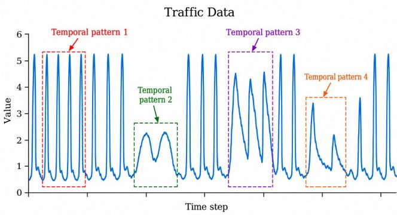
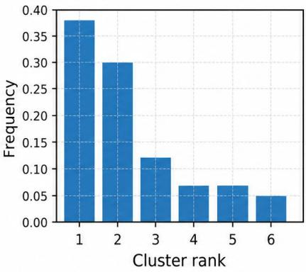
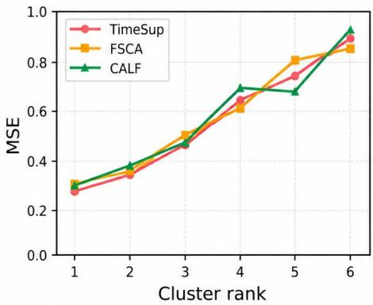
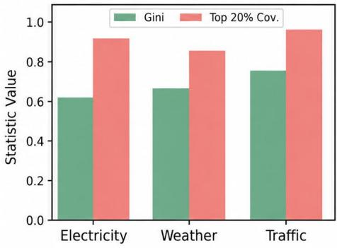
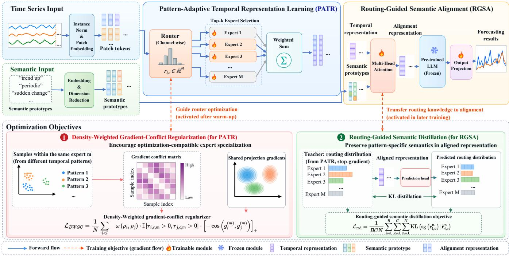
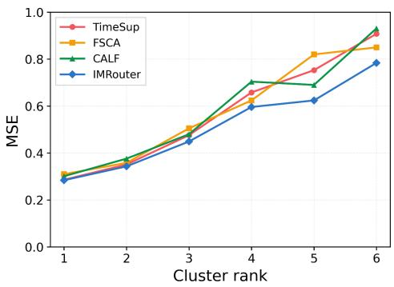
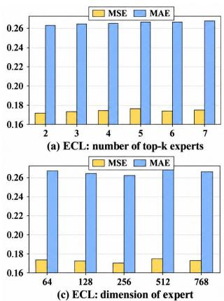
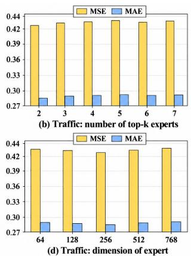

# IMRouter: Imbalance-aware Temporal Patern Routing for LLM-based Time Series Forecasting

Xin Yang Xidian University Xi’an, Shaanxi, China

Ying Liu Xidian University Xi’an, Shaanxi, China

Cai Xu Xidian University Xi’an, Shaanxi, China

Jie Zhao Chang’an University Xi’an, Shaanxi, China

Haishun Chen   
Xidian University   
Xi’an, Shaanxi, China

Wei Zhao Xidian University Xi’an, Shaanxi, China

Ziyu Guan Xidian University Xi’an, Shaanxi, China

## Abstract

Accurate time series forecasting (TSF) is essential for Web applications, such as trafic monitoring and online resource management. Recent advances in leveraging pre-trained large language models (LLMs) have shown promising performance in TSF. However, existing LLM-based TSF methods largely optimize the overall forecasting objective while overlooking temporal pattern imbalance (TPI), where diferent temporal patterns occur at highly unequal frequencies. Our empirical analysis reveals that TPI is prevalent across widely used TSF benchmarks, with substantially higher forecasting errors on less frequent patterns. To address this issue, we propose IMRouter (Imbalance-aware Temporal Pattern Routing), a novel framework that mitigates TPI-induced biases in both tempo ral representation learning and cross-modal alignment. Specifically, IMRouter introduces Pattern-Adaptive Temporal Representation Learning (PATR), which leverages gradient conflict and local gradient density to guide expert specialization. By penalizing incompatible expert assignments with density-aware weighting, PATR reduces the dominance of frequent optimization signals in router training. Furthermore, Routing-Guided Semantic Alignment (RGSA) transfers the pattern-specific knowledge learned by the router to cross-modal alignment through mutual information maximization, preserving distinctive temporal information across diferent patterns. Extensive experiments on benchmark datasets demonstrate the efectiveness of IMRouter, particularly in improving forecasting performance on less frequent temporal patterns.

## CCS Concepts

• Mathematics of computing → Time series analysis.

Keywords   
Time Series Forecasting, Temporal Pattern Imbalance, Large Lan  
guage Models, Mixture of Experts

ACM Reference Format: Xin Yang, Cai Xu, Haishun Chen, Ying Liu, Jie Zhao, Wei Zhao, and Ziyu Guan. 2018. IMRouter: Imbalance-aware Temporal Pattern Routing for LLM based Time Series Forecasting. In Proceedings ofMake sure to enter the correct conference titlefrom your rights confirmation email (Conference acronym ’XX). ACM, New York, NY, USA, 13 pages. https://doi.org/XXXXXXX.XXXXXXX

## 1 Introduction

Time series forecasting (TSF) is essential for Web applications, including website trafic prediction, cloud workload management, and online service demand forecasting [6, 10]. Although statistical and deep learning methods [20, 30] have achieved strong performance, their generalization across diverse temporal scenarios remains limited. With extensive knowledge acquired through large-scale pretraining, Large Language Models (LLMs), such as LLaMA [3] and DeepSeek [23], have shown promising generalization capabilities, motivating their application to TSF. However, the modality gap between discrete text and continuous time series remains a key challenge to efective forecasting [7].

To empower LLMs to explore time series and forecast accurately, most LLM-based TSF methods adopt the represent-then-align paradigm [8]: (1) Representation: a temporal encoder is utilized to extract temporal representations from input time series; (2) Alignment: an alignment module takes the above temporal representations as queries to retrieve and aggregate text prototypes derived from the pre-trained vocabulary embeddings of LLMs; (3) Training: the temporal encoder and alignment module are optimized by minimizing the mean squared error (MSE) between the predicted and ground-truth future values, while the pre-trained LLM remains frozen.

Real-world time series exhibit diverse temporal dynamics, including trends, oscillations, and fluctuations [21, 22]. We define a local temporal pattern as a recurring structure shared by segments with similar dynamics, as illustrated in Figure. 1. Inspired by class imbalance, we investigate whether such patterns also exhibit unequal frequencies. Since TSF datasets lack explicit pattern labels, we employ TS2Vec [24] to encode fixed-length training windows and

  
Figure 1: Illustration of temporal pattern diversity in a time series. Frequently recurring peak-shaped patterns coexist with less frequent, smoother local patterns (highlighted by red dashed boxes), demonstrating the heterogeneity of temporal dynamics.

HDBSCAN [1] to cluster similar representations. Each cluster approximates a local temporal pattern, with its size serving as a proxy for pattern frequency. As shown in Figure. 2(a), the cluster sizes are highly skewed, with a few dominant patterns and many less frequent ones. We refer to this phenomenon as Temporal Pattern Imbalance (TPI).

Under the MSE objective, frequently occurring temporal patterns contribute more samples and may dominate model optimization. This bias can afect LLM-based TSF methods in two ways. First, shared temporal encoders may favor frequent patterns, failing to capture the distinctive dynamics of less frequent ones. Second, cross-modal alignment may preferentially select semantic prototypes associated with frequent patterns, weakening the semantic representations of less frequent patterns. Consequently, forecasting performance on these patterns may deteriorate, as shown in Figure. 2 (b). For example, Web services dominated by weekday workloads may fail to capture distinct weekend demand cycles, leading to inaccurate resource provisioning and degraded service quality. Addressing TPI is therefore important for reliable forecasting across diverse temporal patterns in Web applications.

A natural approach to modeling diverse temporal patterns is to employ a Mixture-of-Experts (MoE) architecture [25], allowing diferent experts to specialize in distinct temporal dynamics. However, since the router is also optimized on the imbalanced training data, frequent patterns may dominate the routing opti mization, biasing the router toward experts better suited to these dominant patterns. Consequently, less frequent temporal patterns may be assigned to experts primarily specialized for frequent pat terns, preventing their distinctive temporal dynamics from being adequately captured. To this end, we propose Imbalance-aware Temporal Pattern Routing (IMRouter), a framework that mitigates TPI-induced biases in both temporal representation learning and cross-modal alignment. Specifically, IMRouter introduces Pattern-Adaptive Temporal Representation Learning (PATR), which lever ages gradient conflict and local gradient density to guide expert specialization. By discouraging patches with conflicting gradients from sharing experts and emphasizing conflicts in low-density regions of the gradient space, PATR achieves more compatible expert assignments across diverse temporal patterns. Building on PATR, Routing-Guided Semantic Alignment (RGSA) transfers the learned routing information to cross-modal alignment. Specifically, it employs a mutual-information-based distillation objective to preserve pattern-discriminative information in the aligned representations, mitigating the dominance of frequent patterns in semantic prototype selection. The main contributions of this paper are summarized as follows:

• We identify temporal pattern imbalance as a key challenge in LLM-based time-series forecasting, where frequent temporal samples dominate both representation learning and text prototype alignment.

• We propose IMRouter, a data-driven temporal-semantic balancing framework that mitigates head-dominated learning from both the representation and semantic alignment perspectives, without relying on manually defined head and tail labels.

• Extensive experiments on widely used TSF benchmarks demonstrate that IMRouter improves overall forecasting performance and enhances prediction accuracy on underrepresented temporal regimes.

## 2 Related Work

## 2.1 LLM-based Time Series Forecasting

Early works [31][4] simply represent time series as sequences of individual tokens and leverage LLMs for forecasting. However, they neglect the modality gap between numerical data and natural language. To mitigate this gap, Time-LLM [8] introduces a reprogramming module that maps temporal representations to text prototypes derived from the pre-trained vocabulary. This transformation produces LLM-compatible representations, enabling the LLM to better model temporal dynamics. This paradigm has inspired subsequent studies on adapting LLMs to TSF tasks. CALF [9] proposes a temporal–language consistency objective to strengthen cross-modal correspondence. FSCA [5] explicitly models interactions between temporal and textual modalities through a graph neural network. TimeSup [29] reveals the pseudo-alignment problem from the perspective of data manifold dimensionality and mitigate this problem through dimension enhancement. Despite these advances, existing methods primarily focus on improving cross-modal correspondence while overlooking TPI. Consequently, frequent patterns may disproportionately influence both temporal representation learning and semantic prototype selection, potentially degrading forecasting performance on less frequent patterns.

## 2.2 Imbalanced Time Series Forecasting

Numerous eforts have been made to develop imbalance learning methods for classification tasks, such as cost-sensitive learning [2, 15] and sampling techniques [28]. These methods fundamentally rely on class labels to identify imbalanced groups and apply diferent strategies to samples from diferent classes. Nevertheless, as mentioned above, TSF tasks lack explicit pattern labels, which makes it non-trivial to directly adapt these classification-oriented imbalance learning techniques to TSF tasks. Early imbalanced TSF approaches often rely on manually defined heuristics to assign imbalance-related labels to time-series samples, which allows the imbalance learning techniques developed for classification to be applied to TSF. For example, Silvestrin et al. [18] use the variation degree within a time window as an importance indicator to assign pseudo labels, and then apply resampling strategies to rebalance the sample distribution. Similarly, iBACon [27] utilizes the discrepancy between input and output windows as a pseudo label. However, these heuristic indicators capture only specific aspects of temporal dynamics and cannot comprehensively characterize the imbalanced frequency distribution of diverse temporal patterns. Consequently, their efectiveness may depend on how well the predefined indicators reflect the underlying pattern distribution, limiting their generalizability across diverse forecasting scenarios.

  
(a)

  
(b)

  
(c)  
Figure 2: (a) Frequency distribution of temporal pattern clusters identified from a representative channel in the Trafic dataset, ranked by cluster size in descending order. (b) Cluster-wise forecasting errors (MSE) of three existing methods on the same clusters, showing generally higher errors for less frequent patterns. (c) Dataset-level TPI statistics across Electricity, Weather, and Trafic. Gini measures the inequality of cluster sizes, while Top-20 % Coverage denotes the proportion of samples covered by the largest 20 % of clusters.

TPI is related to, yet distinct from, several widely studied challenges in TSF, including abrupt changes, non-stationarity, and extreme events. While these challenges primarily concern sudden variations, evolving statistical properties, or unusually large deviations, TPI focuses on the unequal occurrence frequencies of recurring local temporal patterns. These phenomena may coexist but do not necessarily coincide. For example, less frequent patterns can exhibit smooth and recurring dynamics without abrupt changes or extreme values, and TPI may arise even in stationary time series. Consequently, methods developed for these related challenges do not necessarily mitigate the frequency-induced optimization bias addressed in this work.

## 2.3 Mixture of Experts for Time Series Forecasting

MoE-based forecasters employ specialized predictors to model different temporal dynamics. MoLE combines linear experts to adapt to changing temporal patterns [13]. DUET routes series according to their latent temporal distributions [16]. Dynamic TMoE further adapts expert allocation to distribution drift [32]. These methods rely on learned routers to identify relevant temporal characteristics and assign samples to suitable experts. However, the routers themselves are typically optimized on imbalanced training data, where frequent patterns may dominate routing decisions. Consequently, expert assignments may favor frequent patterns, potentially limiting efective specialization for less frequent ones.

Recent studies have explored clustering-guided expert specialization. TFPS employs subspace clustering to identify patch-level pat terns for specialized experts [19]. By leveraging clustering-derived pattern information as additional guidance for expert assignments, TFPS can reduce reliance on the sample-averaged forecasting objective and partially mitigate the influence of TPI on router optimization. However, clustering results can be sensitive to algorithmic assumptions and hyperparameter choices, potentially afecting expert specialization. In contrast, IMRouter leverages gradient conflict and local gradient density to guide expert specialization directly from the model’s optimization signals, reducing potential instabil ity introduced by unreliable clustering results. IMRouter further transfers the learned pattern information to cross-modal alignment, providing a more comprehensive solution to TPI in LLM-based TSF.

## 3 Preliminary

Given a past time series $\boldsymbol { x } ^ { t i m e } \in \mathbb { R } ^ { C \times T _ { p a s t } }$ , where $C$ denotes the number of variables and $T _ { p a s t }$ denotes the length of historical observations, the goal of LLM-based TSF methods is to predict the future values $\mathbf { y } ^ { \mathrm { t i m e } } \in \mathbb { R } ^ { C \times T _ { f u t u r e } }$ over a prediction horizon $T _ { f u t u r e } .$ The forecasting model can be formulated as:

$$
\hat { y } ^ { t i m e } = f _ { \theta } ( x ^ { t i m e } ) ,\tag{1}
$$

where $\hat { y } _ { t i m e }$ is the predicted future window and � denotes the trainable parameters.

Each channel $\boldsymbol { x } _ { c } ^ { t i m e } \in \mathbb { R } ^ { 1 \times T _ { p a s t } }$ of input time series $x ^ { t i m e }$ is first normalized, divided into patches through a sliding window with size $\mathcal { P }$ and stride �, and mapped into patch-level temporal tokens

Conference acronym ’XX, June 03–05, 2018, Woodstock, NY

$$
e _ { c } ^ { n } \in \mathbb { R } ^ { 1 \times d } \colon
$$

$$
\{ e _ { c } ^ { n } \} _ { n = 1 } ^ { N } = \mathrm { P a t c h E m b e d } ( \mathrm { N o r m a l i z e } ( \mathrm { x } _ { \mathrm { c } } ^ { \mathrm { t i m e } } ) ) ,\tag{2}
$$

where $\begin{array} { r } { N = \lfloor \frac { T _ { p a s t } - p + s } { s } \rfloor } \end{array}$ denotes the number of patches.

To obtain LLM-compatible representations, the temporal embed dings are aligned with text prototypes through cross-attention:

$$
z _ { n } ^ { c } = \mathrm { M u l t i H e a d A t t e n t i o n } ( e _ { c } ^ { n } , O , O ) ,\tag{3}
$$

where $O \in \mathbb { R } ^ { P \times d _ { m o d e l } }$ is the set of text prototypes obtained by compressing the pre-trained LLM vocabulary embedding matrix, and � is the number of text prototypes. By treating temporal embeddings as queries and text prototypes as keys and values, this mechanism establishes interactions between numerical and linguistic representations.

The aligned representations are subsequently processed by the frozen LLM to generate forecasts $\hat { y } ^ { t i m e }$ . To optimize forecasting performance, the model is typically trained by minimizing the MSE loss:

$$
\mathcal { L } ( \theta ) = \frac { 1 } { B } \sum _ { b = 1 } ^ { B } | | \hat { y } _ { b } ^ { t i m e } - y _ { b } ^ { t i m e } | | ^ { 2 } ,\tag{4}
$$

where � is the size of the mini-batch.

## 4 Method

In this section, we begin by analyzing the MSE objective and show that the gradient contribution of each temporal pattern is implicitly weighted by its empirical frequency, leading frequent temporal patterns to dominate model optimization. Based on this observation, we propose IMRouter, a data-driven framework for imbalanced LLM-based TSF. As shown in Figure 3 , IMRouter comprises two core components, PATR and RGSA, which jointly mitigate imbalance-induced bias in temporal representation learning and cross-modal semantic alignment.

## 4.1 Motivation

The standard training objective minimizes the average squared prediction error over all training samples, causing the optimization process to be dominated by the empirical data distribution. To support this argument, we decompose the MSE loss according to latent temporal patterns. Suppose the training dataset � contains � temporal pattern categories. The overall MSE objective can be rewritten as:

$$
\mathcal { L } ( \boldsymbol { \theta } ) = \sum _ { j = 1 } ^ { J } \frac { \left| D _ { j } \right| } { \left| D \right| } L _ { j } ( \boldsymbol { \theta } ) ,\tag{5}
$$

$$
\mathcal { L } _ { j } ( \theta ) = \frac { 1 } { | D _ { j } | } \sum _ { i \in \mathcal { D } _ { j } } | | \hat { y } _ { i } ^ { t i m e } - y _ { i } ^ { t i m e } | | ^ { 2 } ,\tag{6}
$$

where |�| is the size of the training dataset, and $D _ { j }$ denotes the set of samples belonging to temporal pattern category � in the training dataset.

The gradient of the overall objective can be written as:

$$
\nabla _ { \boldsymbol { \theta } } \mathcal { L } ( \boldsymbol { \theta } ) = \sum _ { j = 1 } ^ { J } \frac { | D _ { j } | } { | D | } \nabla _ { \boldsymbol { \theta } } \mathcal { L } _ { j } ( \boldsymbol { \theta } ) .\tag{7}
$$

This decomposition shows that gradient contributions are weighted by empirical pattern frequencies, causing frequent temporal patterns to dominate optimization and rare samples to be insuficiently modeled.

## 4.2 Pattern-Adaptive Temporal Representation Learning

As discussed in Section 4.1, TPI may bias the optimization of shared temporal encoders toward frequent patterns. To mitigate this bias, PATR introduces a mixture-of-experts (MoE) architecture [25] that enables diferent temporal patterns to be processed by specialized experts. Since each expert is updated only by its assigned samples, this architecture can reduce optimization interference between patterns routed to diferent experts. However, the router of MoE is also trained on imbalanced data and may therefore favor frequent patterns. To address this limitation, PATR leverages gradient con flict to guide expert specialization, while local gradient density increases the relative importance of conflicts involving less densely represented optimization signals.

Expert Routing : Let $\mathbf { e } _ { i , c } ^ { n }$ denote the patch embedding defined in Eq. (2) for the �-th patch of channel � in sample �. To capture diverse temporal dynamics, PATR routes each patch to a sparse subset of � experts. Specifically, the router produces an expert assignment distribution for each patch:

$$
\mathbf { r } _ { i , c } ^ { n } = \operatorname { s o f t m a x } \left( g _ { \phi } ( \mathbf { e } _ { i , c } ^ { n } ) \right) ,\tag{8}
$$

where $g _ { \phi }$ is the routing network and $\mathbf { r } _ { i . c } ^ { n } \ \in \ \mathbb { R } ^ { M }$ represents the assignment probabilities over � experts. The top-� experts are selected to construct the temporal representation :

$$
\mathbf { u } _ { i , c } ^ { n } = \sum _ { m \in S _ { i , c } ^ { n } } \tilde { r } _ { i , c , m } ^ { n } E _ { m } ( \mathbf { e } _ { i , c } ^ { n } ) ,\tag{9}
$$

where $S _ { i , c } ^ { n } = \mathrm { T o p K } ( \mathbf { r } _ { i , c } ^ { n } , k )$ is the selected expert set, $E _ { m }$ is the �-th expert and $\tilde { r } _ { i , c , m } ^ { n }$ denotes the normalized routing weight.

Density-aware Gradient Conflict Regularization : After an initial MoE warm-up, patches with similar temporal dynamics are expected to induce compatible expert-parameter gradients when assigned to the same expert. Opposing gradients may therefore indicate that the router has assigned patches with diferent optimization requirements to a shared expert. PATR leverages this signal to penalize their joint assignment probabilities to that expert, encouraging more compatible expert specialization.

Formally, let $q = ( i , c , n )$ index a temporal patch, and $\mathbf { g } _ { q } ^ { ( m ) }$ denote its contribution to the forecasting gradient of expert �. For two patches � and $q ^ { \prime }$ assigned to the same expert, their gradient conflict is measured as

$$
C _ { q , q ^ { \prime } } ^ { ( m ) } = \left[ - \cos \left( { \bf g } _ { q } ^ { ( m ) } , { \bf g } _ { q ^ { \prime } } ^ { ( m ) } \right) \right] _ { + } ,\tag{10}
$$

where $[ x ] _ { + } = \operatorname* { m a x } ( 0 , x )$ . The conflict score captures the degree of opposition between expert-parameter gradients, with positive values indicating potentially incompatible expert assignments. Based on this measure, we formulate a gradient-conflict regularizer that penalizes their joint assignment probabilities:

$$
\mathcal { L } _ { \mathrm { G C } } = \frac { 1 } { \vert \mathcal { P } \vert } \sum _ { c , m } \sum _ { ( q , q ^ { \prime } ) \in \mathcal { P } _ { c , m } } C _ { q , q ^ { \prime } } ^ { ( m ) } r _ { q , m } r _ { q ^ { \prime } , m } ,\tag{11}
$$

  
Figure 3: Illustration of IMRouter

where $\mathcal { P } _ { c , m }$ denotes the set of sampled patch pairs sharing expert � within channel $\begin{array} { r } { c , | \mathcal { P } | = \sum _ { c , m } | \mathcal { P } _ { c , m } | } \end{array}$ , and $r _ { q , m }$ is the assignment probability of patch � to expert �.

Moreover, under severe TPI, conflicts involving less frequent patterns may be underrepresented in the batch-averaged objective, even when their individual conflict scores are high. To mitigate this dilution, we introduce inverse gradient-density weighting to enhance the relative influence of sparsely represented optimization signals. Since expert-specific gradient densities are influenced by routing assignments, they may not reflect the overall distribution of temporal patterns. We therefore estimate gradient density from the gradients of the shared router layer, enabling stable comparisons across temporal patterns.

Let ${ \bf G } _ { q }$ denote the contribution of patch � to the gradient of the shared embedding parameters, and $\hat { \mathbf { G } } _ { q }$ its normalized form. Our weighting requires a direction-specific measure of update redundancy: gradients with similar directions indicate similar update demands. We therefore estimate the concentration around each normalized gradient using a Gaussian kernel kernel:

$$
\rho _ { q } = \frac { 1 } { \vert \mathcal { B } _ { c } \vert } \sum _ { q ^ { \prime } \in \mathcal { B } _ { c } } \exp \left( - \frac { \vert \vert \hat { \mathbf { G } } _ { q } - \hat { \mathbf { G } } _ { q ^ { \prime } } \vert \vert _ { F } ^ { 2 } } { 2 \tau ^ { 2 } } \right) ,\tag{12}
$$

where $\mathcal { B } _ { c }$ denotes the set of patch representations from channel � within a mini-batch, and � is the kernel bandwidth. The corresponding density-aware weight is defined as

$$
w _ { q } = \frac { ( \rho _ { q } + \epsilon ) ^ { - \alpha } } { \frac { 1 } { | \mathcal { B } _ { c } | } \sum _ { q ^ { \prime } \in \mathcal { B } _ { c } } ( \rho _ { q ^ { \prime } } + \epsilon ) ^ { - \alpha } } ,\tag{13}
$$

where � controls the reweighting strength.

Combining gradient conflict and local density, we formulate the Density-Weighted Gradient Conflict (DWGC) regularizer:

$$
\mathcal { L } _ { \mathrm { { D W G C } } } = \frac { \displaystyle \sum _ { c = 1 } ^ { C } \sum _ { m = 1 } ^ { M } \sum _ { ( q , q ^ { \prime } ) \in \mathcal { P } _ { c , m } } \omega _ { q , q ^ { \prime } } C _ { q , q ^ { \prime } } ^ { ( m ) } r _ { q , m } r _ { q ^ { \prime } , m } } { \displaystyle \sum _ { c = 1 } ^ { C } \sum _ { m = 1 } ^ { M } \sum _ { ( q , q ^ { \prime } ) \in \mathcal { P } _ { c , m } } \omega _ { q , q ^ { \prime } } + \epsilon } ,\tag{14}
$$

where $\mathcal { P } _ { c , m }$ denotes the sampled pairs from channel � that share expert �, $r _ { q , m }$ is the assignment probability of patch � to expert �, and $\omega _ { q , q ^ { \prime } } = \sqrt { w _ { q } w _ { q ^ { \prime } } }$ represents their joint density-aware weight.

## 4.3 Routing-Guided Semantic Alignment

During training, the PATR router learns to select the most suitable expert combination for each sample, thereby encoding rich temporal pattern information. Building on PATR, IMRouter further introduces RGSA to transfer pattern-aware knowledge from the PATR router to the aligned representation, preserving discriminative semantics for rare temporal patterns. Given the temporal representations $\{ u _ { i , c } ^ { n } \} _ { n = 1 } ^ { N }$ generated by PATR, RGSA aligns them with the text prototypes through cross-attention:

$$
a _ { i , c } ^ { n } = \mathrm { M u l t i H e a d A t t e n t i o n } ( u _ { i , c } ^ { n } , O , O ) .\tag{15}
$$

To prevent rare-pattern information from being diluted during cross-modal alignment, RGSA encourages aligned semantic representations to preserve the routing information learned by PATR. Let $\mathbf { r } _ { i , c } \in \mathbb { R } ^ { M }$ denote the routing distribution of the �-th sample and �-th channel, and $\mathbf { a } _ { i , c } ^ { n }$ denote its aligned semantic representation. We aim to maximize the mutual information between the corresponding random variables � and �:

<table><tr><td>Models</td><td colspan="2">IMRouter MSE MAE</td><td colspan="2">TimeSup MSE MAE</td><td colspan="2">FSCA MSE MAE</td><td colspan="2">CALF Time-LLM MSE MAE MSE MAE</td><td colspan="2">GPT4TS MSE MAE</td><td colspan="2">PatchTST MSE MAE</td><td colspan="2">iTransformer MSE MAE</td><td colspan="2">TimesNet MSE MAE</td></tr><tr><td>ETTm1</td><td>0.389</td><td>0.389</td><td>0.402 0.407</td><td>0.473</td><td>0.437</td><td>0.393 0.391</td><td>0.4100.409</td><td></td><td>0.389 0.397</td><td></td><td>0.3880.402</td><td>0.407</td><td>0.411</td><td>0.410 0.418</td></tr><tr><td>ETTm2</td><td>0.279</td><td>0.321</td><td>0.2840.329</td><td>0.282</td><td>0.326</td><td>0.282 0.322</td><td>0.2850.331</td><td>0.258</td><td>0.331</td><td>0.290</td><td>0.333</td><td>0.291</td><td>0.334</td><td>0.2950.332</td></tr><tr><td>ETTh1</td><td>0.442 0.437</td><td></td><td>0.4640.450</td><td>0.429</td><td>0.436</td><td>0.4110.439</td><td>0.4600.449</td><td></td><td>0.4470.436</td><td>0.448 0.447</td><td></td><td>0.464 0.455</td><td>0.4600.455</td><td></td></tr><tr><td>ETTh2</td><td>0.3720.397</td><td></td><td>0.402 0.419</td><td>0.3720.401</td><td></td><td>0.3760.404</td><td>0.3890.408</td><td></td><td>0.381 0.408</td><td>0.384 0.413</td><td>0.383</td><td>0.407</td><td></td><td>0.407 0.421</td></tr><tr><td>Weather</td><td>0.250 0.269</td><td></td><td>0.2590.279</td><td> 0.260 0.280</td><td></td><td>0.2460.271</td><td>0.2740.290</td><td></td><td>0.264 0.284</td><td>0.258 0.280</td><td></td><td>0.260 0.281</td><td></td><td>0.2590.285</td></tr><tr><td>ECL</td><td>0.1710.263</td><td></td><td>0.1920.281</td><td></td><td>0.194 0.278</td><td>0.193 0.278</td><td>0.2230.309</td><td></td><td>0.205 0.290</td><td>0.2040.294</td><td></td><td>0.175</td><td>0.266</td><td>0.197 0.297</td></tr><tr><td>Traffic</td><td>0.4230.285</td><td></td><td>0.4420.288</td><td>0.457</td><td>0.293</td><td>0.459 0.303</td><td>0.541 0.358</td><td></td><td>0.488 0.317</td><td></td><td>0.482 0.308</td><td>0.428</td><td>0.285</td><td>0.625 0.331</td></tr></table>

Table 1: Long-term forecasting results averaged over four prediction horizons on seven benchmarks. The best and second-best results are shown in bold and underlined, respectively.

$$
I ( A ; R ) = H ( R ) - H ( R | A ) ,\tag{16}
$$

where � represents the expert-assignment variable induced by the routing distribution, and � denotes the aligned semantic representation.

Since the true posterior $p ( R | A )$ is intractable, we introduce a lightweight predictor $q _ { \psi }$ to approximate it from the aligned representation:

$$
\hat { \mathbf { r } } _ { i , c } ^ { n } = \mathrm { s o f t m a x } \left( q _ { \psi } \left( \mathbf { a } _ { i , c } ^ { n } \right) \right) .\tag{17}
$$

By the non-negativity of KL divergence, the mutual information admits the following variational lower bound:

$$
\begin{array} { r l } & { I ( A ; R ) = H ( R ) + \mathbb { E } _ { p ( A , R ) } [ \log p ( R | A ) ] } \\ & { \qquad \geq H ( R ) + \mathbb { E } _ { p ( A , R ) } [ \log q _ { \psi } ( R | A ) ] . } \end{array}\tag{18}
$$

Using the routing distribution as a soft target, the negative expected log-likelihood can be estimated by the cross-entropy between $\mathbf { r } _ { i , c }$ and $\hat { \mathbf { r } } _ { i , c } ^ { n }$ . Since cross-entropy decomposes into entropy and KL divergence, and the routing distribution is detached during distillation, maximizing this lower bound is equivalent to minimizing the KL divergence with respect to the alignment module and predictor. This yields the Routing-guided Semantic Distillation (RSD) objective:

$$
\mathcal { L } _ { \mathrm { R S D } } = \frac { 1 } { B C N } \sum _ { i = 1 } ^ { B } \sum _ { c = 1 } ^ { C } \sum _ { n = 1 } ^ { N } \mathrm { K L } \left( \mathbf { s g } ( \mathbf { r } _ { i , c } ^ { n } ) \parallel \hat { \mathbf { r } } _ { i , c } ^ { n } \right) ,\tag{19}
$$

where sg(·) denotes the stop-gradient operation.

## 4.4 Overall Training Objective

The overall training objective of IMRouter is :

$$
{ \mathcal { L } } _ { \mathrm { t o t a l } } = { \mathcal { L } } _ { \mathrm { p r e d } } + \lambda _ { \mathrm { B A L } } { \mathcal { L } } _ { \mathrm { B A L } } + \lambda _ { \mathrm { D W G C } } { \mathcal { L } } _ { \mathrm { D W G C } } + \lambda _ { \mathrm { R S D } } { \mathcal { L } } _ { \mathrm { R S D } } ,\tag{20}
$$

where $\mathcal { L } _ { \mathrm { p r e d } }$ is the forecasting loss, and $\mathcal { L } _ { \mathrm { B A L } }$ is the load-balancing regularizer. The hyperparameters $\lambda _ { \mathrm { B A L } } , \mathcal { L } _ { \mathrm { B A L } }$ and $\lambda _ { \mathrm { R S D } }$ control the strength of the auxiliary objectives. Notably, routing assignments are often unstable during the early training stage, which may introduce noisy supervision into semantic distillation. We therefore activate RGSA midway through training.

## 5 Experiments

## 5.1 Implementation Details

All experiments are implemented in Python 3.10 using PyTorch 2.1.3 and conducted on a workstation equipped with two NVIDIA GeForce RTX 4090 GPUs. We adopt the Adam optimizer and search the learning rate over {0.0001,0.0003,0.0005,0.0008}, while the batch size is selected from {8,32,64,128}. The maximum number of training epochs is set to 10,20,30,100, and early stopping is applied with a patience of 5,10 according to the validation MSE. To ensure reproducibility, all experiments use a fixed random seed of 2021.

We implement IMRouter on top of the CALF forecasting framework [9] by augmenting it with the proposed PATR and RGSA modules. Since CALF constructs temporal representations at the channel level, we adopt channel-wise expert routing in this implementation. To ensure a controlled comparison, we retain the same backbone, data-processing pipeline, and optimizer configuration as CALF unless otherwise stated. During training, we first optimize the model using the forecasting objective and subsequently activate the density-weighted gradient conflict regularizer after an initial warm-up stage. The expert architectures, routing mechanisms, auxiliary objectives, and their associated hyperparameters are introduced specifically for IMRouter.

## 5.2 Baselines

We compare IMRouter with representative forecasting baselines, which can be divided into two categories. The first category includes conventional deep time-series forecasting models, including PatchTST [14], iTransformer [11], TimesNet [22], and DLinear [26]. The second category consists of LLM-based TSF methods, such as GPT4TS [31], Time-LLM [8], CALF [9], TimeSup [29] and FSCA [5] (a state-of-the-art method for LLM-based TSF). For a fair comparison, the backbone of LLM-based models is set to GPT-2 [17].

## 5.3 Long-term Forecasting

We evaluate IMRouter on seven widely used long-term time series forecasting benchmarks: ETTh1, ETTh2, ETTm1, ETTm2, Weather, Electricity (ECL), and Trafic [22]. These datasets cover diverse application domains, including energy systems, meteorology, and transportation. Moreover, they exhibit substantial diversity in temporal resolution, dimensionality, and underlying temporal dynamics, providing a comprehensive benchmark for evaluating forecasting performance across diverse temporal scenarios. Following standard long-term forecasting settings, we fix the input sequence length at 96 and evaluate four prediction horizons, including {96, 192, 336, 720}, to assess model performance across diferent forecasting lengths. We adopt Mean Squared Error (MSE) and Mean Absolute Error (MAE) as evaluation metrics. MSE emphasizes larger prediction deviations, whereas MAE provides a complementary measure of average absolute errors. Lower values indicate better forecasting performance.

As shown in Table. ??, IMRouter achieves the lowest average MSE and MAE across seven long-term forecasting benchmarks. Compared with CALF, the strongest baseline on average, IMRouter reduces MSE and MAE by 1.4% and 2.0%, respectively. Relative to FSCA, Time-LLM, and GPT4TS, the corresponding reductions are 5.7%/3.7%, 9.9%/7.6%, and 4.4%/4.1%. IMRouter also outperforms conventional forecasting methods on average, achieving reductions of up to 12.3% in MSE and 7.0% in MAE. Notably, IMRouter achieves the lowest MSE on ECL and Trafic, demonstrating its efectiveness on high-dimensional forecasting benchmarks. Overall, these results highlight the efectiveness of IMRouter across diverse temporal scenarios.

## 5.4 Short-term Forecasting

For short-term forecasting, we evaluate IMRouter on the M4 bench mark [12], which comprises 100,000 univariate time series from diverse domains. The dataset covers six sampling frequencies: Yearly, Quarterly, Monthly, Weekly, Daily, and Hourly, with corresponding prediction horizons of 6, 8, 18, 13, 14, and 48, respectively. These subsets exhibit diverse temporal characteristics, including diferent seasonal patterns, sequence lengths, and sampling granularities, providing a comprehensive evaluation across diverse forecasting scenarios. Following the M4 evaluation protocol, we adopt three metrics: symmetric Mean Absolute Percentage Error (sMAPE), Mean Absolute Scaled Error (MASE), and Overall Weighted Average (OWA). Lower values indicate better performance across all three metrics.

As shown in Table. 2, IMRouter achieves the best average performance across all three metrics on the M4 dataset, with sMAPE, MASE, and OWA of11.770, 1.568, and 0.844, respectively. Compared with FSCA, the strongest competing baseline, IMRouter reduces these metrics by 0.49%, 0.76%, and 0.71%, respectively. Compared with conventional forecasting models, IMRouter also achieves better performance than PatchTST, iTransformer, and TimesNet across all three metrics. These improvements suggest that IMRouter can efectively capture temporal dynamics across diverse forecasting scenarios. Overall, the results further demonstrate the efective ness and applicability of IMRouter in short-term forecasting tasks involving diverse temporal characteristics.

## 5.5 Few-shot Learning

Few-shot learning is crucial for deploying time-series forecasting models in real-world scenarios with limited training data. To examine this capability, we evaluate IMRouter in the few-shot setting, where the model is trained using only 10% of the available training samples. We report the average performance across four prediction horizons {96, 192, 336, 720}. As shown in Table. 3, IMRouter ranks first or second on six of the eight metrics, achieving the lowest MSE and MAE on ETTm1 and ETTm2. Compared with the CALF backbone, IMRouter reduces the average MSE and MAE by 0.91% and 0.40%, respectively. Notably, IMRouter demonstrates competitive performance across all four datasets, with particularly notable improvements on ETTm1 and ETTm2. These results suggest that IMRouter can efectively leverage limited training data to learn temporal representations, demonstrating its potential for few-shot forecasting.

  
Figure 4: Pattern-wise forecasting performance of IMRouter and three baseline methods on the Trafic dataset.

  
Figure 5: Hyperparameter sensitivity results on the number of top-k experts and the dimension of experts.

## 5.6 Ablation Study

To systematically evaluate the efectiveness of IMRouter, we conduct ablation experiments on the ECL and Trafic datasets. Specifically, we construct five variants: CALF : This variant removes PATR and RGSA. MLP: This variant replaces PATR with an MLP of comparable computational cost and removes RGSA. Vanilla MoE: This variant retains the same MoE architecture as PATR but removes gradient-guided routing regularization and RGSA. PATR:

<table><tr><td>Models</td><td></td><td>IMRouter</td><td>FSCA</td><td>Time-LLM</td><td>GPT4TS</td><td>PatchTST</td><td>iTransformer</td><td>TimesNet</td></tr><tr><td rowspan="3">Aerage</td><td>SMAPE</td><td>11.77</td><td>11.828</td><td>12.494</td><td>12.365</td><td>12.059</td><td>12.142</td><td>12.880</td></tr><tr><td>MASE</td><td>1.568</td><td>1.580</td><td>1.731</td><td>1.767</td><td>1.623</td><td>1.632</td><td>1.836</td></tr><tr><td>OWA</td><td>0.844</td><td>0.850</td><td>0.913</td><td>0.918</td><td>0.869</td><td>0.874</td><td>0.955</td></tr></table>

Table 2: Average short-term forecasting performance on the M4 dataset. The results are averaged across the Yearly, Quarterly, Monthly, and Other subsets. The best results are shown in bold, and the second-best results are underlined.

<table><tr><td rowspan=1 colspan=1>Dataset</td><td rowspan=1 colspan=1>IMRouterMSE MAE</td><td rowspan=1 colspan=1>FSCAMSE MAE</td><td rowspan=1 colspan=1>CALFMSE MAE</td><td rowspan=1 colspan=1>Time-LLMMSE 1MAE</td><td rowspan=1 colspan=1>GPT4TSMSE MAE</td><td rowspan=1 colspan=1>PatchTSTMSE MAE</td><td rowspan=1 colspan=1>iTransformerMSEMAE</td><td rowspan=1 colspan=1>TimesNetMSE MAE</td><td rowspan=1 colspan=1>DLinearMSE MAE</td></tr><tr><td rowspan=1 colspan=1>ETTm1</td><td rowspan=1 colspan=1>0.4980.457</td><td rowspan=1 colspan=1>0.6020.503</td><td rowspan=1 colspan=1>0.5040.462</td><td rowspan=1 colspan=1>0.5650.491</td><td rowspan=1 colspan=1>0.6070.498</td><td rowspan=1 colspan=1>0.6190.496</td><td rowspan=1 colspan=1>0.5800.497</td><td rowspan=1 colspan=1>0.674 0.535</td><td rowspan=1 colspan=1>0.568 0.500</td></tr><tr><td rowspan=1 colspan=1>ETTm2</td><td rowspan=1 colspan=1>0.292 0.330</td><td rowspan=1 colspan=1>0.3020.339</td><td rowspan=1 colspan=1>0.302 0.330</td><td rowspan=1 colspan=1>0.3030.341</td><td rowspan=1 colspan=1>0.3030.337</td><td rowspan=1 colspan=1>0.3020.342</td><td rowspan=1 colspan=1>0.3060.344</td><td rowspan=1 colspan=1>0.322 0.355</td><td rowspan=1 colspan=1>0.3290.383</td></tr><tr><td rowspan=1 colspan=1>ETTh1</td><td rowspan=1 colspan=1>0.6430.541</td><td rowspan=1 colspan=1>0.695 0.553</td><td rowspan=1 colspan=1>0.6440.541</td><td rowspan=1 colspan=1>0.6160.530</td><td rowspan=1 colspan=1>0.6880.554</td><td rowspan=1 colspan=1>0.6230.532</td><td rowspan=1 colspan=1>0.7480.587</td><td rowspan=1 colspan=1>0.864 0.625</td><td rowspan=1 colspan=1>0.6470.552</td></tr><tr><td rowspan=1 colspan=1>ETTh2</td><td rowspan=1 colspan=1>0.4190.425</td><td rowspan=1 colspan=1>0.4030.416</td><td rowspan=1 colspan=1>0.4190.427</td><td rowspan=1 colspan=1>0.4970.465</td><td rowspan=1 colspan=1>0.574 0.495</td><td rowspan=1 colspan=1>0.490 0.459</td><td rowspan=1 colspan=1>0.4430.443</td><td rowspan=1 colspan=1>0.487 0.468</td><td rowspan=1 colspan=1>0.446 0.461</td></tr></table>

Table 3: Few-shot forecasting performance on four ETT datasets. Results are averaged over the available prediction horizons. Lower MSE and MAE indicate better performance. The best results are highlighted in bold, and the second-best results are underlined.

<table><tr><td rowspan="2">Variants</td><td colspan="2">ECL</td><td colspan="2">Traffic</td></tr><tr><td>MSE</td><td>MAE</td><td>MSE</td><td>MAE</td></tr><tr><td>CALF</td><td>0.193</td><td>0.278</td><td>0.459</td><td>0.303</td></tr><tr><td>MLP</td><td>0.201</td><td>0.288</td><td>0.459</td><td>0.306</td></tr><tr><td>Vanilla MoE</td><td>0.186</td><td>0.279</td><td>0.443</td><td>0.292</td></tr><tr><td>PATR</td><td>0.179</td><td>0.268</td><td>0.433</td><td>0.291</td></tr><tr><td>Vanilla MoE + RGSA</td><td>0.180</td><td>0.272</td><td>0.430</td><td>0.291</td></tr><tr><td>PATR w/o Density + RGSA</td><td>0.177</td><td>0.266</td><td>0.430</td><td>0.289</td></tr><tr><td>IMRouter</td><td>0.171</td><td>0.263</td><td>0.423</td><td>0.285</td></tr></table>

Table 4: Ablation results of IMRouter on ECL and Trafic. Lower MSE and MAE indicate better performance.

This variant retains the complete PATR module while removing RGSA. Vanilla MoE + RGSA: This variant retains RGSA but replaces PATR with a standard MoE without gradient-guided routing regularization. PATR w/o Density + RGSA: This variant retains gradient-conflict regularization and RGSA but removes densityaware weighting.

Table 4 presents the ablation results on ECL and Trafic. Compared with CALF and MLP, vanilla MoE achieves lower MSE on both datasets, highlighting the benefit of expert-based representations. PATR further improves performance, demonstrating the efectiveness of gradient-guided routing. Incorporating RGSA into vanilla MoE also reduces forecasting errors, indicating the benefit of routing-guided semantic alignment. Moreover, density-aware weighting further reduces MSE from 0.177 to 0.171 on ECL and from 0.430 to 0.423 on Trafic, highlighting its contribution beyond gradient-conflict regularization. Overall, IMRouter achieves the best performance on both datasets, validating the complementary contributions of PATR and RGSA.

## 5.7 Pattern-wise Forecasting Performance

To further investigate the efectiveness of IMRouter in mitigating TPI, we evaluate its forecasting performance across temporal patterns with diferent occurrence frequencies. Specifically, we adopt the same temporal pattern clusters and test samples as those used in Figure. 2(b), ensuring a consistent comparison with existing meth ods. The clusters are ranked by their occurrence frequencies in descending order, and the MSE of each model is calculated separately for each cluster.

As shown in Figure. 4, forecasting errors generally increase as temporal pattern frequency decreases. Nevertheless, IMRouter achieves the lowest MSE across all six clusters, with more pronounced improvements on less frequent patterns. For instance, on Cluster 6, IMRouter achieves an MSE of approximately 0.78, compared with 0.85–0.93 for competing methods. These results demonstrate the efectiveness of IMRouter in improving forecasting accuracy on underrepresented temporal patterns, highlighting its potential to mitigate TPI.

## 5.8 Hyperparameter Sensitivity

We evaluate the sensitivity of IMRouter to the number of selected experts � and the expert dimension on ECL and Trafic. Specifically, we vary one hyperparameter at a time while keeping the remaining settings fixed, and report the average MSE across four prediction horizons. The number of selected experts determines how many experts contribute to each temporal representation, while the expert dimension controls the representation capacity of individual experts.

As illustrated in Figure. 5(a)–(b), IMRouter achieves the best performance with � = 2 on both ECL and Trafic. Increasing the number of selected experts generally degrades performance, suggesting that sparse routing helps reduce interference between diferent tempo ral patterns. Regarding expert dimension, both datasets achieve the lowest forecasting errors at 256, while further increasing the dimension ofers no additional benefits. These results highlight the importance of appropriate expert sparsity and capacity for efective temporal representation learning.

## 6 Conclusion

In this paper, we investigate Temporal Pattern Imbalance (TPI) in LLM-based time series forecasting and propose IMRouter to mitigate its adverse efects. Specifically, IMRouter employs gradientguided expert routing to reduce optimization interference and routing-guided semantic alignment to preserve pattern-specific information. Extensive experiments demonstrate that IMRouter improves forecasting performance across diverse benchmarks, particularly for less frequent temporal patterns. These findings highlight the importance of addressing TPI for reliable LLM-based time series forecasting.

## References

[1] Ricardo J. G. B. Campello, Davoud Moulavi, and Joerg Sander. 2013. Density-Based Clustering Based on Hierarchical Density Estimates. In Advances in Knowledge Discovery and Data Mining, Jian Pei, Vincent S. Tseng, Longbing Cao, Hirosh Motoda, and Guandong Xu (Eds.). Springer Berlin Heidelberg, Berlin, Heidelberg, 160–172.

[2] Haishun Chen, Cai Xu, Ziyu Guan, Wei Zhao, and Jinlong Liu. 2025. Biased Incomplete Multi-View Learning. In Thirty-Ninth AAAI Conference on Artificial Intelligence, Thirty-Seventh Conference on Innovative Applications of Artificial Intelligence, Fifteenth Symposium on Educational Advances in Artificial Intelligence, AAAI 2025, Philadelphia, PA, USA, February 25 - March 4, 2025, Toby Walsh, Julie Shah, and Zico Kolter (Eds.). AAAI Press, 15767–15775. doi:10.1609/AAAI.V39I15. 33731

[3] Aaron Grattafiori, Abhimanyu Dubey, AbhinavJauhri, Abhinav Pandey, Abhishek Kadian, Ahmad Al-Dahle, Aiesha Letman, Akhil Mathur, Alan Schelten, Alex Vaughan, et al. 2024. The llama 3 herd of models. arXiv preprint arXiv:2407.21783 (2024).

[4] Nate Gruver, Marc Finzi, Shikai Qiu, and Andrew Gordon Wilson. 2023. Large Language Models Are Zero-Shot Time Series Forecasters. In Advances in Neural Information Processing Systems 36: Annual Conference on Neural Information Processing Systems 2023, NeurIPS 2023, New Orleans, LA, USA, December 10 - 16, 2023, Alice Oh, Tristan Naumann, Amir Globerson, Kate Saenko, Moritz Hardt, and Sergey Levine (Eds.). http://papers.nips.cc/paper\_files/paper/2023/hash 3eb7ca52e8207697361b2c0fb3926511-Abstract-Conference.html

[5] Yuxiao Hu, Qian Li, Dongxiao Zhang, Jinyue Yan, and Yuntian Chen. 2025. Context-Alignment: Activating and Enhancing LLMs Capabilities in Time Series. In The Thirteenth International Conference on Learning Representations, ICLR 2025, Singapore, April 24-28, 2025. OpenReview.net. https://openreview.net/forum?id= syC2764fPc

[6] Qihe Huang, Zhengyang Zhou, Kuo Yang, and Yang Wang. 2025. Exploiting Language Power for Time Series Forecasting with Exogenous Variables. In Proceedings of the ACM on Web Conference 2025, WWW 2025, Sydney, NSW, Australia, 28 April 2025- 2 May 2025, Guodong Long, Michale Blumestein, Yi Chang, Liane Lewin-Eytan, Zi Helen Huang, and Elad Yom-Tov (Eds.). ACM, 4043–4052. doi:10.1145/3696410.3714793

[7] Yushan Jiang, Kanghui Ning, Zijie Pan, Xuyang Shen, Jingchao Ni, Wenchao Yu, Anderson Schneider, Haifeng Chen, Yuriy Nevmyvaka, and Dongjin Song. 2025. Multi-modal Time Series Analysis: A Tutorial and Survey. In Proceedings of the 31st ACM SIGKDD Conference on Knowledge Discovery and Data Mining, V.2, KDD 2025, Toronto ON, Canada, August 3-7, 2025, Luiza Antonie, Jian Pei, Xiaohui Yu, Flavio Chierichetti, Hady W. Lauw, Yizhou Sun, and Srinivasan Parthasarathy (Eds.). ACM, 6043–6053. doi:10.1145/3711896.3736567

[8] Ming Jin, Shiyu Wang, Lintao Ma, Zhixuan Chu, James Y. Zhang, Xiaoming Shi, Pin-Yu Chen, Yuxuan Liang, Yuan-Fang Li, Shirui Pan, and Qingsong Wen. 2024. Time-LLM: Time Series Forecasting by Reprogramming Large Language Models. In The Twelfth International Conference on Learning Representations, ICLR 2024,

Vienna, Austria, May 7-11, 2024. OpenReview.net. https://openreview.net/forum? id=Unb5CVPtae

[9] Peiyuan Liu, Hang Guo, Tao Dai, Naiqi Li, Jigang Bao, Xudong Ren, Yong Jiang, and Shu-Tao Xia. 2025. CALF: Aligning LLMs for Time Series Forecasting via Cross-modal Fine-Tuning. In Thirty-Ninth AAAI Conference on Artificial Intelligence, Thirty-Seventh Conference on Innovative Applications of Artificial Intelligence, Fifteenth Symposium on Educational Advances in Artificial Intelligence, AAAI 2025, Philadelphia, PA, USA, February 25 - March 4, 2025, Toby Walsh, Julie Shah, and Zico Kolter (Eds.). AAAI Press, 18915–18923. doi:10.1609/AAAI.V39I18.34082

[10] Xu Liu, Junfeng Hu, Yuan Li, Shizhe Diao, Yuxuan Liang, Bryan Hooi, and Roger Zimmermann. 2024. UniTime: A Language-Empowered Unified Model for Cross-Domain Time Series Forecasting. In Proceedings ofthe ACM on Web Conference 2024, WWW2024, Singapore, May 13-17, 2024, Tat-Seng Chua, Chong-Wah Ngo, Ravi Kumar, Hady W. Lauw, and Roy Ka-Wei Lee (Eds.). ACM, 4095–4106. doi:10. 1145/3589334.3645434

[11] Yong Liu, Tengge Hu, Haoran Zhang, Haixu Wu, Shiyu Wang, Lintao Ma, and Mingsheng Long. 2024. iTransformer: Inverted Transformers Are Efective for Time Series Forecasting. In The Twelfth International Conference on Learning Representations, ICLR 2024, Vienna, Austria, May 7-11, 2024. OpenReview.net. https://openreview.net/forum?id=JePfAI8fah

[12] Spyros Makridakis, Evangelos Spiliotis, and Vassilios Assimakopoulos. 2018. The M4 Competition: Results, findings, conclusion and way forward. International Journal ofForecasting 34, 4 (2018), 802–808. doi:10.1016/j.ijforecast.2018.06.001

[13] Ronghao Ni, Zinan Lin, Shuaiqi Wang, and Giulia Fanti. 2024. Mixture-of-Linear-Experts for Long-term Time Series Forecasting. In International Conference on Artificial Intelligence and Statistics, 2-4 May 2024, Palau de Congressos, Valencia, Spain (Proceedings of Machine Learning Research, Vol. 238), Sanjoy Dasgupta, Stephan Mandt, and Yingzhen Li (Eds.). PMLR, 4672–4680. https://proceedings. mlr.press/v238/ni24a.html

[14] Yuqi Nie, Nam H. Nguyen, Phanwadee Sinthong, and Jayant Kalagnanam. 2023. A Time Series is Worth 64 Words: Long-term Forecasting with Transformers. In The Eleventh International Conference on Learning Representations, ICLR 2023, Kigali, Rwanda, May 1-5, 2023. OpenReview.net. https://openreview.net/forum? id=Jbdc0vTOcol

[15] Katsamapol Petchpol and Laor Boongasame. 2025. Enhancing Predictive Capabilities for Identifying At-Risk Stocks Using Multivariate Time-Series Classification: A Case Study of the Thai Stock Market. Appl. Comput. Intell. Soft Comput. 2025, 1 (2025). doi:10.1155/ACIS/3874667

[16] Xiangfei Qiu, Xingjian Wu, Yan Lin, Chenjuan Guo, Jilin Hu, and Bin Yang. 2025. DUET: Dual Clustering Enhanced Multivariate Time Series Forecasting. In Proceedings ofthe 31st ACM SIGKDD Conference on Knowledge Discovery and Data Mining, V.1, KDD 2025, Toronto, ON, Canada, August 3-7, 2025, Yizhou Sun, Flavio Chierichetti, Hady W. Lauw, Claudia Perlich, Wee Hyong Tok, and Andrew Tomkins (Eds.). ACM, 1185–1196. doi:10.1145/3690624.3709325

[17] Alec Radford, Jefrey Wu, Rewon Child, David Luan, Dario Amodei, Ilya Sutskever, et al. 2019. Language models are unsupervised multitask learners. OpenAI blog 1, 8 (2019), 9.

[18] Luis P. Silvestrin, Leonardos Pantiskas, and Mark Hoogendoorn. 2021. A Framework for Imbalanced Time-Series Forecasting. In Machine Learning, Optimization, and Data Science - 7th International Conference, LOD 2021, Grasmere, UK, October 4-8, 2021, Revised Selected Papers, Part I (Lecture Notes in Computer Science, Vol. 13163), Giuseppe Nicosia, Varun Ojha, Emanuele La Malfa, Gabriele La Malfa, Giorgio Jansen, Panos M. Pardalos, Giovanni Giufrida, and Renato Umeton (Eds.). Springer, 250–264. doi:10.1007/978-3-030-95467-3\_19

[19] Yanru Sun, Zongxia Xie, Emadeldeen Eldele, Dongyue Chen, Qinghua Hu, and Min Wu. 2025. Learning Pattern-Specific Experts for Time Series Forecasting Under Patch-level Distribution Shift. In Advances in Neural Information Processing Systems 38: Annual Conference on Neural Information Processing Systems 2025, NeurIPS 2025, San Diego, CA, USA, December 2-7, 2025 / Mexico City, Mexico, November 30 - December 5, 2025, Danielle Belgrave, Cheng Zhang, Laura N. Montoya, Hsuan-Tien Lin, Razvan Pascanu, Piotr Koniusz, Marzyeh Ghassemi, Nancy Chen, Iván Vladimir Meza Ruíz, and Arturo Loaiza-Bonilla (Eds.). http://papers.nips.cc/paper\_files/paper/2025/hash/ 8491a7fcc218946b471b600a915c8b02-Abstract-Conference.htm

[20] Sean J Taylor and Benjamin Letham. 2018. Forecasting at Scale. The American Statistician 72, 1 (2018), 37–45.

[21] Shiyu Wang, Haixu Wu, Xiaoming Shi, Tengge Hu, Huakun Luo, Lintao Ma, James Y. Zhang, and Jun Zhou. 2024. TimeMixer: Decomposable Multiscale Mixing for Time Series Forecasting. In The Twelfth International Conference on Learning Representations, ICLR 2024, Vienna, Austria, May 7-11, 2024. OpenRe view.net. https://openreview.net/forum?id=7oLshfEIC2

[22] Haixu Wu, Tengge Hu, Yong Liu, Hang Zhou, Jianmin Wang, and Mingsheng Long. 2023. TimesNet: Temporal 2D-Variation Modeling for General Time Series Analysis. In The Eleventh International Conference on Learning Representations, ICLR 2023, Kigali, Rwanda, May 1-5, 2023. OpenReview.net. https://openreview. net/forum?id=ju\_Uqw384Oq

[23] Anyi Xu, Bangcai Lin, Bing Xue, Bingxuan Wang, Bingzheng Xu, Bochao Wu, Bowei Zhang, Chaofan Lin, Chen Dong, Chenchen Ling, et al. 2026. Deepseek v4: Towards highly eficient million-token context intelligence. arXiv preprint arXiv:2606.19348 (2026).

[24] Zhihan Yue, Yujing Wang, Juanyong Duan, Tianmeng Yang, Congrui Huang, Yunhai Tong, and Bixiong Xu. 2022. TS2Vec: Towards Universal Representation of Time Series. In Thirty-Sixth AAAI Conference on Artificial Intelligence, AAAI 2022, Thirty-Fourth Conference on Innovative Applications ofArtificial Intelligence, IAAI 2022, The Twelveth Symposium on Educational Advances in Artificial Intelligence, EAAI 2022 Virtual Event, February 22 - March 1, 2022. AAAI Press, 8980–8987. doi:10.1609/AAAI.V36I8.20881

[25] Seniha Esen Yüksel, Joseph N. Wilson, and Paul D. Gader. 2012. Twenty Years of Mixture of Experts. IEEE Trans. Neural Networks Learn. Syst. 23, 8 (2012), 1177–1193. doi:10.1109/TNNLS.2012.2200299

[26] Ailing Zeng, Muxi Chen, Lei Zhang, and Qiang Xu. 2023. Are transformers efective for time series forecasting?. In Proceedings ofthe AAAI conference on artificial intelligence, Vol. 37. 11121–11128.

[27] Jing Zhang, Qun Dai, and Rui Ye. 2025. iBACon: imBalance-Aware Contrastive Learning for Time Series Forecasting. IEEE Trans. Knowl. Data Eng. 37, 10 (2025), 5967–5982. doi:10.1109/TKDE.2025.3589693

[28] Pu Zhao, Chuan Luo, Bo Qiao, Lu Wang, Saravan Rajmohan, Qingwei Lin, and Dongmei Zhang. 2022. T-SMOTE: Temporal-oriented Synthetic Minority Over sampling Technique for Imbalanced Time Series Classification. In Proceedings ofthe Thirty-First International Joint Conference on Artificial Intelligence, IJCAI 2022, Vienna, Austria, 23-29 July 2022, Luc De Raedt (Ed.). ijcai.org, 2406–2412. doi:10.24963/IJCAI.2022/334

[29] Liangwei Nathan Zheng, Wenhao Liang, Wei Emma Zhang, Miao Xu, Olaf Maennel, and Weitong Chen. 2026. Lifting Manifolds to Mitigate Pseudo-Alignment in LLM4TS. In Proceedings ofthe ACM Web Conference 2026, WWW2026, Dubai, United Arab Emirates, originally scheduledfor April 13-17, 2026, rescheduledfor June 29 - July 3, 2026, Hakim Hacid, Yoelle Maarek, Francesco Bonchi, Ido Guy, and Emine Yilmaz (Eds.). ACM, 3764–3775. doi:10.1145/3774904.3792280

[30] Haoyi Zhou, Shanghang Zhang, Jieqi Peng, Shuai Zhang, Jianxin Li, Hui Xiong, and Wancai Zhang. 2021. Informer: Beyond Eficient Transformer for Long Sequence Time-Series Forecasting. In Thirty-Fifth AAAI Conference on Artificial Intelligence, AAAI 2021, Thirty-Third Conference on Innovative Applications of Artificial Intelligence, IAAI2021, The Eleventh Symposium on Educational Advances in Artificial Intelligence, EAAI 2021, Virtual Event, February 2-9, 2021. AAAI Press, 11106–11115. doi:10.1609/AAAI.V35I12.17325

[31] Tian Zhou, Peisong Niu, Xue Wang, Liang Sun, and Rong Jin. 2023. One Fits All: Power General Time Series Analysis by Pretrained LM. In Advances in Neural Information Processing Systems 36: Annual Conference on Neural Information Processing Systems 2023, NeurIPS 2023, New Orleans, LA, USA, December 10 - 16, 2023, Alice Oh, Tristan Naumann, Amir Globerson, Kate Saenko, Moritz Hardt, and Sergey Levine (Eds.). http://papers.nips.cc/paper\_files/paper/2023/hash/ 86c17de05579cde52025f9984e6e2ebb-Abstract-Conference.html

[32] Jiawen Zhu, Shuhan Liu, Di Weng, and Yingcai Wu. 2026. Dynamic TMoE: A Drift-Aware Dynamic Mixture of Experts Framework for Non-Stationary Time Series Forecasting. In Forty-third International Conference on Machine Learning. https://openreview.net/forum?id=JabkBcaoa9

## A Appendix

## A.1 Evaluation Metrics

For long-term and few-shot forecasting, we evaluate model performance using Mean Squared Error (MSE) and Mean Absolute Error (MAE). For short-term forecasting on the M4 benchmark, we follow the standard evaluation protocol and report Symmetric Mean Absolute Percentage Error (SMAPE), Mean Absolute Scaled Error (MASE), and Overall Weighted Average (OWA). Lower values indicate better forecasting performance for all metrics.

Let $B , C ,$ and � denote the number of forecasting windows, the number of variables, and the prediction horizon, respectively. Let $y _ { i , c , h }$ and $\hat { y } _ { i , c , h }$ denote the ground-truth and predicted values at the ℎ-th forecasting step for the �-th variable of the �-th window. MSE

and MAE are defined as

$$
\mathrm { M S E } = \frac { 1 } { B C H } \sum _ { i = 1 } ^ { B } \sum _ { c = 1 } ^ { C } \sum _ { h = 1 } ^ { H } \left( y _ { i , c , h } - \hat { y } _ { i , c , h } \right) ^ { 2 } ,\tag{21}
$$

$$
\mathrm { M A E } = \frac { 1 } { B C H } \sum _ { i = 1 } ^ { B } \sum _ { c = 1 } ^ { C } \sum _ { h = 1 } ^ { H } \left| y _ { i , c , h } - \hat { y } _ { i , c , h } \right| .\tag{22}
$$

For the M4 dataset, let � denote the number of time series in a subset. For the �-th series, $H _ { i }$ denotes its forecasting horizon, $T _ { i }$ denotes the length of its training sequence, and $s _ { i }$ denotes its seasonal periodicity. The series-level SMAPE is computed as

$$
\mathrm { S M A P E } _ { i } = \frac { 2 0 0 } { H _ { i } } \sum _ { h = 1 } ^ { H _ { i } } \frac { \left| y _ { i , h } - \hat { y } _ { i , h } \right| } { \left| y _ { i , h } \right| + \left| \hat { y } _ { i , h } \right| } .\tag{23}
$$

MASE scales the forecasting error by the in-sample error of a seasonal naive forecast:

$$
\mathrm { M A S E } _ { i } = \frac { \displaystyle \frac { 1 } { H _ { i } } \sum _ { h = 1 } ^ { H _ { i } } \left| y _ { i , h } - \hat { y } _ { i , h } \right| } { \displaystyle \frac { 1 } { T _ { i } - s _ { i } } \sum _ { t = s _ { i } + 1 } ^ { T _ { i } } \left| y _ { i , t } - y _ { i , t - s _ { i } } \right| } .\tag{24}
$$

The subset-level scores are obtained by averaging the series-level metrics:

$$
\mathrm { S M A P E } = \frac { 1 } { N } \sum _ { i = 1 } ^ { N } \mathrm { S M A P E } _ { i } , \qquad \mathrm { M A S E } = \frac { 1 } { N } \sum _ { i = 1 } ^ { N } \mathrm { M A S E } _ { i } .\tag{25}
$$

Finally, OWA measures the relative performance against the Naive2 forecasting method:

$$
\mathrm { O W A } = \frac { 1 } { 2 } \left( \frac { \mathrm { S M A P E } } { \mathrm { S M A P E } _ { \mathrm { N a i v e 2 } } } + \frac { \mathrm { M A S E } } { \mathrm { M A S E } _ { \mathrm { N a i v e 2 } } } \right) .\tag{26}
$$

Here, $\mathrm { S M A P E _ { N a i v e 2 } }$ and $\mathrm { M A S E } _ { \mathrm { N a i v e 2 } }$ denote the corresponding scores obtained by the Naive2 benchmark. An OWA value below 1 indicates that the evaluated method outperforms Naive2 on average.

## A.2 Full Results

A.2.1 Long-term Forecasting. Table. 5 reports the complete longterm forecasting results across all datasets and prediction horizons � ∈ {96, 192, 336, 720}. In addition to the averaged results presented in the main paper, we provide horizon-specific MSE and MAE values to enable a more detailed comparison of model performance and facilitate result verification and reproducibility.

A.2.2 Short-term Forecasting. To provide a fine-grained evaluation beyond the aggregated results in the main paper, Table. 6 reports the complete short-term forecasting performance on the M4 benchmark. We present sMAPE, MASE, and OWA for each frequency-specific subset, enabling a detailed assessment of model robustness across time series with diferent sampling frequencies, seasonal characteristics, and forecasting horizons.

A.2.3 Few-shot Forecasting. Tab. ?? presents the complete fewshot forecasting results using only 10% of the available training data. In addition to the averaged performance reported in the main paper, we provide horizon-specific MSE and MAE on the four ETT benchmarks to examine model behavior under diferent forecasting lengths. These detailed results enable a more comprehensive assessment of data eficiency and robustness in limited-data scenarios.

<table><tr><td rowspan=2 colspan=2>Dataset</td><td rowspan=2 colspan=1>Pred. Len.</td><td rowspan=1 colspan=2>IMRouter</td><td rowspan=1 colspan=2>TimeSup†</td><td rowspan=1 colspan=2>FSCA†</td><td rowspan=1 colspan=2>CALF</td><td rowspan=1 colspan=2>Time-LLM</td><td rowspan=1 colspan=2>GPT4TS</td><td rowspan=1 colspan=2>PatchTST</td><td rowspan=1 colspan=2>iTransformer</td><td rowspan=1 colspan=2>TimesNet</td></tr><tr><td rowspan=1 colspan=2>MSEMAE</td><td rowspan=1 colspan=2>MSEMAE</td><td rowspan=1 colspan=2>MSEMAE</td><td rowspan=1 colspan=2>MSEMAE</td><td rowspan=1 colspan=2>MSEMAE</td><td rowspan=1 colspan=2>MSEMAE</td><td rowspan=1 colspan=2>MSEMAE</td><td rowspan=1 colspan=2>MSEMAE</td><td rowspan=1 colspan=2>MSEMAE</td></tr><tr><td rowspan=1 colspan=2></td><td rowspan=1 colspan=1>96</td><td rowspan=1 colspan=2>0.3170.348</td><td rowspan=1 colspan=2>0.3380.370</td><td rowspan=1 colspan=2>0.6400.496</td><td rowspan=1 colspan=2>0.3240.353</td><td rowspan=1 colspan=2>0.3310.370</td><td rowspan=1 colspan=2>0.3300.365</td><td rowspan=1 colspan=2>0.3240.365</td><td rowspan=1 colspan=2>0.3410.376</td><td rowspan=1 colspan=2>0.3340.375</td></tr><tr><td rowspan=2 colspan=2>ETTm1</td><td rowspan=1 colspan=1>192</td><td rowspan=1 colspan=2>0.3690.375</td><td rowspan=1 colspan=2>0.3850.394</td><td rowspan=1 colspan=2>0.3740.391</td><td rowspan=1 colspan=2>0.3690.376</td><td rowspan=1 colspan=2>0.3680.383</td><td rowspan=1 colspan=2>0.3680.383</td><td rowspan=1 colspan=2>0.3720.392</td><td rowspan=1 colspan=2>0.3810.395</td><td rowspan=1 colspan=2>0.4070.413</td></tr><tr><td rowspan=1 colspan=1>n1</td><td rowspan=1 colspan=1>336</td><td rowspan=1 colspan=2>0.3990.396</td><td rowspan=1 colspan=2>0.411 0.414</td><td rowspan=1 colspan=2>0.4090.412</td><td rowspan=1 colspan=2>0.4070.399</td><td rowspan=1 colspan=2>0.411 0.413</td><td rowspan=1 colspan=2>0.4010.404</td><td rowspan=1 colspan=2>0.3980.409</td><td rowspan=1 colspan=2>0.4190.419</td><td rowspan=1 colspan=2>0.4150.422</td></tr><tr><td rowspan=2 colspan=2></td><td rowspan=2 colspan=1>720Avg</td><td rowspan=2 colspan=2>0.4730.4370.3890.389</td><td rowspan=1 colspan=2>0.4760.449</td><td rowspan=1 colspan=2>0.4710.449</td><td rowspan=1 colspan=2>0.4720.436</td><td rowspan=1 colspan=2>0.4610.439</td><td rowspan=1 colspan=2>0.4610.439</td><td rowspan=1 colspan=2>0.4570.444</td><td rowspan=1 colspan=2>0.4860.456</td><td rowspan=1 colspan=2>0.4860.461</td></tr><tr><td rowspan=1 colspan=2>0.4020.407</td><td rowspan=1 colspan=2>0.4730.437</td><td rowspan=1 colspan=2>0.3930.391</td><td rowspan=1 colspan=2>0.3920.403</td><td rowspan=1 colspan=2>0.3900.401</td><td rowspan=1 colspan=2>0.3880.402</td><td rowspan=1 colspan=2>0.4070.411</td><td rowspan=1 colspan=2>0.4100.418</td></tr><tr><td rowspan=3 colspan=2>ETTm2</td><td rowspan=2 colspan=1>96192</td><td rowspan=1 colspan=2>0.1890.267</td><td rowspan=1 colspan=2>0.1800.263</td><td rowspan=1 colspan=2>0.181 0.263</td><td rowspan=1 colspan=2>0.1780.255</td><td rowspan=1 colspan=2>0.181 0.267</td><td rowspan=1 colspan=2>0.1780.264</td><td rowspan=1 colspan=2> 0.186 0.268</td><td rowspan=1 colspan=2>0.1840.267</td><td rowspan=1 colspan=2>0.1900.267</td></tr><tr><td rowspan=1 colspan=2>0.2560.311</td><td rowspan=1 colspan=2>0.2440.304</td><td rowspan=1 colspan=2>0.2460.303</td><td rowspan=1 colspan=2>0.2430.298</td><td rowspan=1 colspan=2>0.2250.311</td><td rowspan=1 colspan=2>0.2450.306</td><td rowspan=1 colspan=1>0.2460</td><td rowspan=1 colspan=1>.305</td><td rowspan=1 colspan=1>0.253</td><td rowspan=1 colspan=1>0.312</td><td rowspan=1 colspan=1>0.253</td><td rowspan=1 colspan=1>0.307</td></tr><tr><td rowspan=1 colspan=1>336</td><td rowspan=1 colspan=2>0.3200.348</td><td rowspan=1 colspan=2>0.3080.346</td><td rowspan=1 colspan=2>0.3030.340</td><td rowspan=1 colspan=2>0.3030.338</td><td rowspan=1 colspan=2>0.3150.352</td><td rowspan=1 colspan=2>0.3090.346</td><td rowspan=1 colspan=1>0.3110</td><td rowspan=1 colspan=1>.348</td><td rowspan=1 colspan=1>0.315</td><td rowspan=1 colspan=1>0.352</td><td rowspan=1 colspan=1>0.321</td><td rowspan=1 colspan=1>0.349</td></tr><tr><td rowspan=2 colspan=2></td><td rowspan=2 colspan=1>720Avg</td><td rowspan=1 colspan=2>0.4030.396</td><td rowspan=1 colspan=2>0.4050.412</td><td rowspan=1 colspan=2>0.3990.398</td><td rowspan=1 colspan=2>0.4030.396</td><td rowspan=1 colspan=2>0.404 0.401</td><td rowspan=1 colspan=2>0.404 0.401</td><td rowspan=1 colspan=1>0.4180</td><td rowspan=1 colspan=1>.413</td><td rowspan=1 colspan=1>0.412</td><td rowspan=1 colspan=1>0.406</td><td rowspan=1 colspan=1>0.418</td><td rowspan=1 colspan=1>0.405</td></tr><tr><td rowspan=1 colspan=2>0.2920.330</td><td rowspan=1 colspan=2>0.2840.329</td><td rowspan=1 colspan=2>0.2820.326</td><td rowspan=1 colspan=2>0.2820.322</td><td rowspan=1 colspan=2>0.2910.333</td><td rowspan=1 colspan=2>0.2840.329</td><td rowspan=1 colspan=2>0.2900.333</td><td rowspan=1 colspan=2>0.2910.334</td><td rowspan=1 colspan=1>0.295</td><td rowspan=1 colspan=1>0.332</td></tr><tr><td rowspan=1 colspan=2></td><td rowspan=1 colspan=1>96</td><td rowspan=1 colspan=2>0.3780.395</td><td rowspan=1 colspan=2>0.3860.404</td><td rowspan=1 colspan=2>0.3700.397</td><td rowspan=1 colspan=2>0.3860.410</td><td rowspan=1 colspan=2>0.394 0.407</td><td rowspan=1 colspan=2>0.3770.398</td><td rowspan=1 colspan=2>0.3770.397</td><td rowspan=1 colspan=2>0.3950.410</td><td rowspan=1 colspan=2>0.3890.412</td></tr><tr><td rowspan=4 colspan=2>ETTh1</td><td rowspan=1 colspan=1>192</td><td rowspan=1 colspan=2>0.4340.429</td><td rowspan=1 colspan=1>0.447</td><td rowspan=1 colspan=1>0.439</td><td rowspan=1 colspan=1>0.420</td><td rowspan=1 colspan=1>0.425</td><td rowspan=1 colspan=1>0.431</td><td rowspan=1 colspan=1>0.430</td><td rowspan=1 colspan=1>0.446</td><td rowspan=1 colspan=1>0.437</td><td rowspan=1 colspan=1>0.439</td><td rowspan=1 colspan=1>0.427</td><td rowspan=1 colspan=1>0.426</td><td rowspan=1 colspan=1>0.432</td><td rowspan=1 colspan=1>0.449</td><td rowspan=1 colspan=1>0.441</td><td rowspan=1 colspan=1>0.439</td><td rowspan=1 colspan=1>0.442</td></tr><tr><td rowspan=1 colspan=1>336</td><td rowspan=1 colspan=1>0.477</td><td rowspan=1 colspan=1>0.451</td><td rowspan=1 colspan=1>0.429</td><td rowspan=1 colspan=1>0.436</td><td rowspan=1 colspan=1>0.494</td><td rowspan=1 colspan=1>0.461</td><td rowspan=1 colspan=1>0.466</td><td rowspan=1 colspan=1>0.470</td><td rowspan=1 colspan=1>0.485</td><td rowspan=1 colspan=1>0.459</td><td rowspan=1 colspan=1>0.480</td><td rowspan=1 colspan=1>0.447</td><td rowspan=1 colspan=1>0.4690</td><td rowspan=1 colspan=1>.457</td><td rowspan=1 colspan=1>0.492</td><td rowspan=1 colspan=1>0.465</td><td rowspan=1 colspan=1>0.494</td><td rowspan=1 colspan=1>0.471</td></tr><tr><td rowspan=1 colspan=1>720</td><td rowspan=1 colspan=2>0.4800.472</td><td rowspan=1 colspan=1>0.529</td><td rowspan=1 colspan=1>0.497</td><td rowspan=1 colspan=1>0.466</td><td rowspan=1 colspan=1>0.470</td><td rowspan=1 colspan=1>0.473</td><td rowspan=1 colspan=1>0.466</td><td rowspan=1 colspan=1>0.493</td><td rowspan=1 colspan=1>0.484</td><td rowspan=1 colspan=1>0.496</td><td rowspan=1 colspan=1>0.477</td><td rowspan=1 colspan=1>0.519</td><td rowspan=1 colspan=1>0.504</td><td rowspan=1 colspan=1>0.522</td><td rowspan=1 colspan=1>0.504</td><td rowspan=1 colspan=1>0.518</td><td rowspan=1 colspan=1>0.494</td></tr><tr><td rowspan=1 colspan=1>Avg</td><td rowspan=1 colspan=2>0.4420.437</td><td rowspan=1 colspan=2>0.4600.450</td><td rowspan=1 colspan=1>0.429</td><td rowspan=1 colspan=1>0.436</td><td rowspan=1 colspan=2>0.4410.439</td><td rowspan=1 colspan=2>0.4540.447</td><td rowspan=1 colspan=2>0.4480.437</td><td rowspan=1 colspan=1>0.448</td><td rowspan=1 colspan=1>0.447</td><td rowspan=1 colspan=1>0.464</td><td rowspan=1 colspan=1>0.455</td><td rowspan=1 colspan=1>0.460</td><td rowspan=1 colspan=1>0.455</td></tr><tr><td rowspan=1 colspan=2></td><td rowspan=1 colspan=1>96</td><td rowspan=1 colspan=1>0.289</td><td rowspan=1 colspan=1>0.338</td><td rowspan=1 colspan=2>0.3090.354</td><td rowspan=1 colspan=2>0.3890.343</td><td rowspan=1 colspan=2>0.2970.351</td><td rowspan=1 colspan=2>0.2980.346</td><td rowspan=1 colspan=2>0.2940.347</td><td rowspan=1 colspan=1>0.309</td><td rowspan=1 colspan=1>0.359</td><td rowspan=1 colspan=1>0.300</td><td rowspan=1 colspan=1>0.350</td><td rowspan=1 colspan=1>0.337</td><td rowspan=1 colspan=1>0.371</td></tr><tr><td rowspan=2 colspan=2>ETTh2</td><td rowspan=1 colspan=1>192</td><td rowspan=1 colspan=1>0.37</td><td rowspan=1 colspan=1>0.3883</td><td rowspan=1 colspan=1>0.392</td><td rowspan=1 colspan=1>0.406</td><td rowspan=1 colspan=1>0.374</td><td rowspan=1 colspan=1>0.397</td><td rowspan=1 colspan=1>0.369</td><td rowspan=1 colspan=1>0.388</td><td rowspan=1 colspan=1>0.3890</td><td rowspan=1 colspan=1>.401</td><td rowspan=1 colspan=1>0.386</td><td rowspan=1 colspan=1>0.404</td><td rowspan=1 colspan=1>0.381</td><td rowspan=1 colspan=1>0.407</td><td rowspan=1 colspan=1>0.382</td><td rowspan=1 colspan=1>0.400</td><td rowspan=1 colspan=1>0.405</td><td rowspan=1 colspan=1>0.415</td></tr><tr><td rowspan=1 colspan=1>336</td><td rowspan=1 colspan=1>0.415</td><td rowspan=1 colspan=1>0.424</td><td rowspan=1 colspan=1>0.434</td><td rowspan=1 colspan=1>0.441</td><td rowspan=1 colspan=1>0.383</td><td rowspan=1 colspan=1>0.409</td><td rowspan=1 colspan=1>0.422</td><td rowspan=1 colspan=1>0.426</td><td rowspan=1 colspan=1>0.431</td><td rowspan=1 colspan=1>0.438</td><td rowspan=1 colspan=1>0.423</td><td rowspan=1 colspan=1>0.435</td><td rowspan=1 colspan=1>0.412</td><td rowspan=1 colspan=1>0.429</td><td rowspan=1 colspan=1>0.424</td><td rowspan=1 colspan=1>0.432</td><td rowspan=1 colspan=1>0.450</td><td rowspan=1 colspan=1>0.449</td></tr><tr><td rowspan=2 colspan=2></td><td rowspan=2 colspan=1>720Avg</td><td rowspan=1 colspan=1>0.417</td><td rowspan=1 colspan=1>0.436</td><td rowspan=1 colspan=1>0.472</td><td rowspan=1 colspan=1>0.473</td><td rowspan=1 colspan=1>0.443</td><td rowspan=1 colspan=1>0.409</td><td rowspan=1 colspan=1>0.421</td><td rowspan=1 colspan=1>0.450</td><td rowspan=1 colspan=1>0.431</td><td rowspan=1 colspan=1>0.446</td><td rowspan=1 colspan=1>0.42</td><td rowspan=1 colspan=1>0.4474</td><td rowspan=1 colspan=1>0.436</td><td rowspan=1 colspan=1>0.456</td><td rowspan=1 colspan=1>0.426</td><td rowspan=1 colspan=1>0.445</td><td rowspan=1 colspan=1>0.435</td><td rowspan=1 colspan=1>0.448</td></tr><tr><td rowspan=1 colspan=1>0.372</td><td rowspan=1 colspan=1>0.397</td><td rowspan=1 colspan=2>0.4020.419</td><td rowspan=1 colspan=1>0.372</td><td rowspan=1 colspan=1>0.390</td><td rowspan=1 colspan=1>0.377</td><td rowspan=1 colspan=1>0.404</td><td rowspan=1 colspan=2>0.3870.408</td><td rowspan=1 colspan=2>0.3820.408</td><td rowspan=1 colspan=2>0.3840.413</td><td rowspan=1 colspan=1>0.383</td><td rowspan=1 colspan=1>0.407</td><td rowspan=1 colspan=1>0.407</td><td rowspan=1 colspan=1>0.421</td></tr><tr><td rowspan=1 colspan=2></td><td rowspan=1 colspan=1>96</td><td rowspan=1 colspan=1>0.163</td><td rowspan=1 colspan=1>0.199</td><td rowspan=1 colspan=2>0.1760.215</td><td rowspan=1 colspan=2>0.1780.217</td><td rowspan=1 colspan=2>0.1630.203</td><td rowspan=1 colspan=2>0.1950.234</td><td rowspan=1 colspan=2>0.1820.224</td><td rowspan=1 colspan=2> 0.176 0.218</td><td rowspan=1 colspan=1>0.175</td><td rowspan=1 colspan=1>0.216</td><td rowspan=1 colspan=1>0.169</td><td rowspan=1 colspan=1>0.219</td></tr><tr><td rowspan=1 colspan=2></td><td rowspan=1 colspan=1>192</td><td rowspan=1 colspan=1>0.21</td><td rowspan=1 colspan=1>0.2464</td><td rowspan=1 colspan=1>0.221</td><td rowspan=1 colspan=1>0.256</td><td rowspan=1 colspan=1>0.227</td><td rowspan=1 colspan=1>0.259</td><td rowspan=1 colspan=1>0.210</td><td rowspan=1 colspan=1>0.248</td><td rowspan=1 colspan=1>0.239</td><td rowspan=1 colspan=1>0.269</td><td rowspan=1 colspan=1>0.232</td><td rowspan=1 colspan=1>0.263</td><td rowspan=1 colspan=1>0.221</td><td rowspan=1 colspan=1>0.256</td><td rowspan=1 colspan=1>0.225</td><td rowspan=1 colspan=1>0.258</td><td rowspan=1 colspan=1>0.225</td><td rowspan=1 colspan=1>0.365</td></tr><tr><td rowspan=1 colspan=2>Weather</td><td rowspan=1 colspan=1>336</td><td rowspan=1 colspan=1>0.271</td><td rowspan=1 colspan=1>0.288</td><td rowspan=1 colspan=1>0.2810</td><td rowspan=1 colspan=1>.297</td><td rowspan=1 colspan=1>0.280</td><td rowspan=1 colspan=1>0.297</td><td rowspan=1 colspan=1>0.266</td><td rowspan=1 colspan=1>0.290</td><td rowspan=1 colspan=1>0.291</td><td rowspan=1 colspan=1>0.306</td><td rowspan=1 colspan=1>0.283</td><td rowspan=1 colspan=1>0.299</td><td rowspan=1 colspan=1>0.2800</td><td rowspan=1 colspan=1>.298</td><td rowspan=1 colspan=1>0.280</td><td rowspan=1 colspan=1>0.298</td><td rowspan=1 colspan=1>0.282</td><td rowspan=1 colspan=1>0.304</td></tr><tr><td rowspan=1 colspan=2></td><td rowspan=1 colspan=1>720</td><td rowspan=1 colspan=1>0.353</td><td rowspan=1 colspan=1>0.342</td><td rowspan=1 colspan=1>0.357</td><td rowspan=1 colspan=1>0.348</td><td rowspan=1 colspan=1>0.356</td><td rowspan=1 colspan=1>0.348</td><td rowspan=1 colspan=1>0.347</td><td rowspan=1 colspan=1>0.344</td><td rowspan=1 colspan=1>0.366</td><td rowspan=1 colspan=1>0.353</td><td rowspan=1 colspan=1>0.360</td><td rowspan=1 colspan=1>0.349</td><td rowspan=1 colspan=1>0.3560</td><td rowspan=1 colspan=1>.348</td><td rowspan=1 colspan=1>0.361</td><td rowspan=1 colspan=1>0.351</td><td rowspan=1 colspan=1>0.359</td><td rowspan=1 colspan=1>0.354</td></tr><tr><td rowspan=1 colspan=2></td><td rowspan=1 colspan=1>Avg</td><td rowspan=1 colspan=1>0.250</td><td rowspan=1 colspan=1>0.269</td><td rowspan=1 colspan=2>0.2590.279</td><td rowspan=1 colspan=1>0.260</td><td rowspan=1 colspan=1>0.280</td><td rowspan=1 colspan=2>0.2510.271</td><td rowspan=1 colspan=2>0.2730.290</td><td rowspan=1 colspan=2>0.2640.284</td><td rowspan=1 colspan=1>0.258</td><td rowspan=1 colspan=1>0.280</td><td rowspan=1 colspan=2>0.2600.281</td><td rowspan=1 colspan=1>0.259</td><td rowspan=1 colspan=1>0.285</td></tr><tr><td rowspan=1 colspan=2></td><td rowspan=1 colspan=1>96</td><td rowspan=1 colspan=1>0.394</td><td rowspan=1 colspan=1>0.270</td><td rowspan=1 colspan=2>0.4190.274</td><td rowspan=1 colspan=1>0.4330</td><td rowspan=1 colspan=1>.281</td><td rowspan=1 colspan=1>0.433</td><td rowspan=1 colspan=1>0.292</td><td rowspan=1 colspan=2>0.487 0.307</td><td rowspan=1 colspan=2>0.4680.308</td><td rowspan=1 colspan=1>0.459</td><td rowspan=1 colspan=1>0.298</td><td rowspan=1 colspan=1>0.392</td><td rowspan=1 colspan=1>0.268</td><td rowspan=1 colspan=2>0.5890.315</td></tr><tr><td rowspan=1 colspan=2></td><td rowspan=1 colspan=1>192</td><td rowspan=1 colspan=1>0.41</td><td rowspan=1 colspan=1>0.2804</td><td rowspan=1 colspan=1>0.431</td><td rowspan=1 colspan=1>0.283</td><td rowspan=1 colspan=1>0.446</td><td rowspan=1 colspan=1>0.287</td><td rowspan=1 colspan=1>0.451</td><td rowspan=1 colspan=1>0.297</td><td rowspan=1 colspan=1>0.499</td><td rowspan=1 colspan=1>0.318</td><td rowspan=1 colspan=1>0.477</td><td rowspan=1 colspan=1>0.311</td><td rowspan=1 colspan=1>0.469</td><td rowspan=1 colspan=1>0.301</td><td rowspan=1 colspan=1>0.412</td><td rowspan=1 colspan=1>0.277</td><td rowspan=1 colspan=1>0.617</td><td rowspan=1 colspan=1>0.324</td></tr><tr><td rowspan=1 colspan=2>Traffic</td><td rowspan=1 colspan=1>336</td><td rowspan=1 colspan=1>0.427</td><td rowspan=1 colspan=1>0.285</td><td rowspan=1 colspan=1>0.444</td><td rowspan=1 colspan=1>0.289</td><td rowspan=1 colspan=1>0.460</td><td rowspan=1 colspan=1>0.293</td><td rowspan=1 colspan=1>0.467</td><td rowspan=1 colspan=1>0.302</td><td rowspan=1 colspan=1>0.516</td><td rowspan=1 colspan=1>0.329</td><td rowspan=1 colspan=1>0.489</td><td rowspan=1 colspan=1>0.317</td><td rowspan=1 colspan=1>0.483</td><td rowspan=1 colspan=1>0.307</td><td rowspan=1 colspan=1>0.424</td><td rowspan=1 colspan=1>0.283</td><td rowspan=1 colspan=1>0.635</td><td rowspan=1 colspan=1>0.338</td></tr><tr><td rowspan=1 colspan=2></td><td rowspan=1 colspan=1>720</td><td rowspan=1 colspan=1>0.457</td><td rowspan=1 colspan=1>0.304</td><td rowspan=1 colspan=1>0.474</td><td rowspan=1 colspan=1>0.307</td><td rowspan=1 colspan=1>0.491</td><td rowspan=1 colspan=1>0.311</td><td rowspan=1 colspan=1>0.485</td><td rowspan=1 colspan=1>0.323</td><td rowspan=1 colspan=1>0.535</td><td rowspan=1 colspan=1>0.343</td><td rowspan=1 colspan=1>0.522</td><td rowspan=1 colspan=1>0.333</td><td rowspan=1 colspan=1>0.517</td><td rowspan=1 colspan=1>0.326</td><td rowspan=1 colspan=1>0.460</td><td rowspan=1 colspan=1>0.301</td><td rowspan=1 colspan=1>0.660</td><td rowspan=1 colspan=1>0.349</td></tr><tr><td rowspan=1 colspan=2></td><td rowspan=1 colspan=1>Avg</td><td rowspan=1 colspan=2>0.4230.285</td><td rowspan=1 colspan=2>0.4400.288</td><td rowspan=1 colspan=1>0.457</td><td rowspan=1 colspan=1>0.293</td><td rowspan=1 colspan=2>0.4590.303</td><td rowspan=1 colspan=2>0.5090.324</td><td rowspan=1 colspan=2>0.4890.317</td><td rowspan=1 colspan=1>0.482</td><td rowspan=1 colspan=1>0.308</td><td rowspan=1 colspan=2>0.4220.282</td><td rowspan=1 colspan=1>0.625</td><td rowspan=1 colspan=1>0.331</td></tr><tr><td rowspan=1 colspan=2></td><td rowspan=1 colspan=1>96</td><td rowspan=1 colspan=2>0.1410.235</td><td rowspan=1 colspan=2>0.1660.255</td><td rowspan=1 colspan=1>0.170</td><td rowspan=1 colspan=1>0.255</td><td rowspan=1 colspan=2>0.1670.254</td><td rowspan=1 colspan=2>0.1690.259</td><td rowspan=1 colspan=2>0.1860.272</td><td rowspan=1 colspan=2>0.1800.273</td><td rowspan=1 colspan=2>0.1480.240</td><td rowspan=1 colspan=2>0.1690.272</td></tr><tr><td rowspan=1 colspan=2></td><td rowspan=1 colspan=1>192</td><td rowspan=1 colspan=1>0.158</td><td rowspan=1 colspan=1>0.250</td><td rowspan=1 colspan=1>0.176</td><td rowspan=1 colspan=1>0.247</td><td rowspan=1 colspan=1>0.178</td><td rowspan=1 colspan=1>0.266</td><td rowspan=1 colspan=1>0.178</td><td rowspan=1 colspan=1>0.264</td><td rowspan=1 colspan=1>0.173</td><td rowspan=1 colspan=1>0.266</td><td rowspan=1 colspan=1>0.189</td><td rowspan=1 colspan=1>0.277</td><td rowspan=1 colspan=1>0.187</td><td rowspan=1 colspan=1>0.280</td><td rowspan=1 colspan=1>0.165</td><td rowspan=1 colspan=1>0.256</td><td rowspan=1 colspan=1>0.187</td><td rowspan=1 colspan=1>0.289</td></tr><tr><td rowspan=1 colspan=2>ECL</td><td rowspan=1 colspan=1>336</td><td rowspan=1 colspan=2>0.1760.269</td><td rowspan=1 colspan=1>0.176</td><td rowspan=1 colspan=1>0.266</td><td rowspan=1 colspan=1>0.195</td><td rowspan=1 colspan=1>0.280</td><td rowspan=1 colspan=1>0.196</td><td rowspan=1 colspan=1>0.282</td><td rowspan=1 colspan=1>0.197</td><td rowspan=1 colspan=1>0.289</td><td rowspan=1 colspan=1>0.205</td><td rowspan=1 colspan=1>0.291</td><td rowspan=1 colspan=1>0.204</td><td rowspan=1 colspan=1>0.296</td><td rowspan=1 colspan=1>0.178</td><td rowspan=1 colspan=1>0.270</td><td rowspan=1 colspan=1>0.199</td><td rowspan=1 colspan=1>0.299</td></tr><tr><td rowspan=2 colspan=2></td><td rowspan=1 colspan=1></td><td rowspan=1 colspan=2>720</td><td rowspan=1 colspan=2>0.2110.298</td><td rowspan=1 colspan=1>0.235</td><td rowspan=1 colspan=1>0.319</td><td rowspan=1 colspan=2>0.2330.312</td><td rowspan=1 colspan=1>0.233</td><td rowspan=1 colspan=1>0.312</td><td rowspan=1 colspan=1>0.249</td><td rowspan=1 colspan=1>0.328</td><td rowspan=1 colspan=2>0.2440.324</td><td rowspan=1 colspan=2>0.2460.328</td><td rowspan=1 colspan=1>0.209</td><td rowspan=1 colspan=1>0.299</td></tr><tr><td rowspan=1 colspan=1>Avg</td><td rowspan=1 colspan=2>0.1770.263</td><td rowspan=1 colspan=2>0.1920.281</td><td rowspan=1 colspan=2>0.1940.278</td><td rowspan=1 colspan=2>0.1930.278</td><td rowspan=1 colspan=2>0.1970.285</td><td rowspan=1 colspan=2>0.206 0.291</td><td rowspan=1 colspan=2>0.2040.294</td><td rowspan=1 colspan=2>0.1750.266</td><td rowspan=1 colspan=2>0.1970.297</td></tr></table>

Table 5: Multivariate long-term forecasting results.

<table><tr><td></td><td>Models</td><td>IMRouter</td><td>FSCA</td><td>CALF</td><td>Time-LLM</td><td>GPT4TS</td><td>PatchTST</td><td>iTransformer</td><td>TimesNet</td></tr><tr><td rowspan="3">eariy</td><td>sMAPE</td><td>13.406</td><td>13.288</td><td>13.351</td><td>13.750</td><td>14.822</td><td>13.477</td><td>13.652</td><td>15.378</td></tr><tr><td>MASE</td><td>3.001</td><td>2.974</td><td>3.003</td><td>3.055</td><td>3.618</td><td>3.019</td><td>3.095</td><td>3.554</td></tr><tr><td>OWA</td><td>0.788</td><td>0.781</td><td>0.786</td><td>0.805</td><td>0.909</td><td>0.792</td><td>0.807</td><td>0.918</td></tr><tr><td rowspan="3">uartriy</td><td>sMAPE</td><td>9.986</td><td>10.037</td><td>9.990</td><td>10.671</td><td>10.411</td><td>10.380</td><td>10.353</td><td>10.465</td></tr><tr><td>MASE</td><td>1.161</td><td>1.174</td><td>1.164</td><td>1.276</td><td>1.232</td><td>1.233</td><td>1.209</td><td>1.227</td></tr><tr><td>OWA</td><td>0.877</td><td>0.884</td><td>0.878</td><td>0.950</td><td>0.922</td><td>0.921</td><td>0.911</td><td>0.923</td></tr><tr><td rowspan="3">otdy</td><td>sMAPE</td><td>12.623</td><td>12.762</td><td>12.643</td><td>13.416</td><td>12.902</td><td>12.959</td><td>13.079</td><td>13.513</td></tr><tr><td>MASE</td><td>0.920</td><td>0.947</td><td>0.922</td><td>1.045</td><td>0.956</td><td>0.970</td><td>0.974</td><td>1.039</td></tr><tr><td>OWA</td><td>0.870</td><td>0.897</td><td>0.872</td><td>0.957</td><td>0.897</td><td>0.905</td><td>0.911</td><td>0.957</td></tr><tr><td rowspan="3">Othrs</td><td>sMAPE</td><td>4.63</td><td>4.761</td><td>4.552</td><td>4.973</td><td>5.294</td><td>4.952</td><td>4.780</td><td>6.913</td></tr><tr><td>MASE</td><td>3.164</td><td>3.207</td><td>3.092</td><td>3.412</td><td>3.610</td><td>3.347</td><td>3.231</td><td>4.507</td></tr><tr><td>OWA</td><td>0.986</td><td>1.007</td><td>0.967</td><td>1.053</td><td>1.126</td><td>1.049</td><td>1.012</td><td>1.438</td></tr></table>

Table 6: Short-term forecasting performance on the M4 dataset across four subsets.

<table><tr><td rowspan=2 colspan=1>Dataset</td><td rowspan=2 colspan=1>Pred. Len.</td><td rowspan=2 colspan=1>IMRouterMSE MAE</td><td rowspan=2 colspan=2>FSCAMSE MAE</td><td rowspan=2 colspan=1>CALFMSE MAE</td><td rowspan=2 colspan=2>Time-LLMMSE MAE</td><td rowspan=1 colspan=2>GPT4TS</td><td rowspan=1 colspan=2>PatchTST</td><td rowspan=1 colspan=2>|iTransformer</td><td rowspan=2 colspan=2>TimesNetMSE MAE</td><td rowspan=2 colspan=2>DLinearMSE MAE</td></tr><tr><td rowspan=1 colspan=2>MSE MAE</td><td rowspan=1 colspan=2>MSE MAE</td><td rowspan=1 colspan=2>MSEMAE</td></tr><tr><td rowspan=1 colspan=1></td><td rowspan=1 colspan=1>96</td><td rowspan=1 colspan=1>0.4520.432</td><td rowspan=1 colspan=2>0.5730.494</td><td rowspan=1 colspan=1>0.4680.445</td><td rowspan=1 colspan=2>|0.5710.494</td><td rowspan=1 colspan=2>0.6130.494|</td><td rowspan=1 colspan=2>|0.6540.509|</td><td rowspan=1 colspan=2>|0.5710.487</td><td rowspan=1 colspan=2>0.5850.504</td><td rowspan=1 colspan=2>0.5520.488</td></tr><tr><td rowspan=1 colspan=1></td><td rowspan=1 colspan=1>192</td><td rowspan=1 colspan=1>0.4540.431</td><td rowspan=1 colspan=2>0.5740.487</td><td rowspan=1 colspan=1>0.4790.446</td><td rowspan=1 colspan=2>0.5090.457</td><td rowspan=1 colspan=2>0.5960.489</td><td rowspan=1 colspan=2>0.617 0.481</td><td rowspan=1 colspan=2>0.5570.480</td><td rowspan=1 colspan=2>0.6090.516</td><td rowspan=1 colspan=1>0.5460</td><td rowspan=1 colspan=1>.487</td></tr><tr><td rowspan=3 colspan=1>ETTm1</td><td rowspan=1 colspan=1>336</td><td rowspan=1 colspan=1>0.5100.465</td><td rowspan=1 colspan=2>0.6180.509</td><td rowspan=1 colspan=1>0.4990.463</td><td rowspan=1 colspan=2>0.5760.498</td><td rowspan=1 colspan=2>0.5950.499</td><td rowspan=1 colspan=2>0.5750.488</td><td rowspan=1 colspan=2>0.5820.503</td><td rowspan=1 colspan=2>0.7360.573</td><td rowspan=1 colspan=1>0.5670</td><td rowspan=1 colspan=1>.501</td></tr><tr><td rowspan=2 colspan=1>720Avg</td><td rowspan=2 colspan=1>0.5780.5020.5910.502</td><td rowspan=1 colspan=2>0.6440.521</td><td rowspan=1 colspan=1>0.5720.496</td><td rowspan=1 colspan=2>0.6060.517</td><td rowspan=1 colspan=2>0.6230.511</td><td rowspan=1 colspan=2>0.6310.507</td><td rowspan=1 colspan=2>0.6120.518</td><td rowspan=1 colspan=2>0.7680.548</td><td rowspan=1 colspan=1>0.6060</td><td rowspan=1 colspan=1>.523</td></tr><tr><td rowspan=1 colspan=2>0.6020.503</td><td rowspan=1 colspan=1>0.5040.462</td><td rowspan=1 colspan=2>0.5650.491</td><td rowspan=1 colspan=2>0.6070.498</td><td rowspan=1 colspan=2>0.6190.496</td><td rowspan=1 colspan=2>0.5800.497</td><td rowspan=1 colspan=2>0.6740.535</td><td rowspan=1 colspan=2>0.5680.500</td></tr><tr><td rowspan=5 colspan=1>ETTm2</td><td rowspan=4 colspan=1>96192336</td><td rowspan=3 colspan=1>|0.1950.2780.2680.3240.3280.358</td><td rowspan=1 colspan=2>0.1890.268</td><td rowspan=2 colspan=1>0.1900.2680.2570.311</td><td rowspan=2 colspan=2>0.1900.2710.2580.314</td><td rowspan=1 colspan=2>0.1860.267|</td><td rowspan=1 colspan=2>0.1930.274|</td><td rowspan=1 colspan=2>0.1950.277</td><td rowspan=1 colspan=2>|0.2150.289|</td><td rowspan=1 colspan=2>0.2250.320</td></tr><tr><td rowspan=1 colspan=2>0.2660.320</td><td rowspan=1 colspan=2>0.2530.308</td><td rowspan=1 colspan=2>0.2540.313</td><td rowspan=1 colspan=2>0.2620.318</td><td rowspan=1 colspan=2>0.2710.325</td><td rowspan=1 colspan=2>0.2910.362</td></tr><tr><td rowspan=1 colspan=2>0.3170.348</td><td rowspan=1 colspan=1>0.3230.334</td><td rowspan=1 colspan=2>0.3230.357</td><td rowspan=1 colspan=2>0.3330.354</td><td rowspan=1 colspan=2>0.3260.361</td><td rowspan=1 colspan=2>0.3250.355</td><td rowspan=1 colspan=2>0.3300.357</td><td rowspan=1 colspan=2>0.3540.403</td></tr><tr><td rowspan=1 colspan=1>720</td><td rowspan=1 colspan=1>0.4510.429</td><td rowspan=1 colspan=2>0.4370.420</td><td rowspan=1 colspan=1>0.4410.410</td><td rowspan=1 colspan=2>0.4420.421</td><td rowspan=1 colspan=2>0.4390.419</td><td rowspan=1 colspan=2>0.4360.419</td><td rowspan=1 colspan=2>0.4440.425</td><td rowspan=1 colspan=2>0.4730.448</td><td rowspan=1 colspan=2>0.4470.448</td></tr><tr><td rowspan=1 colspan=1>Avg</td><td rowspan=1 colspan=1>0.3100.347</td><td rowspan=1 colspan=2>0.3020.339</td><td rowspan=1 colspan=1>0.3020.330</td><td rowspan=1 colspan=2>0.3030.341</td><td rowspan=1 colspan=2>0.3030.337</td><td rowspan=1 colspan=2>0.3020.342</td><td rowspan=1 colspan=2>0.3060.344</td><td rowspan=1 colspan=2>0.3220.355</td><td rowspan=1 colspan=2>0.3290.383</td></tr><tr><td rowspan=2 colspan=1></td><td rowspan=1 colspan=1>96</td><td rowspan=1 colspan=1>0.4600.452</td><td rowspan=1 colspan=2>0.5230.473</td><td rowspan=1 colspan=1>0.4680.457</td><td rowspan=1 colspan=2>|0.5430.4860.462</td><td rowspan=1 colspan=2>0.446</td><td rowspan=1 colspan=2>|0.4550.444 |</td><td rowspan=1 colspan=2>0.6230.530</td><td rowspan=1 colspan=2>0.8560.626</td><td rowspan=1 colspan=2>0.5890.515</td></tr><tr><td rowspan=1 colspan=1>192</td><td rowspan=1 colspan=1>0.5500.502</td><td rowspan=1 colspan=1>0.5520</td><td rowspan=1 colspan=1>.491</td><td rowspan=1 colspan=1>0.5500.501</td><td rowspan=1 colspan=2>0.5660.499</td><td rowspan=1 colspan=1>0.549</td><td rowspan=1 colspan=1>0.495</td><td rowspan=1 colspan=1>0.531</td><td rowspan=1 colspan=1>0.488</td><td rowspan=1 colspan=2>0.6940.562</td><td rowspan=1 colspan=2>0.7860.587</td><td rowspan=1 colspan=1>0.6310</td><td rowspan=1 colspan=1>.540</td></tr><tr><td rowspan=3 colspan=1>ETTh1</td><td rowspan=1 colspan=1>336</td><td rowspan=1 colspan=1>0.5810.522</td><td rowspan=1 colspan=1>0.6150</td><td rowspan=1 colspan=1>.525</td><td rowspan=1 colspan=1>0.5810.521</td><td rowspan=1 colspan=2>0.6060.521</td><td rowspan=1 colspan=1>0.6280</td><td rowspan=1 colspan=1>.539</td><td rowspan=1 colspan=1>0.6240</td><td rowspan=1 colspan=1>.539</td><td rowspan=1 colspan=1>0.768</td><td rowspan=1 colspan=1>0.593</td><td rowspan=1 colspan=2>0.9430.649</td><td rowspan=1 colspan=1>0.6590</td><td rowspan=1 colspan=1>.555</td></tr><tr><td rowspan=2 colspan=1>720Avg</td><td rowspan=1 colspan=1>0.9780.687</td><td rowspan=1 colspan=2>1.0890.724</td><td rowspan=1 colspan=1>0.9780.685</td><td rowspan=1 colspan=2>0.7500.615</td><td rowspan=1 colspan=1>1.1130</td><td rowspan=1 colspan=1>.738</td><td rowspan=1 colspan=1>0.881</td><td rowspan=1 colspan=1>0.657</td><td rowspan=1 colspan=1>0.909</td><td rowspan=1 colspan=1>0.662</td><td rowspan=1 colspan=2>0.8720.639</td><td rowspan=1 colspan=1>0.7100</td><td rowspan=1 colspan=1>.600</td></tr><tr><td rowspan=1 colspan=1>0.6430.541</td><td rowspan=1 colspan=2>0.5630.496</td><td rowspan=1 colspan=1>0.6440.541</td><td rowspan=1 colspan=2>0.5720.502</td><td rowspan=1 colspan=2>0.5460.493</td><td rowspan=1 colspan=2>0.5370.490</td><td rowspan=1 colspan=2>0.6950.562</td><td rowspan=1 colspan=2>0.8620.621</td><td rowspan=1 colspan=1>0.6260</td><td rowspan=1 colspan=1>.537</td></tr><tr><td rowspan=1 colspan=1></td><td rowspan=1 colspan=1>96</td><td rowspan=1 colspan=1>0.3170.358</td><td rowspan=1 colspan=2>0.3050.347</td><td rowspan=1 colspan=1>0.3140.360</td><td rowspan=1 colspan=2>|0.3190.358</td><td rowspan=1 colspan=2>0.3210.357</td><td rowspan=1 colspan=2>0.3150.361</td><td rowspan=1 colspan=2>0.3400.377</td><td rowspan=1 colspan=2>0.3670.401</td><td rowspan=1 colspan=2>0.361 0.407</td></tr><tr><td rowspan=4 colspan=1>ETTh2</td><td rowspan=1 colspan=1>192</td><td rowspan=2 colspan=1>0.4050.4110.4540.451</td><td rowspan=1 colspan=2>0.3920.399</td><td rowspan=1 colspan=1>0.4040.411</td><td rowspan=1 colspan=1>0.4360</td><td rowspan=1 colspan=1>.435</td><td rowspan=1 colspan=1>0.399</td><td rowspan=1 colspan=1>0.403</td><td rowspan=1 colspan=1>0.467</td><td rowspan=1 colspan=1>0.441</td><td rowspan=1 colspan=1>0.438</td><td rowspan=1 colspan=1>0.432</td><td rowspan=1 colspan=1>0.508</td><td rowspan=1 colspan=1>0.475</td><td rowspan=1 colspan=1>0.4450</td><td rowspan=1 colspan=1>.453</td></tr><tr><td rowspan=1 colspan=1>336</td><td rowspan=1 colspan=2>0.4600.456</td><td rowspan=1 colspan=1>0.4580.452</td><td rowspan=1 colspan=1>0.5160</td><td rowspan=1 colspan=1>.481</td><td rowspan=1 colspan=1>0.562</td><td rowspan=1 colspan=1>0.499</td><td rowspan=1 colspan=1>0.553</td><td rowspan=1 colspan=1>0.490</td><td rowspan=1 colspan=1>0.495</td><td rowspan=1 colspan=1>0.474</td><td rowspan=1 colspan=1>0.558</td><td rowspan=1 colspan=1>0.504</td><td rowspan=1 colspan=1>0.521</td><td rowspan=1 colspan=1>0.508</td></tr><tr><td rowspan=2 colspan=1>720Avg</td><td rowspan=2 colspan=1>0.5000.4870.4190.425</td><td rowspan=1 colspan=2>0.4540.462</td><td rowspan=2 colspan=1>0.5020.4870.4190.427</td><td rowspan=1 colspan=2>0.7160.587</td><td rowspan=1 colspan=1>1.0130</td><td rowspan=1 colspan=1>.721</td><td rowspan=1 colspan=1>0.624</td><td rowspan=1 colspan=1>0.545</td><td rowspan=1 colspan=2>0.5010.488</td><td rowspan=1 colspan=1>0.514</td><td rowspan=1 colspan=1>0.494</td><td rowspan=1 colspan=1>0.457</td><td rowspan=1 colspan=1>0.475</td></tr><tr><td rowspan=1 colspan=2>0.3860.401</td><td rowspan=1 colspan=2>0.4240.425</td><td rowspan=1 colspan=2>0.4270.420</td><td rowspan=1 colspan=2>0.4450.431</td><td rowspan=1 colspan=2>0.4240.428</td><td rowspan=1 colspan=2>0.4780.460</td><td rowspan=1 colspan=2>0.4420.456</td></tr></table>

Table 7: Few-shot forecasting results on four ETT benchmarks.