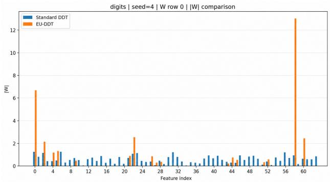
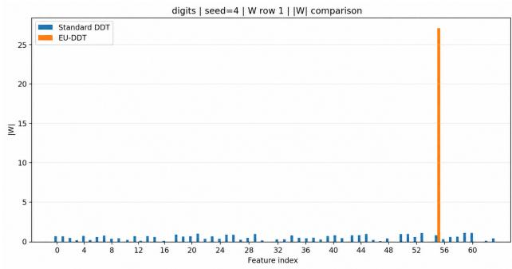
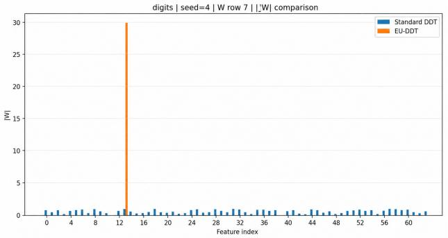
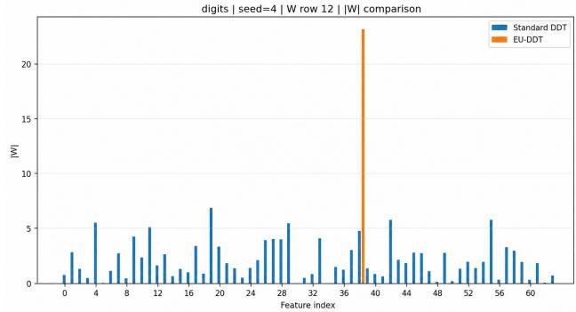
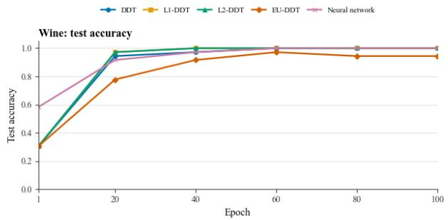
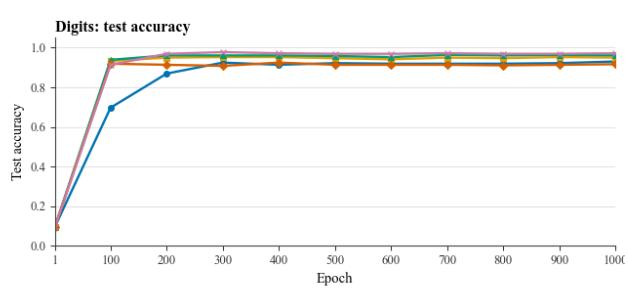
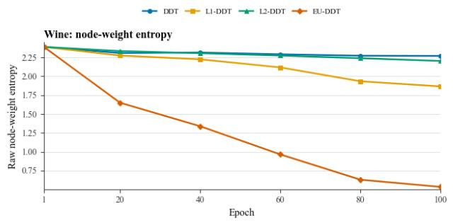
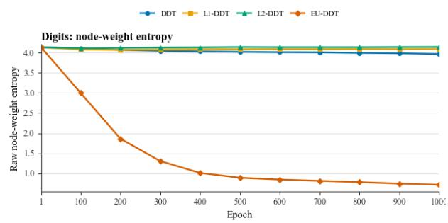
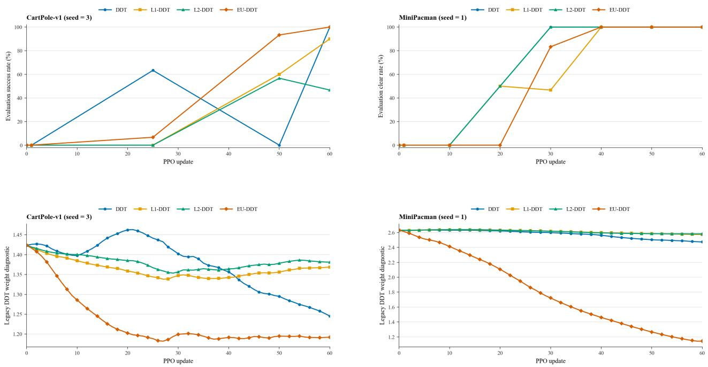

# Improving the Intrinsic Interpretability of Diferentiable Decision Trees through Euclidean Feature-Concentration Regularisation

Qiqi Yang∗

## Abstract

Diferentiable decision trees (DDTs) support end-to-end optimisation and explicit decision paths, but dense oblique splits can obscure the role of individual input features. We propose the Euclidean-Concentrated Diferentiable Decision Tree (EU-DDT), which regularises the relative absolute feature weights at each internal node using their normalised squared Euclidean distance from the uniform distribution. This encourages dominance by a small number of features while retaining probabilistic soft routing. Across five matched random seeds, EU-DDT reduces the mean efective number of features from 8.94 to 1.54 on Wine and from 45.28 to 9.06 on Digits. Mean test accuracy changes from 100.0% to 93.9% on Wine and from 92.3% to 94.6% on Digits, illustrating the dataset-dependent trade-of between concentration and predictive performance. We also use EU-DDT to parameterise a PPO actor with an MLP critic. Two random-seed runs per environment show a consistent qualitative increase in concentration while preserving efective task performance. In representative CartPole-v1 and MiniPacman runs, EU-DDT reaches 100% final evaluation success, while mean node concentration increases from 0.1272 to 0.7179 and from 0.0437 to 0.7237, respectively. These results support EU regularisation as a mechanism for reducing node-level feature complexity; the reinforcement-learning evidence remains preliminary because only two seeds are evaluated.

## 1 Introduction

## 1.1 Research Background and Motivation

Conventional decision trees use Boolean hard splits, which yield explicit node rules but make end-to-end gradient optimisation of the whole tree dificult. A DDT uses sigmoid gates to generate continuous branch probabilities, allowing internal nodes, path probabilities, and leaf parameters to be optimised jointly by backpropagation (Frosst and Hinton, 2017). Its fixed tree topology and explicit root-to-leaf paths provide structural transparency. Nevertheless, the dense weight vector of an oblique soft split can still make a single node depend simultaneously on many input dimensions. This paper therefore retains probabilistic soft routing while directly constraining the allocation of relative feature weights within each node, combining optimisability and explicit paths with node decisions dominated by a small number of features.

In this paper, intrinsic structural interpretability is operationalised as the combination of explicit root-to-leaf decision paths and low-dimensional, dominant-feature dependence at individual internal nodes.

## 1.2 Research Questions

To assess whether EU-DDT can improve the intrinsic structural interpretability of a DDT by increasing feature concentration within its internal nodes while preserving task performance, this paper addresses three related research questions concerning the regularisation mechanism, supervised classification performance, and PPO policy representation.

RQ1: To what extent can normalised squared Euclidean concentration regularisation increase the concentration of relative feature weights within DDT internal nodes and encourage node representations dominated by a small number of features?

RQ2: Under identical DDT architectures and training conditions, how does EU-DDT compare with an unregularised DDT, L1-DDT, and L2-DDT in classification accuracy and node-concentration metrics; and, when neural-network accuracy is used as an external performance reference, what balance does EU-DDT achieve between predictive performance and intrinsic structural interpretability?

RQ3: When EU-DDT is used to parameterise a PPO actor, can the EU concentration mechanism developed for supervised learning increase the concentration of the actor's dependence on a small number of state features while maintaining efective policy performance?

## 1.3 Research Method and Main Contributions

The central contribution of this paper is a continuous Euclidean concentration regulariser that acts directly on the normalised weight distribution within each DDT node. The method leaves the baseline DDT's sigmoid probabilistic routing and end-to-end optimisation unchanged, while shifting node decisions from difuse dependence on many features towards dominance by a small number of features. Five-seed supervised comparisons evaluate performance preservation and concentration gains, and the same mechanism is extended to a PPO actor. Two independent random-seed repetitions further assess whether the direction of the reinforcement-learning findings is consistent.

## 2 Background and Related Work

## 2.1 Diferentiable Decision Trees and Node Interpretability

Conventional CART uses axis-aligned hard splits, making root-to-leaf paths directly readable, but its discrete splits are not amenable to global gradient-based optimisation (Breiman et al., 1984). Neural decision forests subsequently connected representation learning with tree models through neural split functions (Rota Bulò and Kontschieder, 2014), and developed into deep neural decision forests in which split and leaf parameters can be optimised jointly (Kontschieder et al., 2015). Soft decision trees further use sigmoid gates to define branch probabilities and root-to-leaf paths explicitly, allowing all parameters to be updated jointly by gradient descent (Frosst and Hinton, 2017). In accordance with the main implementation, this paper forms a path-probability-weighted mixture of leaf logits and then applies Softmax to obtain class probabilities.

## 2.2 Feature Selection, Regularisation, and Research Positioning

An oblique DDT node defines a soft split by a multidimensional hyperplane. DNDT implements a decision tree as a neural architecture that can be trained end to end by gradient descent and discusses the self-pruning behaviour that emerges during training (Yang et al., 2018). Adaptive Neural Trees additionally learn tree growth and module configuration (Tanno et al., 2019). For feature selection, NODE uses entmax to produce exactly zero weights (Popov et al., 2020), whereas ICCT uses diferentiable crispification to learn few-feature or single-feature splits and notes that L1 constraints typically produce near-zero rather than strictly sparse rules (Paleja et al., 2022). EU-DDT applies neither hard argmax nor a sparse selection operator. Instead, it retains sigmoid-based oblique soft routing and directly optimises the concentration of relative weights within each node, thereby improving the intrinsic structural interpretability of the model that actually makes the predictions.

## 2.3 Interpretable Reinforcement Learning

Diferentiable decision trees can serve as policy functions and be optimised directly by policy gradients (Silva et al., 2020; Silva and Gombolay, 2021). Natural-language policy specifications can also be converted into lexical decision trees to initialise reinforcement learning, demonstrating that tree policies can carry human-facing prior knowledge and provide an inspectable interface (Tambwekar et al., 2023). ICCT learns sparse tree policies through diferentiable crispification, whereas DTPO directly optimises hard decision-tree policies (Paleja et al., 2022; Vos and Verwer, 2024). In this paper, EU-DDT parameterises the actor and is updated by PPO; the MLP critic is used only for value estimation and advantage construction. The tree topology, root-to-leaf paths, and dominant state variables therefore form an inspectable representation of the policy that is actually deployed.

## 3 Baseline Diferentiable Decision Tree Model

## 3.1 Soft Routing at Internal Nodes

The four DDT variants share the same complete binary-tree topology, leaf representation, and prediction procedure; they difer only in the regularisation term used in the training objective. For sample $x _ { b }$ and internal node $i ,$ the node uses a weight vector $w _ { i } .$ threshold $c _ { i } .$ , and inverse temperature α to define a sigmoid gating probability. Under the path convention used in this paper, the probability of taking the left branch is $g _ { b i }$ , and that of taking the right branch is $1 - g _ { b i }$

$$
z _ { b i } = \alpha h _ { b i } = \alpha ( w _ { i } ^ { \top } x _ { b } - c _ { i } ) .
$$

The scaled distance from the node hyperplane and the corresponding sigmoid gating probability are defined as

$$
g _ { b i } = \sigma ( z _ { b i } ) = \frac { 1 } { 1 + e x p ( - z _ { b i } ) } .
$$

The baseline DDT split is determined by $w _ { i } ^ { \top }$ xb and is therefore an oblique soft split that may depend simultaneously on multiple input dimensions. EU-DDT does not alter this splitting function. Instead, during training it encourages the hyperplane normal vector $w _ { i }$ to be dominated by a small number of input dimensions, thereby reducing the feature-attribution complexity of each node decision.

## 3.2 Path Probabilities and Leaf Outputs

For leaf $\ell ,$ let $L _ { \ell }$ denote the set of internal nodes at which the sigmoid branch is selected along the path from the root to $\ell ,$

and let $R _ { \ell }$ denote the set of internal nodes at which the complementary branch is selected along the same path. Because the probabilities of the two branches sum to one, they form a complete probabilistic routing mechanism at every node.

For sample $x _ { b } ,$ the probability of reaching leaf ℓ is therefore

$$
\pi _ { b \ell } = \prod _ { i \in \mathrm { L } _ { \ell } } g _ { b i } \prod _ { i \in \mathrm { R } _ { \ell } } ( 1 - g _ { b i } ) .
$$

## 3.3 Predictive Distribution

Each leaf ℓ stores a learnable vector of class logits $a \ell$ . The implementation first forms a path-probabilityweighted mixture of the leaf logits and then applies Softmax to the aggregated logit vector:

$$
\hat { \boldsymbol { p } } _ { b } = S o f t m a x ( \sum _ { \ell = 1 } ^ { L } \pi _ { b \ell } a _ { \ell } )
$$

## 3.4 Classification Loss

Supervised classification uses the categorical cross-entropy between the final predictive distribution and the one-hot label:

$$
\mathrm { L c E } = - \frac { 1 } { B } \sum _ { b = 1 } ^ { B } \sum _ { c = 1 } ^ { K } y _ { b c } l o \hat { g p _ { b c } } .
$$

## 3.5 Training Objectives and Comparison Models

The internal-node parameters and leaf logits are optimised jointly under the same objective. The objectives for the unregularised, L1-regularised, L2-regularised, and EU-DDT models are, respectively,

$$
\mathrm { L } _ { \mathrm { b a s e l i n e } } = \mathrm { L } _ { \mathrm { C E } }
$$

$$
\mathrm { L } _ { \mathrm { L } 1 } = \mathrm { L } _ { \mathrm { C E } } + \lambda _ { 1 } R _ { \mathrm { L } 1 } ,
$$

$$
\mathrm { L _ { L 2 } } = \mathrm { L _ { C E } } + \lambda _ { 2 } R _ { \mathrm { L 2 } } ,
$$

EU-DDT uses

$$
\mathrm { L } _ { \mathrm { E U } } = \mathrm { L } _ { \mathrm { C E } } + \lambda _ { \mathrm { E U } } R _ { \mathrm { E U } } .
$$

All four models share the same routing mechanism, leaf representation, initialisation, optimiser, and number of training epochs. They difer only in the regularisation objective applied to the internal-node weights.

L1 and L2 constrain parameter magnitude, whereas EU regularisation constrains the concentration of the normalised relative weights.

## 4 EU-DDT and Normalised Squared Euclidean Concentration Regularisation

## 4.1 Normalised Weights and Concentration

EU-DDT retains the sigmoid-based oblique routing defined in Section 3 and applies a continuous concentration constraint only to the relative feature weights of the internal nodes. For node i, the absolute weights are first normalised into the distribution

$$
\rho _ { i j } = \frac { \left| w _ { i j } \right| + \epsilon } { \sum _ { k = 1 } ^ { d } \left( \left| w _ { i k } \right| + \epsilon \right) } .
$$

$$
C _ { i } = \frac { \sum _ { j = 1 } ^ { d } \left( \rho _ { i j } - \frac { 1 } { d } \right) ^ { 2 } } { 1 - \frac { 1 } { d } } .
$$

$C _ { i }$ is the normalised squared Euclidean distance between the node's normalised weight distribution and the uniform distribution. When all feature shares are equal, $C _ { i } = 0 ;$ when one feature holds all of the mass in the limiting case, $C _ { i } = 1$ . This quantity therefore directly measures the extent to which a node decision is dominated by a small number of features.

## 4.2 Mathematical Properties and Training Objective

The normalised weights $\rho _ { i }$ lie on the probability simplex $\Delta ^ { d - 1 } \subset \mathbb { R } ^ { d }$ . Expanding the squared distance from the uniform distribution gives the identity

$$
\boxed { \sum _ { j = 1 } ^ { d } \left( \rho _ { i j } - \frac { 1 } { d } \right) ^ { 2 } = \sum _ { j = 1 } ^ { d } \rho _ { i j } ^ { 2 } - \frac { 1 } { d } . }
$$

Consequently,

$$
C _ { i } = \frac { \sum _ { j = 1 } ^ { d } \rho _ { i j } ^ { 2 } - \frac { 1 } { d } } { 1 - \frac { 1 } { d } } .
$$

The uniform distribution and the single-feature limit are, respectively, the minimum- and maximumconcentration cases. Hence,

$$
0 \leq C _ { i } \leq 1 .
$$

## 4.3 Efective Number of Features and Regularised Objective

For an intuitive interpretation of node complexity, the efective number of features is defined as

$$
N _ { \mathrm { e f f } , i } = \frac { 1 } { \sum _ { j = 1 } ^ { d } \rho _ { i j } ^ { 2 } } .
$$

$$
N _ { \mathrm { e f f } , i } = \frac { d } { 1 + ( d - 1 ) C _ { i } } .
$$

Because this relationship is nonlinear, the mean efective number of features is not obtained by substituting the mean concentration into the above expression:

$$
\overline { { N } } _ { \mathrm { e f f } } \neq \frac { d } { 1 + ( d - 1 ) \overline { { C } } } .
$$

For a tree with N internal nodes, the mean node concentration is

$$
\overline { { C } } = \frac { 1 } { N } \sum _ { i = 1 } ^ { N } C _ { i } .
$$

Since optimisation minimises the training objective, the EU regularisation term is defined as

$$
R _ { \mathrm { E U } } = 1 - { \overline { { C } } } .
$$

The complete supervised-learning objective is

$$
{ \mathcal { L } } _ { \mathrm { E U - D D T } } = { \mathcal { L } } _ { \mathrm { C E } } + \lambda _ { \mathrm { E U } } R _ { \mathrm { E U } } .
$$

$\lambda _ { E U }$ controls the relative weighting of the classification objective and the node-concentration objective. When $\lambda _ { E U } = 0$ , the model reduces to the unregularised DDT. As $\lambda _ { E U }$ increases, optimisation places a stronger preference on node structures dominated by a small number of features, while retaining continuous soft splits rather than forcing a single non-zero feature.

The objective therefore jointly pursues task performance and node-wise feature concentration within a single diferentiable optimisation process. The experiments test whether the selected coeficient produces a clear concentration gain while preserving accuracy.

## 4.4 Distinction from L1 and L2 Regularisation

L1 and L2 serve as two baselines that distinguish parameter-magnitude shrinkage from relative feature concentration within a node. The experiments use the following regularisers, averaged over the numbers of nodes and feature dimensions:

$$
R _ { \mathrm { L 1 } } = \frac { 1 } { N d } \sum _ { i = 1 } ^ { N } \sum _ { j = 1 } ^ { d } | w _ { i j } | .
$$

$$
R _ { \mathrm { L 2 } } = \frac { 1 } { N d } \sum _ { i = 1 } ^ { N } \sum _ { j = 1 } ^ { d } w _ { i j } ^ { 2 } .
$$

L1 directly penalises the absolute values of the weights and can encourage near-zero parameters, whereas L2 penalises squared magnitudes and shrinks the weight vector as a whole. Both operate on the scale of the raw parameters. EU regularisation first normalises the absolute weights of each node and then directly optimises the concentration of the resulting feature shares relative to the uniform distribution. Although L1, L2, and EU can all alter node weights, only EU is directly aligned with the objective of this paper: to give a small number of features a clear relative dominance in each node decision.

When the numerical-stability term is ignored, EU concentration is invariant to positive rescaling of the weight vector. This property further demonstrates that the measure characterises the relative composition of a node's decision basis across features, rather than the overall magnitude of the weight vector.

## 4.5 Scale Properties and Gradient

Ignoring the numerical-stability term ϵ, for any scalar $a > 0$

$$
\rho _ { i j } ( a w _ { i } ) = \rho _ { i j } ( w _ { i } ) .
$$

$$
C _ { i } ( a w _ { i } ) = C _ { i } ( w _ { i } ) .
$$

To analyse the gradient of the regulariser, first define the stabilised absolute weight

$$
a _ { i j } = | w _ { i j } | + \epsilon
$$

Let the sum of the stabilised absolute weights be

$$
S _ { i } = \sum _ { k = 1 } ^ { d } a _ { i k } .
$$

Next, define the sum of squared normalised shares

$$
Q _ { i } = \sum _ { k = 1 } ^ { d } \rho _ { i k } ^ { 2 }
$$

and the dimension-normalisation constant

$$
\kappa = 1 - { \frac { 1 } { d } } .
$$

For $w _ { i j } \neq 0$ , it further follows that

$$
\frac { \partial C _ { i } } { \partial w _ { i j } } = \frac { 2 \mathrm { s i g n } ( w _ { i j } ) } { \kappa S _ { i } } ( \rho _ { i j } - Q _ { i } ) .
$$

Because the optimiser minimises $R _ { \mathrm { E U } }$ , the corresponding regulariser gradient is

$$
\frac { \partial R _ { \mathrm { E U } } } { \partial w _ { i j } } = - \frac { 1 } { N } \frac { \partial C _ { i } } { \partial w _ { i j } } .
$$

The negative sign means that minimising the regulariser increases mean concentration. The resulting update depends on the relative feature shares within a node and can amplify the diference between dominant and remaining features. The full gradient still contains the task loss, so training does not maximise concentration in isolation.

The EU-DDT parameter update satisfies

$$
\nabla _ { \Theta } \mathrm { L } _ { \mathrm { E U - D D T } } = \nabla _ { \Theta } \mathrm { L } _ { \mathrm { C E } } + \lambda _ { \mathrm { E U } } \nabla _ { \Theta } R _ { \mathrm { E U } } .
$$

Because of the numerical-stability term, strict scale invariance does not hold when the weights approach epsilon. This paper invokes the property only when the weights are appreciably larger than epsilon.

## 5 Evaluation Metrics

## 5.1 Predictive Performance

Supervised learning is evaluated by test accuracy, whereas reinforcement learning is evaluated by the success rate in independent evaluation episodes. Supervised accuracy is defined as

$$
\mathrm { A c c u r a c y } = \frac { 1 } { M } \sum _ { b = 1 } ^ { M } 1 ( \hat { y } _ { b } = y _ { b } ) ,
$$

## 5.2 Node-Concentration and Degeneracy Metrics

Concentration metrics are computed only over the set A of internal nodes not classified as collapsed. Mean active-node concentration is

$$
\overline { { C } } _ { A } = \frac { 1 } { | \boldsymbol { A } | } \sum _ { i \in \mathcal { A } } C _ { i } .
$$

For node i, define

$$
M _ { i } = \operatorname* { m a x } _ { j } \rho _ { i j } .
$$

Sort the relative weights of node i in descending order and define

$$
\Delta _ { i } = \rho _ { i ( 1 ) } - \rho _ { i ( 2 ) } .
$$

The efective number of features converts a non-uniform distribution into the equivalent number of uniformly used features; a lower value indicates greater concentration:

$$
N _ { \mathrm { e f f } , i } = \frac { 1 } { \sum _ { j = 1 } ^ { d } \rho _ { i j } ^ { 2 } } .
$$

The relative sparsity rate of node i is defined as

$$
S _ { i } ^ { ( \tau ) } = \frac { 1 } { d } \sum _ { j = 1 } ^ { d } 1 ( | w _ { i j } | \leq \tau \operatorname* { m a x } _ { k } | w _ { i k } | ) .
$$

To characterise node-weight concentration from the perspective of distributional uncertainty, raw entropy is defined from the normalised weight shares $\rho _ { i }$ as

$$
H _ { i } = - \sum _ { j = 1 } ^ { d } \rho _ { i j } \log \rho _ { i j } .
$$

Because the maximum raw entropy is log d, cross-dataset comparison uses the normalised entropy

$$
H _ { i } ^ { \mathrm { n o r m } } = - \frac { 1 } { \log d } \sum _ { j = 1 } ^ { d } \rho _ { i j } \log \rho _ { i j } , \qquad 0 \le H _ { i } ^ { \mathrm { n o r m } } \le 1 .
$$

For node i, sort the relative feature weights in descending order and define

$$
k _ { 9 0 , i } = m i n \{ k : \sum _ { r = 1 } ^ { k } \rho _ { i ( r ) } \geq 0 . 9 \} .
$$

To distinguish feature concentration from collapse of the entire node-weight vector towards zero, a node is separately classified as collapsed using the pre-specified threshold delta:

$$
\| w _ { i } \| _ { 1 } = \sum _ { j = 1 } ^ { d } | w _ { i j } | \leq \delta ,
$$

Mean concentration, maximum weight share, the Top-1/Top-2 margin, efective number of features, relative sparsity rate, entropy, and k90 jointly characterise node structure. The number of collapsed nodes is reported separately to avoid mistaking parameter degeneration for improved interpretability.

## 6 Supervised-Learning Experiments

## 6.1 Experimental Design

The supervised experiments test whether EU regularisation can substantially increase feature concentration within DDT nodes while maintaining efective classification performance. The comparison includes an unregularised DDT, L1-DDT, L2-DDT, EU-DDT, and a neural network.

## 6.2 Datasets and Pre-processing

The Wine dataset contains 178 observations. Each sample is represented by 13 input attributes, and the class label takes one of three values. The Digits dataset contains 1,797 8 x 8 greyscale images. Each image is flattened into 64 input features, and the class label takes one of ten values. Each dataset is divided using a stratified 80/20 train–test split. For Wine, features are standardised using the training-set mean and standard deviation. For Digits, a MinMax transformation to [−1, 1] is fitted on the training set. In both cases, the fitted transformation is subsequently applied to the test set. This prevents data leakage and improves the comparability of node weights across features within each dataset.

## 6.3 Comparison Models and Training Configuration

Within each dataset, the four DDT variants share the same tree depth, leaf representation, initialisation scheme, and full-batch Adam optimiser; they difer only in the regularisation objective. A neural-network baseline is included for comparison of predictive performance.

All configurations are evaluated using the same five random seeds. Tables report the mean across runs, while training curves show a single fixed-seed trajectory for illustration only.

## 6.4 Training Parameters

The main training parameters are as follows.

Table 6-1  
Supervised-Learning Training Parameters and Model Configuration
<table><tr><td>Parameter</td><td>Setting</td></tr><tr><td>Comparison models</td><td>DDT / L1-DDT / L2-DDT / EU-DDT / Neural Network</td></tr><tr><td>Input scaling</td><td>Wine: standardisation; Digits: MinMax scaling to [−1, 1]</td></tr><tr><td>Tree depth</td><td>Wine: 3; Digits: 6</td></tr><tr><td>Internal nodes / leaves</td><td>Wine: 7 / 8; Digits: 63 / 64</td></tr><tr><td>Optimizer</td><td>Adam</td></tr><tr><td>Batching DDT learning rate</td><td>Full batch</td></tr><tr><td>Neural-network learning rate</td><td>0.03</td></tr><tr><td>Neural-network architecture</td><td>0.001</td></tr><tr><td>Inverse temperature α</td><td>MLP: 3×50 hidden units, Tanh</td></tr><tr><td>Normalisation constant €</td><td>1  $1 0 ^ { - 1 2 }$ </td></tr><tr><td>Relative-sparsity threshold τ</td><td>0.05</td></tr></table>

Table 6-1  
Supervised-Learning Training Parameters and Model Configuration
<table><tr><td>Parameter</td><td>Setting</td></tr><tr><td>Collapsed-node threshold δ</td><td> $1 0 ^ { - 8 }$ </td></tr><tr><td>Regularisation coefficients</td><td> $\lambda _ { 1 } = 0 . 1 , \lambda _ { 2 } = 0 . 1 ; \lambda _ { \mathrm { E U } } = 5 ( \mathrm { W i n e } ) , 0 . 1$  (Digits)</td></tr><tr><td>Wine epochs</td><td>100</td></tr><tr><td>Digits epochs</td><td>1,000</td></tr><tr><td>Reported result</td><td>Mean over five matched random seeds (curves show a representative run)</td></tr></table>

The supervised-learning tables summarise mean results over five matched random seeds and can therefore be used to assess average diferences between regularisation methods under the same initialisation conditions. Because no hypothesis tests were conducted, this paper does not use the term statistically significant.

## 6.5 Experimental Results

Table 6-2 summarises the mean node-weight metrics over five matched random seeds, and Table 6-3 reports the corresponding mean test accuracies. For Wine, the efective number of features is bounded between 1 and 13, consistent with its 13-dimensional input representation.

Table 6-2  
Five-Seed Mean Node-Weight Statistics for Wine and Digits
<table><tr><td colspan="2"></td><td colspan="2">Maximum weight</td><td colspan="2">Effective</td><td rowspan="2">Mean active- node  $\overline { { C } } _ { A } \uparrow$ </td></tr><tr><td>Dataset</td><td>Model</td><td>share ↑</td><td>Top-1/Top- 2 margin ↑</td><td>features↓</td><td>Relative sparsity ↑</td></tr><tr><td>Wine</td><td>DDT</td><td>0.1797</td><td>0.0296</td><td>8.94</td><td>0.0681</td><td>0.0403</td></tr><tr><td>Wine</td><td>DDT+L1</td><td>0.3272</td><td>0.0985</td><td>5.23</td><td>0.4374</td><td>0.1668</td></tr><tr><td>Wine</td><td>DDT+L2</td><td>0.1894</td><td>0.0334</td><td>8.49</td><td>0.0835</td><td>0.0468</td></tr><tr><td>Wine</td><td>EU-DDT</td><td>0.7804</td><td>0.5906</td><td>1.54</td><td>0.8659</td><td>0.6962</td></tr><tr><td>Digits</td><td>DDT</td><td>0.0381</td><td>0.0022</td><td>45.28</td><td>0.0726</td><td>0.0069</td></tr><tr><td>Digits</td><td>DDT+L1</td><td>0.1175</td><td>0.0360</td><td>30.13</td><td>0.3386</td><td>0.0554</td></tr><tr><td>Digits</td><td>DDT+L2</td><td>0.0462</td><td>0.0059</td><td>43.25</td><td>0.1226</td><td>0.0095</td></tr><tr><td>Digits</td><td>EU-DDT</td><td>0.6950</td><td>0.6607</td><td>9.06</td><td>0.7989</td><td>0.6633</td></tr></table>

Relative to DDT, EU-DDT increases the Wine maximum weight share from 0.1797 to 0.7804 and the Top-1/Top-2 margin from 0.0296 to 0.5906, reduces the mean efective number of features from 8.94 to 1.54, and increases the relative sparsity rate from 0.0681 to 0.8659. No collapsed internal nodes were observed for any of the reported DDT variants under the threshold $\delta = 1 0 ^ { - 8 } \colon$ each Wine variant had 0/35 collapsed nodes across five seeds, and each Digits variant had 0/315 collapsed nodes. Hence, $\overline { { C } } _ { A } = \overline { { C } }$ for all reported supervised runs. Mean concentration correspondingly increases from 0.0403 to 0.6962.

The Digits results follow the same direction. Relative to DDT, EU-DDT increases the maximum weight share from 0.0381 to 0.6950 and the Top-1/Top-2 margin from 0.0022 to 0.6607, reduces the mean efective number of features from 45.28 to 9.06, and increases the relative sparsity rate from 0.0726 to 0.7989. The concentration gain is therefore not specific to the 13-dimensional Wine inputs; it also holds for the 64-dimensional image features. Mean concentration increases from 0.0069 to 0.6633. Because $C _ { i } \leq M _ { i }$ at every node, the recomputed five-seed aggregates also satisfy $\overline { { C } } \le \overline { { M } }$ for every reported model-dataset configuration.

EU-DDT attains mean accuracies of 93.9% on Wine and 94.6% on Digits, compared with 100.0% and 92.3% for the unregularised DDT. The efective number of features decreases by 82.8% and 80.0%, respectively, and the dominant-weight metrics increase substantially on both datasets. The selected EU regularisation strengths therefore provide a favourable performance-concentration configuration: the models still perform the classification tasks efectively while the basis of each split becomes more concentrated.

Table 6-3  
Five-Seed Mean Test Accuracy on Wine and Digits
<table><tr><td>Dataset</td><td>DDT</td><td>DDT+L1</td><td>DDT+L2</td><td>EU-DDT</td><td>Neural Network</td></tr><tr><td>Wine five-seed mean accuracy</td><td>1.000</td><td>1.000</td><td>1.000</td><td>0.939</td><td>1.000</td></tr><tr><td>Digits five-seed mean accuracy</td><td>0.923</td><td>0.949</td><td>0.960</td><td>0.946</td><td>0.969</td></tr></table>

## 6.6 Weight and Training Curves

Figure 6-1 displays the absolute feature weights of selected internal nodes on Digits; the high-weight pixels of EU-DDT are visibly concentrated in fewer input dimensions. Figure 6-2 presents test-accuracy and raw node-weight-entropy curves for representative Wine and Digits seeds to illustrate the within dataset optimisation process. Because d is fixed within each panel, these raw entropy trajectories are not compared numerically across datasets. Tables 6-2 and 6-3 report the five-seed aggregate results.

  
Figure 6-1. Comparison of Absolute Feature Weights at Selected Internal Nodes on Digits.

## 6.7 Interpretation of the Results

The claim of improved interpretability is supported by three mutually reinforcing levels of evidence. First, the fixed tree topology and explicit root-to-leaf paths make the overall decision structure traceable. Second, on both Wine and Digits, EU-DDT increases the maximum weight share, Top-1/Top-2 margin, and relative sparsity rate, while reducing the efective number of features by 82.8% on Wine and 80.0% on Digits. The basis of each node decision therefore shifts from difuse participation by many features to dominance by a small number of features, yielding clearer feature attribution at the node level. Third, the model retains a mean test accuracy above 93% on both datasets, showing that the concentrated structure belongs to a model that remains predictively efective rather than reflecting artificial simplicity produced by parameter collapse.

  
Figure 6-2. Test Accuracy and Node-Weight Entropy Curves on Wine and Digits.

Under this operational definition, the interpretability improvement of EU-DDT has two components: the decision path itself is inspectable, and each node along that path is determined by fewer and more dominant input features. This provides a lower-dimensional and more directly inspectable node-level attribution structure. The paper therefore concludes that intrinsic structural interpretability is improved. A human-subject study could provide subsequent external validation of this structural evidence, but is not required for the direct measurements of node-wise dependency dimension and dominant-feature strength reported here.

## 7 Application of EU-DDT to Reinforcement Learning

## 7.1 Research Design

This section directly parameterises a PPO actor with EU-DDT to test whether the node-concentration mechanism developed in supervised learning transfers to policy learning. Independent task success rates and the feature-concentration structure of the actor nodes are evaluated jointly.

The EU-DDT actor maps the current state directly to an action distribution, and PPO optimises the tree policy through the clipped policy objective. The MLP critic is used only for value estimation and advantage construction. Decisions at deployment therefore remain governed by the inspectable EU-DDT tree paths and dominant state features.

## 7.2 PPO and the EU-DDT Policy

PPO limits the magnitude of policy updates by comparing the probability assigned to an executed action by the current policy with that assigned by the pre-update policy (Schulman et al., 2017). Define the probability ratio

$$
r _ { t } ( \theta ) = { \frac { \pi _ { \theta } ( a _ { t } \mid s _ { t } ) } { \pi _ { \theta _ { \mathrm { o l d } } } ( a _ { t } \mid s _ { t } ) } } .
$$

The clipped objective is

$$
{ \cal L } _ { \mathrm { C L I P } } ( \theta ) = \mathrm { E } _ { t } [ m i n ( r _ { t } ( \theta ) \hat { A } _ { t } , ~ c l i p ( r _ { t } ( \theta ) , 1 - \epsilon , 1 + \epsilon ) \hat { A } _ { t } ) ] ,
$$

where $A _ { t }$ is the advantage estimate and ϵ is the clipping parameter. This objective limits excessive changes in the probability ratio between the new and old policies, thereby reducing the magnitude of an individual policy update.

## 7.3 EU-DDT Actor and Training Objective

In supervised learning, the DDT input is the feature vector x. In reinforcement learning, the same architecture instead receives the current environment state:

$$
g _ { i } ( s _ { t } ) = \sigma ( \alpha ( w _ { i } ^ { \top } s _ { t } - c _ { i } ) ) .
$$

The policy distribution is

$$
\pi _ { \boldsymbol { \theta } } ( a \mid s _ { t } ) = S o f t m a x ( \sum _ { \ell = 1 } ^ { L } \pi _ { \ell } ( s _ { t } ) a _ { \ell } ) .
$$

This architecture can be trained by standard backpropagation and allows the state variables on which each internal node primarily depends to be inspected.

## 7.4 Actor and Critic Losses

The main code implements the PPO actor objective in minimisation form and includes policy entropy, L1, L2, and EU concentration terms. Let E be the number of epochs per PPO update, n the number of samples, and m the minibatch size. The actor loss for one minibatch, consistent with the implementation, is

$$
\mathrm { L } _ { \mathrm { a c t o r } } = - L _ { \mathrm { C L I P } } - c _ { H } H ( \pi _ { \theta } ) + \eta _ { R } ( \lambda _ { 1 } R _ { \mathrm { L 1 } } + \lambda _ { 2 } R _ { \mathrm { L 2 } } + \lambda _ { \mathrm { E U } } R _ { \mathrm { E U } } ) .
$$

Here, c is the policy-entropy coeficient at the current update, and $\eta _ { R } = [ E [ n / m ] ] ^ { - 1 }$ is regulariser\_scale in the code. This scaling prevents the same regularisation term from being accumulated repeatedly across the multiple epochs and minibatches of a single PPO update. For each ablation group, only the corresponding $\lambda _ { 1 } , \lambda _ { 2 }$ , or $\lambda _ { \mathrm { E U } }$ is active.

## 7.5 Value Network

The MLP critic uses GAE to construct return targets and minimises

$$
\operatorname { L } _ { \operatorname { c r i t i c } } = { c _ { V } } \ \operatorname { E } _ { t } [ ( V _ { \phi } ( s _ { t } ) - \tilde { R } _ { t } ) ^ { 2 } ] , \ c _ { V } = 0 . 5 .
$$

EU-DDT directly produces the action distribution, whereas the critic is used only for value estimation and advantage construction. The results therefore focus on the interpretability of the policy representation.

## 7.6 Experimental Configuration

The ablation study compares an unregularised PPO-DDT with L1- and L2-regularised variants, for which $\lambda _ { 1 } = \lambda _ { 2 } = 1$ , and with PPO-EU-DDT. The Euclidean concentration coeficient is set to $\lambda _ { \mathrm { E U } } = 0 . 3$ for CartPole-v1 and $\lambda _ { \mathrm { E U } } = 1$ for MiniPacman. All variants employ the same DDT actor architecture, while the environment, training budget, and PPO hyperparameters are held fixed.

For CartPole-v1, success is the proportion of evaluation episodes with a return of at least 475. For MiniPacman, success is the proportion of evaluation episodes in which the map is cleared. The main configuration is as follows.

Table 7-1  
Reinforcement-Learning Experimental Configuration
<table><tr><td>Parameter</td><td>CartPole-v1</td><td>MiniPacman</td></tr><tr><td>Representative seed</td><td>3</td><td>1</td></tr><tr><td>State dimension</td><td>4</td><td>14</td></tr><tr><td>Action dimension</td><td>2</td><td>4</td></tr><tr><td>Tree depth</td><td>3</td><td>4</td></tr><tr><td>Internal nodes / leaves</td><td>7/8</td><td>15 / 16</td></tr><tr><td>PPO updates</td><td>60</td><td>60</td></tr><tr><td>PPO optimisation epochs/update</td><td>4</td><td>4</td></tr><tr><td>Environment interactions</td><td>61,440</td><td>138,240</td></tr><tr><td>Critic</td><td>MLP: 3×64, Tanh</td><td>MLP: 3×64, Tanh</td></tr></table>

## 7.7 Experimental Results

Each environment was run under two independent random seeds, and both repetitions showed that EU-DDT increased node concentration while maintaining efective task performance. Table 7-2 and Figure 7-1 report representative runs for which the curves and node metrics correspond directly: CartPole-v1 uses seed = 3 and MiniPacman uses seed = 1; both tasks are trained for 60 PPO updates.

Table 7-2  
Reinforcement-Learning Results for Representative Random Seeds
<table><tr><td colspan="5">CartPole-v1</td></tr><tr><td>Metric</td><td>DDT</td><td>L1</td><td>L2</td><td>EU</td></tr><tr><td>Final success rate ↑</td><td>100%</td><td>90%</td><td>46.7%</td><td>100%</td></tr><tr><td>Concentration ↑</td><td>0.1272</td><td>0.3153</td><td>0.0798</td><td>0.7179</td></tr><tr><td>Maximum share ↑</td><td>0.4661</td><td>0.6031</td><td>0.4114</td><td>0.8220</td></tr><tr><td>Top-1/Top-2 margin ↑</td><td>0.1648</td><td>0.3562</td><td>0.1272</td><td>0.7236</td></tr><tr><td>k90↓</td><td>3.29</td><td>2.86</td><td>3.71</td><td>1.71</td></tr><tr><td>Effective features ↓</td><td>2.94</td><td>2.28</td><td>3.31</td><td>1.62</td></tr><tr><td>Relative sparsity ↑</td><td>0.0000</td><td>0.1071</td><td>0.0000</td><td>0.5357</td></tr><tr><td>MiniPacman Metric</td><td>DDT</td><td>L1</td><td>L2</td><td>EU</td></tr><tr><td>Final success rate ↑</td><td>100%</td><td>100%</td><td>100%</td><td></td></tr><tr><td>Concentration ↑</td><td>0.0437</td><td>0.1921</td><td>0.0658</td><td>100%</td></tr><tr><td>Maximum share ↑</td><td>0.1793</td><td>0.3391</td><td>0.2383</td><td>0.7237</td></tr><tr><td>Top-1/Top-2 margin ↑</td><td>0.0340</td><td>0.1909</td><td>0.0892</td><td>0.8205</td></tr><tr><td>k90↓</td><td>10.00</td><td>7.93</td><td>9.47</td><td>0.7623</td></tr><tr><td>Effective features ↓</td><td>9.46</td><td>6.90</td><td>8.23</td><td>2.93</td></tr><tr><td></td><td></td><td></td><td></td><td>1.96</td></tr><tr><td>Relative sparsity ↑</td><td>0.0810</td><td>0.2714</td><td>0.1286</td><td>0.7667</td></tr></table>

The lower panels report the project’s legacy DDT.entroy\_loss() diagnostic, which combines a mean absolute-weight term with an entropy term based on softmax-transformed absolute weights. It is not the raw share entropy $\begin{array} { r } { H _ { i } = - \sum _ { j } \rho _ { i j } \log \rho _ { i j } } \end{array}$ defined in Section 5 and is therefore not bounded by log d. The concentration metrics in Table 7-2 are computed separately from normalised absolute-weight shares.

At update 60 on CartPole-v1, the success rates of DDT, L1-DDT, L2-DDT, and EU-DDT are 100%, 90%, 46.7%, and 100%, respectively. EU-DDT increases mean concentration from 0.1272 to 0.7179 and the maximum weight share from 0.4661 to 0.8220, while reducing k90 from 3.29 to 1.71.

On MiniPacman, all four policies achieve a map-clearance rate of 100% at update 60. EU-DDT increases mean concentration from 0.0437 to 0.7237 and the maximum weight share from 0.1793 to 0.8205, while reducing k90 from 10.00 to 2.93.

  
Figure 7-1. Independent-Evaluation Success Rate and Legacy DDT Weight-Diagnostic Curves for Representative Runs on CartPole-v1 and MiniPacman.

The two-seed repetitions in both environments exhibit the same central pattern: EU-DDT maintains efective final task performance while producing higher node concentration than the unregularised DDT and reducing the number of features required to account for 90% of the cumulative weight. In the representative runs reported in Table 7-2, EU-DDT achieves a final success rate of 100% in both environments. The two-seed evidence therefore supports a consistent empirical balance between policy-performance preservation and simplification of the node-level explanatory structure. Because each environment uses only two seeds, the evidence is used to assess directional consistency rather than to infer statistical significance.

## 8 Discussion

## 8.1 Node Concentration and Predictive Performance

The five-seed means on Wine and Digits show that EU regularisation reduces the efective number of features by 82.8% and 80.0%, respectively, in tasks with diferent input dimensionalities, while increasing the dominant-weight share, Top-1/Top-2 margin, and relative sparsity rate. Together with the clearer dominant input dimensions visible in the weight visualisations, these complementary metrics demonstrate simpler feature attribution at the node level. At the same time, EU-DDT retains a mean accuracy above 93% on both datasets and maintains classification performance close to the baselines. The principal finding is therefore not a simple exchange of accuracy for interpretability. Rather, EU-DDT obtains a much larger improvement in node concentration for a comparatively small diference in performance, producing an efective balance between predictive performance and intrinsic structural interpretability.

## 8.2 Relationship to Existing Methods

EU-DDT can be distinguished from existing methods by its optimisation target. Previous work has primarily developed diferentiable splits, representation learning, adaptive tree structures, or discretisation strategies (Kontschieder et al., 2015; Yang et al., 2018; Tanno et al., 2019), and has applied DDTs to policy-gradient optimisation (Silva et al., 2020). This paper does not change the tree topology or predictive function. Instead, it introduces into the probabilistic soft tree a Euclidean regularisation objective that directly targets relative feature concentration within each node. L1 and L2 constrain parameter magnitude, whereas EU optimises the position of the normalised weights on the probability simplex relative to the uniform distribution. EU-DDT yields a lower mean efective-feature count and higher dominant-weight metrics than L1-DDT and L2-DDT under the reported settings, indicating that direct optimisation of relative concentration is better aligned with the interpretability objective of this paper.

## 8.3 Methodological Position of the Continuous Concentration Mechanism

NODE uses entmax to produce sparse feature selection with exact zeros, whereas ICCT learns fewfeature or single-feature decisions through diferentiable crispification (Popov et al., 2020; Paleja et al., 2022). These methods seek sparse or crisp split representations. EU-DDT addresses a diferent but complementary problem: it gives a small number of features clear dominance within an oblique soft split without applying hard argmax or altering the original predictive function. This continuous mechanism avoids the potential fidelity discrepancy introduced by first training a soft model and then discretising it into a separate explanation model. The object being inspected is therefore the original EU-DDT that is actually used for prediction or decision-making.

## 8.4 Preservation of Task Performance and Gains in Node Concentration

The joint EU-DDT objective combines classification or policy-learning performance with the nodeconcentration objective in a single optimisation process:

$$
\mathrm { L } = \mathrm { L } _ { \mathrm { t a s k } } + \lambda _ { \mathrm { E U } } R _ { \mathrm { E U } } .
$$

The selected EU concentration coeficient provides an efective, outcome-oriented configuration in both task settings. In supervised learning, test accuracy remains above 93% while the efective number of features decreases by 82.8% on Wine and 80.0% on Digits. In the two-seed reinforcement-learning repetitions, EU-DDT maintains efective task performance and exhibits consistent gains in node concentration; in the representative runs, final success rates are 100% and mean concentration exceeds 0.71 in both environments. EU regularisation therefore does not obtain superficial simplicity at the cost of task failure. It substantially increases the concentration and inspectability of the node-level decision basis while the model remains capable of efective prediction or control.

## 8.5 Limitations

The supervised-learning experiments use five random seeds and show consistent average trends across the compared methods. Nevertheless, additional repetitions would provide more reliable estimates of variance, while evaluation on a broader range of datasets would strengthen evidence of generalisability. The reinforcement-learning experiments use only two random seeds per environment. Although both runs show the same qualitative pattern in task performance and node concentration, this is insuficient for reliable statistical inference, and further repetitions are required.

The interpretation of node weights also depends on appropriate feature scaling. Each dataset therefore uses a fixed scaling strategy across all compared models—standardisation for Wine and MinMax scaling to [−1, 1] for Digits—with parameters fitted on the training data only to avoid data leakage. In addition, the interpretability analysis in this paper is based primarily on structural properties of the learned trees and node-weight concentration. Future work could complement these measures with human-subject evaluation or assess the fidelity of simplified single-feature rules derived from the learned nodes.

## 9 Conclusions and Future Work

## 9.1 Main Conclusions

This paper proposes EU-DDT, which regularises the relative feature-weight distribution within each DDT node using a normalised squared Euclidean concentration objective. The method retains sigmoid based soft routing and end-to-end diferentiability while encouraging decisions to rely on a small number of dominant features. Unlike L1 and L2 regularisation, EU regularisation acts on relative weight concentration rather than parameter magnitude.

Across five random seeds, the supervised-learning experiments show that EU-DDT reduces node-level feature complexity on both Wine and Digits. The mean efective number of features decreases by 82.8% and 80.0%, respectively, while leading-feature dominance increases substantially and mean test accuracy remains above 93%.

The reinforcement-learning experiments show the same qualitative trend in CartPole-v1 and MiniPacman. Across two random seeds per environment, EU-DDT increases node concentration while preserving successful task performance; the reported evaluations achieve a final success rate of 100%, with mean node concentration above 0.71.

Overall, the results support EU regularisation as a continuous, diferentiable mechanism for reducing DDT node complexity while retaining efective predictive and policy performance.

## 9.2 Answers to the Research Questions

For RQ1, the five matched random-seed results show that EU regularisation substantially increases the maximum node-weight share and the Top-1/Top-2 margin on both Wine and Digits, while reducing the mean efective number of features by 82.8% and 80.0%, respectively. This evidence supports the conclusion that normalised squared Euclidean concentration encourages DDT internal nodes to form weight representations dominated by a small number of features.

For RQ2, the five-seed mean test accuracies of EU-DDT are 93.9% on Wine and 94.6% on Digits, compared with 100.0% and 92.3% for the corresponding unregularised DDTs. While retaining high classification accuracy, EU-DDT produces markedly larger gains in node concentration than L1-DDT and L2-DDT. The corresponding neural-network accuracies are 100.0% on Wine and 96.9% on Digits, providing an external predictive-performance reference. Under the experimental settings used in this paper, EU-DDT therefore achieves an efective balance between predictive performance and intrinsic structural interpretability.

For RQ3, two independent random-seed runs in each environment show that EU-DDT can parameterise the PPO actor and output the action distribution directly, while increasing actor-node concentration and maintaining efective task performance. In the representative runs, CartPole-v1 (seed = 3) and MiniPacman (seed = 1) both achieve a final evaluation success rate of 100%, with mean node concentrations of 0.7179 and 0.7237, respectively. The two-seed results support the extension of the EU concentration mechanism from supervised classification to sequential decision-making and provide preliminary evidence of repeatability. Stronger cross-seed statistical inference requires a larger number of repetitions.

## 9.3 Future Work

Future work will increase the number of reinforcement-learning random seeds and report means, standard deviations, and confidence intervals in additional environments, extending the present twoseed directional-consistency assessment into a formal statistical evaluation. It could also systematically trace the performance-concentration frontier associated with the concentration coeficient and add human-subject studies to quantify how tree paths and dominant features improve comprehension eficiency. For applications requiring symbolic rules, EU-DDT could additionally serve as the starting point for a high-fidelity simplification process, with behavioural consistency evaluated after top-feature crispification.

## References

Leo Breiman, Jerome H. Friedman, Richard A. Olshen, and Charles J. Stone. Classification and Regression Trees. Wadsworth International Group, Belmont, CA, 1984. ISBN 9780534980542.

Nicholas Frosst and Geofrey E. Hinton. Distilling a Neural Network Into a Soft Decision Tree, 2017. URL https://arxiv.org/abs/1711.09784. arXiv:1711.09784.

Peter Kontschieder, Madalina Fiterau, Antonio Criminisi, and Samuel Rota Bulò. Deep Neural Decision Forests. In Proceedings of the IEEE International Conference on Computer Vision, pages 1467–1475. IEEE, 2015. doi: 10.1109/ICCV.2015.172.

Rohan Paleja, Yaru Niu, Andrew Silva, Chace Ritchie, Sugju Choi, and Matthew Gombolay. Learning Interpretable, High-Performing Policies for Autonomous Driving. In Proceedings of Robotics: Science and Systems XVIII, New York City, NY, 2022. Robotics: Science and Systems Foundation. doi: 10.15607/RSS.2022.XVIII.068.

Sergei Popov, Stanislav Morozov, and Artem Babenko. Neural Oblivious Decision Ensembles for Deep Learning on Tabular Data. In International Conference on Learning Representations, 2020. URL https://openreview.net/forum?id=r1eiu2VtwH.

Samuel Rota Bulò and Peter Kontschieder. Neural Decision Forests for Semantic Image Labelling. In Proceedings of the IEEE Conference on Computer Vision and Pattern Recognition, pages 81–88. IEEE, 2014. doi: 10.1109/CVPR.2014.18.

John Schulman, Filip Wolski, Prafulla Dhariwal, Alec Radford, and Oleg Klimov. Proximal Policy Optimization Algorithms, 2017. URL https://arxiv.org/abs/1707.06347. arXiv:1707.06347.

Andrew Silva and Matthew Gombolay. Encoding Human Domain Knowledge to Warm Start Reinforcement Learning. Proceedings of the AAAI Conference on Artificial Intelligence, 35(6):5042–5050, 2021. doi: 10.1609/aaai.v35i6.16638.

Andrew Silva, Taylor Killian, Ivan Jimenez, Sung-Hyun Son, and Matthew Gombolay. Optimization Methods for Interpretable Diferentiable Decision Trees Applied to Reinforcement Learning. In Proceedings of the Twenty-Third International Conference on Artificial Intelligence and Statistics, volume 108 of Proceedings of Machine Learning Research, pages 1855–1865. PMLR, 2020. URL https://proceedings.mlr.press/v108/silva20a.html.

Pradyumna Tambwekar, Andrew Silva, Nakul Gopalan, and Matthew Gombolay. Natural Language Specification of Reinforcement Learning Policies Through Diferentiable Decision Trees. IEEE Robotics and Automation Letters, 8(6):3621–3628, 2023. doi: 10.1109/LRA.2023.3268593.

Ryutaro Tanno, Kai Arulkumaran, Daniel C. Alexander, Antonio Criminisi, and Aditya Nori. Adaptive Neural Trees. In Proceedings of the 36th International Conference on Machine Learning, volume 97 of Proceedings of Machine Learning Research, pages 6166–6175. PMLR, 2019. URL https://proc eedings.mlr.press/v97/tanno19a.html.

Daniël Vos and Sicco Verwer. Optimizing Interpretable Decision Tree Policies for Reinforcement Learning, 2024. URL https://arxiv.org/abs/2408.11632. arXiv:2408.11632.

Yongxin Yang, Irene Garcia Morillo, and Timothy M. Hospedales. Deep Neural Decision Trees. In Proceedings of the 2018 ICML Workshop on Human Interpretability in Machine Learning, pages 34–40, Stockholm, Sweden, 2018. URL https://arxiv.org/abs/1806.06988.