# Is It the Curriculum or Just the Easy Start? Benchmarking Unsupervised Environment Design on Quadrupeds

Jakub Gilewicz 1 2 3 Dominik Galus 1 2 3 Piotr Wojdas 1 2 3

1Wrocław University of Science and Technology Wybrzeze Wyspia˙ nskiego 27, 50-370 Wrocław, Poland´ 2Machinekind, Wrocław, Poland 3Koło Naukowe Solvro, Wrocław University of Science and Technology, Wrocław, Poland {275409,279690,279903}@student.pwr.edu.pl

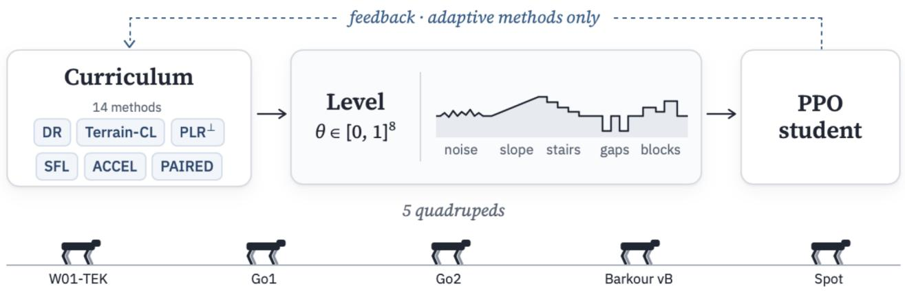  
Figure 1. The benchmark. A curriculum proposes levels $\theta \in [ 0 , 1 ] ^ { 8 }$ of eight terrain parameters, and the same PPO student trains on them for each of five quadrupeds. Adaptive curricula choose the next levels from the student’s rollouts (dashed).

## Abstract

Unsupervised environment design (UED) methods such as PLR, ACCEL, SFL and PAIRED are compared mostly on 2D mazes, grid worlds and BipedalWalker, while terrain curricula for legged robots are hand-designed and evaluated against a few baselines. We present a benchmark that runs fourteen UED, domain-randomisation and robotics curricula under one protocol on five 3D quadrupeds in MuJoCo MJX: the closed-chain W01-TEK and the open-chain Unitree Go1 and Go2, Google Barkour vB and Boston Dynamics Spot. Levels are vectors of eight interpretable terrain parameters, and all curricula drive the same PPO student at matched environment-step budgets. The evaluation reports success on random and held-out structured terrains, interquartile means with stratified bootstrap intervals, capability envelopes and a level-by-level domina-

tion comparison. We compare methods within each robot and report, per level set, the top group of methods not significantly below the best. No method is in the top group on every robot and level set. Methods with easy or low-difficulty training levels, curated or not, fill the top groups on indistribution random levels of Go1 and Barkour, and of W01-TEK apart from PAIRED+BiBC. The success-driven terrain curriculum from leggedrobot practice is in a top group most often, domain randomisation on uniform levels in none, and PAIRED in none outside Spot, where the fourteen methods lie within 3.8 points on random levels of difficulty 0.25. On three robots the leader on in-distribution random levels is not the leader on held-out terrain. We collect the results into a per-robot guide to choosing a curriculum.

## 1. Introduction

Learned locomotion controllers are trained on distributions of terrain, and that distribution shapes what the controller can do. Practical pipelines use hand-designed curricula that promote a robot along rows of increasing difficulty (Rudin et al., 2021) or adaptive samplers over a parameterised terrain family (Lee et al., 2020). Recent work automates this with learning-progress (Li et al., 2026), learneddifficulty (Liu et al., 2026) and safety-critic (Ovinnikov et al., 2026) curricula, each with its own robot, baselines and protocol. Unsupervised environment design (UED) studies the same problem in general form: a teacher proposes environment parameters (levels) so that a student generalises. PAIRED (Dennis et al., 2020) learns a level generator from a regret signal. PLR and its robust variant PLR⊥ (Jiang et al., 2021b;a) curate random levels by a regret score, AC-CEL (Parker-Holder et al., 2022) mutates curated levels, and SFL (Rutherford et al., 2024) scores levels by learnability. These methods are compared mostly on mazes, grid worlds, car racing and the 2D BipedalWalker, with fast reference implementations in minimax (Jiang et al., 2023) and JaxUED (Coward et al., 2024). To our knowledge no benchmark runs the UED family under one protocol on 3D legged locomotion, where the student is a contact-rich, high-dimensional controller and a level is a terrain.

We build one and ask which UED findings carry over. Contributions:

• A five-robot benchmark in MuJoCo MJX (Todorov et al., 2012): the closed-kinematic-chain quadruped W01-TEK and four open-chain robots from MuJoCo Playground (Zakka et al., 2025) and Menagerie (Zakka et al., 2022) (Go1, Go2, Barkour vB (Caluwaerts et al., 2023), Spot), on a shared terrain level space.

• Fourteen curricula on one student: DR and two easystart DR controls, the game-inspired terrain curriculum of Rudin et al. (2021), PLR⊥, SFL, ACCEL with two mutation/score variants and a learning-progress score (Li et al., 2026), and PAIRED with behaviourcloning and evolutionary variants, all driving one brax PPO (Schulman et al., 2017; Freeman et al., 2021) student at matched environment steps. Five seeds each, 350 runs.

• An evaluation protocol: success on random levels of graded difficulty and on held-out structured terrain, cross-fitted CVaR, aggregate interquartile means and probabilities of improvement (Agarwal et al., 2021), capability envelopes and a level-by-level domination comparison with a binomial noise reference (§4).

• Findings and guide (§5, §6), for one PPO student at matched environment steps, as answers to six questions asked per robot: which methods solve in-distribution random levels, which transfer to held-out terrain, which handle hard levels, which terrain features limit them, what they cost and how repeatable they are. No method is in the top group everywhere. Terrain-CL is in 13 of the 20 robot and level-set top groups, ACCEL in 11 and DR on uniform levels in none. On Go1, Go2 and Barkour the leader on random levels is not the leader on held-out terrain. On Spot the fourteen methods lie within 3.8 points on d = 0.25.

A method interacts with the benchmark only through the levels it proposes, so new curricula plug in without changing the level space or evaluation. The appendix holds the robot, level-space, method and protocol details and all additional tables. Code, level space and evaluation suite are available at https://github. com/Solvro/ml-wojtek-ued under the MIT licence. The W01-TEK model is available at https://github. com/machinekind/w01-tek under the Apache 2.0 licence.

## 2. Related Work

UED. PAIRED (Dennis et al., 2020) trains a generator against the return gap of two students. Mediratta et al. (2023) stabilise it with behaviour-cloning distillation between them. PLR⊥ (Jiang et al., 2021a) trains only on replayed highregret levels, ACCEL (Parker-Holder et al., 2022) adds level edits and reports gains on BipedalWalker, and SFL (Rutherford et al., 2024) shows that common regret estimates track success rate and replaces them with learnability. We keep these algorithms close to their published form and change the domain.

Locomotion curricula. Terrain curricula for quadrupeds are usually proposed one at a time and compared with a few baselines (Lee et al., 2020; Rudin et al., 2021; Li et al., 2026; Liu et al., 2026; Ovinnikov et al., 2026). The game-inspired curriculum of Rudin et al. (2021), which moves each robot up or down a grid of terrain difficulties by the distance it walked, is the de facto standard in legged-robot training pipelines. LP-ACRL (Li et al., 2026) samples terrain tasks by learning progress, the change in episodic return between consecutive training stages. We include both, adapted to our level space (§3). LLM-written courses (Liang et al., 2024) and authored terrain datasets (Zhang & Yang, 2022) also come with their own baselines. None runs the UED family side by side under a shared level space and evaluation, and none compares robots of different morphology and size on one level space.

## 3. Benchmark

Robots and task. W01-TEK is a quadruped built at Wrocław University of Science and Technology, with 12 actuated joints. Its legs close through a passive four-bar linkage (one connect equality constraint per leg). The four open-chain robots use MuJoCo Playground’s joystick reward and observations on the default models of their manufacturers or creators, with feet-only collisions and raised PD gains on Go2 (App. A). Go2, which Playground lacks, runs Go1’s environment on the Menagerie model. Every robot tracks a velocity command $( v _ { x } , v _ { y } , \omega _ { z } )$ drawn from the forward half of its native command box at a 0.02 s control step. The actor is blind. The critic also sees a $5 \times 5$ terrain height scan, so value-based level scores can tell terrains apart. A robot falls when its trunk drops below 0.6 of its standing height above the terrain beneath it or tilts past a gravity threshold, the same rule for all five (Barkour also keeps Playground’s joint-limit check). Table 1 lists the per-robot values. App. A gives the full specification.

Success. Lengths are given in reference units and multiplied by each robot’s size factor s (App. A). An episode succeeds if the robot never falls and ends at least s metres from spawn. Relative to its size, Spot’s top commanded speed is lower than the other robots’, so its episodes are longer (780 steps), which keeps the success distance a similar share of the distance at top speed for all robots (App. A.3).

Level space. A level is $\theta \in [ 0 , 1 ] ^ { 8 }$ plus a noise seed. The eight coordinates map linearly to a radial slope $( - 2 0 ^ { \circ }$ to $+ 1 8 ^ { \circ } )$ , radial stairs (−8 to +5 cm high, 15-60 cm wide), smooth noise (0-10 cm amplitude, 0.2-1 m wavelength), gap trenches (0-6 cm wide) and piecewise-constant blocks (0- 6 cm high, 15-60 cm cells), in reference units (Table 6). Features start at the edge of a flat spawn disc and are radial or seeded fields, so a level does not depend on heading. Each parameter has a flat value: zero for slopes, heights and gaps, mid-range for widths, cell sizes and wavelength, which have no effect at zero height. The level at difficulty d is $\theta _ { d } = \theta _ { \mathrm { f l a t } } + d \left( \theta - \theta _ { \mathrm { f l a t } } \right)$ . The ranges are set on W01- TEK so that uniform levels are neither trivial nor mostly unsolvable. Levels are rendered into one shared heightfield: each of an iteration’s 256 levels occupies its own tile, so every lane of 32 environments trains on its own level without recompiling the model (App. B.2).

Student and training loop. All methods train the same student: brax PPO networks and loss with MuJoCo Playground’s locomotion hyperparameters (MLPs 512-256-128, ELU, observation normalisation, 20-step unrolls, Table 7). One iteration resets 32 environments onto each of 256 levels, with a fresh physics-randomisation draw (Tobin et al., 2017) where the robot defines one, and steps them for one episode, with a PPO update after every unroll when the iteration trains. Runs last 300M environment steps for W01-TEK and 1B for the other robots, five seeds per method and robot.

Methods. Table 2 lists the fourteen curricula. They differ in where new levels come from (uniform, an easy generator that shrinks a uniform level to difficulty $d = 0 . 1$ , a per-level random difficulty, a difficulty row, or a learned generator), whether a buffer of the 4000 highest-scoring levels is replayed by rank and staleness, whether replayed levels are edited, and how levels are scored: positive value loss (mean positive GAE advantage (Jiang et al., 2021b)), learnability $p ( 1 - p )$ with p the lane’s success fraction (Rutherford et al., 2024), learning progress, or PAIRED regret (best antagonist return minus mean protagonist return). DR-easy and DR-mixed are controls: they isolate “train on easy levels” from curation. Terrain-CL adapts Rudin et al. (2021) to the tiled arena: each of the 256 lanes keeps one uniform level (its column) for the whole run and a row $r \in \{ 0 , \ldots , 1 0 \}$ starting from $r \sim \mathcal { U } \{ 0 . . . 5 \}$ , and trains on the column shrunk to $d = r / 1 0 .$ . After every iteration a lane moves up a row when at least half of its environments succeed, down when its mean travel is below half the commanded displacement, and to a random row when it passes the top. ACCEL-LP scores ACCEL’s levels by learning progress (Li et al., 2026): a visit’s score is the lane’s mean first-episode return minus the return of the level’s previous visit, signed, and 0 on a level’s first visit. All methods get the same number of environment steps. Non-training scoring iterations count toward it, and PAIRED’s antagonist does not, so PAIRED simulates twice as much (App. C).

## 4. Evaluation Protocol

Each final policy runs deterministically, without physics randomisation, with commands drawn as in training except that the forward speed $v _ { x }$ is high enough to reach the success distance. Every level is rolled out in two independent passes of four episodes.

Level sets. (i) Random: 2048 uniform genomes at difficulty $d \in \{ 0 . 2 5 , 0 . 5 \}$ , the same genomes at both, and a second, independent draw of 2048 uniform genomes at full difficulty. (ii) Held-out suite: seven structured terrain families no method trains on (stairs up and down, slopes up and down, trenches, waves, random blocks), each at four strengths with 64 instances. (iii) Flat: no terrain, a check that terrain skills were not bought with basic walking. (iv) Capability envelopes: one feature ramped to the end of its range with the others flat. The envelope is the largest magnitude passed with 50% success (App. D).

Headline difficulty. For the open-chain robots fulldifficulty levels are rarely solved: the best method solves

Table 1. Robots. Success = no fall and travel of at least s metres within the episode.
<table><tr><td>Robot</td><td>Legs</td><td>Episode</td><td>Physics</td></tr><tr><td>W01-TEK</td><td>closed chain (four-bar)</td><td>300 steps</td><td>MJX</td></tr><tr><td>Gol</td><td>open chain</td><td>300 steps</td><td>MJX</td></tr><tr><td>Go2</td><td>open chain</td><td>300 steps</td><td>MJX</td></tr><tr><td>Barkour vB</td><td>open chain</td><td>300 steps</td><td>MJX</td></tr><tr><td>Spot</td><td>open chain</td><td>780 steps</td><td>MJX</td></tr></table>

Table 2. Curricula. Easy: uniform level shrunk to $d = 0 . 1$ . Mixed: per-leve $d \sim \mathcal { U } ( 0 , 1 )$ . Rows: a fixed uniform level per lane at $d = r / 1 0 ,$ r promoted or demoted each iteration. Edit: perturb 2 parameters by $\mathcal { U } ( - 0 . 1 , 0 . 1 )$ . Grow: also scale the distance from flat by U(1, 1.3). PVL: positive value loss.
<table><tr><td>Method</td><td>New levels</td><td>Replay</td><td>Edit</td><td>Score</td></tr><tr><td>DR (Tobin et al., 2017)</td><td>uniform</td><td></td><td></td><td></td></tr><tr><td>DR-easy</td><td>easy</td><td></td><td></td><td></td></tr><tr><td>DR-mixed</td><td>mixed</td><td></td><td></td><td></td></tr><tr><td>Terrain-CL (Rudin et al., 2021)</td><td>rows</td><td></td><td></td><td></td></tr><tr><td>PLR+ (Jiang et al., 2021a)</td><td>uniform</td><td>buffer</td><td></td><td>PVL</td></tr><tr><td>SFL† (Rutherford et al., 2024)</td><td>uniform</td><td>buffer</td><td></td><td>learnability</td></tr><tr><td>ACCEL (Parker-Holder et al., 2022)</td><td>easy</td><td>buffer</td><td>edit</td><td>PVL</td></tr><tr><td>ACCEL-grow</td><td>easy</td><td>buffer</td><td>edit + grow</td><td>PVL</td></tr><tr><td>ACCEL-SFL</td><td>easy</td><td>buffer</td><td> $\mathrm { e d i t } + \mathrm { g r o w }$ </td><td>learnability</td></tr><tr><td>ACCEL-LP</td><td>easy</td><td>buffer</td><td>edit</td><td>learning progress</td></tr><tr><td>PAIRED (Dennis et al., 2020)</td><td>generator</td><td></td><td></td><td>PAIRED regret</td></tr><tr><td>PAIRED+UniBC (Mediratta et al., 2023)</td><td>generator</td><td></td><td></td><td>PAIRED regret</td></tr><tr><td>PAIRED+BiBC (Mediratta et al., 2023)</td><td>generator</td><td></td><td></td><td>PAIRED regret</td></tr><tr><td>PAIRED+Evo</td><td>easy</td><td>buffer</td><td>edit</td><td>PAIRED regret</td></tr></table>

${ } ^ { \dag } \mathrm { P L R } ^ { \perp }$ with the learnability score, not SFL’s periodically rebuilt buffer (App. C).

19% of them on Go1 and at most 5.0% on Go2, Barkour and Spot, against 43% on W01-TEK. We therefore report $d = 0 . 2 5$ as the headline set and full-difficulty results in App. E.1.

Cross-fitted CVaR. Robustness is the mean success over the worst 25% of levels. Ranking and scoring levels on the same episodes biases this low through selection noise (with 2000 levels of true success 0.5 and 4 episodes each, same-pass $\mathrm { C V a R _ { 2 5 } }$ reads 0.19), so levels are ranked on one pass and scored on the other, in both directions.

Domination comparison. Mean success hides whether one method is better everywhere or the two win on different levels. For methods A and B, each level’s solve rate is pooled over all seeds and both passes (5 × 8 = 40 episodes). We report the fraction of levels on which A’s rate is higher, lower or tied, the mean per-level difference with a 95% bootstrap interval, and the mean absolute difference against a binomial noise reference: the mean $\left| A - B \right|$ that two identical policies would show from episode sampling alone.

Statistics. Tables report the mean ± standard deviation over five seeds. Methods are compared within each robot with two-sided Welch t-tests over the per-seed means. A robot’s top group on a level set is the method with the best mean and every method not significantly below it $( p \ge 0 . 0 5 )$ . Aggregates over robots (App. E) follow Agarwal et al. (2021): each robot’s per-seed scores are min-max normalised over the method means (0 = worst method, 1 = best), and we report the interquartile mean (IQM) over the 25 robot-seed scores with a 95% stratified bootstrap interval (robots as strata), and the probability of improvement $P ( X > Y )$ , the Mann-Whitney probability that a seed of X beats a seed of Y on the same robot, averaged over robots. We call a difference significant at $p < 0 . 0 5 .$ , without multiple-comparison correction, and give p-values for the pairwise comparisons cited in the text.

## 5. Results

We answer six questions, each per robot. The same levels are not equally hard for every robot (DR solves 84.5% of d = 0.25 levels on W01-TEK and 14.9-34.9% on the others), so we compare methods within a robot and do not pool rankings across robots. A method is in a robot’s top group on a level set when its mean is the best or not significantly below the best (Welch t-test, $p \geq 0 . 0 5$ , 5 seeds). A method outside the top group is significantly worse than the best at uncorrected $p < 0 . 0 5$ , while a method inside it is not shown to be equal. Membership also depends on the seed spread: on W01- TEK’s $d = 0 . 2 5$ levels PAIRED+BiBC $( 7 0 . 3 \pm 2 6 . 4 \% )$ is in the top group and DR-easy $( 9 0 . 2 \pm 0 . 7 \% )$ is not. Table 4 (§6) collects the top groups of all level sets. Aggregates over robots are in App. E.

Table 3. Success rate (%) of the final deterministic policy, mean ± std over 5 seeds. Bold: the robot’s top group on that level set, the best mean and every method not significantly below it (Welch t-test, $p \geq 0 . 0 5 )$ . d=0.25: 2048 random levels at difficulty 0.25. OOD suite: held-out structured terrains. CVaR, d = 0.5, flat ground and full-difficulty levels are in App. E.
<table><tr><td></td><td colspan="2">W01-TEK</td><td colspan="2">Gol</td><td colspan="2">Go2</td><td colspan="2">Barkour vB</td><td colspan="2">Spot</td></tr><tr><td>Method</td><td>d=0.25</td><td>OOD suite</td><td>d=0.25</td><td>OOD suite</td><td>d=0.25</td><td>OOD suite</td><td>d=0.25</td><td>OOD suite</td><td> $d { = } 0 . 2 5$ </td><td>OOD suite</td></tr><tr><td>DR</td><td> $8 4 . 5 \pm 2 . 4$ </td><td> $5 2 . 5 \pm 2 . 1 $ </td><td> $3 4 . 9 \pm 4 . 0$ </td><td> $3 0 . 2 \pm 2 . 3$ </td><td> $2 0 . 0 \pm 8 . 7$ </td><td> $2 0 . 4 \pm 9 . 4$ </td><td> $2 0 . 9 \pm 0 . 9$ </td><td> $2 2 . 3 \pm 0 . 8$ </td><td> $1 4 . 9 \pm 0 . 2$ </td><td> $9 . 9 \pm 0 . 8$ </td></tr><tr><td>DR-easy</td><td> $9 0 . 2 \pm 0 . 7 $ </td><td> $5 5 . 4 \pm 0 . 8$ </td><td> ${ \bf 6 1 . 6 \pm 1 . 9 }$ </td><td> $3 8 . 6 \pm 0 . 9$ </td><td> $3 3 . 2 \pm 6 . 3$ </td><td> $2 3 . 8 \pm 1 . 9$ </td><td> ${ \bf 5 9 . 5 \pm 2 . 6 }$ </td><td> $2 8 . 3 \pm 2 . 0$ </td><td> $1 4 . 1 \pm 1 . 1$ </td><td> $8 . 0 \pm 0 . 8$ </td></tr><tr><td>DR-mixed</td><td> ${ \bf 8 9 . 9 \pm 1 . 1 }$ </td><td> ${ \pm } 8 . 5 { \pm } 1 . 0 $ </td><td> ${ \bf 6 1 . 2 \pm 2 . 4 }$ </td><td> $4 2 . 5 \pm 1 . 2$ </td><td> $2 5 . 9 \pm 1 . 6$ </td><td> $2 7 . 4 \pm 2 . 0$ </td><td> $3 6 . 4 \pm 2 . 3$ </td><td> $3 4 . 2 \pm 2 . 8$ </td><td> $1 6 . 2 \pm 0 . 4$ </td><td> $1 1 . 8 \pm 0 . 7$ </td></tr><tr><td> $_ \mathrm { T e r r a i n - C L }$ </td><td> $8 7 . 7 \pm 1 . 7$ </td><td> ${ \pm } 8 . 9 { \pm } 1 . 3$ </td><td> ${ \bf 6 2 . 3 \pm 2 . 3 }$ </td><td> ${ \bf 4 5 . 8 \pm 0 . 8 }$ </td><td> $3 4 . 1 \pm 5 . 2 $ </td><td> $2 7 . 7 \pm 3 . 1$ </td><td> ${ \bf 6 0 . 1 \pm 1 . 8 }$ </td><td> $\pm 2 . 8 \pm 3 . 1$ </td><td> $1 6 . 5 \pm 0 . 9$ </td><td> $1 1 . 9 \pm 0 . 5$ </td></tr><tr><td> $\mathrm { P L R ^ { \perp } }$ </td><td> $8 6 . 9 \pm 1 . 4$ </td><td> $5 5 . 1 \pm 2 . 0$ </td><td> $4 5 . 9 \pm 3 . 8$ </td><td> $3 8 . 3 \pm 1 . 0$ </td><td> $2 3 . 7 \pm 1 . 0$ </td><td> $2 4 . 1 \pm 2 . 0$ </td><td> $3 3 . 5 \pm 4 . 4$ </td><td> $3 7 . 0 \pm 3 . 8$ </td><td> $1 4 . 3 \pm 1 . 4$ </td><td> $1 0 . 2 \pm 1 . 4$ </td></tr><tr><td> $\mathrm { S F L }$ </td><td> $8 6 . 3 \pm 2 . 1$ </td><td> $5 5 . 9 \pm 1 . 3$ </td><td> $4 5 . 1 \pm 8 . 2$ </td><td> ${ \bf 4 0 . 5 \pm 4 . 4 }$ </td><td> ${ 2 2 . 0 \pm 1 0 . 5 }$ </td><td> $2 4 . 8 \pm 1 2 . 2$ </td><td> $3 1 . 1 \pm 2 . 0$ </td><td> ${ \bf 4 5 . 2 \pm 1 . 5 }$ </td><td> $1 7 . 0 \pm 0 . 7$ </td><td> $1 5 . 4 \pm 1 . 4$ </td></tr><tr><td> $\operatorname { A C C E L }$ </td><td> ${ \bf 9 0 . 5 \pm 0 . 7 }$ </td><td> $5 7 . 5 \pm 1 . 1$ </td><td> $5 3 . 7 \pm 4 . 7$ </td><td> $4 5 . 1 \pm 2 . 1$ </td><td> $2 7 . 8 \pm 2 . 1$ </td><td> $3 3 . 4 \pm 1 . 5$ </td><td> ${ \pm } 4 . 7 \pm 7 . 2$ </td><td> $3 8 . 3 \pm 1 . 6 $ </td><td> $1 7 . 4 \pm 0 . 7$ </td><td> $1 7 . 1 \pm 1 . 3$ </td></tr><tr><td> $\mathrm { A C C E L - g r o w }$ </td><td> ${ \bf 9 1 . 2 \pm 0 . 4 }$ </td><td> ${ \bf 5 9 . 0 \pm } 1 . 3$ </td><td> $4 9 . 4 \pm 6 . 3$ </td><td> $4 2 . 2 \pm 1 . 9$ </td><td> $2 4 . 7 \pm 1 . 3$ </td><td> $2 5 . 8 \pm 1 . 7$ </td><td> $5 1 . 1 \pm 3 . 2 $ </td><td> $4 1 . 6 \pm 2 . 3$ </td><td> $1 6 . 6 \pm 0 . 6$ </td><td> $1 3 . 8 \pm 1 . 9$ </td></tr><tr><td> $_ \mathrm { A C C E L - S F L }$ </td><td> $8 3 . 8 \pm 2 . 3$ </td><td> $5 4 . 8 \pm 1 . 7$ </td><td> $5 7 . 0 \pm 4 . 8$ </td><td> $4 1 . 4 \pm 1 . 3$ </td><td> $1 9 . 0 \pm 7 . 9$ </td><td> $2 2 . 8 \pm 1 1 . 1$ </td><td> ${ \bf 5 9 . 9 \pm 5 . 3 }$ </td><td> $3 7 . 2 \pm 3 . 5$ </td><td> $1 7 . 3 \pm 0 . 8$ </td><td> $1 4 . 7 \pm 2 . 0$ </td></tr><tr><td> $_ \mathrm { A C C E L - L P }$ </td><td> $8 9 . 9 \pm 0 . 6 $ </td><td> $5 5 . 3 \pm 0 . 7$ </td><td> ${ \bf 6 4 . 0 \pm 1 . 5 }$ </td><td> $4 0 . 4 \pm 1 . 7$ </td><td> ${ 2 8 . 0 \pm 1 2 . 7 }$ </td><td> ${ 2 3 . 0 \pm 9 . 8 }$ </td><td> ${ \bf 5 9 . 0 \pm 4 . 0 }$ </td><td> $3 0 . 1 \pm 3 . 3$ </td><td> $1 4 . 8 \pm 1 . 2$ </td><td> $9 . 0 \pm 1 . 5$ </td></tr><tr><td> $\mathrm { P A I R E D }$ </td><td> $8 1 . 7 \pm 2 . 0$ </td><td> $5 0 . 4 \pm 1 . 2$ </td><td> $2 8 . 9 \pm 0 . 9$ </td><td> $3 7 . 3 \pm 1 . 9$ </td><td> $1 1 . 3 \pm 7 . 4$ </td><td> $1 0 . 0 \pm 8 . 0$ </td><td> $2 3 . 0 \pm 0 . 9$ </td><td> $2 7 . 1 \pm 1 . 8$ </td><td> ${ \bf 1 7 . 6 \pm 0 . 5 }$ </td><td> $1 4 . 9 \pm 1 . 7$ </td></tr><tr><td> $\mathrm { P A I R E D + U n i B C }$ </td><td> $8 0 . 5 \pm 2 . 5$ </td><td> $4 9 . 5 \pm 2 . 5$ </td><td> $2 9 . 5 \pm 0 . 6$ </td><td> $3 7 . 2 \pm 0 . 8$ </td><td> $1 0 . 0 \pm 4 . 5$ </td><td> $7 . 8 \pm 4 . 1$ </td><td> $2 4 . 0 \pm 0 . 9$ </td><td> $2 6 . 7 \pm 3 . 8$ </td><td> $1 7 . 1 \pm 0 . 3$ </td><td> $1 4 . 7 \pm 1 . 5$ </td></tr><tr><td> $\mathrm { P A I R E D + B i B C }$ </td><td> ${ \bf 7 0 . 3 \pm } 2 6 . 4$ </td><td> $3 9 . 9 \pm 1 5 . 3$ </td><td> $2 4 . 6 \pm 1 . 3$ </td><td> $2 1 . 1 \pm 1 . 6$ </td><td> $0 . 2 \pm 0 . 2$ </td><td> $0 . 1 \pm 0 . 1$ </td><td> $2 7 . 4 \pm 1 . 7$ </td><td> $3 5 . 2 \pm 2 . 2$ </td><td> $\mathbf { 1 7 . 9 \pm 0 . 3 }$ </td><td> $2 3 . 2 \pm 1 . 6$ </td></tr><tr><td> $\mathrm { P A I R E D + E v o }$ </td><td> $8 9 . 2 \pm 1 . 3$ </td><td> ${ \pm 8 . 4 \pm 1 . 2 }$ </td><td> $3 3 . 3 \pm 3 . 7$ </td><td> $4 0 . 7 \pm 2 . 0$ </td><td> $2 6 . 3 \pm 4 . 9$ </td><td> $2 9 . 6 \pm 1 . 3$ </td><td> $2 5 . 4 \pm 2 . 2$ </td><td> $3 2 . 2 \pm 7 . 8$ </td><td> $1 7 . 1 \pm 1 . 0$ </td><td> $2 1 . 0 \pm 2 . 1$ </td></tr></table>

Q1: Which methods solve in-distribution random levels? On W01-TEK all methods except PAIRED+BiBC solve 80.5-91.2% of d = 0.25 levels, and the top group is ACCELgrow (91.2%), ACCEL, DR-mixed and PAIRED+BiBC. On Go1 it is ACCEL-LP (64.0%), Terrain-CL, DR-easy and DR-mixed, with DR at 34.9% and the PAIRED family at 24.6-33.3%. On Go2 it is Terrain-CL (34.1%), DR-easy, ACCEL-LP, ACCEL and SFL. On Barkour it is Terrain-CL (60.1%), ACCEL-SFL, DR-easy, ACCEL-LP and ACCEL. On Spot the fourteen methods lie within 14.1-17.9%, a spread of 3.8 points, and the top group is PAIRED+BiBC, PAIRED, ACCEL, ACCEL-SFL and PAIRED+Evo. On Go1 and Barkour every member of the top group uses easy or low-difficulty training levels (the easy generator, mixed difficulty or Terrain-CL’s low rows), and on W01-TEK every member except PAIRED+BiBC does. The methods that train on the full uniform range (DR, $\mathrm { P L R ^ { \perp } }$ , SFL) are outside it on all three robots, and so are the learned-generator methods apart from PAIRED+BiBC on W01-TEK. $\mathrm { \bf A t } d = 0 . 5$ the top group is a subset of the d = 0.25 group on W01- TEK, Go1, Barkour and Spot. On Go2 it widens to eight methods, because seeds that never learn to walk inflate the variance (Q6).

suite. Methods that tie on random levels can differ widely on held-out terrain: DR-easy and Terrain-CL solve the same share of Go1’s d = 0.25 levels (61.6 vs. 62.3%) but differ by 7.2 points on the suite (38.6 vs. 45.8%), and ACCEL-LP and Terrain-CL tie on Barkour’s $d = 0 . 2 5$ levels (59.0 vs. 60.1%) and differ by 12.7 points on its suite (30.1 vs. 42.8%). SFL shows the reverse: it is outside the $d = 0 . 2 5$ top group on Go1 and Barkour and in the suite’s top group on both.

Q3: Which methods handle hard levels? Uniform levels at full difficulty separate the methods on W01-TEK and Go1, where the best method, Terrain-CL in both cases, solves 43.5% and 19.1%. On Go2, Barkour and Spot no method exceeds 5.0% (Table 9). Terrain-CL is in the uniform-level top group on four robots: with DR-mixed, ACCEL-grow, PAIRED+BiBC and PAIRED+Evo on W01- TEK, with ACCEL-LP and ACCEL on Go1, with ACCEL on Go2 and alone on Barkour. DR, which trains on exactly these levels, is in the top group on no robot. On the hardest quarter of the $d = 0 . 2 5$ levels $\mathrm { ( C V a R _ { 2 5 } ) }$ the top group is the mean’s top group or a subset of it on every robot except Spot, so on these robots the methods that solve more levels do not do so by giving up their hardest ones (Table 8).

Q2: Which methods transfer to held-out terrain? On the held-out suite the top group of W01-TEK is ACCELgrow (59.0%), Terrain-CL, DR-mixed, PAIRED+Evo and ACCEL. On Go1 it is Terrain-CL (45.8%), ACCEL and SFL, on Go2 ACCEL (33.4%), SFL, ACCEL-LP and ACCEL-SFL, on Barkour SFL (45.2%) and Terrain-CL, and on Spot PAIRED+BiBC (23.2%) and PAIRED+Evo. On Go1, Go2 and Barkour the leader on $d = 0 . 2 5$ is not the leader on the

Q4: Which terrain features limit each method? Capability envelopes (Table 11, reference units) show where each method stops. On W01-TEK all methods except PAIRED+BiBC reach the end of the range on rough ground, downhill slopes and downward stairs, and stair-up height separates them (5.0 cm for DR-mixed, Terrain-CL, ACCEL, ACCEL-grow, ACCEL-SFL and PAIRED+Evo, 4.0 cm for DR). On Go1 stair-up height (Terrain-CL 4.1, ACCEL 3.9, SFL 3.6 cm) and gaps (at most 2.7 cm, ACCEL-LP) bind. On Barkour SFL alone reaches the best block height (4.0 cm) and shares the stair-up top group with PAIRED+Evo. On

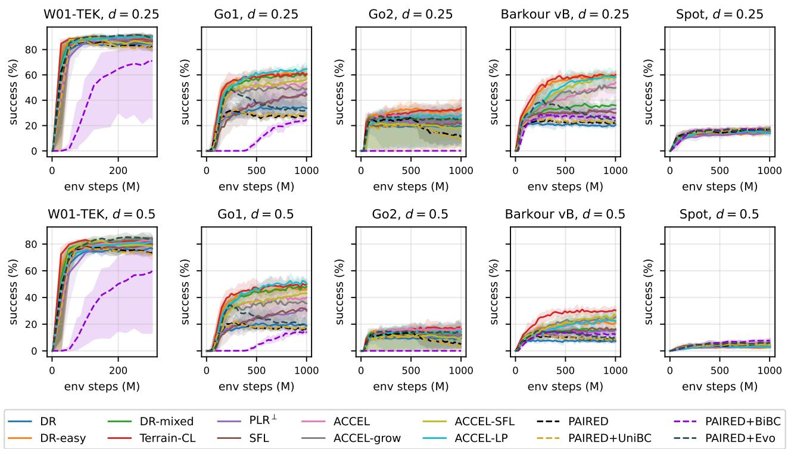  
Figure 2. Success of the deterministic policy on 512 random levels at d = 0.25 (top) and d = 0.5 (bottom) during training. Mean over 5 seeds, shaded min-max. PAIRED and its variants dashed.

Go2 and Spot no method passes any gap. Spot’s uphill-slope envelope is at most 5.2◦.

Q5: How fast do methods learn, and at what cost? On W01-TEK every method but PAIRED+BiBC plateaus within about 100M steps (Figure 2). Go2 and Spot plateau early at low success. On Go1 and Barkour the curves are still rising at 1B steps, so their rankings hold at this budget rather than at convergence. At matched environment steps every method outside the PAIRED family takes about the same wall clock on a given robot (0.5-0.9 GPU-hours per run, Table 12). Buffer methods spend a fifth to a quarter of their steps on scoring iterations that do not update the student (786M student steps of 1B for ACCEL on Go1). PAIRED and its variants simulate twice as many steps, for the antagonist, and take 1.8-1.9 times the wall clock.

Q6: How repeatable are the results across seeds? Runs that never learn to walk concentrate on Go2, where standard deviations reach 12.7 points (ACCEL-LP, d = 0.25) and the top groups widen. Outside Go2 the largest standard deviations on d = 0.25 and the suite, apart from PAIRED+BiBC on W01-TEK, are SFL’s on Go1 (8.2 and 4.4), ACCEL’s on Barkour’s d = 0.25 levels (7.2) and PAIRED+Evo’s on Barkour’s suite (7.8). Terrain-CL stays at or below 3.1 points outside Go2, and DR-mixed at or below 2.8 on every robot.

## 6. Which Curriculum Should I Use?

Table 4 marks, per robot and level set, the methods in the top group. We summarise it per family of methods. Every statement holds for one PPO student at this budget.

Randomisation (DR, DR-easy, DR-mixed). DR on uniform levels is in no top group. Changing only the distribution it samples from changes this. DR-easy is in the d = 0.25 top group on Go1, Go2 and Barkour and in no held-out top group. DR-mixed is in every top group on W01-TEK and in both random-level groups on Go1. Both cost the same as DR and need no buffer or score.

Terrain curriculum (Terrain-CL). Terrain-CL is in more top groups than any other method (13 of 20): all four on Go1 and Barkour, three on Go2, the suite and uniform levels on W01-TEK, and none on Spot. It needs the task’s success test and legged\_gym’s travel threshold, and no buffer or score. Its rows need no robot-specific setting.

Replay of uniform levels (PLR⊥, SFL). PLR⊥ is in no top group, but on Go1 and Barkour it improves on DR, which samples the same levels (45.9 vs. 34.9%, p = 0.002, and 33.5 vs. 20.9%, p = 0.003, at d = 0.25). On W01-TEK, Go2 and Spot it does not. SFL, the same buffer scored by learnability, is in the held-out top group on Go1, Go2 and

Table 4. Top-group membership per robot and level set (•: the best mean or not significantly below it, Welch t-test, $p \geq 0 . 0 5 ,$ 5 seeds). .25, .5: random levels at d = 0.25, 0.5. OOD: held-out suite. U: uniform levels at full difficulty. On Spot all methods lie within 3.8 points on d = 0.25.
<table><tr><td></td><td colspan="4">W01-TEK</td><td colspan="4"></td><td colspan="4"></td><td colspan="4"></td><td colspan="4">Barkour vB</td><td colspan="4">Spot</td></tr><tr><td>Method</td><td>.25</td><td>.5</td><td></td><td>OOD</td><td>U</td><td>.25</td><td>.5</td><td>OOD</td><td>U</td><td></td><td>.25</td><td>.5</td><td>OOD</td><td>U</td><td>.25</td><td>.5</td><td></td><td>OOD</td><td>U</td><td>.25</td><td>.5</td><td></td><td>OOD</td><td>U</td></tr><tr><td>DR</td><td></td><td></td><td></td><td></td><td></td><td></td><td></td><td></td><td></td><td></td><td></td><td></td><td></td><td></td><td></td><td></td><td></td><td></td><td></td><td></td><td></td><td></td><td></td><td></td></tr><tr><td>DR-easy</td><td></td><td></td><td></td><td></td><td></td><td></td><td></td><td></td><td></td><td></td><td></td><td></td><td></td><td></td><td></td><td></td><td></td><td></td><td></td><td></td><td></td><td></td><td></td><td></td></tr><tr><td>DR-mixed</td><td></td><td></td><td></td><td></td><td></td><td></td><td></td><td></td><td></td><td></td><td></td><td></td><td></td><td></td><td></td><td></td><td></td><td></td><td></td><td></td><td></td><td></td><td></td><td></td></tr><tr><td>Terrain-CL</td><td></td><td></td><td></td><td></td><td></td><td></td><td></td><td></td><td></td><td></td><td></td><td></td><td></td><td></td><td></td><td></td><td></td><td></td><td></td><td></td><td></td><td></td><td></td><td></td></tr><tr><td>PLR</td><td></td><td></td><td></td><td></td><td></td><td></td><td></td><td></td><td></td><td></td><td></td><td></td><td></td><td></td><td></td><td></td><td></td><td></td><td></td><td></td><td></td><td></td><td></td><td></td></tr><tr><td>SFL</td><td></td><td></td><td></td><td></td><td></td><td></td><td></td><td></td><td></td><td></td><td></td><td></td><td></td><td></td><td></td><td></td><td></td><td></td><td></td><td></td><td></td><td></td><td></td><td></td></tr><tr><td>ACCEL</td><td></td><td></td><td></td><td></td><td></td><td></td><td></td><td></td><td></td><td></td><td></td><td></td><td></td><td></td><td></td><td></td><td></td><td></td><td></td><td></td><td></td><td></td><td></td><td></td></tr><tr><td>ACCEL-grow</td><td></td><td></td><td></td><td></td><td></td><td></td><td></td><td></td><td></td><td></td><td></td><td></td><td></td><td></td><td></td><td></td><td></td><td></td><td></td><td></td><td></td><td></td><td></td><td></td></tr><tr><td>ACCEL-SFL</td><td></td><td></td><td></td><td></td><td></td><td></td><td></td><td></td><td></td><td></td><td></td><td></td><td></td><td></td><td></td><td></td><td></td><td></td><td></td><td></td><td></td><td></td><td></td><td></td></tr><tr><td>ACCEL-LP</td><td></td><td></td><td></td><td></td><td></td><td></td><td></td><td></td><td></td><td></td><td></td><td></td><td></td><td></td><td></td><td></td><td></td><td></td><td></td><td></td><td></td><td></td><td></td><td></td></tr><tr><td>PAIRED</td><td></td><td></td><td></td><td></td><td></td><td></td><td></td><td></td><td></td><td></td><td></td><td></td><td></td><td></td><td></td><td></td><td></td><td></td><td></td><td></td><td></td><td></td><td></td><td></td></tr><tr><td>PAIRED+UniBC</td><td></td><td></td><td></td><td></td><td></td><td></td><td></td><td></td><td></td><td></td><td></td><td></td><td></td><td></td><td></td><td></td><td></td><td></td><td></td><td></td><td></td><td></td><td></td><td></td></tr><tr><td>PAIRED+BiBC PAIRED+Evo</td><td></td><td></td><td></td><td></td><td></td><td></td><td></td><td></td><td></td><td></td><td></td><td></td><td></td><td></td><td></td><td></td><td></td><td></td><td></td><td></td><td></td><td></td><td></td><td></td></tr></table>

Barkour, leads it on Barkour, and has a wide seed spread on Go1 and Go2 (std up to 12.2 points on $d = 0 . 2 5$ and the suite).

ACCEL and its variants. ACCEL is in the held-out top group on W01-TEK, Go1 and Go2, leads it on Go2, and in the d = 0.25 group on every robot except Go1, eleven groups in total. ACCEL-grow, which also enlarges edited levels, leads W01-TEK’s d = 0.25, d = 0.5 and heldout sets and enters no other robot’s group except Go2’s at d = 0.5. ACCEL-LP leads Go1’s random levels and is in Go2’s held-out group, but in no other held-out group. ACCEL-SFL is in Barkour’s random-level groups, Go2’s held-out group and Spot’s d = 0.25 group, and is below ACCEL on W01-TEK (83.8 vs. 90.5%, p = 0.002).

PAIRED and its variants. PAIRED is in no top group outside Spot’s d = 0.25 set, and below PLR⊥ on W01- TEK, Go1, Go2 and Barkour (on Go1 28.9 vs. 45.9%, p < 0.001). Distilling the antagonist into the protagonist (UniBC) changes PAIRED’s d = 0.25 success by at most 1.3 points on any robot. Distilling both ways (BiBC) collapses on Go2 (0.2% success) and leads every Spot set. PAIRED+Evo, which replaces the learned generator with ACCEL’s buffer and edits under the same regret, is in the held-out top group on W01-TEK and Spot. All four cost about twice the wall clock of the other methods.

Short answers. For in-distribution random levels, a method with easy or low-difficulty training levels is in the d = 0.25 top group on every robot, whether it curates (AC-CEL family, Terrain-CL) or not (DR-easy, DR-mixed). For held-out terrain the choice depends on the robot: Terrain-CL or ACCEL on Go1, ACCEL on Go2, SFL or Terrain-CL on Barkour, PAIRED+BiBC or PAIRED+Evo on Spot, and ACCEL or ACCEL-grow, Terrain-CL, DR-mixed or

PAIRED+Evo on W01-TEK. Without a budget to compare methods on a new robot, Terrain-CL is the method found in a top group most often here, and ACCEL is second. Evaluating only on in-distribution random levels would have picked a different leader on Go1, Go2 and Barkour.

## 7. Discussion and Limitations

Relation to 2D UED results. On BipedalWalker ACCEL outperforms PLR⊥, PAIRED and DR (Parker-Holder et al., 2022). Here ACCEL is in eleven of twenty top groups, and Terrain-CL, a curriculum from legged-robot practice, is in thirteen. JaxUED and SFL report DR as a strong baseline in 2D domains (Coward et al., 2024; Rutherford et al., 2024). Here DR on uniform levels is in no top group, while DR on easy or mixed-difficulty levels is in the randomlevel top groups of four robots. PAIRED trails replay-based methods in 2D (Parker-Holder et al., 2022; Jiang et al., 2021a) and here, and the behaviour-cloning fixes proposed for it (Mediratta et al., 2023) do not change that outside Spot.

Benchmark statement. The benchmark fixes one training budget per robot, shared by all methods. Training can be extended, and longer runs may improve the policies. On three robots the leader on in-distribution random levels is not the leader on held-out terrain, so a new curriculum should be reported on both.

## Limitations.

• A robot’s structure and build affect the share of levels it solves, whatever the method. We therefore compare methods within each robot, and the aggregates over robots (App. E) average scores normalised per robot rather than raw success.

• Terrain-CL and ACCEL-LP are adaptations: Terrain-CL’s columns are uniform levels of the level space rather than legged\_gym’s terrain types, and promotion is decided per lane of 32 environments. ACCEL-LP ranks a replay buffer by learning progress measured over one visit, instead of LP-ACRL’s softmax over a fixed task set.

Conclusion. Across fourteen curricula and five quadrupeds no method is in the top group on every robot and level set. Methods with easy or low-difficulty training levels, curated or not, fill the random-level top groups of Go1 and Barkour, and of W01-TEK apart from PAIRED+BiBC. The success-driven terrain curriculum is in a top group most often and ACCEL second, while DR on uniform levels is in none and PAIRED in none outside Spot. The leader on held-out terrain differs from the leader on in-distribution random levels on three robots. The benchmark, level space and protocol are built so that a new curriculum is added by changing only how levels are proposed.

## Acknowledgments and Disclosure of Funding

Calculations have been carried out in Wrocław Centre for Networking and Supercomputing (http://www.wcss. pl), grant No. hpc-danbor2008-1756464546. W01-TEK was built in the Laboratory of Mechatronics and Robotics, Wrocław University of Science and Technology, under the scientific supervision of Jarosław Szrek. We thank Machinekind for providing its robot model.

## Impact Statement

This paper presents work whose goal is to advance the field of Machine Learning. There are many potential societal consequences of our work, none of which we feel must be specifically highlighted here. The authors hope that this benchmark and its per-robot guide will support the development of Physical AI and of learning-based robotics, by making curricula for legged robots easier to compare, reproduce and choose.

## References

Agarwal, R., Schwarzer, M., Castro, P. S., Courville, A., and Bellemare, M. G. Deep reinforcement learning at the edge of the statistical precipice. In Advances in Neural Information Processing Systems, pp. 29304–29320, 2021.

Caluwaerts, K., Iscen, A., Kew, J. C., Yu, W., Zhang, T., Freeman, D., Lee, K.-H., Lee, L., Saliceti, S., Zhuang, V., et al. Barkour: Benchmarking animal-level agility with quadruped robots, 2023.

Coward, S., Beukman, M., and Foerster, J. JaxUED: A simple and useable UED library in Jax, 2024. arXiv:2403.13091.

Dennis, M., Jaques, N., Vinitsky, E., Bayen, A., Russell, S., Critch, A., and Levine, S. Emergent complexity and zero-shot transfer via unsupervised environment design. In Advances in Neural Information Processing Systems, 2020.

Freeman, C. D., Frey, E., Raichuk, A., Girgin, S., Mordatch, I., and Bachem, O. Brax – a differentiable physics engine for large scale rigid body simulation. In NeurIPS Datasets and Benchmarks Track, 2021.

Jiang, M., Dennis, M., Parker-Holder, J., Foerster, J., Grefenstette, E., and Rocktäschel, T. Replay-guided adversarial environment design. In Advances in Neural Information Processing Systems, pp. 1884–1897, 2021a.

Jiang, M., Grefenstette, E., and Rocktäschel, T. Prioritized level replay. In International Conference on Machine Learning, 2021b.

Jiang, M., Dennis, M., Grefenstette, E., and Rocktäschel, T. minimax: Efficient baselines for autocurricula in JAX, 2023. arXiv:2311.12716.

Lee, J., Hwangbo, J., Wellhausen, L., Koltun, V., and Hutter, M. Learning quadrupedal locomotion over challenging terrain. Science Robotics, 5(47):eabc5986, 2020.

Li, Z., Li, C., and Hutter, M. Scaling rough terrain locomotion with automatic curriculum reinforcement learning, 2026. arXiv:2601.17428.

Liang, W., Wang, S., Wang, H.-J., Bastani, O., Jayaraman, D., and Ma, Y. J. Eurekaverse: Environment curriculum generation via large language models, 2024. arXiv:2411.01775.

Liu, R., Liu, T., Jia, B., Zhong, F., Tong, X., Xie, H., and Huang, S. Trajectory-level automatic curriculum learning for legged locomotion on unstructured terrain, 2026. arXiv:2608.16164.

Mediratta, I., Jiang, M., Parker-Holder, J., Dennis, M., Vinitsky, E., and Rocktäschel, T. Stabilizing unsupervised environment design with a learned adversary. In Conference on Lifelong Learning Agents, 2023.

Ovinnikov, I., Sutter, P., Gehring, C., and Herrmann, J. Predictive safety curricula for robust legged locomotion, 2026. arXiv:2609.37070.

Parker-Holder, J., Jiang, M., Dennis, M., Samvelyan, M., Foerster, J., Grefenstette, E., and Rocktäschel, T. Evolving curricula with regret-based environment design. In International Conference on Machine Learning, 2022.

Rudin, N., Hoeller, D., Reist, P., and Hutter, M. Learning to walk in minutes using massively parallel deep reinforcement learning. In Conference on Robot Learning, 2021.

Rutherford, A., Beukman, M., Willi, T., Lacerda, B., Hawes, N., and Foerster, J. No regrets: Investigating and improving regret approximations for curriculum discovery. In Advances in Neural Information Processing Systems, volume 37, pp. 16071–16101, 2024.

Schulman, J., Wolski, F., Dhariwal, P., Radford, A., and Klimov, O. Proximal policy optimization algorithms, 2017. arXiv:1707.06347.

Tobin, J., Fong, R., Ray, A., Schneider, J., Zaremba, W., and Abbeel, P. Domain randomization for transferring deep neural networks from simulation to the real world. In IEEE/RSJ International Conference on Intelligent Robots and Systems, pp. 23–30, 2017.

Todorov, E., Erez, T., and Tassa, Y. MuJoCo: A physics engine for model-based control. In IEEE/RSJ International Conference on Intelligent Robots and Systems, pp. 5026–5033, 2012. doi: 10.1109/IROS.2012.6386109.

Zakka, K., Tassa, Y., and MuJoCo Menagerie Contributors. MuJoCo Menagerie: A collection of high-quality simulation models for MuJoCo. https://github.com/ google-deepmind/mujoco\_menagerie, 2022.

Zakka, K., Tabanpour, B., Liao, Q., Haiderbhai, M., Holt, S., Luo, J. Y., Allshire, A., Frey, E., Sreenath, K., Kahrs, L. A., Sferrazza, C., Tassa, Y., and Abbeel, P. MuJoCo playground, 2025. arXiv:2502.08844.

Zhang, C. and Yang, L. Generating a terrain-robustness benchmark for legged locomotion: A prototype via terrain authoring and active learning, 2022. arXiv:2208.07681.

## A. Robots and Task

## A.1. W01-TEK

W01-TEK is a quadruped built in the Laboratory of Mechatronics and Robotics, Wrocław University of Science and Technology. Machinekind provided the robot model we simulate (https://github.com/machinekind/w01-tek). It has 12 actuated joints (three per leg). Each leg is a closed kinematic chain: the actuated joints drive the foot through a passive four-bar linkage, closed in MuJoCo by one connect equality constraint per leg. The closure adds constraint dynamics that serial legs do not have (the linkage can reach a toggle configuration, which the reward penalises). Training randomises terrain friction, base and link masses, and actuator gain and damping scale per environment. W01-TEK runs on the MuJoCo Warp backend of MJX. The four Playground robots run on the JAX backend.

## A.2. Open-chain robots

Go1, Barkour vB and Spot use MuJoCo Playground’s joystick environments (Zakka et al., 2025): Playground’s reward and observations, feet-only collisions and, where Playground defines one, its physics randomisation. Go2 has no Playground environment. It runs Go1’s environment on the Menagerie model (Zakka et al., 2022), rewritten to feet-only collisions and the sensor names Go1’s environment reads. Every robot keeps its own reward. We change the scene (the tiled heightfield arena), the commands (forward-walking slice of the native command box), the termination (the shared fall rule below) and the critic input (a height scan). Table 5 lists the per-robot values.

Table 5. Per-robot settings.
<table><tr><td></td><td>W01-TEK</td><td>Gol</td><td>Go2</td><td>Barkour vB</td><td>Spot</td></tr><tr><td>Model</td><td>Machinekind</td><td>Playground</td><td>Menagerie</td><td>Menagerie</td><td>Playground</td></tr><tr><td>Episode (steps)</td><td>300</td><td>300</td><td>300</td><td>300</td><td>780</td></tr><tr><td>Physics DR</td><td>own</td><td>Playground</td><td>Gol&#x27;s</td><td>none</td><td>none</td></tr></table>

Models. Every robot keeps the default actuator and joint settings of the model released by its manufacturer or creators (the MJCF/URDF files of MuJoCo Menagerie and MuJoCo Playground, and Machinekind’s model of W01-TEK). Only Go2’s PD gains are raised (position gain doubled, velocity gain and joint damping scaled by ${ \sqrt { 2 } } ,$ , keeping Menagerie’s damping ratio).

Size. s is set per robot from its settled standing pose over flat ground, relative to a fixed reference, and rounded to 0.1. It scales the arena, every level length, the eval suite, the critic’s height-scan grid and the success distance. Slopes and the fal rule’s ratio do not scale.

Fall rule. An episode ends in a fall when the trunk is below 0.6 of the standing height above the terrain under it (read from the heightfield) or the gravity vector’s z-component in the trunk frame exceeds −0.4. This replaces Playground’s own terminations, which use world heights (wrong on a pit or a raised tile). Barkour keeps Playground’s joint-limit check.

Critic. The critic additionally receives a clean 5 × 5 terrain height scan ahead of the robot (a fixed grid scaled by s). The actor is blind.

## A.3. Success distance and episode length

Success needs s metres of travel within the episode. With 300-step (6 s) episodes, this is 28-30% of the distance at top commanded speed for W01-TEK, Go1, Go2 and Barkour. Relative to its size, Spot’s top commanded speed is lower than the other robots’, so in 6 s its success distance would need 72% of its top speed from rest. With 6 s episodes even a perfect flat walker would succeed on about half of the levels. We lengthen Spot’s episodes to 780 steps (15.6 s), which restores the 28% ratio and keeps the success distance a size-relative quantity. Evaluation draws $v _ { x }$ from 1.2× the success distance over the episode duration up to the maximum, so every evaluation command can reach the distance. The distance is then 83% of the travel at the slowest evaluation command for all five robots. Spot redraws its command every 200 steps, Go1 and Go2 every 5 s on average, and Barkour keeps one command per episode. With turning, perfect tracking of evaluation commands reaches the distance on 62% of Spot’s levels, 70% of Go1’s and Go2’s and 95% of Barkour’s, which approximately caps flat-ground success (Table 8).

## B. Level Space and Arena

## B.1. Level space

Table 6. Level space, reference units. Every length is multiplied by the robot’s size s. A level is $\theta \in [ 0 , 1 ] ^ { 8 }$ plus a noise seed.

<table><tr><td>Parameter</td><td>Range</td></tr><tr><td>Noise amplitude Noise wavelength</td><td>0-0.10 m  $0 . 2 \mathrm { - } 1 . 0 \mathrm { m }$ </td></tr><tr><td>Radial slope</td><td> $- 2 0 ^ { \circ } ~ { \mathrm { t o } } + 1 8 ^ { \circ }$ </td></tr><tr><td>Stair height</td><td> $- 0 . 0 8 \mathrm { t o } \left( 0 . 0 5 \mathrm { m } \right.$ </td></tr><tr><td>Stair width Gap width</td><td> $0 . 1 5 – 0 . 6 0 \mathrm { m }$ </td></tr><tr><td>Block height</td><td>0-0.06 m</td></tr><tr><td>Block size</td><td>0-0.06 m 0.15-0.60 m</td></tr></table>

Each parameter has a flat value (zero slope, step, amplitude, gap and block height, and mid-range stair width, noise wavelength and block size, which have no effect at zero height). Because the slope and stair ranges are asymmetric, flat is not the centre of the cube. Difficulty d moves a genome toward flat, $\theta _ { d } = \theta _ { \mathrm { f l a t } } + d ( \theta - \theta _ { \mathrm { f l a t } } )$ . The easy generator of DR-easy and ACCEL is $d = 0 . 1$

## B.2. Rendering and the tiled arena

A level is rendered into a square patch of half-width 3.0 m at 0.05 m resolution with heights clipped $\mathrm { t o \pm 0 . 3 }$ m (all ×s). A flat spawn disc of radius $r _ { 0 } = 0 . 5 5$ m blends into the terrain over $w = 0 . 2 1$ m. Let r be the distance from the patch centre, $\delta = \operatorname* { m a x } ( r - r _ { 0 } - w , 0 )$ and $\tau ( r ) = \mathrm { c l i p } ( ( r - r _ { 0 } ) / w , 0 , 1 )$ . Then

$$
h ( x , y ) = \tau ( r ) \Big [ \tan ( \phi ) \delta + h _ { s } \Big [ \frac { \delta } { w _ { s } } \Big ] + A n _ { \lambda } ( x , y ) + h _ { b } b _ { c } ( x , y ) - D { \bf 1 } \big [ \delta > 0 , ( \delta \bmod P ) < g \big ] \Big ] ,
$$

where ϕ is the slope, $h _ { s } , w _ { s }$ stair height and width, A, λ noise amplitude and wavelength, $n _ { \lambda }$ a seeded bilinear noise field in [−1, 1] with control points every $\lambda , b _ { c }$ a seeded piecewise-constant field in [−1, 1] with cells of size c and height $h _ { b } ,$ and g the gap width with depth $D = 0 . 1 5$ m and period $P = 0 . 6  { \mathrm { m } }$

All levels of an iteration share one MuJoCo heightfield: the arena is a grid of 16 × 16 tiles separated by flat aprons, each level is written into its own tile and its environments spawn at the tile’s centre. The heightfield data is an array leaf of the MJX model, so writing 256 new levels needs no recompilation, and all environments share one model. Figure 3 shows each feature at the end of its range and Figure 4 the five robots on one level.

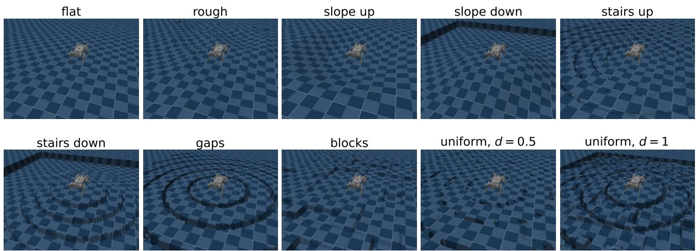  
Figure 3. W01-TEK on example levels. The first panel is flat. Each of the next seven sets one feature to the end of its range with every other feature flat. The last two are uniform samples at $d = 0 . 5$ and d = 1. Features start at the edge of the flat spawn disc.

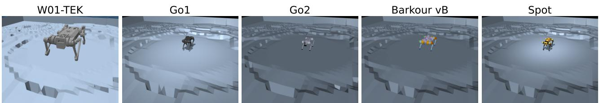  
Figure 4. One level genome (d = 0.6) rendered for each robot in its own arena. Terrain lengths and camera distance scale with the robot’s size s, so robots of different proportions fill their panels differently.

## C. Methods and Hyperparameters

Training loop. Brax’s own training loop fixes each environment’s model for a whole run, so we drive brax’s PPO networks, loss and running observation normaliser from a custom loop. One iteration runs 256 lanes $\times 3 2$ environments. All environments of a lane are reset onto its level, with a fresh physics-randomisation draw where the robot defines one, and stepped for one episode in 20-step unrolls, with a PPO update after each unroll when the iteration trains. An iteration is $2 5 6 \cdot 3 2 \cdot 3 0 0 \approx 2 . 4 6 \mathsf { M }$ environment steps (Spot: 6.4M).

Scores. Positive value loss (PVL): the mean positive GAE advantage of a lane over the iteration (Jiang et al., 2021b). Learnability: $p ( 1 - p )$ with p the fraction of the lane’s environments that never fell and reached the success distance (Rutherford et al., 2024). Learning progress (after LP-ACRL (Li et al., 2026)): R is the lane’s mean over its 32 environments of the undiscounted return of each environment’s first episode on the level (up to 300 steps, Spot 780, steps after a fall and reset still train PPO but do not count toward R). A visit’s score is R minus the R of the level’s previous visit, signed, and 0 on a level’s first visit, including a mutated child’s. PAIRED regret: the best antagonist return minus the mean protagonist return on the lane, clipped at 0.

DR, DR-easy, DR-mixed. Every iteration trains on 256 fresh levels: uniform (DR), uniform shrunk to d = 0.1 (DR-easy, the same easy generator as ACCEL), or shrunk by a per-level $d \sim \mathcal { U } ( 0 , 1 )$ (DR-mixed).

Terrain-CL. The game-inspired curriculum of Rudin et al. (2021), adapted to lanes: all 32 environments of a lane share one level, so promotion is decided per lane. At the start of the run each lane draws a uniform genome and noise seed (its column), kept for the whole run, and a row $r \sim \mathcal { U } \{ 0 , \dots , 5 \}$ (legged\_gym’s initial-level cap). Every iteration trains on all lanes, each at its column shrunk toward flat by $d = r / 1 0 .$ , the same shrink as the random evaluation sets. After the iteration a lane moves to $r + 1$ when at least 50% of its environments succeeded. Otherwise to r − 1 (clipped at 0) when its mean distance from spawn is below half its mean commanded planar displacement, integrated from the commanded velocities and heading rate over the episode (legged\_gym: distance below half the commanded speed times the episode length). A lane promoted past row 10 moves to a uniformly random row.

PLR⊥ (Jiang et al., 2021a) and SFL. A buffer of the 4000 highest-scoring levels. Once it holds 256 levels, an iteration replays with probability 0.8: it samples 256 levels by rank prioritisation (temperature 0.3) mixed with staleness (weigh 0.3), trains on them and refreshes their scores. Otherwise it scores 256 fresh uniform levels without training and adds them to the buffer. $\mathrm { P L R ^ { \perp } }$ scores by PVL. Our SFL scores by learnability in the same buffer. This is an approximation of SFL (Rutherford et al., 2024), which periodically rebuilds a top-K buffer from a large random pool and trains on a mix of buffer and random levels.

ACCEL (Parker-Holder et al., 2022) and variants. PLR⊥ with two changes: new levels come from the easy generator, and every replayed level is mutated by perturbing 2 randomly chosen parameters by U(−0.1, 0.1) (clipped to [0, 1], seed kept). The next non-training iteration scores the children of the most recent replay batch. A non-training iteration with no queued children scores fresh easy levels. ACCEL-grow adds a “grow” step that scales the mutated genome’s distance from flat by U(1, 1.3). ACCEL-SFL is ACCEL-grow scored by learnability. ACCEL-LP is ACCEL scored by learning progress. With signed scores, levels whose return fell since their last visit rank last and are the first evicted from a full buffer. LP-ACRL samples a fixed task set by a softmax over learning progress. ACCEL-LP keeps ACCEL’s rank and staleness sampling over an evolving buffer.

PAIRED (Dennis et al., 2020) and variants. A learned generator maps a 16-dimensional Gaussian latent through an MLP to a sigmoid-squashed Gaussian over the 8 parameters. A random seed is appended. Each iteration it proposes 256 levels, on which a protagonist and an antagonist (two independent students, each with its own normaliser) both train in separate rollouts. The generator is trained on PAIRED regret by single-step PPO (entropy coefficient 0.1, learning rate $1 0 ^ { - 4 } )$ . UniBC and BiBC (Mediratta et al., 2023) add a behaviour-cloning loss (weight 0.5, every iteration) that distils the antagonist into the protagonist, or both ways. PAIRED+Evo replaces the generator with ACCEL’s buffer and edits, scored by PAIRED regret.

Budget accounting. All methods get the same number of environment steps. Non-training iterations of the buffer methods count toward the budget, so they take fewer gradient steps than DR. PAIRED’s budget counts protagonist steps only, so PAIRED simulates twice as much (Table 12).

Table 7. Hyperparameters shared by all methods.
<table><tr><td>Lanes × environments per lane</td><td>256 × 32</td></tr><tr><td>Steps per level (episode)</td><td>300 (Spot 780)</td></tr><tr><td>Environment steps</td><td>300M (W01-TEK), 1B (others)</td></tr><tr><td>PPO</td><td>brax, 20-step unroll, 4 epochs × 32 minibatches</td></tr><tr><td>γ, λ, learning rate, entropy, clip, grad norm</td><td> $0 . 9 7 , 0 . 9 5 , 3 \times 1 0 ^ { - 4 } , 0 . 0 1 , 0 . 2 , 1 . 0$ </td></tr><tr><td>Networks</td><td>MLP 512-256-128, ELU, observation normalisation</td></tr><tr><td>Buffer</td><td>4000 levels, replay probability 0.8</td></tr><tr><td>Replay sampling</td><td>rank (temperature 0.3) + staleness (0.3)</td></tr><tr><td>Easy generator</td><td>shrink to  $\bar { d } = 0 . 1$ </td></tr><tr><td>Terrain-CL</td><td>rows  $d = r / 1 0 , r \in \{ 0 . . 1 0 \} , r _ { 0 } \sim \mathcal { U } \{ 0 . . 5 \}$  , up at  $2 5 0 \%$  success,</td></tr><tr><td>Mutation</td><td>down at travel  $< 0 . 5 \times$  commanded displacement 2 parameters, ±0.1, grow × U(1, 1.3)</td></tr><tr><td>PAIRED generator</td><td>latent 16, lr 10−4, entropy 0.1</td></tr><tr><td>Behaviour cloning</td><td>weight 0.5, every iteration</td></tr></table>

## D. Evaluation Protocol

Episodes. Each final policy is evaluated deterministically (tanh of the policy mean), without physics randomisation and without early episode cuts. Commands are drawn as in training, with $v _ { x }$ restricted to the evaluation range (App. A.3). Every level is rolled out in two independent passes of 4 episodes each.

Level sets. Random: 2048 uniform genomes, shrunk to $d \in \{ 0 . 2 5 , 0 . 5 \}$ . The genomes are the same at both. Uniform: a second, independent draw of 2048 uniform genomes, the training distribution of DR. Flat: 64 flat levels. Held-out suite: seven structured terrain families, each at strength $k = 1 . . 4$ with 64 instances, radially symmetric like the training levels (reference units, ×s): stairs up and down (2k cm steps every 0.3 m), slopes up and down (5k◦), trenches (10 cm deep, 5k cm wide, every 0.5 m), waves (±2k cm, 0.6 m wavelength) and random blocks (±2k cm, 0.3 m cells). We report mean success over the 28 cells.

Cross-fitted CVaR. $\mathrm { C V a R _ { 2 5 } }$ is the mean success over the worst 25% of levels, after the adversarial evaluation of Rutherford et al. (2024). Levels are ranked on one pass and scored on the other, in both directions, and averaged. In a simulation with 2000 levels of true success 0.5 and 4 episodes each, same-pass $\mathrm { C V a R _ { 2 5 } }$ reads 0.19 and the cross-fitted estimate 0.49.

Solvable subset. Uniform success restricted to levels that some policy passes: a level is solvable if at least one run of any method on that robot succeeds in at least one episode of pass A. Every run is scored on pass B over those levels and vice versa, and the two are averaged. The subset depends on the set of evaluated runs, so the metric is comparable only within one robot.

Capability envelopes. For each of seven features (rough, slope up, slope down, stairs up, stairs down, gaps, blocks), the feature takes six evenly spaced magnitudes up to the end of its range with every other feature flat, 64 seeded levels per magnitude. The envelope is the largest magnitude still passed with 50% success (linearly interpolated, 0 if the smallest magnitude already fails). An envelope at the end of the range is censored.

Domination comparison. For methods A and B, a level’s solve rate is the fraction of its 40 episodes (5 seeds $\times 2$ passes $\times 4 )$ that succeed. The heatmap counts levels in a $1 0 \times 1 0$ grid of (A, B) solve rates. We report the fractions of levels where A’s rate is higher, lower or equal, the mean difference $A - B$ with a 95% bootstrap interval over levels, and the mean $| A - B |$ against a noise reference: per level, both rates are drawn as Binomia $( n , p ) / n$ at $p = ( A + B ) / 2$ , and the reference is the exact expectation of their absolute difference, averaged over levels. A mean $| A - B |$ at the reference means the two methods are indistinguishable level by level.

Statistics. Per-seed metrics are averaged over five seeds. Tables give the mean ± sample standard deviation, and per-robot method comparisons use two-sided Welch t-tests over the per-seed means, uncorrected for multiple comparisons. Aggregates over robots follow Agarwal et al. (2021): per robot, scores are min-max normalised over the method means (so the bounds depend on the set of methods). The IQM is the 25%-trimmed mean of the 25 robot-seed scores. Intervals are 95% percentile stratified bootstrap intervals with robots as strata (10 000 resamples). The probability of improvement $P ( X > Y )$ is, per robot, the Mann-Whitney statistic $U / ( n m )$ of $X \mathbf { \hat { s } }$ against $Y { \mathrm { : } } _ { \mathrm { s } }$ seeds (ties count one half), averaged over robots, with a stratified bootstrap interval (2000 resamples).

## E. Additional Results

## E.1. Full-difficulty (uniform) levels

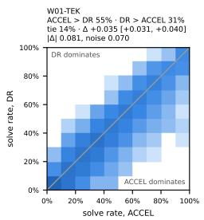

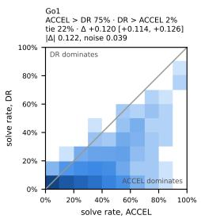

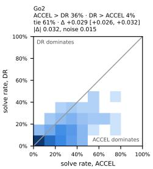

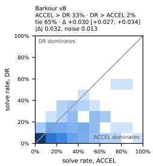  
Figure 5. ACCEL vs. DR, level by level, on the 2048 uniform levels. Read as Figure 6.

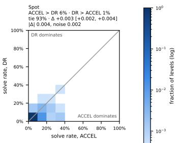

Table 8. Success rate (%) per robot and method, mean ± std over 5 seeds. Bold: top group per robot and column (best mean or not significantly below it, Welch t-test, $p \geq 0 . 0 5 )$ . CVaR25 is over the d = 0.25 levels, cross-fitted.
<table><tr><td>Robot W01-TEK</td><td>Method DR</td><td>d=0.25</td><td>CVaR25</td><td>d=0.5</td><td>OOD suite</td><td>Flat</td></tr><tr><td rowspan="10"></td><td>DR-easy DR-mixed</td><td>84.5 ±2.4 90.2 ±0.7 89.9 ±1.1</td><td>84.6 ±2.1 89.3 ±0.8 90.3 ±0.9</td><td>75.9 ±2.5 81.8 ±0.8 83.3 ±1.7</td><td>52.5 ±2.1 55.4 ±0.8</td><td>87.3 ±1.8 93.7 ±0.5</td></tr><tr><td>Terrain-CL PLR⊥ SFL</td><td>87.7 ±1.7</td><td>88.0 ±1.4</td><td>81.8 ±1.9</td><td>58.5 ±1.0 58.9 ±1.3</td><td>91.9 ±1.2 89.6 ±1.5</td></tr><tr><td></td><td>86.9 ±1.4</td><td>87.0±1.8</td><td>78.9 ±2.2</td><td>55.1 ±2.0</td><td>90.0 ±1.1</td></tr><tr><td></td><td>86.3 ±2.1</td><td>86.4 ±2.5</td><td>79.1 ±2.2</td><td>55.9 ±1.3</td><td>88.4 ±1.6 93.8 ±0.4</td></tr><tr><td>ACCEL</td><td>90.5 ±0.7</td><td>90.0 ±0.6</td><td>83.4 ±1.4</td><td>57.5 ±1.1</td><td></td></tr><tr><td>ACCEL-grow ACCEL-SFL</td><td>91.2 ±0.4</td><td>91.2 ±0.4</td><td>84.9 ±1.2</td><td>59.0 ±1.3</td><td>93.4 ±0.2</td></tr><tr><td></td><td>83.8 ±2.3</td><td>84.4 ±2.5</td><td>77.8 ±1.1</td><td>54.8 ±1.7</td><td>86.5 ±2.7</td></tr><tr><td></td><td>89.9 ±0.6</td><td></td><td></td><td>55.3 ±0.7</td><td>93.4 ±0.3</td></tr><tr><td>ACCEL-LP</td><td></td><td>89.2 ±0.8</td><td>81.2 ±1.5</td><td></td><td>85.2 ±1.1</td></tr><tr><td>PAIRED PAIRED+UniBC</td><td>81.7 ±2.0 80.5 ±2.5</td><td>81.3 ±2.1</td><td>73.8 ±1.6</td><td>50.4 ±1.2</td><td></td></tr><tr><td rowspan="12">Go1 DR DR-easy</td><td></td><td>80.1 ±2.7</td><td></td><td>72.4 ±3.0</td><td>49.5 ±2.5</td><td>84.6 ±1.0 76.0 ±21.4</td></tr><tr><td>PAIRED+BiBC PAIRED+Evo</td><td>70.3 ±26.4 89.2 ±1.3</td><td>68.8 ±28.0 89.5 ±0.7</td><td>59.5 ±26.7 83.1 ±1.0</td><td>39.9 ±15.3</td><td>90.9 ±1.8</td></tr><tr><td></td><td></td><td></td><td></td><td>58.4 ±1.2</td><td></td></tr><tr><td></td><td>34.9 ±4.0</td><td>27.4 ±4.5</td><td>18.8 ±3.4</td><td>30.2 ±2.3</td><td>65.7 ±2.1</td></tr><tr><td></td><td>61.6 ±1.9</td><td>60.4±2.3</td><td>46.8 ±2.4</td><td>38.6 ±0.9</td><td>69.3 ±0.9</td></tr><tr><td>DR-mixed</td><td>61.2 ±2.4</td><td>59.7 ±3.1</td><td>48.1 ±3.1</td><td>42.5 ±1.2</td><td>68.4 ±0.6</td></tr><tr><td>Terrain-CL</td><td>62.3 ±2.3</td><td>60.9 ±3.1</td><td>50.6 ±3.1</td><td>45.8 ±0.8</td><td>68.6 ±0.7</td></tr><tr><td></td><td>45.9 ±3.8</td><td>41.1 ±4.3</td><td>29.8 ±4.1</td><td>38.3 ±1.0</td><td>67.1 ±1.1</td></tr><tr><td>PLR⊥</td><td>45.1 ±8.2</td><td>39.9 ±8.4</td><td>30.6 ±7.5</td><td>40.5 ±4.4</td><td>62.5 ±7.1</td></tr><tr><td>SFL ACCEL</td><td>53.7 ±4.7</td><td>50.1 ±6.3</td><td>39.3 ±6.0</td><td>45.1 ±2.1</td><td>68.4 ±1.1</td></tr><tr><td>ACCEL-grow</td><td>49.4 ±6.3</td><td>45.4 ±8.0</td><td>34.2 ±6.1</td><td>42.2 ±1.9</td><td>67.1 ±1.5</td></tr><tr><td>ACCEL-SFL ACCEL-LP</td><td>57.0 ±4.8 64.0 ±1.5</td><td>54.0 ±7.2</td><td>41.8 ±5.8</td><td>41.4 ±1.3</td><td>69.2 ±0.8</td></tr><tr><td></td><td></td><td>63.7 ±2.1</td><td>50.8 ±2.3</td><td>40.4 ±1.7</td><td>68.9 ±0.8</td></tr><tr><td>PAIRED</td><td>28.9 ±0.9</td><td>20.5 ±0.7</td><td>15.6 ±0.7</td><td>37.3 ±1.9</td><td>65.5 ±4.7</td></tr><tr><td>PAIRED+UniBC</td><td>29.5 ±0.6</td><td>20.4 ±0.7</td><td>16.0 ±0.4</td><td>37.2 ±0.8</td><td>66.7 ±1.6</td></tr><tr><td>PAIRED+BiBC</td><td>24.6 ±1.3</td><td>21.3 ±1.2</td><td>13.7 ±1.1</td><td>21.1 ±1.6</td><td>38.7 ±2.2</td></tr><tr><td rowspan="17">Go2</td><td>PAIRED+Evo</td><td>33.3 ±3.7</td><td>25.3 ±5.0</td><td>19.1 ±2.4</td><td>40.7 ±2.0</td><td>66.7 ±0.9</td></tr><tr><td>DR DR-easy</td><td>20.0 ±8.7 33.2 ±6.3</td><td>15.2 ±6.3</td><td>8.8 ±4.0</td><td>20.4 ±9.4</td><td>51.2 ±22.7</td></tr><tr><td></td><td></td><td>27.1 ±6.9</td><td>14.5 ±4.2</td><td>23.8 ±1.9</td><td>64.1 ±2.0</td></tr><tr><td>DR-mixed</td><td>25.9 ±1.6</td><td>19.9 ±2.1</td><td>12.4 ±1.3</td><td>27.4 ±2.0</td><td>62.6 ±1.0</td></tr><tr><td>Terrain-CL</td><td>34.1 ±5.2</td><td>28.9 ±5.6</td><td>17.1 ±4.8</td><td>27.7 ±3.1</td><td>63.6 ±1.0 60.8 ±3.0</td></tr><tr><td>PLR⊥ SFL</td><td>23.7 ±1.0</td><td>18.3 ±1.4 17.1 ±8.0</td><td>10.6 ±0.7 11.3 ±5.9</td><td>24.1 ±2.0</td><td>51.2 ±23.9</td></tr><tr><td>ACCEL</td><td>22.0 ±10.5 27.8 ±2.1</td><td>21.5 ±2.4</td><td>15.7 ±1.7</td><td>24.8 ±12.2 33.4 ±1.5</td><td>61.9 ±1.8</td></tr><tr><td>ACCEL-grow</td><td>24.7 ±1.3</td><td>19.0 ±1.4</td><td>11.8 ±1.2</td><td>25.8 ±1.7</td><td>61.4 ±1.6</td></tr><tr><td></td><td>19.0 ±7.9</td><td>15.0 ±4.8</td><td>9.3 ±4.2</td><td>22.8 ±11.1</td><td>48.2 ±22.9</td></tr><tr><td>ACCEL-ŠFL ACCEL-LP</td><td>28.0 ±12.7</td><td>23.4 ±10.6</td><td>13.9 ±6.8</td><td>23.0 ±9.8</td><td>53.0 ±22.3</td></tr><tr><td>PAIRED</td><td>11.3 ±7.4</td><td>9.8 ±5.3</td><td>4.8 ±4.1</td><td>10.0 ±8.0</td><td>24.9 ±17.8</td></tr><tr><td>PAIRED+UniBC</td><td>10.0 ±4.5</td><td>9.3 ±3.9</td><td>3.7 ±2.2</td><td>7.8 ±4.1</td><td>21.4 ±8.7</td></tr><tr><td>PAIRED+BiBC PAIRED+Evo</td><td>0.2 ±0.2</td><td>0.1 ±0.1</td><td>0.0 ±0.0</td><td>0.1 ±0.1</td><td>0.5 ±0.7</td></tr><tr><td></td><td>26.3 ±4.9</td><td>20.2 ±5.3</td><td>13.5 ±3.3</td><td>29.6 ±1.3</td><td>63.4 ±2.1</td></tr><tr><td>DR</td><td>20.9 ±0.9</td><td>13.4 ±0.7</td><td>7.2 ±0.3</td><td></td><td></td></tr><tr><td>DR-easy</td><td>59.5 ±2.6</td><td>48.4±4.0</td><td>20.9 ±2.3</td><td>22.3 ±0.8 28.3 ±2.0</td><td>90.9 ±0.7 92.9 ±0.4</td></tr><tr><td>DR-mixed</td><td>36.4 ±2.3</td><td>25.1 ±2.9</td><td>15.0 ±1.5</td><td>34.2 ±2.8</td><td>92.1 ±1.0</td></tr><tr><td></td><td></td><td>51.9 ±2.1</td><td></td><td></td><td></td><td>92.6 ±1.1</td></tr><tr><td rowspan="12">Spot</td><td>Terrain-CL</td><td>60.1 ±1.8</td><td></td><td>29.2 ±1.7</td><td>42.8 ±3.1</td><td>92.2 ±0.9</td></tr><tr><td>PLR⊥</td><td>33.5 ±4.4</td><td>21.7 ±3.7</td><td>14.8 ±2.5</td><td>37.0 ±3.8</td><td></td></tr><tr><td>SFL</td><td>31.1 ±2.0</td><td>19.4 ±0.7</td><td>15.5 ±0.7</td><td>45.2 ±1.5</td><td>92.7 ±0.8</td></tr><tr><td>ACCEL</td><td>54.7 ±7.2</td><td>45.4±8.4</td><td>25.0 ±3.4</td><td>38.3 ±1.6</td><td>92.7 ±0.8</td></tr><tr><td>ACCEL-grow</td><td>51.1 ±3.2</td><td>41.1 ±3.7</td><td>24.1 ±1.0</td><td>41.6 ±2.3</td><td>93.4 ±0.5</td></tr><tr><td>ACCEL-SFL</td><td>59.9 ±5.3</td><td>51.0 ±6.3</td><td>26.1 ±3.8</td><td>37.2 ±3.5</td><td>92.9 ±0.5</td></tr><tr><td>ACCEL-LP</td><td>59.0 ±4.0</td><td>49.2 ±5.5</td><td>22.2 ±3.5</td><td>30.1 ±3.3</td><td>92.9 ±0.5</td></tr><tr><td>PAIRED PAIRED+UniBC</td><td>23.0 ±0.9</td><td>14.6 ±1.3</td><td>8.5 ±1.0</td><td>27.1 ±1.8</td><td>89.8 ±0.8 90.2 ±0.5</td></tr><tr><td>PAIRED+BiBC</td><td>24.0 ±0.9</td><td>14.6 ±1.3</td><td>8.4 ±0.8</td><td>26.7 ±3.8</td><td>91.4 ±0.5</td></tr><tr><td>PAIRED+Evo</td><td>27.4 ±1.7</td><td>16.6 ±1.4 15.2 ±1.7</td><td>11.7 ±0.9 9.0 ±2.7</td><td>35.2 ±2.2 32.2 ±7.8</td><td>90.3 ±0.3</td></tr><tr><td></td><td>25.4 ±2.2</td><td></td><td></td><td></td><td></td></tr><tr><td>DR DR-easy</td><td>14.9 ±0.2</td><td>10.9±0.6</td><td>3.1 ±0.3</td><td>9.9 ±0.8</td><td>60.9 ±0.5</td></tr><tr><td>DR-mixed</td><td>14.1 ±1.1</td><td>10.3 ±0.8</td><td>2.3 ±0.3</td><td>8.0 ±0.8</td><td>60.8 ±0.5</td></tr><tr><td></td><td>16.2 ±0.4</td><td>11.6 ±0.6</td><td>3.7 ±0.3</td><td>11.8 ±0.7</td><td>60.4 ±0.8</td></tr><tr><td>Terrain-CL</td><td>16.5 ±0.9</td><td>11.6±0.8 10.6 ±0.7</td><td>3.7 ±0.2 3.1 ±0.7</td><td>11.9 ±0.5 10.2 ±1.4</td><td>61.1 ±1.4 60.2 ±0.9</td></tr><tr><td>PLR+ SFL</td><td>14.3 ±1.4 17.0 ±0.7</td></table>

<table><tr><td>Robot W01-TEK</td><td>Method</td><td>Uniform</td><td>CVaR25</td><td>Solvable</td></tr><tr><td rowspan="11"></td><td>DR DR-easy</td><td> $3 6 . 0 \pm 2 . 0$  37.8 ±0.7</td><td> $1 6 . 0 \pm 1 . 3$   $1 7 . 2 \pm 0 . 6$ </td><td>36.9 ±2.0 38.8 ±0.7</td></tr><tr><td>DR-mixed</td><td>42.2 ±2.0</td><td> $2 2 . 6 \pm 1 . 9$ </td><td> $4 3 . 2 \pm 2 . 0$ </td></tr><tr><td>Terrain-CL</td><td>43.5 ±1.6</td><td> ${ \bf 2 4 . 6 \pm 0 . 7 }$ </td><td> $4 4 . 4 \pm 1 . 7$ </td></tr><tr><td></td><td>38.1 ±2.4</td><td></td><td> $3 9 . 0 \pm 2 . 5$ </td></tr><tr><td>PLR+</td><td>40.3 ±1.1</td><td> $1 8 . 2 \pm 2 . 0$ </td><td></td></tr><tr><td>SFL</td><td></td><td> $1 8 . 3 \pm 0 . 8$ </td><td> $4 1 . 2 \pm 1 . 1$ </td></tr><tr><td>ACCEL</td><td>39.5 ±1.2</td><td> $1 9 . 9 \pm 1 . 5$ </td><td>40.4 ±1.2</td></tr><tr><td>ACCEL-grow</td><td>42.2 ±3.5</td><td> $2 3 . 6 \pm 3 . 7$ </td><td>43.1 ±3.5</td></tr><tr><td>ACCEL-SFL</td><td>40.5 ±1.5</td><td>23.6 ±1.9</td><td>41.3 ±1.6</td></tr><tr><td>ACCEL-LP</td><td> $3 6 . 8 \pm 1 . 5$ </td><td> $1 7 . 3 \pm 0 . 7$ </td><td>37.7 ±1.5</td></tr><tr><td>PAIRED PAIRED+UniBC</td><td>36.4 ±0.9</td><td> $1 5 . 8 \pm 0 . 7$ </td><td>37.2 ±0.9</td></tr><tr><td>PAIRED+BiBC PAIRED+Evo Gol</td><td> $3 6 . 3 \pm 1 . 9$ </td><td> $1 5 . 7 \pm 1 . 2$ </td><td>37.1 ±1.9</td></tr><tr><td></td><td> $2 7 . 9 \pm 1 4 . 1$   ${ \bf 4 1 . 8 \pm } 2 . 5$ </td><td> $1 1 . 0 \pm 5 . 0$ </td><td>28.6±14.4</td></tr><tr><td></td><td></td><td> $2 3 . 5 \pm 3 . 5$ </td><td> $4 2 . 7 \pm 2 . 6$ </td></tr><tr><td>DR</td><td> $3 . 9 \pm 1 . 0$ </td><td> $2 . 1 \pm 0 . 3$ </td><td> $4 . 5 \pm 1 . 1$ </td></tr><tr><td>DR-easy DR-mixed</td><td> $1 3 . 2 \pm 1 . 5$ </td><td> $6 . 7 \pm 0 . 9$ </td><td>14.9 ±1.7</td></tr><tr><td></td><td>15.8 ±2.2</td><td> $8 . 0 \pm 1 . 0$ </td><td> $1 7 . 7 \pm 2 . 4$ </td></tr><tr><td></td><td>19.1 ±1.9</td><td> ${ \bf 9 . 9 \pm 0 . 7 }$ </td><td> $2 1 . 4 \pm 2 . 2$ </td></tr><tr><td>Terrain-CL PLR⊥</td><td> $8 . 3 \pm 1 . 6$ </td><td> $4 . 0 \pm 1 . 1$ </td><td> $9 . 4 \pm 1 . 8$ </td></tr><tr><td>SFL</td><td>10.3 ±2.9</td><td> $5 . 5 \pm 1 . 9$ </td><td> $1 1 . 6 \pm 3 . 3$ </td></tr><tr><td>ACCEL</td><td>16.0 ±3.2</td><td> ${ \bf 8 . 0 \pm 1 . 7 }$ </td><td> ${ \bf 1 8 . 0 \pm } 3 . 6 $ </td></tr><tr><td>ACCEL-grow</td><td> $1 0 . 7 \pm 1 . 2$ </td><td> $5 . 7 \pm 0 . 6$ </td><td> $1 2 . 0 \pm 1 . 3$ </td></tr><tr><td>ACCEL-ŠFL</td><td>15.4 ±2.1</td><td> $7 . 9 \pm 1 . 2$ </td><td> $1 7 . 3 \pm 2 . 3$ </td></tr><tr><td> $_ \mathrm { A C C E L - L P }$ </td><td>17.5 ±2.6</td><td> ${ \bf 8 . 6 \pm 1 . 4 }$ </td><td>19.6 ±2.9</td></tr><tr><td>PAIRED</td><td> $4 . 1 \pm 0 . 2$ </td><td> $2 . 0 \pm 0 . 1$ </td><td>4.6 ±0.2</td></tr><tr><td> $\mathrm { P A I R E D + U n i B C }$ </td><td>4.1 ±0.1</td><td> $1 . 9 \pm 0 . 1$ </td><td>4.7 ±0.1</td></tr><tr><td>PAIRED+BiBC PAIRED+Evo</td><td>4.4 ±0.6</td><td> $2 . 9 \pm 0 . 7$ </td><td>5.0 ±0.7</td></tr><tr><td>Go2</td><td></td><td>5.7 ±0.5</td><td> $2 . 7 \pm 0 . 4$ </td><td>6.5 ±0.5</td></tr><tr><td rowspan="17"></td><td></td><td>1.5 ±0.7</td><td> $1 . 0 \pm 0 . 4$ </td><td>3.1 ±1.4</td></tr><tr><td>DR DR-easy</td><td>2.3 ±0.7</td><td> $1 . 2 \pm 0 . 3$ </td><td>4.5 ±1.3</td></tr><tr><td>DR-mixed</td><td>2.2 ±0.3</td><td> $1 . 2 \pm 0 . 3$ </td><td>4.5 ±0.6</td></tr><tr><td>Terrain-CL</td><td>3.0 ±1.1</td><td> ${ \bf 1 . 6 \pm 0 . 4 }$ </td><td>5.9 ±2.1</td></tr><tr><td>PLR</td><td>1.8 ±0.2</td><td> $1 . 1 \pm 0 . 1$ </td><td>3.6 ±0.5</td></tr><tr><td>SFL</td><td>2.4 ±1.3</td><td> ${ \bf 1 . 4 \pm 0 . 7 }$ </td><td>4.8 ±2.5</td></tr><tr><td>ACCEL</td><td>4.4 ±1.0</td><td> $2 . 1 \pm 0 . 5$ </td><td>8.6 ±1.8</td></tr><tr><td>ACCEL-grow</td><td>2.2 ±0.4</td><td> $1 . 2 \pm 0 . 2$ </td><td>4.4 ±0.7</td></tr><tr><td>ACCEL-ŠFL</td><td> $2 . 1 \pm 1 . 0$ </td><td> $1 . 1 \pm 0 . 3$ </td><td>4.3 ±2.0</td></tr><tr><td>ACCEL-LP</td><td> $2 . 5 \pm 1 . 2$ </td><td> $1 . 5 \pm 0 . 6$ </td><td>4.8 ±2.3</td></tr><tr><td>PAIRED</td><td> $1 . 0 \pm 0 . 8$ </td><td> $0 . 7 \pm 0 . 5$ </td><td>2.1 ±1.6</td></tr><tr><td>PAIRED+UniBC PAIRED+BiBC</td><td> $0 . 7 \pm 0 . 5$ </td><td>0.5 ±0.3</td><td>1.4 ±1.0</td></tr><tr><td>PAIRED+Evo</td><td>0.0 ±0.0</td><td> $0 . 0 \pm 0 . 0$ </td><td>0.0 ±0.0</td></tr><tr><td>Barkour vB DR</td><td> $2 . 9 \pm 0 . 7$ </td><td> $1 . 5 \pm 0 . 3$ </td><td>5.8 ±1.3</td></tr><tr><td>DR-easy</td><td>1.0 ±0.0</td><td> $0 . 7 \pm 0 . 1$ </td><td>1.8 ±0.1</td></tr><tr><td>DR-mixed</td><td>2.4 ±0.4</td><td> $1 . 2 \pm 0 . 1$ </td><td>4.3 ±0.7 4.2 ±0.7</td></tr><tr><td>Terrain-CL</td><td>2.3 ±0.4 5.0 ±0.4</td><td> $1 . 2 \pm 0 . 3$ </td><td>8.8 ±0.8</td></tr><tr><td></td><td>2.6 ±0.6</td><td> $2 . 3 \pm 0 . 4$ </td><td></td></tr><tr><td>PLR⊥</td><td>3.1 ±0.2</td><td> $1 . 4 \pm 0 . 3$ </td><td>4.7 ±1.0</td></tr><tr><td>SFL</td><td>4.0 ±0.4</td><td>1.6 ±0.1</td><td>5.7 ±0.4</td></tr><tr><td>ACCEL</td><td></td><td> ${ \bf 1 . 9 \pm 0 . 3 }$ </td><td>7.1 ±0.6 7.4 ±0.7</td></tr><tr><td>ACCEL-grow</td><td>4.1 ±0.4</td><td> ${ \bf 2 . 0 \pm 0 . 2 }$ </td><td>6.8 ±1.4</td></tr><tr><td> $\mathrm { \bf A C C E L - } \mathrm { \bar { S } F L }$  ACCEL-LP</td><td>3.8 ±0.8</td><td>1.8 ±0.4</td><td></td></tr><tr><td>PAIRED</td><td>2.7 ±0.6 1.2 ±0.3</td><td> $1 . 3 \pm 0 . 1$ </td><td>4.9 ±1.1</td></tr><tr><td>PAIRED+UniBC</td><td>1.2 ±0.2</td><td> $0 . 7 \pm 0 . 3$   $0 . 6 \pm 0 . 2$ </td><td>2.3 ±0.5 2.2 ±0.3</td></tr><tr><td>PAIRED+BiBC</td><td>2.2 ±0.2</td><td> $1 . 4 \pm 0 . 3$ </td><td>4.0 ±0.4</td></tr><tr><td>PAIRED+Evo</td><td>1.6 ±0.9</td><td> $0 . 8 \pm 0 . 3$ </td><td>2.9 ±1.6</td></tr><tr><td>DR</td><td></td><td></td><td></td></tr><tr><td></td><td>0.2 ±0.1 0.1 ±0.0</td><td> $0 . 2 \pm 0 . 1$ </td><td>1.7 ±0.4</td><td></td></tr><tr><td rowspan="12">Spot</td><td></td><td></td><td> $0 . 1 \pm 0 . 0$ </td><td>1.0 ±0.1</td></tr><tr><td>DR-easy DR-mixed</td><td>0.3 ±0.0</td><td> $0 . 2 \pm 0 . 0$ </td><td>2.1 ±0.3</td></tr><tr><td>Terrain-CL</td><td>0.2 ±0.0</td><td> $0 . 2 \pm 0 . 1$ </td><td>1.9 ±0.3</td></tr><tr><td>PLR⊥</td><td>0.2 ±0.0</td><td> $0 . 2 \pm 0 . 1$ </td><td>1.7 ±0.3</td></tr><tr><td>SFL</td><td>0.4 ±0.1</td><td> $0 . 3 \pm 0 . 0$ </td><td>2.9 ±0.4</td></tr><tr><td>ACCEL</td><td>0.5 ±0.1</td><td> $0 . 4 \pm 0 . 1$ </td><td>4.0 ±0.5</td></tr><tr><td></td><td>0.4 ±0.1</td><td></td><td>2.8 ±0.8</td></tr><tr><td>ACCEL-grow ACCEL-ŠFL</td><td>0.4 ±0.1</td><td> $0 . 3 \pm 0 . 1$   $0 . 3 \pm 0 . 1$ </td><td>2.8 ±0.5</td></tr><tr><td></td><td>0.1 ±0.0</td><td></td><td>1.0 ±0.2</td></tr><tr><td>ACCEL-LP</td><td></td><td> $0 . 1 \pm 0 . 0$ </td><td></td></tr><tr><td>PAIRED</td><td>0.5 ±0.1</td><td> $0 . 3 \pm 0 . 0$ </td><td>3.6 ±0.7</td></tr><tr><td>PAIRED+UniBC PAIRED+BiBC</td><td>0.5 ±0.1 1.1 ±0.2</td><td> $0 . 4 \pm 0 . 1$   ${ \bf 0 . 7 \pm 0 . 2 }$ </td><td>3.8 ±0.7 7.9 ±0.9</td></tr></table>

Table 9. Success rate (%) on 2048 uniform levels: mean, cross-fitted $\mathrm { C V a R _ { 2 5 } }$ and the solvable subset (App. D), mean ± std over 5 seeds. Bold: top group per robot and column (Welch t-test, $p \geq 0 . 0 5 )$ .

## E.2. All method pairs

The domination comparison (§4) shows whether one method is better on most levels or the two win on different levels.   
Figure 6 gives it for ACCEL and DR on $d = 0 . 2 5$ as an example (Figure 5 on uniform levels), and Figure 7 for every pair.

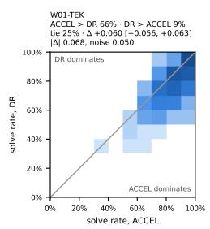

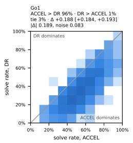

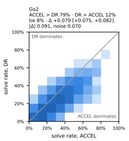

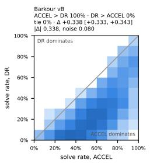

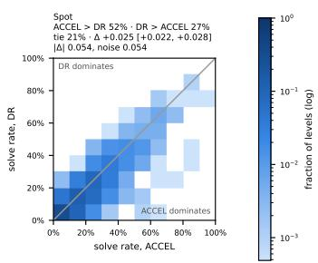

Figure 6. ACCEL vs. DR, level by level, on the 2048 d = 0.25 levels. Each level’s solve rate is pooled over 5 seeds × 8 episodes. The colour is the fraction of levels (log scale) per cell. Mass below the diagonal: levels ACCEL solves more often. Panel titles give the fractions of levels ACCEL wins, loses and ties, the mean difference with its 95% bootstrap interval, and the mean absolute difference against the binomial noise reference.  
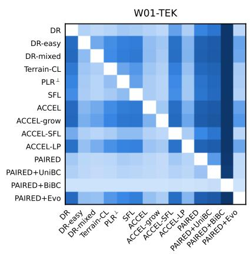

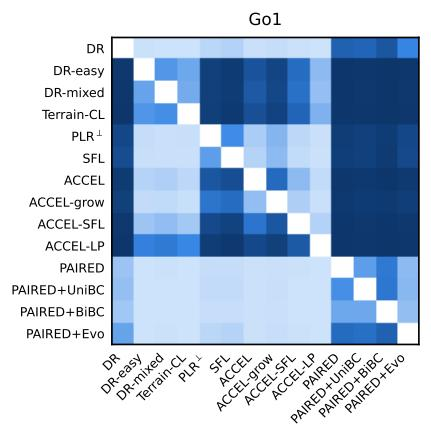

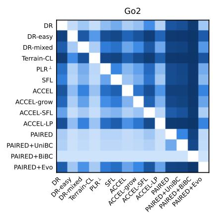

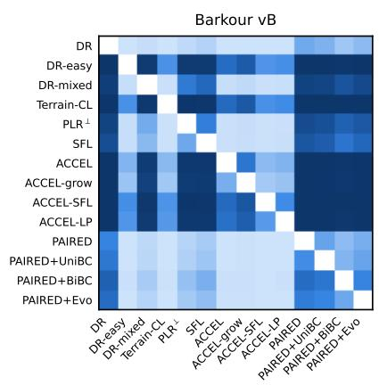

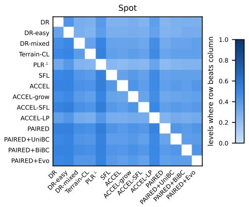  
Figure 7. Fraction of $d = 0 . 2 5$ levels on which the row method’s solve rate exceeds the column method’s, per robot. Darker cells: the row method wins on more levels. The diagonal is blank, and $1 - M _ { a b } - M _ { b a }$ is the fraction of ties.

## E.3. Aggregates over robots

The main text compares methods within each robot. For completeness, Figure 8, Table 10 and Figure 9 pool the five robots after min-max normalisation (§4). By mean rank over robots, ACCEL and Terrain-CL are first on $d = 0 . 2 5$ (both 4.0) and on the held-out suite (3.0 and 3.4), and DR is last on the suite (12.2). By IQM (Table 10), ACCEL-LP (0.94), DR-easy and Terrain-CL (both 0.92) are first on $d = 0 . 2 5$ , and Terrain-CL (0.89), ACCEL (0.87) and PAIRED+Evo (0.86) on the suite, with overlapping intervals. The method rankings on $d = 0 . 2 5$ agree across W01-TEK, Go1, Go2 and Barkour (Spearman $\rho = 0 . 5 3 – 0 . 8 6 , p < 0 . 0 5$ for all pairs but W01-TEK-Barkour, $p = 0 . 0 5 )$ . Spot’s ranking is unrelated to or inverted against the others $\left( \rho = - 0 . 6 1 \mathrm { t o } - 0 . 2 8 \right)$

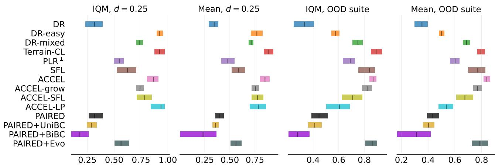  
Normalised score

Figure 8. Aggregate scores over five robots × five seeds: success min-max normalised per robot over the method means, interquartile mean and mean with 95% stratified bootstrap intervals.  
Table 10. Aggregate IQM of normalised success over 5 robots × 5 seeds with 95% stratified bootstrap intervals (App. D).
<table><tr><td>Method</td><td>IQM d=0.25</td><td>IQM OOD suite</td></tr><tr><td>DR</td><td>0.32 [0.23, 0.39]</td><td>0.33 [0.25, 0.41]</td></tr><tr><td>DR-easy</td><td>0.92 [0.90, 0.95]</td><td>0.57 [0.54, 0.61]</td></tr><tr><td>DR-mixed</td><td>0.74 [0.71, 0.77]</td><td>0.75 [0.71, 0.79]</td></tr><tr><td>Terrain-CL</td><td>0.92 [0.87, 0.97]</td><td>0.89 [0.85, 0.94]</td></tr><tr><td> $\mathrm { P L R } ^ { \perp }$ </td><td>0.55 [0.50, 0.59]</td><td>0.69 [0.63, 0.73]</td></tr><tr><td>SFL</td><td>0.62 [0.53, 0.71]</td><td>0.84 [0.75, 0.88]</td></tr><tr><td>ACCEL</td><td>0.87 [0.81, 0.91]</td><td>0.87 [0.84, 0.89]</td></tr><tr><td>ACCEL-grow</td><td>0.74 [0.71, 0.78]</td><td>0.82 [0.78, 0.86]</td></tr><tr><td>ACCEL-SFL</td><td>0.78 [0.71, 0.85]</td><td>0.71 [0.63, 0.79]</td></tr><tr><td>ACCEL-LP</td><td>0.94 [0.84, 0.97]</td><td>0.61 [0.50, 0.68]</td></tr><tr><td>PAIRED</td><td>0.32 [0.26, 0.40]</td><td>0.45 [0.39, 0.51]</td></tr><tr><td>PAIRED+UniBC</td><td>0.29 [0.25, 0.34]</td><td>0.41 [0.36, 0.47]</td></tr><tr><td>PAIRED+BiBC</td><td>0.18 [0.10, 0.26]</td><td>0.28 [0.21, 0.37]</td></tr><tr><td>PAIRED+Evo</td><td>0.56 [0.50, 0.64]</td><td>0.86 [0.81, 0.90]</td></tr></table>

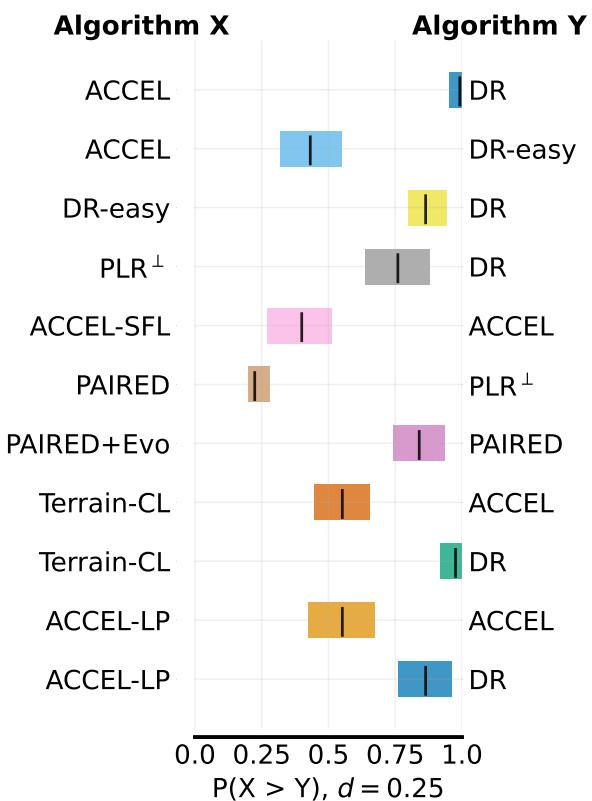

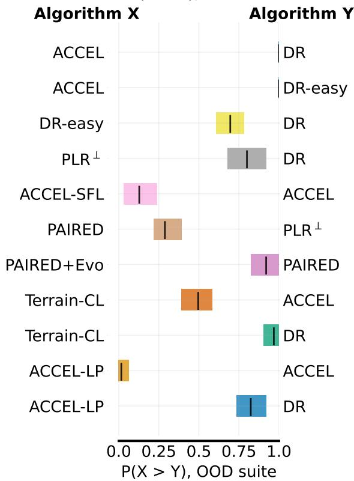  
Figure 9. Probability of improvement $P ( X > Y )$ for the named method pairs, with 95% stratified bootstrap intervals, on $d = 0 . 2 5$ and the held-out suite.

## E.4. Capability envelopes

Table 11. Capability envelopes: the largest feature magnitude passed at 50% success with every other feature flat, mean ± std over 5 seeds. Bold: top group per robot and column (Welch t-test, $p \geq 0 . 0 5 )$ . In reference units (lengths are multiplied by s, slopes are not). An envelope at the end of the range (rough 10 cm, slope $- 2 0 ^ { \circ } ~ { \mathrm { t o } } + 1 8 ^ { \circ }$ , stairs −8 to +5 cm, gaps 6 cm, blocks 6 cm) is censored.
<table><tr><td>Robot W01-TEK</td><td>Method</td><td>rough (cm) 10.0 ±0.0</td><td>slope up (deg)</td><td>slope down (deg)</td><td>stairs up (cm)</td><td>stairs down (cm)</td><td>gaps (cm)</td><td>blocks (cm)</td></tr><tr><td>Gol</td><td>DR DR-easy DR-mixed Terrain-CL PLR⊥ SFL ACCEL ACCEL-grow ACCEL-ŠFL ACCEL-LP PAIRED PAIRED+UniBC</td><td>10.0 ±0.0 10.0 ±0.0 10.0 ±0.0 10.0 ±0.0 10.0 ±0.0  ${ \bf 1 0 . 0 \pm 0 . 0 }$  10.0 ±0.0 10.0 ±0.0 10.0 ±0.0 10.0 ±0.0</td><td>17.6 ±0.8 18.0 ±0.0 18.0 ±0.0 18.0 ±0.0 18.0 ±0.0  ${ \bf 1 8 . 0 \pm 0 . 0 }$  18.0 ±0.0 18.0 ±0.0 17.6 ±0.6 18.0 ±0.0</td><td>20.0 ±0.0 20.0 ±0.0 20.0 ±0.0 20.0 ±0.0 20.0 ±0.0  ${ \bf 2 0 . 0 \pm 0 . 0 }$  20.0 ±0.0 20.0 ±0.0 20.0 ±0.0  ${ \bf 2 0 . 0 \pm 0 . 0 }$ </td><td>4.0 ±0.2 4.6 ±0.1 5.0 ±0.0 5.0 ±0.0 4.6 ±0.3 4.5 ±0.3 5.0 ±0.0 5.0 ±0.0 5.0 ±0.0</td><td>8.0 ±0.0 8.0 ±0.0 8.0 ±0.0 8.0 ±0.0 8.0 ±0.0 8.0 ±0.0 8.0 ±0.0 8.0 ±0.0 8.0 ±0.0</td><td>5.4 ±0.1 5.5 ±0.0 5.7 ±0.1 5.6 ±0.1 5.4 ±0.1 5.4 ±0.1 5.6 ±0.1 5.7 ±0.2</td><td>5.6 ±0.2 5.7 ±0.2 6.0 ±0.0 6.0 ±0.0 5.8 ±0.3 6.0 ±0.0 5.9 ±0.1 5.9 ±0.1</td></tr><tr><td></td><td>PAIRED+BiBC PAIRED+Evo DR DR-easy DR-mixed</td><td>10.0 ±0.0  ${ \bf 8 . 0 \pm 4 . 5 }$  10.0 ±0.0 10.0 ±0.0 10.0 ±0.0</td><td>16.5 ±1.0  ${ \bf 1 5 . 6 \pm } 2 . 1$   $9 . 0 \pm 5 . 5$  18.0 ±0.0  $1 2 . 3 \pm 1 . 9$  16.5 ±0.9</td><td>20.0 ±0.0 20.0 ±0.0  ${ \bf 1 6 . 0 \pm 8 . 9 }$  20.0 ±0.0  ${ \bf 1 9 . 8 \pm 0 . 4 }$  20.0 ±0.0</td><td>4.7 ±0.2 3.8 ±0.1 3.8 ±0.3 2.5 ±1.4 5.0 ±0.0  $3 . 0 \pm 0 . 3$   $3 . 5 \pm 0 . 1$ </td><td>8.0 ±0.0 8.0 ±0.0 8.0 ±0.0 6.4 ±3.6 8.0 ±0.0 3.7 ±0.4 6.1 ±0.6</td><td>5.7 ±0.2 5.5 ±0.1 5.4 ±0.1 5.3 ±0.1 4.3 ±2.4 5.7 ±0.2 0.0 ±0.0</td><td>5.8 ±0.2 5.7 ±0.2 5.5 ±0.1 5.4 ±0.3 4.2 ±2.4 5.9 ±0.1 3.2 ±0.2</td></tr><tr><td>Go2</td><td>Terrain-CL PLR+ SFL ACCEL ACCEL-grow ACCEL-SFL ACCEL-LP PAIRED PAIRED+UniBC PAIRED+BiBC PAIRED+Evo</td><td>10.0 ±0.0 10.0 ±0.0  ${ \bf 1 0 . 0 \pm 0 . 0 }$  10.0 ±0.0 10.0 ±0.0 10.0 ±0.0 10.0 ±0.0 10.0 ±0.0 10.0 ±0.0 10.0 ±0.0</td><td>18.0 ±0.0 18.0 ±0.0  $1 5 . 4 \pm 0 . 6$  17.6 ±0.9  ${ \bf 1 8 . 0 \pm 0 . 0 }$  18.0 ±0.0  ${ \bf 1 7 . 6 \pm 0 . 5 }$  16.3 ±1.1 16.9 ±1.1</td><td> ${ \bf 2 0 . 0 \pm 0 . 0 }$  20.0 ±0.0  ${ \bf 2 0 . 0 \pm 0 . 0 }$  20.0 ±0.0  ${ \bf 2 0 . 0 \pm 0 . 0 }$  20.0 ±0.0  ${ \bf 2 0 . 0 \pm 0 . 0 }$  20.0 ±0.0</td><td> $3 . 8 \pm 0 . 1$  4.1 ±0.2  $3 . 5 \pm 0 . 1$  3.6 ±0.6 3.9 ±0.4 3.7 ±0.2 3.5 ±0.1 3.5 ±0.1</td><td>7.0 ±0.4 7.7 ±0.4 5.7 ±0.4 6.6 ±0.7 7.8 ±0.2 6.6 ±0.6 7.5 ±0.5 7.2 ±0.7</td><td>2.1 ±0.4 2.0 ±0.4 2.1 ±0.5 0.0 ±0.0 0.2 ±0.5 0.8 ±0.8 0.4 ±0.6 1.4 ±0.5</td><td>3.5 ±0.1 3.7 ±0.1 4.0 ±0.2 3.8 ±0.2 3.5 ±0.5 4.0 ±0.3 3.8 ±0.4 3.5 ±0.1</td></tr></table>

On W01-TEK every method except PAIRED+BiBC reaches the end of the range for rough ground, downhill slope and downward stairs. Stair-up height is the binding feature (DR 4.0, ACCEL 5.0 of 5 cm). The open-chain robots’ gap envelopes

are at most 2.7 of 6 cm, and 0 for 42 of the 56 robot-method pairs. Spot’s uphill-slope envelope is at most 5.2◦.

## E.5. Curriculum composition

Figure 10 shows the terrain each curriculum trains on over the run.

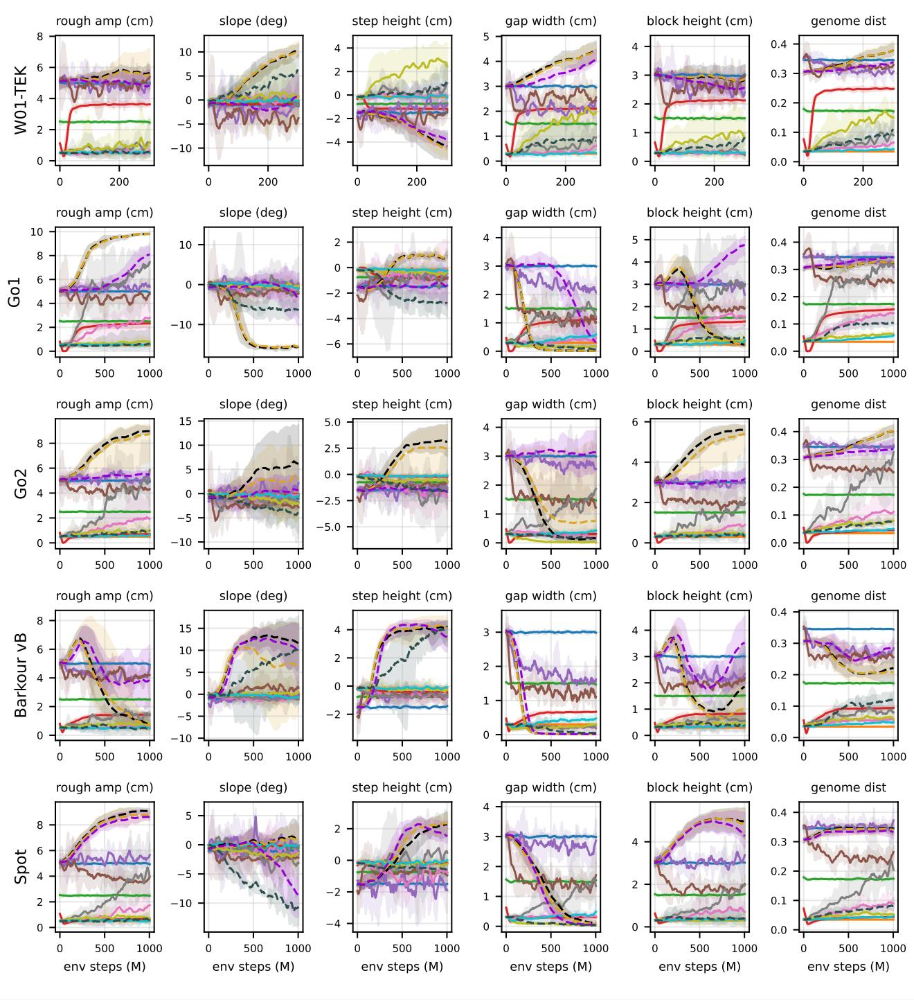

<table><tr><td>_</td><td>DR</td><td></td><td>DR-mixed</td><td>PLR¹</td><td>ACCEL</td><td></td><td>ACCEL-SFL</td><td>- - - PAIRED</td><td>--- PAIRED+BiB</td></tr><tr><td></td><td>DR-easy</td><td></td><td>Terrain-CL</td><td>SFL</td><td></td><td>ACCEL-grow</td><td>ACCEL-LP</td><td>1 PAIRED+UniBC</td><td>--- PAIRED+Evc</td></tr></table>

Figure 10. Mean physical value of each magnitude parameter among the levels the student trains on, and the mean genome distance from flat, vs. environment steps (reference units, running mean over 9 points). Mean over 5 seeds, shaded min-max.

## F. Compute

Table 12. Training compute per run, mean ± std over seeds. GPU-h: wall clock on one GPU. Sim steps count every simulated environment step (PAIRED’s antagonist, the non-training iterations of the buffer methods). Student steps are those that fed a student PPO update.
<table><tr><td>Robot</td><td>Method</td><td>GPU-h</td><td>Sim steps (106)</td><td>Student steps (106)</td></tr><tr><td>W01-TEK</td><td>DR</td><td>0.5 ±0.0</td><td>302 ±0</td><td>302 ±0</td></tr><tr><td rowspan="20">Gol</td><td>DR-easy</td><td>0.5 ±0.0</td><td>302 ±0</td><td>302 ±0</td></tr><tr><td>DR-mixed</td><td>0.5 ±0.0</td><td>302 ±0</td><td>302 ±0</td></tr><tr><td>Terrain-CL</td><td>0.5 ±0.0</td><td>302 ±0</td><td>302 ±0</td></tr><tr><td>PLR⊥</td><td>0.5 ±0.0</td><td>302 ±0</td><td>242 ±6</td></tr><tr><td>SFL</td><td>0.5 ±0.0</td><td>302 ±0</td><td>242 ±6</td></tr><tr><td>ACCEL</td><td>0.5 ±0.0</td><td>302 ±0</td><td>229 ±6</td></tr><tr><td>ACCEL-grow</td><td>0.5 ±0.0</td><td>302 ±0</td><td>235 ±10</td></tr><tr><td>ACCEL-SFL</td><td>0.5 ±0.0</td><td>302 ±0</td><td>235 ±10</td></tr><tr><td>ACCEL-LP</td><td>0.5 ±0.0</td><td>302 ±0</td><td>229 ±6</td></tr><tr><td>PAIRED</td><td>0.8 ±0.0</td><td>605 ±0</td><td>302 ±0</td></tr><tr><td>PAIRED+UniBC</td><td>0.9 ±0.0</td><td>605 ±0</td><td>302 ±0</td></tr><tr><td>PAIRED+BiBC</td><td>0.9 ±0.0</td><td>605 ±0</td><td>302 ±0</td></tr><tr><td>PAIRED+Evo</td><td>0.8 ±0.0</td><td>605 ±0</td><td>229 ±6</td></tr><tr><td>DR</td><td>0.7 ±0.0</td><td>1000 ±0</td><td></td></tr><tr><td>DR-easy</td><td>0.7 ±0.0</td><td>1000 ±0</td><td>1000 ±0</td></tr><tr><td></td><td>0.7 ±0.0</td><td>1000 ±0</td><td>1000 ±0</td></tr><tr><td>DR-mixed Terrain-CL</td><td>0.8 ±0.0</td><td>1000 ±0</td><td>1000 ±0</td></tr><tr><td></td><td></td><td></td><td>1000 ±0</td></tr><tr><td>PLR+</td><td>0.7 ±0.0</td><td>1000 ±0</td><td>797 ±31</td></tr><tr><td>SFL</td><td>0.7 ±0.0</td><td>1000 ±0</td><td>797 ±31</td></tr><tr><td>ACCEL</td><td>0.7 ±0.0 0.7 ±0.0</td><td>1000 ±0</td><td>786±19</td></tr><tr><td>ACCEL-grow</td><td>0.7 ±0.0</td><td>1000 ±0</td><td>804 ±16</td></tr><tr><td>ACCEL-SFL</td><td>0.7 ±0.0</td><td>1000 ±0 1000 ±0</td><td>804±16</td></tr><tr><td>ACCEL-LP</td><td></td><td></td><td>786±19</td></tr><tr><td>PAIRED PAIRED+UniBC</td><td>1.3 ±0.0</td><td>2000 ±0</td><td>1000 ±0</td></tr><tr><td>PAIRED+BiBC</td><td>1.4 ±0.0</td><td>2000 ±0</td><td>1000 ±0</td></tr><tr><td>PAIRED+Evo</td><td>1.4 ±0.0 1.3 ±0.0</td><td>2000 ±0 2000 ±0</td><td>1000 ±0 786±19</td></tr><tr><td>Go2 DR</td><td>0.9 ±0.0</td><td>1000 ±0</td><td>1000 ±0</td></tr><tr><td>DR-easy</td><td>0.9 ±0.0</td><td>1000 ±0</td><td>1000 ±0</td></tr><tr><td>DR-mixed</td><td>0.9 ±0.0</td><td>1000 ±0</td><td>1000 ±0</td></tr><tr><td>Terrain-CL</td><td>0.9 ±0.0</td><td>1000 ±0</td><td>1000 ±0</td></tr><tr><td>PLR+</td><td>0.9 ±0.0</td><td>1000 ±0</td><td></td></tr><tr><td>SFL</td><td>0.9 ±0.0</td><td>1000 ±0</td><td>797 ±31 797 ±31</td></tr><tr><td>ACCEL</td><td>0.9 ±0.0</td><td>1000 ±0</td><td>786 ±19</td></tr><tr><td>ACCEL-grow</td><td>0.9 ±0.0</td><td>1000 ±0</td><td>804 ±16</td></tr><tr><td>ACCEL-SFL</td><td>0.9 ±0.0</td><td>1000 ±0</td><td>804 ±16</td></tr><tr><td>ACCEL-LP</td><td>0.9 ±0.0</td><td>1000 ±0</td><td>786±19</td></tr><tr><td>PAIRED PAIRED+UniBC</td><td>1.6 ±0.0</td><td>2000 ±0</td><td>1000 ±0</td></tr><tr><td>PAIRED+BiBC</td><td>1.7 ±0.0</td><td>2000 ±0</td><td>1000 ±0</td></tr><tr><td>PAIRED+Evo</td><td>1.7 ±0.0</td><td>2000 ±0</td><td>1000 ±0</td></tr><tr><td></td><td>1.6 ±0.0</td><td>2000 ±0</td><td>786±19</td></tr><tr><td>DR</td><td>0.8 ±0.0</td><td>1000 ±0</td><td>1000 ±0</td></tr><tr><td>Barkour vB DR-easy</td><td>0.8 ±0.0</td><td>1000 ±0</td><td>1000 ±0</td></tr><tr><td>DR-mixed</td><td>0.8 ±0.0</td><td>1000 ±0</td><td>1000 ±0</td></tr><tr><td>Terrain-CL</td><td>0.8 ±0.0</td><td>1000 ±0</td><td>1000 ±0</td></tr><tr><td>PLR1</td><td>0.7 ±0.0</td><td>1000 ±0</td><td>797 ±31</td></tr><tr><td>SFL</td><td>0.7 ±0.0</td><td>1000 ±0</td><td>797 ±31</td></tr><tr><td>ACCEL</td><td>0.7 ±0.0</td><td>1000 ±0</td><td>786±19</td></tr><tr><td>ACCEL-grow</td><td>0.7 ±0.0</td><td>1000 ±0</td><td>804 ±16</td></tr><tr><td>ACCEL-SFL</td><td>0.7 ±0.0</td><td>1000 ±0</td><td>804 ±16</td></tr><tr><td>ACCEL-LP</td><td>0.7 ±0.0</td><td>1000 ±0</td><td>786±19</td></tr><tr><td>PAIRED</td><td></td><td>2000 ±0</td><td>1000 ±0</td></tr><tr><td>PAIRED+UniBC</td><td>1.4 ±0.0 1.4 ±0.0</td><td></td><td></td></tr><tr><td>PAIRED+BiBC PAIRED+Evo</td><td>1.5 ±0.0</td><td>2000 ±0 2000 ±0</td><td>1000 ±0 1000 ±0</td></tr><tr><td>DR</td><td>1.3 ±0.0</td><td>2000 ±0</td><td>786±19</td></tr><tr><td>Spot DR-easy</td><td>0.7 ±0.0</td><td>1003 ±0</td><td>1003 ±0</td></tr><tr><td>DR-mixed</td><td>0.7 ±0.0</td><td>1003 ±0</td><td>1003 ±0</td></tr><tr><td>Terrain-CL</td><td>0.7 ±0.0</td><td>1003 ±0</td><td>1003 ±0</td></tr><tr><td></td><td>0.7 ±0.0</td><td>1003 ±0</td><td>1003 ±0</td></tr><tr><td>PLR</td><td>0.7 ±0.0</td><td>1003 ±0</td><td>804 ±28</td></tr><tr><td>SFL</td><td>0.7 ±0.0</td><td>1003 ±0</td><td>804 ±28</td></tr><tr><td>ACCEL</td><td>0.7 ±0.0</td><td>1003 ±0</td><td>764 ±23</td></tr><tr><td>ACCEL-grow</td><td>0.7 ±0.0</td><td>1003 ±0</td><td>788 ±28</td></tr><tr><td>ACCEL-ŠFL</td><td></td><td></td><td></td></tr><tr><td></td><td>0.7 ±0.0</td><td>1003 ±0</td><td>788 ±28</td></tr><tr><td>ACCEL-LP PAIRED</td><td>0.7 ±0.0</td><td>1003 ±0</td><td>764 ±23</td></tr><tr><td>PAIRED+UniBC</td><td>1.3 ±0.0</td><td>2006 ±0</td><td>1003 ±0</td></tr><tr><td></td><td>1.3 ±0.0</td><td>2006 ±0</td><td>1003 ±0</td></tr><tr><td>PAIRED+BiBC PAIRED+Evo</td><td>1.3 ±0.0 1.2 ±0.0</td><td>2006 ±0 2006 ±0</td><td>1003 ±0 764 ±23</td></tr></table>

Every run used one NVIDIA H100. The 350 training runs took 306 GPU-hours (W01-TEK 40, Go1 63, Go2 77, Barkour 66, Spot 60). A W01-TEK run (300M steps) takes 0.6 hours on average. A run of the other robots (1B steps, JAX backend) takes 0.9-1.1 hours. PAIRED and its variants take 1.8-1.9 times the wall clock of the other methods.