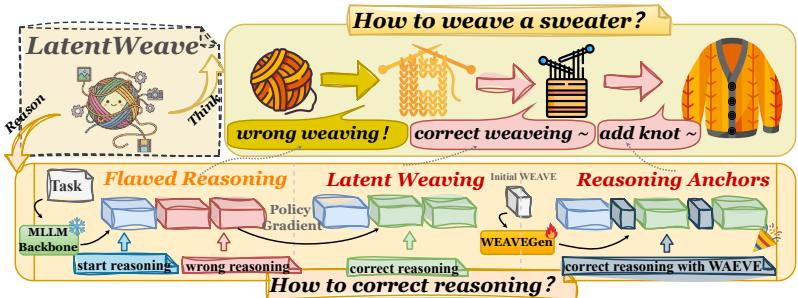
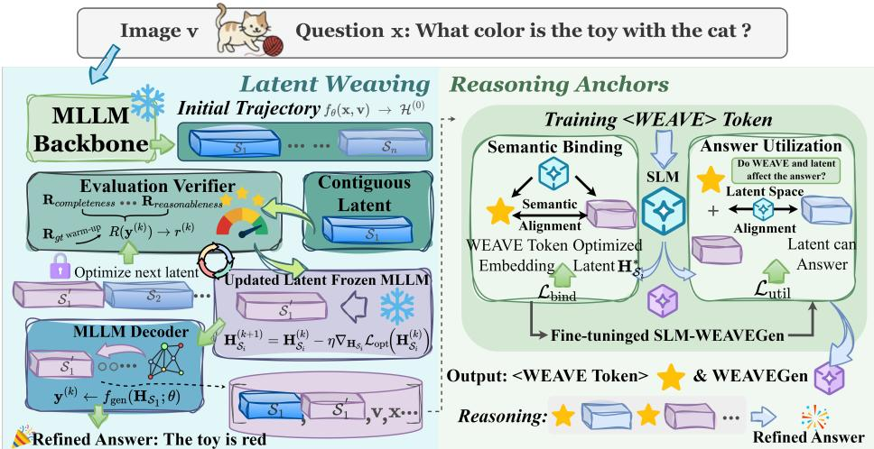
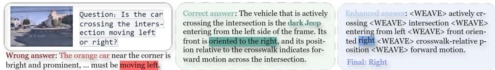
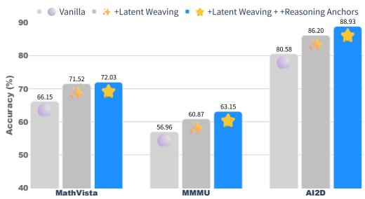
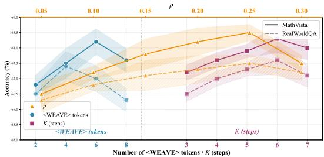

# LATENTWEAVE: TEST-TIME LATENT OPTIMIZATION FOR MULTIMODAL REASONING

Fanci Meng1 Kun Wang2,† Guibin Zhang5 Xinlei Yu3 Jiaming Zhang2 Ming Li4 Yang Wang1,†

1University of Science and Technology of China 2Nanyang Technological University 3The Chinese University of Hong Kong 4The Chinese University of Hong Kong, Shenzhen 5National University of Singapore

fanc1m@mail.ustc.edu.cn

## ABSTRACT

Recent advances in test-time optimization have shown that the multimodal reasoning performance of large multimodal language models (MLLMs) can be improved during inference without modifying backbone model parameters. However, existing approaches primarily operate at the prompt or output level, leaving the latent reasoning process largely uncontrolled and insufficient to prevent error accumulation during autoregressive generation. To address this limitation, we propose LatentWeave, a test-time framework that treats multimodal reasoning as a controllable latent trajectory. LatentWeave performs structured Latent Weaving, progressively refining intermediate hidden states segment-wise to correct emerging deviations, and further introduces Reasoning Anchors via lightweight WEAVE tokens to stabilize reasoning structure and guide answer-oriented generation. These mechanisms are designed to enable fine-grained, step-aware intervention in the latent reasoning process while keeping the main MLLM backbone parameters fixed. Extensive experiments across diverse multimodal reasoning benchmarks report improvements over the evaluated baselines; the contribution of latent optimization, anchor training, and additional test-time computation is analyzed separately in the ablation and efficiency studies. Our code is available at https://github.com/jins7/LatentWeave.

## 1 INTRODUCTION

Multimodal large language models (MLLMs) (Yin et al., 2024) increasingly support visual understanding and generation within unified systems (Ma et al., 2025; Wu et al., 2025), alongside specialized capabilities such as image-quality reasoning (Li et al., 2025b). These advances have broadened their use as general-purpose foundation models (Yang et al., 2023; Comanici et al., 2025). Research is consequently expanding from perception to multi-step reasoning over multimodal information (Li et al., 2025c; Viveiros et al., 2026). Maintaining a structured reasoning process remains challenging: LLaVA-CoT studies staged visual reasoning (Xu et al., 2025), while CoMT evaluates the integration of visual operations into intermediate reasoning (Cheng et al., 2025). As reasoning traces grow longer, the evolving evidence and intermediate representations become important targets for inference-time refinement (Jiang et al., 2026b; Zhang et al., 2026).

To improve the test-time performance of multimodal reasoning (Zhu et al., 2025; Jiang et al., 2026b), existing studies have explored intervention strategies from three core dimensions: ❶ Output-level refinement: Focuses on answer post-processing and self-correction (Madaan et al., 2023), iteratively optimizing model-generated outputs via answer rewriting, candidate filtering, or reasoning-trace refinement (Jiang et al., 2026a). ❷ Prompt-level control: Leverages concise guidance from prompts or reasoning structures (Xia et al., 2026), guiding models to follow predefined reasoning paths by constructing explicit reasoning chains (Wang et al., 2025), decomposing sub-problems (Acuna et al., 2025), or introducing stepwise textual guidance (Xia et al., 2026). ❸ Parameter-level adaptation: Relies on parameter updates and adaptive adjustments (Zhao et al., 2025), incorporating reinforcement updates (Zuo et al., 2025) or temporary adapter optimization (Yuan et al., 2026) during inference to enhance performance on specific reasoning tasks. Although these strategies yield improvements, their primary intervention targets are outputs, prompts, or parameters rather than individual latent states. Recent methods also optimize continuous representations (Li et al., 2025a; Zhang et al., 2026), motivating step-aware intervention in multimodal reasoning.

  
Figure 1: LatentWeave’s Latent Weaving functions much like rectifying faulty knitting, preventing accumulation of errors and subsequent failure, whereas Reasoning Anchors mirror adding buttons at appropriate positions to a finished sweater body, enhancing its structural integrity.

These observations motivate treating multimodal reasoning as a control problem over latent trajectories. Output- and prompt-oriented methods address errors through output refinement or external guidance (Jiang et al., 2026a; Xia et al., 2026). We hypothesize that some errors accumulate in intermediate hidden states and become harder to correct during subsequent generation. This motivates refining the evolving trajectory directly (Zhang et al., 2025; 2026). Here, latent reasoning refers to iteratively refining the model’s internal hidden states during autoregressive generation. Such intervention can revise intermediate decisions while retaining the pretrained backbone parameters. The central question is how to localize these updates, preserve useful preceding context, and propagate corrections into the remaining continuation.

Given the prior limitations, we propose LatentWeave, a test-time framework that models multimodal reasoning as an evolving latent trajectory and directly optimizes its hidden states. As in knitting a sweater (Figure 1), an early deviation can be amplified by subsequent steps and distort the final result. Based on this insight, LatentWeave regulates reasoning trajectories via two paired core mechanisms: Latent Weaving refines hidden-state segments during generation. Unlike ACTS (Xia et al., 2026), which steers a frozen reasoner through textual strategies and starter phrases, LatentWeave directly optimizes each active segment, preserves accepted segments, and re-decodes the remaining suffix. Rectified trajectories supervise the lightweight WEAVEGen model to generate textual reasoning anchors. Reasoning Anchors differ from PILOT’s latent-vector injection (Zheng et al., 2026): WEAVEGen serializes its guidance with <WEAVE> delimiters and passes it through the backbone’s ordinary textual context, avoiding hidden-dimension transfer between models. WEAVEGen is trained offline and generates one anchor sequence per input. Both mechanisms keep the evaluated backbone fixed at test time; auxiliary generation costs are reported separately.

We summarize our contributions in the following three points:

❶ Problem formulation. We formulate multimodal reasoning as a latent trajectory control problem, hypothesizing that some reasoning failures arise from progressively accumulated deviations in intermediate latent states.

❷ Method. We propose LatentWeave, a frozen-backbone test-time framework that directly intervenes in latent representations during autoregressive generation. Latent Weaving refines hidden-state segments in sequence, while textual Reasoning Anchors are generated by a lightweight model (WEAVEGen) trained on rectified trajectories. Their text-based interface supports backbones with different hidden dimensions.

❸ Experimental evaluation. Experiments cover seven benchmarks and five backbones (4B– 27B). Over vanilla decoding, LatentWeave gains 6.57 percentage points on MathVision with Qwen3.5-4B, and 6.57 and 5.22 points on MathVision and RealWorldQA, respectively, with Qwen3.6-27B, demonstrating improvements across model scales and task domains.

  
Figure 2: The overall framework of our proposed LatentWeave.

## 2 RELATED WORK

Multimodal reasoning representations. Visual Sketchpad uses executable sketches as intermediate visual reasoning steps (Hu et al., 2024), while Coconut establishes continuous hidden-state reasoning in language models (Hao et al., 2024). Recent multimodal methods learn task-relevant latent representations: LanteRn interleaves text with visually grounded latent blocks (Viveiros et al., 2026); Pearl internalizes tool-use trajectories through predictive embedding objectives (Adhikari & Lapata, 2026); and SLVR enriches region-level visual latents with semantic supervision and multi-query reinforcement learning (Xu et al., 2026). These methods principally learn how to generate useful representations. Complementing this line, Li et al. (2026b) identify weak input-to-latent and latent-toanswer dependencies in the visual reasoners they examine. Their findings motivate checking whether intermediate states influence answers, rather than equating latent tokens with effective reasoning.

Test-time computation and adaptation. Additional inference computation can target visual evidence, reasoning traces, or model parameters. TTSP explores visual-tool trajectories and maintains a correctable evidence ledger (Jiang et al., 2026b). Trajectory-guided structured sampling retrieves reasoning patterns and refines discrete traces through structured MCMC (Jiang et al., 2026a). These approaches improve explicit evidence or generated sequences. Parameter adaptation is a separate axis: TTRL updates model parameters using rewards estimated from unlabeled test data (Zuo et al., 2025), while ReLAT adapts temporary LoRA parameters using a question-reconstruction objective for latent collaboration (Yuan et al., 2026). Thus, test-time adaptation need not preserve model parameters. LatentWeave instead updates instance-specific hidden states while keeping the evaluated backbone and the offline-trained anchor generator fixed during evaluation.

Continuous test-time optimization. LatentSeek applies policy-gradient updates to hidden states (Li et al., 2025a), and LatentEvolve incorporates retrieval and consolidation of prior latent optimizations (Zhang et al., 2025). More recently, ∇-Reasoner optimizes continuous token logits under reward and likelihood objectives during iterative decoding (Wang et al., 2026); its optimization variables are relaxed output representations. In multimodal models, Zhang et al. (2026) combine visual alignment with reward-guided optimization of reserved latent slots before answer decoding, keeping the backbone frozen. These are direct predecessors for inference-time continuous refinement. LatentWeave focuses on sequentially optimizing hidden-state segments of a multimodal generation trajectory, preserving accepted segments and regenerating the suffix after each update, with textual reasoning anchors guiding the generation of the remaining suffix.

Learned guidance and structural supervision. PILOT trains an auxiliary network to produce a query-conditioned latent anchor for a frozen language model (Zheng et al., 2026). ACTS trains a controller that supplies strategies and starter phrases to a frozen reasoner at successive reasoning steps (Xia et al., 2026). PMPS uses shared reasoning prototypes to align latent and explicit chains of thought during training (Li et al., 2026a). These works establish precedents for latent anchoring, textual steering, and structural supervision. We combine segment-wise multimodal hidden-state optimization with an offline-trained textual guidance mechanism: WEAVEGen learns from optimized training trajectories, generates one textual anchor sequence per input before refinement, and conditions the evaluated backbone through ordinary text. This interface differs from PILOT’s latent injection and ACTS’s online stepwise controller, while online optimization refines the backbone’s hidden states and keeps all auxiliary-network parameters fixed throughout evaluation.

## 3 METHODOLOGY

The overall workflow of our method is illustrated in Figure 2. Without updating the evaluated backbone parameters online, LatentWeave operates directly in the hidden-state space to incrementally optimize reasoning-critical regions. This latent-level control allows the reasoning process to be adjusted at inference time while preserving the pretrained backbone. Section 3.1 introduces the autoregressive formulation and latent optimization. Section 3.2 presents Latent Weaving, which is used during offline trajectory collection and evaluation-time refinement. Section 3.3 describes the reward signals guiding latent weaving, and Section 3.4 introduces Reasoning Anchors, an offline-trained auxiliary generator whose textual output conditions the evaluated backbone. The overall procedure is summarized in Algorithm 1 in Appendix C, which separates offline trajectory collection (Phase I), offline anchor training (Phase II), and evaluation-time latent refinement (Phase III). Additional implementation details, notations, and experimental configurations are provided in Appendix A.

## 3.1 PRELIMINARY

We begin by introducing the multimodal autoregressive formulation and the latent representations optimized in subsequent sections, using vision–language backbones such as Qwen2.5-VL (Bai et al., 2025). This formulation provides the foundation for the latent trajectory manipulation performed during offline collection and evaluation-time refinement in Algorithm 1. The notation is summarized in Table 4 in Appendix A.

Latent Formulation. We study multimodal autoregressive generation given textual input x and visual context v. Given a pretrained model $f _ { \theta } ,$ decoding runs token by token, producing intermediate hidden states that encode the multimodal inputs and the generated prefix. In LatentWeave, these hidden states are viewed as latent variables and explicitly optimized during inference.

At decoding step t, the model computes a hidden state $\mathbf { h } _ { t }$ from the input modalities and previously generated tokens, and predicts the next-token distribution as:

$$
\begin{array} { c } { \mathbf { h } _ { t } = f _ { \theta } ( \mathbf { x } , \mathbf { v } , \mathbf { y } _ { < t } ) , } \\ { p _ { \theta } ( \cdot \mid \mathbf { x } , \mathbf { v } , \mathbf { y } _ { < t } ) = \mathrm { s o f t m a x } ( \mathbf { W } _ { o } \mathbf { h } _ { t } ) , } \end{array}\tag{1}
$$

where $f _ { \theta }$ denotes the pretrained vision–language model and $\mathbf { W } _ { o }$ is the output projection matrix. Unlike standard decoding, LatentWeave exposes $\mathbf { h } _ { t }$ as manipulable latent variables rather than treating them as fixed activations throughout generation.

The probability of an output sequence $\mathbf { y } = ( y _ { 1 } , \dots , y _ { T } )$ factorizes autoregressively as:

$$
p _ { \boldsymbol { \theta } } ( \mathbf { y } \mid \mathbf { x } , \mathbf { v } ) = \prod _ { t = 1 } ^ { T } p _ { \boldsymbol { \theta } } ( y _ { t } \mid \mathbf { x } , \mathbf { v } , \mathbf { y } _ { < t } ) .\tag{2}
$$

Test-Time Latent Optimization. Rather than updating model parameters at inference time, we directly operate on the latent hidden-state sequence $\mathbf { H } = ( \mathbf { h } _ { 1 } , \ldots \mathbf { \bar { \phi } } , \mathbf { h } _ { T } )$ defined in Eq. (1). We test whether refining these states can correct reasoning errors with the backbone fixed. The objective is to find a latent trajectory maximizing the task-specific reward of its generated output:

$$
\mathbf { H } ^ { \star } = \arg \operatorname* { m a x } _ { \mathbf { H } \in \mathcal { H } } R ( f _ { \mathrm { g e n } } ( \mathbf { H } , \mathbf { x } , \mathbf { v } ; \boldsymbol { \theta } ) ) ,\tag{3}
$$

where H denotes the space of latent trajectories with dimensions compatible with the pretrained model, and $f _ { \mathrm { g e n } }$ performs deterministic decoding given a fixed latent sequence. The optimization operates solely on H while keeping θ fixed, enabling reward-guided refinement at test time without retraining. The fixed generator $f _ { \mathrm { g e n } }$ defines how a candidate latent sequence is decoded; the quadratic anchoring term in Eq. (5) penalizes deviations from the initial backbone-induced trajectory. Algorithm 1 applies this objective sequentially to each active latent segment.

## 3.2 LATENT WEAVING: SEQUENTIAL SEGMENT OPTIMIZATION

Building on the latent optimization objective in Eq. (3), we introduce a structured strategy to optimize long latent trajectories efficiently and stably. The same segment procedure is used in the offline collection stage and in evaluation-time refinement (Phases I and III of Algorithm 1), with ground-truth reward restricted to offline collection and verifier-only reward used at evaluation.

Structured Latent Optimization. Optimizing the entire latent sequence H couples many decoding positions and can be costly, while early perturbations may propagate through later generation. We therefore propose Latent Weaving, which decomposes latent optimization into localized, sequential segments. This decomposition allows each portion of the latent trajectory to be refined while leaving the reasoning states in all previously accepted segments unchanged.

Specifically, we partition the generation timeline into contiguous segments $s _ { i }$

$$
{ \cal S } _ { i } = \{ s _ { i } , s _ { i } + 1 , \ldots , e _ { i } \} , \qquad | { \cal S } _ { i } | = \operatorname * { m i n } \{ \operatorname * { m a x } ( 1 , \lfloor \rho T \rfloor ) , T - s _ { i } + 1 \} ,\tag{4}
$$

where $T$ is the current generation length and $\rho \in \mathsf { \Gamma } ( 0 , 1 )$ controls the nominal segment length. Contiguous segments cover the trajectory in temporal order, with $s _ { 1 } = 1 , s _ { i + 1 } = e _ { i } + 1 , N _ { \mathrm { s e g } } =$ $\lceil T / \operatorname* { m a x } ( 1 , \lfloor \bar { \rho T } \rfloor ) \rceil$ , and a possibly shorter final segment. Appendix A.2 specifies the four-segment configuration used in the component comparison.

Segment-wise Optimization Objective. For each segment, only the corresponding hidden states receive gradient updates; the accepted prefix remains fixed, and the suffix is regenerated after the update. The optimization objective uses a score-function estimator (Williams, 1992) with a reward baseline, following the sequence-level training principle of Rennie et al. (2017):

$$
\mathcal { L } _ { \mathrm { o p t } } ( \mathbf { H } _ { S _ { i } } ) = - \frac { 1 } { M } \sum _ { m = 1 } ^ { M } A ^ { ( m ) } \sum _ { t \in S _ { i } } \log p _ { \theta } \left( y _ { t } ^ { ( m ) } \mid \mathbf { h } _ { t } ^ { ( m ) } \right) + \frac { \lambda } { 2 } \left. \mathbf { H } _ { S _ { i } } - \mathbf { H } _ { S _ { i } } ^ { ( 0 ) } \right. _ { 2 } ^ { 2 } ,\tag{5}
$$

where $M \geq 2$ stochastic inner-loop rollouts are sampled at temperature τ, and ${ \cal A } ^ { ( m ) } = R ( { \bf y } ^ { ( m ) } ) -$ $b ^ { ( m ) }$ is a centered advantage. The leave-one-out baseline is $\begin{array} { r } { \bar { b ^ { ( m ) } } = ( M - 1 ) ^ { - 1 } \sum _ { n \neq m } { R ( \mathbf { y } ^ { ( n ) } ) } } \end{array}$ The superscript m indexes a rollout and its hidden states. Rewards and baselines are treated as scalar feedback when differentiating the log probabilities; gradients update the active latent variables while the backbone and verifier remain fixed. The regularizer anchors the optimized states to the backbone-induced trajectory. Stochastic rollouts supply the optimization signal, whereas the final benchmark answer is decoded deterministically. After each inner update, the suffix beginning at the active segment is re-decoded autoregressively, while the prefix cache and previously accepted segments remain fixed. Appendix A.2 reports $M , \tau ,$ and λ and the re-decoding policy.

The hidden states are updated by gradient descent on Eq. (5):

$$
\mathbf { H } _ { S _ { i } } ^ { ( k + 1 ) } = \mathbf { H } _ { S _ { i } } ^ { ( k ) } - \eta \nabla _ { \mathbf { H } _ { S _ { i } } } \mathcal { L } _ { \mathrm { o p t } } \Big ( \mathbf { H } _ { S _ { i } } ^ { ( k ) } \Big ) .\tag{6}
$$

Sequential Weaving. Segments are optimized in temporal order. When optimizing the i-th segment, all previously optimized segments are fixed and act as latent context. This freezing mechanism preserves accepted prefix states, although the reward of the completed answer can still change as the suffix is refined. Formally, the active segment is optimized under the following fixed-prefix constraint:

$$
\mathbf { H } _ { S _ { i } } ^ { \star } = \arg \operatorname* { m a x } _ { \mathbf { H } _ { S _ { i } } } R \big ( f _ { \mathrm { g e n } } \big ( \mathbf { H } _ { S _ { < i } } ^ { \star } , \mathbf { H } _ { S _ { i } } , \mathbf { H } _ { \mathrm { c t x } , i } ; \theta \big ) \big ) ,\tag{7}
$$

where $\mathbf { H } _ { S _ { < i } } ^ { \star }$ denotes previously optimized segments and $\mathbf { H } _ { \mathrm { c t x } , i }$ denotes the remaining states, which receive no direct gradient update in the current step. The regenerated continuation can nevertheless change through autoregressive decoding. The input $( \mathbf { x } , \mathbf { v } )$ is implicit in this expression. Algorithm 1 summarizes the segment-wise freezing and regeneration schedule.

## 3.3 OPTIMIZATION SIGNALS FOR LATENT WEAVING

We describe the reward signals for latent weaving. During offline trajectory collection (Phase I), the declared cold-start term may be used on the training split; during evaluation-time refinement (Phase III), only verifier rewards are permitted. In both cases, the scalar feedback drives gradientbased updates of the active segment while the backbone remains fixed.

Table 1: Main results under two MLLM backbones across mathematical reasoning, visual QA, and diagram understanding. The best and second-best results per benchmark are shown in bold and underline, respectively.
<table><tr><td rowspan="2">Method</td><td colspan="3">Mathematical Reasoning</td><td colspan="3">General Visual QA</td><td>Diagram</td></tr><tr><td>Math Vision</td><td>Math Verse</td><td>Math Vista</td><td>MMMU</td><td>RealWorld QA</td><td>MME</td><td>AI2D</td></tr><tr><td colspan="8">InternVL2.5-4B</td></tr><tr><td>Vanilla CoT</td><td> $1 9 . 5 8$   $2 0 . 9 3 _ { \uparrow 1 . 3 5 }$ </td><td> $3 4 . 4 9$   $3 5 . 9 5 _ { \uparrow 1 . 4 6 }$ </td><td> $6 0 . 1 7$   $6 0 . 8 1 _ { \uparrow 0 . 6 4 }$ </td><td> $4 6 . 8 2$   $4 8 . 2 2 _ { \uparrow 1 . 4 0 }$ </td><td> $6 1 . 0 4$   $6 2 . 1 9 _ { \uparrow 1 . 1 5 }$ </td><td>2316  $2 3 3 1 _ { \uparrow 1 5 . 0 }$ </td><td>79.63  $8 0 . 1 0 _ { \uparrow 0 . 4 7 }$ </td></tr><tr><td>SFT</td><td> $1 9 . 2 8 _ { \downarrow 0 . 3 0 }$ </td><td> $3 5 . 1 3 _ { \uparrow 0 . 6 4 }$ </td><td> $6 0 . 8 2 _ { \uparrow 0 . 6 5 }$ </td><td> $4 9 . 5 1 _ { \uparrow 2 . 6 9 }$ </td><td> $6 3 . 2 9 _ { \uparrow 2 . 2 5 }$ </td><td> $2 3 0 9 _ { \downarrow 7 . 0 }$ </td><td> $8 0 . 8 7 _ { \uparrow 1 . 2 4 }$ </td></tr><tr><td>GRPO</td><td> $2 0 . 0 7 _ { \uparrow 0 . 4 9 }$ </td><td> $3 5 . 6 6 _ { \uparrow 1 . 1 7 }$ </td><td> $6 1 . 3 4 _ { \uparrow 1 . 1 7 }$ </td><td> $4 8 . 8 6 _ { \uparrow 2 . 0 4 }$ </td><td> $6 1 . 3 5 _ { \uparrow 0 . 3 1 }$ </td><td> $2 3 0 2 _ { \downarrow 1 4 . 0 }$ </td><td> $7 8 . 4 1 \dot { _ { \perp 1 . 2 2 } }$ </td></tr><tr><td>Self-Rewarding</td><td> $2 1 . 3 2 _ { \uparrow 1 . 7 4 }$ </td><td> $3 6 . 1 7 _ { \uparrow 1 . 6 8 }$ </td><td> $6 0 . 6 7 \mathrm { \scriptstyle \uparrow 0 . 5 0 }$ </td><td> $4 9 . 4 2 _ { \uparrow 2 . 6 0 }$ </td><td> $6 2 . 9 0 \dot { _ { \mathrm { \scriptsize ~ \uparrow 1 . 8 6 } } }$ </td><td> $2 3 1 5 _ { \downarrow 1 . 0 }$ </td><td> $8 1 . 0 4 \dot { } _ { \uparrow 1 . 4 1 }$ </td></tr><tr><td>IVT-LR†</td><td> $2 2 . 3 1 _ { \uparrow 2 . 7 3 }$ </td><td> $3 6 . 1 9 _ { \uparrow 1 . 7 0 }$ </td><td> $6 1 . 2 0 _ { \uparrow 1 . 0 3 }$ </td><td> $4 9 . 6 8 _ { \uparrow 2 . 8 6 }$ </td><td> $6 6 . 4 1 _ { \uparrow 5 . 3 7 }$ </td><td> $2 3 3 3 _ { \uparrow 1 7 . 0 }$ </td><td> $8 2 . 1 2 _ { \uparrow 2 . 4 9 }$ </td></tr><tr><td>LaCoT (NeurIPS 2025)</td><td> $2 0 . 8 7 _ { \uparrow 1 . 2 9 }$ </td><td> $\underline { { 4 1 . 2 3 } } _ { \uparrow 6 . 7 4 }$ </td><td> $5 9 . 3 4 _ { \downarrow 0 . 8 3 }$ </td><td> $5 0 . 4 5 _ { \uparrow 3 . 6 3 }$ </td><td> $6 4 . 2 8 _ { \uparrow 3 . 2 4 }$ </td><td> $2 3 2 6 _ { \uparrow 1 0 . 0 }$ </td><td> $8 1 . 5 2 _ { \uparrow 1 . 8 9 }$ </td></tr><tr><td>Self-Refine</td><td> $2 3 . 3 8 _ { \uparrow 3 . 8 0 }$ </td><td> $3 8 . 8 8 _ { \uparrow 4 . 3 9 }$ </td><td> $6 2 . 7 2 _ { \uparrow 2 . 5 5 }$ </td><td> $5 0 . 9 1 _ { \uparrow 4 . 0 9 }$ </td><td> $6 2 . 7 8 \mathrm { _ { \uparrow 1 . 7 4 } }$ </td><td> $2 3 3 1 _ { \uparrow 1 5 . 0 }$ </td><td> $\underline { { 8 2 . 4 8 } } _ { \uparrow 2 . 8 5 }$ </td></tr><tr><td>Self-Consistency</td><td> $2 3 . 0 6 _ { \uparrow 3 . 4 8 }$ </td><td> $3 7 . 8 9 _ { \uparrow 3 . 4 0 }$ </td><td> $6 1 . 6 2 _ { \uparrow 1 . 4 5 }$ </td><td> $5 1 . 0 2 _ { \uparrow 4 . 2 0 }$ </td><td> $6 3 . 0 8 _ { \uparrow 2 . 0 4 }$ </td><td> $2 3 2 9 _ { \uparrow 1 3 . 0 }$ </td><td> $8 1 . 0 5 _ { \uparrow 1 . 4 2 }$ </td></tr><tr><td>TTRV (CVPR 2026)</td><td> $\underline { { 2 5 . 3 0 } } _ { \uparrow 5 . 7 2 }$ </td><td> $4 0 . 1 2 _ { \uparrow 5 . 6 3 }$ </td><td> $\underline { { 6 4 . 1 4 } } _ { \uparrow 3 . 9 7 }$ </td><td> $\mathbf { 5 2 . 2 9 } _ { \uparrow 5 . 4 7 }$ </td><td> $6 6 . 0 2 _ { \uparrow 4 . 9 8 }$ </td><td> $2 3 3 8 _ { \uparrow 2 2 . 0 }$ </td><td> $8 2 . 1 7 _ { \uparrow 2 . 5 4 }$ </td></tr><tr><td>LatentWeave</td><td> $\mathbf { 2 6 . 5 9 } _ { \uparrow 7 . 0 1 }$ </td><td> $\mathbf { 4 3 . 2 2 } _ { \uparrow 8 . 7 3 }$ </td><td> ${ \bf 6 6 . 1 9 } _ { \uparrow 6 . 0 2 }$ </td><td> $5 2 . 1 4 _ { \uparrow 5 . 3 2 }$ </td><td> $\mathbf { 6 7 . 8 0 } _ { \uparrow 6 . 7 6 }$ </td><td> $\mathbf { 2 3 4 5 } _ { \uparrow 2 9 . 0 }$ </td><td> $\mathbf { 8 4 . 6 4 } _ { \uparrow 5 . 0 1 }$ </td></tr></table>

Qwen2.5-VL-7B
<table><tr><td colspan="8"></td></tr><tr><td>Vanilla CoT</td><td> $2 3 . 6 5$   $2 4 . 3 8 _ { \uparrow 0 . 7 3 }$ </td><td> $4 7 . 9 8$   $4 8 . 6 6 _ { \uparrow 0 . 6 8 }$ </td><td> $6 6 . 1 5$   $6 6 . 9 1 _ { \uparrow 0 . 7 6 }$ </td><td> $5 6 . 9 6$   $5 7 . 9 2 _ { \uparrow 0 . 9 6 }$ </td><td> $6 6 . 0 2$   $6 7 . 3 5 _ { \uparrow 1 . 3 3 }$ </td><td>2328  $2 3 4 4 _ { \uparrow 1 6 . 0 }$ </td><td> $8 0 . 5 8$   $8 2 . 9 8 _ { \uparrow 2 . 4 0 }$ </td></tr><tr><td>SFT</td><td> $2 2 . 8 1 _ { \downarrow 0 . 8 4 }$ </td><td> $4 7 . 0 3 _ { \downarrow 0 . 9 5 }$ </td><td> $6 6 . 1 3 _ { \downarrow 0 . 0 2 }$ </td><td> $5 7 . 1 8 _ { \uparrow 0 . 2 2 }$ </td><td> $6 5 . 9 5 _ { \downarrow 0 . 0 7 }$ </td><td> $2 3 3 8 _ { \uparrow 1 0 . 0 }$ </td><td> $8 1 . 4 9 _ { \uparrow 0 . 9 1 }$ </td></tr><tr><td>GRPO</td><td> $2 3 . 6 9 _ { \uparrow 0 . 0 4 }$ </td><td> $4 8 . 5 5 _ { \uparrow 0 . 5 7 }$ </td><td> $6 7 . 7 0 _ { \uparrow 1 . 5 5 }$ </td><td> $5 8 . 6 1 _ { \uparrow 1 . 6 5 }$ </td><td> $6 7 . 3 6 _ { \uparrow 1 . 3 4 }$ </td><td> $2 3 4 0 _ { \uparrow 1 2 . 0 }$ </td><td> $8 1 . 6 5 _ { \uparrow 1 . 0 7 }$ </td></tr><tr><td>Self-Rewarding</td><td> $2 3 . 9 2 _ { \uparrow 0 . 2 7 }$ </td><td> $4 8 . 4 7 _ { \uparrow 0 . 4 9 }$ </td><td> $6 8 . 1 4 _ { \uparrow 1 . 9 9 }$ </td><td> $5 9 . 4 4 _ { \uparrow 2 . 4 8 }$ </td><td> $6 6 . 9 9 _ { \uparrow 0 . 9 7 }$ </td><td> $2 3 5 6 _ { \uparrow 2 8 . 0 }$ </td><td> $8 2 . 1 2 _ { \uparrow 1 . 5 4 }$ </td></tr><tr><td> $\mathrm { I V T - L R } ^ { \dagger }$ </td><td> $2 6 . 3 6 _ { \uparrow 2 . 7 1 }$ </td><td> $4 9 . 4 8 _ { \uparrow 1 . 5 0 }$ </td><td> $6 7 . 2 6 _ { \uparrow 1 . 1 1 }$ </td><td> $5 9 . 4 3 _ { \uparrow 2 . 4 7 }$ </td><td> $6 9 . 3 0 _ { \uparrow 3 . 2 8 }$ </td><td> $2 3 5 1 _ { \uparrow 2 3 . 0 }$ </td><td> $8 4 . 0 2 _ { \uparrow 3 . 4 4 }$ </td></tr><tr><td>LaCoT (NeurIPS 2025)</td><td> $\underline { { 2 7 . 8 5 } } _ { \uparrow 4 . 2 0 }$ </td><td> $4 8 . 7 0 _ { \uparrow 0 . 7 2 }$ </td><td> $6 7 . 5 9 _ { \uparrow 1 . 4 4 }$ </td><td> $5 8 . 3 2 _ { \uparrow 1 . 3 6 }$ </td><td> $7 0 . 1 4 _ { \uparrow 4 . 1 2 }$ </td><td> $2 3 6 8 _ { \uparrow 4 0 . 0 }$ </td><td> $8 3 . 3 1 _ { \uparrow 2 . 7 3 }$ </td></tr><tr><td>Self-Refine</td><td> $2 4 . 4 0 _ { \uparrow 0 . 7 5 }$ </td><td> $4 9 . 5 3 _ { \uparrow 1 . 5 5 }$ </td><td> $6 8 . 1 6 _ { \uparrow 2 . 0 1 }$ </td><td> $5 7 . 9 7 _ { \uparrow 1 . 0 1 }$ </td><td> $6 8 . 2 0 _ { \uparrow 2 . 1 8 }$ </td><td> $2 3 5 5 _ { \uparrow 2 7 . 0 }$ </td><td></td></tr><tr><td>Self-Consistency</td><td> $2 5 . 0 1 _ { \uparrow 1 . 3 6 }$ </td><td> $5 0 . 8 2 _ { \uparrow 2 . 8 4 }$ </td><td> $\underline { { 6 9 . 7 8 } } _ { \uparrow 3 . 6 3 }$ </td><td> $5 8 . 5 7 _ { \uparrow 1 . 6 1 }$ </td><td> $6 7 . 9 6 _ { \uparrow 1 . 9 4 }$ </td><td> $2 3 5 8 _ { \uparrow 3 0 . 0 }$ </td><td> $\underline { { 8 6 . 3 0 } } _ { \uparrow 5 . 7 2 }$   $8 4 . 9 4 _ { \uparrow 4 . 3 6 }$ </td></tr><tr><td>TTRV (CVPR 2026)</td><td> $2 7 . 0 8 _ { \uparrow 3 . 4 3 }$ </td><td> $5 1 . 7 6 _ { \scriptscriptstyle \uparrow 3 . 7 8 }$ </td><td> $6 9 . 2 6 _ { \uparrow 3 . 1 1 }$ </td><td> $\underline { { 6 1 . 4 0 } } _ { \uparrow 4 . 4 4 }$ </td><td> ${ \bf 7 1 . 2 8 } _ { \uparrow 5 . 2 6 }$ </td><td> $2 3 7 5 _ { \uparrow 4 7 . 0 }$ </td><td> $8 6 . 2 1 _ { \uparrow 5 . 6 3 }$ </td></tr><tr><td>LatentWeave</td><td> $\mathbf { 3 0 . 1 1 } _ { \uparrow 6 . 4 6 }$ </td><td> $\mathbf { 5 3 . 8 0 } _ { \uparrow 5 . 8 2 } ^ { }$ </td><td> $\mathbf { 7 2 . 0 3 } _ { \uparrow 5 . 8 8 }$ </td><td> ${ \bf 6 3 . 1 5 } _ { \uparrow 6 . 1 9 }$ </td><td> $\underline { { 7 0 . 8 9 } } _ { \uparrow 4 . 8 7 }$ </td><td> ${ \bf 2 3 8 8 } _ { \uparrow 6 0 . 0 }$ </td><td> $\mathbf { 8 8 . 9 3 _ { \uparrow 8 . 3 5 } }$ </td></tr></table>

Reward-Guided Control. The reward combines structural verification with a weak correctness signal during offline collection, and uses verification alone during evaluation:

$$
R ( \mathbf { y } ) = \left\{ \begin{array} { l l } { \alpha R _ { \mathrm { v e r } } ( \mathbf { y } , \mathbf { x } , \mathbf { v } ) + \beta R _ { \mathrm { g t } } ( \mathbf { y } , \mathbf { y } ^ { \star } ) , } & { \mathrm { c o l d - s t a r t } , } \\ { \alpha R _ { \mathrm { v e r } } ( \mathbf { y } , \mathbf { x } , \mathbf { v } ) , } & { \mathrm { t e s t - t i m e } , } \end{array} \right.\tag{8}
$$

where α scales verifier feedback and $\beta$ controls the ground-truth term. Cold-start collection uses disjoint offline training data; development and test evaluation set $\beta = 0$ and use verifier feedback alone. Appendix A.1 specifies the verifier composition and reward weights.

Verification Reward. The verifier reward aggregates four complementary checks: reasoning consistency, final-answer correctness, answer completeness, and question understanding. The correctness check judges the proposed answer from the input and visual evidence; the separate ground-truth term compares against a reference answer during offline collection. With nonnegative weights and a positive total weight, the normalized verifier reward lies in [−1, 0], and a larger value indicates fewer failed checks:

$$
R _ { \mathrm { v e r } } = - \frac { \sum _ { k \in \mathcal { F } } w _ { k } \mathcal { H } [ k ( \mathbf { y } ) = 0 ] } { \sum _ { k \in \mathcal { F } } w _ { k } } ,\tag{9}
$$

where $\mathcal { F }$ is a predefined set of fixed verification functions for the current task, and $w _ { k }$ denotes the relative importance of each individual verifier. These verifiers provide structured, task-specific feedback without updating the evaluated backbone parameters. Appendix A.4 lists the complete prompt templates for each of the four task-specific verifier checks used during optimization.

Ground-Truth Penalty. The auxiliary correctness signal is defined as:

$$
R _ { \mathrm { g t } } ( \mathbf { y } , \mathbf { y } ^ { \star } ) = k ^ { \prime } [ \mathrm { A n s } ( \mathbf { y } ) \neq \mathbf { y } ^ { \star } ] \cdot ( - 1 ) ,\tag{10}
$$

where Ans extracts the benchmark-formatted final answer from the generated reasoning trace. An answer mismatch incurs −1, and a match incurs 0; this signal is used only on the offline training split.

## 3.4 REASONING ANCHORS FOR LATENT WEAVING

Finally, we introduce Reasoning Anchors, an offline-trained mechanism that complements testtime latent weaving with explicit reasoning structure. This procedure corresponds to Phase II in Algorithm 1 and is applied after collecting optimized trajectories on the training split. The trajectories are converted to textual reasoning traces and bound to explicit <WEAVE> delimiters. At inference, WEAVEGen produces one anchor sequence from (x, v); that text is inserted into the evaluated backbone’s context before latent weaving. The interface is textual, so WEAVEGen and the evaluated backbone need not share hidden size or parameters.

WEAVEGen Model. WEAVEGen is a compact auxiliary generator parameterized by ϕ. It is initialized from Qwen2-VL-2B-Instruct (Wang et al., 2024b) and trained separately to generate structured textual reasoning. Building on explicit intermediate-step supervision (Wei et al., 2022; Nye et al., 2021), we serialize each step between <WEAVE> delimiters. This 2B auxiliary model has its own parameters and tokenizer; its generated text is consumed through the ordinary language-token interface of the evaluated 4B–27B backbone $f _ { \theta }$ . Appendix B.2 accounts for the tokens, latency, and memory of its single auxiliary generation call.

$$
\mathcal { L } _ { \mathrm { b i n d } } = - \sum _ { j = 1 } ^ { J } \log p _ { \phi } \left( \mathrm { s t e p } _ { j } \mid \mathbf { x } , \mathbf { v } , \mathbf { a } _ { < j } \right) ,\tag{11}
$$

where J is the number of anchor steps and $\mathbf { a } _ { < j }$ is their serialized text prefix, including <WEAVE> delimiters. The step likelihood under WEAVEGen, $p _ { \phi }$ , is factorized over the tokens of ste $\operatorname { p } _ { j }$ . Here J is distinct from the rollout count M and the update count K.

To encourage WEAVEGen to encode answer-relevant information in its anchors, we introduce an auxiliary answer-prediction objective:

$$
\mathcal { L } _ { \mathrm { u t i l } } = - \mathbb { E } \log p _ { \phi } ( \mathbf { y } ^ { \star } \mid \mathbf { x } , \mathbf { v } , \mathbf { a } ) .\tag{12}
$$

Here a is the serialized anchor sequence and the expectation is over offline training examples and their anchor targets. Together, the objectives train WEAVEGen to emit a structured textual scaffold that conditions the backbone before latent optimization, without transferring hidden states. Appendix A.3 specifies serialization, insertion position, anchor length, and caching.

## 4 EXPERIMENTS

In this section, we conduct extensive experiments to evaluate the effectiveness of LatentWeave for multimodal reasoning, organized around explicit research questions to analyze component contributions and reasoning behaviors. Specifically, we aim to answer the following research questions:

• RQ1. How well does LatentWeave improve multimodal reasoning compared to baselines?

• RQ2. How do Latent Weaving and Reasoning Anchors affect LatentWeave’s performance?

• RQ3. How sensitive is LatentWeave to key design choices and hyperparameters?

## 4.1 EXPERIMENT SETUP

Tasks & Benchmarks. We evaluate three task categories: ◆ Mathematical reasoning, covering MathVision (Wang et al., 2024a), MathVerse (Zhang et al., 2024), and MathVista (Lu et al., 2023); ◆ General Visual QA, including MMMU (Yue et al., 2024), RealWorldQA (X.AI, 2024), and MME (Fu et al., 2023); ◆ Diagram Understanding, evaluated on AI2D (Kembhavi et al., 2016). We report accuracy (%) for all benchmarks except MME, which uses its aggregate benchmark score. Accordingly, accuracy gains are expressed in percentage points and MME gains in score points. Appendix A.6 lists the evaluation splits and dataset sizes.

Table 2: Performance gains of LatentWeave over vanilla decoding across five MLLM backbones on diverse multimodal reasoning benchmarks. ∆ denotes the absolute improvement on each benchmark.
<table><tr><td>Backbone</td><td>Method</td><td>MathVision</td><td></td><td>MathVerse MathVista</td><td>MMMU</td><td>RealWorldQA</td><td>MME</td><td>AI2D</td></tr><tr><td rowspan="4">Qwen2.5-VL-7B</td><td>Vanilla</td><td>23.65</td><td>47.98</td><td>66.15</td><td>56.96</td><td>66.02</td><td>2328</td><td>80.58</td></tr><tr><td>+LatentWeave</td><td>30.11</td><td>53.80</td><td>72.03</td><td>63.15</td><td>70.89</td><td>2388</td><td>88.93</td></tr><tr><td>∆</td><td>+6.46</td><td>+5.82</td><td>+5.88</td><td>+6.19</td><td>+4.87</td><td>+60.0</td><td>+8.35</td></tr><tr><td>Vanilla</td><td>66.12</td><td>66.37</td><td>75.80</td><td>68.32</td><td>73.33</td><td>2372</td><td>85.91</td></tr><tr><td rowspan="4">Qwen3.5-4B</td><td>+LatentWeave</td><td>72.69</td><td>71.44</td><td>79.30</td><td>72.81</td><td>76.71</td><td>2404</td><td>89.25</td></tr><tr><td>∆</td><td>+6.57</td><td>+5.07</td><td>+3.50</td><td>+4.49</td><td>+3.38</td><td>+32.0</td><td>+3.34</td></tr><tr><td>Vanilla</td><td>75.33</td><td>74.36</td><td>82.30</td><td>72.56</td><td>77.12</td><td>2456</td><td>90.31</td></tr><tr><td>+LatentWeave</td><td>81.90</td><td>78.04</td><td>85.90</td><td>76.38</td><td>82.34</td><td>2482</td><td>92.48</td></tr><tr><td rowspan="4"></td><td>∆</td><td>+6.57</td><td>+3.68</td><td>+3.60</td><td>+3.82</td><td>+5.22</td><td>+26.0</td><td>+2.17</td></tr><tr><td>Vanilla</td><td>19.58</td><td>34.49</td><td>60.17</td><td>46.82</td><td>61.04</td><td>2316</td><td>79.63</td></tr><tr><td>+LatentWeave</td><td>26.59</td><td>43.22</td><td>66.19</td><td>52.14</td><td>67.80</td><td>2345</td><td>84.64</td></tr><tr><td>∆</td><td>+7.01</td><td>+8.73</td><td>+6.02</td><td>+5.32</td><td>+6.76</td><td>+29.0</td><td>+5.01</td></tr><tr><td rowspan="3">STEP3-VL-10B</td><td>Vanilla</td><td>68.77</td><td>67.20</td><td>80.59</td><td>75.12</td><td>73.45</td><td>2432</td><td>87.29</td></tr><tr><td>+LatentWeave</td><td>70.29</td><td>72.33</td><td>81.98</td><td>78.64</td><td>77.70</td><td>2440</td><td></td></tr><tr><td>∆</td><td>+1.52</td><td>+5.13</td><td>+1.39</td><td>+3.52</td><td>+4.25</td><td>+8.0</td><td>89.93 +2.64</td></tr></table>

Figure 3: Qualitative case study of reasoning error accumulation and correction. Left: Incorrect early reasoning leads to error propagation. Middle: Latent Weaving corrects the reasoning trajectory. Right: <WEAVE> tokens enhance the clarity and structure of the corrected reasoning trajectory.

Baselines. LatentWeave is compared against key methods across different reasoning paradigms:

• Prompt-based Inference: Vanilla decoding and Chain-of-Thought (CoT) (Wei et al., 2022).

• Learning-based Optimization: supervised fine-tuning (SFT), Group Relative Policy Optimization (GRPO) (Shao et al., 2024), and Self-Rewarding (Yuan et al., 2024).

• Latent-space Reasoning: methods operating on implicit reasoning representations, including IVT-LR (Chen et al., 2025) and LaCoT (Sun et al., 2025).

• Test-time Scaling and Adaptation: sampling and refinement through Self-Consistency (Wang et al., 2023), Self-Refine (Madaan et al., 2023), and same-verifier Best-of-N; and test-time parameter updates through TTRV (Singh et al., 2026), which uses frequency- and entropy-based rewards.

Backbones. To assess LatentWeave’s generalization capability, we conduct experiments on MLLMs drawn from several diverse model families, including Qwen2.5-VL-7B-Instruct (Bai et al., 2025), Qwen3.5-4B (Qwen Team, 2026a), Qwen3.6-27B (Qwen Team, 2026b), InternVL2.5-4B (Chen et al., 2024), and STEP3-VL-10B (Huang et al., 2026).

Implementation details. Final benchmark answers use deterministic decoding with maximum length 1024. Inner-loop optimization instead uses the stochastic estimator in Eq. (5); its rollout count, temperature, baseline, clipping, regularization, segment coverage, update count, and suffix re-decoding policy are reported per configuration in Appendix A.2. Ground-truth reward is restricted to offline trajectory collection on a training split and is disabled for every evaluation example. WEAVEGen is trained offline with $\mathcal { L } _ { \mathrm { b i n d } } + \mathcal { L } _ { \mathrm { u t i l } }$ and supplies textual anchors through the interface in Appendix A.3. In the four-segment component comparison, Best-of-N and the latent variants each use 96 candidate-level verifier evaluations; their tokens, latency, and peak memory are reported in Appendix B.2. Experiments use one machine with 8 NVIDIA A100 (80GB) GPUs.

## 4.2 PERFORMANCE AND MAIN RESULTS (RQ1)

Consistent improvements across task domains. Table 1 shows that LatentWeave improves over vanilla decoding across all evaluated task categories. With InternVL2.5-4B, accuracy increases by 7.01, 8.73, and 6.02 percentage points on MathVision, MathVerse, and MathVista, respectively, and by 5.32, 6.76, and 5.01 points on MMMU, RealWorldQA, and AI2D. With Qwen2.5-VL-7B, all three mathematical benchmarks improve by more than five percentage points, alongside gains of 6.19 points on MMMU and 8.35 on AI2D. The method improves every evaluated benchmark over its corresponding vanilla baseline, although individual competing methods remain stronger on some tasks, such as TTRV on Qwen2.5-VL-7B RealWorldQA.

  
Figure 4: Component-wise performance comparison with Latent Weaving and Reasoning Anchors.

Table 3: Latent Weaving by stage, measured in reasoning steps of the generated chain of thought.
<table><tr><td>Weaving Steps</td><td colspan="2">MathVista MMMU</td></tr><tr><td>Vanilla</td><td>66.15</td><td>56.96</td></tr><tr><td>Early (first 30%)</td><td>67.02</td><td>57.41</td></tr><tr><td>Middle only</td><td>64.47</td><td>54.92</td></tr><tr><td>Late (last 30%)</td><td>58.85</td><td>51.31</td></tr><tr><td>Full trajectory</td><td>72.03</td><td>63.15</td></tr></table>

Robust generalization across model backbones. As summarized in Table 2, LatentWeave improves all seven benchmarks across five MLLM backbones spanning 4B to 27B parameters. On MathVision, gains range from +1.52 percentage points (STEP3-VL-10B) to +7.01 (InternVL2.5-4B), with +6.57 for Qwen3.5-4B and +6.57 for Qwen3.6-27B. Gains also remain positive on MMMU (+3.52 to +6.19 points), RealWorldQA (+3.38 to +6.76 points), and AI2D (+2.17 to +8.35 points), while MME increases by 8 to 60 score points. These results extend the observed benefits to newer backbones and a larger 27B model, supporting the applicability of latent trajectory refinement across the evaluated model families and scales.

Effectiveness under strong baseline performance. The improvements achieved by LatentWeave persist even when Vanilla performance is already strong. On Qwen3.6-27B, MathVision rises from 75.33% to 81.90% (+6.57 percentage points), while RealWorldQA increases from 77.12% to 82.34% (+5.22 points). Even on AI2D, where Vanilla reaches 90.31%, LatentWeave achieves 92.48% (+2.17 points). The smaller Qwen3.5-4B also improves from 66.12% to 72.69% on MathVision and from 75.80% to 79.30% on MathVista. Together with the gains on STEP3-VL-10B, these results indicate that the benefits are not confined to backbones with low initial accuracy, although the size of the gain varies across models and benchmarks.

## 4.3 COMPONENT CONTRIBUTION (RQ2)

Effect of Latent Weaving. Figure 4 compares the component configurations. Latent Weaving alone reaches 71.52% on MathVista, 60.87% on MMMU, and 86.20% on AI2D, improving on Vanilla across all three benchmarks. On MathVista, it exceeds the same-verifier Best-of-N result of 69.44% by 2.08 percentage points. Table 11 reports both methods at a shared budget of 96 candidate-level verifier evaluations.

Complementary role of Reasoning Anchors. Reasoning Anchors are evaluated separately from latent updates. The 2 × 2 design in Table 9 shows that adding anchors to latent updates raises MathVista from 71.52% to 72.03% (+0.51 points), MMMU from 60.87% to 63.15% (+2.28 points), and AI2D from 86.20% to 88.93% (+2.73 points). The full variant has the highest reported point estimate on all three benchmarks.

Accuracy and inference cost. The same-verifier comparison separates candidate-evaluation budget from execution cost. Best-of-N selects among independently generated candidates, whereas Latent Weaving uses feedback to update the active segment before generating new suffixes. At the shared 96-candidate budget, the full method exceeds Best-of-N by 2.59 points on MathVista. Table 10 reports 52 versus 31 seconds per example and 41 versus 21 GB peak memory on the cost subset. These measurements include the full method’s auxiliary anchor-generation call and quantify the resource cost associated with its accuracy gain.

## 4.4 SENSITIVITY ANALYSIS (RQ3)

We examine the segment ratio $\rho ,$ anchor count J, update count K, and verifier weights. Table 14 transcribes the MathVista and RealWorldQA curves in Figure 5, whose accuracy spreads are at most two percentage points. Each onefactor series compares settings within its reported sweep. The separate delimiter control in Table 14 and the weight study in Table 15 report MathVista and MMMU. Hyperparameters are selected on a development split and frozen before test evaluation.

In addition to hyperparameter sensitivity, Table 3 compares intervention at different stages

  
Figure 5: Sensitivity to segment ratio $\rho ,$ anchor-step count J (one <WEAVE> opening delimiter per step), and update count K on MathVista and RealWorldQA.

of a generated reasoning trajectory. These stages refer to reasoning steps, not the inner update count K. Early-only weaving improves MathVista and MMMU by 0.87 and 0.45 percentage points over vanilla decoding, whereas middle-only and late-only weaving reduce accuracy. Full-trajectory weaving performs best on both benchmarks, highlighting the role of early intervention in the sequential procedure. Additional ablations and sensitivity analyses are reported in Appendix B.

## 4.5 CASE STUDY

Figure 3 illustrates how an early reasoning error affects the subsequent trace. The initial inference leads to a wrong final prediction (left), while Latent Weaving revises the active reasoning segment and recovers the correct answer (middle). The anchor-conditioned trace presents the corrected reasoning in explicit <WEAVE>-delimited steps (right). This example connects the latent intervention to the resulting textual continuation and illustrates the distinct roles of trajectory refinement and structured guidance.

## 5 CONCLUSION

In this paper, we study LatentWeave, a frozen-backbone test-time optimization framework that mod els multimodal reasoning as a controllable latent trajectory. Structured Latent Weaving refines active hidden-state segments while Reasoning Anchors provide textual guidance during generation. Across seven benchmarks and five backbones, the results support combining localized latent refinement with textual guidance. In the four-segment component comparison, Best-of-N and the latent variants share the verifier and a 96-candidate evaluation budget, with resource costs reported separately. These results motivate direct control of the hidden-state trajectory that produces the final answer.

## AI USE STATEMENT

Writing assistance from language models was limited to polishing grammar and wording in authorwritten prose and locating a subset of the papers discussed in Related Work. AI coding assistants helped convert author-provided Excel data into LaTeX format for Tables 2 and 3, and produce the bar chart in Figure 4 and the line plot in Figure 5 from author-provided data. AI tools were not used at any stage to generate research ideas, define research objectives, run or interpret experiments, or generate any reported numerical results. The authors retain responsibility for the final manuscript.

## ETHICS STATEMENT

This work studies test-time latent optimization for multimodal reasoning and is conducted entirely on publicly available benchmarks (MathVision, MathVerse, MathVista, MMMU, RealWorldQA, MME, and AI2D) under their released evaluation protocols. No new data are collected from human subjects, and no sensitive, private, or proprietary information is used. The proposed framework keeps the evaluated backbone parameters fixed, but this does not guarantee that its output biases remain unchanged. Residual risks include overreliance on automated reasoning outputs and verifier-induced bias. Appendix B.3 reports the verifier reliability and bias audit.

## REPRODUCIBILITY STATEMENT

Section 3 and Algorithm 1 describe latent optimization, anchor training, and inference. Section 4.1 summarizes the benchmarks, backbones, baselines, and evaluation setup. Appendix A provides reward definitions, optimization and training settings, and prompt templates. Appendix B reports baseline protocols, candidate budgets, computational costs, and ablation results. The code repository linked in the abstract provides the implementation.

## REFERENCES

David Acuna, Ximing Lu, Jaehun Jung, Hyunwoo Kim, Amlan Kar, Sanja Fidler, and Yejin Choi. Socratic-mcts: Test-time visual reasoning by asking the right questions. arXiv preprint arXiv:2506.08927, 2025.

Ashutosh Adhikari and Mirella Lapata. Multimodal Latent Reasoning via Predictive Embeddings, 2026. URL https://arxiv.org/abs/2604.08065. arXiv preprint.

Shuai Bai, Keqin Chen, Xuejing Liu, Jialin Wang, Wenbin Ge, Sibo Song, Kai Dang, Peng Wang, Shijie Wang, Jun Tang, et al. Qwen2.5-VL technical report. arXiv preprint arXiv:2502.13923, 2025.

Chao Chen, Zhixin Ma, Yongqi Li, Yupeng Hu, Yinwei Wei, Wenjie Li, and Liqiang Nie. Reasoning in the dark: Interleaved vision-text reasoning in latent space. arXiv preprint arXiv:2510.12603, 2025.

Zhe Chen, Weiyun Wang, Yue Cao, Yangzhou Liu, Zhangwei Gao, Erfei Cui, Jinguo Zhu, Shenglong Ye, Hao Tian, Zhaoyang Liu, et al. Expanding performance boundaries of open-source multimodal models with model, data, and test-time scaling. arXiv preprint arXiv:2412.05271, 2024.

Zihui Cheng, Qiguang Chen, Jin Zhang, Hao Fei, Xiaocheng Feng, Wanxiang Che, Min Li, and Libo Qin. CoMT: A novel benchmark for chain of multi-modal thought on large vision-language models. In Proceedings ofthe AAAI Conference on Artificial Intelligence, volume 39, pp. 23678–23686, 2025.

Gheorghe Comanici, Eric Bieber, Mike Schaekermann, Ice Pasupat, Noveen Sachdeva, Inderjit Dhillon, Marcel Blistein, Ori Ram, Dan Zhang, Evan Rosen, et al. Gemini 2.5: Pushing the frontier with advanced reasoning, multimodality, long context, and next generation agentic capabilities. arXiv preprint arXiv:2507.06261, 2025.

Chaoyou Fu, Peixian Chen, Yunhang Shen, Yulei Qin, Mengdan Zhang, Xu Lin, Jinrui Yang, Xiawu Zheng, Ke Li, Xing Sun, Yunsheng Wu, and Rongrong Ji. MME: A comprehensive evaluation benchmark for multimodal large language models. arXiv preprint arXiv:2306.13394, 2023. URL https://arxiv.org/abs/2306.13394.

Shibo Hao, Sainbayar Sukhbaatar, DiJia Su, Xian Li, Zhiting Hu, Jason Weston, and Yuandong Tian. Training Large Language Models to Reason in a Continuous Latent Space, 2024. URL https://arxiv.org/abs/2412.06769. arXiv preprint.

Yushi Hu, Weijia Shi, Xingyu Fu, Dan Roth, Mari Ostendorf, Luke Zettlemoyer, Noah Smith, and Ranjay Krishna. Visual Sketchpad: Sketching as a Visual Chain of Thought for Multimodal Language Models. In A. Globerson, L. Mackey, D. Belgrave, A. Fan, U. Paquet, J. Tomczak, and C. Zhang (eds.), Advances in Neural Information Processing Systems, volume 37, pp. 139348–139379. Curran Associates, Inc., 2024. doi: 10.52202/ 079017-4423. URL https://proceedings.neurips.cc/paper\_files/paper/ 2024/file/fb82011040977c7712409fbdb5456647-Paper-Conference.pdf.

Ailin Huang, Chengyuan Yao, Chunrui Han, Fanqi Wan, Hangyu Guo, Haoran Lv, Hongyu Zhou, Jia Wang, Jian Zhou, Jianjian Sun, et al. STEP3-VL-10B technical report. arXiv preprint arXiv:2601.09668, 2026.

Tianbao Jiang, Weicong Ni, Gerard de Melo, and Linlin Wang. Aligning Large Vision-Language Models at Test Time: A Trajectory-Guided Structured Sampling Approach, 2026a. URL https: //arxiv.org/abs/2608.03204. arXiv preprint.

Zheng Jiang, Yiming Chen, Nan He, Jiahui Chen, Chaoyang Li, Houde Qian, and Lifeng Sun. Test-time Scaling over Perception: Resolving the Grounding Paradox in Thinking with Images, 2026b. URL https://arxiv.org/abs/2604.11025. arXiv preprint.

Aniruddha Kembhavi, Mike Salvato, Eric Kolve, Minjoon Seo, Hannaneh Hajishirzi, and Ali Farhadi. A diagram is worth a dozen images. In European conference on computer vision, pp. 235–251. Springer, 2016.

Hengli Li, Chenxi Li, Tong Wu, Xuekai Zhu, Yuxuan Wang, Zhaoxin Yu, Eric Hanchen Jiang, Song-Chun Zhu, Zixia Jia, Ying Nian Wu, and Zilong Zheng. Seek in the Dark: Reasoning via Test-Time Instance-Level Policy Gradient in Latent Space, 2025a. URL https://arxiv. org/abs/2505.13308. arXiv preprint.

Weiqi Li, Xuanyu Zhang, Shijie Zhao, Yabin Zhang, Junlin Li, Li Zhang, and Jian Zhang. Q-Insight: Understanding image quality via visual reinforcement learning. arXiv preprint arXiv:2503.22679, 2025b.

Yiqi Li, Xu Chen, Chen Ju, Jiangchao Yao, Zhaoyang Li, Jinsong Lan, Xiaoyong Zhu, Bo Zheng, and Yu Wang. Structural Process Supervision for Latent Chain-of-Thought Reasoning, 2026a. URL https://arxiv.org/abs/2609.09928. arXiv preprint.

You Li, Chi Chen, Yanghao Li, Fanhu Zeng, Kaiyu Huang, Jinan Xu, and Maosong Sun. Imagination Helps Visual Reasoning, But Not Yet in Latent Space, 2026b. URL https://arxiv.org/ abs/2602.22766. arXiv preprint.

Yunxin Li, Zhenyu Liu, Zitao Li, Xuanyu Zhang, Zhenran Xu, Xinyu Chen, Haoyuan Shi, Shenyuan Jiang, Xintong Wang, Jifang Wang, et al. Perception, reason, think, and plan: A survey on large multimodal reasoning models. arXiv preprint arXiv:2505.04921, 2025c.

Pan Lu, Hritik Bansal, Tony Xia, Jiacheng Liu, Chunyuan Li, Hannaneh Hajishirzi, Hao Cheng, Kai-Wei Chang, Michel Galley, and Jianfeng Gao. MathVista: Evaluating mathematical reasoning of foundation models in visual contexts. arXiv preprint arXiv:2310.02255, 2023.

Chuofan Ma, Yi Jiang, Junfeng Wu, Jihan Yang, Xin Yu, Zehuan Yuan, Bingyue Peng, and Xiaojuan Qi. UniTok: A unified tokenizer for visual generation and understanding. arXiv preprint arXiv:2502.20321, 2025.

Aman Madaan, Niket Tandon, Prakhar Gupta, Skyler Hallinan, Luyu Gao, Sarah Wiegreffe, Uri Alon, Nouha Dziri, Shrimai Prabhumoye, Yiming Yang, Shashank Gupta, Bodhisattwa Prasad Majumder, Katherine Hermann, Sean Welleck, Amir Yazdanbakhsh, and Peter Clark. Self-refine: Iterative refinement with self-feedback, 2023. URL https://arxiv.org/abs/2303.17651.

Maxwell Nye, Anders Johan Andreassen, Guy Gur-Ari, Henryk Michalewski, Jacob Austin, David Bieber, David Dohan, Aitor Lewkowycz, Maarten Bosma, David Luan, Charles Sutton, and Augustus Odena. Show Your Work: Scratchpads for Intermediate Computation with Language Models, 2021. URL https://arxiv.org/abs/2112.00114. arXiv preprint.

Qwen Team. Qwen3.5: Towards native multimodal agents, February 2026a. URL https://qwen. ai/blog?id=qwen3.5.

Qwen Team. Qwen3.6-27B: Flagship-level coding in a 27B dense model, April 2026b. URL https://qwen.ai/blog?id=qwen3.6-27b.

Steven J Rennie, Etienne Marcheret, Youssef Mroueh, Jerret Ross, and Vaibhava Goel. Self-critical sequence training for image captioning. In Proceedings ofthe IEEE conference on computer vision and pattern recognition, pp. 7008–7024, 2017.

Zhihong Shao, Peiyi Wang, Qihao Zhu, Runxin Xu, Junxiao Song, Xiao Bi, Haowei Zhang, Mingchuan Zhang, Y. K. Li, Y. Wu, and Daya Guo. DeepSeekMath: Pushing the limits of mathematical reasoning in open language models, 2024. URL https://arxiv.org/abs/ 2402.03300.

Akshit Singh, Shyam Marjit, Wei Lin, Paul Gavrikov, Serena Yeung-Levy, Hilde Kuehne, Rogério Feris, Sivan Doveh, James Glass, and M Jehanzeb Mirza. TTRV: Test-time reinforcement learning for vision language models. In Proceedings ofthe IEEE/CVF Conference on Computer Vision and Pattern Recognition, pp. 33153–33163, 2026.

Guohao Sun, Hang Hua, Jian Wang, Jiebo Luo, Sohail Dianat, Majid Rabbani, Raghuveer Rao, and Zhiqiang Tao. Latent chain-of-thought for visual reasoning. In D. Belgrave, C. Zhang, H. Lin, R. Pascanu, P. Koniusz, M. Ghassemi, and N. Chen (eds.), Advances in Neural Information Processing Systems, volume 38, Main Conference, pp. 103739–103762. Curran Associates, Inc., 2025. doi: 10.52202/ 085713-3465. URL https://proceedings.neurips.cc/paper\_files/paper/ 2025/file/95c6ae3f3393786203a4b6dcb9df1036-Paper-Conference.pdf.

André G. Viveiros, Nuno Gonçalves, Matthias Lindemann, and André Martins. LanteRn: Latent Visual Structured Reasoning, 2026. URL https://arxiv.org/abs/2603.25629. arXiv preprint.

Ke Wang, Junting Pan, Weikang Shi, Zimu Lu, Houxing Ren, Aojun Zhou, Mingjie Zhan, and Hong sheng Li. Measuring multimodal mathematical reasoning with MATH-Vision dataset. In Advances in Neural Information Processing Systems, volume 37, pp. 95095–95169, 2024a. doi: 10.52202/ 079017-3014. URL https://proceedings.neurips.cc/paper\_files/paper/ 2024/hash/ad0edc7d5fa1a783f063646968b7315b-Abstract-Datasets\_ and\_Benchmarks\_Track.html.

Peihao Wang, Ruisi Cai, Zhen Wang, Hongyuan Mei, Qiang Liu, Pan Li, and Zhangyang Wang. ∇-Reasoner: LLM Reasoning via Test-Time Gradient Descent in Latent Space. In C. Vondrick, B. Hariharan, C. Raffel, L. Pinto, D. Yang, and A. Faust (eds.), International Conference on Learning Representations, volume 2026, pp. 45468–45490, 2026. URL https://proceedings.iclr.cc/paper\_files/paper/2026/file/ 4b8001fc75f0532827472ea5a16af9ca-Paper-Conference.pdf.

Peng Wang, Shuai Bai, Sinan Tan, Shijie Wang, Zhihao Fan, Jinze Bai, Keqin Chen, Xuejing Liu, Jialin Wang, Wenbin Ge, Yang Fan, Kai Dang, Mengfei Du, Xuancheng Ren, Rui Men, Dayiheng Liu, Chang Zhou, Jingren Zhou, and Junyang Lin. Qwen2-VL: Enhancing vision-language model’s perception of the world at any resolution, 2024b. URL https://arxiv.org/abs/2409. 12191.

Xuezhi Wang, Jason Wei, Dale Schuurmans, Quoc Le, Ed Chi, Sharan Narang, Aakanksha Chowdhery, and Denny Zhou. Self-consistency improves chain of thought reasoning in language models, 2023. URL https://arxiv.org/abs/2203.11171.

Yaoting Wang, Shengqiong Wu, Yuecheng Zhang, Shuicheng Yan, Ziwei Liu, Jiebo Luo, and Hao Fei. Multimodal chain-of-thought reasoning: A comprehensive survey. arXiv preprint arXiv:2503.12605, 2025.

Jason Wei, Xuezhi Wang, Dale Schuurmans, Maarten Bosma, Brian Ichter, Fei Xia, Ed Chi, Quoc V Le, and Denny Zhou. Chain-of-Thought Prompting Elicits Reasoning in Large Language Models. In S. Koyejo, S. Mohamed, A. Agarwal, D. Belgrave, K. Cho, and A. Oh (eds.), Advances in Neural Information Processing Systems, volume 35, pp. 24824–24837. Curran Associates, Inc., 2022. doi: 10.52202/ 068431-1800. URL https://proceedings.neurips.cc/paper\_files/paper/ 2022/file/9d5609613524ecf4f15af0f7b31abca4-Paper-Conference.pdf.

Ronald J Williams. Simple statistical gradient-following algorithms for connectionist reinforcement learning. Machine learning, 8:229–256, 1992.

Chengyue Wu, Xiaokang Chen, Zhiyu Wu, Yiyang Ma, Xingchao Liu, Zizheng Pan, Wen Liu, Zhenda Xie, Xingkai Yu, Chong Ruan, et al. Janus: Decoupling visual encoding for unified multimodal understanding and generation. In Proceedings ofthe Computer Vision and Pattern Recognition Conference, pp. 12966–12977, 2025.

X.AI. Grok-1.5 vision preview. https://x.ai/blog/grok-1.5v, 2024.

Yu Xia, Zhouhang Xie, Xin Xu, Byungkyu Kang, Prarit Lamba, Xiang Gao, and Julian McAuley. Agentic Chain-of-Thought Steering for Efficient and Controllable LLM Reasoning, 2026. URL https://arxiv.org/abs/2606.03965. arXiv preprint.

Guowei Xu, Peng Jin, Ziang Wu, Hao Li, Yibing Song, Lichao Sun, and Li Yuan. LLaVA-CoT: Let vision language models reason step-by-step. In Proceedings ofthe IEEE/CVF International Conference on Computer Vision, pp. 2087–2098, 2025.

Tianrun Xu, Yue Sun, Qixun Wang, Jingyi Lu, Yuan Wang, Tianren Zhang, Longteng Guo, Fengyun Rao, Jing Lyu, Feng Chen, and Jing Liu. Semantic-Enriched Latent Visual Reasoning, 2026. URL https://arxiv.org/abs/2605.19342. arXiv preprint.

Zhengyuan Yang, Linjie Li, Kevin Lin, Jianfeng Wang, Chung-Ching Lin, Zicheng Liu, and Lijuan Wang. The dawn of LMMs: Preliminary explorations with GPT-4V(ision). arXiv preprint arXiv:2309.17421, 2023.

Shukang Yin, Chaoyou Fu, Sirui Zhao, Ke Li, Xing Sun, Tong Xu, and Enhong Chen. A survey on multimodal large language models. National Science Review, 11(12):nwae403, 2024.

Weizhe Yuan, Richard Yuanzhe Pang, Kyunghyun Cho, Xian Li, Sainbayar Sukhbaatar, Jing Xu, and Jason E Weston. Self-rewarding language models. In Proceedings of the 41st International Conference on Machine Learning, volume 235 of Proceedings of Machine Learning Research, pp. 57905–57923. PMLR, 2024. URL https://proceedings.mlr.press/ v235/yuan24d.html.

Xiaopeng Yuan, Haibo Jin, Ye Yu, Peng Kuang, Lijun Yu, Yushun Dong, and Haohan Wang. Closing the Loop on Latent Reasoning via Test-Time Reconstruction, 2026. URL https: //arxiv.org/abs/2606.06252. arXiv preprint.

Xiang Yue, Yuansheng Ni, Kai Zhang, Tianyu Zheng, Ruoqi Liu, Ge Zhang, Samuel Stevens, Dongfu Jiang, Weiming Ren, Yuxuan Sun, et al. MMMU: A massive multi-discipline multimodal understanding and reasoning benchmark for expert AGI. In Proceedings ofthe IEEE/CVF Conference on Computer Vision and Pattern Recognition, pp. 9556–9567, 2024.

Guibin Zhang, Fanci Meng, Guancheng Wan, Zherui Li, Kun Wang, Zhenfei Yin, Lei Bai, and Shuicheng Yan. LatentEvolve: Self-Evolving Test-Time Scaling in Latent Space, 2025. URL https://arxiv.org/abs/2509.24771. arXiv preprint.

Renrui Zhang, Dongzhi Jiang, Yichi Zhang, Haokun Lin, Ziyu Guo, Pengshuo Qiu, Aojun Zhou, Pan Lu, Kai-Wei Chang, Yu Qiao, et al. MathVerse: Does your multi-modal LLM truly see the diagrams in visual math problems? In European Conference on Computer Vision, pp. 169–186. Springer, 2024.

Xin Zhang, Qiqi Tao, Jiawei Du, Moyun Liu, and Joey Tianyi Zhou. Visual Latents Know More Than They Say: Unsilencing Latent Reasoning in MLLMs, 2026. URL https://arxiv.org/ abs/2605.02735. arXiv preprint.

Yusheng Zhao, Junyu Luo, Xiao Luo, Jinsheng Huang, Jingyang Yuan, Zhiping Xiao, and Ming Zhang. Attention bootstrapping for multi-modal test-time adaptation. In Proceedings ofthe AAAI Conference on Artificial Intelligence, volume 39, pp. 22849–22857, 2025.

Haoyu Zheng, Yun Zhu, Yuqian Yuan, Bo Yuan, Wenqiao Zhang, Siliang Tang, and Jun Xiao. PILOT: Planning via Internalized Latent Optimization Trajectories for Large Language Models, 2026. URL https://arxiv.org/abs/2601.19917. arXiv preprint.

Jinguo Zhu, Weiyun Wang, Zhe Chen, Zhaoyang Liu, Shenglong Ye, Lixin Gu, Hao Tian, Yuchen Duan, Weijie Su, Jie Shao, et al. InternVL3: Exploring advanced training and test-time recipes for open-source multimodal models. arXiv preprint arXiv:2504.10479, 2025.

Yuxin Zuo, Kaiyan Zhang, Li Sheng, Shang Qu, Ganqu Cui, Xuekai Zhu, Haozhan Li, Yuchen Zhang, Xinwei Long, Ermo Hua, Biqing Qi, Youbang Sun, Zhiyuan Ma, Lifan Yuan, Ning Ding, and Bowen Zhou. TTRL: Test-Time Reinforcement Learning, 2025. URL https://arxiv.org/ abs/2504.16084. arXiv preprint.

## A FULL METHOD AND EXPERIMENTAL CONFIGURATION DETAILS

Table 4: Notation summary for latent trajectories, reward signals, and reasoning anchors.
<table><tr><td>Symbol</td><td>Description</td></tr><tr><td>X</td><td>Textual input (question or instruction)</td></tr><tr><td> $\mathbf { v }$ </td><td>Visual input (image or diagram)</td></tr><tr><td> $\mathbf { y } = ( y _ { 1 } , \dots , y _ { T } )$ </td><td>Generated output token sequence</td></tr><tr><td> $\mathbf { h } _ { t }$ </td><td>Hidden state at decoding step t</td></tr><tr><td> $\mathbf { H } = ( \mathbf { h } _ { 1 } , \ldots , \mathbf { h } _ { T } )$ </td><td>Latent reasoning trajectory composed of hidden states</td></tr><tr><td> $f _ { \theta }$ </td><td>Pretrained vision-language model with frozen parameters  $\theta$ </td></tr><tr><td> $f _ { \mathrm { g e n } }$ </td><td>Deterministic decoding function</td></tr><tr><td> $\boldsymbol { S } _ { i }$ </td><td>i-th latent segment in Latent Weaving</td></tr><tr><td> $\rho$ </td><td>Segment length ratio</td></tr><tr><td> $J , \mathbf { a }$ </td><td>Number of anchor steps and their serialized text sequence</td></tr><tr><td> $M$ </td><td>Stochastic rollouts per inner update</td></tr><tr><td> $K$ </td><td>Optimization steps per segment</td></tr><tr><td> $\eta$ </td><td>Latent step size</td></tr><tr><td> $R ( \mathbf { y } )$ </td><td>Overall reward</td></tr><tr><td> $R _ { \mathrm { g t } }$ </td><td>Ground-truth reward</td></tr><tr><td> $R _ { \mathrm { v e r } }$ </td><td>Verifier reward</td></tr><tr><td> $\mathcal { F }$ </td><td>Verifier set</td></tr><tr><td> $w _ { k }$ </td><td>Verifier weight</td></tr><tr><td> ${ < } \bar { \mathsf { W E A V E } } { > }$ </td><td>Textual reasoning-anchor delimiter</td></tr><tr><td> $\phi$ </td><td>WEAVEGen parameters</td></tr></table>

## A.1 REWARD WEIGHTING AND VERIFIER CONFIGURATION

The verifier reward uses the normalized aggregation in Eq. (9). We distinguish four checks: reasoning consistency $( \mathrm { r c } ) .$ , final-answer correctness (ac), answer completeness (cp), and question understanding (uc). Each check contributes $R _ { k } ( \mathbf { y } ) = - \mathcal { W } [ k ( \mathbf { y } ) = 0 ]$ . The coefficient α scales the normalized verifier reward, while the offline ground-truth term is added separately, exactly as in the main-text reward definition. The ground-truth coefficient $\beta$ is permitted only during offline trajectory collection on a training split; it is exactly zero for development and test examples, as summarized in Table 5.

$$
R _ { \mathrm { c f g } } ( \mathbf { y } ) = \alpha \frac { \sum _ { k \in \{ \mathrm { r c , a c , c p , u c } \} } w _ { k } R _ { k } ( \mathbf { y } ) } { \sum _ { k } w _ { k } } + { \mathcal { W } [ \mathrm { o f f i n e } ] } \beta R _ { \mathrm { g t } } ( \mathbf { y } ) .\tag{13}
$$

Table 5: Default reward configuration for offline trajectory collection and evaluation. The verifier weight vector is shared across these settings; the ground-truth coefficient $\beta$ is zero for every evaluation example. The weight-sensitivity study is reported separately in Table 15.
<table><tr><td>Phase / split</td><td> $\beta$ </td><td>Verifier weights  $( w _ { \mathrm { r c } } , w _ { \mathrm { a c } } , w _ { \mathrm { c p } } , w _ { \mathrm { u c } } )$ </td><td>Prompt / config ID</td><td>Status</td></tr><tr><td>Offline collection</td><td>0.3</td><td>(0.30, 0.40, 0.15, 0.15)</td><td>rw-v1/offline</td><td>Verified</td></tr><tr><td>Development</td><td>0</td><td>(0.30, 0.40, 0.15, 0.15)</td><td>rw-v1/dev</td><td>Verified</td></tr><tr><td>Test evaluation</td><td>0</td><td>(0.30, 0.40, 0.15, 0.15)</td><td> $\mathtt { r w \mathrm { - v } 1 } / \mathtt { t e s t }$ </td><td>Verified</td></tr></table>

## A.2 OPTIMIZATION ESTIMATOR AND AUTOREGRESSIVE CONSISTENCY

At every inner update of each active segment, the optimizer draws $M \geq 2$ fresh stochastic suffix rollouts, evaluates the verifier-only reward at test time, centers rewards with the declared baseline, and applies Eq. (5). After each update, tokens and hidden states from the segment start onward are regenerated autoregressively. Tokens before the segment and previously accepted latent segments remain fixed. The final answer is then decoded deterministically. Fresh sampling supplies the stochasticity required by the policy-gradient estimator; suffix regeneration maintains consistency between the updated hidden states and the regenerated continuation.

Table 6: Inner-loop optimization protocol for the four-segment configurations. clip bounds the latent gradient norm, $b ^ { ( m ) }$ is the leave-one-out baseline, and λ is the anchoring coefficient in Eq. (5). The realized segment count follows Eq. (4) and can differ for other generation lengths.
<table><tr><td>Backbone / split Segmentation</td><td> $( \rho , N _ { \mathrm { s e g } } )$ </td><td>Rollouts  $( M , \tau )$ </td><td>Updates  $( \boldsymbol { \dot { K } } , \boldsymbol { \eta } , \mathrm { c l i p } )$ </td><td>Baseline / regularization (b, λ)</td><td>Seed / ID</td></tr><tr><td>Qwen2.5-VL-7B (0.25, 4) / test</td><td></td><td>(4, 0.8)</td><td> $( 6 , 1 { \times } 1 0 ^ { - 2 } , 1 . 0 )$ </td><td>LOO / 0.05</td><td>{0, 1, 2} / opt-v1</td></tr><tr><td>InternVL2.5-4B / (0.25, 4) test</td><td></td><td>(4, 0.8)</td><td> $( 6 , 1 { \times } 1 0 ^ { - 2 } , 1 . 0 )$ </td><td>LOO /0.05</td><td>{0, 1, 2} / opt-v1</td></tr></table>

Autoregressive rule: after every update, regenerate the active suffix; retain only the fixed prefix and previously accepted segments.

## A.3 REASONING-ANCHOR TRAINING–INFERENCE INTERFACE

WEAVEGen uses Qwen2-VL-2B-Instruct as its initialization and communicates with the evaluated backbone only through text. Offline, accepted training trajectories are converted to anchor targets delimited by <WEAVE>. At inference, WEAVEGen produces one anchor sequence; it is serialized and inserted into the main backbone context before latent optimization. This makes the handoff independent of hidden size and exposes the auxiliary call to budget accounting. Table 7 specifies the serialization format, insertion position, and inference-time caching policy.

WEAVEGen training configuration. The default WEAVEGen training configuration uses fullparameter optimization of the auxiliary model, including its resized token embeddings, with AdamW and BF16 model weights. The settings are a learning rate of $2 \times 1 0 ^ { - 5 }$ , three epochs, batch size 2, maximum sequence length 2048, and seed 42. Each batch triggers one optimizer step, without gradient accumulation. The learning rate increases linearly over the first 10% of optimizer steps and then decays linearly to zero; the gradient-norm bound is 1.0. AdamW retains its library defaults: momentum coefficients $( 0 . 9 , 0 . 9 9 \bar { 9 } ) , \epsilon = 1 0 ^ { - 8 }$ , and weight decay 0.01. Table 6 separately specifies the seeds and update schedule for test-time latent optimization.

Table 7: Reasoning-anchor training–inference interface. The same serialization is used in training and inference.
<table><tr><td>Stage</td><td>Input → output</td><td>Serialization / insertion</td><td>Aux call / cache</td><td>Leakage / config</td></tr><tr><td></td><td>Anchor training (x, v) → anchor text</td><td>Six spans: &lt;WEAVE&gt; stepj &lt; /WEAVE&gt;, ≤ 80 tokens each</td><td>No / N/A</td><td>Train split only</td></tr><tr><td>Evaluation</td><td>(x, v) → anchor text</td><td>Identical string; inserted after visual tokens, before the CoT trigger</td><td>Once / no cross-example reuse</td><td>No labels / anchor-v1</td></tr></table>

## A.4 PROMPT TEMPLATES USED IN EXPERIMENTS

All verifier prompts are shown verbatim after removing implementation-specific wrappers.

## Reasoning Consistency Check Prompt.

TASK:   
Validate the logical coherence and factual accuracy of the reasoning   
process presented in the proposed solution.   
GUIDELINES:   
You should carefully examine the entire reasoning process, with   
particular attention to how visual information from the image is   
interpreted and integrated.   
1. Extract all reasoning elements, including logical steps,   
inferential decisions, and intermediate conclusions.   
2. Verify that each reasoning step follows logically from previous   
steps and from the information provided in the question and the image.

3. Check the factual correctness of all stated concepts,   
relationships, and interpretations, especially those related to   
visible elements in the image.   
4. Assess whether the reasoning process is internally consistent,   
rigorous, and logically leads to the stated conclusion, without   
relying on unsupported assumptions or misinterpretations of visual   
content.   
FINAL VERDICT (strict):   
- If any logical flaw, factual error, internal inconsistency, or   
mismatch between the reasoning and the image content is found, output   
exactly: [VERA]False   
- If the reasoning is logically coherent, factually correct, and   
accurately reflects the image content, output exactly: [VERA]True   
IMPORTANT:   
Focus on the quality and validity of the reasoning process itself,   
rather than on whether the final answer happens to be correct.

## Final Answer Correctness Check Prompt.

TASK:   
Determine whether the final answer selected in the proposed solution   
is correct.   
GUIDELINES:   
You should evaluate only the final answer, not the reasoning steps   
used to obtain it.   
1. Verify whether the selected answer correctly addresses the   
question, taking into account both the question text and the visual   
information shown in the image.   
2. For multiple-choice questions, confirm that the chosen option (A,   
B, C, or D) is the correct one.   
3. Consider the question type (e.g., mathematical, scientific,   
factual, analytical) and assess correctness accordingly.   
4. When the question involves visual elements, ensure that the final   
answer is consistent with what is actually depicted in the image.   
OUTPUT FORMAT (strict):   
- If the final answer is correct and consistent with the question and   
image: [VERA]True   
Otherwise: [VERA]False

## Answer Completeness Check Prompt.

TASK:   
Verify whether the proposed solution provides a complete and   
definitive final answer.   
GUIDELINES:   
1. Confirm that the solution explicitly states a final answer that   
directly responds to the question.   
2. For multiple-choice questions, the final answer must be clearly   
presented in the format: “Final Answer: [A/B/C/D]”   
3. Mark the solution as incomplete if any of the following conditions   
apply:   
- The answer is vague, conditional, or expresses uncertainty.   
- No explicit final answer is provided.   
- Reasoning is presented without selecting a final option.   
- The solution fails to address required visual information when the   
question depends on the image.   
OUTPUT FORMAT (strict):   
- If the solution provides a complete and explicit final answer in the   
required format: [VERA]True   
- Otherwise: [VERA]False

## Question Understanding Check Prompt.

TASK:   
Assess whether the proposed solution correctly understands and   
addresses the problem.   
GUIDELINES:   
1. Problem comprehension:   
- Verify that the solution correctly interprets the question intent,   
requirements, and constraints.   
- Check whether the solution identifies the correct question type   
(e.g., mathematical, factual, analytical).   
- Examine the image carefully and confirm that all relevant visual   
elements are correctly understood and used.   
2. Option evaluation:   
- Ensure that all provided answer options (A, B, C, D) are   
meaningfully considered.   
- Check that no option is ignored or dismissed without justification.   
- Verify that the selected option aligns with both the question and   
the image content.   
3. Task alignment:   
- Confirm that the solution answers the given question and selects an   
answer from the provided options.   
- Flag any deviation from the problem context, misinterpretation of   
options, or neglect of critical visual information.   
OUTPUT FORMAT (strict):   
- If the solution demonstrates a correct understanding of the problem,   
options, and visual content: [VERA]True   
- Otherwise: [VERA]False   
IMPORTANT:   
Output only the exact string [VERA]True or [VERA]False, with no   
additional text.

## A.5 EVALUATION-TIME ANSWER FORMATTING PROMPTS

During evaluation, we enforce the answer formatting prompts in Table 8 to ensure unambiguous and consistent model outputs across different task types. Both templates request step-by-step reasoning as well as a final-answer format; they therefore define part of the model’s evaluation prompt.

Table 8: Evaluation-time answer formatting prompts used for different question types.
<table><tr><td>Question Type</td><td>Required Output Format</td></tr><tr><td>Multiple-Choice Questions</td><td>You must answer this multiple-choice question. Think step by step, then at the very end of your response, output: Final Answer : [X] where X is the</td></tr><tr><td>Open-Ended Questions</td><td>chosen option label (A, B, C, D, E, etc.). Do not include any text after this line. You must answer this open-ended question. Think step by step, then at the very end of your response, output: \boxed{your final answer} where your final answer is the concise answer to the question. Do not include any text after this line.</td></tr></table>

The multiple-choice template applies to questions with explicit answer options, including AI2D; the open-ended template applies to free-form questions. Mixed-format benchmarks require routing by question type rather than by dataset name alone. MME uses yes/no questions, so its output convention must also remain compatible with the benchmark answer extractor.

## A.6 DATASET STATISTICS

We report the exact evaluation splits and sample sizes used in our experiments. Each dataset uses its designated test or validation split and the benchmark evaluation protocol.

• MathVision (Wang et al., 2024a): We evaluate on the official test split, which contains 3,040 questions requiring image-based mathematical reasoning.

• MathVerse (Zhang et al., 2024): Evaluation is conducted on the testmini split, containing 3,940 samples: five multimodal versions of each of 788 underlying mathematical problems.

• MathVista (Lu et al., 2023): We use the testmini split with 1,000 samples, covering diagram understanding, visual abstraction, and symbolic reasoning tasks.

• MMMU (Yue et al., 2024): We evaluate on the val split across 30 subsets. Each subset contains 30 questions, resulting in a total of 900 evaluation samples.

• RealWorldQA (X.AI, 2024): Evaluation is performed on the test split, which includes 765 questions about visual content in real-world images.

• MME (Fu et al., 2023): We use the test split comprising 2,374 image–question pairs covering perception, cognition, and reasoning capabilities.

• AI2D (Kembhavi et al., 2016): Evaluation is conducted on the test split with 3,088 diagram question–answer examples for science diagram understanding, requiring joint interpretation of diagram structure, labels, and their relationships.

## B ADDITIONAL ABLATION AND SENSITIVITY ANALYSIS

## B.1 ABLATION OF KEY COMPONENTS

The final component study uses a $2 \times 2$ factorial design: latent updates and reasoning anchors are independently enabled or disabled. The backbone, prompt, split, verifier set, decoding cap, and seeds are held fixed across all four configurations in this component study.

Table 9: Component ablation on Qwen2.5-VL-7B. Entries with three-seed summaries show mean ± standard deviation; the latent-only row reports point estimates aligned with Figure 4.
<table><tr><td>Variant</td><td></td><td>Latent Anchors</td><td>MathVista</td><td>MMMU</td><td>AI2D</td></tr><tr><td>Vanilla</td><td>Off</td><td>Off</td><td> $6 6 . 1 5 { \scriptstyle \pm 0 . 0 0 }$ </td><td> $5 6 . 9 6 _ { \pm 0 . 0 0 }$ </td><td> $8 0 . 5 8 { \scriptstyle \pm 0 . 0 0 }$ </td></tr><tr><td>Anchors only</td><td>Off</td><td>On</td><td> $6 8 . 4 2 _ { \pm 0 . 5 1 }$ </td><td> $5 9 . 1 8 { \scriptstyle \pm 0 . 7 6 }$ </td><td> $8 4 . 1 0 { \scriptstyle \pm 0 . 4 4 }$ </td></tr><tr><td>Latent Weaving only</td><td>On</td><td>Off</td><td>71.52</td><td>60.87</td><td>86.20</td></tr><tr><td>LatentWeave (Full)</td><td>On</td><td>On</td><td> $\mathbf { 7 2 . 0 3 _ { \pm 0 . 5 5 } }$ </td><td> $\mathbf { 6 3 . 1 5 { \scriptstyle \pm 0 . 8 0 } }$ </td><td> $\mathbf { 8 8 . 9 3 _ { \pm 0 . 4 6 } }$ </td></tr></table>

## B.2 CANDIDATE-EVALUATION BUDGET AND SAME-VERIFIER COMPARISON

The same-verifier component comparison allocates 96 candidate-level evaluations to Best-of-N and the four-segment latent variants. For the four-segment configuration, fresh sampling at every update gives $\mathrm { \Delta } N _ { \mathrm { s e g } } \mathrm { \bar { \it K } } M = 4 \times 6 \times 4 = 9 6$ rollouts and $N _ { \mathrm { s e g } } K \stackrel { - } { = } 2 4$ updates. Other generation lengths follow Eq. (4), with counts scaling by the realized number of segments. Each verifier evaluation denotes one candidate-level composite reward from the four checks. Best-of-N generates and evaluates 96 candidates. Table 10 reports the corresponding resource profiles, including the auxiliary anchor-generation call; offline training is described separately in Table 13.

Table 10: Inference cost per example on the MathVista-200 cost subset with Qwen2.5-VL-7B and one A100- 80GB GPU. The latent method uses four segments. Rollouts accumulate over updates; verifier evaluations count external candidate-level rewards. Dashes denote unspecified operation counts. TTRV updates model parameters using its intrinsic frequency- and entropy-based rewards.
<table><tr><td>Method</td><td>Rollouts / updates</td><td>Main FWD / BWD</td><td>Aux / verifier</td><td>Tokens</td><td>Time / peak memory</td></tr><tr><td>Self-Consistency</td><td>8/0</td><td>8/0</td><td>0/0</td><td>2.8k</td><td> $1 4 \mathrm { ~ s ~ } / \ 2 1 \mathrm { { G B } }$ </td></tr><tr><td>Self-Refine</td><td>3/0</td><td>3/0</td><td>0/2</td><td>1.3k</td><td> $7 \mathrm { s } / 2 0 \mathrm { G B }$ </td></tr><tr><td>TTRV</td><td>-1-</td><td>-1-</td><td>0/0</td><td>3.0k</td><td> $1 8 \mathrm { ~ s ~ } / \mathrm { ~ } 2 2 \mathrm { ~ G B ~ }$ </td></tr><tr><td>Same-verifier Best-of-N</td><td>96/0</td><td>-10</td><td>0/96</td><td>5.6k</td><td> $3 1 \mathrm { s } / 2 1 \mathrm { G B }$ </td></tr><tr><td>LatentWeave</td><td>96/24</td><td>-/24</td><td>1/96</td><td>9.2k</td><td>52 s / 41 GB</td></tr></table>

Relative to Vanilla, Best-of-N improves the reported MathVista point estimate by 3.29 percentage points. At the shared 96-candidate verifier-evaluation budget, latent-only is 2.08 points higher than Best-of-N; adding anchors raises the latent variant by another 0.51 points. The full method additionally uses one auxiliary anchor-generation call. Measured latency is 52 versus 31 seconds per example (1.68×), and peak memory is 41 versus 21 GB (1.95×), relative to Best-of-N.

Table 11: Same-verifier comparison on MathVista with Qwen2.5-VL-7B. Best-of-N and both four-segment latent variants each use 96 candidate-level verifier evaluations. Entries report point estimates; gains are percentage-point differences from the preceding row. Vanilla provides the unoptimized accuracy reference.
<table><tr><td>Condition</td><td>Latent / anchors</td><td>Rollouts / evaluations</td><td>Comparison</td><td>Accuracy</td><td>Gain (pp)</td></tr><tr><td>Vanilla</td><td>Off / Off</td><td>1/0</td><td>Reference</td><td>66.15</td><td></td></tr><tr><td>Best-of-N</td><td>Off / Off</td><td>96/96</td><td>Same verifier</td><td>69.44</td><td>+3.29</td></tr><tr><td>Latent Weaving only</td><td>On / Off</td><td>96/96</td><td>Same verifier</td><td>71.52</td><td>+2.08</td></tr><tr><td>Full</td><td>On / On</td><td>96/96 (+1 aux)</td><td>Same verifier</td><td>72.03</td><td>+0.51</td></tr></table>

## B.3 VERIFIER RELIABILITY AND BIAS

Verifier scores are audited against a disjoint gold set. Table 12 reports discrimination, calibration, and the two main bias checks; detailed per-example scores remain in the audit artifact.

Table 12: Verifier reliability and bias, audited against a disjoint gold set. Agreement is the fraction of items matching the gold judgment, with a 95% interval; discrimination is AUROC against final answer correctness; calibration is expected calibration error. Bias checks report the Spearman correlation between the verifier score and output length, and the score gain given to same-family generations.
<table><tr><td>Verifier</td><td>Audit N</td><td>Agreement (CI)</td><td>Discrimination</td><td>Calibration</td><td>Bias checks</td></tr><tr><td>Consistency (rc)</td><td>400</td><td>0.77 [0.73, 0.81]</td><td>AUROC 0.73</td><td>ECE 0.12</td><td>len. +0.21; self +2.4</td></tr><tr><td>Correctness (ac)</td><td>400</td><td>0.91 [0.88, 0.94]</td><td>AUROC 0.89</td><td>ECE 0.06</td><td>len. +0.07; self +1.1</td></tr><tr><td>Completeness (cp)</td><td>400</td><td>0.75 [0.71, 0.79]</td><td>AUROC 0.70</td><td>ECE 0.13</td><td>len. +0.34; self +2.9</td></tr><tr><td>Understanding (uc)</td><td>400</td><td>0.80 [0.76, 0.84]</td><td>AUROC 0.75</td><td>ECE 0.11</td><td>len. +0.16; self +3.6</td></tr></table>

## B.4 BASELINE REPRODUCTION PROTOCOL

All baselines use the same split and answer extractor. Sample counts and refinement rounds are reported by method in Tables 13 and 10. The four-segment same-verifier comparison uses 96 candidate-level evaluations for Best-of-N and the latent variants; offline training is described separately from inference costs.

Table 13: Baseline reproduction protocol. All rows use the same split, formatting prompt, and answer extractor.
<table><tr><td>Method</td><td>Backbone / checkpoint</td><td>Decoding / samples Train data / budget Verifier</td><td></td><td></td><td>Seeds / config</td></tr><tr><td>CoT</td><td>Qwen2.5-VL-7B- Instruct</td><td>Greedy, N=1, 1024 – tok.</td><td></td><td></td><td>1/base-cot</td></tr><tr><td>Self- Consistency</td><td>Qwen2.5-VL-7B- Instruct</td><td>τ=0.7, top-p 0.95, N=8</td><td></td><td>Majority vote</td><td>3/base-sc</td></tr><tr><td>Self-Refine</td><td>Qwen2.5-VL-7B-</td><td>Greedy, 2 refine</td><td></td><td>Self-</td><td>3/base-sr</td></tr><tr><td>TTRV</td><td>Instruct Qwen2.5-VL-7B- Instruct</td><td>rounds τ=0.7, N=8</td><td>Unlabeled test inputs; online</td><td>critique Frequency + 3 / entropy</td><td>base-ttrv</td></tr><tr><td>SFT / GRPO</td><td>Qwen2.5-VL-7B- Instruct</td><td>Greedy, N=1</td><td>GRPO 18k CoT traces; 2 ep. / 1.0k steps</td><td>– / same reward</td><td>31 base-sft,</td></tr><tr><td>IVT-LR / LaCoT</td><td>Released checkpoints</td><td>Per original paper</td><td>Same 18k pool</td><td>Per original paper</td><td>base-grpo 1 3/ base-ivtlr, base-lacot</td></tr></table>

## B.5 SEGMENT AND OPTIMIZATION SENSITIVITY

Table 14 aligns the three parameter sweeps with Figure 5. The upper panel reports MathVista and RealWorldQA to one decimal place, matching the plotted values. MathVista peaks at $J = 6 ,$ , whereas RealWorldQA peaks at $J = 4 ;$ ; both reach their highest plotted accuracy at $\rho = 0 . 2 5$ and $K = 6$ in the respective sweeps. The lower panel preserves the separate anchor-delimiter comparison on MathVista and MMMU, which is not plotted in Figure 5.

Table 14: Parameter sensitivity and anchor-delimiter control. The upper panel matches Figure 5; the lower panel reports the separate delimiter experiment. Accuracies follow the order of the values, and spread is max − min for the two listed benchmarks. Bold marks each benchmark’s highest accuracy within a sweep.
<table><tr><td colspan="5">Parameter sweeps from Figure 5</td></tr><tr><td>Factor</td><td>Values</td><td>MathVista</td><td>RealWorldQA</td><td>Spread</td></tr><tr><td>ρ</td><td>0.05/0.10/0.15/</td><td>66.5/67.2/67.8/</td><td>66.3/66.8/67.1/</td><td>2.0/1.2</td></tr><tr><td></td><td>0.20/0.25/0.30</td><td>68.2/68.5/67.5</td><td>67.3/67.5/67.2</td><td></td></tr><tr><td>J</td><td>2/4/6/8</td><td>66.8/67.5/68.2/67.6</td><td>66.5/67.4/67.0/66.3</td><td>1.4/1.1</td></tr><tr><td>K</td><td>3/4/5/6/7</td><td>67.2/67.6/67.9/68.3/68.0</td><td>66.5/67.0/67.3/67.6/67.1</td><td>1.1/1.1</td></tr><tr><td colspan="5">Separate anchor-delimiter control</td></tr><tr><td>Factor</td><td>Values</td><td>MathVista</td><td>MMMU</td><td>Spread</td></tr><tr><td>Anchor delimiters</td><td>none/&lt;WEAVE&gt;/ numbered/XML</td><td>70.2/72.0/71.9/71.6</td><td>61.0/63.2/63.1/62.7</td><td>1.8/2.2</td></tr></table>

## B.6 SENSITIVITY TO REWARD WEIGHTING

Table 15 varies the reward weights with the online budget held fixed. The default vector gives the highest reported accuracy among the four configurations, with spreads of 1.49 points on MathVista and 1.73 on MMMU. Both the correctness-heavy and structure-heavy configurations fall below uniform weighting. This comparison favors the default balance within the tested configurations; it does not establish that arbitrary concentrations of reward weight are harmful.

Table 15: Reward-weight sensitivity on Qwen2.5-VL-7B with the online budget held fixed. The vector lists weights for reasoning consistency, answer correctness, completeness, and question understanding, in that order.
<table><tr><td>Configuration</td><td>Weight vector</td><td>MathVista</td><td>MMMU</td></tr><tr><td>Default</td><td>(0.30, 0.40, 0.15, 0.15)</td><td>72.03</td><td>63.15</td></tr><tr><td>Uniform</td><td>(0.25, 0.25, 0.25, 0.25)</td><td>71.38</td><td>62.47</td></tr><tr><td>Correctness-heavy</td><td>(0.10, 0.70, 0.10, 0.10)</td><td>71.26</td><td>62.31</td></tr><tr><td>Structure-heavy</td><td>(0.40, 0.15, 0.30, 0.15)</td><td>70.54</td><td>61.42</td></tr></table>

## B.7 REWARD COMPONENT ABLATION

Table 16 removes one verifier at a time on MathVision and RealWorldQA. Each removal lowers the reported accuracy. Removing correctness causes the largest decrease on both benchmarks, followed by consistency, while completeness and understanding have smaller effects. These comparisons support retaining multiple signals within the evaluated reward configuration; the relative ordering of completeness and understanding differs across the two benchmarks.

Table 16: Reward-component ablation on Qwen2. $5 - \mathrm { V I } - 7 \mathrm { I }$ B, mean ± standard deviation over three seeds. Th last column is the change relative to the full composite reward on MathVision / RealWorldQA.
<table><tr><td>Reward setting</td><td></td><td>MathVision RealWorldQA</td><td>∆ vs. full</td></tr><tr><td>Full composite reward</td><td> $\mathbf { 3 0 . 1 1 } _ { \pm 0 . 3 8 }$ </td><td> $\mathbf { 7 0 . 8 9 _ { \pm 0 . 5 2 } }$ </td><td></td></tr><tr><td>Without consistency</td><td> $2 9 . 0 4 { \scriptstyle \pm 0 . 4 2 }$ </td><td> $6 9 . 7 7 { \scriptstyle \pm 0 . 5 5 }$ </td><td>-1.07/-1.12</td></tr><tr><td>Without correctness</td><td> $2 8 . 3 0 _ { \pm 0 . 4 7 }$ </td><td> $6 9 . 0 8 _ { \pm 0 . 6 1 }$ </td><td>-1.81/-1.81</td></tr><tr><td>Without completeness</td><td> $2 9 . 6 3 { \scriptstyle \pm 0 . 3 5 }$ </td><td> $7 0 . 4 6 { \scriptstyle \pm 0 . 4 9 }$ </td><td>-0.48 / -0.43</td></tr><tr><td>Without understanding</td><td> $2 9 . 7 2 _ { \pm 0 . 4 0 }$ </td><td> $7 0 . 3 1 { \scriptstyle \pm 0 . 5 3 }$ </td><td>-0.39 /-0.58</td></tr></table>

## B.8 RESULT RECONCILIATION LEDGER

The ledger records representative links between table entries and named evaluation artifacts; each entry identifies its task, backbone, split, and configuration.

Table 17: Result-reconciliation ledger with representative entries from selected result tables. Artifact names are the stems of the corresponding .jsonl/.json files; full command lines and hashes remain in the run manifest.
<table><tr><td>Location</td><td>Task / backbone / split Prompt / config</td><td></td><td>Raw artifact</td><td>Metric / value</td><td>Status</td></tr><tr><td>Table 1</td><td>MathVista / Qwen2.5-VL-7B / testmini</td><td>cot-v1/lw-v1</td><td>qwen7b_ mathvista</td><td>Acc. 72.03</td><td>Verified</td></tr><tr><td>Table 2</td><td>MathVision / STEP3-VL-10B / test</td><td>cot-v1/lw-v1</td><td>step3 mathvision</td><td>Acc. 70.29</td><td>Verified</td></tr><tr><td>Table 9</td><td>AI2D / Qwen2.5-VL-7B / test</td><td>cot-v1/ lw-anchor-v1</td><td>s {0, 1,2}</td><td>qwen7b_ai2d_ Acc.84.10±0.44</td><td>Verified</td></tr><tr><td>Table 10</td><td>Cost / Qwen2.5-VL-7B / MathVista-200</td><td>lw-v1</td><td>cost_qwen7b</td><td>52 s / item</td><td>Verified</td></tr></table>

## B.9 ADDITIONAL ANALYSIS AND DISCUSSION

We hypothesize that early latent corrections influence subsequent reasoning decisions. Late-only intervention may leave earlier errors unresolved or alter the remaining continuation. Under the fixed-prefix procedure, it cannot overwrite previously accepted states; the observed accuracy changes instead arise from changes to the remaining suffix and final answer.

The ablations and sensitivity sweeps characterize intervention timing and parameter choices within the evaluated settings. Table 17 lists representative artifact links. The main and same-verifier comparisons report point estimates, while the component and reward ablations also report seed summaries for the configurations shown. The evaluation spans seven benchmarks emphasizing stepwise multimodal reasoning.

## C ALGORITHM STATEMENT

Algorithm 1: Algorithm workflow of LatentWeave   
Input: training split $\mathcal { D } _ { \mathrm { t r } } ,$ evaluation input $( \mathbf { x } , \mathbf { v } )$ , frozen backbone $f _ { \theta } ,$ auxiliary initialization $\phi _ { 0 } ,$   
rollout count $M ,$ and inner updates K   
Output: refined answer ${ \hat { \mathbf { y } } } ,$ optimized latent trajectory $\mathbf { H } ^ { \star } ,$ , trained WEAVEGen model $\phi$   
$/ \star$ Phase I: Offline trajectory collection \*/   
Initialize trajectory buffer $B  \varnothing ;$   
foreach $( \mathbf { x } , \mathbf { \bar { v } } , \mathbf { y } ^ { \star } ) \in \mathcal { D } _ { \mathrm { t r } }$ do   
$\mathbf { y } ^ { ( 0 ) } , \mathbf { H } ^ { ( 0 ) }  f _ { \theta } ( \mathbf { x } , \mathbf { v } ) ;$ ▷ $\operatorname { E q }$ . (1)   
Split $\mathbf { H } ^ { ( 0 ) }$ into contiguous segments $\{ S _ { i } \} _ { i = 1 } ^ { N _ { \mathrm { s e g } } }$ ▷ Eq. (4)   
for $i = 1$ to $N _ { \mathrm { s e g } }$ do   
Freeze the prefix and previously accepted segments;   
for $k = 1$ to K do   
Draw M fresh stochastic suffix rollouts at temperature $\tau ;$   
Evaluate $R _ { \mathrm { c f g } }$ (ground truth may be used only on this offline split);   
Compute the leave-one-out baseline and update $\mathbf { H } _ { \boldsymbol { S } _ { i } }$ with Eq. (6);   
Re-decode the suffix and retain the prefix cache;   
Freeze $\mathbf { H } _ { S _ { i } } ^ { \star }$   
Store the accepted trajectory and its textual reasoning trace in buffer $\begin{array} { r } { B ; { } } \end{array}$   
$/ \star$ Phase II: Offline Reasoning-Anchor training $\star /$   
Initialize $\phi  \phi _ { 0 }$ and augment the auxiliary tokenizer with <WEAVE> delimiters;   
foreach trajectory in B do   
Update ϕ to minimize $\mathcal { L } _ { \mathrm { b i n d } } + \mathcal { L } _ { \mathrm { u t i l } } ;$ ▷ Eqs. (11) and (12)   
$/ \star$ Phase III: Evaluation-time inference \*/   
Generate one textual anchor sequence a $ f _ { \phi } ( \mathbf { x } , \mathbf { v } )$ and insert it into the context of $f _ { \boldsymbol { \theta } } ;$   
Initialize $\mathbf { y } ^ { ( 0 ) } , \mathbf { H } ^ { ( 0 ) } \gets f _ { \theta } ( \mathbf { x } , \mathbf { v } , \mathbf { a } ) ;$   
Repeat the segment-wise procedure above, but set $\beta = 0 ,$ use verifier-only rewards, and do not   
access labels;   
Decode the final answer deterministically and return $\left( \hat { \mathbf { y } } , \mathbf { H } ^ { \star } \right)$