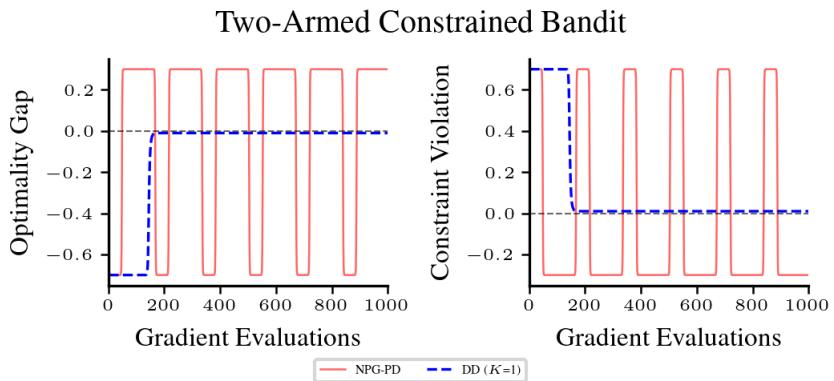
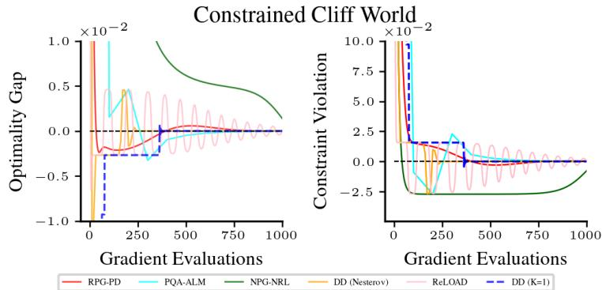
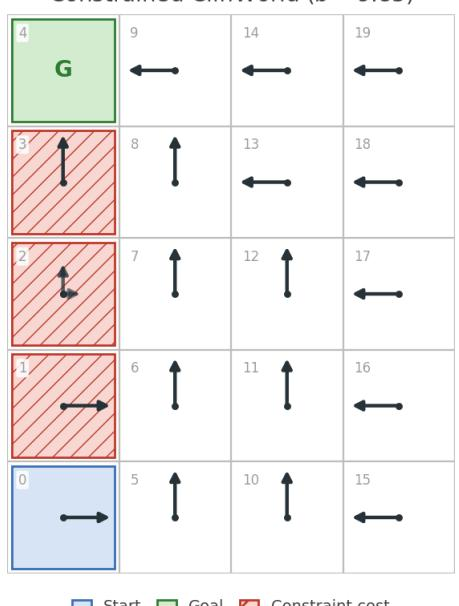
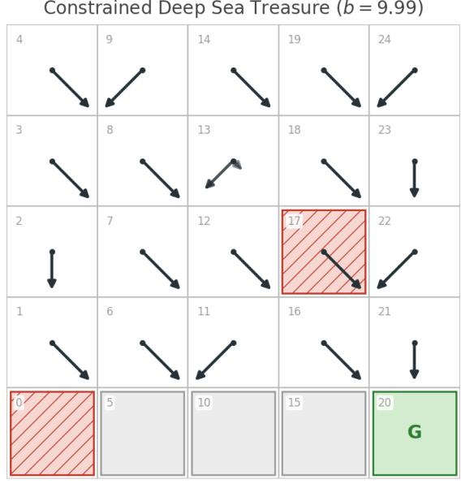
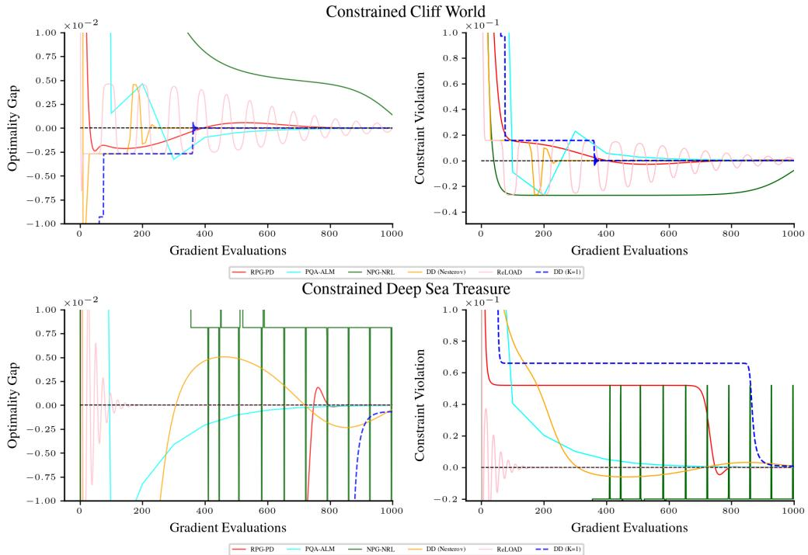

# Last-Iterate Convergence for Constrained MDPs: From Dual Descent to Primal-Dual

Michael Lu Simon Fraser University michael\_lu\_3@sfu.ca

Mo Chen Canada CIFAR AI Chair, Amii, Simon Fraser University mochen@cs.sfu.ca

Max Qiushi Lin Simon Fraser University maxqslin@gmail.com

Sharan Vaswani Simon Fraser University vaswani.sharan@gmail.com

## Abstract

We study policy optimization for infinite-horizon, discounted constrained Markov decision processes. While primal-dual (PD) methods are widely used in practice, their theoretical guarantees typically hold for an impractical mixture policy. In contrast, dual descent (DD) methods output a single policy (“last iterate”) with guarantees on its performance. However, such methods require iteratively solving entropy-regularized MDPs in an inner-loop, limiting their practical effectiveness. Moreover, existing analyses rely on strong coverage assumptions that are difficult to satisfy in practice. Consequently, we first provide a new analysis of DD methods that does not require coverage assumptions. We then employ entropy-regularized natural policy gradient and dual regularization to eliminate the inner loop, resulting in an efficient PD algorithm. We develop a novel tracking analysis which shows that, compared to existing methods, the proposed algorithm achieves improved last-iterate convergence guarantees. Furthermore, our theoretical framework allows us to analyze a truncated bilevel method that interpolates between DD and PD methods. Finally, we generalize our analysis to handle linear function approximation. Compared to prior last-iterate methods, we prove stronger guarantees under less restrictive assumptions.

## 1 Introduction

Reinforcement learning (RL) has found success across a wide range of applications, including video games [Mnih et al., 2015], robotics [Kober et al., 2013], and the alignment of large language models [Uc-Cetina et al., 2023]. Standard RL algorithms are typically designed to maximize a single objective. However, in many real-world applications, operational or safety constraints must also be considered. For example, in wireless communication systems, a network controller seeks to maximize overall throughput while ensuring that the average connectivity exceeds a target rate [Julian et al., 2002, Buratti et al., 2009]. Such problems can be modeled as a constrained Markov decision process (CMDP) [Altman, 2021]. In this setting, the goal of an agent is to maximize the cumulative reward (e.g. wireless throughput) while ensuring that the cumulative constraint reward (e.g. connectivity rate) is above a prescribed threshold. However, since an optimal policy of a CMDP is, in general, stochastic [Altman, 2021], designing principled algorithms that efficiently output a stochastic policy remains a central challenge.

A common approach to solving CMDPs are primal-dual (PD) methods [Jain et al., 2022, Liu et al., 2025b, Ding et al., 2020, Bura et al., 2022]. These methods construct the Lagrangian of the CMDP and then iteratively optimize the policy and the associated dual variable (Lagrange multipliers). Their ease of implementation makes them appealing to practitioners. However the final policy (normally used in practice) exhibits an undesirable oscillating behaviour (see Figure 1). From a theoretical perspective, convergence guarantees of

PD methods are typically limited to those for impractical mixture policies. Constructing such a mixture policy requires storing all intermediate policies, a memory intensive approach. Furthermore, deploying a mixture policy requires randomly selecting one of these policies. As a result, the constraint guarantees hold only in expectation over this random selection, rather than for the individual policy that is ultimately deployed.

  
Figure 1: Comparing a PD approach (NPG-PD) [Ding et al., 2020] to the proposed DD method (DD(K=1)) on a 2-armed constrained bandit problem. While the iterates of NPG-PD oscillate, DD(K=1) converges to zero optimality gap and constraint violation. See Appendix J.1 for details.

<table><tr><td>Method</td><td>Number of Constraints</td><td>Rate</td><td>Coverage Assumption</td><td>Other Assumptions &amp; Caveats</td></tr><tr><td colspan="5">Tabular Policy Parameterization</td></tr><tr><td>Ying et al. [2022, Corollary 5.4]</td><td>Multiple</td><td>Ö(1/e2)</td><td></td><td>Bilevel method</td></tr><tr><td>Ying et al. [2022, Corollary 6.2]</td><td>Single</td><td>O(ln(1/e))</td><td></td><td>Bilevel method</td></tr><tr><td>Ding et al. [2023, Corollary 3]</td><td>Single</td><td>Ö(1/e6)</td><td></td><td>Requires projections onto a restricted simplex</td></tr><tr><td>Ding et al. [2023, Corollary 7]</td><td>Single</td><td>O(ln(1/e))</td><td></td><td>Rate depends on potentially unbounded constants</td></tr><tr><td>Gladin et al. [2023, Corollary 4.5]</td><td>Multiple</td><td>O(ln(1/e))</td><td></td><td>Bilevel method, rate holds only when e is very small</td></tr><tr><td>Lu et al. [2026, Corollary 1]</td><td>Multiple</td><td>O(1/e6)</td><td></td><td>Bilevel method</td></tr><tr><td>Montenegro et al. [2024, Theorem 3.2]</td><td>Multiple</td><td>O(1/e2)</td><td></td><td>Rate depends on potentially unbounded constants</td></tr><tr><td>Moskovitz et al. [2023, Theorem 3.7] Müller et al. [2024, Theorem 4.1]</td><td>Multiple Multiple</td><td></td><td></td><td>Rate unspecified</td></tr><tr><td>Theorem 2 (ours)</td><td>Multiple</td><td>O(poly(A,H,n)/e10)</td><td></td><td>Limited to the finite horizon setting</td></tr><tr><td>Theorem 3 (ours)</td><td></td><td>Ö(1/e2) O(1/ε5)</td><td></td><td>Bilevel method</td></tr><tr><td>Theorem 4 (ours)</td><td>Multiple Multiple</td><td>Ö(1/e35)</td><td></td><td></td></tr><tr><td></td><td></td><td></td><td>X</td><td></td></tr><tr><td colspan="5">General Policy Parameterization</td></tr><tr><td>Montenegro et al. [2024, Theorem 3.2]</td><td>Multiple</td><td>O(1/e6)</td><td></td><td>CFA, FND, €bias depends on an FND constant</td></tr><tr><td>Lu et al. [2026, Corollary 2]</td><td>Multiple</td><td>O(1/e6)</td><td></td><td>Log-linear policy,  $\epsilon _ { \mathrm { b i a s } } \leq \mathcal { O } ( \epsilon ^ { 1 6 } )$ </td></tr><tr><td>Ding et al. [2023, Corollary 5] Mondal and Aggarwal [2026, Theorem 1]</td><td>Single</td><td>O(1/e6)</td><td></td><td>Log-linear policy  $\mathrm { , \ C F A , \epsilon _ { b i a s } \leq \mathcal { O } ( \bar { \epsilon } ^ { 8 } ) }$ </td></tr><tr><td></td><td>Single</td><td>O(1/e4)</td><td></td><td> $\mathsf { C F A } , \mathsf { F N D } , \mathsf { \bar { \epsilon } _ { b i a s } } \le \mathcal { O } ( \epsilon ^ { 6 } )$ </td></tr><tr><td>Corollary 1 (ours)</td><td>Multiple</td><td>Ö(1/e35)</td><td></td><td> $\mathrm { L o g - l i n e a r p o l i c y } , \epsilon _ { \mathrm { b i a s } } \leq \mathcal { O } ( \epsilon ^ { 4 } )$ </td></tr></table>

Table 1: Comparison of prior last-iterate guarantees. To enable a fair comparison, the convergence rate is characterized in terms of the number of policy gradient evaluations. The coverage assumption requires that initial state distribution has full support, i.e. mins $\rho ( s ) > 0 .$ . A bilevel methods refers to two-time scale method in which the inner sub-problem must be solved to an sufficient accuracy. With function approximation, $\epsilon _ { \mathrm { b i a s } }$ denotes the irreducible approximation error of the restricted policy class (i.e. Assumption 2), CFA denotes the requirement of compatible function approximation framework [Agarwal et al., 2021] and FND denotes the analysis requires the Fisher non-degenerate assumption [Zhang et al., 2021]. Note the FND assumption does not hold for log-linear policies [Ni and Kamgarpour, 2025, Proposition C.4].

To address these issues, recent works [Ding et al., 2023, Mondal and Aggarwal, 2026, Müller et al., 2024, Moskovitz et al., 2023, Ying et al., 2022, Montenegro et al., 2024, Lu et al., 2026] have developed methods with convergence guarantees for the final policy (“last-iterate”). However to establish such theoretical guarantees, these approaches lead to impractical algorithms (see Table 1 for a detailed comparison). Among these approaches, we consider dual descent (DD) methods [Ying et al., 2022, Gladin et al., 2023] as our starting point. By incorporating entropy-regularization into the policy optimization problem, DD methods obtains guarantees for a final stochastic policy. However, existing DD methods suffer from three key limitations: (i) their guarantees relies on a impractical coverage assumption (an assumption that implies that every policy can visit every state); (ii) they are cumbersome to deploy, as they are bilevel methods for which every update to the dual variable requires accurately solving an entropy-regularized MDP sub-problem in an inner-loop; and (iii) their guarantees are restricted to the tabular setting [Ying et al., 2022, Gladin et al., 2023]. We address these limitations, improving the practicality and generality of DD methods, and make the following contributions.

Contribution 1. In Section 3, we provide a new analysis of DD methods and establishes last-iterate guarantees for the final policy without any impractical coverage assumptions. Following Ying et al. [2022] and Gladin et al. [2023], we first consider the tabular setting and analyze the DD method when using entropy-regularized natural policy gradient (E-NPG) [Cen et al., 2022] as the inner sub-problem solver. Our new analysis achieves an $\tilde { \mathcal { O } } \bar { ( } 1 / \epsilon ^ { 4 } )$ last-iterate rate. We then develop a new algorithm that relies on dualregularization that attains an $\tilde { \mathcal { O } } ( 1 / \epsilon ^ { 2 } )$ rate matching Ying et al. [2022]. However, our algorithm does not employ Nesterov acceleration; it only relies on gradient descent on the regularized dual and is consequently simpler to implement.

Contribution 2. We then address the second limitation of DD methods. Their bilevel structure requires using multiple E-NPG iterations to solve the inner sub-problem to an sufficient accuracy. In Section 4, we consider a more practical algorithm by using a single E-NPG update which results in a simple primal-dual (PD) method. Through a novel tracking analysis that controls the bias (as a result of solving the inner sub-problem inexactly), we prove that this method attains an $\tilde { \mathcal { O } } ( 1 / \epsilon ^ { 5 } )$ last-iterate rate.In contrast to prior PD methods without coverage assumptions (refer to Table 1), our approach achieves a substantially faster last-iterate rate. While related PD methods have been proposed [Müller et al., 2024, Mondal and Aggarwal, 2026], their analysis is either limited to the finite-horizon setting or supports only a single constraint.

Contribution 3. In Section 5, we further refine our tracking analysis. For a good initial policy (obtained by solving the first inner sub-problem to sufficiently high accuracy), we prove the inexact bias is bounded uniformly and decreases exponentially with the number of E-NPG iterations. We use this property to show that for a fixed number of K inner-iterations, the resulting algorithm attains an $\widetilde { \mathcal { O } } ( 1 / \epsilon ^ { 2 + 3 / 2 } ^ { \bar { K } } )$ last-iterate rate. In the case when $K = 1$ , the resulting PD method attains a $\stackrel { \sim } { \mathcal { O } } ( 1 / \epsilon ^ { 3 . 5 } )$ convergence. This method achieves fastest last-iterate rate for PD methods without any coverage assumptions. Furthermore as $K  \infty$ , the method converges (linearly in terms of K) to $\tilde { \mathcal { O } } ( 1 / \epsilon ^ { 2 } )$ , matching the bilevel DD approach. Thus, this analysis interpolates between the PD (corresponding to $K = 1 )$ and DD (corresponding as $\bar { K } \to \infty )$ regimes.

Contribution 4. Finally, in Appendix A, we address the final limitation of DD methods — their restriction to the tabular setting. In particular, we extend our analysis to handle large state-action spaces and consider log-linear policies [Yuan et al., 2022b, Agarwal et al., 2021]. For this setting, we solve the inner sub-problem using Q-E-NPG [Agarwal et al., 2021], an extension of E-NPG when employing linear function approximation. Notably, this extension only requires reanalyzing how the inner sub-problem is solved while the remainder of the analysis remains unchanged. We use the policy features to construct a coreset to control the resulting approximation error of the soft state-action values functions. For sufficiently expressive features, this yields an $\tilde { \mathcal { O } } ( ^ { 1 / \epsilon ^ { 3 . 5 } } )$ last-iterate rate, achieving the best known rate when handling function approximation.

## 2 Problem Formulation & Background

An infinite-horizon discounted constrained Markov decision process (CMDP) [Altman, 2021] is defined by the tuple $( \mathcal { S } , \mathcal { A } , \mathcal { P } , \rho , \gamma , r , \{ c _ { i } \} _ { i = 1 } ^ { m } , \{ b _ { i } \} _ { i = 1 } ^ { m } )$ . Here, S is the set of states, A is the set of actions, $\mathcal { P } : \mathcal { S } \times \mathcal { A }  \dot { \Delta } s$ is the transition probability function, $\rho \in \Delta _ { S }$ is the initial state distribution, $\gamma \in [ 0 , 1 )$ is the discount factor and $r : S \times \mathcal { A }  [ 0 , 1 ]$ ] is the reward function. The set of m constraint reward functions is denoted by $\{ c _ { i } \} _ { i = 1 } ^ { m }$ where $c _ { i } : S \times A \to [ 0 , 1 ]$ and $\{ b _ { i } \} _ { i = 1 } ^ { m }$ is the set of corresponding non-negative thresholds. For a policy $\pi : S  \Delta _ { \mathcal { A } }$ the state-action valuefunction $Q _ { \diamond } ^ { \pi } : { \cal S } \times { \cal A } $ R is defined as $Q _ { \diamond } ^ { \pi } ( s , a ) : = \mathbb { E } [ \sum _ { h = 0 } ^ { \infty } \gamma ^ { h } \diamond ( s _ { h } , a _ { h } ) | s _ { 0 } = s , a _ { 0 } = a ]$ such that for $h \geq 0 , s _ { h + 1 } \sim \mathcal { P } ( \cdot | s _ { h } , a _ { h } ) , a _ { h + 1 } \sim \pi ( \cdot | s _ { h } )$ where $\diamond : \mathcal { S } \times \mathcal { A } $ R is a bounded (pseudo) reward function. The value function $V _ { \diamond } ^ { \pi } : \mathcal { S } \to \mathbb { R }$ is defined as $V _ { \diamond } ^ { \pi } ( s ) : = \mathbb { E } _ { a \sim \pi ( \cdot | s ) } [ Q _ { \diamond } ^ { \pi } ( s , a ) ]$ , and we use $V _ { \diamond } ^ { \pi } ( \rho ) : = \mathbb { E } _ { s _ { 0 } \sim \rho } [ V _ { \diamond } ^ { \pi } ( s _ { 0 } ) ]$ to denote the expected value function. Using this notation, the reward state-action valuefunction and reward valuefunction are denoted as $Q _ { r } ^ { \pi }$ and $V _ { r } ^ { \pi }$ . Likewise, for each constraint $i \in \left\lceil m \right\rceil$ , we denote the constraint reward state-action valuefunction as $Q _ { c _ { i } } ^ { \pi }$ and the constraint reward valuefunction as $V _ { c _ { i } } ^ { \pi }$

For a given CMDP, the objective is to find a policy π that maximizes the expected reward value function while satisfying the set of expected constraint reward value functions in expectation. Formally, this corresponds to solving the following problem:

Problem 1. ma $\mathsf { x } _ { \pi } V _ { r } ^ { \pi } ( \rho )$ subject to $V _ { c _ { i } } ^ { \pi } ( \rho ) \geq b _ { i } \quad \forall i \in [ m ]$

Let $\pi ^ { * }$ denote the optimal policy of Problem 1 and note in general, unlike unconstrained MDPs, $\pi ^ { * }$ is stochastic [Altman, 2021]. A typical approach to solve Problem 1 is to construct the Lagrangian and consider the following saddle-point problem:

$$
\operatorname* { m a x } _ { \pi } \operatorname* { m i n } _ { \lambda \in \mathbb { R } _ { + } ^ { m } } L ( \pi , \lambda ) : = V _ { r } ^ { \pi } ( \rho ) + \sum _ { i = 1 } ^ { m } \lambda _ { i } ( V _ { c _ { i } } ^ { \pi } ( \rho ) - b _ { i } )\tag{1}
$$

where $\lambda \in \mathbb { R } _ { + } ^ { m }$ is the dual variable. For example, primal-dual (PD) methods [Ding et al., 2020] solve Problem 1 by iteratively updating the policy (e.g., via natural policy gradient) and the dual variables (e.g., via gradient descent). For such a PD algorithm, prior work [Jain et al., 2022, Ding et al., 2020, Liu et al., 2025b, Paternain et al., 2019] establishes after T iterations, for a target error $\epsilon > 0$ , the mixture policy $\begin{array} { r } { \bar { \pi } _ { T } : = \frac { 1 } { T } \sum _ { t = 0 } ^ { T - 1 } \pi _ { t } } \end{array}$ is an ϵ-optimal policy, $\mathrm { i . e . , }$

$$
{ V _ { r } ^ { { \bar { \pi } } _ { T } } } ( \rho ) \geq { V _ { r } ^ { \pi ^ { * } } } ( \rho ) - \epsilon , ; { V _ { c _ { i } } ^ { { \bar { \pi } } _ { T } } } ( \rho ) \geq b _ { i } - \epsilon \quad \forall i \in [ m ]
$$

Despite their strong theoretical guarantees, mixture policies suffer from two practical drawbacks. First, they are memory intensive since they require storing all intermediate policies $\{ \bar { \pi } _ { t } \} _ { t = 0 } ^ { T - 1 }$ . Second, deploying such a mixture policy requires repeatedly sampling a policy uniformly from this set. As a result, constraint satisfaction is only guaranteed in expectation over this random selection. For safety-critical applications, this behaviour is undesirable as any single policy may significantly violate the constraints. This has motivated the development of principled algorithms that converge to a single deployable stochastic policy.

Prior approaches are developed by introducing additional regularization, either on the policy [Lu et al., 2026, Ying et al., 2022, Gladin et al., 2023], dual variables [Montenegro et al., 2024] or to both [Mondal and Aggarwal, 2026, Ding et al., 2023, Müller et $\mathsf { a l . } ,$ 2024]. These algorithmic designs provide guarantees for the reward sub-optimality and constraint satisfaction of the final policy (“last-iterate”) produced by the algorithm. However to establish such guarantees, most prior analysis requires strong coverage assumptions on the initial state space that are difficult to satisfy in practice. Moreover, extending these guarantees to general policy parameterization often requires additional, overly restrictive assumptions on the policy class (refer to Table 1 for details). To address these issues, we use the dual descent (DD) method as the starting point.

## 3 Inexact Dual Descent

In Section 3.1, we first introducing the entropy-regularized CMDP and formulate its dual problem. In Section 3.2 we develop an inexact DD algorithm for solving this problem and analyze a generic convergence guarantee without any coverage assumption in Section 3.3. We then specialize the analysis to the tabular setting, where the number of states and actions are finite, and in Section 3.4 establish last-iterate guarantees for the resulting algorithms. Finally, in Section 3.5 we add dual-regularization and attain faster rates.

## 3.1 Constructing a Differentiable Dual

An common approach for constrained optimization problems is to consider the dual function of the Lagrangian in Equation $( 1 ) , D ( \lambda ) : = \operatorname* { m a x } _ { \pi } L \bar { ( } \pi , \lambda )$ and solve the convex problem $\mathrm { m i n } _ { \lambda \in \mathbb { R } _ { + } ^ { m } } D ( \lambda )$ using gradientbased methods [Boyd and Vandenberghe, 2004]. However, a key challenge is that for a fixed $\lambda \in \mathbb { R } _ { + } ^ { m }$ , the maximizer arg max $_ \pi L ( \pi , \lambda )$ may not be unique, making the dual function non-differentiable. To address this issue, following prior work [Ying et al., 2022, Li et al., 2024, Gladin et al., 2023], we consider solving an entropy-regularized primal. This enables the dual of the regularized primal to have a unique solution and enables the gradient to be well-defined.

In particular, let $\mathcal { H } ( \pi ( \cdot | s ) ) : = - \langle \pi ( \cdot | s ) , \ln ( \pi ( \cdot | s ) ) \rangle$ ⟩ denote the Shannon entropy of a policy π for any state $s \in S$ . For the entropy parameter $\tau > 0$ , the soft (entropy-regularized) valuefunction $\dot { V } _ { \diamond , \tau } ^ { \pi } : \mathcal { \bar { S } } \times \mathcal { A }  \bar { \mathbb { R } }$ is defined as $\begin{array} { r } { V _ { \diamond , \tau } ^ { \pi } ( s ) : = V _ { \diamond } ^ { \pi } ( s ) + \tau \sum _ { h = 0 } ^ { \infty } \gamma ^ { h } [ \mathcal { H } ( \pi ( \cdot | s _ { h } ) \ | \ s _ { 0 } = \ s ] } \end{array}$ and soft state-action-value function $Q _ { \diamond , \tau } ^ { \pi }$ $s \times \mathcal { A } \to \mathbb { R }$ is defined as $Q _ { \diamond , \tau } ^ { \pi } : = \mathbb { E } _ { s ^ { \prime } \sim \mathcal { P } ( \cdot | s , a ) } [ \diamondsuit ( s , a ) + \gamma V _ { \diamond , \tau } ^ { \pi } ( s ^ { \prime } ) ]$ [Geist et al., 2019, Liu et al., 2024].

Using this notation, we define the soft reward value function as $V _ { r , \tau } ^ { \pi } ( \rho ) : = \mathbb { E } _ { s \sim \rho } [ V _ { r , \tau } ^ { \pi } ( s ) ]$ , and focus on the following soft Lagrangian formulation:

$$
\begin{array} { r } { \mathbf { P r o b l e m 2 . \operatorname* { m a x } } _ { \pi } \operatorname* { m i n } _ { \lambda \in \mathbb { R } _ { + } ^ { m } } \mathcal { L } _ { \tau } ( \pi , \lambda ) \ : \ : w h e r e \ : \ : \mathcal { L } _ { \tau } ( \pi , \lambda ) : = V _ { r , \tau } ^ { \pi } ( \rho ) \ : + \sum _ { i = 1 } ^ { m } \lambda _ { i } \ : \big ( V _ { c _ { i } } ^ { \pi } ( \rho ) \ : - \ : b _ { i } \big ) . } \end{array}
$$

Hence, for any $\lambda \in \mathbb { R } _ { + } ^ { m }$ , entropy regularization ensures that the maximizer of the Lagrangian:

$$
\mathscr { D } _ { \tau } ( \lambda ) : = \operatorname* { m a x } _ { \pi } \mathcal { L } _ { \tau } ( \pi , \lambda ) \quad \mathrm { ~ ; ~ } \quad \lambda _ { \tau } ^ { * } : = \underset { \lambda \in \mathbb { R } _ { + } ^ { m } } { \arg \operatorname* { m i n } } \mathscr { D } _ { \tau } ( \lambda )\tag{2}
$$

is unique [Nachum et al., 2017]. Consequently, by Danskin’s theorem [Floudas, 1995], its gradient is well-defined and characterized as follows.

Proposition 1. For any $\lambda \in \mathbb { R } _ { + } ^ { m }$ and entropy regularization parameter $\tau > 0$ , the dualfunction $\mathcal { D } _ { \tau } ( \lambda )$ in Equation (2) is differentiable such that $\forall i \in [ m ]$

$$
[ \nabla \mathcal { D } _ { \tau } ( \lambda ) ] _ { i } : = V _ { c _ { i } } ^ { \pi _ { \lambda , \tau } ^ { * } } ( \rho ) - b _ { i } \quad ; \quad \pi _ { \lambda , \tau } ^ { * } : = \arg \operatorname* { m a x } _ { \pi } \mathcal { L } _ { \tau } ( \pi , \lambda )
$$

For a fixed dual variable λ, computing this gradient exactly requires solving an an entropy-regularized MDP as the inner sub-problem. We therefore consider an approximate solution to this maximization problem and will use it to construct inexact gradients.

## 3.2 Algorithm Design

Building on the DD approach of Ying et al. [2022], we now present the following generic inexact DD algorithm, which employs a black-box entropy-regularized MDP solver to construct the inexact dual gradients.

Algorithmic details. Algorithm 1 is a bilevel method that uses an approximate solution to the inner sub-problem to construct an inexact gradient for the outer dual update. By the linearity of the reward r and the weighted constrained reward $\{ \lambda _ { i } c _ { i } \} _ { i = 1 } ^ { m } ,$ computing $\pi _ { \lambda , \tau } ^ { * } : = \bar { \arg \operatorname* { m a x } _ { \pi } } \mathcal { L } _ { \tau } ( \pi , \lambda )$ is equivalent to solving the following inner sub-problem induced by λ,

$$
\arg \operatorname* { m a x } _ { \pi } V _ { R ( \lambda ) , \tau } ^ { \pi } ( \rho ) \quad ; \quad R ( \lambda ) : = r + \textstyle \sum _ { i = 1 } ^ { m } \lambda _ { i } c _ { i } .\tag{3}
$$

Thus, constructing the dual gradient of Equation (2) reduces to solving an unconstrained entropy-regularized MDP with pseudo-reward $R ( \lambda )$ . We can thereby obtain inexact dual gradients by using any entropyregularized MDP solver as a black-box. To this end, in Line 3, we introduce an abstract method, PolicyOptimization $( \pi _ { t - 1 } , R ( \lambda _ { t } ) , \tau , K )$ , which takes in as input an initial policy $\pi _ { t - 1 } ,$ pseudo-reward $R ( \lambda _ { t } )$ an entropy regularizer parameter $\tau ,$ and iterations K and outputs a policy $\pi _ { t } .$ Then in Line 4, using the approximate solution to the entropy-regularized MDP $\pi _ { t } ,$ , we construct the corresponding inexact dual gradient $ { \widetilde { \nabla } }  { D _ { \tau } } ( \lambda _ { t } ) \in  { \mathbb { R } } ^ { m }$ such that $[ \widetilde { \nabla } \mathcal { D } _ { \tau } ( \lambda _ { t } ) ] _ { i } = V _ { c _ { i } } ^ { \pi _ { t } } ( \rho ) - b _ { i }$ for all $i \in [ m ]$

Algorithm 1 Inexact DD for CMDPs   
1: Input: $\pi _ { - 1 }$ (initial policy), $\mathbf { \lambda } \lambda _ { 0 } \in \mathbb { R } _ { + } ^ { m }$ (initial dual variable), τ (entropy regularization), $, \beta$ (dual step-size),   
$\mu$ (dual regularization), $T$ (number of outer-iterations), K (number of inner-iterations), J (number of   
recovery-iterations)   
2: for $t = \stackrel { \cdot } { 0 } , 1 , \ldots , T - 1$ do   
3: $\pi _ { t } = { \sf P o l }$ licyOptimization $( \pi _ { t - 1 } , R ( \lambda _ { t } ) , \tau , K )$   
where $\begin{array} { r } { R ( \lambda _ { t } ) = r + \sum _ { i = 1 } ^ { m } c _ { i } \lambda _ { t } [ i ] } \end{array}$   
4: Construct inexact dual gradient estimate $[ \widetilde { \nabla } \mathcal { D } _ { \tau } ( \lambda _ { t } ) ] _ { i } : = V _ { c _ { i } } ^ { \pi _ { t } } ( \rho ) - b _ { i } , \forall i \in [ m ] .$   
5: $\lambda _ { t + 1 } = \mathrm { P r o j } _ { \Lambda } \left\lceil ( 1 - \beta \mu ) \lambda _ { t } - \beta \widetilde { \nabla } \mathcal { D } _ { \tau } ( \lambda _ { t } ) \right\rceil$   
6: end for   
7: $\begin{array} { r } { \lambda _ { T } = \frac { 1 } { T } \sum _ { t = 1 } ^ { T } \lambda _ { t } } \end{array}$ if $\mu = 0$ else $\lambda _ { T }$   
8: Recover deployable policy from dual variable: πT = PolicyOptimization $( \pi _ { - 1 } , R ( \lambda _ { T } ) , \tau , J )$   
9: Return: Policy $\pi _ { T }$ and (average) dual variable $\lambda _ { T }$

We first consider the case when $\mu = 0$ and will handle the regularized case in Section 3.5. Using the inexact dual gradient estimate, we update the dual variable using projected dual descent (Line 5). In particular, given a gradient estimator $\widetilde { \nabla } \mathcal { D } _ { \tau } ( \lambda _ { t } )$ , we consider the following update $\lambda _ { t + 1 } = \mathrm { P r o j } _ { \Lambda } \left[ \lambda _ { t } - \beta \widetilde { \nabla } \mathcal { D } _ { \tau } ( \lambda _ { t } ) \right]$ where $\beta > 0$ is the dual step-size and $\mathrm { P r o j } _ { \Lambda } [ \lambda ]$ denotes the Euclidean projection onto a convex set Λ, i.e., $\begin{array} { r } { \operatorname { P r o j } _ { \Lambda } [ \lambda ] : = \arg \operatorname* { m i n } _ { \lambda ^ { \prime } \in \Lambda } \| \lambda - \lambda ^ { \prime } \| _ { 2 } ^ { 2 } } \end{array}$ . The projection set Λ is chosen to ensure the dual iterates remain bounded while containing the optimal dual solution. To obtain an upper bound on the magnitude ${ \boldsymbol { \lambda } } _ { \tau } ^ { * } ,$ following prior work [Ying et al., 2022, Gladin et al., 2023, Ding et al., 2023] we consider the following assumption.

Assumption 1 (Slater Condition). ∃ policy π¯ and $\zeta \in \mathbb { R } _ { + } ^ { m }$ such that $\forall i \in [ m ] , \zeta _ { i } : = V _ { c _ { i } } ^ { \bar { \pi } } ( \rho ) - b _ { i } > 0 .$

This assumption ensures the existence of a strictly feasible policy. The constant $\zeta$ is referred to as Slater constant [Ding et al., 2020, Bai et al., 2022, Liu et al., 2025a, Vaswani et al., 2022]. This quantity measures the width of the region of feasible policies and is a measure of the problem’s difficulty. Furthermore by Lemmas 15 and 25, these lemmas show that ${ \boldsymbol { \lambda } } _ { \tau } ^ { * }$ is bounded component-wise by $\begin{array} { r } { \left[ \lambda _ { \tau } ^ { * } \right] _ { i } \leq \frac { 2 + 2 \dot { \tau } \ln ( A ) } { ( 1 - \gamma ) \zeta _ { i } } } \end{array}$ . Hence, in order for the set to contain ${ \boldsymbol { \lambda } } _ { \tau } ^ { * } ,$ we may restrict the dual iterates to the compact set $\begin{array} { r } { \Lambda : = \left\{ \lambda \in \mathbb { R } _ { + } ^ { m } \mid 0 \leq \lambda _ { i } \leq \frac { 2 + 2 \tau \ln ( A ) } { ( 1 - \gamma ) \zeta _ { i } } \right\} } \end{array}$ Finally, in line $^ { 8 , }$ we obtain a deployable policy by solving an entropy-regularized MDP induced by a fixed dual.

## 3.3 Theoretical Analysis

Algorithm 1 aims to minimize the dual problem. We first show how the sub-optimality of the dual solution relates to the reward sub-optimality and constraint violation for Problem 1.

Lemma 1. Under Assumption 1, suppose $\overline { { \lambda } } \in \mathbb { R } _ { + } ^ { m }$ is an ∆-optimal dual solution, i.e., fo $r \Delta > 0 , \mathcal { D } _ { \tau } ( \bar { \lambda } ) - \mathcal { D } _ { \tau } ( \lambda _ { \tau } ^ { * } ) \leq$ ∆. Then, the policy $\pi _ { \bar { \lambda } , \tau } ^ { * } : = \arg \operatorname* { m a x } _ { \pi } V _ { R ( \bar { \lambda } ) , \tau } ^ { \pi } ( \rho )$ has the following guarantee for Problem 1:

$$
V _ { r } ^ { \pi ^ { * } } ( \rho ) - V _ { r } ^ { \pi _ { \lambda , \tau } ^ { * } } ( \rho ) \leq \mathcal { O } \left( \frac { \sqrt { \Delta } } { \sqrt { \tau } } \right) + \mathcal { O } ( \tau ) \quad ; \quad \operatorname* { m a x } \left\{ b _ { i } - V _ { c _ { i } } ^ { \pi _ { \lambda , \tau } ^ { * } } ( \rho ) , 0 \right\} \leq \mathcal { O } \left( \frac { \sqrt { \Delta } } { \sqrt { \tau } } \right) \quad \forall i \in [ m ] .
$$

We next characterize the convergence of Algorithm 1 and bound the dual sub-optimality. In order to do so, we first establish that the dual objective is smooth by leveraging the Lipschitz property of entropy-regularized policies with respect to λ. Unlike prior derivations [Ying et al., 2022, Gladin et al., 2023], this result does not rely on any strong coverage assumptions on either the initial state distribution or the optimal policy.

Lemma 2. For $\tau > 0$ and any $\lambda \in \mathbb { R } _ { + } ^ { m }$ , the dual function $\mathcal { D } _ { \tau } ( \lambda )$ is $\begin{array} { r } { G _ { \tau } : = \frac { m } { \tau ( 1 - \gamma ) ^ { 3 } } } \end{array}$ -smooth.

Assuming that the inexact dual gradients are bounded at each iteration, using this smoothness property, we now prove a generic convergence guarantee for Algorithm 1. Specifically, the following result corresponds to analyzing projected gradient descent on a convex, smooth function with bounded, inexact gradients.

Lemma 3. Under Assumption 1, for any $\tau > 0 ,$ , assuming thatfor all $t \in [ 0 , T - 1 ] , \| \nabla \mathcal { D } _ { \tau } ( \lambda _ { t } ) - \widetilde { \nabla } \mathcal { D } _ { \tau } ( \lambda _ { t } ) \| \leq$ δt, Algorithm 1 using step-size $\begin{array} { r } { \beta \leq \frac { 1 } { G _ { \tau } } , \lambda _ { 0 } = 0 } \end{array}$ , and $\mu = 0$ converges as: $f o r T \geq 1$

$$
\mathcal { D } _ { \tau } ( \bar { \lambda } _ { T } ) - \mathcal { D } _ { \tau } ( \lambda _ { \tau } ^ { * } ) \leq \frac { \Vert \lambda _ { \tau } ^ { * } \Vert _ { 2 } ^ { 2 } } { 2 \beta T } + \frac { | \Lambda | } { T } \sum _ { t = 0 } ^ { T - 1 } \delta _ { t }\tag{4}
$$

where $\begin{array} { r } { \bar { \lambda } _ { T } : = \frac { 1 } { T } \sum _ { t = 1 } ^ { T } \lambda _ { t } , a n d | \Lambda | = \frac { \sqrt { m } \left( 2 + 2 \tau \ln ( A ) \right) } { \left( 1 - \gamma \right) \operatorname* { m i n } _ { i \in [ m ] } \zeta _ { i } } . } \end{array}$

The above results shows that the dual sub-optimality decreases as $\mathcal { O } ( 1 / T )$ up to a bias introduced by the inexact gradients. Hence, the remaining step is to control the bias introduced by using inexact dual gradients. Specifically, in order to combine Lemma 1 with the dual sub-optimality guarantee of Lemma 3, we require the accumulated bias term to be sufficiently small. To this end, in Lemma 4 we bound the bias by the sub-optimality of the inner sub-problem.

Lemma 4. For any $\lambda \in \mathbb { R } _ { + } ^ { m } , \tau > 0$ and policy $\tilde { \pi } ,$ the inexact gradient such that $[ \widetilde { \nabla } \mathcal { D } _ { \tau } ( \lambda ) ] _ { i } = V _ { c _ { i } } ^ { \tilde { \pi } } ( \rho ) - b _ { i }$ for all $i \in [ m ]$ results in thefollowing bias:

$$
\| \nabla \mathcal { D } _ { \tau } ( \lambda ) - \widetilde { \nabla } \mathcal { D } _ { \tau } ( \lambda ) \| \leq \frac { \sqrt { 2 m } \sqrt { \operatorname* { m a x } _ { \pi } V _ { R ( \lambda ) , \tau } ^ { \pi } ( \rho ) - V _ { R ( \lambda ) , \tau } ^ { \pi } ( \rho ) } } { ( 1 - \gamma ) ^ { 3 / 2 } \sqrt { \tau } }
$$

Consequently, the bias can be controlled through the accuracy of the inner black-box policy optimization method in Algorithm 1. Hence, to obtain a single deployable policy, we instantiate the abstract PolicyOptimization method with entropy-regularized natural policy gradient (E-NPG) [Cen et al., 2022, Lan, 2023].

## 3.4 Instantiating the Algorithm

For a generic bounded pseudo-reward $\diamond \in [ 0 , U ] ^ { S A } , U > 0 .$ , we employ E-NPG for K iterations. At inneriteration $k \in \left[ 0 , K - 1 \right]$ , E-NPG iteratively updates policy $\pi _ { k }$ using an estimate of the soft state-action value function $\hat { Q } _ { \diamond , \tau } ^ { \pi _ { k } } \in \mathbb { R } ^ { S A }$ using the following update: $\mathsf { \bar { V } } ( s , \dot { a } ) \in S \times \breve { \mathcal { A } }$

$$
\pi _ { k + 1 } ( a | s ) \propto ( \pi _ { k } ( a | s ) ) ^ { 1 - \frac { \eta \tau } { 1 - \gamma } } \exp \left( \frac { \eta \hat { Q } _ { \diamond , \tau } ^ { \pi _ { k } } ( s , a ) } { 1 - \gamma } \right)\tag{5}
$$

where $\eta > 0$ denotes the policy step-size. Furthermore, the following result from Cen et al. [Cen et al., 2022, Theorem 1] shows that E-NPG converges linearly for any bounded pseudo-reward up to an floor that depends on inexactness in the state-action value function. For example, such an error can arise when evaluating the policy $\pi _ { k }$ using a finite number of trajectories.

Lemma 5. For any pseudo-reward $\diamond \in [ 0 , U ] ^ { S A } , U > 0 ,$ , assuming that su $\mathsf { 1 } \mathsf { p } _ { k \geq 0 } \| \hat { Q } _ { \diamond , \tau } ^ { \pi _ { k } } - Q _ { \diamond , \tau } ^ { \pi _ { k } } \| \infty \leq \mathcal { E }$ , the inexact E-NPG update in Equation (5) with $\begin{array} { r } { \tau > 0 , \eta \leq \frac { 1 - \gamma } { \tau } } \end{array}$ results in the following convergence: for $K \geq 0$

$$
\begin{array} { r } { \Vert Q _ { \diamond , \tau } ^ { \pi _ { \diamond , \tau } ^ { * } } - Q _ { \diamond , \tau } ^ { \pi _ { K + 1 } } \Vert _ { \infty } \leq \gamma \Big [ ( 1 - \eta \tau ) ^ { K } C + E \Big ] } \end{array}
$$

$$
\| \ln ( \pi _ { \diamond , \tau } ^ { * } ) - \ln ( \pi _ { K + 1 } ) \| _ { \infty } \leq \frac { 2 } { \tau } \Bigl [ ( 1 - \eta \tau ) ^ { K } C + E \Bigr ]
$$

$$
V _ { \diamond , \tau } ^ { \pi _ { \diamond , \tau } ^ { * } } ( \rho ) - V _ { \diamond , \tau } ^ { \pi _ { K + 1 } } ( \rho ) \leq ( 2 + \gamma ) \left[ C ( 1 - \eta \tau ) ^ { K } + E \right]
$$

where $\begin{array} { r } { \pi _ { \diamond , \tau } ^ { * } : = \arg \operatorname* { m a x } _ { \pi } V _ { \diamond , \tau } ^ { \pi } ( \rho ) , C : = \| Q _ { \diamond , \tau } ^ { \pi _ { \diamond , \tau } ^ { * } } - Q _ { \diamond , \tau } ^ { \pi _ { 0 } } \| _ { \infty } + 2 \tau ( 1 - \frac { \eta \tau } { 1 - \gamma } ) \| \ln ( \pi _ { \diamond , \tau } ^ { * } ) - \ln ( \pi _ { 0 } ) \| _ { \infty } } \end{array}$ and $E : =$ $\begin{array} { r } { \frac { 2 \mathcal { E } } { 1 - \gamma } \left( 1 + \frac { \gamma } { \eta \tau } \right) } \end{array}$

For a cleaner exposition, we first consider the case where the update is exact, i.e., $\hat { Q } _ { \diamond , \tau } ^ { \pi _ { k } } = Q _ { \diamond , \tau } ^ { \pi _ { k } }$ which implies that $E = 0$ . We defer handle a general form when $E > 0$ in Appendix F. Due to the projection in Algorithm 1, the pseudo-reward $R ( \lambda _ { t } )$ remains bounded for all outer-iterations $t \in [ 0 , T - 1 ]$ . Therefore, applying the above lemma with $\diamond = R ( \lambda _ { t } )$ results in the following convergence result,

$$
\operatorname* { m a x } _ { \pi } V _ { R ( \lambda _ { t } ) , \tau } ^ { \pi } ( \rho ) - V _ { R ( \lambda _ { t } ) , \tau } ^ { \pi _ { K + 1 } } ( \rho ) \leq \mathcal { O } ( ( 1 - \eta \tau ) ^ { K } ) .\tag{6}
$$

Hence, E-NPG serves as an efficient solver for the inner sub-problem.

Putting everything together, we characterize the convergence rate of Algorithm 1 and prove the following theorem in Appendix D.1. To enable a fair comparison to prior work, we characterize the convergence using the total number of policy gradient evaluations across the entire procedure. This corresponds to $\bar { K } T$ gradient evaluations (corresponding to K inner-loops for each of the T outer-iterations) and the final J iterations to recover a deployable policy.

Theorem 1. Under Assumption 1, for a given $\epsilon \in ( 0 , 1 )$ , Algorithm 1 (i) with $\begin{array} { r } { \tau = \mathcal { O } ( \epsilon ) , T = \mathcal { O } \bigl ( 1 / \epsilon ^ { 4 } \bigr ) , \beta = \frac { \tau ( 1 - \gamma ) ^ { 3 } } { m } } \end{array}$ $\mu = 0 , \lambda _ { 0 } = 0$ and (ii) using the exact E-NPG update with $\begin{array} { r } { \eta = \mathcal { O } \left( \frac { 1 - \gamma } { \tau } \right) } \end{array}$ and $K = J = \mathcal { O } ( \ln ( 1 / \epsilon ) )$ returns an $\mathcal { O } ( \epsilon )$ -optimal policy to Problem 1 after ${ \mathcal { O } } ( 1 / \epsilon ^ { 4 } \ln ( 1 / \epsilon ) )$ gradient evaluations.

Comparison to prior work. Ying et al. [2022] employ Nesterov acceleration to minimize the dual and attain a faster $\tilde { \mathcal { O } } ( 1 / \epsilon ^ { 2 } )$ last-iterate rate. However, this rate comes at the cost of a more complicated algorithm. In the next section, we investigate an alternative approach that uses an $\ell _ { 2 }$ regularization term in the dual objective, and achieves the same improved convergence rate.

## 3.5 Faster Rates with $\ell _ { 2 }$ regularization

For the $\ell _ { 2 } .$ -regularization parameter $\mu > 0 ,$ , the update in line 5 of Algorithm 1 corresponds to inexact gradient descent on the regularized dual:

$$
\mathcal { D } _ { \tau , \mu } ( \lambda ) : = \operatorname* { m a x } _ { \pi } \mathcal { L } _ { \tau } ( \pi , \lambda ) + \frac { \mu } { 2 } \| \lambda \| _ { 2 } ^ { 2 } .\tag{7}
$$

Furthermore, by Lemma 16, we can verify that the unique minimizer $\begin{array} { r } { \lambda _ { \tau , \mu } ^ { * } : = \arg \operatorname* { m i n } _ { \lambda \in \mathbb { R } _ { + } ^ { m } } \mathcal { D } _ { \tau , \mu } ( \lambda ) } \end{array}$ is contained within Λ. Analogous to Lemma 1, we first relate the accuracy of the regularized dual solution to the reward sub-optimality and constraint violation for Problem 1. By exploiting the KKT conditions in Lemma 17, we obtain the following result.

Lemma 6. Under Assumption 1, for any $\mu > 0 , \tau > 0$ and $\lambda \in \Lambda$ , the policy $\pi _ { \lambda , \tau } ^ { * } : =$ arg maxπ $V _ { R ( \lambda ) , \tau } ^ { \pi } ( \rho )$ satisfies:

$$
\begin{array} { r } { V _ { r } ^ { \pi ^ { * } } ( \rho ) - V _ { r } ^ { \pi _ { \lambda , \tau } ^ { * } } ( \rho ) \leq \mathcal { O } \Big ( G _ { \tau } \| \lambda - \lambda _ { \tau , \mu } ^ { * } \| \Big ) + \mathcal { O } ( \tau ) , } \end{array}
$$

$$
\operatorname* { m a x } \biggl \{ b _ { i } - V _ { c _ { i } } ^ { \pi _ { \lambda , \tau } ^ { * } } ( \rho ) , 0 \biggr \} \leq \mathcal { O } \Bigl ( G _ { \tau } \| \lambda - \lambda _ { \tau , \mu } ^ { * } \| \Bigr ) + \mathcal { O } ( \mu ) \quad \forall i \in [ m ]
$$

where $\begin{array} { r } { G _ { \tau } : = \frac { m } { \tau ( 1 - \gamma ) ^ { 3 } } } \end{array}$ and $\begin{array} { r } { \lambda _ { \tau , \mu } ^ { * } = \arg \operatorname* { m i n } _ { \lambda \in \Lambda } \mathcal { D } _ { \tau , \mu } ( \lambda ) } \end{array}$

Hence, controlling the reward sub-optimality and constraint violation requires controlling the dual suboptimality $\lVert \lambda - \lambda _ { \tau , \mu } ^ { * } \rVert$ . Assuming that the inexactness in the gradients are bounded, similar to Lemma 3, we consider projected gradient descent on a smooth, strongly-convex objective with inexact gradients.

Lemma 7. Under Assumption 1, assuming that for all $t \in [ 0 , T - 1 ] , \| \widetilde { \nabla } \mathcal { D } _ { \tau } ( \lambda _ { t } ) - \nabla \mathcal { D } _ { \tau } ( \lambda _ { t } ) \| \leq \delta _ { t }$ , Algorithm 1 using step-size $\beta \leq 2 / ( G _ { \tau } + 2 \mu ) , \lambda _ { 0 } = 0$ results in the following convergence: for $T \geq 1$

$$
\| \lambda _ { T } - \lambda _ { \tau , \mu } ^ { * } \| \leq \exp \left( - \frac { \beta \mu T } { 2 } \right) \| \lambda _ { \tau , \mu } ^ { * } \| + \beta \sum _ { t = 0 } ^ { T - 1 } \left( 1 - \frac { \beta \mu } { 2 } \right) ^ { T - t - 1 } \delta _ { t }\tag{8}
$$

In Lemma 16, we show that the magnitude of $\lambda _ { \tau , \mu } ^ { * }$ is bounded. In contrast to Lemma 3 where the bias $\delta _ { t }$ accumulates additively, here, the accumulated bias decays geometrically over the previous iterations. This discounting is key to obtaining a faster convergence rate. Combining the regularized dual convergence in Lemma 6 with Lemma $^ { 7 , }$ and using E-NPG as the policy optimization method, we now present a faster last-iterate rate in the following theorem. The proof is similar to Theorem 1 and is provided in Appendix E.1.

Theorem 2. Under Assumption 1, for a given $\epsilon \in ( 0 , 1 )$ , Algorithm 1 with $( i ) \tau = \mu = \mathcal { O } ( \epsilon ) , T = \tilde { \mathcal { O } } \bigl ( ^ { 1 / \epsilon ^ { 2 } } \bigr )$ $\beta = \mathcal { O } ( \epsilon ) , \lambda _ { 0 } = 0$ (ii) using the exact E-NPG update with $\begin{array} { r } { \eta \ : = \ : \mathcal { O } ( \frac { 1 - \gamma } { \tau } ) } \end{array}$ and $K = J = \mathcal { O } ( \ln ( 1 / \epsilon ) )$ returns $\mathcal { O } ( \epsilon )$ -optimal policy to Problem 1 after $\tilde { \mathcal { O } } ( 1 / \epsilon ^ { 2 } )$ gradient evaluations.

Comparison to prior work. Compared with other bilevel methods in Table 1, our method achieves an $\tilde { \mathcal { O } } ( 1 / \bar { \epsilon } ^ { 2 } )$ last-iterate rate without any coverage assumptions. This matches the rate of the inexact DD method of Ying et al. [2022], while avoiding a more involved Nesterov acceleration scheme.

The previous results require solving the inner sub-problem to a high accuracy. This makes the resulting algorithm cumbersome to deploy in practice. Consequently, in the next section, we show only a constant (even a single) number of policy optimization steps of E-NPG suffice for attain last-iterate convergence.

## 4 From Dual Descent with NPG to Primal-Dual

We first present the main idea and show warm-starting E-NPG from the previous policy iterate allows a constant number of updates to control the accumulated bias. We then establish the corresponding last-iterate guarantee. For clarity, we consider when $\mu > 0$ , which yields a sharper convergence rate. The case when $\mu = 0$ follows from a similar analysis and we defer the corresponding details to Appendix D.2.

In order to gain some intuition as to why using a constant number of policy updates is possible, recall from Lemma 7, obtaining an accurate dual solution using Algorithm 1 requires control of the accumulated discounted bias: $\beta \ : \Sigma _ { t = 0 } ^ { T - 1 } ( 1 - \beta \mu / 2 ) ^ { T - t - 1 } \delta _ { t }$ where $\| \nabla { \mathcal { D } } _ { \tau } ( \lambda _ { t } ) - \widetilde { \nabla } { \mathcal { D } } _ { \tau } ( \lambda _ { t } ) \| \leq \delta _ { t }$ . Instead of bounding the bias $\delta _ { t }$ uniformly for each iteration $t \geq 0$ , we instead control the aggregate bias across iterations. To this end, observe that for each $\begin{array} { r } { i \in [ m ] , [ \widetilde { \nabla } \mathcal { D } _ { \tau } ( \lambda _ { t } ) ] _ { i } = V _ { c _ { i } } ^ { \pi _ { t } } ( \rho ) - b _ { i } \leq \frac { 1 } { 1 - \gamma } } \end{array}$ since $c _ { i } \in [ 0 , 1 ] ^ { S A }$ . Hence, the inexact dual gradients are uniformly bounded which implies consecutive dual iterates remain close, i.e., $\| \lambda _ { t } - \lambda _ { t + 1 } \| \leq \mathcal { O } ( \beta \mu )$ . As a result, the pseudo-reward and primal iterates across consecutive iterations do not change significantly. This suggests that warm-starting the E-NPG update in Equation (5) at $\pi _ { t }$ allows the policy iterates to efficiently track the target policy $\pi _ { R \left( \lambda _ { t + 1 } \right) , \tau } ^ { * } .$ Therefore, we do not require solving each inner sub-problem to high-accuracy, and consequently show that a constant (independent of ϵ) number of E-NPG updates will suffice.

We now formalize this intuition. For a fixed $t \ \geq \ 0 ,$ , let $R _ { t } : = R ( \lambda _ { t } ) , \pi _ { t } ^ { * } : = \arg \operatorname* { m a x } _ { \pi } V _ { R _ { t } , \tau } ^ { \pi } ( \rho )$ and $Q _ { t } ^ { \pi _ { t } } : = Q _ { R _ { t } , \tau } ^ { \pi _ { t } }$ . The following lemma introduces the tracking potential used in our analysis. In particular, $\Phi _ { t }$ quantifies how well the initial policy $\pi _ { t }$ tracks the optimal policy $\pi _ { t } ^ { * }$ of the inner sub-problem at each iteration t.

Lemma 8. For all $t \geq 0 ,$

$$
\| \nabla \mathcal { D } _ { \tau } ( \lambda _ { t } ) - \widetilde { \nabla } \mathcal { D } _ { \tau } ( \lambda _ { t } ) \| \leq \frac { 4 \sqrt { m } A \Phi _ { t } } { \tau ( 1 - \gamma ) ^ { 2 } }\tag{9}
$$

where $\begin{array} { r } { \Phi _ { t } = \frac { 1 } { 1 - \gamma } \| Q _ { t } ^ { \pi _ { t } ^ { * } } - Q _ { t } ^ { \pi _ { t } } \| _ { \infty } + \frac { \tau } { 4 } \| \ln ( \pi _ { t } ^ { * } ) - \ln ( \pi _ { t } ) \| _ { \infty } } \end{array}$ 0.

The goal is now to derive a recursive bound that relates $\Phi _ { t + 1 }$ to $\Phi _ { t }$ . Combining the contraction property of the E-NPG update from Lemma 5 and accounting for the change in the target policy between consecutive dual iterates yields the following tracking bound.

Lemma 9. Let $\pi _ { t + 1 }$ denote the policy obtained from $K > 0$ iterations of the exact E-NPG update with step-size $\eta = ( 1 - \gamma ) / \tau$ and $\diamond = R _ { t + 1 }$ . Then,

$$
\Phi _ { t + 1 } \leq \frac { ( 1 + \gamma ) \gamma ^ { K - 1 } } { 2 } \left( \Phi _ { t } + \frac { 2 m \| \lambda _ { t } - \lambda _ { t + 1 } \| _ { \infty } } { ( 1 - \gamma ) ^ { 2 } } \right)
$$

Hence $\Phi _ { t + 1 }$ depends on $\Phi _ { t }$ (the error at iteration t), a drift term $\| \lambda _ { t } - \lambda _ { t + 1 } \| _ { \infty }$ that captures the error incurred because the target policy changes as the dual variable moves from $\lambda _ { t }$ to $\lambda _ { t + 1 }$ and a multiplicative $\mathcal { O } ( \gamma ^ { K - 1 } )$ term which captures the effect of the E-NPG updates. Since projections are non-expansive, we have $\| \lambda _ { t } - \lambda _ { t + 1 } \| _ { \infty } \leq \mathcal { O } ( \beta \mu )$ . Thus, the drift term can be controlled by choosing a small enough dual step-size $\beta$ and regularization $\mu .$ . Moreover, since $\gamma < 1$ , Lemmas 8 and 9 imply that even a single E-NPG update can control the gradient bias across outer-iterations.

We now characterize the convergence of Algorithm 1 when using a single E-NPG update and prove the following theorem in Appendix E.2. With $K = { \bar { 1 } }$ , each iteration of Algorithm 1 performs one E-NPG update followed by one dual update. Hence, the bilevel DD method reduces to a simple PD method.

Theorem 3. Under Assumption 1, for a given $\epsilon \in ( 0 , 1 )$ , Algorithm 1 with $( i ) \tau = \mu = \mathcal { O } ( \epsilon ) , T = \tilde { \mathcal { O } } \bigl ( 1 / \epsilon ^ { 5 } \bigr )$ $\beta = \mathcal { O } ( \epsilon ^ { 4 } ) , \lambda _ { 0 } = 0$ and (ii) using the exact E-NPG update with $\begin{array} { r } { \eta = \frac { 1 - \gamma } { \tau } , K = 1 , J = \mathcal { O } ( \ln ( 1 / \epsilon ) ) } \end{array}$ returns an $\mathcal { O } ( \epsilon )$ -optimal policy to Problem 1 after $\tilde { \mathcal { O } } ( 1 / \epsilon ^ { 5 } )$ gradient evaluations.

Comparison to prior work. We now compare to prior PD methods with last-iterate guarantees in Table 1. Without any coverage assumptions our method achieves a fast $\tilde { \mathcal { O } } ( 1 / \epsilon ^ { 5 } )$ last-iterate rate while avoiding any coverage assumptions and retaining a practical policy update. In contrast to Ding et al. [2023] and Montenegro et al. [2024], our rate does not depend on potentially unbounded constants and is much faster than specialized finite-horizon method of Müller et al. [2024].

Theorem 3 reveals that the inner MDP does not need to be solved to high accuracy at every iteration. We next refine the tracking analysis to obtain a sharper characterization of the benefit of additional inneriterations, yielding an improved convergence rate when $K = 1$ and progressively faster rates as K increases.

## 5 Tighter Tracking Analysis

We first motivate the how warming-starting the initial policy yields a tighter bound on the gradient bias then establish the corresponding last-iterate guarantee. Similar to Section 4, we consider when $\mu > 0$ and defer the case when $\mu = 0$ to Appendix D.3.

The previous tracking bound holds for an arbitrary initialization. In contrast, we show that by warmstarting the initial policy to be sufficiently close to the solution of the first sub-problem, we can obtain a faster convergence rate. In particular, warm-starting ensures that all future policy iterates remain within a neighbourhood of the corresponding target policy (the solution to the inner sub-problem). In this neighbourhood, we show that E-NPG exhibits a quadratic rate of convergence. Consequently, the algorithm guarantees a uniform bias bound that improves exponentially with the number of inner-iterations.

To begin, we first relate the bias to the log-policy error between the current policy $\pi _ { t }$ and the target policy $\pi _ { t } ^ { * }$

Lemma 10. For any $\tau > 0$ and $t \geq 0$

$$
\| \nabla \mathcal D _ { \tau } ( \lambda _ { t } ) - \widetilde \nabla \mathcal D _ { \tau } ( \lambda _ { t } ) \| \leq \frac { \sqrt { m } \left| \mathcal A \right| } { ( 1 - \gamma ) ^ { 2 } } \underbrace { \| \ln ( \pi _ { t } ^ { * } ) - \ln ( \pi _ { t } ) \| _ { \infty } } _ { : = L _ { t } }
$$

The above bound follows from the proof of Lemma $^ { 8 , }$ but notably does not depend on τ. In Appendix I, we prove that each E-NPG update decreases $L _ { t }$ quadratically. This result follows by first relating $L _ { t + 1 } ,$ the log-policy error after one update to the KL divergence. Then using Hoeffding’s lemma, we prove that this divergence is bounded by $\dot { L _ { t } ^ { 2 } }$ , and obtain the following result.

Lemma 11. Let $\pi _ { t + 1 }$ denote the policy obtained from $K \geq 1$ iterations of the exact E-NPG update with step-size $\eta = ( 1 - \gamma ) / \tau$ and $\diamond = R _ { t + 1 }$ . Then,

$$
L _ { t + 1 } \leq \left( \frac { \gamma } { 1 - \gamma } \right) ^ { 2 ^ { K } - 1 } \left( \frac { 2 \sqrt { m } } { \tau \left( 1 - \gamma \right) } \left. \lambda _ { t + 1 } - \lambda _ { t } \right. + L _ { t } \right) ^ { 2 ^ { K } }
$$

In contrast to Lemma 9 which corresponds to a linear contraction in $\Phi _ { t } ,$ the log-policy error $L _ { t }$ contracts superlinearly with the number of inner-iterations K. However, this sharper recursion yields a contraction only when both the log-policy error and the drift term are sufficiently small. As before, the drift term can be controlled by choosing a small step-size $\beta$ and dual-regularizer $\mu .$ Now in order to control the log-policy error uniformly, we require the initial error $L _ { 0 }$ to be sufficiently small. Hence, if the initial policy satisfies $L _ { 0 } \le \mathcal { O } ( ( \beta / \tau ) ^ { 2 ^ { K } } )$ , then, we show that for a fixed $K \geq 1$ , the above result ensures that $L _ { t } \le \mathcal { O } ( \beta / \tau ) ^ { 2 ^ { K } } )$ for all $t \geq 0$ , and thus yields a uniform bound on the bias. Using this bound with Lemma 10 and the dual sub-optimality of Lemma 6 we prove the following theorem in Appendix E.3.

Theorem 4. Under Assumption 1,for a given $\epsilon \in ( 0 , 1 )$ , Algorithm 1 with (i) $\tau = \mu = \mathscr { O } ( \epsilon ) , T = \mathscr { O } \big ( { 1 } / { \epsilon ^ { 2 + 3 / 2 ^ { K } } } \big )$ $\beta = \mathcal { O } \left( \epsilon ^ { 3 + 2 ^ { K } / 2 ^ { K } } \right) , \lambda _ { 0 } = 0 ( i i )$ using the exact E-NPG update with $\begin{array} { r } { \eta = \frac { 1 - \gamma } { \tau } , K \geq 1 , J = \mathcal { O } ( \ln ( 1 / \epsilon ) ) } \end{array}$ and (iii) warm-starting the initial policy such that $L _ { 0 } \le \mathcal { O } ( \beta \mu / \tau ) ^ { 2 ^ { K } } )$ return an $\mathcal { O } ( \epsilon )$ -optimal policy for Problem 1 after $\widetilde { \mathcal { O } } ( 1 / \epsilon ^ { 2 + 3 / 2 ^ { K } } )$ gradient evaluations.

When $K \geq 1$ , the initial condition on $L _ { 0 }$ is satisfied by running $\mathcal { O } ( \ln ( 1 / \epsilon ) ) \ \mathsf { E } \mathrm { - } \mathsf { N P G }$ iterations on $R ( \lambda _ { 0 } )$ since E-NPG converges linearly (Lemma 5). Let us now consider when $K = 1$ . In this case, the algorithm attains an $\tilde { \mathcal { O } } ( 1 / \epsilon ^ { 3 . 5 } )$ last-iterate rate, improving the result of Theorem 3 by exploiting a more accurate initialization. To the best of our knowledge, this method results achieves the fastest last-iterate convergence for PD methods in the tabular setting and does not require any coverage assumptions (refer to Table 1). We further experimentally evaluate our method (see Figure 2). More generally, the rate improves exponentially with K and as $K  \infty ,$ , the method attains an $\tilde { \mathcal { O } } ( 1 / \tilde { \epsilon } ^ { 2 } )$ convergence, matching Theorem 2. Hence, combining these two cases, this analysis interpolates between the PD and DD regimes.

  
Figure 2: Comparing our regularized inexact DD method DD (K=1) when $K = 1 , \mu > 0$ and warm-starting the initial policy with 50 iterations. We compare against the following practical last-iterate methods from prior work: RPG-PD [Ding et ${ \mathrm { a l . } }$ , 2023], PQA-ALM [Lu et al., 2026], NPG-NRL [Müller et al., 2024], ReLoad [Moskovitz et al., 2023], and the related DD method of Ying et al. [2022] (DD (Nesterov)) For all methods, the hyperparameters were selected via a grid-search (see Appendix J.2 for details) We select the best variant such that the final policy satisfies $b - \mathbf { \bar { \begin{array} { r l } } \end{array} } V _ { c } ^ { \pi } ( \rho ) \leq 0 . 0 0 1$ . Our method converges towards zero optimality gap and constraint violation the fastest without any oscillations.

## 6 Conclusion

We provide a new analysis of DD methods that establishes last-iterate guarantees without requiring impractical coverage assumptions. Building on this, we further introduce a truncated bilevel algorithm that interpolates between PD and DD methods, yielding an practical algorithm with theoretical guarantees. In the tabular setting, this approach achieves a $\widetilde { \mathcal { O } } ( ^ { 1 / \epsilon ^ { 3 . 5 } } )$ last-iterate rate and extends to the linear function approximation setting through a black-box reduction. Our proposed PD method attains the best known last-iterate rates without relying on any coverage assumptions. For future work, we plan to validate our method on large-scale control tasks and extend the theoretical analysis to consider the general function approximation setting.

## References

Alekh Agarwal, Sham M Kakade, Jason D Lee, and Gaurav Mahajan. On the theory of policy gradient methods: Optimality, approximation , and distribution shift. Journal ofMachine Learning Research, 22(98): 1–76, 2021. (cited on 2, 3, 17, 18)

Eitan Altman. Constrained Markov decision processes. Routledge, 2021. (cited on 1, 3, 4, 71)

Qinbo Bai, Amrit Singh Bedi, Mridul Agarwal, Alec Koppel, and Vaneet Aggarwal. Achieving zero constraint violation for constrained reinforcement learning via primal-dual approach. In Proceedings of the AAAI Conference on Artificial Intelligence, volume 36, pages 3682–3689, 2022. (cited on 6)

Stephen Boyd and Lieven Vandenberghe. Convex optimization. Cambridge university press, 2004. (cited on 5, 38, 71)

Archana Bura, Aria HasanzadeZonuzy, Dileep Kalathil, Srinivas Shakkottai, and Jean-Francois Chamberland. Dope: Doubly optimistic and pessimistic exploration for safe reinforcement learning. Advances in neural information processing systems, 35:1047–1059, 2022. (cited on 1)

Chiara Buratti, Andrea Conti, Davide Dardari, and Roberto Verdone. An overview on wireless sensor networks technology and evolution. Sensors, 9(9):6869–6896, 2009. (cited on 1)

Shicong Cen, Chen Cheng, Yuxin Chen, Yuting Wei, and Yuejie Chi. Fast global convergence of natural policy gradient methods with entropy regularization. Operations Research, 70(4):2563–2578, 2022. (cited on 3, 7, 69, 70)

Dongsheng Ding, Kaiqing Zhang, Tamer Basar, and Mihailo Jovanovic. Natural policy gradient primal-dual method for constrained markov decision processes. Advances in Neural Information Processing Systems, 33: 8378–8390, 2020. (cited on 1, 2, 4, 6, 67)

Dongsheng Ding, Chen-Yu Wei, Kaiqing Zhang, and Alejandro Ribeiro. Last-iterate convergent policy gradient primal-dual methods for constrained mdps. Advances in Neural Information Processing Systems, 36: 66138–66200, 2023. (cited on 2, 4, 6, 10, 11, 17, 18, 69)

Christodoulos A Floudas. Nonlinear and mixed-integer optimization: fundamentals and applications. Oxford University Press, 1995. (cited on 5)

Marguerite Frank and Philip Wolfe. An algorithm for quadratic programming. Naval research logistics quarterly, 3(1-2):95–110, 1956. (cited on 18)

Matthieu Geist, Bruno Scherrer, and Olivier Pietquin. A theory of regularized markov decision processes. In International conference on machine learning, pages 2160–2169. PMLR, 2019. (cited on 5)

Egor Gladin, Maksim Lavrik-Karmazin, Karina Zainullina, Varvara Rudenko, Alexander Gasnikov, and Martin Takac. Algorithm for constrained markov decision process with linear convergence. In International Conference on Artificial Intelligence and Statistics, pages 11506–11533. PMLR, 2023. (cited on 2, 3, 4, 5, 6)

Jonathan Ho and Stefano Ermon. Generative adversarial imitation learning. Advances in neural information processing systems, 29, 2016. (cited on 71)

Arushi Jain, Sharan Vaswani, Reza Babanezhad, Csaba Szepesvari, and Doina Precup. Towards painless policy optimization for constrained mdps. In Uncertainty in Artificial Intelligence, pages 895–905. PMLR, 2022. (cited on 1, 4, 18, 29)

David Julian, Mung Chiang, Daniel O’Neill, and Stephen Boyd. Qos and fairness constrained convex optimization of resource allocation for wireless cellular and ad hoc networks. In Proceedings. twenty-first annual joint conference of the IEEE computer and communications societies, volume 2, pages 477–486. IEEE, 2002. (cited on 1)

Sham M Kakade. A natural policy gradient. Advances in neural information processing systems, 14, 2001. (cited on 17)

Jack Kiefer and Jacob Wolfowitz. The equivalence of two extremum problems. Canadian Journal of Mathematics, 12:363–366, 1960. (cited on 18, 50)

Jens Kober, J Andrew Bagnell, and Jan Peters. Reinforcement learning in robotics: A survey. The International Journal of Robotics Research, 32(11):1238–1274, 2013. (cited on 1)

Guanghui Lan. Policy mirror descent for reinforcement learning: Linear convergence, new sampling complexity, and generalized problem classes. Mathematical programming, 198(1):1059–1106, 2023. (cited on 7)

Tianjiao Li, Ziwei Guan, Shaofeng Zou, Tengyu Xu, Yingbin Liang, and Guanghui Lan. Faster algorithm and sharper analysis for constrained markov decision process. Operations Research Letters, 54:107107, 2024. (cited on 5)

Max Qiushi Lin, Reza Asad, Kevin Tan, Haque Ishfaq, Csaba Szepesvari, and Sharan Vaswani. Optimistic actor-critic with parametric policies for linear markov decision processes. In Emtiyaz Khan, Yingzhen Li, Arno Solin, and Aaditya Ramdas, editors, Proceedings of The 29th International Conference on Artificial Intelligence and Statistics, volume 300 of Proceedings ofMachine Learning Research, pages 2575–2583. PMLR, 02–05 May 2026. URL https://proceedings.mlr.press/v300/lin26d.html. (cited on 18)

Jiacai Liu, Wenye Li, and Ke Wei. Elementary analysis of policy gradient methods. arXiv preprint arXiv:2404.03372, 2024. (cited on 5)

Jiacai Liu, Wenye Li, Dachao Lin, Ke Wei, and Zhihua Zhang. On the convergence of projected policy gradient for any constant step sizes. Journal of Machine Learning Research, 26(193):1–35, 2025a. (cited on 6)

Xingtu Liu, Lin F Yang, and Sharan Vaswani. Sample complexity bounds for linear constrained mdps with a generative model. arXiv preprint arXiv:2507.02089, 2025b. (cited on 1, 4)

Michael Lu, Max Qiushi Lin, Mo Chen, and Sharan Vaswani. Augmented lagrangian method for last-iterate convergence for constrained mdps. arXiv preprint arXiv:2605.11694, 2026. (cited on 2, 4, 11, 18, 67, 69)

Jincheng Mei, Chenjun Xiao, Csaba Szepesvari, and Dale Schuurmans. On the global convergence rates of softmax policy gradient methods. In International conference on machine learning, pages 6820–6829. PMLR, 2020. (cited on 72)

Volodymyr Mnih, Koray Kavukcuoglu, David Silver, Andrei A Rusu, Joel Veness, Marc G Bellemare, Alex Graves, Martin Riedmiller, Andreas K Fidjeland, Georg Ostrovski, et al. Human-level control through deep reinforcement learning. nature, 518(7540):529–533, 2015. (cited on 1)

Washim Uddin Mondal and Vaneet Aggarwal. Last-iterate convergence of general parameterized policies in constrained MDPs. Transactions on Machine Learning Research, 2026. ISSN 2835-8856. URL https: //openreview.net/forum?id=JedrMCZC6l. (cited on 2, 3, 4, 18)

Alessandro Montenegro, Marco Mussi, Matteo Papini, and Alberto Maria Metelli. Last-iterate global convergence of policy gradients for constrained reinforcement learning. Advances in Neural Information Processing Systems, 37:126363–126416, 2024. (cited on 2, 4, 10, 18)

Ted Moskovitz, Brendan O’Donoghue, Vivek Veeriah, Sebastian Flennerhag, Satinder Singh, and Tom Zahavy. Reload: Reinforcement learning with optimistic ascent-descent for last-iterate convergence in constrained mdps. In International Conference on Machine Learning, pages 25303–25336. PMLR, 2023. (cited on 2, 11, 69)

Adrian Müller, Pragnya Alatur, Volkan Cevher, Giorgia Ramponi, and Niao He. Truly no-regret learning in constrained mdps. arXiv preprint arXiv:2402.15776, 2024. (cited on 2, 3, 4, 10, 11, 69)

Ofir Nachum, Mohammad Norouzi, Kelvin Xu, and Dale Schuurmans. Bridging the gap between value and policy based reinforcement learning. Advances in neural information processing systems, 30, 2017. (cited on 5)

Yurii Nesterov. Introductory lectures on convex optimization: A basic course, volume 87. Springer Science & Business Media, 2013. (cited on 41)

Tingting Ni and Maryam Kamgarpour. A safe exploration approach to constrained markov decision processes. In Yingzhen Li, Stephan Mandt, Shipra Agrawal, and Emtiyaz Khan, editors, Proceedings of The 28th International Conference on Artificial Intelligence and Statistics, volume 258 of Proceedings ofMachine Learning Research, pages 3592–3600. PMLR, 03–05 May 2025. URL https://proceedings.mlr.press/v258/ ni25a.html. (cited on 2, 18)

Ian Osband, Yotam Doron, Matteo Hessel, John Aslanides, Eren Sezener, Andre Saraiva, Katrina McKinney, Tor Lattimore, Csaba Szepesvari, Satinder Singh, et al. Behaviour suite for reinforcement learning. arXiv preprint arXiv:1908.03568, 2019. (cited on 67)

Santiago Paternain, Luiz Chamon, Miguel Calvo-Fullana, and Alejandro Ribeiro. Constrained reinforcement learning has zero duality gap. Advances in Neural Information Processing Systems, 32, 2019. (cited on 4)

Santiago Paternain, Miguel Calvo-Fullana, Luiz FO Chamon, and Alejandro Ribeiro. Safe policies for reinforcement learning via primal-dual methods. IEEE Transactions on Automatic Control, 68(3):1321–1336, 2022. (cited on 71)

Richard S Sutton and Andrew G Barto. Reinforcement learning: An introduction. MIT press, 2018. (cited on 67)

Victor Uc-Cetina, Nicolás Navarro-Guerrero, Anabel Martin-Gonzalez, Cornelius Weber, and Stefan Wermter. Survey on reinforcement learning for language processing. Artificial Intelligence Review, 56(2):1543–1575, 2023. (cited on 1)

Sharan Vaswani, Lin Yang, and Csaba Szepesvári. Near-optimal sample complexity bounds for constrained mdps. Advances in Neural Information Processing Systems, 35:3110–3122, 2022. (cited on 6)

Donghao Ying, Yuhao Ding, and Javad Lavaei. A dual approach to constrained markov decision processes with entropy regularization. In International Conference on Artificial Intelligence and Statistics, pages 1887– 1909. PMLR, 2022. (cited on 2, 3, 4, 5, 6, 8, 9, 11, 69, 71)

Rui Yuan, Simon S Du, Robert M Gower, Alessandro Lazaric, and Lin Xiao. Linear convergence of natural policy gradient methods with log-linear policies. arXiv preprint arXiv:2210.01400, 2022a. (cited on 17)

Rui Yuan, Robert M. Gower, and Alessandro Lazaric. A general sample complexity analysis of vanilla policy gradient, 2022b. (cited on 3)

Wenhao Zhan, Shicong Cen, Baihe Huang, Yuxin Chen, Jason D Lee, and Yuejie Chi. Policy mirror descent for regularized reinforcement learning: A generalized framework with linear convergence. SIAM Journal on Optimization, 33(2):1061–1091, 2023. (cited on 18)

Junyu Zhang, Chengzhuo Ni, Csaba Szepesvari, Mengdi Wang, et al. On the convergence and sample efficiency of variance-reduced policy gradient method. Advances in Neural Information Processing Systems, 34:2228–2240, 2021. (cited on 2)

## Supplementary Material

A Handling Linear Function Approximation 17   
B Summary of Results 19   
C Framework 19   
C.1 Proof of Lemma 1 19   
C.2 Proof of Lemma 2 20   
C.3 Proof of Lemma 3 25   
C.4 Proof of Lemma 4 27   
C.5 Helper Lemmas 28   
D Convergence Results Using Smoothness 29   
D.1 Using $K = \mathcal { O } ( \ln ( 1 / \epsilon ) )$ Inner-Iterations 29   
D.2 Using K = 1 Inner-Iterations . 31   
D.3 Interpolating between K = 1 and K > 1 Inner-Iterations . 34   
E Faster Convergence Rates Using ℓ Regularization 36   
E.1 Using $K \bar { = } { \mathcal { O } } ( \ln ( 1 / \epsilon ) )$ ) Inner-Iterations 42   
E.2 Using K = 1 Inner-Iterations . . 44   
E.3 Interpolating Between K = 1 and K > 1 Inner-Iterations . 45   
F Convergence Results When Using Linear Function Approximation 48   
F.1 Convergence Results Under Smoothness . 50   
F.2 Faster Convergence Results Using ℓ -regularization 55   
G Proof of Additional Technical Tools 60   
H Proof of Technical Tools when K = 1 Inner-Iterations 61   
I Proof of Technical Tools when Interpolating Between K = 1 and $K > 1$ Inner-Iterations 64   
J Tabular Experiments 67   
J.1 Constrained Bandit 67   
J.2 Constrained MDPs 67   
K Technical Tools for Natural Policy Gradient with Entropy Regularization 69   
K.1 Exact Setting . 70   
K.2 Inexact Setting 70   
L External Results 70

## A Handling Linear Function Approximation

We first show that the inexact E-NPG analysis extends to function approximation by treating the soft stateaction value-function estimation error as an additional bias term. We then bound this error for log-linear policies and derive the corresponding last-iterate convergence rate.

To generalize across large state-action spaces, we consider the log-linear policy [Agarwal et al., 2021, Yuan et al., 2022a]. Given policy features $\varphi : \mathsf { \bar { \mathcal { S } } } \times \mathcal { A } \to \mathbb { R } ^ { d }$ and parameters $\boldsymbol { \theta } \in \dot { \mathbb { R } } ^ { d }$ with $d \ll S A$ , a log-linear policy is expressed as:

$$
\pi ( a | s ) = \frac { \exp ( \langle \varphi ( s , a ) , \theta \rangle ) } { \sum _ { a ^ { \prime } } \exp ( \langle \varphi ( s , a ^ { \prime } ) , \theta \rangle ) } , \quad \forall ( s , a ) \in \mathcal { S } \times \mathcal { A }\tag{10}
$$

where the parameterization is implicit in the notation. For this policy class, we employ Q-E-NPG [Agarwal et al., 2021], a counterpart of E-NPG when employing linear function approximation (FA). In particular, Q-E-NPG projects the soft Q-function onto the span of the policy features then updates the policy in the direction of this projection.

To start, we first define $\mathrm { P r } ^ { \pi } [ s _ { h } = s , a _ { h } = a | s _ { 0 } ]$ as the probability of visiting state s and taking action a at timestep h when starting at the initial state s0 and the define state-action occupancy measure $\nu ^ { \pi } : =$ $\begin{array} { r } { 1 - \gamma ) \sum _ { s _ { 0 } } \hat { \rho ( } s _ { 0 } ) \sum _ { h = 0 } ^ { \infty } \gamma ^ { h } \operatorname* { P r } ^ { \pi } \tilde { [ s _ { h } } = s , a _ { h } = a | s _ { 0 } ] } \end{array}$ . Furthermore, for a fixed out-iteration $t \geq 0$ and dual variable $\check { \lambda _ { t } } \in \mathbb { R } _ { + } ^ { m }$ , we consider the pseudo-reward $\begin{array} { r } { R _ { t } : = R ( \lambda _ { t } ) = r + \sum _ { i = 1 } ^ { m } c _ { i } \left[ \lambda _ { t } \right] _ { i } } \end{array}$ . For each inner-iteration $k \in [ 0 , K - 1 ] \mathsf { Q { - } } \dot { \mathsf { E } } - \mathsf { N P G }$ iteratively considers the approximate solution to the following weighted least-squares problem:

$$
\bar { w } _ { k } \approx \underset { w \in \mathbb { R } ^ { d } } { \arg \operatorname* { m i n } } \ \sum _ { ( s , a ) \in \mathcal { S } \times \mathcal { A } } \left[ \nu ^ { \pi _ { k } } ( s , a ) ( Q _ { R _ { t } , \tau } ^ { \pi _ { k } } ( s , a ) - \langle \varphi ( s , a ) , w \rangle ) ^ { 2 } \right]\tag{11}
$$

then updates the parameters in the direction of $\langle \varphi , \bar { w } _ { k } \rangle$ using the step-size η,

$$
\theta _ { k + 1 } = \theta _ { k } + \eta \bar { w } _ { k }
$$

Here, $\langle \varphi , \bar { w } _ { k } \rangle \in \mathbb { R } ^ { S A }$ is a linear approximation of the soft state-action value-function $Q _ { R _ { t } , \tau } ^ { \pi _ { k } } \in \mathbb { R } ^ { S A }$ . Hence for the log-linear policy parameterization, the above update is equivalent to the inexact E-NPG update in Equation (5), with $\diamond = R _ { t }$ and $\hat { Q } _ { \diamond , \tau } ^ { \pi _ { k } } = \langle \varphi , \bar { w } _ { k } \rangle$ . Thus, the tracking analysis of the inexact dual gradients (Lemmas 9 and 11) applies with an additional error term arising from function approximation. We characterize how this error propagates through the accumulated inexact gradient bias and defer the technical details to Appendices H and I. Therefore, the remaining challenge is to control the approximation error $\| Q _ { R _ { t } , \tau } ^ { \pi _ { k } } - \langle \varphi , \dot { \bar { w } } _ { k } \rangle \| _ { \infty }$

Standard analyses of typically characterize this error under the compatible function approximation (CFA) framework [Kakade, 2001, Agarwal et al., 2021, Ding et al., 2023]. In particular, the resulting guarantee depend on the transfer bias [Agarwal et al., 2021], which quantifies how well a function learned under the current policy distribution generalizes to the state-action distribution of the optimal policy. Controlling this quantity requires sufficient coverage of the optimal policy’s state-action distribution and can be arbitrarily small when $\dot { \nu } ^ { \pi _ { k } }$ has poor coverage [Agarwal et al., 2021, Yuan et al., 2022a]. Hence, to avoid introducing any policy-dependent coverage assumptions, we instead estimate the linear approximation of $Q _ { R _ { t } , \tau } ^ { \pi _ { k } }$ under a fixed state-action distribution chosen independently of the current policy.

In order to do so, we select a (small) subset of the entire state-action space that has provides sufficient coverage based on the policies features. To this end, let ${ \mathcal { C } } \subseteq S \times A$ denote a coreset and $\varsigma \in \Delta ( \mathcal { C } )$ denote its corresponding state-action distribution. Using ς, we now consider the following Q-E-NPG update with $\begin{array} { r } { \eta = \frac { 1 - \gamma } { \tau } } \end{array}$

$$
w _ { k } \approx \underset { w \in \mathbb { R } ^ { d } } { \arg \operatorname* { m i n } } \ell _ { t , \tau } ^ { k } ( w , \varsigma ) : \ell _ { t , \tau } ^ { k } ( w ) = \sum _ { ( s , a ) \in \mathcal { C } } \left[ \varsigma ( s , a ) [ Q _ { R _ { t } , \tau } ^ { \pi _ { k } } ( s , a ) - \langle w , \varphi ( s , a ) \rangle ] ^ { 2 } \right]\tag{12}
$$

$$
\begin{array} { r } { \pi _ { k + 1 } ( \cdot | s ) \propto \exp \left( \frac { 1 } { \tau } \left. \varphi ( s , \cdot ) , w _ { k } \right. \right) . } \end{array}\tag{13}
$$

In contrast to Equation (11), the least-squares problem in Equation (12) is no longer minimization over the entire state-action space, resulting in a more practical update. Furthermore, following prior work [Jain et al., 2022, Lin et al., 2026, Ding et al., 2023], we make the following assumptions to control the approximation error.

Assumption 2 (Bias). su $\begin{array} { r } { \operatorname* { p } _ { t , k } \operatorname* { m i n } _ { w \in \mathbb { R } ^ { d } } \operatorname* { m a x } _ { ( s , a ) } | Q _ { R _ { t } , \tau } ^ { \pi _ { k } } ( s , a ) - \langle w , \varphi ( s , a ) \rangle | \leq \epsilon _ { \mathrm { b i a s } } . } \end{array}$

Assumption 3 (Optimization Error). $\begin{array} { r } { \operatorname* { s u p } _ { t , k } \left| \ell _ { t , \tau } ^ { k } ( w _ { k } , \varsigma ) - \operatorname* { m i n } _ { w \in \mathbb { R } ^ { d } } \ell _ { t , \tau } ^ { k } ( w , \varsigma ) \right| \leq \epsilon _ { \mathrm { o p t } } . } \end{array}$

Assumption 2 depends on the expressivity of the policy feature $\varphi .$ For instance, in the case when $\varphi$ are “one-hot” vectors of dimension $d = S A , \epsilon _ { \mathrm { b i a s } } = 0$ . Furthermore, for sufficiently expressive features, $\epsilon _ { \mathrm { b i a s } }$ can be small. Assumption 3 accounts for the optimization error when minimizing the least-squares loss of Equation (12). In general, this procedure admits linear convergence, and hence, $\epsilon _ { \mathrm { o p t } }$ can be made arbitrary small. Under these assumptions, the approximation error admits the following bound.

Lemma 12. Under Assumptions 1 to 3, for a fixed outer-iteration $t \geq 0$ and entropy parameter $\tau > 0 ,$ , for all $k \in [ 0 , K - 1 ]$

$$
\Big \| Q _ { R _ { t } , \tau } ^ { \pi _ { k } } - \langle \varphi , w _ { k } \rangle \Big \| _ { \infty } \leq \epsilon _ { \mathrm { b i a s } } \left( 1 + \operatorname* { s u p } _ { ( s , a ) \in \mathcal { S } \times \mathcal { A } } \| \varphi ( s , a ) \| _ { G _ { \zeta } ^ { \dagger } } \right) + \sqrt { \epsilon _ { \mathrm { o p t } } } ,
$$

where $\begin{array} { r } { G _ { \varsigma } : = \sum _ { ( s , a ) \in \mathcal { C } } \varsigma ( s , a ) \varphi ( s , a ) \varphi ( s , a ) ^ { \top } } \end{array}$ and $G _ { \varsigma } ^ { \dagger }$ is the pseudo-inverse of $G _ { \varsigma }$

By the Kiefer-Wolfowitz theorem [Kiefer and Wolfowitz, 1960], there always exists an coreset $\mathcal { C }$ with $| { \mathcal { C } } | \leq$ $\frac { d ( d { + } \dot { 1 } ) } { 2 }$ and a corresponding distribution $\varsigma \in \Delta ( \mathcal { C } )$ such that $\begin{array} { r } { \operatorname* { s u p } _ { ( s , a ) } \| \varphi ( s , a ) \| _ { G _ { \zeta } ^ { \dagger } } \leq \sqrt { d } } \end{array}$ . Hence, by Lemma 12 this implies the approximation error $\left\| Q _ { R _ { t } , \tau } ^ { \pi _ { k } } - \left. \varphi , w _ { k } \right. \right\| _ { \infty }$ can be bounded by $\mathcal { O } ( \sqrt { d } \epsilon _ { \mathrm { b i a s } } + \sqrt { \epsilon _ { \mathrm { o p t } } } )$ . For simplicity, we will assume such a coreset is given but note its constructing can be viewed as a standard experimental design problem in statistics $( \mathrm { e . g . , G } .$ -optimal design via the Frank-Wolfe algorithm [Frank and Wolfe, 1956]). Importantly, this construction relies only on the policy features $\varphi .$ Hence, despite the changing pseudo-rewards, the coreset can be precomputed and reused across all outer-iterations.

Putting everything together, we attain the following last-iterate rate when extending Theorem 4 to the linear FA setting.

Corollary 1. Under Assumptions 1 to 3,for a given $\epsilon \in ( 0 , 1 )$ ) assuming $\epsilon _ { \mathrm { b i a s } } \leq \mathcal { O } ( \epsilon ^ { 4 } )$ and $\epsilon _ { \mathrm { o p t } } \le \mathcal { O } ( \epsilon ^ { 8 } )$ , Algorithm 1 with $\mathrm { \Sigma } ( i ) \tau = \mu = \mathcal { O } ( \epsilon ) , T = \tilde { \mathcal { O } } \bigl ( ^ { 1 / \epsilon ^ { 2 + 3 / 2 ^ { K } } } \bigr ) , \beta = \mathcal { O } \biggl ( \epsilon ^ { \frac { 3 + 2 ^ { K } } { 2 ^ { K } } } \biggr ) , \lambda _ { 0 } = 0 \mathrm { \Gamma } ( i i )$ using the Q-E-NPG update with $\begin{array} { r } { \eta = \frac { 1 - \gamma } { \tau } , K \geq 1 } \end{array}$ and (iii) the initial policy satisfies $L _ { 0 } \leq B$ for a known constant $B > 0 ,$ , Algorithm 1 returns an $\mathcal { O } ( \epsilon )$ -policy to Problem 1 after $\widetilde { \mathcal { O } } ( 1 / \epsilon ^ { 2 + 3 / 2 ^ { K } } )$ gradient evaluations.

Comparison to prior work. Under the compatible function approximation [Agarwal et al., 2021] (CFA) framework, Ding et al. [2023], propose a related PD method and attain a $\mathcal { O } ( 1 / \epsilon ^ { 6 } )$ last-iterate rate. However, their analysis is limited to a single constraint and requires projecting onto a restricted simplex. More recently, under the same CFA framework, Montenegro et al. [2024] establish a similar $\mathcal { O } ( 1 / \epsilon ^ { 6 } )$ last-iterate rate and is recently improved to $\mathcal { O } ( 1 / \epsilon ^ { 4 } )$ by Mondal and Aggarwal [2026]. To achieve these faster rates, both methods additionally imposing a Fisher non-degeneracy assumption [Zhan et al., 2023]. This assumption, however, fails to hold for log-linear policies [Ni and Kamgarpour, 2025, Proposition C.4]. Furthermore, under only a coverage assumption, Lu et al. [2026] attains an $\hat { \mathcal { O } } ( 1 / \epsilon ^ { 6 } )$ rate but requires $\epsilon _ { \mathrm { b i a s } } \leq \mathcal { O } ( \epsilon ^ { 1 6 } )$ . In contrast to all prior results (refer to Table 1), with $K = 1$ , we achieve superior $\hat { \mathcal { O } } ( ^ { 1 / \epsilon ^ { 3 . 5 } } )$ rate without any converge assumptions and a tighter dependence of $\epsilon _ { \mathrm { b i a s } }$

## B Summary of Results

Table 2: Total number of gradient evaluations required to obtain an $\mathcal { O } ( \epsilon )$ -optimal policy to Problem 1. The columns correspond to different numbers of NPG steps K used for each dual update. The dagger (†) indicates result rate requires an additional $\mathcal { O } ( \ln ( 1 / \epsilon ) )$ gradient evaluations.
<table><tr><td rowspan="2">Dual Objective</td><td colspan="2">Number of Inner-Iterations Using NPG</td></tr><tr><td> $K = \mathcal { O } ( \ln ( 1 / \epsilon ) )$ </td><td> $K = 1$   $K \geq 1 ^ { \dagger }$ </td></tr><tr><td rowspan="2">Smooth</td><td> $\tilde { \mathcal { O } } ( \textstyle \frac { 1 } { \epsilon ^ { 4 } } )$ </td><td> $\begin{array} { r } { \tilde { \mathcal { O } } \left( \frac { 1 } { \epsilon ^ { 4 + \frac { 3 } { 2 ^ { K } } } } \right) } \end{array}$   $\begin{array} { r } { \tilde { \mathcal { O } } ( \frac { 1 } { \epsilon ^ { 7 } } ) } \end{array}$ </td></tr><tr><td>[Theorem 1]</td><td>[Theorem 5] [Theorem 6]</td></tr><tr><td>Smooth + l2-regularized</td><td> $\tilde { \mathcal { O } } ( { \scriptstyle \frac { 1 } { \epsilon ^ { 2 } } } )$  [Theorem 2]</td><td> $\begin{array} { r } { \tilde { \mathcal { O } } \left( \frac { 1 } { \epsilon ^ { 2 + \frac { 3 } { 2 ^ { K } } } } \right) } \end{array}$   $\tilde { \mathcal { O } } ( { \scriptstyle { \frac { 1 } { \epsilon ^ { 5 } } } } )$  [Theorem 3] [Theorem 4]</td></tr></table>

## C Framework

## C.1 Proof of Lemma 1

Lemma 1. Under Assumption $^ { 1 , }$ suppose $\overline { { \lambda } } \in \mathbb { R } _ { + } ^ { m }$ is an $\Delta \cdot$ -optimal dual solution, i.e., for $\Delta > 0 , { \mathcal D } _ { \tau } ( \overline { { \lambda } } ) - { \mathcal D } _ { \tau } ( \lambda _ { \tau } ^ { * } ) \leq$ ∆. Then, the policy $\pi _ { \bar { \lambda } , \tau } ^ { * } : = \arg \operatorname* { m a x } _ { \pi } V _ { R ( \bar { \lambda } ) , \tau } ^ { \pi } ( \rho )$ has the following guarantee for Problem 1:

$$
V _ { r } ^ { \pi ^ { * } } ( \rho ) - V _ { r } ^ { \pi _ { \lambda , \tau } ^ { * } } ( \rho ) \leq \mathcal { O } \left( \frac { \sqrt { \Delta } } { \sqrt { \tau } } \right) + \mathcal { O } ( \tau ) \quad ; \quad \operatorname* { m a x } \left\{ b _ { i } - V _ { c _ { i } } ^ { \pi _ { \lambda , \tau } ^ { * } } ( \rho ) , 0 \right\} \leq \mathcal { O } \left( \frac { \sqrt { \Delta } } { \sqrt { \tau } } \right) \quad \forall i \in [ m ] .
$$

Proof. Let $\pi ^ { * }$ denote the optimal policy of Problem 1. To characterize the reward sub-optimality of $\pi ^ { * }$ and $\pi _ { \bar { \lambda } , \tau } ^ { * } : = \arg \operatorname* { m a x } _ { \pi } V _ { R ( \bar { \lambda } ) , \tau } ^ { \pi } ( \hat { \rho ) }$ , we first relate the performance between $\pi ^ { * }$ and $\pi _ { \tau } ^ { * }$

$$
\begin{array} { r l r } { V _ { r } ^ { \pi ^ { * } } ( \rho ) \leq V _ { r , \tau } ^ { \pi ^ { * } } ( \rho ) } & { \mathrm { ( E n t r o p y ~ i s ~ n o n - n e g a t i v e ) } } \\ { \leq V _ { r } ^ { \pi _ { \tau } ^ { * } } ( \rho ) } & { ( \pi _ { \tau } ^ { * } \mathrm { i s ~ t h e ~ o p t i m a l ~ p o l i c y ~ o f ~ P r o b l e m ~ } 2 ) } \\ { = V _ { r } ^ { \pi _ { \tau } ^ { * } } ( \rho ) + \tau \mathcal { H } ( \rho , \pi _ { \tau } ^ { * } ) } & { \mathrm { ( D e f i n i t i o n ~ o f ~ } V _ { r , \tau } ^ { \pi } ( \rho ) ) } \\ { \leq V _ { r } ^ { \pi _ { \tau } ^ { * } } ( \rho ) + \frac { \ln ( A ) \tau } { 1 - \gamma } } & { \mathrm { ( S i n c e ~ } \mathcal { H } ( \rho , \pi ) \leq \frac { \ln ( A ) } { 1 - \gamma } ) } \end{array}
$$

Subtracting $V _ { r } ^ { \pi _ { \lambda , \tau } ^ { * } } ( \rho )$ from both sides,

$$
\implies V _ { r } ^ { \pi ^ { * } } ( \rho ) - V _ { r } ^ { \pi ^ { * } } \bar { \lambda } , \tau ( \rho ) \leq V _ { r } ^ { \pi ^ { * } } ( \rho ) - V _ { r } ^ { \pi ^ { * } } \bar { \lambda } , \tau ( \rho ) + \frac { \ln ( A ) \tau } { 1 - \gamma }\tag{14}
$$

We now bound the sub-optimality gap. Since $r \in [ 0 , 1 ] ^ { S A }$ , using Equation (36) from Lemma 14 with $\diamond = r ,$ $U = 1 , \pi ^ { \prime } = \pi _ { \bar { \lambda } , \tau } ^ { * } , \pi = \pi _ { \tau } ^ { * }$ and $\lambda = \bar { \lambda }$

$$
\left| V _ { r } ^ { \pi _ { \tau } ^ { * } } ( \rho ) - V _ { r } ^ { \pi _ { \bar { \lambda } , \tau } ^ { * } } ( \rho ) \right| \leq \frac { \sqrt { 2 } } { ( 1 - \gamma ) ^ { 3 / 2 } } \frac { \sqrt { | \mathcal { L } _ { \tau } ( \pi _ { \tau } ^ { * } , \bar { \lambda } ) - \mathcal { L } _ { \tau } ( \pi _ { \bar { \lambda } , \tau } ^ { * } , \bar { \lambda } ) | } } { \sqrt { \tau } } .\tag{15}
$$

Next, we relate $| { \mathcal L } _ { \tau } ( \pi _ { \bar { \lambda } . \tau } ^ { * } , \bar { \lambda } ) - { \mathcal L } _ { \tau } ( \pi _ { \tau } ^ { * } , \bar { \lambda } ) |$ in terms of the dual sub-optimality gap. By the saddle-point property, ${ \boldsymbol { \lambda } } _ { \tau } ^ { * }$ minimizes the Lagrangian at $\pi _ { \tau } ^ { * }$ , and hence,

$$
\mathcal { L } _ { \tau } ( \pi _ { \tau } ^ { * } , \lambda _ { \tau } ^ { * } ) = \operatorname* { m i n } _ { \lambda ^ { \prime } \in \mathbb { R } _ { + } ^ { m } } \mathcal { L } _ { \tau } ( \pi _ { \tau } ^ { * } , \lambda ^ { \prime } ) \leq \mathcal { L } _ { \tau } ( \pi _ { \tau } ^ { * } , \bar { \lambda } ) .
$$

Rearranging and adding $\mathcal { L } _ { \tau } ( \pi _ { \bar { \lambda } , \tau } ^ { * } , \bar { \lambda } )$ to both sides,

$$
\begin{array} { r } { \implies \mathcal { L } _ { \tau } ( \pi _ { \bar { \lambda } , \tau } ^ { * } , \bar { \lambda } ) - \mathcal { L } _ { \tau } ( \pi _ { \tau } ^ { * } , \bar { \lambda } ) \leq \mathcal { L } _ { \tau } ( \pi _ { \bar { \lambda } , \tau } ^ { * } , \bar { \lambda } ) - \mathcal { L } _ { \tau } ( \pi _ { \tau } ^ { * } , \lambda _ { \tau } ^ { * } ) . } \end{array}
$$

Furthermore under Assumption 1, by Lemma ${ 2 5 , }$ strong duality holds for Problem $2 , \mathrm { i . e . }$

$$
\mathcal { L } _ { \tau } ( \pi _ { \tau } ^ { * } , \lambda _ { \tau } ^ { * } ) = \mathcal { D } _ { \tau } ( \lambda _ { \tau } ^ { * } )
$$

Moreover, since $\pi _ { \bar { \lambda } , \tau } ^ { * } = \arg \operatorname* { m a x } _ { \pi } \mathcal { L } _ { \tau } ( \pi , \bar { \lambda } )$ , we have

$$
\mathcal { L } _ { \tau } ( \pi _ { \bar { \lambda } , \tau } ^ { * } , \bar { \lambda } ) = \mathcal { D } _ { \tau } ( \bar { \lambda } )
$$

Substituting these relations into the previous inequality and assuming $\mathcal { D } _ { \tau } ( \bar { \lambda } ) - \mathcal { D } _ { \tau } ( \lambda _ { \tau } ^ { * } ) \leq \Delta$ , for a $\Delta > 0$

$$
\begin{array} { r } { \implies \mathcal { L } _ { \tau } ( \pi _ { \bar { \lambda } , \tau } ^ { * } , \bar { \lambda } ) - \mathcal { L } _ { \tau } ( \pi _ { \tau } ^ { * } , \bar { \lambda } ) \leq \mathcal { D } _ { \tau } ( \bar { \lambda } ) - \mathcal { D } _ { \tau } ( \lambda _ { \tau } ^ { * } ) \leq \Delta } \end{array}\tag{16}
$$

Putting Equations (15), (14) and (16) together,

$$
\implies V _ { r } ^ { \pi ^ { * } } ( \rho ) - V _ { r } ^ { \pi _ { \bar { \lambda } , \tau } ^ { * } } ( \rho ) \leq \mathcal { O } \biggl ( \frac { \sqrt { \Delta } } { \sqrt { \tau } } \biggr ) + \mathcal { O } ( \tau ) .
$$

We now bound the constraint violation. For any fixed $i \in [ m ]$ we have

$$
\operatorname* { m a x } \biggl \{ b _ { i } - V _ { c _ { i } } ^ { \pi _ { \bar { \lambda } , \tau } ^ { * } } ( \rho ) , 0 \biggr \} \leq \operatorname* { m a x } \biggl \{ V _ { c _ { i } } ^ { \pi _ { \tau } ^ { * } } ( \rho ) - V _ { c _ { i } } ^ { \pi _ { \bar { \lambda } , \tau } ^ { * } } ( \rho ) , 0 \biggr \}
$$

(Since $\pi _ { \tau } ^ { * }$ is the optimal policy of Problem 2, $V _ { c _ { i } } ^ { \pi _ { \tau } ^ { * } } ( \rho ) \geq b _ { i } )$

$$
\leq \left| V _ { c _ { i } } ^ { \pi _ { \tau } ^ { * } } ( \rho ) - V _ { c _ { i } } ^ { \pi _ { \bar { \lambda } , \tau } ^ { * } } ( \rho ) \right|\tag{17}
$$

Since $c _ { i } \in [ 0 , 1 ] ^ { S A }$ , using Equation (36) from Lemma 14 with $\diamond = c _ { i } , U = 1 , \pi ^ { \prime } = \pi _ { \bar { \lambda } . \tau } ^ { * } , \pi = \pi _ { \tau } ^ { * }$ and $\lambda = \bar { \lambda }$

$$
\left| V _ { c _ { i } } ^ { \pi _ { \tau } ^ { * } } ( \rho ) - V _ { c _ { i } } ^ { \pi _ { \bar { \lambda } , \tau } ^ { * } } ( \rho ) \right| \leq \frac { \sqrt { 2 } } { ( 1 - \gamma ) ^ { 3 / 2 } } \frac { \sqrt { | \mathcal { L } _ { \tau } ( \pi _ { \tau } ^ { * } , \bar { \lambda } ) - \mathcal { L } _ { \tau } ( \pi _ { \bar { \lambda } , \tau } ^ { * } , \bar { \lambda } ) | } } { \sqrt { \tau } } .\tag{18}
$$

Putting Equations (18), (16) and (17) we have

$$
\operatorname* { m a x } \biggl \{ b _ { i } - V _ { c _ { i } } ^ { \pi _ { \lambda , \tau } ^ { * } } ( \rho ) , 0 \biggr \} \leq \mathcal { O } \biggl ( \frac { \sqrt { \Delta } } { \sqrt { \tau } } \biggr )
$$

## C.2 Proof of Lemma 2

We now prove $\mathcal { D } _ { \tau } ( \lambda )$ is smooth without any converge assumptions. In order to do so, we first introduce and prove a couple of helpful technical tools. For clarity, denote the Boltzmann distribution for any $q \in \mathbb { R } ^ { A }$ and $\tau > 0$ as

$$
\sigma _ { \tau } ^ { * } ( q ) : = \frac { \exp \left( \frac { 1 } { \tau } q \right) } { \sum _ { a ^ { \prime } } \exp \left( \frac { 1 } { \tau } q ( a ^ { \prime } ) \right) } .
$$

Proposition 2. For any $\tau > 0$ and $q ~ \in \mathbb { R } ^ { A }$ , let $\begin{array} { r } { \sigma _ { \tau } ^ { * } ( q ) : = \arg \operatorname* { m a x } _ { p \in \Delta _ { A } } \{ \langle p , q \rangle + \tau H ( p ) \} } \end{array}$ where $H ( p ) : =$ $\begin{array} { r } { \sum _ { a } - p ( a ) \ln p ( a ) } \end{array}$ . Then for any $q , q ^ { \prime } \in \mathbb { R } ^ { A }$

$$
\| \sigma _ { \tau } ^ { * } ( q ) - \sigma _ { \tau } ^ { * } ( q ^ { \prime } ) \| _ { 1 } \leq \frac { 1 } { \tau } \left\| q - q ^ { \prime } \right\| _ { \infty }\tag{19}
$$

$$
\left. \ln \sigma _ { \tau } ^ { * } ( q ) - \ln \sigma _ { \tau } ^ { * } ( q ^ { \prime } ) \right. _ { \infty } \leq \frac { 2 } { \tau } \left. q - q ^ { \prime } \right. _ { \infty } .\tag{20}
$$

Proof. We first prove the first inequality. Using the fact that negative entropy $\begin{array} { r } { - H ( p ) : = \sum _ { a } p ( a ) \ln ( p ( a ) ) } \end{array}$ is 1-strongly convex with respect to the 1-norm, we have for any $\bar { p } , p ^ { \prime } \in \Delta _ { A }$

$$
- \tau H ( p ) + \tau H ( p ^ { \prime } ) + \left. \tau \nabla H ( p ^ { \prime } ) , p - p ^ { \prime } \right. \geq \frac { \tau } { 2 } \Vert p - p ^ { \prime } \Vert _ { 1 } ^ { 2 }
$$

Exchanging p and $p ^ { \prime } ,$ , we have

$$
- \tau H ( p ^ { \prime } ) + \tau H ( p ) + \left. \tau \nabla H ( p ) , p ^ { \prime } - p \right. \geq \frac { \tau } { 2 } \Vert p ^ { \prime } - p \Vert _ { 1 } ^ { 2 } .
$$

Adding the above inequalities together and rearranging,

$$
\| p - p ^ { \prime } \| _ { 1 } ^ { 2 } \leq \frac { 1 } { \tau } \big \langle \tau \nabla H ( p ^ { \prime } ) - \tau \nabla H ( p ) , p - p ^ { \prime } \big \rangle .\tag{21}
$$

For a fixed $q \in \mathbb { R } ^ { A }$ note that

$$
\sigma _ { \tau } ^ { * } ( q ) = \underbrace { \frac { \exp \left( \frac { 1 } { \tau } q \right) } { \sum _ { a ^ { \prime } } \exp \left( \frac { 1 } { \tau } q ( a ^ { \prime } ) \right) } } _ { : = Z ( q ) } = \underset { p \in \Delta _ { A } } { \arg \operatorname* { m a x } } \{ \langle p , q \rangle + \tau H ( p ) \}
$$

Hence for any $q , q ^ { \prime } \in \mathbb { R } ^ { A }$ , setting Equation (21) with $p ^ { \prime } = \sigma _ { \tau } ^ { * } ( q ^ { \prime } )$ and $p = \sigma _ { \tau } ^ { * } ( q )$ we have,

$$
\| \sigma _ { \tau } ^ { * } ( q ) - \sigma _ { \tau } ^ { * } ( q ^ { \prime } ) \| _ { 1 } ^ { 2 } \leq \frac { 1 } { \tau } \langle \tau \nabla H ( \sigma _ { \tau } ^ { * } ( q ^ { \prime } ) ) - \tau \nabla H ( \sigma _ { \tau } ^ { * } ( q ) ) , \sigma _ { \tau } ^ { * } ( q ) - \sigma _ { \tau } ^ { * } ( q ^ { \prime } ) \rangle
$$

Given that $[ \nabla H ( \sigma _ { \tau } ^ { * } ( q ) ) ] _ { a } = - q ( a ) / \tau + \ln Z ( q ) - 1$ for any $q \in \mathbb { R } ^ { A }$ , we can further simplify the innerproduct,

$$
\begin{array} { r l r } {  { \langle \tau \nabla H ( \sigma _ { \tau } ^ { * } ( q ^ { \prime } ) ) - \tau \nabla H ( \sigma _ { \tau } ^ { * } ( q ) ) , \sigma _ { \tau } ^ { * } ( q ) - \sigma _ { \tau } ^ { * } ( q ^ { \prime } ) \rangle } } \\ & { } & { = \langle q - q ^ { \prime } + \tau ( \ln ( Z ( q ^ { \prime } ) ) - \ln ( Z ( q ) ) 1 ) , \sigma _ { \tau } ^ { * } ( q ) - \sigma _ { \tau } ^ { * } ( q ^ { \prime } )  } \\ & { } & { = \langle q - q ^ { \prime } , \sigma _ { \tau } ^ { * } ( q ) - \sigma _ { \tau } ^ { * } ( q ^ { \prime } ) \rangle } \\ & { } & { = \langle q - q ^ { \prime } , \sigma _ { \tau } ^ { * } ( q ) - \sigma _ { \tau } ^ { * } ( q ^ { \prime } ) \rangle } \end{array}
$$

$$
\implies \lVert \sigma _ { \tau } ^ { * } ( q ) - \sigma _ { \tau } ^ { * } ( q ^ { \prime } ) \rVert _ { 1 } ^ { 2 } \leq \frac { 1 } { \tau } \left. q ^ { \prime } - q \right. _ { \infty } \lVert \sigma _ { \tau } ^ { * } ( q ) - \sigma _ { \tau } ^ { * } ( q ^ { \prime } ) \rVert _ { 1 }
$$

(Using Hölder’s inequality)

Dividing both sides by $\lVert \sigma _ { \tau } ^ { * } ( q ) - \sigma _ { \tau } ^ { * } ( q ^ { \prime } ) \rVert _ { 1 }$ proves the first inequality.

We now prove the second inequality. Given that for any $\begin{array} { r } { a \in \mathcal { A } , [ \mathrm { l n } ( \sigma _ { \tau } ^ { \ast } ( q ) ) ] _ { a } = \frac { q ( a ) } { \tau } - \mathrm { l n } ( Z ( q ) ) } \end{array}$ , we have

$$
[ \ln ( \sigma _ { \tau } ^ { * } ( q ) ) - \ln ( \sigma _ { \tau } ^ { * } ( q ^ { \prime } ) ) ] _ { a } = \underbrace { \frac { 1 } { \tau } \left[ q - q ^ { \prime } \right] _ { a } } _ { : = \delta _ { \tau } ( a ) } - \left( \ln ( Z ( q ) ) - \ln ( Z ( q ^ { \prime } ) ) \right) .\tag{22}
$$

We now bound the difference of the logarithms. Since $q ( a ^ { \prime } ) \leq q ^ { \prime } ( a ^ { \prime } ) + \tau \operatorname* { m a x } _ { a } \delta _ { \tau } ( a )$ for every $a ^ { \prime } \in { \mathcal { A } } ,$ , by the monotonicity of $x \to \exp ( x / \tau )$ we have

$$
Z ( q ) = \sum _ { a ^ { \prime } } \exp \left( \frac { q ( a ^ { \prime } ) } { \tau } \right) \leq \exp \left( \operatorname* { m a x } _ { a } \delta _ { \tau } ( a ) \right) \sum _ { a ^ { \prime } } \exp \left( \frac { q ^ { \prime } ( a ^ { \prime } ) } { \tau } \right) = \exp \left( \operatorname* { m a x } _ { a } \delta _ { \tau } ( a ) \right) Z ( q ^ { \prime } ) .
$$

Similarly, since $\begin{array} { r } { q ^ { \prime } ( a ^ { \prime } ) \leq q ( a ^ { \prime } ) - \tau \operatorname* { m i n } _ { a } \delta _ { \tau } ( a ) } \end{array}$ for every $a ^ { \prime } \in { \mathcal { A } } ,$ we have

$$
Z ( q ^ { \prime } ) \leq \exp \left( - \operatorname* { m i n } _ { a } \delta _ { \tau } ( a ) \right) Z ( q ) \implies Z ( q ) \geq \exp \left( \operatorname* { m i n } _ { a } \delta _ { \tau } ( a ) \right) Z ( q ^ { \prime } )
$$

Hence, combining both inequalities,

$$
\exp \left( \operatorname* { m i n } _ { a } \delta _ { \tau } ( a ) \right) Z ( q ^ { \prime } ) \leq Z ( q ) \leq \exp \left( \operatorname* { m a x } _ { a } \delta _ { \tau } ( a ) \right) Z ( q ^ { \prime } )
$$

Taking the logarithms and rearranging,

$$
\implies \operatorname* { m i n } _ { a } \delta _ { \tau } ( a ) \leq \ln ( Z ( q ) ) - \ln ( Z ( q ^ { \prime } ) ) \leq \operatorname* { m a x } _ { a } \delta _ { \tau } ( a ) .\tag{23}
$$

Combining Equation (22) and Equation (23), for every $a \in { \mathcal { A } } .$

$$
\begin{array} { r l } { \delta _ { \tau } ( a ) - \underset { a ^ { \prime } } { \operatorname* { m a x } } \delta _ { \tau } ( a ^ { \prime } ) \leq [ \ln ( \sigma _ { \tau } ^ { * } ( q ) ) - \ln ( \sigma _ { \tau } ^ { * } ( q ^ { \prime } ) ) ] _ { a } \leq \delta _ { \tau } ( a ) - \underset { a ^ { \prime } } { \operatorname* { m i n } } \delta _ { \tau } ( a ^ { \prime } ) } \\ { \implies \left| \left[ \ln ( \sigma _ { \tau } ^ { * } ( q ) ) - \ln ( \sigma _ { \tau } ^ { * } ( q ^ { \prime } ) ) \right] _ { a } \right| \leq \operatorname* { m a x } \left\{ \left| \delta _ { \tau } ( a ) - \underset { a ^ { \prime } } { \operatorname* { m i n } } \delta _ { \tau } ( a ^ { \prime } ) \right| , \left| \delta _ { \tau } ( a ) - \underset { a ^ { \prime } } { \operatorname* { m a x } } \delta _ { \tau } ( a ^ { \prime } ) \right| \right\} } \\ { \leq \left| \underset { a ^ { \prime } } { \operatorname* { m a x } } \delta _ { \tau } ( a ^ { \prime } ) - \underset { a ^ { \prime } } { \operatorname* { m i n } } \delta _ { \tau } ( a ^ { \prime \prime } ) \right| } \\ { \leq \left| \underset { a ^ { \prime } } { \operatorname* { m a x } } \delta _ { \tau } ( a ^ { \prime } ) \right| + \left| \underset { a ^ { \prime \prime } } { \operatorname* { m i n } } \delta _ { \tau } ( a ^ { \prime \prime } ) \right| } & { ( \mathrm { U s i n g ~ t r i a n g l e ~ i n e q u a l i t y } ) } \\ { \leq 2 \left\| \delta _ { \tau } \right\| _ { \infty } } \end{array}
$$

Taking the maximum over a,

$$
\implies \lVert \ln ( \sigma _ { \tau } ^ { * } ( q ) ) - \ln ( \sigma _ { \tau } ^ { * } ( q ^ { \prime } ) ) \rVert _ { \infty } \leq 2 \left. \delta _ { \tau } \right. _ { \infty } = \frac { 2 } { \tau } \left. q - q ^ { \prime } \right. _ { \infty } .
$$

□

Lemma 13. For any $\tau > 0 ,$ , and $\lambda , \lambda ^ { \prime } \in \mathbb { R } _ { + } ^ { m }$

$$
\left\| \boldsymbol { Q } _ { R ( \lambda ) , \tau } ^ { \pi _ { \lambda , \tau } ^ { * } } - \boldsymbol { Q } _ { R ( \lambda ^ { \prime } ) , \tau } ^ { \pi _ { \lambda ^ { \prime } , \tau } ^ { * } } \right\| _ { \infty } \leq \frac { 1 } { 1 - \gamma } \left\| \lambda - \lambda ^ { \prime } \right\| _ { 1 } .
$$

Proof.

$$
\begin{array} { r l } & { \| Q _ { R ( \lambda ) , \tau } ^ { \pi _ { \lambda , \tau } ^ { * } } - Q _ { R ( \lambda ^ { \prime } ) , \tau } ^ { \pi _ { \lambda ^ { \prime } } } \| _ { \infty } } \\ & { = \| \mathcal { T } _ { R ( \lambda ) , \tau } Q _ { R ( \lambda ) , \tau } ^ { \pi _ { \lambda , \tau } ^ { * } } - \mathcal { T } _ { R ( \lambda ^ { \prime } ) , \tau } Q _ { R ( \lambda ^ { \prime } ) , \tau } ^ { \pi _ { \lambda ^ { \prime } } ^ { * } } \| _ { \infty } } & { ( Q _ { R ( \lambda ) , \tau } ^ { \pi _ { \lambda ^ { \prime } \tau } ^ { * } } \mathrm { ~ i s ~ a ~ f i x e d ~ p o i n t ~ o f ~ } \mathcal { T } _ { R ( \lambda ) , \tau } ) } \\ & { = \| \mathcal { T } _ { R ( \lambda ) , \tau } Q _ { R ( \lambda ) , \tau } ^ { \pi _ { \lambda , \tau } ^ { * } } - \mathcal { T } _ { R ( \lambda ) , \tau } Q _ { R ( \lambda ^ { \prime } ) , \tau } ^ { \pi _ { \lambda ^ { \prime } \tau } ^ { * } } + \mathcal { T } _ { R ( \lambda ) , \tau } Q _ { R ( \lambda ^ { \prime } ) , \tau } ^ { \pi _ { \lambda ^ { \prime } \tau } ^ { * } } - \mathcal { T } _ { R ( \lambda ^ { \prime } ) , \tau } Q _ { R ( \lambda ^ { \prime } ) , \tau } ^ { \pi _ { \lambda ^ { \prime } \tau } ^ { * } } \| _ { \infty } ( \mathrm { A d d } \middle / \mathrm { S u b t r a c t } \mathcal { T } _ { R ( \lambda ) , \tau } Q _ { R ( \lambda ^ { \prime } ) , \tau } ^ { \pi _ { \lambda ^ { \prime } \tau } ^ { * } } ) } \\ &  \leq \| \mathcal { T } _ { R ( \lambda ) , \tau } Q _ { R ( \lambda ) , \tau } ^ { \pi _ { \lambda ^ { \prime } \tau } ^ { * } } - \mathcal { T } _ { R ( \lambda ) , \tau } Q _  \end{array}
$$

To bound the first term $\left\| \mathcal { T } _ { R ( \lambda ) , \tau } Q _ { R ( \lambda ) , \tau } ^ { \pi _ { \lambda , \tau } ^ { * } } - \mathcal { T } _ { R ( \lambda ) , \tau } Q _ { R ( \lambda ^ { \prime } ) , \tau } ^ { \pi _ { \lambda ^ { \prime } , \tau } ^ { * } } \right\| _ { \infty }$ , recall that for any $Q \in \mathbb { R } ^ { S A }$ , the soft Bellman operator $\mathcal { T } _ { R ( \lambda ) , \tau }$ is defined as

$$
\left[ \mathcal { T } _ { R ( \lambda ) , \tau } Q \right] ( s , a ) = \left[ R ( \lambda ) \right] ( s , a ) + \gamma \sum _ { s ^ { \prime } } P ( s ^ { \prime } | s , a ) \tau \ln \sum _ { a ^ { \prime } } \exp \left( \frac { 1 } { \tau } Q ( s ^ { \prime } , a ^ { \prime } ) \right) .
$$

Then for a fixed $( s , a ) \in ( S \times \mathcal { A } )$ pair

$$
\begin{array} { r l } & { \left| \left[ T _ { R ( \lambda ) , \tau } Q _ { R ( \lambda ) , \tau } ^ { \pi _ { \lambda , \tau } ^ { * } } - T _ { R ( \lambda ) , \tau } Q _ { R ( \lambda ^ { \prime } ) , \tau } ^ { \pi _ { \lambda ^ { \prime } , \tau } ^ { * } } \right] ( s , a ) \right| } \\ & { = \gamma \left| \displaystyle \sum _ { s ^ { \prime } } P ( s ^ { \prime } | s , a ) \left[ \tau \ln \displaystyle \sum _ { a ^ { \prime } } \exp \left( \frac { 1 } { \tau } Q _ { R ( \lambda ) , \tau } ^ { \pi _ { \lambda , \tau } ^ { * } } ( s ^ { \prime } , a ^ { \prime } ) \right) - \tau \ln \displaystyle \sum _ { a ^ { \prime } } \exp \left( \frac { 1 } { \tau } Q _ { R ( \lambda ^ { \prime } ) , \tau } ^ { \pi _ { \lambda ^ { \prime } , \tau } ^ { * } } ( s ^ { \prime } , a ^ { \prime } ) \right) \right] \right| } \end{array}
$$

Using triangle inequality

$$
\leq \gamma \sum _ { s ^ { \prime } } P ( s ^ { \prime } | s , a ) \left| \tau \ln \sum _ { a ^ { \prime } } \exp \left( \frac { 1 } { \tau } Q _ { R ( \lambda ) , \tau } ^ { \pi _ { \lambda , \tau } ^ { * } } ( s ^ { \prime } , a ^ { \prime } ) \right) - \tau \ln \sum _ { a ^ { \prime } } \exp \left( \frac { 1 } { \tau } Q _ { R ( \lambda ^ { \prime } ) , \tau } ^ { \pi _ { \lambda ^ { \prime } , \tau } ^ { * } } ( s ^ { \prime } , a ^ { \prime } ) \right) \right|\tag{24}
$$

Furthermore, for a fixed $( s ^ { \prime } , a ^ { \prime } ) \in \mathcal { S } \times \mathcal { A }$ pair, since

$$
Q _ { R ( \lambda ) , \tau } ^ { \pi _ { \lambda , \tau } ^ { * } } ( s ^ { \prime } , a ^ { \prime } ) - Q _ { R ( \lambda ^ { \prime } ) , \tau } ^ { \pi _ { \lambda ^ { \prime } , \tau } ^ { * } } ( s ^ { \prime } , a ^ { \prime } ) \leq \left. Q _ { R ( \lambda ) , \tau } ^ { \pi _ { \lambda , \tau } ^ { * } } ( s ^ { \prime } , \cdot ) - Q _ { R ( \lambda ^ { \prime } ) , \tau } ^ { \pi _ { \lambda ^ { \prime } , \tau } ^ { * } } ( s ^ { \prime } , \cdot ) \right. _ { \infty }
$$

we have

$$
\begin{array} { r l r } & { } & { \implies \exp \left( \frac { 1 } { \tau } Q _ { R ( \lambda ) , \tau } ^ { \pi _ { \lambda , \tau } ^ { * } } ( s ^ { \prime } , a ^ { \prime } ) \right) \leq \exp \left( \frac { 1 } { \tau } \bigg ( Q _ { R ( \lambda ^ { \prime } ) , \tau } ^ { \pi _ { \lambda ^ { \prime } } ^ { * } } ( s ^ { \prime } , a ^ { \prime } ) + \bigg \| Q _ { R ( \lambda ) , \tau } ^ { \pi _ { \lambda ^ { \prime } } ^ { * } } ( s ^ { \prime } , \cdot ) - Q _ { R ( \lambda ^ { \prime } ) , \tau } ^ { \pi _ { \lambda ^ { \prime } } ^ { * } } ( s ^ { \prime } , \cdot ) \bigg \| _ { \infty } \bigg ) \right) } \\ & { \implies \tau \ln \sum _ { a ^ { \prime } } \exp \left( \frac { 1 } { \tau } Q _ { R ( \lambda ) , \tau } ^ { \pi _ { \lambda ^ { \prime } } ^ { * } } ( s ^ { \prime } , a ^ { \prime } ) \right) \leq \tau \ln \sum _ { a ^ { \prime } } \exp \left( \frac { 1 } { \tau } \bigg ( Q _ { R ( \lambda ^ { \prime } ) , \tau } ^ { \pi _ { \lambda ^ { \prime } } ^ { * } } ( s ^ { \prime } , a ^ { \prime } ) + \bigg \| Q _ { R ( \lambda ) , \tau } ^ { \pi _ { \lambda ^ { \prime } } ^ { * } } ( s ^ { \prime } , \cdot ) - Q _ { R ( \lambda ^ { \prime } ) , \tau } ^ { \pi _ { \lambda ^ { \prime } } ^ { * } } ( s ^ { \prime } , \cdot ) \bigg \| _ { \infty } \bigg ) \right) } \\ & { } & { \underset { \leq } { \operatorname { ( S u m m i n g ~ o v e r ~ a l l ~ } a ^ { \prime } \in \mathcal A \mathrm { ~ a n d ~ b y ~ t h e ~ \textstyle m o m e t o r i c i t y ~ o f ~ h ( \cdot ) ) } } } \\ & { } &  \leq \bigg \| Q _ { R ( \lambda ) , \tau } ^ { \pi _ { \lambda ^ { \prime } } ^ { * } } ( s ^ { \prime } , \cdot ) - Q  \end{array}
$$

Swapping $Q _ { R ( \lambda ) , \tau } ^ { \pi _ { \lambda , \tau } ^ { * } }$ and $Q _ { R ( \lambda ^ { \prime } ) , \tau } ^ { \pi _ { \lambda ^ { \prime } , \tau } ^ { * } }$ and following a similar argument

$$
\begin{array} { r l } & { \implies \tau \ln \sum _ { a ^ { \prime } } \exp ( \frac { 1 } { \tau } Q _ { R ( \lambda ^ { \prime } ) , \tau } ^ { \pi _ { \lambda ^ { \prime } } ^ { * } } ( s ^ { \prime } , a ^ { \prime } ) ) \leq \left\| Q _ { R ( \lambda ) , \tau } ^ { \pi _ { \lambda ^ { \prime } } ^ { * } } ( s ^ { \prime } , \cdot ) - Q _ { R ( \lambda ^ { \prime } ) , \tau } ^ { \pi _ { \lambda ^ { \prime } } ^ { * } } ( s ^ { \prime } , \cdot ) \right\| _ { \infty } + \tau \ln \sum _ { a ^ { \prime } } \exp ( \frac { 1 } { \tau } Q _ { R ( \lambda ) , \tau } ^ { \pi _ { \lambda ^ { \prime } } ^ { * } } ( s ^ { \prime } , a ^ { \prime } ) ) } \\ & { \implies \left| \tau \ln \sum _ { a ^ { \prime } } \exp \left( \frac { 1 } { \tau } Q _ { R ( \lambda ) , \tau } ^ { \pi _ { \lambda ^ { \prime } } ^ { * } } ( s ^ { \prime } , a ^ { \prime } ) \right) - \tau \ln \sum _ { a ^ { \prime } } \exp \left( \frac { 1 } { \tau } Q _ { R ( \lambda ^ { \prime } ) , \tau } ^ { \pi _ { \lambda ^ { \prime } } ^ { * } } ( s ^ { \prime } , a ^ { \prime } ) \right) \right| \leq \left\| Q _ { R ( \lambda ) , \tau } ^ { \pi _ { \lambda ^ { \prime } } ^ { * } } - Q _ { R ( \lambda ^ { \prime } ) , \tau } ^ { \pi _ { \lambda ^ { \prime } } ^ { * } } \right\| _ { \infty } , } \end{array}\tag{25}
$$

Combining Equations (24) and (25), we have

$$
\begin{array} { r l r } { \left| \left( { \mathcal T } _ { R ( \lambda ) , \tau } Q _ { R ( \lambda ) , \tau } ^ { \pi _ { \lambda , \tau } ^ { * } } - { \mathcal T } _ { R ( \lambda ) , \tau } Q _ { R ( \lambda ^ { \prime } ) , \tau } ^ { \pi _ { \lambda ^ { \prime } , \tau } ^ { * } } \right) ( s , a ) \right| } & \\ & { \leq \gamma \displaystyle \sum _ { s ^ { \prime } } P ( s ^ { \prime } | s , a ) \left\| Q _ { R ( \lambda ^ { \prime } ) , \tau } ^ { \pi _ { \lambda ^ { \prime } , \tau } ^ { * } } ( s ^ { \prime } , \cdot ) - Q _ { R ( \lambda ) , \tau } ^ { \pi _ { \lambda ^ { \prime } , \tau } ^ { * } } ( s ^ { \prime } , \cdot ) \right\| _ { \infty } \leq \gamma \left\| Q _ { R ( \lambda ^ { \prime } ) , \tau } ^ { \pi _ { \lambda ^ { \prime } , \tau } ^ { * } } - Q _ { R ( \lambda ) , \tau } ^ { \pi _ { \lambda ^ { \prime } , \tau } ^ { * } } \right\| _ { \infty } \qquad } & { ( \sum _ { s ^ { \prime } } P ( s ^ { \prime } | s , a ) = 1 ) } \end{array}
$$

Taking the max over all $( s , a ) \in \mathcal { S } \times \mathcal { A }$ pairs,

$$
\begin{array} { r } { \implies \left. \mathcal { T } _ { R ( \lambda ) , \tau } Q _ { R ( \lambda ) , \tau } ^ { \pi _ { \lambda , \tau } ^ { * } } - \mathcal { T } _ { R ( \lambda ) , \tau } Q _ { R ( \lambda ^ { \prime } ) , \tau } ^ { \pi _ { \lambda ^ { \prime } , \tau } ^ { * } } \right. _ { \infty } \leq \gamma \left. Q _ { R ( \lambda ^ { \prime } ) , \tau } ^ { \pi _ { \lambda ^ { \prime } , \tau } ^ { * } } - Q _ { R ( \lambda ) , \tau } ^ { \pi _ { \lambda , \tau } ^ { * } } \right. _ { \infty } . } \end{array}\tag{26}
$$

We now bound the second term $\begin{array} { r l } & { \left\| \mathcal { T } _ { R ( \lambda ) , \tau } Q _ { R ( \lambda ^ { \prime } ) , \tau } ^ { \pi _ { \lambda ^ { \prime } , \tau } ^ { * } } - \mathcal { T } _ { R ( \lambda ^ { \prime } ) , \tau } Q _ { R ( \lambda ^ { \prime } ) , \tau } ^ { \pi _ { \lambda ^ { \prime } , \tau } ^ { * } } \right\| _ { \infty } } \end{array}$ . Since $\mathcal { T } _ { R \left( \lambda \right) , }$ and $\mathcal { T } _ { R ( \lambda ^ { \prime } ) , \cdot }$ only differ by their pseudo-reward, for any $( { \dot { s } } , a ) \in S \times { \mathcal { A } }$

$$
\begin{array} { r l r } & { \left| \left[ T _ { R ( \lambda ) , \tau } Q _ { R ( \lambda ^ { \prime } ) , \tau } ^ { \pi _ { \lambda ^ { \prime } , \tau } ^ { * } } \right] ( s , a ) - \left[ \mathcal { T } _ { R ( \lambda ^ { \prime } ) , \tau } Q _ { R ( \lambda ^ { \prime } ) , \tau } ^ { \pi _ { \lambda ^ { \prime } , \tau } ^ { * } } \right] ( s , a ) \right| } & \\ & { = \big | [ R ( \lambda ) ] ( s , a ) - [ R ( \lambda ^ { \prime } ) ] ( s , a ) \big | = \displaystyle \left| \sum _ { i = 1 } ^ { m } ( \lambda _ { i } - \lambda _ { i } ^ { \prime } ) \ c _ { i } ( s , a ) \right| \qquad } & { ( [ R ( \lambda ) ] ( s , a ) = r ( s , a ) + \sum _ { i = 1 } ^ { m } \lambda _ { i } c _ { i } ( s , a ) ) } \\ & { \leq \displaystyle \sum _ { i = 1 } ^ { m } | \lambda _ { i } - \lambda _ { i } ^ { \prime } | } & { \mathrm { ( S i n c e ~ } c _ { i } \in [ 0 , 1 ] ^ { 5 A } \mathrm { ~ a n d ~ u s i n g ~ t r i a n g l e ~ i n e q u a l i t y ) } } \end{array}
$$

Taking the max over all $( s , a ) \in \mathcal { S } \times \mathcal { A }$ pairs,

$$
\begin{array} { r } { \implies \left. \mathcal { T } _ { R ( \lambda ) , \tau } Q _ { R ( \lambda ^ { \prime } ) , \tau } ^ { \pi _ { \lambda ^ { \prime } , \tau } ^ { * } } - \mathcal { T } _ { R ( \lambda ^ { \prime } ) , \tau } Q _ { R ( \lambda ^ { \prime } ) , \tau } ^ { \pi _ { \lambda ^ { \prime } , \tau } ^ { * } } \right. _ { \infty } \leq \lVert \lambda - \lambda ^ { \prime } \rVert _ { 1 } } \end{array}\tag{27}
$$

Putting everything together, we have

$$
\begin{array} { r l } & { \| Q _ { R ( \lambda ) , \tau } ^ { \pi _ { \lambda , \tau } ^ { * } } - Q _ { R ( \lambda ^ { \prime } ) , \tau } ^ { \pi _ { \lambda ^ { \prime } , \tau } ^ { * } } \| _ { \infty } } \\ & { \leq \| \mathcal { T } _ { R ( \lambda ) , \tau } Q _ { R ( \lambda ) , \tau } ^ { \pi _ { \lambda , \tau } ^ { * } } - \mathcal { T } _ { R ( \lambda ) , \tau } Q _ { R ( \lambda ^ { \prime } ) , \tau } ^ { \pi _ { \lambda ^ { \prime } , \tau } ^ { * } } \| _ { \infty } + \| \mathcal { T } _ { R ( \lambda ) , \tau } Q _ { R ( \lambda ^ { \prime } ) , \tau } ^ { \pi _ { \lambda ^ { \prime } , \tau } ^ { * } } - \mathcal { T } _ { R ( \lambda ^ { \prime } ) , \tau } Q _ { R ( \lambda ^ { \prime } ) , \tau } ^ { \pi _ { \lambda ^ { \prime } , \tau } ^ { * } } \| _ { \infty } } \\ & { \leq \gamma \| Q _ { R ( \lambda ) , \tau } ^ { \pi _ { \lambda ^ { \prime } } ^ { * } } - Q _ { R ( \lambda ^ { \prime } ) , \tau } ^ { \pi _ { \lambda ^ { \prime } , \tau } ^ { * } } \| _ { \infty } + \| \mathcal { T } _ { R ( \lambda ) , \tau } Q _ { R ( \lambda ^ { \prime } ) , \tau } ^ { \pi _ { \lambda ^ { \prime } , \tau } ^ { * } } - \mathcal { T } _ { R ( \lambda ^ { \prime } ) , \tau } Q _ { R ( \lambda ^ { \prime } ) , \tau } ^ { \pi _ { \lambda ^ { \prime } , \tau } ^ { * } } \| _ { \infty } ( \mathrm { U s i n g ~ E q u a t i o n ~ } ( 2 6 ) ) } \\ &  \leq \gamma \| Q _ { R ( \lambda ) , \tau } ^ { \pi _ { \lambda ^ { \prime } } ^ { * } } - Q _ { R ( \lambda ^ { \prime } ) , \tau } ^ { \pi _ { \lambda ^ { \prime } , \tau } ^ { * } }  \end{array}
$$

and rearranging the above inequality completes the proof.

Lemma 2. For $\tau > 0$ and any $\lambda \in \mathbb { R } _ { + } ^ { m }$ , the dual function $\mathscr { D } _ { \tau } ( \lambda )$ is $\begin{array} { r } { G _ { \tau } : = \frac { m } { \tau ( 1 - \gamma ) ^ { 3 } } } \end{array}$ -smooth.

Proof. For any $\tau > 0$ and $\lambda , \lambda ^ { \prime } \in \mathbb { R } _ { + } ^ { m }$

$$
\begin{array} { r l } & { \| \nabla \mathcal { D } _ { \tau } ( \lambda ) - \nabla \mathcal { D } _ { \tau } ( \lambda ^ { \prime } ) \| \leq \sqrt { m } \left\| \nabla \mathcal { D } _ { \tau } ( \lambda ) - \nabla \mathcal { D } _ { \tau } ( \lambda ^ { \prime } ) \right\| _ { \infty } } \\ & { \qquad = \sqrt { m } \operatorname* { m a x } _ { i \in [ m ] } \Bigl | V _ { c _ { i } } ^ { \pi _ { \lambda , \tau } ^ { * } } ( \rho ) - b _ { i } - ( V _ { c _ { i } } ^ { \pi _ { \lambda ^ { \prime } , \tau } ^ { * } } ( \rho ) - b _ { i } ) \Bigr | } \\ & { \qquad \quad \qquad ( \mathrm { B y ~ P r o p o s i t i o n ~ 1 } , [ \nabla \mathcal { D } _ { \tau } ( \lambda ) ] _ { i } = V _ { c _ { i } } ^ { \pi _ { \lambda , \tau } ^ { * } } ( \rho ) - b _ { i } ) } \\ & { \qquad = \sqrt { m } \operatorname* { m a x } _ { i \in [ m ] } \Bigl | V _ { c _ { i } } ^ { \pi _ { \lambda , \tau } ^ { * } } ( \rho ) - V _ { c _ { i } } ^ { \pi _ { \lambda ^ { \prime } , \tau } ^ { * } } ( \rho ) \Bigr | . } \end{array}
$$

By the value difference lemma, for any $i \in [ m ]$

$$
\begin{array} { l } { \displaystyle V _ { c _ { i } ^ { \alpha _ { \lambda , \tau } } ( \rho ) } ^ { \pi _ { \lambda , \tau } ^ { * } } ( \rho ) - V _ { c _ { i } ^ { \lambda ^ { \prime } , \tau } ( \rho ) } ^ { \pi _ { \lambda ^ { \prime } , \tau } ^ { * } } ( \rho ) = \frac { 1 } { 1 - \gamma } \sum _ { s \in \mathcal { S } } d ^ { \pi _ { \lambda ^ { \prime } , \tau } ^ { * } } ( s ) \Big \langle \pi _ { \lambda , \tau } ^ { * } ( \cdot \vert s ) - \pi _ { \lambda ^ { \prime } , \tau } ^ { * } ( \cdot \vert s ) , Q _ { c _ { i } ^ { \lambda ^ { \prime } , \tau } } ^ { \pi _ { \lambda ^ { \prime } , \tau } ^ { * } } ( s , \cdot ) \Big \rangle } \\ { \displaystyle \qquad \leq \frac { 1 } { 1 - \gamma } \sum _ { s \in \mathcal { S } } d ^ { \pi _ { \lambda ^ { \prime } , \tau } ^ { * } } ( s ) \| \pi _ { \lambda , \tau } ^ { * } ( \cdot \vert s ) - \pi _ { \lambda ^ { \prime } , \tau } ^ { * } ( \cdot \vert s ) \| _ { 1 } \left\| Q _ { c _ { i } ^ { \lambda } } ^ { \pi _ { \lambda ^ { \prime } , \tau } ^ { * } } ( s , \cdot ) \right\| _ { \infty } } \\ { \displaystyle \qquad \quad \qquad \quad \qquad \quad \left( \mathrm { [ t s i n g ~ H i d l e r ' s ~ i n e q u a l i t y ) } \right. } \\ { \displaystyle \qquad \displaystyle \leq \frac { 1 } { ( 1 - \gamma ) ^ { 2 } } \sum _ { s \in \mathcal { S } } d ^ { \pi _ { \lambda ^ { \prime } , \tau } ^ { * } } ( s ) \| \pi _ { \lambda , \tau } ^ { * } ( \cdot \vert s ) - \pi _ { \lambda ^ { \prime } , \tau } ^ { * } ( \cdot \vert s ) \| _ { 1 } \qquad \displaystyle ( c _ { i } \in [ 0 , 1 ] ^ { \zeta \lambda } ) } \\  \displaystyle \qquad \displaystyle \leq \frac { 1 } { ( 1 - \gamma ) ^ { 2 } } \operatorname* { m a x } _  | \ \end{array}
$$

$$
\implies \| \nabla \mathcal D _ { \tau } ( \lambda ) - \nabla \mathcal D _ { \tau } ( \lambda ^ { \prime } ) \| \leq \frac { \sqrt { m } } { ( 1 - \gamma ) ^ { 2 } } \operatorname* { m a x } _ { s } \| \pi _ { \lambda , \tau } ^ { * } ( \cdot | s ) - \pi _ { \lambda ^ { \prime } , \tau } ^ { * } ( \cdot | s ) \| _ { 1 }\tag{28}
$$

We now relate maxs $\| \pi _ { \lambda , \tau } ^ { * } ( \cdot | s ) - \pi _ { \lambda ^ { \prime } , \tau } ^ { * } ( \cdot | s ) \| _ { 1 } \ t \mathbf { o } \ \| \lambda - \lambda ^ { \prime } \|$ . Since $\pi _ { \lambda , \tau } ^ { * }$ is the optimal policy of an entropyregularized MDP, for any $s \in { \mathcal { S } }$

$$
\pi _ { \lambda , \tau } ^ { * } ( \cdot | s ) = \frac { \exp \left( \frac { 1 } { \tau } Q _ { R ( \lambda ) , \tau } ^ { \pi _ { \lambda , \tau } ^ { * } } ( s , \cdot ) \right) } { \sum _ { a ^ { \prime } } \exp \left( \frac { 1 } { \tau } Q _ { R ( \lambda ) , \tau } ^ { \pi _ { \lambda , \tau } ^ { * } } ( s , a ^ { \prime } ) \right) } = \underset { p \in \Delta _ { A } } { \arg \operatorname* { m a x } } \left\{ \left. p , Q _ { R ( \lambda ) , \tau } ^ { \pi _ { \lambda , \tau } ^ { * } } ( s , \cdot ) \right. + \tau H ( p ) \right\}
$$

Hence, according to Proposition 2 with $q = Q _ { R ( \lambda ) , \tau } ^ { \pi _ { \lambda , \tau } ^ { * } } ( s , \cdot )$ and $q ^ { \prime } = Q _ { R ( \lambda ^ { \prime } ) , \tau } ^ { \pi _ { \lambda ^ { \prime } , \tau } ^ { * } } ( s , \cdot )$

$$
\begin{array} { r l r } { \| \pi _ { \lambda , \tau } ^ { * } ( \cdot | s ) - \pi _ { \lambda ^ { \prime } , \tau } ^ { * } ( \cdot | s ) \| _ { 1 } \le \displaystyle \frac { 1 } { \tau } \left\| Q _ { R ( \lambda ) , \tau } ^ { \pi _ { \lambda , \tau } ^ { * } } ( s , \cdot ) - Q _ { R ( \lambda ^ { \prime } ) , \tau } ^ { \pi _ { \lambda ^ { \prime } , \tau } ^ { * } } ( s , \cdot ) \right\| _ { \infty } } & \\ { \le \displaystyle \frac { 1 } { \tau } \left\| Q _ { R ( \lambda ) , \tau } ^ { \pi _ { \lambda ^ { \prime } } ^ { * } } - Q _ { R ( \lambda ^ { \prime } ) , \tau } ^ { \pi _ { \lambda ^ { \prime } \tau } ^ { * } } \right\| _ { \infty } } & \\ { \le \displaystyle \frac { 1 } { \tau \left( 1 - \gamma \right) } \| \lambda - \lambda ^ { \prime } \| _ { 1 } } & { \mathrm { ( U s i n g ~ L e m m a ~ 1 3 ) } } \\ { \Longrightarrow \displaystyle \operatorname* { m a x } _ { s \in S } \| \pi _ { \lambda , \tau } ^ { * } ( \cdot | s ) - \pi _ { \lambda ^ { \prime } , \tau } ^ { * } ( \cdot | s ) \| _ { 1 } \le \displaystyle \frac { \sqrt { m } } { \tau \left( 1 - \gamma \right) } \| \lambda - \lambda ^ { \prime } \| } & { \mathrm { ( F o r ~ } x \in \mathbb { R } ^ { m } , \| x \| _ { 1 } \le \sqrt { m } \| x \| ) } \end{array}
$$

Combining the above inequality with Equation (28),

$$
\implies \lVert \nabla { D } _ { \tau } ( \lambda ) - \nabla { D } _ { \tau } ( \lambda ^ { \prime } ) \rVert \leq \frac { m } { \tau ( 1 - \gamma ) ^ { 3 } } \lVert \lambda - \lambda ^ { \prime } \rVert .
$$

## C.3 Proof of Lemma 3

Lemma 3. Under Assumption 1, for any $\tau > 0$ , assuming that for all $t \in [ 0 , T - 1 ] , \| \nabla \mathcal { D } _ { \tau } ( \lambda _ { t } ) - \widetilde { \nabla } \mathcal { D } _ { \tau } ( \lambda _ { t } ) \| \leq$ $\delta _ { t } ,$ Algorithm 1 using step-size $\begin{array} { r } { \beta \leq \frac { 1 } { G _ { \tau } } , \lambda _ { 0 } = 0 . } \end{array}$ , and $\mu = 0$ converges as: for $T \geq 1$

$$
\mathcal { D } _ { \tau } ( \bar { \lambda } _ { T } ) - \mathcal { D } _ { \tau } ( \lambda _ { \tau } ^ { * } ) \leq \frac { \Vert \lambda _ { \tau } ^ { * } \Vert _ { 2 } ^ { 2 } } { 2 \beta T } + \frac { | \Lambda | } { T } \sum _ { t = 0 } ^ { T - 1 } \delta _ { t }\tag{4}
$$

where $\begin{array} { r } { \bar { \lambda } _ { T } : = \frac { 1 } { T } \sum _ { t = 1 } ^ { T } \lambda _ { t } , a n d \left| \Lambda \right| = \frac { \sqrt { m } \left( 2 + 2 \tau \ln ( A ) \right) } { \left( 1 - \gamma \right) \operatorname* { m i n } _ { i \in \left[ m \right] } \zeta _ { i } } } \end{array}$

Proof. By Lemma 2, the dual function $\mathscr { D } _ { \tau } ( \lambda )$ $\begin{array} { r } { G _ { \tau } = \frac { m } { \tau ( 1 - \gamma ) ^ { 3 } } } \end{array}$ -smooth. Hence, for all $t \geq 0$

$$
\mathcal { D } _ { \tau } ( \lambda _ { t + 1 } ) \leq \mathcal { D } _ { \tau } ( \lambda _ { t } ) + \langle \nabla \mathcal { D } _ { \tau } ( \lambda _ { t } ) , \lambda _ { t + 1 } - \lambda _ { t } \rangle + \frac { G _ { \tau } } { 2 } \left. \lambda _ { t } - \lambda _ { t + 1 } \right. _ { 2 } ^ { 2 }
$$

Furthermore, since $\mathcal { D } _ { \tau } ( \lambda )$ is convex, for all $u , v \in \mathbb { R } ^ { m }$

$$
\mathscr { D } _ { \tau } ( v ) \geq \mathscr { D } _ { \tau } ( u ) + \langle \nabla \mathscr { D } _ { \tau } ( u ) , v - u \rangle \implies \langle \nabla \mathscr { D } _ { \tau } ( u ) , u - v \rangle \geq \mathscr { D } _ { \tau } ( u ) - \mathscr { D } _ { \tau } ( v )
$$

Using this fact with $u = \lambda _ { t } , v = \lambda _ { \tau } ^ { * } ,$ , and rearranging,

$$
\begin{array} { r } { \implies \mathcal { D } _ { \tau } ( \lambda _ { t } ) \leq \mathcal { D } _ { \tau } ( \lambda _ { \tau } ^ { * } ) + \langle \nabla \mathcal { D } _ { \tau } ( \lambda _ { t } ) , \lambda _ { t } - \lambda _ { \tau } ^ { * } \rangle } \end{array}\tag{29}
$$

Adding the above inequalities,

$$
\Longrightarrow { \mathcal { D } } _ { \tau } ( \lambda _ { t + 1 } ) \leq { \mathcal { D } } _ { \tau } ( \lambda _ { \tau } ^ { * } ) + \langle \nabla { \mathcal { D } } _ { \tau } ( \lambda _ { t } ) , \lambda _ { t + 1 } - \lambda _ { \tau } ^ { * } \rangle + { \frac { G _ { \tau } } { 2 } } \left. \lambda _ { t } - \lambda _ { t + 1 } \right. _ { 2 } ^ { 2 }
$$

Add/Subtract $\left. \widetilde { \nabla } \mathcal { D } _ { \tau } ( \lambda _ { t } ) , \lambda _ { t + 1 } - \lambda _ { \tau } ^ { * } \right.$

$$
\begin{array} { r } { \implies \mathcal { D } _ { \tau } ( \lambda _ { t + 1 } ) \leq \mathcal { D } _ { \tau } ( \lambda _ { \tau } ^ { * } ) + \underbrace { \left. \nabla \mathcal { D } _ { \tau } ( \lambda _ { t } ) - \widetilde { \nabla } \mathcal { D } _ { \tau } ( \lambda _ { t } ) , \lambda _ { t + 1 } - \lambda _ { \tau } ^ { * } \right. } _ { \mathrm { F e m ~ ( i ) } } + \underbrace { \left. \widetilde { \nabla } \mathcal { D } _ { \tau } ( \lambda _ { t } ) , \lambda _ { t + 1 } - \lambda _ { \tau } ^ { * } \right. } _ { \mathrm { T e m ~ ( i i ) } } + \frac { G _ { \tau } } { 2 } \left. \lambda _ { t } - \lambda _ { t + 1 } \right. _ { 2 } ^ { 2 } } \end{array}\tag{30}
$$

We now bound Term (i),

$$
\begin{array} { r l r } { \left. \left. \nabla { \mathcal D } _ { \tau } ( \lambda _ { t } ) - \widetilde \nabla { \mathcal D } _ { \tau } ( \lambda _ { t } ) , \lambda _ { t + 1 } - \lambda _ { \tau } ^ { * } \right. \right. \leq \Vert \widetilde \nabla { \mathcal D } _ { \tau } ( \lambda _ { t } ) - \nabla { \mathcal D } _ { \tau } ( \lambda _ { t } ) \Vert \Vert \lambda _ { t + 1 } - \lambda _ { \tau } ^ { * } \Vert } & { { } { \mathrm { ( U s i n g ~ C a u c h y - S c h w a r z ) } } } & { } \\ { \leq \delta _ { t } \Vert \lambda _ { t + 1 } - \lambda _ { \tau } ^ { * } \Vert } & { { \mathrm { ( A s s u m i n g ~ f o r ~ a l l ~ } } t \in [ T ] , \Vert \widetilde \nabla { \mathcal D } _ { \tau } ( \lambda _ { t } ) - \nabla { \mathcal D } _ { \tau } ( \lambda _ { t } ) \Vert \leq \delta _ { t } ) } & { } \\ { \leq \delta _ { t } \vert \Lambda \vert } & { { \mathrm { ( U s s u m i n g ~ f o r m m a ~ 1 5 , ~ \Vert \lambda _ { t + 1 } - \lambda _ { \tau } ^ { * } \Vert ~ } } \leq \frac { \sqrt { m } ( 2 + 2 \tau \ln ( A ) ) } { ( 1 - \gamma ) ~ \mathrm { m i n i } _ { \tau \vert \mathcal { G } } \vert \leq i } = \vert \Lambda \vert ) } & { } \end{array}
$$

$$
\begin{array} { r } { \implies \left. \nabla { D } _ { \tau } ( \lambda _ { t } ) - \widetilde { \nabla } { D } _ { \tau } ( \lambda _ { t } ) , \lambda _ { t + 1 } - \lambda _ { \tau } ^ { * } \right. \leq \delta _ { t } \left| \Lambda \right| . } \end{array}\tag{31}
$$

To bound Term (ii), note the update in Algorithm 1 (line 5) with $\mu = 0$

$$
\lambda _ { t + 1 } = \operatorname { P r o j } _ { \Lambda } [ \lambda _ { t } - \beta \widetilde { \nabla } \mathcal { D } _ { \tau } ( \lambda _ { t } ) ] ,
$$

is a projection onto a convex set Λ. Hence, for any $z \in \Lambda$

$$
\left. \lambda _ { t + 1 } - z , \lambda _ { t + 1 } - \left( \lambda _ { t } - \beta \widetilde { \nabla } \mathcal { D } _ { \tau } ( \lambda _ { t } ) \right) \right. \leq 0
$$

Setting $z = \lambda _ { \tau } ^ { * }$ and rearranging

$$
\implies \left. \lambda _ { t + 1 } - \lambda _ { \tau } ^ { * } , \widetilde { \nabla } \mathcal { D } _ { \tau } ( \lambda _ { t } ) \right. \leq \frac { 1 } { \beta } \left. \lambda _ { t + 1 } - \lambda _ { \tau } ^ { * } , \lambda _ { t } - \lambda _ { t + 1 } \right.\tag{32}
$$

Putting Equations (30), (31) and (32) together,

$$
\begin{array} { r l } {  { \implies \mathcal { D } _ { \tau } ( \lambda _ { t + 1 } ) \le \mathcal { D } _ { \tau } ( \lambda _ { \tau } ^ { * } ) + \delta _ { t } | \Lambda | + \frac { 1 } { \beta }  \lambda _ { t + 1 } - \lambda _ { \tau } ^ { * } , \lambda _ { t } - \lambda _ { t + 1 }  + \frac { G _ { \tau } } { 2 }  \lambda _ { t } - \lambda _ { t + 1 }  _ { 2 } ^ { 2 } } } \\ & { = \mathcal { D } _ { \tau } ( \lambda _ { \tau } ^ { * } ) + \delta _ { t } | \Lambda | + \frac { 1 } { 2 \beta } \Big ( \| \lambda _ { t } - \lambda _ { \tau } ^ { * } \| _ { 2 } ^ { 2 } - \| \lambda _ { t + 1 } - \lambda _ { \tau } ^ { * } \| _ { 2 } ^ { 2 } - \| \lambda _ { t } - \lambda _ { t + 1 } \| _ { 2 } ^ { 2 } \Big ) + \frac { G _ { \tau } } { 2 }  \lambda _ { t } - \lambda _ { t + 1 }  _ { 2 } ^ { 2 } } \\ & { \quad \quad \quad \quad \quad \quad \quad \quad \quad \quad \quad \quad \quad \quad \quad \quad \quad \quad \quad \quad \quad \quad \quad \quad \quad \quad \quad \quad \quad \quad \quad \quad \quad \quad \quad \quad \quad \quad } \\ & &  = \mathcal { D } _ { \tau } ( \lambda _ { \tau } ^ { * } ) + \delta _ { t } | \Lambda | + \frac { 1 } { 2 \beta } \Big ( \| \lambda _ { t } - \lambda _ { \tau } ^ { * } \| _ { 2 } ^ { 2 } - \| \lambda _ { t + 1 } - \lambda _ { \tau } ^ { * } \| _ { 2 } ^ { 2 } \Big ) + \underbrace { ( \frac { G _ { \tau } } { 2 } - \frac { 1 } { 2 \beta } ) } _ { < 0 }  \lambda _ { t } - \lambda _ { t + 1 }  _ { 2 } ^ { 2 }    ( \mathrm { S i n c } \beta \le \frac { 1 } { G _ { \tau } } )  \end{array}
$$

$$
\implies \mathcal { D } _ { \tau } ( \lambda _ { t + 1 } ) - \mathcal { D } _ { \tau } ( \lambda _ { \tau } ^ { * } ) \leq \delta _ { t } \left| { \Lambda } \right| + \frac { 1 } { 2 \beta } \Big ( \| \lambda _ { t } - \lambda _ { \tau } ^ { * } \| _ { 2 } ^ { 2 } - \| \lambda _ { t + 1 } - \lambda _ { \tau } ^ { * } \| _ { 2 } ^ { 2 } \Big )\tag{33}
$$

Using Equation (33), summing from $t = 0$ to $T - 1$ , then dividing by $T ,$

$$
\begin{array} { r l } { \displaystyle \sum _ { t = 0 } ^ { T - 1 } \frac { \mathcal { D } _ { \tau } ( \lambda _ { t + 1 } ) - \mathcal { D } _ { \tau } ( \lambda _ { \tau } ^ { * } ) } { T } \leq \frac { \| \lambda _ { 0 } - \lambda _ { \tau } ^ { * } \| _ { 2 } ^ { 2 } } { 2 \beta T } - \underbrace { \frac { \| \lambda _ { T } - \lambda _ { \tau } ^ { * } \| _ { 2 } ^ { 2 } } { 2 \beta T } } _ { \geq 0 } + \frac { | \Lambda | \sum _ { t = 0 } ^ { T - 1 } \delta _ { t } } { T } } & { { } } \\ { \leq \frac { \| \lambda _ { \tau } ^ { * } \| _ { 2 } ^ { 2 } } { 2 \beta T } + \frac { | \Lambda | \sum _ { t = 0 } ^ { T - 1 } \delta _ { t } } { T } } & { { } } \end{array}
$$

(Since λ0 = 0)

Using Jensen’s inequality since $\mathcal { D } _ { \tau } ( \lambda )$ is convex and defining $\begin{array} { r } { \bar { \lambda } _ { T } : = \frac { 1 } { T } \sum _ { t = 1 } ^ { T } \lambda _ { t } } \end{array}$

$$
\mathcal { D } _ { \tau } ( \bar { \lambda } _ { T } ) - \mathcal { D } _ { \tau } ( \lambda _ { \tau } ^ { * } ) \leq \frac { \Vert \lambda _ { \tau } ^ { * } \Vert _ { 2 } ^ { 2 } } { 2 \beta T } + \frac { \vert \Lambda \vert \sum _ { t = 0 } ^ { T - 1 } \delta _ { t } } { T } .
$$

## C.4 Proof of Lemma 4

Lemma 4. For any $\lambda \in \mathbb { R } _ { + } ^ { m } , \tau > 0$ and policy π˜ , the inexact gradient such that $[ \widetilde { \nabla } \mathcal { D } _ { \tau } ( \lambda ) ] _ { i } = V _ { c _ { i } } ^ { \tilde { \pi } } ( \rho ) - b _ { i }$ for all $i \in [ m ]$ results in thefollowing bias:

$$
\| \nabla \mathcal D _ { \tau } ( \lambda ) - \widetilde \nabla \mathcal D _ { \tau } ( \lambda ) \| \leq \frac { \sqrt { 2 m } \sqrt { \operatorname* { m a x } _ { \pi } V _ { R ( \lambda ) , \tau } ^ { \pi } ( \rho ) - V _ { R ( \lambda ) , \tau } ^ { \pi } ( \rho ) } } { ( 1 - \gamma ) ^ { 3 / 2 } \sqrt { \tau } }
$$

Proof. According to Proposition 1, for a fixed $\lambda \in \mathbb { R } _ { + } ^ { m }$ the gradient of the dual function of Problem 2 is defined as

$$
[ \nabla \mathcal { D } _ { \tau } ( \lambda ) ] _ { i } : = V _ { c _ { i } } ^ { \pi _ { \lambda , \tau } ^ { * } } ( \rho ) - b _ { i } \quad \forall i \in [ m ] .
$$

where $\pi _ { \lambda , \tau } ^ { * } = \arg \operatorname* { m a x } _ { \pi } \mathcal { L } _ { \tau } ( \pi , \lambda ) = \arg \operatorname* { m a x } _ { \pi } V _ { R ( \lambda ) , \tau } ^ { \pi } ( \rho )$ . Additionally, for a fixed policy π˜ , denote the inexact gradient of the dual function as

$$
[ \widetilde { \nabla } \mathcal { D } _ { \tau } ( \lambda ) ] _ { i } : = V _ { c _ { i } } ^ { \tilde { \pi } } ( \rho ) - b _ { i } \quad \forall i \in [ m ] .
$$

As a result, we have

$$
\begin{array} { r } { \implies \lVert \nabla \mathcal { D } _ { \tau } ( \lambda ) - \widetilde { \nabla } \mathcal { D } _ { \tau } ( \lambda ) \rVert \leq \sqrt { m } \lVert \nabla \mathcal { D } _ { \tau } ( \lambda ) - \widetilde { \nabla } \mathcal { D } _ { \tau } ( \lambda ) \rVert _ { \infty } } \\ { = \sqrt { m } \underset { i \in [ m ] } { \operatorname* { m a x } } \Big | V _ { c _ { i } } ^ { \pi _ { \lambda , \tau } ^ { * } } ( \rho ) - V _ { c _ { i } } ^ { \tilde { \pi } } ( \rho ) \Big | . } \end{array}\tag{34}
$$

For a fixed $i \in [ m ]$ , since $c _ { i } \in [ 0 , 1 ] ^ { S A }$ , using Equation (36) from Lemma 14 with $\diamondsuit = c _ { i } , U = 1 , \pi ^ { \prime } = \pi _ { \lambda , \tau } ^ { * } ,$ and $\pi = \tilde { \pi }$

$$
\left| V _ { c _ { i } } ^ { \pi _ { \lambda , \tau } ^ { * } } ( \rho ) - V _ { c _ { i } } ^ { \pi } ( \rho ) \right| \leq \frac { \sqrt { 2 } } { ( 1 - \gamma ) ^ { 3 / 2 } } \frac { \sqrt { \left| \mathcal { L } _ { \tau } ( \pi _ { \lambda , \tau } ^ { * } , \lambda ) - \mathcal { L } _ { \tau } ( \tilde { \pi } , \lambda ) \right| } } { \sqrt { \tau } }
$$

Further simplifying $\mathcal { L } _ { \tau } ( \pi _ { \lambda , \tau } ^ { * } , \lambda ) - \mathcal { L } _ { \tau } ( \tilde { \pi } , \lambda )$ we have,

$$
\begin{array} { r l r l } & { \mathcal { L } _ { \tau } ( \pi _ { \lambda , \tau } ^ { * } , \lambda ) - \mathcal { L } _ { \tau } ( \tilde { \pi } , \lambda ) } \\ & { = V _ { r , \tau } ^ { \pi _ { \lambda , \tau } ^ { * } } ( \rho ) + \displaystyle \sum _ { i = 1 } ^ { m } \lambda _ { i } [ V _ { c _ { i } } ^ { \pi _ { \lambda , \tau } ^ { * } } ( \rho ) - b _ { i } ] - V _ { r , \tau } ^ { \tilde { \pi } } ( \rho ) - \displaystyle \sum _ { i = 1 } ^ { m } \lambda _ { i } [ V _ { c _ { i } } ^ { \tilde { \pi } } ( \rho ) - b _ { i } ] \qquad } & & { \mathrm { ( D e f i n i t i o n ~ o f ~ } \mathcal { L } _ { \tau } ( \pi , \lambda ) ) } \\ & { = V _ { R ( \lambda ) , \tau } ^ { \pi _ { \lambda , \tau } ^ { * } } ( \rho ) - V _ { R ( \lambda ) , \tau } ^ { \pi } ( \rho ) } & & { \mathrm { ( } R ( \lambda ) : = r + \sum _ { i = 1 } ^ { m } \lambda _ { i } c _ { i } ) } \end{array}
$$

$$
\implies \left. V _ { c _ { i } ^ { 1 } } ^ { \pi _ { \lambda , \tau } ^ { * } } ( \rho ) - V _ { c _ { i } } ^ { \tilde { \pi } } ( \rho ) \right. \leq \frac { \sqrt { 2 } } { ( 1 - \gamma ) ^ { 3 / 2 } \sqrt { \tau } } \sqrt { V _ { R ( \lambda ) , \tau } ^ { \pi _ { \lambda , \tau } ^ { * } } ( \rho ) - V _ { R ( \lambda ) , \tau } ^ { \tilde { \pi } } ( \rho ) }
$$

Combining the above inequality with Equation (34) completes the proof.

## C.5 Helper Lemmas

Lemma 14. For any pseudo-reward $\diamond \in [ 0 , U ] ^ { S A } , U > 0$ and policies $\pi , \pi ^ { \prime }$

$$
| V _ { \diamond } ^ { \pi ^ { \prime } } ( \rho ) - V _ { \diamond } ^ { \pi } ( \rho ) | \leq \frac { U } { ( 1 - \gamma ) ^ { 2 } } \sqrt { \sum _ { \substack { s \in \mathcal { S } } } d ^ { \pi } ( s ) \| \pi ( \cdot | s ) - \pi ^ { \prime } ( \cdot | s ) \| _ { 1 } ^ { 2 } } .\tag{35}
$$

Furthermore, for any $\lambda \in \mathbb { R } _ { + } ^ { m } , i f \pi ^ { \prime } = \arg \operatorname* { m a x } _ { \pi } \mathcal { L } _ { \tau } ( \pi , \lambda )$

$$
\left| V _ { \diamond } ^ { \pi ^ { \prime } } ( \rho ) - V _ { \diamond } ^ { \pi } ( \rho ) \right| \leq \frac { U \sqrt { 2 } } { ( 1 - \gamma ) ^ { 3 / 2 } } \frac { \sqrt { | \mathcal { L } _ { \tau } ( \pi ^ { \prime } , \lambda ) - \mathcal { L } _ { \tau } ( \pi , \lambda ) | } } { \sqrt { \tau } } .\tag{36}
$$

Proof. We will first prove Equation (35). By the value difference lemma,

$$
\begin{array} { l l } { { \displaystyle V _ { \sigma } ^ { \pi ^ { \prime } } ( \rho ) - V _ { \sigma } ^ { \pi } ( \rho ) = \frac { 1 } { 1 - \gamma } \sum _ { \substack { s \in \mathcal { S } } } d ^ { \pi } ( s ) \left. \pi ^ { \prime } ( \cdot \vert s ) - \pi ( \cdot \vert s ) , Q _ { s } ^ { \pi ^ { \prime } } ( s , \cdot ) \right. } } \\ { { \displaystyle \qquad \leq \frac { 1 } { 1 - \gamma } \sum _ { \substack { s \in \mathcal { S } } } d ^ { \pi } ( s ) \| \pi ^ { \prime } ( \cdot \vert s ) - \pi ( \cdot \vert s ) \| _ { 1 } \left. Q _ { s } ^ { \pi ^ { \prime } } ( s , \cdot ) \right. _ { \infty } } } & { { \displaystyle ( \mathrm { U s i n g ~ H o l d e r ' s ~ i n e q u a l i t y } ) } } \\ { { \displaystyle \qquad \leq \frac { U } { ( 1 - \gamma ) ^ { 2 } } \sum _ { s \in \mathcal { S } } d ^ { \pi } ( s ) \| \pi ^ { \prime } ( \cdot \vert s ) - \pi ( \cdot \vert s ) \| _ { 1 } } } \\ { { \displaystyle \qquad = \frac { U } { ( 1 - \gamma ) ^ { 2 } } \sum _ { \substack { s \in \mathcal { S } } } ^ { U } \left[ \sqrt { \| \pi ^ { \prime } ( \cdot \vert s ) - \pi ( \cdot \vert s ) \| _ { 1 } ^ { 2 } } \right] } } \\ { { \displaystyle \qquad \leq \frac { U } { ( 1 - \gamma ) ^ { 2 } } \sqrt { \mathbb { E } _ { s \to d ^ { \pi } } \left[ \| \pi ^ { \prime } ( \cdot \vert s ) - \pi ( \cdot \vert s ) \| _ { 1 } ^ { 2 } \right] } } } & { { \displaystyle ( \mathrm { U s i n g ~ J e n s e r n ' s ~ i n e q u a l i t y } ) } } \\   \displaystyle \qquad \leq \frac { U } { ( 1 - \gamma ) ^ { 2 } } \sum _ { \substack { s \in \mathcal { S } } } ^ { U } \left[ \frac { U } { \sqrt { \pi ^ { \prime } ( \cdot \vert s ) - \pi ( \cdot \vert s ) \| _ { 1 } ^ { 2 } } } \right]  \end{array}
$$

We next prove Equation (36). Observe that for any $\lambda \in \mathbb { R } _ { + } ^ { m }$

$$
\begin{array} { r l } & { \qquad \mathcal { L } _ { \boldsymbol \tau } ( \boldsymbol \pi , \lambda ) = V _ { r , \boldsymbol \tau } ^ { \boldsymbol \pi } ( \rho ) + \displaystyle \sum _ { i = 1 } ^ { m } \lambda _ { i } \big [ V _ { c _ { i } } ^ { \boldsymbol \pi } ( \rho ) - b _ { i } \big ] = V _ { R ( \lambda ) , \tau } ^ { \boldsymbol \pi } ( \rho ) - \displaystyle \sum _ { i = 1 } ^ { m } \lambda _ { i } b _ { i } } \\ & { \qquad \quad \quad \quad ( R ( \lambda ) : = r + \sum _ { i = 1 } ^ { m } \lambda _ { i } c _ { i } ) } \\ & { \Longrightarrow \ \mathcal { L } _ { \boldsymbol \tau } ( \boldsymbol \pi ^ { \prime } , \lambda ) - \mathcal { L } _ { \boldsymbol \tau } ( \boldsymbol \pi , \lambda ) = V _ { R ( \lambda ) , \tau } ^ { \boldsymbol \pi } ( \rho ) - V _ { R ( \lambda ) , \tau } ^ { \boldsymbol \pi } ( \rho ) } \\ & { \qquad \quad = \displaystyle \frac { \tau } { 1 - \gamma } \displaystyle \sum _ { s \in \mathcal { S } } d ^ { \boldsymbol \pi } ( s ) \mathrm { K L } ( \boldsymbol \pi ( \cdot | s ) ) \boldsymbol \pi ^ { \prime } ( \cdot | s ) ) \quad \quad ( \mathrm { U s i n g ~ L e m m a ~ 2 6 ~ w i t h ~ } s = R ( \lambda ) ) } \\ & { \Longrightarrow \ \big | \mathcal { L } _ { \boldsymbol \tau } ( \boldsymbol \pi ^ { \prime } , \lambda ) - \mathcal { L } _ { \boldsymbol \tau } ( \boldsymbol \pi , \lambda ) \big | \geq \displaystyle \frac { \tau } { ( 1 - \gamma ) 2 } \displaystyle \sum _ { s \in \mathcal { S } } d ^ { \boldsymbol \pi } ( s ) \big \| \boldsymbol \pi ( \cdot | s ) - \boldsymbol \pi ^ { \prime } ( \cdot | s ) \big \| _ { 1 } ^ { 2 } } \end{array}
$$

(By Pinsker’s inequality, for any $p , q \in \Delta _ { A } \operatorname { K L } ( p \Vert q ) \geq { \frac { 1 } { 2 } } \Vert p - q \Vert _ { 1 } ^ { 2 } )$

Combining the above inequality with Equation (35),

$$
\implies \left| V _ { \diamond } ^ { \pi ^ { \prime } } ( \rho ) - V _ { \diamond } ^ { \pi } ( \rho ) \right| \leq \frac { U \sqrt { 2 } } { ( 1 - \gamma ) ^ { 3 / 2 } } \frac { \sqrt { | \mathcal { L } _ { \tau } ( \pi ^ { \prime } , \lambda ) - \mathcal { L } _ { \tau } ( \pi , \lambda ) | } } { \sqrt { \tau } }
$$

Lemma 15. Under Assumption 1, the optimal dual variables ${ \boldsymbol { \lambda } } _ { \tau } ^ { * }$ are bounded as

$$
[ \lambda _ { \tau } ^ { * } ] _ { i } \leq \frac { 2 + 2 \tau \ln ( A ) } { \left( 1 - \gamma \right) \zeta _ { i } } \quad \forall i \in [ m ]
$$

where $\zeta _ { i } = V _ { c _ { i } } ^ { \bar { \pi } } ( \rho ) - b _ { i } > 0$ and π¯ is the policy that satisfies Slater’s condition. Consequently, for any $\lambda \in \Lambda$

$$
\begin{array} { r } { \| \lambda - \lambda _ { \tau } ^ { * } \| \leq \frac { \sqrt { m } \left( 2 + 2 \tau \ln ( A ) \right) } { ( 1 - \gamma ) \operatorname* { m i n } _ { i \in [ m ] } \zeta _ { i } } } \end{array}
$$

Proof. This proof follows from [Jain et al., 2022, Lemma 4.1] and is added for completeness.

Let $\pi _ { \tau } ^ { * }$ denote the optimal policy of Problem 2. Hence,

$$
\begin{array} { r l } & { V _ { r , \tau } ^ { \pi _ { \tau } ^ { * } } ( \rho ) = \underset { \lambda \in \mathbb { R } _ { + } ^ { m } } { \operatorname* { m i n } } \underset { \pi } { \operatorname* { m a x } } \mathcal { L } _ { \tau } ( \pi , \lambda ) } \\ & { \quad \quad = \underset { \pi } { \operatorname* { m a x } } \underset { \lambda \in \mathbb { R } _ { + } ^ { m } } { \operatorname* { m i n } } \mathcal { L } _ { \tau } ( \pi , \lambda ) \qquad \quad \mathrm { ( U n d e r ~ A s s u m p t i o n ~ 1 , ~ b y ~ L e m m a ~ 2 5 ~ s t r o n g ~ d u a l i t y ~ h o l d s ) } } \\ & { \quad = \underset { \pi } { \operatorname* { m a x } } \mathcal { L } _ { \tau } ( \pi , \lambda _ { \tau } ^ { * } ) } \\ & { \quad \quad = \underset { \pi } { \operatorname* { m a x } } V _ { r , \tau } ^ { \pi } ( \rho ) + \underset { i = 1 } { \overset { m } { \sum } } [ \lambda _ { \tau } ^ { * } ] _ { i } \left[ V _ { c _ { i } } ^ { \pi } ( \rho ) - b _ { i } \right] } \end{array}
$$

Under Assumption 1, there exist a policy π¯ such that $V _ { c _ { i } } ^ { \bar { \pi } } ( \rho ) - b _ { i } = \zeta _ { i } > 0$ for all $i \in [ m ]$ . Thus,

$$
\begin{array} { c l } & { \displaystyle { V _ { r , \tau } ^ { \pi _ { \tau } ^ { * } } ( \rho ) \geq V _ { r , \tau } ^ { \pi } ( \rho ) + \sum _ { i = 1 } ^ { m } \lambda _ { i } ^ { * } \left( V _ { c _ { i } } ^ { \pi } ( \rho ) - b _ { i } \right) } } \\ & { \displaystyle { = V _ { r , \tau } ^ { \pi } ( \rho ) + \sum _ { i = 1 } ^ { m } \lambda _ { i } ^ { * } \zeta _ { i } } } \\ & { \displaystyle { \Longrightarrow \sum _ { i = 1 } ^ { m } \lambda _ { i } ^ { * } \zeta _ { i } \leq V _ { r , \tau } ^ { \pi _ { \tau } ^ { * } } ( \rho ) - V _ { r , \tau } ^ { \pi } ( \rho ) } . } \end{array}
$$

Since $\zeta _ { i } > 0$ for all $i \in [ m ] .$ , we have

$$
\lambda _ { i } ^ { * } \leq \frac { V _ { r , \tau } ^ { \pi _ { \tau } ^ { * } } ( \rho ) - V _ { r , \tau } ^ { \pi } ( \rho ) } { \zeta _ { i } } \leq \frac { 2 + 2 \tau \log ( A ) } { ( 1 - \gamma ) \zeta _ { i } } . \qquad \mathrm { ( S i n c e ~ } V _ { r , \tau } ^ { \pi } ( \rho ) \in \Bigl [ 0 , \frac { 2 + 2 \tau \log ( A ) } { 1 - \gamma } \Bigr ] )
$$

Moreover, since for all $\begin{array} { r } { i \in [ m ] , \lambda _ { i } \in \left[ 0 , \frac { 2 + 2 \tau \log ( A ) } { ( 1 - \gamma ) \operatorname* { m i n } _ { i \in [ m ] } \zeta _ { i } } \right] } \end{array}$

$$
\| \lambda - \lambda _ { \tau } ^ { * } \| _ { \infty } \leq \frac { 2 + 2 \tau \log ( A ) } { ( 1 - \gamma ) \operatorname* { m i n } _ { i \in [ m ] } \zeta _ { i } } \implies \| \lambda - \lambda _ { \tau } ^ { * } \| \leq \frac { \sqrt { m } ( 2 + 2 \tau \log ( A ) ) } { ( 1 - \gamma ) \operatorname* { m i n } _ { i \in [ m ] } \zeta _ { i } }
$$

## D Convergence Results Using Smoothness

## D.1 Using $K = \mathcal { O } ( \ln ( 1 / \epsilon ) )$ Inner-Iterations

Theorem 1. Under Assumption 1, for a given $\epsilon \in ( 0 , 1 )$ , Algorithm 1 (i) with $\begin{array} { r } { \tau = \mathcal { O } ( \epsilon ) , T = \mathcal { O } \bigl ( 1 / \epsilon ^ { 4 } \bigr ) , \beta = \frac { \tau ( 1 - \gamma ) ^ { 3 } } { m } } \end{array}$ $\mu = 0 , \lambda _ { 0 } = 0$ and (ii) using the exact E-NPG update with $\begin{array} { r } { \eta = \mathcal { O } \left( \frac { 1 - \gamma } { \tau } \right) } \end{array}$ and $K = J = \mathcal { O } ( \ln ( 1 / \epsilon ) )$ returns an O(ϵ)-optimal policy to Problem 1 after ${ \mathcal { O } } ( 1 / \epsilon ^ { 4 } \ln ( 1 / \epsilon ) )$ gradient evaluations.

Proof. We first construct a uniform bound of the dual gradient error. By Lemma $^ { 4 , }$ for all $t \geq 0$ , we can relate the approximate gradient to the following optimization term:

$$
\| \nabla \mathcal { D } _ { \tau } ( \lambda _ { t } ) - \widetilde { \nabla } \mathcal { D } _ { \tau } ( \lambda _ { t } ) \| \leq \frac { \sqrt { 2 m } } { ( 1 - \gamma ) ^ { 3 / 2 } \sqrt { \tau } } \sqrt { \operatorname* { m a x } _ { \pi } V _ { R ( \lambda _ { t } ) , \tau } ^ { \pi } ( \rho ) - V _ { R ( \lambda _ { t } ) , \tau } ^ { \pi _ { t } } ( \rho ) }
$$

To characterize the sub-optimality gap max $V _ { R ( \lambda _ { t } ) , \tau } ^ { \pi } ( \rho ) - V _ { R ( \lambda _ { t } ) , \tau } ^ { \pi _ { t } } ( \rho )$ , we instantiate the PolicyOptimization method in Algorithm 1 using NPG update in Equation (110). At iteration $t ,$ by Lemma 23, with $\circ = R ( \lambda _ { t } )$ $\begin{array} { r } { \pi _ { 0 } = \pi _ { t - 1 } , \eta = \frac { 1 - \gamma } { w \tau } } \end{array}$ and $w \ge 1$ , the policy $\pi _ { t } = \pi _ { K }$ satisfies

$$
\operatorname* { m a x } _ { \pi } V _ { R ( \lambda _ { t } ) , \tau } ^ { \pi } ( \rho ) - V _ { R ( \lambda _ { t } ) , \tau } ^ { \pi _ { t } } ( \rho ) \leq \mathcal O \Bigl ( \frac { \tau } { T ^ { 2 } } \Bigr ) .
$$

after

$$
K \geq \mathcal { O } \bigg ( \frac { w } { 1 - \gamma } \ln \bigg ( \frac { T } { \tau } \bigg ) \bigg )\tag{37}
$$

iterations. Hence, for all $t \in [ T ]$

$$
\Vert \nabla { \mathcal { D } } _ { \tau } ( \lambda _ { t } ) - \widetilde { \nabla } { \mathcal { D } } _ { \tau } ( \lambda _ { t } ) \Vert \leq { \mathcal { O } } \left( { \frac { 1 } { T } } \right) : = \delta _ { t } .
$$

and let $\hat { \delta } = \mathrm { m a x } _ { t \in [ T ] } \delta _ { t } .$

We now characterize the dual convergence using the above uniform gradient error. By Lemma $2 , \mathcal { D } _ { \tau } ( \lambda )$ is $\begin{array} { r } { G _ { \tau } = \frac { m } { \tau ( 1 - \gamma ) ^ { 3 } } } \end{array}$ -smooth. Hence, under Assumption 1, by Lemma 3 with $\Breve { \delta } _ { t } = \hat { \delta } ,$ Algorithm 1 using step-size $\begin{array} { r } { \beta = \frac { 1 } { G \tau } , \mu = 0 } \end{array}$ and $\lambda _ { 0 } = 0$ results in the following convergence:

$$
\mathcal { D } _ { \tau } ( \bar { \lambda } _ { T } ) - \mathcal { D } _ { \tau } ( \lambda _ { \tau } ^ { * } ) \leq \frac { G _ { \tau } \left. \lambda _ { \tau } ^ { * } \right. _ { 2 } ^ { 2 } } { 2 T } + \left| \Lambda \right| \hat { \delta } \leq \mathcal { O } \left( \frac { G _ { \tau } } { T } \right) = \mathcal { O } \left( \frac { 1 } { \tau T } \right)
$$

Thus, by Lemma 1 with $\begin{array} { r } { \Delta = \mathcal { O } \left( \frac { 1 } { \tau T } \right) } \end{array}$ , the average dual variable $\bar { \lambda } _ { T }$ returned by Algorithm 1 satisfies

$$
\begin{array} { r l } & { \quad V _ { r } ^ { \pi ^ { * } } ( \rho ) - V _ { r } ^ { \pi _ { \bar { \lambda } _ { T } , \tau } ^ { * } } ( \rho ) \leq \tilde { \mathcal { O } } \left( \frac { 1 } { \sqrt { T } \tau } \right) + \mathcal { O } ( \tau ) } \\ & { \operatorname* { m a x } \left\{ b _ { i } - V _ { c _ { i } } ^ { \pi _ { \bar { \lambda } _ { T } , \tau } ^ { * } } ( \rho ) , 0 \right\} \leq \tilde { \mathcal { O } } \left( \frac { 1 } { \sqrt { T } \tau } \right) \quad \forall i \in [ m ] . } \end{array}
$$

Setting $\tau = \mathcal { O } ( \epsilon )$ and $T = \mathcal { O } ( 1 / \epsilon ^ { 4 } )$ ensures

$$
\begin{array} { r } { V _ { r } ^ { \pi ^ { * } } ( \rho ) - V _ { r } ^ { \pi _ { \lambda _ { T } , \tau } ^ { * } } ( \rho ) \leq \mathcal { O } ( \epsilon ) \quad \mathrm { ~ a n d ~ } \operatorname* { m a x } \biggl \{ b _ { i } - V _ { c _ { i } } ^ { \pi _ { \lambda _ { T } , \tau } ^ { * } } ( \rho ) , 0 \biggr \} \leq \mathcal { O } ( \epsilon ) \quad \forall i \in [ m ] . } \end{array}
$$

Then by Proposition 3, applying NPG to the pseudo-reward $R \big ( \bar { \lambda } _ { T } \big )$ recovers a policy $\pi _ { N }$ that is also an O(ϵ)-optimal policy after $\begin{array} { r } { \bar { N } = \bar { \mathcal { O } } \left( \ln \left( \frac { 1 } { \epsilon } \right) \right) } \end{array}$ iterations.

Finally, we account for the total number of gradient evaluations. Each of the $T = \mathcal { O } ( ^ { 1 / \epsilon ^ { 4 } } )$ outer iterations requires $\begin{array} { r } { \mathbf { \dot { \mathbf { K } } } = \mathbf { \mathcal { O } } ( \ln ( T / \tau ) ) \ = \ \mathcal { O } ( \ln ( 1 / \epsilon ) ) \ } \end{array}$ inner-iterations, and the final policy optimization requires an additional $N = \mathcal { O } ( \ln ( 1 / \epsilon ) )$ iterations. Therefore, the total number of gradient evaluations is

$$
T K + N = \mathcal { O } \bigg ( T \ln \bigg ( \frac { T } { \tau } \bigg ) \bigg ) + \mathcal { O } \bigg ( \ln \bigg ( \frac { 1 } { \epsilon } \bigg ) \bigg ) = \tilde { \mathcal { O } } \bigg ( \frac { 1 } { \epsilon ^ { 4 } } \bigg )
$$

## D.2 Using K = 1 Inner-Iterations

For convenience, we use the following notation in the remaining sections. At each iteration $t \geq 0 , \tau > 0 .$ define

$$
R _ { t } : = r + \sum _ { i = 1 } ^ { m } \lambda _ { t } [ i ] c _ { i } \quad ; \quad \pi _ { t } ^ { * } : = \arg \operatorname* { m a x } _ { \pi } V _ { R _ { t } , \tau } ^ { \pi } ( \rho ) \quad ; \quad Q _ { t } ^ { \pi } : = Q _ { R _ { t } , \tau } ^ { \pi } .
$$

Lemma 8. For all $t \geq 0$

$$
\| \nabla \mathcal { D } _ { \tau } ( \lambda _ { t } ) - \widetilde { \nabla } \mathcal { D } _ { \tau } ( \lambda _ { t } ) \| \leq \frac { 4 \sqrt { m } A \Phi _ { t } } { \tau ( 1 - \gamma ) ^ { 2 } }\tag{9}
$$

where $\begin{array} { r } { \Phi _ { t } = \frac { 1 } { 1 - \gamma } \| Q _ { t } ^ { \pi _ { t } ^ { * } } - Q _ { t } ^ { \pi _ { t } } \| _ { \infty } + \frac { \tau } { 4 } \| \ln ( \pi _ { t } ^ { * } ) - \ln ( \pi _ { t } ) \| _ { \infty } . } \end{array}$

Proof.

$$
\begin{array} { r l } & { \| \nabla \mathcal { D } _ { \tau } ( \lambda _ { t } ) - \widetilde { \nabla } \mathcal { D } _ { \tau } ( \lambda _ { t } ) \| \leq \sqrt { m } \left\| \nabla \mathcal { D } _ { \tau } ( \lambda _ { t } ) - \widetilde { \nabla } \mathcal { D } _ { \tau } ( \lambda _ { t } ) \right\| _ { \infty } } \\ & { \qquad = \sqrt { m } \underset { i \in [ m ] } { \mathrm { m a x } } \Big | V _ { c _ { i } } ^ { \pi _ { t } ^ { \ast } } ( \rho ) - b _ { i } - \left( V _ { c _ { i } } ^ { \pi _ { t } } ( \rho ) - b _ { i } \right) \Big | \quad \mathrm { ( S i n c e ~ } [ \widetilde { \nabla } \mathcal { D } _ { \tau } ( \lambda _ { t } ) ] _ { i } = V _ { c _ { i } } ^ { \pi _ { t } } ( \rho ) - b _ { i } ) } \\ & { \qquad = \sqrt { m } \underset { i \in [ m ] } { \mathrm { m a x } } \Big | V _ { c _ { i } } ^ { \pi _ { t } ^ { \ast } } ( \rho ) - V _ { c _ { i } } ^ { \pi _ { t } } ( \rho ) \Big | } \end{array}
$$

By the value difference lemma, for any $i \in [ m ]$

$$
\begin{array} { l } { { V _ { c _ { i } } ^ { \pi _ { t } ^ { * } } ( \rho ) - V _ { c _ { i } } ^ { \pi _ { t } } ( \rho ) = \displaystyle \frac { 1 } { 1 - \gamma } \sum _ { s \in \mathcal { S } } d ^ { \pi _ { t } } ( s ) \Big \langle \pi _ { t } ^ { * } ( \cdot | s ) - \pi _ { t } ( \cdot | s ) , Q _ { c _ { i } } ^ { \pi _ { t } ^ { * } } ( s , \cdot ) \Big \rangle } } \\ { { \mathrm { } \le \displaystyle \frac { 1 } { 1 - \gamma } \sum _ { s \in \mathcal { S } } d ^ { \pi _ { t } } ( s ) \| \pi _ { t } ^ { * } ( \cdot | s ) - \pi _ { t } ( \cdot | s ) \| _ { 1 } \left\| Q _ { c _ { i } } ^ { \pi _ { t } ^ { * } } ( s , \cdot ) \right\| _ { \infty } } } \end{array}
$$

(Using Hölder’s inequality)

$$
\begin{array} { r l r } & { } & { \leq \frac { 1 } { ( 1 - \gamma ) ^ { 2 } } \displaystyle \sum _ { s \in S } d ^ { \pi _ { t } } ( s ) \| \pi _ { t } ^ { * } ( \cdot | s ) - \pi _ { t } ( \cdot | s ) \| _ { 1 } } \\ & { } & \\ & { \implies \| \nabla \mathcal { D } _ { \tau } ( \lambda _ { t } ) - \widetilde { \nabla } \mathcal { D } _ { \tau } ( \lambda _ { t } ) \| \leq \frac { \sqrt { m } } { ( 1 - \gamma ) ^ { 2 } } \displaystyle \sum _ { s } d ^ { \pi _ { t } } ( s ) \| \pi _ { t } ^ { * } ( \cdot | s ) - \pi _ { t } ( \cdot | s ) \| _ { 1 } } \end{array}
$$

$$
( c _ { i } \in [ 0 , 1 ] ^ { S A } )
$$

Furthermore, using the fact that $e ^ { x }$ is 1-Lipschitz on $( - \infty , 0 ] .$ , for any $( s , a ) \in S \times A .$

$$
\left. \pi _ { t } ^ { \ast } ( a \vert s ) - \pi _ { t } ( a \vert s ) \right. = \left. \exp ( \ln ( \pi _ { t } ^ { \ast } ( a \vert s ) ) ) - \exp ( \ln ( \pi _ { t } ( a \vert s ) ) ) \right. \leq \left. \ln ( \pi _ { t } ^ { \ast } ( a \vert s ) ) - \ln ( \pi _ { t } ( a \vert s ) ) \right.
$$

$$
\begin{array} { r l } { \implies \lVert \nabla \mathcal { D } _ { \tau } ( \lambda _ { t } ) - \widetilde { \nabla } \mathcal { D } _ { \tau } ( \lambda _ { t } ) \rVert \leq \frac { \sqrt { m } } { ( 1 - \gamma ) ^ { 2 } } \sum _ { t } ^ { d - \delta } ( s ) \lVert \ln ( \pi _ { t } ^ { \sigma } ( \cdot ( s ) ) - \ln ( \sigma _ { t } ( \cdot ( s ) ) ) \rVert ~ } \\ & { \leq \frac { \sqrt { m } } { ( 1 - \gamma ) ^ { 2 } } \sum _ { t } ^ { d - \delta } ( s ) \lVert \ln ( \pi _ { t } ^ { \sigma } ( \cdot ( s ) ) - \ln ( \sigma _ { t } ( \cdot ) s ) \rVert ~ ) } \\ & { \leq \frac { \sqrt { m } } { ( 1 - \gamma ) ^ { 2 } } \underset { s = 1 } { \overset { \mathrm { o u x } } { \sum } } \lVert \ln ( \pi _ { t } ^ { \sigma } ( \cdot ( s ) ) - \ln ( \sigma _ { t } ( \cdot ) s ) \rVert _ { \infty } \underset { \leq } { \overset { \mathrm { o u x } } { \sum } } \alpha ^ { \kappa } \underset { s = 1 } { \overset { \mathrm { o u x } } { \sum } } \alpha \underset { s = 1 } { \overset { \mathrm { o u x } } { \prod } } s \right. _ { \infty } } \\ & { = \frac { 4 \sqrt { m } \Delta } { \tau ( 1 - \gamma ) ^ { 2 } } \underset { s = 1 } { \overset { \mathrm { o u x } } { \sum } } \frac { \overline { { \tau } } _ { t } ^ { d - \delta } ( s ) } { 4 } - \ln ( \pi _ { t } ( \cdot ) s ) \underset { \infty } { \overset { \mathrm { o u x } } { \sum } } \frac { \overline { { \tau } } _ { t } ^ { d - \delta } ( s ) } { 4 } } \\ &  \leq \frac { 4 \sqrt { m } \Delta } { \tau ( 1 - \gamma ) ^ { 2 } } \left( \frac { 1 } { 1 - \gamma } \left. \frac { \partial \tau _ { t } ^ { \sigma } } { \partial \tau _ { t } ^ { \sigma } } - \mathrm { l o w } _ { t } \right. _ { \infty } + \frac   \end{array}
$$

Defining $\begin{array} { r } { \Phi _ { t } : = \frac { 1 } { 1 - \gamma } \left\| Q _ { t } ^ { \pi _ { t } ^ { * } } - Q _ { t } ^ { \pi _ { t } } \right\| _ { \infty } + \frac { \tau } { 4 } \| \mathrm { l n } ( \pi _ { t } ^ { * } ) - \mathrm { l n } ( \pi _ { t } ) \| _ { \infty } , } \end{array}$

$$
\implies \lVert \nabla \mathcal { D } _ { \tau } ( \lambda _ { t } ) - \widetilde { \nabla } \mathcal { D } _ { \tau } ( \lambda _ { t } ) \rVert \leq \frac { 4 \sqrt { m } A } { \tau ( 1 - \gamma ) ^ { 2 } } \Phi _ { t }
$$

Lemma 9. Let $\pi _ { t + 1 }$ denote the policy obtained from $K > 0$ iterations of the exact E-NPG update with step-size $\eta = ( 1 - \gamma ) / \tau$ and $\diamond = R _ { t + 1 }$ . Then,

$$
\Phi _ { t + 1 } \leq \frac { ( 1 + \gamma ) \gamma ^ { K - 1 } } { 2 } \left( \Phi _ { t } + \frac { 2 m \| \lambda _ { t } - \lambda _ { t + 1 } \| _ { \infty } } { ( 1 - \gamma ) ^ { 2 } } \right)
$$

Proof. At iteration $t + 1$ , let $\pi _ { t + 1 } = { \mathsf { N P G } } ( \pi _ { t } , R _ { t + 1 } , \tau , K )$ using the NPG update in Equation (110). By Lemma 23 with $\begin{array} { r } { \eta = \frac { 1 - \gamma } { \tau } , \diamond = R _ { t + 1 } , \pi _ { 0 } = \pi _ { t } , } \end{array}$ , and $K \geq 1$ returns a policy $\pi _ { t + 1 } = \pi _ { K }$ satisflying

$$
\left\| Q _ { t + 1 } ^ { \pi _ { t + 1 } ^ { * } } - Q _ { t + 1 } ^ { \pi _ { t + 1 } } \right\| _ { \infty } \leq \gamma ^ { K } \left\| Q _ { t + 1 } ^ { \pi _ { t + 1 } ^ { * } } - Q _ { t + 1 } ^ { \pi _ { t } } \right\| _ { \infty }\tag{39}
$$

$$
\left\| \ln ( \pi _ { t + 1 } ^ { * } ) - \ln ( \pi _ { t + 1 } ) \right\| _ { \infty } \leq \frac { 2 \gamma ^ { K - 1 } } { \tau } \Bigl \| Q _ { t + 1 } ^ { \pi _ { t + 1 } ^ { * } } - Q _ { t + 1 } ^ { \pi _ { t } } \Bigr \| _ { \infty }\tag{40}
$$

The result follows using the above relationships with $E = 0$ from Lemma 19.

Theorem 5. Under Assumption 1, for a given $\epsilon \in ( 0 , 1 )$ , Algorithm 1 with $( i ) \tau = \mathcal { O } ( \epsilon ) , T = \mathcal { O } \big ( ^ { 1 / \epsilon ^ { 7 } } \big ) , \beta = \mathcal { O } ( \epsilon ^ { 4 } )$ $\mu = 0 , \lambda _ { 0 } = 0$ and (ii) using the exact E-NPG update in Equation (110) with $\begin{array} { r } { \eta = \frac { 1 - \gamma } { \tau } , K = 1 , J = \mathcal { O } ( \ln ( 1 / \epsilon ) } \end{array}$ return an $\mathcal { O } ( \epsilon )$ -optimal policy for Problem 1 after $\widetilde { \mathcal { O } } ( 1 / \epsilon ^ { 7 } )$ gradient evaluations.

Proof. We first characterize the convergence of the average dual iterate. By Lemma 8, for all $t \geq 0$ , we can relate the approximate dual gradient to an optimization error term:

$$
\| \nabla { \mathcal { D } } _ { \tau } ( \lambda _ { t } ) - \widetilde { \nabla } { \mathcal { D } } _ { \tau } ( \lambda _ { t } ) \| \leq \frac { 4 \sqrt { m } A } { \tau ( 1 - \gamma ) ^ { 2 } } \Phi _ { t }
$$

where $\begin{array} { r } { \Phi _ { t } : = \frac { 1 } { 1 - \gamma } \left\| Q _ { t } ^ { \pi _ { t } ^ { * } } - Q _ { t } ^ { \pi _ { t } } \right\| _ { \infty } + \frac { \tau } { 4 } \left\| \ln ( \pi _ { t } ^ { * } ) - \ln ( \pi _ { t } ) \right\| _ { \infty } } \end{array}$ . Moreover, by Lemma $^ { 2 , }$ the dual $\begin{array} { r } { \mathcal { D } _ { \tau } ( \lambda ) \mathrm { i s } \frac { m } { \tau ( 1 - \gamma ) ^ { 3 } } - } \end{array}$ smooth. Hence, under Assumption 1, by Lemma 3 with $\begin{array} { r } { \delta _ { t } = \frac { 4 \sqrt { m } A } { \tau ( 1 - \gamma ) ^ { 2 } } \Phi _ { t . } } \end{array}$ , Algorithm 1 using step-size

$\begin{array} { r } { \beta \le \frac { \tau ( 1 - \gamma ) ^ { 3 } } { m } , \mu = 0 } \end{array}$ and $\lambda _ { 0 } = 0$ results in the following convergence

$$
\mathcal { D } _ { \tau } ( \bar { \lambda } _ { T } ) - \mathcal { D } _ { \tau } ( \lambda _ { \tau } ^ { * } ) \leq \frac { \| \lambda _ { \tau } ^ { * } \| _ { 2 } ^ { 2 } } { 2 \beta T } + \frac { 4 \sqrt { m } A \| \Lambda \| } { \tau ( 1 - \gamma ) ^ { 2 } T } \sum _ { t = 0 } ^ { T - 1 } \Phi _ { t }\tag{41}
$$

It remains to bound $\begin{array} { r } { \frac { 1 } { T } \sum _ { t = 0 } ^ { T - 1 } \Phi _ { t } } \end{array}$ . We next derive a recursive bound on the optimization error, relating iteration $t + 1$ to iteration t with additional drift term between $\lambda _ { t }$ and $\lambda _ { t + 1 }$

At iteration $t + 1$ , instantiating the PolicyOptimization method using the NPG update in Equation (110) with $\begin{array} { r } { \underline { { \eta } } = \frac { 1 - \gamma } { \tau } , \diamond = R _ { t + 1 } , \pi _ { 0 } = \pi _ { t } . } \end{array}$ , and $K = 1$ . The policy returned $\pi _ { t + 1 } = \pi _ { K }$ thus satisfies, by Lemma 9 with $K = 1$

$$
\implies \Phi _ { t + 1 } \leq \frac { 1 + \gamma } { 2 } \Phi _ { t } + \frac { m \left( 1 + \gamma \right) } { ( 1 - \gamma ) ^ { 2 } } \lVert \lambda _ { t } - \lambda _ { t + 1 } \rVert _ { \infty }\tag{42}
$$

Using the Lipschitz property of $\widetilde { \nabla } \mathcal { D } _ { \tau } ( \lambda _ { t } )$ , we next bound the drift term $\| \lambda _ { t } - \lambda _ { t + 1 } \| _ { \infty }$ . Recall for any $\lambda \in \mathbb { R } _ { + } ^ { m }$ $i \in [ m ]$

$$
\begin{array} { r l } & { [ \widetilde { \nabla } \mathcal { D } _ { \tau } ( \lambda ) ] _ { i } = V _ { c _ { i } } ^ { \tilde { \pi } } ( \rho ) - b _ { i } \leq \displaystyle \frac { 1 } { 1 - \gamma } . } \\ & { \qquad \Longrightarrow \left\| \widetilde { \nabla } \mathcal { D } _ { \tau } ( \lambda ) \right\| _ { 2 } ^ { 2 } \leq \displaystyle \frac { m } { ( 1 - \gamma ) ^ { 2 } } } \end{array}
$$

$$
( { \mathrm { S i n c e } } c _ { i } \in [ 0 , 1 ] ^ { S A } { \mathrm { ~ a n d ~ } } b _ { i } \geq 0 )\tag{43}
$$

Hence,

$$
\begin{array} { r l } & { \implies \lVert \lambda _ { t } - \lambda _ { t + 1 } \rVert _ { \infty } \le \lVert \lambda _ { t } - \lambda _ { t + 1 } \rVert } \\ & { \qquad = \lVert \mathrm { P r o j } _ { \Lambda } [ \lambda _ { t } ] - \mathrm { P r o j } _ { \Lambda } [ \lambda _ { t } - \beta \widetilde { \nabla } \mathcal { D } _ { \tau } ( \lambda _ { t } ) ] \rVert } \\ & { \qquad ( \mathrm { B y ~ t h e ~ u p d a t e ~ i n ~ A l g o r i t h m ~ 1 ~ } ( \mathrm { l i n e ~ } 5 ) \mathrm { ~ v ~ } } \end{array}
$$

$$
( \| \cdot \| _ { \infty } \leq \| \cdot \| )
$$

$$
\mu = 0
$$

$$
\lambda _ { t } \in \Lambda )
$$

$\leq \beta \| \widetilde { \nabla } { \mathcal { D } } _ { \tau } ( \lambda _ { t } ) \|$ (Since projections are non-expansive and $\lambda _ { t } \in \Lambda )$

$$
\begin{array} { c } { \displaystyle \implies \lVert \lambda _ { t } - \lambda _ { t + 1 } \rVert _ { \infty } \leq \lVert \lambda _ { t } - \lambda _ { t + 1 } \rVert \leq \frac { \sqrt { m } } { 1 - \gamma } \beta } \\ { \implies \Phi _ { t + 1 } \leq \frac { 1 + \gamma } { 2 } \Phi _ { t } + \frac { m ^ { 3 / 2 } ( 1 + \gamma ) } { ( 1 - \gamma ) ^ { 3 } } \beta } \end{array}\tag{44}
$$

(45)

Note that since $\begin{array} { r } { \gamma < 1 , \frac { 1 + \gamma } { 2 } < 1 } \end{array}$ . Hence, by Proposition 5 with $\begin{array} { r } { \kappa = \frac { 1 + \gamma } { 2 } , \nu = \frac { m ^ { 3 / 2 } ( 1 + \gamma ) } { ( 1 - \gamma ) ^ { 3 } } \beta , } \end{array}$

$$
\frac { 1 } { T } \sum _ { t = 0 } ^ { T - 1 } \Phi _ { t } \leq \frac { 2 \Phi _ { 0 } } { ( 1 - \gamma ) T } + \frac { 2 m ^ { 3 / 2 } ( 1 + \gamma ) \beta } { ( 1 - \gamma ) ^ { 4 } }
$$

Using the above bound with Equation (41), we have

$$
\begin{array} { r l } & { \displaystyle \mathcal { D } _ { \tau } ( \bar { \lambda } _ { T } ) - \mathcal { D } _ { \tau } ( \lambda _ { \tau } ^ { * } ) \leq \frac { \| \lambda _ { \tau } ^ { * } \| _ { 2 } ^ { 2 } } { 2 \beta T } + \frac { 4 \sqrt { m } A \| \Lambda \| } { \tau ( 1 - \gamma ) ^ { 2 } T } \displaystyle \sum _ { t = 0 } ^ { T - 1 } \Phi _ { t } } \\ & { \qquad \leq \mathcal { O } \biggl ( \frac { 1 } { \beta T } \biggr ) + \mathcal { O } \biggl ( \frac { 1 } { \tau T } \biggr ) + \mathcal { O } \biggl ( \frac { \beta } { \tau } \biggr ) } \end{array}
$$

Using the above dual sub-optimality guarantee from Lemma 1 with $\begin{array} { r } { \Delta = \mathcal { O } \Big ( \frac { 1 } { \beta T } \Big ) + \mathcal { O } \Big ( \frac { 1 } { \tau T } \Big ) + \mathcal { O } \Big ( \frac { \beta } { \tau } \Big ) } \end{array}$ , we

have

$$
\begin{array} { r l } & { \quad V _ { r } ^ { \pi ^ { * } } ( \rho ) - V _ { r } ^ { \pi ^ { * } } \gamma ^ { \pi } ( \rho ) \leq \mathcal { O } \Bigg ( \frac { 1 } { \sqrt { \tau } } \Bigg ( \frac { 1 } { \sqrt { \beta T } } + \frac { 1 } { \sqrt { \tau T } } + \frac { \sqrt { \beta } } { \sqrt { \tau } } \Bigg ) \Bigg ) + \mathcal { O } ( \tau ) } \\ & { \qquad \leq \mathcal { O } \Bigg ( \frac { 1 } { \sqrt { \tau \beta T } } \Bigg ) + \mathcal { O } \Bigg ( \frac { \sqrt { \beta } } { \tau } \Bigg ) + \mathcal { O } ( \tau ) } \\ & { \operatorname* { m a x } \Bigg \{ b _ { i } - V _ { c _ { i } } ^ { \pi _ { \lambda _ { T } , \tau } ^ { * } } ( \rho ) , 0 \Bigg \} \leq \mathcal { O } \Bigg ( \frac { 1 } { \sqrt { \tau } } \Bigg ( \frac { 1 } { \sqrt { \beta T } } + \frac { 1 } { \sqrt { \tau T } } + \frac { \sqrt { \beta } } { \sqrt { \tau } } \Bigg ) \Bigg ) \quad \forall i \in [ m ] } \\ & { \qquad \leq \mathcal { O } \Bigg ( \frac { 1 } { \sqrt { \tau \beta T } } \Bigg ) + \mathcal { O } \Bigg ( \frac { \sqrt { \beta } } { \tau } \Bigg ) \quad \forall i \in [ m ] . } \end{array}
$$

Hence, setting $\tau = \mathcal { O } ( \epsilon ) , \beta = \mathcal { O } ( \epsilon ^ { 4 } )$ and $T = \mathcal { O } ( 1 / \epsilon ^ { 7 } )$ ensures

$$
\begin{array} { r } { V _ { r } ^ { \pi ^ { * } } ( \rho ) - V _ { r } ^ { \pi _ { \lambda _ { T } , \tau } ^ { * } } ( \rho ) \leq \mathcal { O } ( \epsilon ) \quad \mathrm { ~ a n d ~ } \operatorname* { m a x } \biggl \{ b _ { i } - V _ { c _ { i } } ^ { \pi _ { \lambda _ { T } , \tau } ^ { * } } ( \rho ) , 0 \biggr \} \leq \mathcal { O } ( \epsilon ) \quad \forall i \in [ m ] . } \end{array}
$$

Then by Proposition $^ { 3 , }$ applying NPG update to the pseudo-reward $R ( \bar { \lambda } _ { T } )$ recovers a policy $\pi _ { N }$ that is also $\mathcal { O } ( \epsilon )$ -optimal after $N = \bar { \mathcal { O } } ( \bar { \ln } ( 1 \bar { / } \epsilon ) )$ ) iterations.

Finally, we account for the total number of gradient evaluations. Each of the $T = \mathcal { O } ( 1 / \epsilon ^ { 7 } )$ outer iterations requires $\dot { K } = 1$ iterations, and the final policy optimization requires an additional $N = \mathcal { O } ( \ln ( 1 / \epsilon ) ) ,$ ) iterations. Therefore, the total number of gradient evaluations is

$$
T K + N = \mathcal { O } ( T ) + \mathcal { O } \bigg ( \ln \bigg ( \frac { 1 } { \epsilon } \bigg ) \bigg ) = \tilde { \mathcal { O } } \bigg ( \frac { 1 } { \epsilon ^ { 7 } } \bigg )
$$

## D.3 Interpolating between $K = 1$ and $K > 1$ Inner-Iterations

Lemma 10. For any $\tau > 0$ and $t \geq 0$

$$
\| \nabla \mathcal D _ { \tau } ( \lambda _ { t } ) - \widetilde \nabla \mathcal D _ { \tau } ( \lambda _ { t } ) \| \leq \frac { \sqrt { m } \left| \mathcal A \right| } { ( 1 - \gamma ) ^ { 2 } } \underbrace { \| \ln ( \pi _ { t } ^ { * } ) - \ln ( \pi _ { t } ) \| _ { \infty } } _ { : = L _ { t } }
$$

Proof. Follows from Equation (38) in Lemma $8 .$

Lemma 11. Let $\pi _ { t + 1 }$ denote the policy obtained from $K \geq 1$ iterations of the exact E-NPG update with step-size $\eta = ( 1 - \gamma ) / \tau$ and $\diamond = R _ { t + 1 }$ . Then,

$$
L _ { t + 1 } \leq \left( \frac { \gamma } { 1 - \gamma } \right) ^ { 2 ^ { K } - 1 } \left( \frac { 2 \sqrt { m } } { \tau \left( 1 - \gamma \right) } \left. \lambda _ { t + 1 } - \lambda _ { t } \right. + L _ { t } \right) ^ { 2 ^ { K } }
$$

Proof. At iteration $t + 1$ , let $\pi _ { t + 1 } = { \mathsf { N P G } } ( \pi _ { t } , R _ { t + 1 } , \tau , K )$ using the NPG update in Equation (110). Furthermore let $\hat { \pi } _ { 0 } = \pi _ { t }$ and $\hat { \pi } _ { k }$ denote the intermediate policy for each $k \in \left[ 0 , K - 1 \right]$ . Then, by Lemma 23 with $\begin{array} { r } { \eta = \frac { 1 - \gamma } { \tau } } \end{array}$ $\diamond = R _ { t + 1 } , \pi _ { 0 } = \hat { \pi } _ { k }$ , the sequence of policies satisfy, for all $k \in \left[ 0 , K - 1 \right]$

$$
\left\| \ln ( \pi _ { t + 1 } ^ { * } ) - \ln ( \hat { \pi } _ { k + 1 } ) \right\| _ { \infty } \leq \frac { 2 } { \tau } \Bigl ( \left\| Q _ { t + 1 } ^ { \pi _ { t + 1 } ^ { * } } - Q _ { t + 1 } ^ { \hat { \pi } _ { k } } \right\| _ { \infty } \Bigr )
$$

The result then follows from Lemma 20 with $E = 0$

Theorem 6. Under Assumption 1, for a given $\epsilon \in ( 0 , 1 )$ , Algorithm 1 with $( i ) \tau = \mathcal { O } ( \epsilon ) , T = \tilde { \mathcal { O } } \big ( ^ { 1 / \epsilon ^ { 4 + 3 / 2 ^ { K } } } \big )$ $\beta = \mathcal { O } \biggl ( \epsilon ^ { \frac { 3 + 2 ^ { K } } { 2 ^ { K } } } \biggr ) , \mu = 0 , \lambda _ { 0 } = 0$ (ii) using the exact E-NPG update in Equation (110) with $\begin{array} { r } { \eta = \frac { 1 - \gamma } { \tau } , K \geq 1 } \end{array}$ $J = \mathcal { O } ( \ln ( 1 / \epsilon ) )$ and (iii) the initial policy satisfies $L _ { 0 } \le \mathcal { O } ( \beta / \tau ) ^ { 2 ^ { K } }$ Algorithm 1 return an $\mathcal { O } ( \epsilon )$ -optimal policy for Problem 1 after $\widetilde { \mathcal { O } } ( 1 / \epsilon ^ { 4 + 3 / 2 ^ { K } } )$ gradient evaluations.

Proof. This proof proceeds similar to Theorem 5. By Lemma 10, for all $t \geq 0$ , we can relate the approximate dual gradient to an optimization error term:

$$
\| \nabla \mathcal { D } _ { \tau } ( \lambda _ { t } ) - \widetilde { \nabla } \mathcal { D } _ { \tau } ( \lambda _ { t } ) \| \leq \frac { \sqrt { m } A } { ( 1 - \gamma ) ^ { 2 } } L _ { t }
$$

where $L _ { t } : = \| \mathrm { l n } ( \pi _ { t } ^ { * } ) - \mathrm { l n } ( \pi _ { t } ) \| _ { \infty }$ . Moreover, by Lemma $^ { 2 , }$ the dual $\mathscr { D } _ { \tau } ( \lambda )$ is $\frac { m } { \tau ( 1 - \gamma ) ^ { 3 } }$ -smooth. Hence, under Assumption 1, by Lemma 3 with $\begin{array} { r } { \delta _ { t } = \frac { \sqrt { m } A } { ( 1 - \gamma ) ^ { 2 } } L _ { t } , } \end{array}$ , Algorithm 1 using step-size $\begin{array} { r } { \beta \le \frac { \tau ( 1 - \gamma ) ^ { 3 } } { m } , \mu = 0 } \end{array}$ and $\lambda _ { 0 } = 0$ results in the following convergence

$$
\mathcal { D } _ { \tau } ( \bar { \lambda } _ { T } ) - \mathcal { D } _ { \tau } ( \lambda _ { \tau } ^ { * } ) \leq \frac { \Vert \lambda _ { \tau } ^ { * } \Vert _ { 2 } ^ { 2 } } { 2 \beta T } + \frac { \sqrt { m } A \left. \Lambda \right. } { ( 1 - \gamma ) ^ { 2 } T } \sum _ { t = 0 } ^ { T - 1 } L _ { t } \leq \frac { \Vert \lambda _ { \tau } ^ { * } \Vert _ { 2 } ^ { 2 } } { 2 \beta T } + \frac { \sqrt { m } A \left. \Lambda \right. } { ( 1 - \gamma ) ^ { 2 } } \operatorname* { m a x } _ { t \in \left[ 0 , T - 1 \right] } L _ { t }\tag{46}
$$

We next analyze the sequence $\{ L _ { t } \} _ { t = 0 } ^ { T - 1 }$ in order to derive a uniform bound.

At iteration $t + 1$ , let $\pi _ { t + 1 }$ denote the policy returned after running K iterations of the NPG update in Equation (110) with $\begin{array} { r } { \eta = \frac { 1 - \gamma } { \tau } } \end{array}$ and $\diamond = R _ { t + 1 }$ initialized with policy $\pi _ { 0 } = \pi _ { t }$ . Then by Lemma 11 and defining $\begin{array} { r } { n : = 2 ^ { K } , C _ { 1 } : = \frac { \gamma } { 1 - \gamma } , } \end{array}$

$$
L _ { t + 1 } \leq C _ { 1 } ^ { n - 1 } \left( \frac { 2 \sqrt { m } } { \tau \left( 1 - \gamma \right) } \left\| \lambda _ { t + 1 } - \lambda _ { t } \right\| + L _ { t } \right) ^ { n }
$$

Furthermore, using the update in line 5 of Algorithm 1 with $\mu = 0$ since $\lambda _ { t } \in \Lambda$ , by Equation (44)

$$
\begin{array} { r l } & { \frac { 2 \sqrt { m } } { \tau \left( 1 - \gamma \right) } \left. \lambda _ { t } - \lambda _ { t + 1 } \right. \leq \underbrace { \frac { 2 m } { ( 1 - \gamma ) ^ { 2 } } } _ { : = C _ { 2 } } \frac { \beta } { \tau } } \\ & { \implies L _ { t + 1 } \leq C _ { 1 } ^ { n - 1 } \biggl ( \frac { C _ { 2 } \beta } { \tau } + L _ { t } \biggr ) ^ { n } . } \end{array}
$$

Assuming the initial policy $\pi _ { 0 }$ satisfies,

$$
L _ { 0 } = \Vert \mathbf { l n } ( \pi _ { 0 } ^ { * } ) - \mathbf { l n } ( \pi _ { 0 } ) \Vert _ { \infty } \leq 2 ^ { n } C _ { 1 } ^ { n - 1 } \left( { \frac { C _ { 2 } \beta } { \tau } } \right) ^ { n }\tag{47}
$$

and the step-size satisfies

$$
\beta \leq \frac { \tau ( 1 - \gamma ) ^ { 3 } } { 8 m \gamma } = \frac { \tau } { 4 C _ { 1 } C _ { 2 } } \implies \frac { C _ { 1 } C _ { 2 } \beta } { \tau } \leq \frac { 1 } { 4 }
$$

we have,

$$
2 ^ { n } \left( { \frac { C _ { 1 } C _ { 2 } \beta } { \tau } } \right) ^ { n - 1 } \leq 2 ^ { n } 4 ^ { - ( n - 1 ) } \leq 2 ^ { 2 - n } = 2 ^ { 2 - 2 ^ { K } } \leq 1 .
$$

$$
( { \mathrm { S i n c e ~ } } n = 2 ^ { K } \geq 2 )
$$

Hence, by Lemma 21 with $\begin{array} { r } { \kappa = C _ { 1 } ^ { n - 1 } , \nu = \frac { C _ { 2 } \beta } { \tau } } \end{array}$ and $e = 0$ we have, for all $t \geq 0$

$$
L _ { t } \leq 2 ^ { n } C _ { 1 } ^ { n - 1 } \left( { \frac { C _ { 2 } \beta } { \tau } } \right) ^ { n } = \mathcal { O } { \left( \left( { \frac { \beta } { \tau } } \right) ^ { n } \right) }
$$

Using the above inequality with Equation (46),

$$
\mathcal D _ { \tau } ( \bar { \lambda } _ { T } ) - \mathcal D _ { \tau } ( \lambda _ { \tau } ^ { * } ) \leq \frac { \| \lambda _ { \tau } ^ { * } \| _ { 2 } ^ { 2 } } { 2 \beta T } + \frac { \sqrt m A \left| \Lambda \right| } { ( 1 - \gamma ) ^ { 2 } T } \sum _ { t = 0 } ^ { T - 1 } L _ { t } \leq \mathcal O \left( \frac { 1 } { \beta T } + \left( \frac { \beta } { \tau } \right) ^ { n } \right)
$$

Combining the above result with Lemma 1 with $\begin{array} { r } { \Delta = \mathcal { O } \Big ( \frac { 1 } { \beta T } + \Big ( \frac { \beta } { \tau } \Big ) ^ { n } \Big ) } \end{array}$

$$
V _ { r } ^ { \pi ^ { * } } ( \rho ) - V _ { r } ^ { \pi _ { \lambda _ { T } , \tau } ^ { * } } ( \rho ) \leq \mathcal { O } \left( \frac { 1 } { \sqrt { \tau } } \left( \frac { 1 } { \sqrt { \beta T } } + \left( \frac { \beta } { \tau } \right) ^ { n / 2 } \right) \right) + \mathcal { O } ( \tau )
$$

$$
\operatorname* { m a x } \biggl \{ b _ { i } - V _ { c _ { i } } ^ { \pi _ { \lambda _ { T } , \tau } ^ { * } } ( \rho ) , 0 \biggr \} \leq \mathcal { O } \biggl ( \frac { 1 } { \sqrt { \tau } } \left( \frac { 1 } { \sqrt { \beta T } } + \left( \frac { \beta } { \tau } \right) ^ { n / 2 } \right) \biggr ) \quad \forall i \in [ m ] .
$$

To obtain an $\mathcal O ( \epsilon )$ -optimal policy, we require each term to be $O ( \epsilon ) . 5 \mathrm { e t t i n g } \tau = O ( \epsilon )$ , it suffices to set the step-size such that

$$
{ \mathcal { O } } \left( { \frac { 1 } { \sqrt { \epsilon } } } { \frac { \beta ^ { n / 2 } } { \epsilon ^ { n / 2 } } } \right) \leq { \mathcal { O } } ( \epsilon ) \implies \beta \leq { \mathcal { O } } \left( \epsilon ^ { \frac { 3 + n } { n } } \right)
$$

Next, to determine the number of outer-iterations $T ,$

$$
\mathcal { O } \left( \frac { 1 } { \sqrt { \epsilon } } \left( \frac { 1 } { \sqrt { \beta T } } \right) \right) \leq \mathcal { O } ( \epsilon ) \implies \mathcal { O } \left( \frac { 1 } { \sqrt { \beta T } } \right) \leq \mathcal { O } \left( \epsilon ^ { 3 / 2 } \right) \implies T \geq \mathcal { O } \left( \frac { 1 } { \beta \epsilon ^ { 3 } } \right) = \mathcal { O } \left( \frac { 1 } { \epsilon ^ { \frac { 4 n + 3 } { n } } } \right) .
$$

Since $n = 2 ^ { K }$ , further setting $\begin{array} { r } { \beta = \mathcal { O } \bigg ( \epsilon ^ { \frac { 3 + 2 ^ { K } } { 2 ^ { K } } } \bigg ) , T = \mathcal { O } \bigg ( \frac { 1 } { \epsilon ^ { 4 + \frac { 3 } { 2 ^ { K } } } } \bigg ) } \end{array}$ , we have

$$
\begin{array} { r } { V _ { r } ^ { \pi ^ { * } } ( \rho ) - V _ { r } ^ { \pi _ { \lambda _ { T } , \tau } ^ { * } } ( \rho ) \leq \mathcal { O } ( \epsilon ) \quad \mathrm { ~ a n d ~ } \operatorname* { m a x } \biggl \{ b _ { i } - V _ { c _ { i } } ^ { \pi _ { \lambda _ { T } , \tau } ^ { * } } ( \rho ) , 0 \biggr \} \leq \mathcal { O } ( \epsilon ) \quad \forall i \in [ m ] . } \end{array}
$$

Then by Proposition 3, applying NPG update to the pseudo-reward $R ( \bar { \lambda } _ { T } )$ recovers a policy $\pi _ { N }$ that is also $\mathcal { O } ( \epsilon )$ -optimal after $N = \mathcal { \bar { O } } ( \mathrm { l n } ( 1 \bar { / } \epsilon ) )$ iterations.

Finally, we account for the total number of gradient evaluations. Each of the $\begin{array} { r } { T = \mathcal { O } \biggl ( \frac { 1 } { \epsilon ^ { 4 + } \frac { 3 } { 2 } } \biggr ) } \end{array}$ outer iterations requires $K \geq 1$ iterations. For the first iteration only, in order to satisfy Equation $( 4 7 )$ , we require

$$
L _ { 0 } \leq 2 ^ { n } C _ { 1 } ^ { n - 1 } \left( { \frac { C _ { 2 } \beta } { \tau } } \right) ^ { n } \leq \mathcal { O } ( \epsilon ^ { 3 } )
$$

By Lemma 23 with $\diamond = R ( \lambda _ { 0 } )$ and $\begin{array} { r } { \eta = \frac { 1 - \gamma } { \tau } } \end{array}$ ensures $L _ { 0 } = \left. \ln ( \pi _ { 0 } ^ { * } ) - \ln ( \pi _ { 0 } ) \right. _ { \infty } \le \Theta ( \epsilon ^ { 3 } )$ after $K _ { 0 } = \mathcal { O } ( \mathrm { l n } ( 1 / \epsilon ) )$ initial iterations. Finally, to recover a deployable policy the final policy optimization requires an additional $N = \mathcal { O } ( \ln ( 1 / \epsilon ) )$ ) iterations. Therefore, the total number of gradient evaluations is $\begin{array} { r } { \tilde { \mathcal { O } } \left( \frac { 1 } { \epsilon ^ { 4 + \frac { 3 } { 2 ^ { K } } } } \right) } \end{array}$ □

## E Faster Convergence Rates Using $\ell _ { 2 }$ Regularization

Throughout this section we analyze Algorithm 1 with dual regularization $\ell _ { 2 }$ parameter $\mu > 0$ . Recall that the dual update in Algorithm 1 (line $5 ) , \lambda _ { t + 1 } = \mathrm { P r o j } _ { \Lambda } \Big [ \left( 1 - \mu \beta _ { t } \right) \lambda _ { t } - \beta _ { t } \widetilde { \nabla } \mathcal { D } _ { \tau } ( \lambda _ { t } ) \Big ]$ i, is precisely the projected gradient descent with inexact gradients on the regularized dual, i.e.,

$$
\mathcal { D } _ { \tau , \mu } ( \lambda ) : = \mathcal { D } _ { \tau } ( \lambda ) + \frac { \mu } { 2 } \| \lambda \| _ { 2 } ^ { 2 } \quad ; \quad [ \nabla \mathcal { D } _ { \tau , \mu } ( \lambda ) ] _ { i } = \underbrace { V _ { c _ { i } } ^ { \pi _ { \lambda , \tau } ^ { * } } ( \rho ) - b _ { i } } _ { = [ \nabla \mathcal { D } _ { \tau } ( \lambda ) ] _ { i } } + \mu \lambda _ { i } \quad \forall i \in [ m ] ,\tag{48}
$$

and let $\widetilde { \nabla } \mathcal { D } _ { \tau , \mu } ( \lambda _ { t } ) : = \widetilde { \nabla } \mathcal { D } _ { \tau } ( \lambda _ { t } ) + \mu \lambda _ { t }$ . We denote its minimizer by

$$
\lambda _ { \tau , \mu } ^ { * } : = \arg \operatorname* { m i n } _ { \lambda \in \mathbb { R } _ { + } ^ { m } } \mathcal { D } _ { \tau , \mu } ( \lambda ) ,\tag{49}
$$

and since $\mathscr { D } _ { \tau } ( \lambda )$ is convex, $\mathcal { D } _ { \tau , \mu } ( \lambda )$ is µ-strongly convex. Moreover, by the smoothness of $\mathcal { D } _ { \tau } ( \lambda )$ established in Lemma $\begin{array} { r } { 2 , D _ { \tau , \mu } \mathrm { i s } \frac { m } { \tau ( 1 - \gamma ) ^ { 3 } } + } \end{array}$ µ-smooth. Before proceeding with the main theorem, we present a couple of technical tools.

Lemma 16. Under Assumption 1, for any $\mu > 0$ and $\tau > 0$ , the regularized dual $\begin{array} { r } { \lambda _ { \tau , \mu } ^ { * } = \arg \operatorname* { m i n } _ { \lambda \in \mathbb { R } _ { + } ^ { m } } \mathcal { D } _ { \tau , \mu } ( \lambda ) } \end{array}$ satisfies

$$
[ \lambda _ { \tau , \mu } ^ { * } ] _ { i } \leq \frac { 2 + 2 \tau \ln ( A ) } { ( 1 - \gamma ) \zeta _ { i } } \quad \forall i \in [ m ]
$$

where $\zeta _ { i } = V _ { c _ { i } } ^ { \bar { \pi } } ( \rho ) - b _ { i } > 0$ and π¯ is the policy that satisfies Slater’s condition. Consequently, for any $\lambda \in \Lambda$

$$
\| \lambda - \lambda _ { \tau , \mu } ^ { * } \| \leq \frac { \sqrt { m } \left( 2 + 2 \tau \ln ( A ) \right) } { ( 1 - \gamma ) \operatorname* { m i n } _ { i \in [ m ] } \zeta _ { i } }
$$

Proof. Since $\begin{array} { r } { \lambda _ { \tau , \mu } ^ { * } = \arg \operatorname* { m i n } _ { \lambda \in \mathbb { R } _ { + } ^ { m } } \mathcal { D } _ { \tau , \mu } ( \lambda ) } \end{array}$ , we have

$$
\mathcal { D } _ { \tau , \mu } ( \lambda _ { \tau , \mu } ^ { * } ) \leq \mathcal { D } _ { \tau , \mu } ( 0 ) = \mathcal { D } _ { \tau } ( 0 ) = \operatorname* { m a x } _ { \pi } \mathcal { L } _ { \tau } ( \pi , 0 ) = \operatorname* { m a x } _ { \pi } V _ { r , \tau } ^ { \pi } ( \rho )\tag{50}
$$

Furthermore,

$$
\begin{array} { r l r } { \mathcal { D } _ { \tau , \mu } ( \lambda _ { \tau , \mu } ^ { * } ) = \mathcal { D } _ { \tau } ( \lambda _ { \tau , \mu } ^ { * } ) + \frac { \mu } { 2 } \left. \lambda _ { \tau , \mu } ^ { * } \right. _ { 2 } ^ { 2 } \geq \mathcal { D } _ { \tau } ( \lambda _ { \tau , \mu } ^ { * } ) } & { \mathrm { ( S i n c e ~ \frac { \mu } { 2 } \left. \lambda _ { \tau , \mu } ^ { * } \right. _ { 2 } ^ { 2 } \geq 0 ) } } \\ { = \operatorname* { m a x } _ { \tau } \mathcal { L } ( \pi , \lambda _ { \tau , \mu } ^ { * } ) \geq \mathcal { L } _ { \tau } ( \bar { \tau } , \lambda _ { \tau , \mu } ^ { * } ) } & { } \\ { \mathrm { ( U n d e r ~ A s s u m p l ~ t i o n ~ 1 , ~ t h e r e ~ e x i s t ~ a p s i t i c ~ p r i s ~ t h e a t ~ \mathcal { G } } i = V _ { \varepsilon , i } ^ { \mathcal { \pi } } ( \rho ) - b _ { i } > 0 \mathrm { ~ f o r ~ a l l ~ } i \in [ m ] ) } \\ { = V _ { \tau , \tau } ^ { \mathcal { \pi } } ( \rho ) + \displaystyle \sum _ { i = 1 } ^ { m } [ \lambda _ { \tau , \mu } ^ { * } ] _ { i } \left( V _ { \tau _ { i } } ^ { \mathcal { \pi } } ( \rho ) - b _ { i } \right) } & { \mathrm { ( D e f i n i t i o n ~ o f ~ \mathcal { L } _ { \tau } ( \pi , \lambda ) ) } } \\ { = V _ { \tau , \tau } ^ { \mathcal { \pi } } ( \rho ) + \displaystyle \sum _ { i = 1 } ^ { m } [ \lambda _ { \tau , \mu } ^ { * } ] _ { i } \zeta _ { i } } & \\  \Longrightarrow \displaystyle \sum _ { i = 1 } ^ { m } [ \lambda _ { \tau , \mu } ^ { * } ] _ { i } \zeta _ { i } \leq \mathcal { D } _ { \tau , \mu } ( \lambda _ { \tau , \mu } ^ { * } ) - V _ { \tau , \tau } ^ { \mathcal { \pi } } (  \end{array}
$$

Combining Equations (50) and (51) and noting that since $\lambda _ { \tau , \mu } ^ { \ast } \in \mathbb { R } _ { + } ^ { m }$ and $\zeta _ { i } > 0$ for all $i \in [ m ]$ , every term of the sum is non-negative, and hence for each $i \in [ m ]$

$$
[ \lambda _ { \tau , \mu } ^ { * } ] _ { i } \leq \frac { \operatorname* { m a x } _ { \pi } V _ { r , \tau } ^ { \pi } ( \rho ) - V _ { r , \tau } ^ { \pi } ( \rho ) } { \zeta _ { i } } \leq \frac { 2 + 2 \tau \ln ( A ) } { ( 1 - \gamma ) \zeta _ { i } } . \eqno ( \mathrm { S i n c e } V _ { r , \tau } ^ { \pi } ( \rho ) \in \Big [ 0 , \frac { 2 + 2 \tau \ln ( A ) } { 1 - \gamma } \Big ] )
$$

Moreover, since for all $\begin{array} { r } { i \in [ m ] , \lambda _ { i } \in \left\lceil 0 , \frac { 2 + 2 \tau \ln ( A ) } { ( 1 - \gamma ) \operatorname* { m i n } _ { i \in [ m ] } \zeta _ { i } } \right\rceil } \end{array}$

$$
\left\| \lambda - \lambda _ { \tau , \mu } ^ { * } \right\| _ { \infty } \leq { \frac { 2 + 2 \tau \ln ( A ) } { ( 1 - \gamma ) \operatorname* { m i n } _ { i \in [ m ] } \zeta _ { i } } } \implies \| \lambda - \lambda _ { \tau , \mu } ^ { * } \| \leq { \frac { { \sqrt { m } } \left( 2 + 2 \tau \ln ( A ) \right) } { ( 1 - \gamma ) \operatorname* { m i n } _ { i \in [ m ] } \zeta _ { i } } }
$$

Lemma 17. For any $\mu > 0$ and $\tau > 0$ , the regularized dual solution $\begin{array} { r } { \lambda _ { \tau , \mu } ^ { * } : = \arg \operatorname* { m i n } _ { \lambda \in \mathbb { R } _ { + } ^ { m } } \mathcal { D } _ { \tau , \mu } ( \lambda ) } \end{array}$ satisfies, for all $i \in [ m ]$

$$
[ \nabla \mathcal { D } _ { \tau , \mu } ( \lambda _ { \tau , \mu } ^ { * } ) ] _ { i } \geq 0\tag{52}
$$

$$
[ \lambda _ { \tau , \mu } ^ { * } ] _ { i } [ \nabla \mathcal { D } _ { \tau , \mu } ( \lambda _ { \tau , \mu } ^ { * } ) ] _ { i } = 0\tag{53}
$$

$$
\boldsymbol { \mathrm { m a x } } \bigg \{ b _ { i } - V _ { c _ { i } } ^ { \pi _ { \lambda , \mu , \tau } ^ { * } } ( \rho ) , 0 \bigg \} = \mu [ \lambda _ { \tau , \mu } ^ { * } ] _ { i }\tag{54}
$$

$$
\left. \lambda _ { \tau , \mu } ^ { \ast } , V _ { c } ^ { \pi _ { \lambda , \mu , \tau } ^ { \ast } } ( \rho ) - b \right. = - \mu \left\| \lambda _ { \tau , \mu } ^ { \ast } \right\| _ { 2 } ^ { 2 } \leq 0\tag{55}
$$

where $\pi _ { \lambda , \mu , \tau } ^ { * } : = \arg \operatorname* { m a x } _ { \pi } \mathcal { L } _ { \tau } ( \pi , \lambda _ { \tau , \mu } ^ { * } )$

Proof. To prove the first and second identities, we consider the Lagrangian to the optimization problem in Equation (49)

$$
\mathcal { L } ( \lambda , \nu ) : = \mathcal { D } _ { \tau , \mu } ( \lambda ) - \sum _ { i = 1 } ^ { m } \nu _ { i } \lambda _ { i } = \mathcal { D } _ { \tau } ( \lambda ) + \frac { \mu } { 2 } \left\| \lambda \right\| _ { 2 } ^ { 2 } - \sum _ { i = 1 } ^ { m } \nu _ { i } \lambda _ { i } .
$$

where $\nu _ { i } \geq 0$ is the Lagrangian multiplier for each $i \in [ m ]$ . Since $\mathcal { D } _ { \tau } ( \lambda )$ is convex and differentiable and the constraints are linear, the KKT conditions are both necessary and sufficient for optimality of $\lambda _ { \tau , \mu } ^ { * }$ [Boyd and Vandenberghe, 2004]. Therefore there exists $\nu ^ { * } \in \mathbb { R } ^ { m }$ such that

$$
\begin{array} { r l } { \nabla _ { \lambda } \mathcal { L } ( \lambda _ { \tau , \mu } ^ { * } , \nu ^ { * } ) = \nabla \mathcal { D } _ { \tau , \mu } ( \lambda _ { \tau , \mu } ^ { * } ) - \nu ^ { * } = 0 } & { } \\ { \nu _ { i } ^ { * } \geq 0 } & { \forall i \in [ m ] } \\ { [ \lambda _ { \tau , \mu } ^ { * } ] _ { i } \geq 0 } & { \forall i \in [ m ] } \\ { \nu _ { i } ^ { * } \left[ \lambda _ { \tau , \mu } ^ { * } \right] _ { i } = 0 } & { \forall i \in [ m ] } \end{array}
$$

(Stationarity)

(Dual feasibility)

(Primal feasibility)

(Complementary slackness)

Substituting $[ \nu ^ { * } ] _ { i } = [ \nabla \mathcal { D } _ { \tau , \mu } ( \lambda _ { \tau , \mu } ^ { * } ) ] _ { i }$ from stationarity into dual feasibility and complementary slackness gives, for all $i \in [ m ]$

$$
[ \nabla { \mathcal D } _ { \tau , \mu } ( \lambda _ { \tau , \mu } ^ { * } ) ] _ { i } \geq 0 \quad ; \quad [ \lambda _ { \tau , \mu } ^ { * } ] _ { i } [ \nabla { \mathcal D } _ { \tau , \mu } ( \lambda _ { \tau , \mu } ^ { * } ) ] _ { i } = 0 ,
$$

To prove the third and forth inequalities, we consider the cases where for a fixed $i \in [ m ] , [ \lambda _ { \tau , \mu } ^ { * } ] _ { i } = 0$ or $[ \lambda _ { \tau , \mu } ^ { \ast } ] _ { i } > 0 . \mathrm { I f } [ \lambda _ { \tau , \mu } ^ { \ast } ] _ { i } = 0 \mathrm { . }$ , then by Equation (52)

$$
\begin{array} { r l } & { 0 \leq [ \nabla \mathcal { D } _ { \tau , \mu } ( \lambda _ { \tau , \mu } ^ { * } ) ] _ { i } = V _ { c _ { i } } ^ { \pi _ { \lambda , \mu , \tau } ^ { * } } ( \rho ) - b _ { i } + \mu \underbrace { [ \lambda _ { \tau , \mu } ^ { * } ] _ { i } } _ { = 0 } \implies V _ { c _ { i } } ^ { \pi _ { \lambda , \mu , \tau } ^ { * } } ( \rho ) \geq b _ { i } . } \\ & { } \\ & { \implies \operatorname* { m a x } \biggr \{ b _ { i } - V _ { c _ { i } } ^ { \pi _ { \lambda , \mu , \tau } ^ { * } } ( \rho ) , 0 \biggr \} = 0 = \mu [ \lambda _ { \tau , \mu } ^ { * } ] _ { i } . } \end{array}
$$

Otherwise if $[ \lambda _ { \tau , \mu } ^ { * } ] _ { i } > 0$ , by Equation (53),

$$
\begin{array} { r l } & { V _ { c _ { i } } ^ { \pi _ { \lambda , \mu , \tau } ^ { * } } ( \rho ) - b _ { i } + \mu \left[ \lambda _ { \tau , \mu } ^ { * } \right] _ { i } = 0 \implies b _ { i } - V _ { c _ { i } } ^ { \pi _ { \lambda , \mu , \tau } ^ { * } } ( \rho ) = \mu \left[ \lambda _ { \tau , \mu } ^ { * } \right] _ { i } > 0 } \\ & { \qquad \implies \operatorname* { m a x } \biggr \{ b _ { i } - V _ { c _ { i } } ^ { \pi _ { \lambda , \mu , \tau } ^ { * } } ( \rho ) , 0 \biggr \} = \mu \left[ \lambda _ { \tau , \mu } ^ { * } \right] _ { i } . } \end{array}
$$

Combining both cases proves Equation (54). Finally, multiplying $[ \lambda _ { \tau , \mu } ^ { * } ] _ { i } \left[ \nabla \mathcal { D } _ { \tau , \mu } ( \lambda _ { \tau , \mu } ^ { * } ) \right]$ we have

$$
[ \lambda _ { \tau , \mu } ^ { * } ] _ { i } [ \nabla \mathcal { D } _ { \tau , \mu } ( \lambda _ { \tau , \mu } ^ { * } ) ] _ { i } = 0 \implies [ \lambda _ { \tau , \mu } ^ { * } ] _ { i } \big ( V _ { c _ { i } } ^ { \pi _ { \lambda , \mu , \tau } ^ { * } } ( \rho ) - b _ { i } \big ) = - \mu [ \lambda _ { \tau , \mu } ^ { * } ] _ { i } ^ { 2 } \quad \forall i \in [ m ]
$$

and summing over each $i \in [ m ]$ gives Equation (55).

Lemma 6. Under Assumption 1, for any $\mu > 0 , \tau > 0$ and $\lambda \in \Lambda$ , the policy $\pi _ { \lambda , \tau } ^ { * } : = \arg \operatorname* { m a x } _ { \pi } V _ { R ( \lambda ) , \tau } ^ { \pi } ( \rho )$ satisfies:

$$
\begin{array} { r l } & { \quad V _ { r } ^ { \pi ^ { * } } ( \rho ) - V _ { r } ^ { \pi _ { \lambda , \tau } ^ { * } } ( \rho ) \leq \mathcal O \Bigl ( G _ { \tau } \| \lambda - \lambda _ { \tau , \mu } ^ { * } \| \Bigr ) + \mathcal O ( \tau ) , } \\ & { \operatorname* { m a x } \biggl \{ b _ { i } - V _ { c _ { i } } ^ { \pi _ { \lambda , \tau } ^ { * } } ( \rho ) , 0 \biggr \} \leq \mathcal O \Bigl ( G _ { \tau } \| \lambda - \lambda _ { \tau , \mu } ^ { * } \| \Bigr ) + \mathcal O ( \mu ) \quad \forall i \in [ m ] } \end{array}
$$

where $\begin{array} { r } { G _ { \tau } : = \frac { m } { \tau ( 1 - \gamma ) ^ { 3 } } } \end{array}$ and $\begin{array} { r } { \lambda _ { \tau , \mu } ^ { * } = \arg \operatorname* { m i n } _ { \lambda \in \Lambda } \mathcal { D } _ { \tau , \mu } ( \lambda ) } \end{array}$

Proof. Let $\mu > 0 , \tau > 0$ and $\lambda \in \Lambda$ . We first consider the reward sub-optimality gap.

$$
\begin{array} { r l r } {  { V _ { r } ^ { \pi _ { \lambda , \tau } ^ { * } } ( \rho ) + \tau \mathcal { H } ( \rho , \pi _ { \lambda , \tau } ^ { * } ) + \sum _ { i = 1 } ^ { m } \lambda _ { i } [ V _ { c _ { i } } ^ { \pi _ { \lambda , \tau } ^ { * } } ( \rho ) - b _ { i } ] = \mathcal { L } _ { \tau } ( \pi _ { \lambda , \tau } ^ { * } , \lambda ) } } & { ( \pi _ { \lambda , \tau } ^ { * } : = \arg \operatorname* { m a x } _ { \pi } \mathcal { L } _ { \tau } ( \pi , \lambda ) ) } \\ & { } & \\ & { \geq \mathcal { L } _ { \tau } ( \pi ^ { * } , \lambda ) = V _ { r } ^ { \pi ^ { * } } ( \rho ) + \tau \mathcal { H } ( \rho , \pi ^ { * } ) + \underset { i = 1 } { \overset { m } { \sum } } \lambda _ { i } \underbrace { [ V _ { c } ^ { \pi ^ { * } } ( \rho ) - b _ { i } ] } _ { \geq 0 } } \\ & { } & { ( \pi ^ { * } \mathrm { i s ~ t h e ~ o p t i m a l ~ p o l i c y ~ f o r ~ P r o b l e m ~ 1 } ) } \\ & { \geq V _ { r } ^ { \pi ^ { * } } ( \rho ) } & { ( \mathrm { S i n c e ~ } \lambda \in \mathbb { R } _ { + } ^ { m } , \mathrm { a n d ~ e n t r o p y ~ i s ~ n o n - n e g a t i v e } ) } \end{array}
$$

Rearranging the above inequality and since $\begin{array} { r } { \mathcal { H } ( \rho , \pi ) \leq \frac { \ln ( A ) } { 1 - \gamma } } \end{array}$

$$
\implies V _ { r } ^ { \pi ^ { * } } ( \rho ) - V _ { r } ^ { \pi _ { \lambda , \tau } ^ { * } } ( \rho ) \leq \frac { \ln ( A ) } { 1 - \gamma } \tau + \sum _ { i = 1 } ^ { m } \lambda _ { i } \left[ V _ { c _ { i } } ^ { \pi _ { \lambda , \tau } ^ { * } } ( \rho ) - b _ { i } \right] .\tag{56}
$$

We decompose the remaining sum as

$$
\begin{array} { r l } & { \displaystyle \sum _ { i = 1 } ^ { m } \lambda _ { i } \left[ V _ { c _ { i } } ^ { \pi _ { i , x } ^ { \alpha _ { i } } } ( \rho ) - b _ { i } \right] } \\ & { = \displaystyle \sum _ { i = 1 } ^ { m } [ \lambda - \lambda _ { \tau , \mu } ^ { \alpha } + \lambda _ { \tau , \mu } ^ { \alpha } ] _ { i } \left[ V _ { c _ { i } } ^ { \pi _ { i , x } ^ { \alpha _ { i } } } ( \rho ) - b _ { i } \right] } \\ & { = \displaystyle \sum _ { i = 1 } ^ { m } [ \lambda - \lambda _ { \tau , \mu } ^ { \alpha } ] _ { i } \left[ V _ { c _ { i } } ^ { \pi _ { i , x } ^ { \alpha _ { i } } } ( \rho ) - b _ { i } \right] + \displaystyle \sum _ { i = 1 } ^ { m } [ \lambda _ { \tau , \mu } ^ { \alpha } ] _ { i } \left[ V _ { c _ { i } } ^ { \pi _ { i , x } ^ { \alpha _ { i } } } ( \rho ) - b _ { i } \right] } \\ & { = \displaystyle \sum _ { i = 1 } ^ { m } [ \lambda - \lambda _ { \tau , \mu } ^ { \alpha } ] _ { i } \left[ V _ { c _ { i } } ^ { \pi _ { i , x } ^ { \alpha _ { i } } } ( \rho ) - b _ { i } \right] + \displaystyle \sum _ { i = 1 } ^ { m } [ \lambda _ { \tau , \mu } ^ { \alpha } ] _ { i } \left[ V _ { c _ { i } } ^ { \pi _ { i , x } ^ { \alpha _ { i } } } ( \rho ) - V _ { c _ { i } } ^ { \pi _ { i , x } ^ { \alpha _ { i } } } ( \rho ) \right] + \displaystyle \sum _ { i = 1 } ^ { m } [ \lambda _ { \tau , \mu } ^ { \alpha } ] _ { i } \left[ V _ { c _ { i } } ^ { \pi _ { i , x } ^ { \alpha _ { i } } , \tau } ( \rho ) - b _ { i } \right] } \\ &  \displaystyle \underbrace  \sum _ { i = 1 } ^ { m } [ \lambda - \lambda _ { \tau , \mu } ^ { \alpha } ] _  i  \end{array}
$$

For Term (i), since $c _ { i } \in [ 0 , 1 ] ^ { S A }$ and $b _ { i } \geq 0$ we have $\begin{array} { r } { \left| V _ { c _ { i } } ^ { \pi _ { \lambda , \tau } ^ { * } } ( \rho ) - b _ { i } \right| \leq \frac { 1 } { 1 - \gamma } } \end{array}$ for each $i \in [ m ]$ , and hence using Cauchy-Schwarz,

$$
\sum _ { i = 1 } ^ { m } [ \lambda - \lambda _ { \tau , \mu } ^ { * } ] _ { i } \left[ V _ { c _ { i } } ^ { \pi _ { \lambda , \tau } ^ { * } } ( \rho ) - b _ { i } \right] \leq \| \lambda - \lambda _ { \tau , \mu } ^ { * } \| \| V _ { c } ^ { \pi _ { \lambda , \tau } ^ { * } } ( \rho ) - b \| \leq \frac { \sqrt { m } } { 1 - \gamma } \| \lambda - \lambda _ { \tau , \mu } ^ { * } \|
$$

For Term (ii), by Proposition $1 , [ \nabla \mathcal { D } _ { \tau } ( \lambda ) ] _ { i } = V _ { c _ { i } } ^ { \pi _ { \lambda , \tau } ^ { * } } ( \rho ) - b _ { i }$ and using Cauchy-Schwarz we have ,

$$
\begin{array} { r l r } {  { \sum _ { i = 1 } ^ { m } [ \lambda _ { \tau , \mu } ^ { * } ] _ { i } [ V _ { c _ { i } } ^ { \pi _ { \lambda , \tau } ^ { * } } ( \rho ) - V _ { c _ { i } } ^ { \pi _ { \lambda , \mu , \tau } ^ { * } } ( \rho ) ] \leq \| \lambda _ { \tau , \mu } ^ { * } \| \ \| \nabla { \mathcal D } _ { \tau } ( \lambda ) - \nabla { \mathcal D } _ { \tau } ( \lambda _ { \tau , \mu } ^ { * } ) \| } } \\ & { } & { \leq \| \lambda _ { \tau , \mu } ^ { * } \| \ G _ { \tau } \| \lambda - \lambda _ { \tau , \mu } ^ { * } \| } \\ & { } & { \leq \sqrt { m } \| \lambda _ { \tau , \mu } ^ { * } \| _ { \infty } G _ { \tau } \| \lambda - \lambda _ { \tau , \mu } ^ { * } \| \qquad \mathrm { ( S i n c e ~ } \| x \| \leq \sqrt { m } \| x \| _ { \infty } \mathrm { ~ f o r ~ } x \in \mathbb { R } ^ { m } ) } \\ & { } & { \leq \frac { \sqrt { m } ( 2 + 2 \tau \ln ( A ) ) } { ( 1 - \gamma ) \operatorname* { m i n } _ { i \in [ m ] } \zeta _ { i } } G _ { \tau } \| \lambda - \lambda _ { \tau , \mu } ^ { * } \| } & { \mathrm { ( B y ~ L e m m a ~ 1 6 ) } } \end{array}
$$

Finally, Term (iii) is non-positive by Equation (55) of Lemma 17. Substituting the three bounds into Equation (56) results in

$$
\begin{array} { l } { { \displaystyle V _ { r } ^ { \pi ^ { * } } ( \rho ) - V _ { r } ^ { \pi _ { \lambda , \tau } ^ { * } } ( \rho ) \leq \frac { \ln ( A ) } { 1 - \gamma } \tau + \left( \frac { \sqrt { m } } { 1 - \gamma } + \frac { \sqrt { m } ( 2 + 2 \tau \ln ( A ) ) } { ( 1 - \gamma ) \operatorname* { m i n } _ { i \in [ m ] } \zeta _ { i } } G _ { \tau } \right) \| \lambda - \lambda _ { \tau , \mu } ^ { * } \| } } \\ { { \displaystyle \qquad \leq \mathcal { O } ( G _ { \tau } \| \lambda - \lambda _ { \tau , \mu } ^ { * } \| ) + \mathcal { O } ( \tau ) } } \end{array}
$$

We next consider the constraint violations for a fixed constraint $i \in [ m ]$ . If the policy $\pi _ { \lambda , \tau } ^ { * } = \arg \operatorname* { m a x } _ { \pi } \mathcal { L } _ { \tau } ( \pi , \lambda )$ satisfies $V _ { c _ { i } } ^ { { \pi } _ { { \lambda } , \tau } ^ { * } } ( \rho ) \geq b _ { i }$ then

$$
\begin{array} { r l r } { b _ { i } - V _ { c _ { i } } ^ { \pi _ { \lambda , \tau } ^ { * } } ( \rho ) \leq \operatorname* { m a x } \biggr \{ b _ { i } - V _ { c _ { i } } ^ { \pi _ { \lambda , \tau } ^ { * } } ( \rho ) , 0 \biggr \} = 0 } & { } & \\ { \leq \operatorname* { m a x } \biggr \{ b _ { i } - V _ { c _ { i } } ^ { \pi _ { \lambda , \mu , \tau } ^ { * } } ( \rho ) , 0 \biggr \} } & { ( \pi _ { \lambda , \mu , \tau } ^ { * } : = \arg \operatorname* { m a x } _ { \pi } \mathcal { L } _ { \tau } ( \pi , \lambda _ { \tau , \mu } ^ { * } ) ) } & \\ { \leq \operatorname* { m a x } \biggr \{ b _ { i } - V _ { c _ { i } } ^ { \pi _ { \lambda , \mu , \tau } ^ { * } } ( \rho ) , 0 \biggr \} + \| \nabla \mathcal { D } _ { \tau } ( \lambda _ { \tau , \mu } ^ { * } ) - \nabla \mathcal { D } _ { \tau } ( \lambda ) \| _ { 1 } } & \end{array}
$$

Otherwise if $V _ { c _ { i } } ^ { { \pi } _ { { \lambda } , \tau } ^ { * } } ( \rho ) < b _ { i }$ , we have

$$
\begin{array} { r l } { b _ { i } - V _ { c _ { i } } ^ { \pi _ { \lambda , \tau } ^ { * } } ( \rho ) = [ b _ { i } - V _ { c _ { i } } ^ { \pi _ { \lambda , \mu , \tau } ^ { * } } ( \rho ) ] + [ V _ { c _ { i } } ^ { \pi _ { \lambda , \mu , \tau } ^ { * } } ( \rho ) - V _ { c _ { i } } ^ { \pi _ { \lambda , \tau } ^ { * } } ( \rho ) ] } & { \mathrm { ( A d d / s u b t r a c t ~ } V _ { c _ { i } } ^ { \pi _ { \lambda , \mu , \tau } ^ { * } } ( \rho ) ) } \\ { \leq \operatorname* { m a x } \{ b _ { i } - V _ { c _ { i } } ^ { \pi _ { \lambda , \mu , \tau } ^ { * } } ( \rho ) , 0 \} + | V _ { c _ { i } } ^ { \pi _ { \lambda , \mu , \tau } ^ { * } } ( \rho ) - V _ { c _ { i } } ^ { \pi _ { \lambda , \tau } ^ { * } } ( \rho ) | } \\ { } & { = \operatorname* { m a x } \{ b _ { i } - V _ { c _ { i } } ^ { \pi _ { \lambda , \mu , \tau } ^ { * } } ( \rho ) , 0 \} + | [ \nabla \mathcal { D } _ { \tau } ( \lambda _ { \tau , \mu } ^ { * } ) ] _ { i } - [ \nabla \mathcal { D } _ { \tau } ( \lambda ) ] _ { i } | } \\ { } & { \mathrm { ( B y ~ P r o p o s i t i o n ~ 1 , ~ } [ \nabla \mathcal { D } _ { \tau } ( \lambda ) ] _ { i } = V _ { c _ { i } } ^ { \pi _ { \lambda , \tau } ^ { * } } ( \rho ) - b _ { i } ) } \\ { } &  \leq \operatorname* { m a x } \{ b _ { i } - V _ { c _ { i } } ^ { \pi _ { \lambda , \mu , \tau } ^ { * } } ( \rho ) , 0 \} + \| \nabla \mathcal { D } _ { \tau } ( \lambda _ { \tau , \mu } ^ { * } ) - \nabla \mathcal { D } _  \tau  \end{array}
$$

Hence in either case we have,

$$
\begin{array} { r l } { \operatorname* { m a x } \biggr \{ b _ { i } - V _ { c _ { i } , n } ^ { \pi _ { i , n } ^ { * } } ( \rho ) , 0 \biggr \} \leq \operatorname* { m a x } \biggr \{ b _ { i } - V _ { c _ { i } , n } ^ { \pi _ { i , n , n } ^ { * } } ( \rho ) , 0 \biggr \} + \| \nabla \mathcal { D } _ { \tau } ( \lambda _ { \tau , n } ^ { * } ) - \nabla \mathcal { D } _ { \tau } ( \lambda ) \| _ { 1 } } & { } \\ { \leq \operatorname* { m a x } \biggr \{ b _ { i } - V _ { c _ { i } , n } ^ { \pi _ { i , n , \tau } } ( \rho ) , 0 \biggr \} + \sqrt { m } \| \nabla \mathcal { D } _ { \tau } ( \lambda _ { \tau , n } ^ { * } ) - \nabla \mathcal { D } _ { \tau } ( \lambda ) \| } & { } \\ { \overset { \mathrm { ( S i n c e ~ f o r ~ } x \in \mathbb { R } ^ { m } , \ \| x \| _ { 1 } \leq \sqrt { m } \| x \| ) } { ( \mathrm { B y ~ } \in \{ \lambda _ { \tau , n } ^ { * } \} ) - \nabla \mathcal { D } _ { \tau } ( \lambda ) - \nabla \mathcal { D } _ { \tau } ( \lambda ) \| } } & { \mathrm { ( B y ~ c _ 4 ) } } \\ { \leq \mu [ \lambda _ { \tau , n } ^ { * } ] i + \sqrt { m } \| \nabla \mathcal { D } _ { \tau } ( \lambda _ { \tau , n } ^ { * } ) - \nabla \mathcal { D } _ { \tau } ( \lambda ) \| } & { \mathrm { ( B y ~ E q u a t i o n ~ ( \hat { \pi } ( z _ 1 \rho \mathrm { t } m m a 1 7 ) } ) } \\ { \leq \mu [ \lambda _ { \tau , n } ^ { * } ] i + \sqrt { m } G _ { \tau } \| \lambda - \lambda _ { \tau , n } ^ { * } \| } &  \mathrm { ( B y ~ L e m m a 2 ~ w h e r e ~ \mathcal { G } _ \tau \colon \overline { { \tau ( \lambda _ { \tau } \mathrm { - } \rho _ { \tau } \mathrm { m } ~ } \mathrm { ~ ) } } } \\  \leq \frac  \mu  \end{array}
$$

which completes the proof.

Lemma 7. Under Assumption 1, assuming that for all $t \in [ 0 , T - 1 ] , \| \widetilde { \nabla } \mathcal { D } _ { \tau } ( \lambda _ { t } ) - \nabla \mathcal { D } _ { \tau } ( \lambda _ { t } ) \| \leq \delta _ { t }$ , Algorithm 1 using step-size $\beta \leq 2 / ( G _ { \tau } + 2 \mu ) , \lambda _ { 0 } = 0$ results in the following convergence: for $T \geq 1$

$$
\| \lambda _ { T } - \lambda _ { \tau , \mu } ^ { * } \| \leq \exp \left( - \frac { \beta \mu T } { 2 } \right) \| \lambda _ { \tau , \mu } ^ { * } \| + \beta \sum _ { t = 0 } ^ { T - 1 } \left( 1 - \frac { \beta \mu } { 2 } \right) ^ { T - t - 1 } \delta _ { t }\tag{8}
$$

Proof. For this proof, it will be useful to define the following update using the exact gradient

$$
\lambda _ { t + 1 } ^ { \prime } = \mathrm { P r o j } _ { \Lambda } [ \lambda _ { t } - \beta \nabla \mathcal { D } _ { \tau , \mu } ( \lambda _ { t } ) ] = \mathrm { P r o j } _ { \Lambda } [ \lambda _ { t } - \beta ( \nabla \mathcal { D } _ { \tau } ( \lambda _ { t } ) + \mu \lambda _ { t } ) ]
$$

Starting for a fixed $t \geq 0 ,$

$$
\begin{array} { r l } & { \| \lambda _ { t + 1 } - \lambda _ { \tau , \mu } ^ { * } \| = \| \lambda _ { t + 1 } - \lambda _ { t + 1 } ^ { \prime } + \lambda _ { t + 1 } ^ { \prime } - \lambda _ { \tau , \mu } ^ { * } \| } \\ & { \qquad \leq \| \lambda _ { t + 1 } ^ { \prime } - \lambda _ { \tau , \mu } ^ { * } \| + \| \lambda _ { t + 1 } - \lambda _ { t + 1 } ^ { \prime } \| } \end{array}
$$

$$
\lambda _ { t + 1 } ^ { \prime } )
$$

(Using Triangle inequality)

To bound the first term, since $\lambda _ { \tau , \mu } ^ { * } = \mathrm { P r o j } _ { \Lambda } [ \lambda _ { \tau , \mu } ^ { * } - \beta \nabla \mathcal { D } _ { \tau , \mu } ( \lambda _ { \tau , \mu } ^ { * } ) ]$ for any $\beta > 0$ , we have

$$
\begin{array} { r l } & { \left\| \lambda _ { t + 1 } ^ { \prime } - \lambda _ { \tau , \mu } ^ { * } \right\| _ { 2 } ^ { 2 } } \\ & { = \left\| \mathrm { P r o j } _ { \Lambda } [ \lambda _ { t } - \beta \nabla \mathcal { D } _ { \tau , \mu } ( \lambda _ { t } ) ] - \mathrm { P r o j } _ { \Lambda } [ \lambda _ { \tau , \mu } ^ { * } - \beta \nabla \mathcal { D } _ { \tau , \mu } ( \lambda _ { \tau , \mu } ^ { * } ) ] \right\| _ { 2 } ^ { 2 } } \\ & { \leq \left\| \lambda _ { t } - \beta \nabla \mathcal { D } _ { \tau , \mu } ( \lambda _ { t } ) - \left( \lambda _ { \tau , \mu } ^ { * } - \beta \nabla \mathcal { D } _ { \tau , \mu } ( \lambda _ { \tau , \mu } ^ { * } ) \right) \right\| _ { 2 } ^ { 2 } ( \mathrm { P r o j } _ { \Lambda } \mathrm { i } \mathrm { s ~ n o n - e x p a n s i v e } ) } \\ & { = \left\| \lambda _ { t } - \lambda _ { \tau , \mu } ^ { * } \right\| _ { 2 } ^ { 2 } - 2 \beta \left. \nabla \mathcal { D } _ { \tau , \mu } ( \lambda _ { t } ) - \nabla \mathcal { D } _ { \tau , \mu } ( \lambda _ { \tau , \mu } ^ { * } ) , \lambda _ { t } - \lambda _ { \tau , \mu } ^ { * } \right. + \beta ^ { 2 } \left\| \nabla \mathcal { D } _ { \tau , \mu } ( \lambda _ { t } ) - \nabla \mathcal { D } _ { \tau , \mu } ( \lambda _ { \tau , \mu } ^ { * } ) \right\| _ { 2 } ^ { 2 } } \end{array}
$$

To lower-bound the inner product, by Lemma $2 , \mathcal { D } _ { \tau } ( \lambda )$ is $\frac { m } { \tau \left( 1 - \gamma \right) ^ { 3 } }$ -smooth and hence $\mathcal { D } _ { \tau , \mu } ( \lambda ) = \mathcal { D } _ { \tau } ( \lambda ) +$ $\begin{array} { r } { \frac { \mu } { 2 } \| \lambda \| _ { 2 } ^ { 2 } \operatorname { i s } L _ { \tau , \mu } : = \frac { m } { \tau ( 1 - \gamma ) ^ { 3 } } + \mu } \end{array}$ -smooth. Additionally $\mathcal { D } _ { \tau , \mu }$ is µ-strongly convex. Hence, by [Nesterov, 2013, Theorem 2.1.12], ${ \mathcal { D } } _ { \tau , \mu }$ satisfies for any $x , y \in \Lambda$

$$
\bigl \langle \nabla \mathcal { D } _ { \tau , \mu } ( x ) - \nabla \mathcal { D } _ { \tau , \mu } ( y ) , x - y \bigr \rangle \geq \frac { \mu L _ { \tau , \mu } } { \mu + L _ { \tau , \mu } } \| x - y \| _ { 2 } ^ { 2 } + \frac { 1 } { \mu + L _ { \tau , \mu } } \bigl \| \nabla \mathcal { D } _ { \tau , \mu } ( x ) - \nabla \mathcal { D } _ { \tau , \mu } ( y ) \bigr \| _ { 2 } ^ { 2 } .
$$

Using the above inequality with $x = \lambda _ { t }$ and $y = \lambda _ { \tau , \mu } ^ { * }$

$$
\implies \left. \lambda _ { t + 1 } ^ { \prime } - \lambda _ { \tau , \mu } ^ { * } \right. _ { 2 } ^ { 2 } \leq \left( 1 - \frac { 2 \beta \mu L _ { \tau , \mu } } { \mu + L _ { \tau , \mu } } \right) \left. \lambda _ { t } - \lambda _ { \tau , \mu } ^ { * } \right. _ { 2 } ^ { 2 } + \beta \left( \beta - \frac { 2 } { \mu + L _ { \tau , \mu } } \right) \left. \nabla \mathcal { D } _ { \tau , \mu } ( \lambda _ { t } ) - \nabla \mathcal { D } _ { \tau , \mu } ( \lambda _ { \tau , \mu } ^ { * } ) \right. _ { 2 } ^ { 2 }
$$

$$
\implies \lVert \lambda _ { t + 1 } ^ { \prime } - \lambda _ { \tau , \mu } ^ { * } \rVert \leq \sqrt { \left( 1 - \frac { 2 \beta \mu L _ { \tau , \mu } } { \mu + L _ { \tau , \mu } } \right) } \lVert \lambda _ { t } - \lambda _ { \tau , \mu } ^ { * } \rVert \ \mathrm { ~ ( S i n c e ~ } \beta \leq \frac { 2 } { \mu + L _ { \tau , \mu } } , \mathrm { ~ t h e ~ s e c o n d ~ t e r m ~ i s ~ n o n - p o s i t i v e ) }
$$

Furthermore, since $L _ { \tau , \mu } \geq \mu$ and $4 \mu L _ { \tau , \mu } \leq ( \mu + L _ { \tau , \mu } ) ^ { 2 }$ , we have

$$
0 < \frac { \beta \mu } { 2 } \leq \frac { \beta \mu L _ { \tau , \mu } } { \mu + L _ { \tau , \mu } } \leq \frac { 2 \mu L _ { \tau , \mu } } { ( \mu + L _ { \tau , \mu } ) ^ { 2 } } \leq \frac { 1 } { 2 }
$$

Hence, using the fact that $\sqrt { 1 - 2 x } \leq 1 - x$ for $x \in [ 0 , 1 / 2 ]$ with $\begin{array} { r } { x = \frac { \beta \mu L _ { \tau , \mu } } { \mu + L _ { \tau , \mu } } } \end{array}$

$$
\implies \lVert \lambda _ { t + 1 } ^ { \prime } - \lambda _ { \tau , \mu } ^ { * } \rVert \leq \left( 1 - \frac { \beta \mu L _ { \tau , \mu } } { \mu + L _ { \tau , \mu } } \right) \lVert \lambda _ { t } - \lambda _ { \tau , \mu } ^ { * } \rVert \leq \left( 1 - \frac { \beta \mu } { 2 } \right) \lVert \lambda _ { t } - \lambda _ { \tau , \mu } ^ { * } \rVert\tag{57}
$$

To bound the second term,

$$
\begin{array} { r l r } {  { \| \lambda _ { t + 1 } - \lambda _ { t + 1 } ^ { \prime } \| = \| \mathrm { P r o j } _ { \Lambda } [ \lambda _ { t } - \beta \tilde { \nabla } \mathcal { D } _ { \tau , \mu } ( \lambda _ { t } ) ] - \mathrm { P r o j } _ { \Lambda } [ \lambda _ { t } - \beta \nabla \mathcal { D } _ { \tau , \mu } ( \lambda _ { t } ) ] \| } } \\ & { } & { \quad \mathrm { ( U s i n g ~ t h e ~ u p d a t e s ~ o f ~ } \lambda _ { t + 1 } ^ { \prime } \mathrm { ~ a n d ~ } \lambda _ { t + 1 } ) } \\ & { } & { \quad \leq \beta \| \tilde { \nabla } \mathcal { D } _ { \tau , \mu } ( \lambda _ { t } ) - \nabla \mathcal { D } _ { \tau , \mu } ( \lambda _ { t } ) \| } \\ & { } & { \quad = \beta \| \tilde { \nabla } \mathcal { D } _ { \tau } ( \lambda _ { t } ) - \nabla \mathcal { D } _ { \tau } ( \lambda _ { t } ) \| } \end{array} \qquad \mathrm { ( S i n c e ~ P r o j _ { \Lambda } ~ i s ~ n o n - e x p a n s i v e ) }
$$

Assuming that $\| \widetilde { \nabla } { \mathcal { D } } _ { \tau } ( \lambda _ { t } ) - \nabla { \mathcal { D } } _ { \tau } ( \lambda _ { t } ) \| \leq \delta _ { t }$ for all $t \in [ T ]$

$$
\implies \lVert \lambda _ { t + 1 } - \lambda _ { t + 1 } ^ { \prime } \rVert \leq \beta \delta _ { t }\tag{58}
$$

Putting Equations (57) and (58) together, since $\begin{array} { r } { \beta \leq \frac { 2 } { \mu + L _ { \tau , \mu } } } \end{array}$

$$
\implies \lVert \lambda _ { t + 1 } - \lambda _ { \tau , \mu } ^ { * } \rVert \leq \left( 1 - \frac { \beta \mu } { 2 } \right) \lVert \lambda _ { t } - \lambda _ { \tau , \mu } ^ { * } \rVert + \beta \delta _ { t }\tag{59}
$$

Using Equation (59) and recursing from $t = T - 1$ to $0 ,$

$$
\begin{array} { r l r } {  { \| \lambda _ { T } - \lambda _ { \tau , \mu } ^ { * } \| \leq ( 1 - \frac { \beta \mu } { 2 } ) ^ { T } \| \lambda _ { 0 } - \lambda _ { \tau , \mu } ^ { * } \| + \beta \sum _ { t = 0 } ^ { T - 1 } ( 1 - \frac { \beta \mu } { 2 } ) ^ { T - 1 - t } \delta _ { t } } } \\ & { } & \\ & { } & { \leq \exp ( - \frac { \beta \mu T } { 2 } ) \| \lambda _ { \tau , \mu } ^ { * } \| + \beta \sum _ { t = 0 } ^ { T - 1 } ( 1 - \frac { \beta \mu } { 2 } ) ^ { T - t - 1 } \delta _ { t } . \quad \mathrm { ( S i n c e ~ 1 - } x \leq \exp ( - x ) \mathrm { ~ a n d ~ } \lambda _ { 0 } = 0 ) } \end{array}
$$

## E.1 Using $K = \mathcal { O } ( \ln ( 1 / \epsilon ) )$ Inner-Iterations

Theorem 2. Under Assumption 1, for a given $\epsilon \in ( 0 , 1 )$ , Algorithm 1 with $( i ) \tau = \mu = \mathcal { O } ( \epsilon ) , T = \tilde { \mathcal { O } } \bigl ( ^ { 1 / \epsilon ^ { 2 } } \bigr )$ $\beta = \mathcal { O } ( \epsilon ) , \lambda _ { 0 } = 0$ (ii) using the exact E-NPG update with $\begin{array} { r } { \dot { \eta } = \mathcal { O } ( \frac { 1 - \gamma } { \tau } ) } \end{array}$ and $K = J = \mathcal { O } ( \ln ( 1 / \epsilon ) )$ returns $\mathcal { O } ( \epsilon )$ -optimal policy to Problem 1 after $\tilde { \mathcal { O } } ( 1 / \epsilon ^ { 2 } )$ gradient evaluations.

Proof. Following the proof of Theorem 1, we construct a uniform bound of the dual gradient error. By Lemma $^ { 4 , }$ for all $t \geq 0 ,$ , we can relate the approximate gradient to the following optimization term:

$$
\| \nabla \mathcal { D } _ { \tau } ( \lambda _ { t } ) - \tilde { \nabla } \mathcal { D } _ { \tau } ( \lambda _ { t } ) \| \leq \frac { \sqrt { 2 m } } { ( 1 - \gamma ) ^ { 3 / 2 } \sqrt { \tau } } \sqrt { \operatorname* { m a x } _ { \pi } V _ { R ( \lambda _ { t } ) , \tau } ^ { \pi } ( \rho ) - V _ { R ( \lambda _ { t } ) , \tau } ^ { \pi _ { t } } ( \rho ) }
$$

To characterize the sub-optimality gap max $V _ { R ( \lambda _ { t } ) , \tau } ^ { \pi } ( \rho ) - V _ { R ( \lambda _ { t } ) , \tau } ^ { \pi _ { t } } ( \rho )$ , we instantiate the PolicyOptimization method in Algorithm 1 using NPG update in Equation (110). At iteration t, by Lemma 23, with $\circ = R ( \lambda _ { t } )$ $\begin{array} { r } { \pi _ { 0 } = \pi _ { t - 1 } , \eta = \frac { 1 - \gamma } { w \tau } } \end{array}$ and $w \ge 1$ , the policy $\pi _ { t } = \pi _ { K }$ satisfies

$$
\operatorname* { m a x } _ { \pi } V _ { R ( \lambda _ { t } ) , \tau } ^ { \pi } ( \rho ) - V _ { R ( \lambda _ { t } ) , \tau } ^ { \pi _ { t } } ( \rho ) \leq \mathcal { O } \bigg ( \frac { \tau ^ { 3 } \mu ^ { 2 } } { T ^ { 4 } } \bigg ) .
$$

after

$$
K \geq \mathcal { O } \bigg ( \frac { w } { 1 - \gamma } \ln \bigg ( \frac { T ^ { 4 } } { \tau ^ { 3 } \mu ^ { 2 } } \bigg ) \bigg )\tag{60}
$$

iterations. Hence, for all $t \in [ T ]$

$$
\| \nabla \mathcal { D } _ { \tau } ( \lambda _ { t } ) - \widetilde { \nabla } \mathcal { D } _ { \tau } ( \lambda _ { t } ) \| \leq \mathcal { O } \Big ( \frac { \tau \mu } { T ^ { 2 } } \Big ) : = \delta _ { t } .
$$

and let $\hat { \delta } : = \operatorname* { m a x } _ { t \in \left[ T \right] } \delta _ { t }$

We now characterize the dual convergence using the above uniform gradient error. By Lemma 2, $\mathscr { D } _ { \tau } ( \lambda )$ is $\begin{array} { r } { G _ { \tau } = \frac { m } { \tau ( 1 - \gamma ) ^ { 3 } } } \end{array}$ -smooth. Hence, under Assumption 1, by Lemma $^ { 7 , }$ Algorithm 1 using step-size $\begin{array} { r } { \beta = \frac { 2 } { \mu + L _ { \tau , \mu } } = \frac { 2 \tau ( 1 - \gamma ) ^ { 3 } } { m + 2 \mu \tau ( 1 - \gamma ) ^ { 3 } } } \end{array}$ , and $\lambda _ { 0 } = 0$ , results in the following convergence: for $T \geq 1$

$$
\begin{array} { r l r } {  { \Vert \lambda _ { T } - \lambda _ { \tau , \mu } ^ { * } \Vert \leq \exp ( - \frac { \beta \mu T } { 2 } ) \Vert \lambda _ { \tau , \mu } ^ { * } \Vert + \beta \sum _ { t = 0 } ^ { T - 1 } ( 1 - \frac { \beta \mu } { 2 } ) ^ { T - t - 1 } \delta _ { t } } } \\ & { } & { \leq \exp ( - \frac { \beta \mu T } { 2 } ) \Vert \lambda _ { \tau , \mu } ^ { * } \Vert + \hat { \delta } \beta \sum _ { t = 0 } ^ { T - 1 } ( 1 - \frac { \beta \mu } { 2 } ) ^ { T - t - 1 } } \end{array}
$$

Summing up the geometric series since $\frac { \beta \mu } { 2 } < 1$

$$
\begin{array} { l } { \displaystyle \implies \lVert \lambda _ { T } - \lambda _ { \tau , \mu } ^ { * } \rVert \leq \exp \left( - \frac { \beta \mu T } { 2 } \right) \lVert \lambda _ { \tau , \mu } ^ { * } \rVert + \frac { 2 \hat { \delta } } { \mu } } \\ { \leq \exp \left( - \frac { \beta \mu T } { 2 } \right) \lVert \lambda _ { \tau , \mu } ^ { * } \rVert + \mathcal { O } \Big ( \frac { \tau } { T ^ { 2 } } \Big ) } \end{array}\tag{61}
$$

Combining the above result with Lemma $^ { 6 , }$ we have

$$
\begin{array} { r l } & { \quad V _ { r } ^ { \pi ^ { * } } ( \rho ) - V _ { r } ^ { \pi _ { \lambda _ { T } , \tau } ^ { * } } ( \rho ) \leq \mathcal { O } \left( \frac { 1 } { \tau } \exp \left( - \frac { \beta \mu T } { 2 } \right) \right) + \mathcal { O } \left( \frac { 1 } { T ^ { 2 } } \right) + \mathcal { O } ( \tau ) , } \\ & { \quad \operatorname* { m a x } \left\{ b _ { i } - V _ { c _ { i } } ^ { \pi _ { \lambda _ { T } , \tau } ^ { * } } ( \rho ) , 0 \right\} \leq \mathcal { O } \left( \frac { 1 } { \tau } \exp \left( - \frac { \beta \mu T } { 2 } \right) \right) + \mathcal { O } \left( \frac { 1 } { T ^ { 2 } } \right) + \mathcal { O } ( \mu ) \quad \forall i \in [ m ] . } \end{array}
$$

Hence, setting $\tau = \mu = \mathcal { O } ( \epsilon )$ , and $T = \tilde { \mathcal { O } } ( 1 / \epsilon ^ { 2 } )$ ensures

$$
V _ { r } ^ { \pi ^ { * } } ( \rho ) - V _ { r } ^ { \pi _ { \lambda _ { T } , \tau } ^ { * } } ( \rho ) \leq \mathcal { O } ( \epsilon ) \quad \mathrm { a n d } \operatorname* { m a x } \biggl \{ b _ { i } - V _ { c _ { i } } ^ { \pi _ { \lambda _ { T } , \tau } ^ { * } } ( \rho ) , 0 \biggr \} \leq \mathcal { O } ( \epsilon ) \quad \forall i \in [ m ] .
$$

Then by Proposition $3 , \mathrm { a p p l y i n g }$ NPG update to the pseudo-reward $R ( \lambda _ { T } )$ recovers a policy $\pi _ { N }$ that is also O(ϵ)-optimal after $N = \bar { \mathcal { O } } ( \bar { \ln } ( 1 \bar { / } \epsilon ) )$ ) iterations.

Finally, we account for the total number of gradient evaluations. Each of the $T = \tilde { \mathcal { O } } ( 1 / \epsilon ^ { 2 } )$ outer iterations requires $\begin{array} { r } { \dot { K } = \mathcal { O } ( \ln ( 1 / \epsilon ) ) } \end{array}$ ) iterations, and the final policy optimization requires an additional $N = \mathcal { O } ( \ln ( 1 / \epsilon ) )$ iterations. Therefore, the total number of gradient evaluations is

$$
T K + N = \tilde { \mathcal { O } } ( T ) + \mathcal { O } \biggl ( \ln \biggl ( \frac { 1 } { \epsilon } \biggr ) \biggr ) = \tilde { \mathcal { O } } \biggl ( \frac { 1 } { \epsilon ^ { 2 } } \biggr )
$$

## E.2 Using K = 1 Inner-Iterations

Theorem 3. Under Assumption 1, for a given $\epsilon \in ( 0 , 1 )$ , Algorithm 1 with $( i ) \tau = \mu = \mathcal { O } ( \epsilon ) , T = \tilde { \mathcal { O } } \bigl ( 1 / \epsilon ^ { 5 } \bigr )$ $\beta = \mathcal { O } ( \epsilon ^ { 4 } ) , \lambda _ { 0 } = 0$ and (ii) using the exact E-NPG update with $\begin{array} { r } { \eta = \frac { 1 - \gamma } { \tau } , K = 1 , J = \mathcal { O } ( \ln ( 1 / \epsilon ) ) } \end{array}$ returns an $\mathcal { O } ( \epsilon )$ -optimal policy to Problem 1 after $\tilde { \mathcal { O } } ( 1 / \epsilon ^ { 5 } )$ gradient evaluations.

Proof. Following the proof of Theorem 5, by Lemma $^ { 8 , }$ for all $t \geq 0$ , we can relate the approximate dual gradient to an optimization error term:

$$
\| \nabla { \mathcal { D } } _ { \tau } ( \lambda _ { t } ) - \widetilde { \nabla } { \mathcal { D } } _ { \tau } ( \lambda _ { t } ) \| \leq \frac { 4 \sqrt { m } A } { \tau ( 1 - \gamma ) ^ { 2 } } \Phi _ { t }
$$

where $\begin{array} { r } { \Phi _ { t } : = \frac { 1 } { 1 - \gamma } \left\| Q _ { t } ^ { \pi _ { t } ^ { * } } - Q _ { t } ^ { \pi _ { t } } \right\| _ { \infty } + \frac { \tau } { 4 } \left\| \ln ( \pi _ { t } ^ { * } ) - \ln ( \pi _ { t } ) \right\| _ { \infty } } \end{array}$ . Moreover by Lemma 2, the dual $\mathscr { D } _ { \tau } ( \lambda )$ is $G _ { \tau } : =$ $\frac { m } { \tau ( 1 - \gamma ) ^ { 3 } }$ -smooth. Hence, under Assumption 1, by Lemma 7 with $\begin{array} { r } { \delta _ { t } = \frac { 4 \sqrt { m } A } { \tau ( 1 - \gamma ) ^ { 2 } } \Phi _ { t } , } \end{array}$ Algorithm 1, $\begin{array} { r } { \beta \leq \frac { 2 } { L _ { \tau , \mu } + \mu } , } \end{array}$ and $\overset { \cdot } { \lambda _ { 0 } } = 0$ results in the following convergence

$$
\| \lambda _ { T } - \lambda _ { \tau , \mu } ^ { * } \| \leq \exp \left( - \frac { \beta \mu T } { 2 } \right) \| \lambda _ { \tau , \mu } ^ { * } \| + \frac { 4 \sqrt { m } A \beta } { \tau ( 1 - \gamma ) ^ { 2 } } \sum _ { t = 0 } ^ { T - 1 } \left( 1 - \frac { \beta \mu } { 2 } \right) ^ { T - t - 1 } \Phi _ { t }\tag{62}
$$

Furthermore, recall from Equation (42) of Theorem 5 we have,

$$
\Phi _ { t + 1 } \leq \frac { 1 + \gamma } { 2 } \Phi _ { t } + \frac { m \left( 1 + \gamma \right) } { ( 1 - \gamma ) ^ { 2 } } \| \lambda _ { t } - \lambda _ { t + 1 } \| _ { \infty }
$$

By the update in Algorithm 1 (line 5) $\lambda _ { t + 1 } = \mathrm { P r o j } _ { \Lambda } \big [ \lambda _ { t } - \beta \tilde { \nabla } \mathcal { D } _ { \tau , \mu } ( \lambda _ { t } ) \big ] = \mathrm { P r o j } _ { \Lambda } \big [ \lambda _ { t } - \beta ( \tilde { \nabla } \mathcal { D } _ { \tau } ( \lambda _ { t } ) + \mu \lambda _ { t } ) \big ]$ , we have

$$
\begin{array} { r l r } {  { \| \lambda _ { t } - \lambda _ { t + 1 } \| _ { \infty } \leq \| \lambda _ { t } - \lambda _ { t + 1 } \| } } \\ & { } & { \leq \beta \| \widetilde { \nabla } \mathscr { D } _ { \tau , \mu } ( \lambda _ { t } ) \| \mathrm { ( S i n c e ~ p r o j e c t i o n s ~ a r e ~ n o n - e x p a n s i v e ) } } \\ & { } & { = \beta \| \widetilde { \nabla } \mathscr { D } _ { \tau } ( \lambda _ { t } ) + \mu \lambda _ { t } \| } \\ & { } & { \leq \beta \| \widetilde { \nabla } \mathscr { D } _ { \tau } ( \lambda _ { t } ) \| + \beta \mu \| \lambda _ { t } \| \mathrm { ( B y ~ t r i a n g l e - i n e q u a l i t y ) } } \end{array}
$$

$$
\leq \beta \left( \frac { \sqrt { m } } { 1 - \gamma } + \mu \left| \Lambda \right| \right)
$$

(Since $\lambda _ { t } \in \Lambda$ and by Equation (43))

$$
\begin{array} { r l } & { \implies \lVert \lambda _ { t } - \lambda _ { t + 1 } \rVert _ { \infty } \le \lVert \lambda _ { t } - \lambda _ { t + 1 } \rVert \le \beta \left( \frac { \sqrt { m } } { 1 - \gamma } + \mu \left| \Lambda \right| \right) } \\ & { \qquad \implies \Phi _ { t + 1 } \le \underbrace { \frac { 1 + \gamma } { 2 } } _ { < 1 } \Phi _ { t } + \underbrace { \frac { m \left( 1 + \gamma \right) } { ( 1 - \gamma ) ^ { 2 } } \left( \frac { \sqrt { m } } { 1 - \gamma } + \mu \left| \Lambda \right| \right) } _ { : = C _ { \mu } } \beta } \end{array}\tag{63}
$$

Next, we bound the weighted sum $\begin{array} { r } { \sum _ { t = 0 } ^ { T - 1 } \alpha ^ { T - 1 - t } \Phi _ { t } , } \end{array}$ where $\begin{array} { r } { \alpha : = 1 - \frac { \mu \beta } { 2 } } \end{array}$ . Let $\begin{array} { r } { \kappa : = \frac { 1 + \gamma } { 2 } . } \end{array}$ , so that $\begin{array} { r } { 1 - \kappa = \frac { 1 - \gamma } { 2 } } \end{array}$ Furthermore, since $\mu \beta > 0 , \alpha < 1$ , we show $\alpha \in ( \kappa , 1 )$ . Since $\begin{array} { r } { \beta \leq \frac { 2 } { \mu + L _ { \tau , \mu } } } \end{array}$ and $\begin{array} { r } { L _ { \tau , \mu } \geq G _ { \tau } = \frac { m } { \tau ( 1 - \gamma ) ^ { 3 } } , } \end{array}$

$$
\mu \beta \leq \frac { 2 \mu } { G _ { \tau } } = \frac { 2 \mu \tau ( 1 - \gamma ) ^ { 3 } } { m } \leq \frac { 1 - \gamma } { 2 } = 1 - \kappa
$$

$$
\begin{array} { r } { ( \mu \tau \leq \frac { 1 } { 4 } , m \geq 1 ) } \end{array}
$$

$$
\implies \alpha - \kappa = ( 1 - \kappa ) - \frac { \mu \beta } { 2 } \geq \frac { 1 - \gamma } { 4 } > 0 .\tag{64}
$$

Hence, by Equation (101) of Proposition 5 with $\nu = C _ { \mu } \beta ,$

$$
\begin{array} { r l } & { \displaystyle \sum _ { t = 0 } ^ { T - 1 } \left( 1 - \frac { \mu \beta } { 2 } \right) ^ { T - 1 - t } \Phi _ { t } \leq \frac { \alpha ^ { T } \Phi _ { 0 } } { \alpha - \kappa } + \frac { C _ { \mu } \beta } { ( 1 - \kappa ) ( 1 - \alpha ) } \leq \frac { 4 \Phi _ { 0 } } { 1 - \gamma } \exp \left( - \frac { \mu \beta T } { 2 } \right) + \frac { 4 C _ { \mu } } { \mu ( 1 - \gamma ) } } \\ & { \quad \quad \quad \leq \mathcal { O } \left( \exp \left( - \frac { \mu \beta T } { 2 } \right) \right) + \mathcal { O } \left( \frac { 1 } { \mu } \right) } \end{array}\tag{65}
$$

Putting Equations (62) and (65) together, we have

$$
\begin{array} { r } { \| \lambda _ { T } - \lambda _ { \tau , \mu } ^ { * } \| \leq \mathcal { O } \bigg ( \exp \bigg ( \frac { - \mu \beta T } { 2 } \bigg ) \bigg ) + \mathcal { O } \bigg ( \frac { \beta \exp \big ( - \frac { \mu \beta T } { 2 } \big ) } { \tau } \bigg ) + \mathcal { O } \bigg ( \frac { \beta } { \tau \mu } \bigg ) } \end{array}
$$

Using the above dual sub-optimality guarantee with Lemma 6

$$
\begin{array} { r l } & { \quad V _ { r } ^ { \pi ^ { * } } ( \rho ) - V _ { r } ^ { \pi _ { \lambda _ { T } , \tau } ^ { * } } ( \rho ) \leq \mathcal { O } \left( \frac { 1 } { \tau } \exp \left( \frac { - \mu \beta T } { 2 } \right) \right) + \mathcal { O } \left( \frac { \beta \exp ( - \frac { \mu \beta T } { 2 } ) } { \tau ^ { 2 } } \right) + \mathcal { O } \left( \frac { \beta } { \tau ^ { 2 } \mu } \right) + \mathcal { O } ( \tau ) } \\ & { \operatorname* { m a x } \left\{ b _ { i } - V _ { c _ { i } } ^ { \pi _ { \lambda _ { T } , \tau } ^ { * } } ( \rho ) , 0 \right\} \leq \mathcal { O } \left( \frac { 1 } { \tau } \exp \left( \frac { - \mu \beta T } { 2 } \right) \right) + \mathcal { O } \left( \frac { \beta \exp ( - \frac { \mu \beta T } { 2 } ) } { \tau ^ { 2 } } \right) + \mathcal { O } \left( \frac { \beta } { \tau ^ { 2 } \mu } \right) + \mathcal { O } ( \mu ) \quad \forall i \in [ m ] , } \end{array}
$$

Hence, setting $\tau = \mu = \mathcal { O } ( \epsilon ) , \beta = \mathcal { O } ( \epsilon ^ { 4 } )$ , and $T = \tilde { \mathcal { O } } ( 1 / \epsilon ^ { 5 } )$ ensures

$$
V _ { r } ^ { \pi ^ { * } } ( \rho ) - V _ { r } ^ { \pi _ { \lambda _ { T } , \tau } ^ { * } } ( \rho ) \leq \mathcal { O } ( \epsilon ) \quad \mathrm { a n d } \operatorname* { m a x } \biggl \{ b _ { i } - V _ { c _ { i } } ^ { \pi _ { \lambda _ { T } , \tau } ^ { * } } ( \rho ) , 0 \biggr \} \leq \mathcal { O } ( \epsilon ) \quad \forall i \in [ m ] .
$$

Then by Proposition $3 , \mathrm { a p p l y i n g }$ NPG update to the pseudo-reward $R ( \lambda _ { T } )$ recovers a policy $\pi _ { N }$ that is also $\mathcal { O } ( \epsilon )$ -optimal after $N = \mathcal { O } ( \ln ( 1 / \epsilon ) )$ ) iterations.

Finally, we account for the total number of gradient evaluations. Each of the $T = \tilde { \mathcal { O } } ( 1 / \epsilon ^ { 5 } )$ outer-iterations requires $\dot { K } = 1$ inner-iterations, and the final policy optimization requires an additional $N = \mathcal { O } ( \ln ( 1 / \epsilon ) ) ,$ ) iterations. Therefore, the total number of gradient evaluations is $\begin{array} { r } { \tilde { \mathcal { O } } \left( \frac { 1 } { \epsilon ^ { 5 } } \right) } \end{array}$

## E.3 Interpolating Between $K = 1$ and $K > 1$ Inner-Iterations

Theorem 4. Under Assumption 1, for a given $\epsilon \in ( 0 , 1 )$ , Algorithm 1 with $\displaystyle ( i ) \tau = \mu = \mathcal { O } ( \epsilon ) , T = \mathcal { O } \bigl ( { 1 } / { \epsilon ^ { 2 + 3 / 2 ^ { K } } } \bigr )$ $\beta = \mathcal { O } \Bigl ( \epsilon ^ { 3 + 2 ^ { K } / 2 ^ { K } } \Bigr ) , \lambda _ { 0 } = 0$ (ii) using the exact E-NPG update with $\begin{array} { r } { \eta = \frac { 1 - \gamma } { \tau } , K \geq 1 , J = \mathcal { O } ( \ln ( 1 / \epsilon ) ) } \end{array}$ and (iii) warm-starting the initial policy such that $L _ { 0 } \le \mathcal { O } ( \beta \mu / \tau ) ^ { 2 ^ { K } } )$ return an $\mathcal { O } ( \epsilon )$ -optimal policy for Problem 1 after $\widetilde { \mathcal { O } } ( 1 / \epsilon ^ { 2 + 3 / 2 ^ { K } } )$ gradient evaluations.

Proof. This proof proceeds similar to Theorem 5. By Lemma 10, for all $t \geq 0$ , we can relate the approximate dual gradient to an optimization error term:

$$
\| \nabla \mathcal { D } _ { \tau } ( \lambda _ { t } ) - \widetilde { \nabla } \mathcal { D } _ { \tau } ( \lambda _ { t } ) \| \leq \frac { \sqrt { m } A } { ( 1 - \gamma ) ^ { 2 } } L _ { t }
$$

where $L _ { t } : = \| \mathrm { l n } ( \pi _ { t } ^ { * } ) - \mathrm { l n } ( \pi _ { t } ) \| _ { \infty }$ . Moreover, by Lemma 2, the dual $\mathcal { D } _ { \tau } ( \lambda )$ is $\frac { m } { \tau \left( 1 - \gamma \right) ^ { 3 } }$ -smooth. Hence, under Assumption 1, by Lemma 7 with $\begin{array} { r } { \delta _ { t } = \frac { \sqrt { m } A } { ( 1 - \gamma ) ^ { 2 } } L _ { t } } \end{array}$ , Algorithm 1 using $\begin{array} { r } { \beta \leq \operatorname* { m i n } \Bigl \{ \frac { \tau ( 1 - \gamma ) ^ { 3 } } { m } , \frac { 2 } { G _ { \tau } + 2 \mu } \Bigr \} } \end{array}$ , and

$\lambda _ { 0 } = 0$ results in the following convergence

$$
\begin{array} { r l r } {  { \| \lambda _ { T } - \lambda _ { \tau , \mu } ^ { * } \| \leq \exp \bigg ( - \frac { \beta \mu T } { 2 } \bigg ) \| \lambda _ { \tau , \mu } ^ { * } \| + \frac { \sqrt m A \beta } { ( 1 - \gamma ) ^ { 2 } } \underset { t = 0 } { \overset { T - 1 } { \sum } } \bigg ( 1 - \frac { \beta \mu } { 2 } \bigg ) ^ { T - t - 1 } L _ { t } } } \\ & { } & { \leq \exp \bigg ( - \frac { \beta \mu T } { 2 } \bigg ) \| \lambda _ { \tau , \mu } ^ { * } \| + \frac { \sqrt m A \beta } { ( 1 - \gamma ) ^ { 2 } } \underset { t = 0 } { \overset { \mathrm { m a x } } { \sum } } \underset { t = 0 } { \overset { \infty } { L } } \bigg ( 1 - \frac { \beta \mu } { 2 } \bigg ) ^ { t } } \\ & { } & { = \exp \bigg ( - \frac { \beta \mu T } { 2 } \bigg ) \| \lambda _ { \tau , \mu } ^ { * } \| + \frac { 2 \sqrt m A } { \mu ( 1 - \gamma ) ^ { 2 } } \underset { t } { \overset { \mathrm { m a x } } { \sum } } L _ { t } \quad \mathrm { ( S i n c e ~ } \frac { \beta \mu } { 2 } < 1 , \sum _ { i = 0 } ^ { \infty } \bigg ( 1 - \frac { \beta \mu } { 2 } \bigg ) ^ { t } = \frac { 2 } { \beta \mu } \bigg ) } \\ & { \Longrightarrow \ \| \lambda _ { T } - \lambda _ { \tau , \mu } ^ { * } \| \leq \exp \bigg ( { - \frac { \beta \mu T } { 2 } } \bigg ) \| \lambda _ { \tau , \mu } ^ { * } \| + \frac { 2 \sqrt m A } { \mu ( 1 - \gamma ) ^ { 2 } } \underset { t } { \overset { \mathrm { m a x } } { \sum } } L _ { t } } \end{array}
$$

We next derive a recursive bound on the optimization error, relating iteration $t + 1$ to iteration t. Let $\pi _ { t + 1 }$ denote the policy returned after running K iterations of the NPG update in Equation (110) with $\begin{array} { r } { \eta = \frac { 1 - \gamma } { \tau } } \end{array}$ and $\diamond = R _ { t + 1 }$ . Then by Lemma 20 with $E = 0$ and setting $n = 2 ^ { K }$ we have,

$$
L _ { t + 1 } \leq C _ { 1 } ^ { n - 1 } \left( \left| \left| \ln ( \pi _ { t + 1 } ^ { * } ) - \ln ( \pi _ { t } ^ { * } ) \right| \right| _ { \infty } + L _ { t } \right) ^ { n }
$$

Furthermore, by Equation (20) of Proposition 2 and Lemma 13,

$$
\begin{array} { r l r } { \left\| \ln ( \pi _ { + + 1 } ^ { * } ) - \ln ( \pi _ { i } ^ { * } ) \right\| _ { \infty } \leq } & { \frac { 2 \sqrt { m } } { \tau ( 1 - \gamma ) } \left\| \lambda _ { 1 - 1 } - \lambda _ { 1 } \right\| } \\ & { } & { \quad \quad - \frac { 2 \sqrt { m } } { \tau ( 1 - \gamma ) } \left\| \Gamma \eta \chi _ { \alpha _ { 1 } } [ 1 - \beta \mu ] \lambda _ { 1 } - \beta \tilde { \nabla } D _ { \alpha _ { 1 } } ( \lambda _ { 1 } ) ] - \Gamma \mathrm { r e p } _ { \alpha _ { 1 } } [ \lambda _ { 1 } ] \right\| } \\ & { } & \\ { \quad \quad \quad - \frac { 2 \sqrt { m } } { \tau ( 1 - \gamma ) } \left\| \left. \Gamma \mathrm { d i n g ~ i g h e r w i g h t ~ i n ~ f o r ~ s f a t ~ M o ~ i n ~ m a x ~ i s t ~ a ~ } \mathrm { s i n c e ~ } \lambda _ { 4 } \in \mathcal { N } \right. \right. } \\ & { } & { \quad \quad \quad \quad \quad \quad \quad \quad \left. \frac { ( \Gamma ) \tau \mathrm { e p } _ { \alpha _ { 1 } } } { \tau ( 1 - \gamma ) } \left\| \tilde { \nabla } D ( \tau _ { 4 } ) + \mu \lambda _ { 2 } \right\| } \\ & { } & { \quad \quad \quad \quad \quad \leq \frac { 2 \sqrt { m } \beta } { \tau ( 1 - \gamma ) } \left( \left\| \tilde { \nabla } D _ { \alpha _ { 1 } } ( \lambda _ { 1 } ) \right\| + \mu \right\| \lambda _ { 1 } \| \right) } \\ & { } & { \quad \quad \quad \quad \quad \quad \quad \quad \quad \quad \quad \quad \quad \quad \quad \quad \quad \quad \quad \quad \quad \quad \quad \quad \quad \quad \quad \quad \quad \mathrm { ( b y ~ t r a n g ~ l e ~ i n c e ~ a l i t y ) } } \\ & { } & { \quad \quad \quad \quad \quad \quad \quad \quad \quad \quad \quad \quad \quad \quad \quad \quad \quad \quad \quad \quad \quad \quad \mathrm { ( b y ~ c h a r e ~ \lambda _ i ' ~ c ~ A l s ~ ) } } \\ & { } &   \end{array}
$$

$$
\implies L _ { t + 1 } \leq C _ { 1 } ^ { n - 1 } \bigg ( \frac { C _ { \mu } \beta } { \tau } + L _ { t } \bigg ) ^ { n }
$$

Furthermore, assuming that $\pi _ { 0 }$ satisfies,

$$
L _ { 0 } = \| \mathbf { l n } ( \pi _ { 0 } ^ { * } ) - \mathbf { l n } ( \pi _ { 0 } ) \| _ { \infty } \leq 2 ^ { n } C _ { 1 } ^ { n - 1 } \left( C _ { \mu } \frac { \beta } { \tau } \right) ^ { n }\tag{67}
$$

and the step-size satisfies $\beta \leq \frac { \tau } { 4 C _ { 1 } C _ { \mu } }$ we have,

$$
C _ { 1 } C _ { \mu } { \frac { \beta } { \tau } } \leq { \frac { 1 } { 4 } } \implies 2 ^ { n } \left( C _ { 1 } C _ { \mu } { \frac { \beta } { \tau } } \right) ^ { n - 1 } \leq 2 ^ { n } 4 ^ { - ( n - 1 ) } \leq 2 ^ { 2 - n } = 2 ^ { 2 - 2 ^ { K } } \leq 1 . \qquad \quad \mathrm { ( S i n c e ~ } n = 2 ^ { K } \geq 2 \mathrm { ) }
$$

Hence, by Lemma 21 with $\begin{array} { r } { \kappa = C _ { 1 } ^ { n - 1 } , \nu = \frac { C _ { \mu } \beta } { \tau } } \end{array}$ we have, for all $t \geq 0$

$$
L _ { t } \leq 2 ^ { n } C _ { 1 } ^ { n - 1 } \left( C _ { \mu } \frac { \beta } { \tau } \right) ^ { n } = \mathcal { O } \mathopen { } \mathclose \bgroup \left( \mathopen { } \mathclose \bgroup \left( \frac { \beta } { \tau } \aftergroup \egroup \right) ^ { n } \aftergroup \egroup \right)
$$

Using the above inequality with Equation (66),

$$
\| \lambda _ { T } - \lambda _ { \tau , \mu } ^ { * } \| \leq \exp { \left( - \frac { \beta \mu T } { 2 } \right) } \| \lambda _ { \tau , \mu } ^ { * } \| + \frac { 2 \sqrt { m } A } { \mu \left( 1 - \gamma \right) ^ { 2 } } \operatorname* { m a x } _ { t } L _ { t } \leq \mathcal O \left( \exp { \left( - \frac { \beta \mu T } { 2 } \right) } \right) + \mathcal O \left( \frac { 1 } { \mu } \left( \frac { \beta } { \tau } \right) ^ { n } \right)
$$

Combining the above result with Lemma $^ { 6 , }$

$$
V _ { r } ^ { \pi ^ { * } } ( \rho ) - V _ { r } ^ { \pi _ { \lambda _ { T } , \tau } ^ { * } } ( \rho ) \leq \mathcal { O } \left( \frac { \exp \left( - \frac { \beta \mu T } { 2 } \right) } { \tau } \right) + \mathcal { O } \left( \frac { 1 } { \mu \tau } \left( \frac { \beta } { \tau } \right) ^ { n } \right) + \mathcal { O } ( \tau )
$$

$$
\operatorname* { m a x } \biggl \{ b _ { i } - V _ { c _ { i } } ^ { \pi _ { \lambda _ { T } , \tau } ^ { * } } ( \rho ) , 0 \biggr \} \leq \mathcal O \left( \frac { \exp \left( - \frac { \beta \mu T } { 2 } \right) } { \tau } \right) + \mathcal O \biggl ( \frac { 1 } { \mu \tau } \left( \frac { \beta } { \tau } \right) ^ { n } \biggr ) + \mathcal O ( \mu )
$$

To obtain an $\mathcal { O } ( \epsilon )$ -optimal policy, we require each term to be $\mathcal { O } ( \epsilon )$ . Setting $\tau = \mu = \mathcal { O } ( \epsilon )$ it suffices to set the step-size such that

$$
\frac { 1 } { \epsilon ^ { 2 } } \left( \frac { \beta } { \epsilon } \right) ^ { n } \le \mathcal { O } ( \epsilon ) \implies \beta = \mathcal { O } \left( \epsilon ^ { \frac { n + 3 } { n } } \right) ,
$$

Next, to determine the number of outer-iterations $T ,$

$$
\mathcal { O } \biggl ( \frac { 1 } { \epsilon } \exp \biggl ( - \frac { \beta \epsilon T } { 2 } \biggr ) \biggr ) \leq \mathcal { O } ( \epsilon ) \implies T \geq \tilde { \mathcal { O } } \biggl ( \frac { 1 } { \epsilon ^ { \frac { 2 n + 3 } { n } } } \biggr ) .
$$

Since $n = 2 ^ { K }$ , setting $\begin{array} { r } { \beta = \mathcal { O } \bigg ( \epsilon ^ { \frac { 3 + 2 ^ { K } } { 2 ^ { K } } } \bigg ) , T = \tilde { \mathcal { O } } \bigg ( \frac { 1 } { \epsilon ^ { 2 + \frac { 3 } { 2 ^ { K } } } } \bigg ) } \end{array}$ , we have

$$
V _ { r } ^ { \pi ^ { * } } ( \rho ) - V _ { r } ^ { \pi _ { \lambda _ { T } , \tau } ^ { * } } ( \rho ) \leq \mathcal { O } ( \epsilon ) \quad \mathrm { a n d } \operatorname* { m a x } \biggl \{ b _ { i } - V _ { c _ { i } } ^ { \pi _ { \lambda _ { T } , \tau } ^ { * } } ( \rho ) , 0 \biggr \} \leq \mathcal { O } ( \epsilon ) \quad \forall i \in [ m ] .
$$

Then by Proposition 3, applying NPG update to the pseudo-reward $R ( \lambda _ { T } )$ recovers a policy $\pi _ { N }$ that is also $\mathcal { O } ( \epsilon )$ -optimal after $\begin{array} { r } { N = \mathcal { O } \left( \ln \left( \frac { 1 } { \epsilon } \right) \right) } \end{array}$ iterations.

Finally, we account for the total number of gradient evaluations. Each of the $\begin{array} { r } { T = \tilde { \mathcal { O } } \biggl ( \frac { 1 } { \epsilon ^ { 2 + } \frac { 3 } { 2 { K } } } \biggr ) } \end{array}$ outer iterations requires $K \geq 1$ iterations. For the first iteration only, in order to satisfy Equation (67), we require

$$
L _ { 0 } \leq 2 ^ { n } C _ { 1 } ^ { n - 1 } \left( \frac { C _ { \mu } \beta } { \tau } \right) ^ { n } \leq \mathcal { O } ( \epsilon ^ { 3 } )
$$

By Lemma 23 with $\circ = R ( \lambda _ { 0 } )$ and $\begin{array} { r } { \eta = \frac { 1 - \gamma } { \tau } } \end{array}$ ensures $\left\| \ln ( \pi _ { 0 } ^ { * } ) - \ln ( \pi _ { 0 } ) \right\| _ { \infty } \le \mathcal { O } ( \epsilon ^ { 3 } )$ after $K _ { 0 } = \mathcal { O } ( \ln ( 1 / \epsilon ) )$ iterations. Finally, to recover a deployable policy the final policy optimization requires an additional $N = \mathcal { O } ( \ln ( 1 / \epsilon ) )$ iterations. Therefore, the total number of gradient evaluations is $\begin{array} { r } { \tilde { \mathcal { O } } \left( \frac { 1 } { \epsilon ^ { 2 + \frac { 3 } { 2 K } } } \right) } \end{array}$ □

# F Convergence Results When Using Linear Function Approximation

Lemma 12. Under Assumptions 1 to 3, for a fixed outer-iteration $t \geq 0$ and entropy parameter $\tau > 0 ,$ , for all $k \in [ 0 , K - 1 ]$

$$
\Big \| Q _ { R _ { t } , \tau } ^ { \pi _ { k } } - \langle \varphi , w _ { k } \rangle \Big \| _ { \infty } \leq \epsilon _ { \mathrm { b i a s } } \left( 1 + \operatorname* { s u p } _ { ( s , a ) \in S \times \mathcal { A } } \| \varphi ( s , a ) \| _ { G _ { \varsigma } ^ { \dagger } } \right) + \sqrt { \epsilon _ { \mathrm { o p t } } } ,
$$

where $\begin{array} { r } { G _ { \varsigma } : = \sum _ { ( s , a ) \in \mathcal { C } } \varsigma ( s , a ) \varphi ( s , a ) \varphi ( s , a ) ^ { \top } } \end{array}$ and $G _ { \varsigma } ^ { \dagger }$ is the pseudo-inverse of $G _ { \varsigma }$

Proof. For a fixed iteration $t \geq 0 ,$ , solving the following regression problem

$$
\operatorname* { m i n } _ { w \in \mathbb { R } ^ { d } } \sum _ { ( s , a ) \in \mathcal { C } } \varsigma ( s , a ) \big [ Q _ { R _ { t } , \tau } ^ { \pi _ { k } } ( s , a ) - \langle w , \varphi ( s , a ) \rangle \big ] ^ { 2 }
$$

results in the following explicit solution:

$$
\hat { w } ^ { \star } = G _ { \zeta } ^ { \dag } \left[ \sum _ { ( s ^ { \prime } , a ^ { \prime } ) \in \mathcal { C } } \varsigma ( s ^ { \prime } , a ^ { \prime } ) Q _ { R _ { t } , \tau } ^ { \pi _ { k } } ( s ^ { \prime } , a ^ { \prime } ) \varphi ( s ^ { \prime } , a ^ { \prime } ) \right]
$$

where $\begin{array} { r } { G _ { \zeta } : = \sum _ { \left( s , a \right) \in \mathcal { C } } \varsigma ( s , a ) \varphi ( s , a ) \varphi ( s , a ) ^ { \intercal } } \end{array}$ . Let $w ^ { \star }$ be the minimizer of the regression loss over the entire state-action space over all admissible policies and pseudo-rewards. Under Assumptions 2 and 3, we know that for any $\bar { k \in [ K ] }$ and $t \in [ T ]$

$$
| \langle \varphi ( s , a ) , w ^ { \star } \rangle - Q _ { R _ { t } , \tau } ^ { \pi _ { k } } ( s , a ) | \leq \epsilon _ { \mathrm { b i a s } } , \quad | \langle \varphi ( s , a ) , w _ { k } \rangle - \langle \varphi ( s , a ) , \hat { w } ^ { \star } \rangle | \leq \sqrt { \epsilon _ { \mathrm { o p t } } } .
$$

Then, for any arbitrary $( s , a )$ , using the triangle inequality, we have that

$$
\begin{array} { r l r } { | Q _ { R _ { k } , \tau } ^ { \pi _ { k } } ( s , a ) - \langle \varphi ( s , a ) , w _ { k } \rangle \leq | Q _ { R _ { k } , \tau } ^ { \pi _ { k } } ( s , a ) - \langle \varphi ( s , a ) , w ^ { \star } \rangle | + | \langle \varphi ( s , a ) , w _ { k } \rangle - \langle \varphi ( s , a ) , w ^ { \star } \rangle | } & \\ & { \quad \quad \quad \quad \quad \quad \quad \quad \quad \quad \quad \quad \quad \quad \quad \quad \quad \quad \quad \quad \quad \quad \quad \quad \quad \quad \quad \mathrm { ( A d d / S u b t r a c t ~ } \langle \varphi ( s , a ) , w ^ { \star } \rangle ) } \\ & { \quad \quad \quad \quad \quad \quad \leq \epsilon _ { \mathrm { b i a s } } + | \langle \varphi ( s , a ) , w _ { k } \rangle - \langle \varphi ( s , a ) , w ^ { \star } \rangle | } & & { \quad \quad \quad \quad \mathrm { ( U n d e r ~ A s s u m p t i o n ~ 2 ) } } \\ & { \quad \quad \quad \quad \quad \leq \epsilon _ { \mathrm { b i a s } } + | \langle \varphi ( s , a ) , w _ { k } \rangle - \langle \varphi ( s , a ) , \hat { w } ^ { \star } \rangle | + | \langle \varphi ( s , a ) , \hat { w } ^ { \star } \rangle - \langle \varphi ( s , a ) , w ^ { \star } \rangle | } & { \mathrm { ( A d d / S u b t r a c t ~ } \langle \varphi ( s , a ) , \hat { w } ^ { \star } \rangle ) } \\ & { \quad \quad \quad \quad \quad \quad \quad \quad \quad \quad \quad \quad \quad \quad \quad \quad \quad \quad \quad \quad \quad \quad \quad \quad \quad \quad \quad \quad \quad \quad \quad \quad \quad \quad \quad \quad \quad \quad \quad \quad \quad \quad \quad \quad \quad \quad \quad \quad \quad } \\ & { \quad \quad \quad \quad \quad \quad \quad \quad \quad \quad \quad \quad \quad \quad \quad \quad \quad \quad \quad \quad \quad \quad \quad \quad \quad \quad \quad \quad \quad \quad \quad \quad \quad \quad \quad \quad \quad \quad \quad \quad \quad \quad \quad \quad \quad \quad \quad \quad \quad \quad \quad } \end{array}
$$

It now remains to bound $| \langle \varphi ( s , a ) , \hat { w } ^ { \star } - w ^ { \star } \rangle |$ . First, we define $Y ( s ^ { \prime } , a ^ { \prime } ) : = Q _ { R _ { t } , \tau } ^ { \pi _ { k } } ( s ^ { \prime } , a ^ { \prime } ) - \langle \varphi ( s ^ { \prime } , a ^ { \prime } ) , w ^ { \star } \rangle$ for any $( s ^ { \prime } , a ^ { \prime } ) \in \mathcal { C }$ . Then, we have that

$$
\begin{array} { r l } & { \Phi ^ { \star } = G _ { \xi } ^ { \star } \left[ \underset { ( s ^ { \prime } , a ^ { \prime } ) \in \mathcal { C } } { \sum } \xi ( s ^ { \prime } , a ^ { \prime } ) \left( Y ( s ^ { \prime } , a ^ { \prime } ) + \langle \varphi ( s ^ { \prime } , a ^ { \prime } ) , w ^ { \star } \rangle \right) \varphi ( s ^ { \prime } , a ^ { \prime } ) \right] } \\ & { \quad = G _ { \xi } ^ { \star } \left[ \underset { ( s ^ { \prime } , a ^ { \prime } ) \in \mathcal { C } } { \sum } \xi ( s ^ { \prime } , a ^ { \prime } ) \varphi ( s ^ { \prime } , a ^ { \prime } ) \varphi ( s ^ { \prime } , a ^ { \prime } ) ^ { \top } \right] \overset { \cdot } { w ^ { \star } } + G _ { \xi } ^ { \star } \left[ \underset { ( s ^ { \prime } , a ^ { \prime } ) \in \mathcal { C } } { \sum } \xi ( s ^ { \prime } , a ^ { \prime } ) Y ( s ^ { \prime } , a ^ { \prime } ) \varphi ( s ^ { \prime } , a ^ { \prime } ) \right] } \\ & { \quad = w ^ { \star } + G _ { \xi } ^ { + } \left[ \underset { ( s ^ { \prime } , a ^ { \prime } ) \in \mathcal { C } } { \sum } \xi ( s ^ { \prime } , a ^ { \prime } ) Y ( s ^ { \prime } , a ^ { \prime } ) \varphi ( s ^ { \prime } , a ^ { \prime } ) \right] . } \\ & { \quad \implies \hat { w } ^ { \star } - w ^ { \star } = G _ { \xi } ^ { \star } \left[ \underset { ( s ^ { \prime } , a ^ { \prime } ) \in \mathcal { C } } { \sum } \xi ( s ^ { \prime } , a ^ { \prime } ) Y ( s ^ { \prime } , a ^ { \prime } ) \varphi ( s ^ { \prime } , a ^ { \prime } ) \right] . } \end{array}
$$

Hence, for any arbitrary $( s , a ) \in S \times A ,$ , we have that

$$
\begin{array} { r l r } {  \hat { \psi } ( \hat { \psi } ( \hat { \psi } ) , \hat { \psi } ) , \hat { \psi } ^ { \prime } - \hat { \psi } ^ { \prime }  = } & { \Bigg | \frac { \sum _ { j \in \mathcal { N } _ { \beta } } \hat { \psi } ( \hat { \psi } ( \hat { \psi } ) , \hat { \psi } ( \hat { \psi } ) , \hat { \psi } ( \hat { \psi } ) ) ^ { \top } } { | \hat { \psi } ( \hat { \psi } ) | ^ { 2 } } \hat { \psi } ( \hat { \psi } ) ^ { \top } \hat { \psi } ( \hat { \psi } ) ^ { \top } \hat { \psi } ( \hat { \psi } ) \Bigg | ^ { 2 } } & \\ & { \times } & { \sqrt { \frac { \sum _ { j \in \mathcal { N } _ { \beta } } \hat { \psi } ( \hat { \psi } } , \hat { \psi } ) ^ { \top } | \hat { \psi } ( \hat { \psi } ) ^ { \top } | ^ { 2 } | \hat { \psi } ( \hat { \psi } ) ^ { \top } | ^ { 2 } | \hat { \psi } ( \hat { \psi } ) ^ { \top } | ^ { 2 } | \hat { \psi } ( \hat { \psi } ) ^ { \top } | ^ { 2 } | \hat { \psi } ( \hat { \psi } ) ^ { \top } | ^ { 2 } \Bigg | ^ { 2 } } \quad \quad \quad \quad \quad \quad \quad \quad \quad \quad }  \\ & { \times } &  ( \frac { \displaystyle \mathrm { d i m a _ { \beta } } }  \displaystyle \mathrm { | | \hat { \psi } | ^ { 2 } | } | \hat { \psi } ( \hat { \psi } ) ^ { \top } | ^ { 2 } | \hat { \psi } ( \hat { \psi } ) ^ { \top } | ^ { 2 } | \hat { \psi } ( \hat { \psi } ) ^ { \top } | ^ { 2 } | ^ { 2 } ) \Bigg | \ \ \mathrm { d i m } \hat { \psi } \mathrm { d i m } ^ { \top } \hat { \psi } ( \hat { \psi } ) \Bigg | ^ { 2 } \ \end{array}
$$

Putting everything together, we have that for any $( s , a ) \in S \times A ,$

$$
\begin{array} { r } { | Q _ { R _ { t } , \tau } ^ { \pi _ { k } } ( s , a ) - \langle \varphi ( s , a ) , w _ { k } \rangle | \leq \sqrt { \epsilon _ { \mathrm { b i a s } } } \left( 1 + \Vert \varphi ( s , a ) \Vert _ { G _ { \zeta } ^ { \dagger } } \right) + \sqrt { \epsilon _ { \mathrm { o p t } } } . } \end{array}
$$

Taking the maximum over $( s , a ) \in \mathcal { S } \times \mathcal { A }$ finishes the proof.

Corollary 2. Under Assumptions 2 and 3,for afixed pseudo-reward $R _ { t }$ and $\tau > 0$ , the Q-E-NPG update in Equation (13) with $\begin{array} { r } { \eta = \frac { 1 - \gamma } { \tau } } \end{array}$ initialized at $\pi _ { 0 }$ satisfies,for all $k \geq 0$

$$
\| \ln ( \pi _ { t } ^ { * } ) - \ln ( \pi _ { k + 1 } ) \| _ { \infty } \leq \frac { 2 } { \tau } \Bigl ( \Bigl \| Q _ { t } ^ { \pi _ { t } ^ { * } } - Q _ { t } ^ { \pi _ { k } } \Bigr \| _ { \infty } + \epsilon \_ { \cal C } \Bigr ) ,\tag{68}
$$

and for all $K \geq 0$

$$
\begin{array} { r l } & { \left\| Q _ { t } ^ { \pi _ { t } ^ { * } } - Q _ { t } ^ { \pi _ { K + 1 } } \right\| _ { \infty } \leq \gamma ^ { K + 1 } \left\| Q _ { t } ^ { \pi _ { t } ^ { * } } - Q _ { t } ^ { \pi _ { 0 } } \right\| _ { \infty } + \frac { 2 \gamma \epsilon _ { \mathcal { C } } } { ( 1 - \gamma ) ^ { 2 } } , } \\ & { \left\| \ln ( \pi _ { t } ^ { * } ) - \ln ( \pi _ { K + 1 } ) \right\| _ { \infty } \leq \frac { 2 \gamma ^ { K } } { \tau } \left\| Q _ { t } ^ { \pi _ { t } ^ { * } } - Q _ { t } ^ { \pi _ { 0 } } \right\| _ { \infty } + \frac { 4 \epsilon _ { \mathcal { C } } } { \tau \left( 1 - \gamma \right) ^ { 2 } } , } \\ & { \quad V _ { R _ { t } , \tau } ^ { \pi _ { t } ^ { * } } ( \rho ) - V _ { R _ { t } , \tau } ^ { \pi _ { K + 1 } } ( \rho ) \leq ( 2 + \gamma ) \left[ \gamma ^ { K } \left\| Q _ { t } ^ { \pi _ { t } ^ { * } } - Q _ { t } ^ { \pi _ { 0 } } \right\| _ { \infty } + \frac { 2 \epsilon _ { \mathcal { C } } } { ( 1 - \gamma ) ^ { 2 } } \right] , } \end{array}
$$

where $\pi _ { t } ^ { * } : = \arg \operatorname* { m a x } _ { \pi } V _ { R _ { t } , \tau } ^ { \pi } ( \rho )$ and $\begin{array} { r } { \epsilon _ { \mathcal { C } } : = \epsilon _ { \mathrm { b i a s } } ( 1 + \sqrt { d } ) + \sqrt { d \epsilon _ { \mathrm { o p t } } } . } \end{array}$

Proof. Under Assumptions 1 to 3, using Lemma 12, we have that for all $k \in \left\lceil K \right\rceil$

$$
\Big \| \langle \varphi ( s , a ) , w _ { k } \rangle - Q _ { R _ { t } , \tau } ^ { \pi _ { k } } ( s , a ) \Big \| _ { \infty } \leq \epsilon _ { \mathrm { b i a s } } \left( 1 + \operatorname* { m a x } _ { s , a } \| \varphi ( s , a ) \| _ { G _ { \zeta } ^ { + } } \right) + \sqrt { \epsilon _ { \mathrm { o p t } } } .\tag{69}
$$

Furthermore, by the Kiefer-Wolfowitz theorem [Kiefer and Wolfowitz, 1960], there exists a coreset $\mathcal { C }$ such that $\begin{array} { r } { \mathcal { C } \le \frac { d ( d + 1 ) } { 2 } } \end{array}$ and distribution $\varsigma \in ( \Delta _ { A } ) ^ { S }$ that ensures max $\operatorname { \bar { \rho } } _ { s , a } \| \varphi ( s , a ) \| _ { G ^ { \dagger } } \leq { \sqrt { d } }$ . Hence, we have that

$$
\begin{array} { r } { \Big \| \langle \varphi ( s , a ) , w _ { k } \rangle - Q _ { R _ { t } , \tau } ^ { \pi _ { k } } ( s , a ) \Big \| _ { \infty } \leq \epsilon _ { \mathrm { b i a s } } \left( 1 + \sqrt { d } \right) + \sqrt { d \epsilon _ { \mathrm { o p t } } } : = \epsilon _ { \mathcal { C } } } \end{array}
$$

Since the $\mathsf { Q { - } E { - } N P G }$ update in Equation (13) is equivalent to the inexact NPG update in Equation (111) with $\begin{array} { r } { \eta = \frac { 1 - \gamma } { \tau } } \end{array}$ and $\diamond = R _ { t }$ , the last three inequalities follow by Lemma 5 with $\diamond = R _ { t }$ and $E = \epsilon _ { \mathcal { C } }$

Finally for Equation (68): for each s, $\pi _ { k + 1 } ( \cdot | s ) = \sigma _ { \tau } ^ { * } ( \langle \varphi ( s , \cdot ) , w _ { k } \rangle )$ and $\pi _ { t } ^ { * } ( \cdot | s ) = \sigma _ { \tau } ^ { * } ( Q _ { t } ^ { \pi _ { t } ^ { * } } ( s , \cdot ) )$ , so by Equation (20) of Proposition 2 and the triangle inequality, $\begin{array} { r } { \left. \ln \pi _ { t } ^ { * } - \ln \pi _ { k + 1 } \right. _ { \infty } \le \frac 2 \tau \left( \left. Q _ { t } ^ { \pi _ { t } ^ { * } } - Q _ { t } ^ { \pi _ { k } } \right. _ { \infty } + \epsilon \epsilon \right) } \end{array}$ 7

## F.1 Convergence Results Under Smoothness

Corollary 3. Under Assumptions 1 to 3, for a given $\epsilon \in ( 0 , 1 )$ assuming $\epsilon _ { \mathrm { b i a s } } \leq \mathcal { O } ( \epsilon ^ { 8 } )$ and $\epsilon _ { \mathrm { o p t } } \leq \mathcal { O } ( \epsilon ^ { 1 6 } ) , A l \ -$ gorithm 1 with $( i ) \ \tau = \mathcal { O } ( \bar { \epsilon } ) , \ T = \mathcal { O } ( \mathrm { i } / \epsilon ^ { 4 } ) , \ \bar { \beta } = \mathcal { O } ( \epsilon ) , \mu = 0 , \lambda _ { 0 } = 0$ and (ii) using the $\mathsf { Q { - } E { - } N P G }$ update in Equation (5) with $\begin{array} { r } { \eta = \frac { 1 - \gamma } { \tau } } \end{array}$ and $K = J = \mathcal { O } ( \ln ( 1 / \epsilon ) )$ ) returns an $\mathcal { O } ( \epsilon )$ -optimal policyfor Problem 1 after $\widetilde { \mathcal { O } } ( 1 / \epsilon ^ { 4 } )$ gradient evaluations.

Proof. This proof proceeds similarly to Theorem 1. We first construct a uniform bound of the dual gradient error. By Lemma 4, for all $t \geq 0$ , we can relate the approximate gradient to the following optimization term:

$$
\| \nabla \mathcal { D } _ { \tau } ( \lambda _ { t } ) - \widetilde { \nabla } \mathcal { D } _ { \tau } ( \lambda _ { t } ) \| \leq \frac { \sqrt { 2 m } } { ( 1 - \gamma ) ^ { 3 / 2 } \sqrt { \tau } } \sqrt { \operatorname* { m a x } _ { \pi } V _ { R ( \lambda _ { t } ) , \tau } ^ { \pi } ( \rho ) - V _ { R ( \lambda _ { t } ) , \tau } ^ { \pi _ { t } } ( \rho ) }
$$

To characterize the sub-optimality gap max $V _ { R ( \lambda _ { t } ) , \tau } ^ { \pi } ( \rho ) - V _ { R ( \lambda _ { t } ) , \tau } ^ { \pi _ { t } } ( \rho )$ , we instantiate the PolicyOptimization method in Algorithm 1 using $\mathsf { Q { - } E { - } N P G }$ update in Equation (13). At iteration $t ,$ by Corollary 2, with $\diamond = R ( \lambda _ { t } )$ $\begin{array} { r } { \pi _ { 0 } = \pi _ { t - 1 } , \eta = \frac { 1 - \gamma } { \tau } } \end{array}$ , the policy $\pi _ { t } = \pi _ { K }$ satisfies

$$
\operatorname* { m a x } _ { \pi } V _ { R ( \lambda _ { t } ) , \tau } ^ { \pi } ( \rho ) - V _ { R ( \lambda _ { t } ) , \tau } ^ { \pi _ { t } } ( \rho ) \leq \mathcal { O } \Big ( \frac { \tau } { T ^ { 2 } } + \frac { \epsilon _ { \mathcal { C } } } { \tau } \Big ) .
$$

after $K \geq \mathcal { O } \left( \ln \left( \frac { T } { \tau } \right) \right)$ iterations where $\epsilon _ { \mathcal { C } } = { \mathcal { O } } ( \epsilon _ { \mathrm { b i a s } } + \sqrt { \epsilon _ { \mathrm { o p t } } } )$ . Hence, for all $t \in [ T ]$

$$
\| \nabla \mathcal { D } _ { \tau } ( \lambda _ { t } ) - \widetilde { \nabla } \mathcal { D } _ { \tau } ( \lambda _ { t } ) \| \leq \mathcal { O } \Big ( \frac { 1 } { T } + \frac { \sqrt { \epsilon _ { \mathcal { C } } } } { \tau } \Big ) : = \delta _ { t } .\tag{70}
$$

and let $\hat { \delta } = \mathrm { m a x } _ { t \in [ T ] } \delta _ { t } .$

We now characterize the dual convergence using the above uniform gradient error. By Lemma $2 , \mathcal { D } _ { \tau } ( \lambda )$ is $\begin{array} { r } { G _ { \tau } = \frac { m } { \tau ( 1 - \gamma ) ^ { 3 } } } \end{array}$ -smooth. Hence, under Assumption 1, by Lemma 3 with $\Breve { \delta } _ { t } = \hat { \delta } ,$ Algorithm 1 using step-size $\begin{array} { r } { \beta = \frac { 1 } { G \tau } , \mu = 0 } \end{array}$ and $\lambda _ { 0 } = 0$ results in the following convergence:

$$
\mathcal { D } _ { \tau } ( \bar { \lambda } _ { T } ) - \mathcal { D } _ { \tau } ( \lambda _ { \tau } ^ { * } ) \leq \frac { G _ { \tau } \| \lambda _ { \tau } ^ { * } \| _ { 2 } ^ { 2 } } { 2 T } + | \Lambda | \hat { \delta } \leq \mathcal { O } \bigg ( \frac { G _ { \tau } } { T } \bigg ) = \mathcal { O } \bigg ( \frac { 1 } { \tau T } + \frac { \sqrt { \epsilon _ { \ell } } } { \tau } \bigg )
$$

Thus, by Lemma 1 with $\begin{array} { r } { \Delta = \mathcal { O } \Big ( \frac { 1 } { \tau T } + \frac { \sqrt { \epsilon _ { \mathcal { C } } } } { \tau } \Big ) } \end{array}$ , the average dual variable $\bar { \lambda } _ { T }$ returned by Algorithm 1 satisfies

$$
{ V _ { r } ^ { \pi ^ { * } } ( \rho ) - V _ { r } ^ { \pi _ { \bar { \lambda } _ { T } , \tau } ^ { * } } ( \rho ) \leq \tilde { \mathcal { O } } \left( \frac { 1 } { \sqrt { T } \tau } + \frac { \sqrt [ 4 ] { \epsilon _ { \mathcal { C } } } } { \sqrt { \tau } } \right) + \mathcal { O } ( \tau ) }
$$

$$
\operatorname* { m a x } \biggl \{ b _ { i } - V _ { c _ { i } } ^ { \pi _ { \bar { \lambda } _ { T } , \tau } ^ { * } } ( \rho ) , 0 \biggr \} \leq \tilde { \mathcal { O } } \biggl ( \frac { 1 } { \sqrt { T } \tau } + \frac { \sqrt [ 4 ] { \epsilon _ { \mathcal { C } } } } { \sqrt { \tau } } \biggr ) \quad \forall i \in [ m ] .
$$

Assuming that $\epsilon _ { \mathrm { b i a s } } \leq \mathcal { O } ( \epsilon ^ { 8 } )$ and $\epsilon _ { \mathrm { o p t } } \le \mathcal { O } ( \epsilon ^ { 1 6 } )$ , setting $\tau = \mathcal { O } ( \epsilon )$ and $T = \mathcal { O } ( ^ { 1 / \epsilon ^ { 4 } } )$ ensures

$$
\begin{array} { r } { V _ { r } ^ { \pi ^ { * } } ( \rho ) - V _ { r } ^ { \pi _ { \lambda _ { T } , \tau } ^ { * } } ( \rho ) \leq \mathcal { O } ( \epsilon ) \quad \mathrm { ~ a n d ~ } \operatorname* { m a x } \biggl \{ b _ { i } - V _ { c _ { i } } ^ { \pi _ { \lambda _ { T } , \tau } ^ { * } } ( \rho ) , 0 \biggr \} \leq \mathcal { O } ( \epsilon ) \quad \forall i \in [ m ] . } \end{array}
$$

Then by Proposition 4, applying Q-E-NPG to the pseudo-reward $R ( \bar { \lambda } _ { T } )$ recovers a policy $\pi _ { N }$ that is also an $\mathcal { O } ( \epsilon )$ -optimal policy after $\begin{array} { r } { \bar { N } = \bar { \mathcal { O } } \left( \ln \left( \frac { 1 } { \epsilon } \right) \right) } \end{array}$ iterations. Therefore, the total number of gradient evaluations is $\begin{array} { r } { \tilde { \mathcal { O } } \left( \frac { 1 } { \epsilon ^ { 4 } } \right) } \end{array}$ □

Corollary 4. Under Assumptions 1 to 3, for a given $\epsilon \in ( 0 , 1 )$ assuming $\epsilon _ { \mathrm { b i a s } } \leq \mathcal { O } ( \epsilon ^ { 4 } )$ and $\epsilon _ { \mathrm { o p t } } \le \mathcal { O } ( \epsilon ^ { 8 } )$ , Algorithm 1 with $( i ) \tau = \mathcal { O } ( \epsilon ) , T = \mathcal { O } ( 1 / \epsilon ^ { 7 } ) , \beta = \mathcal { O } ( \epsilon ^ { 4 } ) , \mu = 0 , \lambda _ { 0 } = 0$ and (ii) using the $\mathsf { Q { - } E { - } N P G }$ update in Equation (5) with $\begin{array} { r } { \eta = \frac { 1 - \gamma } { \tau } , K = 1 , J = \mathcal { O } ( \ln ( 1 / \epsilon ) ) } \end{array}$ returns an $\mathcal { O } ( \epsilon )$ -optimal policyfor Problem 1 after $\widetilde { \mathcal { O } } ( 1 / \epsilon ^ { 7 } )$ gradient evaluations.

Proof. This proof proceeds similarly to Theorem 5. Starting from Equation (41) we have

$$
\mathcal { D } _ { \tau } ( \bar { \lambda } _ { T } ) - \mathcal { D } _ { \tau } ( \lambda _ { \tau } ^ { * } ) \leq \frac { \| \lambda _ { \tau } ^ { * } \| _ { 2 } ^ { 2 } } { 2 \beta T } + \frac { 4 \sqrt { m } A \| \Lambda \| } { \tau ( 1 - \gamma ) ^ { 2 } T } \sum _ { t = 0 } ^ { T - 1 } \Phi _ { t }\tag{71}
$$

Next, we derive a recursive bound on the optimization error, relating iteration $t + 1$ to iteration t with an additional drift term between $\lambda _ { t }$ and $\lambda _ { t + 1 }$ and error term due to the linear approximation. By Corollary 2 with $\pi _ { 0 } = \pi _ { t } ,$ running $K = 1$ iterations of $\mathsf { Q { - } E { - } N P G }$ update in Equation (13) with $\begin{array} { r } { \eta = \frac { 1 - \gamma } { \tau } } \end{array}$ returns a policy $\pi _ { t + 1 } = \pi _ { K }$ such that

$$
\left. Q _ { t + 1 } ^ { \pi _ { t + 1 } ^ { * } } - Q _ { t + 1 } ^ { \pi _ { t + 1 } } \right. _ { \infty } \leq \gamma \left. Q _ { t + 1 } ^ { \pi _ { t + 1 } ^ { * } } - Q _ { t + 1 } ^ { \pi _ { t } } \right. _ { \infty } + \frac { 2 \epsilon _ { \mathcal { C } } } { ( 1 - \gamma ) ^ { 2 } }\tag{72}
$$

$$
\left\| \ln ( \pi _ { t + 1 } ^ { * } ) - \ln ( \pi _ { t + 1 } ) \right\| _ { \infty } \leq \frac { 2 } { \tau } \Bigl \| Q _ { t + 1 } ^ { \pi _ { t + 1 } ^ { * } } - Q _ { t + 1 } ^ { \pi _ { t } } \Bigr \| _ { \infty } + \frac { 4 \epsilon _ { \mathcal { C } } } { \tau ( 1 - \gamma ) ^ { 2 } }\tag{73}
$$

As a result, by Lemma 19 with $\begin{array} { r } { E = \frac { 2 \epsilon _ { \mathcal { C } } } { ( 1 - \gamma ) ^ { 2 } } } \end{array}$ we have

$$
\begin{array} { r l } & { \Phi _ { t + 1 } \le \displaystyle \frac { 1 + \gamma } { 2 } \Phi _ { t } + \frac { m \left( 1 + \gamma \right) } { ( 1 - \gamma ) ^ { 2 } } \| \lambda _ { t } - \lambda _ { t + 1 } \| _ { \infty } + \frac { ( 3 - \gamma ) \epsilon _ { \mathcal { C } } } { ( 1 - \gamma ) ^ { 3 } } } \\ & { \qquad \le \displaystyle \frac { 1 + \gamma } { 2 } \Phi _ { t } + \frac { m ^ { 3 / 2 } \left( 1 + \gamma \right) } { ( 1 - \gamma ) ^ { 3 } } \beta + \frac { ( 3 - \gamma ) \epsilon _ { \mathcal { C } } } { ( 1 - \gamma ) ^ { 3 } } } \end{array}\tag{74}
$$

(Using Equation (44))

By Proposition 5 with $\begin{array} { r } { \kappa = \frac { 1 + \gamma } { 2 } } \end{array}$ and $\begin{array} { r } { \nu = \frac { m ^ { 3 / 2 } ( 1 + \gamma ) } { ( 1 - \gamma ) ^ { 3 } } \beta + \frac { ( 3 - \gamma ) \epsilon _ { \mathcal { C } } } { ( 1 - \gamma ) ^ { 3 } } } \end{array}$

$$
\frac { 1 } { T } \sum _ { t = 0 } ^ { T - 1 } \Phi _ { t } \leq \frac { 2 \Phi _ { 0 } } { \left( 1 - \gamma \right) T } + \frac { 2 m ^ { 3 / 2 } \left( 1 + \gamma \right) \beta } { ( 1 - \gamma ) ^ { 4 } } + \frac { 2 \left( 3 - \gamma \right) \epsilon _ { \mathcal { C } } } { ( 1 - \gamma ) ^ { 4 } } .
$$

Using the above bound with Equation (41), we have

$$
\begin{array} { r l } & { \displaystyle \mathcal { D } _ { \tau } ( \bar { \lambda } _ { T } ) - \mathcal { D } _ { \tau } ( \lambda _ { \tau } ^ { * } ) \leq \frac { \| \lambda _ { \tau } ^ { * } \| _ { 2 } ^ { 2 } } { 2 \beta T } + \frac { 4 \sqrt { m } A | \Lambda | } { \tau ( 1 - \gamma ) ^ { 2 } T } \sum _ { t = 0 } ^ { T - 1 } \Phi _ { t } } \\ & { \quad \quad \quad \leq \mathcal { O } \bigg ( \frac { 1 } { \beta T } \bigg ) + \mathcal { O } \bigg ( \frac { 1 } { \tau T } \bigg ) + \mathcal { O } \bigg ( \frac { \beta } { \tau } \bigg ) + \mathcal { O } \bigg ( \frac { \epsilon _ { \mathcal { C } } } { \tau } \bigg ) } \end{array}
$$

Using the above dual sub-optimality guarantee with Lemma 1, we have

$$
\begin{array} { r l } & { V _ { r } ^ { \pi ^ { * } } ( \rho ) - V _ { r } ^ { \pi _ { \lambda _ { T } , \tau } ^ { * } } ( \rho ) \leq \mathcal O \left( \frac { 1 } { \sqrt { \tau \beta T } } \right) + \mathcal O \left( \frac { \sqrt { \beta } } { \tau } \right) + \mathcal O \left( \frac { \sqrt { \epsilon _ { c } } } { \tau } \right) + \mathcal O ( \tau ) } \\ & { \operatorname* { m a x } \left\{ b _ { i } - V _ { c _ { i } } ^ { \pi _ { \lambda _ { T } , \tau } ^ { * } } ( \rho ) , 0 \right\} \leq \mathcal O \left( \frac { 1 } { \sqrt { \tau \beta T } } \right) + \mathcal O \left( \frac { \sqrt { \beta } } { \tau } \right) + \mathcal O \left( \frac { \sqrt { \epsilon _ { c } } } { \tau } \right) + \mathcal O ( \tau ) \quad \forall i \in [ m ] . } \end{array}
$$

Since $\epsilon _ { \mathcal { C } } = { \mathcal { O } } ( \epsilon _ { \mathrm { b i a s } } + \sqrt { \epsilon _ { \mathrm { o p t } } } )$ , assuming $\epsilon _ { \mathrm { b i a s } } \leq \mathcal { O } ( \epsilon ^ { 4 } )$ and $\epsilon _ { \mathrm { o p t } } \le \mathcal { O } ( \epsilon ^ { 8 } )$ , setting $\tau = \mathcal { O } ( \epsilon ) , \beta = \mathcal { O } ( \epsilon ^ { 4 } )$ and $T = \mathcal { O } ( 1 / \epsilon ^ { 7 } )$ ensures

$$
\begin{array} { r } { V _ { r } ^ { \pi ^ { * } } ( \rho ) - V _ { r } ^ { \pi _ { \lambda _ { T } , \tau } ^ { * } } ( \rho ) \leq \mathcal { O } ( \epsilon ) \quad \mathrm { ~ a n d ~ } \operatorname* { m a x } \biggl \{ b _ { i } - V _ { c _ { i } } ^ { \pi _ { \lambda _ { T } , \tau } ^ { * } } ( \rho ) , 0 \biggr \} \leq \mathcal { O } ( \epsilon ) \quad \forall i \in [ m ] . } \end{array}
$$

Then by Proposition 4, applying Q-E-NPG update to the pseudo-reward $R ( \bar { \lambda } _ { T } )$ recovers a policy $\pi _ { N }$ that is also $\mathcal { O } ( \epsilon )$ -optimal after $\bar { N } \bar { = } \bar { \mathcal { O } } ( \bar { \ln } ( 1 / \epsilon ) )$ iterations. Furthermore, following the same argument as Theorem $5 ,$ the total number of gradient evaluations is $\mathcal { O } ( 1 / \epsilon ^ { 7 } )$ . □

Corollary 5. Under Assumptions 1 to 3, for a given $\epsilon \in ( 0 , 1 )$ assuming $\epsilon _ { \mathrm { b i a s } } \leq \mathcal { O } ( \epsilon ^ { 4 } )$ and $\epsilon _ { \mathrm { o p t } } \le \mathcal { O } ( \epsilon ^ { 8 } )$ , Algorithm 1 with (i) $\tau = \mathcal { O } ( \epsilon ) , T = \tilde { \mathcal { O } } \bigl ( 1 / \epsilon ^ { 4 + 3 / 2 ^ { K } } \bigr ) , \beta = \mathcal { O } \biggl ( \epsilon ^ { \frac { 3 + 2 ^ { K } } { 2 ^ { K } } } \biggr ) , \mu = 0 , \lambda _ { 0 } = 0 \ ( i i )$ using the Q-E-NPG update in Equation (13) with $\begin{array} { r } { \eta = \frac { 1 - \gamma } { \tau } , K \geq 1 , J = \mathcal { O } ( \ln ( 1 / \epsilon ) ) } \end{array}$ and (iii) the initial policy satisfies $L _ { 0 } \leq B$ for a constant $B > 0 ,$ Algorithm 1 return an $\mathcal { O } ( \epsilon )$ -optimal policy for Problem 1 after $\widetilde { \mathcal { O } } ( 1 / \epsilon ^ { 4 + 3 / 2 ^ { K } } )$ gradient evaluations.

Proof. This proof proceeds similarly to Theorem 6. Starting from Equation (46) we have

$$
\mathcal { D } _ { \tau } ( \bar { \lambda } _ { T } ) - \mathcal { D } _ { \tau } ( \lambda _ { \tau } ^ { * } ) \leq \frac { \Vert \lambda _ { \tau } ^ { * } \Vert _ { 2 } ^ { 2 } } { 2 \beta T } + \frac { \sqrt { m } A \left. \Lambda \right. } { ( 1 - \gamma ) ^ { 2 } T } \sum _ { t = 0 } ^ { T - 1 } L _ { t } \leq \frac { \Vert \lambda _ { \tau } ^ { * } \Vert _ { 2 } ^ { 2 } } { 2 \beta T } + \frac { \sqrt { m } A \left. \Lambda \right. } { ( 1 - \gamma ) ^ { 2 } } \operatorname* { m a x } _ { t \in \left[ 0 , T - 1 \right] } L _ { t }\tag{75}
$$

We next show that for all $t \in [ 0 , T - 1 ]$

$$
L _ { t } \leq B : = 2 ^ { n } \left( \frac { \gamma } { 1 - \gamma } \right) ^ { n - 1 } \left( \frac { 2 m \beta } { \tau ( 1 - \gamma ) ^ { 2 } } + \frac { 4 \epsilon _ { \mathcal { C } } } { \tau ( 1 - \gamma ) ^ { 2 } } \right) ^ { n } + \frac { 4 \epsilon _ { \mathcal { C } } } { \tau ( 1 - \gamma ) ^ { 2 } }\tag{76}
$$

where $\epsilon _ { \mathcal { C } } : = \sqrt { \mathrm { b i a s } } ( 1 + \sqrt { d } ) + \sqrt { d \epsilon _ { \mathrm { o p t } } }$ . To do so, we assume that the initial policy satisfies

$$
\| \mathrm { l n } ( \pi _ { 0 } ^ { * } ) - \mathrm { l n } ( \pi _ { 0 } ) \| _ { \infty } = L _ { 0 } \le B ,
$$

where B is within the following basin,

$$
B \leq R : = \frac { 1 - \gamma } { \gamma } \bigg [ \frac { 1 } { 4 } - \frac { 2 \gamma \epsilon _ { \mathcal { C } } } { \tau ( 1 - \gamma ) ^ { 3 } } \bigg ] - \frac { 2 m \beta } { \tau ( 1 - \gamma ) ^ { 2 } }\tag{77}
$$

and that

$$
2 ^ { n } \bigg ( \frac { \gamma } { 1 - \gamma } \bigg ) ^ { n - 1 } \bigg ( \frac { 2 m \beta + 4 \epsilon _ { \textstyle { \mathcal { C } } } } { \tau ( 1 - \gamma ) ^ { 2 } } \bigg ) ^ { n - 1 } \leq 1 .\tag{78}
$$

We will prove that $L _ { t } \leq B ,$ , for all $t \geq 0$ by an inductive argument. Suppose that there exists an t such that $L _ { t } \leq B$ . Then at iteration $t + 1$ , by Corollary 2 with $\pi _ { 0 } = \pi _ { t } ,$ running $\bar { K } \geq 1$ iterations of Q-E-NPG update in Equation (13) with $\begin{array} { r } { \eta = \frac { 1 - \gamma } { \tau } } \end{array}$ produces a sequence of policies $\{ \hat { \pi } _ { k } \} _ { k = 0 } ^ { K }$ such that for $k \in [ 0 , K - 1 ]$

$$
\left\| \ln ( \pi _ { t + 1 } ^ { * } ) - \ln ( \hat { \pi } _ { k + 1 } ) \right\| _ { \infty } \leq \frac { 2 } { \tau } \left( \left\| Q _ { t + 1 } ^ { \pi _ { t + 1 } ^ { * } } - Q _ { t + 1 } ^ { \hat { \pi } _ { k } } \right\| _ { \infty } + \frac { \epsilon _ { \mathcal { C } } } { ( 1 - \gamma ) ^ { 2 } } \right) ,\tag{79}
$$

where $\hat { \pi } _ { 0 } = \pi _ { t }$ and $\hat { \pi } _ { K } = \pi _ { t + 1 }$ . In order to use the above result to show a contraction using Lemma 20, we require that the following condition holds:

$$
\frac { \gamma } { 1 - \gamma } \bigl \| \ln ( \pi _ { t + 1 } ^ { * } ) - \ln ( \pi _ { t } ) \bigr \| _ { \infty } + \frac { 2 \gamma \epsilon _ { \mathcal C } } { \tau ( 1 - \gamma ) ^ { 3 } } \leq \frac { 1 } { 4 }
$$

Observe that

$$
\begin{array} { r l r } { \left\| \ln ( \pi _ { t + 1 } ^ { * } ) - \ln ( \pi _ { t } ) \right\| _ { \infty } \leq \left\| \ln ( \pi _ { t + 1 } ^ { * } ) - \ln ( \pi _ { t } ^ { * } ) + \ln ( \pi _ { t } ^ { * } ) - \ln ( \pi _ { t } ) \right\| _ { \infty } } & { \quad \mathrm { ( A d d / S u b t r a c t ~ } \pi _ { t } ^ { * } ) } \\ { \leq \left\| \ln ( \pi _ { t + 1 } ^ { * } ) - \ln ( \pi _ { t } ^ { * } ) \right\| _ { \infty } + \left\| \ln ( \pi _ { t } ^ { * } ) - \ln ( \pi _ { t } ) \right\| _ { \infty } } & { \quad \mathrm { ( U s i n g ~ t r i a n g l e ~ i n e q u a l i t ) } } \\ { \leq \left\| \ln ( \pi _ { t + 1 } ^ { * } ) - \ln ( \pi _ { t } ^ { * } ) \right\| _ { \infty } + B } & { \quad \mathrm { ( S i n c e ~ } L _ { t } \leq B ) } \\ { \leq \frac { 2 \sqrt { m } } { \tau ( 1 - \gamma ) } \left\| \lambda _ { t + 1 } - \lambda _ { t } \right\| + B } & { \quad \mathrm { ( B y ~ E q u a t i o n ~ } ( 1 0 6 ) ) } \\ { \leq \frac { 2 m \beta } { \tau ( 1 - \gamma ) ^ { 2 } } + B } & { \quad \mathrm { ( B y ~ E q u a t i o n ~ } ( 4 4 ) ) } \end{array}
$$

Therefore, using the above relation,

$$
\begin{array} { r l r } {  { \frac { \gamma } { 1 - \gamma } \| \ln ( \pi _ { t + 1 } ^ { * } ) - \ln ( \pi _ { t } ) \| _ { \infty } + \frac { 2 \gamma \epsilon } { \tau ( 1 - \gamma ) ^ { 3 } } } } \\ & { \leq \frac { \gamma } { 1 - \gamma } ( \frac { 2 m \beta } { \tau ( 1 - \gamma ) ^ { 2 } } + B ) + \frac { 2 \gamma \epsilon _ { C } } { \tau ( 1 - \gamma ) ^ { 3 } } } \\ & { \leq \frac { \gamma } { 1 - \gamma } \frac { 2 m \beta } { \tau ( 1 - \gamma ) ^ { 2 } } + \frac { \gamma } { 1 - \gamma } R + \frac { 2 \gamma \epsilon _ { C } } { \tau ( 1 - \gamma ) ^ { 3 } } } & { \mathrm { ( S i n c e ~ } B \leq R \mathrm { ~ a n d ~ } \frac { \gamma } { 1 - \gamma } > 0 \mathrm { ) } } \\ & { = \frac { \gamma } { 1 - \gamma } \frac { 2 m \beta } { \tau ( 1 - \gamma ) ^ { 2 } } + [ \frac { 1 } { 4 } - \frac { 2 \gamma \epsilon _ { C } } { \tau ( 1 - \gamma ) ^ { 3 } } - \frac { \gamma } { 1 - \gamma } \frac { 2 m \beta } { \tau ( 1 - \gamma ) ^ { 2 } } ] + \frac { 2 \gamma \epsilon _ { C } } { \tau ( 1 - \gamma ) ^ { 3 } } } & { \mathrm { ( D e f i n i t i o n ~ o f ~ } R ) } \\ & { = \frac { 1 } { 4 } } \end{array}
$$

Hence by Lemma 20 with $\begin{array} { r } { E = \frac { \epsilon _ { \mathcal { C } } } { ( 1 - \gamma ) ^ { 2 } } } \end{array}$

$$
\begin{array} { c l c r } { \displaystyle { L _ { t + 1 } \leq \left( \frac { \gamma } { 1 - \gamma } \right) ^ { n - 1 } \left( \frac { 2 \sqrt { m } } { \tau ( 1 - \gamma ) } \| \lambda _ { t + 1 } - \lambda _ { t } \| + L _ { t } \right) ^ { n } + \frac { 4 \epsilon _ { \mathcal { C } } } { \tau ( 1 - \gamma ) ^ { 2 } } } } \\ { \displaystyle { \leq \left( \frac { \gamma } { 1 - \gamma } \right) ^ { n - 1 } \left( \frac { 2 m \beta } { \tau ( 1 - \gamma ) ^ { 2 } } + L _ { t } \right) ^ { n } + \frac { 4 \epsilon _ { \mathcal { C } } } { \tau ( 1 - \gamma ) ^ { 2 } } } } \end{array}\tag{Using Equation (44)}
$$

Using the above contraction, we now show that $L _ { t } \leq B ,$ for all $t \geq 0$ . By the definition of B and Equation (78)

$$
B + \frac { 2 m \beta } { \tau ( 1 - \gamma ) ^ { 2 } } = \frac { 2 m \beta + 4 \epsilon _ { \ell } } { \tau ( 1 - \gamma ) ^ { 2 } } \left[ 2 ^ { n } \bigg ( \frac { \gamma } { 1 - \gamma } \bigg ) ^ { n - 1 } \bigg ( \frac { 2 m \beta + 4 \epsilon _ { \ell } } { \tau ( 1 - \gamma ) ^ { 2 } } \bigg ) ^ { n - 1 } + 1 \right] \leq 2 \frac { 2 m \beta + 4 \epsilon _ { \ell } } { \tau ( 1 - \gamma ) ^ { 2 } } .\tag{80}
$$

Therefore, since $x \mapsto x ^ { n }$ is non-decreasing on $x \geq 0 ,$

$$
\bigg ( \frac { \gamma } { 1 - \gamma } \bigg ) ^ { n - 1 } \bigg ( B + \frac { 2 m \beta } { \tau ( 1 - \gamma ) ^ { 2 } } \bigg ) ^ { n } + \frac { 4 \epsilon _ { \ell } } { \tau ( 1 - \gamma ) ^ { 2 } } \leq 2 ^ { n } \bigg ( \frac { \gamma } { 1 - \gamma } \bigg ) ^ { n - 1 } \bigg ( \frac { 2 m \beta + 4 \epsilon _ { \ell } } { \tau ( 1 - \gamma ) ^ { 2 } } \bigg ) ^ { n } + \frac { 4 \epsilon _ { \ell } } { \tau ( 1 - \gamma ) ^ { 2 } } = B .
$$

Since the conditions of Lemma 22 are satisfied with $\begin{array} { r } { \kappa = \left( \frac { \gamma } { 1 - \gamma } \right) ^ { n - 1 } , \nu = \frac { 2 m \beta } { \tau ( 1 - \gamma ) ^ { 2 } } } \end{array}$ and $\begin{array} { r } { e = \frac { 4 \epsilon _ { \mathcal { C } } } { \tau ( 1 - \gamma ) ^ { 2 } } } \end{array}$ , we have for all $t \geq 0$

$$
L _ { t } \leq B
$$

Combining the above result with Equation (75),

$$
\mathcal { D } _ { \tau } ( \bar { \lambda } _ { T } ) - \mathcal { D } _ { \tau } ( \lambda _ { \tau } ^ { * } ) \leq \frac { \| \lambda _ { \tau } ^ { * } \| _ { 2 } ^ { 2 } } { 2 \beta T } + \frac { \sqrt { m } A \left| \Lambda \right| } { ( 1 - \gamma ) ^ { 2 } T } \leq \mathcal { O } \left( \frac { 1 } { \beta T } \right) + \mathcal { O } \left( \frac { \beta } { \tau } + \frac { \epsilon _ { \mathcal { C } } } { \tau } \right) ^ { n } + \mathcal { O } \left( \frac { \epsilon _ { \mathcal { C } } } { \tau } \right) .
$$

Combining the dual sub-optimality bound with Lemma 1 with $\begin{array} { r } { \Delta = \mathcal { O } \Big ( \frac { 1 } { \beta T } \Big ) + \mathcal { O } \Big ( \frac { \beta } { \tau } + \frac { \epsilon _ { \mathcal { C } } } { \tau } \Big ) ^ { n } + \mathcal { O } \big ( \frac { \epsilon _ { \mathcal { C } } } { \tau } \big ) } \end{array}$

$$
{ V _ { r } ^ { \pi ^ { * } } } ( \rho ) - { V _ { r } ^ { \pi _ { \lambda _ { T } , \tau } ^ { * } } } ( \rho ) \leq \mathcal { O } \left( \frac { 1 } { \sqrt { \tau } } \left( \frac { 1 } { \sqrt { \beta T } } + { \left( \frac { \beta + \epsilon _ { \mathcal { C } } } { \tau } \right) ^ { n / 2 } } + \sqrt { \frac { \epsilon _ { \mathcal { C } } } { \tau } } \right) \right) + \mathcal { O } ( \tau ) ,
$$

$$
\operatorname* { m a x } \biggl \{ b _ { i } - V _ { c _ { i } } ^ { \pi _ { \hat { \lambda } _ { T } , \tau } ^ { * } } ( \rho ) , 0 \biggr \} \leq \mathcal { O } \biggl ( \frac { 1 } { \sqrt { \tau } } \biggl ( \frac { 1 } { \sqrt { \beta T } } + \biggl ( \frac { \beta + \epsilon _ { \mathcal { C } } } { \tau } \biggr ) ^ { n / 2 } + \sqrt { \frac { \epsilon _ { \mathcal { C } } } { \tau } } \biggr ) \biggr ) \quad \forall i \in [ m ] .
$$

To obtain an $\mathcal { O } ( \epsilon )$ -optimal policy, we require each term to be $\mathcal { O } ( \epsilon )$ and hence, set $\tau = \mathcal { O } ( \epsilon )$ . For the bound the approximation error $\epsilon _ { \mathcal { C } }$

$$
\mathcal { O } \bigg ( \frac { 1 } { \sqrt { \epsilon } } \sqrt { \frac { \epsilon _ { \mathcal { C } } } { \epsilon } } \bigg ) = \mathcal { O } \bigg ( \frac { \sqrt { \epsilon _ { \mathcal { C } } } } { \epsilon } \bigg ) \leq \mathcal { O } ( \epsilon ) \implies \epsilon _ { \mathcal { C } } \leq \mathcal { O } \Big ( \epsilon ^ { 4 } \Big ) ,
$$

which since $\epsilon _ { \mathcal { C } } = \epsilon _ { \mathrm { b i a s } } ( 1 + \sqrt { d } ) + \sqrt { d \epsilon _ { \mathrm { o p t } } } ,$ , holds when $\epsilon _ { \mathrm { b i a s } } \leq \mathcal { O } ( \epsilon ^ { 4 } )$ and $\epsilon _ { \mathrm { o p t } } \le \mathcal { O } ( \epsilon ^ { 8 } )$ For the step-size $\beta ,$

$$
\mathcal { O } \bigg ( \frac { 1 } { \sqrt { \epsilon } } \left( \frac { \beta + \epsilon _ { \mathcal { C } } } { \epsilon } \right) ^ { n / 2 } \bigg ) \leq \mathcal { O } ( \epsilon ) \implies \beta + \epsilon _ { \mathcal { C } } \leq \mathcal { O } \left( \epsilon ^ { \frac { 3 + n } { n } } \right) ,
$$

and since $\epsilon _ { \mathcal { C } } \leq \mathcal { O } ( \epsilon ^ { 4 } ) \leq \mathcal { O } \left( \epsilon ^ { \frac { 3 + n } { n } } \right)$ for $n \geq 1$ , it suffices that $\beta \leq \mathcal { O } \left( \epsilon ^ { \frac { 3 + n } { n } } \right)$

For the number of outer-iterations T

$$
\mathcal { O } \bigg ( \frac { 1 } { \sqrt { \epsilon } } \frac { 1 } { \sqrt { \beta T } } \bigg ) \leq \mathcal { O } ( \epsilon ) \implies T \geq \mathcal { O } \bigg ( \frac { 1 } { \beta \epsilon ^ { 3 } } \bigg ) = \mathcal { O } \bigg ( \frac { 1 } { \epsilon ^ { \frac { 4 n + 3 } { n } } } \bigg ) .
$$

Since $n = 2 ^ { K } .$ , setting $\beta = \mathcal { O } \bigg ( \epsilon ^ { \frac { 3 + 2 ^ { K } } { 2 ^ { K } } } \bigg )$ and $\begin{array} { r } { T = \mathcal { O } \left( \frac { 1 } { \epsilon ^ { 4 + \frac { 3 } { 2 ^ { K } } } } \right) } \end{array}$ , we have

$$
V _ { r } ^ { \pi ^ { * } } ( \rho ) - V _ { r } ^ { \pi _ { \lambda _ { T } , \tau } ^ { * } } ( \rho ) \leq \mathcal { O } ( \epsilon ) \quad \mathrm { a n d } \quad \operatorname* { m a x } \left\{ b _ { i } - V _ { c _ { i } } ^ { \pi _ { \lambda _ { T } , \tau } ^ { * } } ( \rho ) , 0 \right\} \leq \mathcal { O } ( \epsilon ) \quad \forall i \in [ m ] .
$$

Next, we verify that Equation (78) and Equation (77) hold. With the above choices

$$
\frac { 2 m \beta + 4 \epsilon _ { \mathcal { C } } } { \tau } = \mathcal { O } \Big ( \epsilon ^ { 3 / n } + \epsilon ^ { 3 } \Big )
$$

Assuming ϵ sufficiently small, such that

$$
x : = \frac { \gamma } { 1 - \gamma } \frac { 2 m \beta + 4 \epsilon _ { \mathscr { C } } } { \tau ( 1 - \gamma ) ^ { 2 } } \leq \frac { 1 } { 1 0 } .
$$

This implies Equation (78), as

$$
2 ^ { n } \bigg ( \frac { \gamma } { 1 - \gamma } \bigg ) ^ { n - 1 } \bigg ( \frac { 2 m \beta + 4 \epsilon _ { \ell } } { \tau ( 1 - \gamma ) ^ { 2 } } \bigg ) ^ { n - 1 } \leq 2 ^ { n } 1 0 ^ { - ( n - 1 ) } \leq 1 .
$$

$$
( { \mathrm { s i n c e } } n = 2 ^ { K } \geq 2 )
$$

Finally, $B \leq R$ in Equation (77) is equivalent to

$$
\frac { \gamma } { 1 - \gamma } \Bigg ( B + \frac { 2 m \beta } { \tau ( 1 - \gamma ) ^ { 2 } } \Bigg ) + \frac { 2 \gamma \epsilon _ { \mathscr C } } { \tau ( 1 - \gamma ) ^ { 3 } } \leq \frac { 1 } { 4 } .
$$

By the definition of B and Equation (80),

$$
B + \frac { 2 m \beta } { \tau ( 1 - \gamma ) ^ { 2 } } = \frac { 2 m \beta + 4 \epsilon _ { \ell } } { \tau ( 1 - \gamma ) ^ { 2 } } \left[ 2 ^ { n } \bigg ( \frac { \gamma } { 1 - \gamma } \bigg ) ^ { n - 1 } \bigg ( \frac { 2 m \beta + 4 \epsilon _ { \ell } } { \tau ( 1 - \gamma ) ^ { 2 } } \bigg ) ^ { n - 1 } + 1 \right] \leq 2 \frac { 2 m \beta + 4 \epsilon _ { \ell } } { \tau ( 1 - \gamma ) ^ { 2 } } ,
$$

so multiplying by $\textstyle { \frac { \gamma } { 1 - \gamma } } > 0$ gives $\begin{array} { r } { \frac { \gamma } { 1 - \gamma } \left( B + \frac { 2 m \beta } { \tau ( 1 - \gamma ) ^ { 2 } } \right) \leq 2 x } \end{array}$ Moreover,

$$
\frac { 2 \gamma \epsilon \epsilon } { \tau ( 1 - \gamma ) ^ { 3 } } = \frac { \gamma } { 1 - \gamma } \frac { 2 \epsilon \epsilon } { \tau ( 1 - \gamma ) ^ { 2 } } \leq \frac { \gamma } { 1 - \gamma } \frac { m \beta + 2 \epsilon \epsilon } { \tau ( 1 - \gamma ) ^ { 2 } } = \frac { x } { 2 } .
$$

Hence the left-hand side is at most $\textstyle 2 x + { \frac { x } { 2 } } = { \frac { 5 x } { 2 } } \leq { \frac { 1 } { 4 } }$

Then by Proposition 3, applying Q-E-NPG update to the pseudo-reward $R \big ( \bar { \lambda } _ { T } \big )$ recovers a policy $\pi _ { N }$ that is also $\mathcal { O } ( \epsilon )$ -optimal after $\begin{array} { r } { \bar { N } = \mathrm { \mathcal { O } } ( \bar { \mathrm { l n } } ( 1 / \epsilon ) ) , } \end{array}$ ) iterations. The total number of gradient evaluations follows the same argument as Theorem 6. □

## F.2 Faster Convergence Results Using ℓ2-regularization

Corollary 6. Under Assumptions 1 to 3,for a given $\epsilon \in ( 0 , 1 )$ assuming $\epsilon _ { \mathrm { b i a s } } \leq \mathcal { O } ( \epsilon ^ { 8 } )$ and $\epsilon _ { \mathrm { o p t } } \le \mathcal { O } ( \epsilon ^ { 1 6 } )$ , Algorithm 1 with $( i ) \tau = \mu = \mathcal { O } ( \epsilon ) , T = \mathcal { O } \bigl ( ^ { 1 } / \epsilon ^ { 2 } \bigr ) , \tilde { \beta } = \mathcal { O } ( \epsilon ) , \lambda _ { 0 } = 0$ and (ii) using the Q-E-NPG update in Equation (13) with $\begin{array} { r } { \eta = \frac { 1 - \gamma } { \tau } } \end{array}$ and $K = J = \mathcal { O } ( \ln ( 1 / \epsilon ) )$ returns $\mathcal { O } ( \epsilon )$ -optimal policyfor Problem 1 after $\widetilde { \mathcal { O } } ( 1 / \epsilon ^ { 2 } )$ gradient evaluations.

Proof. Following the initial proof of Corollary 3, using $\mathsf { Q { - } E { - } N P G }$ update in Equation (13) with $\begin{array} { r } { \eta = \frac { 1 - \gamma } { \tau } } \end{array}$ returns a policy such that by Equation (70), for all $t \in [ T ]$

$$
\| \nabla \mathcal D _ { \tau } ( \lambda _ { t } ) - \widetilde \nabla \mathcal D _ { \tau } ( \lambda _ { t } ) \| \le \mathcal O \biggl ( \frac { \tau \mu } { T ^ { 2 } } + \frac { \sqrt { \epsilon _ { \mathscr C } } } { \tau } \biggr ) : = \delta _ { t }
$$

after $K = \mathcal { O } ( \ln \left( { T ^ { 4 } } / { \tau ^ { 3 } } \mu ^ { 2 } \right) )$ iterations. Furthermore, by Equation (61) of Theorem 2, Algorithm 1 using step-size $\begin{array} { r } { \beta = \frac { 2 \tau ( 1 - \gamma ) ^ { 3 } } { m + 2 \mu \tau ( 1 - \gamma ) ^ { 3 } } } \end{array}$ and $\lambda _ { 0 }$ results in the following convergence: for $T \geq 1$

$$
\begin{array} { r l } & { \| \lambda _ { T } - \lambda _ { \tau , \mu } ^ { * } \| \leq \exp \left( - \frac { \beta \mu T } { 2 } \right) \| \lambda _ { \tau , \mu } ^ { * } \| + \frac { 2 \hat { \delta } } { \mu } } \\ & { \qquad \leq \exp \left( - \frac { \beta \mu T } { 2 } \right) \| \lambda _ { \tau , \mu } ^ { * } \| + \mathcal { O } \left( \frac { \tau } { T ^ { 2 } } + \frac { \sqrt { \epsilon _ { c } } } { \tau \mu } \right) } \end{array}
$$

Combining the above result with Lemma $^ { 6 , }$ we have

$$
V _ { r } ^ { \pi ^ { * } } ( \rho ) - V _ { r } ^ { \pi _ { \lambda _ { T } , \tau } ^ { * } } ( \rho ) \leq \mathcal { O } \bigg ( \frac { 1 } { \tau } \exp \bigg ( - \frac { \beta \mu T } { 2 } \bigg ) \bigg ) + \mathcal { O } \bigg ( \frac { 1 } { T ^ { 2 } } \bigg ) + \mathcal { O } \bigg ( \frac { \sqrt { \epsilon _ { \mathcal { O } } } } { \tau ^ { 2 } \mu } \bigg ) + \mathcal { O } ( \tau ) ,
$$

$$
\operatorname* { m a x } \left\{ b _ { i } - V _ { c _ { i } } ^ { \pi _ { \lambda _ { T } , \tau } ^ { * } } ( \rho ) , 0 \right\} \leq \mathcal { O } \left( \frac { 1 } { \tau } \exp \left( - \frac { \beta \mu T } { 2 } \right) \right) + \mathcal { O } \left( \frac { 1 } { T ^ { 2 } } \right) + \mathcal { O } \left( \frac { \sqrt { \epsilon _ { c } } } { \tau ^ { 2 } \mu } \right) + \mathcal { O } ( \mu ) \quad \forall i \in [ m ] .
$$

Assuming that $\epsilon _ { \mathrm { b i a s } } \leq \mathcal { O } ( \epsilon ^ { 8 } )$ and $\epsilon _ { \mathrm { o p t } } \le \mathcal { O } ( \epsilon ^ { 1 6 } )$ , setting $\tau = \mu = \mathcal { O } ( \epsilon )$ , and $T = \tilde { \mathcal { O } } ( 1 / \epsilon ^ { 2 } )$ ensures

$$
V _ { r } ^ { \pi ^ { * } } ( \rho ) - V _ { r } ^ { \pi _ { \lambda _ { T } , \tau } ^ { * } } ( \rho ) \leq \mathcal { O } ( \epsilon ) \quad \mathrm { a n d } \operatorname* { m a x } \biggl \{ b _ { i } - V _ { c _ { i } } ^ { \pi _ { \lambda _ { T } , \tau } ^ { * } } ( \rho ) , 0 \biggr \} \leq \mathcal { O } ( \epsilon ) \quad \forall i \in [ m ] .
$$

Then by Proposition 4, applying Q-E-NPG update to the pseudo-reward $R ( \lambda _ { T } )$ recovers a policy $\pi _ { N }$ that is also $\mathcal { O } \dot { ( \epsilon ) }$ -optimal after $\begin{array} { r } { \bar { N } = \mathcal { O } ( \ln ( 1 / \epsilon ) ) } \end{array}$ iterations. □

Corollary 7. Under Assumptions 1 to 3,for a given $\epsilon \in ( 0 , 1 )$ assuming $\epsilon _ { \mathrm { b i a s } } \leq \mathcal { O } ( \epsilon ^ { 4 } )$ and $\epsilon _ { \mathrm { o p t } } \le \mathcal { O } ( \epsilon ^ { 8 } )$ , Algorithm 1 with $( i ) \tau = \mu = \mathcal { O } ( \epsilon ) , T = \mathcal { O } \bigl ( 1 / \epsilon ^ { 5 } \bigr ) , \beta = \mathcal { O } ( \epsilon ^ { 4 } ) , \lambda _ { 0 } = 0$ and (ii) using $t h e \mathsf { Q { - } E { - } N P G }$ update in Equation (13) with $\begin{array} { r } { \eta = \frac { 1 - \gamma } { \tau } } \end{array}$ and $K = 1 , J = \mathcal { O } ( \ln ( 1 / \epsilon ) )$ returns an $\mathcal { O } ( \epsilon )$ -optimal policy for Problem 1 after $\widetilde { \mathcal { O } } ( 1 / \epsilon ^ { 5 } )$ gradient evaluations.

Proof. This proof proceeds similarly to Theorem 3. Starting from Equation (62) we have

$$
\| \lambda _ { T } - \lambda _ { \tau , \mu } ^ { * } \| \leq \exp \left( - \frac { \beta \mu T } { 2 } \right) \| \lambda _ { \tau , \mu } ^ { * } \| + \frac { 4 \sqrt { m } A \beta } { \tau ( 1 - \gamma ) ^ { 2 } } \sum _ { t = 0 } ^ { T - 1 } \left( 1 - \frac { \beta \mu } { 2 } \right) ^ { T - t - 1 } \Phi _ { t }\tag{81}
$$

Furthermore by Equation (74) and Equation (63)

$$
\Phi _ { t + 1 } \leq \frac { 1 + \gamma } { 2 } \Phi _ { t } + \underbrace { \frac { m ( 1 + \gamma ) } { ( 1 - \gamma ) ^ { 2 } } \left( \frac { \sqrt { m } } { 1 - \gamma } + \mu \left| \Lambda \right| \right) } _ { : = C _ { \mu } } \beta + \frac { ( 3 - \gamma ) \epsilon _ { \mathcal { C } } } { ( 1 - \gamma ) ^ { 3 } }
$$

Let $\textstyle \kappa : = { \frac { 1 + \gamma } { 2 } }$ and $\begin{array} { r } { \alpha : = 1 - \frac { \mu \beta } { 2 } } \end{array}$ . Since $\beta = \mathcal { O } ( \epsilon ^ { 4 } )$ and $\mu = \mathcal { O } ( \epsilon )$ , for ϵ sufficiently small $\begin{array} { r } { \mu \beta \leq \frac { 1 - \gamma } { 2 } } \end{array}$ , so that

$$
\alpha - \kappa = \frac { 1 - \gamma } { 2 } - \frac { \mu \beta } { 2 } \geq \frac { 1 - \gamma } { 4 } , \qquad 1 - \kappa = \frac { 1 - \gamma } { 2 } , \qquad 1 - \alpha = \frac { \mu \beta } { 2 } .
$$

Hence, by Equation (101) of Proposition 5 with $\begin{array} { r } { \nu = C _ { \mu } \beta + \frac { ( 3 - \gamma ) \epsilon _ { \mathcal { C } } } { ( 1 - \gamma ) ^ { 3 } } } \end{array}$ and since $\begin{array} { r } { \alpha ^ { T } \leq \exp \left( - \frac { \mu \beta T } { 2 } \right) } \end{array}$

$$
\begin{array} { r l } & { \displaystyle \sum _ { t = 0 } ^ { T - 1 } \alpha ^ { T - 1 - t } \Phi _ { t } \leq \frac { \alpha ^ { T } \Phi _ { 0 } } { \alpha - \kappa } + \frac { \nu } { \left( 1 - \kappa \right) \left( 1 - \alpha \right) } } \\ & { \qquad \leq \frac { 4 \Phi _ { 0 } } { 1 - \gamma } \exp \left( - \frac { \mu \beta T } { 2 } \right) + \frac { 4 C _ { \mu } } { \mu \left( 1 - \gamma \right) } + \frac { 4 \left( 3 - \gamma \right) \epsilon _ { \zeta } } { \mu \beta \left( 1 - \gamma \right) ^ { 4 } } } \\ & { \qquad = \mathcal { O } \left( \exp \left( - \frac { \mu \beta T } { 2 } \right) \right) + \mathcal { O } \left( \frac { 1 } { \mu } \right) + \mathcal { O } \left( \frac { \epsilon _ { \zeta } } { \mu \beta } \right) . } \end{array}\tag{82}
$$

Putting Equations (81) and (82) together,

$$
\begin{array} { r } { \| \lambda _ { T } - \lambda _ { \tau , \mu } ^ { * } \| \leq \mathcal { O } \bigg ( \exp \bigg ( - \frac { \mu \beta T } { 2 } \bigg ) \bigg ) + \mathcal { O } \bigg ( \frac { \beta } { \tau } \exp \bigg ( - \frac { \mu \beta T } { 2 } \bigg ) \bigg ) + \mathcal { O } \bigg ( \frac { \beta } { \tau \mu } \bigg ) + \mathcal { O } \bigg ( \frac { \epsilon _ { \mathcal { C } } } { \tau \mu } \bigg ) . } \end{array}
$$

Using the above bound with Lemma $6 ,$ where $G _ { \tau } = \mathcal { O } ( 1 / \tau )$

$$
\begin{array} { r l } & { \quad V _ { r } ^ { \pi ^ { * } } ( \rho ) - V _ { r } ^ { \pi ^ { * } } ( \rho ) \leq \mathcal O \left( \frac { 1 } { \tau } \exp \left( - \frac { \mu \beta T } { 2 } \right) \right) + \mathcal O \left( \frac { \beta } { \tau ^ { 2 } } \exp \left( - \frac { \mu \beta T } { 2 } \right) \right) + \mathcal O \left( \frac { \beta } { \tau ^ { 2 } \mu } \right) + \mathcal O \left( \frac { \epsilon _ { \mathcal O } } { \tau ^ { 2 } \mu } \right) + \mathcal O ( \tau ) , } \\ & { \operatorname* { m a x } \left\{ b _ { i } - V _ { c i } ^ { \pi ^ { * } } ( \rho ) , 0 \right\} \leq \mathcal O \left( \frac { 1 } { \tau } \exp \left( - \frac { \mu \beta T } { 2 } \right) \right) + \mathcal O \left( \frac { \beta } { \tau ^ { 2 } } \exp \left( - \frac { \mu \beta T } { 2 } \right) \right) + \mathcal O \left( \frac { \beta } { \tau ^ { 2 } \mu } \right) + \mathcal O \left( \frac { \epsilon _ { \mathcal O } } { \tau ^ { 2 } \mu } \right) + \mathcal O ( \mu ) \quad \forall i \in [ m ] . } \end{array}
$$

Since $\epsilon _ { \mathcal { C } } = { \mathcal { O } } ( \epsilon _ { \mathrm { b i a s } } + \sqrt { \epsilon _ { \mathrm { o p t } } } )$ , assuming $\epsilon _ { \mathrm { b i a s } } \leq \mathcal { O } ( \epsilon ^ { 4 } )$ and $\epsilon _ { \mathrm { o p t } } \le \mathcal { O } ( \epsilon ^ { 8 } )$ , setting $\tau = \mu = \mathcal { O } ( \epsilon ) , \beta = \mathcal { O } ( \epsilon ^ { 4 } )$ and $T = \tilde { \mathcal { O } } ( 1 / \epsilon ^ { 5 } )$ ensures

$$
V _ { r } ^ { \pi ^ { * } } ( \rho ) - V _ { r } ^ { \pi _ { \lambda _ { T } , \tau } ^ { * } } ( \rho ) \leq \mathcal { O } ( \epsilon ) \quad \mathrm { a n d } \operatorname* { m a x } \biggl \{ b _ { i } - V _ { c _ { i } } ^ { \pi _ { \lambda _ { T } , \tau } ^ { * } } ( \rho ) , 0 \biggr \} \leq \mathcal { O } ( \epsilon ) \quad \forall i \in [ m ] .
$$

Then by Proposition $^ { 4 , }$ applying Q-E-NPG update to the pseudo-reward $R ( \lambda _ { T } )$ recovers a policy $\pi _ { N }$ that is also $\mathcal { O } \dot { ( \epsilon ) }$ -optimal after $\begin{array} { r } { \bar { N } = \mathcal { O } ( \ln ( 1 / \epsilon ) ) } \end{array}$ iterations. □

Corollary 1. Under Assumptions 1 to 3, for a given $\epsilon \in ( 0 , 1 )$ assuming $\epsilon _ { \mathrm { b i a s } } \leq \mathcal { O } ( \epsilon ^ { 4 } )$ and $\epsilon _ { \mathrm { o p t } } \le \mathcal { O } ( \epsilon ^ { 8 } )$ , Algorithm 1 with $\mathrm { \Sigma } ( i ) \tau = \mu = \mathcal { O } ( \epsilon ) , T = \tilde { \mathcal { O } } \bigl ( ^ { 1 / \epsilon ^ { 2 + 3 / 2 ^ { K } } } \bigr ) , \beta = \mathcal { O } \biggl ( \epsilon ^ { \frac { 3 + 2 ^ { K } } { 2 ^ { K } } } \biggr ) , \lambda _ { 0 } = 0 \mathrm { \Gamma } ( i i )$ using the Q-E-NPG update with $\begin{array} { r } { \eta = \frac { 1 - \gamma } { \tau } , K \geq 1 } \end{array}$ and (iii) the initial policy satisfies $L _ { 0 } \leq B$ for a known constant $B > 0 ,$ , Algorithm 1 returns an $\mathcal { O } ( \epsilon )$ -policy to Problem 1 after $\widetilde { \mathcal { O } } ( 1 / \epsilon ^ { 2 + 3 / 2 ^ { K } } )$ gradient evaluations.

Proof. This proof proceeds similarly to Theorem 4. Starting from Equation (66) we have

$$
\| \lambda _ { T } - \lambda _ { \tau , \mu } ^ { * } \| \leq \exp \left( - \frac { \beta \mu T } { 2 } \right) \| \lambda _ { \tau , \mu } ^ { * } \| + \frac { 2 \sqrt { m } A } { \mu ( 1 - \gamma ) ^ { 2 } } \operatorname* { m a x } L _ { t }\tag{83}
$$

We next show that for all $t \in [ 0 , T - 1 ]$

$$
L _ { t } \leq B : = 2 ^ { n } \left( \frac { \gamma } { 1 - \gamma } \right) ^ { n - 1 } \left( \frac { 2 \sqrt { m } \beta } { \tau ( 1 - \gamma ) } \left( \frac { \sqrt { m } } { 1 - \gamma } + \mu \left| \Lambda \right| \right) + \frac { 4 \epsilon _ { \mathcal { C } } } { \tau ( 1 - \gamma ) ^ { 2 } } \right) ^ { n } + \frac { 4 \epsilon _ { \mathcal { C } } } { \tau ( 1 - \gamma ) ^ { 2 } }\tag{84}
$$

where $\epsilon _ { \mathcal { C } } : = \epsilon _ { \mathrm { b i a s } } ( 1 + \sqrt { d } ) + \sqrt { d \epsilon _ { \mathrm { o p t } } }$ . To do so, we assume that the initial policy satisfies

$$
\| \mathrm { l n } ( \pi _ { 0 } ^ { * } ) - \mathrm { l n } ( \pi _ { 0 } ) \| _ { \infty } = L _ { 0 } \le B ,
$$

where B is within the following basin,

$$
B \leq R : = \frac { 1 - \gamma } { \gamma } \bigg [ \frac { 1 } { 4 } - \frac { 2 \gamma \epsilon _ { \mathcal { C } } } { \tau ( 1 - \gamma ) ^ { 3 } } \bigg ] - \frac { 2 \sqrt { m } \beta } { \tau ( 1 - \gamma ) } \bigg ( \frac { \sqrt { m } } { 1 - \gamma } + \mu \left| \Lambda \right| \bigg )\tag{85}
$$

and that

$$
2 ^ { n } \biggl ( \frac { \gamma } { 1 - \gamma } \biggr ) ^ { n - 1 } \biggl ( \frac { 2 \sqrt { m } \beta } { \tau ( 1 - \gamma ) } \biggr ( \frac { \sqrt { m } } { 1 - \gamma } + \mu | \Lambda | \biggr ) + \frac { 4 \epsilon _ { \mathcal { C } } } { \tau ( 1 - \gamma ) ^ { 2 } } \biggr ) ^ { n - 1 } \leq 1 .\tag{86}
$$

Suppose that there exists an t such that $L _ { t } \leq B$ . Then at iteration $t + 1 .$ , by Corollary 2 with $\pi _ { 0 } = \pi _ { t } ,$ , running $K \geq 1$ iterations of Q-E-NPG update in Equation (13) with $\begin{array} { r } { \eta = \frac { 1 - \gamma } { \tau } } \end{array}$ produces a sequence of policies $\{ \hat { \pi } _ { k } \} _ { k = 0 } ^ { K }$ such that for $k \in [ 0 , K - 1 ]$

$$
\left\| \ln ( \pi _ { t + 1 } ^ { * } ) - \ln ( \hat { \pi } _ { k + 1 } ) \right\| _ { \infty } \leq \frac { 2 } { \tau } \left( \left\| Q _ { t + 1 } ^ { \pi _ { t + 1 } ^ { * } } - Q _ { t + 1 } ^ { \hat { \pi } _ { k } } \right\| _ { \infty } + \frac { \epsilon _ { \mathcal { C } } } { ( 1 - \gamma ) ^ { 2 } } \right) ,\tag{87}
$$

where $\hat { \pi } _ { 0 } = \pi _ { t }$ and $\hat { \pi } _ { K } = \pi _ { t + 1 }$ . In order to use the above result to show a contraction using Lemma 20, we require that the following condition holds:

$$
\frac { \gamma } { 1 - \gamma } \Vert \ln ( \pi _ { t + 1 } ^ { * } ) - \ln ( \pi _ { t } ) \Vert _ { \infty } + \frac { 2 \gamma \epsilon _ { \mathcal { C } } } { \tau ( 1 - \gamma ) ^ { 3 } } \leq \frac { 1 } { 4 }
$$

Compared to the case when $\mu = 0$ , the dual drift now includes the regularization term. By Equations (106) and (63), we hve

$$
\bigl \| \ln ( \pi _ { t + 1 } ^ { * } ) - \ln ( \pi _ { t } ^ { * } ) \bigr \| _ { \infty } \leq \frac { 2 \sqrt { m } } { \tau \left( 1 - \gamma \right) } \bigl \| \lambda _ { t + 1 } - \lambda _ { t } \bigr \| \leq \frac { \beta } { \tau } \frac { 2 \sqrt { m } } { 1 - \gamma } \biggl ( \frac { \sqrt { m } } { 1 - \gamma } + \mu \vert \Lambda \vert \biggr )\tag{88}
$$

Therefore, using the above relation,

$$
\begin{array} { r l r } {  { \frac { \gamma } { 1 - \gamma } \| \ln ( \pi _ { t + 1 } ^ { * } ) - \ln ( \pi _ { t } ) \| _ { \infty } + \frac { 2 \gamma \epsilon c } { \tau ( 1 - \gamma ) ^ { 3 } } } } \\ & { \leq \frac { \gamma } { 1 - \gamma } \bigg ( \frac { 2 \sqrt { m } \beta } { \tau ( 1 - \gamma ) } \bigg ( \frac { \sqrt { m } } { 1 - \gamma } + \mu | \Lambda | \bigg ) + B \bigg ) + \frac { 2 \gamma \epsilon c } { \tau ( 1 - \gamma ) ^ { 3 } } } \\ & { \leq \frac { \gamma } { 1 - \gamma } \frac { 2 \sqrt { m } \beta } { \tau ( 1 - \gamma ) } \bigg ( \frac { \sqrt { m } } { 1 - \gamma } + \mu | \Lambda | \bigg ) + \frac { \gamma } { 1 - \gamma } R + \frac { 2 \gamma \epsilon } { \tau ( 1 - \gamma ) ^ { 3 } } \qquad \mathrm { ( S i n c e ~ } B \leq R \mathrm { ~ a n d ~ } \frac { \gamma } { 1 - \gamma } > 0 \bigg ) } \\ & { = \frac { \gamma } { 1 - \gamma } \frac { 2 \sqrt { m } \beta } { \tau ( 1 - \gamma ) } \bigg ( \frac { \sqrt { m } } { 1 - \gamma } + \mu | \Lambda | \bigg ) + [ \frac { 1 } { 4 } - \frac { 2 \gamma \epsilon } { \tau ( 1 - \gamma ) ^ { 3 } } - \frac { \gamma } { 1 - \gamma } \frac { 2 \sqrt { m } \beta } { \tau ( 1 - \gamma ) } \bigg ( \frac { \sqrt { m } } { 1 - \gamma } + \mu | \Lambda | \bigg ) ] + \frac { 2 \gamma \epsilon } { \tau ( 1 - \gamma ) ^ { 3 } } } \\ & { \quad  _ { \infty } \quad . } \end{array}
$$

Hence by Lemma 20 with $\begin{array} { r } { E = \frac { \epsilon _ { \mathcal { C } } } { ( 1 - \gamma ) ^ { 2 } } , } \end{array}$

$$
\begin{array} { c } { \displaystyle { L _ { t + 1 } \leq \left( \frac { \gamma } { 1 - \gamma } \right) ^ { n - 1 } \left( \frac { 2 \sqrt { m } } { \tau \left( 1 - \gamma \right) } \left. \lambda _ { t + 1 } - \lambda _ { t } \right. + L _ { t } \right) ^ { n } + \frac { 4 \epsilon _ { \mathcal { C } } } { \tau \left( 1 - \gamma \right) ^ { 2 } } } } \\ { \displaystyle { \leq \left( \frac { \gamma } { 1 - \gamma } \right) ^ { n - 1 } \left( \frac { 2 \sqrt { m } \beta } { \tau \left( 1 - \gamma \right) } \left( \frac { \sqrt { m } } { 1 - \gamma } + \mu \left| \Lambda \right| \right) + L _ { t } \right) ^ { n } + \frac { 4 \epsilon _ { \mathcal { C } } } { \tau \left( 1 - \gamma \right) ^ { 2 } } } } \end{array}\tag{Using Equation (63)}
$$

Using the above contraction, we now show that $L _ { t } \leq B ,$ for all $t \geq 0$ . By the definition of B and Equation (86)

$$
\begin{array} { r l r } {  { B + \frac { 2 \sqrt { m } \beta } { \tau ( 1 - \gamma ) } \bigg ( \frac { \sqrt { m } } { 1 - \gamma } + \mu | \Lambda | \bigg ) } } \\ & { = } & { \bigg ( \frac { 2 \sqrt { m } \beta } { \tau ( 1 - \gamma ) } \bigg ( \frac { \sqrt { m } } { 1 - \gamma } + \mu | \Lambda | \bigg ) + \frac { 4 \epsilon \epsilon } { \tau ( 1 - \gamma ) ^ { 2 } } \bigg ) [ 2 ^ { n } \bigg ( \frac { \gamma } { 1 - \gamma } \bigg ) ^ { n - 1 } \bigg ( \frac { 2 \sqrt { m } \beta } { \tau ( 1 - \gamma ) } \bigg ( \frac { \sqrt { m } } { 1 - \gamma } + \mu | \Lambda | \bigg ) + \frac { 4 \epsilon \epsilon } { \tau ( 1 - \gamma ) ^ { 2 } } \bigg ) ^ { n - 1 } + 1 ] } \\ & { \le 2 \bigg ( \frac { 2 \sqrt { m } \beta } { \tau ( 1 - \gamma ) } \bigg ( \frac { \sqrt { m } } { 1 - \gamma } + \mu | \Lambda | \bigg ) + \frac { 4 \epsilon \epsilon } { \tau ( 1 - \gamma ) ^ { 2 } } \bigg ) . \quad \quad \quad \quad \quad \quad \quad \quad \quad \quad \quad \quad ( 8 9 ) } \end{array}
$$

Therefore, since $x \mapsto x ^ { n }$ is non-decreasing on $x \ge 0 ,$

$$
\begin{array} { r l } & { \left( \displaystyle \frac { \gamma } { 1 - \gamma } \right) ^ { n - 1 } \left( B + \frac { 2 \sqrt { m } \beta } { \tau \left( 1 - \gamma \right) } \left( \frac { \sqrt { m } } { 1 - \gamma } + \mu \left| \Lambda \right| \right) \right) ^ { n } + \frac { 4 \epsilon _ { \ell } } { \tau \left( 1 - \gamma \right) ^ { 2 } } } \\ & { \le 2 ^ { n } \left( \displaystyle \frac { \gamma } { 1 - \gamma } \right) ^ { n - 1 } \left( \frac { 2 \sqrt { m } \beta } { \tau \left( 1 - \gamma \right) } \left( \frac { \sqrt { m } } { 1 - \gamma } + \mu \left| \Lambda \right| \right) + \frac { 4 \epsilon _ { \ell } } { \tau \left( 1 - \gamma \right) ^ { 2 } } \right) ^ { n } + \frac { 4 \epsilon _ { \ell } } { \tau \left( 1 - \gamma \right) ^ { 2 } } = B . } \end{array}
$$

Since the conditions of Lemma 22 are satisfied with $\begin{array} { r } { \kappa = \Big ( \frac { \gamma } { 1 - \gamma } \Big ) ^ { n - 1 } , \nu = \frac { 2 \sqrt { m } \beta } { \tau ( 1 - \gamma ) } \Big ( \frac { \sqrt { m } } { 1 - \gamma } + \mu | \Lambda | \Big ) } \end{array}$ and $e =$ $\frac { 4 \epsilon _ { \mathcal { C } } } { \tau ( 1 - \gamma ) ^ { 2 } }$ , we have for all $t \geq 0$

$$
L _ { t } \leq B
$$

Combining the above result with Equation (83), and since $\mu \left| \Lambda \right| = \mathcal { O } ( 1 )$ ,

$$
\begin{array} { l } { \displaystyle \| \lambda _ { T } - \lambda _ { \tau , \mu } ^ { * } \| \leq \exp \left( - \frac { \beta \mu T } { 2 } \right) \| \lambda _ { \tau , \mu } ^ { * } \| + \frac { 2 \sqrt { m } A } { \mu \left( 1 - \gamma \right) ^ { 2 } } B } \\ { \leq \mathcal { O } \left( \exp \left( - \frac { \beta \mu T } { 2 } \right) \right) + \mathcal { O } \left( \frac { 1 } { \mu } \left( \frac { \beta + \epsilon _ { \mathcal { C } } } { \tau } \right) ^ { n } \right) + \mathcal { O } \left( \frac { \epsilon _ { \mathcal { C } } } { \tau \mu } \right) . } \end{array}
$$

Combining the above bound with Lemma $^ { 6 , }$ where $G _ { \tau } = \mathcal { O } ( ^ { 1 / \tau } )$

$$
\begin{array} { r l } & { \quad V _ { r } ^ { \pi ^ { * } } ( \rho ) - V _ { r } ^ { \pi ^ { * } } x _ { \tau } , \tau ( \rho ) \leq \mathcal { O } \left( \frac { 1 } { \tau } \exp \left( - \frac { \beta \mu T } { 2 } \right) \right) + \mathcal { O } \left( \frac { 1 } { \tau \mu } \left( \frac { \beta + \epsilon _ { \mathcal { O } } } { \tau } \right) ^ { n } \right) + \mathcal { O } \left( \frac { \epsilon _ { \mathcal { O } } } { \tau ^ { 2 } \mu } \right) + \mathcal { O } ( \tau ) , } \\ & { \operatorname* { m a x } \left\{ b _ { i } - V _ { c _ { i } } ^ { \pi _ { \lambda _ { \tau } , \tau } ^ { * } } ( \rho ) , 0 \right\} \leq \mathcal { O } \left( \frac { 1 } { \tau } \exp \left( - \frac { \beta \mu T } { 2 } \right) \right) + \mathcal { O } \left( \frac { 1 } { \tau \mu } \left( \frac { \beta + \epsilon _ { \mathcal { O } } } { \tau } \right) ^ { n } \right) + \mathcal { O } \left( \frac { \epsilon _ { \mathcal { O } } } { \tau ^ { 2 } \mu } \right) + \mathcal { O } ( \mu ) \quad \forall i \in [ m ] . } \end{array}
$$

To obtain an $\mathcal { O } ( \epsilon )$ -optimal policy, we require each term to be $\mathcal { O } ( \epsilon )$ and hence, set $\tau = \mu = \mathcal { O } ( \epsilon )$ . For the bound the approximation error $\epsilon _ { \mathcal { C } }$

$$
\mathcal { O } \Bigl ( \frac { \epsilon _ { \mathcal { C } } } { \epsilon ^ { 3 } } \Bigr ) \leq \mathcal { O } ( \epsilon ) \implies \epsilon _ { \mathcal { C } } \leq \mathcal { O } \Bigl ( \epsilon ^ { 4 } \Bigr ) ,
$$

which since $\epsilon _ { \mathcal { C } } = \epsilon _ { \mathrm { b i a s } } ( 1 + \sqrt { d } ) + \sqrt { d \epsilon _ { \mathrm { o p t } } }$ , holds when $\epsilon _ { \mathrm { b i a s } } \leq \mathcal { O } ( \epsilon ^ { 4 } )$ and $\epsilon _ { \mathrm { o p t } } \le \mathcal { O } ( \epsilon ^ { 8 } )$ For the step-size $\beta ,$

$$
\mathcal { O } \bigg ( \frac { 1 } { \epsilon ^ { 2 } } \left( \frac { \beta + \epsilon _ { \mathcal { C } } } { \epsilon } \right) ^ { n } \bigg ) \leq \mathcal { O } ( \epsilon ) \implies \beta + \epsilon _ { \mathcal { C } } \leq \mathcal { O } \Big ( \epsilon ^ { \frac { 3 + n } { n } } \Big ) ,
$$

and since $\epsilon _ { \mathcal { C } } \leq \mathcal { O } ( \epsilon ^ { 4 } ) \leq \mathcal { O } \left( \epsilon ^ { \frac { 3 + n } { n } } \right)$ for $n \geq 1$ , it suffices that $\beta \leq \mathcal { O } \left( \epsilon ^ { \frac { 3 + n } { n } } \right)$

For the number of outer-iterations T

$$
\mathcal { O } \left( \frac { 1 } { \epsilon } \exp \left( - \frac { \beta \mu T } { 2 } \right) \right) \leq \mathcal { O } ( \epsilon ) \ \Longleftarrow \ T \geq \frac { 2 \ln \left( 1 / \epsilon ^ { 2 } \right) } { \beta \mu } = \tilde { \mathcal { O } } \left( \frac { 1 } { \epsilon ^ { \frac { 2 n + 3 } { n } } } \right) .
$$

Since $n = 2 ^ { K }$ , setting $\beta = \mathcal { O } \bigg ( \epsilon ^ { \frac { 3 + 2 ^ { K } } { 2 ^ { K } } } \bigg )$ and $\begin{array} { r } { T = \tilde { \mathcal { O } } \left( \frac { 1 } { \epsilon ^ { 2 + } \frac { 3 } { 2 ^ { K } } } \right) } \end{array}$ , we have

$$
V _ { r } ^ { \pi ^ { * } } ( \rho ) - V _ { r } ^ { \pi _ { \lambda _ { T } , \tau } ^ { * } } ( \rho ) \leq \mathcal { O } ( \epsilon ) \quad \mathrm { a n d } \quad \operatorname* { m a x } \left\{ b _ { i } - V _ { c _ { i } } ^ { \pi _ { \lambda _ { T } , \tau } ^ { * } } ( \rho ) , 0 \right\} \leq \mathcal { O } ( \epsilon ) \quad \forall i \in [ m ] .
$$

Moreover, $\begin{array} { r } { \beta \le \frac { 2 } { G \tau + 2 \mu } } \end{array}$ for ϵ sufficiently small, as required by Lemma 7.

Next, we verify that Equation (86) and Equation (85) hold. With the above choices,

$$
\frac { 2 \sqrt { m } \beta } { \tau \left( 1 - \gamma \right) } \left( \frac { \sqrt { m } } { 1 - \gamma } + \mu \left| \Lambda \right| \right) + \frac { 4 \epsilon _ { \mathscr { C } } } { \tau \left( 1 - \gamma \right) ^ { 2 } } = \mathscr { O } \left( \epsilon ^ { 3 / n } + \epsilon ^ { 3 } \right)
$$

Assuming ϵ sufficiently small, such that

$$
x : = \frac { \gamma } { 1 - \gamma } \Bigg ( \frac { 2 \sqrt { m } \beta } { \tau ( 1 - \gamma ) } \Bigg ( \frac { \sqrt { m } } { 1 - \gamma } + \mu | \Lambda | \Bigg ) + \frac { 4 \epsilon _ { \mathcal { C } } } { \tau ( 1 - \gamma ) ^ { 2 } } \Bigg ) \leq \frac { 1 } { 1 0 } .
$$

This implies Equation (86), as

$$
2 ^ { n } \bigg ( \frac { \gamma } { 1 - \gamma } \bigg ) ^ { n - 1 } \bigg ( \frac { 2 \sqrt { m } \beta } { \tau ( 1 - \gamma ) } \bigg ( \frac { \sqrt { m } } { 1 - \gamma } + \mu | \Lambda | \bigg ) + \frac { 4 \epsilon _ { \mathcal { C } } } { \tau ( 1 - \gamma ) ^ { 2 } } \bigg ) ^ { n - 1 } = 2 ^ { n } x ^ { n - 1 } \leq 2 ^ { n } 1 0 ^ { - ( n - 1 ) } \leq 1 .
$$

$$
( { \mathrm { s i n c e } } n = 2 ^ { K } \geq 2 )
$$

Finally, $B \leq R$ in Equation (85) is equivalent to

$$
\frac { \gamma } { 1 - \gamma } \left( B + \frac { 2 \sqrt { m } \beta } { \tau \left( 1 - \gamma \right) } \left( \frac { \sqrt { m } } { 1 - \gamma } + \mu \left| \Lambda \right| \right) \right) + \frac { 2 \gamma \epsilon _ { \mathcal C } } { \tau \left( 1 - \gamma \right) ^ { 3 } } \leq \frac { 1 } { 4 } .
$$

By Equation (89), multiplying by $\textstyle { \frac { \gamma } { 1 - \gamma } } > 0$ gives $\begin{array} { r } { \frac { \gamma } { 1 - \gamma } \left( B + \frac { 2 \sqrt { m } \beta } { \tau \left( 1 - \gamma \right) } \left( \frac { \sqrt { m } } { 1 - \gamma } + \mu \left| \Lambda \right| \right) \right) \leq 2 x } \end{array}$ . Moreover,

$$
\frac { 2 \gamma \epsilon \varsigma } { \tau ( 1 - \gamma ) ^ { 3 } } = \frac { \gamma } { 1 - \gamma } \frac { 2 \epsilon \varsigma } { \tau ( 1 - \gamma ) ^ { 2 } } \leq \frac { 1 } { 2 } \frac { \gamma } { 1 - \gamma } \Bigg ( \frac { 2 \sqrt { m } \beta } { \tau ( 1 - \gamma ) } \bigg ( \frac { \sqrt { m } } { 1 - \gamma } + \mu \left| \Lambda \right| \bigg ) + \frac { 4 \epsilon _ { \it C } } { \tau ( 1 - \gamma ) ^ { 2 } } \Bigg ) = \frac { x } { 2 } .
$$

Hence the left-hand side is at most $\begin{array} { r } { 2 x + \frac { x } { 2 } = \frac { 5 x } { 2 } \leq \frac { 1 } { 4 } } \end{array}$

Then by Proposition $^ { 3 , }$ applying $\mathsf { Q { - } E { - } N P G }$ update to the pseudo-reward $R ( \bar { \lambda } _ { T } )$ recovers a policy $\pi _ { N }$ that is also $\mathcal { O } ( \bar { \epsilon } )$ -optimal after $\bar { N } \bar { = } \bar { \mathcal { O } } ( \bar { \ln } ( 1 / \epsilon ) )$ iterations. The total number of gradient evaluations follows the same argument as Theorem 4. □

## G Proof of Additional Technical Tools

Proposition 3. For a given $\epsilon \in ( 0 , 1 )$ and $\tau = \mathcal { O } ( \epsilon )$ , suppose there exists an dual variable $\lambda \in \Lambda$ such that $\pi _ { \lambda , \tau } ^ { * } = \arg \operatorname* { m a x } _ { \pi } V _ { R ( \lambda ) , \tau } ^ { \pi }$ is an $\mathcal { O } ( \epsilon )$ -optimal policy to Problem 1. Then the policy recovered using the NPG update in Equation (110) with $\diamond = R ( \lambda )$ and $\begin{array} { r } { \eta = \frac { 1 - \gamma } { \tau } } \end{array}$ is an $\mathcal { O } ( \epsilon )$ -optimal policy after $N = \mathcal { O } ( \ln ( 1 / \epsilon ) ) )$ iterations.

Proof. Let $\pi _ { N }$ denote the policy returned by $\mathsf { N P G } ( \pi _ { - 1 } , R ( \lambda ) , \tau , N )$ after N iterations where $\pi _ { - 1 }$ is the initial policy. We first consider the sub-optimality gap:

$$
\begin{array} { r l } & { V _ { n } ^ { \prime \prime } ( g ) - V ^ { \prime \prime } ( g ) } \\ & { = V _ { n } ^ { \prime \prime } ( g ) - V _ { n } ^ { \prime \prime } ( g ) } \\ & { \leq \mathcal { O } ( \epsilon ) + V _ { n } ^ { \prime \prime } ( g ) - V _ { n } ^ { \prime \prime \prime } ( g ) + V _ { n } ^ { \prime \prime \prime } ( g ) - V _ { n } ^ { \prime \prime \prime } ( g ) } \\ & { \leq \mathcal { O } ( \epsilon ) + V _ { n } ^ { \prime \prime \prime } ( g ) - V _ { n } ^ { \prime \prime \prime } ( g ) } \\ & { \leq \mathcal { O } ( \epsilon ) + \mathcal { O } \Bigg ( \frac { \sqrt { \epsilon } \zeta _ { n } ^ { \prime \prime } ( g ) - \lambda ^ { 2 } - \zeta _ { n } ( \epsilon _ { n } , \lambda ) } { \sqrt { \epsilon } } \Bigg ) } \\ & { \leq \mathcal { O } ( \epsilon ) + \mathcal { O } \Bigg ( \frac { ( \sqrt { \epsilon } \zeta _ { n } ^ { \prime \prime } ( g ) - \lambda ^ { 2 } - \zeta _ { n } ( \epsilon _ { n } , \lambda ) ) } { \sqrt { \epsilon } } \Bigg ) } \\ & { \qquad \quad \quad \quad \quad \quad \quad \quad \quad \quad \quad \quad \quad \quad \quad \quad \quad \quad \quad \quad \quad \quad \quad \quad \quad } \\ & { = \mathcal { O } ( \epsilon ) + \mathcal { O } \Bigg ( \frac { \sqrt { \epsilon } \frac { V _ { n } ^ { \prime \prime } ( g ) - V _ { n } ^ { \prime \prime } ( g ) } { \epsilon } } { \sqrt { \epsilon } \frac { V _ { n } ^ { \prime \prime } ( g ) - V _ { n } ^ { \prime \prime } ( g ) } { \sqrt { \epsilon } } } \Bigg ) } \\ &  \leq \mathcal { O } ( \epsilon ) + \mathcal { O } \Bigg ( \frac { \sqrt { \epsilon } \frac { V _ { n } ^ { \prime \prime } ( g ) - V _ { n } ^ { \prime \prime } ( g ) } { \epsilon } }  \sqrt { \epsilon } \frac { V _ { n } ^ { \prime \prime } ( g ) - V _ { n } ^ { \prime } ( g ) }  \sqrt  \epsilon  \end{array}
$$

Hence setting $N = \mathcal { O } ( \ln ( 1 / \epsilon ) )$ implies

$$
V _ { r } ^ { \pi ^ { * } } ( \rho ) - V _ { r } ^ { \pi _ { N } } ( \rho ) \leq \mathcal { O } ( \epsilon ) .
$$

Following a similar argument for the constraint violation, we have

$$
\operatorname* { m a x } \{ b _ { i } - V _ { c _ { i } } ^ { \pi _ { N } } ( \rho ) , 0 \} \le \mathcal { O } ( \epsilon )
$$

Proposition 4. Under Assumptions 2 and 3, for a given $\epsilon \in ( 0 , 1 ) , \tau = \mathcal { O } ( \epsilon )$ , suppose that $( i ) \epsilon _ { \mathrm { b i a s } } \leq \mathcal { O } ( \epsilon ^ { 3 } )$ $\epsilon _ { \mathrm { o p t } } \le \mathcal { O } ( \epsilon ^ { 6 } )$ (ii) there exists an dual variable $\lambda \in \mathbb { R } _ { + } ^ { m }$ such that $\pi _ { \lambda , \tau } ^ { * } = \arg \operatorname* { m a x } _ { \pi } V _ { R ( \lambda ) , \tau } ^ { \pi }$ is an O(ϵ)-optimal policy to Problem 1. Then the policy recovered using the $\mathsf { Q { - } E { - } N P G }$ update in Equation (13) with $\diamond = R ( \lambda )$ and $\begin{array} { r } { \eta = \frac { 1 - \gamma } { \tau } } \end{array}$ is an $\mathcal { O } ( \epsilon )$ -optimal policy after $N = \mathcal { O } ( \ln ( 1 / \epsilon ) ) ,$ ) iterations.

Proof. Let $\pi _ { N }$ denote the policy returned by $\mathsf { Q { - } E - N P G } ( \pi _ { - 1 } , R ( \lambda ) , \tau , N )$ after N iterations where $\pi _ { - 1 }$ is the initial policy. We first consider the sub-optimality gap. Following the initial proof of Proposition 3

$$
\begin{array} { r l } & { V _ { r } ^ { \pi ^ { * } } ( \rho ) - V _ { r } ^ { \pi _ { N } } ( \rho ) \leq \mathcal O ( \epsilon ) + \mathcal O ( \frac { \sqrt { V _ { R ( \lambda ) , \tau } ^ { \pi _ { \lambda } ^ { * } } ( \rho ) - V _ { R ( \lambda ) , \tau } ^ { \pi _ { N } } ( \rho ) } } { \sqrt { \tau } } ) } \\ & { \qquad = \mathcal O ( \epsilon ) + \mathcal O ( \sqrt { \frac { \gamma ^ { N - 1 } } { \tau } } ) + \mathcal O ( \sqrt { \frac { \epsilon _ { C } } { \tau } } ) \quad \mathrm { ~ ( B y ~ C o r o l l a r y ~ 2 ~ w i t h ~ } \diamond = R ( \lambda ) \mathrm { ~ a n d ~ } \eta = \frac { 1 - \gamma } { \tau } ) } \end{array}
$$

where $\epsilon _ { \mathcal { C } } = { \mathcal { O } } ( \epsilon _ { \mathrm { b i a s } } + \sqrt { \epsilon _ { \mathrm { o p t } } } )$ . Assuming that $\epsilon _ { \mathrm { b i a s } } \leq \mathcal { O } ( \epsilon ^ { 6 } )$ and $\epsilon _ { \mathrm { o p t } } \le \mathcal { O } ( \epsilon ^ { 6 } )$ , setting $\tau = \mathcal { O } ( \epsilon )$ and $N = \mathcal { O } ( \ln ( 1 / \epsilon ) )$ implies

$$
V _ { r } ^ { \pi ^ { * } } ( \rho ) - V _ { r } ^ { \pi _ { N } } ( \rho ) \leq \mathcal { O } ( \epsilon ) .
$$

Following a similar argument for the constraint violation, we have

$$
\operatorname* { m a x } \{ b _ { i } - V _ { c _ { i } } ^ { \pi _ { N } } ( \rho ) , 0 \} \le \mathcal { O } ( \epsilon )
$$

Lemma 18. For a fixed policy π and pseudo-reward $\diamond , \diamondsuit ^ { \prime } \in [ 0 , U ] , U > 0$

$$
\left. Q _ { \diamond , \tau } ^ { \pi } - Q _ { \diamond ^ { \prime } , \tau } ^ { \pi } \right. _ { \infty } \leq \frac { 1 } { 1 - \gamma } \left. \diamond - \diamond ^ { \prime } \right. _ { \infty } .\tag{90}
$$

Proof. Recall the definition of the soft bellman operator

$$
\begin{array} { r l } & { \quad Q _ { \circ , \tau } ^ { \pi } - Q _ { \circ ^ { \prime } , \tau } ^ { \pi } = \mathcal { T } _ { \circ , \tau } ^ { \pi } Q _ { \circ , \tau } ^ { \pi } - \mathcal { T } _ { \circ ^ { \prime } , \tau } ^ { \pi } Q _ { \circ ^ { \prime } , \tau } ^ { \pi } } \\ & { \qquad = \left( \mathcal { T } _ { \circ , \tau } ^ { \pi } Q _ { \circ , \tau } ^ { \pi } - \mathcal { T } _ { \circ , \tau } ^ { \pi } Q _ { \circ ^ { \prime } , \tau } ^ { \pi } \right) + \left( \mathcal { T } _ { \circ } ^ { \pi } Q _ { \circ ^ { \prime } , \tau } ^ { \pi } - \mathcal { T } _ { \circ ^ { \prime } , \tau } ^ { \pi } Q _ { \circ ^ { \prime } , \tau } ^ { \pi } \right) \qquad \left( \mathrm { A d d } / \mathrm { S u b t r a c t } \mathcal { T } _ { \circ , \tau } ^ { \pi } Q _ { \circ ^ { \prime } , \tau } ^ { \pi } \right) } \\ { \implies \Big \lVert Q _ { \circ , \tau } ^ { \pi } - Q _ { \circ ^ { \prime } , \tau } ^ { \pi } \Big \rVert _ { \infty } \le \Big \lVert \mathcal { T } _ { \circ ^ { \prime } , \tau } ^ { \pi } Q _ { \circ , \tau } ^ { \pi } - \mathcal { T } _ { \circ , \tau } ^ { \pi } Q _ { \circ ^ { \prime } , \tau } ^ { \pi } \Big \rVert _ { \infty } + \Big \lVert \mathcal { T } _ { \circ , \tau } ^ { \pi } Q _ { \circ ^ { \prime } , \tau } ^ { \pi } - \mathcal { T } _ { \circ ^ { \prime } , \tau } ^ { \pi } Q _ { \circ ^ { \prime } , \tau } ^ { \pi } \Big \rVert _ { \infty } } \\ &  \qquad \le \gamma \left. Q _ { \circ , \tau } ^ { \pi } - Q _ { \circ ^ { \prime } , \tau } ^ { \pi } \right. _ { \infty } + \Big \lVert \mathcal { T } _ { \circ , \tau } ^ { \pi } Q _  \circ ^ { \prime }  \end{array}
$$

## H Proof of Technical Tools when K = 1 Inner-Iterations

Lemma 19. Assuming thatfor all $t \geq 0$ the sequence of policies $\pi _ { t } , \pi _ { t + 1 }$ satisfies

$$
\begin{array} { r l } & { \left\| Q _ { t + 1 } ^ { \pi _ { t + 1 } ^ { * } } - Q _ { t + 1 } ^ { \pi _ { t + 1 } } \right\| _ { \infty } \leq \gamma ^ { K } \left\| Q _ { t + 1 } ^ { \pi _ { t + 1 } ^ { * } } - Q _ { t + 1 } ^ { \pi _ { t } } \right\| _ { \infty } + E , } \\ & { \left\| \ln ( \pi _ { t + 1 } ^ { * } ) - \ln ( \pi _ { t + 1 } ) \right\| _ { \infty } \leq \frac { 2 \gamma ^ { K - 1 } } { \tau } \left\| Q _ { t + 1 } ^ { \pi _ { t + 1 } ^ { * } } - Q _ { t + 1 } ^ { \pi _ { t } } \right\| _ { \infty } + \frac { 2 E } { \tau } , } \end{array}
$$

for an error $E \geq 0$ , then

$$
\Phi _ { t + 1 } \leq \frac { \left( 1 + \gamma \right) \gamma ^ { K - 1 } } { 2 } \Phi _ { t } + \frac { m \left( 1 + \gamma \right) \gamma ^ { K - 1 } } { ( 1 - \gamma ) ^ { 2 } } \| \lambda _ { t } - \lambda _ { t + 1 } \| _ { \infty } + \frac { \left( 3 - \gamma \right) E } { 2 \left( 1 - \gamma \right) }
$$

where $\begin{array} { r } { \Phi _ { t } : = \frac { 1 } { 1 - \gamma } \Big \| Q _ { t } ^ { \pi _ { t } ^ { * } } - Q _ { t } ^ { \pi _ { t } } \Big \| _ { \infty } + \frac { \tau } { 4 } \| \ln ( \pi _ { t } ^ { * } ) - \ln ( \pi _ { t } ) \| _ { \infty } } \end{array}$ as in Lemma 8.

Proof. For a fixed iteration $t \geq 0$ and entropy-regularization parameter $\tau > 0$ , assume that the sequence of policies $\pi _ { t } , \pi _ { t + 1 }$ satisfies

$$
\left\| Q _ { t + 1 } ^ { \pi _ { t + 1 } ^ { * } } - Q _ { t + 1 } ^ { \pi _ { t + 1 } } \right\| _ { \infty } \leq \gamma ^ { K } \left\| Q _ { t + 1 } ^ { \pi _ { t + 1 } ^ { * } } - Q _ { t + 1 } ^ { \pi _ { t } } \right\| _ { \infty } + E\tag{91}
$$

$$
\left\| \ln ( \pi _ { t + 1 } ^ { * } ) - \ln ( \pi _ { t + 1 } ) \right\| _ { \infty } \leq \frac { 2 \gamma ^ { K - 1 } } { \tau } \Bigl \| Q _ { t + 1 } ^ { \pi _ { t + 1 } ^ { * } } - Q _ { t + 1 } ^ { \pi _ { t } } \Bigr \| _ { \infty } + \frac { 2 E } { \tau }\tag{92}
$$

The goal is to derive a recursive bound on the optimization error, relating iteration $t + 1$ to iteration t with additional drift and error terms. By Lemma 13 with $\lambda = \lambda _ { t + 1 }$ and $\lambda ^ { \prime } = \lambda _ { t } ^ { \bar { } } ,$

$$
\Big \| Q _ { t + 1 } ^ { \pi _ { t + 1 } ^ { * } } - Q _ { t } ^ { \pi _ { t } ^ { * } } \Big \| _ { \infty } \leq \frac { 1 } { 1 - \gamma } \| \lambda _ { t } - \lambda _ { t + 1 } \| _ { 1 } \leq \frac { m } { 1 - \gamma } \| \lambda _ { t } - \lambda _ { t + 1 } \| _ { \infty } .\tag{93}
$$

Furthermore, by Lemma 18 with $\diamond = R _ { t + 1 } , \diamondsuit ^ { \prime } = R _ { t }$ and $\pi = \pi _ { t }$

$$
\bigl \| Q _ { t + 1 } ^ { \pi _ { t } } - Q _ { t } ^ { \pi _ { t } } \bigr \| _ { \infty } \leq \frac { 1 } { 1 - \gamma } \bigl \| R _ { t } - R _ { t + 1 } \bigr \| _ { \infty } .
$$

For a fixed $( s , a ) \in \mathcal { S } \times \mathcal { A }$ pair,

$$
\begin{array} { r l r } {  {  [ R _ { t } - R _ { t + 1 } ] ( s , a )  =  \sum _ { i = 1 } ^ { m } c _ { i } ( s , a ) ( \lambda _ { t } [ i ] - \lambda _ { t + 1 } [ i ] )  \leq \sum _ { i = 1 } ^ { m } c _ { i } ( s , a )  \lambda _ { t } [ i ] - \lambda _ { t + 1 } [ i ]   \begin{array} { l l } { \mathrm { ~ ( U s i n g ~ t r i a n g l e ~ i n e q u a l i t y ) } } \\ { \leq \displaystyle \sum _ { i = 1 } ^ { m }  \lambda _ { t } [ i ] - \lambda _ { t + 1 } [ i ]  } \end{array}  } } & { \mathrm { ~ ( S i n c e ~ } c _ { i } \in [ 0 , 1 ] ^ { S A } ) } \\ & { } & { =  \lambda _ { t } - \lambda _ { t + 1 }  _ { 1 } \leq m  \lambda _ { t } - \lambda _ { t + 1 }  _ { \infty } \qquad \mathrm { ~ ( S i n c e ~ f o r ~ } x \in \mathbb { R } ^ { m } ,  x  _ { 1 } \leq m  x  _ { \infty } ) } \end{array}
$$

$$
\implies \lVert Q _ { t + 1 } ^ { \pi _ { t } } - Q _ { t } ^ { \pi _ { t } } \rVert _ { \infty } \leq \frac { m } { 1 - \gamma } \lVert \lambda _ { t } - \lambda _ { t + 1 } \rVert _ { \infty }\tag{94}
$$

Hence, adding and subtracting $Q _ { t } ^ { \pi _ { t } ^ { * } }$ and $Q _ { t } ^ { \pi _ { t } }$ , and using the triangle inequality with Equations (93) and (94),

$$
\begin{array} { r l } & { \left\| Q _ { t + 1 } ^ { \pi _ { t + 1 } ^ { * } } - Q _ { t + 1 } ^ { \pi _ { t } } \right\| _ { \infty } \leq \left\| Q _ { t + 1 } ^ { \pi _ { t + 1 } ^ { * } } - Q _ { t } ^ { \pi _ { t } ^ { * } } \right\| _ { \infty } + \left\| Q _ { t } ^ { \pi _ { t } ^ { * } } - Q _ { t } ^ { \pi _ { t } } \right\| _ { \infty } + \left\| Q _ { t } ^ { \pi _ { t } } - Q _ { t + 1 } ^ { \pi _ { t } } \right\| _ { \infty } } \\ & { \qquad \leq \left\| Q _ { t } ^ { \pi _ { t } ^ { * } } - Q _ { t } ^ { \pi _ { t } } \right\| _ { \infty } + \displaystyle \frac { 2 m } { 1 - \gamma } \| \lambda _ { t } - \lambda _ { t + 1 } \| _ { \infty } . } \end{array}\tag{95}
$$

Using Equations (93) and (94) to bound the second last term of Equation (91),

$$
\implies \underbrace {  Q _ { t + 1 } ^ { \pi _ { t + 1 } ^ { * } } - Q _ { t + 1 } ^ { \pi _ { t + 1 } }  _ { \infty } } _ { \mathrm { o p t i m i z a t i o n ~ e r r o r ~ a t } } \leq \gamma ^ { K } \underbrace {  Q _ { t } ^ { \pi _ { t } ^ { * } } - Q _ { t } ^ { \pi _ { t } }  _ { \infty } } _ { \mathrm { o p t i m i z a t i o n ~ e r r o r ~ a t } } + \underbrace { \frac { 2 m \gamma ^ { K } } { 1 - \gamma }  \lambda _ { t } - \lambda _ { t + 1 }  _ { \infty } } _ { \mathrm { i t e r a t i o n } t  t + 1 } + E\tag{96}
$$

Moreover, combining Equation (96) with Equation (92),

$$
\implies \left. \ln ( \pi _ { t + 1 } ^ { * } ) - \ln ( \pi _ { t + 1 } ) \right. _ { \infty } \leq \frac { 2 \gamma ^ { K - 1 } } { \tau } \left. Q _ { t } ^ { \pi _ { t } ^ { * } } - Q _ { t } ^ { \pi _ { t } } \right. _ { \infty } + \frac { 4 m \gamma ^ { K } } { ( 1 - \gamma ) \tau } \left. \lambda _ { t } - \lambda _ { t + 1 } \right. _ { \infty } + \frac { 2 E ^ { * } } { \tau } \left. \lambda _ { t + 1 } - \lambda _ { t + 1 } \right. _ { \infty } + \frac { 2 E ^ { * } } { \tau } \left. \lambda _ { t + 1 } - \lambda _ { t + 1 } \right. _ { \infty } + \frac { E ^ { * } } { \tau } \left. \lambda _ { t + 1 } - \lambda _ { t + 1 } \right. _ { \infty } + \frac { E ^ { * } } { \tau } \left. \lambda _ { t + 1 } - \lambda _ { t + 1 } \right. _ { \infty } + \frac { E ^ { * } } { \tau } \left. \lambda _ { t + 1 } - \lambda _ { t + 1 } \right. _ { \infty } ,\tag{97}
$$

We now combine the two inequalities. Multiplying Equation (96) by $\scriptstyle { \frac { 1 } { 1 - \gamma } }$ and Equation (97) by $\frac { \tau } { 4 }$ and

summing,

$$
\begin{array} { r l } & { \Phi _ { + 1 } :  \mathbf { P } _ { + 1 } ^ { \alpha , \dagger } - \frac { 1 } { 1 - \gamma }   \mathbf { Q } _ { 1 } ^ { \alpha , \dagger }  ^ { - } - \mathcal { Q } _ { 1 1 } ^ { \alpha , \dagger }  _ { \infty } + \frac { \Gamma } { 4 }  \ln { ( \pi _ { + 1 } ^ { \alpha , \dagger } ) } - \ln { ( \pi _ { + 1 } ^ { \alpha , \dagger } ) }  _ { \infty } } \\ & { \qquad \leq \gamma ^ { \kappa , \textbf { l } } \bigg ( \frac { 1 } { 1 - \gamma } + \frac { 1 } { 2 } \bigg )  \Phi _ { 1 } ^ { \alpha , \dagger } - Q _ { 1 1 } ^ { \kappa }  _ { \infty } + \frac { \Gamma } { 1 - \gamma } ( \frac { \Gamma } { 1 - \gamma } + 1 )   \ln { - \lambda _ { \mathrm { t r } } } - \lambda _ { \mathrm { t r } } - \vert  _ { \infty } + ( \frac { 1 } { 1 - \gamma } + \frac { 1 } { 2 } )  \varepsilon } \\ & { \qquad = \frac { ( 1 + 1 ) \gamma ^ { \kappa , \kappa - 1 } } { 2 ( 1 - \gamma ) }  \Theta _ { 1 } ^ { \alpha , \dagger } - Q _ { 1 1 } ^ { \kappa }  _ { \infty } + \frac { \pi ( 1 + \gamma ) \gamma ^ { \kappa , \kappa - 1 } } { ( 1 - \gamma ) ^ { 2 } }  \ln { ( \lambda _ { \mathrm { t r } } - \lambda _ { \mathrm { t r } } ] }  _ { \infty } + \frac { ( 3 - \gamma ) \Gamma } { 2 ( 1 - \gamma ) } } \\ &  \qquad = \frac { ( 1 + 1 ) \gamma ^ { \kappa , \kappa - 1 } } { 2 } \bigg ( \frac { 1 } { 1 - \gamma }  \Theta _ { 1 } ^ { \alpha , \dagger } - Q _ { 1 1 } ^ { \kappa }  _ { \infty } \bigg ) + \frac { m ( 1 + \gamma ) \gamma ^ { \kappa - 1 } }  ( 1 - \gamma )  \end{array}
$$

which completes the proof.

Proposition 5. Let $\{ \Phi _ { t } \} _ { t \ge 0 }$ be a sequence satisfying, for all $t \geq 0$

$$
\Phi _ { t + 1 } \leq \kappa \Phi _ { t } + \nu ,\tag{99}
$$

where $\kappa \in [ 0 , 1 ) , \nu \geq 0 .$ . Then, for all $T \geq 1$

$$
\frac { 1 } { T } \sum _ { t = 0 } ^ { T - 1 } \Phi _ { t } \le \frac { \Phi _ { 0 } } { \left( 1 - \kappa \right) T } + \frac { \nu } { 1 - \kappa } .\tag{100}
$$

and

$$
\sum _ { t = 0 } ^ { T - 1 } \alpha ^ { T - 1 - t } \Phi _ { t } \le \frac { \alpha ^ { T } } { \alpha - \kappa } \Phi _ { 0 } + \frac { \nu } { ( 1 - \kappa ) ( 1 - \alpha ) } .\tag{101}
$$

where $\alpha \in ( \kappa , 1 )$

Proof. Recursing Equation (99) from t − 1 to $0 ,$ we have

$$
\begin{array} { l } { \displaystyle \Phi _ { t } \leq \kappa \Phi _ { t - 1 } + \nu \leq \kappa \left( \kappa \Phi _ { t - 2 } + \nu \right) + \nu = \kappa ^ { 2 } \Phi _ { t - 2 } + \nu ( 1 + \kappa ) } \\ { \displaystyle \quad \leq \kappa ^ { t } \Phi _ { 0 } + \nu \displaystyle \sum _ { j = 0 } ^ { t - 1 } \kappa ^ { j } \leq \kappa ^ { t } \Phi _ { 0 } + \nu \displaystyle \sum _ { j = 0 } ^ { \infty } \kappa ^ { j } } \\ { \displaystyle = \kappa ^ { t } \Phi _ { 0 } + \displaystyle \frac { \nu } { 1 - \kappa } } \end{array}\tag{κ ∈ [0, 1)}
$$

(102)

Multiplying Equation (102) by weights $w _ { t } \geq 0$ and recursing from $t = T - 1$ to 0,

$$
\sum _ { t = 0 } ^ { T - 1 } w _ { t } \Phi _ { t } \le \Phi _ { 0 } \sum _ { t = 0 } ^ { T - 1 } w _ { t } \kappa ^ { t } + \frac { \nu } { 1 - \kappa } \sum _ { t = 0 } ^ { T - 1 } w _ { t } .\tag{103}
$$

Setting $w _ { t } = 1$ then dividing by T proves Equation (100).

To prove the second equation, let $w _ { t } = \alpha ^ { \top - 1 - t }$ . Since $\alpha \in ( \kappa , 1 )$

$$
\sum _ { t = 0 } ^ { T - 1 } \alpha ^ { T - 1 - t } \kappa ^ { t } = \frac { \alpha ^ { T } - \kappa ^ { T } } { \alpha - \kappa } \leq \frac { \alpha ^ { T } } { \alpha - \kappa } , \qquad \sum _ { t = 0 } ^ { T - 1 } \alpha ^ { T - 1 - t } \leq \sum _ { t = 0 } ^ { \infty } \alpha ^ { t } = \frac { 1 } { 1 - \alpha } ,
$$

Substituting the above relations into Equation (103) gives Equation (101).

# I Proof of Technical Tools when Interpolating Between $K = 1$ and $K > 1$ Inner-Iterations

Proposition 6. Let $p , q \in \Delta _ { A }$ such that $p ( a ) > 0$ and $q ( a ) > 0$ for all $a \in { \mathcal { A } }$ . Assuming $\begin{array} { r } { \operatorname* { m a x } _ { a } \Bigl | \ln \Bigl ( \frac { p ( a ) } { q ( a ) } \Bigr ) \Bigr | \le L , } \end{array}$ then

$$
\mathrm { K L } ( p \| q ) \leq { \frac { L ^ { 2 } } { 2 } } .
$$

Proof. Let $p , q \in \Delta _ { A }$ such that $p ( a ) > 0 , q ( a ) > 0$ and define $\begin{array} { r } { X ( a ) : = \ln \left( \frac { p ( a ) } { q ( a ) } \right) } \end{array}$ for all $a \in { \mathcal { A } }$ . Observe that

$$
\mathbb { E } _ { a \sim p } [ \exp ( - X ( a ) ) ] = \sum _ { a } p ( a ) { \frac { q ( a ) } { p ( a ) } } = \sum _ { a } q ( a ) = 1 \implies \ln \bigl ( \mathbb { E } _ { a \sim p } [ \exp ( - X ( a ) ) ] \bigr ) = 0 .
$$

As a result, assuming that ma $\begin{array} { r } { x _ { a } | X ( a ) | \le L , } \end{array}$ , then by Hoeffding’s Lemma (Lemma 27) with $y = - 1 , a = - L ,$ $b = L$ , we have,

$$
\begin{array} { r l } & { \mathbb { E } _ { a \sim p } [ \exp ( - X ( a ) + \mathbb { E } _ { a ^ { \prime } \sim p } [ X ( a ^ { \prime } ) ] ) ] \le \exp \bigg ( \displaystyle \frac { ( 2 L ) ^ { 2 } } { 8 } \bigg ) = \exp \bigg ( \displaystyle \frac { L ^ { 2 } } { 2 } \bigg ) } \\ & { \implies \underbrace { \ln \big ( \mathbb { E } _ { a \sim p } [ \exp ( - X ( a ) ) ] \big ) } _ { = 0 } + \mathbb { E } _ { a ^ { \prime } \sim p } [ X ( a ^ { \prime } ) ] \le \displaystyle \frac { L ^ { 2 } } { 2 } \qquad \mathrm { ( T a k i n g ~ t h e ~ l o g a r i t h m s ~ o n ~ b o t h ~ s i d e s ) } } \\ & { \implies \mathbb { K L } ( p \| q ) = \mathbb { E } _ { a ^ { \prime } \sim p } [ X ( a ^ { \prime } ) ] \le \displaystyle \frac { L ^ { 2 } } { 2 } . } \end{array}
$$

Lemma 20. Fix $t \geq 0$ and $\tau > 0$ . Let $\hat { \pi } _ { 0 } = \pi _ { t }$ and $f o r k \in [ 0 , K - 1 ]$ , suppose that the policy $\hat { \pi } _ { k + 1 }$ satisfies

$$
\left\| \ln ( \pi _ { t + 1 } ^ { * } ) - \ln ( \hat { \pi } _ { k + 1 } ) \right\| _ { \infty } \leq \frac { 2 } { \tau } \Bigl ( \left\| Q _ { t + 1 } ^ { \pi _ { t + 1 } ^ { * } } - Q _ { t + 1 } ^ { \hat { \pi } _ { k } } \right\| _ { \infty } + E \Bigr )
$$

for an error $E \geq 0$ . Then, for $\pi _ { t + 1 } = \hat { \pi } _ { K }$ and $n = 2 ^ { K }$

(i) $I f E = 0$

$$
\bigl \| \ln ( \pi _ { t + 1 } ^ { * } ) - \ln ( \pi _ { t + 1 } ) \bigr \| _ { \infty } \leq \biggl ( \frac { \gamma } { 1 - \gamma } \biggr ) ^ { n - 1 } \bigl \| \ln ( \pi _ { t + 1 } ^ { * } ) - \ln ( \pi _ { t } ) \bigr \| _ { \infty } ^ { n }
$$

(ii) $I f E > 0$ and assuming $\begin{array} { r } { \frac { \gamma } { 1 - \gamma } \left. \ln ( \pi _ { t + 1 } ^ { * } ) - \ln ( \pi _ { t } ) \right. _ { \infty } + \frac { 2 E \gamma } { \tau ( 1 - \gamma ) } \leq \frac { 1 } { 4 } } \end{array}$

$$
\bigl \| \ln ( \pi _ { t + 1 } ^ { * } ) - \ln ( \pi _ { t + 1 } ) \bigr \| _ { \infty } \leq \biggl ( \frac { \gamma } { 1 - \gamma } \biggr ) ^ { n - 1 } \bigl \| \ln ( \pi _ { t + 1 } ^ { * } ) - \ln ( \pi _ { t } ) \bigr \| _ { \infty } ^ { n } + \frac { 4 E } { \tau }
$$

Consequently, in either case,

$$
L _ { t + 1 } \leq \left( \frac { \gamma } { 1 - \gamma } \right) ^ { n - 1 } \left( \frac { 2 \sqrt { m } } { \tau \left( 1 - \gamma \right) } \left. \lambda _ { t + 1 } - \lambda _ { t } \right. + L _ { t } \right) ^ { n } + \frac { 4 E } { \tau }\tag{104}
$$

Proof. Fix $t \geq 0 , \tau > 0$ and let $\hat { \pi } _ { 0 } = \pi _ { t }$ . Assuming that for each $k \in [ K ] .$ , the policy $\hat { \pi } _ { k + 1 }$ satisfies with error

$$
E \geq 0 ,
$$

$$
\begin{array} { r l } & { \left\| \ln ( \pi _ { t + 1 } ^ { * } ) - \ln ( \hat { \pi } _ { k + 1 } ) \right\| _ { \infty } \leq \frac { 2 } { \tau } \Big ( \left\| Q _ { t + 1 } ^ { \pi _ { k + 1 } ^ { * } } - Q _ { t + 1 } ^ { \hat { \pi } _ { k } } \right\| _ { \infty } + E \Big ) = \frac { 2 } { \tau } \Big \| Q _ { t + 1 } ^ { \pi _ { t + 1 } ^ { * } } - Q _ { t + 1 } ^ { \hat { \pi } _ { k } } \Big \| _ { \infty } + \frac { 2 E } { \tau } } \\ & { \qquad \leq \frac { 2 \gamma } { \tau } \Big \| V _ { t _ { t + 1 } , \tau } ^ { \pi _ { t + 1 } ^ { * } } - V _ { R _ { t + 1 } , \tau } ^ { \hat { \pi } _ { k } } \Big \| _ { \infty } + \frac { 2 E } { \tau } \mathrm { ~ ( T h e ~ p s e u d o \mathrm { - r e w a r d ~ a r e ~ i d e n t i c a l ) } } } \\ & { \qquad \leq \frac { 2 \gamma } { 1 - \gamma } \operatorname* { m a x } \mathrm { K L } ( \hat { \pi } _ { k } ( \cdot | s ) \| \pi _ { t + 1 } ^ { * } ( \cdot | s ) ) \underbrace { \sum _ { i ^ { \prime } \in \mathcal { S } } d ^ { \hat { \pi } _ { k } } ( s ^ { \prime } ) } _ { = 1 } + \frac { 2 E } { \tau } } \\ & { \qquad ( \mathrm { U s i n g ~ L e m m a ~ 2 6 ~ w i t h ~ } \pi ^ { \prime } = \pi _ { t + 1 } ^ { * } , \pi = \hat { \pi } _ { k } \mathrm { ~ a n d ~ } \diamond = R _ { t + 1 } ) } \end{array}
$$

Since ma $\begin{array} { r } { \mathrm { c } _ { a } \vert \ln \bigl ( \hat { \pi } _ { k } ( a \vert s ) / \pi _ { t + 1 } ^ { * } ( a \vert s ) \bigr ) \vert \le \bigl \| \ln ( \pi _ { t + 1 } ^ { * } ) - \ln ( \hat { \pi } _ { k } ) \bigr \| _ { \infty } } \end{array}$ for every $s \in S ,$ , by Proposition 6 with $p =$ $\hat { \pi } _ { k } ( \cdot | s ) , q = \pi _ { t + 1 } ^ { * } ( \cdot | s ) ,$ , and $L = \left\| \ln ( \pi _ { t + 1 } ^ { * } ) - \ln ( \hat { \pi } _ { k } ) \right\| _ { \infty } ,$

$$
\begin{array} { r l r } & { } & { \implies \left. \ln ( \pi _ { t + 1 } ^ { * } ) - \ln ( \hat { \pi } _ { k + 1 } ) \right. _ { \infty } \le \displaystyle \frac { \gamma } { 1 - \gamma } \left. \ln ( \pi _ { t + 1 } ^ { * } ) - \ln ( \hat { \pi } _ { k } ) \right. _ { \infty } ^ { 2 } + \frac { 2 E } { \tau } } \\ & { } & { \implies \displaystyle \frac { \gamma } { 1 - \gamma } \left. \ln ( \pi _ { t + 1 } ^ { * } ) - \ln ( \hat { \pi } _ { k + 1 } ) \right. _ { \infty } \le \left( \displaystyle \frac { \gamma } { 1 - \gamma } \right) ^ { 2 } \left. \ln ( \pi _ { t + 1 } ^ { * } ) - \ln ( \hat { \pi } _ { k } ) \right. _ { \infty } ^ { 2 } + \frac { 2 E \gamma } { \tau \left( 1 - \gamma \right) } } \end{array}\tag{105}
$$

If $E = 0$ , using Equation (105) and recursing from $k = K - 1$ to 0, we have

$$
\frac { \gamma } { 1 - \gamma } \left\| \ln ( \pi _ { t + 1 } ^ { * } ) - \ln ( \hat { \pi } _ { K } ) \right\| _ { \infty } \leq \left( \frac { \gamma } { 1 - \gamma } \right) ^ { 2 ^ { K } } \left\| \ln ( \pi _ { t + 1 } ^ { * } ) - \ln ( \hat { \pi } _ { 0 } ) \right\| _ { \infty } ^ { 2 ^ { K } } .
$$

Dividing by $\frac { \gamma } { 1 - \gamma }$ and noting that $\hat { \pi } _ { K } = \pi _ { t + 1 }$ and $\hat { \pi } _ { 0 } = \pi _ { t }$ gives

$$
\bigl \| \ln ( \pi _ { t + 1 } ^ { * } ) - \ln ( \pi _ { t + 1 } ) \bigr \| _ { \infty } \leq \biggl ( \frac { \gamma } { 1 - \gamma } \biggr ) ^ { 2 ^ { K } - 1 } \bigl \| \ln ( \pi _ { t + 1 } ^ { * } ) - \ln ( \pi _ { t } ) \bigr \| _ { \infty } ^ { 2 ^ { K } } .
$$

Otherwise, when $E > 0$ we use induction. For this, let

$$
a _ { k } : = \frac { \gamma } { 1 - \gamma } \left\| \ln ( \pi _ { t + 1 } ^ { * } ) - \ln ( \hat { \pi } _ { k } ) \right\| _ { \infty } \quad ; \quad \tilde { e } : = \frac { 2 E \gamma } { \tau ( 1 - \gamma ) }
$$

We show by induction that $a _ { k } \leq a _ { 0 } ^ { 2 ^ { k } } + 2 { \tilde { e } }$ for all $k \in [ K ]$

Base case: For $k = 0 , a _ { 0 } \leq a _ { 0 } + 2 \tilde { e } .$

Induction step: Suppose that $a _ { k } \leq a _ { 0 } ^ { 2 ^ { k } } + 2 { \tilde { e } }$ for some $k \geq 0$ . Then, by Equation (105)

$$
\begin{array} { r l r } {  { a _ { k + 1 } \leq a _ { k } ^ { 2 } + \tilde { e } } } \\ & { \leq ( a _ { 0 } ^ { 2 k } + 2 \tilde { e } ) ^ { 2 } + \tilde { e } } & { \mathrm { ( I n d u c t i o n ~ h y p o t h e s i s ) } } \\ & { = a _ { 0 } ^ { 2 k + 1 } + 4 \tilde { e } a _ { 0 } ^ { 2 k } + 4 \tilde { e } ^ { 2 } + \tilde { e } } & { \mathrm { ( E x p a n d i n g ~ t h e ~ s q u a r e ) } } \\ & { = a _ { 0 } ^ { 2 k + 1 } + \tilde { e } ( 4 ( a _ { 0 } ^ { 2 k } + \tilde { e } ) + 1 ) } \\ & { \leq { a _ { 0 } ^ { 2 k + 1 } } + 2 \tilde { e } . } & { \mathrm { ( S i n c e ~ } a _ { 0 } < 1 \mathrm { i m p l i e s ~ } a _ { 0 } ^ { 2 k } \leq a _ { 0 } \mathrm { , a n d ~ a s s u m i n g ~ } a _ { 0 } + \tilde { e } \leq 1 / 4 ) } \end{array}
$$

This completes the induction. Setting $k = K$ and dividing by $\frac { \gamma } { 1 - \gamma }$ , we have

$$
\left\| \ln ( \pi _ { t + 1 } ^ { * } ) - \ln ( \pi _ { t + 1 } ) \right\| _ { \infty } \leq \left( { \frac { \gamma } { 1 - \gamma } } \right) ^ { 2 ^ { K } - 1 } \left\| \ln ( \pi _ { t + 1 } ^ { * } ) - \ln ( \pi _ { t } ) \right\| _ { \infty } ^ { 2 ^ { K } } + { \frac { 4 E } { \tau } }
$$

Combining both cases and defining $L _ { t } : = \| \mathbf { l n } ( \pi _ { t } ^ { * } ) - \mathbf { l n } ( \pi _ { t } ) \| _ { \infty } { \mathrm { a n d } } n = 2 ^ { K }$

$$
\begin{array}{c} \begin{array} { l } { { L _ { t + 1 } \leq \left( \displaystyle \frac { \gamma } { 1 - \gamma } \right) ^ { n - 1 } \left\| \ln ( \pi _ { t + 1 } ^ { * } ) - \ln ( \pi _ { t } ) \right\| _ { \infty } ^ { \alpha } + \displaystyle \frac { 4 E } { \tau } } } \\ { { \displaystyle \quad = \left( \displaystyle \frac { \gamma } { 1 - \gamma } \right) ^ { n - 1 } \left\| \ln ( \pi _ { t + 1 } ^ { * } ) - \ln ( \pi _ { t } ^ { * } ) + \ln ( \pi _ { t } ^ { * } ) - \ln ( \pi _ { t } ) \right\| _ { \infty } ^ { n } + \displaystyle \frac { 4 E } { \tau } } } \end{array} \quad \quad \quad \mathrm { ( A d d / S u b t r a c t i n ( } \pi _ { t } ^ { * } ) )   \\ { { \displaystyle \quad \leq \left( \displaystyle \frac { \gamma } { 1 - \gamma } \right) ^ { n - 1 } \left( \left\| \ln ( \pi _ { t + 1 } ^ { * } ) - \ln ( \pi _ { t } ^ { * } ) \right\| _ { \infty } + \underbrace { \left\| \ln ( \pi _ { t } ^ { * } ) - \ln ( \pi _ { t } ) \right\| _ { \infty } } _ { \displaystyle : L _ { t } } \right) ^ { n } + \displaystyle \frac { 4 E } { \tau } \quad \mathrm { ( U s i n g ~ t r i a n g l e ~ i n e q u a l i t y ) } } } \\ { \displaystyle \qquad \Longrightarrow { L _ { t + 1 } \leq \left( \displaystyle \frac { \gamma } { 1 - \gamma } \right) ^ { n - 1 } \left( \left\| \ln ( \pi _ { t + 1 } ^ { * } ) - \ln ( \pi _ { t } ^ { * } ) \right\| _ { \infty } + L _ { t } \right) ^ { n } + \displaystyle \frac { 4 E } { \tau } } } \end{array}
$$

We now bound $\left. \ln ( \pi _ { t + 1 } ^ { * } ) - \ln ( \pi _ { t } ^ { * } ) \right. _ { \infty }$ using the Lipschitz property of $Q _ { R ( \lambda ) , \tau } ^ { * }$ in λ. For a fixed $s \in { \mathcal { S } } .$ by Equation (20) of Proposition 2 with $q = Q _ { R _ { t + 1 } , \tau } ^ { * } ( s , \cdot )$ and $q ^ { \prime } = Q _ { R _ { t } , \tau } ^ { * } ( s , \cdot )$ , we have

$$
\begin{array} { r l } & { \left\| \ln ( \pi _ { t + 1 } ^ { * } ( \cdot | s ) ) - \ln ( \pi _ { t } ^ { * } ( \cdot | s ) ) \right\| _ { \infty } \leq \frac { 2 } { \tau } \left\| Q _ { R _ { t + 1 } , \tau } ^ { \pi _ { t + 1 } ^ { * } } ( s , \cdot ) - Q _ { R _ { t } , \tau } ^ { \pi _ { t } ^ { * } } ( s , \cdot ) \right\| _ { \infty } } \\ & { \qquad \leq \frac { 2 } { \tau ( 1 - \gamma ) } \left\| \lambda _ { t + 1 } - \lambda _ { t } \right\| _ { 1 } \quad \mathrm { ( U s i n g ~ I e m m a ~ 1 3 ~ w i t h ~ } \lambda = \lambda _ { t } \mathrm { ~ a n d ~ } \lambda ^ { \prime } = \lambda _ { t + 1 } ) } \\ & { \qquad \leq \frac { 2 \sqrt { m } } { \tau ( 1 - \gamma ) } \left\| \lambda _ { t + 1 } - \lambda _ { t } \right\| \qquad \mathrm { ( S i n c e ~ f o r ~ a n y ~ } x \in \mathbb { R } ^ { m } , \left\| x \right\| _ { 1 } \leq \sqrt { m } \left\| x \right\| ) } \end{array}
$$

Taking the max over all $s \in { \mathcal { S } }$

$$
\begin{array} { r l } & { \implies \left. \ln ( \pi _ { t + 1 } ^ { * } ) - \ln ( \pi _ { t } ^ { * } ) \right. _ { \infty } \le \frac { 2 \sqrt { m } } { \tau \left( 1 - \gamma \right) } \left. \lambda _ { t + 1 } - \lambda _ { t } \right. } \\ & { \implies L _ { t + 1 } \le \left( \frac { \gamma } { 1 - \gamma } \right) ^ { n - 1 } \left( \frac { 2 \sqrt { m } } { \tau \left( 1 - \gamma \right) } \left. \lambda _ { t + 1 } - \lambda _ { t } \right. + L _ { t } \right) ^ { n } + \frac { 4 E } { \tau } } \end{array}\tag{106}
$$

□

Lemma 21. Let $K \geq 1$ and $n = 2 ^ { K }$ . If the non-negative sequence $\{ L _ { t } \} _ { t \ge 0 }$ satisfies

$$
L _ { 0 } \leq 2 ^ { n } \kappa ( \nu + e ) ^ { n } + e \quad ; \quad L _ { t + 1 } \leq \kappa ( L _ { t } + \nu ) ^ { n } + e \quad \forall t \geq 0 .
$$

where $\kappa \geq 0 , \nu > 0 e \geq 0$ and $2 ^ { n } \kappa ( \nu + e ) ^ { n - 1 } \leq 1$ . Then for all $t \geq 0 ,$

$$
L _ { t } \leq 2 ^ { n } \kappa ( \nu + e ) ^ { n } + e .
$$

Proof. We use induction to prove this fact for a fixed $K \geq 1$

Base case: For $t = 0 ,$ by assumption $L _ { 0 } \leq 2 ^ { n } \kappa ( \nu + e ) ^ { n } + e .$

Induction Step: Suppose $L _ { t } \leq 2 ^ { n } \kappa ( \nu + e ) ^ { n } + e$ for some $t \geq 0$ . Then, since $x \to \kappa x ^ { n }$ is non-decreasing for $x \ge 0$

$$
\begin{array} { r l } & { L _ { t + 1 } \leq \kappa \left( L _ { t } + \nu \right) ^ { n } + e } \\ & { \qquad \leq \kappa \left( 2 ^ { n } \kappa \left( \nu + e \right) ^ { n } + e + \nu \right) ^ { n } + e } \\ & { \qquad = \kappa \left( ( \nu + e ) \left( 2 ^ { n } \kappa \left( \nu + e \right) ^ { n - 1 } + 1 \right) \right) ^ { n } + e } \\ & { \qquad = \kappa \left( \nu + e \right) ^ { n } \left( 2 ^ { n } \kappa \left( \nu + e \right) ^ { n - 1 } + 1 \right) ^ { n } + e } \\ & { \qquad \leq 2 ^ { n } \kappa \left( \nu + e \right) ^ { n } + e , } \end{array}
$$

(Induction hypothesis)

which completes the proof.

Lemma 22. Let $\{ L _ { t } \} _ { t \ge 0 }$ be a non-negative sequence. Suppose there exists a region $B > 0$ such that $L _ { t } \leq B$ implies

$$
L _ { t + 1 } \leq \kappa ( L _ { t } + \nu ) ^ { n } + e ,\tag{107}
$$

for constants $\kappa \geq 0 , \nu \geq 0 \quad$ , and $e \geq 0 .$ . Then, if

$$
L _ { 0 } \leq B ,\tag{108}
$$

$$
\kappa ( B + \nu ) ^ { n } + e \leq B ,\tag{109}
$$

we have, for all $t \geq 0 , L _ { t } \leq B _ { }$

Proof. We prove the result by induction.

Base case: For $t = 0 ,$ by the initial condition in Equation (107), $L _ { 0 } \leq B$

Induction Step: Suppose that $L _ { t } \leq B$ for some $t \geq 0$ . Then by Equation (107) and since $x \mapsto \kappa ( x + \nu ) ^ { n }$ is non-decreasing on $x \ge 0$

$$
L _ { t + 1 } \leq \kappa ( L _ { t } + \nu ) ^ { n } + e \leq \kappa ( B + \nu ) ^ { n } + e \leq B
$$

(by Equation (109))

## J Tabular Experiments

All experiments were run on a local desktop on an AMD Ryzen 9 3900X CPU.

## J.1 Constrained Bandit

In Figure 1, we use the following constrained armed bandit problem with deterministic rewards and constrained rewards: $r = [ 1 . 0 , 0 . 0 ] , c = [ 0 . 0 , 1 . 0 ]$ and $b = 0 . 7$ . The optimal policy is thus $\pi ^ { * } = \left\lceil 0 . 3 , 0 . 7 \right\rceil$ For NPG-PD Ding et al. [2020], we use the following parameters: $\eta _ { \mathrm { p r i m a l } } = 2 \ln ( A ) , \eta _ { \mathrm { d u a l } } = 2 / \sqrt { T }$ and $T = 1 0 0 0$

For our proposed primal-dual method (DD (K=1)), we use the following parameters: $\beta = 0 . 0 1 , \tau = \mu = 0 . 0 1$ $K = 1 , { \bar { T } } = { \bar { 9 } } 5 0 { \mathrm { a n d } } J = 5 0$ where we use E-NPG as the inner sub-problem solver with $\eta = ( 1 - \gamma ) / \tau$

## J.2 Constrained MDPs

Following the experimental set-up in Lu et al. [2026], we consider the following tabular environments. In each of the following environments, we set the initial state distribution to be uniform, i.e. for all $s \in { \mathcal { S } } .$ $\rho ( s ) = 1 / s$

Constrained Cliff World: This environment modifies the original Cliff World [Sutton and Barto, 2018, Example 6.6] and adds additional constrained rewards. The environment consists of 21 states and 4 actions. The objective is for an agent to each the goal state while avoiding a chasm. If the agent falls into the chasm (indicated by the red region), the agent receives a reward of 0 and a constrained reward of 0. If the agent reaches the goal (the green region), the agent receives a reward of +1 and a constrained reward of 0. All other rewards are 0 and constrained rewards are +1. In this environment $\gamma = 0 . 9$ and $b = 9 . 8 3$

Constrained Deep Sea Treasure This environment modifies the original Deep sea treasure [Osband et al., 2019] and adds additional constrained rewards. The environment consists 25 states and 2 actions. The agent descends one row per each time it takes an action. The goal of the agent is to stay right in order to reach the treasure (indicated by the green region). If the agent transitions to the left, it receives a reward of 0. Otherwise if the agent reaches the treasure, it receives a reward of +1. Additionally, in the environment there are two landmines. If the agent reaches a landmine (indicated by the red region), the agent receives a constrained reward of 0. All other constrained rewards are +1. In this environment $\gamma = 0 . 9$ and $b = 9 . 9 9$

For all methods, hyperparameters were selected via grid search, and the full configurations are listed in Table 3. We report results using the configuration that achieved the smallest optimality gap subject to the final policy satisfying the constraint violation $b - V _ { c } ^ { \pi _ { T } } ( \rho ) \leq 0 . 0 0 1$

Constrained CliffWorld (b = 9.83)  

Figure 3: Visualization of the optimal policy for the cliff world environment. A longer arrows indicates a higher the probability of taking a particular action.  
Constrained Deep Sea Treasure (b = 9.99)  
  
Figure 4: Visualization of the optimal policy for the deep sea treasure environment. A longer arrows indicates a higher the probability of taking a particular action.

  
Figure 5: Comparing our regularized inexact DD method DD (K=1) when $K = 1 , \mu > 0$ and warm-starting the initial policy with 50 iterations. We compare against the following practical last-iterate methods from prior work: RPG-PD Ding et al. [2023], PQA-ALM Lu et al. [2026], NPG-NRL Müller et al. [2024], ReLoad Moskovitz et al. [2023], and the related DD method of Ying et al. Ying et al. [2022] (DD (Nesterov)). Our method converges steadily to zero optimality gap and constraint violations without any oscillations

Table 3: Grid search ranges for the tabular experiments
<table><tr><td>Method</td><td>Fixed Params.</td><td>Grid Search Space</td></tr><tr><td>DD (K=1)</td><td> $T = 9 5 0 , K = 1 , J = 5 0 , \tau = \mu = 0 . 0 0 0 1$  Warm-up iterations=50</td><td>Dual step-size (β): {0.0001, 0.001, 0.01, 0.1}</td></tr><tr><td>PQA-ALM</td><td> $T = 1 0 , K = 1 0 0 , \beta = 1 0$ </td><td>Primal step-size: {0.1, 1, 10}</td></tr><tr><td>RPG-PD [Ding et al., 2023]</td><td>T = 1000</td><td>Entropy Coefficient  $\{ 1 0 ^ { - 4 } , 1 0 ^ { - 2 } , 1 0 ^ { - 1 } \}$  Primal step-size:  $\{ 0 . \dot { 0 } 1 , 0 . 1 , 1 , 1 0 , 1 0 0 \}$  Dual step-size:  $\{ 0 . 0 1 , 0 . 1 , 1 , 1 0 , 1 0 0 \}$ </td></tr><tr><td>NPG-NRL [Müller et al., 2024]</td><td> $T = 1 0 0 0 \mu = 0 . 0 0 0 1$ </td><td>Entropy Coefficient  $\{ 1 0 ^ { - 4 } , 1 0 ^ { - 2 } , 1 0 ^ { - 1 } \}$  Primal step-size:  $\{ 0 . 0 1 , 0 . 1 , 1 , 1 0 , 1 0 0 \}$  Dual step-size:  $\{ 0 . 0 1 , 0 . 1 , 1 , 1 0 , 1 0 0 \}$ </td></tr><tr><td>DD(Nesterov) [Ying et al., 2022]</td><td> $T = 1 0 0 , K = 1 0$ </td><td>Entropy Coefficient: {0.001, 0.01, 0.1, 1} Dual step-size: {0.001, 0.01, 0.1, 1}</td></tr><tr><td>ReL0AD [Moskovitz et al., 2023]</td><td>T = 1000</td><td>Primal step-size:  $\{ 0 . 0 1 , 0 . 1 , 1 , 1 0 , 1 0 0 \}$  Dual step-size  $\{ 0 . 0 1 , 0 . 1 , 1 , 1 0 , 1 0 0 \}$ </td></tr></table>

## K Technical Tools for Natural Policy Gradient with Entropy Regularization

The following results correspond to [Cen et al., 2022, Theorem 1] and [Cen et al., 2022, Theorem 2] and is added for completeness.

## K.1 Exact Setting

At iteration $k \geq 0$ , the entropy-regularized NPG update Cen et al. [2022] is given by:

$$
\pi _ { k + 1 } ( a | s ) \propto \pi _ { k } ( a | s ) ^ { 1 - \frac { \eta \tau } { 1 - \gamma } } \exp \left( \frac { \eta Q _ { \diamond , \tau } ^ { \pi _ { k } } ( s , a ) } { 1 - \gamma } \right) \quad \forall ( s , a ) \in \mathcal { S } \times \mathcal { A } ,\tag{110}
$$

where $\diamond \in [ 0 , U ] ^ { S A } , U > 0$ is a bounded pseudo-reward and $Q _ { \diamond , \tau } ^ { \pi _ { k } } \in \mathbb { R } ^ { S A }$ is the soft Q-function of policy $\pi _ { k }$ Lemma 23. For any pseudo-reward $\diamond \in [ 0 , U ] ^ { S A } , U > 0$ the NPG update in Equation (110) with $\begin{array} { r } { \tau > 0 , \eta \leq \frac { 1 - \gamma } { \tau } } \end{array}$ converges as: for $K \overset { \cdot } { \geq } 0 \mathrm { : }$

$$
\begin{array} { r l } & { \left\| Q _ { \diamond , \tau } ^ { \pi _ { \tau } ^ { * } } - Q _ { \diamond , \tau } ^ { \pi _ { K + 1 } } \right\| _ { \infty } \leq \gamma C \left( 1 - \eta \tau \right) ^ { K } } \\ & { \left\| \ln ( \pi _ { \diamond , \tau } ^ { * } ) - \ln ( \pi _ { K + 1 } ) \right\| _ { \infty } \leq \displaystyle \frac { 2 } { \tau } C \left( 1 - \eta \tau \right) ^ { K } } \\ & { \qquad \left\| V _ { \diamond , \tau } ^ { \pi _ { \tau } ^ { * } } - V _ { \diamond , \tau } ^ { \pi _ { K + 1 } } \right\| _ { \infty } \leq ( 2 + \gamma ) C \left( 1 - \eta \tau \right) ^ { K } } \end{array}
$$

where $\pi _ { \diamond , \tau } ^ { \ast } : = \arg \operatorname* { m a x } _ { \pi } V _ { \diamond , \tau } ^ { \pi } ( \rho ) , \pi _ { 0 }$ is the initial policy, and $\begin{array} { r } { C = \| Q _ { \diamond , \tau } ^ { \pi _ { \diamond , \tau } ^ { * } } - Q _ { \diamond , \tau } ^ { \pi _ { 0 } } \| _ { \infty } + 2 \tau ( 1 - \frac { \eta \tau } { 1 - \gamma } ) \big \| \ln ( \pi _ { \diamond , \tau } ^ { * } ) - \ln ( \pi _ { 0 } ) \big \| _ { \infty } . } \end{array}$

## K.2 Inexact Setting

At iteration $k \geq 0$ , the inexact entropy-regularized NPG update Cen et al. [2022] is given by:

$$
\pi _ { k + 1 } ( \cdot | s ) \propto ( \pi _ { k } ( \cdot | s ) ) ^ { 1 - \frac { \eta \tau } { 1 - \gamma } } \exp \left( \frac { \eta \hat { Q } _ { \diamond , \tau } ^ { \pi _ { k } } ( s , \cdot ) } { 1 - \gamma } \right)\tag{111}
$$

where $\hat { Q } _ { \diamond , \tau } ^ { \pi _ { k } } \in \mathbb { R } ^ { S A }$ is the estimated soft Q-function of policy $\pi _ { k }$

Lemma 5. For any pseudo-reward $\diamond \in [ 0 , U ] ^ { S A } , U > 0 ,$ assuming that $\begin{array} { r } { \operatorname* { s u p } _ { k \geq 0 } \| \hat { Q } _ { \diamond , \tau } ^ { \pi _ { k } } - Q _ { \diamond , \tau } ^ { \pi _ { k } } \| _ { \infty } \leq \mathcal { E } } \end{array}$ , the inexact E-NPG update in Equation (5) with $\begin{array} { r } { \tau > 0 , \eta \leq \frac { 1 - \gamma } { \tau } } \end{array}$ results in thefollowing convergence: for $K \geq 0$

$$
\begin{array} { r l } & { \| Q _ { \diamond , \tau } ^ { \pi _ { \diamond , \tau } ^ { * } } - Q _ { \diamond , \tau } ^ { \pi _ { K + 1 } } \| _ { \infty } \leq \gamma \Big [ ( 1 - \eta \tau ) ^ { K } C + E \Big ] } \\ & { \| \ln ( \pi _ { \diamond , \tau } ^ { * } ) - \ln ( \pi _ { K + 1 } ) \| _ { \infty } \leq \frac 2 \tau \Big [ ( 1 - \eta \tau ) ^ { K } C + E \Big ] } \\ & { \qquad V _ { \diamond , \tau } ^ { \pi _ { \diamond , \tau } ^ { * } } ( \rho ) - V _ { \diamond , \tau } ^ { \pi _ { K + 1 } } ( \rho ) \leq ( 2 + \gamma ) \left[ C \left( 1 - \eta \tau \right) ^ { K } + E \right] } \end{array}
$$

where $\pi _ { \diamond , \tau } ^ { * } : =$ arg max $\begin{array} { r } { _ { \pi } V _ { \diamond , \tau } ^ { \pi } ( \rho ) , \ C : = \| Q _ { \diamond , \tau } ^ { \pi _ { \diamond , \tau } ^ { \tau } } - Q _ { \diamond , \tau } ^ { \pi _ { 0 } } \| _ { \infty } + 2 \tau ( 1 - \frac { \eta \tau } { 1 - \gamma } ) \| \ln ( \pi _ { \diamond , \tau } ^ { * } ) - \ln ( \pi _ { 0 } ) \| _ { \infty } } \end{array}$ and $E : =$ $\begin{array} { r } { \frac { 2 \mathcal { E } } { 1 - \gamma } \left( 1 + \frac { \gamma } { \eta \tau } \right) } \end{array}$

## L External Results

For completeness, we provide external results below.

Proposition 1. For any $\lambda \in \mathbb { R } _ { + } ^ { m }$ and entropy regularization parameter $\tau > 0$ , the dualfunction $\mathscr { D } _ { \tau } ( \lambda )$ in Equation (2) is differentiable such that $\forall i \in [ m ]$

$$
[ \nabla \mathcal { D } _ { \tau } ( \lambda ) ] _ { i } : = V _ { c _ { i } } ^ { \pi _ { \lambda , \tau } ^ { * } } ( \rho ) - b _ { i } \quad ; \quad \pi _ { \lambda , \tau } ^ { * } : = \arg \operatorname* { m a x } _ { \pi } \mathcal { L } _ { \tau } ( \pi , \lambda )
$$

Proof. A proof of this fact may be found in [Ying et al., 2022, Proposition 3.6].

Lemma 24. [Ho and Ermon, 2016, Lemma 3.1] Thefunction $\begin{array} { r } { H ( \mu ^ { \pi } ) = - \sum _ { s , a } \mu ^ { \pi } ( s , a ) \ln \left( { \frac { \mu ^ { \pi } ( s , a ) } { \sum _ { a ^ { \prime } } \mu ^ { \pi } ( s , a ^ { \prime } ) } } \right) } \end{array}$ is strictly concave. Moreover for all π and its corresponding unnormalized state-action occupancy measure $\mu ^ { \pi }$ , we have $\mathcal { H } ( \pi , \rho ) = H ( \mu ^ { \pi } )$

Lemma 25. Under Assumption 1, strong duality holds for Problem $2 , i . e .$

$$
\operatorname* { m a x } _ { \pi } \operatorname* { m i n } _ { \lambda \in \mathbb { R } _ { + } ^ { m } } \mathcal { L } _ { \tau } ( \pi , \lambda ) = \operatorname* { m i n } _ { \lambda \in \mathbb { R } _ { + } ^ { m } } \operatorname* { m a x } _ { \pi } \mathcal { L } _ { \tau } ( \pi , \lambda )
$$

Proof. A proof is provided in [Paternain et al., 2022, Theorem 1]. We provide an alternative proof using state-action occupancy measures.

For this, we define $\mathrm { P r } ^ { \pi } [ s _ { h } = s , a _ { h } = a \mid s _ { 0 } ]$ as the probability of visiting state s and taking action a at step h when starting at the initial state $s _ { 0 }$ and the unnormalized state-action occupancy measure $\mu ^ { \pi } ( s , a ) : =$ ${ \underset { \ r { s _ { 0 } } } { \mathop { \sim } } } { \rho } ( s _ { 0 } ) { \underset { \ r { h = 0 } } { \mathop { \sim } } } \gamma ^ { h } { \underset { \ r { \mathbf { P r } } } { \overset { \sim } { \pi } } } [ s _ { h } = s , a _ { h } = a \ | \ s _ { 0 } ]$ . Note for any $\mu ^ { \pi } .$ , there exists a unique one-to-one mapping between $\mu ^ { \pi }$ and π:

$$
\pi ( { a } \mid s ) = { \frac { \mu ^ { \pi } ( s , a ) } { \sum _ { a ^ { \prime } \in { \mathcal { A } } } \mu ^ { \pi } ( s , a ^ { \prime } ) } } \quad \forall ( s , a ) \in { \mathcal { S } } \times { \mathcal { A } } .\tag{112}
$$

Consequently, the objective can be expressed directly in terms of the occupancy measure $\mu ^ { \pi } .$ , i.e., $V _ { r } ^ { \pi } ( \rho ) =$ $\langle \mu ^ { \pi } , r \rangle$ , and $\dot { V } _ { c _ { i } } ^ { \pi } ( \rho ) = \stackrel { \textstyle \cdot } { \langle \mu ^ { \pi } , c _ { i } \rangle }$ for each constraint $i \in [ m ]$ . Additionally, by Lemma 24, the entropy regularizer admits the equivalent form:

$$
\mathcal { H } ( \pi , \rho ) = H ( \mu ^ { \pi } ) : = - \sum _ { s , a } \mu ^ { \pi } ( s , a ) \log \frac { \mu ^ { \pi } ( s , a ) } { \sum _ { a ^ { \prime } } \mu ^ { \pi } ( s , a ^ { \prime } ) }
$$

and that $H ( \mu ^ { \pi } )$ is concave w.r.t $\mu ^ { \pi }$ . Hence, Problem 2 is equivalent to the following optimization problem over occupancy measures Altman [2021]:

$$
\operatorname* { m a x } _ { \mu ^ { \pi } \in K } \langle \mu ^ { \pi } , r \rangle + \tau H ( \mu ^ { \pi } ) \quad \mathrm { s . t . } \quad \langle \mu ^ { \pi } , c _ { i } \rangle \geq b _ { i } \quad \forall i \in [ m ] ,\tag{113}
$$

where

$$
K : = \left\{ \mu ^ { \pi } \in \mathbb { R } _ { + } ^ { S A } \mid \forall s ^ { \prime } \in S , \sum _ { a ^ { \prime } \in \mathcal { A } } \mu ^ { \pi } ( s ^ { \prime } , a ^ { \prime } ) = \rho ( s ^ { \prime } ) + \gamma \sum _ { s \in \mathcal { S } } \sum _ { a \in \mathcal { A } } \mathcal { P } ( s ^ { \prime } | s , a ) \mu ^ { \pi } ( s , a ) \right\}
$$

represents the set of all feasible state-action occupancy measures $\mu ^ { \pi }$ satisfying the Bellman flow constraints.   
As a result Equation (113) is a concave maximization problem over a convex set with linear constraints.

By Assumption 1, there exists a policy π¯ such that

$$
V _ { c _ { i } } ^ { \bar { \pi } } ( \rho ) > b _ { i } , \quad \forall i \in [ m ] ,
$$

Using the one-to-one mapping between π and $\mu ^ { \pi }$ in Equation (112), the state-action occupancy measure $\mu ^ { \bar { \pi } }$ satisfies

$$
\left. { \mu ^ { \bar { \pi } } , c _ { i } } \right. > b _ { i } , \quad \forall i \in [ m ] .
$$

which implies that Slater’s condition holds for Equation (113) Hence, strong duality holds [Boyd and Vandenberghe, 2004, Section 5.2.3], i.e.,

$$
\operatorname* { m a x } _ { \mu ^ { \pi } } \operatorname* { m i n } _ { \lambda \in \mathbb { R } _ { + } ^ { m } } F _ { \tau } ( \mu ^ { \pi } , \lambda ) = \operatorname* { m i n } _ { \lambda \in \mathbb { R } _ { + } ^ { m } } \operatorname* { m a x } _ { \mu ^ { \pi } } F _ { \tau } ( \mu ^ { \pi } , \lambda )
$$

where $\begin{array} { r } { F _ { \tau } ( \mu ^ { \pi } , \lambda ) : = \langle \mu ^ { \pi } , r \rangle + \tau H ( \mu ^ { \pi } ) + \sum _ { i = 1 } ^ { m } \lambda _ { i } [ \langle \mu ^ { \pi } , c _ { i } \rangle - b _ { i } ] } \end{array}$ is the Lagrangian of Equation (113). Finally, using the one-to-one correspondence between $\mu ^ { \pi }$ and π in Equation (112), we have for any $\mu ^ { \pi }$ and λ that

$$
F _ { \tau } ( \mu ^ { \pi } , \lambda ) = \mathcal { L } _ { \tau } ( \pi , \lambda ) ,
$$

yielding

$$
\operatorname* { m a x } _ { \pi } \operatorname* { m i n } _ { \lambda \in \mathbb { R } _ { + } ^ { m } } \mathcal { L } _ { \tau } ( \pi , \lambda ) = \operatorname* { m i n } _ { \lambda \in \mathbb { R } _ { + } ^ { m } } \operatorname* { m a x } _ { \pi } \mathcal { L } _ { \tau } ( \pi , \lambda ) ,
$$

which completes the proof.

□

Lemma 26. [Mei et $a l . \mathrm { . }$ , 2020, Lemma 26] For any bounded pseudo-rewardfunction $\diamond \in [ 0 , U ] ^ { S A } , U > 0 a n d \tau > 0$ let $\pi ^ { \prime } : = \arg \operatorname* { m a x } _ { \pi } V _ { \diamond , \tau } ^ { \pi } ( \rho )$ . Then for any policy $\pi ,$

$$
V _ { \diamond , \tau } ^ { \pi ^ { \prime } } ( \rho ) - V _ { \diamond , \tau } ^ { \pi } ( \rho ) = \frac { \tau } { 1 - \gamma } \sum _ { s \in \mathcal { S } } d ^ { \pi } ( s ) \mathrm { K L } ( \pi ( \cdot | s ) \| \pi ^ { \prime } ( \cdot | s ) ) .
$$

Lemma 27 (Hoeffding’s Lemma). Let X be any real-valued random variable, almost surely, such that $a \leq X \leq b ,$ then for any $y \in \mathbb { R } ,$

$$
\mathbb { E } [ \exp ( y ( X - \mathbb { E } [ X ] ) ) ] \leq \exp \left( \frac { y ^ { 2 } ( b - a ) ^ { 2 } } { 8 } \right) .
$$