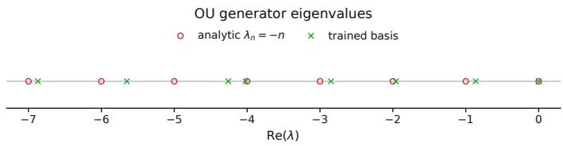
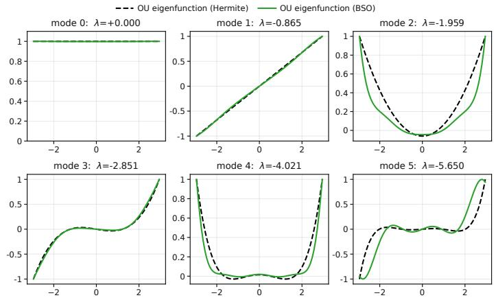
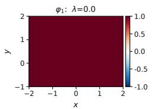
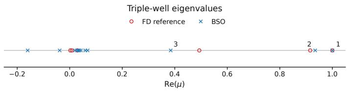
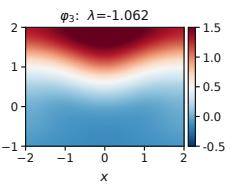
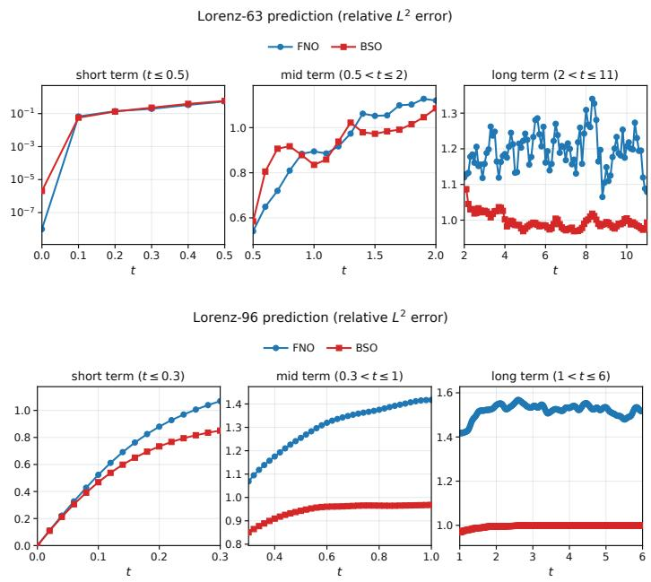
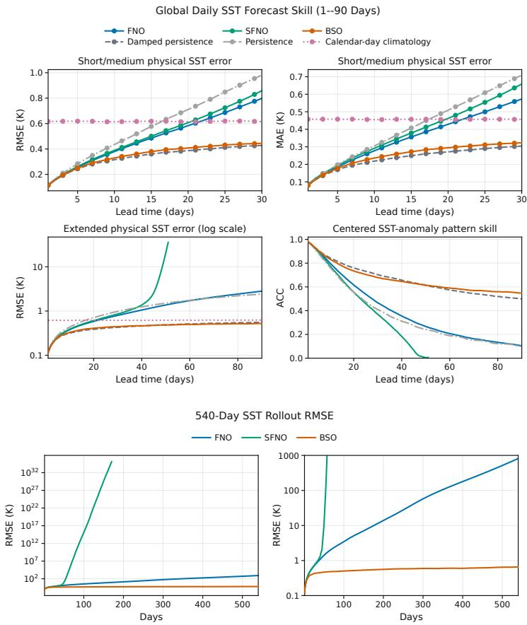
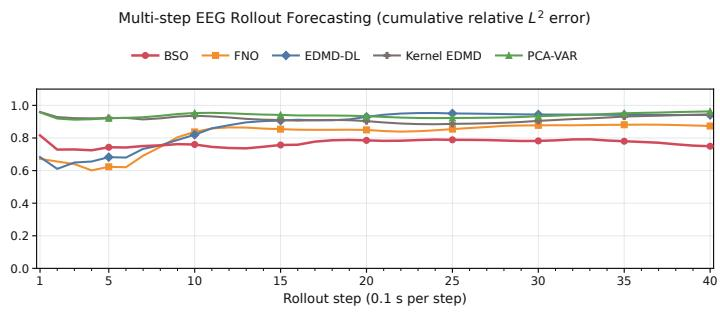
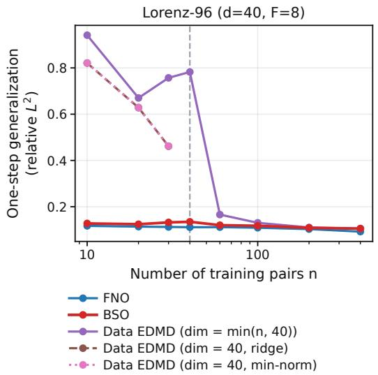

# Learning Kolmogorov Backward Operators for Spectral Analysis and Forecasting: A Data-Driven Variational Galerkin Framework

Yuanchao Xu∗, Claire Valva† , Ben Gao‡ , and Isao Ishikawa∗

## Abstract.

For a time-homogeneous Markov process, the fixed-lag solution operator $( T _ { \tau } f ) ( x ) = \mathbb { E } [ f ( X _ { t + \tau } )$ $X _ { t } ~ = ~ x ]$ of the Kolmogorov backward equation evolves observables linearly and deterministically, even when the dynamics are stochastic. We approximate this operator using a two-stage method where we first approximate this operator directly from data, without knowledge of the governing equation (e.g., Fourier Neural Operator), and then compress the Galerkin projection onto a finite dimensional observable space that is fixed in advance or selected variationally. The error analysis traces the learning error of the estimator, the sampling error of the Galerkin inner products, and the invariance and reconstruction properties of the observable space to the computed spectra and forecasts. The sampling error enters only through a multiplicative factor. Near an isolated spectral cluster, the invariance defect of a subspace controls its distance from the target invariant subspace. The forecast error is controlled by the one-step error of the reduced model and the projection error of the observable; when the measure is invariant and the reduced model preserves constants and is stable on mean-zero observables, the bound is uniform in the horizon. For deterministic dynamics, a learning rate for Fourier neural operators (FNOs) gives one explicit bound for the learning error. Numerical experiments illustrate spectral approximation and forecasting, including long-rollout stability and a comparison with extended dynamic mode decomposition (EDMD) when fewer transition pairs than basis functions are observed.

Key words. Kolmogorov backward equation, data-driven dynamical systems, Koopman operator, operator learning, Galerkin approximation, invariant subspaces, spectral analysis, forecasting

MSC codes. 37M10, 37M25, 47A15, 47A55, 47A58, 60J35, 68T07

1. Introduction. When the governing equations are unknown, incomplete, or too costly to solve, data-driven methods seek predictive and interpretable models directly from timeresolved observations. Working with partial observations or stochastic systems complication this task as the measured variables need not satisfy a closed deterministic evolution law.

A deterministic and linear description is available at the level of observables. For a timehomogeneous Markov process, the fixed-lag solution operator of the Kolmogorov backward equation is

$$
( T _ { \tau } f ) ( x ) : = \mathbb { E } [ f ( X _ { t + \tau } ) \mid X _ { t } = x ] .
$$

It remains linear and deterministic when the trajectories are random, and for deterministic dynamics it reduces to the Koopman operator [30, 31]. We refer to $T _ { \tau }$ as the backward solution operator, or simply the solution operator. It is the element of the transition semigroup at the fixed lag τ , not the generator of the backward equation. Time-lagged data thus provide statistical information about a deterministic evolution of observables.

Most data-driven approximations of this evolution are formed after an observable space has been chosen. Extended dynamic mode decomposition (EDMD) estimates the Galerkin compression of the operator on a fixed dictionary [32, 67]. The dictionary may also be learned [38, 43, 51, 62], for instance by minimizing single-transition spectral residuals [72], or it may be replaced by a reproducing-kernel space [29, 35], for which sharp spectral error rates are available [33]. Variational principles guide the choice of the approximation [44, 48, 49, 69], residual and invariance criteria assess its accuracy [18, 19, 25], and the resulting a posteriori error bounds have been minimized to select dictionary and kernel parameters [19]. Several of these ideas have been carried over to stochastic dynamics. Residual DMD has been extended to account for the conditional variance of single transitions [17]. Invariant representations have been learned with an objective whose maximizer is the leading invariant subspace [34], and the Koopman semigroup has been approximated from data through a stochastic Taylor expansion [71].

In most of these methods, the approximation of the dynamics is tied to a chosen set of coordinates and each candidate observable space requires its own fit of the dynamics. Operator-learning methods instead approximate maps between function spaces without first fixing a reduced representation [10, 13, 36, 37, 39, 42, 59, 70]. For overviews of the operatortheoretic formulation and its relation to spectral decomposition, model reduction, and datadriven learning, see [9, 46, 47].

We combine these two viewpoints in a two-stage method, which we call the backwardsolution-operator (BSO) method. In the first stage, the solution operator is approximated as a map on observables, before any reduced coordinates are fixed. In the second stage, the estimator is projected onto an observable space that is either chosen in advance or learned by balancing approximate invariance against the representation of the observables of interest. Approximating the operator before fixing the coordinates has three consequences. First, the same estimator can be evaluated on any candidate observable space, so the space can be searched without refitting the dynamics. Second, for stochastic dynamics, an estimator of $T _ { \tau }$ approximates the conditional mean $T _ { \tau } f$ of each observable $f .$ The invariance of a candidate space is therefore assessed without the conditional-variance contribution that enters single-transition residuals. Third, once the estimator is fixed, its m-dimensional Galerkin compression can be formed even when the number $n _ { \mathrm { o p } }$ of observed transitions satisfies $n _ { \mathrm { o p } } <$ m, whereas the corresponding EDMD Gram matrix is then necessarily singular.

The main theoretical contribution of this work is an error analysis of the entire two-stage method, from the approximation of $T _ { \tau }$ to the computed spectra and forecasts, in which the observable space may itself be selected from the data. The analysis separates three sources of error: the learning error of the estimator on the observable space, the sampling error of the empirical inner products used to assemble the Galerkin matrix, and the invariance and reconstruction properties of the observable space itself. The sampling error enters only through a factor that tends to one. The main results are the following.

• The space selected by the variational objective is nearly as good as the best candidate when measured by the exact objective, up to the learning error, the optimization tolerance, and the sampling factor (Theorem 4.2). The computed eigenvalues and spectral subspaces converge whenever the observable spaces approach a finite-dimensional invariant subspace, the learning error on these spaces tends to zero, and the sampling error stays bounded away from one (Theorem 4.3). If the corresponding spectral cluster is isolated, the invariance defect of a subspace is locally equivalent to its distance from the invariant subspace (Theorem 4.4). The variational objective therefore bounds this distance, provided that the reconstruction observables resolve the subspace and lie suficiently close to it and that the value of the objective is small relative to its reconstruction weight.

• The forecast error is bounded by the one-step error of the space in use and by the part of the observable that this space does not represent (Theorem 4.5); no invariant subspace is required. For an invariant measure and reduced models that preserve constants and are stable on mean-zero observables, a bound that is uniform in the horizon is given in Appendix D.3.

• For deterministic dynamics, a learning rate for Fourier neural operators (FNOs) provides one explicit bound for the first stage (Corollary 4.6); it can be inserted into the spectral and forecast estimates above.

The analysis does not depend on how the estimator is constructed, and stochastic dynamics enter only through its learning error. For stochastic dynamics, the estimator has to approximate conditional means, for instance by regression or through a learned transition kernel (Remark 3.1); no explicit learning rate is given for that case.

The rest of the paper is organized as follows. Section 2 gives the operator and spectral setting. Section 3 presents the method, its computational realization, and its relation to EDMD. Section 4 establishes the error analysis, and section 5 reports the numerical experiments. Section 6 concludes. Proofs and supplementary material are collected in the appendices.

2. Preliminaries. This section fixes the notation and recalls the operator and spectral setting used throughout the paper.

Notation. Unless stated otherwise, observables belong to $\mathcal { H } : = L ^ { 2 } ( \Omega , \rho ; \mathbb { R } )$ , where Ω is a standard Borel space and $\rho$ is a Borel probability measure on Ω. The symbols $\langle \cdot , \cdot \rangle$ and $\| \cdot \|$ denote the $L ^ { 2 } ( \rho )$ inner product and norm. For normed spaces X and $\mathcal { V } , B ( \mathcal { X } , \mathcal { Y } )$ denotes the bounded linear operators from X to Y with the operator norm $\| \cdot \|$ , and $\boldsymbol { B } ( \mathcal { X } ) : = \boldsymbol { B } ( \mathcal { X } , \mathcal { X } )$ For a closed subspace V of H, PV is the orthogonal projection onto V .

The complexification of a real linear space W of functions or of equivalence classes is $W + i W$ , and that of H carries the inner product that is conjugate-linear in its first argument. Whenever complex scalars appear, a real space and its complexification are denoted by the same symbol, and so are a real operator and its complex-linear extension, which has the same norm; spectra always refer to the extension.

For vectors and matrices, ⊤ denotes the transpose, ∗ the conjugate transpose, † the Moore– Penrose pseudoinverse, and $\| \cdot \| _ { 2 }$ the Euclidean norm of a vector and the spectral norm of a matrix; $\lambda _ { \mathrm { m a x } }$ and $\lambda _ { \operatorname* { m i n } }$ denote the largest and smallest eigenvalues of a Hermitian matrix. For operators between Hilbert spaces, ∗ denotes the adjoint. A basis of a finite-dimensional subspace that is orthonormal in $L ^ { 2 } ( \rho )$ is called ρ-orthonormal and is denoted by $\chi ,$ with a superscript naming the subspace when it is not V . A hat denotes a quantity computed from data, and a subscript ⋆ refers to the target invariant subspace $E _ { \star }$ introduced in subsection 2.2.

2.1. Kolmogorov backward equation. Let $( X _ { t } ) _ { t \geq 0 }$ be a time-homogeneous Markov process on Ω with transition semigroup $( T _ { t } ) _ { t \geq 0 }$ 2

$$
( T _ { t } f ) ( x ) : = \mathbb { E } \big [ f ( X _ { t } ) \mid X _ { 0 } = x \big ] .
$$

Time homogeneity gives $( T _ { \tau } f ) ( x ) = \mathbb { E } [ f ( X _ { s + \tau } ) \mid X _ { s } = x ]$ for every $s \geq 0$ . The operator $T _ { \tau }$ is an element of the Markov semigroup [53] and is also called the stochastic Koopman operator $[ 2 0 , 5 0 , 7 1 ]$ . If $\rho$ is invariant, then $T _ { \tau }$ is a contraction on $L ^ { 2 } ( \rho )$ by Jensen’s inequality and $T _ { \tau } 1 = 1 \mathrm { { : } }$ ; otherwise we assume that $T _ { \tau }$ is well defined and bounded on $L ^ { 2 } ( \rho )$ . When the semigroup is strongly continuous on $L ^ { 2 } ( \rho )$ , it has a generator $\mathcal { L }$ with domain dom(L), and $T _ { t } = e ^ { t \mathcal { L } }$ in the semigroup sense. For $f \in \mathrm { d o m } ( \mathcal { L } )$ , the function $u ( t , \cdot ) = T _ { t } f$ then solves the Kolmogorov backward equation [22, 53]

$$
\partial _ { t } u = \mathcal { L } u , \qquad u ( 0 , \cdot ) = f .
$$

For an Itˆo difusion $\mathrm { d } X _ { t } = b ( X _ { t } ) \mathrm { d } t + \sigma ( X _ { t } ) \mathrm { d } W _ { t }$ with drift b and difusion coeficient $\sigma ,$ driven by a Brownian motion $W _ { t }$ , Itˆo’s formula [53] gives, for smooth $f ,$

$$
\mathcal { L } f = b \cdot \nabla f + \frac { 1 } { 2 } \operatorname { t r } ( \sigma \sigma ^ { \top } \nabla ^ { 2 } f ) ,
$$

while for ${ \dot { x } } = F ( x ) , { \mathcal { L } } f = F \cdot \nabla f$ . For deterministic dynamics with flow map $\Phi ^ { t } , X _ { t } = \Phi ^ { t } ( X _ { 0 } )$ and $T _ { t } f = f \circ \Phi ^ { t }$ . Throughout the analysis, the lag $\tau > 0$ is fixed, and we write

$$
T : = T _ { \tau } , \qquad M _ { T } : = \| T \| _ { B ( \mathcal { H } ) } .
$$

2.2. Invariant subspaces and spectral projections. The targets of the spectral computation are finite-dimensional T-invariant subspaces, and computed spaces are compared with them through the distance dist $( V , W ) : = \| P _ { V } - P _ { W } \|$ between closed subspaces $V$ and W of H. If V and W have the same finite dimension, then dist $( V , W ) = \| ( I - P _ { V } ) P _ { W } \| = \| ( I - P _ { W } ) P _ { V } \|$ is the sine of the largest principal angle between V and $W \ [ 6 , 6 1 ]$ , [28, Chap. I, §6.8].

A subspace $E \subset { \mathcal { H } }$ is T-invariant if $T E \subset E$ . Throughout, $E _ { \star }$ denotes an m-dimensional T-invariant subspace and $P _ { \star } : = P _ { \cal E _ { \star } }$ ; the eigenvalues of $T \vert _ { E _ { \star } }$ are eigenvalues of $T .$ . The main examples are spectral subspaces. Suppose that a finite, conjugation-invariant set $\Lambda _ { \star } \subset$ spec(T), an isolated cluster, is separated from spec $( T ) \setminus \Lambda$ ⋆ by a positively oriented contour Γ in the resolvent set, and that the Riesz projection

$$
\Pi : = \frac { 1 } { 2 \pi i } \oint _ { \Gamma } ( z I - T ) ^ { - 1 } \ : \mathrm { d } z
$$

has finite rank m. Since T is real and $\Lambda _ { \star }$ is conjugation invariant, so is Ran Π, and its real part $E _ { \star } = \{ u \in$ Ran $\Pi : { \overline { { u } } } = u \}$ is an m-dimensional T-invariant subspace with Ran $\Pi = E _ { \star } + i E _ { \star }$ and spe $: ( T | _ { E _ { \star } } ) = \Lambda _ { \star } \left[ 2 8 \right.$ , Chap. III, §6.4]. The complexification Ran Π is the spectral subspace of $\Lambda _ { \star }$ , and we also call $E _ { \star }$ the spectral subspace of $\Lambda _ { \star }$ . In reversible difusion settings, $\mathcal { L }$ is self-adjoint, and $T _ { \tau } ~ = ~ e ^ { \tau { \cal C } }$ and L have the same eigenspaces by the spectral theorem; in the non-self-adjoint case, spectral subspaces are the stable spectral objects [28, 61]. The eigenvalues $\mu$ of $T _ { \tau }$ are discrete-time multipliers. When continuous-time rates are reported, $\lambda = \tau ^ { - 1 } \log \mu , \mu \neq 0$ , is evaluated on a fixed branch of the logarithm.

3. Approximation and Galerkin projection of the solution operator. The BSO method has two stages. First, an estimator $\widehat { T }$ of the solution operator $T$ is constructed from data. Second, the estimator is compressed to a Galerkin matrix on an observable space V that is fixed in advance or selected variationally. In matrix form, the second stage is a least-squares problem. Let $\psi _ { 1 } , \ldots , \psi _ { m }$ be a basis of $V ,$ let $x _ { 1 } , \ldots , x _ { n }$ be sample points in $\Omega ,$ and define the data matrices

$$
( \Psi ) _ { k j } : = \psi _ { j } ( x _ { k } ) , \qquad ( \Psi _ { \widehat { T } } ) _ { k j } : = ( \widehat { T } \psi _ { j } ) ( x _ { k } ) , \qquad \Psi , \Psi _ { \widehat { T } } \in \mathbb { R } ^ { n \times m } ,
$$

where boldface distinguishes data matrices from bases. If Ψ has full column rank, the BSO matrix is

$$
\widehat K : = \Psi ^ { \dagger } \Psi _ { \widehat T } = \big ( \Psi ^ { \top } \Psi \big ) ^ { - 1 } \Psi ^ { \top } \Psi _ { \widehat T } .\tag{3.1}
$$

This is the EDMD matrix with the observed time-advanced values replaced by the values $( \widehat { T } \psi _ { j } ) ( x _ { k } )$ of the estimator, so that the sample points need not have observed next-step values. The eigenpairs of $\widehat { K }$ are used for spectral analysis and its powers for forecasting. For the analysis, the basis is orthonormalized in the empirical inner product of the sample points (subsection 3.3), which turns (3.1) into a matrix of inner products. For a linear estimator, this changes $\widehat { K }$ only by a similarity transformation. The two stages are described in subsections 3.1 and 3.2, the computational realization in subsection 3.3, and the relation to EDMD in subsection 3.4.

3.1. Learning the solution operator. Let X be a state observed at a time $t \geq 0$ , whose law is absolutely continuous with respect to $\rho ,$ and let $X ^ { + } : = X _ { t + \tau }$ be the state one lag later. By the definition of T in subsection 2.1, every observable $f$ satisfies

$$
( T f ) ( X ) = \mathbb { E } { \big [ } f ( X ^ { + } ) \mid X { \big ] } \qquad { \mathrm { a l m o s t ~ s u r e l y } } ,
$$

so that the time-lagged values of every observable are governed by $T .$ . The data $\mathcal { D } _ { \mathrm { o p } }$ of the method are $n _ { \mathrm { o p } }$ time-lagged pairs of observables, which arise in two forms. In the first form, they are the lagged values $f ( X _ { k } )$ and $f ( X _ { k } ^ { + } )$ of observables $f$ at observation times $t _ { 1 } , \ldots , t _ { n _ { \mathrm { o p } } } .$ , where $X _ { k } : = X _ { t _ { k } }$ and $X _ { k } ^ { + } : = X _ { t _ { k } + \tau } ;$ for the observed variables of Remark 3.1, these lagged values are the lagged observations $( y _ { t _ { k } } , y _ { t _ { k } + \tau } )$ . In the second form, used in the spectral experiments of section 5, they are observables $f _ { k }$ together with their images $T f _ { k }$ under the backward evolution over one lag. From these data an estimator $\widehat { T }$ of $T$ is constructed without knowledge of the governing equation. The analysis is independent of the operatorlearning method and depends only on the accuracy of $\widehat { T }$ on the observable spaces under consideration. With partial observations, the same procedure approximates a compression of $T$ to the functions of the observed variables (Appendix E).

One technical point concerns the functions on which $\widehat { T }$ acts. Only the values of $\widehat { T }$ on finitely many functions — evaluated at the sample points of the Galerkin step — enter the computation. Point evaluations are not defined on the $\rho \mathrm { - }$ -equivalence classes that form $\mathcal { H }$ . We therefore fix a linear space $\mathfrak { F }$ of everywhere-defined measurable functions Ω → R that are square integrable with respect to $\rho ,$ and we regard $\widehat { T }$ as a linear map $\widehat { T } \colon \mathfrak { F } \to \mathfrak { F } ;$ estimators that are not linear are covered by Remark 3.2. The space $\mathfrak { F }$ is not canonical. Any such space may be used that contains the constant function 1, the candidate dictionaries, and the reconstruction observables of subsection 3.2, and that is mapped into itself by $\widehat { T }$ . The conventions for passing between functions in $\mathfrak { F }$ and their ρ-equivalence classes are collected in Appendix $\mathrm { A }$

Remark 3.1. In the experiments of section $5 , { \widehat { T } }$ is a neural operator, obtained in one of two ways. In the spectral examples, a neural operator is trained on pairs $( f , T f )$ of observables and approximates $T$ directly. Such an estimator is in general nonlinear in $f$ and is covered by Remark 3.2. In the forecasting examples, the data are time series of observed variables $y _ { t } = h ( X _ { t } ) $ with values in a space $Y _ { i }$ , such as sensor readings, fields, or delay vectors, where each component of $h$ is an observable. A neural operator ${ \widehat { \Phi } } \colon Y \to Y$ is then trained on the lagged observations $( y _ { t } , y _ { t + \tau } )$ . If the observed variables evolve autonomously, $y _ { t + \tau } = \Phi ( y _ { t } )$ , as for deterministic dynamics observed through an injective map or through delay coordinates, then $T$ acts on observables of $y$ by composition with $\Phi ;$ if the full state is observed, $\Phi = \Phi ^ { \tau }$ We then take $\Omega = Y$ , with $\rho \mathrm { ~ a ~ }$ probability measure on $Y$ and $T f = f \circ \Phi$ , and use the composition estimator ${ \widehat { T } } f : = f \circ { \widehat { \Phi } }$ , which is linear in $f .$ . If the observed variables do not evolve autonomously, as for stochastic dynamics or partial observations, and $\widehat { \Phi }$ is trained by least squares, then $f \circ \widehat \Phi$ approximates the conditional mean of $f ( y _ { t + \tau } )$ given $y _ { t }$ for afine $f ,$ but in general not for nonlinear $f .$ In that case the estimator is obtained by regressing $f ( y _ { t + \tau } )$ on $y _ { t }$ or from an estimate of the transition kernel (Appendix E). Other operator-learning and regression methods can be used in the same way.

3.2. Candidate spaces and the variational objective. Throughout, $m \geq 1$ denotes the dimension of the observable spaces; the invariant subspaces $E _ { \star }$ of subsection 2.2 to which they are compared have the same dimension. Fix a parameter set $\Theta ,$ and let each $\theta \in \Theta$ define a raw dictionary $\phi _ { \theta } = ( \phi _ { \theta , 1 } , \ldots , \phi _ { \theta , m } )$ of functions in $\mathfrak { F }$ whose ρ-equivalence classes are linearly independent, with span $V _ { \theta }$ . Two examples are used below. In a neural dictionary on a subset Ω of $\mathrm { a }$ Euclidean space, $\phi _ { \theta } \colon \Omega  \mathbb { R } ^ { m }$ is a network with one hidden tanh layer and m outputs, and $\theta$ collects its weights and biases, which range over a bounded set. In a polynomial dictionary, the $\phi _ { \theta , j }$ are polynomials of bounded degree, and $\theta$ collects their coeficients. $\mathrm { A }$ dictionary that is fixed in advance corresponds to a singleton $\Theta$ , and the constant function may be kept as a fixed element of every dictionary. Families $\Theta _ { p } , p \in \mathbb { N } ,$ , of increasing richness are considered in subsection 4.2 and Remark F.1; the level $p \ \mathrm { i s }$ , for instance, the network width or the polynomial degree. Quantities such as $\Delta _ { \Theta _ { p } }$ and $\eta _ { \Theta _ { p } }$ are those defined below for a parameter set Θ, taken with $\Theta = \Theta _ { p }$

The observables to be represented, called reconstruction observables, form a finite set $\mathcal { G } : =$ $\{ g _ { 1 } , \dotsc , g _ { q } \} \subset \mathfrak { F } ;$ ; the observables to be forecast in subsection 4.4 are taken from their span. For an m-dimensional subspace $V \subset { \mathcal { H } }$ , define the invariance defect and the reconstruction error

$$
\mathcal { Z } ( V ) : = \| ( I - P _ { V } ) T | _ { V } \| _ { \mathcal { B } ( V , \mathcal { H } ) } , \qquad \mathcal { R } ( V ) : = \operatorname* { m a x } _ { 1 \leq j \leq q } \| ( I - P _ { V } ) g _ { j } \| ,
$$

and, for a weight $\alpha > 0$ , the objective

$$
\mathcal { I } ( V ) : = \mathcal { I } ( V ) ^ { 2 } + \alpha \mathcal { R } ( V ) ^ { 2 } .
$$

The invariance defect ${ \mathcal { T } } ( V )$ vanishes if and only if $V$ is T-invariant; it measures the part of

TV that is not represented in V. The reconstruction error $\mathcal { R } ( V )$ measures the part of the reconstruction observables that is not represented in $V ,$ , and the weight $\alpha$ balances the two terms.

For an m-dimensional subspace $V \subset \mathfrak { F }$ on which $\| \cdot \|$ is a norm, such as $V _ { \theta }$ , the estimator enters the analysis through its learning error on $V$

$$
\begin{array} { r } { \Delta ( V ) : = \| \widehat { T } | _ { V } - T | _ { V } \| _ { B ( V , \mathcal { H } ) } , } \end{array}\tag{3.2}
$$

where $V$ is identified with its image in H (Appendix $\mathrm { A } ) { \mathrm { ; } }$ it is controlled by the accuracy of $\widehat { T }$ on the functions of any basis of V (Lemma A.1).

Remark 3.2 (Nonlinear estimators). An estimator that is not linear in $f ,$ such as a neural operator trained on pairs $( \underset {  } { f } , T f )$ , enters the computation only through its values on the computational basis $\widehat { \Psi } = ( \widehat { \psi } _ { 1 } , \ldots , \widehat { \psi } _ { m } )$ of $V$ (subsection 3.3). For such an estimator, ${ \widehat { T } } | _ { V }$ denotes the linear map $V  \mathfrak { F }$ that sends $\widehat { \psi } _ { j }$ to $\hat { T } \hat { \psi } _ { j }$ , and $\widehat { T } V$ denotes its range; with this convention, all results below remain valid, and Lemma $\mathrm { A . 1 }$ bounds the learning error by the errors of $\widehat { T }$ on the basis functions. The map ${ \widehat { T } } | _ { V }$ , and with it the computed Galerkin operator of subsection 3.3, then depends on the computational basis, hence on the orthonormalization rule and on the sample. If ${ \widehat { T } } | _ { V }$ and $\widehat { T } | _ { V } ^ { \prime }$ are the maps defined by two bases of $V _ { ; }$ , with learning errors $\Delta ( V )$ and $\Delta ^ { \prime } ( V )$ , then

$$
\begin{array} { r } { \big \| \widehat { T } | _ { V } - \widehat { T } | _ { V } ^ { \prime } \big \| _ { B ( V , \mathcal { H } ) } \leq \big \| \widehat { T } | _ { V } - T | _ { V } \big \| + \big \| T | _ { V } - \widehat { T } | _ { V } ^ { \prime } \big \| = \Delta ( V ) + \Delta ^ { \prime } ( V ) , } \end{array}\tag{3.3}
$$

and each of the two computed Galerkin operators satisfies the bound (4.2) of Proposition 4.1 with respect to the same exact compression $P _ { V } T | _ { V }$ , with its own learning error and its own sampling error; the sampling errors difer because the range $\widehat { T } V$ depends on the basis. The bounds of section 4 therefore hold for either choice of the basis, and by (3.3) the two choices give nearby operators whenever both learning errors are small.

Remark 3.3. Let $X \sim \rho$ and let $X ^ { + }$ denote the state one lag $\tau$ after $X$ . For $\varphi \in { \mathcal { H } }$ with $\mathbb { E } | \varphi ( X ^ { + } ) | ^ { 2 } < \infty$ and $\mu \in \mathbb { C }$ , a single-transition residual satisfies

$$
\operatorname { \mathbb { E } } | \varphi ( X ^ { + } ) - \mu \varphi ( X ) | ^ { 2 } = \| T \varphi - \mu \varphi \| ^ { 2 } + \operatorname { \mathbb { E } } | \varphi ( X ^ { + } ) - ( T \varphi ) ( X ) | ^ { 2 } ,
$$

because $\varphi ( X ^ { + } ) - ( T \varphi ) ( X )$ has conditional mean zero given $X$ and is therefore uncorrelated with $( T \varphi - \mu \varphi ) ( X )$ . Thus residuals formed from individual stochastic transitions contain an irreducible conditional-variance term, the last term above, whereas conditional-mean estimation removes this contribution. The same phenomenon is known as the double-sampling issue in Bellman-residual minimization in reinforcement learning [1, 3].

3.3. Computational realization. Let $x _ { 1 } , \ldots , x _ { n }$ be the sample points of (3.1), either drawn independently from $\rho$ or taken from a stationary ergodic trajectory with invariant law $\rho .$ The number $n$ of sample points used for the Galerkin inner products is distinct from the number $n _ { \mathrm { o p } }$ of pairs used to construct $\widehat { T } .$ , and the sample points need not be states at which data were observed (subsection 3.4). For convergence results for DMD based on ergodic trajectory data and Hankel-type observables, see [2]. The empirical inner product and

seminorm are

$$
\langle u , v \rangle _ { n } : = \sum _ { k = 1 } ^ { n } w _ { k } \overline { { u ( x _ { k } ) } } v ( x _ { k } ) , \qquad \| u \| _ { n } : = \langle u , u \rangle _ { n } ^ { 1 / 2 } , \qquad u , v \in \mathfrak { F } ,
$$

with the weights $w _ { k } = 1 / n$ . More generally, the points $x _ { k }$ may be the nodes of a quadrature rule for $\rho$ with positive weights $w _ { k }$ summing to one. The deterministic statements below hold verbatim for such weights, with (3.1) replaced by the corresponding weighted least-squares matrix; the sampling error η of subsection 4.1 is then the quadrature error of the rule.

Let $V = V _ { \theta }$ for some $\theta \in \Theta$ . Assume that the empirical Gram matrix $[ \langle \phi _ { \theta , i } , \phi _ { \theta , j } \rangle _ { n } ] _ { i , j = 1 } ^ { m }$ of $\phi _ { \theta }$ is nonsingular, which requires $n \geq m$ . Let $\widehat { \Psi } = ( \widehat { \psi } _ { 1 } , \dots , \widehat { \psi } _ { m } )$ be the basis of V obtained by orthonormalizing ϕθ in $\langle \cdot , \cdot \rangle _ { n }$ by a fixed rule, for example Gram–Schmidt or symmetric orthonormalization; we call $\widehat { \Psi }$ the computational basis of V . For a subspace $V$ on which $\langle \cdot , \cdot \rangle _ { n }$ is an inner product, $\widehat { P } _ { V }$ denotes the $\langle \cdot , \cdot \rangle _ { n }$ -orthogonal projection onto V , which is defined on ${ \mathfrak { F } } .$ From now on, $\widehat { K }$ denotes the least-squares matrix (3.1) for the computational basis. Since $\bar { \Psi } ^ { \top } \bar { \Psi } = n I$ for this basis, this computed Galerkin matrix and the image Gram matrix are

$$
\begin{array} { r } { \widehat { K } = [ \left. \widehat { \psi } _ { i } , \widehat { T } \widehat { \psi } _ { j } \right. _ { n } ] _ { i , j = 1 } ^ { m } , \qquad \widehat { L } : = [ \left. \widehat { T } \widehat { \psi } _ { i } , \widehat { T } \widehat { \psi } _ { j } \right. _ { n } ] _ { i , j = 1 } ^ { m } . } \end{array}
$$

The matrix $\widehat { L }$ is the counterpart of the additional matrix that residual DMD adds to those of EDMD [18], with the values of the estimator in place of the observed values. The matrix $\widehat { K }$ is the matrix, in the basis $\widehat { \Psi }$ , of the computed Galerkin operator

$$
\widehat { K } : = \widehat { P } _ { V } \widehat { T } | _ { V } \in \mathcal { B } ( V ) , \qquad \widehat { K } \widehat { \psi } _ { j } = \sum _ { i = 1 } ^ { m } \widehat { K } _ { i j } \widehat { \psi } _ { i } .\tag{3.4}
$$

The eigenvalues of $\widehat { K }$ are those of $\widehat { \kappa }$ , and an eigenvector c of $\widehat { K }$ corresponds to the eigenfunction $\textstyle \sum _ { j } c _ { j } { \widehat { \psi } } _ { j }$ of $\widehat { \kappa }$ . The computed objective of $V = V _ { \theta }$ is

$$
\widehat { \mathcal { T } } ( \theta ) : = \lambda _ { \operatorname* { m a x } } \Big ( \widehat { L } - \widehat { K } ^ { \top } \widehat { K } \Big ) + \alpha \operatorname* { m a x } _ { 1 \leq j \leq q } \| ( I - \widehat { P } _ { V } ) g _ { j } \| _ { n } ^ { 2 } .\tag{3.5}
$$

When $\langle \cdot , \cdot \rangle _ { n }$ is an inner product on $V + \widehat { T } V$ , its first term is the squared invariance defect of V with respect to ${ \widehat { T } } ,$ measured in $\langle \cdot , \cdot \rangle _ { n }$ (Lemma A.1). Thus $\widehat { \mathcal { I } } ( \theta )$ is the empirical counterpart of ${ \mathcal { I } } ( V _ { \theta } )$ , with $T$ replaced by $\widehat { T }$

Algorithm 3.1 summarizes the procedure. Training the estimator $\widehat { T }$ is the main computational cost, while the Galerkin step is a small least-squares problem that can be repeated over candidate spaces at negligible cost. Operator estimation, space selection, and matrix assembly may use separate data sets; the efect of reusing data on the error bounds is described in subsection 4.1 and Appendix B.

3.4. Relation to EDMD. Consider a fixed space V and data given by lagged values at the states $X _ { k }$ and $X _ { k } ^ { + }$ of subsection 3.1; we call $( X _ { k } , X _ { k } ^ { + } )$ transition pairs in what follows. Take the states $X _ { k }$ as the sample points $x _ { k }$ of subsection 3.3. Replacing $\Psi _ { \widehat { T } }$ in (3.1) by the matrix empirical Gram matrix, $\widehat { K }$ is defined whether or not $n _ { \mathrm { o p } } < m$ , and it is not subject to this rank bound. This does not imply that $n _ { \mathrm { o p } }$ transitions identify an arbitrary m × m operator. The additional directions are supplied by $\widehat { T }$ , and the error of $\widehat { K }$ is governed by the learning error and the sampling error (subsection 4.1). See [16] for the regime of fewer snapshots than dictionary functions within residual DMD.

Algorithm 3.1 Fixed-lag solution-operator approximation and Galerkin projection   
Input Data $\mathcal { D } _ { \mathrm { o p } }$ for constructing $\widehat { T }$ (subsection 3.1); sample points $x _ { 1 } , \ldots , x _ { n } ,$ with their   
weights if these are not equal; either a fixed dictionary or candidate dictionaries $\{ \phi _ { \theta } \} _ { \theta \in \Theta } ;$   
the reconstruction observables ${ \mathcal { G } } ,$ and for space selection $\alpha > 0$ and a tolerance $\zeta \geq 0 ;$   
optional observable $f \in \mathbf { \Sigma }$ span $\mathcal { G }$ and horizon $N .$   
Output Space ${ \widehat { V } } _ { : }$ , basis ${ \widehat { \boldsymbol { \Psi } } } _ { : }$ , Galerkin matrix ${ \widehat K } .$ , the requested eigenvalues and associated   
eigenvectors or Schur vectors, and optional forecast.   
1: Construct $\widehat { T }$ from $\mathcal { D } _ { \mathrm { o p } }$   
2: if the dictionary is fixed in advance then   
3: Set $\widehat { V }$ equal to its span and $\widehat { \Psi }$ equal to its basis orthonormalized in $\langle \cdot , \cdot \rangle _ { n } .$   
4: else   
5: Compute ${ \widehat { \theta } } \in \Theta$ with $\begin{array} { r } { \widehat { \mathcal { I } } ( \widehat { \theta } ) \leq \operatorname* { i n f } _ { \theta \in \Theta } \widehat { \mathcal { I } } ( \theta ) + \zeta , } \end{array}$ and set $\widehat { V } \gets V _ { \widehat { \theta } }$ and $\widehat { \Psi }$ equal to its   
computational basis.   
6: end if   
7: Evaluate $\widehat { T } \widehat { \psi } _ { j } , j = 1 , \ldots , m .$ , and set $\widehat { K } \gets [ \Big \langle \widehat { \psi } _ { i } , \widehat { T } \widehat { \psi } _ { j } \Big \rangle _ { n } ] _ { i , j = 1 } ^ { m }$ , the matrix of the computed   
Galerkin operator $( 3 . 4 )$   
8: Compute the required eigenvalues, eigenvectors, or Schur vectors of $\widehat { K }$   
9: if $f$ and $N$ are supplied then   
10: Compute $\widehat { c } ~ : = ~ ( \left. \widehat { \psi } _ { j } , f \right. _ { n } ) _ { j = 1 } ^ { m }$ , the coeficients of $\widehat { P } _ { \widehat { V } } f _ { : }$ , and return the forecast   
$\textstyle \sum _ { j } ( \widehat { K } ^ { N } \widehat { c } ) _ { j } \widehat { \psi } _ { j }$   
11: end if   
of observed values $\psi _ { j } ( X _ { k } ^ { + } )$ then gives the standard EDMD matrix [67], which converges to the   
Galerkin matrix of $T$ as the number of transition pairs increases, by the law of large numbers   
[32]. For a fixed $\widehat { T }$ , BSO instead targets the Galerkin matrix of ${ \hat { T } } ,$ , whose discrepancy from   
that of $T$ is controlled by $\Delta ( V )$ . EDMD with dictionary learning also optimizes the observable   
space [38]. The distinction here is that $\widehat { T }$ is constructed before the space search and can be   
reused across candidate spaces. In stochastic systems, its conditional-mean targets also avoid   
the conditional-variance term of Remark 3.3 [17].   
Rank constraints with few transition pairs. Let $\Psi _ { X } , \Psi _ { X ^ { + } } \in \mathbb { R } ^ { n _ { \mathrm { o p } } \times m }$ be the data matrices   
with entries $\psi _ { j } ( X _ { k } )$ and $\psi _ { j } ( X _ { k } ^ { + } )$ for a basis $\psi _ { 1 } , \ldots , \psi _ { m }$ of $V$ . The EDMD matrix $K ^ { \mathrm { E } }$ solves   
$G K ^ { \mathrm { E } } = A ^ { \mathrm { E } }$ with the EDMD Gram and cross matrices   
$G : = \frac { 1 } { n _ { \mathrm { o p } } } \Psi _ { X } ^ { \top } \Psi _ { X } , \qquad A ^ { \mathrm { E } } : = \frac { 1 } { n _ { \mathrm { o p } } } \Psi _ { X } ^ { \top } \Psi _ { X ^ { + } } .$   
If $n _ { \mathrm { o p } } ~ < ~ m$ , then $G$ is singular, and the minimum-norm solution $K ^ { \mathrm { E } } = G ^ { \dagger } A ^ { \mathrm { E } }$ satisfies   
rank $( K ^ { \mathrm { E } } ) \le \mathrm { r a n k } ( A ^ { \mathrm { E } } ) \le n _ { \mathrm { o p } } ;$ the same rank bound holds if $G$ is estimated from additional   
states. Hence $n _ { \mathrm { o p } } \geq$ m is necessary for an unregularized full-rank EDMD fit. In BSO, the   
$n _ { \mathrm { o p } }$ transition pairs determine ${ \widehat { T } } _ { \mathbf { { i } } }$ , and the Galerkin matrix $\widehat { K }$ is then computed as in subsec  
tion 3.3 from points $x _ { k } .$ possibly weighted, whose construction does not use the states $X _ { k } ^ { + }$   
These points may, for instance, be generated from observed states with the learned map Φb   
of a composition estimator, as in subsection 5.3. With $n \geq m$ such points and a nonsingular

Remark 3.4 (Bias and variance). The transition data also enter the two errors diferently. Let $K _ { T } : = [ \langle \chi _ { i } , T \chi _ { j } \rangle ] _ { i , j = 1 } ^ { m }$ be the Galerkin matrix of $T$ in a $\rho \mathrm { - }$ -orthonormal basis $\chi$ of $V .$ For independent transition pairs with $X _ { k } \sim \rho ,$ the EDMD cross matrix $A ^ { \mathrm { E } }$ formed with $\chi$ is an unbiased estimator of $K _ { T }$ by the tower property, with variance of order $n _ { \mathrm { o p } } ^ { - 1 }$ under a moment condition. Conditionally on $\widehat { T } .$ , with sample points that are independent of it, the corresponding BSO cross matrix $[ \left. \chi _ { i } , \widehat { T } \chi _ { j } \right. _ { n } ] _ { i , j = 1 } ^ { m }$ has instead the bias $[ \langle \chi _ { i } , ( \widehat { T } - T ) \chi _ { j } \rangle ] _ { i , j = 1 } ^ { m } .$ of norm at most $\Delta ( V )$ , and its only fluctuation is the error of the empirical inner products (subsection 4.1). The learning error thus plays for BSO the role that the sampling variance plays for EDMD. A target that blends the observed values, with weight $1 - \beta .$ , and the values of the estimator, with weight $\beta \in [ 0 , 1 ]$ , as in subsection 5.2.2, interpolates between the two. With the states $X _ { k }$ as sample points and transition pairs that are independent of $\widehat { T }$ , the bias has norm at most $\beta \Delta ( V )$ , and the fluctuations of the EDMD and BSO cross matrices are scaled by $1 - \beta$ and $\beta .$ .

4. Error analysis for spectral approximation and forecasting. Throughout this section, $V ~ \subset ~ \mathfrak { F }$ is an m-dimensional subspace with the computational basis $\widehat { \Psi } \ = \ ( \widehat \psi _ { 1 } , \ldots , \widehat \psi _ { m } )$ of subsection 3.3, which is orthonormal in $\langle \cdot , \cdot \rangle _ { n } ; \widehat { K } = \widehat { P } _ { V } \widehat { T } | _ { V }$ is the computed Galerkin operator (3.4), and $\widehat { K }$ is its matrix. The computational basis is in general not ρ-orthonormal; $\rho -$ orthonormal bases of $V$ are denoted by $\chi .$

The analysis compares $\widehat { \kappa }$ with the solution operator $T$ and is organized by the origin of the errors. Three quantities enter the bounds. The estimator enters only through its learning error $\Delta ( V )$ of (3.2), the error of the first stage on the unit ball of $V ;$ no assumption is made on its construction or training. The learning error is bounded by the errors of $\widehat { T }$ on the functions of a basis of $V$ (Lemma A.1) and by the prediction error on held-out data (Appendix F), and it is bounded explicitly for an FNO in subsection 4.5. The empirical inner products enter through the sampling error $\eta _ { V }$ defined in subsection 4.1. The space enters through its invariance defect ${ \mathcal { T } } ( V )$ and its reconstruction error $\mathcal { R } ( V )$ (subsection 3.2).

The section is organized as follows. Subsection 4.1 defines the sampling error and gives the basic estimate: one application of $\widehat { \kappa }$ difers on V from one application of $T$ by at most $( \mathcal { T } ( V ) + \Delta ( V ) ) / ( 1 - \eta _ { V } )$ This estimate holds for every space and underlies the two main results, the spectral bound of subsection 4.3, which requires in addition that V be close to a T-invariant subspace $E _ { \star }$ , and the forecast bound of subsection 4.4. For a space selected by the search, subsection 4.2 bounds the objective ${ \mathcal { I } } _ { : }$ , and thereby $\mathcal { T }$ and $\mathcal { R }$ , in terms of the learning and sampling errors, the best candidate, and the tolerance of the search. Theorem 4.4 relates ${ \mathcal { T } } ( V )$ to the distance from $V$ to $E _ { \star }$ , and subsection 4.5 inserts an explicit learning rate for FNOs. Proofs are given in Appendix $\mathrm { C } ,$ , which follows the auxiliary lemmas of Appendices $\mathrm { A }$ and ${ \mathrm { B } } ;$ supplementary results are collected in Appendix D.

4.1. One-step error. The Galerkin matrix $\widehat { K }$ is assembled from the sample points through the empirical inner product $\langle \cdot , \cdot \rangle _ { n } .$ which difers from the inner product of $L ^ { 2 } ( \rho )$ . The sampling error measures this diference on the functions that enter the computation. Let $W \subset { \mathfrak { F } }$ be a finite-dimensional subspace on which ∥·∥ is a norm, that is, which contains no nonzero function that vanishes $\rho \mathrm { - }$ almost everywhere; this is assumed of every space to which $\eta$ is applied below. The sampling error of the empirical inner product on W is

$$
\eta ( W ) : = \operatorname* { s u p } \big \{ | \langle u , v \rangle _ { n } - \langle u , v \rangle | : u , v \in W , \| u \| = \| v \| = 1 \big \} = \| \widehat G _ { W } - I \| _ { 2 } ,\tag{4.1}
$$

where $\widehat { G } _ { W } : = [ \langle \chi _ { i } ^ { W } , \chi _ { j } ^ { W } \rangle _ { n } ] _ { i , j = 1 } ^ { \dim W }$ is the empirical Gram matrix of a ρ-orthonormal basis $\chi ^ { W }$ of $W ;$ the equality holds because $\langle u , v \rangle _ { n } - \langle u , v \rangle = a ^ { \top } ( \widehat { G } _ { W } - I ) b$ for $u , v \in W$ with coeficient vectors a and b in this basis. For the space $V$ , the functions that enter the computation are those of $V$ , their images under the estimator, and the reconstruction observables. Accordingly, set

$$
W _ { V } : = V + \widehat { T } V + \mathrm { s p a n } \mathcal { G } , \qquad \eta _ { V } : = \eta ( W _ { V } ) , \qquad \kappa ( \eta ) : = \Bigl ( \frac { 1 + \eta } { 1 - \eta } \Bigr ) ^ { 1 / 2 } .
$$

We assume $\eta _ { V } ~ < ~ 1$ , which requires $n \geq$ dim $W _ { V }$ , where dim $W _ { V } \leq 2 m + q .$ For a fixed space with a bounded ρ-orthonormal basis, the sampling error is of order $n ^ { - 1 / 2 }$ with high probability, for independent samples by the matrix Bernstein inequality [14, 15, 65] and for ergodic trajectories with a spectral or pseudo-spectral gap by [52] (Appendix B).

Proposition 4.1 (One-step error bound). Let $\eta : = \eta _ { V } < 1$ . Then the computed Galerkin operator satisfies

$$
\big \| \widehat { K } - P _ { V } T | _ { V } \big \| \leq \frac { \Delta ( V ) + \eta \mathcal { T } ( V ) } { 1 - \eta } ,\tag{4.2}
$$

and

$$
\| ( T - \widehat { \mathcal { K } } ) v \| \leq e ( V ) \| v \| , \quad v \in V , \qquad w h e r e \quad e ( V ) : = \frac { \mathcal { Z } ( V ) + \Delta ( V ) } { 1 - \eta } .\tag{4.3}
$$

The proposition holds for every space and every estimator and does not bound ${ \mathcal { T } } ( V )$ and $\Delta ( V )$ ; the invariance defect of a selected space is bounded in Theorem 4.2 and the learning error of an FNO in Corollary 4.6. The estimate decomposes the one-step error into two parts: the invariance defect ${ \mathcal { T } } ( V )$ , by which the exact Galerkin compression $P _ { V } T | _ { V }$ difers from $T$ on $V ,$ , and the learning error, which enters through (4.2). The sampling error only inflates these terms, by a factor that tends to one as $\eta  0$ , because the empirical projection $\widehat { P } _ { V }$ is exact on $V$ (Lemma B.1). The spectral bound of Theorem 4.3 uses (4.2), and the forecast bound of Theorem 4.5 uses (4.3).

Data reuse. The deterministic bounds of this section hold for any sample points, whether or not these coincide with the states at which the data for $\widehat { T }$ were observed; independence matters only for the probabilistic bounds on the sampling error. The bounds stated above for a fixed space apply to ηV when the sample points are independent of the data used for $\widehat { T }$ and for the selection of $V .$ . Otherwise the sampling error has to be controlled uniformly over all spaces that can occur. When the space is selected on the same sample, this means uniform control over the candidate family, which is the quantity $\eta _ { \Theta }$ of Theorem 4.2; when the estimator is nonlinear, it also means uniform control over the spaces generated by the computational bases (Remark 3.2). The case in which this uniform control reduces to a bound for a fixed space is described in Appendix $\operatorname { B } ;$ for neural dictionaries with trainable hidden weights, the uniform control is a hypothesis that is not verified here.

4.2. Selection of the observable space. When the space is not fixed in advance, Algorithm 3.1 selects it variationally, by minimizing the computed objective (3.5) over the candidates, all of which are evaluated on the same sample. The computed objective difers from $\mathcal { I }$ in that $\widehat { T }$ replaces $T$ and the empirical inner product replaces that of $L ^ { 2 } ( \rho )$ ; the question is how good the selected space is when measured by $\mathcal { I }$ . Let ${ \widehat { \theta } } \in \Theta$ be computed by the algorithm, so that

$$
{ \widehat { \mathcal { I } } } ( { \widehat { \theta } } ) \leq \operatorname* { i n f } _ { \theta \in \Theta } { \widehat { \mathcal { I } } } ( \theta ) + \zeta , \qquad \zeta \geq 0 ,\tag{4.4}
$$

and write ${ \widehat { V } } : = V _ { \widehat { \theta } }$ . Since $\widehat { \theta }$ depends on the data, the learning and sampling errors of $\widehat { V }$ are not known in advance, and we use their largest values over the candidate family,

$$
\Delta _ { \Theta } : = \operatorname* { s u p } _ { \theta \in \Theta } \Delta ( V _ { \theta } ) , \qquad \eta _ { \Theta } : = \operatorname* { s u p } _ { \theta \in \Theta } \eta _ { V _ { \theta } } .
$$

Theorem 4.2 (Quasi-optimality of the variational selection). $I f \eta _ { \Theta } < 1$ , then

$$
\mathcal { I } ( \widehat { V } ) ^ { 1 / 2 } \leq \varepsilon _ { \Theta } : = \kappa ( \eta _ { \Theta } ) ^ { 2 } \Big ( \operatorname* { i n f } _ { \theta \in \Theta } \mathcal { I } ( V _ { \theta } ) ^ { 1 / 2 } + 2 \Delta _ { \Theta } + \zeta ^ { 1 / 2 } \Big ) .\tag{4.5}
$$

The selected space is thus nearly as good as the best candidate; with exact inner products, it is as good up to $2 \Delta _ { \Theta } + \zeta ^ { 1 / 2 }$ . The bound (4.5) separates the four error sources of the selection step, namely the approximation capacity of the candidate family, in $\dot { \theta } { \mathcal { I } } ( V _ { \theta } )$ , the learning error $\Delta _ { \Theta }$ of the estimator, the optimization tolerance $\zeta ,$ and the sampling error, which enters only through the factor $\kappa ( \eta _ { \Theta } ) ^ { 2 } = ( 1 + \eta _ { \Theta } ) / ( 1 - \eta _ { \Theta } )$ . Both terms of the objective are thereby controlled, $\mathcal { I } ( \widehat { V } ) \leq \varepsilon _ { \Theta }$ and $\mathcal { R } ( \widehat { V } ) \leq \varepsilon _ { \Theta } / \alpha ^ { 1 / 2 }$ , and so is the one-step error (4.3) of the selected space, $e ( \widehat { V } ) \leq ( \varepsilon _ { \Theta } + \Delta _ { \Theta } ) / ( 1 - \eta _ { \Theta } )$ , since ηb ≤ ηΘ and $\Delta ( \widehat { V } ) \leq \Delta _ { \Theta }$ . The computed objective value also bounds the exact one a posteriori, $\mathcal { I } ( \widehat { V } ) ^ { 1 / 2 } \leq \kappa ( \eta _ { \Theta } ) \widehat { \mathcal { I } } ( \widehat { \theta } ) ^ { 1 / 2 } + \Delta _ { \Theta }$ (Lemma B.2).

The objective is Lipschitz continuous with respect to dist, with constant $4 M _ { T } ^ { 2 } \ +$ 2α maxj $\| g _ { j } \| ^ { 2 }$ , since $\mathcal { T }$ and $\mathcal { R }$ are Lipschitz with constants $2 M _ { T }$ and maxj ∥gj∥ and bounded by $M _ { T }$ and maxj $\| g _ { j } \|$ . This continuity yields a convergence statement along increasing levels. Suppose that the candidate spaces $V _ { \theta }$ $\theta \in \Theta _ { p } ,$ , of subsection 3.2 become dense, as $p  \infty$ , in a class of m-dimensional subspaces that contains them and on which $\mathcal { I }$ attains its infimum. Suppose also that $\Delta _ { \Theta _ { p } } , \eta _ { \Theta _ { p } }$ , and $\zeta$ tend to zero along the estimators, samples, and tolerances used at level $p .$ Then (4.5) shows that $\mathcal { I } ( \widehat { V } )$ converges to this infimum for the spaces $\widehat { V }$ selected at level $p .$ If the infimum is attained at a T-invariant subspace $E _ { \star }$ and the reconstruction observables span $E _ { \star }$ , then dist $( \widehat { V } , E _ { \star } ) \to 0$ by Lemma D.1, and Theorem 4.3 gives the convergence of the computed eigenvalues and spectral subspaces. The choice of the level $p$ is discussed in Remark F.1.

4.3. Spectral approximation. Let $E _ { \star }$ be an m-dimensional T-invariant subspace, the target of the spectral computation, so that the eigenvalues to be computed are those of $T \vert _ { E _ { \star } }$ Two questions arise. If V is close to $E _ { \star }$ , how accurate is the computed spectrum? And how can a space that is selected by the objective be guaranteed to be close to $E _ { \star }$ ?

Theorem 4.3 (Spectral error bound). Let $\eta : = \eta _ { V } < 1$ and $d : = \mathrm { d i s t } ( V , E _ { \star } ) < 1$ . Then there is an isometric isomorphism $\mathcal { Q } \colon E _ { \star } \to V$ with $\| \mathcal { Q } - \iota \| _ { \mathcal { B } ( E _ { \star } , \mathcal { H } ) } \leq 2 d$ , where $\iota \colon E _ { \star } \to$ H is the inclusion and $\mathcal { Q }$ is regarded as a map into $\mathcal { H }$ , such that

$$
\big \| \mathcal { Q } ^ { * } \widehat { \mathcal { K } } \mathcal { Q } - T | _ { E _ { \star } } \big \| \leq \frac { \Delta ( V ) + 4 M _ { T } d } { 1 - \eta } .\tag{4.6}
$$

Consequently, consider a sequence of m-dimensional subspaces $V _ { k }$ , possibly with estimators and samples that depend on $k _ { i }$ with computed Galerkin operators $\widehat { \mathcal { K } } _ { k }$ and matrices $\widehat { K } _ { k }$ $I f$ $\Delta ( V _ { k } ) \to 0$ , dist $( V _ { k } , E _ { \star } )  0$ , and $\mathrm { s u p } _ { k } \eta _ { V _ { k } } < 1$ , then the eigenvalues of $\widehat { K } _ { k }$ converge to those $o f T \vert _ { E _ { \star } }$ , counted with algebraic multiplicity, and the spectral subspaces of $\widehat { \mathcal { K } } _ { k }$ converge in dist to the corresponding spectral subspaces of $T \vert _ { E _ { \star } }$

The operator $\mathcal { Q } ^ { * } \widehat { \mathcal { K } } \mathcal { Q } = \mathcal { Q } ^ { - 1 } \widehat { \mathcal { K } } \mathcal { Q }$ acts on $E _ { \star }$ and has the same eigenvalues as $\widehat { K }$ , and (4.6) bounds its distance from $T \vert _ { E _ { \star } }$ , which gives the convergence statement. No spectral isolation is assumed, and $E _ { \star }$ may be spanned by eigenfunctions of eigenvalues embedded in the continuous spectrum, as for measure-preserving systems with mixed spectrum.

The theorem concerns spaces $V$ whose dimension equals that of $E _ { \star } .$ , so that all of V is nearly invariant. In data-driven spectral computations, V is commonly larger than the invariant subspace of interest. The computed eigenpairs that are not associated with this subspace may then be inaccurate or spurious, and they are discarded, for instance by means of the residual bound of Proposition D.3. This filtering is standard and is not analyzed here.

We turn to the second question. The distance dist $( V , E _ { \star } )$ in Theorem 4.3 is not known in practice, whereas the invariance defect is controlled by the selection step (Theorem 4.2). The next theorem shows that the defect and the distance are equivalent near $E _ { \star }$ , provided that the part of the spectrum that belongs to $E _ { \star }$ is separated from the rest, in the following sense. With respect to $\mathcal { H } = E _ { \star } \oplus E _ { \star } ^ { \perp }$ , the operator $T$ is block upper triangular, with diagonal blocks $A _ { \star } : = T | _ { E }$ and $D _ { \star } : = ( I - P _ { \star } ) T | _ { E _ { \star } ^ { \perp } }$ and of-diagonal block $B _ { \star } : = P _ { \star } T | _ { E _ { \star } ^ { \perp } }$ , and we set

$$
\delta _ { \star } : = \operatorname* { i n f } \big \{ \| D _ { \star } Z - Z A _ { \star } \| : Z \in \mathcal { B } ( E _ { \star } , E _ { \star } ^ { \perp } ) , \ \| Z \| = 1 \big \} , \qquad r _ { \star } : = \operatorname* { m i n } \Big \{ 1 , \frac { \delta _ { \star } } { 2 \| B _ { \star } \| } \Big \} ,
$$

with $r _ { \star } : = 1$ if $B _ { \star } = 0$ . The number $\delta _ { \star }$ is the separation of $A _ { \star }$ and $D _ { \star } ~ [ 6 0 , \ 6 1 ]$ , and $r _ { \star }$ determines the size of the neighborhood of $E _ { \star }$ in which the equivalence holds. The separation is positive if $E _ { \star }$ is the spectral subspace of an isolated cluster (subsection 2.2); for self-adjoint $T$ and a cluster formed by the m largest eigenvalues, it is the spectral gap, and $r _ { \star } ~ = ~ 1$ (Appendix D.1).

Theorem 4.4 (Invariance defect and distance). Let $\delta _ { \star } > 0$ , and let V be an m-dimensional subspace with dist $( V , E _ { \star } ) \leq r _ { \star } / \sqrt { 2 }$ . Then

$$
{ \frac { \delta _ { \star } } { 4 } } \operatorname { d i s t } ( V , E _ { \star } ) \leq { \mathcal { I } } ( V ) \leq 2 M _ { T } \operatorname { d i s t } ( V , E _ { \star } ) .\tag{4.7}
$$

The upper bound holds for every m-dimensional subspace $V$ and does not require $\delta _ { \star } > 0$

The theorem is a variant of Stewart’s perturbation theorem for invariant subspaces [60, 61], in which the separation is measured at the target subspace $E _ { \star }$ rather than at $V .$ The restriction to a neighborhood cannot be removed: a small defect does not by itself identify a particular invariant subspace as every invariant subspace has zero defect. The reconstruction term of the objective brings the selected space into this neighborhood. If the reconstruction observables resolve $E _ { \star }$ and lie suficiently close to it, and $\varepsilon _ { \Theta } / \alpha ^ { 1 / 2 }$ is suficiently small, then the selected space satisfies dist $( \widehat { V } , E _ { \star } ) \leq 4 \varepsilon _ { \Theta } / \delta _ { \star }$ , and Theorem 4.3 bounds its spectral error in terms of the quantities of Theorem 4.2. The precise conditions and the bias caused by the reconstruction term are given in Appendix D.1 (Corollary D.2).

4.4. Forecast bounds. For an observable $f \in$ span $\mathcal { G } _ { : }$ , Algorithm 3.1 returns the Galerkin forecast

$$
f ^ { ( N ) } : = \widehat { \mathcal { K } } ^ { N } \widehat { P } _ { V } f = \sum _ { j = 1 } ^ { m } ( \widehat { K } ^ { N } \widehat { c } ) _ { j } \widehat { \psi } _ { j } , \qquad \widehat { c } : = \big ( \Big < \widehat { \psi } _ { j } , f \Big > _ { n } \big ) _ { j = 1 } ^ { m } ,
$$

of $T ^ { N } f = T _ { N \tau } f$ , the conditional mean of the observable after N lag steps. Since $f \in W _ { V _ { I } }$ the sampling error of the projection is covered by $\eta _ { V }$ . Let $M : = \operatorname* { m a x } \{ M _ { T } , \lVert \widehat { K } \rVert \}$ , where $\| \hat { \mathcal { K } } \|$ is the operator norm of $\widehat { \kappa }$ on $V$ with the $L ^ { 2 } ( \rho )$ norm.

Theorem 4.5 (Forecast error bound). Let $\eta : = \eta _ { V } < 1$ , and let $e ( V )$ be the one-step error of Proposition 4.1. Then, for every $N \geq 1$ ，

$$
\| T ^ { N } f - f ^ { ( N ) } \| \le \frac { M ^ { N } } { 1 - \eta } \| ( I - P _ { V } ) f \| + N M ^ { N - 1 } e ( V ) \| P _ { V } f \| .\tag{4.8}
$$

$H ,$ moreover, $V = { \widehat { V } }$ is the space selected in Theorem 4.2, $\eta _ { \Theta } < 1$ , and $f \in { \mathcal { G } }$ , then

$$
\| T ^ { N } f - f ^ { ( N ) } \| \le \frac { 1 } { 1 - \eta _ { \Theta } } \Big ( M ^ { N } \frac { \varepsilon _ { \Theta } } { \alpha ^ { 1 / 2 } } + N M ^ { N - 1 } \big ( \varepsilon _ { \Theta } + \Delta _ { \Theta } \big ) \| f \| \Big ) .\tag{4.9}
$$

For $N = 1$ and $f \in V$ , the bound (4.8) is the one-step error (4.3); the general case follows by applying Proposition 4.1 at each of the $N$ steps. The first term accounts for the part of $f$ that is not represented in $V ,$ and the second accumulates the one-step error over N steps; if $M \leq 1$ , the error grows at most linearly in $N .$ . This bound involves only the space in use and requires neither the selection result of subsection 4.2 nor the identification of an invariant subspace. For the selected space, (4.9) expresses the forecast error through M and the quantities of Theorem 4.2.

If $\rho$ is invariant and the computed Galerkin operator preserves constants, leaves the meanzero subspace of V invariant, and is stable on it, the factors $M ^ { N }$ and $N M ^ { N - 1 }$ are replaced by constants, so that the bound is uniform in $N$ (Corollary D.4). This result, a form whose constraints can be imposed from the sample, and the efect of the corresponding modifications of $\widehat { \kappa }$ are given in Appendix D.3.

4.5. A learning rate for Fourier neural operators. The preceding results involve the accuracy of the first stage only through the learning error $\Delta .$ , and any guarantee that controls $\Delta$ can be inserted. The learning error $\Delta$ can also be bounded from above by the prediction error on held-out data (Appendix F). For deterministic dynamics, consider the composition estimator ${ \widehat { T } } f = f \circ { \widehat { \Phi } }$ of Remark 3.1, in which $\widehat { \Phi }$ is a learned approximation of the map Φ that advances the state by one lag, so that $( \widehat { T } - T ) v = v \circ \widehat { \Phi } - v \circ \Phi$ . Let dist be a metric on $\Omega = Y$ , and let Lip(V) denote the largest Lipschitz constant of a function $v \in V$ with $\lVert \boldsymbol { v } \rVert = 1$ on a fixed set $\Omega _ { 0 }$ that contains the values of Φ and ${ \widehat { \Phi } } .$ . Then, as shown in Appendix $\mathrm { F }$

$$
\begin{array} { r } { \Delta ( V ) \leq \mathrm { L i p } ( V ) \left\| \mathrm { d i s t } _ { \Omega } ( \widehat \Phi , \Phi ) \right\| _ { L ^ { 2 } ( \rho ) } , } \end{array}\tag{4.10}
$$

where $\mathrm { d i s t } _ { \Omega } ( \widehat \Phi , \Phi )$ denotes the function $y \mapsto \mathrm { d i s t } _ { \Omega } ( \widehat \Phi ( y ) , \Phi ( y ) )$ . The first factor depends only on $V$ and $\Omega _ { 0 }$ . It converts an error of the state into an error of the observables, and it grows with the richness of the space. For polynomial dictionaries of degree $p$ on a bounded interval on which $\rho$ has a density bounded below, it is at most of order $p ^ { \bar { 3 } }$ (Remark F.1). The second factor is the error of the learned map and does not depend on $V ;$ for an FNO, it is bounded in [11]. In that setting, $\Phi$ is the flow map over a fixed time of a dissipative evolution equation with polynomial nonlinearity on the dx-dimensional torus $\mathbb { T } ^ { d _ { x } }$ , the inputs have Sobolev regularity $a \ > \ d _ { x } / 2$ , and dis $\mathrm { [ } \Omega$ is the $L ^ { 2 }$ distance. The estimator $\widehat { \Phi }$ is an empirical risk minimizer over an FNO class, trained on $n _ { \mathrm { o p } }$ exact independent pairs $\left( u _ { i } , \Phi ( u _ { i } ) \right)$ ) with $u _ { i } \sim \rho$ . By [11, Theorem 3.6], there are constants $C _ { 0 } > 0$ and $n _ { 0 }$ such that, for $n _ { \mathrm { o p } } \geq n _ { 0 }$ , with probability at least $1 - n _ { \mathrm { o p } } ^ { - 1 }$

$$
\big \| \mathrm { d i s t } _ { \Omega } \big ( \widehat \Phi , \Phi \big ) \big \| _ { L ^ { 2 } ( \rho ) } ^ { 2 } \leq C _ { 0 } n _ { \mathrm { o p } } ^ { - 1 / ( 6 + 2 d _ { x } / a ) } .
$$

The precise assumptions are stated in Appendix F. Inserting this rate in (4.10) gives the following bound.

Corollary 4.6 (Learning error for an FNO). In the setting of Appendix $\mathrm { F } , f o r n _ { \mathrm { o p } } \geq n _ { 0 }$ , with probability at least $1 - n _ { \mathrm { o p } } ^ { - 1 }$

$$
\Delta ( V ) \le \mathrm { L i p } ( V ) C _ { 0 } ^ { 1 / 2 } n _ { \mathrm { o p } } ^ { - 1 / ( 1 2 + 4 d _ { x } / a ) }
$$

simultaneously for all m-dimensional subspaces $V \subset \mathfrak { F }$ . In particular, the learning error in Theorem 4.2 satisfies

$$
\Delta _ { \Theta } \leq \mathrm { L i p } _ { \Theta } C _ { 0 } ^ { 1 / 2 } n _ { \mathrm { o p } } ^ { - 1 / ( 1 2 + 4 d _ { x } / a ) } , \qquad \mathrm { L i p } _ { \Theta } : = \operatorname* { s u p } _ { \theta \in \Theta } \mathrm { L i p } ( V _ { \theta } ) .
$$

With this bound, the learning error in the one-step, spectral, and forecast estimates of this section is expressed through the number $n _ { \mathrm { o p } }$ of training pairs. The cited rate concerns exact independent pairs and an exact empirical risk minimizer; it does not cover dependent trajectory data, noisy pairs, or the optimization error of training.

5. Numerical experiments. This section applies the BSO method to two spectral benchmarks, the Ornstein–Uhlenbeck and triple-well difusions, and to four forecasting problems involving Lorenz–63 [40], Lorenz–96 [41], global sea-surface temperature (SST), and restingstate electroencephalography (EEG). A further experiment treats the case in which the number of observed transition pairs is smaller than the dimension of the Galerkin matrix (subsection 5.3). Throughout this section, BSO denotes the two-stage method of section 3 with an FNO [39] as the operator estimator. In the spectral examples, $\widehat { T }$ approximates $T _ { \tau }$ directly and is nonlinear in the observable (Remark 3.2), whereas in the forecasting examples it is the composition estimator of Remark 3.1. The experiments are not designed to test the bounds of section 4 quantitatively, and several lie outside their hypotheses. Implementation details are collected in Appendix G.

OU BSO eigenfunctions vs trained dictionary  

  
Figure 1. OU spectral approximation at $\tau = 0 . 1 5$ . Top: analytic generator rates and the BSO (learned dictionary) estimates, labeled “trained basis” in the legend, each matched to the nearest analytic rate. Bottom: postprocessed BSO (learned dictionary) eigenfunctions and the analytic Hermite modes on $| x | \le 3$

## 5.1. Spectral approximation.

## 5.1.1. Ornstein–Uhlenbeck process. We consider

$$
\begin{array} { r } { \mathrm { d } X _ { t } = - X _ { t } \mathrm { d } t + \mathrm { d } W _ { t } , \qquad \mathscr { L } f = - x f ^ { \prime } + \frac { 1 } { 2 } f ^ { \prime \prime } . } \end{array}
$$

This benchmark has an analytic spectrum, against which the computed rates and modes can be checked. At lag $\tau = 0 . 1 5$ , BSO learns the fixed-lag operator and a 20-dimensional Galerkin space without using analytic eigenvalues or eigenfunctions. The training pairs $( f , T _ { \tau } f )$ are obtained by evolving the observables $f$ over one lag with a numerical discretization of the backward equation (Appendix G). Figure 1 compares the recovered rates with the exact generator spectrum $\lambda _ { n } = - n , n = 0 , 1 , 2 , . . . _ { ! }$ , and the recovered modes with the Hermite eigenfunctions [53].

5.1.2. Triple-well difusion. The second benchmark is the triple-well reflected difusion of [71],

$$
\mathrm { d } X _ { t } = - \nabla U ( X _ { t } ) \mathrm { d } t + 1 . 0 9 \mathrm { d } W _ { t } ,
$$

Triple-well BSO eigenfunction  

  
Figure 2. Triple-well spectral approximation at the lag $3 \tau = 0 . 9$ . Top: leading BSO (learned dictionary) multipliers and finer-grid finite-diference references. Bottom: the stationary, left–right, and upper–lower modes, paired by one-to-one matching; the panel labels give the continuous-time rates $\lambda = ( 3 \tau ) ^ { - 1 }$ log µ corresponding to the multipliers $\mu$ of the top panel (subsection 2.2).

with the three-hole potential U of [45] specified in Appendix G. The operator is learned at the lag $\tau ~ = ~ 0 . 3 0$ , and the multipliers in Figure 2 are those at the lag $3 \tau \ : = \ : 0 . 9$ . A numerical reversibility constraint is imposed by symmetrizing the reduced matrix; this does not assert exact self-adjointness of the uniform-grid projection, and its efect on the error bounds is described in Remark D.5. The experiment concerns the three leading eigenpairs, for which Figure 2 shows the multipliers and rates together with the left–right and upper– lower metastable partitions. The Galerkin space is larger than the invariant subspace spanned by these modes, so the remaining computed eigenvalues are not expected to be accurate (subsection 4.3).

## 5.2. Forecasting.

5.2.1. Chaotic systems. We compare autonomous BSO rollouts with autoregressive rollouts of the same fixed FNO. Lorenz–63 [40] and Lorenz–96 [41] are given by

$$
\begin{array} { r } { \dot { x } = 1 0 ( y - x ) , \qquad \dot { y } = x ( 2 8 - z ) - y , \qquad \dot { z } = x y - \frac { 8 } { 3 } z , } \end{array}
$$

and

$$
{ \dot { x } } _ { i } = ( x _ { i + 1 } - x _ { i - 2 } ) x _ { i - 1 } - x _ { i } + 8 , \qquad i = 1 , \dots , 2 0 ,
$$

with periodic indices. In both systems the FNO acts on a smooth curve sampled at 20 sensor sites that encodes the state. Let $y _ { o , j , k }$ and $\widehat { y } _ { o , j , k }$ denote the observed and predicted values at held-out origin $o \in \{ 1 , \ldots , 6 4 \}$ , sensor site $j \in \{ 1 , \dots , 2 0 \}$ , and lead k. Forecast errors are pooled over origins and sites,

$$
E _ { k } ^ { \mathrm { L o r } } : = \frac { \left( \sum _ { o , j } | \widehat { y } _ { o , j , k } - y _ { o , j , k } | ^ { 2 } \right) ^ { 1 / 2 } } { \left( \sum _ { o , j } | y _ { o , j , k } | ^ { 2 } \right) ^ { 1 / 2 } } .
$$

  
Figure 3. Pooled relative $L ^ { 2 }$ forecast error of BSO (fixed dictionary) and the autoregressive $F N O$ over $6 4$ held-out origins for Lorenz–63 (top) and Lorenz–96 (bottom). The short-term Lorenz–63 panel uses a logarithmic vertical axis; the remaining panels use linear axes with diferent vertical scales.

For Lorenz–63 (Figure 3), the two methods have similar errors at short leads: the autoregressive FNO has lower error for leads up to about $t = 1$ , and BSO has lower error thereafter. For Lorenz–96, BSO has lower error throughout the positive forecast horizon. At long lead times, the forecast errors of both methods remain bounded over the tested horizon.

5.2.2. Global sea-surface temperature. The SST experiment uses global fields on a $3 2 \times$ 64 latitude–longitude grid from 1993–2022. SST and the surface wind stress are derived from the ERA5 reanalysis [26] as distributed in the WeatherBench 2 archive [55], while the remaining ocean fields are taken from the NCEP Global Ocean Data Assimilation System (GODAS) [4]. The 11 input fields are listed in Table 2 of Appendix G. The model is selected using 1993–2016 for fitting and 2017–2019 for chronological validation, then refitted on 1993– 2019 and evaluated on 2020–2022. All 11 fields initialize the learned models, but only SST is verified.

In this experiment the reduced matrix is not the plain Galerkin compression of section 3. Instead, it is fitted by ridge regression to a blended one-day target, which for a weight $\beta = 0 . 4$ is $1 - \beta$ times the observed next-day coeficient vector plus $\beta$ times the coeficient vector of the FNO prediction. This target interpolates between EDMD $( \beta = 0 )$ and the BSO compression $( \beta = 1 )$ compared in subsection 3.4; Remark 3.4 describes the bias and the fluctuation of the cross matrix of such a blended target, for independent data and without regularization. The fitted matrix is then subjected to stability adjustments (Remark D.5); the settings are given in Appendix G.

Forecast skill (Figure 4, top) is evaluated through day 90 over 96 held-out origins using the area-weighted root-mean-square error (RMSE), the mean absolute error (MAE), and the centered anomaly correlation coeficient (ACC). The baselines are persistence, calendar-day climatology, and damped persistence,

$$
\mathrm { S S T } _ { \mathrm { D P } } ( t + \ell ) : = \mathrm { S S T } _ { \mathrm { c l i m } } ( t + \ell ) + 0 . 9 8 5 ^ { \ell } \big ( \mathrm { S S T } ( t ) - \mathrm { S S T } _ { \mathrm { c l i m } } ( t ) \big ) ,
$$

where ℓ is the lead in days, $\mathrm { S S T _ { c l i m } }$ denotes the calendar-day climatology, and the decay factor is selected from the fitting period. BSO is competitive with damped persistence at short leads and retains anomaly skill over the longer evaluated horizon, as the ACC panel of Figure 4 shows.

A separate 540-day test (Figure 4, bottom) assesses numerical stability rather than forecast skill. Over 48 origins, the BSO rollout remains finite through day 540 with SST RMSE 0.66 $\mathrm { K } ,$ the FNO reaches 816 K, and the spherical Fourier neural operator (SFNO) [7] first becomes nonfinite at day 171. No clipping or replacement is used. These values do not rank seasonalto-annual forecast skill; they show that the BSO rollout remains numerically stable over the test period, whereas the autoregressive rollouts of the neural operators do not.

5.2.3. Resting-state EEG rollout. The final experiment uses subject S029, run R02, from the PhysioNet EEG Motor Movement/Imagery Dataset [24, 54, 57, 58]. Evaluation consists of one autonomous 40-step rollout from 15 to 19 seconds, with no observations supplied after launch. With $y _ { \ell }$ the observed and $\widehat { y } _ { \ell }$ the predicted channel vectors at step $\ell ,$ the cumulative relative error through step k is

$$
E _ { k } ^ { \mathrm { E E G } } : = \frac { \left( \sum _ { \ell = 1 } ^ { k } \| \widehat { y } _ { \ell } - y _ { \ell } \| _ { 2 } ^ { 2 } \right) ^ { 1 / 2 } } { \left( \sum _ { \ell = 1 } ^ { k } \| y _ { \ell } \| _ { 2 } ^ { 2 } \right) ^ { 1 / 2 } } .
$$

The comparators are direct autoregressive FNO, EDMD with dictionary learning (EDMD-DL) [38], Gaussian-kernel EDMD [68], and an afine vector-autoregressive model in principal component analysis (PCA) coordinates (PCA–VAR). The direct FNO and the FNO used inside BSO have diferent fixed hyperparameters. This comparison therefore does not isolate the efect of the Galerkin step. The reduced matrix of BSO is ridge-regularized (Appendix G); the efect of such a modification on the bounds is described in Remark D.5.

BSO has the lowest cumulative error through step 40, $E _ { 4 0 } ^ { \mathrm { E E G } }$ (Table 1 and Figure 5), which is 14.2% below that of the direct FNO. This is a descriptive result for one subject, one run, and one forecast window; resting EEG is only approximately autonomous and no uncertainty interval is available.

5.3. Small-data comparison between BSO and rank-deficient EDMD. This experiment illustrates the finite-sample distinction described in subsection 3.4. The system is Lorenz–96 with 40 sites, and the dictionary is linear in the state, so that $m = 4 0 ;$ ; the configuration therefore difers from the 20-site system and nonlinear dictionary of subsection 5.2.1.

The BSO Galerkin matrix is constructed as follows. A neural operator is fitted to the $n _ { \mathrm { o p } }$ transition pairs and then held fixed. Weighted nodes $( x _ { k } , w _ { k } ) , k = 1 , \ldots , n$ , of the form used in subsection 3.3 are built from states xk generated by applying the fixed operator to the observed states, with weights $w _ { k }$ summing to one. These generated states serve only as integration nodes for the Galerkin inner product. With the data matrices Ψ and $\Psi _ { \widehat { T } }$ of (3.1) evaluated at the nodes $x _ { k } .$ , and with $w : = ( w _ { 1 } , \ldots , w _ { n } )$ , the matrix is the weighted least-squares fit

  
Figure 4. Global SST evaluation. Top: forecast skill of BSO (fixed dictionary), FNO, SFNO, and the three baselines over 96 held-out 2020–2022 origins, showing area-weighted RMSE and MAE through day 30 and RMSE and centered anomaly ACC through day 90. The SFNO curve ends at the first lead time for which scores are not available for all 96 origins. Bottom: area-weighted SST RMSE in the 540-day numerical-stability test over $\it 4 8$ origins, shown over the full and a zoomed logarithmic range.

Table 1  
EEG experiment: relative $L ^ { 2 }$ error accumulated through step $ \it 4 0$ of the four-second rollout, $E _ { 4 0 } ^ { \mathrm { E E G } }$ , and the relative reduction achieved by BSO with respect to each comparator, computed from unrounded errors.
<table><tr><td>Method</td><td>Error  $\overline { { E _ { 4 0 } ^ { \mathrm { E E G } } } }$ </td><td>Reduction with BSO</td></tr><tr><td>BSO</td><td>0.749</td><td></td></tr><tr><td>Direct FNO</td><td>0.874</td><td>14.2%</td></tr><tr><td>EDMD-DL</td><td>0.941</td><td>20.4%</td></tr><tr><td>Kernel EDMD</td><td>0.945</td><td>20.7%</td></tr><tr><td>PCA-VAR</td><td>0.963</td><td>22.2%</td></tr></table>

  
Figure 5. Cumulative relative $L ^ { 2 }$ error of BSO (learned dictionary) and the comparators for the four-second autonomous rollout on the S029R02 resting EEG record. Each step advances 0.1 seconds.

$$
\widehat K : = \big ( \boldsymbol { \Psi } ^ { \intercal } \mathrm { d i a g } ( \boldsymbol { w } ) \boldsymbol { \Psi } \big ) ^ { - 1 } \boldsymbol { \Psi } ^ { \intercal } \mathrm { d i a g } ( \boldsymbol { w } ) \boldsymbol { \Psi } _ { \widehat { T } } ,
$$

which reduces to (3.1) for equal weights. It is the matrix, in the basis $\psi _ { 1 } , \ldots , \psi _ { m } .$ , of the computed Galerkin operator of subsection 3.3 for these weights. The nodes contain no observed states $X _ { k } ^ { + }$ , so the Galerkin matrix is defined for every $n _ { \mathrm { o p } }$ for which $\Psi ^ { \top } \mathrm { d i a g } ( \boldsymbol { w } ) \Psi$ is nonsingular. The EDMD baselines are computed in the same dictionary from the same $n _ { \mathrm { o p } }$ observed pairs, and the one-step error of the neural operator itself is included as a reference for the accuracy of the estimator before Galerkin compression.

In Figure 6, for $n _ { \mathrm { o p } } < m$ , BSO has a lower one-step prediction error on held-out transition pairs, measured in the relative $L ^ { 2 }$ norm, than the EDMD variants. The ridge-regularized and minimum-norm m-dimensional fits have high one-step error, and the rank-restricted baseline reaches the accuracy of the full fit only once $n _ { \mathrm { o p } }$ exceeds $m .$ . The one-step predictions of BSO difer from those of the neural operator from which it is projected by at most 0.024 in relative $L ^ { 2 }$ norm throughout. A full analysis of this regime is left to future work.

6. Conclusion. We developed a two-stage Galerkin framework, the BSO method, in which a fixed-lag solution operator of the Kolmogorov backward equation is first estimated from data and then projected onto an observable space that is fixed in advance or selected variationally. Since the operator is approximated before the coordinates are fixed, the same estimator can be reused across candidate spaces. The invariance of a candidate space is assessed through conditional means rather than single transitions, and the Galerkin matrix is defined even when fewer transition pairs than basis functions are observed.

The error analysis traces the learning error of the estimator, the sampling error of the Galerkin inner products, and the invariance and reconstruction properties of the observable space to the computed eigenvalues, invariant subspaces, and forecasts. The sampling error enters only through a factor that tends to one. Near an isolated spectral cluster, the invariance defect is locally equivalent to the distance from the invariant subspace. The forecast bound is uniform in the horizon when the measure is invariant and the reduced model preserves constants and is stable on mean-zero observables. For deterministic dynamics, a learning rate for FNOs gives one explicit bound for the first stage.

  
Figure 6. One-step prediction error on held-out transition pairs (relative $L ^ { 2 } )$ versus the number $n _ { \mathrm { o p } }$ of observed transition pairs for Lorenz–96 with $\it 4 0$ sites and m = 40 (vertical dashed line). BSO (fixed dictionary) is available for every $n _ { \mathrm { o p } }$ shown. The dashed and dotted curves are the ridge-regularized and minimum-norm m = 40 EDMD fits, which coincide to within $1 0 ^ { - 4 } ;$ the solid EDMD curve uses the first min $\{ n _ { \mathrm { o p } } , m \}$ dictionary coordinates. In the legend, n stands for $n _ { \mathrm { o p } }$

The numerical examples apply this framework to spectral and forecasting problems. We compare the Ornstein–Uhlenbeck and triple-well spectra to analytic and finite-diference references. The Lorenz, SST, and EEG rollouts are compared with autoregressive neural operators and standard baselines, showing long-rollout stability. A small-data experiment demonstrates that BSO can result in reduced prediction error than EDMD when fewer transition pairs than basis functions are observed.

Three limitations indicate directions for further work. First, uniform control of a general nonlinear operator estimator over the candidate families is method dependent and is stated here as a hypothesis. Second, the FNO rate uses exact independent input–output pairs of a deterministic map and an exact empirical risk minimizer, so that dependent trajectory data, noisy pairs, the optimization error of training, and stochastic dynamics are not covered by an explicit rate. Third, partial observations may identify only a compressed solution operator. A quantitative analysis of the regime with fewer transition pairs than basis functions is also left to future work.

Declarations. Generative AI tools were used to assist with the code used in the numerical experiments, check computations, and edit the language and organization of the manuscript text. Authors assume responsibility for all content.

Acknowledgments. We thank Zongyi Li, Zongren Zou, and Houman Owhadi for helpful discussions.

Appendix A. Function-space conventions and the learning error.

Point evaluations are well defined on the space $\mathfrak { F }$ of subsection 3.1, whereas norms and inner products in $L ^ { 2 } ( \rho )$ and the operator T are applied to elements of $\mathfrak { F }$ through their $\rho -$ equivalence classes. The estimator $\widehat { T }$ acts on the functions themselves and need not extend to $\mathcal { H } ;$ for the composition estimator of Remark 3.1, $f \circ \widehat \Phi$ is defined pointwise on $\mathfrak { F }$ but need not be well defined on ρ-equivalence classes. For a finite-dimensional subspace $V \subset \mathfrak { F }$ on which $\| \cdot \|$ is a norm, the restriction $\widehat { T } | _ { V } \colon V \to \mathfrak { F }$ is regarded as an element of $B ( V , { \mathcal { H } } )$ through ρ-equivalence classes, and the learning error $\Delta ( V )$ of (3.2) is understood in this sense. For a nonlinear estimator (Remark 3.2), the first part of the following lemma applies to the basis that defines ${ \widehat { T } } | _ { V }$

Lemma A.1. Let $\Psi = ( \psi _ { 1 } , \dots , \psi _ { m } )$ be a basis of V with Gram matrix $G _ { \Psi } : = [ \langle \psi _ { i } , \psi _ { j } \rangle ] _ { i , j = 1 } ^ { m }$ Then

$$
\Delta ( V ) \leq \lambda _ { \operatorname* { m i n } } ( G _ { \Psi } ) ^ { - 1 / 2 } \Bigl ( \sum _ { j = 1 } ^ { m } \| \widehat { T } \psi _ { j } - T \psi _ { j } \| ^ { 2 } \Bigr ) ^ { 1 / 2 } .\tag{A.1}
$$

Moreover, $i f \left. \cdot , \cdot \right. _ { n }$ is an inner product on $V { + } \widehat { T } V$ , then the matrices $\widehat { K }$ and $\widehat { L }$ of subsection 3.3 satisfy

$$
\operatorname* { s u p } _ { v \in V \setminus \{ 0 \} } \frac { \| ( I - \widehat { P } _ { V } ) \widehat { T } v \| _ { n } ^ { 2 } } { \| v \| _ { n } ^ { 2 } } = \lambda _ { \operatorname* { m a x } } \Big ( \widehat { L } - \widehat { K } ^ { \top } \widehat { K } \Big ) .\tag{A.2}
$$

Proof. Let $\begin{array} { r } { S \colon \mathbb { C } ^ { m } \to V , S c : = \sum _ { j } c _ { j } \psi _ { j } } \end{array}$ , so that $S ^ { * } S = G _ { \Psi }$ and $S G _ { \Psi } ^ { - 1 / 2 }$ is unitary onto $V ,$ and let $\mathcal { E } : = \widehat { T } | _ { V } - T | _ { V }$ . Then, with $\| \cdot \| _ { \mathrm { H S } }$ the Hilbert–Schmidt norm, $\Delta ( V ) = \| \mathcal { E } \| \leq$ $\| \mathcal { E } S G _ { \Psi } ^ { - 1 / 2 } \| _ { \mathrm { H S } } \leq \| \mathcal { E } S \| _ { \mathrm { H S } } \| G _ { \Psi } ^ { - 1 / 2 } \| _ { 2 }$ and $\begin{array} { r } { \| \mathcal { E } S \| _ { \mathrm { H S } } ^ { 2 } = \sum _ { j } \| \widehat { T } \psi _ { j } - T \psi _ { j } \| ^ { 2 } } \end{array}$ , which gives (A.1). For (A.2), let $\widehat { S }$ be the synthesis map of the computational basis $\widehat { \Psi }$ , and take adjoints with respect to $\langle \cdot , \cdot \rangle _ { n }$ . Then $\widehat { S }$ is unitary from $\mathbb { C } ^ { m }$ onto $( V , \langle \cdot , \cdot \rangle _ { n } ) , \widehat { P } _ { V } = \widehat { S } \widehat { S } ^ { * } , \widehat { K } = \widehat { S } ^ { * } \widehat { T } \widehat { S }$ , and $\widehat { L } = ( \widehat { T } \widehat { S } ) ^ { \ast } \widehat { T } \widehat { S }$ , as in the residual identity of residual DMD [18]. Hence the left-hand side of (A.2) equals $\lambda _ { \operatorname* { m a x } } \big ( ( \widehat { T } \widehat { S } ) ^ { * } ( I - \widehat { P } _ { V } ) \widehat { T } \widehat { S } \big ) = \bar { \lambda } _ { \operatorname* { m a x } } \big ( \widehat { L } - \widehat { K } ^ { \top } \widehat { K } \big )$ ■

Appendix B. Sampling error and data reuse.

Lemma B.1. Let $V \subset W$ be finite-dimensional subspaces $o f \mathfrak { F }$ with $V \neq \{ 0 \}$ , let $\| \cdot \|$ be a norm on W, and let $\eta : = \eta ( W ) < 1$ . For every $u \in W$ 2

(B.1)

$$
( 1 - \eta ) \| u \| ^ { 2 } \leq \| u \| _ { n } ^ { 2 } \leq ( 1 + \eta ) \| u \| ^ { 2 } ,\tag{B.2}
$$

$$
\lVert ( \widehat { P } _ { V } - P _ { V } ) u \rVert \leq \frac { \eta } { 1 - \eta } \lVert ( I - P _ { V } ) u \rVert ,\tag{B.3}
$$

$$
( 1 - \eta ) \| ( I - P _ { V } ) u \| ^ { 2 } \leq \| ( I - \widehat { P } _ { V } ) u \| _ { n } ^ { 2 } \leq ( 1 + \eta ) \| ( I - P _ { V } ) u \| ^ { 2 } .
$$

Proof. Let $\chi ^ { W }$ be a ρ-orthonormal basis of $W$ and $\begin{array} { r } { u = \sum _ { i } a _ { i } \chi _ { i } ^ { W } } \end{array}$ . Then $\| u \| _ { n } ^ { 2 } - \| u \| ^ { 2 }$ = $a ^ { * } ( \widehat { G } _ { W } - I ) a$ , which gives (B.1); in the same way, $| \left. u _ { 1 } , u _ { 2 } \right. _ { n } - \left. u _ { 1 } , u _ { 2 } \right. | \ \leq \ \eta \| u _ { 1 } \| \| u _ { 2 } \|$ for $u _ { 1 } , u _ { 2 } \in W$ , and $\langle \cdot , \cdot \rangle _ { n }$ is an inner product on $W$ , so that $\widehat { P } _ { V }$ is defined there. For (B.2), let $v : = P _ { V } u - \widehat { P } _ { V } u \in V$ . Since v is $\langle \cdot , \cdot \rangle _ { n }$ -orthogonal to $u - \widehat { P } _ { V } v$ u and orthogonal to $u - P _ { V } u ,$ both of which lie in $W$

$$
\begin{array} { r } { \| v \| _ { n } ^ { 2 } = - \left. v , u - P _ { V } u \right. _ { n } = - \big ( \big \langle v , u - P _ { V } u \big \rangle _ { n } - \big \langle v , u - P _ { V } u \big \rangle \big ) \leq \eta \| v \| \| u - P _ { V } u \| , } \end{array}
$$

and (B.1) gives $( 1 - \eta ) \| v \| ^ { 2 } \leq \| v \| _ { n } ^ { 2 }$ . For (B.3), note that $\begin{array} { r } { \| ( I - \widehat { P } _ { V } ) u \| _ { n } ^ { 2 } = \operatorname* { m i n } _ { w \in V } \| u - w \| _ { n } ^ { 2 } } \end{array}$ and $\begin{array} { r } { \| ( I - P _ { V } ) u \| ^ { 2 } = \operatorname* { m i n } _ { w \in V } \| u - w \| ^ { 2 } } \end{array}$ , and apply (B.1) to $u - w$ ■

Lemma B.2. Let $V = V _ { \theta }$ with $\eta : = \eta _ { V } < 1$ . Then

$$
\mathcal I ( V ) ^ { 1 / 2 } \le \kappa ( \eta ) \widehat { \mathcal I } ( \theta ) ^ { 1 / 2 } + \Delta ( V ) , \qquad \widehat { \mathcal I } ( \theta ) ^ { 1 / 2 } \le \kappa ( \eta ) \bigl ( \mathcal I ( V ) ^ { 1 / 2 } + \Delta ( V ) \bigr ) .\tag{B.4}
$$

Proof. Let $\mathcal { T } _ { \widehat { T } } ( V ) : = \Vert ( I - P _ { V } ) \widehat { T } | _ { V } \Vert _ { \mathcal { B } ( V , \mathcal { H } ) }$ and $\mathcal { I } _ { \widehat { T } } ( V ) : = \mathcal { I } _ { \widehat { T } } ( V ) ^ { 2 } + \alpha \mathcal { R } ( V ) ^ { 2 }$ . Since $\eta < 1$ (B.1) shows that $\langle \cdot , \cdot \rangle _ { n }$ is an inner product on $W _ { V } \supset V + \widehat { T } V$ . By (A.2), the first term of $\widehat { \mathcal { I } } ( \theta )$ therefore equals $\begin{array} { r } { \operatorname* { s u p } _ { v \neq 0 } \| ( I - \widehat { P } _ { V } ) \widehat { T } v \| _ { n } ^ { 2 } / \| v \| _ { n } ^ { 2 } } \end{array}$ . By (B.3) and (B.1), the numerator lies between $( 1 \mp \eta ) \| ( I - P _ { V } ) \widehat { T } v \| ^ { 2 }$ and the denominator between $( 1 \mp \eta ) \| v \| ^ { 2 }$ , so that this term lies between $\kappa ( \eta ) ^ { - 2 }  { \mathcal { T } } _ { \widehat { T } } ( V ) ^ { 2 }$ and $\kappa ( \eta ) ^ { 2 } \mathcal { T } _ { \widehat { T } } ( V ) ^ { 2 }$ . By (B.3), also $( 1 - \eta ) \mathcal { R } ( V ) ^ { 2 } \leq$ maxj ∥(I − $\widehat { P } _ { V } ) g _ { j } \| _ { n } ^ { 2 } \leq ( 1 + \eta ) \mathcal { R } ( V ) ^ { 2 }$ . Hence $\kappa ( \eta ) ^ { - 2 } \mathcal { I } _ { \widehat { T } } ( V ) \leq \widehat { \mathcal { I } } ( \theta ) \leq \kappa ( \eta ) ^ { 2 } \mathcal { I } _ { \widehat { T } } ( V )$ . Finally, $| \mathcal { I } _ { \widehat { T } } ( V ) -$ ${ \mathcal { I } ( V ) | \leq \| ( I - P _ { V } ) ( \widehat { T } | _ { V } - T | _ { V } ) \| \leq \Delta ( V ) }$ , and since $t \mapsto ( t ^ { 2 } + \alpha \mathcal { R } ( V ) ^ { 2 } ) ^ { 1 / 2 }$ is 1-Lipschitz, $| \mathcal { I } _ { \widehat { T } } ( V ) ^ { 1 / 2 } - \mathcal { I } ( V ) ^ { 1 / 2 } | \leq \Delta ( V )$ . Combining these estimates gives (B.4). ■

Concentration. For a fixed space $W$ , independent sample points with law $\rho ,$ and the weights $w _ { k } = 1 / n$ , the matrix ${ \widehat { G } } _ { W } - I$ is a sum of n independent centered matrices. The matrix Bernstein inequality [65, Theorem 1.4] then gives, for $\nu \in ( 0 , 1 )$ , with probability at least $1 - \nu ,$

$$
\eta ( W ) \leq \Big ( \frac { 2 c _ { W } \log ( 2 \dim W / \nu ) } { n } \Big ) ^ { 1 / 2 } + \frac { 2 c _ { W } \log ( 2 \dim W / \nu ) } { 3 n } ,
$$

where $c _ { W }$ bounds $\| \chi ^ { W } ( x ) \| _ { 2 } ^ { 2 }$ for ρ-almost every $x ;$ bounds of this type for the empirical Gram matrix of a least-squares space are given in [14, 15]. For stationary ergodic trajectories and bounded $\chi ^ { W }$ , Bernstein inequalities for Markov chains with a spectral gap, or a pseudospectral gap in the nonreversible case [52], give $\eta ( W ) = O ( n ^ { - 1 / 2 } )$ with high probability, with constants depending on W and on the gap.

Uniform control. The quantities $\eta _ { \Theta }$ and $\Delta _ { \Theta }$ of Theorem 4.2 reduce to quantities for a fixed space when the estimator is linear and all candidate spaces lie in a fixed finite-dimensional space $U \subset \mathfrak { F }$ , such as the polynomials of a given degree, on which $\| \cdot \|$ is a norm. Then $W _ { V _ { \theta } } \subset W _ { U } : = U + { \widehat { T } } U +$ span G for every $\theta \in \Theta$ , and since $\eta$ and $\Delta$ are monotone with respect to inclusion, $\eta _ { \Theta } \le \eta ( W _ { U } )$ and $\Delta _ { \Theta } \leq \Delta ( U )$ The same statements apply to weighted nodes (subsection 3.3), for which η is the quadrature error of the Gram matrix of $W _ { V }$

Appendix C. Proofs of the main results.

C.1. Proof of Proposition 4.1.

Proof. For $v \in V$ 2

$$
\widehat { \mathcal { K } } v - P _ { V } T v = P _ { V } ( \widehat { T } - T ) v + ( \widehat { P } _ { V } - P _ { V } ) \widehat { T } v .
$$

The first term has norm at most $\Delta ( V ) \lVert v \rVert$ . Since $\widehat { T } v$ belongs to $W _ { V }$ and $\Vert ( I - P _ { V } ) \widehat { T } v \Vert \leq \Vert ( I -$ $P _ { V } ) T v \| + \| ( \widehat { T } - T ) v \| \leq ( \mathbb { Z } ( V ) + \Delta ( V ) ) \| v \|$ , (B.2) bounds the second term by $\eta ( 1 - \eta ) ^ { - 1 } ( \mathcal { T } ( V ) +$ $\Delta ( V ) ) \| v \|$ . Adding the two bounds gives (4.2), and $( T - \widehat { \mathcal { K } } ) v = ( I - P _ { V } ) T v + ( P _ { V } T - \widehat { \mathcal { K } } ) v$ gives (4.3), because $\mathcal { Z } ( V ) + ( \Delta ( V ) + \eta \mathcal { Z } ( V ) ) / ( 1 - \eta ) = ( \mathcal { Z } ( V ) + \Delta ( V ) ) / ( 1 - \eta )$

## C.2. Proof of Theorem 4.2.

Proof. Let $\theta \in \Theta$ and $\kappa : = \kappa ( \eta _ { \Theta } ) \geq 1$ . Since $\eta _ { \widehat { V } } \leq \eta _ { \Theta }$ and $\Delta ( \widehat { V } ) \leq \Delta _ { \Theta }$ , the first inequality in (B.4) of Lemma B.2 for $\theta = \widehat { \theta } \mathrm { ~ g i v e s ~ } \mathcal { I } ( \widehat { V } ) ^ { 1 / 2 } \leq \kappa \widehat { \mathcal { I } } ( \widehat { \theta } ) ^ { 1 / 2 } + \Delta _ { \Theta }$ . By (4.4) and the second inequality in (B.4), $\widehat { \mathcal { I } } ( \widehat { \theta } ) ^ { 1 / 2 } \leq \widehat { \mathcal { I } } ( \widetilde { \theta } ) ^ { 1 / 2 } + \zeta ^ { 1 / 2 } \leq \kappa ( \mathcal { I } ( V _ { \theta } ) ^ { 1 / 2 } + \Delta _ { \Theta } ) + \zeta ^ { \mathrm { 1 / 2 } }$ . Combining the two bounds gives $\mathcal { I } ( \widehat { V } ) ^ { 1 / 2 } \leq \kappa ^ { 2 } ( \mathcal { I } ( V _ { \theta } ) ^ { 1 / 2 } + \Delta _ { \Theta } ) + \kappa \zeta ^ { 1 / 2 } + \Delta _ { \Theta }$ , which implies (4.5). ■

## C.3. Proof of Theorem 4.3.

Proof. Let $R : = P _ { V } \iota \colon E _ { \star } \to V .$ . For $u \in E _ { \star } , \| R u - u \| = \| ( I - P _ { V } ) u \| \leq d \| u \|$ , and $R ^ { * } R = I - \iota ^ { * } ( I - P _ { V } ) \iota$ satisfies $( 1 - d ^ { 2 } ) I \leq R ^ { * } R \leq I$ because $\| ( I - P _ { V } ) \iota \| = d$ . Hence R is invertible, its singular values lie in $[ ( 1 - d ^ { 2 } ) ^ { 1 / 2 } , 1 ]$ , and $\mathcal { Q } : = R ( R ^ { * } R ) ^ { - 1 / 2 }$ is an isometric isomorphism of $E _ { \star }$ onto V with

$$
\| \mathcal { Q } - \iota \| \leq \| R ( ( R ^ { * } R ) ^ { - 1 / 2 } - I ) \| + \| R - \iota \| \leq 1 - ( 1 - d ^ { 2 } ) ^ { 1 / 2 } + d \leq d ^ { 2 } + d \leq 2 d ,
$$

since $\| R ( ( R ^ { * } R ) ^ { - 1 / 2 } - I ) \| = \| I - ( R ^ { * } R ) ^ { 1 / 2 } \|$ . Regarding $\mathcal { Q }$ as a map into $\mathcal { H } ,$ we have ${ \boldsymbol { \mathcal { Q } } } ^ { * } { \boldsymbol { P } } _ { V } =$ $\mathcal { Q } ^ { \ast }$ , and $T | _ { E _ { \star } } = \iota ^ { * } T \iota$ by invariance. Therefore

$$
\begin{array} { r } { \mathcal { Q } ^ { * } \widehat { \mathcal { K } } \mathcal { Q } - T | _ { E _ { \star } } = \mathcal { Q } ^ { * } \bigl ( \widehat { \mathcal { K } } - P _ { V } T | _ { V } \bigr ) \mathcal { Q } + \bigl ( \mathcal { Q } ^ { * } T \mathcal { Q } - \iota ^ { * } T \iota \bigr ) . } \end{array}
$$

By (4.2) and the upper bound $\mathcal { I } ( V ) \leq 2 M _ { T } \mathrm { { } } d$ of (4.7), which holds for every $V ,$ the first term is bounded by $\| \widehat { K } - P _ { V } T | _ { V } \| \le ( \Delta ( V ) + 2 \eta M _ { T } d ) / ( 1 - \eta )$ , and the second by $2 M _ { T } \Vert \mathcal { Q } - \iota \Vert \leq 4 M _ { T } d .$ Adding the two bounds and using $2 \eta + 4 ( 1 - \eta ) \leq 4$ gives (4.6).

For the convergence statement, recall that the eigenvalues of $\widehat { K }$ are those of ${ \widehat { \kappa } } .$ , and hence those of $\mathcal { Q } ^ { * } \widehat { \mathcal { K } } \mathcal { Q } = \mathcal { Q } ^ { - 1 } \widehat { \mathcal { K } } \mathcal { Q }$ . For large k, dist $( V _ { k } , E _ { \star } ) < 1$ , and the first part gives isometries $\mathcal { Q } _ { k }$ with $\| \mathcal { Q } _ { k } - \iota \|  0$ and, since supk $\eta _ { V _ { k } } < 1 , A _ { k } : = \mathcal { Q } _ { k } ^ { * } \widehat { \mathcal { K } } _ { k } \mathcal { Q } _ { k }  T | _ { E _ { \star } }$ in $B ( E _ { \star } )$ . Since $E _ { \star }$ is finite-dimensional, the eigenvalues of $A _ { k }$ converge to those of $T \vert _ { E _ { \star } }$ with algebraic multiplicity, and the Riesz projections of $A _ { k }$ for the eigenvalues that converge to a given part of spec $( T | _ { E _ { \star } } )$ converge in norm to the Riesz projection of $T | _ { E _ { \star } }$ for that part [28, Chap. II, §5.1], [12]; hence their ranges $F _ { k }$ converge in dist to its range $F$ . The corresponding spectral subspaces of $\widehat { \mathcal { K } } _ { k }$ are $\mathcal { Q } _ { k } F _ { k }$ , and $\| P _ { \mathcal { Q } _ { k } F _ { k } } - P _ { F _ { k } } \| \le 2 \| \mathcal { Q } _ { k } - \iota \| \to 0$ because $\mathcal { Q } _ { k }$ is an isometry, so that dis $\mathbf { \nabla } _ { [ \mathcal { Q } _ { k } F _ { k } , F ) } ) \to 0$ . In the rank-one case, normalized eigenvectors converge up to unimodular factors. ■

## C.4. Proof of Theorem 4.4.

Proof. Let $d : = \operatorname { d i s t } ( V , E _ { \star } )$ . For the upper bound, write $T P _ { V } = T P _ { \star } P _ { V } + T ( I - P _ { \star } ) P _ { V }$ and use $T P _ { \star } = P _ { \star } T P _ { \star }$ , which gives

$$
\mathcal { Z } ( V ) = \Vert ( I - P _ { V } ) T P _ { V } \Vert \leq \Vert ( I - P _ { V } ) P _ { \star } \Vert M _ { T } + M _ { T } \Vert ( I - P _ { \star } ) P _ { V } \Vert = 2 M _ { T } d .
$$

For the lower bound, $d \leq r _ { \star } / \sqrt { 2 } < 1$ , so that $P _ { \star }$ maps V bijectively onto $E _ { \star }$ . Hence $V = \{ u +$ $Z u : u \in E _ { \star } \}$ for some $Z \in B ( E _ { \star } , E _ { \star } ^ { \bot } )$ , and $d = \| ( I - P _ { \star } ) P _ { V } \| = \| Z \| ( 1 + \| Z \| ^ { 2 } ) ^ { - 1 / 2 }$ , because $\| ( I - P _ { \star } ) v \| ^ { 2 } / \| v \| ^ { 2 } = \| Z u \| ^ { 2 } / ( \| u \| ^ { 2 } + \| Z u \| ^ { 2 } )$ for $v = u + Z u _ { ; }$ , so that $t : = \| Z \| = d ( 1 - d ^ { 2 } ) ^ { - 1 / 2 }$ the tangent of the largest principal angle, satisfies d $: \leq t \leq \sqrt { 2 } d \leq r _ { \star } \leq 1$ . For $v = u + Z u$ the invariance of $E _ { \star }$ gives

$$
T v = u ^ { \prime } + Z u ^ { \prime } + \mathrm { R i c } ( Z ) u , \qquad u ^ { \prime } : = ( A _ { \star } + B _ { \star } Z ) u \in E _ { \star } , \qquad \mathrm { R i c } ( Z ) : = D _ { \star } Z - Z A _ { \star } - Z B _ { \star } Z ,
$$

so that $( I - P _ { V } ) T v = ( I - P _ { V } ) \operatorname { R i c } ( Z ) u$ with $\mathrm { R i c } ( Z ) u \in E _ { \star } ^ { \perp }$ . Moreover, $\| v \| \leq ( 1 + t ^ { 2 } ) ^ { 1 / 2 } \| u \|$ and for $w \in E _ { \star } ^ { \perp }$ and $\tilde { u } \in E _ { \star } , \| w \| \leq \| w - Z \tilde { u } \| + t \| \tilde { u } \| \leq ( 1 + t ^ { 2 } ) ^ { 1 / 2 } \| w - \tilde { u } - Z \tilde { u } \|$ , so that $\| ( I - P _ { V } ) w \| \geq ( 1 + t ^ { 2 } ) ^ { - 1 / 2 } \| w \|$ . Therefore $\mathcal { T } ( V ) \geq \| \operatorname { R i c } ( Z ) \| / ( 1 { + } t ^ { 2 } )$ . Since $\| D _ { \star } Z - Z A _ { \star } \| \ge \delta _ { \star } t$ and $\lVert Z B _ { \star } Z \rVert \le \lVert B _ { \star } \rVert t ^ { 2 } \le \delta _ { \star } t / 2$ for $t \leq r _ { \star }$ , we obtain $\| \operatorname { R i c } ( Z ) \| \geq \delta _ { \star } t / 2$ , and $1 + t ^ { 2 } \leq 2$ gives $\mathcal { T } ( V ) \geq \delta _ { \star } t / 4 \geq \delta _ { \star } d / 4$

## C.5. Proof of Theorem 4.5.

Proof. Write $P : = P _ { V }$ and ${ \widehat { P } } : = { \widehat { P } } _ { V }$ . Then

$$
T ^ { N } f - f ^ { ( N ) } = T ^ { N } ( I - P ) f + \sum _ { k = 0 } ^ { N - 1 } T ^ { N - 1 - k } ( T - \widehat { K } ) \widehat { K } ^ { k } P f + \widehat { K } ^ { N } ( P - \widehat { P } ) f .
$$

The first term is bounded by $M _ { T } ^ { N } \| ( I - P ) f \|$ . Since ${ \widehat { K } } ^ { k } P f \in V$ , (4.3) bounds the kth summand by $M _ { T } ^ { N - 1 - k } e ( V ) \| \widehat { \mathcal { K } } \| ^ { k } \| P f \|$ . Since $f \in W _ { V } , ( \mathrm { B } . 2 )$ bounds the last term by $\| \widehat { \kappa } \| ^ { N } \eta ( 1 -$ $\eta ) ^ { - 1 } \| ( I - P ) f \|$ . Since $M _ { T } ^ { N - 1 - k } \| \widehat { \mathcal { K } } \| ^ { k } \leq M ^ { N - 1 }$ and $M _ { T } ^ { N } + \| \widehat { \mathcal { K } } \| ^ { N } \eta / ( 1 - \eta ) \leq M ^ { N } / ( 1 - \eta )$ ， adding the three bounds gives (4.8).

For the selected space $\widehat { V }$ and $\textit { f } \in \textit { G }$ , Theorem 4.2 gives $\| ( I - P _ { \widehat { V } } ) f \| \leq \mathcal { R } ( \widehat { V } ) \leq$ $( { \mathcal { I } } ( \widehat { V } ) / \alpha ) ^ { 1 / 2 } \leq \varepsilon _ { \Theta } / \alpha ^ { 1 / 2 }$ and $\mathcal { I } ( \widehat { V } ) \leq \mathcal { I } ( \widehat { V } ) ^ { 1 / 2 } \leq \varepsilon _ { \Theta }$ , so that $e ( \widehat { V } ) \le ( \varepsilon _ { \Theta } + \Delta _ { \Theta } ) / ( 1 - \eta _ { \Theta } )$ Moreover, $\eta _ { \widehat { V } } \leq$ ηΘ and $\| P _ { \widehat { V } } f \| \leq \| f \|$ . Inserting these bounds in (4.8) gives (4.9).

Appendix D. Supplements to the error analysis.

## D.1. Identification of the target subspace.

Separation. If $E _ { \star }$ is the spectral subspace of an isolated cluster Λ (subsection 2.2), then $\delta _ { \star } > 0$ . Indeed, $\mathrm { s p e c } ( A _ { \star } ) = \Lambda _ { \star }$ , and $\mathrm { s p e c } ( D _ { \star } ) = \mathrm { s p e c } ( T ) \setminus \Lambda _ { \star }$ because the restriction of $T$ to $\mathrm { R a n } ( I - \Pi )$ has this spectrum [28, Chap. III, §6.4] and is similar to $D _ { \star }$ through $I - P _ { \star } ;$ the map $Z \mapsto D _ { \star } Z - Z A _ { \star }$ is therefore invertible by Rosenblum’s theorem [5, 56]. If T is self-adjoint and $\Lambda _ { \gamma }$ ⋆ consists of the $m$ largest eigenvalues, then $B _ { \star } = 0 , \ r _ { \star } = 1$ , and $\delta _ { \star }$ is the distance between $\Lambda _ { \star }$ and the rest of the spectrum [5]; in general, $\delta _ { \star }$ also depends on the departure of $T$ from normality.

Resolution. Let

$$
s _ { \star } : = \operatorname* { m i n } \Bigl \{ \Bigl ( \sum _ { j = 1 } ^ { q } \langle u , g _ { j } \rangle ^ { 2 } \Bigr ) ^ { 1 / 2 } : u \in E _ { \star } , \ \| u \| = 1 \Bigr \} ;
$$

it measures how well the reconstruction observables resolve $E _ { \star }$ , and the condition $s _ { \star } ~ > ~ 0$ means that their projections onto $E _ { \star }$ span $E _ { \star }$

Lemma D.1 (Localization by the reconstruction term). For every m-dimensional subspace $V \subset \mathcal { H }$ 2

$$
s _ { \star } \mathrm { \ d i s t } ( V , E _ { \star } ) \leq \sqrt { q } \left( \mathcal { R } ( V ) + \mathcal { R } ( E _ { \star } ) \right) .\tag{D.1}
$$

In particular, if $\mathcal { G } \subset E _ { \mathrm { : } }$ ⋆ and $s _ { \star } > 0$ , then dis $\therefore ( V , E _ { \star } ) \leq ( \sqrt { q } / s _ { \star } ) ( \mathcal { I } ( V ) / \alpha ) ^ { 1 / 2 }$

Proof. Let $d : = \operatorname { d i s t } ( V , E _ { \star } ) \colon$ ; for d = 0 there is nothing to prove. Since $E _ { \star }$ and V have the same finite dimension, $d = \lVert ( I - P _ { V } ) P _ { \star } \rVert$ , and there is a unit vector $u \in E _ { \mathrm { : } }$ ⋆ with $\| ( I - P _ { V } ) u \| =$

d. Set $w : = ( I - P _ { V } ) u / d .$ Then $w \perp V , \| w \| = 1$ , and $\begin{array} { r } { \langle w , u \rangle = \| ( I - P _ { V } ) u \| ^ { 2 } / d = d , } \end{array}$ so that $d \leq \| P _ { \star } w \|$ . By the definition of $\begin{array} { r } { s _ { \star } , s _ { \star } \| P _ { \star } w \| \le ( \sum _ { j } \langle P _ { \star } w , g _ { j } \rangle ^ { 2 } ) ^ { 1 / 2 } } \end{array}$ , and, since $w \perp V$ ，

$$
\langle P _ { \star } w , g _ { j } \rangle = \langle w , ( I - P _ { V } ) g _ { j } \rangle - \langle w , ( I - P _ { \star } ) g _ { j } \rangle , \qquad j = 1 , \ldots , q .
$$

Hence $| \left. P _ { \star } w , g _ { j } \right. | \leq \mathcal { R } ( V ) + \mathcal { R } ( E _ { \star } )$ , so that $s _ { \star } d \leq s _ { \star } \| P _ { \star } w \| \leq \sqrt { q } \left( \mathcal { R } ( V ) + \mathcal { R } ( E _ { \star } ) \right)$ . If $\mathcal { G } \subset E _ { \star }$ then $\mathcal { R } ( E _ { \star } ) = 0$ , and ${ \mathcal R } ( V ) \le ( { \mathcal I } ( V ) / \alpha ) ^ { 1 / 2 }$ gives the last claim. ■

If $\mathcal G \subset E _ { \star }$ and $s _ { \star } > 0$ , the objective thus identifies $E _ { \star }$ globally, without any assumption on the spectrum.

Corollary D.2 (Identification from the objective). Let $\delta _ { \star } > 0$ and $s _ { \star } > 0$ , and let $V$ be an m-dimensional subspace with

$$
\frac { \sqrt { q } } { s _ { \star } } \Big ( \Big ( \frac { \mathcal { I } ( V ) } { \alpha } \Big ) ^ { 1 / 2 } + \mathcal { R } ( E _ { \star } ) \Big ) \leq \frac { r _ { \star } } { \sqrt { 2 } } .\tag{D.2}
$$

Then

$$
\mathrm { d i s t } ( V , E _ { \star } ) \leq \frac { 4 \mathcal { T } ( V ) } { \delta _ { \star } } \leq \frac { 4 \mathcal { T } ( V ) ^ { 1 / 2 } } { \delta _ { \star } } .\tag{D.3}
$$

In particular, if $\eta _ { \Theta } < 1$ and (D.2) holds with $\mathcal { I } ( V ) ^ { 1 / 2 }$ replaced by $\varepsilon _ { \Theta }$ , then the selected space $\widehat { V }$ of Theorem 4.2 satisfies dist $( \widehat { V } , E _ { \star } ) \leq 4 \varepsilon _ { \Theta } / \delta _ { \star }$ , and the isometry Q of Theorem 4.3 for $V = { \widehat { V } }$ satisfies

$$
\big \| \mathcal { Q } ^ { * } \widehat { \mathcal { K } } \mathcal { Q } - T | _ { E _ { \star } } \big \| \leq \frac { \Delta _ { \Theta } + 1 6 M _ { T } \varepsilon _ { \Theta } / \delta _ { \star } } { 1 - \eta _ { \Theta } } .\tag{D.4}
$$

Proof. By (D.1) and ${ \mathcal { R } } ( V ) \leq ( { \mathcal { I } } ( V ) / \alpha ) ^ { 1 / 2 }$ , condition (D.2) gives dist $( V , E _ { \star } ) \leq r _ { \star } / \sqrt { 2 } .$ and the lower bound in (4.7) together with $\begin{array} { r } { \mathcal { I } ( V ) \le \mathcal { I } ( V ) ^ { 1 / 2 } } \end{array}$ gives (D.3). For the selected space, $\mathcal { I } ( \widehat { V } ) ^ { 1 / 2 } \leq \varepsilon _ { \Theta }$ by Theorem $4 . 2 ,$ so that (D.2) holds for $V = { \widehat { V } }$ and dist $( \widehat V , E _ { \star } ) \leq 4 \varepsilon _ { \Theta } / \delta _ { \star } .$ Since dist $( \widehat { V } , E _ { \star } ) \leq r _ { \star } / \sqrt { 2 } < 1 , \eta _ { \widehat { V } } \leq \eta _ { \Theta }$ , and $\Delta ( \widehat { V } ) \leq \Delta _ { \Theta } , ( 4 . 6 )$ for $V = { \widehat { V } }$ gives (D.4). ■

Since $\varepsilon _ { \Theta } \geq 2 \Delta _ { \Theta } + \zeta ^ { 1 / 2 }$ , the hypothesis on the selected space requires $\alpha ^ { - 1 / 2 } ( \Delta _ { \Theta } + \zeta ^ { 1 / 2 } )$ to be small, so that the weight α cannot be chosen small relative to the squared learning error and the tolerance. Condition (D.2) also requires the reconstruction observables to lie close to $E _ { \star } .$ , so that identification uses prior information about the target through ${ \mathcal { G } } .$

Bias. If $\mathcal { G } \not \subset E _ { \star }$ , the reconstruction term may bias the minimizers of $\mathcal { I }$ away from $E _ { \star }$ , and without a condition on $\mathcal { R } ( E _ { \star } )$ they may converge to a diferent invariant subspace as $\alpha  0$ For an irreducible two-state Markov chain with invariant $\rho ,$ a nonconstant eigenfunction u of $T$ with $\Vert u \Vert = 1 , E _ { \star } = \operatorname { s p a n } \{ u \}$ , and $\mathcal { G } = \{ 2 \cdot 1 + u \}$ , one has $\mathcal { I } ( E _ { \star } ) = 4 \alpha > \alpha = \mathcal { I } ( \mathrm { s p a n } \{ 1 \} )$ 2 and the minimizers converge to span{1}. Condition (D.2) excludes this case, since it requires $\mathcal { R } ( E _ { \star } )$ to be small relative to $s _ { \star } r _ { \star }$ .

D.2. Residual bound for computed eigenpairs. Individual computed eigenpairs can be checked a posteriori by a residual of the form used in residual DMD [18], computed from the matrices $\hat { \bar { K } }$ and $\widehat { L }$ of subsection 3.3.

Proposition D.3. Let $\eta : = \eta _ { V } < 1$ . For $\mu \in \mathbb { C }$ and $c \in \mathbb { C } ^ { m } \setminus \{ 0 \}$ , let $\textstyle \varphi : = \sum _ { j } c _ { j } { \widehat { \psi } } _ { j }$ and

$$
\widehat { \mathrm { r e s } } ( \mu , c ) : = \| c \| _ { 2 } ^ { - 1 } \big ( c ^ { * } \widehat { L } c - 2 \mathrm { R e } ( \overline { { \mu } } c ^ { * } \widehat { K } c ) + | \mu | ^ { 2 } \| c \| _ { 2 } ^ { 2 } \big ) ^ { 1 / 2 } .
$$

Then

$$
{ \frac { \| T \varphi - \mu \varphi \| } { \| \varphi \| } } \leq \Delta ( V ) + \kappa ( \eta ) { \widehat { \mathrm { r e s } } } ( \mu , c ) .\tag{D.5}
$$

Proof. Since $\widehat { \Psi }$ is orthonormal in $\langle \cdot , \cdot \rangle _ { n } , \| \varphi \| _ { n } \ = \ \| c \| _ { 2 }$ and $\| { \widehat T } \varphi - \mu \varphi \| _ { n } ^ { 2 } ~ = ~ c ^ { * } { \widehat L } c -$ $2 \mathrm { R e } ( \overline { { \mu } } c ^ { * } \widehat { K } c ) + | \mu | ^ { 2 } | | c | | _ { 2 } ^ { 2 }$ , which is the residual identity of residual DMD [18] with the values of the estimator in place of observed values; thus ${ \widehat { \mathrm { r e s } } } ( \mu , c ) ~ = ~ \| { \widehat { T } } \varphi - \mu \varphi \| _ { n } / \| \varphi \| _ { n } .$ Since ${ \widehat { T } } \varphi - \mu \varphi$ and $\varphi$ belong to $W _ { V }$ , (B.1) gives $\| { \widehat { T } } \varphi - \mu \varphi \| \leq \kappa ( \eta ) \widehat { \mathrm { r e s } } ( \mu , c ) \| \varphi \|$ , and $\| T \varphi - \mu \varphi \| \leq \| ( T - { \widehat { T } } ) \varphi \| + \| { \widehat { T } } \varphi - \mu \varphi \|$ gives (D.5). ■

The quantity resc $( \mu , c ) \ : = \ : \| { \widehat { T } } \varphi \mathrm { - } \mu \varphi \| _ { n } / \| \varphi \| _ { n }$ is computable; for an eigenpair $\widehat { K } c = \widehat { \mu } c$ $\widehat { \mathrm { r e s } } ( \widehat { \mu } , c ) ^ { 2 } = c ^ { * } { \widehat { L } } c / \| c \| _ { 2 } ^ { 2 } - | \widehat { \mu } | ^ { 2 }$ . For normal T, (D.5) bounds the distance from $\mu$ to spec(T); in general, it gives the corresponding pseudospectral inclusion [64]. As in residual DMD [18], one may retain only the computed eigenpairs whose right-hand side is below a prescribed tolerance; in contrast with the single-transition residuals of Remark 3.3, res containsc no conditional-variance term. Negative computed multipliers of a reversible difusion can be discarded directly, since spec $( T _ { \tau } ) \subset [ 0 , 1 ]$ if L is self-adjoint and nonpositive.

D.3. Forecast bounds. The norm of the computed Galerkin operator satisfies $\| \widehat { \kappa } \| \leq$ $\kappa ( \eta _ { V } ) \lVert \widehat { K } \rVert _ { 2 }$ by (B.1), because $\| v \| _ { n } = \| c \| _ { 2 }$ for $\begin{array} { r } { v = \sum _ { j } c _ { j } \widehat { \psi _ { j } } } \end{array}$ . The bound (4.8) also applies with the compressed operator $T _ { \tau } ^ { \mathrm { o b s } }$ of Appendix E in place of $T ;$ its powers are the multistep targets under the Markov condition stated there.

Suppose that $\rho$ is invariant, so that $T$ is a contraction with $T 1 = 1$ , and that $1 \in V$ . Let $V _ { 0 } : = \{ v \in V : \langle 1 , v \rangle = 0 \}$ , and let $f _ { 0 } : = f - \langle 1 , f \rangle$ 1 denote the mean-zero part of $f .$

Corollary D.4 (Forecast bound uniform in the horizon). In the setting of Theorem 4.5, with $\rho$ invariant and $1 \in V$ , assume in addition that $\widehat { \kappa } 1 = \mathrm { i } , \widehat { \kappa } V _ { 0 } \subset V _ { 0 }$ , and $\| \widehat { K } ^ { k } | _ { V _ { 0 } } \| \le C _ { K } r _ { K } ^ { k }$ for $k \geq 0$ , with $C _ { K } \geq 1$ and $0 \le r _ { K } < 1$ . Then, for every $N \geq 1$

$$
\| T ^ { N } f - f ^ { ( N ) } \| \le C _ { K } \Big ( \frac { \| ( I - P _ { V } ) f _ { 0 } \| } { 1 - \eta _ { V } } + \frac { e ( V ) \| P _ { V } f _ { 0 } \| } { 1 - r _ { K } } \Big ) .\tag{D.6}
$$

Proof. Write $P : = P _ { V }$ and ${ \widehat { P } } : = { \widehat { P } } _ { V }$ . Since $T 1 = 1 , \widehat { \kappa } 1 = 1$ , and $P 1 = \widehat { P } 1 = 1$

$$
T ^ { N } f - f ^ { ( N ) } = T ^ { N } ( I - P ) f _ { 0 } + \sum _ { k = 0 } ^ { N - 1 } T ^ { N - 1 - k } ( T - \widehat { \mathcal { K } } ) \widehat { \mathcal { K } } ^ { k } P f _ { 0 } - \widehat { \mathcal { K } } ^ { N } ( \widehat { P } - P ) f _ { 0 } .
$$

Because $1 \in V , P f _ { 0 } \in V _ { 0 }$ . Hence ${ \widehat { K } } ^ { k } P f _ { 0 } \in V _ { 0 }$ has norm at most $C _ { K } r _ { K } ^ { k } \Vert P f _ { 0 } \Vert$ , and $( T -$ $\widehat { \kappa } ) \widehat { \kappa } ^ { k } P f _ { 0 }$ has norm at most $e ( V ) C _ { K } r _ { K } ^ { k } \| P f _ { 0 } \|$ by (4.3). Since $V = { \mathrm { s p a n } } \{ 1 \} \oplus V _ { 0 }$ orthogonally and $\widehat { \kappa }$ leaves both summands invariant, $\| \widehat { \mathcal { K } } ^ { N } \| \le C _ { K }$ , and (B.2) bounds the last term by $C _ { K } \eta _ { V } ( 1 - \eta _ { V } ) ^ { - 1 } \| ( I - P ) f _ { 0 } \|$ . Since $T$ is a contraction, the first term is at most $\| ( I - P ) f _ { 0 } \|$ and the sum is at most $C _ { K } e ( V ) ( 1 - r _ { K } ) ^ { - 1 } \| P f _ { 0 } \|$ . Finally, $1 + C _ { K } \eta _ { V } / ( 1 - \eta _ { V } ) \le C _ { K } / ( 1 - \eta _ { V } ) .$

The decay condition holds, with a suitable $C _ { K }$ , for every $r _ { K }$ larger than the spectral radius of $\widehat { \kappa }$ on $V _ { 0 }$ . The condition $\widehat { \ K } 1 = 1$ holds when $1 \in V$ and $\widehat T 1 = 1$ , as for composition estimators. The condition ${ \widehat { \kappa } } V _ { 0 } \subset V _ { 0 }$ holds for the exact compression $P _ { V } T | _ { V }$ , but in general not for ${ \widehat { \kappa } } ,$ and it involves the ρ-means of the basis functions. From the sample, one can instead impose the invariance of $V _ { 0 , n } : = \{ v \in V : \langle 1 , v \rangle _ { n } = 0 \}$ . If the computational basis is chosen with $\widehat { \psi } _ { 1 } = 1$ , this condition and $\widehat { \ K } 1 = 1$ state that the first column and the first row of $\widehat { K }$ are those of the identity matrix. With $V _ { 0 , n }$ in place of $V _ { 0 }$ in the hypotheses of Corollary $\mathrm { D . 4 } .$ $\mathrm { ( D . 6 ) }$ holds with $C _ { K }$ replaced by $2 \kappa ( \eta _ { V } ) C _ { K }$ , because every $v \in V$ is the sum of a constant and an element of $V _ { 0 , n }$ , both of norm at most $\kappa ( \eta _ { V } ) \lVert \boldsymbol { v } \rVert$ by (B.1), and $( T - { \widehat { \mathcal { K } } } ) 1 = 0$ , so that the constant component of ${ \widehat { \mathcal { K } } } ^ { k } P _ { V } f _ { 0 }$ does not contribute to the sum in the proof. The decay hypothesis is stated in the $L ^ { 2 } ( \rho )$ norm; a bound read of from $\widehat { K }$ in the Euclidean norm enters with a further factor $\kappa ( \eta _ { V } )$ by (B.1).

Remark D.5. A modification ${ \widehat { \kappa } } \mapsto { \widehat { \kappa } } ^ { \prime }$ of the computed Galerkin operator, such as a rescaling of spectral blocks or the constraints above, enters (4.3), (4.6), and the forecast bounds through the additional term $\| \widehat { K } ^ { \prime } - \widehat { K } \|$ , with $\lvert | \widehat { \kappa } \rvert |$ replaced by $\| \widehat { \mathcal { K } } ^ { \prime } \|$ in $M$ . Replacing $\widehat { K }$ by its symmetric part changes $\widehat { \kappa }$ by at most $\kappa ( \eta _ { V } ) \vert \vert \widehat { K } - \widehat { K } ^ { \top } \vert \vert _ { 2 } / 2$ , which is small together with $\Delta ( V )$ and $\eta _ { V }$ when $T$ is self-adjoint on $L ^ { 2 } ( \rho )$ . If the component $( I - \widehat { P } _ { V } ) f$ is propagated by an operator $U _ { N }$ instead of being discarded, the forecast error is at most $N M ^ { N - 1 } e ( V ) \| \widehat { P } _ { V } f \| + \| ( T ^ { N } - U _ { N } ) ( I - \widehat { P } _ { V } ) f \|$

For measure-preserving deterministic dynamics, $T$ is an isometry, whereas the forecast of a stable reduced model relaxes to a constant, which is zero if the spectral radius of $\widehat { \kappa }$ is less than one, as for the Lorenz systems (Appendix G). The forecast error then tends, as $N  \infty .$ to a limit that is at least the standard deviation $\| f _ { 0 } \|$ of $f ,$ the error of a constant forecast; the plateaus at the long leads in Figure 3 are consistent with this.

Appendix E. Partial observations.

Let $y _ { t } : = h ( X _ { t } ) $ be the observed variables (Remark 3.1), and let $\mathcal { H } _ { Y } \subset \mathcal { H }$ be the closed subspace of observables of the form $f \circ h$ . If $X _ { t } \sim \rho$ , then, for $\varphi \in { \mathcal { H } } _ { Y }$ , the Markov and tower properties give

$$
\mathbb { E } [ \varphi ( X _ { t + \tau } ) \mid y _ { t } ] = \left( P _ { \mathcal { H } _ { Y } } T _ { \tau } \varphi \right) ( X _ { t } ) .
$$

Thus partially observed lagged data identify the compressed operator

$$
T _ { \tau } ^ { \mathrm { o b s } } : = P _ { \mathcal { H } _ { Y } } T _ { \tau } \vert _ { \mathcal { H } _ { Y } } .
$$

If a $T _ { \tau }$ -invariant subspace $E$ lies in $\mathcal { H } _ { Y }$ , then $T _ { \tau } ^ { \mathrm { o b s } } | _ { E } = T _ { \tau } | _ { E } ;$ otherwise, the compressed and full-state spectra may difer. For $\varphi \in { \mathcal { H } } _ { Y }$ and $\mu \in \mathbb { C }$

$$
\| T _ { \tau } \varphi - \mu \varphi \| ^ { 2 } = \| T _ { \tau } ^ { \mathrm { o b s } } \varphi - \mu \varphi \| ^ { 2 } + \| ( I - P _ { \mathcal { H } _ { Y } } ) T _ { \tau } \varphi \| ^ { 2 } .
$$

The powers of $T _ { \tau } ^ { \mathrm { o b s } }$ represent the multistep observed evolution only when the sampled observation process is Markov at lag τ. Delay coordinates may recover the deterministic state under an embedding hypothesis, or more generally define an enlarged observable process [2, 21, 23, 27, 63].

A map ${ \widehat { \Phi } } \colon Y \to Y$ trained by least squares on the lagged observations $( y _ { t } , y _ { t + \tau } )$ approximates the conditional mean $y \mapsto \mathbb { E } [ y _ { t + \tau } \mid y _ { t } = y ]$ , so that $\widehat \Phi \circ h$ approximates $T _ { \tau } ^ { \mathrm { o b s } }$ applied to the components of $h .$ . If the observed variables do not evolve autonomously and $f$ is an observable on $Y$ that is not afine, then $f ( \mathbb { E } [ y _ { t + \tau } \mid y _ { t } ] ) \neq \mathbb { E } [ f ( y _ { t + \tau } ) \mid$ yt] in general, so that $f \circ \widehat { \Phi } \circ h$ does not approximate $T _ { \tau } ^ { \mathrm { o b s } } ( f \circ h )$ ; an estimate of $T _ { \tau } ^ { \mathrm { o b s } } ( f \circ h )$ is then obtained from the conditional law of $y _ { t + \tau }$ given $y _ { t }$ (Appendix F) or by regressing $f ( y _ { t + \tau } )$ on $y _ { t }$

## Appendix F. Learning error for composition estimators and the FNO setting.

Composition estimators. Let ${ \widehat { T } } f = f \circ { \widehat { \Phi } }$ be the composition estimator of Remark 3.1, let dist be a metric on $\Omega = Y$ , and let $\Omega _ { 0 } \subset \Omega$ contain $\Phi ( y )$ and $\widehat { \Phi } ( y )$ for $\rho \mathrm { - }$ almost every $y .$ . We write $\operatorname { L i p } ( \cdot )$ for the Lipschitz constant on $\Omega _ { 0 }$ of a map into a Euclidean space, with respect to dist and the Euclidean norm. For an m-dimensional subspace $V \subset \mathfrak { F }$ with ρ-orthonormal basis $\chi ,$ set

$$
\mathrm { L i p } ( V ) : = \mathrm { L i p } ( \chi ) , \qquad \chi \colon y \mapsto ( \chi _ { 1 } ( y ) , \ldots , \chi _ { m } ( y ) ) ^ { \top } \in \mathbb { R } ^ { m } .
$$

This quantity does not depend on the choice of $\chi .$ , and it is the largest Lipschitz constant on $\Omega _ { 0 }$ of $\mathrm { a }$ function $v \in V$ with $\lVert \boldsymbol { v } \rVert = 1$ . Since $| v ( { \widehat { \Phi } } ( y ) ) - v ( \Phi ( y ) ) | \leq \operatorname { L i p } ( V ) \| v \| \ \mathrm { d i s t } _ { \Omega } ( { \widehat { \Phi } } ( y ) , \Phi ( y ) )$ for $v \in V$ , taking the $L ^ { 2 } ( \rho )$ norm gives (4.10). For stochastic dynamics, $y _ { t + \tau }$ is not a function of $y _ { t }$ . If $f \circ \widehat \Phi$ is then replaced by the mean of $f$ under a learned transition kernel, such as a generative model of the next observation, and $\Omega _ { 0 }$ contains the supports of the learned and true transition kernels for ρ-almost every $y ,$ the Kantorovich–Rubinstein duality [66] gives (4.10) with dis ${ \mathrm { ; } } _ { \Omega } ( \widehat \Phi , \Phi )$ replaced by the Wasserstein-1 distance between the learned and true transition kernels.

FNO setting. For Corollary 4.6, take

$$
\begin{array} { r } { \Omega = L ^ { 2 } ( \mathbb { T } ^ { d _ { x } } ; { \mathbb R } ^ { d _ { \mathrm { o u t } } } ) , \qquad { \mathbb B } _ { a } = \{ u \in H ^ { a } ( \mathbb T ^ { d _ { x } } ; { \mathbb R } ^ { d _ { \mathrm { o u t } } } ) : \| u \| _ { H ^ { a } } \leq c _ { a } \} , \qquad a > d _ { x } / 2 , } \end{array}
$$

for a fixed radius $c _ { a } > 0$ and $d _ { \mathrm { o u t } }$ components of the state, with the $L ^ { 2 }$ distance dist , so that $\| \mathrm { d i s t } _ { \Omega } ( \widehat \Phi , \Phi ) \| _ { L ^ { 2 } ( \rho ) } ^ { 2 } = \int \| \widehat \Phi ( u ) - \Phi ( u ) \| _ { L ^ { 2 } } ^ { 2 } \mathrm { d } \rho ( u )$ is the mean-square error of the learned map that is bounded in $[ 1 1$ , Theorem 3.6]. Assume that Φ belongs to the class of operators $\mathsf { S } ^ { \mathrm { p o l y } }$ of [11], that is, it satisfies [11, Condition $3 . 3 ]$ on $\mathbb { B } _ { a }$ through a stable and accurate semi-implicit Fourier spectral scheme with polynomial nonlinearity, and that supp $\rho \subset \mathbb { B } _ { a }$ , so that [11, Theorem 3.6] applies to the corresponding FNO class. The estimator Φ is the corresponding constrained b empirical risk minimizer trained on exact pairs $( u _ { i } , \Phi ( u _ { i } ) )$ with $u _ { i }$ drawn independently from $\rho .$ The standing assumption of subsection 2.1 that $T f = f \circ \Phi$ is well defined and bounded on $L ^ { 2 } ( \rho )$ remains in force. It is not implied by the hypotheses of the cited theorem, which allow any input measure supported in $\mathbb { B } _ { a } ;$ it holds, for instance, if $\rho$ is invariant under $\Phi _ { i }$ and more generally if the image measure of $\rho$ under Φ has a bounded density with respect to $\rho .$ The candidate observables are assumed to be Lipschitz on a bounded set $\Omega _ { 0 } \subset \Omega$ that contains $\Phi ( \operatorname { s u p p } \rho )$ and the values on supp $\rho$ of every map in the FNO class, so that $\operatorname { L i p } ( V _ { \theta } ) < \infty$ does not depend on $\widehat { \Phi }$

Remark F.1 (Choice of the level). A larger level of the candidate family is not always better, because the learning and sampling errors in Theorem 4.2 must be controlled uniformly over richer families, and a suficiently rich family can make $\widehat { \mathcal { I } }$ small on the sample without $V$ being nearly invariant. By (B.1) and Lemma $\mathrm { A } . 1 , \Delta ( V _ { \theta } ) \leq ( m ( 1 + \eta _ { V _ { \theta } } ) ) ^ { 1 / 2 }$ maxj $\lVert \widehat { T } \widehat { \psi } _ { j } - T \widehat { \psi } _ { j } \rVert$ for the computational basis of $V _ { \theta } .$ , so that $\Delta _ { \Theta }$ is small whenever $\widehat { T }$ is uniformly accurate on the candidate basis functions. For composition estimators, the level enters through the Lipschitz constant. With the Gram matrix $G _ { \phi _ { \theta } }$ of $\phi _ { \theta }$ in $L ^ { 2 } ( \rho ) , \mathrm { L i p } ( V _ { \theta } ) \leq \mathrm { L i p } ( \phi _ { \theta } ) \lambda _ { \mathrm { m i n } } ( G _ { \phi _ { \theta } } ) ^ { - 1 / 2 }$ , and for polynomial dictionaries of degree p on a bounded interval that contains $\Omega _ { 0 }$ and on which $\rho$ has a density bounded below, $\operatorname { L i p } ( V _ { \theta } )$ is at most of order $p ^ { 3 }$ by the Markov and Nikolskii inequalities [8]. In the setting of Corollary $4 . 6 , \ \Delta _ { \Theta _ { \tau } }$ therefore tends to zero in probability along levels $p = p ( n _ { \mathrm { o p } } )$ for which $\mathrm { L i p } _ { \Theta _ { p } } \ n _ { \mathrm { o p } } ^ { - 1 / ( 1 2 + 4 d _ { x } / a ) } \to 0$ as $n _ { \mathrm { o p } }  \infty$

A posteriori estimate. For a general approximation, the learning error can be estimated from held-out data. Conditionally on $\widehat { T }$ and on the sample points, let $X \sim \rho$ be a state with successor $X ^ { + }$ , independent of both, and let $f \in { \mathfrak { F } }$ satisfy $\mathtt { L } | f ( X ^ { + } ) | ^ { 2 } < \infty$ . Then, as in Remark 3.3,

$$
\begin{array} { r } { \mathbb { E } | ( \widehat { T } f ) ( X ) - f ( X ^ { + } ) | ^ { 2 } = \| ( \widehat { T } - T ) f \| ^ { 2 } + \mathbb { E } | f ( X ^ { + } ) - ( T f ) ( X ) | ^ { 2 } . } \end{array}
$$

Summed over the computational basis $\widehat { \Psi }$ of $V ,$ the expected squared prediction error of $\widehat { T }$ on held-out data therefore equals $\begin{array} { r } { \sum _ { j } \| ( \widehat { T } - T ) \widehat { \psi } _ { j } \| ^ { 2 } + \bar { \sum _ { j } } \mathbb { E } | \widehat { \psi } _ { j } ( \bar { X } ^ { + } ) - ( T \widehat { \psi } _ { j } ) ( X ) | ^ { 2 } } \end{array}$ . The first sum is at least $\Delta ( V ) ^ { 2 } / ( 1 + \eta _ { V } )$ by Lemma A.1 and (B.1), so that the prediction error bounds $\Delta ( V ) ^ { 2 }$ from above up to this factor; the second sum, the conditional variance, vanishes for deterministic dynamics.

## Appendix G. Implementation details of the numerical experiments.

Ornstein–Uhlenbeck process. The backward equation is discretized on 128 points in $[ - 5 , 5 ]$ The training set contains 384 observables, each a linear combination of Gaussian-weighted Hermite polynomials, Fourier modes, and Gaussian functions, together with their images at $\tau = 0 . 1 5$ . The FNO uses 24 Fourier modes, width 96, four layers, and 3000 epochs. The Galerkin space consists of the constant function, which is held fixed, and 19 functions from a tanh neural dictionary, followed by weighted orthonormalization. The displayed eigenfunctions are normalized and sign-aligned, with polynomial projection and parity postprocessing used only for visualization.

Triple-well difusion. The benchmark follows [71]; the potential is the three-hole potential of [45],

$$
\begin{array} { c } { { U ( x , y ) : = 3 e ^ { - x ^ { 2 } - ( y - 1 / 3 ) ^ { 2 } } - 3 e ^ { - x ^ { 2 } - ( y - 5 / 3 ) ^ { 2 } } - 5 e ^ { - ( x - 1 ) ^ { 2 } - y ^ { 2 } } - 5 e ^ { - ( x + 1 ) ^ { 2 } - y ^ { 2 } } } } \\ { { + 0 . 2 x ^ { 4 } + 0 . 2 ( y - 1 / 3 ) ^ { 4 } . } } \end{array}
$$

The scalar fields are represented on a $6 4 \times 6 4$ grid over $[ - 2 , 2 ] \times [ - 1 , 2 ]$ . Sixty-four random Fourier–Gaussian observables are used for training. The FNO uses 16 × 16 modes, width 96, five layers, and 500 epochs. The 49-dimensional Galerkin space contains a constant and 48 neural functions. Reference rates are computed from the finite-diference generator on a $1 2 8 \times$ 128 grid. The displayed modes use one-to-one Hungarian matching, symmetry constraints, and smoothing.

Lorenz systems. The first 12000 sampled times are used for fitting and the last 3000 for evaluation. Lorenz–63 uses $\tau = 0 . 1$ and a 140-dimensional dictionary containing the standardized sensor curve and degree-two through degree-four monomials of five PCA coordinates. Lorenz–96 uses $\tau = 0 . 0 2$ and a 30-dimensional dictionary containing the standardized field and quadratic monomials of four PCA coordinates. The spectral radii of the fitted Galerkin matrices are 0.958 (Lorenz–63) and 0.981 (Lorenz–96), so the configured upper bounds on the spectral radius (radial caps) are inactive.

Table 2  
Input fields of the SST experiment on the $3 2 \times 6 4$ grid. WB2: WeatherBench 2 archive of ERA5. Units are those of the fields as used, before standardization. Only SST is verified.
<table><tr><td>Field</td><td>Source (variable)</td><td>Level depth</td><td>Unit</td></tr><tr><td>SST (target)</td><td>WB2 (ERA5 SST)</td><td>surface</td><td>K</td></tr><tr><td>Zonal wind stress</td><td>WB2 (from 10 m winds)</td><td>surface</td><td> $\mathrm { N m } ^ { - 2 }$ </td></tr><tr><td>Meridional wind stress</td><td>WB2 (from 10 m winds)</td><td>surface</td><td> $\mathrm { N m } ^ { - 2 }$ </td></tr><tr><td>Sea-surface height</td><td>GODAS (sshg)</td><td>surface</td><td>m</td></tr><tr><td>Potential temperature</td><td>GODAS (pottmp)</td><td>55m</td><td> $^ \circ \mathrm { C }$ </td></tr><tr><td>Potential temperature</td><td>GODAS (pottmp)</td><td>105 m</td><td> $^ \circ \mathrm { C }$ </td></tr><tr><td>Zonal current</td><td>GODAS (ucur)</td><td>5m</td><td> $\mathrm { m } \mathrm { s } ^ { - 1 }$ </td></tr><tr><td>Meridional current</td><td>GODAS (vcur)</td><td>5m</td><td> $\mathrm { m } \mathrm { s } ^ { - 1 }$ </td></tr><tr><td>Mixed-layer depth</td><td>GODAS (dbss_obm1)</td><td></td><td>m</td></tr><tr><td>Salinity</td><td>GODAS (salt)</td><td>5m</td><td> $\mathrm { g k g ^ { - 1 } }$ </td></tr><tr><td>Net surface heat flux (downward)</td><td>GODAS (thflx)</td><td>surface</td><td> $\mathrm { W } \mathrm { m } ^ { - 2 }$ </td></tr></table>

Sea-surface temperature. The 11 input fields are listed in Table 2. The ERA5 fields are daily means of the 6-hourly data on the WeatherBench 2 product conservatively regridded to the $3 2 \times 6 4 ~ \mathrm { g r i d }$ . The wind stress is computed at each 6-hourly step by the bulk formula $\rho _ { a } C _ { D } \left| \mathbf { u } _ { 1 0 } \right| \mathbf { u } _ { 1 0 }$ , where $\mathbf { u } _ { 1 0 }$ is the 10 m wind, $\rho _ { a } = 1 . 2 2 5 ~ \mathrm { k g } \mathrm { m } ^ { - 3 }$ , and $C _ { D } = 1 . 3 \times 1 0 ^ { - 3 }$ , and then averaged over the day. The GODAS fields are monthly means, interpolated bilinearly to the same grid and held constant within each month; to keep the inputs causal, the value for a given month is used from the first day of the following month onward. Potential temperature is converted from K to $^ \circ \mathrm { C }$ and salinity from $\mathrm { k g \ k g ^ { - 1 } \ t o \ g k g ^ { - 1 } }$ ; all fields are then standardized with fitting-window statistics.

SST is centered by a training-only leap-aligned calendar-day climatology, and each auxiliary field is deseasonalized at every grid point by regressing on a constant and six annual harmonics (13 regression columns); the harmonics are not appended to the state. The reduction is channelwise. Cosine-latitude-weighted empirical orthogonal functions (EOFs) of the standardized anomalies are computed on the fitting window only, SST anomalies are represented by 64 EOF coeficients scaled by ${ \sqrt { 0 . 5 } } ,$ , and each of the 10 auxiliary fields by 4 coeficients scaled by $\sqrt { 0 . 0 5 }$ . The resulting $6 4 + 4 \times 1 0 = 1 0 4$ coordinates are centered and projected by a truncated SVD onto a joint rank-96 PCA space with coeficient vector $\mathbf { z } \in \mathbb { R } ^ { 9 6 }$ The reduced matrix is fitted by ridge regression, without intercept and with equal weights over the 9860 training days, to the blended one-day target

$$
{ \bf z } _ { \mathrm { t a r g e t } } = 0 . 6 { \bf z } _ { \mathrm { o b s e r v e d } } + 0 . 4 { \bf z } _ { \mathrm { F N O } } ,
$$

where $\mathbf { z } _ { \mathrm { o b s e r v e d } }$ is the observed next-day coeficient vector and $\mathbf { z } _ { \mathrm { F N O } }$ is obtained by applying the fixed FNO to the standardized 11-channel state and encoding its one-day prediction with the target-day climatology, the $\mathrm { E O F s , }$ and the same joint projection. The ridge parameter is $1 0 ^ { - 2 }$ times the mean diagonal entry of the Gram matrix (about 0.70). Two stability adjustments are then applied. First, every diagonal block of the real Schur form of the fitted matrix whose spectral radius exceeds 0.9975 is scaled to that radius, keeping the of-diagonal couplings; here the raw spectral radius is 0.9978 and exactly one $1 \times 1$ block is afected. Second, the launch-time SST residual $\xi _ { 0 } , \mathrm { i . e . }$ , the part of the SST anomaly not reconstructed by the joint decoding, is propagated as $c _ { \mathrm { r e s } } ^ { \ell } \xi _ { 0 }$ at lead ℓ days and added back to the reconstruction, with a single scalar $c _ { \mathrm { r e s } } = 0 . 9 0 5$ estimated by area-weighted least squares on consecutive training residuals.

The FNO and SFNO use 11 channels, four layers, width 96, spectral modes (12, 24), and are trained for 180 epochs (no early stopping) with AdamW, initial learning rate $5 \times 1 0 ^ { - 4 } .$ weight decay $1 0 ^ { - 5 } .$ , a cosine schedule, and batch size 12. The loss is the relative $L ^ { 2 }$ error of the one-day prediction plus 0.25 times that of the two-day prediction obtained by applying the network twice. With probability 0.5 per batch, four training triples are replaced by their random linear combination with a common unit-norm Gaussian coeficient vector, applied identically at the three times. In the 540-day test, finiteness is checked on the full 11-channel standardized state for FNO and SFNO and on the decoded SST for BSO; SFNO first becomes nonfinite at day 171, whereas FNO and BSO remain finite through day 540.

EEG. The first 60 seconds of 64-channel EEG sampled at 160 Hz are common-average referenced, causally bandpass filtered to $8 { - } 3 0 ~ \mathrm { H z } ,$ and standardized using statistics from 1 to 15 seconds, after a one-second filter warm-up. The state is a $6 4 \times 1 6 0$ one-second delay field advanced by $\tau = 0 .$ .1 seconds (16 samples). Fitting pairs use delay fields ending at times spaced 0.125 seconds (20 samples) apart, from 2 to 14.875 seconds, which gives 104 pairs with strongly overlapping histories. BSO learns the delay-field map with a temporal FNO and uses four training-only PCA coordinates, a constant, and 20 learned functions, producing a $2 5 \times 2 5$ ridge-regularized matrix.

## References.

[1] A. Antos, C. Szepesvari, and R. Munos ´ , Learning near-optimal policies with Bellman-residual minimization based fitted policy iteration and a single sample path, Mach. Learn., 71 (2008), pp. 89–129, https://doi.org/10.1007/s10994-007-5038-2.

[2] H. Arbabi and I. Mezic´, Ergodic theory, dynamic mode decomposition, and computation of spectral properties of the Koopman operator, SIAM J. Appl. Dyn. Syst., 16 (2017), pp. 2096–2126, https://doi.org/10.1137/17M1125236.

[3] L. Baird, Residual algorithms: Reinforcement learning with function approximation, in Machine Learning Proceedings 1995, A. Prieditis and S. Russell, eds., San Francisco, 1995, Morgan Kaufmann, pp. 30–37, https://doi.org/10.1016/B978-1-55860-377-6.50013-X.

[4] D. W. Behringer and Y. Xue, Evaluation of the global ocean data assimilation system at NCEP: The Pacific Ocean, in Eighth Symposium on Integrated Observing and Assimilation Systems for Atmosphere, Oceans, and Land Surface, Seattle, WA, 2004, American Meteorological Society, https://ams.confex.com/ams/84Annual/techprogram/ paper 70720.htm. Paper 2.3.

[5] R. Bhatia and P. Rosenthal, How and why to solve the operator equation AX − XB = Y , Bull. London Math. Soc., 29 (1997), pp. 1–21, https://doi.org/10.1112/ S0024609396001828.

[6] ˚A. Bjorck and G. H. Golub¨ , Numerical methods for computing angles between linear subspaces, Math. Comp., 27 (1973), pp. 579–594, https://doi.org/10.1090/ S0025-5718-1973-0348991-3.

[7] B. Bonev, T. Kurth, C. Hundt, J. Pathak, M. Baust, K. Kashinath, and A. Anandkumar, Spherical Fourier neural operators: Learning stable dynamics on

the sphere, in Proceedings of the 40th International Conference on Machine Learning, A. Krause, E. Brunskill, K. Cho, B. Engelhardt, S. Sabato, and J. Scarlett, eds., vol. 202 of Proceedings of Machine Learning Research, PMLR, 2023, pp. 2806–2823, https://proceedings.mlr.press/v202/bonev23a.html.

[8] P. Borwein and T. Erdelyi´ , Polynomials and Polynomial Inequalities, vol. 161 of Graduate Texts in Mathematics, Springer, New York, 1995, https://doi.org/10.1007/ 978-1-4612-0793-1.

[9] M. Budiˇsic, R. Mohr, and I. Mezi´ c´, Applied Koopmanism, Chaos, 22 (2012), 047510, https://doi.org/10.1063/1.4772195.

[10] E. Calvello, E. Carlson, N. Kovachki, M. N. Manta, and A. M. Stuart, Operator learning for smoothing and forecasting, 2026, https://arxiv.org/abs/2603.20359.

[11] N. Chandramoorthy, D. Sanz-Alonso, and N. Waniorek, From spectral methods to sample complexity bounds for Fourier neural operators, 2026, https://arxiv.org/abs/ 2607.00320.

[12] F. Chatelin, Spectral Approximation of Linear Operators, vol. 65 of Classics in Applied Mathematics, SIAM, Philadelphia, 2011, https://doi.org/10.1137/1.9781611970678.

[13] T. Chen and H. Chen, Universal approximation to nonlinear operators by neural networks with arbitrary activation functions and its application to dynamical systems, IEEE Trans. Neural Netw., 6 (1995), pp. 911–917, https://doi.org/10.1109/72.392253.

[14] A. Cohen, M. A. Davenport, and D. Leviatan, On the stability and accuracy of least squares approximations, Found. Comput. Math., 13 (2013), pp. 819–834, https: //doi.org/10.1007/s10208-013-9142-3.

[15] A. Cohen and G. Migliorati, Optimal weighted least-squares methods, SMAI J. Comput. Math., 3 (2017), pp. 181–203, https://doi.org/10.5802/smai-jcm.24.

[16] M. J. Colbrook, Another look at residual dynamic mode decomposition in the regime of fewer snapshots than dictionary size, Phys. D, 469 (2024), 134341, https://doi.org/10. 1016/j.physd.2024.134341.

[17] M. J. Colbrook, Q. Li, R. V. Raut, and A. Townsend, Beyond expectations: Residual dynamic mode decomposition and variance for stochastic dynamical systems, Nonlinear Dynam., 112 (2024), pp. 2037–2061, https://doi.org/10.1007/ s11071-023-09135-w.

[18] M. J. Colbrook and A. Townsend, Rigorous data-driven computation of spectral properties of Koopman operators for dynamical systems, Comm. Pure Appl. Math., 77 (2024), pp. 221–283, https://doi.org/10.1002/cpa.22125.

[19] G. Conradie, N. Boulle, J.-C. Loiseau, S. L. Brunton, and M. J. Colbrook´ , Trustworthy Koopman operator learning: Invariance diagnostics and error bounds, 2026, https://arxiv.org/abs/2603.15091.

[20] N. Crnjari ˇ c- ´ Zic, S. Ma ˇ ce´ ˇsic, and I. Mezi ´ c´, Koopman operator spectrum for random dynamical systems, J. Nonlinear Sci., 30 (2020), pp. 2007–2056, https://doi.org/10.1007/ s00332-019-09582-z.

[21] S. Das and D. Giannakis, Delay-coordinate maps and the spectra of Koopman operators, J. Stat. Phys., 175 (2019), pp. 1107–1145, https://doi.org/10.1007/ s10955-019-02272-w.

[22] K.-J. Engel and R. Nagel, One-Parameter Semigroups for Linear Evolution Equa-

tions, vol. 194 of Graduate Texts in Mathematics, Springer, New York, 2000, https: //doi.org/10.1007/b97696.

[23] D. Giannakis, Data-driven spectral decomposition and forecasting of ergodic dynamical systems, Appl. Comput. Harmon. Anal., 47 (2019), pp. 338–396, https://doi.org/10.1016/ j.acha.2017.09.001.

[24] A. L. Goldberger, L. A. N. Amaral, L. Glass, J. M. Hausdorff, P. Ch. Ivanov, R. G. Mark, J. E. Mietus, G. B. Moody, C.-K. Peng, and H. E. Stanley, PhysioBank, PhysioToolkit, and PhysioNet: Components of a new research resource for complex physiologic signals, Circulation, 101 (2000), pp. e215–e220, https://doi.org/10. 1161/01.CIR.101.23.e215.

[25] M. Haseli and J. Cortes´ , Invariance proximity: Closed-form error bounds for finitedimensional Koopman-based models, 2025, https://arxiv.org/abs/2311.13033.

[26] H. Hersbach, B. Bell, P. Berrisford, et al., The ERA5 global reanalysis, Q. J. R. Meteorol. Soc., 146 (2020), pp. 1999–2049, https://doi.org/10.1002/qj.3803.

[27] M. Kamb, E. Kaiser, S. L. Brunton, and J. N. Kutz, Time-delay observables for Koopman: Theory and applications, SIAM J. Appl. Dyn. Syst., 19 (2020), pp. 886–917, https://doi.org/10.1137/18M1216572.

[28] T. Kato, Perturbation Theory for Linear Operators, vol. 132 of Grundlehren der mathematischen Wissenschaften, Springer, Berlin, Heidelberg, 1966, https://doi.org/10.1007/ 978-3-662-12678-3.

[29] S. Klus, I. Schuster, and K. Muandet, Eigendecompositions of transfer operators in reproducing kernel Hilbert spaces, J. Nonlinear Sci., 30 (2020), pp. 283–315, https: //doi.org/10.1007/s00332-019-09574-z.

[30] B. O. Koopman, Hamiltonian systems and transformation in Hilbert space, Proc. Natl. Acad. Sci. USA, 17 (1931), pp. 315–318, https://doi.org/10.1073/pnas.17.5.315.

[31] B. O. Koopman and J. von Neumann, Dynamical systems ofcontinuous spectra, Proc. Natl. Acad. Sci. USA, 18 (1932), pp. 255–263, https://doi.org/10.1073/pnas.18.3.255.

[32] M. Korda and I. Mezic´, On convergence of extended dynamic mode decomposition to the Koopman operator, J. Nonlinear Sci., 28 (2018), pp. 687–710, https://doi.org/10. 1007/s00332-017-9423-0.

[33] V. Kostic, K. Lounici, P. Novelli, and M. Pontil, Sharp spectral rates for Koopman operator learning, in Advances in Neural Information Processing Systems, vol. 36, 2023, pp. 32328–32339, https://doi.org/10.52202/075280-1403.

[34] V. Kostic, P. Novelli, R. Grazzi, K. Lounici, and M. Pontil, Learning invariant representations of time-homogeneous stochastic dynamical systems, in International Conference on Learning Representations, 2024, https://proceedings.iclr.cc/paper files/ paper/2024/hash/eeab2e00835c71d64458ad1821e05664-Abstract-Conference.html.

[35] V. Kostic, P. Novelli, A. Maurer, C. Ciliberto, L. Rosasco, and M. Pontil, Learning dynamical systems via Koopman operator regression in reproducing kernel Hilbert spaces, in Advances in Neural Information Processing Systems, vol. 35, 2022, pp. 4017–4031, https://doi.org/10.52202/068431-0290.

[36] N. Kovachki, S. Lanthaler, and S. Mishra, On universal approximation and error bounds for Fourier neural operators, J. Mach. Learn. Res., 22 (2021), pp. 1–76, https: //jmlr.org/papers/v22/21-0806.html.

[37] N. Kovachki, Z. Li, B. Liu, K. Azizzadenesheli, K. Bhattacharya, A. Stuart, and A. Anandkumar, Neural operator: Learning maps between function spaces with applications to PDEs, J. Mach. Learn. Res., 24 (2023), pp. 1–97, https://jmlr.org/papers/ v24/21-1524.html.

[38] Q. Li, F. Dietrich, E. M. Bollt, and I. G. Kevrekidis, Extended dynamic mode decomposition with dictionary learning: A data-driven adaptive spectral decomposition of the Koopman operator, Chaos, 27 (2017), 103111, https://doi.org/10.1063/1.4993854.

[39] Z. Li, N. Kovachki, K. Azizzadenesheli, B. Liu, K. Bhattacharya, A. Stuart, and A. Anandkumar, Fourier neural operator for parametric partial diferential equations, in International Conference on Learning Representations, 2021, https: //openreview.net/forum?id=c8P9NQVtmnO.

[40] E. N. Lorenz, Deterministic nonperiodic flow, J. Atmos. Sci., 20 (1963), pp. 130–141, https://doi.org/10.1175/1520-0469(1963)020<0130:DNF>2.0.CO;2.

[41] E. N. Lorenz, Predictability: A problem partly solved, in Seminar on Predictability, 4–8 September 1995, vol. 1, Reading, UK, 1995, ECMWF, pp. 1–18, https://www.ecmwf.int/ en/elibrary/75462-predictability-problem-partly-solved.

[42] L. Lu, P. Jin, G. Pang, Z. Zhang, and G. E. Karniadakis, Learning nonlinear operators via DeepONet based on the universal approximation theorem of operators, Nat. Mach. Intell., 3 (2021), pp. 218–229, https://doi.org/10.1038/s42256-021-00302-5.

[43] B. Lusch, J. N. Kutz, and S. L. Brunton, Deep learning for universal linear embeddings of nonlinear dynamics, Nat. Commun., 9 (2018), 4950, https://doi.org/10.1038/ s41467-018-07210-0.

[44] A. Mardt, L. Pasquali, H. Wu, and F. Noe´, VAMPnets for deep learning of molecular kinetics, Nat. Commun., 9 (2018), 5, https://doi.org/10.1038/s41467-017-02388-1.

[45] P. Metzner, C. Schutte, and E. Vanden-Eijnden¨ , Illustration of transition path theory on a collection of simple examples, J. Chem. Phys., 125 (2006), 084110, https: //doi.org/10.1063/1.2335447.

[46] I. Mezic´, Spectral properties of dynamical systems, model reduction and decompositions, Nonlinear Dynam., 41 (2005), pp. 309–325, https://doi.org/10.1007/s11071-005-2824-x.

[47] I. Mezic´, Koopman operator, geometry, and learning of dynamical systems, Notices Amer. Math. Soc., 68 (2021), pp. 1087–1105, https://doi.org/10.1090/noti2306.

[48] F. Noe and F. N´ uske¨ , A variational approach to modeling slow processes in stochastic dynamical systems, Multiscale Model. Simul., 11 (2013), pp. 635–655, https://doi.org/ 10.1137/110858616.

[49] F. Nuske, B. G. Keller, G. P ¨ erez-Hern ´ andez, A. S. J. S. Mey, and F. No ´ e´, Variational approach to molecular kinetics, J. Chem. Theory Comput., 10 (2014), pp. 1739–1752, https://doi.org/10.1021/ct4009156.

[50] M. Oprea, A. Townsend, and Y. Yang, The distributional Koopman operator for random dynamical systems, Math. Control Signals Systems, 37 (2025), pp. 769–798, https: //doi.org/10.1007/s00498-025-00423-x.

[51] S. E. Otto and C. W. Rowley, Linearly recurrent autoencoder networks for learning dynamics, SIAM J. Appl. Dyn. Syst., 18 (2019), pp. 558–593, https://doi.org/10.1137/ 18M1177846.

[52] D. Paulin, Concentration inequalities for Markov chains by Marton couplings and spec-

tral methods, Electron. J. Probab., 20 (2015), paper no. 79, pp. 1–32, https://doi.org/10. 1214/EJP.v20-4039.

[53] G. A. Pavliotis, Stochastic Processes and Applications: Difusion Processes, the Fokker–Planck and Langevin Equations, vol. 60 of Texts in Applied Mathematics, Springer, New York, 2014, https://doi.org/10.1007/978-1-4939-1323-7.

[54] T. Pollard, B. E. Moody, L.-W. H. Lehman, B. J. Gow, C. Fernandes, C. Xie, A. Johnson, R. G. Mark, and T. Heldt, PhysioNet as a global platform for biomedical research, Nat. Health, 1 (2026), pp. 792–795, https://doi.org/10.1038 s44360-026-00096-z.

[55] S. Rasp, S. Hoyer, A. Merose, I. Langmore, P. Battaglia, T. Russell, A. Sanchez-Gonzalez, V. Yang, R. Carver, S. Agrawal, M. Chantry, Z. Ben Bouallegue, P. Dueben, C. Bromberg, J. Sisk, L. Barrington, A. Bell, and F. Sha, WeatherBench 2: A benchmark for the next generation of datadriven global weather models, J. Adv. Model. Earth Syst., 16 (2024), e2023MS004019, https://doi.org/10.1029/2023MS004019.

[56] M. Rosenblum, On the operator equation BX − XA = Q, Duke Math. J., 23 (1956), pp. 263–269, https://doi.org/10.1215/S0012-7094-56-02324-9.

[57] G. Schalk, EEG motor movement/imagery dataset (version 1.0.0). PhysioNet, 2009, https://doi.org/10.13026/C28G6P. RRID:SCR 007345.

[58] G. Schalk, D. J. McFarland, T. Hinterberger, N. Birbaumer, and J. R. Wolpaw, BCI2000: A general-purpose brain-computer interface (BCI) system, IEEE Trans. Biomed. Eng., 51 (2004), pp. 1034–1043, https://doi.org/10.1109/TBME.2004.827072.

[59] G. Stepaniants, Learning partial diferential equations in reproducing kernel Hilbert spaces, J. Mach. Learn. Res., 24 (2023), pp. 1–72, https://jmlr.org/papers/v24/21-1363. html.

[60] G. W. Stewart, Error and perturbation bounds for subspaces associated with certain eigenvalue problems, SIAM Rev., 15 (1973), pp. 727–764, https://doi.org/10.1137/1015095.

[61] G. W. Stewart and J.-G. Sun, Matrix Perturbation Theory, Computer Science and Scientific Computing, Academic Press, Boston, 1990.

[62] N. Takeishi, Y. Kawahara, and T. Yairi, Learning Koopman invariant subspaces for dynamic mode decomposition, in Advances in Neural Information Processing Systems, vol. 30, 2017, pp. 1130–1140, https://proceedings.neurips.cc/paper files/paper/ 2017/hash/3a835d3215755c435ef4fe9965a3f2a0-Abstract.html.

[63] F. Takens, Detecting strange attractors in turbulence, in Dynamical Systems and Turbulence, Warwick 1980, D. A. Rand and L.-S. Young, eds., vol. 898 of Lecture Notes in Mathematics, Springer, Berlin, 1981, pp. 366–381, https://doi.org/10.1007/BFb0091924.

[64] L. N. Trefethen and M. Embree, Spectra and Pseudospectra: The Behavior of Nonnormal Matrices and Operators, Princeton University Press, Princeton, NJ, 2005, https://doi.org/10.1515/9780691213101.

[65] J. A. Tropp, User-friendly tail bounds for sums of random matrices, Found. Comput. Math., 12 (2012), pp. 389–434, https://doi.org/10.1007/s10208-011-9099-z.

[66] C. Villani, Optimal Transport: Old and New, vol. 338 of Grundlehren der mathematischen Wissenschaften, Springer, Berlin, Heidelberg, 2009, https://doi.org/10.1007/ 978-3-540-71050-9.

[67] M. O. Williams, I. G. Kevrekidis, and C. W. Rowley, A data-driven approximation of the Koopman operator: Extending dynamic mode decomposition, J. Nonlinear Sci., 25 (2015), pp. 1307–1346, https://doi.org/10.1007/s00332-015-9258-5.

[68] M. O. Williams, C. W. Rowley, and I. G. Kevrekidis, A kernel-based method for data-driven Koopman spectral analysis, J. Comput. Dyn., 2 (2015), pp. 247–265, https://doi.org/10.3934/jcd.2015005.

[69] H. Wu and F. Noe´, Variational approach for learning Markov processes from time series data, J. Nonlinear Sci., 30 (2020), pp. 23–66, https://doi.org/10.1007/ s00332-019-09567-y.

[70] W. Xiong, X. Huang, Z. Zhang, R. Deng, P. Sun, and Y. Tian, Koopman neural operator as a mesh-free solver of non-linear partial diferential equations, J. Comput. Phys., 513 (2024), 113194, https://doi.org/10.1016/j.jcp.2024.113194.

[71] Y. Xu, K. Shao, I. Ishikawa, Y. Hashimoto, N. Logothetis, and Z. Shen, A datadriven framework for Koopman semigroup estimation in stochastic dynamical systems, Chaos, 35 (2025), 103123, https://doi.org/10.1063/5.0283640.

[72] Y. Xu, K. Shao, N. K. Logothetis, and Z. Shen, ResKoopNet: Learning Koopman representations for complex dynamics with spectral residuals, in Proceedings of the 42nd International Conference on Machine Learning, A. Singh, M. Fazel, D. Hsu, S. Lacoste-Julien, F. Berkenkamp, T. Maharaj, K. Wagstaf, and J. Zhu, eds., vol. 267 of Proceedings of Machine Learning Research, PMLR, 2025, pp. 69647–69674, https://proceedings.mlr. press/v267/xu25y.html.