# NEOPIC: A Neural Operator Framework for Particle-based Kinetic Plasma Simulations

Sriramkrishnan Muralikrishnana, Chelsea Maria Johna, Jefrey Kellingb,c, Michael Bussmannb,d, Robert Specka, Paul Gibbona

aJ¨ulich Supercomputing Centre, Forschungszentrum J¨ulich GmbH, J¨ulich, Germany bHelmholtz-Zentrum Dresden-Rossendorf, Dresden, Germany cChemnitz University of Technology, Chemnitz, Germany dCenter for Advanced Systems Understanding (CASUS), G¨orlitz, Germany

## Abstract

We introduce NEOPIC, a framework for learning the field operator in particlebased methods applied to kinetic plasma simulations. Its key novelty is a neural operator that acts directly on the empirical measure of the particles, rather than on a grid, and is evaluated at the particle positions. No mesh or tree is needed and, unlike grid-based neural operators, no deposition onto a mesh takes place, so the particle noise that dominates the inputs of particle simulations is not aliased. We develop NEOPIC for the self-consistent electric field in electrostatic kinetic plasma simulations. Since it replaces only the field solve, it serves as a plug-and-play field solver for particle-based methods: it can be trained on data from particle-in-cell, particle-in-Fourier or tree codes, and combined with any time integrator, including implicit schemes, for which the Jacobians needed by the nonlinear solver are obtained exactly by automatic diferentiation. We prove that the discrete evaluation coincides with the continuous operator at any number of particles (representation equivalence) and derive an error analysis that separates sampling, learning and time-stepping errors: up to the learning error, NEOPIC has the error structure of standard Monte Carlo particle methods. We show that the particle noise in the training data acts as an implicit regularizer, which gives guidance on the number of training particles in relation to the particle numbers used at inference. A complexity analysis shows that NEOPIC is an $\mathcal { O } ( N _ { p } )$ method whose constants are set by the architecture alone, independently of any mesh or tree. Numerical experiments on electrostatic benchmarks in two and three dimensions, including Landau damping, two-stream and bump-ontail instabilities, a cyclotron mini-app (a magnetized electron cloud with open boundaries) and a Penning trap, confirm the theoretical findings. A single model trained on several mini-apps generated by diferent reference methods captures all of them and remains stable up to twice the training time window, which points towards foundation models for fields in particle-based methods.

Keywords: Neural operators, PIC, Particle methods, Kinetic plasma physics, FNO, Mesh-free methods, Measure spaces

## Contents

1 Introduction 4   
1.1 Related work 6   
2 The Vlasov–Poisson system and particle–field methods 8   
2.1 The Vlasov–Poisson system 8   
2.2 Particle discretization 9   
2.3 An abstract particle–field method . 10   
3 NEOPIC: learning the field operator of particle methods 13   
3.1 Learning the particle–field–particle map 13   
3.2 Training on several particle methods 15   
3.3 Requirements on the learned operator 15   
4 Nonuniform Fourier neural operator 18   
4.1 Notation . 18   
4.2 Particles as a measure 18   
4.3 The operator 19   
4.4 Discrete evaluation 20   
4.5 Representation equivalence 21   
5 Error analysis 27   
5.1 Setting and notation 27   
5.2 Properties of the learned field operator 28   
5.3 Convergence of trajectories and fields . 31   
5.4 Convergence of the distribution function 32   
6 Sampling noise as an implicit regularizer 35   
7 Computational complexity 40   
7.1 Architecture and notation 40   
7.2 Cost of the individual operations 41   
7.3 Total cost . 41   
7.4 Memory requirements 42   
8 Numerical results 44   
8.1 2D-2V weak Landau damping 46   
8.2 2D-2V multi-app model 49   
8.3 3D-3V multi-app models 56   
8.4 Computational cost . 60   
9 Conclusions 62   
Appendix A Further details of the architecture 63   
Appendix A.1 Min–max normalization 63   
Appendix A.2 Grid aliasing and particle sampling 64   
Appendix A.3 Translation equivariance 66   
Appendix B Additional remarks on the error analysis 66   
Appendix C Diagnostics of the cyclotron mini-app 69   
Appendix D Cyclotron mini-app: convergence in the time step 70   
Appendix E Implicit time integration 71   
Appendix F Cost and architecture 75

## 1. Introduction

Particle-based methods are the most widely used class of numerical methods for kinetic plasma simulations. A large fraction of them is based on the particlein-cell (PIC) formulation [1, 2, 3], which comes in many flavours: the standard finite-diference and fast Fourier transform (FFT) based PIC schemes [2, 3], finite element PIC [4, 5], structure-preserving PIC schemes based on a variational formulation [6, 7, 8, 9] or on a discretization of the underlying Hamiltonian structure [10, 11], energy-conserving fully implicit and semi-implicit PIC schemes [12, 13, 14, 15, 16, 17], and PIC schemes with noise reduction [18, 19, 20]. Mesh-free methods based on the Barnes–Hut algorithm [21], the fast multipole method (FMM) [22] and the particle-in-Fourier (PIF) scheme [23, 24] form the other class of particle-based methods used in kinetic plasma simulations [25, 26, 27, 28, 29, 30, 31, 32]. The particle-particle particle-mesh $( \mathrm { P ^ { 3 } M } )$ algorithm [3] resolves the short-range interactions in strongly coupled plasmas, and binary Monte Carlo collisions [33, 34] and Langevin approaches [35, 36] add collisions to particle-based simulations.

An important advantage of particle-based methods is that, unlike grid-based continuum approaches, they do not sufer from the curse of dimensionality. The price is statistical noise, which decreases only slowly, as $\mathcal { O } ( N _ { p } ^ { - 1 / 2 } )$ with the total number of particles $N _ { p }$ . Particle methods are also well suited to largescale parallelization, and most production codes for kinetic plasma simulations use one of the methods listed above [37, 38, 39, 40].

In standard PIC schemes, the particles live in continuous phase space while the fields are represented on a grid. Modes that the grid does not resolve are therefore aliased onto the resolved low-frequency modes, which leads to the finite grid instability and to a loss of energy conservation when the Debye length is not resolved [41, 42, 2]. The statistical noise decreases as $\mathcal { O } ( P _ { c } ^ { - 1 / 2 } )$ , where $P _ { c }$ is the number of particles per cell (typically between $\mathcal { O } ( 1 0 )$ and $\mathcal { O } ( 1 0 0 0 ) ,$ ). Together with the requirement that the mesh resolves the Debye length, this leads to large numbers of grid points and particles and makes high-fidelity simulations expensive. Advanced PIC schemes, such as energy-conserving [12], structurepreserving [6, 7, 8, 9, 10, 11], semi-implicit and fully implicit [13, 14, 15, 16, 17] and sparse-grid PIC schemes [19], mitigate these efects and can reduce the total cost in certain regimes by reducing the number of particles and/or grid points. Many of them, however, depart considerably from the simplicity of the standard PIC algorithm, which makes them harder to adopt in applications and existing codes.

Among the mesh-free methods, PIF retains the simplicity of standard PIC but replaces the mesh-based scatter and gather operations by a spectral scatter from the particles to Fourier space and a gather back to the particles, both computed with nonuniform FFTs (NUFFTs) [43, 44]. The result is a structurepreserving scheme with excellent stability and conservation properties [23, 24], and PIF has recently been extended to non-periodic boundary conditions [31] and to massively parallel simulations [32, 45]. It remains expensive, however, when many Fourier modes are needed, and it cannot handle boundary conditions

in complex domains.

Tree-based methods such as Barnes–Hut and the FMM involve no grid and therefore do not alias the particle noise, and they are adaptive by construction, which uniform, structured PIC schemes are not. Although their asymptotic cost is comparable to $( \mathcal { O } ( N _ { p }$ log $N _ { p } )$ for Barnes–Hut) or even lower than $( \mathcal { O } ( N _ { p } )$ for the FMM) that of PIC and PIF schemes, the constant in front of $N _ { p }$ is much larger, so they remain slower than PIC at the particle numbers typical of kinetic plasma simulations. Parallelizing tree structures is also more involved than parallelizing standard PIC schemes.

Each of these schemes has its strengths and limitations and outperforms the others in certain regions of the parameter space (number of particles, type of distribution, required accuracy) and in certain applications. Consider now an abstract particle–field method, in which the particles are advanced by ordinary diferential equations with fields computed by a field solver. All of the methods above difer only in how the fields at the particles are computed from the particle attributes, that is, in the field operator ${ \bf E } _ { h } [ \mu _ { N } ]$ (Section 2.3), which is specific to each method. In this work we ask whether a field operator for this abstract particle–field method can be learned from the data of any or all of these methods, each preferably run in the part of the parameter space where it performs best, so that the data contribute complementary information. Such a learned field solver can then be coupled to any production particle code, with or without a mesh, in a plug-and-play fashion: at each time step the code passes the particle attributes to the solver, which returns the self-consistent fields at the particle positions.

To this end, we present NEOPIC, a neural operator (“NEO”) framework for the field operator in particle-based methods. Although no mesh is involved and the framework can be used with any particle-based method, the sufix “PIC” refers to the PIC community at which it is aimed, since most kinetic plasma simulations are performed with PIC codes. In this work we focus on collisionless electrostatic kinetic plasma simulations; the framework is general and will be extended to other kinetic models (Darwin, electromagnetic and collisional) in future work. NEOPIC is trained on data from a variety of particle-based methods, such as PIC, PIF and Barnes–Hut, and the learned operator can be used with any time integrator, including implicit ones, for which the exact Jacobian needed by the nonlinear solver is obtained by automatic diferentiation.

Neural operators [46, 47, 48] are a natural choice for this task, since the object to be learned is an operator. Since PIC, PIF and tree codes are discretizations of the same continuum field operator, their data can be used to train a single neural operator, which is defined at the continuum level; where the teachers difer, the model learns a weighted combination of their responses (Section 6). The discretization invariance of neural operators further allows diferent numbers of particles in training and inference, and since the particle attributes at each time step act as the input of the operator, the model must generalize to the inputs generated by the time loop of the particle method. Neural operators, however, typically act on function spaces with much more regularity than the empirical particle measures that NEOPIC must handle. A key novelty of our work is therefore a nonuniform Fourier neural operator (NUFNO) that acts entirely on particle measures: the inputs are Monte Carlo particle positions, i.e. sums of Dirac measures, the output is the electric field at these particles, and the input enters the network only through the particle measure. The layers are those of [49], but the data they act on, and hence the properties of the operator, are diferent (Section 1.1). We show in Section 4.5 that the NUFNO applied to these particle measures is the continuous operator evaluated on the same input, without any aliasing, a property known as representation equivalence [50]. This is critical in our context: without it, the high frequencies of the particle noise could be aliased onto the low frequencies retained in the FNO, an efect that the nonlinear activation functions make worse. This could cause numerical instabilities similar to the finite grid instability and grid heating of standard PIC schemes and would partly defeat the purpose of the approach. Our further contributions are the following.

1. An error analysis of the particle method with the NEOPIC field operator (Section 5), which shows that the total error consists of a Monte Carlo sampling error, a time-stepping error and a model error. When the model error is small, the total error has the same structure as that of other Monte Carlo particle methods.

2. An analysis showing that the noise in the training data acts as an implicit regularizer that drives the trained model to behave like its teacher (Section 6). The noise term leads to an accuracy–robustness trade-of, which gives guidance on the number of particles to train with, given the particle numbers expected at inference.

3. A complexity analysis (Section 7) showing that NEOPIC is an O(Np) particle method, which is optimal in its asymptotic complexity, with a constant determined by the architecture of the operator and independent of the number of particles and of any grid size.

4. A validation of the theoretical findings on a number of benchmark kinetic plasma simulations in 2D and 3D (Section 8). We also show that a single model can be trained on data from diferent methods and benchmarks and remains stable up to twice the training time horizon, with errors that only grow moderately beyond the end of the training data. This encourages the development of a foundation model for fields in particle-based methods, which could be fine-tuned with a small number of application-specific samples, as has been done for grid-based neural operators [51, 52]; we leave this to future work.

## 1.1. Related work

Deep learning has been actively studied both for solving partial diferential equations (PDEs) and as a component of hybrid numerical methods. One reason for this shift is that emerging hardware architectures support deep learning workloads better than conventional numerical methods. Since solving a PDE amounts to learning its solution operator, neural operators [53, 47, 54, 48], which act on function spaces rather than on finite-dimensional vectors, have gained traction in recent years, with applications in many domains [55, 56]. As noted by McGreivy and Hakim [57], however, many such approaches have been compared against weak baselines, so that reported gains have to be assessed case by case.

For kinetic plasma simulations, Aguilar and Markidis [58] used a multi-layer perceptron and a convolutional neural network (CNN) to compute the electric field at the grid points from the particle phase space in a PIC scheme. In studies of the 1D-1V two-stream instability, the deep learning based PIC simulation reproduced the growth rate of the standard PIC scheme but did not conserve energy or momentum; it was, however, stable against the cold-beam instability that afects standard PIC schemes. No speedup over the standard PIC scheme was observed, and since standard neural networks were used, training and inference must use the same resolution and the network must be retrained when the parameters change. Kube et al. [59] used a CNN to accelerate implicit PIC schemes by augmenting the search space of the iterative linear solver with the output of the CNN, which reduced the number of solver iterations by 25% for 1D-1V electron plasma oscillations; a net speedup was left to future work.

Lyu and Zhong [60] recently replaced the grid-based field solve of PIC by a latent residual-closure FNO: an autoencoder compresses the particle-deposited charge and current densities, a coarse FNO predicts the dominant field response and a second FNO corrects it on the full grid. Used as a stand-alone field solver and as an initial guess for an iterative solver, it reduces the field-solve time of a bounded scrape-of-layer model by factors of 33 and 18, respectively, measured against a finite-diference iterative solver. Like other grid-based surrogates, it operates on the deposited sources, which carry the particle noise and require a dedicated compression stage. NEOPIC instead acts directly on the particles: no charge is deposited on a mesh, so the particle noise is not aliased, and the deposition, field solve and interpolation of PIC are replaced together.

Graph neural networks and graph neural operators ofer another route to particle and point-cloud data. Graph network simulators learn the complete update of particle systems, such as fluids and granular media, by message passing between neighbouring particles [61], and of mesh-based simulations [62, 63]; Carvalho et al. [64] applied this approach to a one-dimensional electrostatic sheet model of a plasma. Graph neural operators [65] approximate integral kernels by sums over neighbourhoods in a graph, and the geometry-informed neural operator (GINO) [66] maps point clouds with a graph neural operator onto a latent regular grid, on which an FNO is applied. Message passing over neighbourhoods captures long-range interactions such as the Coulomb field only through many layers or large radii, and the map onto a latent grid in GINO acts like a learned deposition, which samples the particle noise on a grid. NEOPIC instead learns only the field, couples all particles through the Fourier modes of the particle measure, and leaves the particle update to the time integrator of the particle method.

The architectures closest to ours are the direct spectral evaluation of Lingsch et al. [49] and the long-range convolutional (LRC) layer of Peng et al. [67]. Lingsch et al. evaluate the Fourier transforms of the FNO layers directly at nonuniform points, and NEOPIC uses the same layer. There, however, the points are sampling locations of continuum input and output functions, the sums over the points approximate integrals, and two discretizations of the same function difer by a quadrature error in every layer (Remark 1). In NEOPIC the point measure is itself the state of the particle method, and the discrete evaluation is the continuous operator applied to it (Theorem 1). Peng et al. treat a point cloud as a weighted sum of Dirac measures and apply a trainable Fourier multiplier with a NUFFT, so that, as in NEOPIC, the convolution with the point measure is computed without a mesh. Their LRC layer is a single linear convolution with a parameterized, Yukawa-type multiplier, whose output is passed to pointwise networks and combined with short-range descriptors to learn the energies and forces of model N-body potentials. NEOPIC instead composes several Fourier layers with general learned multipliers and pointwise nonlinearities, which allows nonlinear and non-translation-invariant field operators such as those of PIC and Barnes–Hut teachers, predicts the field directly, and is trained on noisy particle data and used inside the time loop of kinetic simulations. Neither work analyses the role of particle noise in the training data, the dependence on the number of particles, or the error of the coupled particle–field evolution, which are central here.

The remainder of the paper is organized as follows. Section 2 recalls the Vlasov–Poisson system and the common structure of particle–field methods, and Section 3 introduces NEOPIC. Section 4 defines the NUFNO on particle measures and proves its representation equivalence. Section 5 contains the error analysis, Section 6 the role of the particle noise in the training data, and Section 7 the complexity analysis. Numerical results are presented in Section $^ { 8 , }$ and conclusions are drawn in Section 9. The appendices collect further remarks on the architecture and the analysis, the diagnostics of the cyclotron mini-app, a convergence study in the time step, a demonstration of implicit time integration, and the dependence of the cost on the architecture.

## 2. The Vlasov–Poisson system and particle–field methods

## 2.1. The Vlasov–Poisson system

We consider a non-relativistic, collisionless electron plasma in an electrostatic setting, with possibly external electric and magnetic fields. The electron phasespace distribution $f ( t , \mathbf { x } , \mathbf { v } ) , \mathbf { x } \in \Omega \subseteq \mathbb { R } ^ { d } , \mathbf { v } \in \mathbb { R } ^ { d }$ , evolves according to the Vlasov equation

$$
\partial _ { t } f + \mathbf { v } \cdot \nabla _ { \mathbf { x } } f + \frac { q _ { e } } { m _ { e } } \big ( \mathbf { E } + \mathbf { v } \times \mathbf { B } _ { \mathrm { e x t } } \big ) \cdot \nabla _ { \mathbf { v } } f = 0 ,\tag{1}
$$

where $q _ { e }$ and $m _ { \epsilon }$ are the electron charge and mass, $\mathbf { E } = \mathbf { E } _ { \mathrm { s c } } + \mathbf { E } _ { \mathrm { e x t } }$ is the total electric field, and $\mathbf { E } _ { \mathrm { e x t } }$ and $\mathbf { B } _ { \mathrm { e x t } }$ are given external fields. The self-consistent (space-charge) field is obtained from the Poisson equation for the electrostatic potential ϕ,

$$
- \Delta \phi = \frac { \rho _ { e } + \rho _ { i } } { \varepsilon _ { 0 } } , \qquad \mathbf { E } _ { \mathrm { s c } } = - \nabla \phi , \qquad \rho _ { e } ( t , \mathbf { x } ) = q _ { e } \int _ { \mathbb { R } ^ { d } } f ( t , \mathbf { x } , \mathbf { v } ) d \mathbf { v } ,\tag{2}
$$

with the permittivity of free space $\varepsilon _ { 0 }$ . Two kinds of boundary conditions are considered. On a periodic box $\begin{array} { r } { \Omega = \prod _ { i = 1 } ^ { d } [ 0 , L _ { i } ) } \end{array}$ the electrons are immersed in a uniform, immobile, neutralizing ion background with charge density $\rho _ { i } =$ $- Q _ { \mathrm { t o t } } / | \Omega |$ , where $\begin{array} { r } { Q _ { \mathrm { t o t } } = \int _ { \Omega } \rho _ { e } } \end{array}$ dx is the total electron charge, so that the righthand side of (2) has zero mean. On $\Omega = \mathbb { R } ^ { d }$ (open, or free-space, boundary conditions) there is no background, $\rho _ { i } = 0$ , and $\phi$ decays at infinity; this is the setting of non-neutral plasmas, such as an electron cloud confined by an external magnetic field. External fields are also used on periodic domains, for example for the Penning trap of Section 8.3. In both cases (2) defines the space-charge field as a linear, nonlocal functional of the charge density,

$$
\mathbf { E } _ { \mathrm { s c } } [ \rho ] ( { \mathbf { x } } ) = - \frac { 1 } { \varepsilon _ { 0 } } \int _ { \Omega } \nabla G ( { \mathbf { x } } - { \mathbf { y } } ) \left( \rho _ { e } ( { \mathbf { y } } ) + \rho _ { i } \right) d { \mathbf { y } } ,\tag{3}
$$

where G is the Green’s function of $- \Delta \vdots$ the periodic Green’s function on the torus, or $\begin{array} { r } { G ( \mathbf { x } ) = - \frac { 1 } { 2 \pi } } \end{array}$ ln |x| for $d = 2$ and $\begin{array} { r } { G ( \mathbf { x } ) = \frac { 1 } { 4 \pi | \mathbf { x } | } } \end{array}$ for $d = 3$ in free space. On the periodic box the Fourier representation of (3) is the operator $\mathcal { E }$ of (31), which we use in the error analysis in normalized form. The characteristics of (1) are the trajectories of individual electrons,

$$
\frac { d \mathbf { x } } { d t } = \mathbf { v } , \qquad \frac { d \mathbf { v } } { d t } = \frac { q _ { e } } { m _ { e } } \big ( \mathbf { E } ( t , \mathbf { x } ) + \mathbf { v } \times \mathbf { B } _ { \mathrm { e x t } } ( t , \mathbf { x } ) \big ) ,\tag{4}
$$

along which $f$ is constant. The system conserves the total charge and the total energy (including the potential energy of static external fields) and, in the absence of external fields, the total momentum; in a uniform magnetic field in free space, the canonical angular momentum about the field axis is conserved as well. In the numerical experiments we use normalized units with $\varepsilon _ { 0 } = 1$ and $q _ { e } / m _ { e } = - 1$

## 2.2. Particle discretization

Particle methods discretize f in a Lagrangian way by $N _ { p }$ computational particles (macro-particles) with positions $\mathbf { x } _ { p }$ , velocities $\mathbf { v } _ { p }$ and weights $w _ { p } > 0$ $\begin{array} { r } { \sum _ { p } w _ { p } = 1 } \end{array}$

$$
f _ { N } ( t , \mathbf { x } , \mathbf { v } ) = \frac { Q _ { \mathrm { t o t } } } { q _ { e } } \sum _ { p = 1 } ^ { N _ { p } } w _ { p } \delta \bigl ( \mathbf { x } - \mathbf { x } _ { p } ( t ) \bigr ) \delta \bigl ( \mathbf { v } - \mathbf { v } _ { p } ( t ) \bigr ) , \qquad \mu _ { N } ( t ) = \sum _ { p = 1 } ^ { N _ { p } } w _ { p } \delta _ { \mathbf { x } _ { p } ( t ) } ,\tag{5}
$$

so that particle p carries the charge $Q _ { \mathrm { t o t } } w _ { p }$ and the charge density is $Q _ { \mathrm { t o t } } \mu _ { N }$ $\mathrm { A t } ~ t = 0$ the particles are sampled from $f ( 0 , \cdot , \cdot )$ , and the particles then follow the characteristics (4) with the field evaluated at their positions,

$$
\begin{array} { c } { \displaystyle \frac { d \mathbf { x } _ { p } } { d t } = \mathbf { v } _ { p } , \qquad \displaystyle \frac { d \mathbf { v } _ { p } } { d t } = \frac { q _ { e } } { m _ { e } } \bigl ( \mathbf { E } _ { p } + \mathbf { v } _ { p } \times \mathbf { B } _ { \mathrm { e x t } } ( \mathbf { x } _ { p } ) \bigr ) , } \\ { \mathbf { E } _ { p } = \mathbf { E } _ { h } [ \mu _ { N } ] ( \mathbf { x } _ { p } ) + \mathbf { E } _ { \mathrm { e x t } } ( \mathbf { x } _ { p } ) , } \end{array}\tag{6}
$$

where $\mathbf { E } _ { h } [ \mu _ { N } ]$ is an approximation of the space-charge field (3) for the charge measure of the particles. The weights are carried along the trajectories, so that the total charge is conserved exactly, and $f _ { N }$ is a weak solution of (1) with the field $\mathbf { E } _ { p }$ . The ODEs (6) are typically integrated with an explicit onestep method, in this work the kick–drift–kick leapfrog scheme (32) or, with a magnetic field, the Boris scheme [2], and each time step then requires one evaluation of the field at all particles. Implicit schemes, such as the implicit midpoint (Crank–Nicolson) rule (E.1) of Appendix E, couple the particles and the field in a nonlinear system at every time step [13, 14], so that each step requires several field evaluations, one per nonlinear iteration and, in Newton– Krylov solvers, one per Jacobian–vector product. Note that the field of a point measure is singular at the particles. Every particle method therefore regularizes the interaction, by a shape function, a truncation of the Fourier series or a softened kernel, and $\mathbf { E } _ { h }$ is an approximation of the field of a smoothed charge distribution.

## 2.3. An abstract particle–field method

Particle methods for (1)–(2) difer mostly in how $\mathbf { E } _ { h } [ \mu _ { N } ]$ is computed. They share a common structure, which is also found in particle methods for other particle–field systems, such as the Vlasov–Maxwell system, vortex methods and immersed boundary methods [68, 69]: particles evolve by ODEs, fields by PDEs, and the two are coupled by mappings between them. In the general form, with particle quantities $\mathbf { p } ,$ a field $\mathbf { f } _ { l }$ that acts on the particles and a field $\mathbf { f } _ { r }$ that the particles generate,

$$
\frac { d \mathbf { p } } { d t } = \mathbf { g } ( \mathbf { f } _ { l } , \mathbf { p } ) , \qquad \mathcal { L } ( \mathbf { f } _ { l } ) = \mathbf { h } ( \mathbf { f } _ { r } ) , \qquad \mathbf { f } _ { r } = \mathcal { R } _ { \mathbf { p } \to \mathbf { f } _ { r } } ( \mathbf { p } ) , \qquad \mathbf { f } _ { l } | _ { \mathbf { p } } = \mathcal { R } _ { \mathbf { f } _ { l } \to \mathbf { p } } ^ { * } ( \mathbf { f } _ { l } ) ,\tag{7}
$$

where $\mathcal { L }$ is a (possibly nonlinear) diferential or diferential-algebraic operator, $\mathcal { R } _ { \mathbf { p }  \mathbf { f } _ { r } }$ maps the particles to a field (deposition, or scatter) and $\mathcal { R } _ { \mathbf { f } _ { l }  \mathbf { p } } ^ { * }$ maps a field to the particles (interpolation, or gather). For the Vlasov–Poisson system, $\mathbf { p } = ( \mathbf { x } _ { p } , \mathbf { v } _ { p } , w _ { p } ) _ { p } , \mathbf { f } _ { r } = \rho _ { e } , \mathbf { f } _ { l } = ( \phi , \mathbf { E } _ { \mathrm { s c } } ) , \mathcal { L } = - \varepsilon _ { 0 } \Delta$ with $\mathbf { E } _ { \mathrm { s c } } = - \nabla \phi , \mathbf { h } ( \rho _ { e } ) =$ $\rho _ { e } + \rho _ { i }$ , and g is the right-hand side of (6).

The kernel form. Here $\mathcal { L }$ is linear, h is afine and $\mathcal { R }$ is linear in the weights, so that the field can be eliminated from (7): the particles interact through the kernel of the composition $\mathcal { R } ^ { \ast } \mathcal { L } ^ { - 1 } \mathbf { h } \mathcal { R }$ , i.e. the field at one particle generated by another particle of unit weight. By (3) with $\rho _ { e } = Q _ { \mathrm { t o t } } \mu _ { N }$ , and the zero-mean Green’s function on periodic domains, which accounts for the background,

$$
\mathbf { E } _ { \mathrm { s c } } [ \mu _ { N } ] ( \mathbf { x } ) = \int _ { \Omega } K ( \mathbf { x } , \mathbf { y } ) d \mu _ { N } ( \mathbf { y } ) , \qquad K ( \mathbf { x } , \mathbf { y } ) = - \frac { Q _ { \mathrm { t o t } } } { \varepsilon _ { 0 } } \nabla G ( \mathbf { x } - \mathbf { y } ) .\tag{8}
$$

The kernel is singular at $\mathbf x = \mathbf y$ , translation invariant and odd. Every particle method replaces it by a regularized, discrete kernel $K _ { h }$ , which may depend on

the whole particle configuration X, and evaluates, for $p = 1 , \ldots , N _ { p }$

$$
\mathbf { E } _ { h } [ \mu _ { N } ] ( \mathbf { x } _ { p } ) = \int _ { \Omega } K _ { h } ( \mathbf { x } _ { p } , \mathbf { y } ; X ) d \mu _ { N } ( \mathbf { y } ) = \sum _ { q = 1 } ^ { N _ { p } } w _ { q } K _ { h } ( \mathbf { x } _ { p } , \mathbf { x } _ { q } ; X )\tag{9}
$$

The methods difer in how $K _ { h }$ is defined and how the sum is evaluated; the field is linear in the weights in all of them, and the dependence on the positions is nonlinear. Table 1 lists the kernels of the methods considered here, and Fig. $\mathrm { 1 ( a ) }$ shows the resulting particle–field cycle. If $K _ { h } ( { \bf x } , { \bf y } ; X ) = - K _ { h } ( { \bf y } , { \bf x } ; X )$ , the selfforces of the particles sum to zero, $\begin{array} { r } { \sum _ { p } w _ { p } \mathbf { E } _ { h } ( \mathbf { x } _ { p } ) = \sum _ { p , q } w _ { p } w _ { q } K _ { h } ( \mathbf { x } _ { p } , \mathbf { x } _ { q } ; X ) = } \end{array}$ $0 ,$ and the scheme conserves momentum in the absence of external fields [2, 3].

Mesh- and basis-based methods. In particle-in-cell and particle-in-Fourier methods the field is represented in a finite-dimensional space $V _ { h }$ that does not depend on the particles, with deposition functions $\psi _ { j }$ and interpolation functions $\psi _ { i } ^ { * }$ The deposition $\begin{array} { r } { \mathcal { R } : \mu _ { N } \mapsto ( \int \psi _ { j } d \mu _ { N } ) _ { j } } \end{array}$ , the discrete field solve $\mathcal { L } _ { h } ^ { - 1 }$ on $V _ { h } .$ , which maps a charge density to the field, and the interpolation $\mathcal { R } ^ { \ast }$ are separate linear maps; the gradient is part of $\mathcal { L } _ { h } ^ { - 1 }$ or, as for finite elements, of the interpolation functions. The kernel factorizes,

$$
K _ { h } ( \mathbf { x } , \mathbf { y } ) = Q _ { \mathrm { t o t } } \sum _ { i , j } \psi _ { i } ^ { * } ( \mathbf { x } ) \left( \mathsf { L } _ { h } ^ { - 1 } \right) _ { i j } \psi _ { j } ( \mathbf { y } ) , \qquad \mathbf { E } _ { h } = \mathcal { R } ^ { * } \mathcal { L } _ { h } ^ { - 1 } \mathcal { R } \mu _ { N } .\tag{10}
$$

In matrix form ${ \bf E } = { \sf R } ^ { \ast } { \sf L } _ { h } ^ { - 1 } { \sf R } { \bf q } ,$ with matrices that depend on the positions and the vector q of particle charges [32]. This kernel does not depend on X beyond the evaluation points. It is odd if the interpolation functions are the complex conjugates of the deposition functions, $\psi _ { i } ^ { * } = { \overline { { \psi _ { i } } } }$ , and $\mathsf { L } _ { h } ^ { - 1 }$ , which then contains the discrete gradient, is antisymmetric and translation invariant; variational derivations lead to energy-conserving schemes [23].

Particle-in-cell. The PIC method [2, 3, 1] uses a mesh: $\psi _ { j }$ are shape functions or basis functions associated with the mesh, and $\mathsf { L } _ { h }$ is a discretization of the Poisson equation, solved with FFTs on periodic boxes, with FFT-based freespace solvers [70, 71], or with sparse solvers for finite diference, finite element or discontinuous Galerkin discretizations on general geometries [72, 73].

Particle-in-Fourier. The PIF method [41, 23, 42, 24] uses a truncated Fourier basis, $\psi _ { \bf k } ( { \bf y } ) = \hat { S } _ { \bf k } e ^ { - \mathrm { i } { \bf k } \cdot { \bf y } }$ and $\psi _ { \mathbf { k } } ^ { * } = \overline { { \psi _ { \mathbf { k } } } }$ , for which $\mathsf { L } _ { h } ^ { - 1 }$ is the diagonal multiplier $- \mathrm { i } \mathbf { k } / ( \varepsilon _ { 0 } | \Omega | | \mathbf { k } | ^ { 2 } )$ and the kernel is a truncated, smoothed Fourier series of (8) (Table 1). The deposition and interpolation are type-1 and type-2 nonuniform Fourier transforms, computed with NUFFTs [43, 44, 24], so that the cost is comparable to PIC with a larger constant.

Tree codes and fast multipole methods. Direct summation evaluates (9) with a softened kernel $\begin{array} { r } { K _ { h } = - \frac { Q _ { \mathrm { t o t } } } { \varepsilon _ { 0 } } \nabla G _ { \delta } ( { \bf x } - { \bf y } ) } \end{array}$ at a cost of $\mathcal { O } ( N _ { p } ^ { 2 } )$ . Tree codes [21] reduce the cost by grouping the source particles into the cells of a hierarchical tree built on the particles. For each target, cells that appear small enough from it (opening angle ϑ) contribute through a truncated multipole expansion about their centre, and the remaining particles, nearby, contribute directly. The kernel $K _ { h } ( \mathbf { x } _ { p } , \mathbf { y } ; X )$ is therefore the softened kernel in the near field and its multipole approximation in the far field, and it depends on the configuration X through the tree and on the target through its interaction list. It is in general not odd, so Barnes–Hut does not conserve momentum exactly. The fast multipole method [22] also expands the field about the targets, in local expansions, and translates multipole into local expansions between well-separated cells. Its farfield kernel is then separable cell pair by cell pair, a hierarchical low-rank version of (10) with the multipole-to-local translations in the role of $\mathsf { L } _ { h } ^ { - 1 }$ . In both, no field equation is discretized and no mesh is used, which makes them a natural choice for open boundaries and non-uniform particle distributions; but they can also be used on periodic domains. Periodicity can be treated by a tree walk over the box and its nearest images and an Ewald summation of the multipole expansion of the box for the remaining images.

Table 1: Discrete kernels $K _ { h }$ in (9) (up to the factor $Q _ { \mathrm { t o t } } / \varepsilon _ { 0 } ) . \ \psi _ { j } , \psi _ { i } ^ { * } ;$ : deposition and interpolation functions; $\mathsf { L } _ { h } \colon$ discrete field operator; ${ \hat { S } } _ { \mathbf { k } } \mathbf { : }$ Fourier transform of the shape function; $\kappa { : }$ retained Fourier modes; $G _ { \delta } \colon$ softened Green’s function; $T _ { P } { : }$ multipole expansion of order $P$ about the cell centre $\mathbf { x } _ { c } ; \mathcal { F } ( \mathbf { x } ) , \mathcal { N } ( \mathbf { x } ) { : }$ far-field cells and near-field particles of target x for opening angle $\vartheta ; \varepsilon \colon$ NUFFT tolerance. Structure: whether the kernel factorizes through a space that does not depend on the particles, as in (10), whether it is translation invariant, and whether it depends on the particle configuration X. Costs per field evaluation, with $C _ { h }$ the cost of the mesh solve.
<table><tr><td>Method</td><td>Kernel  $K _ { h } ( { \bf x } , { \bf y } ; X )$ </td><td>Structure, cost</td></tr><tr><td>PIC (mesh)</td><td> $\begin{array} { r } { \sum _ { i , j } \psi _ { i } ^ { * } ( \mathbf { x } ) ( \mathsf { L } _ { h } ^ { - 1 } ) _ { i j } \psi _ { j } ( \mathbf { y } ) } \end{array}$ </td><td>factorized (10);  $\mathcal { O } ( N _ { p } ) + C _ { h }$ </td></tr><tr><td>PIF</td><td> $\begin{array} { r } { \frac { 1 } { | \Omega | } \sum _ { \mathbf { k } \in \mathcal { K } \setminus \{ 0 \} } | \hat { S } _ { \mathbf { k } } | ^ { 2 } \frac { - \mathrm { i } \mathbf { k } } { | \mathbf { k } | ^ { 2 } } e ^ { \mathrm { i } \mathbf { k } \cdot ( \mathbf { x } - \mathbf { y } ) } } \end{array}$ </td><td>factorized (10), translation invariant;  $\mathcal { O } ( ( | \log \varepsilon | + 1 ) ^ { d } N _ { p } +$   $| K | \log | K | )$ </td></tr><tr><td>Direct sum</td><td> $- \nabla G _ { \delta } ( \mathbf { x } - \mathbf { y } )$ </td><td>translation invariant;  $\mathcal { O } ( N _ { p } ^ { 2 } )$ </td></tr><tr><td>Barnes-Hut</td><td> $- \nabla G _ { \delta } ( \mathbf { x } - \mathbf { y } )$  for  $\mathbf { y } \in \mathcal { N } ( \mathbf { x } ) ;$   $T _ { P } [ - \nabla G ] ( \mathbf { x } - \mathbf { x } _ { c } ; \mathbf { y } - \mathbf { x } _ { c } )$  for  $\mathbf { y } \in c \in \mathcal { F } ( \mathbf { x } )$ </td><td>depends on X and on the  $\mathrm { t a r g e t } ; \mathcal { O } ( N _ { p } \log N _ { p } )$ </td></tr><tr><td>FMM</td><td>near field as above; far field separable between well-separated cells (multipole-to-local translations)</td><td>hierarchical low rank, depends on  $X ; \mathcal { O } ( N _ { p } )$ </td></tr></table>

The common interface. All these methods share the particle part (6) and its time integration, and difer only in the kernel $K _ { h }$ and in how (9) is evaluated. Each has its own discretization parameters (mesh size and shape function,

Fourier modes and NUFFT tolerance, opening angle, expansion order and softening), its own errors (aliasing, truncation, multipole truncation) and its own cost, and each approximates the same operator (8). At the level of the particle scheme, a field solver is therefore a map

$$
\{ ( \mathbf { x } _ { p } , w _ { p } ) \} _ { p = 1 } ^ { N _ { p } } \longmapsto \{ \mathbf { E } _ { p } \} _ { p = 1 } ^ { N _ { p } } ,\tag{11}
$$

which depends on the particles only through $\mu _ { N } ,$ takes any number of particles, and returns the field at the particles. This interface is what NEOPIC learns.

## 3. NEOPIC: learning the field operator of particle methods

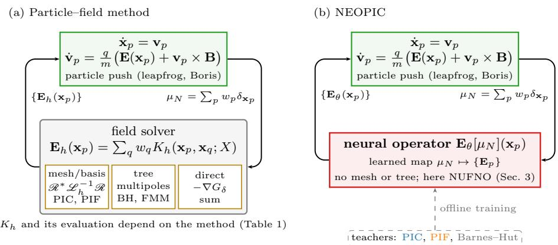  
Figure 1: (a) The particle–field cycle of a particle method for the Vlasov–Poisson system. The particles are advanced by the time integrator (green); the field solver (grey box) evaluates the field at the particles with a discrete kernel $K _ { h } \ ( 9 )$ , whose form depends on the method (Table 1): a mesh or basis $( \mathcal { R } ^ { * } \mathcal { L } _ { h } ^ { - 1 } \mathcal { R } )$ , a tree, or direct summation. (b) NEOPIC keeps the particles and the time integrator and replaces the field solver by a neural operator $\mathbf { E } _ { \theta } .$ , which maps the charge measure of the particles directly to the field at the particles. It is trained ofline on data from particle methods; in this work PIC, PIF and Barnes–Hut, and the neural operator is the NUFNO of Section 4. With an implicit time integrator (Appendix E) the cycle is the same, but the field is evaluated several times per step within the nonlinear solve.

## 3.1. Learning the particle–field–particle map

NEOPIC replaces the field solver, i.e. the evaluation of (9) in (6), by a neural operator $\mathbf { E } _ { \theta }$

$$
{ \bf E } _ { p } = { \bf E } _ { \theta } [ \mu _ { N } ] ( { \bf x } _ { p } ) + { \bf E } _ { \mathrm { e x t } } ( { \bf x } _ { p } ) , \qquad p = 1 , \ldots , N _ { p } ,\tag{12}
$$

which is trained on data generated by particle methods (Fig. 1(b)). Everything else is left unchanged: the particles are sampled and weighted as before, they follow the characteristics (6), and they are advanced by the same time integrator. NEOPIC accompanied by a time integrator is thus a particle method in its own right, with a learned instance of the interface (11), and its learned operator can replace the field solver of an existing particle code without changes to the rest of the code. Two choices define the approach: what is learned, and what the learned operator acts on.

Learning the field, not the dynamics. A common approach to data-driven surrogates of time-dependent problems is to learn the evolution of the whole state, i.e. to map the state at one time to the state at a later time, either directly or autoregressively [74, 75]. For kinetic plasmas the state is the distribution function in the 2d-dimensional phase space, or its particle representation, and its evolution combines transport along the characteristics, which is nonlinear and multi-scale, with the self-consistent field. NEOPIC learns only the map from the particles to the field at a fixed time, which is the instantaneous solution operator of an elliptic problem. This operator is much simpler than the flow map: it does not depend on time or on the velocities, it is nonlocal but smooth, and for the Vlasov–Poisson system it is linear in the charge density. NEOPIC itself does not rely on this linearity: the map from the positions to the field at the positions is nonlinear anyway, and the same approach applies to particle methods with nonlinear field equations, although parts of the analysis in Section 6 use the linearity of the teacher. The particle part, on the other hand, is the least expensive and most scalable part of a particle method: it is pointwise and embarrassingly parallel. Keeping it has three consequences. First, the particles follow the characteristics of the system with the learned field, so that charge is conserved exactly and the errors of the scheme enter only through the field. This is the basis of the error analysis of Section 5, which follows the analysis of PIC schemes. Second, structure-preserving time integrators, such as the symplectic leapfrog scheme or the Boris scheme for magnetized plasmas, can be used as in any particle method, and so can implicit schemes, for which the Jacobian of the learned field with respect to the positions is available exactly by automatic diferentiation. In Appendix E we demonstrate this with the implicit midpoint rule in one dimension, where NEOPIC remains stable and nearly energy conserving well beyond the stability limit of the leapfrog scheme. Third, the learned operator depends neither on time nor on the time step: time stepping beyond the training horizon, or with another time step, uses the same field solver at every step, and the dynamics is integrated by the scheme itself rather than extrapolated by a learned flow map. Only its inputs, the particle configurations, may move away from the training distribution (Section 8).

Learning the whole map, not the field solve. Neural operators are usually trained to approximate solution operators between functions on a mesh. Applied to a particle method this would mean learning $\mathcal { L } _ { h } ^ { - 1 }$ on a mesh, and keeping the deposition $\mathcal { R }$ and the interpolation $\mathcal { R } ^ { \ast }$ of PIC similar to [60]. The mesh would then bring back the constraints of PIC: (i) the mesh must resolve the Debye length to avoid the finite grid instability and grid heating [41, 2]; (ii) the noise of the deposited density is controlled by the number of particles per cell, so that the number of particles grows with the number of mesh cells; (iii) unless the mesh is adaptive, the adaptivity of the particles to the distribution is lost in the field computation; and (iv) in electromagnetic simulations, the Courant– Friedrichs–Lewy condition of the field solver on the mesh requires a time step much smaller than that needed by the particles. NEOPIC instead approximates the whole map (9), for mesh-based methods the whole composition ${ \mathcal { R } } ^ { * } { \mathcal { L } } _ { h } ^ { - 1 } { \mathcal { R } }$ which takes particle data as input and returns fields at the particles. No mesh enters the scheme, and data from methods without a field discretization, such as tree codes, can be used for training on the same footing as data from PIC and PIF.

Operators on measures. The input of this map is not a function sampled at given points but the measure µ , an ensemble of random Monte Carlo samples of the charge distribution. The operator must approximate the continuum field operator (3) from input–output pairs defined over such measure-valued data, and the same operator must apply to measures with any number of particles and in the limit $N _ { p }  \infty$ This departs from the classical neural operator framework [47], which is formulated for functions with some regularity and their discretizations on grids or point clouds. Neural operators on point clouds, such as the direct spectral evaluation of [49] and the graph-based operators of [74, 75], treat the points as sampling locations of an input function. In NEOPIC the points, with their weights, are the input itself. The distinction is made precise in Section 4 (Remark 1).

## 3.2. Training on several particle methods

The training data are pairs of particle configurations and fields at the particles, $\left( \mu _ { N } ^ { n } , \{ { \bf E } _ { p } ^ { \mathrm { r e f } } ( t _ { n } ) \} _ { p } \right)$ , collected along the trajectories of reference runs with a particle method, which we call the teacher. Each teacher evaluates (9) with its own kernel $K _ { h }$ , an approximation of the same kernel (8) with errors of a diferent nature. A single operator can therefore be trained on data from several teachers and several physical scenarios (“mini-apps”). This also allows each teacher’s data to be used where it is accurate: for every mini-app, the training data can be generated with the method best suited to it. The trained operator inherits the error of its teacher in addition to its own learning error (Remark 5). Within one training set all mini-apps use the same number of particles. The operator itself does not depend on this number, nor on the discretization of the teacher, and NEOPIC is evaluated with particle numbers diferent from those used in training (Section 8.1). The training procedure and the data of the individual experiments are given in Section 8.

## 3.3. Requirements on the learned operator

From the role of $\mathbf { E } _ { \theta }$ in (12) and the interface (11), we require that the learned operator

(R1) takes as input a weighted point measure with any number of particles at arbitrary positions, and depends on the particle data only through the measure, i.e. is invariant under permutations of the particles;

(R2) returns the field at the particle positions, and can be evaluated at any other point;

(R3) is one operator on measures with unit total charge, so that its outputs for diferent $N _ { p }$ are consistent and its limit $N _ { p }  \infty$ is the same operator applied to the continuous density;

(R4) does not transfer the particle data to a mesh, so that the particle noise is not aliased onto the resolved scales;

(R5) is global, as the Coulomb interaction, and costs $\mathcal { O } ( N _ { p } )$ operations per evaluation for a fixed resolution of the operator, which is the minimum complexity needed by any particle-based method;

(R6) is Lipschitz continuous in the particle positions, as required by the error analysis of Section 5.

A Fourier neural operator (FNO) [53] on a uniform grid violates (R1) and (R4), since the particle data must first be deposited on the grid; operators with fixed sensor locations such as DeepONet [48] violate (R1). Graph-based operators [74, 75] can be made to satisfy (R1)–(R5), with aggregations that are sums weighted by the particle weights and a deterministic graph that is rebuilt at every time step as the particles move. They propagate the long-range interaction through local message passing on multiscale graphs, or through attention on latent tokens, and with hard neighbourhoods (fixed radius or nearest neighbours) their output jumps when an edge appears or disappears, which violates (R6). The FNO with the Fourier transforms evaluated directly at the points [49], written with the transforms as integrals against the input measure, satisfies all six: its spectral layers are global, the nonuniform transforms of type 1 and 2 map the particles to Fourier modes and back without a mesh, with NUFFTs they cost $\mathcal { O } ( N _ { p } )$ operations for a fixed number of modes, and they are smooth in the positions. Moreover, its layers are exact integrals against the measure at every $N _ { p } ,$ and its spectral layers match the structure of the Poisson operator, which is diagonal in Fourier space. We call this operator the nonuniform Fourier neural operator (NUFNO). Its structure is shown in Fig. 2: the particle measure is normalized to the torus, lifted pointwise, processed by Fourier layers whose transforms are nonuniform transforms between the particles and a fixed set of modes, and projected pointwise to the field at the particles. The nonuniform transforms play the role of $\mathcal { R }$ and $\mathcal { R } ^ { \ast }$ in PIF, and the spectral weights and nonlinearities replace the fixed multiplier $- \mathrm { i } \mathbf { k } / | \mathbf { k } | ^ { 2 }$ ; NUFNO can thus be seen as a learned generalization of PIF that is trained on data from any particle method. NEOPIC itself is not tied to this choice: any neural operator that satisfies (R1)–(R6) can be used in (12), and the NUFNO is the instance used in this work. The next section defines the NUFNO, shows that it satisfies (R1)–(R4), and that it is a representation equivalent neural operator; (R6) is Lemma 2, for a fixed normalization of the positions (Appendix A.1) and a periodic lifting (Remark 16), and (R5) is shown in Section 7. In the remainder of the paper we use NEOPIC both for the whole particle scheme including time integration with a learned field operator and, where no confusion arises, only for its learned field operator.

(a) Particle methods (teachers): $\begin{array} { r } { \mathbf { E } _ { h } ( \mathbf { x } _ { p } ) = \int K _ { h } ( \mathbf { x } _ { p } , \mathbf { y } ; X ) d \mu _ { X } ( \mathbf { y } ) } \end{array}$  
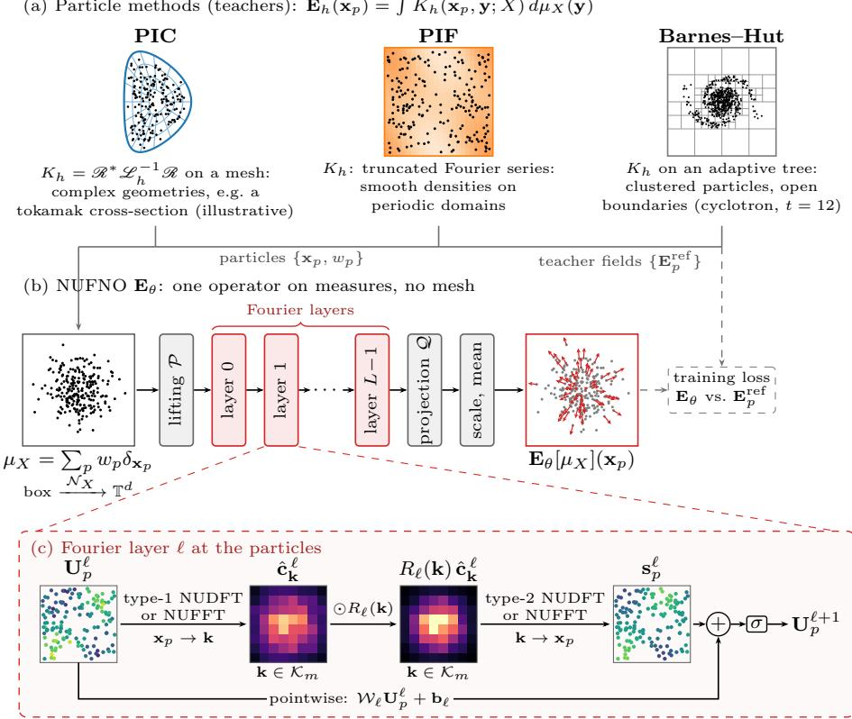  
Figure 2: The nonuniform Fourier neural operator $\mathrm { ( N U F N O ) }$ of NEOPIC. (a) The training data come from particle methods with diferent kernels $K _ { h }$ (Table 1): PIC uses a mesh, PIF a truncated Fourier basis, and Barnes–Hut multipole expansions on the cells of a tree. The examples illustrate their complementary strengths: PIF for smooth densities on periodic domains, Barnes–Hut for clustered particles and open boundaries (particles sampled from the density of the cyclotron mini-app at $t = 1 2 )$ , and PIC for complex geometries (a tokamak cross-section, for illustration only; the PIC teachers of this work use uniform periodic meshes, Section 8). All of them provide the particles $\{ \mathbf { x } _ { p } , w _ { p } \}$ and the field at the particles. (b) The NUFNO maps the charge measure $\mu _ { X }$ , normalized from its bounding box to the torus by ${ \mathcal { N } } _ { X }$ , Eq. (13), through a pointwise lifting , L Fourier layers and a pointwise projection to the field at the particles, followed by the scaling and mean subtraction of (19). (c) A Fourier layer: a type-1 nonuniform transform $( \mathrm { N U D F T }$ or NUFFT) from the particle features $\mathbf { U } _ { p } ^ { \ell }$ to the coeficients on the modes $\kappa _ { m }$ (22), multiplication by the spectral weights, a type-2 nonuniform transform back to the particles (23), and the pointwise update (24). No mesh is used at any stage. The point clouds and the spectra are illustrations; in the PIF panel the colour shows the smooth density from which the particles are sampled.

## 4. Nonuniform Fourier neural operator

In this section we define the nonuniform Fourier neural operator and its discrete evaluation, and show that, unlike a grid-based FNO, it is a representation equivalent neural operator (ReNO) in the sense of [50]: exactly when the transforms are evaluated directly, and up to the NUFFT tolerance when they are evaluated with NUFFTs. This property is the reason why the learned operator does not alias the particle noise.

## 4.1. Notation

Throughout the paper, |a| is the Euclidean norm of a vector $\mathbf { a } \in \mathbb { R } ^ { n }$ or $\mathbb { C } ^ { n }$ e.g. of the d components of a position or of the $d _ { v }$ channels of a feature vector, $| \mathbf { a } | _ { 1 }$ the sum of the absolute values of its components, and $\| A \|$ the matrix norm induced by | · |, i.e. the largest singular value of A. On the torus $\mathbb { T } ^ { d } , \ \vert \mathbf x - \mathbf y \vert$ denotes the periodic (minimum-image) distance. For a scalar, |a| is the absolute value; for a finite set, such as the set of modes $\Lambda _ { m } , \vert { \cal K } _ { m } \vert$ is the number of its elements; and for a domain, |Ω| is its volume. For functions, ∥·∥ $L ^ { p }$ is the $L ^ { p }$ norm over the domain indicated, and $L ^ { 2 } ( \mu )$ is the space of functions that are square integrable with respect to a measure $\mu ,$ with inner product $\begin{array} { r } { \langle \mathbf { f } , \mathbf { g } \rangle = \int \mathbf { f } \cdot \overline { { \mathbf { g } } } d \mu ; } \end{array}$ in a general Hilbert space, $\langle \cdot , \cdot \rangle$ and $\| \cdot \|$ are its inner product and norm, and dist $( \mathbf { a } , V ) = \operatorname* { i n f } _ { \mathbf { b } \in V } \left\| \mathbf { a } - \mathbf { b } \right\|$ is the distance of an element a from a set V. A vector or sequence with entries $a _ { p }$ indexed by $p$ is written $( a _ { p } ) _ { p } , \mathrm { o r } ( a _ { p } ) _ { p = 1 } ^ { N _ { p } } ,$ and $( a _ { p , i } ) _ { p , i }$ for two indices; for example $( \mathbf { f } ( \mathbf { x } _ { p } ) ) _ { p }$ is the vector of the values of f at the particles. $\delta _ { \mathbf { x } }$ is the Dirac measure at x, i.e. $\begin{array} { r } { \int \varphi d \delta _ { \bf x } = \varphi ( { \bf x } ) ; X \sim \rho } \end{array}$ means that the random variable X has the probability density $\rho ;$ iid stands for independent and identically distributed; and E is the expectation. $\mathcal { M } _ { 1 } ( \Omega )$ is the set of probability measures on Ω. A map $F$ is Lipschitz with constant $L _ { F }$ if $| F ( \mathbf { a } ) - F ( \mathbf { b } ) | \leq L _ { F } | \mathbf { a } - \mathbf { b } |$

## 4.2. Particles as a measure

Positions are normalized per sample, i.e. at every time step, by a min–max normalization based on the particle cloud, without padding, for all mini-apps. With $\mathbf { a } _ { X }$ and $\mathbf { b } _ { X }$ the componentwise minimum and maximum of the positions, the afine map

$$
\begin{array} { r } { \mathcal { N } _ { X } ( \mathbf { x } ) = - \pi \mathbf { 1 } + 2 \pi \left( \mathbf { x } - \mathbf { a } _ { X } \right) \mathcal { O } \left( \mathbf { b } _ { X } - \mathbf { a } _ { X } \right) , } \end{array}\tag{13}
$$

with componentwise division ⊘, maps the bounding box of the cloud onto the torus $\mathbb { T } ^ { d } = [ - \pi , \pi ) ^ { d } , d \in \{ 1 , 2 , 3 \}$ . In the following, $\mathbf { x } _ { p }$ denotes the normalized positions; the consequences of the normalization are discussed in Appendix A.1. A configuration of $N _ { p }$ particles with positions $X = ( \mathbf { x } _ { p } ) _ { p = 1 } ^ { N _ { p } }$ and weights $w _ { p } > 0$ $\begin{array} { r } { \sum _ { p } w _ { p } = 1 } \end{array}$ , defines the charge measure

$$
\mu _ { X } = \sum _ { p = 1 } ^ { N _ { p } } w _ { p } \delta _ { \mathbf { x } _ { p } } , \qquad { \hat { \mu } } _ { \mathbf { k } } = \int _ { \mathbb { T } ^ { d } } e ^ { - \mathrm { i } \mathbf { k } \cdot \mathbf { y } } d \mu ( \mathbf { y } ) = \sum _ { p = 1 } ^ { N _ { p } } w _ { p } e ^ { - \mathrm { i } \mathbf { k } \cdot \mathbf { x } _ { p } } ,\tag{14}
$$

normalized to unit total charge. In all our experiments the particles carry equal charges, $w _ { p } = 1 / N _ { p } ,$ , and we then write $\mu _ { N } = \mu _ { X } ;$ general weights cover importance-sampled initial data. In the limit $N _ { p }  \infty$ the empirical measure approaches the absolutely continuous measure $\rho d \mathbf { x }$ , defined by $( \rho d \mathbf { x } ) ( A ) \ =$ $\int _ { A } \rho d \mathbf { x }$ for every region $A .$ , where $\rho$ is the normalized charge density (unit total charge; $\rho _ { e } ~ = ~ Q _ { \mathrm { t o t } } \rho$ in the notation of Section $2 )$ . The field operator of the Vlasov–Poisson system, (31) below, is defined for both, and so is NEOPIC. Let ${ \mathcal { K } } _ { m } = \{ - m , \ldots , m - 1 \} ^ { d }$ be the set of retained wave vectors, with $M = | { \cal K } _ { m } | =$ $( 2 m ) ^ { d }$

## 4.3. The operator

For a probability measure $\mu$ on $\mathbb { T } ^ { d }$ , NEOPIC is defined by a lifting, L Fourier layers and a projection,

$$
\begin{array} { r } { \mathbf { u } _ { \mu } ^ { 0 } ( \mathbf { x } ) = \mathcal { P } ( \mathbf { x } ) , } \end{array}\tag{15}
$$

$$
\mathbf { u } _ { \mu } ^ { \ell + 1 } ( \mathbf { x } ) = \sigma \Big ( \mathcal { W } _ { \ell } \mathbf { u } _ { \mu } ^ { \ell } ( \mathbf { x } ) + \mathbf { b } _ { \ell } + \mathrm { R e } \sum _ { \mathbf { k } \in \mathcal { K } _ { m } } R _ { \ell } ( \mathbf { k } ) \hat { \mathbf { c } } _ { \mu } ^ { \ell } ( \mathbf { k } ) e ^ { \mathrm { i } \mathbf { k } \cdot \mathbf { x } } \Big ) ,\tag{16}
$$

$$
\hat { \mathbf { c } } _ { \mu } ^ { \ell } ( \mathbf { k } ) = \int _ { \mathbb { T } ^ { d } } \mathbf { u } _ { \mu } ^ { \ell } ( \mathbf { y } ) e ^ { - \mathrm { i } \mathbf { k } \cdot \mathbf { y } } d \mu ( \mathbf { y } ) ,\tag{17}
$$

$$
\mathcal { G } _ { \theta } [ \mu ] ( \mathbf { x } ) = \mathcal { Q } \big ( \mathbf { u } _ { \mu } ^ { L } ( \mathbf { x } ) \big ) ,\tag{18}
$$

for $\ell = 0 , \ldots , L - 1$ and $\mathbf { x } \in \mathbb { T } ^ { d }$ . Here ${ \mathbf u } _ { \boldsymbol { \mu } } ^ { \boldsymbol { \ell } } ( { \mathbf x } ) \in \mathbb { R } ^ { d _ { v } }$ , the lifting $\mathcal { P } : [ - \pi , \pi ) ^ { d } $ $\mathbb { R } ^ { d _ { v } }$ , defined on the fundamental domain of $\mathbb { T } ^ { d }$ , the skip weights $\mathcal { W } _ { \ell } \in \mathbb { R } ^ { d _ { v } \times d _ { \tau } }$ and the projection $\mathcal { Q } : \mathbb { R } ^ { d _ { v } }  \mathbb { R } ^ { d }$ act pointwise, $\sigma$ is applied componentwise, and $R _ { \ell } ( { \bf k } ) \in \mathbb { C } ^ { d _ { v } \times d _ { v } }$ are the spectral weights. The real part is needed because $\kappa _ { m }$ is not symmetric under $\mathbf { k } \mapsto - \mathbf { k }$ . As in [53], the activation is omitted in the last Fourier layer: for $\ell = L - 1$ , σ in (16) is replaced by the identity. In this work $\mathcal { P }$ is a single linear layer applied to the normalized positions, which is not periodic (Remark 16), $\mathcal { W } _ { \ell }$ a convolution with kernel size one, Q a two-layer MLP with hidden width $h ,$ and σ is the GELU, which is smooth and Lipschitz with $L _ { \sigma } \approx 1 . 1 3$ , as required in Sections 5 and 6. The field used to push the particles is

$$
\mathbf { E } _ { \theta } [ \mu ] ( \mathbf { x } ) = s \Big ( \mathcal { G } _ { \theta } [ \mu ] ( \mathbf { x } ) - c _ { \mathrm { p e r } } \int _ { \mathbb { T } ^ { d } } \mathcal { G } _ { \theta } [ \mu ] d \mu \Big ) ,\tag{19}
$$

where s is the constant that restores physical units $( Q _ { \mathrm { t o t } } / | \Omega | ^ { ( d - 1 ) / d }$ , see Section $^ { 8 ) }$ , and $c _ { \mathrm { p e r } } = 1$ for periodic and $c _ { \mathrm { p e r } } = 0$ for open boundaries; other field boundary conditions are discussed in Remark 17. On periodic domains the subtraction of the mean makes the sum of the forces on the particles vanish, so that momentum is conserved. In open domains no correction is applied; the self-forces of the exact free-space field also sum to zero, but the learned field is not constrained to do so.

Three properties of (15)–(19) are used throughout the paper. First, the measure enters only through the coeficients $\hat { \mathbf { c } } _ { \mu } ^ { \ell } ( \mathbf { k } )$ , which are integrals against $\mu ;$ all other operations are pointwise. Second, the functions ${ \mathbf { u } } _ { \mu } ^ { \ell }$ are defined for every $\mathbf { x } \in \mathbb { T } ^ { d }$ , not only at the particles, so the field can be evaluated anywhere. Third, the definition refers neither to the number of particles nor to a grid. It defines one operator on probability measures, which can be applied to an empirical measure with any number of particles as well as to the measure ρ dx of a continuous density. The normalization of the weights to unit total charge, i.e. a charge $1 / N _ { p }$ per particle, is what makes this possible.

Constants of the network. The bounds in this and the following sections use the following constants. $L _ { \sigma } , ~ L _ { \mathcal { P } }$ and $L _ { \mathcal { Q } }$ are Lipschitz constants of $\sigma ,$ of $\mathcal { P }$ (with respect to the periodic distance) and of $\mathcal { Q } .$ and $\sigma ( 0 )$ is the value of the activation at zero, which vanishes for ReLU and GELU. For the last Fourier layer, $\sigma$ is the identity, with $L _ { \sigma } = 1$ and $\sigma ( 0 ) = 0$ . The spectral weights of layer ℓ enter through

$$
r _ { 0 } ^ { \ell } = \sum _ { \mathbf { k } \in \mathcal { K } _ { m } } \| R _ { \ell } ( \mathbf { k } ) \| , \qquad r _ { 1 } ^ { \ell } = \sum _ { \mathbf { k } \in \mathcal { K } _ { m } } \vert \mathbf { k } \vert \| R _ { \ell } ( \mathbf { k } ) \| ,\tag{20}
$$

the features are bounded by the constants

$$
M _ { 0 } = \underset { \mathbf { x } } { \operatorname* { s u p } } | \mathcal { P } ( \mathbf { x } ) | , \qquad M _ { \ell + 1 } = | \sigma ( 0 ) | + L _ { \sigma } \big ( ( \| \mathcal { W } _ { \ell } \| + r _ { 0 } ^ { \ell } ) M _ { \ell } + | \mathbf { b } _ { \ell } | \big )\tag{21}
$$

(Lemma 2), and $\Gamma _ { \ell } = L _ { \sigma } \big ( \| \mathcal { W } _ { \ell } \| + r _ { 0 } ^ { \ell } \big )$ is a Lipschitz constant of layer ℓ with respect to the maximum over the particles of the features.

## 4.4. Discrete evaluation

For a particle measure $\mu _ { X }$ let $\mathbf { U } _ { p } ^ { \ell } \in \mathbb { R } ^ { d _ { v } }$ be the features of particle $p$ in layer ℓ, with $\mathbf { U } _ { p } ^ { 0 } = \mathcal { P } ( \mathbf { x } _ { p } )$ . A Fourier layer consists of a forward transform, a spectral product, an inverse transform and the pointwise update,

$$
\hat { \mathbf { c } } _ { \mathbf { k } } ^ { \ell } = \sum _ { p = 1 } ^ { N _ { p } } w _ { p } \mathbf { U } _ { p } ^ { \ell } e ^ { - \mathrm { i } \mathbf { k } \cdot \mathbf { x } _ { p } } , \qquad \mathbf { k } \in \mathcal { K } _ { m } ,\tag{22}
$$

$$
{ \bf s } _ { p } ^ { \ell } = \sum _ { { \bf k } \in \mathcal { K } _ { m } } R _ { \ell } ( { \bf k } ) \hat { \bf c } _ { { \bf k } } ^ { \ell } e ^ { \mathrm { i } { \bf k } \cdot { \bf x } _ { p } } , \qquad p = 1 , \ldots , N _ { p } ,\tag{23}
$$

$$
\mathbf { U } _ { p } ^ { \ell + 1 } = \sigma \big ( \mathcal { W } _ { \ell } \mathbf { U } _ { p } ^ { \ell } + \mathbf { b } _ { \ell } + \mathrm { R e } \mathbf { s } _ { p } ^ { \ell } \big ) ,\tag{24}
$$

with σ replaced by the identity for $\ell = L - 1$ , and the output is ${ \bf E } _ { p } = s \big ( \mathcal { Q } ( { \bf U } _ { p } ^ { L } ) -$ $\sum _ { q } w _ { q } \mathcal { Q } ( \mathbf { U } _ { q } ^ { L } ) \big )$ . With the nonuniform Vandermonde matrix $V _ { p \mathbf { k } } = e ^ { - \mathrm { i } \mathbf { k } \cdot \mathbf { x } _ { p } } \in$ $\mathbb { C } ^ { \hat { N _ { p } } \times M }$ and $D _ { w } \ = \ \mathrm { d i a g } ( w _ { p } )$ , (22) is $\hat { \mathbf { c } } ~ = ~ V D _ { w } \mathbf { U }$ (a type-1 transform) and (23) is $\mathbf { s } = V ^ { * } ( R \odot \hat { \mathbf { c } } )$ (a type-2 transform), where $( R \odot \hat { \mathbf { c } } ) _ { \mathbf { k } } = R _ { \ell } ( \mathbf { k } ) \hat { \mathbf { c } } _ { \mathbf { k } }$ is the product with the spectral weights mode by mode; V and $V ^ { * }$ act on each of the $d _ { v }$ channels. They are evaluated either directly (NUDFT), as in the direct spectral evaluation of [49], or with NUFFTs [44, 76], which compute the same sums to a prescribed tolerance ε at a cost that is linear in $N _ { p }$ for a fixed number of modes (Section 7). This is the architecture of [49], in which the weights $w _ { p }$ make the forward transform an integral against the charge measure. In our implementation, following [49], each transform is scaled by $\sqrt { d / N _ { p } } ;$ , so that their composition carries the weights $d / N _ { p }$ . This is equivalent to $w _ { p } = 1 / N _ { p }$ with $R _ { \ell } ( { \mathbf { k } } )$ replaced by d $R _ { \ell } ( { \mathbf { k } } )$ , and all statements below apply with these efective spectral weights.

Lemma 1 (Exactness of the particle evaluation). $I f \ ( 2 2 ) - ( 2 4 )$ are evaluated exactly (NUDFT), then $\mathbf { U } _ { p } ^ { \ell } = \mathbf { u } _ { \mu _ { X } } ^ { \ell } ( \mathbf { x } _ { p } )$ for all ℓ and $p ,$ and ${ \bf E } _ { p } = { \bf E } _ { \theta } [ \mu _ { X } ] ( { \bf x } _ { p } )$ In particular, the output depends on the particle data $( X , w )$ only through the measure $\mu _ { X } \colon i t$ is invariant under permutations of the particles, under splitting a particle into several particles of smaller weight at the same position, and under merging particles at the same position.

Proof. For $\ell = 0$ the claim is the definition. If $\mathbf { U } _ { q } ^ { \ell } = \mathbf { u } _ { \mu _ { X } } ^ { \ell } ( \mathbf { x } _ { q } )$ for all $q _ { \mathrm { : } }$ , then (22) is the integral (17) for $\mu = \mu _ { X }$ , and $( 2 3 ) \AA - ( 2 4 )$ is (16) at $\mathbf { x } = \mathbf { x } _ { p }$ The mean in (19) is likewise the sum over the particles. The operations in $( 1 5 ) \AA ^ { - } ( 1 9 )$ depend on $\mu$ only, which gives the invariances. □

The lemma is elementary, but it is the property that distinguishes the nonuniform evaluation from a grid-based one. The discrete computation is not an approximation of the operator (15)–(19) but its exact evaluation for the input that the particle method provides, at every particle number.

## 4.5. Representation equivalence

We recall the framework of [50]. Let H be a separable Hilbert space. A countable family $\Psi = \{ \psi _ { i } \} _ { i \in I } \subset \mathcal { H }$ is a frame sequence if it is a frame for its closed span $\mathcal { M } _ { \Psi }$ , i.e. if there are constants $0 < A _ { \Psi } \ \le \ B _ { \Psi }$ with $A _ { \Psi } \| f \| ^ { 2 } \leq$ $\begin{array} { r } { \sum _ { i } | \langle f , \psi _ { i } \rangle | ^ { 2 } \leq B _ { \Psi } \| f \| ^ { 2 } } \end{array}$ for all $f \in \mathcal { M } _ { \Psi }$ , where $\langle \cdot , \cdot \rangle$ and $\| \cdot \|$ are the inner product and the norm of $\mathcal { H } .$ . Its synthesis operator is $T _ { \Psi } : \ell ^ { 2 } ( I ) \to \mathcal { H } .$ $\begin{array} { r } { T _ { \Psi } \mathbf { c } = \sum _ { i } c _ { i } \psi _ { i } } \end{array}$ , which maps coeficients to a function. Its adjoint, the analysis operator $\bar { T } _ { \Psi } ^ { * } f = ( \langle f , \psi _ { i } \rangle ) _ { i \in I }$ , maps a function to its inner products with the frame elements, and $S = T _ { \Psi } T _ { \Psi } ^ { * }$ is the frame operator, which is invertible on $\mathcal { M } _ { \Psi }$ . The pseudo-inverse $T _ { \Psi } ^ { \dagger } f = ( \langle f , S ^ { - 1 } \psi _ { i } \rangle ) _ { i \in I }$ maps a function to its discrete representation, the coeficients with respect to the canonical dual frame, and $T _ { \Psi } T _ { \Psi } ^ { \dagger }$ is the orthogonal projection onto $\mathcal { M } _ { \Psi }$ . The implementation of an operator $\bar { U } : \mathcal { H } \to \mathcal { V }$ is performed through a discrete map u : $\ell ^ { 2 } ( I ) \to \ell ^ { 2 } ( J )$ for frame sequences Ψ of H and Φ of Y.

Definition 1 (Operator aliasing and ReNO [50, Def. 3.1, Def. 3.4, Sec. 3.4]). The aliasing error of $( U , u )$ is ${ \varepsilon } ( U , u , \Psi , \Phi ) = U - T _ { \Phi } \circ u \circ T _ { \Psi } ^ { \dagger }$ . The pair $( U , u )$ is a representation equivalent neural operator $( R e N O ) \ i f \ \varepsilon ( \bar { U } , u , \Psi , \Phi ) = 0 \ f o r$ every pair of frame sequences with Dom $U \subseteq { \mathcal { M } } _ { \Psi }$ and Ran $U \subseteq { \mathcal { M } } _ { \Phi }$ , and an $\varepsilon - R e N O \ i f \ \| \varepsilon ( U , u , \Psi , \Phi ) \| \leq \varepsilon$ for all such pairs. For linear $U , \ \lVert \varepsilon ( U , u , \Psi , \Phi ) \rVert$ is the operator norm. For nonlinear U the aliasing error is a nonlinear map, for which no operator norm is defined, and we measure instead the largest error over a bounded set B of inputs, $\begin{array} { r } { \| \varepsilon \| _ { B } = \operatorname* { s u p } _ { f \in B } \left\| U f - T _ { \Phi } u ( T _ { \Psi } ^ { \dagger } f ) \right\| } \end{array}$

A ReNO has a discrete representation $u ( \Psi , \Phi ) = T _ { \Phi } ^ { \dagger } \circ U \circ T _ { \Psi }$ for each admissi ble discretization, and any two of them are equivalent: they are representations of the same operator [50, Prop. 3.6]. ReNOs are stable under composition [50, Prop. 3.7], so it sufices to examine the layers. Pointwise linear maps, such as the lifting and the skip connections, and the spectral product are ReNOs.

The hidden spaces of NEOPIC. The transforms in (17) are integrals against the input measure, so a layer needs the hidden functions only on the support of $\mu ,$ and only the values at the particles are ever used. We therefore take as hidden spaces

$$
\mathcal { H } _ { \mu } = L ^ { 2 } \big ( \mathbb { T } ^ { d } , \mu ; \mathbb { R } ^ { d _ { v } } \big ) ,\tag{25}
$$

and as layer operators $U _ { \ell } : \mathcal { H } _ { \mu } \to \mathcal { H } _ { \mu }$ the maps of (16),

$$
( U _ { \ell } \mathbf { f } ) ( \mathbf { x } ) = \sigma \Big ( \mathcal { W } _ { \ell } \mathbf { f } ( \mathbf { x } ) + \mathbf { b } _ { \ell } + \mathrm { R e } \sum _ { \mathbf { k } \in K _ { m } } R _ { \ell } ( \mathbf { k } ) \Big ( \int _ { \mathbb { T } ^ { d } } \mathbf { f } ( \mathbf { y } ) e ^ { - \mathrm { i } \mathbf { k } \cdot \mathbf { y } } d \mu ( \mathbf { y } ) \Big ) e ^ { \mathrm { i } \mathbf { k } \cdot \mathbf { x } } \Big ) .\tag{26}
$$

These are well defined on µ-equivalence classes, and they map bounded functions to bounded functions. The lifting provides the input ${ \mathbf { u } } _ { \mu } ^ { 0 } = \mathcal { P } | _ { \mathrm { s u p p } \mu } \in \mathcal { H } _ { \mu }$ , and the output map $\begin{array} { r } { U _ { \mathcal { Q } } : \mathcal { H } _ { \mu } \to L ^ { 2 } ( \mathbb { T } ^ { d } , \mu ; \mathbb { R } ^ { d } ) , \mathbf { f } \mapsto s \big ( \mathcal { Q } \circ \mathbf { f } - \int \mathcal { Q } \circ \mathbf { f } d \mu \big ) } \end{array}$ , is (19). For a particle measure, the natural discretization is by the values at the particles: let

$$
\Psi _ { X } = \big \{ \chi _ { \{ { \bf x } _ { p } } \} { \bf e } _ { i } : p = 1 , \ldots , N _ { p } , i = 1 , \ldots , d _ { v } \big \} ,\tag{27}
$$

where $\mathbf { e } _ { i }$ are the unit vectors of $\mathbb { R } ^ { d _ { v } }$ and $\chi _ { \{ \mathbf { x } _ { p } \} }$ is the indicator function of the point $\mathbf { x } _ { p }$ . We assume the positions $\mathbf { x } _ { p }$ to be distinct, which holds with probability one for random particles and otherwise can be achieved by merging coincident particles (Lemma 1).

Theorem 1 (NEOPIC with NUDFTs is a ReNO). Let $\mu _ { X }$ be a particle measure (14) with distinct positions. Then:

(i) $\Psi _ { X }$ is an orthogonal basis of $\mathcal { H } _ { \mu _ { X } }$ with frame bounds $A = \operatorname* { m i n } _ { p } w _ { p }$ and $B = \operatorname* { m a x } _ { p } w _ { p }$ (a tight frame for equal weights). Its pseudo-inverse is the evaluation at the particles, $T _ { \Psi _ { X } } ^ { \dagger } \mathbf { f } = \left( \mathbf { f } ( \mathbf { x } _ { p } ) \right) _ { p } ,$ , and its synthesis operator maps particle values to the function with these values on supp µX.

(ii) For every ℓ, the discrete map $u _ { \ell } = T _ { \Psi \mathbf { v } } ^ { \dagger } \circ U _ { \ell } \circ T _ { \Psi _ { X } }$ is the Fourier layer (22)– (24) evaluated with NUDFTs, and $\varepsilon ( \dot { U } _ { \ell } , u _ { \ell } , \Psi _ { X } , \Psi _ { X } ) = 0$ . The same holds for the output map $U _ { \mathcal { Q } }$ and its discrete form.

(iii) Every pair offrames (Ψ, Φ) of $\mathcal { H } _ { \mu _ { X } }$ satisfies the conditions of Definition $^ { 1 , }$ and $u _ { \ell } ( \Psi , \Phi ) = T _ { \Phi } ^ { \dagger } \circ U _ { \ell } \circ T _ { \Psi }$ has zero aliasing error. Hence each layer is a ReNO, and so is the composition $U _ { \mathcal { Q } } \circ U _ { L - 1 } \circ \cdot \cdot \cdot \circ U _ { 0 }$ , whose discrete representation in the particle frame is NEOPIC evaluated with NUDFTs.

Proof. (i) Since $\mu _ { X }$ is supported on the $N _ { p }$ distinct points, two functions are equal in $\mathcal { H } _ { \mu _ { X } }$ if and only if they agree at the particles, so $\mathcal { H } _ { \mu _ { X } }$ has dimension $N _ { p } d _ { v }$ and $\begin{array} { r } { \| \mathbf { \vec { f } } \| ^ { 2 } = \sum _ { p } \tilde { w _ { p } } | \mathbf { \vec { f } } ( \mathbf { x } _ { p } ) | ^ { 2 } } \end{array}$ . The elements of (27) are orthogonal, with $\| \chi _ { \{ \mathbf { x } _ { p } \} } \mathbf { e } _ { i } \| ^ { 2 } = w _ { p }$ and $\langle \mathbf { f } , \chi _ { \{ \mathbf { x } _ { p } \} } \mathbf { e } _ { i } \rangle = w _ { p } f _ { i } ( \mathbf { x } _ { p } )$ . Hence $\begin{array} { r } { \sum _ { p , i } | \langle \mathbf { f } , \chi _ { \{ \mathbf { x } _ { p } \} } \mathbf { e } _ { i } \rangle | ^ { 2 } = } \end{array}$ $\begin{array} { r } { \sum _ { p } w _ { p } ^ { 2 } | \mathbf { f } ( \mathbf { x } _ { p } ) | ^ { 2 } } \end{array}$ lies between min $_ p w _ { p } \| \mathbf { f } \| ^ { 2 }$ and $\operatorname* { m a x } _ { p } w _ { p } \| \mathbf { f } \| ^ { 2 }$ . The analysis operator is $T _ { \Psi _ { X } } ^ { * } \mathbf { f } = \left( w _ { p } f _ { i } ( \mathbf { x } _ { p } ) \right) _ { p , i } ,$ and the frame operator $S = T _ { \Psi _ { X } } T _ { \Psi _ { X } } ^ { * }$ multiplies the value at $\mathbf { x } _ { p }$ by $w _ { p } .$ , so $T _ { \Psi _ { X } } ^ { \dagger } \mathbf { f } = \left( \left. \mathbf { f } , S ^ { - 1 } \chi _ { \{ \mathbf { x } _ { p } \} } \mathbf { e } _ { i } \right. \right) _ { p , i } = \left( f _ { i } ( \mathbf { x } _ { p } ) \right) _ { p , i } ,$ the vector of the values at the particles, indexed by the particle $p$ and the channel i. Conversely, the synthesis operator maps such a vector $\mathbf { U } ~ = ~ ( U _ { p , i } ) _ { p , i }$ to $\begin{array} { r } { T _ { \Psi _ { X } } \mathbf { U } = \sum _ { p , i } U _ { p , i } \chi _ { \{ \mathbf { x } _ { p } \} } \mathbf { e } _ { i } } \end{array}$ , the function with the values $\mathbf { U } _ { p }$ at the particles. (ii) $\mathrm { B y } \ ( \mathrm { i } ) , \ T _ { \Psi _ { X } } \mathbf { U }$ is the function with values $\mathbf { U } _ { p }$ at the particles, and $U _ { \ell }$ applied to it, evaluated at $\mathbf { x } _ { p } ,$ is $( 2 2 ) - ( 2 4 )$ ; this is the induction step of Lemma 1. Since $\Psi _ { X }$ spans $\mathcal { H } _ { \mu _ { X } } , T _ { \Psi _ { X } } T _ { \Psi _ { X } } ^ { \dagger }$ is the identity, and $T _ { \Psi _ { X } } \circ u _ { \ell } \circ T _ { \Psi _ { X } } ^ { \dagger } =$ $( T _ { \Psi _ { X } } T _ { \Psi _ { X } } ^ { \dagger } ) \circ U _ { \ell } \circ ( T _ { \Psi _ { X } } T _ { \Psi _ { X } } ^ { \dagger } ) = U _ { \ell }$ . The output map is treated in the same way. (iii) A frame of the finite-dimensional space $\mathcal { H } _ { \mu _ { X } }$ spans it, so Dom $U _ { \ell } =$ $\mathcal { H } _ { \mu _ { X } } = \mathcal { M } _ { \Psi }$ and Ran $U _ { \ell } \subseteq \mathcal { H } _ { \mu _ { X } } = \mathcal { M } _ { \Phi }$ , and the computation in (ii) applies with $T _ { \Psi } T _ { \Psi } ^ { \dagger } = T _ { \Phi } T _ { \Phi } ^ { \dagger } = I$ . The statement for the composition is [50, Prop. 3.7].

The frame computation is elementary; the content of the theorem lies in the choice of spaces that the nonuniform evaluation permits. For the standard grid-based FNO [53], the hidden spaces are spaces of band-limited functions, discretized by their values on a uniform grid, and the pointwise activation is the obstruction: $\sigma$ applied to a band-limited function is not band-limited, so the next DFT folds the new high frequencies onto the retained ones [50, Sec. 4] as quantified in Proposition 8(i). Thus the activation fails to be a ReNO because the space spanned by the grid values is smaller than the space into which σ maps. With the transforms written as integrals against the input measure, the space spanned by the particle values is the whole hidden space (25), so no pointwise operation can leave it, and the NUDFT evaluates the integrals (17) exactly. This holds for every number and distribution of the particles and for every activation. For a grid-based FNO applied to particle data the corresponding choice is not available, because the grid is not the support of the input: the charge must first be transferred from $\mu _ { X }$ to the grid, and the integrals of the layers are then computed against the grid instead of $\mu _ { X }$ . Both steps alias (Proposition 8).

Theorem 1 compares discretizations of the same measure, which is the setting of [50]: two particle data sets $( X , w )$ and $( X ^ { \prime } , w ^ { \prime } )$ with $\mu _ { X } = \mu _ { X ^ { \prime } }$ give identical outputs, i.e. a zero representation equivalence error [50, Def. 3.3]. Two particle sets with diferent $N _ { p }$ drawn from the same density $\rho ,$ however, are diferent measures. They carry diferent sampling noise, and their outputs differ by the sampling error of Lemma 3, $\mathcal { O } ( \dot { N } _ { p } ^ { - 1 / 2 } )$ with a constant that does not depend on any grid. This diference is a property of the input, i.e. of the particle discretization of the Vlasov equation, and it is shared by every particle method, including the teacher; the operator itself, $\scriptstyle \mathbf { E } _ { \theta }$ , is the same for all $N _ { p } .$ No evaluation with finitely many particles can be an exact representation of $\mathbf { E } _ { \theta } [ \rho d \mathbf { x } ]$ for the measure of a continuous density, but the resulting error is of a diferent nature than grid aliasing (Proposition 8 in Appendix A.2). On a grid, the frequencies of the integrand above the grid resolution are folded onto the retained modes coherently and with full weight, in every layer of a grid-based FNO, and this error does not decrease with the number of particles. For particles, they contribute only through the sampling fluctuations, exactly as for the continuous operator applied to $\mu _ { N } \colon$ the error is unbiased, decreases as $N _ { p } ^ { - 1 / 2 }$ and is bounded independently of the smoothness of the integrand.

Remark 1 (When is the input a measure?). Lemma 1 and Theorem 1 hold for any weighted point measure, for example the nodes of an unstructured mesh with quadrature weights. Their meaning depends on what the measure represents. In a particle method the point measure is the state of the scheme. The particles carry their weights along the characteristics, so that $\begin{array} { r } { f _ { N } ( t ) = \sum _ { p } w _ { p } \delta _ { \mathbf { z } _ { p } ( t ) } } \end{array}$ is a weak solution of the Vlasov equation with the field computed from it, which is the classical mean-field interpretation of particle methods. The field operator, a functional of the charge measure, is evaluated on this state exactly. How well fN approximates f is a property of the particle discretization, shared with every particle method including the teacher. It enters through the initial sampling, and through remapping steps where these are used, and not in each evaluation of the operator. For Monte Carlo sampling it is controlled by Lemma 3 and Theorem 3. For structured initial loadings it is a deterministic quadrature error, which converges faster but depends on the smoothness of the integrands and may alias coherently (Proposition $s ( i ) ) ;$ Monte Carlo gives the slower error of Proposition 8(iii), which is unbiased and independent of the smoothness. The situation is diferent when the state of the scheme is not the point measure, for example nodal values of a function on an Eulerian mesh. The points then only serve to evaluate integrals of a continuum function, the sums over the points replace integrals that the scheme defines otherwise, and two discretizations of the same function difer by a quadrature error in every layer. The nonuniform transforms then give an ε-ReNO with ε set by this error. This is the situation of [49], where the input functions enter through their values at the points.

Additional particle attributes keep the input a measure. Charges are carried by the weights: for several species µ is a signed measure, and $\sum _ { p } | w _ { p } |$ replaces $\sum _ { p } w _ { p }$ in the bounds. Velocities, or other per-particle coordinates, enter through a lifting $\mathcal { P } ( \mathbf { x } , \mathbf { v } )$ . The input is then the phase-space measure

$$
\nu = \sum _ { p } w _ { p } \delta _ { ( \mathbf { x } _ { p } , \mathbf { v } _ { p } ) } ,
$$

the hidden functions are elements of $L ^ { 2 } ( \nu )$ , and the forward transforms compute spatial Fourier coeficients of velocity moments, e.g. of the current density for a lifting that is linear in v. Lemma 1 and Theorems 1 and 2 hold with µ replaced by ν. The statements become approximate only if a feature is itself a discretized approximation of a continuum function, such as a mesh field interpolated to the particles; its interpolation error then enters as above.

NUFFT evaluation. The NUFFT computes (22) and (23) by spreading onto an oversampled uniform grid with a smooth kernel, an FFT, and a division by the Fourier transform of the kernel (and the reverse for type 2) [43, 77, 44]. The spreading step is a deposition in the sense of (A.2), and the error of the NUFFT is exactly the aliasing of the spreading kernel, which the kernel width and the upsampling factor make smaller than the tolerance [78]. We use error bounds of the following form, which is that of the available rigorous estimates [78].

Assumption.

(A0) NUFFT accuracy. For strengths $( g _ { p } ) _ { p } \in \mathbb { C } ^ { N _ { p } }$ and coeficients $( a _ { \mathbf { k } } ) _ { \mathbf { k } } \in \mathbb { C } ^ { M }$ 2 the computed type-1 and type-2 sums satisfy, for all $\mathbf { k } \in \mathcal { K } _ { m }$ and all $p ,$

$$
\left| { \tilde { c } } _ { \mathbf { k } } - \sum _ { q } g _ { q } e ^ { - { \mathrm { i } } \mathbf { k } \cdot \mathbf { x } _ { q } } \right| \leq \varepsilon \sum _ { q } | g _ { q } | , \qquad \left| { \tilde { s } } _ { p } - \sum _ { \mathbf { k } } a _ { \mathbf { k } } e ^ { { \mathrm { i } } \mathbf { k } \cdot \mathbf { x } _ { p } } \right| \leq \varepsilon \sum _ { \mathbf { k } } | a _ { \mathbf { k } } | .\tag{28}
$$

The tolerance requested from NUFFT libraries like FINUFFT [44] refers to the relative $\ell ^ { 2 }$ error, which is of the same order in practice [44]. Let $\tilde { u } _ { \ell }$ denote the Fourier layer $( 2 2 ) - ( 2 4 )$ with both transforms computed by the NUFFT, $\tilde { \mathbf { E } } _ { \theta } [ \mu _ { X } ]$ the resulting output, and $M _ { \ell } , r _ { 0 } ^ { \ell }$ and $\Gamma _ { \ell }$ the constants of Section 4.3.

Theorem 2 (NEOPIC with NUFFTs is an $\scriptstyle \varepsilon - \mathrm { R e N O } )$ . Assume $( A O )$ , and that $\sigma$ and $\mathcal { Q }$ are Lipschitz with constants $L _ { \sigma }$ and $L _ { \mathcal { Q } }$ . Let $\mu _ { X }$ be any particle measure (14).

(i) For every ℓ and every $\mathbf { f } \in \mathcal { H } _ { \mu _ { X } }$

$$
\begin{array} { r l } & { \left\| { U _ { \ell } } { \bf f } - T _ { \Psi _ { X } } \tilde { u } _ { \ell } T _ { \Psi _ { X } } ^ { \dag } { \bf f } \right\| _ { \mathcal { H } _ { \mu _ { X } } } \leq \underset { p } { \operatorname* { m a x } } \left| { ( U _ { \ell } { \bf f } ) ( { \bf x } _ { p } ) - ( \tilde { u } _ { \ell } T _ { \Psi _ { X } } ^ { \dag } { \bf f } ) _ { p } } \right| } \\ & { \qquad \quad \leq \varepsilon ( 2 + \varepsilon ) L _ { \sigma } r _ { 0 } ^ { \ell } \underset { p } { \operatorname* { m a x } } \left| { \bf f } ( { \bf x } _ { p } ) \right| . } \end{array}\tag{29}
$$

(ii) For the whole network,

$$
\operatorname* { m a x } _ { p } \big | \tilde { \mathbf { E } } _ { \theta } [ \mu _ { X } ] ( \mathbf { x } _ { p } ) - \mathbf { E } _ { \theta } [ \mu _ { X } ] ( \mathbf { x } _ { p } ) \big | \leq C _ { \varepsilon } \varepsilon ,
$$

$$
C _ { \varepsilon } = 2 | s | L _ { { \mathcal Q } } ( 2 + \varepsilon ) \sum _ { \ell = 0 } ^ { L - 1 } \Big ( \prod _ { j = \ell + 1 } ^ { L - 1 } \Gamma _ { j } \Big ) L _ { \sigma } r _ { 0 } ^ { \ell } \tilde { M } _ { \ell } ,\tag{30}
$$

where $\tilde { M } _ { 0 } = M _ { 0 }$ and $\tilde { M } _ { \ell + 1 } = | \sigma ( 0 ) | + L _ { \sigma } \bigl ( ( \| \mathcal { W } _ { \ell } \| + ( 1 + \varepsilon ) ^ { 2 } r _ { 0 } ^ { \ell } ) \tilde { M } _ { \ell } + | \mathbf { b } _ { \ell } | \bigr )$ so that $\tilde { M } _ { \ell } \to M _ { \ell }$ as $\varepsilon  0$

The constants do not depend on $N _ { p } ,$ on the positions or on the weights. Hence each layer, and the network, is an ${ \varepsilon } ^ { \prime } – R e N O$ on bounded sets of $\mathcal { H } _ { \mu _ { X } }$ with $\varepsilon ^ { \prime }$ proportional to ε, uniformly over all particle discretizations.

Proof. Throughout, $| \cdot |$ is the Euclidean norm on $\mathbb { C } ^ { d _ { v } }$ , applied to vectors of channels, and $\| \mathbf { U } \| _ { \infty } = \operatorname* { m a x } _ { p } | \mathbf { U } _ { p } |$ . If a bound of the form (28) holds for each channel, then by Minkowski’s inequality it holds for the vectors of channels, with $| g _ { q } |$ and $\left| a _ { \mathbf { k } } \right|$ the Euclidean norms.

(i) The synthesis operator returns the function with the given values at the particles (Theorem $1 ( \mathrm { i } ) )$ , so that $\bigl ( T _ { \Psi _ { X } } \tilde { u } _ { \ell } T _ { \Psi _ { X } } ^ { \dagger } \mathbf { f } \bigr ) ( \mathbf { x } _ { p } ) = \bigl ( \tilde { u } _ { \ell } T _ { \Psi _ { X } } ^ { \dagger } \mathbf { f } \bigr ) _ { p } ,$ , and in $\mathcal { H } _ { \mu _ { X } }$ a function is determined by these values. The first inequality then holds because $\begin{array} { r } { \| \mathbf { g } \| _ { \mathcal { H } _ { \mu _ { X } } } ^ { 2 } = \sum _ { p } w _ { p } | \mathbf { g } ( \mathbf { x } _ { p } ) | ^ { 2 } } \end{array}$ is at most ma $\mathrm { x } _ { p } | \mathbf { g } ( \mathbf { x } _ { p } ) | ^ { 2 }$ . Let $\mathbf { U } = T _ { \Psi _ { X } } ^ { \dagger } \mathbf { f }$ be the particle values. The exact coeficients (22) satisfy $\begin{array} { r } { | \hat { \mathbf { c } } _ { \mathbf { k } } | \leq \sum _ { o } w _ { p } | \mathbf { U } _ { p } | \leq } \end{array}$ $\| \mathbf { U } \| _ { \infty } ,$ and by (A0) the computed ones are $\tilde { \mathbf { c } } _ { \mathbf { k } } = \hat { \mathbf { c } } _ { \mathbf { k } } + \delta _ { \mathbf { k } }$ with $\begin{array} { r } { | \delta _ { \mathbf { k } } | ^ { \cdot } \le \varepsilon \| \mathbf { U } \| _ { \infty } . } \end{array}$ The type-2 transform of $\mathbf { a } _ { \mathbf { k } } = R _ { \ell } ( \mathbf { k } ) \tilde { \mathbf { c } } _ { \mathbf { k } }$ is computed with an error $\eta _ { p } , \vert \eta _ { p } \vert \leq$ $\begin{array} { r } { \varepsilon \sum _ { \mathbf { k } } \| R _ { \ell } ( \mathbf { k } ) \| | \tilde { \mathbf { c } } _ { \mathbf { k } } | \leq \varepsilon ( 1 + \varepsilon ) r _ { 0 } ^ { \ell } \| \mathbf { U } \| _ { \infty } } \end{array}$ . The pre-activations of the exact and the computed layer therefore difer at particle p by

$$
\Big | \mathrm { R e } \Big ( \sum _ { \bf k } R _ { \ell } ( { \bf k } ) \delta _ { { \bf k } } e ^ { \mathrm { i } { \bf k } \cdot { \bf x } _ { p } } + \eta _ { p } \Big ) \Big | \le \varepsilon r _ { 0 } ^ { \ell } \| { \bf U } \| _ { \infty } + \varepsilon ( 1 + \varepsilon ) r _ { 0 } ^ { \ell } \| { \bf U } \| _ { \infty } = \varepsilon ( 2 + \varepsilon ) r _ { 0 } ^ { \ell } \| { \bf U } \| _ { \infty } ,
$$

and the Lipschitz bound of σ gives (29), since the exact layer is $U _ { \ell }$ by Theorem 1(ii).

(ii) Let Uℓ and $\tilde { \mathbf { U } } ^ { \ell }$ be the features of the exact and the computed network, with $\dot { \mathbf { U } } ^ { 0 } = \tilde { \mathbf { U } } ^ { 0 }$ , and $D _ { \ell } = \| \tilde { \mathbf { U } } ^ { \ell } - \mathbf { U } ^ { \ell } \| _ { \infty }$ . The same estimates as in (i) show that $\| \tilde { \mathbf { U } } ^ { \ell } \| _ { \infty } \le \tilde { M } _ { \ell }$ . The exact layer is Lipschitz in $\| \cdot \| _ { \infty }$ with constant $\Gamma _ { \ell } ,$ because $| \hat { \mathbf { c } } _ { \mathbf { k } } ( \mathbf { U } ) - \hat { \mathbf { c } } _ { \mathbf { k } } ( \mathbf { U } ^ { \prime } ) | \leq \| \mathbf { U } - \mathbf { U } ^ { \prime } \| _ { \infty }$ . Splitting $\tilde { u } _ { \ell } ( \tilde { \mathbf { U } } ^ { \ell } ) - u _ { \ell } ( \mathbf { U } ^ { \ell } ) = \big ( \tilde { u } _ { \ell } ( \tilde { \mathbf { U } } ^ { \ell } ) - u _ { \ell } ( \tilde { \mathbf { U } } ^ { \ell } ) \big ) +$ $\big ( u _ { \ell } ( \tilde { \mathbf { U } } ^ { \ell } ) - u _ { \ell } ( \mathbf { U } ^ { \ell } ) \big )$ and using (i) for the first term,

$$
D _ { \ell + 1 } \leq \Gamma _ { \ell } D _ { \ell } + \varepsilon ( 2 + \varepsilon ) L _ { \sigma } r _ { 0 } ^ { \ell } \tilde { M } _ { \ell } , \qquad D _ { 0 } = 0 ,
$$

so that $\begin{array} { r } { D _ { L } \leq \varepsilon ( 2 + \varepsilon ) \sum _ { \ell < L } \big ( \prod _ { j > \ell } \Gamma _ { j } \big ) L _ { \sigma } r _ { 0 } ^ { \ell } \tilde { M } _ { \ell } } \end{array}$ . The output (19) changes by at most $| s | L _ { \mathcal { Q } } D _ { L }$ through the pointwise term and, for $c _ { \mathrm { p e r } } = 1$ , by at most the same amount through the mean, which gives (30). The last statement follows from (i) and (ii) with Definition 1, since the frame $\Psi _ { X }$ and the bounds are available for every particle measure. □

Remark 2 (What the theorems do and do not say). (a) The bound (30) does not grow with $N _ { p }$ , because the type-1 error in (28) is relative to the total $\begin{array} { r } { \sum _ { p } w _ { p } | \mathbf { U } _ { p } | ; } \end{array}$ which the normalization of the weights keeps bounded. The NUFFT-based network is thus a grid-based Fourier network whose aliasing is controlled by the tolerance, in contrast to an FNO on a grid whose aliasing is fixed by the grid. (b) Representation equivalence concerns the consistency between the operator and its discrete evaluation. It says nothing about the approximation error εNN of the trained operator, about the bias of the teacher, or about the stability of the scheme, which are treated in Section 5. The particle noise reaches the field of NEOPIC only as it reaches the continuous operator applied to the particle measure, through the coeficients (17), whose fluctuations are controlled by Lemma 3 and, in training, by Section 6. We do not claim that this rules out every numerical heating mechanism: the learned operator is not exactly energy conserving, and the stability of the scheme is governed by its Lipschitz constant $L _ { \theta }$ (Theorem 3). It removes one of the important reasons for numerical heating which is the aliasing mechanism. Consistent with this, the energy errors of the miniapps in Section 8 do not grow in the extrapolation windows. (c) Translation equivariance of the operator, and the role of the lifting for it, are discussed in Appendix A.3.

## 5. Error analysis

In this section we bound the error of the NEOPIC scheme with respect to the exact solution of the Vlasov–Poisson system. The analysis follows the strategy of [79] for PIC schemes (see also [80] for the corresponding error ansatz): we first bound the error in the particle trajectories and in the electric field, and then show that the error in the distribution function is controlled by the error in the field. Two features of NEOPIC lead to diferences from the PIC analysis. First, the field operator is learned, so an approximation error εNN appears that does not vanish as $N _ { p }  \infty$ and $\Delta t  0$ Second, the field operator acts on the particles through a fixed, finite set of Fourier modes, which makes the sampling error independent of any grid resolution. We also avoid the assumption of approximately independent particles used in [79] by coupling the numerical particles to an auxiliary set of independent particles that are transported by the exact field. Further remarks, on the comparison with PIC, other time integrators, the periodicity of the lifting, other boundary conditions, the $L ^ { 1 }$ training loss and the scope of the noise analysis, are collected in Appendix B.

## 5.1. Setting and notation

We consider the Vlasov–Poisson system (1)–(2) without external fields on the periodic domain $\mathbb { T } ^ { d } = [ - \pi , \pi ) ^ { d } , \ : \dot { d } \in \{ 1 , 2 , 3 \}$ , with a uniform neutralizing background, in normalized form: $f ( t , \cdot , \cdot )$ is a probability density on $\mathbb { T } ^ { d } \times \mathbb { R } ^ { d }$ (unit total charge, as in our normalization of the network inputs), so that $\rho ( t , { \bf x } ) =$ $\textstyle \int _ { \mathbb { R } ^ { d } } f ( t , \mathbf { x } , \mathbf { v } )$ dv is the normalized charge density, related to $\rho _ { e }$ of Section 2 by $\rho _ { e } = Q _ { \mathrm { t o t } } \rho ,$ q/m denotes the charge-to-mass ratio, and the field is $\mathbf { E } = \mathcal { E } [ \rho ]$ where E is the exact field operator,

$$
\mathcal { E } [ \mu ] ( \mathbf { x } ) = \frac { 1 } { ( 2 \pi ) ^ { d } } \sum _ { \mathbf { k } \in \mathbb { Z } ^ { d } \setminus \{ 0 \} } \frac { - \mathrm { i } \mathbf { k } } { | \mathbf { k } | ^ { 2 } } \hat { \mu } _ { \mathbf { k } } e ^ { \mathrm { i } \mathbf { k } \cdot \mathbf { x } } , \qquad \hat { \mu } _ { \mathbf { k } } = \int _ { \mathbb { T } ^ { d } } e ^ { - \mathrm { i } \mathbf { k } \cdot \mathbf { y } } d \mu ( \mathbf { y } ) ,\tag{31}
$$

defined for any probability measure $\mu$ on $\mathbb { T } ^ { d }$ , i.e. for the measure ρ dx of a continuous density as well as for empirical measures of particles. We write ${ \bf z } = ( { \bf x } , { \bf v } )$ for points in phase space; norms are as in Section 4.1, with $\left| \mathbf { x } - \mathbf { y } \right|$ the periodic distance on $\mathbb { T } ^ { d }$

NEOPIC as an operator on measures. We use the operator $\mathcal { G } _ { \theta }$ of Section 4, (15)–(18), which is defined for every probability measure $\mu$ on $\mathbb { T } ^ { d }$ . By Lemma $1 ,$ its evaluation at the particles for the empirical measure $\begin{array} { r } { { \dot { \mu } } _ { N } = \frac { 1 } { N _ { p } } \sum _ { p } \delta _ { { \bf x } _ { p } } } \end{array}$ is the NEOPIC field, and the same operator applied to the measure ρ dx is the infiniteparticle limit of NEOPIC. For brevity we state the analysis for $\mathcal { G } _ { \theta }$ , without the mean subtraction and the scaling in (19). Including them changes only the constants: the mean $\textstyle \int { \mathcal { G } } _ { \theta } [ \mu ] d \mu$ is Lipschitz in the particle positions with constant $2 L _ { \theta }$ (in the sense of $( 3 4 ) )$ , and its sampling error is bounded by $\left( C _ { S } + \right.$ sup $| \mathcal { G } _ { \theta } [ \rho ] | ) N _ { p } ^ { - 1 / 2 }$ where $C _ { S }$ is given by Lemma $3 .$

The scheme. Particles $\mathbf { z } _ { p } ^ { n } = ( \mathbf { x } _ { p } ^ { n } , \mathbf { v } _ { p } ^ { n } ) , p = 1 , \ldots , N _ { p }$ , are advanced with the kick–drift–kick leapfrog method,

$$
\begin{array} { r l } & { \mathbf { v } _ { p } ^ { n + \frac { 1 } { 2 } } = \mathbf { v } _ { p } ^ { n } + \frac { \Delta t } { 2 } \frac { q } { m } \mathbf { E } _ { \theta } ^ { n } ( \mathbf { x } _ { p } ^ { n } ) , \qquad \mathbf { x } _ { p } ^ { n + 1 } = \mathbf { x } _ { p } ^ { n } + \Delta t \mathbf { v } _ { p } ^ { n + \frac { 1 } { 2 } } , } \\ & { \mathbf { v } _ { p } ^ { n + 1 } = \mathbf { v } _ { p } ^ { n + \frac { 1 } { 2 } } + \frac { \Delta t } { 2 } \frac { q } { m } \mathbf { E } _ { \theta } ^ { n + 1 } ( \mathbf { x } _ { p } ^ { n + 1 } ) , } \end{array}\tag{32}
$$

with $\mathbf { E } _ { \theta } ^ { n } = \mathcal { G } _ { \theta } [ \mu _ { N } ^ { n } ]$ and $\begin{array} { r } { \mu _ { N } ^ { n } = \frac { 1 } { N _ { p } } \sum _ { p } \delta _ { \mathbf { x } _ { p } ^ { n } } } \end{array}$ , so that one field evaluation is required per step. Other one-step integrators are discussed in Remark 15.

## Assumptions.

(A1) Regularity. The exact solution f is a classical solution on $[ 0 , T ]$ , the initial datum $f _ { 0 }$ has compact support in v, and $\mathbf { E } \in C ^ { 2 } ( [ 0 , T ] \times \hat { \mathbb { T } ^ { d } } )$ . For smooth, compactly supported data such solutions exist globally for $d \leq 3 \ [ 8 1 , 8 2 ]$ The velocity support then stays bounded on [0, T], and we denote by $C _ { \tau }$ the constant in the local error of (32), which depends on $\| \mathbf { E } \| _ { C ^ { 2 } }$ and on the velocity bound.

(A2) Sampling. The initial particles are independent and identically distributed (iid) samples of $f _ { 0 } ~ ( \mathrm { { ^ { 4 } n o i s y ~ s t a r t ^ { 3 } } } )$ , with equal weights. Initial data drawn by importance sampling, with weights $w _ { p } = f _ { 0 } / p ^ { 0 }$ , are treated in the same way [79].

(A3) Architecture. The maps P and Q are Lipschitz with constants $L _ { \mathcal { P } }$ and $L _ { \mathcal { Q } }$ with respect to the periodic distance, the activation $\sigma$ is Lipschitz with constant $L _ { \sigma } \geq 1$ , and the weights are bounded. Since the last Fourier layer has no activation (Section 4), the recursions below hold for that layer with $L _ { \sigma }$ replaced by 1 and $| \sigma ( 0 ) |$ by 0; as $L _ { \sigma } \geq 1$ , the constants as stated remain valid upper bounds. The constants $r _ { 0 } ^ { \ell } , r _ { 1 } ^ { \ell }$ and $M _ { \ell }$ are those of (20)–(21).

(A4) Model error. The approximation error of the trained operator on the exact solution,

$$
\varepsilon _ { \mathrm { N N } } = \operatorname* { s u p } _ { t \in [ 0 , T ] } \left\| \mathcal G _ { \theta } [ \rho ( t ) ] - \mathcal E [ \rho ( t ) ] \right\| _ { L ^ { \infty } (  { \mathbb { T } } ^ { d } ) } ,\tag{33}
$$

is finite.

## 5.2. Properties of the learned field operator

Lemma 2 (Boundedness and Lipschitz continuity). Under (A3), let $M _ { \ell }$ be the constants (21). Then $| \mathbf { u } _ { \mu } ^ { \ell } ( \mathbf { x } ) | \leq M _ { \ell }$ for every probability measure µ. Moreover, for any two particle configurations $X = ( \mathbf { x } _ { p } ) _ { p }$ and $Y = ( \mathbf { y } _ { p } ) _ { \mathcal { F } }$ with empirical measures $\mu _ { X } , \mu _ { Y }$ , and any $\mathbf { x } , \mathbf { y } \in \mathbb { T } ^ { d }$

$$
\left| \mathcal { G } _ { \theta } [ \mu _ { X } ] ( \mathbf { x } ) - \mathcal { G } _ { \theta } [ \mu _ { Y } ] ( \mathbf { y } ) \right| \leq L _ { \theta } \Big ( | \mathbf { x } - \mathbf { y } | + \frac { 1 } { N _ { p } } \sum _ { p = 1 } ^ { N _ { p } } | \mathbf { x } _ { p } - \mathbf { y } _ { p } | \Big ) ,\tag{34}
$$

with $L _ { \theta } = L _ { \mathcal { Q } } \operatorname* { m a x } ( A _ { L } , B _ { L } )$ , where $A _ { 0 } = L _ { \mathcal { P } } , B _ { 0 } = 0$ and

$$
\begin{array} { r l } & { A _ { \ell + 1 } = L _ { \sigma } \big ( \| { \mathcal W } _ { \ell } \| A _ { \ell } + r _ { 1 } ^ { \ell } M _ { \ell } \big ) , } \\ & { B _ { \ell + 1 } = L _ { \sigma } \big ( \| { \mathcal W } _ { \ell } \| B _ { \ell } + r _ { 0 } ^ { \ell } ( A _ { \ell } + B _ { \ell } ) + r _ { 1 } ^ { \ell } M _ { \ell } \big ) . } \end{array}\tag{35}
$$

Proof. The bound on ${ \mathbf { u } } _ { \mu } ^ { \ell }$ follows by induction, since $| \hat { \mathbf { c } } _ { \mu } ^ { \ell } ( \mathbf { k } ) | \leq M _ { \ell }$ for a probability measure. For (34), write $\begin{array} { r } { \delta = \frac { 1 } { N _ { v } } \sum _ { p } \left| \mathbf x _ { p } - \mathbf y _ { p } \right| } \end{array}$ and suppose that $\vert \mathbf { u } _ { \mu _ { X } } ^ { \ell } ( \mathbf { x } ) -$ ${ \mathbf { u } } _ { \mu _ { Y } } ^ { \ell } ( { \mathbf { y } } ) | \leq A _ { \ell } | { \mathbf { x } } - { \mathbf { y } } | + B _ { \ell } \delta$ for all $\mathbf x , \mathbf y$ , which holds for $\ell = 0$ . Using $| e ^ { - \mathrm { i } \mathbf { k } \cdot \mathbf { x } _ { p } } - $ $e ^ { - \mathrm { i } \mathbf { k } \cdot \mathbf { y } _ { p } } | \leq | \mathbf { k } | | \mathbf { x } _ { p } - \mathbf { y } _ { p } |$

$$
\begin{array} { l } { \displaystyle \big | \hat { \mathbf { c } } _ { \mu _ { X } } ^ { \ell } ( \mathbf { k } ) - \hat { \mathbf { c } } _ { \mu _ { Y } } ^ { \ell } ( \mathbf { k } ) \big | \leq \frac { 1 } { N _ { p } } \sum _ { p } \left( \big | { \ \mathbf { u } } _ { \mu _ { X } } ^ { \ell } ( \mathbf { x } _ { p } ) - \mathbf { u } _ { \mu _ { Y } } ^ { \ell } ( \mathbf { y } _ { p } ) \big | + M _ { \ell } \vert \mathbf { k } \vert \vert \mathbf { x } _ { p } - \mathbf { y } _ { p } \vert \right) } \\ { \leq \left( A _ { \ell } + B _ { \ell } + M _ { \ell } \vert \mathbf { k } \vert \right) \delta . } \end{array}
$$

Hence the Fourier term in (16) changes by at most $\begin{array} { r } { \sum _ { \mathbf { k } } \| R _ { \ell } ( \mathbf { k } ) \| \big ( | \hat { \mathbf { c } } _ { X } - \hat { \mathbf { c } } _ { Y } | + } \end{array}$ $M _ { \ell } | \mathbf { k } | | \mathbf { x } - \mathbf { y } | ) \leq r _ { 0 } ^ { \ell } ( A _ { \ell } + B _ { \ell } ) \delta + r _ { 1 } ^ { \ell } M _ { \ell } ( \delta + | \mathbf { x } - \mathbf { y } | )$ , and the pointwise term by at most $\| \mathcal { W } _ { \ell } \| ( A _ { \ell } | \mathbf x - \mathbf y | + B _ { \ell } \delta )$ . Applying the Lipschitz bound of σ gives (35), and finally that of $\mathcal { Q }$ gives (34). □

Lemma 3 (Sampling error). Let $\rho$ be a probability density on $\mathbb { T } ^ { d }$ , let $\bar { \mathbf { x } } _ { 1 } , \ldots , \bar { \mathbf { x } } _ { N _ { \bar { \tau } } }$ p be iid samples of $\rho ,$ and let $\bar { \mu } _ { N }$ be their empirical measure. Under (A3),

$$
\left( \mathbb { E } \operatorname* { s u p } _ { \mathbf { x } \in \mathbb { T } ^ { d } } \big | \mathcal { G } _ { \theta } [ \bar { \mu } _ { N } ] ( \mathbf { x } ) - \mathcal { G } _ { \theta } [ \rho ] ( \mathbf { x } ) \big | ^ { 2 } \right) ^ { 1 / 2 } \leq \frac { C _ { S } } { \sqrt { N _ { p } } } ,\tag{36}
$$

with $C _ { S } = L _ { \mathcal { Q } } c _ { L } , c _ { 0 } = 0$ and $c _ { \ell + 1 } = L _ { \sigma } \big ( ( \| \mathcal { W } _ { \ell } \| + r _ { 0 } ^ { \ell } ) c _ { \ell } + r _ { 0 } ^ { \ell } M _ { \ell } \big )$ . The constant depends on the architecture (in particular on the number of modes through $r _ { 0 } ^ { \ell } )$ but not on $N _ { p }$ or on any grid resolution, unlike the sampling error of PIC (Remark 14).

Proof. Let $\begin{array} { r } { D _ { \ell } = \operatorname* { s u p } _ { \mathbf { x } } | \mathbf { u } _ { \bar { \mu } _ { N } } ^ { \ell } ( \mathbf { x } ) - \mathbf { u } _ { \rho } ^ { \ell } ( \mathbf { x } ) | } \end{array}$ , so that $D _ { 0 } = 0$ because $\mathcal { P }$ does not depend on the measure. We split

$$
\begin{array} { r l } & { \hat { \mathbf { c } } _ { \bar { \mu } _ { N } } ^ { \ell } ( \mathbf { k } ) - \hat { \mathbf { c } } _ { \rho } ^ { \ell } ( \mathbf { k } ) = \displaystyle \frac { 1 } { N _ { p } } \sum _ { p } \big ( \mathbf { u } _ { \bar { \mu } _ { N } } ^ { \ell } - \mathbf { u } _ { \rho } ^ { \ell } \big ) \big ( \bar { \mathbf { x } } _ { p } \big ) e ^ { - \mathrm { i } \mathbf { k } \cdot \bar { \mathbf { x } } _ { p } } + \mathbf { S } _ { \ell } ( \mathbf { k } ) , } \\ & { \quad \quad \quad \quad \quad \mathbf { S } _ { \ell } ( \mathbf { k } ) = \displaystyle \frac { 1 } { N _ { p } } \sum _ { p } \mathbf { g } _ { \mathbf { k } } \big ( \bar { \mathbf { x } } _ { p } \big ) - \mathbb { E } \mathbf { g } _ { \mathbf { k } } \big ( \bar { \mathbf { x } } _ { 1 } \big ) , } \end{array}
$$

with $\mathbf { g } _ { \mathbf { k } } = \mathbf { u } _ { \rho } ^ { \ell } e ^ { - \mathrm { i } \mathbf { k } \cdot \mathbf { x } }$ . The first term is bounded by $D _ { \ell }$ . Since $\mathbf { u } _ { \rho } ^ { \ell }$ is deterministic and bounded by $M _ { \ell } , { \bf S } _ { \ell } ( { \bf k } )$ is a centred average of iid terms and $( \mathbb { E } | \mathbf { S } _ { \ell } ( \mathbf { k } ) | ^ { 2 } ) ^ { 1 / 2 } \leq$ $M _ { \ell } / \sqrt { N _ { p } }$ . From (16), $\begin{array} { r } { D _ { \ell + 1 } \leq L _ { \sigma } \big ( ( \| \mathcal { W } _ { \ell } \| + r _ { 0 } ^ { \ell } ) D _ { \ell } + \sum _ { \mathbf { k } } \| R _ { \ell } ( \mathbf { k } ) \| | \mathbf { S } _ { \ell } ( \mathbf { k } ) | \big ) } \end{array}$ , and Minkowski’s inequality in $L ^ { 2 } ( \Omega )$ gives $( \mathbb { E } D _ { \ell + 1 } ^ { 2 } ) ^ { 1 / 2 } \leq c _ { \ell + 1 } / \sqrt { N _ { p } }$ by induction. The Lipschitz bound of $\mathcal { Q }$ completes the proof. □

Proposition 1 (PIF is a special case of NEOPIC). Let σ satisfy $\sigma ( z ) - \sigma ( - z ) =$ z and $\sigma ( 1 ) \neq 0$ , which holds for ReLU, GELU and SiLU, and let the last Fourier layer be linear (Section $\it 4 )$ . If $d _ { v } \geq d$ and the hidden width of Q is at least $2 d ,$ then for every $L \geq 1$ there are parameters $\theta ^ { * }$ such that, for every probability measure $\mu _ { . }$

$$
\mathcal { G } _ { \theta ^ { * } } [ \mu ] = \Pi _ { m } \mathcal { E } [ \mu ] ,\tag{37}
$$

where $\Pi _ { m }$ is the Fourier truncation to the set ${ \cal { K } } _ { m } ^ { \prime } \subset { \cal { K } } _ { m }$ ofmodes that are not on the Nyquist boundary, i.e. that have no component equal $t o \ : - m$ . In particular, applied to particles, Gθ is the PIF field solve with the same modes, and

$$
\operatorname* { i n f } _ { \theta } \varepsilon _ { \mathrm { N N } } ( \theta ) \leq \varepsilon _ { \mathrm { N N } } ( \theta ^ { * } ) = \operatorname* { s u p } _ { t \in [ 0 , T ] } \left. \left( I - \Pi _ { m } \right) \mathcal { E } [ \rho ( t ) ] \right. _ { L ^ { \infty } } \leq \frac { 1 } { ( 2 \pi ) ^ { d } } \operatorname* { s u p } _ { t \in [ 0 , T ] } \sum _ { \mathbf { k } \notin \mathcal { K } _ { m } ^ { \prime } } \frac { | \hat { \rho } _ { \mathbf { k } } ( t ) | } { | \mathbf { k } | } .\tag{38}
$$

Proof. Take $\mathcal { P } \equiv { \bf e } _ { 0 }$ (zero weights, unit bias in channel 0). In the layers $\ell < L - 1$ set $\mathcal { W } _ { \ell } = 0 , R _ { \ell } = 0$ and $\mathbf { b } _ { \ell } = \mathbf { e } _ { 0 }$ , so that ${ \bf u } _ { \mu } ^ { L - 1 } \equiv c { \bf e } _ { 0 }$ with $c = 1$ for $L = 1$ and $c = \sigma ( 1 )$ ) otherwise (for activations with $\sigma ( 0 ) \neq 0$ the other channels hold constants, which are not used below); then $\hat { \mathbf { c } } _ { \mu } ^ { L - 1 } ( \mathbf { k } )$ has the entry $c \hat { \mu } _ { \bf k }$ in channel 0. In the last, linear layer set $\mathscr { W } _ { L - 1 } = 0 , \mathbf { b } _ { L - 1 } \dot { } = 0 , R _ { L - 1 } ( \mathbf { k } ) = 0$ for k $\notin K _ { m } ^ { \prime }$ and for ${ \bf k } = 0$ , and otherwise let $R _ { L - 1 } ( { \bf k } )$ map channel 0 to channel $j - 1$ with entry $c ^ { - 1 } ( 2 \pi ) ^ { - d } ( - \mathrm { i } k _ { j } / | \mathbf { k } | ^ { 2 } ) , \ j \ = \ 1 , \ldots , d ;$ the output may overwrite channel 0, so $d _ { v } \geq$ d channels sufice. Since $\boldsymbol { { \kappa } } _ { m } ^ { \prime }$ is symmetric under k $\mathbf { \hat { x } } \mapsto - \mathbf { k }$ and the multiplier is Hermitian, the real part is exact and channel $j - 1$ of $\mathbf { u } _ { \mu } ^ { L }$ is $z _ { j } = ( \Pi _ { m } \mathcal { E } [ \mu ] ) _ { j } \ :$ The first layer of $\mathcal { Q }$ forms the pairs $( z _ { j } , - z _ { j } )$ , and its second layer takes the diference of the activated pair, which is $z _ { j }$ because $\sigma ( z ) - \sigma ( - z ) = z { \mathrm { ~ ( f o 1 ~ } }$ r a linear Q this step is immediate). The bound in (38) follows from (31). □

Proposition 1 shows that NEOPIC is at least as expressive as PIF with the same modes, and that the best achievable model error is bounded by the Fourier truncation error, which decays rapidly for smooth densities. This provides a constructive bound and does not rely on a universal approximation theorem. For general targets, which may be nonlinear in the measure and depend on the teacher, no explicit construction is available. Universal approximation results for neural operators [83, 47, 84] are stated for inputs that are functions; for NEOPIC, whose layers integrate against the input measure, the corresponding statement follows from the Stone–Weierstrass theorem. For compact Ω, the set $\mathcal { M } _ { 1 } ( \Omega )$ of probability measures with the weak topology, and hence $\mathcal { M } _ { 1 } ( \Omega ) \times \Omega .$ is compact. The functions $F { \big ( } \int \varphi _ { 1 } d \mu , \ldots , \int \varphi _ { n } d \mu , \mathbf { x } { \big ) }$ with continuous $\varphi _ { i }$ and $F$ form an algebra that contains the constants and separates points, and are therefore dense in $C ( \mathcal { M } _ { 1 } ( \Omega ) \times \Omega )$ . NEOPIC represents them approximately: pointwise layers approximate the $\varphi _ { i }$ , the mode $\mathbf k = 0$ of the next layer forms their integrals against $\mu ,$ , and the following pointwise layers approximate $F$ , as for the averaging neural operator of [84]. Hence every target that is continuous in $( { \boldsymbol { \mu } } , \mathbf { x } )$ , such as the field operators of PIF and of PIC with continuous shape functions, can be approximated uniformly on all probability measures, and in particular on particle measures. The Barnes–Hut field is not continuous in the particle positions; since continuous functions are dense in $L ^ { 1 }$ , parameters with a small expected error with respect to the data distribution still exist for such targets. Neither result guarantees that training finds such parameters, nor does it control $L _ { \theta }$

Teacher bias. NEOPIC is trained on data generated by a numerical method, not on the exact field. Denoting by $\mathcal { E } _ { h }$ the field operator of the teacher (PIC with mesh size $h ,$ PIF with a given number of modes, Barnes–Hut with opening angle ϑ), the triangle inequality gives

$$
\varepsilon _ { \mathrm { N N } } \leq \underbrace { \operatorname* { s u p } _ { t } \left\| \mathcal { G } _ { \theta } [ \rho ( t ) ] - \mathcal { E } _ { h } [ \rho ( t ) ] \right\| _ { L ^ { \infty } } } _ { \varepsilon _ { \mathrm { l e a r n } } } + \underbrace { \operatorname* { s u p } _ { t } \left\| \mathcal { E } _ { h } [ \rho ( t ) ] - \mathcal { E } [ \rho ( t ) ] \right\| _ { L ^ { \infty } } } _ { \varepsilon _ { \mathrm { t e a c h e r } } } ,\tag{39}
$$

where $\varepsilon _ { \mathrm { t e a c h e r } }$ is the discretization error of the teacher $( \mathrm { e . g . } \mathcal { O } ( h ^ { \alpha } )$ for PIC with shape functions of order α) and $\varepsilon _ { \mathrm { l e a r n } }$ is the error that training controls. When the model is trained on several teachers, $\varepsilon _ { \mathrm { t e a c h e r } }$ is the largest of their biases on the data the model sees.

## 5.3. Convergence of trajectories and fields

The key device is a set of reference particles. Let $\bar { \mathbf { z } } _ { p } ( t ) = ( \bar { \mathbf { x } } _ { p } ( t ) , \bar { \mathbf { v } } _ { p } ( t ) )$ be the exact characteristics of the Vlasov–Poisson system, started from the same initial samples as the numerical particles, $\bar { \mathbf z } _ { p } ( 0 ) = \mathbf z _ { p } ^ { 0 } ,$ , and transported by the exact field $\mathbf { E } ( t , \cdot )$ . Because this field is a given function and does not depend on the particles, the reference particles remain independent and, by Liouville’s theorem, $\{ \bar { \bf z } _ { p } ( t ) \}$ are iid samples of $f ( t )$ for every t [79, Lemma 2]. In particular $\bar { \bf x } _ { p } ( t )$ are iid samples of $\rho ( t )$ , and Lemma 3 applies to their empirical measure $\bar { \mu } _ { N } ( t )$ . The numerical particles are compared with the reference particles path by path, so no independence of the numerical particles is required.

Theorem 3 (Trajectory error). Assume $( A 1 ) { - } ( A 4 )$ , and let

$$
e ^ { n } = \| { \bf x } ^ { n } - { \bar { \bf x } } ( t _ { n } ) \| _ { N } + \| { \bf v } ^ { n } - { \bar { \bf v } } ( t _ { n } ) \| _ { N } , \qquad \| { \bf a } \| _ { N } = { \biggl ( } { \frac { 1 } { N _ { p } } } \sum _ { p } | { \bf a } _ { p } | ^ { 2 } { \biggr ) } ^ { 1 / 2 } .
$$

Let $\Lambda = 2 \big ( 1 + 2 \vert q / m \vert L _ { \theta } \big )$ . Then for $\Delta t \leq \left( 1 + 2 \vert { q } / { m } \vert { L _ { \theta } } \right) ^ { - 1 }$ and $\Delta t \leq t _ { n } \leq T$

$$
\begin{array} { r } { \mathbb { E } e ^ { n } \leq e ^ { \Lambda t _ { n } } \Big ( 4 | q / m | t _ { n } \big ( C _ { S } N _ { p } ^ { - 1 / 2 } + \varepsilon _ { \mathrm { N N } } \big ) + C _ { \tau } t _ { n } \Delta t ^ { 2 } \Big ) . } \end{array}\tag{40}
$$

Proof. Let $\mathbf { e } _ { x , p } ^ { n } = \mathbf { x } _ { p } ^ { n } - { \bar { \mathbf { x } } } _ { p } ( t _ { n } ) , \mathbf { e } _ { v , p } ^ { n } = \mathbf { v } _ { p } ^ { n } - { \bar { \mathbf { v } } } _ { p } ( t _ { n } )$ , and let $\begin{array} { r } { \pmb { \eta } _ { p } ^ { n } = \frac { q } { m } \big ( \mathbf { E } _ { \theta } ^ { n } ( \mathbf { x } _ { p } ^ { n } ) - \big . } \end{array}$ $\mathbf { E } ( t _ { n } , \bar { \mathbf { x } } _ { p } ( t _ { n } ) ) \big )$  be the error in the acceleration. Inserting the reference field configuration $\bar { \mu } _ { N } ( t _ { n } )$ and the exact density $\rho ( t _ { n } )$ ,

$$
\begin{array} { l } { \displaystyle \frac { | \eta _ { p } ^ { n } | } { | q / m | } \le \big | \mathcal { G } _ { \theta } [ \mu _ { N } ^ { n } ] ( \mathbf { x } _ { p } ^ { n } ) - \mathcal { G } _ { \theta } [ \bar { \mu } _ { N } ( t _ { n } ) ] ( \bar { \mathbf { x } } _ { p } ) \big | } \\ { + \big | \mathcal { G } _ { \theta } [ \bar { \mu } _ { N } ( t _ { n } ) ] ( \bar { \mathbf { x } } _ { p } ) - \mathcal { G } _ { \theta } [ \rho ( t _ { n } ) ] ( \bar { \mathbf { x } } _ { p } ) \big | } \\ { + \big | \mathcal { G } _ { \theta } [ \rho ( t _ { n } ) ] ( \bar { \mathbf { x } } _ { p } ) - \mathcal { E } [ \rho ( t _ { n } ) ] ( \bar { \mathbf { x } } _ { p } ) \big | } \\ { \le L _ { \theta } \Big ( | \mathbf { e } _ { x , p } ^ { n } | + \frac { 1 } { N _ { p } } \sum _ { q } | \mathbf { e } _ { x , q } ^ { n } | \Big ) + s ^ { n } + \varepsilon _ { \mathrm { N N } } , } \end{array}
$$

by Lemma 2 and $( \mathrm { A 4 } )$ , where $s ^ { n } = \operatorname* { s u p } _ { \mathbf { x } } | \mathcal { G } _ { \theta } [ \bar { \mu } _ { N } ( t _ { n } ) ] { - } \mathcal { G } _ { \theta } [ \rho ( t _ { n } ) ]$ . Hence $\| \boldsymbol { \eta } ^ { n } \| _ { N } \leq$ $\kappa \| \mathbf e _ { x } ^ { n } \| _ { N } + \xi ^ { n }$ with $\kappa = 2 | q / m | L _ { \theta }$ and $\xi ^ { n } = | q / m | ( s ^ { n } + \varepsilon _ { \mathrm { N N } } )$

By (A1), applying one step of (32) with the exact field to $\bar { \bf z } _ { p } ( t _ { n } )$ reproduces $\bar { \bf z } _ { p } ( t _ { n + 1 } )$ up to a local error bounded by $C _ { \tau } \Delta t ^ { 3 }$ (the kick–drift–kick method is second order). Subtracting this from (32) gives, with $a ^ { n } = \| \mathbf { e } _ { x } ^ { n } \| _ { N }$ and $b ^ { n } =$ $\| \mathbf { e } _ { v } ^ { n } \| _ { N }$

$$
\begin{array} { r l } & { b ^ { n + \frac { 1 } { 2 } } \leq b ^ { n } + \frac { \Delta t } { 2 } ( \kappa a ^ { n } + \xi ^ { n } ) + C _ { \tau } \Delta t ^ { 3 } , \qquad a ^ { n + 1 } \leq a ^ { n } + \Delta t b ^ { n + \frac { 1 } { 2 } } + C _ { \tau } \Delta t ^ { 3 } , } \\ & { b ^ { n + 1 } \leq b ^ { n + \frac { 1 } { 2 } } + \frac { \Delta t } { 2 } ( \kappa a ^ { n + 1 } + \xi ^ { n + 1 } ) + C _ { \tau } \Delta t ^ { 3 } . } \end{array}
$$

Eliminating $b ^ { n + 1 / 2 }$ and $a ^ { n + 1 }$ on the right-hand side and using $\Delta t \le ( 1 + \kappa ) ^ { - 1 }$ yields $e ^ { n + 1 } \leq ( 1 + \Lambda \Delta t ) e ^ { n } + \Delta t ( \xi ^ { n } + \bar { \xi } ^ { n + 1 } ) + C _ { \tau } \Delta t ^ { 3 }$ , where the constant multiplying $\Delta t ^ { 3 }$ has been redefined. Since $e ^ { 0 } = 0$ , the discrete Gronwall inequality gives, path by path,

$$
e ^ { n } \leq e ^ { \Lambda t _ { n } } \Big ( \Delta t \sum _ { k = 0 } ^ { n } 2 \xi ^ { k } + C _ { \tau } t _ { n } \Delta t ^ { 2 } \Big ) .
$$

Taking expectations, using Lemma 3 at each $t _ { k }$ , i.e. $\mathbb { E } s ^ { k } \leq ( \mathbb { E } ( s ^ { k } ) ^ { 2 } ) ^ { 1 / 2 } \leq$ $C _ { S } N _ { p } ^ { - 1 / 2 }$ , and $( n + 1 ) \Delta t \leq 2 t _ { n }$ gives (40). Only the marginal law of the reference particles at each fixed time enters, so the correlation between diferent times plays no role. □

Corollary 1 (Field error). Under the assumptions of Theorem ${ \mathcal { B } } ,$

$$
\begin{array} { r } { \mathbb { E } \left\| \mathcal { G } _ { \theta } [ \mu _ { N } ^ { n } ] - \mathbf { E } ( t _ { n } ) \right\| _ { L ^ { \infty } ( \mathbb { T } ^ { d } ) } \leq C _ { 1 } N _ { p } ^ { - 1 / 2 } + C _ { 2 } \Delta t ^ { 2 } + C _ { 3 } \varepsilon _ { \mathrm { N N } } , } \end{array}\tag{41}
$$

with

$$
\begin{array} { r } { C _ { 1 } = C _ { S } \big ( 1 + 4 | { q } / { m } | L _ { \theta } t _ { n } e ^ { \Lambda t _ { n } } \big ) , \quad C _ { 2 } = L _ { \theta } C _ { \tau } t _ { n } e ^ { \Lambda t _ { n } } , \quad C _ { 3 } = 1 + 4 | { q } / { m } | L _ { \theta } t _ { n } e ^ { \Lambda t _ { n } } . } \end{array}
$$

Proof. We apply the splitting used for the acceleration error in the proof of Theorem $s ,$ now with both fields evaluated at a common point x $\in \mathbb { T } ^ { d }$ instead of at $\mathbf { x } _ { p } ^ { n }$ and $\bar { \mathbf { x } } _ { p } . \mathrm { ~ B y ~ }$ Lemma 2 with $\mathbf x = \mathbf y$ , for which only the change of the configuration remains, Lemma 3 and $\begin{array} { r } { ( \mathrm { A } 4 ) , | \mathcal { G } _ { \boldsymbol { \theta } } [ \mu _ { N } ^ { n } ] ( \mathbf { x } ) - \mathbf { E } ( t _ { n } , \mathbf { x } ) | \leq L _ { \boldsymbol { \theta } } \frac { 1 } { N _ { n } } \sum _ { p } | \mathbf { e } _ { x , p } ^ { n } | + s ^ { n } + } \end{array}$ $\varepsilon _ { \mathrm { N N } } \leq L _ { \theta } e ^ { n } + s ^ { n } + \varepsilon _ { \mathrm { N N } }$ , where the last step uses $\begin{array} { r } { \frac { 1 } { N _ { p } } \sum _ { p } | \mathbf { e } _ { x , p } ^ { n } | \leq \| \mathbf { e } _ { x } ^ { n } \| _ { N } \leq e ^ { n } } \end{array}$ Taking the supremum over x, then expectations, and using (40) proves the claim. □

## 5.4. Convergence of the distribution function

The particles approximate f in the sense of measures. The following result covers moments and quantities of interest computed from the particles, the phase-space empirical measure, and, following [79], the continuous distribution function transported by the NEOPIC field.

Theorem 4 (Distribution function). Under the assumptions of Theorem ${ \mathcal { B } } ,$ let $\begin{array} { r } { \nu _ { N } ^ { n } = \frac { 1 } { N _ { p } } \sum _ { p } \delta _ { \mathbf { z } _ { p } ^ { n } } } \end{array}$ be the phase-space empirical measure.

(i) For every bounded, Lipschitz observable $\varphi$ on phase space,

$$
\mathbb { E } \left| \frac { 1 } { N _ { p } } \sum _ { p } \varphi ( \mathbf { z } _ { p } ^ { n } ) - \int \varphi f ( t _ { n } ) d \mathbf { x } d \mathbf { v } \right| \leq \mathrm { L i p } ( \varphi ) \mathbb { E } e ^ { n } + \| \varphi \| _ { L ^ { \infty } } N _ { p } ^ { - 1 / 2 } .\tag{42}
$$

(ii) In the Wasserstein-1 distance, E $W _ { 1 } \big ( \nu _ { N } ^ { n } , f ( t _ { n } ) \big ) \ \leq \ \mathbb { E } e ^ { n } + C _ { W } r _ { 2 d } ( N _ { p } )$ where $r _ { 2 d } ( N ) = N ^ { - 1 / ( 2 d ) }$ for $d \geq 2$ and $r _ { 2 } ( N ) = N ^ { - 1 / 2 } \log ( 1 + N )$ for $d = 1 \ \lceil 8 5 \rceil$

(iii) Let $\tilde { \bf E } ( t , { \bf x } )$ be the piecewise linear interpolant in time of $\mathcal { G } _ { \theta } [ \mu _ { N } ^ { n } ] ( \mathbf { x } )$ and $\tilde { f }$ the solution of the Vlasov equation (1) with the field E˜ instead of E and $\tilde { f } ( 0 ) = f _ { 0 }$ . Then

$$
\begin{array} { r l r } {  { \mathbb { E } \| f ( t _ { n } ) - \tilde { f } ( t _ { n } ) \| _ { L ^ { 2 } } \le | q / m | K _ { f } ( 2 \pi ) ^ { d / 2 } t _ { n } } } \\ & { } & { \times \Big ( C _ { 1 } N _ { p } ^ { - 1 / 2 } + ( C _ { 2 } + C _ { E } ) \Delta t ^ { 2 } + C _ { 3 } \varepsilon _ { \mathrm { N N } } \Big ) , } \end{array}\tag{43}
$$

with $\begin{array} { r } { K _ { f } \ = \ \operatorname* { s u p } _ { t \leq T , \mathbf { x } } \| \nabla _ { \mathbf { v } } f ( t , \mathbf { x } , \cdot ) \| _ { L ^ { 2 } ( \mathbb { R } ^ { d } ) } } \end{array}$ and $C _ { E }$ the constant of linear interpolation of E in time.

Proof. (i) Split the error at the reference particles:

$$
\Big | \frac { 1 } { N _ { p } } \sum _ { p } \big ( \varphi ( \mathbf { z } _ { p } ^ { n } ) - \varphi ( \bar { \mathbf { z } } _ { p } ( t _ { n } ) ) \big ) \Big | \leq \mathrm { L i p } ( \varphi ) \frac { 1 } { N _ { p } } \sum _ { p } | \mathbf { z } _ { p } ^ { n } - \bar { \mathbf { z } } _ { p } ( t _ { n } ) | \leq \mathrm { L i p } ( \varphi ) e ^ { n } ,
$$

and the remaining term is a centred average of iid variables bounded by $\| \varphi \| _ { L ^ { \infty } }$ ， whose mean absolute value is at most $\| \varphi \| _ { L ^ { \infty } } N _ { p } ^ { - 1 / 2 } . \quad \mathrm { { ( i i ) } }$ By the same coupling, $\begin{array} { r } { W _ { 1 } ( \nu _ { N } ^ { n } , \bar { \nu } _ { N } ( t _ { n } ) ) \leq \frac { 1 } { N _ { n } } \sum _ { p } | \mathbf { z } _ { p } ^ { n } - \bar { \mathbf { z } } _ { p } ( t _ { n } ) | \leq e ^ { \bar { n } } } \end{array}$ , and E $W _ { 1 } ( \bar { \nu } _ { N } ( t _ { n } ) , f ( t _ { n } ) ) \leq$ $C _ { W } r _ { 2 d } ( N _ { p } )$ for iid samples of a compactly supported density in dimension 2d [85]. (iii) As in [79, Lemma $1 ] .$ , the diference $\delta f = f - \tilde { f }$ satisfies

$$
\begin{array} { r } { \partial _ { t } \delta f + \mathbf { v } \cdot \nabla _ { \mathbf { x } } \delta f + \frac { q } { m } \tilde { \mathbf { E } } \cdot \nabla _ { \mathbf { v } } \delta f = - \frac { q } { m } ( \mathbf { E } - \tilde { \mathbf { E } } ) \cdot \nabla _ { \mathbf { v } } f . } \end{array}
$$

The transport operator is skew-adjoint in $L ^ { 2 }$ on the torus, so $\begin{array} { r l } { \frac { d } { d t } \| \delta f \| _ { L ^ { 2 } } } & { { } \leq } \end{array}$ $\vert q / m \vert K _ { f } \vert \vert \mathbf { E } { - } \tilde { \mathbf { E } } \vert \vert _ { L ^ { 2 } (  { \mathbb { T } } ^ { d } ) }$ and, integrating in time, $\begin{array} { r } { \| \delta f ( t _ { n } ) \| _ { L ^ { 2 } } \leq | q / m | K _ { f } \int _ { 0 } ^ { t _ { n } } \| \mathbf { E } - \| } \end{array}$ $\tilde { \bf E } \Vert _ { L ^ { 2 } } d s$ . On each interval, at $s = t _ { k } + \theta \Delta t$ with $\theta \in [ 0 , 1 ]$ , both E˜ and the linear interpolant of E in time are convex combinations of their values at $t _ { k }$ and $t _ { k + 1 }$ with the same weights, so that $\| { \bf E } - \tilde { { \bf E } } \| _ { L ^ { 2 } } \leq ( 2 \pi ) ^ { d / 2 } \big ( ( 1 - \theta ) \| X _ { k } \| _ { L ^ { \infty } } +$ $\theta \| X _ { k + 1 } \| _ { L ^ { \infty } } + C _ { E } \Delta t ^ { 2 } )$ with $X _ { j } = \mathbf { E } ( t _ { j } ) - \mathcal { G } _ { \theta } [ \mu _ { N } ^ { j } ]$ . Taking expectations, which commute with the convex combination and with the time integral, and using Corollary 1, whose constants are nondecreasing in $t _ { n } ,$ bounds the expectation of the integrand by the same quantity for all $s \leq t _ { n } ;$ integrating over $[ 0 , t _ { n } ]$ gives (43). 口

Theorem 4(iii) is the analogue of the statement of [79] that convergence of the distribution function is no slower than convergence of the electric field. $\mathrm { A s }$ there, the particles follow the characteristics of $\widetilde { \tilde { f } }$ but are not independent samples of it, because $\tilde { \bf E }$ depends on the particles; statements (i) and (ii), which concern the particles themselves, are rigorous without this caveat.

Remark 3 (Interpretation). Corollary 1 refines the heuristic decomposition field error $\lesssim$ sampling + time stepping + model error in three ways. (a) The model error is amplified by the self-consistent dynamics through $C _ { 3 }$ , which grows with $t _ { n } e ^ { \Lambda t _ { n } }$ . (b) The growth rate Λ depends on the Lipschitz constant $L _ { \theta }$ of the learned operator with respect to the particle positions, not on that of the exact field operator. Controlling $L _ { \theta }$ , for example through spectral normalization of the weights or a penalty on the weights of high modes, therefore directly improves the stability of NEOPIC. (c) The error does not vanish as $N _ { p }  \infty$ and $\Delta t \to 0 ;$ it saturates at $C _ { 3 } \varepsilon _ { \mathrm { N N } }$ . NEOPIC is convergent up to the model error, and by (39) this floor contains the bias of the teacher.

Remark 4 (Teacher-forced and in-loop errors). If the field is evaluated on the reference particles, i.e. with $\mathbf { x } _ { p } ^ { n } = \bar { \mathbf { x } } _ { p } ( t _ { n } )$ (teacher forcing), then $e ^ { n } = 0$ and the proof of Corollary 1 gives $\begin{array} { r } { \mathbb { E } \| \mathcal { G } _ { \theta } [ \bar { \mu } _ { N } ( t _ { n } ) ] - \mathbf { E } ( t _ { n } ) \| _ { L ^ { \infty } } \leq C _ { S } N _ { p } ^ { - 1 / 2 } + \varepsilon _ { \mathrm { N N } } , } \end{array}$ 2 without amplification. The diference between the teacher-forced and the in-loop errors observed in the numerical experiments is thus the accumulation captured by Theorem 3.

Remark 5 (Learning and teacher errors at finite particle number). In the proof of Theorem 3, the acceleration error can also be split through the teacher, ${ \mathcal G } _ { \theta } [ \bar { \mu } _ { N _ { p } } ] - { \mathcal E } [ \rho ] = ( { \mathcal G } _ { \theta } [ \bar { \mu } _ { N _ { p } } ] - { \mathcal E } _ { h } [ \bar { \mu } _ { N _ { p } } ] ) + ( { \mathcal E } _ { h } [ \bar { \mu } _ { N _ { p } } ] - { \mathcal E } [ \rho ] )$ , instead of through $\mathcal { G } _ { \boldsymbol { \theta } } [ \rho ]$ The term $C _ { S } N _ { p } ^ { - 1 / 2 } + \varepsilon _ { \mathrm { N N } }$ in (40) and in Corollary 1 is then replaced, with the same constants, $b y \varepsilon _ { \mathrm { l e a r n } } ( N _ { \mathrm { t r } } ; N _ { p } ) + \varepsilon _ { \mathrm { t e a c h e r } } ( N _ { p } )$ , the suprema over $t _ { n } \leq T$ of the expected $L ^ { \infty }$ norms of the two diferences. The first is the teacher-forced error at $N _ { p }$ particles of a model trained with $N _ { \mathrm { t r } }$ particles, and the second is the error of the teacher itself with $N _ { p }$ particles. On noise-free inputs they reduce to the quantities in (39). We state Theorem 3 with the first splitting because it requires no sampling estimate for the teacher, which is not available for a tree code. The second splitting can be much sharper: if the network responds to sampling noise like the teacher (small Q in Proposition 2), the noise cancels in $\mathcal { G } _ { \theta } [ \bar { \mu } _ { N _ { p } } ] - \mathcal { E } _ { h } [ \bar { \mu } _ { N _ { p } } ]$ . It also matches the experiments. Against the teacher started from the same particles, εteacher drops out (Proposition 5). Against a high-fidelity reference, the in-loop error contains $\varepsilon _ { \mathrm { t e a c h e r } } ( N _ { p } )$ , amplified by the Gronwall factor; its sampling part is of order $N _ { p } ^ { - 1 / 2 }$ and is the same for all models.

The dependence of $\varepsilon _ { \mathrm { l e a r n } } ( N _ { \mathrm { t r } } ; N _ { p } )$ on both particle numbers difers from the resolution dependence of grid-based neural operators. $B y$ Theorem 1, the operator is the same at every $N _ { p }$ , but its accuracy need not be. The Fourier coeficients that enter the first layer are $\hat { \mathbf { c } } _ { \bar { \mu } _ { N _ { v } } } ^ { 0 } ( \mathbf { k } ) = \hat { \mathbf { c } } _ { \rho } ^ { 0 } ( \mathbf { k } ) + \pmb { \eta } _ { N _ { p } } ( \mathbf { k } )$ , with sampling fluctuations $\eta _ { N _ { p } }$ of variance $\mathcal { O } ( N _ { p } ^ { - 1 } )$ . A change of $N _ { p }$ therefore changes the noise level of the input, i.e. it shifts the input distribution, and nothing in the training guarantees accuracy outside the training distribution. For $N _ { p } < N _ { \mathrm { t r } }$ the inputs are noisier than any training sample, and the deviation is bounded only through the Lipschitz estimate (34), with a constant $L _ { \theta }$ that training does not control. The efect of the training noise level on both sides of $N _ { \mathrm { t r } }$ is analysed in Section 6.

Error norms. The experiments report particle-averaged relative $L ^ { 1 }$ errors. For any particle quantity ${ \bf a } = ( { \bf a } _ { p } ) _ { k }$ p,

$$
\frac { 1 } { N _ { p } } \sum _ { p = 1 } ^ { N _ { p } } | \mathbf { a } _ { p } | \leq \Big ( \frac { 1 } { N _ { p } } \sum _ { p = 1 } ^ { N _ { p } } | \mathbf { a } _ { p } | ^ { 2 } \Big ) ^ { 1 / 2 } \leq \operatorname* { m a x } _ { p } | \mathbf { a } _ { p } | ,\tag{44}
$$

so that the bounds of Theorem 3 and Corollary 1 hold for these errors with the same rates, as long as the reference norm used for the normalization is bounded away from zero. Measured against the teacher, a teacher-forced error is in this norm a lower estimate of the $L ^ { \infty }$ learning error $\varepsilon _ { \mathrm { l e a r n } }$ of (39) at the given particle number.

Sharpness of the constants. The constants are explicit but pessimistic: $e ^ { \Lambda t _ { n } }$ is the worst-case Gronwall growth, which does not reflect, e.g., the phase mixing that saturates errors in Landau damping, and $K _ { f }$ grows with time by filamentation, so that statements (i)–(ii) of Theorem 4 are the more natural measures of convergence for the distribution function. The bounds establish the structure and the rates of the error, which the experiments confirm.

## 6. Sampling noise as an implicit regularizer

Adding noise to the inputs during training is a well-known regularizer [86, 87]. In operator learning for dynamical systems it improves long-time stability, and the noise level must be tuned to the problem [88, 89]. Neural operators on grids are typically trained on deterministic solver data, so noise has to be added on purpose. NEOPIC difers in three ways. First, its inputs are empirical measures of particles, so sampling noise is present by construction. Second, the noise level is not a free parameter but is set by the number of training particles $N _ { \mathrm { t r } } ,$ and its covariance is set by the physics. Third, the labels are computed by the teacher from the same noisy particles. This section makes these points quantitative and draws consequences for the choice of $N _ { \mathrm { t r } }$

Training loss. Let $\mathcal { E } _ { h }$ be the field operator of the teacher (see (39)) and $r _ { \theta } [ \mu ] =$ $\mathcal { G } _ { \theta } [ \mu ] - \mathcal { E } _ { h } [ \mu ]$ the residual. The training data are snapshots $\mu _ { N } ^ { h , j } , j \in \mathcal { I }$ , of teacher runs with N particles, labelled with the teacher field at the particles. We consider the particle-averaged squared error

$$
J ( \theta ; \mu ) = \int _ { \mathbb { T } ^ { d } } \left| r _ { \theta } [ \mu ] ( \mathbf { x } ) \right| ^ { 2 } d \mu ( \mathbf { x } ) , \qquad \mathscr { L } _ { N } ( \theta ) = \frac { 1 } { | \mathcal { I } | } \sum _ { j \in \mathcal { I } } J \bigl ( \theta ; \mu _ { N } ^ { h , j } \bigr ) ,\tag{45}
$$

and the population loss $\bar { \mathcal { L } } _ { N } ( \theta ) = \mathbb { E } \mathcal { L } _ { N } ( \theta )$ , where the expectation is over the particle realizations. Other weightings of the loss change only the term $P$ below.

The common teachers are linear in the charge distribution: the field is

$$
\mathcal { E } _ { h } [ \mu ] ( { \mathbf x } ) = \int _ { { \mathbb T } ^ { d } } { \mathbf K } _ { h } ( { \mathbf x } , { \mathbf y } ) d \mu ( { \mathbf y } ) .\tag{46}
$$

For PIF, ${ \bf K } _ { h }$ is the truncated Fourier sum (31). For PIC, ${ \bf K } _ { h }$ composes charge deposition, the discrete Poisson solve and field interpolation. Barnes–Hut is linear for a fixed tree. We assume that ${ \bf K } _ { h }$ is bounded, which holds for PIF, for PIC, and for softened tree codes.

Assumptions.

(A5) Fluctuations. For each snapshot $j ,$ , the particle positions are iid samples of a density $\rho _ { j } ,$ , the limit of $\mu _ { N } ^ { h , j }$ as $N \to \infty$

(A6) Smoothness. For every x, the map $\mu \mapsto { \mathcal G } _ { \boldsymbol \theta } [ \mu ] ( { \mathbf x } )$ has bounded linear functional derivatives up to third order [90]. This holds for smooth activations such as GELU, because by (16)–(17) the measure enters only through integrals of smooth functions.

We write $D \mathcal { G } _ { \theta } [ \rho ] \nu$ and $D ^ { 2 } { \mathcal { G } } _ { \theta } [ \rho ] ( \nu , \nu )$ for the first and second derivatives in the direction of a signed measure $\nu ,$ and $D r _ { \theta } [ \rho ] = D \mathcal { G } _ { \theta } [ \rho ] - \mathcal { E } _ { h } ;$ ; the teacher contributes $\mathcal { E } _ { h }$ itself because it is linear. Finally, $\pmb { \xi } = \delta _ { X } - \rho _ { ; }$ where $X \sim \rho$ is a random particle position drawn from $\rho$ and $\delta _ { X }$ the Dirac measure at it, denotes the fluctuation of a single particle, so that $\begin{array} { r } { \mu _ { N } - \rho = \frac { 1 } { N } \sum _ { p } \pmb { \xi } _ { p } . } \end{array}$ Assumption (A5) is exact at $t = 0$ and for the reference particles of Section 5. For the interacting particles of a teacher run it holds approximately (propagation of chaos), and we discuss the correction in Remark 19.

Proposition 2 (Noise-induced regularization). Under $( A 5 ) \ – ( A 6 )$ 2

$$
\bar { \mathcal { L } } _ { N } ( \theta ) = \mathcal { L } _ { \infty } ( \theta ) + \frac { 1 } { N } \frac { 1 } { | \mathcal { T } | } \sum _ { j \in \mathcal { I } } \left( Q ( \theta ; \rho _ { j } ) + P ( \theta ; \rho _ { j } ) \right) + \mathcal { O } ( N ^ { - 2 } ) ,\tag{47}
$$

where $\begin{array} { r } { \mathcal { L } _ { \infty } ( \theta ) = \frac { 1 } { | \mathcal { T } | } \sum _ { j } J ( \theta ; \rho _ { j } ) } \end{array}$ is the loss on noise-free inputs,

$$
Q ( \theta ; \rho ) = \mathbb { E } \int _ { \mathbb { T } ^ { d } } \left| D r _ { \theta } [ \rho ] \pmb { \xi } \right| ^ { 2 } d \rho \geq 0 ,\tag{48}
$$

and

$$
\begin{array} { l } { { P ( \theta ; \rho ) = 2 \mathbb { E } \int _ { \mathbb { T } ^ { d } } r _ { \theta } [ \rho ] \cdot \left( D r _ { \theta } [ \rho ] \pmb { \xi } \right) d \pmb { \xi } } } \\ { { \displaystyle ~ + \mathbb { E } \int _ { \mathbb { T } ^ { d } } r _ { \theta } [ \rho ] \cdot D ^ { 2 } \mathcal { G } _ { \theta } [ \rho ] ( \pmb { \xi } , \pmb { \xi } ) d \rho } } \end{array}\tag{49}
$$

is linear in the residual on noise-free inputs, so that $| P ( \theta ; \rho ) | \leq C _ { P } \| r _ { \theta } [ \rho ] \| _ { L ^ { \infty } }$

Proof. Fix $j$ and write $F ( \mu ) = J ( \theta ; \mu )$ and $\rho ~ = ~ \rho _ { j }$ . For iid samples and F regular in the sense of $( \mathrm { A 6 } )$ , the expansion of [90] gives E $F ( \mu _ { N } ) = F ( \rho ) +$ $\begin{array} { r } { \frac { 1 } { 2 N } \mathbb { E } D ^ { 2 } F [ \rho ] ( \pmb { \xi } , \pmb { \xi } ) + \mathcal { O } ( \dot { N } ^ { - 2 } ) } \end{array}$ . There is no first-order term because $\mathbb { E } \pmb { \xi } = 0$ , and the cross terms $p \neq q$ vanish by independence. Diferentiating $s \mapsto F ( \rho + s \nu ) =$ $\begin{array} { r } { \int | r _ { \theta } [ \rho + s \nu ] | ^ { 2 } d ( \rho + s \nu ) } \end{array}$ twice at $s = 0$ , and using $D ^ { 2 } { \mathcal { E } } _ { h } = 0$ , gives

$$
\begin{array} { l } { { \frac { 1 } { 2 } D ^ { 2 } F [ \rho ] ( \nu , \nu ) = \displaystyle \int | D r _ { \theta } [ \rho ] \nu | ^ { 2 } d \rho + \int r _ { \theta } [ \rho ] \cdot D ^ { 2 } { \mathcal G } _ { \theta } [ \rho ] ( \nu , \nu ) d \rho } } \\ { { \qquad + \ : 2 \int r _ { \theta } [ \rho ] \cdot ( D r _ { \theta } [ \rho ] \nu ) d \nu . } } \end{array}
$$

Setting $\nu = \xi ,$ , taking expectations and averaging over $j$ proves (47). The bound on $P$ follows from the boundedness of ${ \bf K } _ { h }$ and of the derivatives in (A6).

The proposition is stated for the squared loss; the models of Section $8$ are trained with the $L ^ { 1 }$ loss, for which the same conclusions hold in the regime discussed in Remark 18. Proposition $2$ is also the particle analogue of the randomized-loss expansions of [88, Theorem 2.6] and [89, Theorem 1]. The added noise variance $\delta ^ { 2 }$ is replaced by $1 / N _ { \mathrm { t r } } ,$ and the isotropic noise is replaced by the fluctuation $\xi ,$ whose covariance is fixed by the density: Cov ${ \bigl ( } \varphi ( X ) , \psi ( X ) { \bigr ) }$ for test functions $\varphi$ and $\psi .$ . For a Fourier mode, Var $e ^ { - \mathrm { i } \mathbf { k } \cdot X } = 1 - | \hat { \rho } _ { \mathbf { k } } | ^ { 2 }$ . There is one structural diference. In [88] only the inputs are randomized, and the datamisfit term produces a penalty on the network Jacobian itself, which pushes the network towards insensitivity. In NEOPIC the label $\mathcal { E } _ { h } [ \mu _ { N } ]$ is computed from the same noisy particles. Only the mismatch $D \mathcal { G } _ { \theta } - \mathcal { E } _ { h }$ is penalized, i.e. the regularizer has the form of the model-constrained term of [88]. Sampling noise thus drives the linear response of the network to density fluctuations towards that of the teacher, rather than towards zero. In particular, if the teacher is realizable, $r _ { \theta } \equiv 0$ for some $\theta$ (for example a PIF teacher, Proposition 1), then $Q = P = 0$ there and the noise does not bias the minimizer.

Proposition 3 (Structure of the regularizer). Assume $( A 5 ) \ – ( A 6 )$ and let $\rho$ be a snapshot density.

(i) Matching of linear responses. For every $g \in L ^ { 2 } ( \rho )$ and $\nu _ { g } = ( g - \bar { g } ) \rho$ with $\textstyle { \bar { g } } = \int g d \rho$

$$
\begin{array} { r } { \left\| D r _ { \theta } [ \rho ] \nu _ { g } \right\| _ { L ^ { 2 } ( \rho ) } \le Q ( \theta ; \rho ) ^ { 1 / 2 } \left\| g - \bar { g } \right\| _ { L ^ { 2 } ( \rho ) } . } \end{array}\tag{50}
$$

(ii) Irreducible part. Let $\lambda _ { 1 } \geq \lambda _ { 2 } \geq . . .$ . be the eigenvalues of the covariance operator of the random field $\mathcal { E } _ { h } \xi$ in $L ^ { 2 } ( \rho ; \mathbb { R } ^ { d } )$ , and $D _ { \theta } = 2 L \left| K _ { m } \right| d _ { v }$ . Then, for every $\theta ,$

$$
Q ( \theta ; \rho ) \geq Q _ { 0 } ( \rho ) : = \sum _ { i > D _ { \theta } } \lambda _ { i } .\tag{51}
$$

Proof. (i) Let $A = D r _ { \theta } [ \rho ]$ . For every test function $\begin{array} { r } { \varphi , \operatorname { \mathbb { E } } \bigl [ ( g ( X ) - \bar { g } ) \int \varphi d \pmb { \xi } \bigr ] = } \end{array}$ $\textstyle \int \varphi \left( g - { \bar { g } } \right) d \rho$ , so $\nu _ { g } = \mathbb { E } [ ( g ( X ) - \bar { g } ) \pmb { \xi } ]$ . By linearity and the Cauchy–Schwarz inequality, $\| A \nu _ { g } \| \overset {  } { \leq } \mathbb { E } \big [ | g ( X ) - \bar { g } | \| A \pmb { \xi } \| \big ] \leq \| g - \bar { g } \| _ { L ^ { 2 } ( \rho ) } Q ^ { 1 / 2 }$ . (ii) By (16)–(17), a perturbation of the measure enters $\mathcal { G } _ { \theta }$ only through the coeficients $\hat { \mathbf { c } } ^ { \ell } ( \mathbf { k } ) \in \mathbb { C } ^ { d _ { v } }$ $\ell < L , \mathbf { k } \in \mathcal { K } _ { m }$ , and $\mathbf { u } ^ { 0 } = \mathcal { P }$ does not depend on it. Hence $D \mathcal { G } _ { \boldsymbol { \theta } } [ \rho ] \boldsymbol { \xi }$ lies in a fixed subspace $V \subset L ^ { 2 } ( \rho ; \mathbb { R } ^ { d } )$ of dimension at most $D _ { \theta }$ , and $Q \geq \mathbb { R }$ dist $( \mathcal { E } _ { h } \pmb { \xi } , V ) ^ { 2 }$ , with dist the distance in $L ^ { 2 } ( \rho ; \mathbb { R } ^ { d } )$ as defined in Section 4.1. Since $\mathcal { E } _ { h } \xi$ has mean zero and finite second moment $( { \bf K } _ { h }$ is bounded), Ky Fan’s maximum principle gives E dist $\begin{array} { r } { ( \mathcal { E } _ { h } \pmb { \xi } , V ) ^ { 2 } \geq \sum _ { i > D _ { \theta } } \lambda _ { i } } \end{array}$ □

Part (i) states that a small Q forces the network and the teacher to respond alike to every density perturbation of the form $\nu _ { g }$ . Displacing the particles by a smooth field e changes the density by $- \nabla \cdot ( \bar { \rho } \mathbf { e } )$ to first order, which is of this form with $g = - \nabla \cdot ( \rho \mathbf { e } ) / \rho$ . This is the perturbation produced by errors accumulated in the loop. Part (ii) bounds the part of $Q$ that no network of the given size can remove: the variance of the teacher’s fluctuation field outside the best subspace of dimension $D _ { \theta }$ . The response of NEOPIC is not band-limited, since the activations and skip connections generate high wave numbers, but it depends on the fluctuation only through the $D _ { \theta }$ real and imaginary parts of the coeficients $\hat { \mathbf { c } } ^ { \ell } ( \mathbf { k } ) , \ell < L , \mathbf { k } \in \mathcal { K } _ { m } .$ Two regimes follow. If $D _ { \theta }$ is smaller than the rank of the teacher’s response, $Q _ { 0 } > 0$ . For a nearly homogeneous plasma and a Poisson-type teacher with shape factor $\hat { S } _ { h }$ , the eigenfunctions are approximately Fourier modes with $\lambda \propto | \hat { S } _ { h } ( \mathbf { \bar { k } } ) | ^ { 2 } / | \mathbf { k } | ^ { 2 }$ , and $Q _ { 0 }$ is the sum of the eigenvalues beyond the $D _ { \theta }$ largest; it depends on the resolution of the teacher. If $D _ { \theta }$ exceeds the rank of the teacher’s response, which for PIC and PIF is at most the number of grid points or modes (for a softened tree code it is infinite), then $Q _ { 0 } = 0$ and part (ii) gives no lower bound. The value $Q ( \theta )$ reached in training is then set by the response functions that the network can produce and, when several teachers are trained together, by the fact that a single operator has only one linear response at a given density. In either case, by (47), the expected teacher-forced loss of a trained model at $N _ { p }$ particles exceeds $\mathcal { L } _ { \infty }$ by about $( Q + P ) ( \theta ) / N _ { p }$ , so that, as long as $Q ( \theta ) > 0$ , the error measured against the teacher on the same particles decreases like $N _ { p } ^ { - 1 / 2 }$ . This error reflects the teacher’s particle noise, which the NEOPIC field does not reproduce. It is not an error with respect to the exact solution.

Proposition 4 (Accuracy–robustness trade-of). Let

$$
R ( \theta ) = \frac { 1 } { | \mathcal { I } | } \sum _ { j \in \mathcal { I } } \big ( Q + P \big ) ( \theta ; \rho _ { j } ) , \qquad \Phi _ { \beta } ( \theta ) = \mathcal { L } _ { \infty } ( \theta ) + \beta R ( \theta ) ,
$$

so that $\bar { \mathcal { L } } _ { N } = \Phi _ { 1 / N } + \mathcal { O } ( N ^ { - 2 } )$ , and let $\theta _ { \beta }$ be a minimizer of $\Phi _ { \beta }$ . This idealizes training with $N _ { \mathrm { t r } } = 1 / \beta$ particles.

(i) If $\beta _ { 1 } ~ < ~ \beta _ { 2 }$ , then $\mathcal { L } _ { \infty } ( \theta _ { \beta _ { 1 } } ) \leq \mathcal { L } _ { \infty } ( \theta _ { \beta _ { 2 } } )$ and $R ( \theta _ { \beta _ { 1 } } ) \geq R ( \theta _ { \beta _ { 2 } } )$ . Training with more particles gives a smaller error on noise-free inputs and a larger sensitivity to sampling noise.

(ii) The expected teacher-forced loss of $\theta _ { \beta }$ at inference with $N _ { p }$ particles is $\Phi _ { 1 / N _ { p } } ( \theta _ { \beta } )$ up to $\mathcal { O } ( N _ { p } ^ { - 2 } )$ . Over $\beta _ { i }$ , it is smallest for $\beta = 1 / N _ { p }$

(iii) If inference uses particle numbers $N _ { i }$ with frequencies $\textstyle \pi _ { i } \geq 0 , \sum _ { i } \pi _ { i } = 1$ ， the averaged expected loss is $\Phi _ { \bar { \beta } }$ with $\bar { \beta } = \sum _ { i } { \pi _ { i } / N _ { i } }$ . Among single training particle numbers, it is minimized $b y$ the harmonic mean $N _ { H } = \bar { \beta } ^ { - 1 }$ of the inference particle numbers. If $R ( \theta ) \geq 0$ and inference must cover all $N _ { p } \ge N _ { \operatorname* { m i n } }$ , the worst-case expected loss is $\Phi _ { 1 / N _ { \mathrm { m i n } } }$ , which is minimized by training with $N _ { \mathrm { m i n } }$ particles.

Proof. (i) Optimality gives $\Phi _ { \beta _ { 1 } } ( \theta _ { \beta _ { 1 } } ) ~ \leq ~ \Phi _ { \beta _ { 1 } } ( \theta _ { \beta _ { 2 } } )$ and $\Phi _ { \beta _ { 2 } } ( \theta _ { \beta _ { 2 } } ) ~ \leq ~ \Phi _ { \beta _ { 2 } } ( \theta _ { \beta _ { 1 } } )$ Adding the two inequalities gives $( \beta _ { 1 } - \beta _ { 2 } ) \big ( R ( \theta _ { \beta _ { 1 } } ) { - } R ( \theta _ { \beta _ { 2 } } ) \big ) \leq 0 ;$ , hence $R ( \theta _ { \beta _ { 1 } } ) \geq$ $R ( \theta _ { \beta _ { 2 } } )$ , and then the first inequality gives the statement for $\mathcal { L } _ { \infty } . \quad \mathrm { ( i i ) }$ follows from (47) with $N = N _ { p }$ and the definition of $\theta _ { 1 / N _ { p } } . \mathrm { ( i i i ) } \ \Phi _ { \beta }$ is afine in $\beta ,$ and for $R \geq 0$ it is nondecreasing in $\beta .$ □

The proposition explains the of-diagonal behaviour of the error-scaling experiments. A model trained with many particles has a large $R ,$ and its loss $\mathcal { L } _ { \infty } + R / N _ { p }$ grows when it is evaluated with fewer particles. A model trained with few particles has a small $R ;$ its loss is nearly flat in $N _ { p } ,$ but at the higher level ${ \mathcal { L } } _ { \infty } ( \theta _ { \beta } )$ . Along the diagonal, the loss is min $\Phi _ { 1 / N }$ , which decreases with N and approaches $Q ( \theta _ { 1 / N } ) / N \geq Q _ { 0 } / N$ when the model error on noise-free inputs is small.

The noise also enters the stability of the in-loop scheme. To isolate the learning error, we compare NEOPIC with the teacher run from the same initial particles, as in the experiments with the CIC reference. Let $\mathbf { z } _ { p } ^ { h , n }$ be the teacher particles, advanced by (32) with the field $\mathcal { E } _ { h } [ \mu _ { N } ^ { h , n } ]$ and the same $\Delta t .$ , and let $L _ { h }$ and $L _ { r }$ be constants for which (34) holds for $\mathcal { E } _ { h }$ and for $r _ { \theta }$ , respectively. Thus $L _ { \theta } \leq L _ { h } + L _ { r }$ , where $L _ { h }$ is the stability constant of the teacher itself.

Proposition 5 (In-loop error relative to the teacher). Let $e _ { h } ^ { n } = \| \mathbf { x } ^ { n } - \mathbf { x } ^ { h , n } \| _ { N } +$ $\| \mathbf { v } ^ { n } - \mathbf { v } ^ { h , n } \| _ { N }$ and $\Lambda _ { h } = 2 \bigl ( 1 + 2 | q / m | ( L _ { h } + L _ { r } ) \bigr )$ . Then for $\Delta t \leq \big ( 1 + 2 | q / m | ( L _ { h } +$ $L _ { r } ) { \bf \Psi } ^ { - 1 }$

$$
\mathbb { E } e _ { h } ^ { n } \leq 4 | q / m | t _ { n } e ^ { \Lambda _ { h } t _ { n } } \operatorname* { m a x } _ { k \leq n } \Big ( \mathbb { E } J \big ( \theta ; \mu _ { N } ^ { h , k } \big ) \Big ) ^ { 1 / 2 } .\tag{52}
$$

Under $( A 5 ) \ – ( A 6 )$ , the expectation on the right-hand side is given by (47) with $N = N _ { p }$

Proof. As in the proof of Theorem 3, with the acceleration error split as

$$
\begin{array} { r l } & { \mathcal { G } _ { \theta } [ \mu _ { N } ^ { n } ] ( \mathbf { x } _ { p } ^ { n } ) - \mathcal { E } _ { h } [ \mu _ { N } ^ { h , n } ] ( \mathbf { x } _ { p } ^ { h , n } ) } \\ & { \quad = \big ( \mathcal { E } _ { h } [ \mu _ { N } ^ { n } ] ( \mathbf { x } _ { p } ^ { n } ) - \mathcal { E } _ { h } [ \mu _ { N } ^ { h , n } ] ( \mathbf { x } _ { p } ^ { h , n } ) \big ) } \\ & { \quad \quad + \big ( r _ { \theta } [ \mu _ { N } ^ { n } ] ( \mathbf { x } _ { p } ^ { n } ) - r _ { \theta } [ \mu _ { N } ^ { h , n } ] ( \mathbf { x } _ { p } ^ { h , n } ) \big ) + r _ { \theta } [ \mu _ { N } ^ { h , n } ] ( \mathbf { x } _ { p } ^ { h , n } ) . } \end{array}
$$

The first two terms are bounded by $\begin{array} { r } { ( L _ { h } + L _ { r } ) \big ( | { \bf e } _ { x , p } ^ { n } | + \frac { 1 } { N } \sum _ { q } | { \bf e } _ { x , q } ^ { n } | \big ) } \end{array}$ , and the particle norm of the last term is $J ( \theta ; \mu _ { N } ^ { h , n } ) ^ { 1 / 2 }$ . Both runs use the same integrator and time step, so there is no truncation error. The discrete Gronwall inequality and $\mathbb { E } J ^ { 1 / 2 } \overset { \cdot \cdot } { \leq } ( \mathbb { E } J ) ^ { 1 / 2 }$ give (52). □

Relative to the teacher, the in-loop error is thus controlled by the teacherforced loss on teacher data at the inference particle number, amplified at the rate $\Lambda _ { h }$ . The rate depends on the stability of the teacher, $L _ { h }$ , and on the Lipschitz constant of the residual, $L _ { r }$ , not on that of the network as a whole. The measure part of $L _ { r }$ is the sensitivity of the residual to changes of the particle configuration. By Proposition 3(i), Q controls this sensitivity in mean square for the perturbations produced by particle displacements. Sampling noise in the training data therefore regularizes the quantity that enters the exponent, in analogy with the Jacobian-mismatch term in [88, Theorem 2.7]. This link is heuristic: $Q$ controls an average over fluctuation directions, whereas $L _ { r }$ is a supremum.

Remark 6 (Choosing the number of training particles). In $\mathit { 1 8 8 , ~ 8 9 } $ the noise level is tuned by hand: too little noise gives no regularization, and too much destroys the information in the data. In NEOPIC, choosing the noise level means choosing $N _ { \mathrm { t r } }$ , and both limits have a physical meaning. The expansion of Proposition 2 assumes that the fluctuations are small compared with the signal in the modes that carry the field, i.e. a signal-to-noise ratio $\mathrm { S N R } _ { \mathbf { k } } ( t ) =$ $\sqrt { N _ { \mathrm { t r } } } \left| \hat { \rho } _ { \bf k } ( t ) \right| \gg 1$ . Snapshots with SNR $\lesssim 1$ carry little information about the map on noise-free inputs. At the same time they contribute label noise that the network cannot explain from its input, of variance about $Q ( \theta ) / N _ { \mathrm { t r } }$ (at least $Q _ { 0 } / N _ { \mathrm { t r } } )$ , which a network trained on a finite data set can partly memorize. This is the information-loss limit. In the other limit, Proposition 4 shows that a large $N _ { \mathrm { t r } }$ gives an accurate but sensitive model. These considerations suggest the smallest $N _ { \mathrm { t r } }$ for which the relevant modes stay above the noise over the training horizon, and not larger than the smallest (or the harmonic mean of the) particle numbers planned for inference. Training on data with several particle numbers would be an alternative, but it requires such data; see Remark $1 9 ( d )$

## 7. Computational complexity

We estimate the cost of one evaluation of the NEOPIC field operator, i.e. the map from the $N _ { p }$ particle positions to the electric field at those positions. The particle push and all other parts of the time step are identical to those of the reference particle methods and scale as $\mathcal { O } ( N _ { p } )$ ; they are therefore not considered further.

## 7.1. Architecture and notation

We use the operator of Section 4 in its discrete form $( 2 2 ) - ( 2 4 )$ , with positions $X = ( \mathbf { x } _ { p } ) _ { p = 1 } ^ { N _ { p } }$ , equal weights $w _ { p } = 1 / N _ { p }$ , features $\mathbf { U } _ { p } ^ { \ell } \in \mathbb { R } ^ { d _ { v } }$ $M = | { \boldsymbol { K } } _ { m } | = ( 2 m ) ^ { d }$ retained modes and the nonuniform Vandermonde matrix $V \in \mathbb { C } ^ { N _ { p } \times M }$ . Since all particles carry the same charge, the positions are the only input, so each particle has d input channels and d output channels (the components of E). One evaluation of the field operator is the map $X \ \mapsto \ \left( \mathbf { E } _ { \theta } [ \mu _ { X } ] ( \mathbf { x } _ { p } ) \right) _ { p }$ The transforms (22) and (23) are evaluated either directly (NUDFT, as in the DSE formulation of [49]) or with type-1 and type-2 nonuniform FFTs (NUFFT) [44, 76], which compute the same quantities to a prescribed relative tolerance ε.

We only require that the maps P, Q and $\mathcal { W } _ { \ell }$ act pointwise, i.e. independently on each particle, and denote their cost per particle by $C _ { \mathcal { P } } , C _ { \mathcal { Q } }$ and $C _ { \mathcal { W } }$ . Any pointwise network (a linear map, an MLP, a $, 1 \times 1$ convolution) satisfies this. In the present work $\mathcal { P }$ is a single linear layer, $\mathcal { W } _ { \ell }$ is a convolution with kernel size one, and $\mathcal { Q }$ is a two-layer MLP with hidden width $h ,$ so that

$$
C _ { \mathcal { P } } = d d _ { v } , \qquad C _ { \mathcal { W } } = d _ { v } ^ { 2 } , \qquad C _ { \mathcal { Q } } = d _ { v } h + h d\tag{53}
$$

multiply–add operations per particle. Since the output depends on the particles only through their measure (Lemma 1), the operator is permutation-equivariant with respect to the particle index, as required for a field solver.

Table 2: Leading-order cost of one evaluation of the NEOPIC field operator. L: number of Fourier layers; $d _ { v } \colon$ lifting (channel) width; $M = ( 2 m ) ^ { d } \colon$ number of retained modes; w: NUFFT kernel width; σ: upsampling factor.
<table><tr><td>Operation</td><td>NUDFT (DSE)</td><td>NUFFT</td></tr><tr><td>Lifting P</td><td> $N _ { p } C _ { \mathcal { P } }$ </td><td> $N _ { p } C _ { \mathcal { P } }$ </td></tr><tr><td>Forward transform (per layer)</td><td> $N _ { p } M d _ { v }$ </td><td> $( \dot { N } _ { p } w ^ { d } + \sigma ^ { d } M \log M ) d _ { v }$ </td></tr><tr><td>Spectral mixing (per layer)</td><td> $M d _ { v } ^ { 2 }$ </td><td> $M d _ { v } ^ { 2 }$ </td></tr><tr><td>Inverse transform (per layer) Skip  $\mathcal { W } _ { \ell } .$  activation (per layer)</td><td> $N _ { p } M d _ { v }$   $N _ { p } ( C _ { \mathcal { W } } + d _ { v } )$ </td><td> $( N _ { p } w ^ { d } + \sigma ^ { d } M \log M ) d _ { v }$ </td></tr><tr><td>Projection Q</td><td> $N _ { p } C _ { \mathcal { Q } }$ </td><td> $N _ { p } ( C _ { \mathcal { W } } + d _ { v } )$ </td></tr><tr><td>Sorting and kernel evaluation</td><td></td><td> $N _ { p } C _ { \mathcal { Q } }$   $N _ { p } d w$ </td></tr></table>

## 7.2. Cost of the individual operations

For the NUFFT we use the standard parameters of exponential-of-semicircle kernel methods [44]: a kernel of width $w \approx \lceil \log _ { 1 0 } ( 1 / \varepsilon ) \rceil + 1$ points per dimension and an upsampling factor σ (typically $\sigma = 2 )$ , giving a fine grid with $\sigma ^ { d } M$ points. A type-1 transform consists of spreading onto the fine grid $( \mathcal { O } ( N _ { p } w ^ { d } )$ per channel), an FFT on the fine grid $( \mathcal { O } ( \sigma ^ { d } M \log M )$ per channel), and a deconvolution (O(M) per channel). A type-2 transform performs the same steps in reverse order, with spreading replaced by interpolation. Sorting the particles and evaluating the one-dimensional kernel values costs $\mathcal { O } ( N _ { p } d w )$ per field operator evaluation and is shared by all channels and layers, because the positions do not change within a time step (for multi-stage time integrators this corresponds to every stage). Table 2 summarizes the costs.

## 7.3. Total cost

Summing the entries of Table 2 gives the following result.

Proposition 6 (Cost of the NEOPIC field evaluation). For fixed architecture parameters $( L , d _ { v } , m , h )$ and fixed tolerance ε, the cost of one evaluation of Gθ is

$$
T ( N _ { p } ) = \alpha N _ { p } + \beta ,\tag{54}
$$

where, for the NUFFT-based evaluation,

$$
\alpha _ { \mathrm { N U F F T } } = C _ { \mathcal { P } } + C _ { \mathcal { Q } } + L \big ( C _ { \mathcal { W } } + d _ { v } + 2 d _ { v } w ^ { d } \big ) + d w ,\tag{55}
$$

$$
\beta _ { \mathrm { N U F F T } } = L \big ( 2 d _ { v } \sigma ^ { d } M \log M + d _ { v } ^ { 2 } M \big ) ,\tag{56}
$$

and, for the direct evaluation,

$$
\alpha _ { \mathrm { N U D F T } } = C _ { \mathcal { P } } + C _ { \mathcal { Q } } + L \big ( C _ { \mathcal { W } } + d _ { v } + 2 d _ { v } M \big ) ,\tag{57}
$$

$$
\beta _ { \mathrm { N U D F T } } = L d _ { v } ^ { 2 } M .\tag{58}
$$

In both cases $T ( N _ { p } ) = { \mathcal { O } } ( N _ { p } )$ , since α and β are independent of $N _ { p }$

We make the following remarks.

Remark 7 (Linear scaling). The number of modes M is a property of the operator being learned (the resolved wavelengths), not of the particle count. NEOPIC is therefore an $\mathcal { O } ( N _ { p } )$ particle method in the same sense as PIC, PIF (when the particle costs dominate) or FMM, with a constant determined by the architecture through α and a fixed per-step cost β that dominates only for small $N _ { p }$

Remark 8 (NUDFT versus NUFFT). The two evaluations difer in the perparticle cost of the transforms, $2 L d _ { v } M$ for the NUDFT versus $2 L d _ { v } w ^ { d }$ for the NUFFT. Since $w ^ { d } \ll M$ in practice $( w ^ { 3 } = 3 4 3$ versus $M = 3 2 ^ { 3 } = 3 2 7 6 8$ $f o r \varepsilon =$ $1 0 ^ { - 6 }$ and $m = 1 6$ in three dimensions), the NUFFT reduces the arithmetic per particle by roughly two orders of magnitude in 3D. It also removes the $\mathcal { O } ( N _ { p } M )$ memory of an explicitly assembled V (Section $\it { 7 . 4 ) }$ . For small $N _ { p } ,$ small M, or in two dimensions, the direct evaluation can nevertheless be faster, because it avoids the fixed cost of the fine-grid FFTs in β and consists of dense matrix products that run eficiently on GPUs.

Remark 9 (Relation to PIF). A PIF field solve with the same M and ε performs one type-1 transform (charge deposition) and d type-2 transforms (field components), so αPIF $\approx ( 1 + d ) w ^ { d }$ . In fact PIF is a special case of (15)–(18) with $L = 1 , d _ { v } = 1$ , no pointwise terms, no activation and the fixed diagonal multiplier $R ( k ) = - \mathrm { i } k / | k | ^ { 2 }$ . The ratio of the transform costs,

$$
\frac { \alpha _ { \mathrm { N E O P I C } } } { \alpha _ { \mathrm { P I F } } } \approx \frac { 2 L d _ { v } } { 1 + d } ,\tag{59}
$$

is therefore the price of the additional capacity of the learned operator $( d e p t h ,$ width and nonlinearity), and can be reduced by choosing smaller L or $d _ { v }$ at a price of reduced capacity. In practice the measured ratio is smaller than (59), because the $d _ { v }$ channels of each transform are processed as a batch that shares sorting, kernel evaluation and memory trafic for the particle coordinates.

Remark 10 (Structure of the coupling between particles). In NEOPIC, particles interact statically only through the M Fourier coeficients (22) in each channel and layer, which are sums over particles. All other operations are local to individual particles. This makes the scheme well suited to a particle-only domain decomposition $[ 9 1 ] ,$ , with communication of $\mathcal { O } ( L d _ { v } M )$ numbers per time step that is independent of $N _ { p }$ and of the spatial distribution of the particles; this is explored in a follow-up work.

Remark 11 (Training). Backpropagation through (22) and (23) costs the same order as the forward pass, since the adjoint of a type-1 transform is a type-2 transform with opposite sign of the exponent, and vice versa. The training cost per sample is therefore also given by (54) up to a constant factor.

## 7.4. Memory requirements

We count memory in stored scalars (real numbers; a complex number counts as two) during one evaluation of $\mathcal { G } _ { \theta }$ . As for the cost, the memory splits into a part proportional to $N _ { p }$ and a part independent of it.

Per-particle storage. The positions and the field require $2 d N _ { p }$ scalars. Within a Fourier layer only a few feature arrays of width $d _ { v }$ per particle are needed at the same time: the input $\mathbf { U } ^ { \ell }$ , its complex copy passed to the type-1 transform, the complex output of the type-2 transform, and $\mathcal { W } _ { \ell } \mathbf { U } ^ { \ell }$ . We denote their combined size by $\kappa d _ { v }$ per particle, with $\kappa \approx 6$ for a straightforward implementation. The hidden layer of the projection $\mathcal { Q }$ requires h scalars per particle. During inference the features of earlier layers can be discarded, so the peak per-particle storage is $N _ { p } \big ( 2 d + \operatorname* { m a x } ( \kappa d _ { v } , d _ { v } + h ) \big )$ , independent of $L , M$ and ε. The NUFFT additionally stores $\mathcal { O } ( N _ { p } )$ integers for the sorted particle ordering.

Particle-independent storage. The largest group of parameters is the spectral weights $R _ { \ell } ( k )$ , which require $2 L M d _ { v } ^ { 2 }$ scalars. The pointwise maps contribute $n _ { \mathrm { p w } } = d d _ { v } + L d _ { v } ^ { 2 } + d _ { v } h + h a$ parameters, plus $\mathcal { O } ( L d _ { v } + h )$ biases, which is negligible compared with the spectral weights. The Fourier coeficients (22) of one layer require $2 d _ { v } M$ scalars, and the NUFFT fine grids $2 b \sigma ^ { d } M$ scalars, where $b \leq d _ { v }$ is the number of channels transformed in one batch; the FFT workspace is of the same order.

Direct evaluation. If the Vandermonde matrix V is assembled explicitly, as in the DSE formulation [49], it requires $2 N _ { p } M$ additional scalars. Because $\kappa _ { m }$ is a tensor-product set of wave vectors, V factorizes as

$$
V _ { p \mathbf k } = \prod _ { r = 1 } ^ { d } F _ { k _ { r } p } ^ { ( r ) } , \qquad F _ { k _ { r } p } ^ { ( r ) } = e ^ { - \mathrm { i } k _ { r } x _ { p , r } } , \quad F ^ { ( r ) } \in \mathbb { C } ^ { 2 m \times N _ { p } } ,\tag{60}
$$

so that only the $d$ one-dimensional factors, with $2 d ( 2 m )$ scalars per particle, need to be stored. The sums (22) and (23) are then evaluated dimension by dimension. For the forward transform, for example, one first forms the products $U _ { p c } F _ { k _ { 1 } p } ^ { ( 1 ) }$ and $F _ { k _ { 2 } p } ^ { ( 2 ) } \cdot \cdot \cdot F _ { k _ { d } p } ^ { ( d ) }$ and then contracts over the particle index $p$ with a single matrix product; the inverse transform proceeds in the reverse order. The intermediates require $2 \big ( d _ { v } ( 2 m ) + ( 2 m ) ^ { d - 1 } \big )$ scalars per particle instead of $2 M = 2 ( 2 m ) ^ { d }$ , while the operation count $\mathcal { O } ( \dot { N _ { p } } M d _ { v } )$ is unchanged. In three dimensions with $d _ { v } = 2 m = 3 2$ this reduces the memory of the transform by a factor of 16. In two dimensions, however, $d _ { v } ( 2 m ) = M$ , so the factorization brings no reduction, and we therefore use the explicit matrix there.

Proposition 7 (Memory of the NEOPIC field evaluation). Under the assumptions of Proposition $\delta ,$ the peak memory of one inference evaluation of $\mathcal { G } _ { \theta }$ is

$$
S ( N _ { p } ) = \gamma N _ { p } + \delta ,\tag{61}
$$

with

$$
\gamma _ { \mathrm { N U F F T } } = 2 d + \operatorname* { m a x } ( \kappa d _ { v } , d _ { v } + h ) ,\tag{62}
$$

$$
\delta _ { \mathrm { N U F F T } } = 2 L M d _ { v } ^ { 2 } + n _ { \mathrm { p w } } + 2 d _ { v } M + 2 b \sigma ^ { d } M ,\tag{63}
$$

$$
\gamma _ { \mathrm { N U D F T } } = \gamma _ { \mathrm { N U F F T } } + \mu ,\tag{64}
$$

$$
\delta _ { \mathrm { N U D F T } } = 2 L M d _ { v } ^ { 2 } + n _ { \mathrm { p w } } + 2 d _ { v } M ,\tag{65}
$$

where $\mu = 2 M$ for an explicitly assembled V and

$$
\mu = \underbrace { 2 d \left( 2 m \right) } _ { f a c t o r s \ F ^ { ( r ) } } + \underbrace { 2 { \left( d _ { v } ( 2 m ) + ( 2 m ) ^ { d - 1 } \right) } } _ { i n t e r m e d i a t e s }
$$

for the dimension-wise factorization (60). In both cases $S ( N _ { p } ) = \mathcal { O } ( N _ { p } )$

Remark 12 (NUFFT versus direct evaluation memory requirements). For the NUFFT-based evaluation the memory per particle does not depend on the number of modes, whereas for the direct evaluation it grows with m. In three dimensions with $m = 1 6 ,$ , an explicit V requires $2 M \approx 6 . 6 \times 1 0 ^ { 4 }$ scalars per particle, i.e. about 260 GB for $N _ { p } = 1 0 ^ { 6 }$ in single precision. The dimension-wise factorization reduces this to $\bar { \mu } \approx 4 . 3 { \times } 1 0 ^ { 3 }$ scalars per particle (about 17 $G B f o r N _ { p } = 1 0 ^ { 6 } )$ 2 which is still more than an order of magnitude above the per-particle memory of the NUFFT-based evaluation. This, rather than the operation count, is what limits the direct evaluation at large $N _ { p }$ in three dimensions.

Remark 13 (Memory requirements for Training). For backpropagation the features of all layers must be kept, so the per-particle storage becomes approximately 2d+Lκdv+h per sample, multiplied by the batch size. The optimizer additionally stores the gradients and, for Adam, two moment estimates of all parameters, so that the particle-independent part is dominated by $4 \times 2 L M d _ { v } ^ { 2 }$ scalars. Because the operator is trained at particle numbers below those used at inference, which Proposition 4 also recommends, the larger training memory does not limit $N _ { p }$ at inference, which is bounded $b y \gamma$ alone.

## 8. Numerical results

We assess NEOPIC in three sets of experiments of increasing generality, followed by a comparison of computational cost. Section 8.1 studies the dependence of the error on the number of training and inference particles for 2D-2V weak Landau damping, where the error analysis of Section 5 applies directly. Section 8.2 considers a single model trained on five 2D-2V mini-apps generated by three diferent teachers (PIF, PIC and Barnes–Hut), and Section 8.3 repeats this in 3D-3V with two models that difer by one mini-app in the training set. Section 8.4 compares the cost of the field evaluation with PIC, PIF and Barnes– Hut. Further experiments are given in the appendices: the convergence in the time step (Appendix D), implicit time integration in one dimension (Appendix E), and the cost of diferent architectures (Appendix F).

Common setting. Unless stated otherwise the operator has $L = 4$ Fourier layers of width $d _ { v } = 3 2$ with $m = 1 6$ modes per dimension and a projection of width $h = 1 2 8$ (Section 7.1). All accuracy results use the direct evaluation of the nonuniform transforms (NUDFT); the NUFFT-based evaluation, which was introduced to remove the memory limit of the direct evaluation at large $N _ { p }$ , is used only in the timings of Section 8.4 for comparison. For weak Landau damping the trained model with NUDFT gives very close results with both evaluations (NUFFT tolerance $1 0 ^ { - 6 } )$ . Particles are advanced with the leapfrog scheme in staggered form, with positions at integer and velocities at half-integer time steps, started with a half kick $\begin{array} { r } { \mathbf { v } ^ { 1 / 2 } = \mathbf { v } ^ { 0 } + \frac { \tilde { \Delta t } } { 2 } \frac { q } { m } \mathbf { E } ^ { 0 } } \end{array}$ ; this is equivalent to (32) (Remark 15). With a magnetic field we use the Boris scheme, in the same formulation as the corresponding teacher simulations: for the cyclotron mini-app in the same staggered form, with the initial velocities taken as $\mathbf { v } ^ { - 1 / 2 }$ , and for the Penning trap in kick–drift–kick form, with positions and velocities at integer time steps and the initial velocities at $t = 0$ . On periodic domains the mean of the predicted field over the particles is subtracted, so that the sum of the self-forces vanishes $( c _ { \mathrm { p e r } } = 1$ in (19)); in open domains it is not. Positions are normalized per sample before they enter the network, and the predicted field is rescaled by $\bar { Q } _ { \mathrm { t o t } } / | \Omega | ^ { ( d - 1 ) / d }$ , with $Q _ { \mathrm { t o t } }$ the total charge and |Ω| the volume of the domain. After this scaling, each component of the labels is standardized with its mean and standard deviation over the whole training set of a model, i.e. over all its mini-apps and teachers. These constants are stored with the model and the standardization is undone at inference before the mean subtraction in (19). Since this is a fixed afine map, it can be absorbed into the last linear layer of $\mathcal { Q } ,$ and the analysis of Section 5 applies unchanged. The models are trained with the mean absolute error $( L ^ { 1 }$ loss) of the predicted field over all particles and components (Remark 18), using Adam with learning rate $1 0 ^ { - 3 }$ and weight decay $1 0 ^ { - 4 }$ . The learning rate is halved every 50 epochs, and the models are trained for 250 epochs in the 2D weak Landau study (Section 8.1) and for 300 epochs in the 2D and 3D multi-app studies (Sections 8.2 and 8.3). The models are trained with a global batch size of 12 using distributed data parallelism on 12 NVIDIA A100 GPUs. Training takes 7–34 min for the 2D weak-Landau models, increasing with $N _ { \mathrm { t r } } .$ , 3.2 h for the 2D multi-app model and 5.9 and 7.4 h for the 3D models with four and five mini-apps. For all models the final validation loss is within a factor of 1.5 of the training loss.

Error measures. As in Section $5 ,$ we compare NEOPIC particle by particle with a reference run that starts from the same initial particles, and report

$$
\begin{array} { r l r } & { } & { e _ { E } ( t ) = \frac { \sum _ { p } | \mathbf { E } _ { p } ( t ) - \mathbf { E } _ { p } ^ { \mathrm { r e f } } ( t ) | _ { 1 } } { \operatorname* { m a x } _ { s } \sum _ { p } | \mathbf { E } _ { p } ^ { \mathrm { r e f } } ( s ) | _ { 1 } } , } \\ & { } & { e _ { x } ( t ) = \frac { \sum _ { p } | \mathbf { x } _ { p } ( t ) - \mathbf { x } _ { p } ^ { \mathrm { r e f } } ( t ) | _ { 1 } } { d N _ { p } L } , \qquad e _ { v } ( t ) = \frac { \sum _ { p } | \mathbf { v } _ { p } ( t ) - \mathbf { v } _ { p } ^ { \mathrm { r e f } } ( t ) | _ { 1 } } { \sum _ { p } | \mathbf { v } _ { p } ^ { \mathrm { r e f } } ( t ) | _ { 1 } } , } \end{array}\tag{66}
$$

where $| \cdot | _ { 1 }$ is the sum over components and the position diference is the minimum-image (periodic) distance for periodic problems. In all the cases the length of the domain in all the dimensions is the same and equal to $L$ . The field error is normalized by the maximum over time of the reference norm, because the reference field itself decays to the noise level in Landau damping and a pointwise relative error would grow without bound; by (44) the bounds of Section 5 apply to these errors. We write $\langle \cdot \rangle _ { t }$ for the average over the stored time steps. Two kinds of reference are used. With the teacher as reference (the method that generated the training data, run with the same particles), εteacher drops out and the measured error is the learned-operator error $\varepsilon _ { \mathrm { l e a r n } }$ amplified by the dynamics; with a high-fidelity reference, also run from the same initial particles, the error contains in addition the teacher’s own error relative to that reference (Remark 5). In the teacher-forced evaluation the model is applied to the particles of the teacher run and no time stepping by the model is involved (Remark 4).

Field energy. As quantities of interest we use, besides the energy budget, the field energy per component,

$$
W _ { i } ( t ) = \int _ { \Omega } E _ { i } ^ { 2 } ( \mathbf { x } , t ) d \mathbf { x } \approx \frac { | \Omega | } { N _ { p } } \sum _ { p = 1 } ^ { N _ { p } } E _ { p , i } ^ { 2 } ( t ) , \qquad i \in \{ x , y , z \} ,\tag{67}
$$

evaluated from the fields at the particles, for the weak Landau, strong Landau, bump-on-tail and two-stream instability test cases. Linear theory predicts $W _ { i } \propto$ $e ^ { 2 \gamma t }$ for a single mode with growth or damping rate $\gamma ,$ so that the slopes of ln $W _ { i }$ quoted below are $2 \gamma$ . For the cyclotron and the Penning trap mini-apps, where the particles do not fill the domain, the electrostatic energy is computed diferently, as described there.

## 8.1. 2D-2V weak Landau damping

The initial distribution is $f _ { 0 } ( \mathbf { x } , \mathbf { v } ) = ( 1 + \alpha \cos k x ) ( 1 + \alpha \cos k y ) e ^ { - | \mathbf { v } | ^ { 2 } / 2 } / ( 2 \pi )$ with $\alpha \ = \ 0 . 0 5$ and $k ~ = ~ 0 . 5$ on the periodic domain $[ 0 , 4 \pi ) ^ { 2 }$ . The teacher is PIF with cloud-in-cell (CIC) shape function, 32 modes per dimension and NUFFT tolerance $1 0 ^ { - 1 2 }$ , and the high-fidelity reference is PIF with a fourthorder shape function and the same number of modes and tolerance. Five models are trained on teacher runs with $N _ { { \mathrm { t r } } } \in \{ 5 0 , 1 0 0 , 2 0 0 , 4 0 0 , 8 0 0 \} \times 1 0 ^ { 3 }$ particles over $T \ = \ 2 0$ (400 steps of $\Delta t \ : = \ : 0 . 0 5 )$ , using a random $8 0 / 2 0$ split of the time steps into training and validation data, and each model is evaluated with $N _ { p } \in \{ 5 0 , 1 0 0 , 2 0 0 , 4 0 0 , 8 0 0 , 1 6 0 0 \} \times 1 0 ^ { 3 }$ particles over the same horizon.

Teacher-forced error. Figure 3 shows the time-averaged teacher-forced field error for all pairs $( N _ { \mathrm { t r } } , N _ { p } )$ . Along the diagonal $N _ { p } = N _ { \mathrm { t } }$ the error decreases from $2 . 3 \times 1 0 ^ { - 3 }$ to $7 . 3 \dot { \times } 1 0 ^ { - 4 }$ , approximately as $\dot { N } ^ { - 0 . 3 9 }$ . The diagonal is the column minimum up to small diferences, which near the diagonal are second order in $1 / N _ { \mathrm { t r } }$ and comparable to training variability. Away from the diagonal the matrix is strongly asymmetric, as predicted by Proposition 4. Inference at fewer particles than in training $( N _ { p } < N _ { \mathrm { t r } }$ , upper left) increases the error considerably: the model trained with $8 \times 1 0 ^ { 5 }$ particles has an error of $7 . 6 \times 1 0 ^ { - 3 }$ at $N _ { p } = 5 \times 1 0 ^ { 4 }$ , ten times its diagonal value and 3.4 times the error of the model trained at $N _ { p }$ . Inference at more particles than in training (lower right) is benign. The error of each model decreases with $N _ { p }$ until it levels of at a value set by the model: the model trained with $\mathrm { 5 \times 1 0 ^ { 4 } }$ particles stays at about $2 \times 1 0 ^ { - 3 }$ for $N _ { p } \geq 1 0 ^ { 5 }$ , the one trained with $1 0 ^ { 5 }$ at $1 . 2 \times 1 0 ^ { - 3 }$ for $N _ { p } \geq 2 \times 1 0 ^ { 5 }$ 2 and the one trained with $2 \times 1 0 ^ { 5 }$ at $7 . 5 \times 1 0 ^ { - 4 }$ for $N _ { p } \geq 8 \times 1 0 ^ { 5 }$ . The models trained with $4 \times 1 0 ^ { 5 }$ and $\mathrm { 8 \times 1 0 ^ { 5 } }$ particles still improve at $N _ { p } = 1 . 6 \times 1 0 ^ { 6 }$ . The particle number at which the error levels of thus moves from about $2 N _ { \mathrm { t r } }$ for the two smallest models to beyond $4 N _ { \mathrm { t r } }$ for $N _ { \mathrm { t r } } = 4 \times 1 0 ^ { 5 }$ This is the accuracy– robustness trade-of of Proposition 4. By (47) and Remark 18, the expected loss of a trained model at $N _ { p }$ particles is the loss on noise-free inputs plus a noise term that decreases with $N _ { p } \colon R ( \theta ) / N _ { p }$ for the squared loss, i.e. $( R ( \theta ) / N _ { p } ) ^ { 1 / 2 }$ in the units of the field, and of order $N _ { p } ^ { \bar { - } 1 / 2 }$ for the $L ^ { 1 }$ loss used here. It levels of once the noise term falls below the noise-free loss. Training with more particles lowers $\mathcal { L } _ { \infty }$ and raises R (Proposition 4(i)), so that this point moves to larger $N _ { p } .$ Sampling noise in the training data thus regularizes the model against noisier inputs, at the price of a higher error floor on clean inputs. The evaluation data are independent teacher runs with a diferent random seed, so that no training snapshot enters the evaluation, also on the diagonal (cf. Remark 19(a)).

(a) eE t in units of $1 0 ^ { - 3 }$  
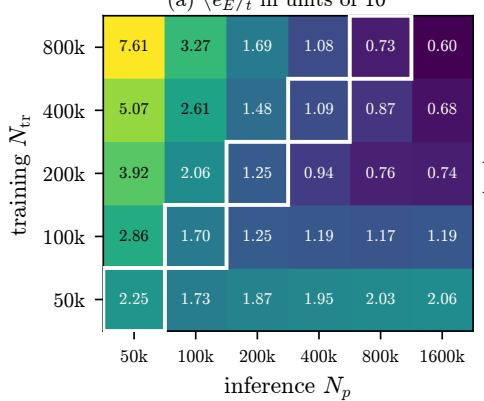

(b) error against inference $N _ { p }$  
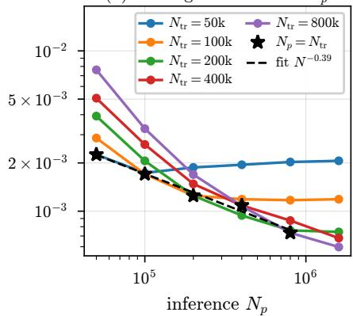  
Figure 3: 2D-2V weak Landau damping, teacher-forced field error $\langle e _ { E } \rangle _ { t }$ of the five models (training particle number $N _ { \mathrm { t r } } )$ evaluated with $N _ { p }$ particles. (a) All pairs, in units of $1 0 ^ { - 3 }$ diagonal entries $( N _ { p } = N _ { \mathrm { t r } } )$ outlined. (b) Error against $N _ { p } ,$ with the diagonal (stars) and a power-law fit to it.

In-loop error. When NEOPIC advances the particles itself, the same structure appears with larger values $( \mathrm { F i g . 4 ( a ) - ( c ) ) }$ ). Against the CIC teacher, the diagonal field error decreases from $6 . 7 \times 1 0 ^ { - 3 }$ to $1 . 5 \times 1 0 ^ { - 3 }$ , approximately as $N ^ { - 0 . 5 4 }$ close to the rate $N ^ { - 1 / 2 }$ expected from Proposition 5. The ratio of the in-loop to the teacher-forced diagonal error is 3.0 at $5 \times 1 0 ^ { 4 }$ particles and decreases to 2.0 at $8 \times 1 0 ^ { 5 }$ ; this is the amplification by the dynamics in Proposition $5 ,$ which over $T = 2 0$ is far below the worst-case Gronwall factor because of phase mixing. The position and velocity errors are small $( \langle e _ { x } \rangle _ { t } \leq 3 . 4 \times 1 0 ^ { - 4 }$ and $\langle e _ { v } \rangle _ { t } \leq 7 . 9 \times 1 0 ^ { - 4 }$ on the diagonal) and follow the same pattern without a clean power law. Inference below the training particle number is again the costly direction: at $N _ { p } = 5 \times 1 0 ^ { 4 }$ the electric field error grows from $6 . 7 \times 1 0 ^ { - 3 }$ for the model trained at $5 \times 1 0 ^ { 4 }$ to $2 . 0 \times 1 0 ^ { - 2 }$ for the one trained at $8 \times 1 0 ^ { 5 }$ . Over the whole range of $N _ { p } ,$ the models trained with $5 \times 1 0 ^ { 4 } – 2 \times 1 0 ^ { 5 }$ particles stay within a factor 2 of the best model for each $N _ { p }$ , whereas the model trained with $\mathrm { 8 \times 1 0 ^ { 5 } }$ is up to three times worse, in line with Proposition 4(iii) and Remark 6. The time histories in Fig. 5 show that the field error is largest during the first plasma periods and then saturates, while the position error grows smoothly and the velocity error saturates after $t \approx 1$

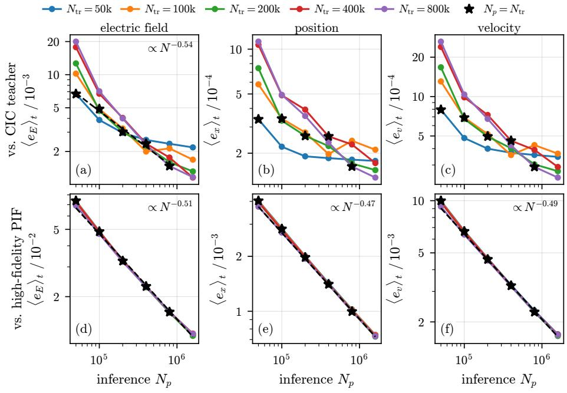  
Figure 4: 2D-2V weak Landau damping, in-loop errors (66) averaged over $t \leq 2 0 ,$ against the inference particle number $N _ { p }$ for the five trained models. (a)–(c) Reference: the CIC teacher with the same particles; (d)–(f) reference: high-fidelity PIF (fourth-order shape). Stars mark $N _ { p } = N _ { \mathrm { t r } } ;$ dashed lines are power-law fits to the diagonal (a) and to the model with $N _ { { \mathrm { t r } } } = 8 \stackrel { \cdot } { \times } 1 0 ^ { 5 } ( \mathrm { d } ) - ( \mathrm { f } )$

Against the high-fidelity reference $( \mathrm { F i g . ~ 4 ( d ) { - } ( f ) } )$ the five models are indistinguishable, and all three errors decrease as $\hat { N } _ { p } ^ { - 0 . 5 1 } , N _ { p } ^ { - 0 . 4 7 }$ and $N _ { p } ^ { - 0 . 4 9 }$ . The reference is run from the same initial particles and shares their sampling noise, so this error is dominated by the diferent responses of the CIC and the fourthorder shape functions to that noise. In the splitting of Remark $5 ,$ this is the teacher error $\varepsilon _ { \mathrm { t e a c h e r } } ( N _ { p } )$ against the high-fidelity reference, amplified by the dynamics. Its sampling part is the diference $\mathcal { E } _ { \mathrm { C I C } } - \mathcal { E } _ { \mathrm { h i f i } }$ of the two field operators applied to the shared fluctuations, of order $N _ { p } ^ { - 1 / 2 }$ , and is thus the same for all models. At $N _ { p } = 1 . 6 \times 1 0 ^ { 6 }$ it is ten times larger than the learned-operator error measured against the teacher. The learned operator therefore does not limit the accuracy at the particle numbers considered: the remaining error is that between two particle discretizations of the same particles.

Generalization. The model trained with $8 \times 1 0 ^ { 5 }$ particles at $k = 0 . 5$ was also evaluated at other wave numbers and on other mini-apps (Fig. 6). Because positions are normalized per sample and the predicted field is rescaled by $Q _ { \mathrm { t o t } } / \sqrt { | \Omega | }$ the field operator in normalized variables is the same for every k: the Poisson problem on $[ 0 , 2 \pi / k ) ^ { 2 }$ maps to the one on a fixed box. A change of k therefore does not change the map to be learned but the distribution of its inputs, since $k \lambda _ { D }$ , where $\lambda _ { D }$ is the Debye length, sets the damping rate and the oscillation frequency. For $k > 0 . 5$ the errors even decrease slightly, as the stronger damping brings the field to the noise level sooner. For $k < 0 . 5$ the perturbation is weakly damped and remains large over the whole run, and the field error increases to $4 . 5 \times 1 0 ^ { - 3 }$ at $k = 0 . 2 5$ and $8 . 7 \times 1 0 ^ { - 3 }$ at $k = 0 . 1 2 5$ , about seven times the value at the training wave number.

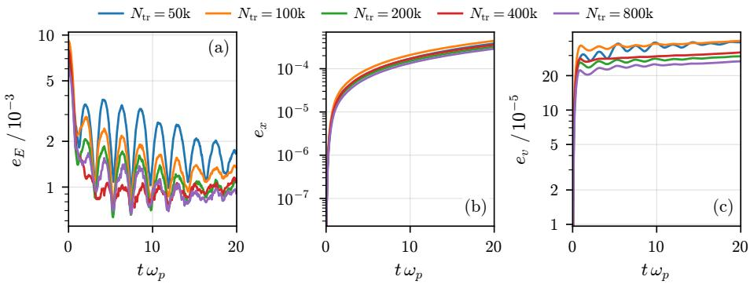  
Figure 5: 2D-2V weak Landau damping, time histories of the in-loop errors against the CIC teacher at $N _ { p } = 1 . 6 \times 1 0 ^ { 6 }$ for the five trained models.

Applied to other mini-apps (Fig. 6(b)), the weak-Landau model remains accurate for the bump-on-tail instability during the linear phase $( \langle e _ { E } \rangle _ { t } = 3 . 7 \times$ $1 0 ^ { - 3 } )$ , and for the two-stream instability until saturation, after which the error jumps: the time median of $e _ { E }$ is $4 . 7 \times 1 0 ^ { - 4 }$ , the mean $4 . 2 \times 1 0 ^ { - 2 }$ . It fails for strong Landau damping, whose large-amplitude, nonlinear density profiles were never seen in training $( \langle e _ { x } \rangle _ { t } = 4 . 6 \times 1 0 ^ { - 2 } )$ . A single-case model is thus limited to the region of input space covered by its training data, which motivates the multi-app models of the following sections.

## 8.2. 2D-2V multi-app model

One model is trained on five mini-apps, each generated by a diferent reference method: weak $( \alpha = 0 . 0 5 )$ and strong $( \alpha = 0 . 5 )$ Landau damping with PIF, the two-stream $( k = 0 . 5 )$ and bump-on-tail $( k = 0 . 2 1 )$ instabilities with PIC (perturbation amplitude $\alpha = 0 . 0 1 )$ , and the cyclotron mini-app, a magnetized electron cloud with open boundaries, with Barnes–Hut. PIF and PIC with FFT field solver use 32 modes and 32 grid points per dimension, respectively, both with the CIC shape function (applied in Fourier space for PIF), PIF with NUFFT tolerance $1 0 ^ { - 1 2 }$ , and Barnes–Hut uses the opening angle $\vartheta = 0 . 6$ and the softening length $\sqrt { 1 0 ^ { - 5 } } \approx 3 . 2 \times 1 0 ^ { - 3 }$ . All mini-apps are ran with $5 \times 1 0 ^ { 5 }$ particles. The instabilities are the 2D-2V counterparts of the 3D-3V benchmarks of [40], with the perturbation and the beams in the y-direction,

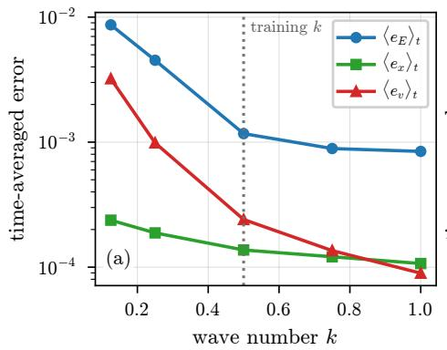

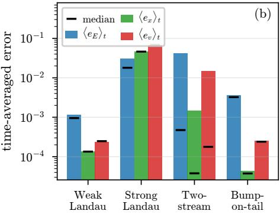  
Figure 6: Generalization of the weak-Landau model $( k = 0 . 5 , N _ { \mathrm { t r } } = 8 { \times } 1 0 ^ { 5 } )$ at $N _ { p } = 1 . 6 \times 1 0 ^ { 6 } .$ errors against the CIC teacher. (a) Other wave numbers; the dotted line marks the training wave number. (b) Other mini-apps: time-averaged errors (bars) and time medians (black marks).

$$
f _ { 0 } ( { \bf x } , { \bf v } ) = \frac { 1 + \alpha \cos k y } { 2 \pi \sigma _ { x } \sigma _ { y } } e ^ { - v _ { x } ^ { 2 } / ( 2 \sigma _ { x } ^ { 2 } ) } \Big ( ( 1 - \epsilon ) e ^ { - ( v _ { y } - v _ { b 1 } ) ^ { 2 } / ( 2 \sigma _ { y } ^ { 2 } ) } + \epsilon e ^ { - ( v _ { y } - v _ { b 2 } ) ^ { 2 } / ( 2 \sigma _ { y } ^ { 2 } ) } \Big )
$$

on $[ 0 , 2 \pi / k ) ^ { 2 }$ , with $\epsilon = 0 . 5 , \sigma _ { y } = 0 . 1$ and $v _ { b 1 , 2 } = \mp \pi / 2$ for the two-stream and $\epsilon = 0 . 1 , \sigma _ { y } = 1 / \sqrt { 2 } , v _ { b 1 } = 0$ and $v _ { b 2 } = 4$ for the bump-on-tail instability. Unlike in [40], where all thermal velocities are equal, we take $\sigma _ { x } = 1$ in both cases, so that the x-direction carries an unperturbed Maxwellian and only $W _ { y }$ grows. The cyclotron mini-app is a Gaussian electron cloud centred at the origin, with standard deviations $1 / ( 3 0 \sqrt { 2 } )$ and $1 / ( 1 0 \sqrt { 2 } )$ of the positions in x and $y ,$ standard normal velocities and total charge $Q _ { \mathrm { t o t } } = - 1 0$ , in a uniform magnetic field $\begin{array} { r } { B _ { 0 } = 3 0 0 \hat { \bf z } . } \end{array}$ so that $\omega _ { c } \Delta t = 3$ for $\Delta t = 0 . 0 1$ . The time step size $\Delta t = 0 . 0 5$ for the other four mini-apps and all of them (including the cyclotron) are trained on the first 600 time steps $( T _ { \mathrm { t r a i n } } = 3 0$ , and $T _ { \mathrm { t r a i n } } = 6$ for the cyclotron) and run for 1200 steps at $N _ { p } = 1 0 ^ { 6 }$ particles during inference, so that the second half of every run is an extrapolation in time.

In-loop errors. Figure 7 shows the in-loop errors against each mini-app’s own teacher. Within the training horizon, the time averaged field error is $4 \times 1 0 ^ { - 3 }$ for both Landau cases, $1 . 5 \times 1 0 ^ { - 2 }$ and $8 \times 1 0 ^ { - 3 }$ for the two-stream and bumpon-tail instabilities and 0.11 for the cyclotron. In the extrapolation window the time-averaged errors grow by factors between 1.8 (field, weak Landau) and 6.5 (positions, bump-on-tail). The largest growth occurs for the two-stream instability, by a factor 12 in the field and 39 in the positions: after saturation the particles are trapped in the nonlinear potential wells, and small field differences grow into large trajectory diferences. This sensitivity is a property of the dynamics and not of the model, since two teacher runs with slightly perturbed fields would separate in the same way; pointwise errors are therefore not meaningful in this regime and we compare quantities of interest instead.

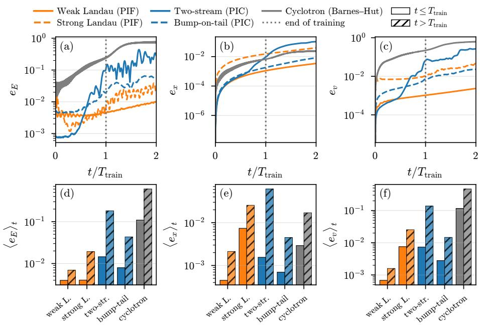  
Figure 7: 2D-2V multi-app model at $N _ { p } = 1 0 ^ { 6 } ,$ errors (66) against each mini-app’s teacher (colour: teacher). (a)–(c) Time histories with time normalized by the training horizon Ttrain; (d)–(f) time averages within (plain) and beyond (hatched) the training horizon.

Quantities of interest. The field energies in Fig. 8 agree closely with the teachers in all four periodic mini-apps, including the extrapolation window. For weak Landau damping, fits to the maxima of $W _ { x }$ for $1 \leq t \leq 1 5$ give damping rates of −0.290 (PIF) and −0.293 (NEOPIC), against −0.307 from linear theory, until the field reaches the noise level of $1 0 ^ { 6 }$ particles. Strong Landau damping, with its nonlinear trapping phase, secondary growth and saturated oscillations, is reproduced over the full horizon. For the instabilities, the growing component $W _ { y }$ grows at the same rate in NEOPIC and the teacher (fits over the same windows: 0.614 versus 0.613 for the two-stream and 0.297 versus 0.301 for the bump-on-tail instability), and the first saturation peak is reached at the same time $( t = 2 8 . 7 0$ versus 28.75, and 36.35 versus 36.30) with an amplitude that difers by 4% and 1%. The non-growing component $W _ { x }$ , which is at the level of the sampling noise, is also reproduced.

Conservation. The relative changes of total energy and momentum are shown in Fig. 9. In all periodic mini-apps the energy error of NEOPIC is of the same size as that of its teacher (for example $1 . 5 \times 1 0 ^ { - 5 }$ versus $2 . 5 \times 1 0 ^ { - 5 }$ for weak Landau damping and $1 . 1 \times 1 0 ^ { - 2 }$ versus $9 . 8 \times 1 0 ^ { - 3 }$ for the two-stream and $7 . 4 \times 1 0 ^ { - 4 }$ versus $7 . 1 \times 1 0 ^ { - 4 }$ for the bump-on-tail instability), and it does not grow in the extrapolation window. In strong Landau damping both are of order $1 0 ^ { - 2 }$ $( 6 . 7 \times 1 0 ^ { - 2 }$ for NEOPIC and $3 . 8 \times 1 0 ^ { - 2 }$ for PIF), which reflects the time step in the strongly nonlinear phase rather than the field model. Since the mean of the predicted field is removed, the total force vanishes and momentum is conserved to the single-precision round-of $( 1 0 ^ { - 9 } – 1 0 ^ { - 6 }$ relative), whereas a learned field without this correction would not conserve momentum at all.

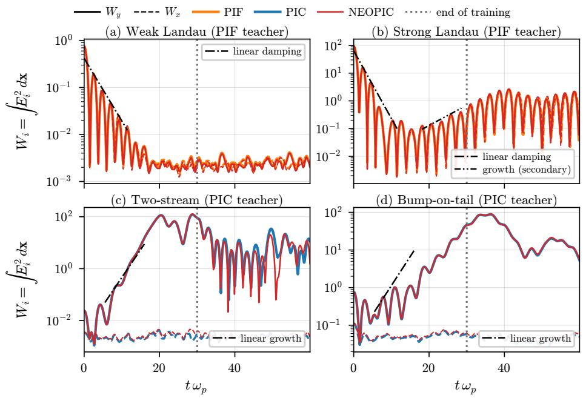  
Figure 8: 2D-2V multi-app model, field energy per component for the four periodic mini-apps: teacher (wide lines, colour as in Fig. 7) and NEOPIC (red). $W _ { y }$ (the growing component of the instabilities) is solid and $W _ { x }$ dashed. Dash-dotted: linear theory; dotted: end of training.

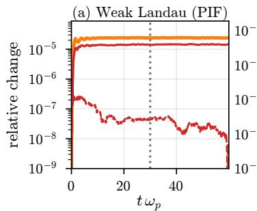

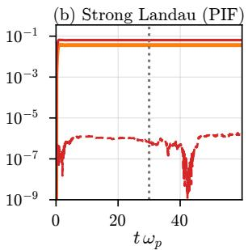

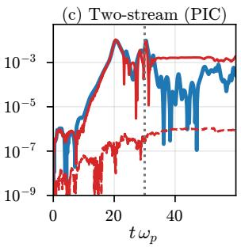

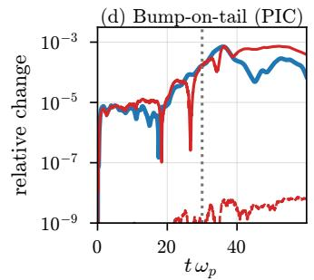

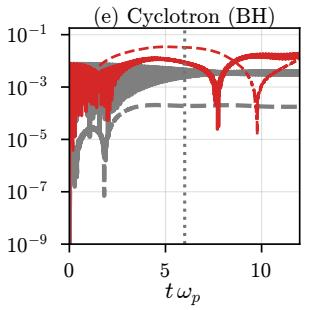  
Figure 9: 2D-2V multi-app model, relative change of the total energy (solid) and of the momentum (dashed; for the cyclotron the canonical angular momentum $L _ { \mathrm { { c a n } } } ~ ( 6 8 ) )$ for the teachers (wide lines) and NEOPIC (red).

$$
\left| P - P _ { 0 } \right| / \left| P _ { 0 } \right|
$$

Cyclotron mini-app. The cyclotron mini-app is the most demanding of the five: the domain is open, the cloud occupies about 2% of the solver box, and the strong magnetic field turns the electrostatic repulsion into an E×B rotation that is sheared outside the dense core, so that the initially elongated cloud develops two spiral arms (Fig. 10). Two diagnostics require care in this case. First, in two dimensions $\begin{array} { r } { { \frac { 1 } { 2 } } \int | \mathbf { E } | ^ { 2 } } \end{array}$ dx diverges logarithmically for a net charge, and the particle average $\frac { | \Omega | } { 2 N _ { p } } \sum _ { p } | \mathbf { E } _ { p } | ^ { 2 }$ is only valid for clouds that fill the box. We therefore use the electrostatic energy $\begin{array} { r } { U \ = \ \frac { 1 } { 2 } \sum _ { p } q \phi ( \mathbf { x } _ { p } ) } \end{array}$ with the free-space potential $( G = - \ln { r / 2 \pi } )$ computed by the spectral free-space solver of ${ \mathrm { V i c o } } ,$ Greengard and Ferrando [70] that the PIC reference uses. Second, the canonical angular momentum $\begin{array} { r } { \sum _ { p } [ \dot { m } ( \mathbf { x } _ { p } \times \mathbf { v } _ { p } ) _ { z } + \frac { q B _ { 0 } } { 2 } | \mathbf { x } _ { p } | ^ { 2 } ] } \end{array}$ , which the exact dynamics conserve for any torque-free field, is not conserved by the Boris scheme at $\omega _ { c } \Delta t = 3$ . We therefore use

$$
L _ { \mathrm { c a n } } = \sum _ { p } \left[ \left( 1 + \frac { \omega _ { c } ^ { 2 } \Delta t ^ { 2 } } { 4 } \right) m \left( \mathbf { x } _ { p } ^ { n } \times \bar { \mathbf { v } } _ { p } ^ { n } \right) _ { z } + \frac { q B _ { 0 } } { 2 } \vert \mathbf { x } _ { p } ^ { n } \vert ^ { 2 } \right] , \quad \bar { \mathbf { v } } _ { p } ^ { n } = \frac { \mathbf { v } _ { p } ^ { n - 1 / 2 } + \mathbf { v } _ { p } ^ { n + 1 / 2 } } { 2 } ,\tag{68}
$$

which follows from an exact discrete invariant of the Boris scheme (Appendix C). It is conserved exactly for pairwise Coulomb forces in two dimensions and changes through torques, i.e. non-central field errors, and only weakly through errors in the strength of a central field. The factor $1 + ( \omega _ { c } \Delta t / 2 ) ^ { 2 }$ tends to one when the gyration is resolved; the same factor causes the energy oscillation of the Barnes–Hut reference in Fig. 9(e) (Appendix C).

Up to the end of training, NEOPIC reproduces the formation of the arms (Fig. 10), with a field error against a free-space PIC evaluation at the NEOPIC positions of 1–4%, against 0.5% for Barnes–Hut (Fig. 12(a)). Beyond $t \approx 7$ this error rises to about 20%. The error maps in Fig. 11 show that the late error is nearly uniform over the cloud and vanishes at its centre, which indicates an error mainly in the strength of the radial field; the peak core field is about 10% too large. Such an error leaves $L _ { \mathrm { c a n } }$ nearly unchanged, and indeed the angular momentum of NEOPIC is broken mainly within the training window (maximum $3 . 5 { \times } 1 0 ^ { - 2 } )$ , where the error maps show a direction-dependent pattern near the core that exerts a torque. The overestimated field drives a faster $\mathbf { E } \times \mathbf { B }$ rotation: measured by the phase of the azimuthal $m \ = \ 2$ Fourier mode of the density (Appendix C), the arms wind 14% more than in the Barnes–Hut run between $r = 0 . 0 9$ and $r = 0 . 2 9$ at t = 11.98 (0.815 versus 0.715 turns, Fig. 12(b)). The extra winding is concentrated in the shear layer just outside the core, $0 . 0 9 \lesssim r \lesssim 0 . 1 4 ;$ ; for $0 . 1 4 \leq r \leq 0 . 2 9$ the winding agrees to within 1% (Fig. 12(c)). The total energy of NEOPIC changes by $1 . 3 \times 1 0 ^ { - 2 }$ within and $2 . 0 \times 1 0 ^ { - 2 }$ beyond the training horizon, against $7 . 5 \times 1 0 ^ { - 3 }$ for Barnes–Hut.

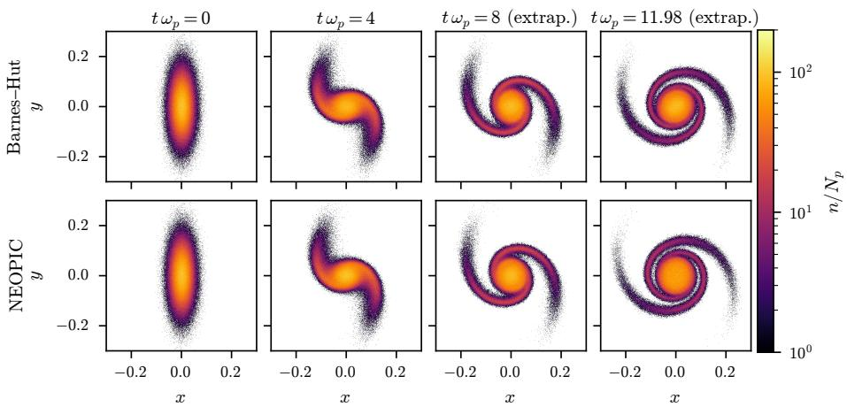  
Figure 10: Cyclotron mini-app (2D magnetized electron cloud, open boundaries): particle density $n / N _ { p }$ per unit area for Barnes–Hut (top) and NEOPIC (bottom) at $N _ { p } = \dot { 1 0 } ^ { 6 }$ , binned on a fixed grid about the centre of the cloud. Training ends at t = 6.

Convergence in the time step. The cyclotron mini-app has the fastest time scale of the 2D mini-apps, and we use it in Appendix D to test the time-step dependence of Theorem 3. NEOPIC and PIF started from the same particles converge at the same rate in the time step, measured by the guiding centres, and the model error does not depend on the time step, so that the model can be used with time steps much smaller than those of its training data.

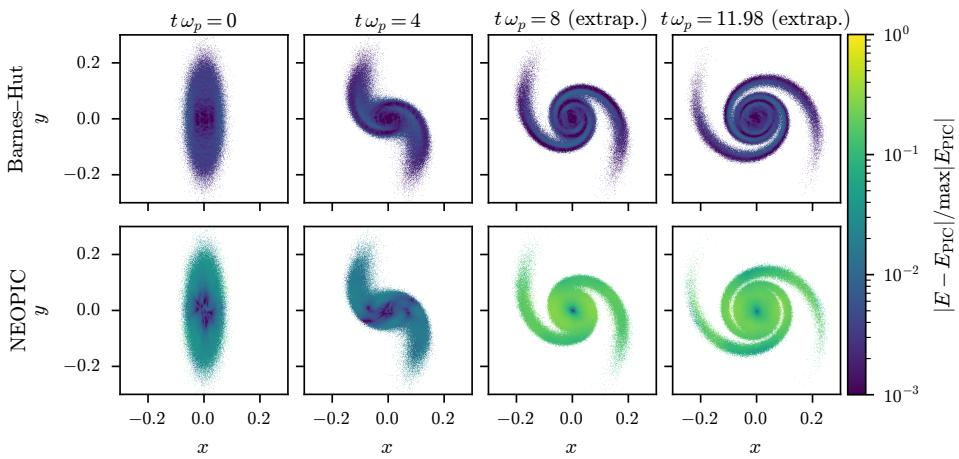  
Figure 11: Cyclotron mini-app: local diference between the field of each method and a freespace PIC field evaluated at the same particle positions, averaged per bin and normalized by the maximum PIC field.

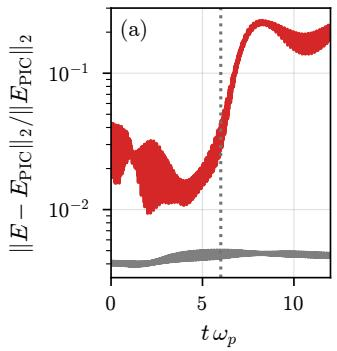

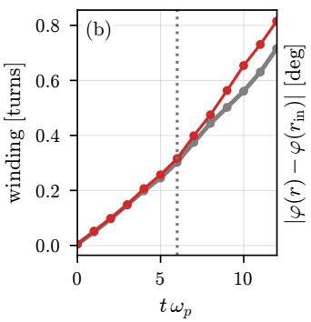

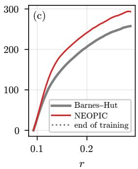  
Figure 12: Cyclotron mini-app. (a) Relative $\ell ^ { 2 }$ diference between the field of each method and a free-space PIC evaluation at the same positions. (b) Winding of the two spiral arms between $r = 0 . 0 9$ and $r = 0 . 2 9$ , from the phase $\varphi ( r )$ of the $m = 2$ azimuthal mode of the density. (c) Arm shape $| \varphi ( r ) - \varphi ( 0 . 0 9 ) |$ at $t = 1 1 . 9 8$

## 8.3. 3D-3V multi-app models

In three dimensions we train two models: one on four mini-apps (weak and strong Landau damping with Barnes–Hut, the two-stream and bump-on-tail instabilities with PIF), and one on the same four mini-apps plus a Penning trap with PIC as teacher. The second model measures the efect of a more diverse training set on the original four mini-apps. Training was done with $N _ { p } = 1 0 0 0 0 0$ particles, whereas inference uses 163 840 particles, $\Delta t = 0 . 0 5$ and 1200 steps, of which the first 600 $( T _ { \mathrm { t r a i n } } = 3 0 )$ are covered by training; the reference runs are the same for both models. As in two dimensions, PIF and PIC with FFT field solver use 32 modes and grid points per dimension and the CIC shape function, PIF with NUFFT tolerance $1 0 ^ { - 7 } ;$ Barnes–Hut uses $\vartheta = 0 . 5$ and the softening length 0.05. The Landau damping and instability mini-apps are those of [40, Section $4 ] { \mathrm { : } }$ : Landau damping with $k = 0 . 5$ and $\alpha = 0 . 0 5$ (weak) or $\alpha = 0 . 5$ (strong), perturbed in all three directions, and the instabilities with the parameters given above for 2D, but with the perturbation and the beams in the z-direction and $\sigma _ { x } = \sigma _ { y } = \sigma _ { z } = \sigma$ The Penning trap also follows [40]: electrons in the uniform magnetic field $\mathbf { B } _ { \mathrm { e x t } } = 5 \hat { \mathbf { z } }$ and the quadrupole electric field $\begin{array} { r } { \mathbf { E } _ { \mathrm { e x t } } \ : = \ : \frac { 1 5 } { L } \big ( - ( x - \frac { L } { 2 } ) , - ( y - \frac { L } { 2 } ) , 2 ( z - \frac { L } { 2 } ) \big ) } \end{array}$ with a neutralizing ion background, total charge $\begin{array} { r } { Q _ { \mathrm { t o t } } = - 1 5 6 2 . 5 . } \end{array}$ , Gaussian positions with mean $L / 2$ and standard normal velocities. Unlike in [40], we take $L = 2 5$ instead of 20 and the standard deviations (3, 1, 4) of the positions.

Quantities of interest. Both models reproduce the field energies of the four mini-apps (Fig. 13). The damping rates of weak Landau damping, fitted for $t \leq 9$ before the field reaches the noise level of 163 840 particles, are −0.191 (Barnes–Hut), −0.190 (four mini-apps) and −0.179 (five mini-apps). For the two-stream instability the growth rate agrees within 2% (0.547 for PIF, 0.539 for the four-app and 0.537 for the five-app model), and the saturation peak of $W _ { z }$ is reached about one time unit later and 17–26% higher than in the reference $( t = 1 6 . 4$ and $W _ { z } ~ = ~ 5 0 9$ for PIF, against $t = 1 7 . 7$ and $W _ { z } = 5 9 4$ for the four-app and $t = 1 7 . 3$ and $W _ { z } = 6 4 2$ for the five-app model). After saturation both models give somewhat lower field energies than PIF. For the bump-on-tail instability the saturation peak agrees within 7% in amplitude and 0.4 in time. In this case the linear phase is hidden below the noise level at this particle number: $W _ { z }$ stays within a factor of about three of the non-growing components until $t \approx 1 5 ,$ and once it has risen well above them it grows more slowly than linear theory predicts $( 2 \gamma = 0 . 3 5 6 )$ . The slopes of ln $W _ { z }$ fitted for $1 0 \leq t \leq 2 5$ (0.151 for PIF, 0.203 for the four-app and 0.183 for the five-app model) are therefore not growth rates in the linear sense, and no theory line is shown. In strong Landau damping, whose field stays well above the noise level, both models follow the reference through the nonlinear phase; the mean deviation $\langle | \ln ( W _ { i } / W _ { i } ^ { \mathrm { r e f } } ) | \rangle _ { t }$ is 0.07–0.11 for the four-app and 0.16–0.20 for the five-app model within the training horizon, and 0.14–0.45 beyond it.

The two models difer most in the level of the field fluctuations, i.e. in the field energy that remains after Landau damping and in the non-growing components of the instabilities. This level is set by the sampling noise of the particles and by how the teacher’s discretization (resolved modes, shape function, opening angle) responds to it, so it difers between teachers. To separate the two efects we repeated weak Landau damping and the bump-on-tail instability from the same initial particles (taken from the Barnes–Hut run) with both Barnes–Hut and PIF as reference (Fig. 14). In weak Landau damping the fluctuation level of PIF is six times that of Barnes–Hut $( \bar { W } = { \textstyle \frac { 1 } { 3 } } ( W _ { x } + W _ { y } + W _ { z } )$ ≈ 1.08 against 0.17, geometric means over $1 2 \leq t \leq 6 0 )$ . The four-app model reproduces the level of its teacher, Barnes–Hut (0.17), whereas the five-app model lies in between (0.31). For the bump-on-tail instability, whose teacher is PIF, the field energy of the non-growing components, $\begin{array} { r } { \frac { 1 } { 2 } ( W _ { x } + W _ { y } ) } \end{array}$ , is about 70 for PIF and 17–23 for Barnes–Hut. The five-app model again stays in between, at 25–33, over the whole run including the extrapolation window, while the four-app model starts at the Barnes–Hut level (17 for $t < 1 0 )$ , rises during the linear phase and switches to the PIF level shortly before the end of training (65 for $2 5 \leq t < 3 0 )$ Its level in the extrapolation window (47–64) depends on the random seed, which we confirmed with a second seed. The growing component behaves in the same way during the linear phase: for $t < 1 2$ the four-app model follows Barnes–Hut closely $( W _ { z } \approx 2 6$ and 39, averaged over $0 \leq t < 5$ and $5 \leq t < 1 2$ against 26 and 40 for Barnes–Hut and 84 and 108 for PIF), and the five-app model is slightly above (35 and 53). In both cases the five-app model sits about one third of the way from Barnes–Hut to PIF on a logarithmic scale.

We interpret this as follows. The fluctuating part of the field is a linear response of the operator to the sampling fluctuations of the input, and by Proposition 3 the noise term in the training loss (Remark 18) penalizes the diference between the response of the model and that of the teacher. If training data of several teachers cover similar inputs, as the nearly uniform densities of Landau damping and of the early phase of the instabilities do, the minimizer of this term is a weighted average of the teachers’ responses, i.e. a discretization in between. The four-app model does not form such an average consistently: it reproduces Barnes–Hut on inputs that resemble its Landau training data and switches to PIF once the bump-on-tail density becomes distinctive near saturation. Adding the Penning trap, a third teacher (PIC) with very diferent inputs, makes the response consistent across the mini-apps and over time, including the extrapolation window. This consistency comes at the price of a higher fluctuation level than the teacher in weak Landau damping, but it goes along with better energy conservation in seven of the eight cases of Table 3, most clearly for the bump-ontail instability. A more diverse training set thus produces a model that behaves like a single discretization rather than switching between its teachers. In the 2D model, trained and evaluated with more particles, the fluctuation level of each mini-app follows its teacher (Fig. 8). Whether a model averages or switches between its teachers is, however, not the goal in itself; what matters is the accuracy of the resulting simulations. Averaging the responses of teachers with diferent noise responses can be less accurate than either teacher, and switching between them can make the response inconsistent in time. Training sets in which the teachers are complementary, each used where it is accurate, and consistent in the regimes where their inputs overlap would let a single model follow the most accurate response everywhere. Constructing such training sets, and making the transition between teachers smooth, is left to future work (Section 9).

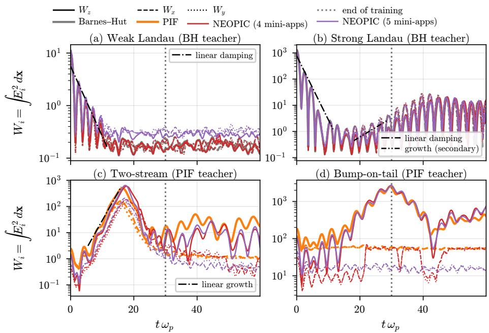  
Figure 13: 3D-3V multi-app models at $N _ { p } = 1 6 3 8 4 0$ , field energy per component: reference (wide lines; grey: Barnes–Hut, orange: PIF), model trained on four mini-apps (red) and model trained on five mini-apps including the Penning trap (purple). Wz (the growing component of the instabilities) is solid, $W _ { x }$ dashed and $W _ { y }$ dotted. For the bump-on-tail instability the linear phase is below the noise level and no theory line is shown.

Conservation. Energy conservation is summarized in Table 3. For weak and strong Landau damping both models conserve energy as well as Barnes–Hut. For the instabilities their energy errors within the training horizon are larger than those of PIF, by a factor of 8–11 for the four-app model and 2–5 for the five-app model, and they do not grow appreciably in the extrapolation window. The five-app model has the smaller error in all cases except the extrapolation window of the two-stream instability $( 5 . 1 \times 1 0 ^ { - 3 }$ against $3 . 5 \times 1 0 ^ { - 3 } )$ . Barnes– Hut does not conserve momentum, because the tree approximation breaks the symmetry of the pair forces, whereas NEOPIC conserves it to $1 0 ^ { - 5 }$ relative in these periodic mini-apps through the removal of the mean field which can also be done for Barnes–Hut if desired.

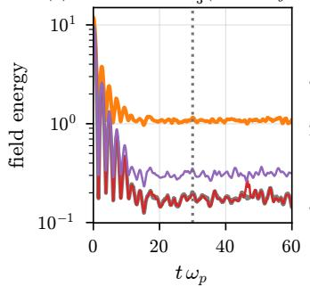

$$
{ \scriptstyle { \frac { 1 } { 3 } } } ( W _ { x } + W _ { y } + W _ { z } )
$$

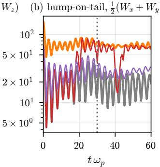

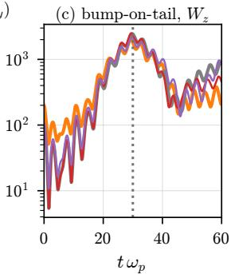  
Figure 14: Field fluctuation level of the 3D-3V models: runs from the same initial particles (Barnes–Hut) compared with both Barnes–Hut and PIF. (a) Weak Landau damping, mean of the three components; (b) bump-on-tail instability, mean of the two non-growing components; (c) bump-on-tail instability, growing component.

Table 3: 3D-3V multi-app models: maximum relative change of the total energy, maxt $| \mathcal { E } ( t ) -$ $\mathcal { E } ( 0 ) | / | \mathcal { E } ( 0 ) |$ , within $( t \leq T _ { \mathrm { t r } } )$ and beyond $( t > T _ { \mathrm { t r } } )$ the training horizon, for the reference and the models trained on four and five mini-apps. The smaller of the two model errors is shown in bold.
<table><tr><td rowspan="3">mini-app (teacher)</td><td colspan="2">reference</td><td colspan="2">NEOPIC, 4 apps</td><td colspan="2">NEOPIC, 5 apps</td></tr><tr><td> $t \leq T _ { \mathrm { t r } }$ </td><td> $t > T _ { \mathrm { t r } }$ </td><td> $t \leq T _ { \mathrm { t r } }$ </td><td> $t > T _ { \mathrm { t r } }$ </td><td> $t \leq T _ { \mathrm { t r } }$ </td><td> $t > T _ { \mathrm { t r } }$ </td></tr><tr><td>weak Landau (BH)</td><td> $3 . 5 { \cdot } 1 0 ^ { - 4 }$ </td><td> $3 . 6 { \cdot } 1 0 ^ { - 4 }$ </td><td> $3 . 8 { \cdot } 1 0 ^ { - 4 }$ </td><td> $4 . 1 { \cdot } 1 0 ^ { - 4 }$ </td><td> $\mathbf { 3 . 1 . 1 0 ^ { - 4 } }$ </td><td> $\mathbf { 3 . 2 { \cdot } 1 0 ^ { - 4 } }$ </td></tr><tr><td>strong Landau (BH)</td><td> $8 . 3 { \cdot } 1 0 ^ { - 2 }$ </td><td> $7 . 9 { \cdot } 1 0 ^ { - 2 }$ </td><td> $7 . 2 { \cdot } 1 0 ^ { - 2 }$ </td><td> $6 . 8 { \cdot } 1 0 ^ { - 2 }$ </td><td> ${ \bf 6 . 9 { \cdot } 1 0 ^ { - 2 } }$ </td><td> ${ \bf 6 . 6 { \cdot 1 0 } ^ { - 2 } }$ </td></tr><tr><td>two-stream (PIF)</td><td> $1 . 9 { \cdot } 1 0 ^ { - 3 }$ </td><td> $6 . 7 { \cdot } 1 0 ^ { - 5 }$ </td><td> $2 . 1 { \cdot } 1 0 ^ { - 2 }$ </td><td> $\mathbf { 3 . 5 { \cdot 1 0 } ^ { - 3 } }$ </td><td> $\mathbf { 8 . 9 { \cdot 1 0 } ^ { - 3 } }$ </td><td> $5 . 1 { \cdot } 1 0 ^ { - 3 }$ </td></tr><tr><td>bump-on-tail (PIF)</td><td> $3 . 9 { \cdot } 1 0 ^ { - 4 }$ </td><td> $3 . 3 { \cdot } 1 0 ^ { - 4 }$ </td><td> $3 . 1 { \cdot } 1 0 ^ { - 3 }$ </td><td> $3 . 6 { \cdot } 1 0 ^ { - 3 }$ </td><td> $\mathbf { 9 . 5 { \cdot 1 0 } ^ { - 4 } }$ </td><td> $\mathbf { 8 . 4 { \cdot 1 0 } ^ { - 4 } }$ </td></tr><tr><td>Penning trap (PIC)</td><td> $3 . 0 { \cdot } 1 0 ^ { - 3 }$ </td><td> $1 . 6 { \cdot } 1 0 ^ { - 3 }$ </td><td></td><td></td><td> $6 . 6 { \cdot } 1 0 ^ { - 2 }$ </td><td> $5 . 0 { \cdot } 1 0 ^ { - 2 }$ </td></tr></table>

Penning trap. The fifth mini-app confines a non-neutral cloud with an axial magnetic field and an external quadrupole electric field; the total energy is the sum of the kinetic, self-field and external potential energies (Fig. 15). Since the cloud does not fill the periodic box, the field energy is computed on the PIC grid from the particle positions, $\begin{array} { r } { { \frac { 1 } { 2 } } \int | { \bf E } | ^ { 2 } d { \bf x } } \end{array}$ , which is the same diagnostic for both methods. PIC conserves the total energy to $3 \times 1 0 ^ { - 3 }$ . NEOPIC gains up to 6.6% during the initial relaxation of the cloud in the trap $( t \lesssim 1 0 )$ , when the self-field changes fastest, and then keeps the energy bounded, with a maximum change of 5.0% in the extrapolation window. The partition of the energy drifts slowly: at $t = 6 0$ the self-field energy is $1 . 0 4 \times 1 0 ^ { 4 }$ for NEOPIC against $1 . 2 3 \times 1 0 ^ { 4 }$ for PIC, and the external potential energy $4 . 7 \times 1 0 ^ { 3 }$ against $2 . 5 \times 1 0 ^ { 3 }$

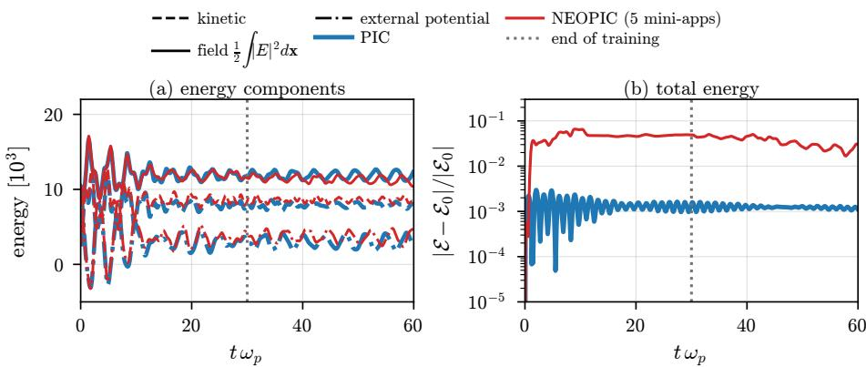  
Figure 15: Penning trap (3D, five-app model, $N _ { p } = 1 6 3 8 4 0 )$ . (a) Kinetic, self-field and external potential energy; (b) relative change of the total energy.

## 8.4. Computational cost

Figure 16 shows the time per field evaluation on one NVIDIA A100 GPU as a function of $N _ { p }$ in 2D and 3D, averaged over 20 time steps of 2D-2V and 3D-3V weak Landau damping, respectively. For PIC and PIF the grid or the number of modes grows $( 3 2 ^ { 2 } - 4 0 9 6 ^ { 2 }$ for 2D and $1 6 ^ { 3 } - 2 5 6 ^ { 3 }$ for 3D) with $N _ { p }$ at a fixed number of particles per cell (10 for 2D and 4 for 3D), whereas NEOPIC keeps its architecture $( M = 3 2 ^ { d }$ modes) fixed. We show two groups of implementations: Python/CuPy implementations of PIC and PIF, the latter with the same cuFINUFFT interface as NEOPIC (filled markers), and production C++ codes, IPPL [92] for PIC and PIF and Ryoanji [93] for Barnes–Hut (open markers).

Both NEOPIC evaluations scale linearly, as stated in Proposition $6 ;$ a fit of $T = \alpha N _ { p } + \beta$ gives $\alpha = 7 9$ ns and $\beta = 6 4 \mathrm { m s }$ in 2D and $\alpha = 3 0 0$ ns and $\beta = 4 9$ ms in 3D for the NUFFT, and $\alpha = 1 5 5 \mathrm { n s } \ ( 1 . 4 \mu \mathrm { s } )$ with a small $\beta$ in 2D (3D) for the direct (NUDFT) evaluation. The direct evaluation is therefore faster in 2D up to about $7 \times 1 0 ^ { 5 }$ particles, while in 3D the NUFFT is faster beyond about $4 \times 1 0 ^ { 4 }$ , in agreement with the operation counts of Section $7 .$ The large constant $\beta$ of the NUFFT version comes from creating the cuFINUFFT

3D

2D

plans in every call; persistent plans would remove most of it. Per particle, NEOPIC with the NUFFT costs 39 times more than the Python PIF with the same tolerance in 2D (2.0 ns) and 37 times more in 3D (8.2 ns). This is below the ratio $2 L d _ { v } / ( 1 + d )$ of the transform counts in (59) (85 and 64), because the $d _ { v }$ channels share the sorting and the particle data in a batched transform. Against the production codes the gap is larger: IPPL PIC needs 0.63 ns (1.5 ns) per particle in 2D (3D), so NEOPIC is about 120 to 200 times more expensive per particle than an optimized FFT-based PIC code, and about six times more expensive than Barnes–Hut with opening angle $\vartheta = 0 . 5$ at $1 . 6 \times 1 0 ^ { 7 }$ particles (4.7 s against 0.77 s). The cost of Barnes–Hut grows rapidly as ϑ decreases, and in our tests NEOPIC is cheaper than Barnes–Hut for $\vartheta \lesssim 0 . 2$ (not shown); such a comparison is only meaningful at matched accuracy, since the accuracy of NEOPIC is bounded by that of its teacher. NEOPIC is therefore not competitive with optimized particle methods at equal particle numbers. However, its cost is independent of the teacher and of the spatial distribution of the particles, the particles interact only through a constant number of $( \mathcal { O } ( L d _ { v } M ) )$ Fourier coeficients, which is attractive for a particle-only parallelization which is load balanced by design [91]. In a follow up work, we are exploring these, in a fully distributed parallel implementation of NEOPIC coupled to production particle codes targeting highly non-homogeneous/clustered particle distributions.

The dependence of the cost on the architecture is analysed in Appendix F: the cost per particle grows linearly with $\mathit { L d } _ { v }$ and hardly depends on the number of modes, so that the resolution of the operator is cheap.

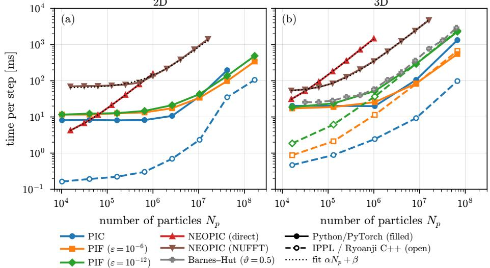  
Figure 16: Time per field evaluation (one time step) against the number of particles for (a) 2D and (b) 3D Landau damping, on one GPU. Colours identify the method, line styles the implementation: Python/PyTorch (solid, filled markers) and the C++ codes IPPL and Ryoanji (dashed, open markers). Dotted lines: fits $T = \alpha { { N } _ { p } } + \beta$ to the NEOPIC timings.

## 9. Conclusions

We have introduced NEOPIC, a framework for learning the field operator of particle-based methods for kinetic plasma simulations. Its central element is a nonuniform Fourier neural operator that acts directly on the empirical measure of the particles and returns the field at the particle positions, without a mesh, a tree or a deposition step. Because the input is the particle measure itself, the discrete evaluation coincides with the continuous operator at any number of particles, and the particle noise is not aliased onto the retained Fourier modes. NEOPIC replaces only the field solve: it can be trained on data from PIC, PIF or tree codes, and it can be combined with the standard time integrators in any production particle code, explicit as well as implicit, the latter with exact Jacobians obtained by automatic diferentiation.

The error analysis shows that the error of a particle simulation with NEOPIC separates into a Monte Carlo sampling error, a time-stepping error and a model error, so that, up to the model error, NEOPIC behaves like a standard Monte Carlo particle method. The particle noise in the training data acts as an implicit regularizer that drives the response of the model to density fluctuations towards that of its teacher; the resulting trade-of between accuracy and robustness gives guidance on the number of training particles in relation to the particle numbers used in simulations. The cost per time step is $\mathcal { O } ( N _ { p } )$ , with constants set by the architecture alone.

The numerical experiments support these findings. For 2D weak Landau damping, the in-loop field error against the teacher decreases approximately as $N _ { p } ^ { - 1 / 2 }$ when the training and simulation particle numbers are equal. For a given model, the teacher-forced error decreases with the number of simulation particles until it levels of at a knee, which lies at two to four times the training particle number for the models trained with fewer particles. Simulations with fewer particles than in training are the costly direction, whereas the models trained with fewer particles stay within a factor of two of the best model over the whole range of particle numbers. Theory and experiments therefore suggest training close to the smallest particle number expected in the simulations, which also reduces the cost of generating the training data and of training. Against a highfidelity reference, all models converge as $\bar { N } _ { p } ^ { - 1 / 2 }$ up to the largest particle number considered, 32 times the smallest training particle number. At these particle numbers the error is dominated by the discretization of the teacher and is about ten times larger than the error of the learned operator, so that the accuracy of NEOPIC simulations keeps improving with the number of particles beyond that of the training data. A single 2D model trained on five mini-apps generated by three diferent methods, including the cyclotron mini-app with open boundaries, reproduces the damping and growth rates of the teachers to within about 1%, conserves momentum to round-of and energy to the level of its teachers on the periodic mini-apps, and remains stable up to twice the training horizon. For the cyclotron mini-app, the field error grows beyond the training horizon, and diagnostics such as the canonical angular momentum identify its origin in non-central field errors. In three dimensions, models trained on four and five mini-apps, including a Penning trap, show that a model trained on several teachers combines their responses to the particle noise: a more diverse training set leads to a model that behaves like a single, consistent discretization rather than switching between its teachers. The time-step study for the cyclotron miniapp confirms that NEOPIC and PIF have the same second-order time-stepping error, which is set by the integrator, while the model error does not depend on the time step, so that the model can be used with time steps smaller than those of its training data. With the implicit midpoint rule, NEOPIC remains stable and nearly energy-conserving in 1D-1V weak Landau damping well beyond the stability limit of the leapfrog scheme. Finally, the cost per particle grows linearly with the product of the number of layers and the channel width and hardly depends on the number of Fourier modes, so that the resolution of the operator is cheap; the smallest architectures we considered have a cost per time step comparable to that of Barnes–Hut and high-accuracy PIF, while the current single-GPU implementation is not competitive with optimized particle codes at equal particle numbers.

This work opens several directions. First, since the particles interact only through a moderate number of Fourier coeficients per layer, NEOPIC lends itself to a parallelization over particles alone, without the domain decomposition and load balancing of mesh- and tree-based methods. Together with optimizations of the implementation, such as persistent NUFFT plans and reduced precision, and a coupling to production particle codes, this is the basis for simulations with billions of particles. Second, the multi-app results suggest a foundation model for fields in particle-based methods, pre-trained on many methods and applications and fine-tuned with few application-specific samples, with the aim of real simulations. Our results show that a model trained on several teachers switches between their responses according to the input distribution; making this switch smooth and controlled, through consistent data in overlapping regimes or explicit gating, and conditioning the model on the desired fidelity, so that it reproduces the behaviour of an expensive teacher where only data of a cheaper teacher were available, are natural ingredients of such a model. Third, the framework extends beyond electrostatics. Magnetized plasmas with $\omega _ { c } \Delta t \gg 1$ and implicit Darwin models, in which NEOPIC can serve as the field solver or as a preconditioner of the nonlinear solve, are a natural next step, followed by electromagnetic models and collisions. Other field boundary conditions (Remark 17) and other particle–field methods with the same structure, such as vortex methods, can be treated in the same framework.

## Appendix A. Further details of the architecture

## Appendix A.1. Min–max normalization

The map (13) depends on the particles only through the bounding box of the support of $\mu _ { X }$ , i.e. only through the measure. For a given configuration it is a fixed afine map applied pointwise, so Lemma 1 and Theorems 1 and 2 below apply unchanged. In an open domain it makes the input of the network invariant under translations and componentwise rescalings of the cloud, which is useful when the cloud moves and changes its size. Three consequences should be kept in mind. First, the box is set by the extreme particles: it is Lipschitz in the positions only with respect to the maximal displacement max $\mathbf { \sigma } _ { p } \left. \mathbf { x } _ { p } - \mathbf { y } _ { p } \right.$ , not the average displacement used in Lemma $2 ,$ and it is not a continuous function of the measure in the weak sense. Second, the box depends on $N _ { p }$ through the input distribution. For a density with compact support it converges to the support as $N _ { p }$ grows. For a density with unbounded support, such as a Gaussian cloud, its extent grows slowly, like $\sqrt { 2 \ln { N _ { p } } }$ standard deviations per side, so the same physical density is mapped to slightly diferent normalized densities at diferent particle numbers. On periodic domains filled by the plasma, the box difers from the domain by $\mathcal { O } ( L / N _ { p } )$ per side. Third, the transforms treat the normalized box as periodic. For periodic problems this is the physical periodicity, up to the same $\mathcal { O } ( L / N _ { p } )$ For open-boundary problems it identifies opposite faces of the cloud’s bounding box, an artificial periodicity that the learned operator has to compensate. This periodicity is that of the transforms only. In the implementation the positions are normalized to $\pmb { \xi } = ( \mathbf { x } - \mathbf { a } _ { X } ) \oslash \left( \mathbf { b } _ { X } - \mathbf { a } _ { X } \right) \in$ $[ 0 , 1 ] ^ { d }$ , the lifting is applied to $\xi ,$ and the transforms use $e ^ { 2 \pi \mathrm { i } \mathbf { k } \cdot \boldsymbol { \xi } } , \mathbf { k } \in \mathcal { K } _ { m }$ . These basis functions are periodic on the unit box, so no explicit map to the torus is needed; (13) is the same operator written in the coordinates $- \pi { \bf 1 } + 2 \pi \pmb { \xi }$ , in which an afine lifting only has rescaled weights and bias. The lifting, however, acts on the coordinates themselves and not on a periodic function of them. A linear lifting therefore distinguishes the two sides of the seam, which are neighbours for the transforms, and on periodic domains a particle that crosses the boundary changes its lifted features discontinuously (Remark 16). The error analysis of Section 5 is written for a fixed normalization. For the min–max normalization it applies to configurations whose bounding boxes do not degenerate, and the $N _ { p }$ -dependence of the box is an additional efect that it does not cover.

## Appendix A.2. Grid aliasing and particle sampling

The following proposition compares the Fourier coeficients computed on a uniform grid, after deposition onto a grid, and from particles, and quantifies the diference between grid aliasing and particle sampling discussed in Section 4.5.

Proposition 8 (Grid aliasing and particle sampling). Let $f :  { \mathbb { T } ^ { d } } \to  { \mathbb { C } }$ have an absolutely summable Fourier series,

$$
f ( { \bf x } ) = \sum _ { { \bf q } \in \mathbb { Z } ^ { d } } \hat { f } _ { { \bf q } } e ^ { \mathrm { i } { \bf q } \cdot { \bf x } } , \qquad \hat { f } _ { { \bf q } } = \frac { 1 } { ( 2 \pi ) ^ { d } } \int _ { \mathbb { T } ^ { d } } f ( { \bf x } ) e ^ { - \mathrm { i } { \bf q } \cdot { \bf x } } d { \bf x } ,
$$

and let $\mathbf { k } \in \mathcal { K } _ { m }$

(i) Grid quadrature. Let $\textstyle \mu _ { n } = n ^ { - d } \sum _ { \mathbf { i } } \delta _ { 2 \pi \mathbf { j } / n } , \mathbf { j } \in \{ - n / 2 , \dots , n / 2 - 1 \} ^ { d }$ , be the uniform grid with $n \geq$ 2m points per dimension. Then

$$
\int f e ^ { - \mathrm { i } \mathbf { k } \cdot \mathbf { x } } d \mu _ { n } = \sum _ { \ell \in \mathbb { Z } ^ { d } } \hat { f } _ { \mathbf { k } + n \ell } = \hat { f } _ { \mathbf { k } } + \sum _ { \ell \neq 0 } \hat { f } _ { \mathbf { k } + n \ell } .\tag{A.1}
$$

(ii) Deposition. Let the charge of $\mu _ { X }$ be deposited with a shape function S (with absolutely summable Fourier coeficients $\begin{array} { r } { \hat { S } _ { \mathbf { q } } ) , \rho _ { n } ( \mathbf { x } _ { \mathbf { j } } ) = \sum _ { p } w _ { p } S ( \mathbf { x } _ { \mathbf { j } } - \mathbf { x } _ { p } ) } \end{array}$ Then the DFT coeficients of the grid density are

$$
n ^ { - d } \sum _ { \mathbf { j } } \rho _ { n } ( \mathbf { x _ { j } } ) e ^ { - \mathrm { i } \mathbf { k } \cdot \mathbf { x _ { j } } } = \sum _ { \ell \in \mathbb { Z } ^ { d } } \hat { S } _ { \mathbf { k } + n \ell } \hat { \mu } _ { \mathbf { k } + n \ell } .\tag{A.2}
$$

(iii) Particle quadrature. Let $\mu _ { N }$ be the empirical measure of $N _ { p }$ iid samples of a probability density $\rho .$ Then

$$
\operatorname { \mathbb { E } } \int f e ^ { - \mathrm { i } \mathbf { k } \cdot \mathbf { x } } d \mu _ { N } = \int f e ^ { - \mathrm { i } \mathbf { k } \cdot \mathbf { x } } \rho d \mathbf { x } ,\tag{A.3}
$$

$$
\mathbb { E } \Big | \int f e ^ { - \mathrm { i } \mathbf { k } \cdot \mathbf { x } } d ( \mu _ { N } - \rho ) \Big | ^ { 2 } \leq \frac { \| f \| _ { L ^ { 2 } ( \rho ) } ^ { 2 } } { N _ { p } } .
$$

Proof. (i) Inserting the Fourier series and using $\begin{array} { r } { n ^ { - d } \sum _ { \mathbf { i } } e ^ { \mathrm { i } 2 \pi ( \mathbf { q } - \mathbf { k } ) \cdot \mathbf { j } / n } = 1 } \end{array}$ if $\mathbf { q } -$ $\mathbf { k } \in n \mathbb { Z } ^ { d }$ and 0 otherwise gives (A.1). (ii) Inserting $\begin{array} { r } { S ( \mathbf { x _ { j } } - \mathbf { x } _ { p } ) = \sum _ { \mathbf { q } } \hat { S } _ { \mathbf { q } } e ^ { \mathrm { i } \mathbf { q } \cdot ( \mathbf { x _ { j } } - \mathbf { x } _ { p } ) } } \end{array}$ and summing over $\mathbf { j }$ as in (i) gives (A.2). (iii) The integral against $\mu _ { N }$ is the mean of the iid variables $Z _ { p } = f ( \mathbf { x } _ { p } ) e ^ { - \mathrm { i } \mathbf { k } \cdot \mathbf { x } _ { p } }$ , whose expectation is the integral against $\rho$ and whose variance is at most $\mathbb { E } | Z _ { p } | ^ { 2 } = \| f \| _ { L ^ { 2 } ( \rho ) } ^ { 2 }$ □

In each case the coeficient of a retained mode k receives contributions from all frequencies of the integrand. Writing $\begin{array} { r } { \int f e ^ { - \mathrm { i } \mathbf { k } \cdot \mathbf { x } } d \mu = \sum _ { \mathbf { q } } \hat { f } _ { \mathbf { q } } \hat { \mu } _ { \mathbf { k } - \mathbf { q } } } \end{array}$ shows how. For the grid, $\hat { \mu } _ { n , \mathbf { k } - \mathbf { q } }$ equals one on the alias lattice $\mathbf { q } \in \mathbf { k } + n \mathbb { Z } ^ { d }$ and zero elsewhere, so the high frequencies are folded onto k coherently and with full weight. The error (A.1) is deterministic, depends on how slowly $\hat { f } _ { \mathbf { q } }$ decays, and does not decrease with the number of particles. In a grid-based FNO it occurs in every layer, because $f$ is then the output of the activation, whose spectrum is not band-limited [50]; for ReLU-type activations the kinks give $| \hat { f } _ { \mathbf { q } } | \sim | \mathbf { q } | ^ { - 2 }$ in one dimension. For particles, $\hat { \mu } _ { N , \mathbf { k } - \mathbf { q } } = \hat { \rho } _ { \mathbf { k } - \mathbf { q } } + \xi _ { \mathbf { k } - \mathbf { q } }$ , where the fluctuations $\xi$ have zero mean and variance $( 1 - | \hat { \rho } _ { \mathbf { k } - \mathbf { q } } | ^ { 2 } ) / N _ { p }$ at every wave vector. High frequencies of $f$ contribute only through these fluctuations, i.e. through the sampling noise of the particles, exactly as they do for the continuous operator applied to the measure $\mu _ { N }$ . The resulting error is unbiased, it decreases as $N _ { p } ^ { - 1 / 2 }$ , and by (A.3) it is bounded by the $L ^ { 2 }$ norm of $f$ independently of its smoothness or bandwidth. This is the familiar insensitivity of Monte Carlo integration to the regularity of the integrand; in the network it applies to each layer, and its propagation through the layers is Lemma 3.

Statement (ii) is the aliasing of charge deposition in PIC [94, 3, 2]. The particle noise $\xi _ { \mathbf { q } }$ is white, i.e. present at every wave vector with the same variance, and (A.2) folds the noise of all alias bands into each resolved mode with the weights $\hat { S } _ { \mathbf { k } + n \ell }$ . For the cloud-in-cell shape these weights relative to $\hat { S } _ { \bf k }$ are, in one dimension, $( k / ( k + n \ell ) ) ^ { 2 }$ , which is small for $| k | \ll n$ but of order one near the grid Nyquist mode. A grid-based FNO applied to the deposited density thus receives aliased noise in its input and folds the harmonics generated by each activation back onto the retained modes. NEOPIC with NUDFTs does neither.

## Appendix A.3. Translation equivariance

In an open domain, a translation of the whole cloud leaves the normalized positions (13), and hence the field at the particles, unchanged, for any lifting. Within the normalized box, i.e. on the torus, a lifting that does not depend on x is required: the operator (15)–(19) is then translation equivariant, ${ \bf E } _ { \theta } [ \tau _ { \bf a } \mu ] ( { \bf x } ) = { \bf E } _ { \theta } [ \mu ] ( { \bf x } - { \bf a } )$ for every shift $\mathbf { a } \in \mathbb { T } ^ { d }$ , where $\tau _ { \mathbf { a } } \mu$ is the shifted measure: by induction, $\hat { \mathbf { c } } _ { \tau _ { \mathbf { a } } \mu } ^ { \ell } ( \mathbf { k } ) = e ^ { - \mathrm { i } \mathbf { k } \cdot \mathbf { a } } \hat { \mathbf { c } } _ { \mu } ^ { \ell } ( \mathbf { k } )$ and $\mathbf { u } _ { \tau _ { \mathbf { a } } \mu } ^ { \ell } = \mathbf { u } _ { \mu } ^ { \ell } ( \cdot - \mathbf { a } )$ . By Lemma 1 this holds exactly at every particle number, whereas grid-based layers are at best equivariant under shifts by multiples of the grid spacing; the link between aliasing and the loss of translation equivariance is discussed in [50, Sec. 5.2]. The linear lifting of the positions used in this work breaks this second symmetry. It does so in the same way for every $N _ { p }$ , as a property of the learned operator rather than of its discretization.

## Appendix B. Additional remarks on the error analysis

Remark 14 (Comparison with PIC). For PIC, the sampling error of the electric field depends on the grid: in $[ \gamma g ]$ it scales as $N _ { p } ^ { - 1 / 2 }$ in 1D, (| log $\Delta x | / N _ { p } ) ^ { 1 / 2 }$ in 2D and $( N _ { p } \Delta x ) ^ { - 1 / 2 }$ in 3D, because the field retains all modes up to the grid Nyquist number. For NEOPIC, as for PIF, the field depends on the particles only through a fixed set of modes, and Lemma 3 gives a rate $N _ { p } ^ { - 1 / 2 }$ in every dimension with a constant independent of any resolution. The constant $C _ { S }$ grows with the number of modes through rℓ; for the exact Coulomb multipliers the corresponding growth reproduces the dimension-dependent factors above. In addition, the PIC error contains a spatial discretization term ${ \mathcal { O } } ( \Delta x ^ { \alpha } )$ that requires $\Delta x$ to resolve the Debye length; in NEOPIC the corresponding contribution is part $o f \varepsilon _ { \mathrm { t e a c h e r } }$ and does not constrain the particle resolution at inference.

Remark 15 (Other integrators and quiet starts). For an explicit one-step integrator of order m that is stable with respect to perturbations of the force, the same argument holds with $\Delta t ^ { 2 }$ replaced by $\Delta t ^ { m } ,$ multi-stage methods require one field evaluation per stage. With a quiet start the initial particles are not iid and Lemma 3 does not apply; the sampling term is then replaced by the corresponding quasi-Monte Carlo discrepancy. Implicit one-step schemes, such as the implicit midpoint rule of Appendix E, are covered by the same argument if the nonlinear system of each step is solved to a tolerance below the local error: for ∆t |q/m| Lθ small enough the implicit step is a contraction, its local error is of the order of the scheme, and the Gronwall argument is unchanged. The bound then carries the same step size restriction and does not reflect the stability of implicit schemes at large time steps, which a worst-case estimate cannot resolve. Each implicit step requires several field evaluations, one per nonlinear iteration and per Jacobian–vector product of the linear solver.

The experiments use the leapfrog scheme in staggered form, $\mathbf { x } ^ { n + 1 } = \mathbf { x } ^ { n } +$ $\Delta t \mathbf { v } ^ { n + 1 / 2 } , \ \mathbf { v } ^ { n + 3 / 2 } = \mathbf { v } ^ { n + 1 / 2 } + \Delta t \frac { q } { m } \mathbf { E } _ { \theta } ^ { n + 1 } ( \mathbf { x } ^ { n + 1 } )$ , started with $\mathbf { v } ^ { 1 / 2 } = \mathbf { v } ^ { 0 } +$ $\begin{array} { r } { \frac { \Delta t } { 2 } \frac { q } { m } \mathbf { E } _ { \theta } ^ { 0 } ( \mathbf { x } ^ { 0 } ) } \end{array}$ . Combining the last half kick of a step of (32) with the first half kick of the next shows that this scheme produces the same positions and half-step velocities as (32), so the analysis applies unchanged. For the cyclotron miniapp of Section 8.2, the Boris scheme is used in the same staggered form, but the initial velocities are taken as $\mathbf { v } ^ { - 1 / 2 }$ . The initial velocity then has an error $\mathcal { O } ( \Delta t )$ , and the time-stepping error with respect to the exact solution becomes $\mathcal { O } ( \Delta t )$ This error cancels in comparisons with a reference run that uses the same integrator and initialization (Proposition 5), as in our experiments.

Remark 16 (Periodicity of the lifting). Assumption (A3) requires P to be Lipschitz with respect to the periodic distance. A linear lifting of the raw coordinates $\mathbf { x } \in [ - \pi , \pi ) ^ { d }$ is discontinuous across the periodic boundary, so the field predicted at a particle can jump when the particle crosses the boundary, and Lemma 2 holds only away from it. Using a periodic embedding of the positions, e.g. (sin x, cos x), as input to P satisfies (A3) exactly. This choice is appropriate for periodic problems only. With a periodic lifting, every operation of the network preserves periodicity, so the predicted field is periodic on the normalized box for any weights; the pointwise path Wℓu + bℓ can no longer represent nonperiodic behaviour, which in the FNO [53] enters through non-periodic input features. For open boundaries the field is not periodic on the bounding box of the cloud: for a cloud with an outward field, for example, $E _ { x }$ has opposite signs on opposite faces. There, either non-periodic information has to enter through the lifting, as with the linear lifting used in this work, or the normalized box has to be padded so that the periodic seam lies outside the particle cloud, as freespace spectral Poisson solvers enlarge the computational domain [3, 70]. These choices do not afect Theorems 1 and 2, which hold for any pointwise lifting.

Remark 17 (Other boundary conditions). In this work we consider periodic and free-space boundary conditions for the fields and the particles. With Dirichlet or Neumann conditions on the walls of a bounded domain Ω, the field is still linear in the charge, $\begin{array} { r } { \mathcal { E } _ { \Omega } [ \mu ] ( \mathbf { x } ) = \int _ { \Omega } \mathbf { K } _ { \Omega } ( \mathbf { x } , \mathbf { y } ) d \mu ( \mathbf { y } ) + \mathbf { E } _ { \mathrm { b c } } ( \mathbf { x } , t ) } \end{array}$ , where $\mathbf { E } _ { \mathrm { b c } }$ is the vacuum field of the imposed wall potentials and does not depend on the particles, and Lemma 1 and Theorem 1 are unafected. By superposition, $\mathbf { E } _ { \mathrm { b c } }$ can be computed once by a Laplace solve and added to the output, like the external fields of the Penning trap in Section 8.3 (see also [60]), so that the network learns only the self-consistent part with homogeneous boundary conditions; since walls exert a net force on the plasma, $c _ { \mathrm { p e r } } = 0$ in (19). The kernel $\mathbf { K } _ { \Omega }$ is no longer translation invariant. NEOPIC can represent this through the position-dependent lifting, as for the cyclotron mini-app with open boundaries, or, on rectangular domains, exactly by replacing the complex exponentials of the nonuniform transforms by sine or cosine series, i.e. by odd or even reflections of the particles across the walls, as in spectral Poisson solvers $[ { \mathcal { 3 } } ] .$ . Particle boundary conditions such as absorption or emission change $N _ { p }$ in time, which the operator on measures accommodates; only the scaling s changes with the total charge. Charge collected on floating conductors could enter as an additional measure supported on the boundary.

Remark 18 $( L ^ { 1 }$ training loss). The models of Section 8 are trained with the mean absolute error $\begin{array} { r } { J _ { 1 } ( \theta ; \mu ) = \frac { 1 } { d } \int _ { \mathbb { T } ^ { d } } | r _ { \theta } [ \mu ] | _ { 1 } d \mu } \end{array}$ , where | · |1 is the sum over components, instead of (45). The loss is computed on standardized labels (Section 8), which weights each component by a fixed factor; we omit these weights, which change only the constants below. Since $J _ { 1 }$ has the units of the field and J those of its square, orders in N below refer to the units of the field; in these units the noise term Q/N of (47) is $( Q / { N } ) ^ { 1 / 2 }$ . By the Cauchy–Schwarz inequality $J _ { 1 } \leq d ^ { - 1 / 2 } J ^ { 1 / 2 }$ , and $J \leq d \| r _ { \theta } [ \mu ] \| _ { L ^ { \infty } } J _ { 1 }$ , so the two losses are small together. The expansion (47), however, requires the loss to be smooth in the measure (Assumption (A6) for J), which fails for $J _ { 1 }$ because the absolute value is not diferentiable where a component of the residual vanishes. Instead let $r _ { i }$ be a component o $f r _ { \theta } [ \rho ] ( { \bf x } )$ and $s _ { i } ^ { 2 } = \mathbb { E } | ( D r _ { \theta } [ \rho ] \pmb { \xi } ) _ { i } ( \mathbf { x } ) | ^ { 2 }$ , so that $r _ { \theta , i } [ \mu _ { N } ] ( { \bf x } )$ fluctuates about $r _ { i }$ with standard deviation $s _ { i } / \sqrt { N }$ to leading order. Where $\left| \boldsymbol { r } _ { i } \right| \gg s _ { i } / \sqrt { N }$ the absolute value is linear and the noise enters only at order $1 / N$ , below the noise level $N ^ { - 1 / 2 }$ , through terms of the form of P: the bias $\begin{array} { r } { \frac { 1 } { 2 N } \mathbb { E } ^ { \mathbf { \hat { \Pi } } } D ^ { 2 } { \mathcal G } _ { \theta } [ \rho ] ( \pmb { \xi } , \pmb { \xi } ) } \end{array}$ a field of order $1 / N$ , and the correlation between the residual and the evaluation points, which are the particles themselves. Where $| r _ { i } | \ll s _ { i } / \sqrt { N }$ , the fluctuation is approximately Gaussian and contributes $\sqrt { 2 / \pi } s _ { i } / \sqrt { N }$ . For a model whose residual on noise-free inputs lies below the noise level, the noise term of E $J _ { 1 }$ is therefore of order $N ^ { - 1 / 2 }$ and bounded by $\sqrt { 2 / ( \pi d ) } ( Q / N ) ^ { 1 / 2 }$ . As for the squared loss, it penalizes the mismatch $D r _ { \theta }$ rather than $D \mathcal { G } _ { \theta }$ and vanishes for a realizable teacher. In this regime, the proofs of Proposition $4 ( i ) ,$ , (ii) and of the worst-case statement in (iii) use only that the noise term is R times an increasing function of β, and hold with $\beta ^ { 1 / 2 }$ in place of β; the minimizer of the averaged loss in (iii) becomes the particle number N with $\begin{array} { r } { N ^ { - 1 / 2 } = \sum _ { i } \pi _ { i } N _ { i } ^ { - 1 / 2 } } \end{array}$ . Where both regimes occur, the noise term mixes contributions of order $N ^ { - 1 / 2 }$ and $N ^ { - 1 }$ , and these statements hold only approximately. Finally, since (34) couples the particles in the mean of | · |, the proof of Proposition 5 carries over to that norm and gives (52) with $\left( \mathbb { E } J \right) ^ { 1 / 2 }$ replaced by d E $J _ { 1 }$

Remark 19 (Scope of the analysis). The analysis is of leading order in $1 / N _ { ; }$ concerns the population loss, assumes that training reaches a minimizer, and uses the squared error (for the $L ^ { 1 }$ loss see Remark 18). (a) Unlike in data randomization, where a new noise sample is drawn in every epoch [89], each snapshot carries a single, frozen realization, and consecutive snapshots of a run have strongly correlated noise. A random split of the snapshots of one run into training and validation sets therefore does not give independent validation data, the empirical loss (45) approximates $\bar { \mathcal { L } } _ { N }$ only through the number of independent realizations, and a network can fit the frozen noise; teacher runs with several seeds reduce this efect. (b) In a teacher run the particles become correlated at $t > 0$ , with pair correlations of order $1 / N$ . This changes the covariance of the fluctuations, in plasmas to a shielded spectrum, and adds a term of order 1/N that is linear in the residual, but the structure of (47) is unchanged. (c) For grid-based neural operators trained on deterministic data there is no fluctuation ξ, and the whole correction of order 1/N vanishes; the regularization is specific to learning on particle data. (d) Training with several particle numbers requires data at each of them, from separate teacher runs or by subsampling a run with more particles. Subsampling is not straightforward: the labels must be recomputed on the subsample, since keeping those of the full set turns the task into denoising, and at $t > 0$ a subsample inherits the correlations of the N-particle system, so that its fluctuations difer from those of a run with fewer particles. We leave mixed-resolution training to future work.

## Appendix C. Diagnostics of the cyclotron mini-app

Discrete canonical angular momentum. In two dimensions, with $\mathbf { B } = B _ { 0 } \mathbf { e } _ { z }$ and $\omega _ { c } = q B _ { 0 } / m$ , the staggered Boris scheme is exactly

$$
\mathbf { v } ^ { n + 1 / 2 } - \mathbf { v } ^ { n - 1 / 2 } = \Delta t \frac { q } { m } \mathbf { E } ^ { n } + \Delta t \frac { q } { m } \bar { \mathbf { v } } ^ { n } \times \mathbf { B } , \qquad \mathbf { x } ^ { n + 1 } = \mathbf { x } ^ { n } + \Delta t \mathbf { v } ^ { n + 1 / 2 } ,\tag{C.1}
$$

with $\bar { \mathbf { v } } ^ { n }$ as in (68); we omit the particle index. In two dimensions $( { \bf x } \times ( \bar { \bf v } \times { \bf \nabla } )$ $\mathbf { B } ) ) _ { z } = - B _ { 0 } \mathbf { x } \cdot \bar { \mathbf { v } }$ and ${ \bf x } \cdot ( \bar { \bf v } \times { \bf B } ) = B _ { 0 } ( { \bf x } \times \bar { \bf v } ) _ { z }$ . Taking the cross product of the velocity update with m $\mathbf { x } ^ { n }$ and using $\bar { \mathbf { v } } ^ { n } = ( \mathbf { x } ^ { n + 1 } - \mathbf { x } ^ { n - 1 } ) / ( 2 \Delta t )$ and $\mathbf { x } ^ { n } \times \mathbf { v } ^ { n - 1 / 2 } = \bar { \mathbf { x } } ^ { n - 1 } \times \mathbf { v } ^ { n - 1 / 2 }$ , which holds because $\mathbf { x } ^ { n } - \mathbf { x } ^ { n - 1 }$ is parallel to $\mathbf { v } ^ { n - 1 / 2 }$ , gives after summation over the particles

$$
J ^ { n + 1 / 2 } - J ^ { n - 1 / 2 } = \Delta t \sum _ { p } q \ : ( \mathbf { x } _ { p } ^ { n } \times \mathbf { E } _ { p } ^ { n } ) _ { z } ,\tag{C.2}
$$

$$
J ^ { n + 1 / 2 } = \sum _ { p } \Big [ m ( \mathbf { x } _ { p } ^ { n } \times \mathbf { v } _ { p } ^ { n + 1 / 2 } ) _ { z } + \frac { q B _ { 0 } } { 2 } \mathbf { x } _ { p } ^ { n } \cdot \mathbf { x } _ { p } ^ { n + 1 } \Big ] .
$$

The scheme therefore conserves J exactly whenever the total torque $\textstyle \sum _ { p } q \left( \mathbf { x } _ { p } \times \right.$ $\mathbf { E } _ { p } ) _ { z }$ vanishes. Writing $J ^ { n + 1 / 2 }$ and $J ^ { n - 1 / 2 }$ in terms of $\mathbf { x } ^ { n }$ , with $\mathbf { x } ^ { n \pm 1 } = \mathbf { x } ^ { n } \pm$ $\Delta t { \bf v } ^ { n \pm 1 / 2 }$ , and inserting the velocity update for $\mathbf { v } ^ { n + 1 / 2 } - \mathbf { v } ^ { n - 1 / 2 }$ gives

$$
{ \frac { 1 } { 2 } } { \big ( } J ^ { n + 1 / 2 } + J ^ { n - 1 / 2 } { \big ) } = L _ { \mathrm { c a n } } ^ { n } + { \frac { \omega _ { c } \Delta t ^ { 2 } } { 4 } } W ^ { n } , \qquad W ^ { n } = \sum _ { p } q \mathbf { x } _ { p } ^ { n } \cdot \mathbf { E } _ { p } ^ { n } ,\tag{C.3}
$$

where the factor $1 + ( \omega _ { c } \Delta t / 2 ) ^ { 2 }$ in (68) comes from the magnetic part of the kick between the two half steps. For pairwise Coulomb forces in two dimensions the virial W is constant, $\begin{array} { r } { W = \sum _ { p < q } q _ { p } q _ { q } / ( 2 \pi ) } \end{array}$ , because the logarithmic potential is scale invariant, and $L _ { \mathrm { c a n } }$ is then conserved exactly. For other fields it changes through torques, i.e. non-central field errors, and through changes of $W , \mathrm { e . g . }$ . by errors in the strength of a central field; the latter carry the factor $\Delta t ^ { 2 }$ and are much smaller in this setting.

Energy diagnostic. A Boris step rotates the velocity by $\theta = 2$ arctan $\left( \omega _ { c } \Delta t / 2 \right)$ instead of $\omega _ { c } \Delta t$ , so that the gyration is under-resolved at $\omega _ { c } \Delta t = 3$ (period $2 \pi / \theta \approx 3 . 2$ steps instead of $2 \pi / ( \omega _ { c } \Delta t ) \approx 2 . 1 )$ . The kinetic energy is computed from v¯, the average of two velocities rotated by θ, which measures the gyration energy only with the factor $\cos ^ { 2 } ( \theta / 2 ) = 1 / ( 1 + ( \omega _ { c } \Delta t / 2 ) ^ { 2 } ) \approx 0 . 3 1 $ ; the drift part is measured correctly. Energy exchanged between the field and the gyration therefore appears only partly in the total energy, which explains the energy oscillation of the Barnes–Hut reference in Fig. 9(e). This is a property of the integrator and the diagnostic, not of the field method, and it disappears when the gyration is resolved.

Winding and arm shape. The particles are binned on a fixed grid, and the positions are shifted to the density-weighted centroid of the cloud. For thin rings of width $\Delta r = 0 . 0 0 5$ about the centre we compute the azimuthal Fourier coeficient

$$
A _ { 2 } ( r ) = \sum _ { \mathrm { b i n s ~ i n ~ t h e ~ r i n g } } n e ^ { - 2 \mathrm { i } \Theta } ,
$$

where n is the number of particles in a bin and Θ its polar angle. A density with two arms opposite each other is invariant under a rotation by π, so that its odd azimuthal modes vanish and $m = 2$ is the lowest mode that carries the orientation of the pattern; the centring removes the $m \ : = \ : 1$ mode of a shifted cloud. The angle $\varphi ( r ) = - \arg A _ { 2 } ( r ) / 2$ is the orientation of the arms at radius r. It is defined modulo π, and $2 \varphi$ is unwrapped along r so that $\varphi$ varies continuously between neighbouring rings. The arm shape is $\lvert \varphi ( r ) - \varphi ( r _ { \mathrm { i n } } ) \rvert$ and the winding between $r _ { \mathrm { i n } } = 0 . 0 9$ and $r _ { \mathrm { o u t } } = 0 . 2 9 \ \mathrm { i s } \ \vert \varphi ( r _ { \mathrm { o u t } } ) - \varphi ( r _ { \mathrm { i n } } ) \vert / ( 2 \pi )$ turns. It vanishes for the initial elliptical cloud and grows as the sheared $\mathbf { E } \times \mathbf { B }$ rotation, with angular velocity ${ E _ { r } } / { ( B _ { 0 } r ) }$ , winds the cloud into spiral arms. The ratio of the windings of NEOPIC and Barnes–Hut is 1.14 for $0 . 0 9 \leq r \leq 0 . 2 9$ , 1.16 for $0 . 1 0 \leq r \leq 0 . 2 5$ , 1.08 for $0 . 1 2 \leq r \leq 0 . 2 2$ and 0.995 for $0 . 1 4 \leq r \leq 0 . 2 9$ at $t = 1 1 . 9 8$ , which confirms that the extra winding is made in the shear layer just outside the core.

## Appendix D. Cyclotron mini-app: convergence in the time step

Theorem 3 splits the error of NEOPIC into a time-stepping term of order $\Delta t ^ { 2 }$ and terms set by the model and the particle number. We test this split on the cyclotron mini-app of Section 8.2, which has the fastest time scale of the 2D mini-apps, $\omega _ { c } = | q / m | B _ { 0 } = 3 0 0$ . The 2D multi-app model, trained with $\Delta t = 0 . 0 1 \ ( \omega _ { c } \Delta t = 3 )$ , is run with $N _ { p } = 1 0 ^ { 6 }$ particles up to $T = 3$ , within the training horizon, for $\Delta t = 0 . 0 2 \cdot 2 ^ { - k } , k = 0 , \ldots , 6 ,$ i.e. $0 . 0 9 \leq \omega _ { c } \Delta t \leq 6$ . As reference we use PIF with the free-space spectral solver [70] at the same time steps; all runs start from the same particles, and particle data are stored every 0.1 time units. Unlike in Section 8.2, the Boris scheme is started with a half step, $\mathbf { v } ^ { 1 / 2 }$ from $\mathbf { v } ^ { 0 }$ by a Boris step of length $\Delta t / 2$ , so that it is of second order (Remark 15).

Gyration phase and guiding centres. The positions of individual particles are not a suitable measure here. A Boris step rotates the velocity by 2 arctan $\left( \omega _ { c } \Delta t / 2 \right)$ instead of $\omega _ { c } \Delta t ,$ so after a time t the gyration phase of a particle is of by $\delta \varphi \approx \omega _ { c } ^ { 3 } \Delta t ^ { 2 } t / 1 2$ , which is of second order but has a large constant. The resulting position error, about $r _ { L } \delta \varphi$ with the Larmor radius $r _ { L } = | \mathbf { v } _ { \perp } | / \omega _ { c } ,$ cannot exceed $2 r _ { L }$ and saturates once $\delta \varphi = \mathcal { O } ( 1 )$ $\mathrm { A t } ~ t = 3$ this is the case for $\Delta t \gtrsim 4 \times 1 0 ^ { - 4 }$ , so the position, velocity and field errors at the particles level of at the gyroradius scale $( \langle r _ { L } \rangle = \sqrt { \pi / 2 } / \omega _ { c } \approx 4 \times 1 0 ^ { - 3 } )$ for all time steps considered. At early times they follow the estimate $\langle r _ { L } \rangle 2 | \sin ( \delta \varphi / 2 ) |$ to within a few per cent (for example $1 . 4 2 \times 1 0 ^ { - 3 }$ measured against $1 . 3 7 \times 1 0 ^ { - 3 }$ at $t = 0 . 1$ and $\Delta t = 1 . 2 5 \times 1 0 ^ { - 3 } )$ Theorem 3 remains valid, but with a magnetic field its constant grows with $\omega _ { c } ,$ and the asymptotic regime $\Delta t \ll ( 1 2 / \omega _ { c } ^ { 3 } T ) ^ { 1 / 2 }$ lies below the time steps used. We therefore compare the guiding centres

$$
\mathbf { x } _ { \mathrm { g c } } = \mathbf { x } + \frac { m } { q B _ { 0 } } \bar { \mathbf { v } } \times \mathbf { e } _ { z } ,\tag{D.1}
$$

with the time-centred velocity $\bar { \bf v }$ of (68). They do not depend on the gyration phase and move on the slow time scale of the $\mathbf { E } \times \mathbf { B }$ drift, which determines the density and the field. Since $| \mathbf { x } _ { \mathrm { g c } } - \mathbf { y } _ { \mathrm { g c } } | \leq | \mathbf { x } - \mathbf { y } | + | \mathbf { v } - \mathbf { w } | / \omega _ { c }$ , they are covered by Theorem $_ { 3 ; }$ their second-order convergence seen below, while the positions and velocities level of at the gyroradius scale, is a property of the dynamics, which the theorem does not resolve.

Results. Figure $\mathrm { { D . 1 7 ( a ) } }$ shows the mean distance of the guiding centres at $t = 3$ NEOPIC and PIF converge at the same rate, with local orders between 1.7 and 2.0 for $\Delta t \le 0 . 0 0 5$ and a fitted order of 1.75 for $\Delta t \le 0 . 0 0 2 5$ , and their curves lie on top of each other: the time-stepping error is that of the integrator and is not changed by the learned field, as assumed in the splitting of Theorem 3. Most of this error is made in the first steps; for $\Delta t \leq 2 . 5 \times 1 0 ^ { - 3 }$ between half and all of the error at $t = 3$ is already present at $t = 0 . 1$ . The diference between NEOPIC and PIF at the same $\Delta t$ , the model error, is independent of the time step for $\Delta t \le 0 . 0 1$ and amounts to $3 . 5 \times 1 0 ^ { - 3 } \mathrm { ~ a t ~ } t = 3$ , about one gyroradius. The error with respect to the finest PIF run therefore levels of at the model error for $\Delta t \lesssim 0 . 0 0 5 ~ ( \omega _ { c } \Delta t \lesssim 1 . 5 )$ , whereas at the training time step the timestepping error $( 9 . 9 \times 1 0 ^ { - 3 } )$ is about three times the model error. The model error does not grow when the time step is reduced by a factor of 32 below that of the training data: the model sees only particle configurations, and it can be used with other time steps than those of its training data.

The relative changes of the total energy and of $L _ { \mathrm { c a n } }$ (Fig. D.17(b)) decrease with $\Delta t$ for PIF, to below $1 0 ^ { - 3 }$ and $1 0 ^ { - 4 }$ , respectively. For NEOPIC they are $3 . 2 { \mathrm { - } } 3 . 4 \times 1 0 ^ { - 2 }$ and $4 . 3 { - } 4 . 5 \times 1 0 ^ { - 2 }$ for $\Delta t \le 0 . 0 0 2 5$ , independent of the time step, i.e. set by the model, consistent with the torque from the non-central field error discussed in Section 8.2.

## Appendix E. Implicit time integration

NEOPIC replaces only the field solve, so any particle integrator can be used with it, including implicit ones that require the Jacobian of the field with respect to the particle positions. Because $\mathcal { G } _ { \theta }$ is a diferentiable function of the positions, this Jacobian is available exactly by automatic diferentiation. This is in contrast to the implicit particle-in-cell methods [13, 14], where the nonlinear system is typically solved by Jacobian-free Newton-Krylov methods with finite-diference approximations of the Jacobian-vector products, and the field depends on the positions only piecewise smoothly through the shape functions. We consider in one dimension the implicit midpoint (Crank–Nicolson) scheme,

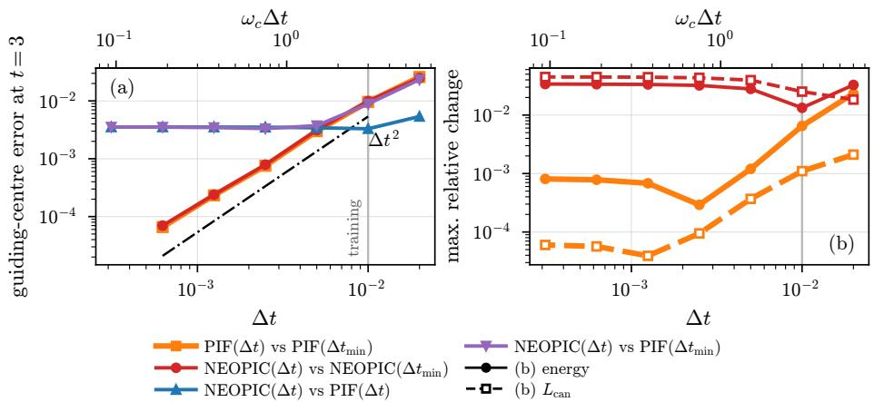  
Figure D.17: Cyclotron mini-app, 2D multi-app model, $N _ { p } = 1 0 ^ { 6 } , T = 3$ . (a) Mean distance of the guiding centres (D.1) at $t \ : = \ : 3$ between runs with time step ∆t and the finest run $( \Delta t _ { \mathrm { m i n } } = 3 . 1 \dot { 2 } 5 \times 1 0 ^ { - 4 } )$ , for PIF and NEOPIC, and between NEOPIC and PIF at the same and at the finest time step; the dash-dotted line has slope 2. (b) Maximum relative change of the total energy (solid) and of the canonical angular momentum $L _ { \mathrm { c a n } }$ (68) (dashed) for PIF and NEOPIC. The grey line marks the time step of the training data.

$$
\begin{array} { l } { { \displaystyle { \bf x } ^ { n + 1 } = { \bf x } ^ { n } + \Delta t \frac { { \bf v } ^ { n } + { \bf v } ^ { n + 1 } } { 2 } } , } \\ { { \displaystyle { \bf v } ^ { n + 1 } = { \bf v } ^ { n } + \Delta t \frac { q } { m } { \bf E } _ { \theta } \big [ { \boldsymbol \mu } _ { N } ^ { n + \frac { 1 } { 2 } } \big ] \big ( { \bf x } ^ { n + \frac { 1 } { 2 } } \big ) } , } \end{array}\tag{E.1}
$$

with $\mathbf { x } ^ { n + \frac { 1 } { 2 } } = ( \mathbf { x } ^ { n } + \mathbf { x } ^ { n + 1 } ) / 2$ and $\mu _ { N } ^ { n + \frac { 1 } { 2 } }$ the empirical measure of these midpoint positions. The scheme is second order, symplectic and free of numerical damping, and is unconditionally stable for the linear plasma oscillation.

Model and setup. A one-dimensional model with the architecture of Section 8 is trained on four mini-apps generated by PIF with 32 modes and the cloudin-cell shape function: weak and strong Landau damping and the two-stream and bump-on-tail instabilities, each with $N _ { \mathrm { t r } } = 1 0 ^ { 5 }$ particles and 600 time steps of $\Delta t \ : = \ : 0 . 0 5 \ : \ : ( T _ { \mathrm { t r a i n } } \ : = \ : 3 0 )$ The model is trained with batch size 20 and weight decay $1 0 ^ { - 5 }$ for 250 epochs on one A100 GPU (1.2 h training time); all other training settings are as in Section 8. We then run weak Landau damping $( \alpha = 0 . 0 5 , k = 0 . 5 )$ with $N _ { p } = 1 0 ^ { 5 }$ particles up to $T = 6 0$ , twice the training horizon, for $\Delta t \in \{ 0 . 0 5 , 0 . 2 5 , 0 . 5 , 1 , 1 . 5 , 2 , 2 . 5 \}$ , with NEOPIC advanced by the leapfrog scheme and by (E.1), and compare with leapfrog PIF at the same $\Delta t .$ All runs start from the same particles.

Nonlinear solve. The system (E.1) for $( \mathbf { x } ^ { n + 1 } , \mathbf { v } ^ { n + 1 } )$ is solved by a matrix-free Newton–Krylov method. Jacobian–vector products are computed by forwardmode automatic diferentiation through the network, so that the Jacobian is exact for the discrete residual. The linear systems are solved by restarted GM-RES (restart length 10) with the adaptive relative tolerance

$$
\eta _ { k } = \operatorname* { m a x } \left( 1 0 ^ { - 6 } , \operatorname* { m i n } ( 1 0 ^ { - 2 } , \| F _ { k } \| / \| F _ { 0 } \| ) \right)
$$

of inexact Newton methods [95], where $F _ { k }$ is the residual at Newton iteration k. As preconditioner we use the cold-plasma response of a nearly uniform plasma, $\partial a _ { p } / \partial x _ { q } \approx - \omega _ { p } ^ { 2 } ( \delta _ { p q } - 1 / N _ { p } )$ , for which the Jacobian decouples into $2 \times 2$ blocks that are inverted exactly; $\omega _ { p } ^ { 2 }$ is estimated in every step from the response of the network to a smooth displacement and comes out between 0.994 and 0.995. Newton stops when the residual has decreased by $1 0 ^ { - 4 }$ or when it stagnates at the round-of level of the single-precision network. Two details matter on a periodic domain. The Newton iterate must not be mapped back into the box during the iteration, since this makes the residual discontinuous, and the displacement $\mathbf { x } ^ { n + 1 } - \mathbf { x } ^ { n }$ must not be replaced by its minimum image, which is wrong for particles with $\vert v \vert \Delta t > L / 2$ Positions are therefore iterated unwrapped and wrapped only after convergence.

Results. Figure E.18 shows the field energy and the maximum relative change of the total energy. At $\Delta t = 0 . 0 5$ the three runs coincide and follow the linear damping rate. With the leapfrog scheme, NEOPIC reproduces the behaviour of PIF at every $\Delta t \colon$ the energy errors agree to within 6%, and both lose stability for $\Delta t \geq 2$ , beyond the limit $\omega \Delta t < 2$ of the leapfrog scheme for the Langmuir mode $( \omega \approx 1 . 4 2 )$ , where the field energy grows to $W _ { x } \approx 7$ , more than three orders of magnitude above the level of the stable runs, and the total energy changes by a factor of six to seven. With the implicit midpoint scheme NEOPIC remains stable at all $\Delta t$ over the whole run, including the extrapolation to twice the training horizon; the maximum relative energy change is at most $1 . 2 \times 1 0 ^ { - 3 }$ up to $\Delta t = 2$ and $1 . 1 \times 1 0 ^ { - 2 } \mathrm { ~ a t ~ } \Delta t = 2 . 5$ , smaller than that of the leapfrog runs at every ∆t. Newton converges in 2 iterations per step at $\Delta t = 0 . 0 5$ and in 3 to 4 for $\Delta t \geq 1$ . For $\omega \Delta t \gtrsim 2$ no scheme resolves the plasma oscillation or the resonant particles, which then move more than half a wavelength per step, so that the implicit runs are stable and nearly energy-conserving but do not reproduce the damping rate (Fig. E.18(c)).

The implicit step is not competitive in cost here: at $\Delta t = 1$ it takes 0.64 s, compared with 2.8 ms for a leapfrog step of NEOPIC and 3.2 ms for PIF, and requires on average 4.2 residual evaluations and 43 Jacobian–vector products. The experiment is meant to show that NEOPIC can be combined with implicit integrators through exact Jacobians; preconditioners for two and three dimensions, where only the longitudinal part of a displacement field responds, and an eficient implementation are left to future work. We plan to consider the settings in which implicit schemes pay of most: magnetized plasmas with $\omega _ { c } \Delta t \gg 1$ where they can reproduce the drift dynamics at time steps far larger than explicit schemes allow [96], and implicit Darwin models [97, 98], in which NEOPIC can serve either as the field solver or as a preconditioner of the nonlinear solve.

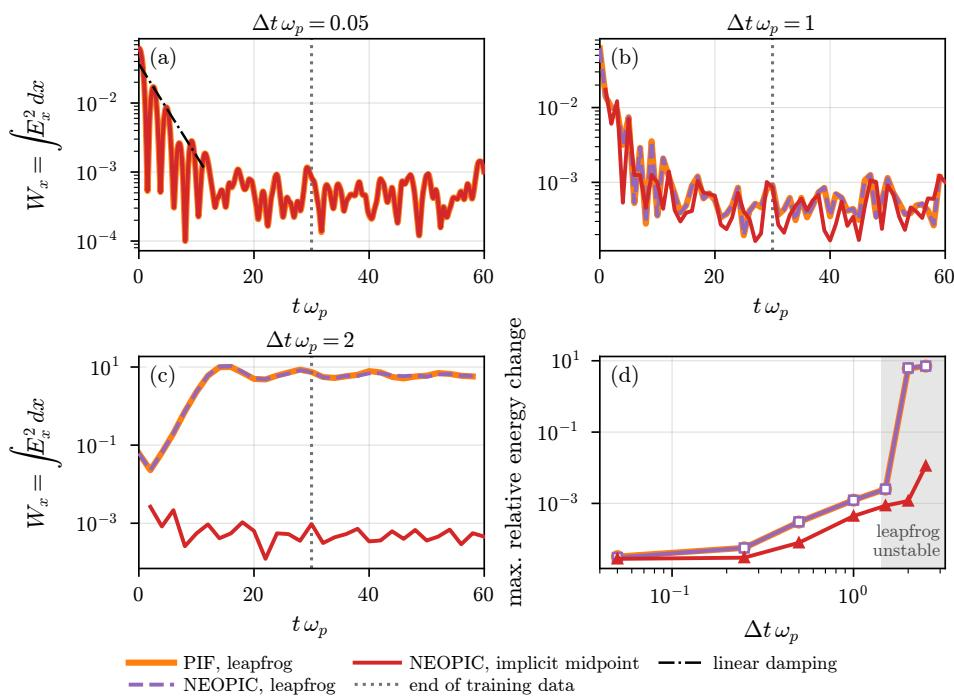  
Figure E.18: 1D-1V weak Landau damping with leapfrog PIF, leapfrog NEOPIC and implicitmidpoint NEOPIC $( N _ { p } = 1 0 ^ { 5 } , T = 6 0 ;$ the training data end at $t = 3 0 , \mathrm { d o t t e d } )$ $\mathrm { ( a ) - ( c ) }$ Field energy $W _ { x }$ for $\Delta t = 0 . 0 5 ,$ 1 and $_ { 2 ; }$ in (a) the dash-dotted line is the linear damping rate. (d) Maximum relative change of the total energy over the run against ∆t; the leapfrog curves of PIF and NEOPIC lie on top of each other. The shaded region marks $\omega \Delta t > 2 ,$ where the leapfrog scheme is unstable for the Langmuir mode.

## Appendix F. Cost and architecture

The cost of NEOPIC is set by its architecture. To measure this dependence independently of accuracy, we time sub-networks of the trained 3D five-app model $( L = 4 , d _ { v } = 3 2 , m = 1 6 )$ with $L \in \{ 2 , 3 , 4 \} , \ d _ { v } \in \{ 8 , 1 6 , 3 2 \}$ and $m \in \{ 8 , 1 6 \}$ They are obtained by keeping the first L layers, the first $d _ { v }$ channels and the lowest modes of the trained weights; the values of the weights do not afect the cost. Every sub-network is run with the NUFFT for 20 steps of 3D weak Landau damping at $N _ { p } = 1 0 ^ { 6 }$ and $4 \times 1 0 ^ { 6 }$ , which gives α and β for each architecture. For the full model this reproduces the timings of Fig. 16 (353 and 1245 ms against 348 and 1244 ms). All 18 architectures follow

$$
\alpha \approx 2 . 2 8 L d _ { v } + 4 . 4 \ \mathrm { n s }
$$

to within 3% $\left( \mathrm { F i g . ~ F . 1 9 ( a ) } \right)$ : the cost per particle is proportional to the number $2 L d _ { v }$ of transforms per particle, as Proposition 6 predicts when the spreading and interpolation, $2 d _ { v } w ^ { d }$ per layer with $w ^ { 3 } = 3 4 3 .$ , dominate the pointwise term $d _ { v } ^ { 2 }$ . No contribution of $d _ { v } ^ { 2 }$ is visible for $d _ { v } \leq 3 2$ . With $2 w ^ { 3 } = 6 8 6$ multiply– add operations per channel and layer, 2.28 ns corresponds to about 3 ps per operation, which reflects the memory-bound spreading and interpolation. The number of modes hardly matters: halving m divides the number of spectral weights by eight but changes the time by at most $4 \%$ , since the fine-grid FFTs are cheap compared with spreading and interpolation. The constant $\beta$ (18– 55 ms) grows with $L$ and $d _ { v }$ but not with $m ,$ consistent with the plan creation discussed above rather than with the FFT term of β . The time therefore follows $L d _ { v }$ and not the number of parameters (Fig. F.19(b)): the parameters vary by a factor of 256, the time by a factor of 6.8. The smallest sub-network $( L = 2 , d _ { v } = 8 )$ takes 183 ms per step at $N _ { p } = 4 \times 1 0 ^ { 6 }$ , comparable with Barnes–Hut (172 ms) and with PIF at $\varepsilon = 1 0 ^ { - 1 \mathrm { { \dot { 2 } } } }$ (158 ms, interpolated between the measurements at $1 . 0 5 \times 1 0 ^ { 6 }$ and $8 . 4 \times 1 0 ^ { 6 }$ particles), and about three times the cost of the Python PIC and of PIF at $\varepsilon = 1 0 ^ { - 6 }$ . Since the sub-networks are not trained, this compares cost only; a trained model of this size may be less accurate than the full model.

## Acknowledgments

The project A Neural Operator Framework for Particle-based Kinetic Plasma Simulations - NEOPIC (INF funding code: ZT-I-PF-5-242) underlying this publication is funded by the Initiative and Networking Fund of the Helmholtz Association in the framework of the Helmholtz AI project call. We thank computing resources on JURECA DC from VSR computing project PEPCEXA and on JUWELS Booster from HAICORE@FZJ. The first author would like to thank Prof. Siddhartha Mishra for fruitful discussions on this topic. He also would like to thank Prof. Tan Bui-Thanh and Dr. Hai Nguyen for introducing their work on noise as a regularizer in training, as well as obtaining Jacobians for implicit methods through automatic diferentiation.

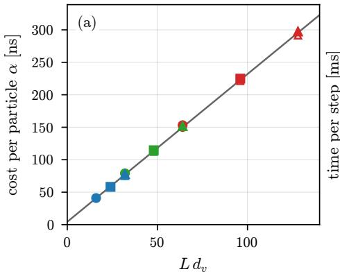

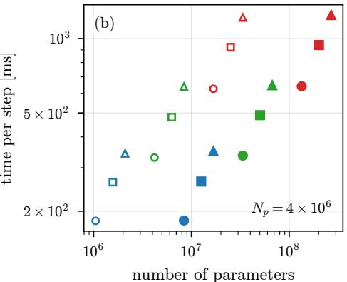  
dv = 8 dv = 32 L = 3 m = 16 (filled) ® = 2:28 Ldv + 4:4 ns dv = 16 L = 2 L = 4 m = 8 (open)  
Figure F.19: Cost of NEOPIC (NUFFT, 3D) for sub-networks of the trained model with L layers, $d _ { v }$ channels and 2m modes per direction. (a) Cost per particle α, from timings at $N _ { p } = 1 0 ^ { 6 }$ and $4 \times 1 0 ^ { 6 }$ , against $L d _ { v } ;$ the line is the least-squares fit. (b) Time per step at $N _ { p } = 4 \times 1 0 ^ { 6 }$ against the number of parameters. Colours: $d _ { v } ;$ markers: $L ;$ filled: $m = 1 6$ open: $m = 8 .$

## Availability

The NEOPIC implementation, together with the training and evaluation configurations of all experiments in this paper, is available at github.com/ srikrrish/operator learning. The version used for the results in this paper is tagged neopic-arxiv-v1; the version used for the computational cost measurements in Section 8.4 is tagged neopic-arxiv-v1-nufft. The scripts for the analysis and the figures are available, with the same tag neopic-arxiv-v1, at $\mathsf { g } \dot { \mathsf { 1 } }$ thub.com/NEOPIC-framework/neopic-paper-scripts. The training data sets, trained models and reference simulation outputs (HDF5 files) are not included in the repository because of their size; they are available from the corresponding author upon reasonable request.

## Declaration of generative AI and AI-assisted technologies in the manuscript preparation process

During the preparation of this work the authors used Claude (Anthropic) in order to draft and revise text, structure the manuscript, develop and check mathematical derivations and proofs, and write scripts for data analysis and figure generation, and, in the initial phase of the project, ChatGPT (OpenAI) for brainstorming and for writing parts of the code. All experiments were designed and run by the authors, and the AI-assisted code and analysis scripts were checked by the authors. After using these tools, the authors reviewed and edited the content as needed and take full responsibility for the content of the published article.

## References

[1] J. M. Dawson, Particle simulation of plasmas, Reviews of modern physics 55 (2) (1983) 403.

[2] C. K. Birdsall, A. B. Langdon, Plasma physics via computer simulation, CRC press, 2004.

[3] R. W. Hockney, J. W. Eastwood, Computer simulation using particles, CRC Press, 2021.

[4] E. Sonnendr¨ucker, J. J. Ambrosiano, S. T. Brandon, A finite element formulation of the darwin pic model for use on unstructured grids, Journal of Computational Physics 121 (2) (1995) 281–297.

[5] M. T. Bettencourt, D. A. Brown, K. L. Cartwright, E. C. Cyr, C. A. Glusa, P. T. Lin, S. G. Moore, D. A. McGregor, R. P. Pawlowski, E. G. Phillips, et al., Empire-pic: A performance portable unstructured particle-in-cell code, Communications in Computational Physics 30 (SAND-2021-2806J).

[6] J. Squire, H. Qin, W. M. Tang, Geometric integration of the Vlasov-Maxwell system with a variational particle-in-cell scheme, Physics of Plasmas 19 (8).

[7] X. Jianyuan, Q. Hong, L. Jian, Structure-preserving geometric particle-incell methods for Vlasov-Maxwell systems, Plasma Science and Technology 20 (11) (2018) 110501.

[8] M. Campos Pinto, K. Kormann, E. Sonnendr¨ucker, Variational framework for structure-preserving electromagnetic particle-in-cell methods, Journal of Scientific Computing 91 (2) (2022) 46.

[9] M. Campos Pinto, J. Ameres, K. Kormann, E. Sonnendr¨ucker, On variational fourier particle methods, Journal of Scientific Computing 101 (3) (2024) 68.

[10] M. Kraus, K. Kormann, P. J. Morrison, E. Sonnendr¨ucker, GEMPIC: geometric electromagnetic particle-in-cell methods, Journal of Plasma Physics 83 (4) (2017) 905830401.

[11] Y. He, Y. Sun, H. Qin, J. Liu, Hamiltonian particle-in-cell methods for Vlasov-Maxwell equations, Physics of Plasmas 23 (9).

[12] H. R. Lewis, Energy-conserving numerical approximations for Vlasov plasmas, Journal of Computational Physics 6 (1) (1970) 136–141.

[13] G. Chen, L. Chac´on, D. Barnes, An energy-and charge-conserving, implicit, electrostatic particle-in-cell algorithm, Journal of Computational Physics 230 (18) (2011) 7018–7036.

[14] S. Markidis, G. Lapenta, The energy conserving particle-in-cell method, Journal of Computational Physics 230 (18) (2011) 7037–7052.

[15] G. Lapenta, Exactly energy conserving semi-implicit particle in cell formulation, Journal of Computational Physics 334 (2017) 349–366.

[16] G. Chen, L. Chacon, L. Yin, B. J. Albright, D. J. Stark, R. F. Bird, A semiimplicit, energy-and charge-conserving particle-in-cell algorithm for the relativistic vlasov-maxwell equations, Journal of Computational Physics 407 (2020) 109228.

[17] M. C. Pinto, V. Pag\`es, A semi-implicit electromagnetic fem-pic scheme with exact energy and charge conservation, Journal of Computational Physics 453 (2022) 110912.

[18] R. E. Denton, M. Kotschenreuther, δf Algorithm, Journal of Computational Physics 119 (2) (1995) 283–294.

[19] L. F. Ricketson, A. J. Cerfon, Sparse grid techniques for particle-in-cell schemes, Plasma Physics and Controlled Fusion 59 (2) (2016) 024002.

[20] B. Wang, G. H. Miller, P. Colella, A particle-in-cell method with adaptive phase-space remapping for kinetic plasmas, SIAM Journal on Scientific Computing 33 (6) (2011) 3509–3537.

[21] J. Barnes, P. Hut, A hierarchical O(N log N) force-calculation algorithm, Nature 324 (6096) (1986) 446–449.

[22] L. Greengard, V. Rokhlin, A fast algorithm for particle simulations, Journal of Computational Physics 73 (2) (1987) 325–348.

[23] E. G. Evstatiev, B. A. Shadwick, Variational formulation of particle algorithms for kinetic plasma simulations, Journal of Computational Physics 245 (2013) 376–398.

[24] M. S. Mitchell, M. T. Miecnikowski, G. Beylkin, S. E. Parker, Eficient fourier basis particle simulation, Journal of Computational Physics 396 (2019) 837–847.

[25] S. Pfalzner, P. Gibbon, A 3d hierarchical tree code for dense plasma simulation, Computer physics communications 79 (1) (1994) 24–38.

[26] J. Ambrosiano, L. Greengard, V. Rokhlin, The fast multipole method for gridless particle simulation, Computer Physics Communications 48 (1) (1988) 117–125.

[27] A. J. Christlieb, R. Krasny, J. P. Verboncoeur, J. W. Emhof, I. D. Boyd, Grid-free plasma simulation techniques, IEEE Transactions on Plasma Science 34 (2) (2006) 149–165.

[28] P. Gibbon, R. Speck, A. Karmakar, L. Arnold, W. Frings, B. Berberich, D. Reiter, M. Mavsek, Progress in mesh-free plasma simulation with parallel tree codes, IEEE Transactions on Plasma Science 38 (9) (2010) 2367– 2376.

[29] M. M. Masek, P. Gibbon, Mesh-free magnetoinductive plasma model, IEEE transactions on plasma science 38 (9) (2010) 2377–2382.

[30] L. Siddi, G. Lapenta, P. Gibbon, Mesh-free hamiltonian implementation of two dimensional darwin model, Physics of plasmas 24 (8).

[31] C. Shen, A. Cerfon, S. Muralikrishnan, A particle-in-fourier method with semi-discrete energy conservation for non-periodic boundary conditions, Journal of computational physics 519 (2024) 113390.

[32] S. Muralikrishnan, R. Speck, Error analysis and parallel scaling study of a parareal parallel-in-time integration algorithm for particle-in-fourier schemes, SIAM Journal on Scientific Computing (2025) S311–S336.

[33] T. Takizuka, H. Abe, A binary collision model for plasma simulation with a particle code, Journal of computational physics 25 (3) (1977) 205–219.

[34] K. Nanbu, Theory of cumulative small-angle collisions in plasmas, Physical Review E 55 (4) (1997) 4642.

[35] W. M. Manheimer, M. Lampe, G. Joyce, Langevin representation of coulomb collisions in pic simulations, Journal of Computational Physics 138 (2) (1997) 563–584.

[36] M. Cadjan, M. Ivanov, Langevin approach to plasma kinetics with coulomb collisions, Journal of plasma physics 61 (1) (1999) 89–106.

[37] M. Winkel, R. Speck, H. H¨ubner, L. Arnold, R. Krause, P. Gibbon, A massively parallel, multi-disciplinary barnes–hut tree code for extreme-scale n-body simulations, Computer physics communications 183 (4) (2012) 880– 889.

[38] J.-L. Vay, A. Almgren, J. Bell, L. Ge, D. Grote, M. Hogan, O. Kononenko, R. Lehe, A. Myers, C. Ng, et al., Warp-x: A new exascale computing platform for beam–plasma simulations, Nuclear Instruments and Methods in Physics Research Section A: Accelerators, Spectrometers, Detectors and Associated Equipment 909 (2018) 476–479.

[39] H. Burau, R. Widera, W. H¨onig, G. Juckeland, A. Debus, T. Kluge, U. Schramm, T. E. Cowan, R. Sauerbrey, M. Bussmann, Picongpu: A fully relativistic particle-in-cell code for a gpu cluster, IEEE Transactions on Plasma Science 38 (10) (2010) 2831–2839.

[40] S. Muralikrishnan, M. Frey, A. Vinciguerra, M. Ligotino, A. J. Cerfon, M. Stoyanov, R. Gayatri, A. Adelmann, Scaling and performance portability of the particle-in-cell scheme for plasma physics applications through mini-apps targeting exascale architectures, Proceedings of the 2024 SIAM Conference on Parallel Processing for Scientific Computing (PP) (2024) 26–38.

[41] A. B. Langdon, C. K. Birdsall, Theory of plasma simulation using finite-size particles, The Physics of Fluids 13 (8) (1970) 2115–2122.

[42] C.-K. Huang, Y. Zeng, Y. Wang, M. D. Meyers, S. Yi, B. J. Albright, Finite grid instability and spectral fidelity of the electrostatic particle-incell algorithm, Computer Physics Communications 207 (2016) 123–135.

[43] A. Dutt, V. Rokhlin, Fast fourier transforms for nonequispaced data, SIAM Journal on Scientific computing 14 (6) (1993) 1368–1393.

[44] A. H. Barnett, J. Magland, L. af Klinteberg, A parallel nonuniform fast fourier transform library based on an “exponential of semicircle” kernel, SIAM Journal on Scientific Computing 41 (5) (2019) C479–C504.

[45] S. Mayani, P. Fischill, S. Muralikrishnan, A. Adelmann, A comparison of massively parallel performance portable particle-in-cell schemes for electrostatic kinetic plasma simulations, in: Platform for Advanced Scientific Computing Conference, 2026, pp. 1–11.

[46] R. G. Patel, N. A. Trask, M. A. Wood, E. C. Cyr, A physics-informed operator regression framework for extracting data-driven continuum models, Computer Methods in Applied Mechanics and Engineering 373 (2021) 113500.

[47] N. Kovachki, Z. Li, B. Liu, K. Azizzadenesheli, K. Bhattacharya, A. Stuart, A. Anandkumar, Neural operator: Learning maps between function spaces with applications to pdes, Journal of Machine Learning Research 24 (89) (2023) 1–97.

[48] L. Lu, P. Jin, G. Pang, Z. Zhang, G. E. Karniadakis, Learning nonlinear operators via deeponet based on the universal approximation theorem of operators, Nature machine intelligence 3 (3) (2021) 218–229.

[49] L. Lingsch, M. Y. Michelis, E. De B´ezenac, S. M. Perera, R. K. Katzschmann, S. Mishra, Beyond regular grids: Fourier-based neural operators on arbitrary domains, arXiv preprint arXiv:2305.19663.

[50] F. Bartolucci, E. de B´ezenac, B. Raoni´c, R. Molinaro, S. Mishra, R. Alaifari, Representation equivalent neural operators: a framework for alias-free operator learning, in: Advances in Neural Information Processing Systems, Vol. 36, 2023.

[51] M. Herde, B. Raonic, T. Rohner, R. K¨appeli, R. Molinaro, E. de B´ezenac, S. Mishra, Poseidon: Eficient foundation models for pdes, Advances in Neural Information Processing Systems 37 (2024) 72525–72624.

[52] S. Subramanian, P. Harrington, K. Keutzer, W. Bhimji, D. Morozov, M. W. Mahoney, A. Gholami, Towards foundation models for scientific machine learning: Characterizing scaling and transfer behavior, Advances in Neural Information Processing Systems 36 (2023) 71242–71262.

[53] Z. Li, N. Kovachki, K. Azizzadenesheli, B. Liu, K. Bhattacharya, A. Stuart, A. Anandkumar, Fourier neural operator for parametric partial diferential equations, arXiv preprint arXiv:2010.08895.

[54] V. S. Fanaskov, I. V. Oseledets, Spectral neural operators, in: Doklady Mathematics, Vol. 108, Springer, 2023, pp. S226–S232.

[55] J. Pathak, S. Subramanian, P. Harrington, S. Raja, A. Chattopadhyay, M. Mardani, T. Kurth, D. Hall, Z. Li, K. Azizzadenesheli, et al., Fourcastnet: A global data-driven high-resolution weather model using adaptive fourier neural operators, arXiv preprint arXiv:2202.11214.

[56] K. Azizzadenesheli, N. Kovachki, Z. Li, M. Liu-Schiafini, J. Kossaifi, A. Anandkumar, Neural operators for accelerating scientific simulations and design, Nature Reviews Physics 6 (5) (2024) 320–328.

[57] N. McGreivy, A. Hakim, Weak baselines and reporting biases lead to overoptimism in machine learning for fluid-related partial diferential equations, Nature machine intelligence 6 (10) (2024) 1256–1269.

[58] X. Aguilar, S. Markidis, A deep learning-based particle-in-cell method for plasma simulations, in: 2021 IEEE International Conference on Cluster Computing (CLUSTER), IEEE, 2021, pp. 692–697.

[59] R. Kube, R. Churchill, B. Sturdevant, Machine learning accelerated particle-in-cell plasma simulations, arXiv preprint arXiv:2110.12444.

[60] J. Lyu, L. Zhong, Latent residual-closure fourier neural operator for robust multi-field solving in particle-in-cell simulations, arXiv preprint arXiv:2606.17733.

[61] A. Sanchez-Gonzalez, J. Godwin, T. Pfaf, R. Ying, J. Leskovec, P. Battaglia, Learning to simulate complex physics with graph networks, in: International conference on machine learning, Pmlr, 2020, pp. 8459–8468.

[62] T. Pfaf, M. Fortunato, A. Sanchez-Gonzalez, P. W. Battaglia, Learning mesh-based simulation with graph networks, arXiv preprint arXiv:2010.03409.

[63] J. Brandstetter, D. Worrall, M. Welling, Message passing neural PDE solvers, arXiv preprint arXiv:2202.03376.

[64] D. D. Carvalho, D. R. Ferreira, L. O. Silva, Learning the dynamics of a onedimensional plasma model with graph neural networks, Machine Learning: Science and Technology 5 (2) (2024) 025048.

[65] Z. Li, N. Kovachki, K. Azizzadenesheli, B. Liu, K. Bhattacharya, A. Stuart, A. Anandkumar, Neural operator: Graph kernel network for partial diferential equations, arXiv preprint arXiv:2003.03485.

[66] Z. Li, N. Kovachki, C. Choy, B. Li, J. Kossaifi, S. Otta, M. A. Nabian, M. Stadler, C. Hundt, K. Azizzadenesheli, et al., Geometry-informed neural operator for large-scale 3d pdes, Advances in Neural Information Processing Systems 36 (2023) 35836–35854.

[67] Y. Peng, L. Lin, L. Ying, L. Zepeda-N´u˜nez, Eficient long-range convolutions for point clouds, Journal of Computational Physics 473 (2023) 111692.

[68] G.-H. Cottet, P. D. Koumoutsakos, Vortex methods: theory and practice, Vol. 8, Cambridge university press Cambridge, 2000.

[69] C. S. Peskin, The immersed boundary method, Acta numerica 11 (2002) 479–517.

[70] F. Vico, L. Greengard, M. Ferrando, Fast convolution with free-space green’s functions, Journal of Computational Physics 323 (2016) 191–203.

[71] S. Mayani, V. Montanaro, A. Cerfon, M. Frey, S. Muralikrishnan, A. Adelmann, A massively parallel performance portable free-space spectral poisson solver, ACM Trans. Math. Softw. 51 (3).

[72] G. B. Jacobs, J. S. Hesthaven, High-order nodal discontinuous galerkin particle-in-cell method on unstructured grids, Journal of Computational Physics 214 (1) (2006) 96–121.

[73] M. Pfeifer, F. Hindenlang, T. Binder, S. Copplestone, C.-D. Munz, S. Fasoulas, A particle-in-cell solver based on a high-order hybridizable discontinuous galerkin spectral element method on unstructured curved meshes, Computer Methods in Applied Mechanics and Engineering 349 (2019) 149– 166.

[74] S. Mousavi, S. Wen, L. Lingsch, M. Herde, B. Raoni´c, S. Mishra, RIGNO: A graph-based framework for robust and accurate operator learning for PDEs on arbitrary domains, arXiv preprint arXiv:2501.19205.

[75] S. Wen, A. Kumbhat, L. Lingsch, S. Mousavi, Y. Zhao, P. Chandrashekar, S. Mishra, Geometry aware operator transformer as an eficient and accurate neural surrogate for pdes on arbitrary domains, arXiv preprint arXiv:2505.18781.

[76] Y.-h. Shih, G. Wright, J. And´en, J. Blaschke, A. H. Barnett, cufinuft: a load-balanced gpu library for general-purpose nonuniform fts, in: 2021 IEEE International Parallel and Distributed Processing Symposium Workshops (IPDPSW), IEEE, 2021, pp. 688–697.

[77] D. Potts, G. Steidl, M. Tasche, Fast fourier transforms for nonequispaced data: A tutorial, Modern Sampling Theory: Mathematics and Applications (2001) 247–270.

[78] A. H. Barnett, Aliasing error of the exp $( \beta \sqrt { 1 - z ^ { 2 } } )$ kernel in the nonuniform fast fourier transform, Applied and Computational Harmonic Analysis 51 (2021) 1–16.

[79] P. Tranquilli, L. Ricketson, L. Chac´on, A deterministic verification strategy for electrostatic particle-in-cell algorithms in arbitrary spatial dimensions using the method of manufactured solutions, Journal of Computational Physics 448 (2022) 110751.

[80] F. Riva, C. F. Beadle, P. Ricci, A methodology for the rigorous verification of particle-in-cell simulations, Physics of Plasmas 24 (5) (2017) 055703.

[81] J. Batt, G. Rein, Global classical solutions of the periodic Vlasov–Poisson system in three dimensions, Comptes Rendus de l’Acad´emie des Sciences, S´erie I 313 (1991) 411–416.

[82] K. Pfafelmoser, Global classical solutions of the Vlasov–Poisson system in three dimensions for general initial data, Journal of Diferential Equations 95 (2) (1992) 281–303.

[83] N. Kovachki, S. Lanthaler, S. Mishra, On universal approximation and error bounds for Fourier neural operators, Journal of Machine Learning Research 22 (290) (2021) 1–76.

[84] S. Lanthaler, Z. Li, A. M. Stuart, Nonlocality and nonlinearity implies universality in operator learning, Constructive Approximation 62 (2) (2025) 261–303.

[85] N. Fournier, A. Guillin, On the rate of convergence in Wasserstein distance of the empirical measure, Probability Theory and Related Fields 162 (3) (2015) 707–738.

[86] C. M. Bishop, Training with noise is equivalent to Tikhonov regularization, Neural Computation 7 (1) (1995) 108–116.

[87] G. An, The efects of adding noise during backpropagation training on a generalization performance, Neural Computation 8 (3) (1996) 643–674.

[88] H. V. Nguyen, T. Bui-Thanh, A model-constrained tangent slope learning approach for dynamical systems, International Journal of Computational Fluid Dynamics 36 (7) (2022) 655–685.

[89] H. V. Nguyen, J.-U. Chen, T. Bui-Thanh, A model-constrained discontinuous Galerkin network (DGNet) for compressible Euler equations with out-of-distribution generalization, Computer Methods in Applied Mechanics and Engineering 440 (2025) 117912.

[90] J.-F. Chassagneux, L. Szpruch, A. Tse, Weak quantitative propagation of chaos via diferential calculus on the space of measures, The Annals of Applied Probability 32 (3) (2022) 1929–1969.

[91] S. Muralikrishnan, P. Fischill, A. Adelmann, R. Speck, On distributed parallelization strategies for particle-in-fourier schemes, arXiv preprint arXiv:2605.10729.

[92] M. Frey, A. Vinciguerra, S. Muralikrishnan, Sonali, vmontanaro, Mohsen, A. Adelmann, manuel5975p, F. Schurk, Ippl-framework/ippl: Ippl-3.2.0 (Mar. 2024).

[93] S. Keller, A. Cavelan, R. Cabezon, L. Mayer, F. Ciorba, Cornerstone: Octree construction algorithms for scalable particle simulations, in: Proceedings of the Platform for Advanced Scientific Computing Conference, 2023, pp. 1–10.

[94] A. B. Langdon, Efects of the spatial grid in simulation plasmas, Journal of Computational Physics 6 (2) (1970) 247–267.

[95] S. C. Eisenstat, H. F. Walker, Choosing the forcing terms in an inexact Newton method, SIAM Journal on Scientific Computing 17 (1) (1996) 16– 32.

[96] L. F. Ricketson, G. Chen, A pseudospectral implicit particle-in-cell method with exact energy and charge conservation, Computer Physics Communications 291 (2023) 108811.

[97] G. Chen, L. Chac´on, An energy-and charge-conserving, nonlinearly implicit, electromagnetic 1d-3v vlasov–darwin particle-in-cell algorithm, Computer Physics Communications 185 (10) (2014) 2391–2402.

[98] G. Chen, L. Chacon, A multi-dimensional, energy-and charge-conserving, nonlinearly implicit, electromagnetic vlasov–darwin particle-in-cell algorithm, Computer Physics Communications 197 (2015) 73–87.