# Numerical Integration on Bounded Domains via Learned Reflected Diffusions

Kirill Korolev HSE University kkorolev@hse.ru

Artur Goldman ETH Zürich, ETH AI Center artur.goldman@ai.ethz.ch

Timofei Gritsaev Constructor University tgritsaev@gmail.com

Tigran Ramazyan HSE University tramazyan@hse.ru

Nikita Morozov HSE University nvmorozov@hse.ru

## Abstract

We study high-dimensional integration on bounded convex domains. Given a nonnegative integrand �, the goal is to estimate $\begin{array} { r } { Z = \int _ { \mathcal { D } } r ( x ) } \end{array}$ d� on $\mathcal { D } \subset \mathbb { R } ^ { d }$ . Standard Quasi-Monte Carlo does not adapt its evaluation points to the integrand, while effective importance sampling requires a proposal that captures its concentration. Learned diffusion samplers can supply such a proposal, but existing methods are formulated on $\mathbb { R } ^ { d }$ and do not respect the domain constraint $x \in \mathcal { D }$ We instead build the proposal from reflected dynamics that stay in D by construction. A reflected diffusion progressively transforms the target distribution toward the uniform distribution on ${ \mathcal { D } } ,$ and a neural score model is trained to reverse this process. A change-of-measure formula for reflected diffusions yields a training objective without additional boundary terms and an unbiased importance-sampling estimator of �. For non-smooth integrands, where reparameterization gradients may be undefined or uninformative, we derive a REINFORCE estimator of the training gradient using Gaussian proposal densities before reflection, without evaluating reflected transition densities or differentiating �. We evaluate on numerous synthetic targets and real-world problems, demonstrating strong performance of the proposed method, as well as favorable scaling with the dimension of the problem and the number of points used for the Monte Carlo estimate.

## 1 Introduction

We consider the problem of estimating high-dimensional integrals over bounded constrained domains. Let $\mathcal { D } \subset \mathbb { R } ^ { d }$ be a bounded convex domain, and let $r : \mathcal { D }  \mathbb { R } _ { \geq 0 }$ be measurable and satisfy $\textstyle \int _ { \mathcal { D } } r ( x ) \mathrm { d } x < \infty$ . Our goal is to estimate the integral

$$
Z = \int _ { \mathcal { D } } r ( x ) \mathrm { d } x .\tag{1}
$$

Integrals of this form are a computational bottleneck across the sciences. In statistical physics and chemistry, free energies and thermodynamic observables are logarithms of such constants, and learned samplers have been used to estimate them for many-body systems and lattice field theories (Noé et al., 2019; Wirnsberger et al., 2020; Nicoli et al., 2021). In computer graphics, every pixel of a rendered image is an integral over light paths, parameterized so that the integration domain is the unit cube (Müller et al., 2019). In computational finance, the price of a path-dependent derivative is an expectation over a discretized asset path, which the standard inverse-CDF construction turns into an integral over $[ 0 , 1 ] ^ { d }$ with � the number of monitoring dates (Glasserman, 2004; Dick et al.,

2013). In Bayesian statistics, the model evidence is an integral of an unnormalized posterior (Kloek & Van Dijk, 1978; Kass & Raftery, 1995), confined to a bounded region whenever the parameters are subject to simplex constraints or under compactly supported priors.

These tasks give rise to integration problems on bounded domains, where the location of integrand mass is unknown in advance. This motivates samplers that respect the domain constraints and adapt to where the mass lies, including when it concentrates near faces or corners, or when the integrand vanishes on parts of the domain.

Existing estimators differ in how much they adapt to �(�). Standard Quasi-Monte Carlo (Niederreiter, 1992; Dick et al., 2013, QMC) spreads a deterministic point set over the cube without reference to the integrand. Bayesian quadrature (O’Hagan, 1991; Rasmussen & Ghahramani, 2003) adapts by placing a Gaussian process prior on $r ( x )$ , but at a cost cubic in the number of evaluations (Briol et al., 2019). Importance sampling relies on a proposal distribution whose choice determines the estimator’s variance (Hammersley & Handscomb, 1964). Neural proposals learn that proposal from evaluations of $r ( x )$ alone, either with normalizing flows (Rezende & Mohamed, 2015; Müller et al., 2019) or with diffusion samplers (Zhang & Chen, 2022; Vargas et al., 2023; Berner et al., 2024). The latter avoids the invertibility constraints that limit flow architectures (Kong & Chaudhuri, 2020). Diffusion samplers, however, are formulated on $\mathbb { R } ^ { d }$ with a Gaussian reference process throughout the existing work and do not respect the constraint $x \in \mathcal { D }$ . A more thorough discussion of prior work on numerical integration methods is presented in Appendix A.

To design a learnable diffusion-based proposal that respects the domain constraint, we draw inspiration from diffusion models (Song et al., 2021) for constrained generative modeling. Existing approaches fall into two groups. The first changes the geometry in which the process evolves: mirror diffusion models map D onto $\mathbb { R } ^ { d }$ through the gradient of a strictly convex potential and run a standard diffusion in the resulting dual space (Liu et al., 2023), while log-barrier diffusions equip the interior of D with the Riemannian metric induced by the Hessian of a barrier function, under which the process remains in the interior (Fishman et al., 2023). The second group keeps the Euclidean geometry of D and confines trajectories by reflecting them at the boundary, using reflected Brownian motion as the noising process (Fishman et al., 2023; Lou & Ermon, 2023). In this work, we follow the second route and adapt reflected diffusions from generative modeling to sampling, where no samples from � are available and the reverse dynamics must be learned from evaluations of � alone.

## We outline our contributions as follows:

• We propose reflected diffusion samplers (RDS) for integration on bounded domains, extending control-based diffusion samplers (Zhang & Chen, 2022; Vargas et al., 2023; Berner et al., 2026) to constrained D. Our construction uses reflected Brownian motion with a time-dependent noise schedule. When initialized from the uniform distribution � on D, this process preserves uniform marginals (Loper, 2020) and defines a tractable reference path measure for the integral (1). Girsanov’s theorem (Le Gall, 2016) then transfers this representation to equivalent controlled reflected diffusions through path-space importance weights.

We show that the unique zero-variance ideal proposal corresponds to the same reflected noising dynamics initialized from the normalized target $\pi ( x ) = r ( x ) / Z$ , and propose to learn its reversal with a neural network-parameterized drift. The learned reversal by construction also acts as the sampler from �.

• We design a training objective for the learned reversal to be the KL divergence to the ideal proposal. For smooth targets, its gradients can be computed via the reparameterization trick. It includes a running control cost with a terminal potential and no boundary term, closely resembling the optimal control objective of Zhang & Chen (2022). We also derive a REINFORCE gradient estimator with a leave-one-out baseline, which uses only the pre-reflection Gaussian transition densities and does not require gradients of � (�), applying to targets that are non-smooth or vanish to zero on part of D, where reparameterization gradients are uninformative. Integrands that vanish on part of the domain are handled by adding a positive offset and correcting the resulting integral estimate.

• We provide rigorous theoretical derivation of all components of the proposed methodology, adapting existing theoretical results to the considered setting of the variance exploding reflected diffusion samplers. In addition, we prove a total-variation accuracy bound for the designed estimator, which is a reflected version of the bound presented in Guo et al. (2026) for diffusion samplers in $\mathbb { R } ^ { d }$

• We evaluate on Genz integrands (Genz, 1984), bounded synthetic targets, Feynman parameter integral (Bonciani et al., 2016) and Asian option pricing (L’Ecuyer, 2009) against Quasi-Monte Carlo, Bayesian quadrature and normalizing flow importance sampling baselines. The experiments demonstrate strong performance of the proposed method, as well as favorable scaling with the dimension of the problem and the number of points used for the estimate. In addition, we compare against Path Integral Sampler (PIS, Zhang & Chen (2022)) proposal by mapping D onto $\mathbb { R } ^ { d }$ , and demonstrate that the learned RDS proposal achieves lower integration errors against its unconstrained counterpart.

Source code: github.com/kkorolev1/reflected-diffusion-samplers.

## 2 Background on Reflected SDE

Denote $\overline { { \mathcal { D } } }$ and $\partial \mathcal { D }$ to be the closure and boundary of ${ \mathcal { D } } _ { : }$ , and vol(D) to be its volume. Consider a reflected SDE on D with drift $f : \overline { { \mathcal { D } } } \times [ 0 , 1 ] \to \mathbb { R } ^ { d }$ and scalar diffusion coefficient $g : [ 0 , 1 ] \to { \mathbb R }$ (Pilipenko, 2014):

$$
\mathrm { d } X _ { t } = f ( X _ { t } , t ) \mathrm { d } t + g ( t ) \mathrm { d } W _ { t } + \mathrm { d } L _ { t } .\tag{2}
$$

Here $W _ { t }$ is a standard �-dimensional Brownian motion. Under the smooth-boundary assumptions used for the theoretical results, a solution of SDE (2) has the form $( X , \ell )$ , where $\ell ^ { \cdot }$ is continuous, nondecreasing, starts from zero, and increases only when $X _ { t } \in \partial \mathcal { D }$ . Throughout the manuscript, the associated vector reflection term is the derived process $\begin{array} { r } { L _ { t } : = \int _ { 0 } ^ { t } \mathbf { n } _ { \mathrm { i n } } ( X _ { s } ) \mathrm { d } \ell _ { s } } \end{array}$ , where $\mathbf { n } _ { \mathrm { i n } }$ is the inward unit normal. Thus $\mathrm { d } L _ { t }$ pushes � inward at boundary times.

Let $\mu _ { t } : = \operatorname { L a w } ( X _ { t } )$ be the marginal law of $X _ { t }$ . Suppose that, for $t > 0 , \mu _ { t }$ admits a density $p _ { t }$ and that these densities have the time, space, and boundary-trace regularity needed for the following identities to hold. Then $p _ { t }$ evolves according to the Fokker–Planck equation with a Neumann boundary condition (Schuss, 2015, Section 2.6.2–2.6.3):

$$
\begin{array} { r } { \left\{ \begin{array} { l l } { \partial _ { t } p _ { t } ( x ) = \mathrm { d i v } \displaystyle \left( - p _ { t } ( x ) f ( x , t ) + \frac { g ^ { 2 } ( t ) } { 2 } \nabla _ { x } p _ { t } ( x ) \right) , } & { x \in \mathcal { D } , t \in ( 0 , 1 ] , } \\ { { \bf n } ( x ) ^ { \top } \left( p _ { t } ( x ) f ( x , t ) - \frac { g ^ { 2 } ( t ) } { 2 } \nabla _ { x } p _ { t } ( x ) \right) = 0 , } & { x \in \partial \mathcal { D } , t \in ( 0 , 1 ] , } \end{array} \right. } \end{array}\tag{3}
$$

where $\mathbf { n } ( x )$ is the outward unit normal to �D. The boundary condition prevents probability mass from crossing the boundary, so the density evolves entirely within $\mathcal { D }$ . The initial law is imposed separately through $\mu _ { t } \implies \mu _ { 0 } \mathrm { ~ a s ~ } t \mathrm { ~ \textdownarrow ~ 0 ~ }$ , which follows from path continuity. Even when $\mu _ { 0 }$ has a density $p _ { 0 }$ , this does not make (3) valid at $t = 0$ without additional initial regularity and boundary compatibility. Without the stated density and regularity, the forward equation is instead interpreted in its weak measure-valued form.

## 3 Reflected Diffusion Samplers

In this section, we present the main theoretical results and the derivation of the proposed method. Each statement points to a fully quantified statement and proof in the Appendix. The two distributions used in this section are the uniform distribution and the normalized target:

$$
\nu ( x ) : = \mathrm { v o l } ( \mathcal { D } ) ^ { - 1 } , \qquad \pi ( x ) : = \frac { r ( x ) } { Z } , \qquad x \in \overline { { \mathcal { D } } } .\tag{4}
$$

Path-measure and training theoretical results assume measurable � bounded above and away from zero. The full-interval score representation requires additional regularity. We later discuss zero- and negative-valued targets. See Appendix B.1 for notation and conventions.

## 3.1 Reference process of the reflected diffusion

Our goal is to construct an importance-sampling estimator for (1) using stochastic dynamics that remain inside the constrained domain D. To this end, we first introduce a simple reference process whose path measure will serve as a base measure with respect to which a proposal is defined. Ideally, this reference process should satisfy two properties. First, it should remain inside $\overline { { \mathcal { D } } }$ by construction. Second, its marginal distribution should be known and easy to sample from. We obtain both properties with the reflected variance-exploding<sup>1</sup> SDEs (Lou & Ermon, 2023, RVE SDEs). Whenever the SDE below is well posed, each initial law determines a probability measure on the trajectory space $C = C ( [ 0 , 1 ] ; \overline { { \mathcal { D } } } )$ , which we call a path measure. For noise scales $0 < \sigma _ { 0 } \ll \sigma _ { 1 }$ define the variance-exploding schedule

$$
\sigma ( t ) : = \sigma _ { 0 } ^ { 1 - t } \sigma _ { 1 } ^ { t } , \qquad g ( t ) : = \left( \frac { \mathrm { d } } { \mathrm { d } t } \sigma ( t ) ^ { 2 } \right) ^ { 1 / 2 } = \sigma ( t ) \left( 2 \log \frac { \sigma _ { 1 } } { \sigma _ { 0 } } \right) ^ { 1 / 2 } .\tag{5}
$$

For any initial distribution $\mu _ { 0 }$ , the corresponding RVE SDE is

$$
\mathrm { d } X _ { t } = g ( t ) \mathrm { d } W _ { t } + \mathrm { d } L _ { t } , \qquad X _ { 0 } \sim \mu _ { 0 } , \quad 0 \le t \le 1 .\tag{6}
$$

As the reference process, we use the RVE SDE (6) initialized from the uniform distribution $\mu _ { 0 } = \nu$ and denote the induced path measure by $\overrightarrow { \mathbb { P } }$ . The following proposition justifies the use of the RVE SDE (6) as a noising process by showing that its marginals remain explicitly known when initialized from the uniform distribution, while, for an arbitrary initial distribution, the terminal law is approximately uniform.

Proposition 3.1.1. For the reflected noising process in (6), under the assumptions of Proposition C.3.1, the uniform distribution is invariant:

$$
X _ { 0 } \sim \nu \quad \implies \quad X _ { t } \sim \nu , \qquad 0 \leq t \leq 1 .
$$

Moreover, fix any initial probability distribution $\mu _ { 0 }$ on ${ \overline { { \mathcal { D } } } } .$ . For each $n \in \mathbb { N } ,$ let $X ^ { ( n ) }$ solve (6) with initial law �<sub>0</sub> and noise schedule $g _ { n } ( \cdot )$ corresponding to scales $0 < \sigma _ { 0 , n } < \sigma _ { 1 , n } ,$ , and denote its terminal law by $\mu _ { 1 } ^ { ( n ) } : = \mathrm { L a w } ( X _ { 1 } ^ { ( n ) } )$ . Suppose that $\begin{array} { r } { \int _ { 0 } ^ { 1 } g _ { n } ^ { 2 } ( t ) \mathrm { d } t = \sigma _ { 1 , n } ^ { 2 } - \sigma _ { 0 , n } ^ { 2 } \underset { n  \infty } { \longrightarrow } \infty } \end{array}$ . Then

$$
\| \mu _ { 1 } ^ { ( n ) } - \nu \| _ { \mathrm { T V } } \underset { n \to \infty } { \longrightarrow } 0 .
$$

Full formulation of Proposition 3.1.1 with proofs is available in Proposition C.3.1. In practice one should choose $\sigma _ { 0 } \ll \sigma _ { 1 }$ to control the discrepancy between the terminal distribution $\mu _ { 1 }$ of $X _ { 1 }$ and the uniform distribution �.

Consequently, since the initial marginal of $\cdot \overrightarrow { \mathbb { P } }$ is uniform, (1) can be written as an expectation under the reference path measure $Z = \mathbb { E } _ { \overrightarrow { \mathbb { P } } } [ r ( X _ { 0 } ) / \nu ( X _ { 0 } ) ]$ . When used directly, it corresponds to uniform Monte Carlo. This estimator can have large variance when the mass of $r ( x )$ is concentrated in a small region of $\mathcal { D } .$ , since most samples from the uniform distribution then make only a negligible contribution to the estimate. This motivates replacing the reference path measure with a more suitable proposal. Generally, any path measure , which is equivalent to $\overrightarrow { \mathbb { P } } ( \overrightarrow { \mathbb { P } } \ll \overrightarrow { \mathbb { Q } }$ and $\overrightarrow { \mathbb { Q } } \ll \overrightarrow { \mathbb { P } } )$ , gives the importance weight

$$
W _ { \overrightarrow { \mathbb { Q } } } ( X ) : = \frac { r ( X _ { 0 } ) } { \nu ( X _ { 0 } ) } \frac { \mathrm { d } \overrightarrow { \mathbb { P } } } { \mathrm { d } \overrightarrow { \mathbb { Q } } } ( X ) , \qquad Z = \mathbb { E } _ { \overrightarrow { \mathbb { Q } } } [ W _ { \overrightarrow { \mathbb { Q } } } ( X ) ] .\tag{7}
$$

Therefore, every admissible proposal $\begin{array} { r } { \overrightarrow { \mathbb { Q } } } \end{array}$ yields an unbiased importance-sampling estimator, and the remaining question is how to choose $\overrightarrow { \mathbb { Q } }$ to reduce its variance, which is justified in the following proposition. Let $\bigcirc ^ { \star }$ denote a path measure of the RVE SDE (6) initialized from a target �:

$$
\begin{array} { r } { \overrightarrow { \mathbb { Q } } ^ { \star } : \quad \mathrm { d } X _ { t } = g ( t ) \mathrm { d } W _ { t } + \mathrm { d } L _ { t } , \qquad X _ { 0 } \sim \pi , \quad 0 \leq t \leq 1 . } \end{array}\tag{8}
$$

Proposition 3.1.2. Under the assumptions of Proposition $E . I . I , \vec { \mathbb { Q } } ^ { \star }$ is the unique zero-variance proposal among path measures equivalent to $\overrightarrow { \mathbb { P } } , i . e . , W _ { \overrightarrow { \mathbb { Q } } ^ { \star } } ( X ) = Z$ with probability onefor $X \sim  { \mathbb { Q } } ^ { \star }$

The full formal statement of Proposition 3.1.2 with proofs is available in Proposition E.1.1. The conditions and proof of existence and pathwise uniqueness of $\overrightarrow { \mathbb { P } }$ and $\big \vec { \mathbb { Q } } ^ { \star }$ can be found in Lemma C.2.1. Sampling $X _ { 0 } \sim \pi$ is intractable in general, so we instead consider the time reversal of the process (8), which we discuss in the next section.

## 3.2 Time-reversal of the optimal proposal

Let $p _ { t }$ denote the marginal density of the forward process (8), initialized from the target �. We apply the time-reversal map $Y _ { t } : = X _ { 1 - 1 }$ to both the optimal forward process and the reference process, defining their reversed path laws by

$$
X \sim \overrightarrow { \mathbb { Q } } ^ { \star } \Longrightarrow Y \sim \overleftarrow { \mathbb { Q } } ^ { \star } , \qquad X \sim \overrightarrow { \mathbb { P } } \Longrightarrow Y \sim \overleftarrow { \mathbb { P } } .\tag{9}
$$

Thus, under $\overleftarrow { \mathbb { Q } } ^ { \star }$ , trajectories start from $p _ { 1 }$ and end at $\pi ,$ and $\begin{array} { r } { \frac { \mathrm { d } \overleftarrow { \mathbb { Q } } ^ { \star } } { \mathrm { d } \overleftarrow { \mathbb { P } } } ( Y ) = \frac { \pi ( Y _ { 1 } ) } { \nu ( Y _ { 1 } ) } } \end{array}$ . The reversed reference law $\left\{ \overleftarrow { \mathbb { P } } \right.$ is characterized by the reflected SDE

$$
\mathrm { d } Y _ { t } = g \left( 1 - t \right) \mathrm { d } \overline { { W } } _ { t } + \mathrm { d } \overline { { L } } _ { t } , \qquad Y _ { 0 } \sim \nu , \quad 0 \leq t \leq 1 ,\tag{10}
$$

where $\overline { { W } } _ { t }$ is a Brownian motion with respect to the reverse-time filtration, and $\begin{array} { r } { \overline { { L } } _ { \bar { t } } : = \int _ { 0 } ^ { \bar { t } } \mathbf { n } _ { \mathrm { i n } } ( Y _ { s } ) \mathrm { d } \overline { { \ell } } _ { s } } \end{array}$ Lemma C.3.2 shows that (10) has a unique solution law, with strong existence and pathwise uniqueness. The optimal reverse law $\overleftarrow { \mathbb { Q } } ^ { \star }$ admits the SDE representation

$$
\begin{array} { r } { \mathrm { d } Y _ { t } = g ^ { 2 } ( 1 - t ) \nabla \log p _ { 1 - t } ( Y _ { t } ) \mathrm { d } t + g ( 1 - t ) \mathrm { d } \overline { { W } } _ { t } + \mathrm { d } \overline { { L } } _ { t } , \qquad Y _ { 0 } \sim p _ { 1 } , \quad 0 \le t \le 1 . } \end{array}\tag{11}
$$

Lemma C.4.1 establishes the weak representation (11) and, under additional conditions, its uniqueness. In practice, $p _ { 1 }$ is replaced by �, while the unknown score ∇ log $p _ { t }$ is approximated by a neural network $s _ { \theta } : \overline { { \mathcal { D } } } \times [ 0 , 1 ] \to \mathbb { R } ^ { d }$ . This defines the learned reverse law through

$$
\begin{array} { r } { \overleftarrow { \bigtriangledown } _ { \theta } : \quad \mathrm { d } Y _ { t } = g ^ { 2 } ( 1 - t ) s _ { \theta } ( Y _ { t } , 1 - t ) \mathrm { d } t + g ( 1 - t ) \mathrm { d } \overline { { W } } _ { t } + \mathrm { d } \overline { { L } } _ { t } , \qquad Y _ { 0 } \sim \nu , \quad 0 \leq t \leq 1 . } \end{array}\tag{12}
$$

Theorem E.2.1 gives existence and uniqueness of (12) under explicit continuity and spatial-Lipschitz assumptions on �<sub>�</sub> .

## 3.3 Training objective and estimator accuracy

We train by minimizing its reverse KL divergence to the ideal reversed proposal $\overleftarrow { \mathbb { Q } } ^ { \star }$

Theorem 3.3.1. Under the assumptions of Theorem E.2.1, for a realization of (12) driven by Brownian motion �,

$$
\log \frac { \mathrm { d } \overleftarrow { \mathbb { Q } } _ { \theta } } { \mathrm { d } \overleftarrow { \mathbb { P } } } ( Y ) = \int _ { 0 } ^ { 1 } g ( 1 - t ) s _ { \theta } ( Y _ { t } , 1 - t ) ^ { \top } \mathrm { d } \overline { W } _ { t } + \frac { 1 } { 2 } \int _ { 0 } ^ { 1 } g ^ { 2 } ( 1 - t ) \| s _ { \theta } ( Y _ { t } , 1 - t ) \| _ { 2 } ^ { 2 } \mathrm { d } t , \quad \overleftarrow { \mathbb { Q } } _ { \theta } - a . e .\tag{13}
$$

Consequently, the path KL admits a representation

$$
\mathsf { K L } ( \overleftarrow { \mathbb { Q } } _ { \theta } | | \overleftarrow { \mathbb { Q } } ^ { \star } ) = \mathcal { L } ( \theta ) + \log Z ,\tag{14}
$$

where

$$
\mathcal { L } ( \theta ) : = \mathbb { E } _ { \overleftarrow { \mathbb { Q } } _ { \theta } } \left[ \frac { 1 } { 2 } \int _ { 0 } ^ { 1 } g ^ { 2 } ( 1 - t ) \| s _ { \theta } ( Y _ { t } , 1 - t ) \| _ { 2 } ^ { 2 } \mathrm { d } t + \log \frac { \nu ( Y _ { 1 } ) } { r ( Y _ { 1 } ) } \right] .\tag{15}
$$

The full formal statement and proof are available in Theorem E.2.1. This result shows that minimising L is equivalent to minimising ${ \mathsf { K L } } ( \overleftarrow { \mathbb { Q } } _ { \theta } | | \overleftarrow { \mathbb { Q } } ^ { \star } )$ up to the constant log �, which is not needed for training. Remark 3.3.2. Since starts from �, whereas $\overleftarrow { \mathbb { Q } } ^ { \star }$ starts from $p _ { 1 }$ , the chain rule for KL gives

$$
{ \mathsf { K L } } ( \overleftarrow { \mathbb { Q } } _ { \theta } | | \overleftarrow { \mathbb { Q } } ^ { \star } ) = { \mathsf { K L } } ( \nu | | p _ { 1 } ) + \int _ { \mathcal { D } } { \mathsf { K L } } ( \overleftarrow { \mathbb { Q } } _ { \theta } ( \cdot \mid Y _ { 0 } = y ) | | \overleftarrow { \mathbb { Q } } ^ { \star } ( \cdot \mid Y _ { 0 } = y ) ) \nu ( y ) { \mathsf { d } } y .
$$

Consequently, even perfect matching of the conditional dynamics leaves the irreducible term ${ \mathsf { K L } } ( { \boldsymbol { \nu } } | | { \bar { p } } _ { 1 } )$ , which is determined by the noising schedule.

The objective in (15) has the same structure as the standard control-based losses used in diffusion samplers (Zhang & Chen, 2022; Vargas et al., 2023). It combines a quadratic running cost with a terminal potential that favors states of high target density. Despite the reflected dynamics, no

additional boundary term appears in the loss. After training, trajectories from give the importancesampling estimator

$$
\widehat Z = \frac { 1 } { N } \sum _ { i = 1 } ^ { N } \frac { r ( Y _ { 1 } ^ { ( i ) } ) } { \nu ( Y _ { 1 } ^ { ( i ) } ) } \frac { \mathrm { d } \overleftarrow { \mathbb { P } } } { \mathrm { d } \overleftarrow { \mathbb { Q } } _ { \theta } } \big ( Y ^ { ( i ) } \big ) , \qquad Y ^ { ( i ) } \sim \overleftarrow { \mathbb { Q } } _ { \theta } ,\tag{16}
$$

where $\mathrm { d } \overleftarrow { \mathbb { P } } / \mathrm { d } \overleftarrow { \mathbb { Q } } \theta$ is calculated using (13). If the learned law equals the ideal reverse law and the noised initial distribution is exactly uniform, the weight is the constant $Z$ and $Y _ { 1 } \sim \pi$ , so the learned process can also be viewed as a sampler for the normalized target.

Closeness of the learned and ideal path laws controls the relative error of the normalizing-constant estimate. We quantify this relation for the continuous estimator (16) on [0, 1]. The full statement and proof appear in Theorem E.3.1.

Theorem 3.3.3. Under the assumptions of Theorem E.3.1, fix � and let $\widehat { Z }$ be the estimator (16), computed from $N \geq 1$ paths, each with law $\left. \right.$ . Then $\mathbb { E } [ \widehat { Z } ] = Z$ and, for every $\varepsilon > 0$

$$
\operatorname* { P r } \left( \left| \frac { \widehat { Z } } { Z } - 1 \right| \geq \varepsilon \right) \leq \frac { 2 \| \overleftarrow { \mathbb { Q } } ^ { \star } - \overleftarrow { \mathbb { Q } } _ { \theta } \| _ { \mathrm { T V } } } { \varepsilon } .\tag{17}
$$

Pinsker’s inequality connects this total-variation bound to either KL direction:

$$
2 \| \overleftarrow { \mathbb { Q } } ^ { \star } - \overleftarrow { \mathbb { Q } } _ { \theta } \| _ { \mathrm { T V } } \leq \sqrt { 2 \operatorname* { m i n } \{ { \sf K L } ( \overleftarrow { \mathbb { Q } } ^ { \star } | | \overleftarrow { \mathbb { Q } } _ { \theta } ) , { \sf K L } ( \overleftarrow { \mathbb { Q } } _ { \theta } | | \overleftarrow { \mathbb { Q } } ^ { \star } ) \} } .\tag{18}
$$

The training optimizes ${ \mathsf { K L } } ( \overleftarrow { \mathbb { Q } } _ { \theta } | | \overleftarrow { \mathbb { Q } } ^ { \star } )$ via Theorem 3.3.1. Under additional score assumptions, Theorem E.3.2 expresses the other term $\mathsf { K L } ( \overleftarrow { \mathbb { Q } } ^ { \star } | | \overleftarrow { \mathbb { Q } } _ { \theta } )$ as the initial-law mismatch $\mathsf { K L } ( p _ { 1 } | | \nu )$ plus an integrated score error, which brings additional mathematical insight about the nature of this bound.

One can also note that the bound (59) does not depend on �. Remark E.3.4 shows that an explicit dependence on � can be given through $\chi ^ { 2 }$ divergence.

## 3.4 Practical implementation

In practice, we simulate (12) using a discrete variance-exploding (VE) noise schedule together with the reflection operator used in reflected diffusion models (Lou & Ermon, 2023). Let $\Delta = \{ 0 = t _ { 0 } <$ $\cdots < t _ { K } = 1 \}$ be a time discretization, set $\vert \Delta \vert : = \mathrm { m a x } _ { 0 \le k < K } \left( t _ { k + 1 } - t _ { k } \right)$ and

$$
\overline { { \sigma } } _ { k } : = \sigma ( 1 - t _ { k } ) , \qquad g _ { k } ^ { 2 } : = \overline { { \sigma } } _ { k } ^ { 2 } - \overline { { \sigma } } _ { k + 1 } ^ { 2 } , \qquad k = 0 , \ldots , K - 1 ,\tag{19}
$$

where $\sigma ( \cdot )$ is defined in (5). Starting from $Y _ { 0 } \sim \nu ,$ at each step $k = 0 , \ldots , K - 1$ we first sample the unconstrained update and then apply a reflection operator

$$
\begin{array} { r l } & { \widetilde { Y } _ { k + 1 } = Y _ { k } + g _ { k } ^ { 2 } s _ { \theta } ( Y _ { k } , 1 - t _ { k } ) + g _ { k } \xi _ { k } , \qquad \xi _ { k } \overset { \mathrm { i . i . d . } } { \sim } N ( 0 , I _ { d } ) , } \\ & { { Y } _ { k + 1 } = \mathrm { r e f l } _ { \mathcal { D } } ( \widetilde { Y } _ { k + 1 } ) , } \end{array}\tag{20}
$$

where refl $\mathcal { D } : \mathbb { R } ^ { d }  \overline { { \mathcal { D } } }$ denotes the domain-specific reflection map. Under standard regularity assumptions, the scheme converges weakly to the reflected SDE as $| \Delta | \to 0$ (Lou & Ermon, 2023).

Reparameterized gradients. For the given discretization, define the running and terminal costs

$$
\phi _ { k } ( y ; \theta ) : = \frac { 1 } { 2 } g _ { k } ^ { 2 } \| s _ { \theta } ( y , 1 - t _ { k } ) \| _ { 2 } ^ { 2 } , \qquad \psi ( y ) : = \log \frac { \nu ( y ) } { r ( y ) } .\tag{21}
$$

Then the finite-step version of the objective (15) admits the following representation:

$$
\mathcal { L } _ { \mathrm { R P } } ( \theta ) = \mathbb { E } _ { \tau \sim q ( \cdot ; \theta ) } \left[ \sum _ { k = 0 } ^ { K - 1 } \phi _ { k } ( Y _ { k } ; \theta ) + \psi ( Y _ { K } ) \right] ,\tag{22}
$$

where $q ( \cdot ; \theta )$ is the distribution induced by the model over trajectories in discretized time. We compute gradients using the reparameterization trick, expressing each stochastic transition as a deterministic function of the current state and an independent Gaussian noise variable, and backpropagating through the simulated trajectory. Algorithm 1 summarizes the resulting training procedure.

```latex
Algorithm 1 Training reflected diffusion samplers
1: Input: Initial parameters �, target �, domain D, number of steps �, time discretization $\{ t _ { k } \} _ { k = 0 } ^ { K - 1 }$
variance increments $\{ g _ { k } ^ { 2 } \} _ { k = 0 } ^ { K - 1 }$ , batch size �, number of iterations �
2: Define $\phi _ { k } ( y ; \theta ) , \psi ( y )$ from (21) and $\widetilde { q } _ { k } ( \widetilde { y } \mid y ; \theta )$ from (23)
3: for $m = 0 , \ldots , M - 1$ do
4: Sample $Y _ { 0 } ^ { ( i ) \ \stackrel { \mathrm { i . i . d . } } { \sim } } \ \nu , \quad i = 1 , . . . , B$
5: for $\boldsymbol { \dot { k } } = \boldsymbol { 0 } , \dots , \boldsymbol { K } - 1$ do
6: Sample $\xi _ { k } ^ { ( i ) } \overset { \mathrm { i . i . d . } } { \sim } N ( 0 , I _ { d } ) , \quad i = 1 , . . . , B$
7: $\widetilde { Y } _ { k + 1 } ^ { ( i ) } \gets \widetilde { Y _ { k } ^ { ( i ) } } + g _ { k } ^ { 2 } s _ { \theta } ( Y _ { k } ^ { ( i ) } , 1 - t _ { k } ) + g _ { k } \xi _ { k } ^ { ( i ) } , \quad Y _ { k + 1 } ^ { ( i ) } \gets \mathrm { r e f l } _ { \mathcal { D } } ( \widetilde { Y } _ { k + 1 } ^ { ( i ) } )$
8: end for
9: if algorithm is RDS-RP then
10: $\mathcal { L } _ { \mathtt { R P } } ( \theta ) \gets \frac { 1 } { B } \sum _ { i = 1 } ^ { B } \left[ \sum _ { k = 0 } ^ { K - 1 } \phi _ { k } ( Y _ { k } ^ { ( i ) } ; \theta ) + \psi ( Y _ { K } ^ { ( i ) } ) \right]$
11: $\theta \gets \mathrm { O p t S t e p } \left( \theta , \bar { \nabla _ { \theta } } \mathcal { L } _ { \mathrm { R P } } ( \theta ) \right)$
12: else if algorithm is RDS-RF then
13: Detach augmented trajectories $( Y _ { 0 } , \widetilde { Y } _ { 1 } , \dots , \widetilde { Y } _ { K } , Y _ { K } )$
14: Compute $\bar { c } _ { k } ^ { ( i ) }$ from (25) and set $\begin{array} { r } { b _ { k } ^ { ( i ) }  \frac { 1 } { B - 1 } \sum _ { \ell \neq i } c _ { k } ^ { ( \ell ) } } \end{array}$
15: $\mathcal { L } _ { \mathrm { R F } } ( \boldsymbol { \theta } ) \gets \frac { 1 } { B } \sum _ { i = 1 } ^ { B } \sum _ { k = 0 } ^ { \boldsymbol { \kappa } - 1 } \left[ \phi _ { k } ( Y _ { k } ^ { ( i ) } ; \boldsymbol { \theta } ) + ( c _ { k } ^ { ( i ) } - b _ { k } ^ { ( i ) } ) \log \widetilde { q } _ { k } ( \widetilde { Y } _ { k + 1 } ^ { ( i ) } \mid Y _ { k } ^ { ( i ) } ; \boldsymbol { \theta } ) \right]$
16: $\theta \gets \mathrm { O p t S t e p } \left( \theta , \overline { { \nabla _ { \theta } } } \bar { \mathcal { L } } _ { \mathrm { R F } } ( \theta ) \right)$
17: end if
18: end for
```

REINFORCE gradients. The reparameterization gradient used above relies on differentiating the terminal cost through the sampled state. For non-smooth targets this derivative may be undefined, while on regions where the target is constant it vanishes and cannot capture changes in probability mass across the region boundaries. We therefore use a score-function gradient estimator, inspired by the REINFORCE technique (Williams, 1992), that differentiates the trajectory distribution instead. Before reflection is applied, the unconstrained transitions have Gaussian density

$$
\widetilde { q } _ { k } ( \widetilde { Y } _ { k + 1 } \ | \ Y _ { k } ; \theta ) = N \Big ( \widetilde { Y } _ { k + 1 } ; Y _ { k } + g _ { k } ^ { 2 } s _ { \theta } ( Y _ { k } , 1 - t _ { k } ) , g _ { k } ^ { 2 } I _ { d } \Big ) .\tag{23}
$$

To calculate true densities of a reflected transition, one has to compute an infinite sum of Gaussian densities corresponding to pre-images of the reflection map, see Lou & Ermon (2023). However, we show that the gradient of (22) can be expressed without evaluating computationally expensive reflected transition densities. We augment the trajectory with the pre-reflection states, $\widetilde { \tau } : = ( Y _ { 0 } , \widetilde { Y } _ { 1 } , Y _ { 1 } , \ldots , \widetilde { Y } _ { K } , Y _ { K } )$ and denote its law by $\widetilde { q } ( \cdot ; \theta )$ . Then, $\nabla _ { \boldsymbol { \theta } } \mathcal { \dot { L } } _ { \mathrm { R P } } ( \boldsymbol { \theta } )$ admits a simplified form.

Theorem 3.4.1. Under the assumptions of Theorem E.4.2, the gradient of (22) satisfies

$$
\nabla _ { \boldsymbol { \theta } } \mathcal { L } _ { R P } ( \boldsymbol { \theta } ) = \mathbb { E } _ { \widetilde { \tau } \sim \widetilde { q } ( \cdot ; \boldsymbol { \theta } ) } \left[ \sum _ { k = 0 } ^ { K - 1 } \nabla _ { \boldsymbol { \theta } } \phi _ { k } ( Y _ { k } ; \boldsymbol { \theta } ) + \sum _ { k = 0 } ^ { K - 1 } c _ { k } \nabla _ { \boldsymbol { \theta } } \log \widetilde { q } _ { k } ( \widetilde { Y } _ { k + 1 } \mid Y _ { k } ; \boldsymbol { \theta } ) \right] ,\tag{24}
$$

where

$$
c _ { k } : = \sum _ { j = k + 1 } ^ { K - 1 } \phi _ { j } ( Y _ { j } ; \theta ) + \psi ( Y _ { K } ) .\tag{25}
$$

Here $\nabla _ { \theta }$ denotes differentiation with the state held fixed. Full formal statement of Theorem 3.4.1 with proofs is available in Theorem E.4.2. This result allows the gradient to be computed using only the tractable pre-reflection Gaussian transitions. In particular, no reflected transition density or derivative of the reflection map is required. To reduce the variance of the score-function term, for a batch of � independent trajectories we use the leave-one-out (Kool et al., 2019) baseline $b _ { k } ^ { ( i ) }$ replace $\boldsymbol { c } _ { k } ^ { ( i ) }$ in by $c _ { k } ^ { ( i ) } - b _ { k } ^ { ( i ) }$ . We summarize the training procedure using the REINFORCE gradient estimator in Algorithm 1.

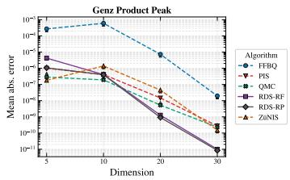

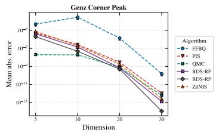

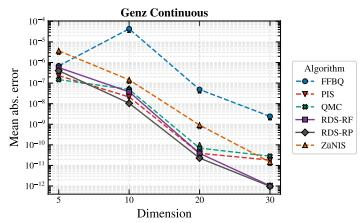  
Figure 1: Mean absolute error as a function of dimension on Genz test integrals for the number of samples $N = 2 ^ { 2 0 }$ . Error bars show variability across independent evaluation runs.

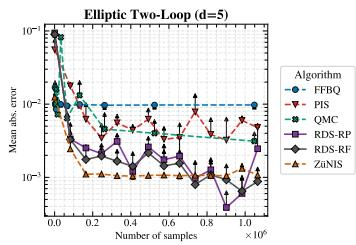

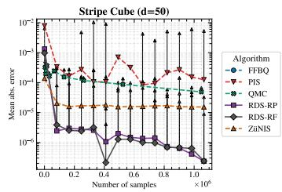

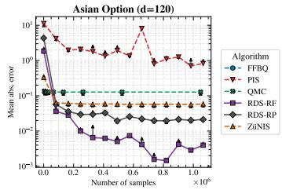  
Figure 2: Mean absolute error as a function of the number of samples used for estimation on representative benchmarks. Results for FFBQ are missing on some plots due to memory limitations of this algorithm in large dimensions.

Evaluation. For a batch of � trajectories generated by the reflected scheme (20), the final importancesampling estimator (16) under a time discretization corresponds to

$$
\widehat Z = \frac { 1 } { N } \sum _ { i = 1 } ^ { N } \frac { r ( Y _ { K } ^ { ( i ) } ) } { \nu ( Y _ { K } ^ { ( i ) } ) } \exp \left( - \sum _ { k = 0 } ^ { K - 1 } \left[ g _ { k } s _ { \theta } ( Y _ { k } ^ { ( i ) } , 1 - t _ { k } ) ^ { \top } \xi _ { k } ^ { ( i ) } + \frac { 1 } { 2 } g _ { k } ^ { 2 } \| s _ { \theta } ( Y _ { k } ^ { ( i ) } , 1 - t _ { k } ) \| _ { 2 } ^ { 2 } \right] \right) .\tag{26}
$$

Under the assumption that a discretized step of (10) preserves the uniform distribution on D, which holds for D considered in our experiments, the discrete-time estimate (26) remains unbiased. The formal proof and discussion are available in Proposition E.5.1 and Remark E.5.2.

## 4 Experiments

Benchmarks. We evaluate our method on bounded-domain integration problems defined on the unit hypercube $\overline { { \mathcal { D } } } = [ 0 , 1 ] ^ { d }$ , using the same reflection operator as in Lou & Ermon (2023). We consider Genz Continuous and Gaussian Peak to test smooth and non-smooth interior concentration, Genz Product Peak for sharply localized factorized structure, Genz Corner Peak for mass concentrated at a boundary corner, and Genz Discontinuous for discontinuous support with a zero-valued region (Genz, 1984; Kaarnioja, 2025). GMM Cube tests multimodal exploration, Stripe Cube tests concentration near boundary faces, and Funnel Cube tests adaptation to strongly varying conditional scales. Finally, we consider two real world integrals - Elliptic Two-Loop and Asian option. The Elliptic Two-Loop integral is a finite five-dimensional Feynman parameter integral over the unit cube (Bonciani et al., 2016; Borowka et al., 2018). And the Asian option benchmark (L’Ecuyer, 2009) provides a high-dimensional problem with strong coordinate dependence, a non-smooth payoff, and a large zero-valued region. We additionally compare against PIS on the benchmark from sampling literature, namely Digits (Blessing et al., 2024), in Section 4.3. Complete definitions and parameter settings are given in Appendix F.1.

Baselines. We compare the reparameterization and reinforced variants of our method, denoted RDS-RP and RDS-RF, respectively, against Path Integral Sampler (Zhang & Chen, 2022, PIS), Quasi-Monte Carlo (Niederreiter, 1992; Dick et al., 2013), Fast Fourier Bayesian Quadrature (Warren & Ramos, 2024, FFBQ), and the normalizing flow importance sampling library ZüNIS (Deutschmann & Götz, 2024). For PIS, we map $z \in \mathbb { R } ^ { d } \mathrm { t } \mathbf { \bar { o } } x \in [ 0 , \mathbf { \bar { 1 } } ] ^ { d }$ with the sigmoid transformation $x = \sigma ( z )$ and train on the change-of-variables target $\widetilde r ( z ) = r ( \sigma ( z ) )$ |det $J _ { \sigma } ( \bar { z } ) |$ |, which preserves the original integral. We report the absolute normalizing-constant error $\Delta Z = | \widehat { Z } - Z |$ , and show mean and standard deviation across independent evaluation runs. Full experimental details are in Appendix F.2.

Overall, RDS performs well across a broad range of targets with substantially different geometry. In particular, it remains competitive on smooth, multimodal, boundary-concentrated, and highdimensional problems, indicating that the learned proposal is not specialized to a particular class of integrands. The strong performance across both the dimension and target-evaluation sweeps also shows that the method can effectively adapt its sampling distribution to the regions that contribute most to the integral. Figure 1 illustrates the dependence of the estimation error on dimension, while Figure 2 compares methods at matched sample budgets. The full results are given in Appendix F.3.

## 4.1 Problems with smooth target functions

RDS-RP is closely related to PIS, as both optimize a diffusion proposal using pathwise reparameterization gradients. The main difference is that RDS-RP evolves directly on the constrained domain and handles the boundary by reflection. This is particularly helpful for targets such as Genz Corner Peak and Stripe Cube, where a substantial amount of mass may lie close to the boundary. In PIS, the transformation to an unconstrained space sends such points far into the tails, which makes these regions harder to represent accurately. This is consistent with the stronger performance of RDS-RP on boundary-concentrated benchmarks. Besides normalizing-constant estimation, we inspect samples generated by the learned reverse process. Figure 7 shows representative RDS samples for several cube-supported targets. These visualizations provide a complementary check that the learned dynamics capture the geometry of the target rather than only producing accurate estimates of �.

## 4.2 Problems with zero-valued target regions

The path-measure and REINFORCE results require measurable $r ( x )$ bounded above and away from zero, but several benchmarks vanish on subsets of D. For these targets we use $r _ { \varepsilon } ( x ) : = r ( x ) + \varepsilon$ with a small $\varepsilon > 0$ . Since $Z _ { \varepsilon } = Z + \varepsilon { \mathrm { v o l } } ( { \mathcal { D } } )$ , we estimate $Z _ { \varepsilon }$ and report the corrected estimate $\widehat { Z } = \widehat { Z } _ { \varepsilon } - \varepsilon \mathrm { v o l } ( \mathcal { D } )$ , where $\mathrm { v o l } ( \mathcal { D } ) = 1$ for the unit cube.

Zero-valued regions are particularly challenging for optimalcontrol methods trained with reparameterization: it is not applicable to discontinuous functions. When the target is locally constant, $\nabla _ { x }$ log $r ( x )$ provides no information about how probability mass should be moved, while at the boundary of such regions the derivative may be undefined. This issue is present in both Genz Discontinuous and the Asian option benchmark, whose targets vanish over subsets of the domain. On these problems, RDS-RF consistently outperforms the reparameterized RDS-RP variant, demonstrating the advantage of differentiating the trajectory distribution rather than the terminal target itself. The samples for Genz Discontinuous in Figure 3 illustrate this behavior particularly clearly. RDS-RF successfully concentrates probability mass inside the non-zero-valued region and recovers the sharp support geometry despite the absence of informative local gradients outside it. This improved adaptation also translates into more accurate estimates of � on both benchmarks.

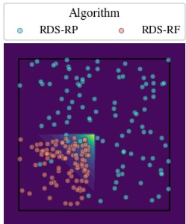  
Figure 3: Visual sample comparison between RDS-RP and RDS-RF on Genz Discontinuous.

## 4.3 High-Dimensional Sampling

In addition, to demonstrate the benefits of learning a reflected diffusion proposal (RDS) on a bounded domain in comparison to an unconstrained diffusion proposal (PIS) from another angle, we consider the high-dimensional Digits benchmark from the diffusion sampling literature (Blessing et al., 2024). The target $\widetilde { r } ( z )$ is a NICE (Dinh et al., 2014) normalizing flow model trained on downsampled 14 × 14 images of MNIST (LeCun et al., 1998). While the images naturally lie in a unit hypercube, the benchmark was designed for $\mathbb { R } ^ { d }$ sampling, so the normalizing flow was trained on images preprocessed with a shifted logit transform. Mirroring the previously described setup for PIS, to define an equivalent target with the same value of � on $\overline { { \mathcal { D } } } = [ 0 , 1 ] ^ { d }$ , we train RDS on $r ( x ) = \widetilde { r } ( \sigma ^ { - 1 } ( x ) )$ |det $J _ { \sigma ^ { - 1 } } ( x ) |$ |. As discussed in Section 3.3, our learned model also acts as a sampler for the normalized target $\pi = r / Z .$ . And, since the ground truth value of � is unknown, we compare

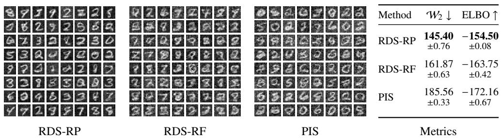  
Figure 4: Sample visualizations and metrics on the Digits benchmark (Blessing et al., 2024).

RDS against PIS using sampling metrics, namely ELBO, which lower-bounds the value of log �, and $\mathcal { W } _ { 2 }$ to the set of ground truth samples (see Blessing et al. (2024) and Appendix F for more details).

RDS-RP and PIS in essence have an identical KL training target, and the gradients are identically computed through reparameterization. We parameterize both models with neural networks of the same architecture and use the same number of discretization steps, so the comparison targets the only crucial difference that lies in the underlying diffusion dynamics: Brownian motion on $\mathbb { R } ^ { d }$ and reflected Brownian motion on $[ 0 , 1 ] ^ { d }$ . Figure 4 presents the comparison results, demonstrating that RDS-RP and RDS-RF outperform PIS across both metrics.

## 5 Conclusion

We presented reflected diffusion samplers for integration over bounded domains. The construction replaces the Gaussian reference process of existing diffusion samplers with a reflected varianceexploding process that leaves the uniform distribution on D invariant, where trajectories never leave the domain, and a Girsanov change of measure for reflected diffusions supplies both the training objective and the importance weights used to estimate �. Across a number of benchmarks, in our experiments the developed approach supplies accurate estimates of the integral. While the proposed approach is currently limited to non-negative targets, one can consider a decomposition $\begin{array} { r } { \int _ { \mathcal { D } } \overline { { r ( \boldsymbol { x } ) } } \mathrm { d } \boldsymbol { x } = \int _ { \mathcal { D } } r ^ { + } ( \boldsymbol { x } ) \mathrm { d } \boldsymbol { x } - \int _ { \mathcal { D } } r ^ { - } ( \boldsymbol { x } ) \mathrm { d } \boldsymbol { x } } \end{array}$ , then estimate both parts as discussed in Section 4.2. We leave the analysis and evaluation of this adaptation for future work.

## Acknowledgments and Disclosure of Funding

This research was supported in part through computational resources of HPC facilities at HSE University (Kostenetskiy et al., 2021). The work of Kirill Korolev, Tigran Ramazyan and Nikita Morozov was supported by the grant for research centers in the field of AI provided by the Ministry of Economic Development of the Russian Federation in accordance with the agreement 000000C313925P4E0002 and the agreement with HSE University №139-15-2025-009. Artur Goldman is supported by the ETH AI Center through an ETH AI Center doctoral fellowship.

## References

Akhound-Sadegh, T., Rector-Brooks, J., Bose, J., Mittal, S., Lemos, P., Liu, C.-H., Sendera, M., Ravanbakhsh, S., Gidel, G., Bengio, Y., Malkin, N., and Tong, A. Iterated denoising energy matching for sampling from boltzmann densities. In Forty-first International Conference on Machine Learning, 2024. URL https://openreview.net/forum?id=gVjMwLDFoQ.

Alfaro, M., Hilhorst, D., and Matano, H. The singular limit of the allen–cahn equation and the fitzhugh–nagumo system. Journal ofDifferential Equations, 245(2):505–565, 2008.

Berner, J., Richter, L., and Ullrich, K. An optimal control perspective on diffusion-based generative modeling. Transactions on Machine Learning Research, 2024. ISSN 2835-8856. URL https: //openreview.net/forum?id=oYIjw37pTP.

Berner, J., Richter, L., Sendera, M., Rector-Brooks, J., and Malkin, N. From discrete-time policies to continuous-time diffusion samplers: Asymptotic equivalences and faster training. Transactions on

Machine Learning Research, 2026. ISSN 2835-8856. URL https://openreview.net/forum? id=xLE3xJUuDO. Expert Certification.

Blessing, D., Jia, X., Esslinger, J., Vargas, F., and Neumann, G. Beyond ELBOs: A large-scale evaluation of variational methods for sampling. International Conference on Machine Learning (ICML), 2024.

Bonciani, R., Del Duca, V., Frellesvig, H., Henn, J. M., Moriello, F., and Smirnov, V. A. Two-loop planar master integrals for higgs → 3 partons with full heavy-quark mass dependence. Journal of High Energy Physics, 2016(12), December 2016. ISSN 1029-8479. doi: 10.1007/jhep12(2016)096. URL http://dx.doi.org/10.1007/JHEP12(2016)096.

Borowka, S., Heinrich, G., Jahn, S., Jones, S., Kerner, M., Schlenk, J., and Zirke, T. pysecdec: A toolbox for the numerical evaluation of multi-scale integrals. Computer Physics Communications, 222:313–326, January 2018. ISSN 0010-4655. doi: 10.1016/j.cpc.2017.09.015. URL http: //dx.doi.org/10.1016/j.cpc.2017.09.015.

Briol, F.-X., Oates, C. J., Girolami, M., Osborne, M. A., and Sejdinovic, D. Probabilistic integration. Statistical Science, 34(1):1–22, 2019.

Burdzy, K., Chen, Z.-Q., and Sylvester, J. The heat equation and reflected brownian motion in time-dependent domains. The Annals ofProbability, 32(1B):775–804, 2004.

Cattiaux, P. Time reversal of diffusion processes with a boundary condition. Stochastic processes and their Applications, 28(2):275–292, 1988.

Chen, Y., Georgiou, T. T., and Pavon, M. On the relation between optimal transport and schrödinger bridges: A stochastic control viewpoint. Journal of Optimization Theory and Applications, 169(2): 671–691, 2016.

Chen, Y., Georgiou, T. T., and Pavon, M. Stochastic control liaisons: Richard sinkhorn meets gaspard monge on a schrodinger bridge. Siam Review, 63(2):249–313, 2021.

Deutschmann, N. and Götz, N. Accelerating hep simulations with neural importance sampling. Journal ofHigh Energy Physics, 2024(3):83, 2024.

Dick, J., Kuo, F. Y., and Sloan, I. H. High-dimensional integration: the quasi-monte carlo way. Acta Numerica, 22:133–288, 2013.

Dinh, L., Krueger, D., and Bengio, Y. NICE: Non-linear independent components estimation. arXiv preprint arXiv:1410.8516, 2014.

Fishman, N., Klarner, L., Bortoli, V. D., Mathieu, E., and Hutchinson, M. J. Diffusion models for constrained domains. Transactions on Machine Learning Research, 2023. ISSN 2835-8856. URL https://openreview.net/forum?id=xuWTFQ4VGO. Expert Certification.

Foote, R. L. Regularity of the distance function. Proceedings of the American Mathematical Society, 92(1):153–155, 1984.

Genz, A. Testing multidimensional integration routines. In Proc. of international conference on Tools, methods and languagesfor scientific and engineering computation, pp. 81–94, 1984.

Glasserman, P. Monte Carlo methods in financial engineering, volume 53. Springer, 2004.

Gunter, T., Osborne, M. A., Garnett, R., Hennig, P., and Roberts, S. J. Sampling for inference in probabilistic models with fast bayesian quadrature. Advances in neural information processing systems, 27, 2014.

Guo, W., Tao, M., and Chen, Y. Complexity analysis of normalizing constant estimation: from jarzynski equality to annealed importance sampling and beyond. In The Fourteenth International Conference on Learning Representations, 2026. URL https://openreview.net/forum?id= 96fJALwotm.

Hammersley, J. M. and Handscomb, D. C. Monte Carlo Methods. Methuen & Co. London; John Wiley & Sons, New York, 1964.

Havens, A. J., Miller, B. K., Yan, B., Domingo-Enrich, C., Sriram, A., Levine, D. S., Wood, B. M., Hu, B., Amos, B., Karrer, B., Fu, X., Liu, G.-H., and Chen, R. T. Q. Adjoint sampling: Highly scalable diffusion samplers via adjoint matching. In Forty-second International Conference on Machine Learning, 2025. URL https://openreview.net/forum?id=6Eg1OrHmg2.

Holk, A., Strauch, C., and Trottner, L. Statistical guarantees for denoising reflected diffusion models. Journal ofMachine Learning Research, 27(116):1–50, 2026.

Kaarnioja, V. Explicit solutions of genz test integrals. Applied Mathematics Letters, 163:109444, 2025.

Kass, R. E. and Raftery, A. E. Bayes factors. Journal ofthe american statistical association, 90(430): 773–795, 1995.

Kloek, T. and Van Dijk, H. K. Bayesian estimates of equation system parameters: an application of integration by monte carlo. Econometrica: Journal ofthe Econometric Society, pp. 1–19, 1978.

Kong, Z. and Chaudhuri, K. The expressive power of a class of normalizing flow models. In International conference on artificial intelligence and statistics, pp. 3599–3609. PMLR, 2020.

Kool, W., van Hoof, H., and Welling, M. Buy 4 REINFORCE samples, get a baseline for free! In ICLR 2019 Workshop: Deep Reinforcement Learning Meets Structured Prediction, 2019. URL https://openreview.net/forum?id=r1lgTGL5DE.

Kostenetskiy, P. S., Chulkevich, R., and Kozyrev, V. Hpc resources of the higher school of economics. In Journal ofPhysics: Conference Series, volume 1740, pp. 012050. IOP Publishing, 2021.

Le Gall, J.-F. Brownian motion, martingales, and stochastic calculus, volume 274. Springer, 2016.

LeCun, Y., Bottou, L., Bengio, Y., and Haffner, P. Gradient-based learning applied to document recognition. Proceedings ofthe IEEE, 86(11):2278–2324, 1998.

Liu, G.-H., Chen, T., Theodorou, E., and Tao, M. Mirror diffusion models for constrained and watermarked generation. Advances in Neural Information Processing Systems, 36:42898–42917, 2023.

Loper, J. Uniform ergodicity for brownian motion in a bounded convex set. Journal ofTheoretical Probability, 33(1):22–35, 2020.

Lou, A. and Ermon, S. Reflected diffusion models. In International Conference on Machine Learning, pp. 22675–22701. PMLR, 2023.

L’Ecuyer, P. Quasi-monte carlo methods with applications in finance. Finance and Stochastics, 13 (3):307–349, 2009.

Midgley, L. I., Stimper, V., Simm, G. N. C., Schölkopf, B., and Hernández-Lobato, J. M. Flow annealed importance sampling bootstrap. In The Eleventh International Conference on Learning Representations, 2023. URL https://openreview.net/forum?id=XCTVFJwS9LJ.

Müller, T., McWilliams, B., Rousselle, F., Gross, M., and Novák, J. Neural importance sampling. ACM Transactions on Graphics (ToG), 38(5):1–19, 2019.

Nicoli, K. A., Anders, C. J., Funcke, L., Hartung, T., Jansen, K., Kessel, P., Nakajima, S., and Stornati, P. Estimation of thermodynamic observables in lattice field theories with deep generative models. Physical review letters, 126(3):032001, 2021.

Niederreiter, H. Random number generation and quasi-Monte Carlo methods. SIAM, 1992.

Noé, F., Olsson, S., Köhler, J., and Wu, H. Boltzmann generators: Sampling equilibrium states of many-body systems with deep learning. Science, 365(6457):eaaw1147, 2019.

O’Hagan, A. Bayes–hermite quadrature. Journal of statistical planning and inference, 29(3):245–260, 1991.

Ott, K., Tiemann, M., Hennig, P., and Briol, F.-X. Bayesian numerical integration with neural networks. In Uncertainty in Artificial Intelligence, pp. 1606–1617. PMLR, 2023.

Owen, A. B. Monte carlo variance of scrambled net quadrature. SIAM Journal on Numerical Analysis, 34(5):1884–1910, 1997.

Pilipenko, A. An introduction to stochastic differential equations with reflection. Universitätsverlag Potsdam, 2014.

Rasmussen, C. E. and Ghahramani, Z. Bayesian monte carlo. Advances in neural information processing systems, pp. 505–512, 2003.

Rezende, D. and Mohamed, S. Variational inference with normalizing flows. In International conference on machine learning, pp. 1530–1538. PMLR, 2015.

Schuss, Z. Brownian dynamics at boundaries and interfaces, volume 758. Springer, 2015.

Sendera, M., Kim, M., Mittal, S., Lemos, P., Scimeca, L., Rector-Brooks, J., Adam, A., Bengio, Y., and Malkin, N. Improved off-policy training of diffusion samplers. Advances in Neural Information Processing Systems, 37:81016–81045, 2024.

Song, Y., Sohl-Dickstein, J., Kingma, D. P., Kumar, A., Ermon, S., and Poole, B. Score-based generative modeling through stochastic differential equations. In International Conference on Learning Representations, 2021. URL https://openreview.net/forum?id=PxTIG12RRHS.

Taraldsen, G. Optimal learning from the doob-dynkin lemma. arXiv preprint arXiv:1801.00974, 2018.

Vargas, F., Grathwohl, W. S., and Doucet, A. Denoising diffusion samplers. In International Conference on Learning Representations, 2023. URL https://openreview.net/forum?id= 8pvnfTAbu1f.

Vargas, F., Padhy, S., Blessing, D., and Nüsken, N. Transport meets variational inference: Controlled monte carlo diffusions. In The Twelfth International Conference on Learning Representations, 2024. URL https://openreview.net/forum?id=PP1rudnxiW.

Virtanen, P., Gommers, R., Oliphant, T. E., Haberland, M., Reddy, T., Cournapeau, D., Burovski, E., Peterson, P., Weckesser, W., Bright, J., et al. Scipy 1.0: fundamental algorithms for scientific computing in python. Nature methods, 17(3):261–272, 2020.

Warren, H. and Ramos, F. Fast fourier bayesian quadrature. In International Conference on Artificial Intelligence and Statistics, pp. 4555–4563. PMLR, 2024.

Williams, R. On time-reversal of reflected brownian motions. In Seminar on Stochastic Processes, 1987, pp. 265–276. Springer, 1987.

Williams, R. J. Simple statistical gradient-following algorithms for connectionist reinforcement learning. Machine learning, 8(3):229–256, 1992.

Wirnsberger, P., Ballard, A. J., Papamakarios, G., Abercrombie, S., Racanière, S., Pritzel, A., Jimenez Rezende, D., and Blundell, C. Targeted free energy estimation via learned mappings. The Journal ofChemical Physics, 153(14), 2020.

Zhang, Q. and Chen, Y. Path integral sampler: A stochastic control approach for sampling. In International Conference on Learning Representations, 2022. URL https://openreview.net/ forum?id=\_uCb2ynRu7Y.

## A Related work

Quasi-Monte Carlo (QMC) approximates (1) using low-discrepancy point sets: $\begin{array} { r l } { \widehat { Z } _ { N } } & { { } = } \end{array}$ $\begin{array} { r } { N ^ { - 1 } \sum _ { i = 1 } ^ { N } r ( x _ { i } ) } \end{array}$ . Unlike independent Monte Carlo samples, QMC points are constructed to cover [0, 1]<sup>�</sup> more uniformly, typically using digital nets or lattice rules (Niederreiter, 1992; Dick et al., 2013). For integrands satisfying suitable regularity conditions, QMC can achieve faster convergence than ordinary Monte Carlo. Randomized QMC methods, such as scrambled Sobol sequences, retain low-discrepancy properties while allowing randomized error estimation (Owen, 1997). However, conventional QMC point sets are constructed independently of the integrand and do not adapt to the location of its mass.

Bayesian quadrature (BQ) models the integrand using a Gaussian process and conditions on its evaluations at selected points (O’Hagan, 1991; Rasmussen & Ghahramani, 2003). Since integration is a linear functional, the Gaussian process posterior induces a Gaussian posterior over the integral, providing both an estimate and a measure of uncertainty. Evaluation points can also be selected adaptively to reduce the posterior uncertainty (Gunter et al., 2014). For fixed kernel hyperparameters, the posterior variance depends on the evaluation locations rather than the observed function values. Consequently, its uncertainty estimates depend on the adequacy of the chosen prior (Briol et al., 2019). Standard GP-based BQ requires ${ \cal \dot { O ( n ^ { 3 } ) } }$ computation for � observations, although scalable variants, including Fast Fourier Bayesian Quadrature, reduce this cost (Warren & Ramos, 2024).

Importance sampling (IS) estimates (1) using a proposal density $q$ on $\mathcal { D }$ :

$$
\widehat Z _ { N } = \frac { 1 } { N } \sum _ { i = 1 } ^ { N } \frac { r ( x _ { i } ) } { q ( x _ { i } ) } , \qquad x _ { i } \overset { \mathrm { i . i . d . } } { \sim } q .\tag{27}
$$

Provided $q$ is positive wherever � is positive up to sets of measure zero, the estimator is unbiased. Its variance satisfies

$$
\operatorname { V a r } _ { q } ( \widehat { Z } _ { N } ) = \frac { Z ^ { 2 } } { N } \chi ^ { 2 } ( \pi \| q ) ,\tag{28}
$$

where $\pi = r / Z$ and $\chi ^ { 2 }$ denotes the chi-square divergence. The optimal proposal is $q = \pi ,$ which gives zero variance (Hammersley & Handscomb, 1964). Since sampling directly from � is generally intractable, the effectiveness of IS depends on constructing a proposal that accurately represents the regions where the target concentrates.

Normalizing flows (NF) provide adaptive proposal densities through invertible transformations with tractable Jacobian determinants (Dinh et al., 2014; Rezende & Mohamed, 2015). For sampling from unnormalized targets, Midgley et al. (2023) combine normalizing flows with annealed importance sampling to improve the coverage of poorly represented regions. For numerical integration, Müller et al. (2019) train a flow directly from evaluations of the unnormalized integrand, without requiring samples from the normalized target. They derive importance-weighted gradients for minimizing $\mathbf { K L } ( \pi \lVert q _ { \theta } )$ and also consider the chi-square divergence, which directly controls the IS variance. Their method is applied to light-transport integration and path guiding. Normalizing flows have also been applied to sampling equilibrium distributions and estimating free-energy differences in molecular systems (Noé et al., 2019). Building on neural importance sampling, Deutschmann & Götz (2024) introduce ZüNIS, a flow-based importance-sampling library for high-energy physics simulations. Normalizing flows require invertible architectures with tractable Jacobians, which restricts the available transformations; expressivity limitations for particular flow architectures have been studied by Kong & Chaudhuri (2020).

Diffusion samplers (Zhang & Chen, 2022; Vargas et al., 2023; Berner et al., 2024; Sendera et al., 2024; Akhound-Sadegh et al., 2024; Havens et al., 2025) learn stochastic dynamics for sampling from unnormalized target distributions without requiring invertible neural architectures. Unlike conventional diffusion models (Song et al., 2021), which learn from samples of the target distribution, diffusion samplers are trained using its unnormalized density. The Path Integral Sampler (PIS) (Zhang & Chen, 2022) formulates sampling as a stochastic optimal control problem, where a reference diffusion is reweighted by a terminal potential determined by the target. Its training objective combines a quadratic control cost with a terminal density term, obtained through Girsanov’s theorem. Denoising Diffusion Samplers (DDS) (Vargas et al., 2023) instead formulate sampling through the time reversal of a diffusion that transforms the target towards a tractable reference distribution. Both approaches lead to related path-space optimization objectives. The resulting path measures also permit normalizing-constant estimation through importance sampling (Zhang & Chen, 2022; Guo et al., 2026).

Most of these sampling methods are formulated using diffusions on $\mathbb { R } ^ { d }$ and do not directly enforce bounded-domain constraints. Reflected diffusions have previously been used for constrained generative modeling (Lou & Ermon, 2023; Fishman et al., 2023), while mirror diffusion models (Liu et al., 2023) handle constraints through transformations to an unconstrained dual space. In contrast to these data-driven generative models, our method learns a reflected diffusion proposal from an unnormalized target, without requiring target samples. It operates directly on the bounded integration domain and handles zero-valued regions by adding a positive offset to the integrand and correcting the final estimate.

## B Formal notation and assumptions

## B.1 Notation and conventions

General notation. The domain $\mathcal { D } \subset \mathbb { R } ^ { d }$ is bounded and convex. Its closure, boundary, and Lebesgue volume are D, �D, and vol(D). For topological spaces � and �, we denote by $C ( E ; F )$ the set of continuous maps from $E$ to $F$ and abbreviate ${ \bf { \bar { \phi } } } ( E ) \ : : = { \bf C } ( E ; \mathbb { R } )$ . When � is compact and � is metric, this space carries the uniform topology induced by metric $\begin{array} { r } { d _ { \infty } ( f , g ) = \operatorname* { s u p } _ { x \in E } d _ { F } ( f ( x ) , g ( x ) ) } \end{array}$ unless stated otherwise. For $E \subseteq \mathbb { R } ^ { d }$ and $f : E \to \mathbb { R } ^ { m }$ ，

$$
\mathrm { L i p } _ { x \in E } ( f ) : = \operatorname* { s u p } _ { x \neq y \in E } { \frac { \| f ( x ) - f ( y ) \| _ { 2 } } { \| x - y \| _ { 2 } } } .\tag{29}
$$

Forward and reverse time are � and ${ \bar { t } } .$ Forward and reverse processes are denoted by � and �. Symbols used in only one proof are defined locally.

For probability measures on a common measurable space, $\mu _ { 1 } \ll \mu _ { 0 }$ denotes absolute continuity, and $\mu _ { 1 } \ll \mu _ { 0 } \ll \mu _ { 1 }$ denotes equivalence, meaning mutual absolute continuity. We also use

$$
\| \mu _ { 1 } - \mu _ { 0 } \| _ { \mathrm { T V } } : = \operatorname* { s u p } _ { E } | \mu _ { 1 } ( E ) - \mu _ { 0 } ( E ) | ,\tag{30}
$$

$$
{ \mathsf { K L } } ( \mu _ { 1 } | | \mu _ { 0 } ) : = \int { \log } \left( { \frac { \mathrm { d } \mu _ { 1 } } { \mathrm { d } \mu _ { 0 } } } \right) { \mathrm { d } } \mu _ { 1 } ,\tag{31}
$$

$$
\chi ^ { 2 } ( \mu _ { 1 } \| \mu _ { 0 } ) : = \int \left( \frac { \mathrm { d } \mu _ { 1 } } { \mathrm { d } \mu _ { 0 } } - 1 \right) ^ { 2 } \mathrm { d } \mu _ { 0 } .\tag{32}
$$

The last two are +∞ when $\mu _ { 1 } \ll \mu _ { 0 }$ . The same notation applies to densities through their induced measures. The $\chi ^ { 2 }$ -divergence and the variances of the integrable importance weights below are understood as extended nonnegative quantities and may equal +∞.

If a continuous process � is defined under a construction probability P, we denote its induced path law on $C ( [ 0 , 1 ] ; \overline { { \mathcal { D } } } )$ by $\operatorname { L a w } ( X ) = X _ { \# } \mathbf { P }$ . We write $\zeta$ for a generic path, with $\zeta ( t )$ its value at time $t ,$ while $X _ { t }$ denotes the corresponding coordinate of a random path $X$

For a real-valued continuous semimartingale $X ,$ , a level $a \in \mathbb { R }$ , and time $t \geq 0$ , we write $\operatorname { L T } _ { t } ^ { a } ( X )$ for the right local time of � at � accumulated up to �, using the version that is right-continuous in $^ { a . }$ Informally, it measures the quadratic variation accumulated while � lies immediately to the right of �. Its Tanaka characterization and one-sided occupation approximation are given by Le Gall (2016, Propositions 9.2 and 9.9).

Finally, we set

$$
A ( t ) : = \int _ { 0 } ^ { t } g ( s ) ^ { 2 } \mathrm { d } s .\tag{33}
$$

Domain related definitions. We use the following concrete meaning of boundary regularity. We say that �D is $C ^ { 1 }$ near $z \in \partial \mathcal { D }$ if there are an open neighborhood $\mathsf { U } _ { z }$ of � and a function $b _ { z } \in C ^ { 1 } ( \mathsf { U } _ { z } )$ such that

$$
{ \mathcal { D } } \cap \mathsf { U } _ { z } = \{ x \in \mathsf { U } _ { z } : b _ { z } ( x ) < 0 \} , \qquad \partial { \mathcal { D } } \cap \mathsf { U } _ { z } = \{ x \in \mathsf { U } _ { z } : b _ { z } ( x ) = 0 \} ,
$$

and $\nabla b _ { z } ( x ) \neq 0 \mathrm { o n } \partial \mathcal { D } \cap \mathsf { U } _ { z }$ . Any such $b _ { z }$ is called a local defining function. The nonvanishinggradient condition makes its zero set a $C ^ { 1 }$ hypersurface, by the implicit function theorem, and the gradient is perpendicular to that hypersurface.

The defining function is not unique, but the oriented unit normal is. Indeed, at � the gradients of any two local defining functions are nonzero and perpendicular to the same tangent hyperplane, so they are scalar multiples. Because both functions are negative on the interior side, that scalar is positive. Consequently, we define the outward and inward unit normals by

$$
\mathbf { n } _ { \mathrm { o u t } } ( z ) : = \frac { \nabla b _ { z } ( z ) } { \| \nabla b _ { z } ( z ) \| _ { 2 } } , \qquad \mathbf { n } _ { \mathrm { i n } } ( z ) : = - \mathbf { n } _ { \mathrm { o u t } } ( z ) .\tag{34}
$$

These definitions do not depend on the choice of $b _ { z }$ . Assumption B.2.2 imposes the stronger $C ^ { \infty }$ version of this condition at every boundary point.

Solutions of reflected SDEs. Fix $T > 0$ and a continuous reflected process $X = ( X _ { t } ) _ { 0 \leq t \leq T }$ in $\overline { { \mathcal { D } } } . \mathrm { { A } }$ scalar regulator for � is the real-valued boundary-push process $\ell = ( \ell _ { t } ) _ { 0 \leq t \leq T } \colon$ almost surely, the map $t \mapsto \ell _ { t }$ is continuous and nondecreasing, $\ell _ { 0 } = 0$ , and its Stieltjes measure is supported on the boundary-contact times,

$$
\int _ { 0 } ^ { t } \mathbb { 1 } _ { \{ X _ { s } \notin \partial \mathcal { D } \} } \mathrm { d } \ell _ { s } = 0 , \qquad 0 \leq t \leq T .
$$

The associated vector reflection term is $\begin{array} { r } { L _ { t } : = \int _ { 0 } ^ { t } \mathbf { n } _ { \mathrm { i n } } ( X _ { s } ) \mathrm { d } \ell _ { s } } \end{array}$ . Fix a Borel drift $f : \overline { { \mathcal { D } } } \times [ 0 , T ] \to \mathbb { R } ^ { d }$ a deterministic $g \in L ^ { 2 } ( [ 0 , T ] )$ , and an initial law $\mu$ on $\overline { { \mathcal { D } } }$ . A weak solution of the form (2) on [0, �] is a tuple

$$
( \Omega , \mathcal { F } , ( \mathcal { F } _ { t } ) _ { 0 \leq t \leq T } , { \bf P } ; \xi _ { 0 } , W , X , \ell )
$$

such that the filtered probability space satisfies the usual conditions, $\xi _ { 0 }$ is an $\mathcal { F } _ { 0 } .$ -measurable $\overline { { \mathcal { D } } } .$ -valued random variable with law $\mu , W$ is a �-dimensional Brownian motion relative to $( \mathcal { F } _ { t } )$ , and � and ℓ are continuous $( \mathcal { F } _ { t } )$ -adapted processes. They satisfy $X _ { 0 } = \xi _ { 0 } , X _ { t } \in \overline { { \mathcal { D } } }$ , the preceding regulator conditions, $\textstyle \int _ { 0 } ^ { T } \| f ( X _ { s } , s ) \| _ { 2 }$ d� < ∞ almost surely, and, almost surely, for every $t \leq T$

$$
X _ { t } = X _ { 0 } + \int _ { 0 } ^ { t } f ( X _ { s } , s ) \mathrm { d } s + \int _ { 0 } ^ { t } g ( s ) \mathrm { d } W _ { s } + \int _ { 0 } ^ { t } \mathbf { n } _ { \operatorname* { i n } } ( X _ { s } ) \mathrm { d } \ell _ { s } .
$$

We call the full tuple a weak realization and the law of � its weak solution law.

For a strong solution, we are given $( \Omega , \mathcal { F } , ( \mathcal { F } _ { t } ) _ { 0 \leq t \leq T } , { \bf P } ; \xi _ { 0 } , W )$ , where the filtered probability space satisfies the usual conditions, $\xi _ { 0 }$ is an $\mathcal { F } _ { 0 } .$ -measurable D-valued random variable with law $\mu ,$ and � is a �-dimensional Brownian motion relative to $( \mathcal { F } _ { t } )$ . A strong solution for these data is a continuous adapted pair $( X , \ell )$ satisfying the state, regulator, integrability, and integral-equation conditions in the weak-solution definition above, including $X _ { 0 } = \xi _ { 0 }$ , and such that, for every $t \leq T$

$$
\sigma ( X _ { s } , \ell _ { s } : 0 \le s \le t ) \subseteq \sigma ( \xi _ { 0 } , W _ { s } : 0 \le s \le t ) \vee N _ { \mathbf { P } } .
$$

Here $\mathcal { A } \vee \mathcal { B } : = \sigma ( \mathcal { A } \cup \mathcal { B } )$ for sigma-fields $\mathcal { A }$ and ${ \mathcal { B } } ,$ , and $N _ { \mathbf { P } }$ consists of the P-null events and their complements. Thus the condition allows changes on null events, but no additional randomness: both � and ℓ up to time � are determined by the prescribed initial variable and Brownian path up to time �.

This is the normal-reflection specialization of Pilipenko (2014, Definitions 2.2.2 and 2.3.1 and Remark 2.2.4). The strong formulation is the one used in the source’s discussion preceding Theorem 2.5.4. The source keeps $\xi _ { 0 }$ separate and requires $X _ { 0 } = \xi _ { 0 }$ . We retain that convention for both weak and strong solutions. Since our SDE displays prescribe only an initial law, the notation $X _ { 0 } \sim \mu$ is shorthand for including a variable $\xi _ { 0 } \sim \mu$ in the realization and imposing $X _ { 0 } = \xi _ { 0 }$

A displayed law definition is the primary specification of a path measure. If it is given by an SDE, existence and uniqueness in law must be established separately. An SDE characterization instead describes an already-defined law: weak existence identifies that law as one solution law, whereas pathwise uniqueness, strong existence, and uniqueness in law are additional conclusions only when explicitly stated.

## B.2 Assumptions for theoretical results

Assumption B.2.1. The domain $\mathcal { D } \subset \mathbb { R } ^ { d }$ is bounded and convex.

Assumption B.2.1 is the standing domain condition throughout the appendix.

The integration problem and the algorithmic construction can be formulated without assuming a smooth boundary. The local $C ^ { 1 }$ condition in Section B.1 is enough to define the unit normal. Some of our theoretical arguments, however, invoke standard results on normal reflection, Neumann heat equations, and reflected time reversal under stronger boundary regularity (Holk et al., 2026; Pilipenko, $2 0 1 4 ;$ Burdzy et al., 2004; Cattiaux, 1988; Williams, 1987). We therefore isolate the following $C ^ { \infty }$ condition as an additional theory-only assumption rather than include it in the general problem description.

Assumption B.2.2. The boundary of $\mathcal { D }$ is $C ^ { \infty } \colon$ for every $z \in \partial \mathcal { D }$ , there are a neighborhood $\mathsf { U } _ { z }$ of � and a function $b _ { z } \in C ^ { \infty } ( \mathsf { U } _ { z } )$ such that

$$
\begin{array} { r l } & { \mathcal { D } \cap \mathsf { U } _ { z } = \{ x \in \mathsf { U } _ { z } : b _ { z } ( x ) < 0 \} , \partial \mathcal { D } \cap \mathsf { U } _ { z } = \{ x \in \mathsf { U } _ { z } : b _ { z } ( x ) = 0 \} , } \\ & { \qquad \nabla b _ { z } ( x ) \neq 0 \mathrm { f o r } x \in \mathsf { U } _ { z } \cap \partial \mathcal { D } . } \end{array}\tag{35}
$$

Assumption B.2.2 is stronger than the local $C ^ { 1 }$ condition in Section B.1, so the unit normals are defined at every boundary point and can be used in the vector reflection term.

A density is determined only Lebesgue-almost everywhere: changing it on a null set leaves its law unchanged, but makes pointwise boundary values and ∇ log $p _ { t }$ ambiguous. Let $k _ { u } ( y , x )$ denote the transition density of unit normally reflected Brownian motion after elapsed time $u > 0$ . For $t > 0$ we choose the representative

$$
p _ { t } ( x ) : = \int _ { \mathcal { D } } k _ { A ( t ) } ( y , x ) \pi ( y ) \mathrm { d } y .
$$

The schedule makes the elapsed time in this kernel strictly positive. Under Assumption B.2.2, Burdzy et al. (2004, Theorems 2.4(i) and 2.5) show that the kernel is strictly positive and jointly $C ^ { 2 }$ in its spatial variables up to the boundary at positive elapsed times. Compactness therefore permits differentiation under the integral, so this is a strictly positive $C ^ { 2 } ( { \overline { { \mathcal { D } } } } )$ representative of the marginal density. The static-domain specialization of Burdzy et al. (2004, Theorem 2.9) also gives its homogeneous Neumann boundary condition. This choice is needed for the pointwise reverse drift in Lemma C.4.1. Throughout, a score on $\overline { { \mathcal { D } } }$ means its stated continuous extension from the interior, and at $t = 0$ the representative is $p _ { 0 } = \pi$

The integration problem (1) permits � to vanish. Some results use the following stronger target assumption.

Assumption B.2.3. The target � admits a Borel measurable extension to ${ \overline { { \mathcal { D } } } } .$ , denoted by � as well, and there are constants $0 < m _ { r } \leq M _ { r } <$ ∞ such that

$$
m _ { r } \le r ( x ) \le M _ { r } , \qquad x \in \overline { { \mathcal { D } } } .
$$

We henceforth use this extension and $\pi = r / Z$ on $\overline { { \mathcal { D } } }$ as well. The two-sided bounds directly make � and the normalized density � bounded above and away from zero on $\overline { { \mathcal { D } } }$ . Proposition E.1.1, Theorem E.2.1, and Theorem E.4.2 invoke this assumption. Extending these results to a target with zeros requires a separate support and absolute-continuity analysis and is not asserted here.

## B.3 Score and learned-control assumptions

Let $p _ { t }$ be the forward marginal density from the target-started law (8).

Assumption B.3.1. For every $t \in [ 0 , 1 ]$ , the chosen representative $p _ { t }$ is strictly positive on ${ \overline { { \mathcal { D } } } } .$ and its interior score admits an extension such that

$$
\left[ ( t , x ) \mapsto \nabla \log p _ { t } ( x ) \right] \in C \bigl ( [ 0 , 1 ] \times \overline { { \mathcal { D } } } ; \mathbb { R } ^ { d } \bigr ) .
$$

Assumption B.3.2.

$$
\operatorname* { s u p } _ { t \in [ 0 , 1 ] } \mathrm { L i p } _ { x \in { \mathcal { D } } } { \big ( } \nabla \log p _ { t } ( x ) { \big ) } < \infty .\tag{36}
$$

Note that these assumptions impose additional regularity on �. Indeed, since $p _ { 0 } = \pi$ , Assumption B.3.1 requires ∇ log � to exist in D and to admit a continuous extension to $\mathcal { D }$ . Moreover, the

positive-time densities satisfy the homogeneous Neumann condition, so joint continuity down to $t = 0$ forces

$$
\begin{array} { r } { \mathbf { n } _ { \mathrm { o u t } } ^ { \top } \nabla \log \pi = 0 \qquad \mathrm { o n } \partial \mathcal { D } . } \end{array}
$$

Under Assumption B.2.3, ∇ log $\pi = - \nabla V$ . Thus this requires the interior gradient of � to extend continuously to $\overline { { \mathcal { D } } }$ and to satisfy $\mathbf { n } _ { \mathrm { o u t } } ^ { \top } \nabla V = 0$ on $\partial \mathcal { D }$ . Assumption B.3.2 additionally requires ∇� to be Lipschitz on $\overline { { \mathcal { D } } }$ . The two assumptions are stronger than these target-only consequences: they also require the positive-time scores to converge jointly to the target score as $t \downarrow 0$ and to remain uniformly spatially Lipschitz over the full time interval. None of these score conditions follows from $V \in C ( \overline { { \mathcal { D } } } )$ alone.

The preceding assumptions concern the exact score and hence the ideal reverse law. We separately impose the following regularity conditions on the learned field used in the implemented law.

Assumption B.3.3.

$$
\left[ ( t , x ) \mapsto s _ { \theta } ( x , t ) \right] \in C \bigl ( [ 0 , 1 ] \times \overline { { \mathcal { D } } } ; \mathbb { R } ^ { d } \bigr ) .
$$

Since $[ 0 , 1 ] \times \overline { { \mathcal { D } } }$ is compact, joint continuity makes $s _ { \theta }$ bounded and Borel.

Assumption B.3.4.

$$
\operatorname* { s u p } _ { t \in [ 0 , 1 ] } \mathrm { L i p } _ { x \in { \overline { { \mathcal { D } } } } } { \big ( } s _ { \theta } ( x , t ) { \big ) } < \infty .
$$

Assumption B.3.4 is used to prove uniqueness for the learned SDE.

## C Existence and reversal of the reflected laws

The arguments in this section separate two tasks. First, the reflected-SDE and Skorokhod results of Pilipenko (2014, Theorems 2.5.1–2.5.3) and the Yamada–Watanabe discussion preceding Pilipenko (2014, Theorem 2.5.4) provide well-posedness for equations with prescribed coefficients. We use them to construct the zero-drift forward law and the continuous learned law, and to upgrade the ideal reverse equation to a unique strong solution when its score drift is spatially Lipschitz. The required domain hypotheses are verified in Lemma C.1.1.

Second, well-posedness of an equation with a prescribed score drift does not by itself identify that equation with the reversal of the forward law. We first define the ideal reverse law by reversing the already constructed target-started forward process. The time-homogeneous reflected-reversal statement of Holk et al. (2026, Section 2, equation (4)), followed by the local clock calculation in Lemma C.4.1, identifies this particular reversal as a weak solution of the scheduled score SDE on [0, 1). Score continuity is needed only to extend this representation to the closed endpoint, while spatial Lipschitzness supplies the subsequent uniqueness upgrade.

## C.1 Geometric prerequisites for reflected SDEs

The following lemma supplies a technical prerequisite for the existence and uniqueness arguments in this section. It verifies that the standing domain assumptions imply the geometric conditions required by the reflected Skorokhod and SDE results used below.

For $x \in \partial \mathcal { D }$ and $\rho > 0$ , define the inward normal sets used in Pilipenko (2014, Section 2.5) by

$$
\mathsf { N } _ { x , \rho } : = \{ n \in \mathbb { R } ^ { d } : \| n \| _ { 2 } = 1 , \ B ( x - \rho n , \rho ) \cap \mathscr { D } = \emptyset \} , \qquad \mathsf { N } _ { x } : = \bigcup _ { \rho > 0 } \mathsf { N } _ { x , \rho } .
$$

The uniform exterior-sphere condition requires a radius $\rho _ { \mathrm { e x t } } > 0$ such that $\mathsf { N } _ { x } = \mathsf { N } _ { x , \rho _ { \mathrm { e x t } } } \neq \emptyset$ for every $x \in \partial \mathcal { D }$ . The uniform-cone condition in Pilipenko (2014, Theorem 2.5.2) requires constants $\delta _ { \mathrm { c } } > 0$ and $\alpha \in [ 0 , 1 )$ such that, for every $x \in \partial \mathcal { D }$ , some unit vector $\nu _ { x }$ satisfies, for every $y \in B ( x , \delta _ { \mathrm { c } } ) \cap \partial \mathcal { D }$

$$
\{ z \in \mathbb { R } ^ { d } : \langle z - y , \nu _ { x } \rangle \ge \alpha \| z - y \| _ { 2 } \} \cap B ( x , \delta _ { \mathrm { c } } ) \subset \overline { { \mathcal { D } } } .\tag{37}
$$

The closure in (37) is essential because the cone contains its boundary vertex $y .$

Lemma C.1.1. Under Assumptions B.2.1 and B.2.2, D satisfies the uniform exterior-sphere and uniform-cone conditions just defined.

Proof. We verify the two conditions separately. For the exterior-sphere condition, we place a ball tangent to the boundary at � on the exterior side of its supporting hyperplane. Convexity will keep the whole domain outside that ball. We then check that smoothness leaves no other possible direction in $\mathsf { N } _ { x }$ . This second step is needed for the equality $\mathsf { N } _ { x } = \mathsf { N } _ { x , \rho _ { \mathrm { e x t } } }$ in the definition.

Fix $x \in \partial \mathcal { D }$ . The inward unit normal $\mathbf { n } _ { \mathrm { i n } } ( x )$ is unique by Assumption B.2.2. The supporting hyperplane at � leaves a convex domain entirely on its inward side, so

$$
\langle y - x , \mathbf { n } _ { \mathrm { i n } } ( x ) \rangle \geq 0 , \qquad y \in \overline { { \mathcal { D } } } .
$$

For any $\rho > 0 .$ , the point $x - \rho \mathbf { n } _ { \mathrm { i n } } ( x )$ is the center of a radius-� ball tangent at � and placed on the exterior side. For every $y \in \overline { { \mathcal { D } } }$

$$
\begin{array} { r } { \| y - ( x - \rho \mathbf { n } _ { \mathrm { i n } } ( x ) ) \| _ { 2 } ^ { 2 } = \| y - x \| _ { 2 } ^ { 2 } + 2 \rho \langle y - x , \mathbf { n } _ { \mathrm { i n } } ( x ) \rangle + \rho ^ { 2 } \geq \rho ^ { 2 } . } \end{array}
$$

Thus every point of the domain is at least $\rho$ from the center, and hence $B ( x - \rho \mathbf { n } _ { \mathrm { i n } } ( x ) , \rho ) \cap \mathcal { D } = \emptyset$ for every $\rho > 0$

It remains to show that no other unit vector belongs to $\mathsf { N } _ { x }$ . Suppose that $n \in \mathsf { N } _ { x , \rho }$ for some $\rho > 0$ Disjointness from the open ball gives the following inequality first for $y \in \mathcal { D }$ and then, by continuity and density of $\mathcal { D }$ in $\overline { { \mathcal { D } } }$ , for every $y \in \overline { { \mathcal { D } } }$

$$
2 \rho \langle n , y - x \rangle + \| y - x \| _ { 2 } ^ { 2 } \geq 0 .
$$

To identify the direction $n ,$ let � be any smooth boundary curve with $\gamma ( 0 ) = x$ . Substituting $y = \gamma ( t )$ and dividing by $t > 0$ gives $\langle \dot { n } , \gamma ^ { \prime } ( 0 ) \rangle \geq 0$ in the limit $t \downarrow 0 . \mathrm { ~ A ~ }$ pproaching through $t < 0$ reverses the inequality and gives $\langle n , \gamma ^ { \prime } ( 0 ) \rangle \leq 0$ . Hence $\langle n , \gamma ^ { \prime } ( 0 ) \rangle = 0$ . Therefore � is orthogonal to every tangent vector at $x .$ The smooth boundary has a one-dimensional normal space, so � is either $\mathbf { n } _ { \mathrm { i n } } ( x )$ $\operatorname { o r } - \mathbf { n } _ { \mathrm { i n } } ( x )$ . To select the sign, a local defining function � at � gives

$$
b \big ( x + \varepsilon \mathbf { n } _ { \mathrm { i n } } ( x ) \big ) = - \varepsilon \| \nabla b ( x ) \| _ { 2 } + o ( \varepsilon ) < 0
$$

for all sufficiently small $\varepsilon > 0$ . Hence $x + \varepsilon \mathbf { n } _ { \mathrm { i n } } ( x ) \in { \mathcal { D } }$ . Substituting these interior points in the same inequality gives

$$
2 \rho \varepsilon \langle n , \mathbf { n } _ { \mathrm { i n } } ( x ) \rangle + \varepsilon ^ { 2 } \geq 0 .
$$

Dividing by � and letting � ↓ 0 gives $\langle n , \mathbf { n } _ { \mathrm { i n } } ( x ) \rangle \geq 0 .$ . Thus $n = \mathbf { n } _ { \mathrm { i n } } ( x )$ , and

$$
\mathsf { N } _ { x } = \mathsf { N } _ { x , \rho } = \{ \boldsymbol { \mathsf { n } } _ { \mathrm { i n } } ( x ) \} \qquad \rho > 0 .
$$

Any fixed $\rho _ { \mathrm { e x t } } > 0$ therefore verifies the uniform exterior-sphere condition.

For the cone condition, set $\alpha : = 1 / 2$ . Around each boundary point $x _ { 0 } ,$ choose a local defining function � and use the inward normal at � as a fixed cone axis. After shrinking the neighborhood, continuity of $\nabla b$ makes its variation at most $\| \nabla b ( x _ { 0 } ) \| _ { 2 } / 4$ . Consequently, if a displacement ℎ satisfies the cone inequality $\langle h , \nu _ { x _ { 0 } } \rangle \geq \alpha \Vert h \Vert _ { 2 }$ , then the defining function decreases strictly along ℎ: the fixed-gradient term is at most $- \| \nabla b ( x _ { 0 } ) \| _ { 2 } \| h \| _ { 2 } / 2$ , whereas the gradient variation contributes at most $\| \nabla b ( \bar { { \boldsymbol { x } } _ { 0 } } ) \| _ { 2 } \| h \| _ { 2 } / 4 .$ . Compactness of the boundary will then make the neighborhood radius uniform. The value $1 / 2$ is only a convenient fixed aperture. Any $\alpha \in ( 1 / 4 , 1 )$ would work with the same gradient-variation bound.

Fix $\boldsymbol { x } _ { 0 } \in \partial \mathcal { D }$ and choose a defining function � from Assumption B.2.2, so locally $\mathcal { D } = \{ b < 0 \}$ and $\nabla b ( x _ { 0 } ) \neq 0$ . Since $\nabla b ( x _ { 0 } )$ points outward, set

$$
m : = \| \nabla b ( x _ { 0 } ) \| _ { 2 } , \qquad \nu _ { x _ { 0 } } : = - \frac { \nabla b ( x _ { 0 } ) } { m } .
$$

Thus $\nu _ { x _ { 0 } }$ points inward. By continuity of $\nabla b$ , after shrinking the defining-function neighborhood we may choose $\rho _ { x _ { 0 } } > 0$ such that $B ( x _ { 0 } , \dot { 2 } \rho _ { x _ { 0 } } )$ lies in that neighborhood and

$$
\operatorname* { s u p } _ { w \in B ( x _ { 0 } , 2 \rho _ { x _ { 0 } } ) } \| \nabla b ( w ) - \nabla b ( x _ { 0 } ) \| _ { 2 } \leq \frac { m } { 4 } .
$$

This bound says that throughout the neighborhood, the gradient remains close to the fixed outward direction at $x _ { 0 }$

Let $y \in B ( x _ { 0 } , \rho _ { x _ { 0 } } ) \cap \partial \mathcal { D }$ and suppose that $z \in B ( x _ { 0 } , \rho _ { x _ { 0 } } )$ satisfies

$$
\begin{array} { r } { \langle z - y , \nu _ { x _ { 0 } } \rangle \geq \alpha \| z - y \| _ { 2 } . } \end{array}
$$

In other words, the displacement from � to � lies in a cone pointing in the fixed inward direction $\nu _ { x _ { 0 } }$ Write $h : = z - y$ . The segment from $y \tan z$ remains in $B ( x _ { 0 } , \rho _ { x _ { 0 } } )$ . At every point � on that segment,

$$
\langle \nabla b ( w ) , h \rangle \leq \langle \nabla b ( x _ { 0 } ) , h \rangle + \frac { m } { 4 } \| h \| _ { 2 } = - m \langle \nu _ { x _ { 0 } } , h \rangle + \frac { m } { 4 } \| h \| _ { 2 } \leq - m \left( \alpha - \frac { 1 } { 4 } \right) \| h \| _ { 2 } = - \frac { m } { 4 } \| h \| _ { 2 } .
$$

The first term represents movement in the ideal inward direction at $x _ { 0 } .$ . The gradient variation can cost at most $m \Vert h \Vert _ { 2 } / { 4 }$ , so the net directional derivative remains negative. Since $b ( y ) = 0$ , the fundamental theorem of calculus gives

$$
b ( z ) - b ( y ) = \int _ { 0 } ^ { 1 } \langle \nabla b ( y + t h ) , h \rangle \mathrm { d } t \leq - \frac { m } { 4 } \| h \| _ { 2 } .
$$

Hence $b ( z ) < 0$ when $z \neq y ,$ , while for $z = y$ the point already lies in $\partial \mathcal { D }$ . Thus every such � belongs to $\overline { { \mathcal { D } } }$

The radius $\rho _ { x _ { 0 } }$ constructed so far may depend on $x _ { 0 } .$ . To obtain one radius for the whole boundary, use that boundedness of D makes �D compact. The sets $B ( x _ { 0 } , \rho _ { x _ { 0 } } / 2 )$ cover the boundary. Choose a finite subcover with centers $x _ { 1 } , \ldots , x _ { N }$ and set

$$
\delta _ { \mathrm { c } } : = \operatorname* { m i n } _ { 1 \le i \le N } \frac { \rho _ { x _ { i } } } { 2 } > 0 .
$$

For each $x \in \partial \mathcal { D }$ , choose � such that $x \in B ( x _ { i } , \rho _ { x _ { i } } / 2 )$ and set $\nu _ { x } : = \nu _ { x _ { i } }$ . Then $B ( x , \delta _ { \mathrm { c } } ) \subset B ( x _ { i } , \rho _ { x _ { i } } )$ Therefore both the cone vertex � and the point � remain in the neighborhood where the preceding local argument applies. It applies simultaneously to every $y \in B ( x , \delta _ { \mathrm { c } } ) \cap \partial \mathcal { D }$ and every point in the cone with vertex $y _ { \mathrm { { : } } }$ , axis $\nu _ { x }$ , aperture parameter $\alpha ,$ and intersection with $B ( x , \delta _ { \mathrm { c } } )$ . This is exactly (37). □

## C.2 Forward reflected path law

Lemma C.2.1. Under Assumptions B.2.1 and B.2.2, let $T \in ( 0 , \infty )$ and let $b : [ 0 , T ] \times \overline { { \mathcal { D } } }  \mathbb { R } ^ { d }$ and $\sigma : [ 0 , T ] \times \overline { { \mathcal { D } } }  \mathbb { R } ^ { d \times d }$ be bounded, jointly continuous, and uniformly Lipschitz in space. For any probability law � on $\overline { { \mathcal { D } } }$ , the normally reflected SDE

$$
\mathrm { d } X _ { t } = b ( t , X _ { t } ) \mathrm { d } t + \sigma ( t , X _ { t } ) \mathrm { d } W _ { t } + \pmb { \operatorname* { n i n } } ( X _ { t } ) \mathrm { d } \ell _ { t } , \qquad X _ { 0 } \sim \mu , \quad 0 \le t \le T ,
$$

where � is a standard �-dimensional Brownian motion and ℓ is the scalar normal regulator, has a pathwise-unique strong solution and is unique in law. In particular, the forward RVE SDE (6) defines $\overrightarrow { \mathbb { P } } a n d \overrightarrow { \mathbb { Q } } ^ { \star }$ , and unit normally reflected Brownian motion is well defined on $[ 0 , \infty )$

Proof. Extend � and � constantly in time after �. This preserves boundedness, joint continuity, and the uniform spatial Lipschitz bounds. Assumptions B.2.1 and B.2.2, through Lemma C.1.1, supply the uniform exterior-sphere and uniform-cone conditions. Together with boundedness and continuity of the coefficients, these give weak existence by Pilipenko (2014, Theorem 2.5.3). The exterior-sphere condition and uniform spatial Lipschitz bounds give pathwise uniqueness of the process and scalar regulator by Pilipenko (2014, Theorem 2.5.1 and Exercise 2.5.3). The Yamada–Watanabe discussion immediately preceding Pilipenko (2014, Theorem 2.5.4) gives strong existence and uniqueness in law. Restricting to [0, �] proves the finite-interval claim. No density assumption on $\mu$ is used.

For (6), take $T = 1 , b = 0$ , and $\sigma ( t , x ) = g ( t ) I _ { d }$ . Equation (5) verifies the coefficient hypotheses. Taking $b = 0$ and $\sigma = I _ { d }$ in the same global construction gives unit normally reflected Brownian motion on [0, ∞). □

## C.3 Uniform marginals and reversal of the reference law

Let $P _ { u } ( x , \mathrm { d y } )$ be the transition kernel of unit normally reflected Brownian motion on $\overline { { \mathcal { D } } } .$ . We use $P _ { u } f ( x )$ for its action on functions and $\mu P _ { u }$ for its action on measures.

Proposition C.3.1. Suppose Assumptions $B . 2 . I$ and $B . 2 . 2 h o l d ,$ and let $X f o l l o w \left( \mathrm { 6 } \right) . I f X _ { 0 } \sim \nu ,$ , then $X _ { t } \sim \nu f o r$ every $t \in [ 0 , 1 ]$ $I f X _ { 0 } \sim \mu _ { 0 }$ is arbitrary, then for every fixed $t \in ( 0 , 1 ]$

$$
A ( t ) \longrightarrow \infty \quad \Longrightarrow \quad \| \mathrm { L a w } ( X _ { t } ) - \nu \| _ { \mathrm { T V } } \longrightarrow 0\tag{38}
$$

along anyfamily ofnoise schedules. The limit varies the schedule, not �.

Proof. The two domain assumptions have different roles. Bounded convexity is the hypothesis used for the stationarity and uniform-ergodicity conclusions of Loper (2020, Lemma 1), whereas smoothness keeps (6) within the manuscript’s single-valued inward-normal and unique-law framework. Moreover, (5) gives $g \in C ( [ 0 , 1 ] )$ with $\operatorname* { i n f } _ { [ 0 , 1 ] } g > 0$ , so the clock � is finite and strictly increasing. For $u \in [ 0 , A ( 1 ) ]$ , set $R _ { u } : = { \cal X } _ { A ^ { - 1 } ( u ) }$ . The time-changed martingale $\begin{array} { r } { \int _ { 0 } ^ { A ^ { - 1 } ( u ) } g ( s ) \mathrm { d } W _ { s } } \end{array}$ has bracket $u I _ { d } ,$ so it is Brownian. The increasing clock preserves the boundary support of the scalar regulator $\ell _ { u } ^ { R } : = \ell _ { A ^ { - 1 } ( u ) }$ . Hence � is unit normally reflected Brownian motion and

$$
X _ { t } = R _ { A ( t ) } , \qquad 0 \leq t \leq 1 .\tag{39}
$$

This constructs only the segment $0 \leq u \leq A ( 1 )$ . Assumptions B.2.1 and B.2.2 supply the domain hypotheses of Lemma C.2.1. The constant coefficients $b = 0$ and $\sigma = I _ { d }$ satisfy its coefficient hypotheses. The lemma therefore gives a global unit normally reflected Brownian solution with the same initial law. Uniqueness in law identifies the constructed segment with the restriction of this global solution. By Loper (2020, Lemma 1(1)), the global solution is a homogeneous Markov process with transition kernel $P _ { u } .$ Hence, conditionally on $R _ { 0 } ,$ , the law of $R _ { u }$ is $P _ { u } ( R _ { 0 } , \cdot )$ . The limit $u  \infty$ below concerns this global Markov family, not an extension of the finite realization. If $X _ { 0 } \sim \nu .$ stationarity in Loper (2020, Lemma 1(1)) proves the first claim. For a general $\mu _ { 0 }$ , the uniform ergodicity in Loper (2020, Lemma 1(2)) gives

$$
\| \mu _ { 0 } P _ { u } - \nu \| _ { \mathrm { T V } } \leq \operatorname* { s u p } _ { x \in \overline { { \mathcal { D } } } } \| P _ { u } ( x , \cdot ) - \nu \| _ { \mathrm { T V } } \longrightarrow 0 \qquad ( u \longrightarrow \infty ) .\tag{40}
$$

For fixed physical time $t , ( 3 9 )$ gives Law $( X _ { t } ) = \mu _ { 0 } P _ { A ( t ) }$ . Substituting $u = A ( t )$ into (40) therefore proves (38) whenever a family of noise schedules makes $A ( t ) ~  ~ \infty$ . Thus this is a limit in accumulated clock time, not a limit $t \to \infty$ □

Lemma C.3.2. Suppose Assumptions B.2.1 and B.2.2 hold. The reflected SDE

$$
\mathrm { d } Y _ { \bar { t } } = g ( 1 - \bar { t } ) \mathrm { d } \overline { { W } } _ { \bar { t } } + \mathbf { n } _ { \mathrm { i n } } ( Y _ { \bar { t } } ) \mathrm { d } \overline { { \ell } } _ { \bar { t } } , \qquad Y _ { 0 } \sim \nu , \quad 0 \leq \bar { t } \leq 1 ,
$$

admits a strong solution, has pathwise uniqueness, and is unique in law. Its unique solution law is the reversed reference law $\left\{ \overleftarrow { \mathbb { P } } \right.$ defined in (9). The Brownian motion $\overline { W }$ and scalar regulator ℓ in a realization ofthis law need not be literal pathwise reversals oftheforward drivers.

Proof. Assumptions B.2.1 and B.2.2 supply the domain hypotheses of Lemma C.2.1. With $b = 0$ $\sigma ( t , x ) = g ( t ) I _ { d }$ , and initial law �, the schedule (5) supplies its coefficient hypotheses, so $\overrightarrow { \mathbb { P } }$ is well defined. Bounded convexity is used again in Loper (2020, Lemma 1), while $g > 0$ makes the forward and reverse clock changes invertible. Let $\boldsymbol { X } \sim \overset  { \mathbb { P } }$ and set $Y _ { \bar { t } } : = X _ { 1 - \bar { t } }$ . By (9), Law $( Y ) = { \overleftarrow { \mathbb { P } } }$ by definition. By the definition of ${ \overrightarrow { \mathbb { P } } } , X _ { 0 } \sim \nu .$ . Equation (39) gives a unit normally reflected Brownian motion �, with $R _ { 0 } = X _ { 0 } \sim \nu _ { \mathrm { \Delta } }$ , such that

$$
X _ { t } = R _ { A ( t ) } , \qquad 0 \leq t \leq 1 .
$$

Thus, for a Brownian motion $W ^ { \prime }$ and a scalar regulator $\ell ^ { \prime }$ , the unit-clock process satisfies

$$
\mathrm { d } R _ { u } = \mathrm { d } W _ { u } ^ { \prime } + { \bf n } _ { \mathrm { i n } } ( R _ { u } ) \mathrm { d } \ell _ { u } ^ { \prime } , \qquad R _ { 0 } \sim \nu , \quad 0 \leq u \leq A ( 1 ) .
$$

By Loper (2020, Lemma 1(1)), the initial law $R _ { 0 } \sim \nu$ makes � stationary. We first reverse � on the unit-clock interval [0, �(1)] by setting

$$
\widehat { R } _ { u } : = R _ { A ( 1 ) - u } , \qquad 0 \leq u \leq A ( 1 ) .
$$

By the reversibility conclusion of Loper (2020, Lemma 1(1)),

$$
\operatorname { L a w } \bigl ( ( \widehat { R } _ { u } ) _ { 0 \leq u \leq A ( 1 ) } \bigr ) = \operatorname { L a w } \bigl ( ( R _ { u } ) _ { 0 \leq u \leq A ( 1 ) } \bigr ) .
$$

Indeed, repeated detailed balance reverses every finite-dimensional Markov product, and path continuity upgrades equality of finite-dimensional distributions to equality of laws on $C ( [ 0 , A ( 1 ) ] ; \overline { { \mathcal { D } } } )$ .

We next return from unit-clock time � to reverse physical time �¯. Define

$$
\overline { { A } } ( \bar { t } ) : = A ( 1 ) - A \big ( 1 - \bar { t } \big ) = \int _ { 0 } ^ { \bar { t } } g ( 1 - s ) ^ { 2 } \mathrm { d } s , \qquad 0 \le \bar { t } \le 1 .
$$

Since $A ( 0 ) = 0$ and � is increasing, $\overline { { { A } } } ( 0 ) = 0 , \overline { { { A } } } ( 1 ) = A ( 1 )$ , and $\overline { { A } }$ maps [0, 1] increasingly onto $[ 0 , A ( 1 ) ]$ . Then

$$
Y _ { \bar { t } } = X _ { 1 - \bar { t } } = R _ { A ( 1 - \bar { t } ) } = R _ { A ( 1 ) - \overline { { A } } ( \bar { t } ) } = \widehat { R } _ { \overline { { A } } ( \bar { t } ) } .
$$

Applying the deterministic time change $u = \overline { { A } } ( \overline { { t } } )$ to both processes in the preceding path-law identity therefore gives

$$
\operatorname { L a w } \big ( ( Y _ { \bar { t } } ) _ { 0 \leq \bar { t } \leq 1 } \big ) = \operatorname { L a w } \big ( ( R _ { \overline { { A } } ( \bar { t } ) } ) _ { 0 \leq \bar { t } \leq 1 } \big ) .
$$

We now time-change the unit-clock SDE displayed above. Define

$$
Z _ { \bar { t } } : = R _ { \overline { { { A } } } ( \bar { t } ) } , \qquad M _ { \bar { t } } : = W _ { \overline { { { A } } } ( \bar { t } ) } ^ { \prime } , \qquad \overline { { { \ell } } } _ { \bar { t } } : = \ell _ { \overline { { { A } } } ( \bar { t } ) } ^ { \prime } .
$$

Because $\overline { { A } } ^ { \prime } ( \bar { t } ) = g ( 1 - \bar { t } ) ^ { 2 }$ , the continuous local martingale � has bracket $\overline { { A } } ( \bar { t } ) I _ { d }$ . Hence

$$
\overline { { W } } _ { \bar { t } } : = \int _ { 0 } ^ { \bar { t } } g ( 1 - s ) ^ { - 1 } \mathrm { d } M _ { s }
$$

has bracket $\bar { t } I _ { d }$ and is Brownian by the characterization in $\mathrm { L e }$ Gall (2016, Theorem 5.12), while stochastic-integral associativity from Le Gall (2016, Theorem 5.6) gives

$$
M _ { \bar { t } } = \int _ { 0 } ^ { \bar { t } } g ( 1 - s ) { \mathrm { d } { \overline { { W } } _ { s } } } .
$$

The same increasing time change preserves the boundary support of the scalar regulator. Consequently,

$$
\mathrm { d } Z _ { \bar { t } } = g \left( 1 - \bar { t } \right) \mathrm { d } \overline { { W } } _ { \bar { t } } + \mathbf { n } _ { \mathrm { i n } } ( Z _ { \bar { t } } ) \mathrm { d } \overline { { \ell } } _ { \bar { t } } , \qquad Z _ { 0 } \sim \nu .
$$

Since � has path law $\left\{ \overleftarrow { \mathbb { P } } \right.$ by the preceding law identity, this proves that $\left\{ \overline { { \mathbb { P } } } \right.$ is a weak solution law of the displayed SDE.

By (5), the coefficients $b = 0$ and $\sigma ( \bar { t } , x ) = g ( 1 - \bar { t } ) I _ { d }$ are bounded and continuous. Independence of � gives spatial Lipschitz constant zero. Together with Assumptions B.2.1 and B.2.2, these verify the hypotheses of Lemma C.2.1 for $T = 1$ and initial law $\nu ,$ giving strong existence, pathwise uniqueness, and uniqueness in law. Since the weak solution just constructed has law $\left\{ \overleftarrow { \mathbb { P } } \right.$ , this is the unique solution law. □

## C.4 Ideal reverse path law

Lemma C.4.1. Suppose Assumptions B.2.1 and B.2.2 hold. Let $\smash { X \sim \mathbb { \vec { Q } } ^ { \star } }$ , let $p _ { t }$ be the density of $X _ { t } ,$ and set $Y _ { \bar { t } } : = X _ { 1 - \bar { t } } f o r 0 \leq \bar { t } \leq 1$ . Then the path law $\overleftarrow { \mathbb { Q } } ^ { \star } : = \operatorname { L a w } ( ( Y _ { \bar { t } } ) _ { 0 \leq \bar { t } \leq 1 } )$ is well defined.

IfAssumption B.3.1 also holds, then $\overleftarrow { \mathbb { Q } } ^ { \star }$ is a weak solution law of (11) on [0, 1]. If, in addition, Assumption B.3.2 holds, then (11) has pathwise uniqueness, a unique strong solution, and uniqueness in law. In particular, $\overleftarrow { \mathbb { Q } } ^ { \star }$ is its unique solution law.

Proof. Step 1: define the law. Assumptions B.2.1 and B.2.2 supply the domain hypotheses of Lemma C.2.1. With $b = 0$ and $\sigma ( t , x ) = g ( t ) I _ { d } , ( 5 )$ supplies its coefficient hypotheses. Applying it with $T = 1$ and initial law � constructs $\smash { X \sim \mathbb { \vec { Q } } ^ { \star } }$ with continuous paths. Thus $Y _ { \bar { t } } : = X _ { 1 - \bar { t } }$ is continuous on [0, 1] and $\overleftarrow { \mathbb { Q } } ^ { \star } = \operatorname { L a w } ( Y )$ is well defined.

Step 2: identify the SDE on [0, 1). Set $T : = A ( 1 )$ . By (39), there is a unit normally reflected Brownian motion �, started from the density �, with

$$
X _ { t } = R _ { A ( t ) } .
$$

At this stage we need only a weak-solution representation of the already defined reversed path: we must exhibit a filtered extension carrying a Brownian motion and an adapted scalar normal regulator for which the reverse SDE holds. Pathwise uniqueness and construction from a prescribed Brownian motion are addressed separately in Step 4.

Our domain is open, connected, bounded, and has $C ^ { \infty }$ boundary. In the source notation of Holk et al. (2026, Equation (6)), take the conductivity $f _ { \mathrm { H } } \equiv 1 / 2$ in their constrained forward model. Then $\nabla f _ { \mathrm { H } } = 0 , \sqrt { 2 f _ { \mathrm { H } } } I _ { d } = I _ { d }$ , and their conormal coefficient is $\nu _ { \mathrm { H } } = f _ { \mathrm { H } } \mathbf { n } _ { \mathrm { i n } } = \mathbf { n } _ { \mathrm { i n } } / 2$ . Thus their forward model is unit normally reflected Brownian motion, and its vector reflection term is ${ \bf n } _ { \mathrm { i n } } { \bf d } ( \ell ^ { \mathrm { H } } / 2 )$ , which has exactly our inward-normal form. The reflected time-reversal statement in Holk et al. (2026, Equation (4)) and its subsequent specialization to the conductivity model therefore apply to the law of �. Under $f _ { \mathrm { H } } \equiv 1 / 2$ , the source’s specialized reverse drift $\dot { \nabla } f _ { \mathrm { H } } + 2 f _ { \mathrm { H } } \nabla$ log $q _ { T - u }$ reduces to ∇ log $q _ { T - u }$

If $q _ { u }$ denotes the density of $R _ { u }$ and $\widehat { R } _ { u } : = R _ { T - u } ,$ the cited result provides an enlargement of the reversed natural filtration carrying a Brownian motion $B ^ {  }$ and the reversed boundary clock $\overline { { \ell } } ^ { \mathrm { H } }$ such that, for $0 \leq u < T$

$$
\mathrm { d } \widehat { R } _ { u } = \nabla \log q _ { T - u } ( \widehat { R } _ { u } ) \mathrm { d } u + \mathrm { d } B _ { u } ^ {  } + \frac { 1 } { 2 } \mathbf { n } _ { \mathrm { i n } } ( \widehat { R } _ { u } ) \mathrm { d } \overline { { \ell } } _ { u } ^ { \mathrm { H } } .
$$

Consequently, the law of the actual reversed path $\widehat { R }$ is a weak solution law of the displayed SDE on $[ 0 , T )$ . The cited result makes no uniqueness assertion for these coefficients. Set

$$
\lambda _ { u } ^ {  } : = \frac { 1 } { 2 } \overline { { \ell } } _ { u } ^ { \mathrm { H } } .
$$

Then the last term is $\mathbf { n } _ { \mathrm { i n } } ( \widehat { R } _ { u } ) \mathrm { d } \lambda _ { u } ^ {  }$ . This forced rescaling only converts scalar local-time conventions. It does not choose or change the reflected path. Define the reverse clock

$$
\overline { { A } } ( \bar { t } ) : = T - A ( 1 - \bar { t } ) = \int _ { 0 } ^ { \bar { t } } g ( 1 - s ) ^ { 2 } \mathrm { d } s .
$$

Then $Y _ { \bar { t } } = \widehat { R } _ { { \overline { { A } } } ( \bar { t } ) }$ and $q _ { A ( t ) } = p _ { t }$ . Since $\overline { { A } } ^ { \prime } ( \bar { t } ) = g ( 1 - \bar { t } ) ^ { 2 }$ , the standard deterministic time change provides a Brownian motion $\overline { W }$ such that

$$
\mathrm { d } B _ { \overline { { A } } ( \bar { t } ) } ^ {  } = g ( 1 - \bar { t } ) \mathrm { d } \overline { { W } } _ { \bar { t } } .
$$

Set $\overline { { \ell } } _ { \bar { t } } : = \lambda _ { \overline { { A } } ( \bar { t } ) } ^ {  }$ . The time-changed boundary term is therefore $\int _ { 0 } ^ { \bar { t } } \mathbf { n } _ { \mathrm { i n } } ( Y _ { s } ) \mathrm { d } \overline { { \ell } } _ { s }$ . Since $\overline { { A } }$ is increasing, $\overline { { \ell } }$ is supported on the boundary times of �. Substituting $T - { \overline { { A } } } ( s ) = A ( 1 - s )$ in the source drift therefore gives

$$
Y _ { \overline { { t } } } = Y _ { 0 } + \int _ { 0 } ^ { \overline { { t } } } g ( 1 - s ) ^ { 2 } \nabla \log p _ { 1 - s } ( Y _ { s } ) \mathrm { d } s + \int _ { 0 } ^ { \overline { { t } } } g ( 1 - s ) \mathrm { d } \overline { { W } } _ { s } + \int _ { 0 } ^ { \overline { { t } } } \mathbf { n } _ { \mathrm { i n } } ( Y _ { s } ) \mathrm { d } \overline { { \ell } } _ { s } , \qquad 0 \le \bar { t } < 1 .\tag{41}
$$

No score assumption is used here: for $\bar { t } < 1$ , the remaining forward clock $A ( 1 - \bar { t } )$ is positive, and the representative fixed above supplies the required positive-time score.

Step 3: include $\bar { t } = 1$ . Equation (41) has so far been proved only for $\bar { t } < 1$ . To obtain the SDE on [0, 1], we check that every term has a limit as $\bar { t } \uparrow 1$ . The possible obstruction is the score as the forward time 1 − �¯ approaches 0.

Assumption B.3.1 gives

$$
K : = \operatorname* { s u p } _ { ( t , x ) \in [ 0 , 1 ] \times \overline { { \mathcal { D } } } } \| \nabla \log p _ { t } ( x ) \| _ { 2 } < \infty .
$$

Hence the drift integral converges. The Brownian motion has its standard continuous extension to 1, and its stochastic integral does too because $g ( 1 - \cdot ) \in L ^ { 2 } ( [ 0 , 1 ] )$ . The reversed boundary clock supplied by the cited result is continuous on [0, �]. Therefore ℓ from Step 2 extends continuously to [0, 1] with the same monotonicity and boundary-support properties. Thus the scalar regulator also extends correctly. Since � is continuous, passing to the limit in (41) proves (11) on [0, 1]. Since $Y _ { \bar { t } } = X _ { 1 - \bar { t } }$ , its law is $\overleftarrow { \mathbb { Q } } ^ { \star }$ , with $Y _ { 0 } \sim p _ { 1 }$ and $Y _ { 1 } \sim p _ { 0 } = \pi$

Step 4: prove uniqueness. Set

$$
b ( \bar { t } , x ) : = g ( 1 - \bar { t } ) ^ { 2 } \nabla \log p _ { 1 - \bar { t } } ( x ) , \qquad \sigma ( \bar { t } , x ) : = g ( 1 - \bar { t } ) I _ { d } .
$$

Assumption B.3.1, compactness of $[ 0 , 1 ] \times \overline { { \mathcal { D } } } ,$ , and (5) make � bounded and jointly continuous. Assumption B.3.2 makes it uniformly Lipschitz in space. The same schedule makes $\sigma$ bounded and continuous, with spatial Lipschitz constant zero. Assumptions B.2.1 and B.2.2 supply the domain hypotheses of Lemma C.2.1. Applying it with $T = 1$ and initial law $p _ { 1 }$ gives strong existence, pathwise uniqueness, and uniqueness in law. The weak-solution identification on [0, 1] in Step 3 then shows that $\overleftarrow { \mathbb { Q } } ^ { \star }$ is the unique solution law of (11). □

## D Girsanov change of drift for reflected diffusions

This section proves the path-law change of measure used in Theorem E.2.1. We first apply ordinary Girsanov theory on a filtered probability space carrying a reflected solution. We then show that the resulting density depends only on the observed path, so it descends to a Radon–Nikodym derivative between coordinate path laws. The second step is where reflection requires additional work. Theorem D.1.5 combines the two steps, after which we specialize it to the learned and reference diffusions.

## D.1 Construction and the path density

Lemma D.1.1. Fix $T > 0 .$ . Let $( \Omega , \mathcal { F } , ( \mathcal { F } _ { t } ) _ { 0 \leq t \leq T } , \mathbf { P } )$ satisfy the usual conditions. Suppose it carries an F -measurable D-valued random variable $\xi _ { 0 } ,$ , an $\mathbb { R } ^ { d } .$ -valued Brownian motion � relative to $( \mathcal { F } _ { t } ) _ { 0 \leq t \leq T }$ , a continuous adapted $\overline { { \mathcal { D } } }$ -valued process � with $X _ { 0 } = \xi _ { 0 } ,$ , and a continuous adapted nondecreasing process ℓ with $\ell _ { 0 } = 0 .$ . Set $\begin{array} { r } { L _ { t } : = \int _ { 0 } ^ { t } \mathbf { n } _ { \mathrm { i n } } ( X _ { s } ) \mathrm { d } \ell _ { s } , } \end{array}$ , and suppose

$$
\mathrm { d } X _ { t } = b _ { t } \mathrm { d } t + g ( t ) \mathrm { d } W _ { t } + \mathrm { d } L _ { t } , \qquad 0 \leq t \leq T ,\tag{42}
$$

where � is progressively measurable with $\int _ { 0 } ^ { T } \| b _ { t } \| _ { 2 } \mathrm { d } t <$ ∞ almost surely, $g \in L ^ { 2 } ( [ 0 , T ] )$ is deterministic, and $\mathrm { d } { \boldsymbol { \ell } _ { s } }$ is supported on $\{ s : X _ { s } \in \partial \mathcal { D } \}$ }. Let � be a bounded predictable $\mathbb { R } ^ { d }$ -valued process and set

$$
\mathcal { E } _ { t } ^ { \vartheta } : = \exp \left( \int _ { 0 } ^ { t } \vartheta _ { s } ^ { \top } \mathrm { d } W _ { s } - \frac { 1 } { 2 } \int _ { 0 } ^ { t } \| \vartheta _ { s } \| _ { 2 } ^ { 2 } \mathrm { d } s \right) .\tag{43}
$$

Then $\varepsilon ^ { \vartheta }$ is a uniformly integrable P-martingale, and $\mathrm { d } \widetilde { \mathbf { Q } } : = \mathcal { E } _ { T } ^ { \vartheta }$ dP defines a probability equivalent to P. Under $\widetilde { \mathbf { Q } } ,$

$$
\widetilde { W } _ { t } : = W _ { t } - \int _ { 0 } ^ { t } \vartheta _ { s } \mathrm { d } s
$$

is Brownian relative to $( \mathcal { F } _ { t } ) _ { 0 \leq t \leq T }$ , the initial law of � is unchanged, and the same solution pair (�, ℓ) satisfies the stated regulator conditions and

$$
\mathrm { d } X _ { t } = \left( b _ { t } + g ( t ) \vartheta _ { t } \right) \mathrm { d } t + g ( t ) \mathrm { d } \widetilde { W } _ { t } + \mathrm { d } L _ { t } .\tag{44}
$$

Proof. By Le Gall (2016, Section 5.1.3(iv)), $\int _ { 0 } ^ { . } \vartheta _ { s } ^ { \intercal } \mathrm { d } W _ { s }$ is a continuous local martingale. Boundedness of � gives $\begin{array} { r } { \mathbb { E } _ { \mathbf { P } } \exp ( \frac { 1 } { 2 } \int _ { 0 } ^ { T } \lVert \boldsymbol { \vartheta } _ { s } \rVert _ { 2 } ^ { 2 } \mathrm { d } s ) < \infty } \end{array}$ . The finite-horizon form of Le Gall (2016, Theorem 5.23), obtained by stopping at �, therefore makes $\varepsilon ^ { \vartheta }$ a uniformly integrable martingale. Le Gall (2016, Theorem 5.22) makes $\widetilde { W }$ a continuous local martingale under ${ \widetilde { \mathbf { Q } } } .$ Its quadratic covariations are unchanged, so Le Gall (2016, Theorem 5.12) makes it Brownian. Substitution gives (44). The probability change does not alter the paths (�, ℓ) or their adaptedness, and equivalence preserves the regulator conditions. Finally, since $\xi _ { 0 } = X _ { 0 }$ is F<sub>0</sub>-measurable by hypothesis, E<sub>P</sub> $[ \mathcal { E } _ { T } ^ { \vartheta } \mathbf { \Psi } | \mathcal { \dot { F } } _ { 0 } ] = \mathcal { E } _ { 0 } ^ { \vartheta } = 1$ so the law of the initial variable $\xi _ { 0 }$ is unchanged. □

Let $\omega \in \Omega$ denote a construction-space outcome and let $\zeta \in C ( [ 0 , T ] ; \overline { { \mathcal { D } } } )$ denote a generic path. The observed path associated with � is $X ( \omega )$ . Our goal is to identify a Borel functional � on path space such that, for every bounded Borel functional ${ \bar { F } } ,$

$$
\mathbb { E } _ { \widetilde { \mathbb { Q } } } [ F ] = \int F ( \zeta ) \widetilde { \mathbb { Q } } ( \mathrm { d } \zeta ) = \int z ( \zeta ) F ( \zeta ) \mathbb { P } ( \mathrm { d } \zeta ) = \mathbb { E } _ { \mathbb { P } } [ z F ] .\tag{45}
$$

This is the defining identity for $z = \mathrm { d } \widetilde { \mathbb { Q } } / \mathrm { d } \mathbb { P }$ . Lemma D.1.1 initially gives only

$$
\int F ( \zeta ) \widetilde { \mathbb { Q } } ( \mathrm { d } \zeta ) = \int _ { \Omega } F ( X ( \omega ) ) \widetilde { \mathbf { Q } } ( \mathrm { d } \omega ) = \int _ { \Omega } \mathcal { E } _ { T } ^ { \vartheta } ( \omega ) F ( X ( \omega ) ) \mathbf { P } ( \mathrm { d } \omega ) .
$$

The final expression is perfectly well defined, but it is still an expectation on the construction space.   
We cannot yet rewrite it as an expectation under $\mathbb { P } ,$ , because $\mathcal { E } _ { T } ^ { \vartheta }$ need not be a function of the path �.

Conditioning converts this construction-space weight into one that retains only the information contained in �:

$$
\begin{array} { r l } { \displaystyle \int _ { \Omega } \mathcal { E } _ { T } ^ { \vartheta } ( \omega ) F ( X ( \omega ) ) \mathbf { P } ( \mathrm { d } \omega ) = \int _ { \Omega } \left( \mathbb { E } _ { \mathbf { P } } [ \mathcal { E } _ { T } ^ { \vartheta } F ( X ) \mid \sigma ( X ) ] \right) ( \omega ) \mathbf { P } ( \mathrm { d } \omega ) } & { } \\ { = \displaystyle \int _ { \Omega } \left( \mathbb { E } _ { \mathbf { P } } [ \mathcal { E } _ { T } ^ { \vartheta } \mid \sigma ( X ) ] \right) ( \omega ) F ( X ( \omega ) ) \mathbf { P } ( \mathrm { d } \omega ) . } \end{array}
$$

The first equality is the tower property. The second holds because $F ( X )$ is $\sigma ( X )$ -measurable and can therefore be pulled out of the inner conditional expectation. The conditioning is introduced precisely because pushforward through � discards the remaining construction-space information: the conditional expectation is the $\sigma ( X )$ -measurable weight that preserves all averages against bounded functionals of �.

Since $X _ { \# } \mathbf { P } = \mathbb { P }$ is a probability measure and $\mathcal { E } _ { T } ^ { \vartheta } \geq 0$ , the conditional-expectation form of the Doob– Dynkin lemma in Taraldsen (2018, Lemma 3), applied with $\Gamma = \mathcal { E } _ { T } ^ { \vartheta }$ and $Y = X$ , provides a Borel path functional � such that

$$
\left( \mathbb { E } _ { \mathbf { P } } [ \mathcal { E } _ { T } ^ { \vartheta } \mid \sigma ( X ) ] \right) ( \omega ) = z ( X ( \omega ) ) \quad \mathrm { f o r } ~ \mathbf { P } \mathrm { \cdot a l m o s t \ e v e r y } ~ \omega \in \Omega .
$$

The definition of the pushforward law $\mathbb { P } = X _ { \# } \mathbf { P }$ now gives

$$
\int _ { \Omega } z ( X ( \omega ) ) F ( X ( \omega ) ) \mathbf { P } ( \mathrm { d } \omega ) = \int z ( \zeta ) F ( \zeta ) \mathbb { P } ( \mathbf { d } \zeta ) = \mathbb { E } _ { \mathbb { P } } [ z F ] .
$$

Together with the preceding identities, this is (45) and therefore proves

$$
{ \frac { \mathrm { d } { \widetilde { \mathbb { Q } } } } { \mathrm { d } \mathbb { P } } } = z \qquad { \mathrm { ~ \mathbb { P } - a l m o s t ~ s u r e l y . } }
$$

There is no reason in general for $z ( X ( \omega ) )$ to equal $\delta _ { T } ^ { \vartheta } ( \omega )$ . If the latter is not determined by $X ,$ two outcomes of the construction can have the same observed path but different values of the proposed likelihood. Writing $\widehat { \mathrm { d } \mathbb { Q } } / \mathrm { d } \mathbb { P } ( X ( \omega ) ) = \mathcal { E } _ { T } ^ { \vartheta } ( \omega )$ would then be ill-defined on coordinate path space.

In our case $( X , \ell )$ is supplied as the solution pair. After passage to coordinate path space only � remains, and the definition of a solution does not by itself show that ℓ is a function of �. Establishing this is the purpose of the following recovery argument. For $\begin{array} { r } { L _ { t } : = \int _ { 0 } ^ { t } \mathbf { n } _ { \mathrm { i n } } ( X _ { s } ) \mathrm { d } \ell _ { s } } \end{array}$ , the reflected SDE gives

$$
W _ { t } = \int _ { 0 } ^ { t } g ( s ) ^ { - 1 } \bigl ( \mathrm { d } X _ { s } - b ( X _ { s } , s ) \mathrm { d } s - \mathrm { d } L _ { s } \bigr ) .
$$

This does not reconstruct � from � until $\ell ,$ and hence �, has been reconstructed from $X .$ . For intuition on how to establish that ℓ is a function of the observed path �, see the one-dimensional half-line argument in Pilipenko (2014, Theorem 1.3.1) and the preceding discussion in Pilipenko (2014, Section 1.3).

The higher-dimensional argument uses the same idea after reducing the boundary behavior to one dimension. For the sake of completeness, we provide full construction and proof of the argument. Similar arguments are present in Holk et al. (2026, Eq. 3), but the exact form differs from the one obtained in our Lemma D.1.3 due to differences in problem formulation.

We choose a smooth function $\varphi$ that vanishes precisely on �D and whose gradient there is the inward unit normal. Tanaka’s formula applied to the nonnegative scalar process $\varphi ( { \boldsymbol { X } } )$ recovers the scalar boundary regulator from the local time of $\varphi ( X )$ at zero. For $\begin{array} { r } { L _ { t } : = \int _ { 0 } ^ { t } \mathbf { n } _ { \mathrm { i n } } ( X _ { s } ) \mathrm { d } \ell _ { s } } \end{array}$ , this also recovers �. Substituting it into the reflected SDE then recovers �. The next three lemmas make the boundary coordinate, regulator recovery, and Brownian-coordinate recovery precise.

Lemma D.1.2. Suppose $\mathcal { D }$ is bounded and has $C ^ { \infty }$ boundary. There is $\varphi \in C ^ { \infty } (  { \mathbb { R } } ^ { d } )$ such that

$$
\varphi \geq 0 \ o n \overline { { \mathcal { D } } } , \qquad \{ x \in \overline { { \mathcal { D } } } : \varphi ( x ) = 0 \} = \partial \mathcal { D } , \qquad \nabla \varphi = \mathbf { n } _ { \mathrm { i n } } \ o n \ \partial \mathcal { D } .\tag{46}
$$

Proof. Define the signed distance from the boundary, with the sign chosen positive inside D, by

$$
d _ { \mathrm { s } } ( \boldsymbol { x } ) : = \left\{ \begin{array} { l l } { \mathrm { d i s t } ( \boldsymbol { x } , \boldsymbol { \partial \mathcal { D } } ) , } & { \boldsymbol { x } \in \overline { { \mathcal { D } } } , } \\ { - \mathrm { d i s t } ( \boldsymbol { x } , \boldsymbol { \partial \mathcal { D } } ) , } & { \boldsymbol { x } \notin \overline { { \mathcal { D } } } . } \end{array} \right.
$$

Theorem 1 and the preliminary lemma of Foote (1984) give a neighborhood of the compact smooth hypersurface �D with a unique nearest-point projection, on which the unsigned distance is smooth away from �D. In every local defining chart, Foote (1984, Remark 2) shows that assigning a sign according to the two sides extends the distance smoothly across the hypersurface. With the sign positive in D, every local construction is the restriction of the same globally defined function $d _ { \mathrm { s } } ,$ , so no gluing is needed: the local neighborhoods can be united to give an open neighborhood � of �D on which $d _ { \mathrm { s } }$ is smooth. Moreover, for $z \in \partial \mathcal { D }$ and all sufficiently small $s > 0$ , the point $z + s \mathbf { n } _ { \mathrm { i n } } ( z )$ lies in D and has � as its nearest boundary point. Consequently

$$
d _ { \mathrm { s } } \big ( z + s \mathbf { n } _ { \mathrm { i n } } ( z ) \big ) = s .
$$

Since $d _ { \mathrm { s } }$ vanishes on $\partial \mathcal { D }$ , its derivative there annihilates every tangent vector. The last identity gives its derivative in the inward-normal direction. Hence

$$
\nabla d _ { \mathrm { s } } ( z ) = { \bf n } _ { \mathrm { i n } } ( z ) , \qquad z \in \partial \mathcal { D } .\tag{47}
$$

It remains only to extend this local coordinate smoothly away from the boundary. Compactness of $\partial \mathcal { D }$ allows us to choose $\varepsilon > 0$ such that $\{ x : \mathrm { d i s t } ( x , \partial \hat { \mathcal { D } } ) < \dot { 3 } \varepsilon \} \subset N$ , and choose a nondecreasing function $\rho \in C ^ { \infty } ( \mathbb { R } )$ satisfying

$$
\begin{array} { r } { \rho ( s ) = s \quad ( | s | \leq \varepsilon ) , \qquad \rho ( s ) = 2 \varepsilon \quad ( s \geq 2 \varepsilon ) , \qquad \rho ( s ) = - 2 \varepsilon \quad ( s \leq - 2 \varepsilon ) . } \end{array}
$$

This is the static version of the modified signed-distance construction in Alfaro et al. (2008, Section 5.1, equations (5.2)–(5.3)). Writing $N _ { 3 \varepsilon } : = \{ x : \mathrm { d i s t } ( x , \partial \mathcal { D } ) < 3 \varepsilon \}$ , define

$$
\varphi ( x ) : = \left\{ \begin{array} { l l } { \rho ( d _ { \mathrm { s } } ( x ) ) , } & { x \in N _ { 3 \varepsilon } , } \\ { 2 \varepsilon , } & { x \in \mathcal { D } \setminus N _ { 3 \varepsilon } , } \\ { - 2 \varepsilon , } & { x \in \mathbb { R } ^ { d } \setminus ( \overline { { \mathcal { D } } } \cup N _ { 3 \varepsilon } ) . } \end{array} \right.
$$

Near the boundary of $N _ { 3 \varepsilon } ,$ the first expression is already the corresponding constant, so these definitions give a function in $C ^ { \infty } ( \mathbb { R } ^ { d } )$ . Monotonicity of � and $\rho ( s ) = s$ near zero show that $\varphi > 0$ in D and $\varphi = 0$ on �D. Finally, (47) and $\rho ^ { \prime } ( 0 ) = 1$ give $\nabla \varphi = \mathbf { n } _ { \mathrm { i n } }$ on �D. □

Lemma D.1.3. Fix $T > 0 ,$ , let � be as in Lemma $D . I . 2 ,$ , and let $g \in C ( [ 0 , T ] )$ satisfy $\mathrm { i n f } _ { 0 \leq t \leq T } | g ( t ) | >$ 0. Let $( \Omega , \mathcal { F } , ( \mathcal { F } _ { t } ) _ { 0 \leq t \leq T } , \mathbf { P } )$ satisfy the usual conditions. Suppose it carries an $\mathbb { R } ^ { d }$ -valued Brownian motion � relative to $( \mathcal { F } _ { t } ) _ { 0 \leq t \leq T } ,$ , a continuous adapted D-valued process � with $X _ { 0 }$ being $\mathcal { F } _ { 0 } .$ measurable, a boundedprogressively measurable process �, and a continuous adapted nondecreasing process ℓ with $\ell _ { 0 } = 0$ . Suppose

$$
X _ { t } = X _ { 0 } + \int _ { 0 } ^ { t } b _ { s } \mathrm { d } s + \int _ { 0 } ^ { t } g ( s ) \mathrm { d } W _ { s } + L _ { t } , \qquad L _ { t } = \int _ { 0 } ^ { t } \mathbf { n } _ { \mathrm { i n } } ( X _ { s } ) \mathrm { d } \ell _ { s } ,\tag{48}
$$

where dℓ is supported on $\{ t : X _ { t } \in \partial \mathcal { D } \}$ . Then, almost surely, � spends zero Lebesgue time on the boundary and

$$
\ell _ { t } = \frac { 1 } { 2 } \operatorname { L T } _ { t } ^ { 0 } ( \varphi ( X ) ) = \operatorname* { l i m } _ { n \to \infty } \frac { n } { 2 } \int _ { 0 } ^ { t } \mathbb { 1 } _ { \{ 0 \leq \varphi ( X _ { s } ) \leq 1 / n \} } g ( s ) ^ { 2 } \| \nabla \varphi ( X _ { s } ) \| _ { 2 } ^ { 2 } \mathrm { d } s \quad ( 0 \leq t \leq T ) .\tag{49}
$$

Consequently, there are fixed Borel maps

$$
\textnormal { I } \colon C ( [ 0 , T ] ; \overline { { \mathcal { D } } } ) \to C ( [ 0 , T ] ; \mathbb { R } ) , \qquad \mathfrak { L } \colon C ( [ 0 , T ] ; \overline { { \mathcal { D } } } ) \to C ( [ 0 , T ] ; \mathbb { R } ^ { d } )
$$

such that ℓ = � (�) and $L = \mathfrak { L } ( X )$ almost surely.

Proof. Set $Y _ { t } ^ { \partial } : = \varphi ( X _ { t } ) \geq 0$ . This is the boundary-distance coordinate. The multidimensional Itô formula in Le Gall (2016, Theorem 5.10) gives

$$
\mathrm { d } Y _ { t } ^ { \partial } = \langle \nabla \varphi ( X _ { t } ) , b _ { t } \rangle \mathrm { d } t + g ( t ) \langle \nabla \varphi ( X _ { t } ) , \mathrm { d } W _ { t } \rangle + \frac { 1 } { 2 } g ( t ) ^ { 2 } \Delta \varphi ( X _ { t } ) \mathrm { d } t + \mathrm { d } \ell _ { t } .\tag{50}
$$

Indeed, dℓ is supported on the boundary, where $\nabla \varphi = \mathbf { n } _ { \mathrm { i n } }$ . The quadratic variation is

$$
\langle Y ^ { \partial } \rangle _ { t } = \int _ { 0 } ^ { t } g ( s ) ^ { 2 } \| \nabla \varphi ( X _ { s } ) \| _ { 2 } ^ { 2 } \mathrm { d } s .
$$

The occupation-density formula in Le Gall (2016, Corollary 9.7) assigns zero quadratic variation to the single level $Y ^ { \partial } = \mathrm { { 0 } }$ . Since $\| \nabla \varphi \| _ { 2 } = 1$ on the boundary and inf $\begin{array} { r } { \left. | g ( t ) \right| > 0 . } \end{array}$

$$
\int _ { 0 } ^ { T } \mathbb { 1 } _ { \{ X _ { s } \in \partial \mathcal { D } \} } \mathrm { d } s = 0 .\tag{51}
$$

Apply the negative-part Tanaka identity in Le Gall (2016, Proposition 9.2) to the nonnegative process $Y ^ { \flat }$ . It gives

$$
\frac { 1 } { 2 } \operatorname { L T } _ { t } ^ { 0 } ( Y ^ { \partial } ) = \int _ { 0 } ^ { t } \mathbb { 1 } _ { \{ Y _ { s } ^ { \partial } = 0 \} } \mathrm { d } Y _ { s } ^ { \partial } .
$$

Inserting (50), the restricted martingale has zero quadratic variation, both ordinary-time terms vanish by $( 5 1 )$ because their integrands are bounded, and the regulator term equals $\ell _ { t } .$ . This proves the first equality in (49). Le Gall (2016, Proposition 9.9) gives the second.

Measurability. For a path $\zeta \in C ( [ 0 , T ] ; \overline { { \mathcal { D } } } )$ , let

$$
\mathfrak { I } _ { n } ( \zeta ) _ { t } : = \frac { n } { 2 } \int _ { 0 } ^ { t } \mathbb { 1 } _ { \{ 0 \leq \varphi ( \zeta ( s ) ) \leq 1 / n \} } g ( s ) ^ { 2 } \| \nabla \varphi ( \zeta ( s ) ) \| _ { 2 } ^ { 2 } \mathrm { d } s .
$$

Each $\mathrm { I } _ { n }$ is a Borel map into $C ( [ 0 , T ] ; \mathbb { R } )$ , and every resulting time path is nondecreasing. Define $\operatorname { I } ( \zeta )$ as their uniform limit when they are uniformly Cauchy, and as the zero path otherwise. This is a Borel map. On the probability-one event in (49), the approximants converge pointwise to the continuous nondecreasing path ℓ. Such convergence is uniform on a compact interval. Hence $\operatorname { I } ( X ) = \ell$ . Finally define

$$
\mathfrak { L } ( \zeta ) _ { t } : = \int _ { 0 } ^ { t } \nabla \varphi ( \zeta ( s ) ) \mathrm { d } \mathfrak { l } ( \zeta ) _ { s } .
$$

Deterministic Riemann–Stieltjes sums show that � is Borel, and the boundary support of dℓ gives $\mathfrak { L } ( X ) = L$ □

Lemma D.1.4. In Lemma $D . I . 3 _ { ; }$ , suppose in addition that $b _ { t } ~ = ~ b ( X _ { t } , t )$ for some � $\in \ : C ( \overline { { \mathcal { D } } } \times$ $[ 0 , T ] ; \mathbb { R } ^ { d } )$ . Then the paths � and � are almost surely Borel functions of �. Moreover, for every $\nu \in C ( \overline { { \mathcal { D } } } \times [ 0 , T ] ; \mathbb { R } ^ { d } )$ , the terminal Itô integral

$$
\int _ { 0 } ^ { T } \nu ( X _ { t } , t ) ^ { \top } \mathrm { d } W _ { t }\tag{52}
$$

has a Borel version on $C ( [ 0 , T ] ; \overline { { \mathcal { D } } } )$ ).

Proof. The preceding lemma already gives $L = \mathfrak { L } ( X )$ . Put

$$
B _ { t } ( X ) : = \int _ { 0 } ^ { t } b ( X _ { s } , s ) \mathrm { d } s , \qquad S _ { t } ( X ) : = X _ { t } - L _ { t } - B _ { t } ( X ) .
$$

Then $\begin{array} { r } { S _ { t } = X _ { 0 } + \int _ { 0 } ^ { t } g ( s ) \mathrm { d } W _ { s } } \end{array}$ . For the schedule in (5), $h : = g ^ { - 1 }$ is $C ^ { 1 }$ , and integration by parts gives the explicit pathwise formula

$$
W _ { t } = h ( t ) S _ { t } - h ( 0 ) S _ { 0 } - \int _ { 0 } ^ { t } S _ { s } \mathrm { d } h ( s ) .
$$

For a general continuous nonvanishing $^ { g , }$ stochastic-integral associativity from Le Gall (2016, Theorem 5.6) gives

$$
W _ { t } = \int _ { 0 } ^ { t } g ( s ) ^ { - 1 } \mathrm { d } S _ { s } .\tag{53}
$$

Le Gall (2016, Proposition 5.9) approximates this integral by deterministic left-point sums. A single diagonal almost-sure subsequence over rational times and continuity give one Borel version of the full path �: define the continuous extension on the Borel set where it exists, and use the zero path elsewhere. The same argument applied to $\nu ( X _ { t } , t )$ gives a Borel version of (52). The selected subsequence, and hence the Borel version, may depend on the fixed weak law and on �. No version simultaneous over all laws and integrands is asserted. □

We can now combine the standard construction-space change with the recovery lemmas. Existence and uniqueness in law are assumed here rather than derived: their only role is to make the two SDEs denote unambiguous path laws and to identify the weak solution produced by Girsanov. An analogous result for a slightly different setting is available at Holk et al. (2026, Appendix A).

Theorem D.1.5. Let $\mathcal { D } \subset \mathbb { R } ^ { d }$ be bounded and convex with $C ^ { \infty }$ boundary. $L e t ~ \alpha , \beta ~ \in ~ C ( \overline { { \mathcal { D } } } ~ \times ~$ $[ 0 , 1 ] ; \mathbb { R } ^ { d } )$ , let $g \in C ( [ 0 , 1 ] )$ satisfy inf<sub>�</sub> $| g ( t ) | > 0$ . In the two equations below, $L ^ { \mathbb { P } }$ and $L ^ { \mathbb { Q } }$ denote the vector reflection terms derivedfrom the scalar regulators in their respective weak realizations:

$$
\mathrm { d } X _ { t } = \alpha ( X _ { t } , t ) \mathrm { d } t + g ( t ) \mathrm { d } W _ { t } ^ { \mathbb { P } } + \mathrm { d } L _ { t } ^ { \mathbb { P } } , \qquad \mathrm { d } X _ { t } = \beta ( X _ { t } , t ) \mathrm { d } t + g ( t ) \mathrm { d } W _ { t } ^ { \mathbb { Q } } + \mathrm { d } L _ { t } ^ { \mathbb { Q } }\tag{54}
$$

Suppose these equations have a common initial law $\mu ,$ admit weak solutions, and have unique path laws P and $\mathbb { Q }$ on $C ( [ 0 , 1 ] ; \overline { { \mathcal { D } } } )$ . Then $\mathbb { P } \ll \mathbb { Q } \ll \mathbb { P }$ . Let $( \Omega , \mathcal { F } , ( \mathcal { F } _ { t } ) , { \bf Q } ; \xi _ { 0 } , W ^ { \mathbb { Q } } , X , \ell )$ be any weak realization of the second SDE in (54). Then, $\mathbf { Q }$ -almost surely,

$$
\frac { \mathrm { d } \mathbb { Q } } { \mathrm { d } \mathbb { P } } ( X ) = \exp \left( - \int _ { 0 } ^ { 1 } u ( X _ { t } , t ) ^ { \top } \mathrm { d } W _ { t } ^ { \mathbb { Q } } + \frac { 1 } { 2 } \int _ { 0 } ^ { 1 } \| u ( X _ { t } , t ) \| _ { 2 } ^ { 2 } \mathrm { d } t \right) , \qquad u : = \frac { \alpha - \beta } { g } .\tag{55}
$$

Equivalently, on any weak realization of the first SDE with construction probability P, P-almost surely,

$$
\frac { \mathrm { d } \mathbb { Q } } { \mathrm { d } \mathbb { P } } ( X ) = \exp \left( - \int _ { 0 } ^ { 1 } u ( X _ { t } , t ) ^ { \top } \mathrm { d } W _ { t } ^ { \mathbb { P } } - \frac { 1 } { 2 } \int _ { 0 } ^ { 1 } \| u ( X _ { t } , t ) \| _ { 2 } ^ { 2 } \mathrm { d } t \right) .\tag{56}
$$

Proof. Start from an arbitrary weak realization $( \Omega , \mathcal { F } , ( \mathcal { F } _ { t } ) , { \bf P } ; \xi _ { 0 } , W ^ { \mathbb { P } } , X , \ell )$ of the first SDE. The function $u = ( \alpha - \beta ) / g$ is bounded and continuous on the compact cylinder. By the definition of a weak realization, � and ℓ are continuous and adapted, $\xi _ { 0 } = X _ { 0 } \mathrm { i s } \mathcal { F } _ { 0 }$ -measurable, and $W ^ { \mathbb { P } }$ is Brownian relative to the construction filtration. Thus the hypotheses of Lemma D.1.1 hold with $\vartheta _ { t } = - u \big ( X _ { t } , t \big )$ Under the resulting equivalent probability,

$$
W _ { t } ^ { \mathbb { Q } } = W _ { t } ^ { \mathbb { P } } + \int _ { 0 } ^ { t } u ( X _ { s } , s ) \mathrm { d } s
$$

is Brownian, and $( \Omega , \mathcal { F } , ( \mathcal { F } _ { t } ) , \widetilde { \mathbf { Q } } ; \xi _ { 0 } , W ^ { \mathbb { Q } } , X , \ell )$ is a weak realization of the second SDE. Its initial law is still $\mu ,$ and uniqueness in law identifies its coordinate law with $\mathbb { Q } .$

Lemmas D.1.3 and D.1.4 show that $\ell ,$ hence $L ^ { \mathbb { P } } ,$ , as well as $W ^ { \mathbb { P } }$ and the stochastic integral in (56) have Borel versions determined by �. Thus the construction-space density equals $z ( X )$ for a Borel path functional $z .$ Hence, for every bounded Borel path functional $F .$

$$
\mathbb { E } _ { \mathbb { Q } } [ F ] = \mathbb { E } _ { \mathbb { P } } [ z F ] .
$$

This is exactly the statement that ${ \mathrm { d } } \mathbb { Q } / { \mathrm { d } } \mathbb { P } = z$ on coordinate path space. Strict positivity of $z$ gives equivalence.

To obtain the formula on an arbitrary realization of the second SDE, its weak-solution properties provide the same adaptedness, scalar-regulator, Brownian-motion, and $\mathcal { F } _ { 0 }$ -measurability hypotheses. Apply the same argument in the opposite direction with $\boldsymbol { \vartheta } _ { t } = \boldsymbol { u } ( \boldsymbol { X } _ { t } , t )$ . The changed drift is $\beta + g u = \alpha$ so uniqueness in law identifies the changed coordinate law with P. Recovery and pushforward therefore give

$$
\frac { \mathrm { d } \mathbb { P } } { \mathrm { d } \mathbb { Q } } ( X ) = \exp \left( \int _ { 0 } ^ { 1 } u ( X _ { t } , t ) ^ { \top } \mathrm { d } W _ { t } ^ { \mathbb { Q } } - \frac { 1 } { 2 } \int _ { 0 } ^ { 1 } \| u ( X _ { t } , t ) \| _ { 2 } ^ { 2 } \mathrm { d } t \right) .
$$

Taking the reciprocal proves (55) on every such realization.

## E Formal statements and proofs for other main-text results

## E.1 Optimal path proposal and terminal tilt

Proposition E.1.1. Suppose Assumptions B.2.1, B.2.2, and B.2.3 hold. Then

$$
\frac { { \mathrm { d } } \overrightarrow { { \mathbb { Q } } } ^ { \star } } { { \mathrm { d } } \overrightarrow { { \mathbb { P } } } } ( X ) = \frac { \pi ( X _ { 0 } ) } { \nu ( X _ { 0 } ) } .\tag{57}
$$

Reversing both path laws gives

$$
\frac { \mathrm { d } { \overleftarrow { \mathbb { Q } } } ^ { \star } } { \mathrm { d } { \overleftarrow { \mathbb { P } } } } ( Y ) = \frac { \pi ( Y _ { 1 } ) } { \nu ( Y _ { 1 } ) } .
$$

For every proposal law equivalent to $\begin{array} { r } { \overrightarrow { \mathbb { P } } _ { : } } \end{array}$ , the importance weight in (7) satisfies

$$
{ \cal W } _ { \overrightarrow { \mathbb { Q } } } ( X ) = Z \frac { \overrightarrow { \mathbb { Q } } ^ { \star } } { \overrightarrow { \mathrm { d } \overrightarrow { \mathbb { Q } } } } ( X ) , \qquad \operatorname { v a r } _ { \overrightarrow { \mathbb { Q } } } ( W _ { \overrightarrow { \mathbb { Q } } } ) = Z ^ { 2 } \chi ^ { 2 } ( \overrightarrow { \mathbb { Q } } ^ { \star } \Vert \overrightarrow { \mathbb { Q } } ) .
$$

Consequently, $\bigcirc ^ { \star }$ is the unique variance-minimizing proposal and $W _ { \overrightarrow { \mathbb { Q } } ^ { \star } } = Z$ almost surely.

Proof. The laws $\overrightarrow { \mathbb { P } }$ and $\bigcirc ^ { \star }$ have the same reflected dynamics and differ only in their initial distributions, which are � and �, respectively. Conditional on $X _ { 0 } = x$ , their trajectory laws therefore coincide. Formally, the deterministic-start solution map supplies a common measurable version of these conditional path laws. To turn this observation into a path-law identity, let $F : C \to$ R be bounded and Borel measurable. Conditioning on $X _ { 0 }$ gives

$$
\begin{array} { r l } & { \mathbb { E } _ {  } [ F ( X ) ] = \displaystyle \int _ { \mathcal { D } } \mathbb { E } _ {  } [ F ( X ) \mid X _ { 0 } = x ] \pi ( x ) \mathrm { d } x } \\ & { \quad \quad \quad = \displaystyle \int _ { \mathcal { D } } \mathbb { E } _ {  } [ F ( X ) \mid X _ { 0 } = x ] \frac { \pi ( x ) } { \nu ( x ) } \nu ( x ) \mathrm { d } x } \\ & { \quad \quad \quad = \mathbb { E } _ {  } [ F ( X ) \frac { \pi ( X _ { 0 } ) } { \nu ( X _ { 0 } ) } ] . } \end{array}
$$

Since this holds for every bounded Borel $F ,$ it proves (57). Assumption B.2.3 directly makes $\pi / \nu$ strictly positive and bounded above and away from zero on ${ \overline { { \mathcal { D } } } } .$ , so $\overrightarrow { \mathbb { P } }$ and $\bigcirc ^ { \star }$ are equivalent.

Under path reversal, $Y _ { \bar { t } } = X _ { 1 - \bar { t } }$ and therefore $X _ { 0 } = Y _ { 1 }$ . Applying the preceding expectation identity to the reversed-path functional gives, for every bounded Borel $F ,$

$$
\mathbb { E } _ { \overleftarrow { \mathbb { Q } } ^ { \star } } \left[ F ( Y ) \right] = \mathbb { E } _ { \overleftarrow { \mathbb { P } } } \left[ F ( Y ) \frac { \pi ( Y _ { 1 } ) } { \nu ( Y _ { 1 } ) } \right] .
$$

Thus the terminal factor changes the entire reverse path law from $  _ { \mathrm { { f o } } }  \mathrm { {  } } $ , whose initial and terminal marginals are $p _ { 1 }$ and $\pi$

Now let be any path law equivalent to $\overrightarrow { \mathbb { P } }$ . Using $r = Z \pi , ( 7 ) , ( 5 7 )$ , and the Radon–Nikodym chain rule gives

$$
W _ { \overrightarrow { \mathbb { Q } } } ( X ) = \frac { r ( X _ { 0 } ) } { \nu ( X _ { 0 } ) } \frac { \mathrm { d } \overrightarrow { \mathbb { P } } } { \mathrm { d } \overrightarrow { \mathbb { Q } } } ( X ) = Z \frac { \mathrm { d } \overrightarrow { \mathbb { Q } } ^ { \star } } { \mathrm { d } \overrightarrow { \mathbb { P } } } ( X ) \frac { \mathrm { d } \overrightarrow { \mathbb { P } } } { \mathrm { d } \overrightarrow { \mathbb { Q } } } ( X ) = Z \frac { \mathrm { d } \overrightarrow { \mathbb { Q } } ^ { \star } } { \mathrm { d } \overrightarrow { \mathbb { Q } } } ( X ) .
$$

In particular, $\mathbb { E } _ { \vec { \mathbb { Q } } } [ W _ { \vec { \mathbb { Q } } } ] = Z$ . Allowing infinite variance,

$$
\mathrm { V a r } _ {  } ( W _ {  } ) = \mathbb { E } _ {  } [ ( W _ {  } - Z ) ^ { 2 } ] = Z ^ { 2 } \mathbb { E } _ {  } [ ( \frac { \mathrm { d } \overrightarrow { \mathbb { Q } } ^ { \star } } { \mathrm { d } \overrightarrow { \mathbb { Q } } } - 1 ) ^ { 2 } ] = Z ^ { 2 } \chi ^ { 2 } ( \overrightarrow { \mathbb { Q } } ^ { \star } \Vert \overrightarrow { \mathbb { Q } } ) .
$$

The right-hand side is nonnegative and is zero exactly when $\vec { { \mathrm { { d } } } \mathbb { { Q } } } ^ { \star } / \vec { { \mathrm { d } } \mathbb { Q } } = 1$ almost surely, that is, exactly when $\vec { \mathbb { Q } } = \vec { \mathbb { Q } } ^ { \star }$ . For this proposal, $W _ { \overrightarrow { \mathbb { Q } } ^ { \star } } = Z$ almost surely. □

## E.2 Continuous training KL

Theorem E.2.1. Suppose Assumptions B.2.1, B.2.2, B.2.3, B.3.3, and B.3.4 hold. Then the reflected SDEs (10) and (12) have unique strong solutions and are unique in law. Their unique path laws are $\left\{ \overline { { \mathbb { P } } } \right.$ and , respectively, and the training identity (15) holds

Proof. Under Assumptions B.2.1 and B.2.2, Lemma C.3.2 gives a pathwise-unique strong solution of (10) and identifies its unique solution law as $\left\{ \overleftarrow { \mathbb { P } } \right.$

For the learned equation, take

$$
b ( \bar { t } , y ) : = g ( 1 - \bar { t } ) ^ { 2 } s _ { \theta } ( y , 1 - \bar { t } ) , \qquad \sigma ( \bar { t } , y ) : = g ( 1 - \bar { t } ) I _ { d } .
$$

Assumption B.3.3, compactness of $[ 0 , 1 ] \times \overline { { \mathcal { D } } }$ , and (5) make � bounded and jointly continuous. Assumption B.3.4 makes it uniformly Lipschitz in space. The same schedule makes � bounded and continuous, with spatial Lipschitz constant zero. Together with the domain hypotheses in Assumptions B.2.1 and B.2.2, these allow Lemma C.2.1 to give a pathwise-unique strong solution and uniqueness in law for $T = 1$ and initial law �. This defines and, together with Lemma C.3.2, verifies the existence-and-uniqueness-in-law hypotheses of Theorem D.1.5.

The continuity and positive lower bound of the schedule in (5), together with the coefficient continuity just checked, verify the remaining hypotheses of Theorem $_ { \mathrm { { D . 1 . 5 . } } }$ . Both $\left\{ \overline { { \mathbb { P } } } \right.$ and start from �, so the theorem applies to this pair. Specifically, take reference drift $\alpha = 0$ , learned drift $\beta ( y , \bar { t } ) =$ $g ( 1 - \bar { t } ) ^ { 2 } s _ { \theta } ( y , 1 - \bar { t } )$ , and diffusion coefficient $g ( 1 - \bar { t } )$ . Then $u = - g ( 1 - \bar { t } ) s _ { \theta }$ , so under

$$
\log \frac { \mathrm { d } \overleftarrow { \mathbb { Q } } _ { \theta } } { \mathrm { d } \overleftarrow { \mathbb { P } } } ( Y ) = \int _ { 0 } ^ { 1 } g ( 1 - \bar { t } ) s _ { \theta } ( Y _ { \bar { t } } , 1 - \bar { t } ) ^ { \top } \mathrm { d } \overline { { W } } _ { \bar { t } } + \frac { 1 } { 2 } \int _ { 0 } ^ { 1 } g ( 1 - \bar { t } ) ^ { 2 } \| s _ { \theta } ( Y _ { \bar { t } } , 1 - \bar { t } ) \| _ { 2 } ^ { 2 } \mathrm { d } \bar { t } .\tag{58}
$$

The theorem is not applied directly to and $\overleftarrow { \mathbb { Q } } ^ { \star }$ , whose initial distributions are � and $p _ { 1 }$ . Here $\overline { W }$ is Brownian under the construction probability inducing . Its integrand is predictable because � is adapted and continuous, and Assumption B.3.3, compactness, and boundedness of $g$ make it bounded. The stochastic integral is therefore a square-integrable martingale and has mean zero. Proposition E.1.1 gives the terminal tilt. Using $\left\{ \overline { { \mathbb { P } } } \right.$ as the intermediate law, the Radon–Nikodym chain rule gives

$$
\frac { \mathop { } { \mathrm d } { } { \overleftarrow { \mathbb { Q } } } _ { \theta } } { \mathop { } { \mathrm d } { } ^ { \overleftarrow { \mathbb { Q } } } ^ { \star } } ( Y ) = \frac { \mathop { } { \mathrm d } { } ^ { \overleftarrow { \mathbb { Q } } } _ { \theta } } { \mathop { } { \mathrm d } { } ^ { \overleftarrow { \mathbb { P } } } } ( Y ) \frac { \nu ( Y _ { 1 } ) } { \pi ( Y _ { 1 } ) } .
$$

Taking logarithms and expectation under yields

$$
\mathsf { K L } ( \overleftarrow { \mathbb { Q } } _ { \theta } | | \overleftarrow { \mathbb { Q } } ^ { \star } ) = \mathbb { E } _ { \overleftarrow { \mathbb { Q } } _ { \theta } } \left[ \log \frac { \mathrm { d } \overleftarrow { \mathbb { Q } } _ { \theta } } { \mathrm { d } \overleftarrow { \mathbb { P } } } ( Y ) + \log \frac { \nu ( Y _ { 1 } ) } { \pi ( Y _ { 1 } ) } \right] .
$$

The strict positivity in Assumption B.2.3 gives $\log ( \nu / \pi ) = \log ( \nu / r ) + \log Z$ , while its two-sided bounds make this terminal logarithm bounded. This proves (15). □

## E.3 Normalizing-constant accuracy for the continuous reflected sampler

Theorem E.3.1 gives a total-variation accuracy bound for the normalizing-constant estimator (16). It is a simplified reflected version of Guo et al. (2026, Theorem 5), formulated for continuous ideal and learned path laws on [0, 1].

In that argument, the formal derivation of the mixed path-density formula introduces stationary Wiener measure as an intermediate reference. This is the Brownian path measure with Lebesgue marginals. The use of a Wiener reference also appears in the stochastic-control formulations of Chen et al. (2016, Section III) and Chen et al. (2021, Section 4.4). A general forward–backward factorization through a common reference is given by Vargas et al. (2024, Proposition 2.2 and Appendix E.1).

We instead use $\left\{ \overline { { \mathbb { P } } } \right.$ , the path law of a deterministic time change of stationary normally reflected Brownian motion initialized from the uniform distribution �. This is a probability measure whose marginals remain uniform throughout [0, 1], as shown in Lemma C.3.2. Proposition E.1.1 and Theorem D.1.5 provide the two density factors relative to $\left\{ \overleftarrow { \mathbb { P } } \right.$ needed for the comparison.

Theorem E.3.1. Suppose Assumptions B.2.1, B.2.2, B.2.3, B.3.3, and B.3.4 hold. Fix � and an integer $N \geq 1$ , and let $\boldsymbol { Y } ^ { ( 1 ) } , \ldots , \boldsymbol { Y } ^ { ( N ) }$ be paths, each with law . Let $\widehat { Z }$ be the estimator (16). Expectations and probabilities below are over these sampled paths. Then $\mathbb { E } [ \widehat { Z } ] = Z$ and, for every $\varepsilon > 0 ,$

$$
\operatorname* { P r } \left( \left| \frac { \widehat { Z } } { Z } - 1 \right| \geq \varepsilon \right) \leq \frac { 2 \| \overleftarrow { \mathbb { Q } } ^ { \star } - \overleftarrow { \mathbb { Q } } _ { \theta } \| _ { \mathrm { T V } } } { \varepsilon } .\tag{59}
$$

In particular, for every $\varepsilon > 0$ and $\delta \in ( 0 , 1 )$ ,

$$
\| \overleftarrow { \mathbb { Q } } ^ { \star } - \overleftarrow { \mathbb { Q } } _ { \theta } \| _ { \mathrm { T V } } \leq \frac { \varepsilon \delta } { 2 } \quad \Longrightarrow \quad \mathrm { P r } \Bigg ( \Bigg | \frac { \widehat { Z } } { Z } - 1 \Bigg | \geq \varepsilon \Bigg ) \leq \delta .\tag{60}
$$

Proof. Assumption B.2.3 and boundedness of D give $0 < Z < \infty$ and make $\pi / \nu$ bounded above and away from zero. Together with Assumptions B.2.1 and B.2.2, these are the hypotheses of Proposition E.1.1, which gives $\overleftarrow { \mathbb { Q } } ^ { \star } \ll \overleftarrow { \mathbb { P } } \ll \overleftarrow { \mathbb { Q } } ^ { \star }$ and

$$
\frac { \mathrm { d } { \overleftarrow { \mathbb { Q } } } ^ { \star } } { \mathrm { d } { \overleftarrow { \mathbb { P } } } } ( Y ) = \frac { \pi ( Y _ { 1 } ) } { \nu ( Y _ { 1 } ) } .
$$

Under the same domain and target assumptions, Assumptions B.3.3 and B.3.4 allow Theorem E.2.1 to give the unique laws $\left\{ \overleftarrow { \mathbb { P } } \right.$ and . The Girsanov comparison in its proof establishes $\overleftarrow { \mathbb { Q } } _ { \theta } \ll \overleftarrow { \mathbb { P } } \ll \overleftarrow { \mathbb { Q } } _ { \theta }$ and the density formula (58). Define

$$
F ( Y ) : = \frac { \mathrm { d } \overleftarrow { \mathbb { Q } } ^ { \star } } { \mathrm { d } \overleftarrow { \mathbb { Q } } _ { \theta } } ( Y ) = \frac { r ( Y _ { 1 } ) } { Z \nu ( Y _ { 1 } ) } \frac { \mathrm { d } \overleftarrow { \mathbb { P } } } { \mathrm { d } \overleftarrow { \mathbb { Q } } _ { \theta } } ( Y ) , \qquad \overleftarrow { \mathbb { Q } } _ { \theta ^ { - } } \mathrm { a l m o s t s u r e l y } .\tag{61}
$$

Since $\overleftarrow { \mathbb { Q } } ^ { \star }$ is a probability measure,

$$
\mathbb { E } _ { \mathfrak { Q } _ { \theta } } [ F ( Y ) ] = \int \frac { \mathrm { d } \overleftarrow { \mathbb { Q } } ^ { \star } } { \mathrm { d } \overleftarrow { \mathbb { Q } } _ { \theta } } \mathrm { d } \overleftarrow { \mathbb { Q } } _ { \theta } = \int \mathrm { d } \overleftarrow { \mathbb { Q } } ^ { \star } = 1 .
$$

Linearity of expectation therefore gives

$$
\mathbb { E } [  { \frac { \widehat { Z } } { Z } } ] = { \frac { 1 } { N } } \sum _ { i = 1 } ^ { N } \mathbb { E } _ { \widehat { \mathbb { Q } } _ { \theta } } [ F ( Y ) ] = 1 ,
$$

which proves unbiasedness. Then, we have the following bound:

$$
\mathbb { E } _ { \widehat { \mathbb { Q } } _ { \theta } } \left[ \left| \widehat { \frac { Z } { Z } } - 1 \right| \right] = \mathbb { E } _ { \widehat { \mathbb { Q } } _ { \theta } } \left[ \left| \frac { 1 } { N } \sum _ { i = 1 } ^ { N } ( F ( Y ^ { ( i ) } ) - 1 ) \right| \right] \leq \frac { 1 } { N } \sum _ { i = 1 } ^ { N } \mathbb { E } _ { \widehat { \mathbb { Q } } _ { \theta } } \left[ | F ( Y ^ { ( i ) } ) - 1 | \right] = \mathbb { E } _ { \widehat { \mathbb { Q } } _ { \theta } } \left[ | F ( Y ^ { ( 1 ) } ) - 1 | \right] .\tag{62}
$$

Under the total-variation convention in Section B.1,

$$
\mathbb { E } _ { \overleftarrow { \mathbb { Q } } _ { \theta } } [ | F ( Y ) - 1 | ] = \int \left| \frac { \mathrm { d } \overleftarrow { \mathbb { Q } } ^ { \star } } { \mathrm { d } \overleftarrow { \mathbb { Q } } _ { \theta } } - 1 \right| \mathrm { d } \overleftarrow { \mathbb { Q } } _ { \theta } = 2 \| \overleftarrow { \mathbb { Q } } ^ { \star } - \overleftarrow { \mathbb { Q } } _ { \theta } \| _ { \mathrm { T V } } .
$$

Substituting this identity into (62) yields

$$
\mathbb { E } \left[ \left| \frac { \widehat { Z } } { Z } - 1 \right| \right] \leq 2 \| \overleftarrow { \mathbb { Q } } ^ { \star } - \overleftarrow { \mathbb { Q } } _ { \theta } \| _ { \mathrm { T V } } .\tag{63}
$$

Finally, Markov’s inequality gives

$$
\operatorname* { P r } \left( \left| \frac { \widehat { Z } } { Z } - 1 \right| \geq \varepsilon \right) \leq \frac { \mathbb { E } [ | \widehat { Z } / Z - 1 | ] } { \varepsilon } \leq \frac { 2 \| \overleftarrow { \mathbb { Q } } ^ { \star } - \overleftarrow { \mathbb { Q } } _ { \theta } \| _ { \mathrm { T V } } } { \varepsilon } .
$$

This proves (59). If $\| \overleftarrow { \mathbb { Q } } ^ { \star } - \overleftarrow { \mathbb { Q } } _ { \theta } \| _ { \mathrm { T V } } \leq \varepsilon \delta / 2$ , then 2 $\| \overleftarrow { \mathbb { Q } } ^ { \star } - \overleftarrow { \mathbb { Q } } _ { \theta } \| _ { \mathrm { T V } } / \varepsilon \leq \delta .$ proving (60).

The following theorem expresses the ideal-to-learned KL in terms of the initial-law mismatch and score error.

Theorem E.3.2. Let � be the normalizing constant defined in (1). Suppose $Z > 0$ and Assumptions B.2.1, B.2.2, B.3.3, B.3.4, B.3.1, and B.3.2 hold. Fix �. Then

$$
\mathsf { K L } ( \overleftarrow { \mathbb { Q } } ^ { \star } | | \overleftarrow { \mathbb { Q } } _ { \theta } ) = \mathsf { K L } ( p _ { 1 } | | \nu ) + \frac { 1 } { 2 } \int _ { 0 } ^ { 1 } g ( t ) ^ { 2 } \mathbb { E } _ { X \sim p _ { t } } \left[ \| s _ { \theta } ( X , t ) - \nabla \log p _ { t } ( X ) \| _ { 2 } ^ { 2 } \right] \mathrm { d } t .\tag{64}
$$

Proof. Step 1: separate the initial-law change from the drift change. The standing integrability of � in (1), together with $Z > 0$ , makes $\pi = r / Z$ a probability density. Assumptions B.2.1 and B.2.2 together with Assumptions B.3.1 and $\mathrm { B } . 3 . 2$ are precisely the hypotheses of the full-interval uniqueness conclusion in Lemma C.4.1. Hence $\overleftarrow { \mathbb { Q } } ^ { \star }$ is the unique law of (11). Theorem D.1.5 requires a common initial law, so we cannot apply it directly to $\overleftarrow { \mathbb { Q } } ^ { \star }$ and the former starts from $p _ { 1 }$ and the latter from �.

To handle this difference, let $\overleftarrow { \mathbb { Q } } _ { \theta } ^ { p _ { 1 } }$ be the law of the learned SDE (12) started from $p _ { 1 }$ . Assumption B.3.3, compactness of $[ 0 , 1 ] \times \overline { { \mathcal { D } } }$ , and (5) make its drift bounded and jointly continuous. Assumption B.3.4 gives uniform spatial Lipschitzness. Its diffusion coefficient $g ( 1 - \overline { { t } } ) I _ { d }$ is bounded, continuous, and independent of space by (5). Assumptions B.2.1 and $\mathrm { B } . 2 . 2$ supply the domain hypotheses of Lemma C.2.1. Applying it with $T = 1$ and initial laws � and $p _ { 1 }$ gives the unique strong solutions and unique laws and $\overleftarrow { \mathbb { Q } } _ { \theta } ^ { p _ { 1 } }$ <sup>1</sup>, respectively. These laws have the same conditional trajectory law given their initial point: for a fixed initial value they solve the same uniquely solvable SDE.

For every bounded Borel path functional �, conditioning on the initial point and using this common conditional law gives

$$
\begin{array} { r l } { { \mathbb E } _ { \widetilde { { \mathbb Q } } _ { \theta } ^ { p _ { 1 } } } \left[ H ( Y ) \right] = \displaystyle \int _ { \mathcal D } { \mathbb E } _ { \widetilde { { \mathbb Q } } _ { \theta } } \left[ H ( Y ) \mid Y _ { 0 } = y \right] p _ { 1 } ( y ) { \mathrm { d } } y } & { } \\ & { \quad \quad \quad = \displaystyle \int _ { \mathcal D } { \mathbb E } _ { \widetilde { { \mathbb Q } } _ { \theta } } \left[ H ( Y ) \mid Y _ { 0 } = y \right] \frac { p _ { 1 } ( y ) } { \nu ( y ) } \nu ( y ) { \mathrm { d } } y } \\ & { \quad \quad = { \mathbb E } _ { \widetilde { { \mathbb Q } } _ { \theta } } \left[ H ( Y ) \frac { p _ { 1 } ( Y _ { 0 } ) } { \nu ( Y _ { 0 } ) } \right] . } \end{array}
$$

This is the defining identity for

$$
\frac { \overset {  } { \mathrm { d } } { \mathbb Q } _ { \theta } ^ { p _ { 1 } } } { \overset {  } { \mathrm { d } } { \mathbb Q } _ { \theta } } ( Y ) = \frac { p _ { 1 } ( Y _ { 0 } ) } { \nu ( Y _ { 0 } ) } .\tag{65}
$$

For the probability density �, the positive-time density properties in Section B.2 give a continuous, strictly positive $p _ { 1 }$ on the compact closure. Thus $p _ { 1 } / \nu$ and its reciprocal are bounded, and its logarithm is integrable.

It remains to compare $\overleftarrow { \mathbb { Q } } _ { \theta } ^ { p _ { 1 } }$ with $\overleftarrow { \mathbb { Q } } ^ { \star }$ . These laws now have the same initial law $p _ { 1 }$ , diffusion coefficient $g ( 1 - \bar { t } )$ , and normal reflection. Their drifts are

$$
\alpha ( y , \bar { t } ) = g ( 1 - \bar { t } ) ^ { 2 } s _ { \theta } ( y , 1 - \bar { t } ) , \qquad \beta ( y , \bar { t } ) = g ( 1 - \bar { t } ) ^ { 2 } \nabla \log p _ { 1 - \bar { t } } ( y ) .
$$

Assumptions B.3.3 and B.3.1, compactness, and the schedule (5) make both drifts continuous and bounded. The domain conditions and the common nonvanishing diffusion coefficient therefore allow Theorem D.1.5 to compare these two laws.

Define the drift difference in diffusion coordinates by

$$
e ( y , \bar { t } ) : = \frac { \beta ( y , \bar { t } ) - \alpha ( y , \bar { t } ) } { g ( 1 - \bar { t } ) } = g ( 1 - \bar { t } ) \big ( \nabla \log p _ { 1 - \bar { t } } ( y ) - s _ { \theta } ( y , 1 - \bar { t } ) \big ) .
$$

In Theorem $\mathrm { D . 1 . 5 } ,$ the field $u = ( \alpha - \beta ) / g ( 1 - \bar { t } )$ is therefore −�. Its formula, written under a weak realization of $\overleftarrow { \mathbb { Q } } ^ { \star }$ , gives

$$
\log \frac { \mathrm { d } \overleftarrow { \mathbb { Q } } ^ { \star } } { \mathrm { d } \overleftarrow { \mathbb { Q } } _ { \theta } ^ { p _ { 1 } } } ( Y ) = \int _ { 0 } ^ { 1 } e ( Y _ { \bar { t } } , \bar { t } ) ^ { \top } \mathrm { d } \overline { { W } } _ { \bar { t } } ^ { \star } + \frac { 1 } { 2 } \int _ { 0 } ^ { 1 } \| e ( Y _ { \bar { t } } , \bar { t } ) \| _ { 2 } ^ { 2 } \mathrm { d } \bar { t } ,\tag{66}
$$

where $\overline { W } ^ { \star }$ is the Brownian motion in that ideal-law realization. In particular, the positive half-energy term is the one in the density formula under the numerator law $\overleftarrow { \mathbb { Q } } ^ { \star }$

We can now combine the two changes by the Radon–Nikodym chain rule:

$$
\frac { \mathop { } { \mathrm d } { } { } { \overleftarrow { \mathbb { Q } } } ^ { \star } } { \mathop { } { \mathrm d } { } { \overleftarrow { \mathbb { Q } } } _ { \theta } } = \frac { \mathop { } { \mathrm d } { } \overleftarrow { \mathbb { Q } } ^ { \star } } { \mathop { } { \mathrm d } { } { \overleftarrow { \mathbb { Q } } } _ { \theta } ^ { p _ { 1 } } } \frac { \mathop { } { \mathrm d } { } { \overleftarrow { \mathbb { Q } } } _ { \theta } ^ { p _ { 1 } } } { \mathop { } { \mathrm d } { } { \overleftarrow { \mathbb { Q } } } _ { \theta } } .
$$

Taking logarithms and substituting (65) and (66) yields

$$
\log \frac { \mathrm { d } \overleftarrow { \mathbb { Q } } ^ { \star } } { \mathrm { d } \overleftarrow { \mathbb { Q } } _ { \theta } } ( Y ) = \log \frac { p _ { 1 } ( Y _ { 0 } ) } { \nu ( Y _ { 0 } ) } + \int _ { 0 } ^ { 1 } e ( Y _ { \bar { t } } , \bar { t } ) ^ { \top } \mathrm { d } \overline { { W } } _ { \bar { t } } ^ { \star } + \frac { 1 } { 2 } \int _ { 0 } ^ { 1 } \| e ( Y _ { \bar { t } } , \bar { t } ) \| _ { 2 } ^ { 2 } \mathrm { d } \bar { t } .\tag{67}
$$

Step $2 { : }$ take the ideal-law expectation. KL is the expectation of this log density under its numerator law. The initial term is

$$
\mathbb { E } _ { \overleftarrow { \mathbb { Q } } ^ { \star } } \left[ \log \frac { p _ { 1 } ( Y _ { 0 } ) } { \nu ( Y _ { 0 } ) } \right] = \int _ { \mathcal { D } } p _ { 1 } ( y ) \log \frac { p _ { 1 } ( y ) } { \nu ( y ) } { \mathrm { d } } y = { \mathsf { K L } } ( p _ { 1 } | | \nu ) ,
$$

because $Y _ { 0 } \sim p _ { 1 }$ under $\overleftarrow { \mathbb { Q } } ^ { \star }$ . The field � is continuous on the compact domain $\overline { { \mathcal { D } } } \times [ 0 , 1 ]$ , so there is a finite constant $M _ { e }$ with $\| e ( y , \bar { t } ) \| _ { 2 } \leq M _ { e }$ . Hence $\begin{array} { r } { \mathbb { E } _ { \overleftarrow { 0 } ^ { \star } } \int _ { 0 } ^ { 1 } \| e ( Y _ { \bar { t } } , \bar { t } ) \| _ { 2 } ^ { 2 } \mathrm { d } \bar { t } \leq M _ { e } ^ { 2 } < \infty } \end{array}$ . The integrand is also predictable. By Le Gall (2016, Eq. (5.13)) and the subsequent moment identities, its Itô integral is therefore a square-integrable martingale started at zero. In particular,

$$
\mathbb { E } _ { \overleftarrow { \mathbb { Q } } \star } \left[ \int _ { 0 } ^ { 1 } e ( Y _ { \bar { t } } , \bar { t } ) ^ { \top } \mathrm { d } \overline { W } _ { \bar { t } } ^ { \star } \right] = 0 , \qquad \mathbb { E } _ { \overleftarrow { \mathbb { Q } } \star } \int _ { 0 } ^ { 1 } \| e ( Y _ { \bar { t } } , \bar { t } ) \| _ { 2 } ^ { 2 } \mathrm { d } \bar { t } \leq M _ { e } ^ { 2 } < \infty .
$$

Taking $\overleftarrow { \mathbb { Q } } ^ { \star }$ -expectations in (67) therefore gives

$$
{ \mathsf { K L } } ( { \overleftarrow { \mathbb { Q } } } ^ { \star } | | { \overleftarrow { \mathbb { Q } } } _ { \theta } ) = { \mathsf { K L } } ( p _ { 1 } | | \nu ) + \frac { 1 } { 2 } { \mathbb { E } } _ {  } \int _ { 0 } ^ { 1 } \| e ( Y _ { \bar { t } } , \bar { t } ) \| _ { 2 } ^ { 2 } \mathrm { d } \bar { t } .
$$

Finally, $Y _ { \bar { t } } \sim p _ { 1 - \bar { t } }$ under the ideal law. Tonelli’s theorem allows us to move the expectation inside the nonnegative energy integral, and the substitution $t = 1 - \bar { t }$ returns to forward time:

$$
\begin{array} { r l } & { \mathbb { E } _ { \widehat { \mathbb { Q } } \star \int _ { 0 } } \int _ { 0 } ^ { 1 } \| e ( Y _ { \bar { t } } , \bar { t } ) \| _ { 2 } ^ { 2 } \mathrm { d } \bar { t } = \displaystyle \int _ { 0 } ^ { 1 } g ( 1 - \bar { t } ) ^ { 2 } \mathbb { E } _ { \widehat { \mathbb { Q } } \star } \left[ \| \nabla \log p _ { 1 - \bar { t } } ( Y _ { \bar { t } } ) - s _ { \theta } ( Y _ { \bar { t } } , 1 - \bar { t } ) \| _ { 2 } ^ { 2 } \right] \mathrm { d } \bar { t } } \\ & { \qquad = \displaystyle \int _ { 0 } ^ { 1 } g ( t ) ^ { 2 } \mathbb { E } _ { X \sim p _ { t } } \left[ \| \nabla \log p _ { t } ( X ) - s _ { \theta } ( X , t ) \| _ { 2 } ^ { 2 } \right] \mathrm { d } t . } \end{array}
$$

Substituting this identity proves (64).

Remark E.3.3. Training uses ${ \mathsf { K L } } ( \overleftarrow { \mathbb { Q } } _ { \theta } | | \overleftarrow { \mathbb { Q } } ^ { \star } )$ because its expectation is under the learned law, from which we can generate trajectories. The other direction, $\mathbb { L } ( \overleftarrow { \mathbb { Q } } ^ { \star } | | \overleftarrow { \mathbb { Q } } _ { \theta } )$ , is useful for describing approximation error. Equation (64) separates the mismatch between $p _ { 1 }$ and � from the error in the learned score. That score error is averaged under the ideal marginals $p _ { t }$ , which are fixed as � changes. This gives an interpretable sufficient condition for accurate estimation, but not a directly usable training loss: the true scores and ideal-law expectations are generally unavailable.

The two KLs compare the same continuous path laws on [0, 1], but neither direction generally bounds the other. Pinsker’s inequality gives

$$
2 \| \overleftarrow { \mathbb { Q } } ^ { \star } - \overleftarrow { \mathbb { Q } } _ { \theta } \| _ { \mathrm { T V } } \leq \sqrt { 2 \operatorname* { m i n } \{ { \sf K L } ( \overleftarrow { \mathbb { Q } } ^ { \star } | | \overleftarrow { \mathbb { Q } } _ { \theta } ) , { \sf K L } ( \overleftarrow { \mathbb { Q } } _ { \theta } | | \overleftarrow { \mathbb { Q } } ^ { \star } ) \} } .\tag{68}
$$

Combining (68) with (59) yields the $\mathbf { K L }$ accuracy bounds in either direction. In particular, for $\varepsilon > 0$ and $\delta \in ( 0 , 1 )$ , either divergence being at most $\bar { \varepsilon ^ { 2 } } \delta ^ { 2 } / 2$ suffices for the confidence guarantee (60). Remark E.3.4. It can be noted that there is no dependence on � in bound (59). Dependence on � can be recovered by using the variance. For independent sampled paths, when $\chi ^ { 2 } ( \overleftarrow { \mathbb { Q } } ^ { \star } \lVert \overleftarrow { \mathbb { Q } } _ { \theta } ) < \infty$ the weight identity (61) and independence give Va $\mathfrak { r } _ { \mathfrak { Q } _ { \theta } ^ { \otimes N } } ( \widehat { Z } / Z ) = \chi ^ { 2 } ( \overleftarrow { \mathbb { Q } } ^ { \star } | | \overleftarrow { \mathbb { Q } } _ { \theta } ) / N$ . Chebyshev’s inequality then yields, for every $\varepsilon > 0 ,$

$$
\mathbb { P } _ { \mathfrak { Q } _ { \theta } ^ { \otimes N } } \left( \left| \overline { { \underline { { Z } } } } - 1 \right| \geq \varepsilon \right) \leq \frac { \chi ^ { 2 } ( \overleftarrow { \mathbb { Q } } ^ { \star } \| \overleftarrow { \mathbb { Q } } _ { \theta } ) } { N \varepsilon ^ { 2 } } .\tag{69}
$$

This gives an explicit dependence on $N ,$ but requires control of the $\chi ^ { 2 }$ divergence, which small KL alone does not provide.

## E.4 Estimating gradients of the objective via REINFORCE

Throughout this subsection, $\nabla _ { \theta } f ( y ; \theta )$ denotes the gradient with respect to the explicit parameter dependence of $f ,$ , with the state argument � held fixed. Dependence of sampled states on $\theta$ is accounted for by the score-function terms. We use detached trajectories when constructing an autodifferentiable surrogate loss.

Lemma E.4.1. Let $X ^ { \prime } \mid X = x \sim p ( \cdot \mid x ; \theta )$ , where $p ( x ^ { \prime } \mid x ; \theta )$ is differentiable with respect to $\theta ,$ and let $Y = T ( X ^ { \prime } )$ , where � is a deterministic reflection map. Under regularity conditions, we have

$$
\nabla _ { \theta } \log q ( y \mid x ; \theta ) = \operatorname { \mathbb { E } } \left[ \nabla _ { \theta } \log p ( X ^ { \prime } \mid x ; \theta ) \mid Y = y , \ X = x \right] .\tag{70}
$$

Consequently,for any integrablefunction $h : \mathcal { D }  \mathbb { R }$

$$
\mathbb { E } \left[ h ( Y ) \nabla _ { \theta } \log q ( Y \mid X ; \theta ) \right] = \mathbb { E } \left[ h ( Y ) \nabla _ { \theta } \log p ( X ^ { \prime } \mid X ; \theta ) \right] .\tag{71}
$$

Proof. Since $Y = T ( X ^ { \prime } )$ is a deterministic map of $X ^ { \prime }$ , its conditional density can be represented as

$$
q ( y \mid x ; \theta ) = \int \delta ( T ( x ^ { \prime } ) - y ) p ( x ^ { \prime } \mid x ; \theta ) \mathrm { d } x ^ { \prime } ,\tag{72}
$$

where $\delta$ denotes the Dirac delta. Therefore, differentiating (72) with respect to � gives

$$
\begin{array} { l } { \displaystyle \nabla _ { \theta } q ( y \mid x ; \theta ) = \int \delta ( T ( x ^ { \prime } ) - y ) \nabla _ { \theta } p ( x ^ { \prime } \mid x ; \theta ) \mathrm { d } x ^ { \prime } } \\ { \displaystyle = \int \delta ( T ( x ^ { \prime } ) - y ) p ( x ^ { \prime } \mid x ; \theta ) \nabla _ { \theta } \log p ( x ^ { \prime } \mid x ; \theta ) \mathrm { d } x ^ { \prime } . } \end{array}\tag{73}
$$

Dividing by $q ( y \mid x ; \theta )$ , we obtain

$$
\begin{array} { l } { \nabla _ { \theta } \log q ( \boldsymbol { y } \mid \boldsymbol { x } ; \theta ) = \frac { \displaystyle \int \delta ( T ( \boldsymbol { x } ^ { \prime } ) - \boldsymbol { y } ) p ( \boldsymbol { x } ^ { \prime } \mid \boldsymbol { x } ; \theta ) \nabla _ { \theta } \log p ( \boldsymbol { x } ^ { \prime } \mid \boldsymbol { x } ; \theta ) \mathrm { d } \boldsymbol { x } ^ { \prime } } { q ( \boldsymbol { y } \mid \boldsymbol { x } ; \theta ) } } \\ { = \mathbb { E } \left[ \nabla _ { \theta } \log p ( \boldsymbol { X } ^ { \prime } \mid \boldsymbol { x } ; \theta ) \mid \boldsymbol { Y } = \boldsymbol { y } , \boldsymbol { X } = \boldsymbol { x } \right] , } \end{array}\tag{74}
$$

where the last equality follows from the Bayes formula for $p ( x ^ { \prime } \mid y , x ; \theta )$ . Then for any integrable function $h : \mathcal { D }  \mathbb { R }$ , we have

$$
\begin{array} { r l } & { \mathbb { E } \left[ h ( Y ) \nabla _ { \theta } \log p ( X ^ { \prime } \mid X ; \theta ) \right] = \mathbb { E } \left[ \mathbb { E } \left[ h ( Y ) \nabla _ { \theta } \log p ( X ^ { \prime } \mid X ; \theta ) \mid Y , X \right] \right] } \\ & { \ = \mathbb { E } \left[ h ( Y ) \mathbb { E } \left[ \nabla _ { \theta } \log p ( X ^ { \prime } \mid X ; \theta ) \mid Y , X \right] \right] = \mathbb { E } \left[ h ( Y ) \nabla _ { \theta } \log q ( Y \mid X ; \theta ) \right] . } \end{array}\tag{75}
$$

Theorem E.4.2. Suppose Assumptions B.2.1 and B.2.3 hold. The gradient of (22) satisfies

$$
\nabla _ { \theta } \mathcal { L } _ { R P } ( \theta ) = \mathbb { E } _ { \widetilde { \tau } \sim \widetilde { q } ( \cdot ; \theta ) } \left[ \sum _ { k = 0 } ^ { K - 1 } \nabla _ { \theta } \phi _ { k } ( Y _ { k } ; \theta ) + \sum _ { k = 0 } ^ { K - 1 } c _ { k } \nabla _ { \theta } \log \widetilde { q } _ { k } ( \widetilde { Y } _ { k + 1 } \mid Y _ { k } ; \theta ) \right] ,\tag{76}
$$

where

$$
c _ { k } : = \sum _ { j = k + 1 } ^ { K - 1 } \phi _ { j } ( Y _ { j } ; \theta ) + \psi ( Y _ { K } ) .\tag{77}
$$

Proof. Assumption B.2.3 makes $\psi = \log ( \nu / r )$ bounded and Borel measurable. For brevity, define $\begin{array} { r } { \mu ( \tau ; { \boldsymbol { \theta } } ) : = \sum _ { j = 0 } ^ { K - 1 } \phi _ { j } ( Y _ { j } ; { \boldsymbol { \theta } } ) + \psi ( Y _ { K } ) } \end{array}$ . The density of the reflected trajectory factorizes as

$$
q ( \tau ; \theta ) = \nu ( Y _ { 0 } ) \prod _ { k = 0 } ^ { K - 1 } q _ { k } ( Y _ { k + 1 } \mid Y _ { k } ; \theta ) .\tag{78}
$$

Since � does not depend on �, differentiating $\mathcal { L } _ { \mathrm { R P } } ( \theta ) = \mathbb { E } _ { \tau \sim q ( \cdot ; \theta ) } [ \mu ( \tau ; \theta ) ]$ and applying the logderivative identity gives

$$
\nabla _ { \theta } \mathcal { L } _ { \mathtt { R P } } ( \theta ) = \mathbb { E } _ { \tau \sim q ( \cdot ; \theta ) } \left[ \sum _ { j = 0 } ^ { K - 1 } \nabla _ { \theta } \phi _ { j } ( Y _ { j } ; \theta ) + \sum _ { k = 0 } ^ { K - 1 } \mu ( \tau ; \theta ) \nabla _ { \theta } \log q _ { k } ( Y _ { k + 1 } \mid Y _ { k } ; \theta ) \right] .\tag{79}
$$

For a fixed �, define

$$
\mu ( \tau ; \theta ) = \sum _ { j = 0 } ^ { k } \phi _ { j } ( Y _ { j } ; \theta ) + c _ { k } ,\tag{80}
$$

where $\begin{array} { r } { c _ { k } = \sum _ { i = k + 1 } ^ { K - 1 } \phi _ { j } ( Y _ { j } ; \theta ) + \psi ( Y _ { K } ) } \end{array}$ . Let $\mathcal { F } _ { k } = \sigma ( Y _ { 0 } , \ldots , Y _ { k } )$ . The sum $\textstyle \sum _ { j = 0 } ^ { k } \phi _ { j } ( Y _ { j } ; \theta )$ is $\mathcal { F } _ { k } .$ measurable, while the transition score has zero conditional mean:

$$
\begin{array} { r l } & { \mathbb { E } \left[ \nabla _ { \theta } \log q _ { k } ( Y _ { k + 1 } \mid Y _ { k } ; \theta ) \big | \mathcal { F } _ { k } \right] = \displaystyle \int q _ { k } ( y \mid Y _ { k } ; \theta ) \nabla _ { \theta } \log q _ { k } ( y \mid Y _ { k } ; \theta ) \mathrm { d } y } \\ & { \quad \quad \quad \quad = \nabla _ { \theta } \displaystyle \int q _ { k } ( y \mid Y _ { k } ; \theta ) \mathrm { d } y = 0 . } \end{array}\tag{81}
$$

Consequently, by using a tower property of conditional expectation

$$
\begin{array} { r } { \mathbb { E } \left[ \mu ( \tau ; \boldsymbol { \theta } ) \nabla _ { \boldsymbol { \theta } } \log q _ { k } ( Y _ { k + 1 } \mid Y _ { k } ; \boldsymbol { \theta } ) \right] = \mathbb { E } \left[ c _ { k } \nabla _ { \boldsymbol { \theta } } \log q _ { k } ( Y _ { k + 1 } \mid Y _ { k } ; \boldsymbol { \theta } ) \right] . } \end{array}\tag{82}
$$

It remains to replace the reflected transition score by the score of the tractable pre-reflection Gaussian transition. According to (20), the pre-reflection state is sampled as $\widetilde { Y } _ { k + 1 } \sim \widetilde { q } _ { k } ( \cdot \mid Y _ { k } ; \theta )$ , after which the reflected state is obtained by $Y _ { k + 1 } = \mathrm { r e f l } _ { \mathcal { D } } ( \widetilde { Y } _ { k + 1 } )$ . Define $h _ { k } ( Y _ { k + 1 } ) : = \mathbb { E } [ c _ { k } \mid Y _ { k + 1 } ]$ . By the Markov structure of the discretized process, once $Y _ { k + 1 }$ is known, the future reflected trajectory $( Y _ { k + 2 } , \ldots , Y _ { K } )$ is conditionally independent of the particular preimage $\widetilde { Y } _ { k + 1 }$ . Hence, E $[ c _ { k } \ | \ Y _ { k } , \widetilde Y _ { k + 1 } ] = h _ { k } ( Y _ { k + 1 } )$ Using the tower property,

$$
\begin{array} { r } { \mathbb { E } _ { \widetilde { \tau } \sim \widetilde { q } ( \cdot ; \theta ) } \left[ c _ { k } \nabla _ { \theta } \log \widetilde { q } _ { k } ( \widetilde { Y } _ { k + 1 } \mid Y _ { k } ; \theta ) \right] = \mathbb { E } _ { \widetilde { \tau } \sim \widetilde { q } ( \cdot ; \theta ) } \left[ h _ { k } ( Y _ { k + 1 } ) \nabla _ { \theta } \log \widetilde { q } _ { k } ( \widetilde { Y } _ { k + 1 } \mid Y _ { k } ; \theta ) \right] . } \end{array}\tag{83}
$$

Applying Lemma E.4.1 to $h _ { k }$ with $X = Y _ { k } , X ^ { \prime } = \widetilde { Y } _ { k + 1 }$ and $Y = Y _ { k + 1 }$ yields

$$
\begin{array} { r l } & { \mathbb { E } _ { \widetilde { \tau } \sim \widetilde { q } ( \cdot ; \theta ) } \left[ h _ { k } ( Y _ { k + 1 } ) \nabla _ { \theta } \log \widetilde { q } _ { k } ( \widetilde { Y } _ { k + 1 } \mid Y _ { k } ; \theta ) \right] } \\ & { = \mathbb { E } _ { \tau \sim q ( \cdot ; \theta ) } \left[ h _ { k } ( Y _ { k + 1 } ) \nabla _ { \theta } \log q _ { k } ( Y _ { k + 1 } \mid Y _ { k } ; \theta ) \right] } \\ & { = \mathbb { E } _ { \tau \sim q ( \cdot ; \theta ) } \left[ c _ { k } \nabla _ { \theta } \log q _ { k } ( Y _ { k + 1 } \mid Y _ { k } ; \theta ) \right] . } \end{array}\tag{84}
$$

Substituting (82) and (84) into (79), and observing that $\widetilde { q }$ pushes forward to $q$ after discarding the pre-reflection states, we obtain

$$
\nabla _ { \boldsymbol { \theta } } \mathcal { L } _ { \mathtt { R P } } ( \boldsymbol { \theta } ) = \mathbb { E } _ { \widetilde { \tau } \sim \widetilde { q } ( \cdot ; \boldsymbol { \theta } ) } \left[ \sum _ { k = 0 } ^ { K - 1 } \nabla _ { \boldsymbol { \theta } } \phi _ { k } ( Y _ { k } ; \boldsymbol { \theta } ) + \sum _ { k = 0 } ^ { K - 1 } c _ { k } \nabla _ { \boldsymbol { \theta } } \log \widetilde { q } _ { k } ( \widetilde { Y } _ { k + 1 } \mid Y _ { k } ; \boldsymbol { \theta } ) \right] ,
$$

which proves the claim.

## E.5 Constructing unbiased estimate after discretization

Proposition E.5.1. Fix a discretization Δ as in Section 3.4. Let $( Y _ { k } ) _ { k = 0 } ^ { K }$ be the Markov chain obtained by discretizing the reference dynamics associated with $\left\{ \overleftarrow { \mathbb { P } } \right.$ , with $Y _ { 0 } \sim \nu$ and

$$
\widetilde { Y } _ { k + 1 } = Y _ { k } + g _ { k } \xi _ { k } , \qquad Y _ { k + 1 } = \mathrm { r e f l } _ { \mathcal { D } } ( \widetilde { Y } _ { k + 1 } ) , \qquad \xi _ { k } \overset { \mathrm { i . i . d . } } { \sim } N ( 0 , I _ { d } ) .
$$

Assume that each transition of this reference chain leaves � invariant. Then, for any fixed �, the estimator (26), computedfrom trajectories generated by (20), is unbiased:

$$
\mathbb { E } [ \widehat { Z } ] = Z .
$$

Proof. Let $\widetilde { Q } _ { \theta , \Delta }$ denote the law of the augmented trajectory

$$
\widetilde { \tau } = ( Y _ { 0 } , \widetilde { Y } _ { 1 } , Y _ { 1 } , \dots , \widetilde { Y } _ { K } , Y _ { K } )
$$

generated by (20), and let $\widetilde { P } _ { \Delta }$ denote the corresponding reference law obtained by setting $s _ { \theta } \equiv 0$ in (20). Their pre-reflection transition densities are

$$
\widetilde { q } _ { k } ( \widetilde { y } \mid y ; \theta ) = N \Big ( \widetilde { y } ; y + g _ { k } ^ { 2 } s _ { \theta } ( y , 1 - t _ { k } ) , g _ { k } ^ { 2 } I _ { d } \Big ) , \qquad \widetilde { p } _ { k } ( \widetilde { y } \mid y ) = N ( \widetilde { y } ; y , g _ { k } ^ { 2 } I _ { d } ) .
$$

Since the two laws have the same initial distribution and use the same deterministic reflection map,

$$
\frac { \mathrm { d } \widetilde { P } _ { \Delta } } { \mathrm { d } \widetilde { Q } _ { \theta , \Delta } } ( \widetilde { \tau } ) = \prod _ { k = 0 } ^ { K - 1 } \frac { \widetilde { p } _ { k } ( \widetilde { Y } _ { k + 1 } \mid Y _ { k } ) } { \widetilde { q } _ { k } ( \widetilde { Y } _ { k + 1 } \mid Y _ { k } ; \theta ) } .
$$

Using the Gaussian representation in (20) gives

$$
\log \frac { \widetilde { p } _ { k } ( \widetilde { Y } _ { k + 1 } \mid Y _ { k } ) } { \widetilde { q } _ { k } ( \widetilde { Y } _ { k + 1 } \mid Y _ { k } ; \theta ) } = - g _ { k } s _ { \theta } ( Y _ { k } , 1 - t _ { k } ) ^ { \top } \xi _ { k } - \frac { 1 } { 2 } g _ { k } ^ { 2 } \| s _ { \theta } ( Y _ { k } , 1 - t _ { k } ) \| _ { 2 } ^ { 2 } .
$$

Thus the exponential factor in (26) is exactly $\mathrm { d } \widetilde { P } _ { \Delta } / \mathrm { d } \widetilde { Q } _ { \theta , \Delta }$ . By assumption, each reference transition preserves �. Since $Y _ { 0 } \sim \nu .$ , it follows inductively that $Y _ { K } \sim \nu$ under $\widetilde { P } _ { \Delta }$ . For one trajectory, changing measure therefore gives

$$
\mathbb { E } _ { \widetilde { Q } _ { \theta , \Delta } } \left[ \frac { r ( Y _ { K } ) } { \nu ( Y _ { K } ) } \frac { \mathrm { d } \widetilde { P } _ { \Delta } } { \mathrm { d } \widetilde { Q } _ { \theta , \Delta } } \right] = \mathbb { E } _ { \widetilde { P } _ { \Delta } } \left[ \frac { r ( Y _ { K } ) } { \nu ( Y _ { K } ) } \right] = \int _ { \mathcal { D } } \frac { r ( y ) } { \nu ( y ) } \nu ( y ) \mathrm { d } y = Z .
$$

Averaging � trajectories preserves the expectation, which proves $\mathbb { E } [ \widehat { Z } ] = Z$

Remark E.5.2. The invariance assumption in Proposition E.5.1 holds for the coordinate-wise folding reflection on $\overline { { \mathcal { D } } } = [ 0 , 1 ] ^ { d }$ used in our experiments. It is enough to consider one coordinate. Let $\varphi _ { g }$ denote the density of $N ( 0 , g ^ { 2 } )$ . For $x , y \in [ 0 , 1 ]$ , the transition density of $Y = \mathrm { r e f l } _ { [ 0 , 1 ] } ( x + g \xi )$ , where $\xi \sim { \cal N } ( 0 , 1 )$ , is

$$
K _ { g } ( y \mid x ) = \sum _ { m \in \mathbb { Z } } \left[ \varphi _ { g } ( y - x + 2 m ) + \varphi _ { g } ( y + x + 2 m ) \right] .
$$

Since $\varphi _ { g } ( z ) = \varphi _ { g } ( - z )$ , reindexing � $\therefore \mapsto - m$ shows that

$$
K _ { g } ( y \mid x ) = K _ { g } ( x \mid y ) .
$$

As $K _ { g }$ is a Markov kernel,

$$
\int _ { 0 } ^ { 1 } K _ { g } ( x \mid y ) \mathrm { d } x = 1 ,
$$

and therefore, by symmetry,

$$
\int _ { 0 } ^ { 1 } K _ { g } ( y \mid x ) \mathrm { d } x = 1 .
$$

Hence the uniform distribution on [0, 1] is invariant under every reference transition. Since both the Gaussian noise and the reflection act coordinate-wise, the �-dimensional transition kernel factorizes across coordinates, and $\nu = \mathrm { U n i f } ( [ 0 , 1 ] ^ { d } )$ is invariant as well.

## F Experimental details

## F.1 Benchmarks

Genz integrals. The Genz family provides a standard collection of numerical integration test functions, used in literature (Ott et al., 2023; Warren & Ramos, 2024), designed to exhibit distinct forms of difficulty. We consider five out of six Genz integrals - we exclude the periodic integrand as it takes negative values, which does not fit our study. All Genz targets used here admit closed-form normalization constants Kaarnioja (2025), which allows to produce an exact reference value for any integration result. The five Genz targets span substantially different forms of concentration.

Continuous and Gaussian Peak provide smooth interior modes, Product Peak has a factorized rational structure, Corner Peak concentrates mass at a boundary corner and Discontinuous combines a hard support constraint with an exponential trend within the support. The dimensional sweep from 5 to 30 further tests whether the sampler can preserve accurate mass allocation as the number of coordinates increases.

For the Genz experiments, several dimensions are considered, which are specified in the description of the corresponding problem. The concentration parameters are varied with dimension in order to prevent the benchmark from becoming either nearly uniform or excessively degenerate as � increases. Unless otherwise stated, scalar parameters are shared across dimensions, so that the resulting target is symmetric with respect to coordinate permutations.

Continuous Genz. The Continuous Genz target is defined by

$$
r ( x ) = \exp \left( - \sum _ { k = 1 } ^ { d } a _ { k } \lvert x _ { k } - u _ { k } \rvert \right) , \qquad x \in [ 0 , 1 ] ^ { d } .
$$

The parameter $u _ { k }$ specifies the location of the peak along dimension �, while $a _ { k }$ controls its concentration. For all coordinates we take $u _ { k } = 0 . 5 5$ and the scalar concentration parameter is chosen as $a _ { k } \ = \ a \ \in \ \{ 8 . 0 , 5 . 0 , 4 . 0 , 3 . 0 \}$ for $d \in \{ 5 , 1 0 , 2 0 , 3 0 \}$ , respectively. Geometrically, the target has a sharp non-smooth peak at $\boldsymbol { u } = ( u _ { k } ) _ { k = 1 } ^ { d }$ and decays exponentially in the $\ell _ { 1 }$ distance from it, producing diamond-shaped level sets with axis-aligned corners. $\mathbf { A } s$ the dimension grows, its mass becomes increasingly concentrated in a small region of the domain, making accurate exploration and integration progressively more challenging.

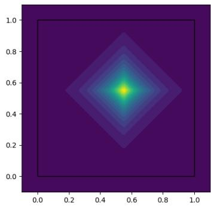

Corner Peak Genz. The Corner Peak target is given by

$$
r ( x ) = \left( 1 + \sum _ { k = 1 } ^ { d } a _ { k } x _ { k } \right) ^ { - ( d + 1 ) } , \qquad x \in [ 0 , 1 ] ^ { d } .
$$

The density is largest at the corner $x = 0$ and decays as the weighted sum of the coordinates increases. For all coordinates we take $a _ { k } = a \in \{ 0 . 5 0 , 0 . 2 5 , 0 . 1 0 , 0 . 0 8 \}$ for $d \in \{ 5 , 1 0 , 2 0 , 3 0 \}$ , respectively. Because the dominant probability mass is associated with a boundary corner rather than an interior mode, this benchmark probes the ability of the sampler to discover and represent boundaryconcentrated distributions. The progressively smaller $a _ { k }$ values compensate for the increasing dimensionality and preserve a meaningful level of concentration across the dimensional sweep.

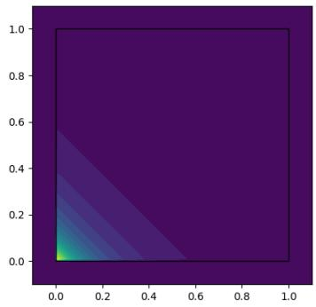

Discontinuous Genz. The Discontinuous Genz is defined by

$$
r ( x ) = { \left\{ \begin{array} { l l } { \exp \left( \sum _ { k = 1 } ^ { d } a _ { k } x _ { k } \right) , } & { x _ { k } \leq u _ { k } \forall k , } \\ { 0 , } & { { \mathrm { o t h e r w i s e } } . } \end{array} \right. }
$$

We set $u _ { k } = 0 . 5$ for all coordinates. The shared concentration parameter is $a _ { k } = a \in \{ 5 . 0 , 4 . 0 , 3 . 0 , 3 . 0 \}$ for � $\in \{ 5 , 1 0 , 2 0 , 3 0 \}$ respectively. This benchmark combines two distinct difficulties. First, the support is restricted to the subcube $[ 0 , 0 . 5 ] ^ { d }$ , which introduces a sharp discontinuity at every boundary of the feasible region. Second, within the support the density increases exponentially with the coordinates, so that the mode is located at the upper corner $( 0 . 5 , \ldots , 0 . 5 ) ^ { \intercal }$ of the active region.

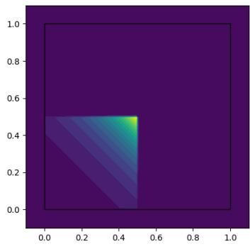

Consequently, the sampler must simultaneously identify a discontinuous support restriction and concentrate probability near the boundary of that restricted support. In the implementation, we add a small positive correction of $\varepsilon = 1 0 ^ { - 1 0 }$ to make a target reward strictly positive and then subtract � vol(D) in the final estimate.

Gaussian Peak Genz. The Gaussian Peak Genz is defined by

$$
r ( x ) = \exp \left( - \sum _ { k = 1 } ^ { d } a _ { k } ^ { 2 } ( x _ { k } - u _ { k } ) ^ { 2 } \right) , \qquad x \in [ 0 , 1 ] ^ { d } .
$$

We use $u _ { k } \ = \ 0 . 5$ for all coordinates and set $\begin{array} { l l l } { { a _ { k } } } & { { = } } & { { a } } \end{array} \in$ $\{ 8 . 0 , 5 . 0 , 4 . 0 , 3 . 0 \}$ for $d \in \{ 5 , 1 0 , 2 0 , 3 0 \}$ , respectively.

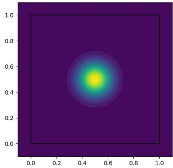

The resulting distribution is a sharply concentrated, smooth peak centred at the middle of the hypercube. Relative to the Continuous target, the Gaussian Peak is globally differentiable and has rapidly decaying tails away from its mode, making the pair useful for distinguishing the effect of nonsmoothness from that of concentration alone.

Product Peak Genz. The Product Peak Genz target is given by

$$
r ( x ) = \prod _ { k = 1 } ^ { d } \frac { 1 } { a _ { k } ^ { - 2 } + ( x _ { k } - u _ { k } ) ^ { 2 } } , \qquad x \in [ 0 , 1 ] ^ { d } .
$$

We take $u _ { k } ~ = ~ 0 . 5$ in every coordinate. The shared coefficient $a _ { k } = a$ takes values $8 . 0 , 5 . 0 \dot { , } 4 . 0 \dot { . }$ , and 4.0 for dimensions $d = 5 ,$ 10, 20, and 30, respectively.

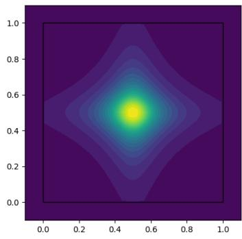

The function factorizes across dimensions, but each factor exhibits a sharply localized peak around $u _ { k } = 0 . 5$ . In the implementation, we rescale �(�) by the maximum reward for numerical stability and adjust the analytic normalizing constant accordingly.

GMM Cube. The GMM Cube target is a bounded multimodal distribution constructed by placing a mixture of five isotropic Gaussian components inside the unit hypercube. For a �-dimensional target

$$
r ( x ) = \frac { 1 } { 5 } \sum _ { j = 1 } ^ { 5 } N ( x ; \mu _ { j } , \sigma ^ { 2 } I _ { d } ) , \qquad x \in [ 0 , 1 ] ^ { d } ,
$$

with $\sigma = 0 . 1$ . The component locations are sampled once from the interior region $[ 0 . 0 1 , 0 . 9 9 ] ^ { d }$ , thereby ensuring all modes remain separated from the boundary.

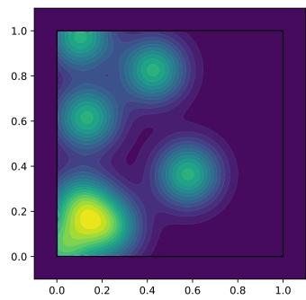

The target is subsequently restricted to the unit cube. This construction produces a genuinely multimodal bounded target in which the sampler must discover several well-separated regions of high probability rather than a single dominant mode.

Because the Gaussian mixture is initially defined on the full Euclidean space and then restricted to the cube, its normalization constant is the probability that a draw from the unconstrained mixture falls inside $[ 0 , 1 ] ^ { d }$ . This quantity is estimated in the implementation by Monte Carlo sampling from the unconstrained mixture. The target therefore tests both multimodal exploration and the ability to account for truncation by the bounded domain.

Stripe Cube. The Stripe Cube target is designed to concentrate probability near the boundary of the unit hypercube while retaining a small positive density throughout its interior. For a point $x \in [ 0 , 1 ] ^ { d }$ define the distance to the closest boundary face by ${ \delta ( \dot { x } ) = \mathrm { m i n } _ { i } \{ x _ { i } , 1 - x _ { i } \} }$ . We map this distance to a normalized boundary score $s ( x ) = 1 - 2 \delta ( x )$ , which equals zero at the centre of the cube and one on the boundary.

The target density is then

$$
r ( x ) = \alpha + ( \beta - \alpha ) s ^ { \gamma } ( x ) , \qquad x \in [ 0 , 1 ] ^ { d } ,
$$

where $\alpha = 1 0 ^ { - 1 0 } , \beta = 1$ and $\gamma = 8$ . Hence the density rises steeply as a point approaches any boundary face, producing a set of highprobability boundary ”stripes” around the cube while retaining a numerically nonzero floor in its interior.

Whereas the Corner Peak benchmark concentrates mass near a single corner, Stripe Cube assigns high density collectively to all boundary faces.

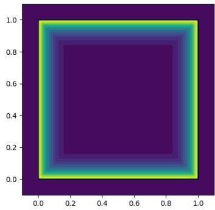

The resulting target therefore contains a large, geometrically thin high-density region whose total structure becomes increasingly complex with dimension. The normalization constant is available analytically

$$
Z = \alpha + \left( \beta - \alpha \right) \frac { d } { d + \gamma } .
$$

Funnel Cube. The Funnel Cube target is a bounded analogue of the classical funnel distribution and is designed to test adaptation to strongly varying conditional scales. The first coordinate follows a Gaussian density,

$$
x _ { 1 } \sim N ( 0 . 6 , 0 . 2 2 ^ { 2 } ) ,
$$

restricted to the interval [0, 1]. Conditional on $x _ { 1 }$ , the remaining $d - 1$ coordinates are independent Gaussian variables centered at 0.5 with a standard deviation that changes exponentially across the first coordinate:

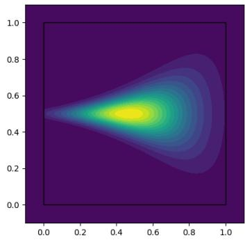

$$
\begin{array} { r } { \log \sigma ( x _ { 1 } ) = \log \sigma _ { \operatorname* { m i n } } + x _ { 1 } \left( \log \sigma _ { \operatorname* { m a x } } - \log \sigma _ { \operatorname* { m i n } } \right) , } \end{array}
$$

where $\sigma _ { \mathrm { m i n } } = 0 . 0 2$ and $\sigma _ { \mathrm { m a x } } = 0 . 3 0$

The target density can therefore be written as

$$
r ( x ) = N ( x _ { 1 } ; 0 . 6 , 0 . 2 2 ^ { 2 } ) \prod _ { k = 2 } ^ { d } N \Big ( x _ { k } ; 0 . 5 , \sigma ^ { 2 } ( x _ { 1 } ) \Big ) , \qquad x \in [ 0 , 1 ] ^ { d } .
$$

The defining difficulty of this benchmark is the strong dependence of the conditional width on $x _ { 1 }$ Samples associated with one region of the first coordinate lie in a very narrow tube around 0.5, whereas samples associated with another region can occupy a considerably wider cross-section. The target therefore tests whether a learned sampler can represent pronounced heteroscedasticity rather than simply locating isolated modes. Its normalization constant is computed by reducing the �-dimensional integral to a one-dimensional numerical integration over $x _ { 1 }$ , where the probability that every remaining coordinate lies in [0, 1] is evaluated analytically.

Asian option. We consider Asian option pricing as an application-oriented high-dimensional benchmark with a nonsmooth payoff and a strong temporal dependence structure, following the standard construction L’Ecuyer (2009). The implementation is based on a discretised Black–Scholes asset path. A point $x = ( x _ { 1 } , \ldots , x _ { d } ) \in [ 0 , 1 ] ^ { d }$ is first transformed into independent standard-normal shocks through the inverse Gaussian cumulative distribution function, $\epsilon _ { i } = \Phi ^ { - 1 } ( x _ { i } )$ . For monitoring times $0 = t _ { 0 } < t _ { 1 } < \cdot \cdot \cdot < t _ { d } = T$ , the Brownian path is then constructed as

$$
W _ { t _ { j } } = \sum _ { i = 1 } ^ { j } { \sqrt { t _ { i } - t _ { i - 1 } } } \epsilon _ { i } ,
$$

and the corresponding asset price at time $t _ { j }$ is

$$
S _ { t _ { j } } = S _ { 0 } \exp \left[ \left( r - \frac 1 2 \sigma ^ { 2 } \right) t _ { j } + \sigma W _ { t _ { j } } \right] .
$$

The default parameters are $S _ { 0 } = 1 0 0 , r = \log ( 1 . 0 9 ) , \sigma = 0 . 2$ , and $\begin{array} { r } { T = \frac { 1 2 0 } { 3 6 5 } } \end{array}$ . The reward is given by the discounted arithmetic-average call payoff

$$
r ( x ) = e ^ { - r T } \operatorname* { m a x } ( 0 , \frac { 1 } { d } \sum _ { i = 1 } ^ { d } S _ { t _ { i } } - K ) ,
$$

where � is the strike price. The arithmetic average couples the payoff to the entire simulated trajectory, while the positive-part operator introduces a nonsmooth boundary and makes the reward exactly zero over a substantial portion of the input domain.

We consider two principal configurations from Example 3 (L’Ecuyer, 2009). The easy problem has dimension $d = 1 0$ , uses a starting monitoring period of 111 days, a strike of $K = 9 0$ , and has a ground-truth option value $Z = 1 3 . { \bar { 0 0 8 } }$ . The hard problem increases the dimension to $d = 1 2 0$ , starts monitoring at period 1, retains the strike $K = 9 0$ , and has $Z = 1 1 . 2 0 7$

The difference between the two settings therefore changes both the number of Gaussian increments used to represent the asset path and the portion of the maturity interval entering the arithmetic average. The hard configuration consequently presents a substantially higher-dimensional integration problem with a longer temporal dependence structure, providing a stringent test of the sampler’s scalability.

As for the Genz Discontinuous benchmark, we add a small constant $\varepsilon = 1 0 ^ { - 1 0 }$ to the reward to make it strictly positive. We remove this artificial contribution from the final integral estimate by subtracting $\varepsilon \operatorname { v o l } ( \mathcal { D } )$ .

Digits. We adapt the Digits benchmark from Blessing et al. (2024), where the target is a NICE normalizing-flow density (Dinh et al., 2014) trained on downsampled $1 4 \times 1 4 \mathrm { M N I S T }$ images. The original target is a normalized continuous density $p _ { \mathrm { N I C E } }$ on $\mathbb { R } ^ { 1 \dot { 9 } 6 }$ . To obtain a bounded-domain integration problem, we apply the coordinate-wise logit transformation and define the cube target by the corresponding change of variables,

$$
r ( x ) = p _ { \mathrm { N I C E } } ( \mathrm { l o g i t } ( x ) ) \prod _ { j = 1 } ^ { 1 9 6 } { \frac { 1 } { x _ { j } ( 1 - x _ { j } ) } } .
$$

This transformation preserves the normalizing constant, so $Z = 1$ . Samples generated on the cube can be mapped back through the logit transformation and reshaped into 14 × 14 grayscale images. Beyond integration, this benchmark provides a challenging high-dimensional sampling task with complex learned structure, allowing us to test whether RDS can recover meaningful samples from the target distribution itself.

Elliptic Two-Loop. The Elliptic Two-Loop target is a Feynmanparameter integral arising in collider phenomenology. It corresponds to the planar two-loop master integral $I _ { 1 , 1 , 0 , 1 , 1 , 1 , 1 , 0 , 0 } ^ { A }$ with full heavy-quark mass dependence, which contributes to the nextto-leading-order corrections to Higgs-plus-jet production (Bonciani et al., 2016). This sector is distinguished by the appearance of elliptic functions in its analytic solution.

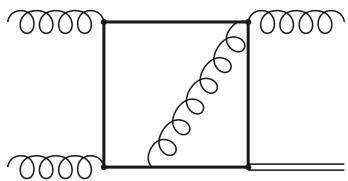  
Figure 5: Two-loop sixpropagator graph giving rise to elliptic functions (Borowka et al., 2018).

Using the propagator notation of Bonciani et al. (2016), the six active propagators are

$$
D _ { 1 } = k _ { 1 } ^ { 2 } - m ^ { 2 } , \qquad D _ { 2 } = \left( k _ { 1 } + p _ { 1 } + p _ { 2 } \right) ^ { 2 } - m ^ { 2 } , \qquad D _ { 4 } = \left( k _ { 2 } + p _ { 1 } + p _ { 2 } \right) ^ { 2 } - m ^ { 2 } ,
$$

$$
D _ { 5 } = ( k _ { 1 } + p _ { 1 } ) ^ { 2 } - m ^ { 2 } , \qquad D _ { 6 } = ( k _ { 1 } - k _ { 2 } ) ^ { 2 } , \qquad D _ { 7 } = ( k _ { 2 } - p _ { 3 } ) ^ { 2 } - m ^ { 2 } .
$$

We evaluate the integral at the Euclidean kinematic point

$$
\begin{array} { r } { s = \left( p _ { 1 } + p _ { 2 } \right) ^ { 2 } = - \frac { 4 } { 3 } , \qquad t = \left( p _ { 1 } + p _ { 3 } \right) ^ { 2 } = - \frac { 1 6 } { 5 } , \qquad p _ { 4 } ^ { 2 } = - \frac { 1 0 0 } { 3 9 } , \qquad m ^ { 2 } = 1 , } \end{array}
$$

used in the numerical benchmark of Borowka et al. (2018).

Feynman parametrization gives an integral over the five-dimensional simplex $\{ \alpha _ { i } \geq 0 , \ \textstyle \sum _ { i = 1 } ^ { 6 } \alpha _ { i } = 1 \}$ To express it on the unit hypercube, we use the stick-breaking transformation

$$
\alpha _ { i } = z _ { i } \prod _ { j < i } ( 1 - z _ { j } ) , \qquad i = 1 , \ldots , 5 , \qquad \alpha _ { 6 } = \prod _ { j = 1 } ^ { 5 } ( 1 - z _ { j } ) ,
$$

for $z \in [ 0 , 1 ] ^ { 5 }$ , whose Jacobian is $\begin{array} { r } { J ( z ) = \prod _ { j = 1 } ^ { 4 } ( 1 - z _ { j } ) ^ { 5 - j } } \end{array}$ . In four spacetime dimensions, the corresponding cube target is

$$
r ( z ) = \left( - \frac { s } { m ^ { 2 } } \right) ^ { 3 / 2 } \frac { J ( z ) } { \mathcal { F } ( \alpha ( z ) ) ^ { 2 } } , \qquad z \in [ 0 , 1 ] ^ { 5 } ,
$$

where $\mathcal { F }$ is the second Symanzik polynomial. The Euclidean kinematics make the target real and non-negative.

The benchmark combines a non-factorized Feynman integrand with nontrivial boundary structure, providing an application-oriented test beyond the synthetic targets considered above. Its normalization is known analytically and, in the normalization used here, is

$$
Z = 0 . 2 4 7 0 7 4 1 9 9 1 4 0 7 3 2 1 3 1 0 6 8 0 6 ,
$$

in agreement with the numerical and analytic values reported by Borowka et al. (2018).

## F.2 Evaluation protocol and training details

Evaluation protocol. We compare methods across different budgets corresponding to the number of points used for the integral estimation. For neural network-based methods, namely PIS, ZüNIS and RDS, for a fixed number of points used for evaluation, the same number of points is used for training. For these methods we use a batch size of 512 in all experiments. We report the mean absolute error $| \widehat { Z } - Z |$ over independent runs as a function of the number of points. For all experiments we present mean and std of the error across 3 random seeds.

Quasi-Monte Carlo. As a non-adaptive baseline, we use randomized quasi-Monte Carlo (QMC) with scrambled Sobol sequences L’Ecuyer (2009). For a budget $N = \bar { 2 } ^ { m }$ , we generate $N$ points $x ^ { ( 1 ) } , \ldots , x ^ { ( N ) } \in [ 0 , 1 ] ^ { d }$ from a scrambled Sobol sequence and estimate

$$
\widehat { Z } _ { \mathrm { Q M C } } = \frac { 1 } { N } \sum _ { i = 1 } ^ { N } r ( x ^ { ( i ) } ) .\tag{85}
$$

Independent random scramblings are used across runs. Using powers of two preserves the digital-net structure of the Sobol construction. QMC does not involve any optimization, and its target-evaluation budget is exactly �. We use SciPy implementation Virtanen et al. (2020).

Fast Fourier Bayesian Quadrature. We use the public implementation of Fast Fourier Bayesian Quadrature (FFBQ) by Warren & Ramos (2024). FFBQ approximates the integrand with a Gaussian process and computes the resulting Bayesian-quadrature estimate using scalable convolution operators. In our experiments, we fit a low-rank GP with an RBF kernel using 5,000 uniformly sampled training points and use an independent set of 5,000 points for quadrature evaluation. We employ the sparse QMC convolution operator provided by the authors. Low-rank GP was chosen, because of the scalability issues with dimension of FFBQ. The GP training and evaluation sets are fixed across experiments, while we vary the number � of QMC samples used to approximate the final convolution integral.

Path Integral Sampler. We include the Path Integral Sampler (PIS) (Zhang & Chen, 2022), an on-policy diffusion sampler derived from a stochastic-control formulation of sampling. To apply PIS on the bounded domain, we instead use a change of variables between $\mathbb { R } ^ { d }$ and $[ \dot { 0 } , 1 \dot { ] } ^ { d }$ . Specifically, $\mathrm { f o r } z \in \mathbb { R } ^ { d }$ , we set $x = \sigma ( z )$ , where $\sigma ( \cdot )$ is a sigmoid function. Accordingly, PIS is trained on the transformed reward $\widetilde r ( z ) = r ( \sigma ( z ) )$ |det $J _ { \sigma } ( z ) |$ , which preserves the original integral by the change of-variables formula. The control is parameterized by an MLP with four hidden layers of width 256. We train PIS with Adam using a learning rate of $\mathrm { i } 0 ^ { - 3 }$ . Each diffusion trajectory is discretized using 64 time steps. The control is trained using the standard path-space objective consisting of the accumulated quadratic control cost and the terminal target-density contribution. The resulting estimate of � is obtained using the path-integral importance weights associated with the learned controlled process. For PIS, we used a public implementation from Blessing et al. (2024).

ZüNIS. We use the public implementation of ZüNIS (Deutschmann & Götz, 2024). The proposal is parameterized by a bounded piecewise-quadratic coupling flow with 8 coupling layers, 10 bins per scalar transformation, and conditioner networks with two hidden layers of width 256. We optimize the proposal with the reverse-KL objective using Adam with learning rate $1 0 ^ { - 3 }$ and global gradient-norm clipping at 1. The first batch is sampled uniformly from the cube, while all subsequent batches are drawn from the current flow proposal. Each evaluated survey batch is used for a single optimization update. At evaluation time, we draw fresh samples from the learned proposal and estimate the integral using importance sampling,

$$
{ \widehat { Z } } _ { \mathrm { Z u N I S } } = { \frac { 1 } { N } } \sum _ { i = 1 } ^ { N } { \frac { r ( x ^ { ( i ) } ) } { q _ { \theta } ( x ^ { ( i ) } ) } } , \qquad x ^ { ( i ) } \sim q _ { \theta } .\tag{86}
$$

RDS-RP and RDS-RF. Both variants use the same reflected diffusion and differ only in the gradient estimator used for training. We employ the Langevin parameterization of the drift, following Zhang & Chen (2022) and Blessing et al. (2024):

$$
s _ { \theta } ( x , t ) = \mathrm { c l i p } \left( a _ { \theta } ( x , t ) + b _ { \theta } ( t ) \odot \mathrm { c l i p } \big ( \nabla _ { x } \log r ( x ) , - 1 0 ^ { 2 } , 1 0 ^ { 2 } \big ) , - 1 0 ^ { 4 } , 1 0 ^ { 4 } \right) ,\tag{87}
$$

where $a _ { \theta } ( x , t )$ is a time-conditioned neural network, $b _ { \theta } ( t ) ~ \in ~ \mathbb { R } ^ { d }$ is a learned time-dependent coordinate-wise scaling function, and ⊙ denotes element-wise multiplication. This parameterization incorporates the target score directly into the drift while allowing the neural network to learn a flexible time-dependent correction. For targets with zero-valued regions we do not incorporate $\nabla _ { x } \log r ( x )$ to the parameterization. The score network is parameterized by a 4-layer MLP with hidden width 256. We use $\sigma _ { 0 } = 1 0 ^ { - 3 }$ and $\sigma _ { 1 } = 1$ , and discretize the diffusion into 64 reflected steps for integration tasks. Both models are trained on-policy with Adam using the same optimization hyperparameters and global gradient-norm clipping at 1.

For RDS-RP, gradients are propagated through the simulated trajectory using the reparameterized Gaussian increments and the coordinate-wise reflection map. Since reflection on the cube is piecewise linear, it is differentiable almost everywhere and can be handled directly by automatic differentiation. RDS-RF instead uses the score-function estimator described in Section 3.4. The sampled states are treated as stop-gradient quantities, while the dependence on the proposal parameters is captured through the scores of the Gaussian transitions and their corresponding cost-to-go terms. Thus, RDS-RP and RDS-RF use the same proposal family, discretization, and training objective, providing a direct comparison between pathwise and score-function optimization.

Our implementations are based upon the published codebase of Blessing et al. (2024).

Digits experiments. For the Digits benchmark, we use the PIS architecture and remaining training hyperparameters following Blessing et al. (2024). Both PIS and RDS are discretized using 128 diffusion steps and trained with Adam using a learning rate of $5 \times 1 0 ^ { - 4 }$ , batch size of 2048 and 40, 000 iterations. For RDS, we set the terminal noise scale to $\sigma _ { 1 } = 0 . 5$

We evaluate sample quality using the 2-Wasserstein distance and the evidence lower bound (ELBO), following Blessing et al. (2024). Since the NICE target admits direct sampling, we draw an independent set of reference samples from the target and compare them with samples generated by each method. For RDS, samples generated on $[ \stackrel { \smile } { 0 } , 1 ] ^ { 1 9 6 }$ are first mapped back to the original R<sup>196</sup> space using the coordinate-wise logit transformation. We compute the entropy-regularized empirical 2-Wasserstein distance between the generated and reference samples using the squared Euclidean transport cost and regularization $\varepsilon = \overline { { 1 0 } } ^ { - 3 }$

The ELBO can be computed directly from the same path-space importance weights used for normalizing-constant estimation. For a trajectory $\widetilde { \tau }$ generated by RDS, let

$$
w ( \widetilde { \tau } ) : = \frac { r ( Y _ { K } ) } { \nu ( Y _ { K } ) } \exp \left( - \sum _ { k = 0 } ^ { K - 1 } \left[ g _ { k } s _ { \theta } ( Y _ { k } , 1 - t _ { k } ) ^ { \top } \xi _ { k } + \frac { 1 } { 2 } g _ { k } ^ { 2 } \| s _ { \theta } ( Y _ { k } , 1 - t _ { k } ) \| _ { 2 } ^ { 2 } \right] \right) ,
$$

so that $\mathbb { E } [ w ( \widetilde { \tau } ) ] = Z$ by Proposition E.5.1. The corresponding path-space ELBO is

$$
\begin{array} { r } { \operatorname { E L B O } : = \operatorname { \mathbb { E } } [ \log w ( \widetilde { \tau } ) ] \leq \log \operatorname { \mathbb { E } } [ w ( \widetilde { \tau } ) ] = \log Z , } \end{array}
$$

where the inequality follows from Jensen’s inequality. We estimate it using

$$
\widehat { \mathrm { E L B O } } = \frac { 1 } { N } \sum _ { i = 1 } ^ { N } \log w ( \widetilde { \tau } ^ { ( i ) } ) .
$$

For PIS, we analogously use its path-space importance weights. Higher ELBO and lower Wasserstein distance indicate better agreement with the target distribution.

## F.3 Full experimental results

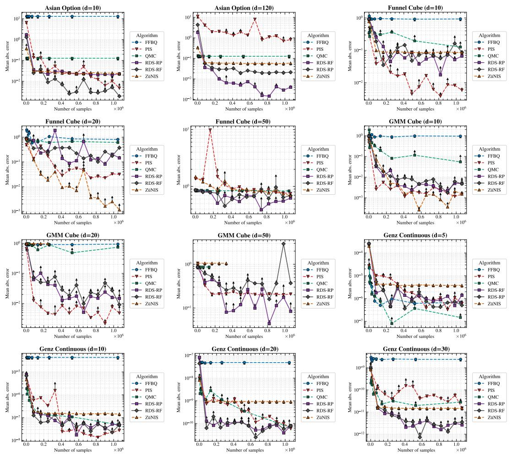  
Figure 5: Mean absolute error as a function of the number of samples used for estimation across the considered integration benchmarks and dimensionalities.

Genz Discontinuous (d=10)  
Genz Corner Peak (d=20)  
Genz Product Peak (d=5)  
Genz Corner Peak (d=30)  
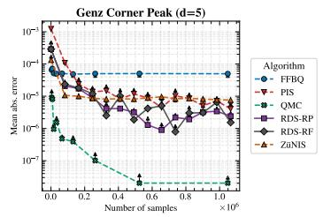

Genz Corner Peak (d=10)  
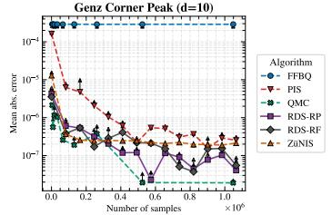

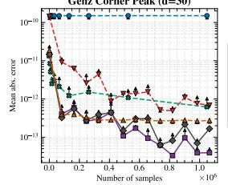

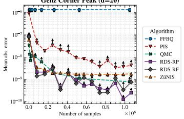

Genz Discontinuous (d=5)  
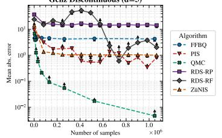

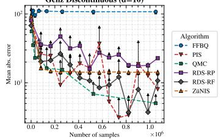

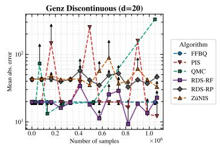

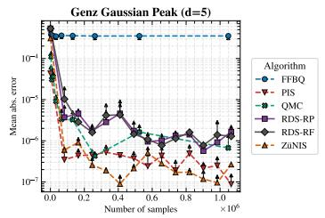

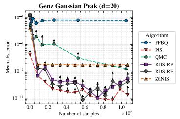

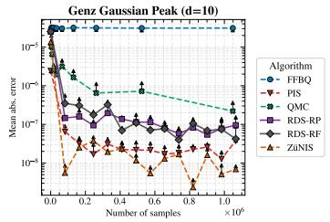

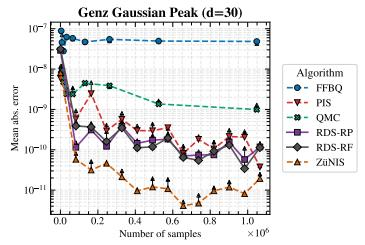

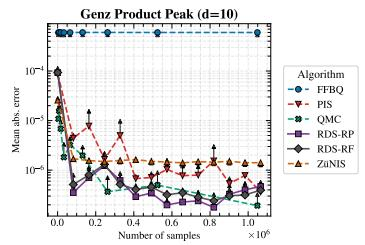

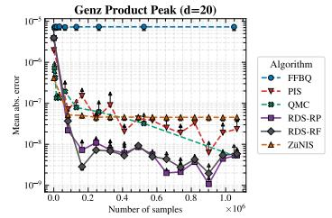

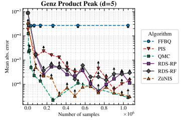

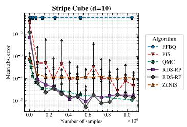

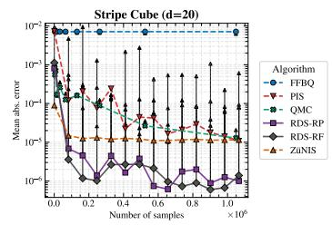

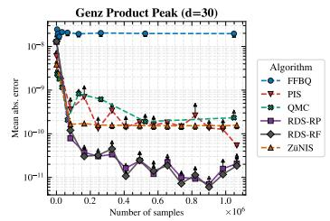

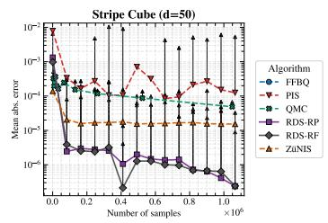  
Figure 6: Mean absolute error as a function of the number of samples used for estimation across the considered integration benchmarks and dimensionalities (continued).

Table 1: Mean absolute error of the normalizing-constant estimate using $N = 2 ^ { 2 0 }$ samples. Values are mean ± standard deviation. Best result in each row is shown in bold.  
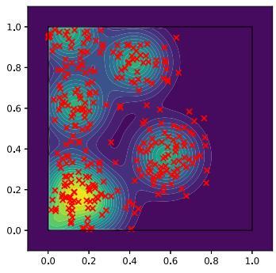

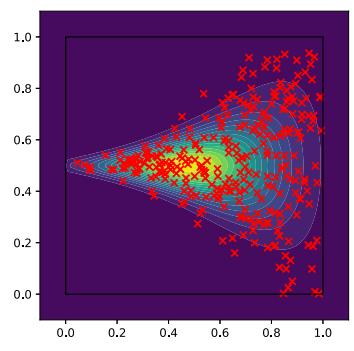  
GMM Cube

<table><tr><td>Target</td><td>d</td><td>FFBQ</td><td>PIS</td><td>QMC</td><td>RDS-RF</td><td>RDS-RP</td><td>ZüNIS</td></tr><tr><td rowspan="4">Genz Continuous</td><td>510</td><td> $6 . 8 4 \mathrm { e } { - 7 } \pm 1 . 8 7 \mathrm { e } { - 7 }$ </td><td> $2 . 3 1 \mathrm { e } { - } 7 \pm 1 . 5 3 \mathrm { e } { - } 7$ </td><td> $\mathbf { 1 . 4 8 e - 7 \pm 9 . 5 7 e - 8 }$ </td><td> $5 . 6 6 \mathrm { e } - 7 \pm 4 . 4 6 \mathrm { e } - 7$ </td><td> $3 . 9 9 \mathrm { e } - 7 \pm 3 . 0 0 \mathrm { e } - 7$ </td><td> $3 . 7 3 \mathrm { e } - 6 \pm 5 . 4 6 \mathrm { e } - 8$ </td></tr><tr><td></td><td> $4 . 3 2 \mathrm { e } { - 5 } \pm 3 . 5 8 \mathrm { e } { - 8 }$ </td><td> $2 . 1 2 \mathrm { e } { - 8 } \pm 1 . 1 5 \mathrm { e } { - 8 }$ </td><td> $4 . 9 1 \mathrm { e } - 8 \pm 4 . 3 5 \mathrm { e } - 8$ </td><td> $3 . 7 8 \mathrm { e } - 8 \pm 9 . 1 4 \mathrm { e } - 9$ </td><td>1.05e−8 ± 8.67e−9</td><td> $1 . 4 4 \mathrm { e } { - 7 } \pm 1 . 7 2 \mathrm { e } { - 9 }$ </td></tr><tr><td>20</td><td> $4 . 8 6 \mathrm { e } { - 8 } \pm 7 . 8 4 \mathrm { e } { - 1 0 }$ </td><td> $3 . 8 9 \mathrm { e } - 1 1 \pm 2 . 6 0 \mathrm { e } - 1 1$ </td><td> $6 . 9 6 \mathrm { e } - 1 1 \pm 9 . 4 6 \mathrm { e } - 1 1$ </td><td> $3 . 8 6 \mathrm { e } { - 1 1 } \pm 4 . 7 8 \mathrm { e } { - 1 1 }$ </td><td> $2 . 2 8 \mathrm { e } { \mathrm { - } } 1 1 \pm 2 . 5 7 \mathrm { e } { \mathrm { - } } 1 1$ </td><td> $9 . 1 4 \mathrm { e } - 1 0 \pm 2 . 5 6 \mathrm { e } - 1 2$ </td></tr><tr><td>30</td><td> $2 . 4 2 \mathrm { e } { - 9 } \pm 2 . 0 0 \mathrm { e } { - 1 1 }$ </td><td> $1 . 8 2 \mathrm { e } { - } 1 1 \pm 5 . 5 0 \mathrm { e } { - } 1 2$ </td><td> $2 . 8 1 \mathrm { e } { - } 1 1 \pm 1 . 6 2 \mathrm { e } { - } 1 1$ </td><td> $1 . 0 3 \mathrm { e } { - } 1 2 \pm 6 . 5 3 \mathrm { e } { - } 1 3$ </td><td> $9 . 7 1 \mathrm { e } - 1 3 \pm 3 . 3 9 \mathrm { e } - 1 3$ </td><td> $1 . 4 6 \mathrm { e } - 1 1 \pm 2 . 3 6 \mathrm { e } - 1 3$ </td></tr><tr><td rowspan="5">Genz Gaussian Peak</td><td>5</td><td> $3 . 5 2 \mathrm { e } { - 4 } \pm 4 . 7 6 \mathrm { e } { - 7 }$ </td><td> $1 . 5 6 \mathrm { e } - 7 \pm 1 . 3 7 \mathrm { e } - 7$ </td><td> $6 . 7 0 \mathrm { { e } } - 7 \pm 9 . 5 7 \mathrm { { e } } - 7$ </td><td> $1 . 0 4 \mathrm { e } { - 6 } \pm 1 . 6 6 \mathrm { e } { - 6 }$ </td><td> $1 . 1 1 { \mathrm { e } } { - } 6 \pm 1 . 5 9 { \mathrm { e } } { - } 6$ </td><td> $\overline { { 4 . 2 1 \mathrm { e } - 8 \pm 1 . 5 1 \mathrm { e } - 8 } }$ </td></tr><tr><td>10 20</td><td> $3 . 1 2 \mathrm { e } { - 5 } \pm 8 . 4 3 \mathrm { e } { - 8 }$ </td><td> $9 . 7 1 \mathrm { e } \mathrm { - } 9 \pm 3 . 5 7 \mathrm { e - } 9$ </td><td> $2 . 2 0 \mathrm { e } { - 7 } \pm 2 . 3 2 \mathrm { e } { - 7 }$ </td><td> $2 . 3 5 \mathrm { e } { - 8 } \pm 1 . 5 0 \mathrm { e } { - 8 }$ </td><td> $1 . 5 9 \mathrm { e } { - 8 } \pm 1 . 1 5 \mathrm { e } { - 8 }$ </td><td> $\mathbf { 3 . 2 5 e { - 9 } \pm 4 . 6 4 e { - 1 0 } }$ </td></tr><tr><td></td><td> $7 . 5 5 \mathrm { e } - 8 \pm 6 . 8 2 \mathrm { e } - 9$ </td><td> $\mathbf { 4 . 0 5 e { - } 1 1 \pm 2 . 9 6 e { - } 1 1 }$ </td><td> $1 . 2 2 \mathrm { e } { - 9 } \pm 7 . 9 5 \mathrm { e } { - 1 0 }$ </td><td> $1 . 2 0 \mathrm { e } { - } 1 0 \pm 1 . 5 3 \mathrm { e } { - } 1 0$ </td><td> $7 . 4 4 \mathrm { e } \mathrm { - } 1 1 \pm 1 . 0 8 \mathrm { e } \mathrm { - } 1 0$ </td><td> $1 . 7 3 \mathrm { e } { - 9 } \pm 1 . 1 7 \mathrm { e } { - 1 1 }$ </td></tr><tr><td>30</td><td> $4 . 8 4 \mathrm { e } { - 8 } \pm 1 . 0 2 \mathrm { e } { - 9 }$ </td><td> $4 . 4 8 \mathrm { e } { - 1 0 } \pm 3 . 2 3 \mathrm { e } { - 1 0 }$ </td><td> $9 . 9 5 \mathrm { e } - 1 0 \pm 6 . 3 1 \mathrm { e } - 1 0$ </td><td> $6 . 2 5 \mathrm { e } { - 1 1 } \pm 2 . 0 9 \mathrm { e } { - 1 1 }$ </td><td> $3 . 1 4 \mathrm { e } - 1 1 \pm 1 . 9 6 \mathrm { e } - 1 1$ </td><td> $6 . 7 6 \mathrm { e } { - } 1 2 \pm 7 . 2 4 \mathrm { e } { - } 1 2$ </td></tr><tr><td>5</td><td> $4 . 2 9 \mathrm { e } 0 \pm 3 . 1 9 \mathrm { e } - 2$ </td><td> $3 . 9 7 \mathrm { e } - 1 \pm 1 . 0 9 \mathrm { e } - 1$ </td><td> $4 . 6 8 \mathrm { e } { - 3 } \pm 4 . 3 2 \mathrm { e } { - 3 }$ </td><td> $5 . 3 2 \mathrm { e } { - 1 } \pm 2 . 0 2 \mathrm { e } { - 1 }$ </td><td> $1 . 4 6 \mathrm { e } 1 \pm 4 . 7 1 \mathrm { e } - 1$ </td><td> $1 . 0 1 \mathrm { e } 0 \pm 1 . 4 9 \mathrm { e } - 2$ </td></tr><tr><td rowspan="4">Genz Discontinuous</td><td>10</td><td> $1 . 0 8 \mathrm { e } 2 \pm 1 . 2 6 \mathrm { e } 0$ </td><td>7.34e0 ± 9.01e0</td><td> $5 . 0 5 \mathrm { e } 0 \pm 2 . 0 7 \mathrm { e } 0$ </td><td>3.99e0 ± 4.77e0</td><td>1.72e1 ± 3.93e0</td><td>1.41e1 ± 5.23e-2</td></tr><tr><td>20</td><td> $1 . 9 7 \mathrm { e l } \pm 2 . 3 4 \mathrm { e } { - 6 }$ </td><td> $2 . 2 7 \mathrm { e l } \pm 7 . 4 7 \mathrm { e 0 }$ </td><td> $3 . 3 1 \mathrm { e } 2 \pm 5 . 2 7 \mathrm { e } 2$ </td><td> $\mathbf { 9 . 8 7 e 0 \pm 4 . 0 0 e 0 }$ </td><td> $3 . 3 4 \mathrm { e } 1 \pm 4 . 0 0 \mathrm { e } 0$ </td><td> $4 . 0 2 \mathrm { e l } \pm 1 . 2 4 \mathrm { e 0 }$ </td></tr><tr><td>5</td><td> $4 . 9 8 \mathrm { e } - 5 \pm 8 . 4 3 \mathrm { e } - 8$ </td><td> $5 . 1 8 \mathrm { e } - 6 \pm 2 . 1 9 \mathrm { e } - 6$ </td><td> $\mathbf { 2 . 0 2 e { - } 8 \pm 1 . 8 5 e { - } 8 }$ </td><td> $4 . 1 0 \mathrm { e } { - 6 } \pm 3 . 4 5 \mathrm { e } { - 6 }$ </td><td> $2 . 0 0 \mathrm { e } { - 6 } \pm 1 . 1 0 \mathrm { e } { - 6 }$ </td><td> $7 . 7 7 \mathrm { e } - 6 \pm 2 . 4 1 \mathrm { e } - 7$ </td></tr><tr><td>10</td><td> $2 . 8 9 \mathrm { e } { - 4 } \pm 2 . 7 8 \mathrm { e } { - 7 }$ </td><td> $2 . 6 6 \mathrm { e } { - 7 } \pm 4 . 4 0 \mathrm { e } { - 8 }$ </td><td> $\mathbf { 1 . 9 1 e { - } 8 \pm 8 . 4 1 e { - } 9 }$ </td><td> $1 . 3 8 \mathrm { e } { - 7 } \pm 6 . 3 7 \mathrm { e } { - 8 }$ </td><td> $4 . 7 6 \mathrm { e } - 8 \pm 6 . 6 1 \mathrm { e } - 8$ </td><td> $1 . 9 9 \mathrm { e } { - 7 } \pm 1 . 3 8 \mathrm { e } { - 8 }$ </td></tr><tr><td rowspan="4">Genz Corner Peak</td><td>20</td><td> $1 . 3 7 \mathrm { e } { - 6 } \pm 2 . 8 7 \mathrm { e } { - 9 }$ </td><td> $2 . 9 0 \mathrm { e } { - 9 } \pm 2 . 3 6 \mathrm { e } { - 9 }$ </td><td> $7 . 8 5 \mathrm { e } { - 1 0 } \pm 6 . 4 2 \mathrm { e } { - 1 0 }$ </td><td> $7 . 0 7 \mathrm { e } { - } 1 0 \pm 3 . 3 3 \mathrm { e } { - } 1 0$ </td><td> $\mathbf { 5 . 0 0 e { - } 1 0 \pm 1 . 1 8 e { - } 1 0 }$ </td><td> $1 . 7 6 \mathrm { e } { - 9 } \pm 5 . 4 8 \mathrm { e } { - 1 1 }$ </td></tr><tr><td>30</td><td> $1 . 5 0 \mathrm { e } { - } 1 0 \pm 1 . 6 1 \mathrm { e } { - } 1 3$ </td><td> $1 . 0 3 \mathrm { e } { - } 1 2 \pm 3 . 8 6 \mathrm { e } { - } 1 3$ </td><td> $6 . 2 0 \mathrm { e } { - 1 3 } \pm 6 . 1 5 \mathrm { e } { - 1 3 }$ </td><td> $1 . 2 7 \mathrm { e } { - } 1 3 \pm 4 . 5 2 \mathrm { e } { - } 1 4$ </td><td> $\mathbf { 1 . 1 0 e { - } 1 4 \pm 5 . 4 6 e { - } 1 5 }$ </td><td> $2 . 5 7 \mathrm { e } { - } 1 3 \pm 2 . 6 0 \mathrm { e } { - } 1 5$ </td></tr><tr><td>5</td><td> $2 . 7 0 \mathrm { e } { - 4 } \pm 4 . 6 6 \mathrm { e } { - 7 }$ </td><td> $1 0 . 0 0 \mathrm { e } { - 7 } \pm 3 . 0 9 \mathrm { e } { - 7 }$ </td><td> $2 . 8 5 \mathrm { e } { - 7 } \pm 4 . 2 4 \mathrm { e } { - 7 }$ </td><td> $4 . 2 3 \mathrm { e } { - 6 } \pm 8 . 1 8 \mathrm { e } { - 7 }$ </td><td> $1 . 0 6 \mathrm { e } { - 6 } \pm 5 . 6 5 \mathrm { e } { - 7 }$ </td><td></td></tr><tr><td></td><td> $5 . 9 9 \mathrm { e } { - 4 } \pm 3 . 8 1 \mathrm { e } { - 7 }$ </td><td> $4 . 1 0 \mathrm { { e } } \mathrm { { - } } 7 \pm 9 . 2 2 \mathrm { { e } } \mathrm { { - } } 8$ </td><td> $\mathbf { 1 . 9 2 e { - 7 } \pm 1 . 9 5 e { - 7 } }$ </td><td> $4 . 0 5 \mathrm { e } { - 7 } \pm 1 . 4 9 \mathrm { e } { - 7 }$ </td><td> $3 . 9 8 \mathrm { e } - 7 \pm 1 . 1 6 \mathrm { e } - 7$ </td><td> $\begin{array} { c } { 1 . 8 1 \mathrm { e } - 7 \pm 4 . 1 9 \mathrm { e } - 8 } \\ { 1 . 4 0 \mathrm { e } - 6 \pm 1 . 6 4 \mathrm { e } - 8 } \end{array}$ </td></tr><tr><td rowspan="4">Genz Product Peak GMM Cube</td><td>10 20</td><td> $7 . 2 9 \mathrm { e } - 6 \pm 4 . 7 7 \mathrm { e } - 8$ </td><td> $1 . 4 7 \mathrm { e } { - 8 } \pm 5 . 3 0 \mathrm { e } { - 9 }$ </td><td> $5 . 2 8 \mathrm { e } - 9 \pm 5 . 9 8 \mathrm { e } - 9$ </td><td> $1 . 2 7 \mathrm { e } { - 9 } \pm 7 . 7 7 \mathrm { e } { - 1 0 }$ </td><td> $\mathbf { 9 . 1 7 e - 1 0 \pm 7 . 9 5 e - 1 0 }$ </td><td> $4 . 5 0 \mathrm { e } { - 8 } \pm 3 . 7 4 \mathrm { e } { - 1 0 }$ </td></tr><tr><td>30</td><td> $1 . 9 7 \mathrm { e } { - 8 } \pm 1 . 8 3 \mathrm { e } { - 1 0 }$ </td><td> $2 . 7 6 \mathrm { e } - 1 0 \pm 2 . 0 9 \mathrm { e } - 1 0$ </td><td> $2 . 3 3 \mathrm { e } { - } 1 0 \pm 1 . 5 5 \mathrm { e } { - } 1 0$ </td><td> $1 . 0 0 \mathrm { e } { - 1 1 } \pm 4 . 8 5 \mathrm { e } { - 1 2 }$ </td><td> $8 . 5 6 \mathrm { e } { - } 1 2 \pm 2 . 2 7 \mathrm { e } { - } 1 2$ </td><td> $1 . 5 2 \mathrm { e } { - } 1 0 \pm 1 . 5 1 \mathrm { e } { - } 1 2$ </td></tr><tr><td>10</td><td> $9 . 5 9 \mathrm { e } - 1 \pm 1 . 8 1 \mathrm { e } - 2$ </td><td> $1 . 4 4 \mathrm { e } { - 3 } \pm 1 . 2 9 \mathrm { e } { - 3 }$ </td><td> $5 . 4 9 \mathrm { e } - 2 \pm 7 . 7 5 \mathrm { e } - 2$ </td><td> $1 . 8 5 \mathrm { e } { - 3 } \pm 1 . 4 3 \mathrm { e } { - 3 }$ </td><td> $4 . 8 1 \mathrm { e } { - 3 } \pm 1 . 4 7 \mathrm { e } { - 3 }$ </td><td></td></tr><tr><td></td><td></td><td> $2 . 2 4 \mathrm { e } { - 3 \pm 1 . 7 8 \mathrm { e } { - 3 } }$ </td><td> $7 . 4 5 \mathrm { e } - 1 \pm 2 . 3 2 \mathrm { e } - 1$ </td><td>4.17e−2 ± 4.77e−2</td><td> $1 . 1 8 \mathrm { e } { - 2 } \pm 5 . 7 6 \mathrm { e } { - 3 }$ </td><td> $3 . 0 2 \mathrm { e } { - } 4 \pm 1 . 6 8 \mathrm { e } { - } 4$  9.84e−1 ± 0.00e0</td></tr><tr><td rowspan="4"> ${ \mathrm { S t r i p e } } { \mathrm { C u b e } }$ </td><td>20</td><td> $9 . 4 4 \mathrm { e } - 1 \pm 3 . 2 7 \mathrm { e } - 3$ </td><td> $1 . 9 8 \mathrm { e } - 1 \pm 6 . 1 4 \mathrm { e } - 3$ </td><td> $8 . 6 5 \mathrm { e } - 1 \pm 7 . 3 0 \mathrm { e } - 8$ </td><td> $3 . 0 0 \mathrm { e } - 1 \pm 8 . 0 0 \mathrm { e } - 2$ </td><td> $\mathbf { 1 . 6 8 e { - } 2 \pm 2 . 1 1 e { - } 2 }$ </td><td> $1 . 0 5 \mathrm { e } 0 \pm 7 . 3 0 \mathrm { e } - 8$ </td></tr><tr><td>50</td><td></td><td></td><td></td><td></td><td></td><td></td></tr><tr><td>10</td><td> $5 . 5 6 \mathrm { e } - 2 \pm 1 . 6 7 \mathrm { e } - 4$ </td><td> $7 . 0 2 \mathrm { e } { - 5 } \pm 1 . 8 6 \mathrm { e } { - 4 }$ </td><td> $1 . 0 9 \mathrm { e } { - 5 } \pm 8 . 5 0 \mathrm { e } { - 6 }$ </td><td> $1 . 0 8 \mathrm { e } { - 5 } \pm 1 . 9 9 \mathrm { e } { - 5 }$ </td><td> $\mathbf { 6 . 8 0 e { - 6 } \pm 6 . 7 3 e { - 5 } }$ </td><td> $1 . 0 1 \mathrm { e } { - 4 } \pm 5 . 6 3 \mathrm { e } { - 5 }$ </td></tr><tr><td>20</td><td> $7 . 1 4 \mathrm { e } - 3 \pm 5 . 5 1 \mathrm { e } - 5$ </td><td> $2 . 0 9 \mathrm { e } { - } 5 \pm 1 . 0 6 \mathrm { e } { - } 3$ </td><td> $1 . 2 8 \mathrm { e } { - 5 } \pm 1 . 2 9 \mathrm { e } { - 5 }$ </td><td> $\mathbf { 1 . 4 4 e { - 6 \pm 1 . 1 7 e { - 4 } } }$ </td><td> $1 . 7 0 \mathrm { e } { - 6 } \pm 7 . 0 8 \mathrm { e } { - 5 }$ </td><td> $1 . 0 7 \mathrm { e } { - 5 } \pm 6 . 5 1 \mathrm { e } { - 5 }$ </td></tr><tr><td rowspan="4"></td><td>50</td><td></td><td> $1 . 1 7 \mathrm { e } { - 4 } \pm 4 . 9 8 \mathrm { e } { - 3 }$ </td><td> $4 . 8 9 \mathrm { e } - 5 \pm 3 . 6 6 \mathrm { e } - 5$ </td><td> $6 . 1 2 \mathrm { e } { - 7 } \pm 5 . 6 4 \mathrm { e } { - 5 }$ </td><td> $8 . 1 0 \mathrm { e } { - 7 } \pm 8 . 7 1 \mathrm { e } { - 5 }$ </td><td> $1 . 5 3 \mathrm { e } { - 5 } \pm 1 . 3 2 \mathrm { e } { - 5 }$ </td></tr><tr><td></td><td></td><td> $3 . 7 2 \mathrm { e } { - 3 } \pm 2 . 2 8 \mathrm { e } { - 3 }$ </td><td> $1 . 2 7 \mathrm { e } { - 1 } \pm 7 . 2 6 \mathrm { e } { - 2 }$ </td><td> $4 . 7 6 \mathrm { e } - 2 \pm 4 . 5 7 \mathrm { e } - 3$ </td><td> $1 . 1 6 \mathrm { { e } } \mathrm { { - } } 1 \pm 8 . 3 0 \mathrm { { e } } \mathrm { { - } } 2$ </td><td> $8 . 5 5 \mathrm { e } - 2 \pm 1 . 9 2 \mathrm { e } - 4$ </td></tr><tr><td>10 20</td><td> $9 . 3 3 \mathrm { e } - 1 \pm 4 . 9 6 \mathrm { e } - 3$ </td><td> $1 . 7 9 \mathrm { e } - 2 \pm 8 . 6 8 \mathrm { e } - 3$ </td><td> $6 . 1 3 \mathrm { e } - 1 \pm 1 . 5 3 \mathrm { e } - 1$ </td><td> $1 . 9 9 \mathrm { e } - 1 \pm 9 . 5 8 \mathrm { e } - 2$ </td><td> $8 . 7 8 \mathrm { e } - 2 \pm 4 . 7 3 \mathrm { e } - 2$ </td><td></td></tr><tr><td>50</td><td> $8 . 1 5 \mathrm { e } - 1 \pm 1 . 5 4 \mathrm { e } - 1$ </td><td> $7 . 4 1 \mathrm { e } - 1 \pm 5 . 2 8 \mathrm { e } - 2$ </td><td> $8 . 3 4 \mathrm { e } - 1 \pm 2 . 3 7 \mathrm { e } - 2$ </td><td> $\mathbf { 6 . 0 2 e { - 1 } \pm 8 . 3 3 e { - 2 } }$ </td><td> $6 . 5 0 \mathrm { e } - 1 \pm 2 . 4 5 \mathrm { e } - 2$ </td><td> $\mathbf { 9 . 3 2 e { - 4 } \pm 6 . 0 0 e { - 4 } }$   $6 . 9 0 \mathrm { { e } } - 1 \pm 1 . 2 6 \mathrm { { e } } - 2$ </td></tr><tr><td rowspan="2">Asian Option</td><td></td><td></td><td> $1 . 2 5 \mathrm { e } { - 2 } \pm 4 . 7 3 \mathrm { e } { - 3 }$ </td><td> $1 . 2 7 \mathrm { e } { - 1 } \pm 2 . 4 3 \mathrm { e } { - 5 }$ </td><td> $1 . 2 8 \mathrm { e } { - 3 } \pm 3 . 8 1 \mathrm { e } { - 4 }$ </td><td> $2 . 1 5 \mathrm { e } - 2 \pm 3 . 6 0 \mathrm { e } - 3$ </td><td> $2 . 4 4 \mathrm { e } - 2 \pm 1 . 2 9 \mathrm { e } - 3$ </td></tr><tr><td>10 120</td><td> $1 . 3 0 \mathrm { e } 1 \pm 5 . 4 9 \mathrm { e } - 3$ </td><td> $7 . 0 4 \mathrm { e } - 1 \pm 5 . 8 1 \mathrm { e } - 2$ </td><td> $1 . 2 8 \mathrm { e } - 1 \pm 1 . 9 3 \mathrm { e } - 4$ </td><td> $\mathbf { 1 . 0 6 6 - 3 \pm 1 . 4 7 e - 3 }$ </td><td> $2 . 1 5 \mathrm { e } { - 2 } \pm 1 . 4 8 \mathrm { e } { - 3 }$ </td><td></td></tr><tr><td>Elliptic Two-Loop</td><td>5</td><td>-  $9 . 7 4 \mathrm { e } - 3 \pm 5 . 7 1 \mathrm { e } - 5$ </td><td> $\overline { { 2 . 5 1 \mathrm { e } - 3 \pm 2 . 5 8 \mathrm { e } - 4 } }$ </td><td> $\overline { { 3 . 1 2 \mathrm { e } - 3 \pm 1 . 3 5 \mathrm { e } - 3 } }$ </td><td> $3 . 0 5 \mathrm { e } { - } 4 \pm 2 . 1 2 \mathrm { e } { - } 4$ </td><td> $\overline { { 7 . 3 2 \mathrm { e } - 4 \pm 9 . 9 9 \mathrm { e } - 5 } }$ </td><td> $5 . 6 6 \mathrm { e } - 2 \pm 3 . 6 9 \mathrm { e } - 4$   $1 . 0 2 \mathrm { e } { - 3 } \pm 1 . 0 3 \mathrm { e } { - 5 }$ </td></tr></table>

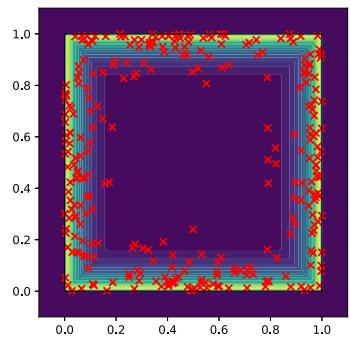  
Funnel Cube  
Figure 7: Samples generated by RDS-RP model.  
Stripe Cube