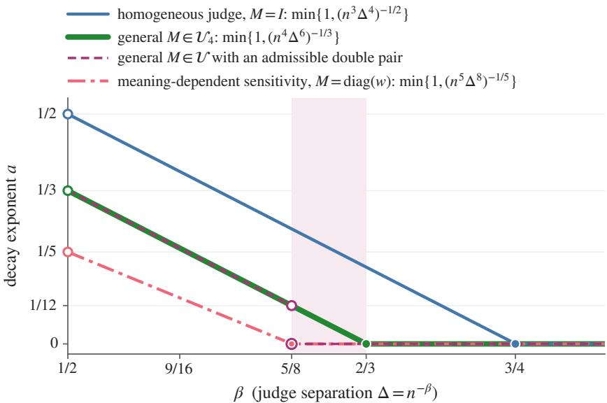
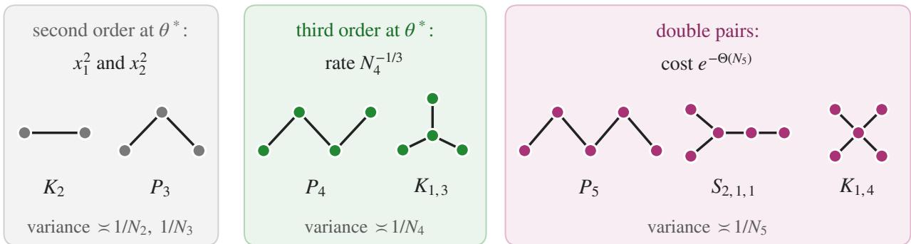
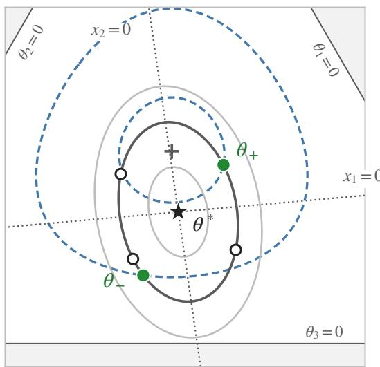
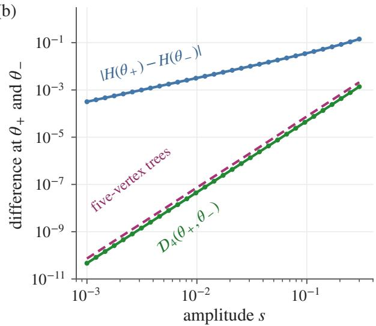
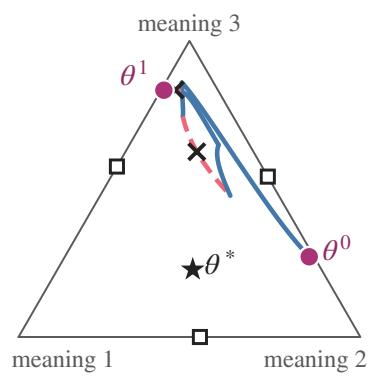
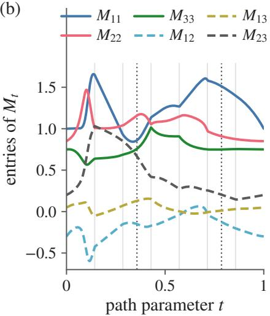
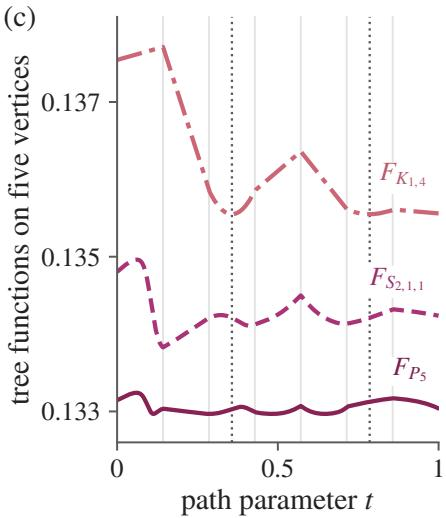
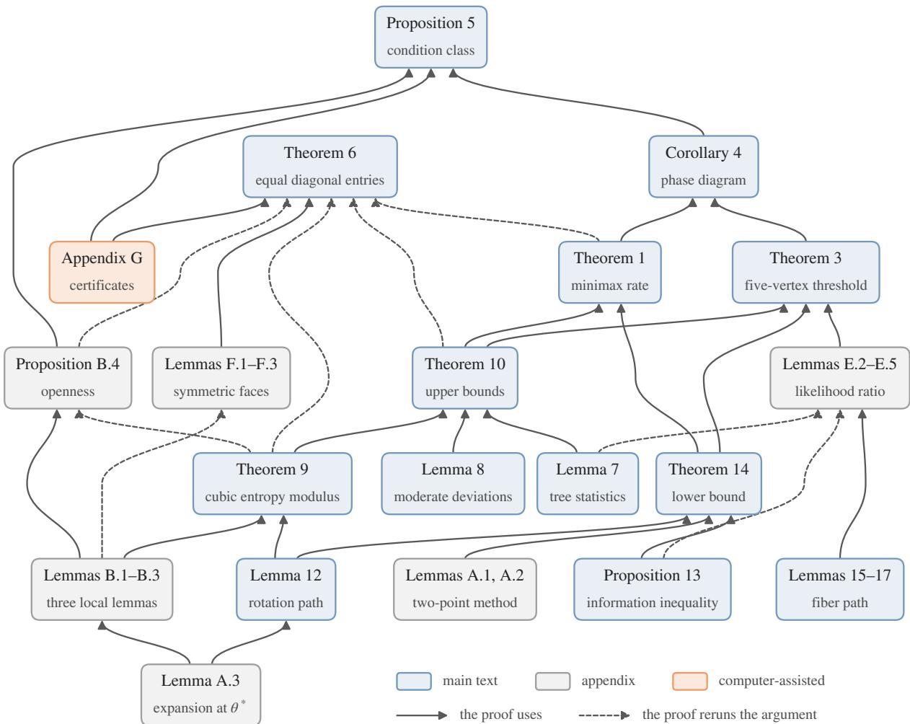

# PAIR-DEPENDENT JUDGE ERRORS CHANGE THE MINIMAX RATE OF SEMANTIC ENTROPY

A PREPRINT

Jiamiao Liu Dewen Qiao Yu Zhang Xuetao Chen\* Department of Information, Xinqiao Hospital   
Army Medical University (Third Military Medical University) Chongqing 400037, China xuetao@tmmu.edu.cn

## ABSTRACT

Semantic entropy, the entropy of the meanings among a language model’s sampled answers, is estimated from the verdicts of a judge that declares pairs of answers equivalent or not, and automatic judges err in ways that depend on the answers they compare. The existing minimax theory covers only judges whose false-equivalence probability is the same for all pairs. We model a known judge that declares two answers with meanings a and b equivalent with probability $q + \Delta M _ { a b }$ , for a symmetric matrix M and q bounded away from 0 and 1, and show that for three meanings the rate is set by tree statistics on four answers, while on an open set of channels the consistency threshold is set by trees on five. For every channel in an explicit open class, the minimax squared risk is of order $N ^ { - 1 / 3 }$ with $N = n ^ { 4 } \Delta ^ { 6 }$ on polynomial weak windows on which $n ^ { 5 } \Delta ^ { 8 }$ exceeds a multiple of log n, and of order min $\{ 1 , N ^ { - 1 / 3 } \}$ } on every polynomial weak window when the tree functions on at most four vertices are injective. The exponent comes from a cubic degeneracy at the equitable point. On an open set of channels in the class, the four-vertex tree functions take equal values at two distributions with different entropies. For such a channel, on every polynomial weak window, the minimax risk is of the order of the sum of min $\{ 1 , N ^ { - 1 / 3 } \}$ and a term that decays exponentially in $n ^ { 5 } \Delta ^ { 8 }$ , so no estimator is consistent while $n ^ { 5 } \Delta ^ { 8 }$ stays bounded, even as $N \to \infty$ . For $\Delta = n ^ { - \dot { \beta } }$ with $\beta > 1 / 2 ,$ channels of the class with injective four-vertex tree functions allow consistent estimation exactly for $\beta < 2 / 3$ and the channels of this open set exactly for $\beta < 5 / 8$ , at which the risk exponent drops from $1 / 1 2$ to 0. Computer-assisted certificates show that both kinds of channels occur on open sets.

Keywords entropy estimation · large language models · method of moments · minimax rates · uncertainty quantification

## 1 Introduction

Semantic entropy, the entropy of the meanings among the sampled answers of a language model, has to be estimated from the verdicts of a judge that compares pairs of answers and declares them equivalent or not, because the meanings are not observed (Kuhn et al., 2023; Farquhar et al., 2024). Automatic answer judges err in ways that depend on the answers they compare (Wang et al., 2023; Kamalloo et al., 2023), so the probability of a false equivalence can depend on the pair of meanings, for instance being larger for close meanings than for distant ones. We ask how such pair-dependent errors change the difficulty of estimating semantic entropy when the error probabilities themselves are known.

We model the judge as a known channel. Given the meanings $Z _ { 1 } , \ldots , Z _ { n }$ of n answers, drawn independently from a distribution θ on three meanings, answers i and j are declared equivalent independently with probability $q + \Delta M _ { Z _ { i } Z _ { i } }$ where q is bounded away from 0 and 1, and M is a known symmetric matrix of scaled offsets. Two answers of meaning c are declared equivalent with probability $q + \Delta M _ { c c }$ the sensitivity of the judge inside c, and two answers of meanings $c \neq d$ with probability $q + \Delta M _ { c d }$ , its false-equivalence probability for the pair $\{ c , d \}$ . The existing minimax theory for this model covers two special channels, both in the weak regime $n \Delta ^ { 2 }  0 .$ , in which the meanings of the answers cannot be recovered uniformly over the simplex. For a homogeneous judge, $M = I$ , the minimax squared risk for three meanings is of order min $\{ 1 , N _ { 3 } ^ { - 1 / 2 } \}$ , with $N _ { v } : = n ^ { v } \Delta ^ { 2 v - 2 }$ , on every fixed polynomial window, and the least-favorable distributions sit near a vertex of the simplex (Yu and Liu, 2026b). For a judge whose sensitivity depends on the meaning but whose false-equivalence probability is the same for all pairs, $M = \mathrm { d i a g } ( w )$ , the rate becomes min $\{ 1 , N _ { 5 } ^ { - 1 / 5 } \}$ for almost every $w \in \mathsf { ( 0 , \infty ) ^ { 3 } }$ , and the difficulty moves to the interior point $\theta \propto 1 / w$ (Yu and Liu, 2026a). Both channels are degenerate inside the family of symmetric matrices, and both analyses assume one false-equivalence probability for all pairs of meanings, which the meaning-dependent analysis lists among its limitations.

  
Figure 1: Polynomial decay exponent a of the minimax squared risk $R _ { n } ^ { * } = n ^ { - a + o ( 1 ) }$ of semantic entropy for three meanings and a known judge, when $\Delta = \dot { n } ^ { - \beta }$ and $q \in [ q _ { 0 } , 1 - q _ { 0 } ]$ is fixed. In the shaded band $5 / 8 < \beta < 2 / 3$ , channels in $\mathcal { U } _ { 4 }$ allow consistent estimation and channels with an admissible double pair do not, although $N _ { 4 } = n ^ { 4 } \Delta ^ { 6 }  \infty$ for both. Blue: a homogeneous judge (Yu and Liu, 2026b). Red, dash-dotted: a judge with meaning-dependent sensitivities and one common false-equivalence probability, for almost every positive sensitivity profile (Yu and Liu, 2026a). Green: general channels in $\mathcal { U } _ { 4 }$ , whose tree functions on at most four vertices are injective. Purple, dashed: general channels in U with an admissible double pair, two interior distributions with equal tree functions on at most four vertices and different entropies; their exponent jumps at $\beta = 5 / 8$ from the left limit $1 / 1 2 ,$ open circle, to the value 0, large purple dot. Small filled dots mark the thresholds of the other three curves, beyond which each exponent is 0 and the curves coincide; open circles at $\beta = 1 / 2$ mark the excluded endpoint $n \Delta ^ { 2 } = 1$ . The rates hold on fixed polynomial windows, which cover every fixed $\bar { \boldsymbol { \beta } } > 1 / 2$

For a general channel the rate has an exponent of its own. We define an explicit open class U of symmetric matrices and prove that for every M in it the minimax squared risk is of order

$$
N _ { 4 } ^ { - 1 / 3 } = \left( n ^ { 4 } \Delta ^ { 6 } \right) ^ { - 1 / 3 }
$$

on every fixed polynomial window on which $N _ { 5 } \geq C _ { \mathrm { l o g } }$ log n for a constant $C _ { \mathrm { l o g } }$ , and is of order min $\{ 1 , N _ { 4 } ^ { - 1 / 3 } \}$ on every fixed polynomial window when the tree functions on at most four vertices are injective, a condition that defines an open subclass $\mathcal { U } _ { 4 }$ (Theorem 1). The rate is attained by an estimator that inverts averages of products of centered verdicts along trees on at most five answers. It is slower than the rate of a homogeneous judge and faster than that of a judge with meaning-dependent sensitivities alone (Figure 1, Table 1). The estimator uses only the verdicts and the known channel, and its grid version takes $O ( n ^ { 5 } )$ arithmetic operations. For q bounded away from 0 and 1, the lower bound of order min $\{ 1 , N _ { 4 } ^ { - 1 / 3 } \}$ holds on every fixed polynomial window for every channel that satisfies the nondegeneracy conditions (N), whether or not it lies in U. A further theorem extends both parts of Theorem 1, with the same estimator, to relatively open classes of channels with equal diagonal entries. Among them are judges with one sensitivity for every meaning, as for the homogeneous judge, and with false-equivalence probabilities that depend on the pair, such as the certified channels $M _ { 6 } , \dots , M _ { 9 }$ of Table 2.

Table 1: Three meanings: how the structure of a known judge sets the minimax squared risk of semantic entropy and the consistency threshold $\beta _ { c }$ for $\Delta = \overline { n } ^ { - \beta }$ , with $q \in [ q _ { 0 } , 1 - q _ { 0 } ]$ fixed and $N _ { v } : = n ^ { v } \Delta ^ { 2 v - 2 }$ . Every rate with a judge holds on fixed polynomial windows n $\begin{array} { r } { \mathrm { , } \Delta ^ { 2 } \leq n ^ { - \kappa } ; } \end{array}$ in the last row, $e ^ { - \Theta ( N _ { 5 } ) }$ is the cost of the double pair, with constants in the exponent that depend on the channel. The fourth column says where a least-favorable pair of distributions sits, and the fifth which trees first tell its two members apart.
<table><tr><td>Observation and channel</td><td>minimax squared risk</td><td> $\beta _ { c }$ </td><td>least-favorable pair</td><td>separated by</td></tr><tr><td>meanings observed</td><td> $1 / n$ </td><td>none</td><td>interior</td><td>the labels</td></tr><tr><td>homogeneous judge,  $M = I ( \mathrm { Y u }$  and Liu, 2026b)</td><td> $\dot { \operatorname* { m i n } } \{ 1 , N _ { 3 } ^ { - 1 / 2 } \}$ </td><td>3/4</td><td>near a vertex</td><td>trees on 3 vertices</td></tr><tr><td>meaning-dependent sensitivity,  $M = \mathrm { d i a g } ( \mathbf { \bar { \chi } } _ { w } )$  , almost every  $w \in ( 0 , \infty ) ^ { 3 }$  (Yu and</td><td> $\operatorname* { m i n } \{ 1 , N _ { 5 } ^ { - 1 / 5 } \}$ </td><td> $5 / 8$ </td><td> $\mathrm { n e a r } \theta \propto 1 / w$ </td><td>trees on 5 vertices</td></tr><tr><td> $\mathrm { L i u } , 2 0 2 6 \mathrm { a } )$  general  $M \in \mathcal { U } _ { 4 }$  general</td><td> $\operatorname* { m i n } \{ 1 , N _ { 4 } ^ { - 1 / 3 } \}$ </td><td>2/3</td><td>near  $\theta ^ { * }$ </td><td>trees on 4 vertices</td></tr><tr><td> $M \in \mathcal { U }$  with an admissible</td><td> $\operatorname* { m i n } \{ 1 , N _ { 4 } ^ { - 1 / 3 } \} +$ </td><td>5/8</td><td>near  $\theta ^ { * }$  for the rate;</td><td>trees on 4 vertices near</td></tr><tr><td>double pair</td><td> $e ^ { - \Theta ( N _ { 5 } ) }$ </td><td></td><td>the double pair for the threshold</td><td> $\theta ^ { * }$  , on 5 at the double pair</td></tr></table>

On an open set of channels, which contains an explicit channel $M _ { 0 }$ and every channel within $5 \times 1 0 ^ { - 7 }$ of it entrywise, the four tree functions on at most four vertices take the same values at two distributions with different entropies. For such a channel in U the minimax risk on every fixed polynomial window is of order

$$
\mathrm { m i n } \{ 1 , N _ { 4 } ^ { - 1 / 3 } \} + e ^ { - \Theta ( N _ { 5 } ) } ,
$$

that ${ \mathrm { i s } } ,$ between $c ( \operatorname* { m i n } \{ 1 , N _ { 4 } ^ { - 1 / 3 } \} + e ^ { - C N _ { 5 } } )$ and $C ( \mathrm { m i n } \{ 1 , N _ { 4 } ^ { - 1 / 3 } \} + e ^ { - c N _ { 5 } } )$ . The second term is the cost of choosing between the two distributions: the smallest trees whose statistics tell them apart have five vertices, and statistics of graphs with cycles carry information of order at most $( n \Delta ^ { 2 } ) ^ { 3 }$ . No estimator is consistent while $N _ { 5 }$ stays bounded, although $N _ { 4 }  \infty .$ , and the rate $N _ { 4 } ^ { - 1 / 3 }$ returns once $N _ { 5 }$ exceeds a multiple of log $N _ { 4 }$ , so the condition on $N _ { 5 }$ in Theorem 1 can be weakened only in its constant. For $\Delta = n ^ { - \beta }$ with $\beta > 1 / 2$ the two parts of the class therefore behave differently: a channel in $\mathcal { U } _ { 4 }$ allows consistent estimation exactly for $\dot { \beta } < 2 / 3$ , while for a channel with such a double pair the risk is of order $n ^ { - ( 4 / 3 - 2 \beta ) }$ for $1 / 2 < \beta < 5 / 8$ and of constant order for $\beta \geq 5 / 8$ . The rate is set by trees on four answers and the consistency threshold by trees on five, and the risk exponent drops from $1 / 1 2$ to 0 at $\beta = 5 / 8$ . Diagonal channels dia $\mathrm { g } ( w )$ for almost every $w \in ( 0 , \infty ) ^ { 3 }$ have the same threshold, at which the exponent $1 - 8 { \dot { \beta } } / 5$ of their rate reaches 0 continuously (Yu and Liu, $2 0 2 6 \mathrm { a } )$ . For a channel in $\mathcal { U }$ with an admissible double pair the exponent jumps there instead, because the threshold comes from the cost of telling the two points of the pair apart, while the exponent $4 / 3 - 2 \beta$ of the four-vertex rate is still $1 / 1 2$ . In a random sample of channels in $u ,$ about a quarter lie in $\mathcal { U } _ { 4 }$ and the others have entropy-distinct double pairs.

Why four vertices. Write $d : = M \theta .$ . Every tree function is stationary at the equitable point $\theta ^ { * }$ at which d is constant, $\theta ^ { * } = { M } ^ { - 1 } { \bf 1 } / { \bf 1 } ^ { \top } { M } ^ { - 1 } { \bf 1 }$ . With $u = \sqrt { \theta ^ { * } }$ and the normalized channel $\widetilde { M } : = \mathrm { d i a g } ( u ) M \mathrm { d i a g } ( u )$ , the second-order part of every tree function at $\theta ^ { * }$ depends on a perturbation only through the squares $\dot { x } _ { 1 } ^ { 2 } , x _ { 2 } ^ { 2 }$ of its coordinates, taken in an eigenbasis of $\widetilde { M }$ on the plane orthogonal to u. To second order, therefore, no tree function tells a perturbation from its reflections in the two eigen-axes, while the entropy changes at first order because $\theta ^ { * }$ is not the uniform distribution. The edge and wedge functions, those of the trees on two and three vertices, even take exactly the same values at a perturbation and at a reflection of it corrected at second order, and the trees on four vertices tell the two apart at third order. Near $\theta ^ { * }$ the entropy therefore satisfies a cubic modulus, $| \Delta H | ^ { 3 } \lesssim \mathcal { D } _ { 4 }$ for the entropy difference $\bar { \Delta } H$ and the largest difference $\mathcal { D } _ { 4 }$ of the four-vertex tree functions between two points, and the Hölder exponent $1 / 3$ cannot be improved. Unbiased tree statistics estimate the four-vertex tree functions with variance of order $\bar { 1 /  { N _ { 4 } } }$ , which yields the rate $N _ { 4 } ^ { - 1 / 3 }$ . For a diagonal channel, $\widetilde { M }$ has a single eigenvalue on that plane, the second-order part sees only $x _ { 1 } ^ { 2 } + x _ { 2 } ^ { 2 }$ and more moments can be matched (Yu and Liu, 2026a); for a homogeneous judge, $\theta ^ { * }$ is uniform and the entropy is stationary there.

Techniques. The upper bound rests on a cubic entropy modulus that must hold across the double pairs and at three kinds of degenerate points: the equitable point, the three equitable points of the faces and the boundary of the simplex. The first two are handled by a scaling limit and a weighted blow-up. The double pairs are handled by giving the five-vertex statistics the weigh $( N _ { 5 } / N _ { 4 } ) ^ { 1 / 2 }$ in the inversion, together with a moderate-deviation bound for tree statistics that follows from a concentration inequality for polynomials in independent variables (Adamczak and Wolff, 2015). For the lower bound, with M fixed, the edge and wedge functions determine the distribution near the two least-favorable points, so the channel has to move along any path that keeps them constant. We rotate the eigenbasis of $\widetilde { M }$ by π, which brings the channel back to itself. The five-vertex threshold needs a path between two points at distance of order one; it comes from the connectivity of fibers of a three-point moment problem, crossed through collisions of atoms at two Gauss nodes. Both paths feed one information inequality for moving general channels (Theorem 13), which extends the argument for diagonal channels (Yu and Liu, 2026a). Along the second path the expansion behind that inequality gives the log-likelihood ratio itself, up to an error that a stopping time controls. While $N _ { 5 }$ is at most a multiple of log $n ,$ under the law at one end of the path, the log-likelihood ratio of the other end is at least $- \dot { C } ( N _ { 5 } + 1 )$ with probability at least $5 / 8$ . Exact elimination and interval arithmetic certify the conditions for explicit channels.

## Contributions.

1. The minimax rate $N _ { 4 } ^ { - 1 / 3 }$ of semantic entropy for three meanings under a general known channel, on an explicit open class, attained by a weighted tree-statistic estimator on every polynomial window on which $N _ { 5 } \geq C _ { \log } \log n$ and the rate min $\{ 1 , N _ { 4 } ^ { - 1 / 3 } \}$ on the subclass whose four-vertex tree map is injective, attained by the same estimator on every polynomial window.

2. For channels with an admissible double pair, inconsistency of every estimator while $N _ { 5 }$ stays bounded, and for those in U the minimax risk min $[ 1 , N _ { 4 } ^ { - 1 / 3 } \} + e ^ { - \Theta ( N _ { 5 } ) }$ , a five-vertex consistency threshold, and the resulting phase diagram for $\Delta = n ^ { - \beta }$ , in which the rate is set by trees on at most four vertices and the threshold by trees on five.

3. A cubic entropy modulus with the optimal Hölder exponent $1 / 3$ on the whole simplex, after localization with fivevertex tree functions, and without it when the four-vertex tree map is injective; an extension to channels with equal diagonal entries, among them judges with one sensitivity for every meaning and pair-dependent false-equivalence probabilities.

4. Two lower-bound paths along which the channel moves, an eigenbasis rotation and a path through collisions of atoms at the Gauss nodes, under one information inequality, with an expansion of the log-likelihood ratio along the second path; a moderate-deviation bound for tree statistics; and computer-assisted certificates showing that both parts of the class have nonempty interior.

The proofs are in the appendix, except for the parts of the proof of Theorem 13 that are unchanged from the argument for diagonal channels. These parts are proved as in Yu and Liu (2026a). The appendix also reports sampled numerical checks of steps of the proofs.

## 2 Setup

## 2.1 Model

A language model is sampled n times on one prompt. Answer i has a meaning $Z _ { i } \in [ 3 ] : = \{ 1 , 2 , 3 \}$ , and $Z _ { 1 } , \ldots , Z _ { n }$ are independent with distribution $\theta \in \Theta _ { 3 } : = \bar { \{ \theta \in [ 0 , 1 ] ^ { 3 } : \sum _ { c } \theta _ { c } = 1 \} }$ ; zero coordinates are allowed, and $\Theta _ { 3 } ^ { \circ }$ denotes the interior of $\Theta _ { 3 }$ . The target is the entropy $\begin{array} { r } { \dot { H } ( \theta ) \mathrel { \mathop : } = \dot { - } \sum _ { c } \tilde { \theta _ { c } } \log \theta _ { c } , } \end{array}$ , with $0 \log 0 : = 0 . \mathrm { ~ A ~ }$ judge compares every pair of answers and reports $\bar { A _ { i j } } \in \{ 0 , 1 \}$ ; given the meanings, the verdicts are independent, with

$$
A _ { i j } \mid Z \sim \mathrm { B e r n } \bigl ( q + \Delta M _ { Z _ { i } Z _ { j } } \bigr ) , \qquad 1 \leq i < j \leq n .\tag{1}
$$

The channel $( q , \Delta , M )$ is known: $M \in \mathrm { S y m _ { 3 } }$ , the real symmetric $3 \times 3$ matrices, $\Delta > 0$ , and

$$
q \in [ 0 , 1 ] \quad \mathrm { a n d } \quad q + \Delta M _ { a b } \in [ 0 , 1 ] \quad \mathrm { f o r ~ a l l } \ a , b .\tag{P}
$$

Two answers of meaning c are declared equivalent with probability $q + \Delta M _ { c c }$ , the sensitivity of the judge inside meaning $c ,$ and two answers of meanings $c \neq d$ with probability $q + \Delta M _ { c d }$ , its false-equivalence probability for the pair $\{ c , \bar { d } \}$ . The entries of M are scaled offsets from q and may be negative. The homogeneous judge is $M \stackrel { \cdot } { = } I .$ , and the judge with meaning-dependent sensitivities is $M \bar { = } \mathrm { d i a g } ( \bar { w } )$ . We write $U : = \operatorname* { m a x } _ { a b } | M _ { a b } |$ | and $\bar { U } : = \operatorname* { m a x } \{ 1 , U \}$ and for a set K of channels, $\begin{array} { r } { \bar { U } _ { \mathcal { K } } : = \operatorname* { m a x } \{ 1 , \operatorname* { s u p } _ { M \in \mathcal { K } } \operatorname* { m a x } _ { a b } \left| \hat { M } _ { a b } \right| \} } \end{array}$ ; for one channel, ${ \mathcal { K } } = \{ M \}$ and $\bar { U } _ { \kappa } = \bar { U }$

Only the matrix $q \mathbf { 1 1 } ^ { \top } + \Delta M$ enters (1). Adding $a \mathbf { 1 1 ^ { \top } }$ to M and subtracting $\Delta a$ from q leaves every success probability, and hence the law of the verdicts, unchanged, so a rate proved for $( q , \Delta , M )$ holds for $( \bar { q } - \Delta a , \Delta , \bar { M } + a \mathbf { 1 } \mathbf { 1 } ^ { \top } )$ whenever $q - \Delta \mathfrak { e }$ a satisfies the condition imposed on $q$ in the statement. For instance, $q \in [ q _ { 0 } , 1 - q _ { 0 } ]$ and $\Delta | a | \le q _ { 0 } / 2$ give $\bar { q } - \Delta a \in [ q _ { 0 } / 2 , 1 - q _ { 0 } / 2 ]$ . The conditions below are stated for one representative M and are not invariant under such shifts: for $a = - c ( M )$ , with $c ( M )$ defined in Section 2.3, the shifted matrix annihilates the equitable point and violates (N0). The rescaling $( \Delta , M ) \mapsto ( \Delta / \lambda , \lambda M ) , \lambda > 0$ , also leaves (1) unchanged, and every condition below is invariant under it, because each tree function is homogeneous in M.

  
Figure 2: The seven trees on at most five vertices, grouped by the role of their tree functions. For fixed $q \in ( 0 , 1 )$ and M, in the weak regime, the statistic of a tree on v vertices has variance of order $1 / N _ { v }$ , and $N _ { v + 1 } = \delta N _ { v }$ , so the statistics on more vertices are noisier. For a channel in U, the edge and wedge functions determine $\dot { x _ { 1 } } ^ { 2 }$ and $x _ { 2 } ^ { 2 }$ at the equitable point to leading order, and the two trees on four vertices separate a perturbation from its reflections in the eigen-axes at third order, which is why the four-vertex statistics set the rate $N _ { 4 } ^ { - 1 / 3 }$ . The trees on five vertices separate the two points of an admissible double pair, at which the tree functions on at most four vertices agree. The five-vertex trees enter the risk through the term $e ^ { - \Theta ( N _ { 5 } ) }$

We write $\delta : = n \Delta ^ { 2 }$ and $N _ { v } : = n \delta ^ { v - 1 } = n ^ { v } \Delta ^ { 2 v - 2 }$ . The weak regime is $\delta \  \ 0 ,$ , and a polynomial window is $\{ \delta \leq n ^ { - \kappa } \}$ for a fixed $\kappa \in ( 0 , 1 )$ ); for $\Delta = n ^ { - \beta }$ these windows cover every fixed $\beta > 1 / 2$ . The minimax risk is

$$
R _ { n } ^ { * } ( M ) : = \operatorname* { i n f } _ { \widehat { H } } \operatorname* { s u p } _ { \theta \in \Theta _ { 3 } } \mathbb { E } _ { \theta } \big ( \widehat { H } - H ( \theta ) \big ) ^ { 2 } ,
$$

over all estimators $\widehat { H }$ computed from the verdicts $( A _ { i j } ) _ { i < j }$ , the known channel and auxiliary randomness. For positive $a , b$ we write $a \lesssim b { \mathrm { i f } } a \leq C b$ and $a \asymp b \operatorname { i f } a \lesssim b \lesssim a .$ , where $C$ does not depend on $n , q , \Delta , \theta$ or the amplitude s used in the lower bounds; the dependence of C on the channel and on fixed parameters is stated in each result.

## 2.2 Tree functions

Let $X _ { i j } = X _ { j i } : = ( A _ { i j } - q ) / \Delta$ , so that $\mathbb { E } [ X _ { i j } \mid Z ] = M _ { Z _ { i } Z _ { j } }$ . For a tree T with vertex set $V ( T )$ and edge set $E ( T )$ the tree function is

$$
F _ { T } ( \boldsymbol { \theta } ; M ) : = \sum _ { z \in [ 3 ] ^ { V ( T ) } } \prod _ { x \in V ( T ) } \theta _ { z _ { x } } \prod _ { x y \in E ( T ) } M _ { z _ { x } z _ { y } } .
$$

For distinct answers $\varphi ( x ) , x \in V ( T )$ , the product of the centered verdicts $X _ { \varphi ( x ) \varphi ( y ) }$ over the edges xy of $T$ has mean $F _ { T } ( \theta ; M )$ , so tree functions are what tree statistics estimate. We use the seven trees with at most five vertices (Figure 2): the edge $K _ { 2 }$ , the wedge $P _ { 3 }$ , the path $P _ { 4 }$ , the star $K _ { 1 , 3 } ,$ , the path $P _ { 5 }$ , the spider $S _ { 2 , 1 , 1 }$ with legs of lengths 2, 1, 1, and the star $K _ { 1 , 4 }$ . With $d : = { \overline { { M \theta } } }$ and $g : = \theta \odot d$ (entrywise product),

$$
\begin{array} { r l r } {  { F _ { K _ { 2 } } = \sum _ { b } \theta _ { b } d _ { b } , \quad } } & { F _ { P _ { 3 } } = \sum _ { b } \theta _ { b } d _ { b } ^ { 2 } , \quad } & { F _ { P _ { 4 } } = g ^ { \top } M g , \quad } & { F _ { K _ { 1 , 3 } } = \sum _ { b } \theta _ { b } d _ { b } ^ { 3 } , } \\ & { F _ { P _ { 5 } } = \sum _ { b } \theta _ { b } ( M g ) _ { b } ^ { 2 } , \quad } & { F _ { S _ { 2 , 1 , 1 } } = \sum _ { b } \theta _ { b } ( M g ) _ { b } d _ { b } ^ { 2 } , \quad } & { F _ { K _ { 1 , 4 } } = \sum _ { b } \theta _ { b } d _ { b } ^ { 4 } . } \end{array}\tag{2}
$$

Each follows by summing out the label of every leaf, which contributes $d _ { b }$ when its neighbor has label $b ,$ and then the label of a vertex whose remaining neighbor has label $b ,$ which contributes $( M g ) _ { b }$ . As polynomials in $\theta ,$ the tree functions are defined on all of $\mathbb { R } ^ { 3 } .$ . Let $\mathcal { T } _ { 4 } : = \{ K _ { 2 } , P _ { 3 } , P _ { 4 } , K _ { 1 , 3 } \}$ and $\mathcal { T } _ { 5 } : = \tilde { \mathcal { T } } _ { 4 } \cup \{ P _ { 5 } , \tilde { S } _ { 2 , 1 , 1 } , K _ { 1 , 4 } \}$ , let $F _ { \le 4 } : = ( F _ { T } ) _ { T \in \mathcal { T } _ { 4 } } : \Theta _ { 3 } \to \mathbb { R } ^ { 4 }$ and $F _ { \le 5 } : = ( F _ { T } ) _ { T \in \mathcal { T } _ { 5 } } : \Theta _ { 3 } \to \mathbb { R } ^ { 7 }$ , and

$$
\mathcal { D } _ { v } ( \theta , \theta ^ { \prime } ) : = \operatorname* { m a x } _ { T \in \mathcal { T } _ { v } } \big | F _ { T } ( \theta ) - F _ { T } ( \theta ^ { \prime } ) \big | , \qquad v \in \{ 4 , 5 \} .
$$

We write $F _ { T } ^ { M }$ and $\mathcal { D } _ { v } ^ { M }$ when the channel matters. Three of the four functions in $F _ { < 4 }$ are moments: $F _ { K _ { 2 } } , F _ { P _ { 3 } } , F _ { K _ { 1 , 3 } }$ are the first three moments of $d _ { Z }$ for $Z \sim \theta .$ , and $F _ { P _ { 4 } }$ is linear in M for fixed θ and d.

## 2.3 The equitable point

When M is invertible and $\mathbf { 1 } ^ { \top } M ^ { - 1 } \mathbf { 1 } \neq 0$ , let

$$
\theta ^ { * } : = \frac { M ^ { - 1 } \mathbf { 1 } } { \mathbf { 1 } ^ { \top } M ^ { - 1 } \mathbf { 1 } } , \qquad c : = \frac { 1 } { \mathbf { 1 } ^ { \top } M ^ { - 1 } \mathbf { 1 } } , \qquad \mathrm { s o t h a t } M \theta ^ { * } = c \mathbf { 1 } .
$$

$\mathbf { A } \mathbf { t } \theta ^ { * }$ the vector d is constant; we call $\theta ^ { * }$ the equitable point. If $\theta ^ { * } > 0$ entrywise, let $u : = \sqrt { \theta ^ { * } }$ (entrywise, so $| u | = 1 )$ $D _ { u } : = \mathrm { d i a g } ( u )$ and $\widetilde { M } : = D _ { u } M D _ { u }$ . Then $\widetilde { M } u = c u .$ , the plane $u ^ { \perp }$ is invariant under $\widetilde { M }$ , and $\widetilde { M }$ restricted to $u ^ { \perp }$ has eigenvalues $\lambda _ { 1 } , \lambda _ { 2 }$ with orthonormal eigenvectors $e _ { 1 } ^ { \perp } , e _ { 2 } ^ { \perp }$ . The map $x \mapsto \theta ^ { * } + D _ { u } x$ is an affine isomorphism from $u ^ { \perp }$ onto the affine hull of $\Theta _ { 3 }$ . Writing $x = x _ { 1 } e _ { 1 } ^ { \bot } + x _ { 2 } e _ { 2 } ^ { \bot }$ , every tree $T$ on v vertices satisfies (Theorem A.3)

$$
\begin{array} { c } { { F _ { T } ( \theta ^ { * } + { \cal D } _ { u } x ) = c ^ { v - 1 } + \kappa _ { T , 1 } x _ { 1 } ^ { 2 } + \kappa _ { T , 2 } x _ { 2 } ^ { 2 } + F _ { T } ^ { ( 3 ) } ( x ) + F _ { T } ^ { ( \geq 4 ) } ( x ) , } } \\ { { \kappa _ { T , i } : = \displaystyle \sum _ { \{ a , b \} } c ^ { v - 1 - d _ { T } ( a , b ) } \lambda _ { i } ^ { d _ { T } ( a , b ) } , } } \end{array}\tag{3}
$$

where the sum runs over unordered pairs of distinct vertices, $d _ { T }$ is the distance in $T , F _ { T } ^ { ( 3 ) }$ is a cubic form and $F _ { T } ^ { ( \geq 4 ) }$ collects the terms of degree at least four. Every tree function is stationary at $\theta ^ { * }$ , and its second-order part depends on x only through $x _ { 1 } ^ { 2 }$ and $x _ { 2 } ^ { \breve { 2 } }$ . For the edge, $\kappa _ { K _ { 2 } , i } = \lambda _ { i }$ , and for the wedge, $\kappa _ { P _ { 3 } , i } = \lambda _ { i } ^ { 2 } + 2 c \lambda _ { i } ;$ the edge function has no higher terms and the wedge function has no terms of degree four or more.

## 2.4 Conditions

(N) (N0) M is invertible and $\mathbf { 1 } ^ { \top } M ^ { - 1 } \mathbf { 1 } \neq 0 ; \left( \mathbf { N } \mathbf { 1 } \right) \theta _ { c } ^ { * } > 0 { \mathrm { f o r } } c = 1 , 2 , 3 ; \left( \mathbf { N } 2 \right) \theta ^ { * }$ is not the uniform distribution; (N3) $\lambda _ { 1 } \neq \lambda _ { 2 } ; ( \mathbf { N } 4 ) \lambda _ { 1 } \lambda _ { 2 } \neq 0$

(F0)

For each $k \in [ 3 ] , \mathrm { w i t h } \left\{ i , j \right\} = [ 3 ] \backslash \left\{ k \right\} : M _ { i i } - 2 M _ { i j } + M _ { j j } \neq 0 \mathrm { a n d } p _ { k } : = ( M _ { j j } - M _ { i j } ) / ( M _ { i i } - 2 M _ { i j } + M _ { j j } ) \in$ (0, 1). Then $f _ { k } : = p _ { k } e _ { i } + ( 1 - p _ { k } ) e _ { j }$ lies in the open face $\{ \theta _ { k } = 0 \}$ and $( { \bar { M } } f _ { k } ) _ { i } \stackrel { - } { = } ( M f _ { k } ) _ { j } ;$ we call $f _ { k }$ the equitable point of the face.

(U1)

The coefficients $\kappa _ { K _ { 2 } , i } , \kappa _ { P _ { 3 } , i } , i = 1 ,$ 2, form a matrix with determinant $\lambda _ { 1 } \lambda _ { 2 } ( \lambda _ { 2 } - \lambda _ { 1 } )$ , so under (N3) and (N4) there are unique $\alpha _ { T } , \beta _ { T }$ with $\kappa _ { T , i } = \alpha _ { T } \kappa _ { K _ { 2 } , i } + \beta _ { T } \kappa _ { P _ { 3 } , i } , i = 1 , 2 .$ . For $T \in \{ P _ { 4 } , K _ { 1 , 3 } \}$ let $\widetilde { F } _ { T } ^ { ( 3 ) } : = F _ { T } ^ { ( 3 ) } - \beta _ { T } F _ { P _ { 3 } } ^ { ( 3 ) } =$ $\textstyle \sum _ { j = 0 } ^ { 3 } \gamma _ { T , j } x _ { 1 } ^ { 3 - j } x _ { 2 } ^ { j }$ . Then (i) ${ \widetilde { F } } _ { P _ { 4 } } ^ { ( 3 ) }$ and $\widetilde { F } _ { K _ { 1 , 3 } } ^ { ( 3 ) }$ have no common real zero $x \neq 0 ; ( \mathrm { i i } )$ no $( X , Y ) \in [ 0 , \infty ) ^ { 2 } \setminus \{ 0 \}$ satisfies $\gamma _ { T , 0 } X + \gamma _ { T , 2 } Y = 0$ for both $T ;$ (iii) no $( X , Y ) \in [ 0 , \infty ) ^ { 2 } \backslash \{ 0 \}$ satisfies $\gamma _ { T , 3 } X + \gamma _ { T , 1 } Y = 0$ for both $T$

(U2)

For each face $k ,$ with the face coordinates $\begin{array} { r } { \theta _ { k } ( t , y ) : = f _ { k } + t ( e _ { i } - e _ { j } ) + y \big ( e _ { k } - \frac { 1 } { 2 } ( e _ { i } + e _ { j } ) \big ) } \end{array}$ , write $F _ { T } ( \theta _ { k } ( t , y ) ) =$ $\scriptstyle \sum _ { a , b \geq 0 } \phi _ { a b } ^ { T } t ^ { a } y ^ { b }$ and $J _ { k } : = { \binom { \phi _ { 0 1 } ^ { K _ { 2 } } \ \phi _ { 2 0 } ^ { K _ { 2 } } } { \phi _ { 0 1 } ^ { P _ { 3 } } \ \phi _ { 2 0 } ^ { P _ { 3 } } } } \quad$ . Then (i) det $J _ { k } ~ \neq ~ 0 ; ~ \mathrm { ( i i ) }$ with $( \alpha _ { T } ^ { \prime } , \beta _ { T } ^ { \prime } )$ defined by $( \phi _ { 0 1 } ^ { T } , \phi _ { 2 0 } ^ { T } ) =$ $\alpha _ { T } ^ { \prime } ( \phi _ { 0 1 } ^ { K _ { 2 } } , \phi _ { 2 0 } ^ { K _ { 2 } } ) + \beta _ { T } ^ { \prime } ( \phi _ { 0 1 } ^ { P _ { 3 } } , \phi _ { 2 0 } ^ { P _ { 3 } } )$ and $\ddot { \psi } _ { a b } ^ { T } : = \phi _ { a b } ^ { T } - \alpha _ { T } ^ { \prime } \phi _ { a b } ^ { K _ { 2 } } - \beta _ { T } ^ { \prime } \phi _ { a b } ^ { P _ { 3 } }$ , no $( X , Y ) \in [ 0 , \infty ) ^ { 2 } \setminus \{ 0 \}$ satisfies $\psi _ { 1 1 } ^ { T } X + \psi _ { 3 0 } ^ { T } Y = 0$ for both $T \in \{ P _ { 4 } , K _ { 1 , 3 } \}$

(U3)

For every $\theta \in \Theta _ { 3 } \setminus \{ \theta ^ { * } , f _ { 1 } , f _ { 2 } , f _ { 3 } \}$ , the differential of $F _ { \leq 4 }$ at $\theta ,$ restricted to the tangent plane $\mathbf { 1 ^ { \perp } }$ , has rank 2.

(U4)

$F _ { \leq 5 }$ is injective on $\Theta _ { 3 }$

Let Ω be the set of $M \in \mathrm { S y m _ { 3 } }$ satisfying (N), let U be the set of $M \in \mathrm { S y m _ { 3 } }$ satisfying (N), (F0) and (U1) to (U4), and let $\mathcal { U } _ { 4 } : = \{ M \in \mathcal { U } : F _ { < 4 } ^ { M }$ is injective on $\Theta _ { 3 } \}$

The conditions describe the geometry of $F _ { \leq 4 } . \mathrm { \ B y }$ (U3) its only degenerate points in the closed simplex are $\theta ^ { * }$ and the three face equitable points. ${ \bar { \mathbf { A } } } \mathfrak { t } \theta ^ { * } , ( \bar { 3 } )$ shows that the edge and wedge functions determine $( x _ { 1 } ^ { 2 } , x _ { 2 } ^ { 2 } )$ to leading order; (U1) says that the reduced cubic forms of the two four-vertex trees separate every $x \neq 0$ from its three reflections $( - x _ { 1 } , \dot { x _ { 2 } } ) , ( x _ { 1 } , - x _ { 2 } )$ and $- x$ , to first order on the eigen-axes. At a face equitable point every tree function has zero derivative along the face (Theorem $\mathbf { A . } 4 )$ , the edge and wedge functions determine $( y , \dot { t } ^ { 2 } )$ to leading order, and (U2) asks the four-vertex trees to separate t from −t at the weighted cubic order $t y , t ^ { 3 }$ . Finally (U4) says that the tree functions on at most five vertices identify $\theta .$ The conditions do not depend on the signs chosen for $e _ { 1 } ^ { \perp } , e _ { 2 } ^ { \perp }$ (Section B). Condition (N2) to (N4) exclude the homogeneous judge, for which $\theta ^ { * }$ is uniform, and diagonal channels, for which $\widetilde { M } = \mu I$ on $u ^ { \perp }$ . Two equal diagonal entries make (U2) and (U4) fail exactly; a later theorem treats these channels separately.

## 3 Main results

Theorem 1 (minimax rate). Let $q _ { 0 } \in ( 0 , 1 / 2 ]$ and $\kappa \in ( 0 , 1 )$ .

(a) Let $\kappa \subset { \mathcal { U } }$ be compact. There are $c _ { A } > 0 , C _ { A } , C _ { \mathrm { l o g } }$ and $n _ { A }$ depending only on $( \mathcal { K } , q _ { 0 } , \kappa )$ such that for every $M \in { \mathcal { K } } , n \geq n _ { A } , q \in [ q _ { 0 } , 1 - q _ { 0 } ]$ and $\Delta > 0$ with

$$
n \Delta ^ { 2 } \leq n ^ { - \kappa } \qquad a n d \qquad N _ { 5 } \geq C _ { \log } \log n ,
$$

the estimator $\widehat { H } _ { n }$ ofAlgorithm 1 satisfies

$$
c _ { A } N _ { 4 } ^ { - 1 / 3 } \leq R _ { n } ^ { * } ( M ) \leq \operatorname* { s u p } _ { \theta \in \Theta _ { 3 } } \mathbb { E } _ { \theta } \big ( \widehat { H } _ { n } - H ( \theta ) \big ) ^ { 2 } \leq C _ { A } N _ { 4 } ^ { - 1 / 3 } .
$$

For large n, such ∆ exist if and only $i f \kappa < 1 / 4$

(b) Let $\kappa \subset \mathcal { U } _ { 4 }$ be compact. There are $c _ { A } ^ { \prime } > 0 , C _ { A } ^ { \prime }$ and $n _ { A } ^ { \prime }$ depending only on $( \boldsymbol { \cal K } , \boldsymbol { q } _ { 0 } , \kappa )$ such that for every $M \in { \mathcal { K } }$ $n \geq n _ { A } ^ { \prime } , q \in [ q _ { 0 } , 1 - q _ { 0 } ]$ and $\Delta > 0$ with $n \Delta ^ { 2 } \leq n ^ { - \kappa }$ , the same estimator satisfies

$$
c _ { A } ^ { \prime } \operatorname* { m i n } \{ 1 , N _ { 4 } ^ { - 1 / 3 } \} \leq R _ { n } ^ { * } ( M ) \leq \operatorname* { s u p } _ { \theta \in \Theta _ { 3 } } \mathbb { E } _ { \theta } \big ( \widehat { H } _ { n } - H ( \theta ) \big ) ^ { 2 } \leq C _ { A } ^ { \prime } \operatorname* { m i n } \{ 1 , N _ { 4 } ^ { - 1 / 3 } \} .
$$

The upper and lower bounds come from different results. The upper bounds hold under (P) alone, for every $n \geq 8 ,$ with no window and no $q _ { 0 } \colon$ on compact subsets of U the risk of ${ \widehat { H } } _ { n }$ is at most $C _ { U } ( N _ { 4 } ^ { - 1 / 3 } + e ^ { - c _ { U } N _ { 5 } } )$ when $\delta \leq 1$ and on compact subsets of $\mathcal { U } _ { 4 }$ it is at most a constant times max $\lbrace 1 / n , 1 / N _ { 4 } \rbrace ^ { 1 / 3 }$ (Theorem 10). The lower bound $R _ { n } ^ { * } ( M ) \geq c _ { L } \operatorname* { m i n } \{ 1 , N _ { 4 } ^ { - 1 / 3 } \}$ holds uniformly over every compact set of channels satisfying (N), whether or not they lie in U (Theorem 14). The constants come from compactness, and $C _ { \mathrm { l o g } } = 1 / ( 3 c _ { U } )$ . The window of part (a) is the set $\{ ( C _ { \log } \log n / n ) ^ { 1 / 4 } \leq \delta \leq n ^ { - \kappa } \}$ , on which $N _ { 4 } ^ { - 1 / 3 }$ ranges from $n ^ { - ( 1 - 3 \kappa ) / 3 } ~ { \mathrm { t o } } ~ n ^ { - 1 / 1 2 } ( C _ { \log } \log n ) ^ { - 1 / 4 }$ . The bounds of part (a) also hold, with the same constants, when $\bar { N _ { 5 } } \geq C _ { \log } \log n$ is replaced by ${ \tilde { N _ { 4 } } } \geq 1$ and $N _ { 5 } \geq C _ { \log } \log N _ { 4 }$ since then $e ^ { - c _ { U } N _ { 5 } } \le N _ { 4 } ^ { - 1 / 3 }$ and min $\lbrace 1 , N _ { 4 } ^ { - 1 / 3 } \rbrace = N _ { 4 } ^ { - 1 / 3 }$

The condition on $N _ { 5 }$ in part (a) is needed, up to the value of $C _ { \log }$ , for the channels in $\mathcal { U } \setminus \mathcal { U } _ { 4 }$ that the next definition describes.

Definition 2 (admissible double pair). An admissible double pair of $M \in \mathrm { S y m _ { 3 } }$ is a pair of points $\theta ^ { 0 } \neq \theta ^ { 1 }$ of $\Theta _ { 3 } ^ { \circ }$ with $F _ { \leq 4 } ^ { M } ( \theta ^ { 0 } ) = \dot { F } _ { \leq 4 } ^ { M } ( \theta ^ { 1 } )$ and $H ( { \theta } ^ { 0 } ) { \dot { } } \ne H ( { \theta } ^ { 1 } )$ , such that the entries of $M \theta ^ { 0 }$ are pairwise distinct and the entries of $M \theta ^ { 1 }$ are pairwise distinct. Its entropy gap is $\omega : = | H ( \theta ^ { 0 } ) - H ( \theta ^ { 1 } ) |$ |.

For such a pair the variance $\begin{array} { r } { v : = F _ { P _ { 3 } } ( { \boldsymbol { \theta } } ^ { 0 } ) - F _ { K _ { 2 } } ( { \boldsymbol { \theta } } ^ { 0 } ) ^ { 2 } = \sum _ { a } \theta _ { a } ^ { 0 } ( d _ { a } ^ { 0 } - F _ { K _ { 2 } } ( { \boldsymbol { \theta } } ^ { 0 } ) ) ^ { 2 } \operatorname { o f } d _ { Z } ^ { 0 } = ( M \theta ^ { 0 } ) _ { Z } } \end{array}$ under $Z \sim \theta ^ { 0 }$ is positive, because $\theta ^ { 0 }$ is interior and $d ^ { 0 }$ is not constant; it takes the same value at $\theta ^ { 1 }$

Theorem 3 (five-vertex threshold). Let $( \theta ^ { 0 } , \theta ^ { 1 } )$ be an admissible double pair of $M \in \mathrm { S y m _ { 3 } }$ and $q _ { 0 } \in ( 0 , 1 / 2 ]$

(a) There are $c _ { 1 } > 0$ and $C _ { 1 }$ , depending on $M ,$ the pair and $q _ { 0 } ,$ , and for every $c ^ { \prime } > 0$ there is $n _ { 1 }$ , depending also on $c ^ { \prime } ,$ such that

$$
{ \cal R } _ { n } ^ { * } ( M ) \geq c _ { 1 } e ^ { - C _ { 1 } N _ { 5 } } w h e n e v e r { n \geq n } _ { 1 } , q \in [ q _ { 0 } , 1 - q _ { 0 } ] a n d { N } _ { 5 } = n ^ { 5 } \Delta ^ { 8 } \leq c ^ { \prime } \log n .
$$

(b) $H M \in \mathcal { U }$ and $\kappa \in ( 0 , 1 )$ , let $c _ { U }$ be the constant of Theorem $I O ( a ) f o r \mathcal { K } = \{ M \}$ . There are $c _ { T } > 0 , C _ { T } , C _ { E }$ and nT, depending on M, the pair, q0 and $\kappa ,$ such thatfor $n \ge n _ { T } , q \in [ q _ { 0 } , 1 - q _ { 0 } ]$ and $n \Delta ^ { 2 } \leq n ^ { - \kappa }$

$$
c _ { T } \Big ( \operatorname* { m i n } \{ 1 , N _ { 4 } ^ { - 1 / 3 } \} + e ^ { - C _ { E } N _ { 5 } } \Big ) \leq R _ { n } ^ { * } ( M ) \leq C _ { T } \Big ( \operatorname* { m i n } \{ 1 , N _ { 4 } ^ { - 1 / 3 } \} + e ^ { - c _ { U } N _ { 5 } } \Big ) .
$$

The channel need not belong to U in part (a), and the lower bound of (b) holds for every $M \in \Omega$ with an admissible double pair, because its proof uses only part (a) and Theorem 14. Since $N _ { 4 } = N _ { 5 } / \delta$ , the quantity $N _ { 4 }$ can tend to infinity while $N _ { 5 }$ stays bounded: with $N _ { 5 } = 1 , \delta = n ^ { - 1 / 4 }$ and $N _ { 4 } = n ^ { 1 / 4 }$ . By part (a) no estimator is consistent along such a sequence, and by part (b) the risk of a channel in U with an admissible double pair tends to zero if and only if $N _ { 5 }  \infty$ . The second term in (b) is the cost of telling the two points of the pair apart. The smallest trees whose functions separate them have five vertices; graphs with cycles may separate them as well, but the information that they carry is of order at most $\delta ^ { 3 }$ , which tends to zero on every polynomial window. For $N _ { 4 } \geq 1$ the rate $N _ { 4 } ^ { - 1 / 3 }$ holds once $N _ { 5 } \overset { \cdot } { \geq } \log N _ { 4 } / ( 3 c _ { U } )$ , and the risk exceeds it by a power of ${ \dot { N _ { 4 } } }$ once $N _ { 5 } \leq a \log N _ { 4 }$ with $a < 1 / ( 3 C _ { E } )$ . The constants $c _ { U }$ and $C _ { E }$ are not identified and need not agree, so the crossover between the two terms is located at $N _ { 5 } \asymp \log N _ { 4 }$ only up to a constant factor.

(a)  

(b)  
  
Figure 3: The two points of the lower bound at the equitable point of the channel $M _ { 0 }$ . (a) Near $\theta ^ { * }$ (star), the level curves of the edge function (gray), $\hat { F _ { K _ { 2 } } } ( \theta ^ { * } + D _ { u } x ) = c + \lambda _ { 1 } x _ { 1 } ^ { 2 } + \lambda _ { 2 } \hat { x _ { 2 } } ^ { 2 }$ , are ellipses centered at $\theta ^ { * }$ ; the dotted lines are the eigen-axes $x _ { 1 } = 0$ and $x _ { 2 } = 0$ of ${ \widetilde { M } } .$ , the dashed curves the level curves of the entropy through $\theta _ { + }$ and $\theta _ { - }$ , the plus sign marks the uniform distribution, and the shaded regions lie outside the simplex. A perturbation $x = s \zeta _ { \mathrm { { C } } }$ , here with $s = 1 / 4$ , and its three reflections in the eigen-axe (circles) lie on one ellipse, the darker one, while the entropy separates x from its reflection $- x$ at first order. The filled points are $\theta _ { + } = \theta ^ { * } + s D _ { u } \zeta _ { 0 }$ and $\theta _ { - }$ , the reflection corrected at second order, at which the edge and wedge functions take their values at $\theta _ { + }$ (b) The same construction for 31 amplitudes s from $1 0 ^ { - 3 }$ to 0.3: the entropy gap grows like $s ,$ and $\mathcal { D } _ { 4 } ( \theta _ { + } , \theta _ { - } )$ and the largest difference of the five-vertex tree functions grow like $s ^ { 3 }$ , with fitted log-log slopes 1.00, 3.00 and 3.00 for $s \leq 0 . 0 1$ ; the edge and wedge functions agree to within $1 0 ^ { - 4 5 }$ . So $| H ( \theta _ { + } ) - H ( \theta _ { - } ) | ^ { 3 } \asymp { \mathcal { D } } _ { 4 } ( \theta _ { + } , \theta _ { - } )$ , as in the cubic modulus, and at $s \asymp N _ { 4 } ^ { - 1 / 6 }$ the difference $\mathcal { D } _ { 4 }$ is of the same order $N _ { 4 } ^ { - 1 / 2 }$ as the errors of the four-vertex statistics, while the squared entropy gap is of order $N _ { 4 } ^ { - 1 / 3 }$

Corollary 4 (phase diagram for power laws). Let $q _ { 0 } \in ( 0 , 1 / 2 ] , q _ { n } \in [ q _ { 0 } , 1 - q _ { 0 } ]$ and $\Delta _ { n } = n ^ { - \beta }$ with $\beta > 1 / 2$

(i) $I f M \in \mathcal { U } _ { 4 }$ , then R∗ (M) ≍ n−(4/3−2β) for β < 2/3 and $R _ { n } ^ { * } ( M ) \asymp 1 f o r \beta \geq 2 / 3$

(ii) If $M \in \mathcal { U }$ has an admissible double pair, then $R _ { n } ^ { * } ( M ) \asymp n ^ { - ( 4 / 3 - 2 \beta ) } f o r \beta < 5 / 8$ and $R _ { n } ^ { * } ( M ) \asymp 1 f o r \beta \geq 5 / 8 ,$ although $N _ { 4 } = n ^ { 4 - 6 \beta }  \infty f o r \beta < 2 / 3 .$

Hence the exponent $a ( \beta ) : = \operatorname* { l i m } _ { n } - \log R _ { n } ^ { * } ( M ) /$ log n exists for every $\beta > 1 / 2$ in both cases. In case $( i i ) , a ( \beta ) $ 1/12 as $\beta \uparrow 5 / 8$ and $a ( \beta ) = 0 f o r \beta \ge 5 / 8$

It follows from Theorems 1 and 3. So the two parts of U have different consistency thresholds, $2 / 3$ and $5 / 8 .$ , and on the second part the rate below the threshold is set by trees on four vertices, while the threshold is set by trees on five. At the threshold itself the risk is of constant order. Diagonal channels diag(w) for almost every $w \in ( 0 , \infty ) ^ { 3 }$ have the threshold $5 / 8$ as well, with the slower rate $n ^ { - ( 1 - 8 \beta / 5 ) }$ below it (Yu and Liu, 2026a).

Both parts of the class have nonempty interior, with explicit channels in each. Let

$$
M _ { 0 } : = \frac { 1 } { 2 0 } \left( \begin{array} { c c c } { { 2 0 } } & { { - 6 } } & { { 1 } } \\ { { - 6 } } & { { 1 7 } } & { { 4 } } \\ { { 1 } } & { { 4 } } & { { 1 5 } } \end{array} \right) , \quad M _ { 1 } : = \frac { 1 } { 2 0 } \left( \begin{array} { c c c } { { 2 1 } } & { { - 4 } } & { { - 2 } } \\ { { - 4 } } & { { 2 5 } } & { { 6 } } \\ { { - 2 } } & { { 6 } } & { { 2 6 } } \end{array} \right) , \quad M _ { 2 } : = \frac { 1 } { 2 0 } \left( \begin{array} { c c c } { { 2 7 } } & { { 6 } } & { { 1 } } \\ { { 6 } } & { { 2 3 } } & { { - 4 } } \\ { { 1 } } & { { - 4 } } & { { 1 4 } } \end{array} \right) .
$$

Proposition 5 (the condition class). (a) U and $\mathcal { U } _ { 4 }$ are open subsets of Sym .

(b) $M _ { 0 } \in \mathcal { U } \backslash \mathcal { U } _ { 4 }$ . The map $F _ { \leq 4 } ^ { M _ { 0 } }$ takes equal values at exactly one pair of distinct points $o f \Theta _ { 3 } ;$ this pair is an admissible double pair with entropy gap $0 . 1 7 0 9 \ldots$ and $\mathcal { D } _ { 5 } \geq 1 . 9 8 4 7 2 \times 1 0 ^ { - 3 } o n i t$

(c) $M _ { 1 } , M _ { 2 } \in \mathcal { U } _ { 4 }$

(d) Let $\begin{array} { r } { P _ { r } : = \left\{ M \in \mathrm { S y m } _ { 3 } : \operatorname* { m a x } _ { a b } \left| M _ { a b } - ( M _ { 0 } ) _ { a b } \right| \leq r \right\} } \end{array}$ with $r = 5 \times 1 0 ^ { - 7 }$ . Every $M \in P _ { r }$ has an admissible double pair with entropy gap at least 0.16651. Hence $P _ { r } \cap \mathcal { U } _ { 4 } = \emptyset ,$ , the interior of $\mathcal { U } \backslash \mathcal { U } _ { 4 }$ contains a neighborhood of $M _ { 0 } ,$ and Theorem 4(ii) holdsfor every channel in the open set int $( P _ { r } ) \cap \mathcal { U }$

(e) The box $\begin{array} { r } { \left\{ M \in \mathrm { S y m } _ { 3 } : \operatorname* { m a x } _ { a b } \left| M _ { a b } - ( M _ { 0 } ) _ { a b } \right| \leq 0 . 0 1 \right\} } \end{array}$ is contained in Ω.

Part (a) is proved in the appendix, and parts (b) to (e) are computer-assisted. The three neighborhoods of $M _ { 0 }$ in the proposition serve different purposes: the box of radius 0.01 is certified to satisfy (N), so the lower bound of Theorem 14 holds uniformly on it; the box $P _ { r }$ is certified to carry admissible double pairs but is not certified to lie in U; and openness gives an unspecified neighborhood of $M _ { 0 }$ inside U, so that $P _ { r } \cap \mathcal { U }$ contains a neighborhood of $M _ { 0 }$

Channels with two equal diagonal entries are not in U: if $M _ { i i } = M _ { j j }$ , the restriction of the model to the face $\{ \theta _ { k } = 0 \}$ is symmetric under exchanging i and j, every pair of points of that face exchanged by the symmetry is an exact double point of every tree function, and (U2) and (U4) fail. The two points of such a pair have equal entropy, so the entropy can still be estimated at the same rate. For $\mathcal { I } \in \{ \{ 1 \} , \{ 2 \} , \{ 3 \} , \{ 1 , 2 , 3 \} \}$ let $\bar { \mathcal { S } _ { \mathcal { I } } }$ be the linear subspace of $M \in \mathrm { S y m _ { 3 } }$ with $M _ { i i } = M _ { j j }$ for every $k \in \mathcal { I }$ , where $\{ i , j \} = [ 3 ] \setminus \{ k \}$ ; two equalities imply the third, so these are all the patterns. Theorem 6 (equal diagonal entries). For each J let $\mathcal { U } _ { \mathcal { I } } ^ { \sigma } \supset \mathcal { U } _ { \mathcal { I } , 4 } ^ { \sigma }$ be the classes ofSection F: the channels $M \in { \cal S } _ { \mathcal { T } }$ whose diagonal entries satisfy no equality beyond those $o f \mathcal { I }$ and that satisfy (N), (F0) and $( U I ) ; ( U 2 )$ on thefaces $k \notin \mathcal { I } ;$ a modified local condition and a transversality condition on thefaces $k \in { \mathcal { I } } ; ( U 3 ) ;$ and injectivity of $F _ { \leq 5 } ,$ respectively $F _ { < 4 } ,$ , up to exchanging symmetric pairs. Both classes are relatively open in $ { \boldsymbol { S } } _ { \mathcal { I } }$ . Theorem 9(a) holds with U replaced by $\bar { \mathcal { U } } _ { \mathcal { I } } ^ { \sigma }$ , and Theorem 9(b) with $\mathcal { U } _ { 4 }$ replaced by $\mathcal { U } _ { . 7 . 4 } ^ { \sigma } .$ . Theorem 1(a) and (b) hold with the same replacements and the same estimator. The channels $M _ { 3 } , \ldots , M _ { 9 }$ of Table 2 belong to the classes listed there; in particular the submodel with a common within-meaning sensitivity, $\dot { M } _ { 1 1 } = M _ { 2 2 } = \dot { M } _ { 3 3 }$ , contains channels in $\mathcal { U } _ { [ 3 ] } ^ { \sigma } ,$ and channels in $\mathcal { U } _ { [ 3 ] } ^ { \sigma } \setminus \mathcal { U } _ { [ 3 ] , 4 } ^ { \sigma } .$

Where the difficulty sits. The rate comes from pairs near $\theta ^ { * }$ , at which every meaning has probability bounded away from zero. The lower bound uses $\theta _ { \pm } \approx \theta ^ { * } \pm s D _ { u } \bar { \zeta } _ { 0 }$ with $| H ( \theta _ { + } ) - H ( \theta _ { - } ) | \stackrel { . } { \sim } s$ and $\breve { \mathcal { D } } _ { 4 } ( \theta _ { + } , \stackrel { . } { \theta } _ { - } ) = \breve { O } ( s ^ { 3 } )$ (Figure 3), and the amplitude $s \asymp \operatorname* { m i n } \{ 1 , N _ { 4 } ^ { - 1 / 6 } \}$ makes the two laws indistinguishable. The threshold comes from a double pair, two points at distance of order one that the tree functions on at most four vertices cannot tell apart at all.

## 4 The upper bound

## 4.1 Tree statistics

For a tree T on the vertex set [v] and a set S of $| m \geq$ v answers, let $\operatorname { I n j } ( v , S )$ be the set of injective maps $\varphi : [ v ]  S .$ of size $( m ) _ { v } : = m ( m - 1 ) \cdots ( \bar { m } - v + 1 )$ , and

$$
{ \widehat { U } } _ { T } [ S ] : = { \frac { 1 } { ( m ) _ { v } } } \sum _ { \varphi \in { \mathrm { I n j } } ( v , S ) } \prod _ { x y \in E ( T ) } X _ { \varphi ( x ) \varphi ( y ) } , \qquad { \widehat { F } } _ { T } : = { \widehat { U } } _ { T } [ [ n ] ] .
$$

Let $N _ { v } ( m ) : = m ^ { v } \Delta ^ { 2 v - 2 }$ , so that $N _ { v } = N _ { v } ( n )$

Lemma 7 (tree statistics). Assume (P), let T be a tree on $v \geq 2$ vertices and $| S | = m \geq v .$ . Then E $\widehat { U } _ { T } [ S ] = F _ { T } ( \theta ; M )$ $H m \geq 2 v - 2 ,$

$$
\mathrm { V a r } \big ( \widehat { U } _ { T } [ S ] \big ) \leq B _ { v } \operatorname* { m a x } \Big \{ \frac { 1 } { m } , \frac { 1 } { N _ { v } ( m ) } \Big \} , \qquad B _ { v } : = 2 ^ { 2 v + 1 } v ! ( 5 / 4 ) ^ { v - 1 } \bar { U } ^ { 2 v - 2 } .
$$

For fixed $q \in \mathsf { \Gamma } ( 0 , 1 )$ and M, with $\Delta  0$ and $m \Delta ^ { 2 }  0 ,$ uniformly in $\theta \in \Theta _ { 3 }$ , the variance is asymptotic to $| \mathrm { A u \bar { t } } ( T ) | \hat { ( } q ( 1 - q ) ) ^ { v - 1 } / ( ( m ) _ { v } \Delta ^ { 2 v - 2 } )$ , so the order $1 / N _ { v } ( m )$ is attained.

The proof needs only $| \mathbb { E } [ X _ { e } \mid Z ] | \le U$ , conditional independence of the verdicts, and the fact that two embedded copies of a tree share a forest of edges; it holds for any tree and any symmetric M, including negative entries.

Lemma 8 (moderate deviations). Assume $( \mathrm { P } ) , \delta \leq 1$ and $n \geq 8 ,$ , and let $T \in { \mathcal { T } } _ { 5 }$ have v vertices. There is $c _ { C } > 0$ depending only on U¯ and nonincreasing in it, such that for all $\theta \in \Theta _ { 3 }$ and $x > 0 ,$

$$
\mathbb { P } _ { \theta } \Big ( | \widehat F _ { T } - F _ { T } ( \theta ) | \geq \frac { x } { \sqrt { N _ { v } } } \Big ) \leq 4 \exp \big ( - c _ { C } \operatorname* { m i n } \{ x ^ { 2 } , n ^ { 1 / 3 } \} \big ) .
$$

So the standardized deviations have Gaussian tails up to x of order $n ^ { 1 / 6 }$ . Given the labels, $\widehat { F } _ { T }$ is a multilinear polynomial of degree v − 1 in the independent centered variables $A _ { i j } - q - \Delta M _ { Z _ { i } Z _ { j } }$ , and the concentration inequality of Adamczak and Wolff (2015) for polynomials in independent sub-Gaussian variables bounds its tails, through the norms of the expected derivative tensors with respect to partitions of their indices. The Hilbert–Schmidt norms give the Gaussian term. Every partition into two or more blocks gains a factor $n ^ { - 1 / 2 }$ over it, by the Schur test: two blocks of edges of a subtree share a vertex, and joining the components of a disconnected forest costs at least one factor $\Delta ^ { - 2 } \geq n$ . The labels enter through a U-statistic with bounded differences (McDiarmid, 1989). The proof is in the appendix.

Algorithm 1 Tree-statistic estimator of semantic entropy   
Require: verdicts $( A _ { i j } ) _ { i < j }$ on n $\geq 5$ answers and the channel $( q , \Delta , M )$   
1: $X _ { i j } \gets ( A _ { i j } - q ) / \Delta ; \widehat { F } _ { T } \gets \widehat { U } _ { T } [ [ n ] ]$ for $T \in \mathcal { T } _ { 5 } ; \lambda \gets \operatorname* { m i n } \{ 1 , \sqrt { n } \Delta \}$   
2: $\Phi _ { w } ( \vartheta ) : =$ max $\begin{array} { r } { \big \{ \operatorname* { m a x } _ { T \in \mathcal { T } _ { 4 } } | F _ { T } ( \vartheta ; M ) - \widehat { F } _ { T } | , } \end{array}$ , λ max ${ \mathrm { : } } T { \in } { \mathcal { T } } _ { 5 } \backslash { \mathcal { T } } _ { 4 } \left| F _ { T } \big ( { \vartheta } ; M \big ) - \widehat { F } _ { T } \right| \}$   
3: return ${ \widehat { H } } _ { n } : = H ( { \widehat { \theta } } )$ for a minimizer $\widehat { \theta }$ of $\Phi _ { w }$ over $\Theta _ { 3 }$

## 4.2 The estimator

The estimator uses only the observations and the known channel; it uses neither the constants of the analysis nor the location of θ. Minimizers exist because $\Phi _ { w }$ is continuous on the compact simplex, and every selection rule gives an estimator because the observation space is finite. The grid version minimizes $\Phi _ { w }$ over the grid $\Theta _ { 3 } \cap ( \mathbb { Z } / n ) ^ { 3 }$ and takes the lexicographically first minimizer; it can be computed with $O ( n ^ { 5 } )$ arithmetic operations, enumerating injective maps for the statistics and evaluating the closed forms (2) on the grid.

The two groups of trees play different roles. The statistics on at most four vertices carry the rate; their errors are of order $N _ { 4 } ^ { - 1 / 2 }$ or smaller. The five-vertex statistics rule out the far member of a double pair, which the four-vertex statistics alone cannot exclude. In the weak regime their weight is $\lambda = \sqrt { \delta } = ( N _ { 5 } / N _ { 4 } ) ^ { 1 / 2 }$ , which puts their contribution on the same scale $N _ { 4 } ^ { - 1 / 2 }$ as the four-vertex errors. A minimizer then lies within a fixed distance of θ in all seven tree functions, unless some statistic deviates by a multiple of $\sqrt { N _ { 5 } }$ standard deviations, which by Theorem 8 has probability at most of order $e ^ { - c N _ { 5 } } + e ^ { - c n ^ { 1 / 3 } }$ . The second term is smaller than $N _ { 4 } ^ { - 1 / 3 }$ , since $N _ { 4 } \leq n$ when $\delta \leq 1$ . When $F _ { \leq 4 }$ is injective there is nothing to rule out, and the five-vertex terms cost only a constant factor.

## 4.3 The cubic entropy modulus

Theorem 9 (cubic entropy modulus). (a) For every compact $\kappa \subset { \mathcal { U } }$ there are $\eta > 0$ and $C < \infty$ such thatfor all $M \in \kappa$ and θ, $\theta ^ { \prime } \in \Theta _ { 3 }$

$$
\mathcal { D } _ { 5 } ^ { M } ( \theta , \theta ^ { \prime } ) \leq \eta \quad \Longrightarrow \quad \left| H ( \theta ) - H ( \theta ^ { \prime } ) \right| ^ { 3 } \leq C \mathcal { D } _ { 4 } ^ { M } ( \theta , \theta ^ { \prime } ) .
$$

(b) For every compact $\kappa \subset \mathcal { U } _ { 4 }$ there is $C _ { 4 } < \infty$ such that $| H ( \theta ) - H ( \theta ^ { \prime } ) | ^ { 3 } \leq C _ { 4 } \mathcal { D } _ { 4 } ^ { M } ( \theta , \theta ^ { \prime } )$ for all $M \in \kappa$ and $\theta , \theta ^ { \prime } \in \Theta _ { 3 }$

(c) $I f F _ { \leq 4 } ^ { M }$ takes equal values at two points with different entropies, as for an admissible double pair, the inequality of (b)failsfor M. For every $M \in \Omega$ , every $\eta > 0$ and every $p \in ( 0 , 3 )$ , the supremum of $| H ( \theta ) - H ( \theta ^ { \prime } ) | ^ { p } / { \mathcal { D } } _ { 4 } ^ { M } ( \theta , \theta ^ { \prime } )$ over pairs with $\mathcal { D } _ { 5 } ^ { M } ( \theta , \dot { \theta } ^ { \prime } ) \leq \eta$ is infinite, so the Hölder exponent $1 / 3$ in (a) and (b) is optimal.

The constants $\eta , C$ and $C _ { 4 }$ come from compactness, and part (c) follows from (b) and from the two points of the lower bound, which satisfy $| \Delta H | \asymp s$ and $\mathcal { D } _ { 4 } = \mathcal { \bar { O } } ( s ^ { 3 } )$

Proof idea. Near pairs, $| \theta - \theta ^ { \prime } | < \delta _ { 0 }$ , are handled by a covering argument and three local lemmas, each of which gives a lower bound on $\mathcal { D } _ { 4 }$ strong enough to control the entropy; far pairs are handled by (U4) and compactness. (1) At points where $F _ { < 4 }$ has rank two, which by (U3) is everywhere except at $\theta ^ { * }$ and the $f _ { k }$ , an inverse-function bound gives $\begin{array} { r } { \mathcal { D } _ { 4 } \gtrsim | \theta - \theta ^ { \prime } | , } \end{array}$ and the logarithmic modulus of continuity of the entropy at the boundary is absorbed by the cube: $| \Delta H | ^ { 3 } \lesssim | \theta - \theta ^ { \prime } | ^ { 3 } \log ^ { 3 } ( 1 / | \theta - \theta ^ { \prime } | ) \lesssim | \theta - \theta ^ { \prime } | . ~ ( 2 ) \mathrm { A t } \theta ^ { * }$ , write $x = s \zeta$ with $| \zeta | \le 1$ and transform $F _ { \leq 4 }$ linearly into $( X , { \dot { G } } )$ , where X is the pair of edge and wedge functions solved for $( x _ { 1 } ^ { 2 } , x _ { 2 } ^ { 2 } )$ and G consists of the four-vertex functions with their second-order parts removed. By homogeneity the rescaled map $\Phi _ { s } ( \zeta ) : = ( s ^ { - 2 } X ( s \zeta ) , s ^ { - 3 } G ( s \zeta ) )$ equals $\Phi _ { 0 } + s \Psi$ exactly, with

$$
\Phi _ { 0 } ( \zeta ) = \bigl ( \zeta _ { 1 } ^ { 2 } , \zeta _ { 2 } ^ { 2 } , \widetilde { F } _ { P _ { 4 } } ^ { ( 3 ) } ( \zeta ) , \widetilde { F } _ { K _ { 1 , 3 } } ^ { ( 3 ) } ( \zeta ) \bigr )
$$

and Ψ a fixed polynomial map. Condition (U1) makes $\Phi _ { 0 }$ injective on pairs with max $\{ | \zeta | , | \zeta ^ { \prime } | \} = 1$ and an immersion on the unit circle, so $| \Phi _ { 0 } ( \zeta ) \stackrel { - } { - } \Phi _ { 0 } ( \zeta ^ { \prime } ) | \geq c _ { 0 } | \zeta - \zeta ^ { \prime } |$ there, and for small s the same holds for $\Phi _ { s }$ . Scaling back gives $\mathcal { D } _ { 4 } \gtrsim s ^ { 2 } | \theta - \theta ^ { \prime } |$ with $s \geq$ max $\{ \vert \theta - \hat { \theta } ^ { \ast } \vert , \vert \theta ^ { \prime } - \theta ^ { \ast } \vert \}$ , and the entropy is Lipschitz near $\theta ^ { * }$ , so $| \Delta H | ^ { 3 } \lesssim s ^ { 2 } | \bar { \theta } - \theta ^ { \prime } | \stackrel { < } { \sim } \mathcal { D } _ { 4 }$ (3) At a face equitable point every tree function is stationary along the face, so the tangential coordinate t enters at second order and the normal coordinate y at first order. The weighted rescaling $t \overset { \cdot } { = } s \tau , y \overset { } { = } s ^ { 2 } v$ produces a limit map $( \upsilon , \tau ^ { 2 } , \psi _ { 1 1 } ^ { P _ { 4 } } \tau \upsilon + \psi _ { 3 0 } ^ { P _ { 4 } } \tau ^ { 3 } , \psi _ { 1 1 } ^ { K _ { 1 , 3 } } \tau \upsilon + \psi _ { 3 0 } ^ { K _ { 1 , 3 } } \tau ^ { 3 } )$ that (U2) makes injective and immersive, whence $\mathcal { D } _ { 4 } \gtrsim$ max $\{ s ^ { 2 } \vert \dot { t } - { t ^ { \prime } } \vert , s \vert y - y ^ { \prime } \vert \}$ . The entropy has a term −y log y in the normal direction; its logarithm is absorbed by the extra power of s, because $| y - y ^ { \prime } | \leq s ^ { 2 }$ . A pure Hölder bound on the parameters would not suffice here. The constants of all three lemmas are uniform for channels near a given one, which also gives openness of U.

For pairs at distance at least $\delta _ { 0 }$ , the set of $( M , \theta , \theta ^ { \prime } )$ with $\mathcal { D } _ { 4 } = 0$ is compact, and by (U4) ${ \mathcal { D } } _ { 5 }$ has a positive minimum 2η on it; on the compact set where $\begin{array} { r } { \mathcal { D } _ { 5 } \leq \dot { \eta } . } \end{array}$ , the quantity $\mathcal { D } _ { 4 }$ is bounded below and the entropy difference is at most log 3. On $\mathcal { U } _ { 4 }$ the set with $\mathcal { D } _ { 4 } = 0$ is empty, which gives (b).

## 4.4 Upper bounds

Theorem 10 (upper bounds). Assume (P) and $n \geq 8 .$

(a) For every compact $\kappa \subset { \mathcal { U } }$ there are $c _ { U } > 0$ and $C _ { U }$ depending only on K such that for all $M \in \mathcal { K } , \Delta$ with $\delta \leq 1$ and $\theta \in \Theta _ { 3 } , \mathbb { E } _ { \theta } ( \widehat { H } _ { n } - H ( \theta ) ) ^ { 2 } \leq C _ { U } \big ( N _ { 4 } ^ { - 1 / 3 } + e ^ { - c _ { U } N _ { 5 } } \big )$

(b) For every compact $\kappa \subset \mathcal { U } _ { 4 }$ , with $C _ { 4 }$ from Theorem ${ \mathcal { G } } ( b )$ and $B _ { 4 } , B _ { 5 }$ from Theorem 7 for $\bar { U } = \bar { U } _ { K } ,$ , for all $M \in { \mathcal { K } }$ $\Delta > 0$ and $\theta \in \Theta _ { 3 }$

$$
\begin{array} { r } { \mathbb { E } _ { \theta } \big ( \widehat { H } _ { n } - H ( \theta ) \big ) ^ { 2 } \leq \operatorname* { m i n } \Big \{ ( \log 3 ) ^ { 2 } , ~ ( 2 C _ { 4 } ) ^ { 2 / 3 } ( 4 B _ { 4 } + 3 B _ { 5 } ) ^ { 1 / 3 } \operatorname* { m a x } \{ 1 / n , 1 / N _ { 4 } \} ^ { 1 / 3 } \Big \} . } \end{array}
$$

The grid version satisfies the same bounds with other constants depending only on $\kappa .$

In the weak regime $\delta \leq 1$ we have $N _ { 4 } \leq n$ , and the bound of (b) is a constant times $N _ { 4 } ^ { - 1 / 3 }$ . The proof is short given Theorems 7 to 9. With $\hat { \varepsilon } _ { 4 } : = \operatorname* { m a x } _ { T \in \mathcal { T } _ { 4 } } | \widehat { F } _ { T } - F _ { T } ( \theta ) |$ and $\hat { \varepsilon } _ { 5 }$ the same maximum over the five-vertex trees, $\Phi _ { w } ( \theta ) = \mathrm { m a x } \{ \hat { \varepsilon } _ { 4 } , \lambda \hat { \varepsilon } _ { 5 } \}$ ; minimality gives ${ \mathcal { D } } _ { 4 } ( { \hat { \theta } } , \theta ) \leq 2 \Phi _ { w } ( \theta )$ and ${ \mathcal D } _ { 5 } ( \widehat { \theta } , \theta ) \le 2 \Phi _ { w } ( \theta ) / \lambda$ , and Theorem 7 gives $\mathbb { E } \Phi _ { w } ( \theta ) ^ { 2 } \le ( 4 \dot { B } _ { 4 } + 3 \dot { B _ { 5 } } )$ ) max $\{ 1 / n , \bar { 1 / } N _ { 4 } \}$ . In part (a), on the event $\{ \Phi _ { w } ( \theta ) \leq \lambda \eta / 2 \}$ , the modulus applies and gives $| \widehat { H } _ { n } - H ( \theta ) | ^ { 3 } \leq 2 C \Phi _ { w } ( \theta )$ . The event fails only if the standardized deviation $\sqrt { N _ { v } } | \widehat { F } _ { T } - F _ { T } ( \theta )$ | of some statistic is at least $\eta \sqrt { N _ { 5 } } / 2$ , which by Theorem 8 has probability at most $2 8 \exp ( - c _ { C } \operatorname* { m i n } \{ \eta ^ { 2 } N _ { 5 } / 4 , n ^ { 1 / 3 } \} )$ ). Part (b) needs no event. The full proof, including the grid version, is in the appendix.

## 5 The lower bound

For a graph G and $( \theta , M )$ let hom $\begin{array} { r } { ( G ; \theta , M ) : = \sum _ { z } \prod _ { x \in V ( G ) } \theta _ { z _ { x } } \prod _ { x y \in E ( G ) } M _ { z _ { x } z _ { y } } } \end{array}$ , so that $F _ { T } = \hom ( T ; \cdot , \cdot )$ for a tree T.

Two points. Let $M \in \Omega$ . The entropy has gradient $- ( \log \theta + { \bf 1 } )$ , so along $s \mapsto \theta ^ { * } + s D _ { u } \zeta$ with $\zeta \in u ^ { \perp }$ its derivative at $\begin{array} { r } { s = 0 \mathrm { i s } \ell ( \zeta ) : = - \sum _ { c } u _ { c } \zeta _ { c } \log \theta _ { c } ^ { * } } \end{array}$ . This linear form does not vanish on $u ^ { \perp } \mathrm { ; }$ : otherwise u ⊙ log $\theta ^ { * }$ would be parallel to $u ,$ log $\theta _ { c } ^ { * }$ would not depend on $c ,$ and $\theta ^ { * }$ would be uniform, against (N2). Take $\zeta _ { 0 } : = ( e _ { 1 } ^ { \perp } + \sigma e _ { 2 } ^ { \perp } ) / \sqrt { 2 }$ with $\sigma \in \{ \pm 1 \}$ such that $| \ell ( \zeta _ { 0 } ) | \geq \| \ell | _ { u ^ { \perp } } \| / \sqrt { 2 } > 0 ;$ such a σ exists because max $| \ell ( e _ { 1 } ^ { \perp } ) + \sigma \ell ( e _ { 2 } ^ { \perp } ) | = | \ell ( e _ { 1 } ^ { \perp } ) | + | \ell ( e _ { 2 } ^ { \perp } ) | \geq \| \ell | _ { u ^ { \perp } } \|$ The two points of the lower bound are

$$
\theta _ { + } : = \theta ^ { \ast } + s D _ { u } \zeta _ { 0 } , \qquad \theta _ { - } : = \theta ^ { \ast } - s D _ { u } \bigl ( \zeta _ { 0 } + s \rho ( 1 , s ) \bigr ) ,
$$

with a correction $\rho ( 1 , s ) = { \cal O } ( 1 )$ in $u ^ { \perp }$ fixed below; their entropies differ by $2 s \ell ( \zeta _ { 0 } ) + O ( s ^ { 2 } )$ . By (3), a perturbation x and its reflection −x have the same second-order parts of every tree function, and the correction makes the edge and wedge functions agree exactly. Under the fixed channel M the two laws are therefore close, but the path argument needs more.

Why the channel moves. To bound the distance between the two laws, we use a path of laws from one to the other along which the Fisher information is small. The path keeps the edge and wedge functions exactly constant, which removes the leading terms of the information; with M fixed, no such path leaves $\theta _ { + }$

Lemma 11 (the channel must move). Let $M \ \in \ \Omega$ . In the eigencoordinates $o f u ^ { \perp }$ , the differential of $x \mapsto$ $( F _ { K _ { 2 } } ^ { M } , F _ { P _ { 3 } } ^ { M } ) ( \theta ^ { * } + D _ { u } x ) a t x = s \zeta _ { 0 }$ has determinant $4 s ^ { 2 } \lambda _ { 1 } \lambda _ { 2 } ( \lambda _ { 2 } - \lambda _ { 1 } ) \zeta _ { 0 , 1 } \zeta _ { 0 , 2 } + O \bar { ( } s ^ { 3 } )$ , which is nonzero for small $s > 0 .$ . Hence no nonconstant continuous path $t \mapsto \theta _ { t } \in \Theta _ { 3 }$ with $\theta _ { 0 } = \theta _ { + }$ keeps $F _ { K _ { 2 } } ^ { M } ( \theta _ { t } )$ and $F _ { P _ { 3 } } ^ { M } ( \theta _ { t } )$ constant.

Only the two endpoints enter the two-point bound, so the intermediate laws may leave the experiment with channel $M ;$ the path below moves the channel and returns to it.

The rotation path. Let $R _ { t } : = u u ^ { \top } + \cos ( \pi t ) ( e _ { 1 } ^ { \perp } e _ { 1 } ^ { \perp \top } + e _ { 2 } ^ { \perp } e _ { 2 } ^ { \perp \top } ) + \sin ( \pi t ) ( e _ { 2 } ^ { \perp } e _ { 1 } ^ { \perp \top } - e _ { 1 } ^ { \perp } e _ { 2 } ^ { \perp \top } )$ be the rotation by the angle πt in $u ^ { \perp }$ that fixes u, and

$$
\widetilde { M } _ { t } : = R _ { t } \widetilde { M } R _ { t } ^ { \top } , \qquad M _ { t } : = D _ { u } ^ { - 1 } \widetilde { M } _ { t } D _ { u } ^ { - 1 } , \qquad \theta _ { t } : = D _ { u } \big ( u + s R _ { t } ( \zeta _ { 0 } + s \rho ( t , s ) ) \big ) .
$$

Then $M _ { t } \theta ^ { * } = c { \bf 1 }$ for all t, and at $t = 1$ the rotation is $- I \mathrm { o n } u ^ { \perp }$ , so the path returns to $\widetilde { M }$ and to M. The two vertices of a tree that carry the perturbation contribute $c ^ { v - 1 - d } \zeta ^ { \top } \widetilde { M } ^ { d } \zeta$ , which is invariant under rotating ζ and $\widetilde { M }$ together (Theorem A.3); the correction $\rho$ solves two equations that keep the edge and wedge functions constant.

Lemma 12 (rotation path). Let $\kappa \subset \Omega$ be compact and $r \geq 4 .$ There are $s _ { P } > 0$ and $L \geq 1$ such thatfor every $M \in \kappa$ and $0 < s \le s _ { P }$ there is $\rho ( t , s ) \in u ^ { \perp }$ , real-analytic in $( t , s )$ with $\rho ( 0 , s ) = 0$ ,for which the path $( \theta _ { t } , M _ { t } ) , t \in [ 0 , 1 ]$ starts at $( \theta _ { + } , M )$ , ends at $( \dot { \theta } _ { - } , M )$ , satisfies $\theta _ { t } \doteq \theta ^ { * } / 2$ entrywise, and

(i) $F _ { K _ { 2 } } ( \theta _ { t } ; M _ { t } )$ and $F _ { P _ { 3 } } ( \theta _ { t } ; M _ { t } )$ do not depend on t;

(ii) $| \partial _ { t } F _ { T } ( \theta _ { t } ; M _ { t } ) | \leq L s ^ { 3 }$ for every tree T on $4 \leq v \leq r$ vertices;

(iii) $| \partial _ { t } \hom ( G ; \theta _ { t } , M _ { t } ) | \le L s$ s for every connected unicyclic graph G on at most r vertices;

(iv) $| \partial _ { t } \hom ( G ; \theta _ { t } , M _ { t } ) | \leq L$ for every connected graph G on at most r vertices;

(v) $\lVert \dot { { \boldsymbol { \theta } } } _ { t } \rVert _ { 1 } + \lVert \dot { { \boldsymbol { M } } } _ { t } \rVert _ { \infty } \leq L$ and maxc $| \dot { \theta } _ { t , c } | / \theta _ { t , c } \le L s$

Moreover $| H ( \theta _ { + } ) - H ( \theta _ { - } ) | \geq s | \ell ( \zeta _ { 0 } ) | f o r 0 < s \leq s _ { P } .$

The channel travels a distance of order one along the path. The information inequality below needs bounded derivatives, not small ones. The two endpoints differ by $- I \mathrm { o n } u ^ { \perp }$ and need no relabeling of the meanings.

Information along a moving general channel. Let $P _ { t }$ be the law of the verdicts under $( \theta _ { t } , M _ { t } )$ and $I ( t ) : =$ $\begin{array} { r } { \sum _ { A } P _ { t } ( A ) ( \partial _ { t } \log \breve { P } _ { t } ( A ) ) ^ { 2 } } \end{array}$ its Fisher information. For diagonal channels $M _ { t } = \mathrm { d i a g } ( w ( t ) )$ , the information $I ( t )$ is bounded with a sweep (Yu and Liu, 2026a): the locally averaged score is expanded in the edge variables $\varepsilon _ { i j } : =$ $\Delta ( A _ { i j } - q ) / ( q ( 1 - q ) )$ , the Taylor coefficients of small motifs are derivatives along the path of polynomials in motif functions, and overlapping motifs are paired by their cycle structure. The argument extends to general channels: the likelihood ratio of a verdict is $1 + M _ { t } [ \bar { Z _ { i } } , Z _ { j } ] \varepsilon _ { i j }$ for every pair rather than only for pairs inside one meaning, the Glauber factors take a product over all answers, the channel term of the score loses its indicator, and the motif coefficients become polynomials in the possibly negative functions hom $( Q ; \theta _ { t } , M _ { t } )$ of the connected subgraphs $Q$ of a motif. We state the result in the generality that both of our paths need.

Proposition 13 (information inequality). Let $( \theta _ { t } , M _ { t } ) , t \in [ t _ { - } , t _ { + } ]$ , be real-analytic in t on a neighborhood $o f [ t _ { - } , t _ { + } ]$ with $\theta _ { t , c } \geq \theta _ { \operatorname* { m i n } } > 0 ,$ ma $\mathrm { x } _ { t , a , b } | M _ { t } [ a , b ] | \leq M _ { \mathrm { h i } } , \| \dot { \theta } _ { t } \| _ { 1 } + \| \dot { M } _ { t } \| _ { \infty } \leq L$ and max $\cdot | \dot { \theta } _ { t , c } | / \theta _ { t , c } \leq L ,$ , where $L \geq 1$ . Let m $\cdot \geq 2 , r \geq 1$ and $D \geq r + 2$ be integers, $q _ { 0 } \in ( 0 , 1 / 2 ]$ , and $0 \leq \varepsilon _ { \mathrm { t r e e } } \leq \varepsilon _ { \mathrm { u n i } } \leq 1$ . Assume that $F _ { T } ( \theta _ { t } ; M _ { t } )$ is constant in $t f o r$ every tree T on at most $m - 1$ vertices, that $\left| \partial _ { t } F _ { T } ( \theta _ { t } ; M _ { t } ) \right| \le L \varepsilon _ { \mathrm { t r e e } } f o r$ every tree on m $\leq v \leq r$ vertices, and that |∂t hom $( G ; \theta _ { t } , M _ { t } ) | \leq L \varepsilon _ { \mathrm { u n i } }$ for every connected unicyclic graph G on at most r vertices. There are $C _ { I ; }$ , nI and $\varsigma _ { 0 } > 0 ;$ , depending only on $( M _ { \mathrm { h i } } , L , q _ { 0 } , r , D )$ , such thatfor $n \geq n _ { I } , q \in [ q _ { 0 } , 1 - q _ { 0 } ] , \delta \leq 1 a n d \sqrt { \delta } \log n \leq \varsigma _ { 0 } , f o r$ all $t \in [ t _ { - } , t _ { + } ]$

$$
I ( t ) \leq C _ { I } \Big [ N _ { m } \varepsilon _ { \mathrm { t r e e } } ^ { 2 } + \delta ^ { 3 } \varepsilon _ { \mathrm { u n i } } ^ { 2 } + \frac { \delta ^ { 5 } } { n } + n \delta ^ { r } + n ^ { r + 3 } \delta ^ { D + 1 } ( \log n ) ^ { 2 ( D - r ) } + n ^ { 4 D + 1 } e ^ { - q _ { 0 } ^ { 2 } \log ^ { 2 } n / 3 6 } \Big ] .
$$

The four terms in front come from pairing motifs that are trees on at least m vertices, unicyclic, multicyclic, or on more than r vertices. The last two are the remainder of the Taylor expansion of degree D on an event where all fields are small, and off it. The constants do not depend on $\varepsilon _ { \mathrm { t r e e } }$ and $\varepsilon _ { \mathrm { u n i } }$ , which matters because the rotation path has $( m , \varepsilon _ { \mathrm { t r e e } } , \varepsilon _ { \mathrm { u n i } } ) = ( 4 , s ^ { 3 } , s )$ with $s \to 0 ;$ ; the path for the five-vertex threshold has $( 5 , 1 , 1 )$ . Section D states each step of the argument for diagonal channels in the form used here, with its hypotheses and constants, and proves each changed step.

Theorem 14 (lower bound). Let $\kappa \subset \Omega$ be compact, $q _ { 0 } \in ( 0 , 1 / 2 ]$ and $\kappa \in ( 0 , 1 )$ . There are $c _ { L } > 0$ and $n _ { L }$ depending only on $( \boldsymbol { \cal { K } } , \boldsymbol { q } _ { 0 } , \kappa )$ such that $R _ { n } ^ { * } ( M ) \geq c _ { L }$ min $\{ 1 , N _ { 4 } ^ { - 1 / 3 } \}$ for every $M \in { \mathcal { K } } , n \geq n _ { L } , q \in [ q _ { 0 } , 1 - q _ { 0 } ]$ and $\Delta > 0$ with $n \Delta ^ { 2 } \le \dot { n } ^ { - \kappa }$

Proof sketch. Take $r : = \operatorname* { m a x } \{ 4 , \lfloor 1 / \kappa \rfloor + 1 \}$ , so that $n \delta ^ { r } \leq n ^ { 1 - \kappa r }  0$ , and $D : = \operatorname* { m a x } \{ r + 2 , \lceil ( r + 4 ) / \kappa \rceil \}$ , so that the first remainder vanishes; the last term decays faster than any power of $n ,$ and $\delta ^ { 3 } s ^ { 2 }$ and $\delta ^ { 5 } / n$ vanish on the window.

With $s : = \operatorname* { m i n } \{ s _ { 1 } , a _ { 0 } N _ { 4 } ^ { - 1 / 6 } \}$ for constants $s _ { 1 } , a _ { 0 } > 0$ , the tree term $C _ { I } N _ { 4 } s ^ { 6 }$ is at most 1/8, so sup $1 / 8 ,$ $I ( t ) \leq 1 / 4$ for $n \geq n _ { L }$ . The Hellinger path bound (Theorem $\mathbf { A . } 1 )$ gives $\textstyle \mathrm { T V } ( P _ { 0 } , P _ { 1 } ) \leq { \frac { 1 } { 2 } } \int _ { 0 } ^ { 1 } { \sqrt { I ( t ) } } \mathrm { d } t \leq 1 / 4$ , and the two-point bound (Theorem A.2) with the entropy gap $s | \ell ( \zeta _ { 0 } ) |$ gives $R _ { n } ^ { * } ( M ) \ge s ^ { 2 } \ell ( \zeta _ { 0 } ) ^ { 2 } / 1 6 \ge c _ { L } \operatorname* { m i n } \{ 1 , N _ { 4 } ^ { - 1 / 3 } \}$ . The full proof, with constants uniform on $\kappa ,$ is in the appendix. □

## 6 The five-vertex threshold

Theorem 3 needs a path between the two points of an admissible double pair along which all tree functions on at most four vertices stay constant. The expansion behind the information inequality then sees no tree on fewer than five vertices, and along such a path it gives the log-likelihood ratio between the two points. The two points are at distance of order one, so the local rotation cannot be used. The path comes from the structure of $F _ { \leq 4 }$

Moment reduction. For $\theta \in \Theta _ { 3 } ^ { \circ }$ and $d \in \mathbb { R } ^ { 3 }$ let $\begin{array} { r } { m _ { k } ( \theta , d ) : = \sum _ { a } \theta _ { a } d _ { a } ^ { k } } \end{array}$ be the moments of the measure $\mu _ { \theta , d } : =$ $\textstyle \sum _ { a } \theta _ { a } \delta _ { d _ { a } }$ , and $g : = \theta \odot d$ . If $d = M \theta$ , then $( F _ { K _ { 2 } } , F _ { P _ { 3 } } , F _ { K _ { 1 , 3 } } ) = ( m _ { 1 } , m _ { 2 } , m _ { 3 } )$ and $F _ { P _ { 4 } } = g ^ { \top } M g$ . So a path keeps all four tree functions constant if, along it, the configuration $( \theta _ { t } , d _ { t } )$ keeps its first three moments and the channel $M _ { t }$ satisfies $M _ { t } \boldsymbol { \theta } _ { t } = d _ { t }$ and $g _ { t } ^ { \top } M _ { t } g _ { t } = F _ { P _ { 4 } } ^ { M } ( \theta ^ { 0 } )$ ). The channel can be chosen given the configuration.

Lemma 15 (channel projection). Let $\theta \in \Theta _ { 3 } ^ { \circ } , d \in \mathbb { R } ^ { 3 }$ with d not constant, $c _ { P } \in \mathbb { R }$ and $M \in \mathrm { S y m _ { 3 } }$ . The linear map $X \mapsto ( X \theta , g ^ { \top } X g )$ from $\mathrm { S y m _ { 3 } } t o \mathbb { R } ^ { 4 }$ is onto, so $\{ X \in \mathrm { S y m } _ { 3 } : X \theta = d , g ^ { \top } X g = c _ { P } \}$ is an affine plane ofdimension two, and its point closest to M in the Frobenius norm is a real-analyticfunction of $( \theta , d )$

At an endpoint of a double pair, M itself satisfies the constraints and is therefore the closest point, so the projected channel returns to $M$ at both ends. It remains to connect the two configurations $( \theta ^ { 0 } , M \theta ^ { 0 } )$ and $( { \dot { \theta } } ^ { 1 } , M \theta ^ { 1 } )$ inside the set of positive three-point configurations with given first three moments.

Three-point moment fibers. Fix $( m _ { 1 } , m _ { 2 } , m _ { 3 } )$ with $v : = m _ { 2 } - m _ { 1 } ^ { 2 } > 0$ , and let L be the linear functional on polynomials of degree at most three with $\mathsf { L } ( z ^ { k } ) = m _ { k } , m _ { 0 } : = 1$ . The monic quadratic $\pi _ { 2 } ( z ) = z ^ { 2 } - \sigma _ { 1 } z + \sigma _ { 2 }$ with $\bar { \mathsf { L } } ( \dot { \pi } _ { 2 } ) = \mathsf { L } ( z \pi _ { 2 } ) \bar { = } 0$ exists, satisfies $\pi _ { 2 } ( m _ { 1 } ) = - v < 0$ , and has two real roots $\xi _ { 1 } < m _ { 1 } < \xi _ { 2 }$ , the Gauss nodes; the two-point measure on them with positive weights has moments $1 , m _ { 1 } , m _ { 2 } , m _ { 3 }$ . Let $\pi _ { 1 } ( z ) : = z - m _ { 1 }$ and, for $( a , b ) \in \mathring { \mathbb { R } } ^ { 2 }$

$$
p _ { a , b } ( z ) : = ( z + a ) \pi _ { 2 } ( z ) + b \pi _ { 1 } ( z ) , \qquad w _ { a , b } ( x ) : = \frac { ( x + a ) ( x + m _ { 1 } - \sigma _ { 1 } ) + b } { p _ { a , b } ^ { \prime } ( x ) } .
$$

Lemma 16 (three-point fibers). (i) A configuration $( \theta , d ) \in \Theta _ { 3 } ^ { \circ } \times \mathbb { R } ^ { 3 }$ with pairwise distinct atoms $d _ { 1 } , d _ { 2 } , d _ { 3 }$ has moments $m _ { 1 } , m _ { 2 } , m _ { 3 }$ if and only $\begin{array} { r } { i f \prod _ { c } ( z - d _ { c } ) = p _ { a , b } ( z ) . } \end{array}$ for some $( a , b )$ and $\theta _ { c } = w _ { a , b } ( d _ { c } )$ for every c.

(ii) Every such configuration has $b < 0 .$ . For every $( a , b )$ with $b < 0$ , the polynomial $p _ { a , b }$ has three simple real roots $x _ { 1 } < \xi _ { 1 } < x _ { 2 } < \xi _ { 2 } < x _ { 3 } ,$ , analytic in $( a , b )$ , and none of the three weights vanishes; hence if one point of the half-plane $\{ b < 0 \}$ carries positive weights, all points do.

(iii) Let $\xi \in \{ \xi _ { 1 } , \xi _ { 2 } \}$ and $c > 0 .$ . Along $( a , b ) = ( - \xi + \alpha , - c \alpha ^ { 2 } ) , \alpha \in \mathbb { R } ,$ , the roots and the weightsfollow real-analytic branches with positive weights, two roots meet at ξ when $\alpha = 0$ , and their order is reversed between $\alpha < 0$ and $\alpha > 0 ;$ the atoms in positions 2, 3 exchange at $\xi _ { 2 } ,$ and those in positions $1 , 2 a t \xi _ { 1 }$

So the positive configurations with distinct atoms and given moments are parametrized by the half-plane $\{ b < 0 \}$ together with an assignment of the three meanings to the three positions. The collisions sit on the boundary $b = 0$ , at the two points $a = - \xi _ { 1 }$ and $a = - \xi _ { 2 }$ , and crossing them exchanges two adjacent positions. The two adjacent exchanges generate all permutations of three positions.

Lemma 17 (fiber path). Let $( \theta ^ { 0 } , \theta ^ { 1 } )$ be an admissible double pair of $M \in \operatorname { S y m } _ { 3 } .$ . There are $0 = t _ { 0 } < t _ { 1 } < \cdot \cdot \cdot < t _ { J } = 1$ with $J \le 7$ and a continuous path $t \mapsto ( \theta _ { t } , M _ { t } ) \in \Theta _ { 3 } ^ { \circ } \times \mathrm { { \hat { S } y m _ { 3 } } } ,$ , real-analytic on each $[ t _ { j - 1 } , t _ { j } ] ,$ , such that the path starts at $( \theta ^ { 0 } , M )$ , ends at $( \theta ^ { 1 } , M )$ , and $F _ { \leq 4 } ^ { M _ { t } } ( \theta _ { t } ) = F _ { \leq 4 } ^ { M } ( \theta ^ { 0 } )$ for every t.

Proofsketch. The two configurations have the same moments, so by Theorem 16 they correspond to points of the half-plane with two assignments of meanings to positions that differ by a permutation, a product of at most three adjacent exchanges. Move along straight segments in the convex half-plane to a point near the boundary, cross through the collision that realizes the next exchange, and repeat; finish with a straight segment to the second endpoint. Along the way the configuration is analytic, the atoms stay distinct off the collisions, the weights stay positive, and the variance v is fixed. Project the channel by Theorem 15. The full proof is in the appendix. □

(a)  

  
Figure 4: The fiber path for the channel $M _ { 0 } .$ , between the two points $\theta ^ { 0 }$ and $\theta ^ { 1 }$ of its admissible double pair, whose entropies are 0.654 and 0.483. (a) The distributions $\theta _ { t }$ in the simplex: straight pieces in the parameter half-plane (blue, solid) and the two crossings through collisions of atoms at the Gauss nodes (red, dashed), with the collision points marked by crosses, the second of which lies next to $\theta ^ { 1 }$ ; the star is the equitable point $\theta ^ { * }$ and the squares are the three face equitable points. (b) The entries of the channel $M _ { t }$ , equal to $M _ { 0 }$ at both ends. (c) The three tree functions on five vertices. The four tree functions on at most four vertices are constant along the path; at the 1081 evaluated points, in 50-digit arithmetic, they differ from their values at the endpoints by at most $9 . 2 \times 1 0 ^ { - 4 \overline { { 9 } } }$ . Of the seven tree functions, only the three on five vertices move. Light vertical lines separate the seven pieces and dotted lines mark the collisions.

Figure 4 shows the path for $M _ { 0 } ,$ , computed in 50-digit arithmetic from the construction. The information inequality constrains the size of the motion only through bounds on the channel, on the derivatives and on the smallest coordinate, so the channel may move far: by about 0.83 entrywise at its farthest, while the smallest coordinate of the distribution is 0.00836.

The likelihood ratio along the path. On each piece of the fiber path the tree functions on at most four vertices are constant and every derivative is bounded, so the path satisfies the hypotheses of Theorem 13 with $( m , \varepsilon _ { \mathrm { t r e e } } , \varepsilon _ { \mathrm { u n i } } ) =$ $( 5 , 1 , 1 )$ . With the Hellinger path bound (Theorem A.1) this gives $\mathrm { T V } ( P _ { \theta ^ { 0 } , M } , P _ { \theta ^ { 1 } , M } ) \lesssim \sqrt { N _ { 5 } } + o ( 1 )$ , which is informative only while $N _ { 5 }$ is small. Part (a) of Theorem 3 needs more: that log $P _ { 1 } / P _ { 0 } ) \stackrel { \sim } { \Sigma } - C N _ { 5 } - C$ with probability at least $1 / 2$ under $P _ { 0 }$ , where $P _ { 0 } , P _ { 1 }$ are the laws at the two points. Then $P _ { 1 } \ge e ^ { - C \tilde { N } _ { 5 } - C } P _ { 0 }$ on that event, and every estimator misses one of the two entropies by $\omega / 2$ with probability at least of order $e ^ { - C N _ { 5 } }$ under one of the two laws. The expansion in the proof of Theorem 13 gives the log-likelihood ratio itself. The score $\partial _ { t }$ log $P _ { t } ( A )$ along the path is the conditional expectation, given the verdicts, of a swept complete-data score, whose Taylor coefficients in the edge variables are, for motifs on at most r vertices, derivatives $\partial _ { t } C _ { \Gamma }$ of polynomials in the motif functions. Integrating along the path,

$$
\log \frac { P _ { t } ( A ) } { P _ { 0 } ( A ) } = \Lambda _ { t } ( A ) - \Lambda _ { 0 } ( A ) + \int _ { 0 } ^ { t } \mathbb { E } _ { s } [ X _ { s } \mid A ] \mathrm { d } s ,
$$

where $\Lambda _ { t }$ is an explicit sum of motif statistics and $X _ { s } ,$ whose second moment under the law at s is polynomially small in $n ,$ collects the larger motifs and the Taylor remainder (Theorems E.2 and E.3). Under $P _ { 0 }$ the motifs whose underlying graph is a tree on at most four vertices drop out of $\Lambda _ { t } - \Lambda _ { 0 }$ , because their coefficients are polynomials in tree functions that stay constant along the path, and the five-vertex trees contribute $O ( N _ { 5 } + \sqrt { N _ { 5 } } )$ in mean (Theorem E.4). The error term is controlled under the law at s, not under $P _ { 0 }$ . As long as $\log ( P _ { s } / P _ { 0 } ) > - K$ log $n ,$ however, $P _ { 0 } < n ^ { K } P _ { s }$ so up to the first time at which the ratio reaches −K log n the error is small under $P _ { 0 }$ as well, and on that event the expansion shows that this time is never reached (Theorem E.5). The constants are chosen in this order: the five-vertex constant, then K, then the sweep order and the Taylor degree, then $n ;$ the first does not depend on the later ones. Part (b) combines (a) with Theorems 10 and 14. The details are in the appendix.

Proofsketch ofTheorem 4. With $\Delta { \bf \Psi } = n ^ { - \beta } { \bf \Psi }$ we have $\delta ~ = ~ n ^ { 1 - 2 \beta } , ~ N _ { 4 } ~ = ~ n ^ { 4 - 6 \beta }$ and $N _ { 5 } ~ = ~ n ^ { 5 - 8 \beta }$ ; take $\kappa : =$ min $\dot { \{ 2 \beta \mathrm { ~ - ~ } 1 , 1 / 2 \} }$ , so that $n \Delta ^ { 2 } \ \leq \ n ^ { - \kappa }$ , and note that (P) holds for large n. In case (i), Theorem 1(b) gives $R _ { n } ^ { * } \asymp$ min $\lbrace 1 , \dot { n ^ { - ( 4 / 3 - 2 \beta ) } } \rbrace$ . In case (ii) with $\beta < 5 / 8$ , the quantity $N _ { 5 }$ grows polynomially and exceeds $C _ { \log } \log n$ for large $n ,$ and $\kappa < 1 / 4$ , so Theorem 1(a) gives $R _ { n } ^ { * } \asymp N _ { 4 } ^ { - 1 / 3 }$ . For $\beta \geq 5 / 8$ we have $N _ { 5 } \leq 1$ , and Theorem $3 ( \mathrm { a } )$ gives a positive lower bound that does not depend on $n . { \mathrm { ~ A s ~ } } \beta \uparrow 5 / 8$ the exponent $4 / 3 - 2 \beta$ tends to $1 / 1 2$ . The full proof is in the appendix. □

## 7 Certificates and the size of the class

The conditions defining U are explicit, but (U3) and (U4) are global statements about the closed simplex. For each channel reported here we decide all of them exactly, by elimination in exact rational arithmetic with SymPy (Meurer et al., 2017), and enclose the irrational quantities that remain by interval arithmetic with outward rounding in mpmath (The mpmath development team, 2023; Moore et al., 2009; Rump, 2010). Section G gives every quantity for $M _ { 0 }$ and the matrices of the named channels $M _ { 0 } , \ldots , M _ { 9 }$ , and the repository given in Section 9 holds those of all other certified channels. A number that bounds a quantity, as a lower or upper bound or as an enclosing interval, is rounded outward, here and in the appendices.

Local conditions. For rational M, the equitable point $\theta ^ { * }$ , the constant c and the characteristic polynomial of $\widetilde { M } \mathrm { o n } u ^ { \perp }$ are rational; for $M _ { 0 }$ we have $\theta ^ { * } = ( 7 3 / \dot { 1 } 9 4 , 3 0 \dot { 7 } / 7 7 6 , 1 7 7 / 7 7 6 ) , c = 8 3 5 / 3 1 0 4$ and $\lambda _ { 1 } \approx { \bar { 0 } } . 1 { \dot { 3 } } 8 2 9 , \lambda _ { 2 } \approx 0 . 4 7 6 3 3$ The reduced cubic forms of (U1) are computed in rational coordinates of the tangent plane, and they have no common real zero because their resultant is a nonzero rational number. Conditions (U1)(ii) and (iii) are decided in the eigenbasis, whose coordinates lie in a quadratic field, where $\mathbf { a \ 2 \times 2 }$ determinant of the form $a + b { \sqrt { \mathrm { d i s c } } }$ with rational $a , b \neq 0$ cannot vanish because disc is not the square of a rational. The face equitable points of $M _ { 0 }$ are $( 0 , \frac { 1 1 } { 2 4 } , \frac { 1 3 } { 2 4 } ) , ( \frac { 1 4 } { 3 3 } , 0 , \frac { 1 9 } { 3 3 } )$ and $\textstyle { \bigl ( } { \frac { 2 3 } { 4 9 } } , { \frac { 2 6 } { 4 9 } } , 0 { \bigr ) }$ , and the determinants of (U2) are nonzero rationals.

Degenerate points and double pairs. For (U3), a point $\theta \neq \theta ^ { * }$ at which $F _ { < 4 }$ has rank at most one has a kernel direction $h ( m )$ in one of two affine charts. The edge function forces θ onto a line ${ \bar { \theta } } ^ { * } + \lambda r ( m )$ , and the three remaining conditions become polynomials in $( \lambda , m )$ . The greatest common divisor of their resultants in λ has finitely many roots, all found exactly; for $M _ { 0 }$ they give exactly the three face equitable points and $\theta ^ { * }$ itself. For (U4), a double pair $\dot { \theta } \neq \theta ^ { \prime }$ is written in terms of its midpoint u and half-difference $t h ( m )$ . Equality of the edge function puts u on the same lines, and the parts of the other three tree functions that are odd in t give three polynomial equations in $( \lambda , m , \tau )$ with $\tau = t ^ { 2 }$ Eliminating $\tau$ and λ leaves a univariate resultant $R ( m )$ , of degree 23 for ${ \dot { M } } _ { 0 }$ in each chart, which is factored over $\mathbb { Q } .$ Each real root is isolated exactly and classified: it gives no real double pair $( \tau \leq 0 ,$ , or a pair outside the simplex), or a double pair in the simplex, whose five-vertex separation is then bounded below by interval arithmetic. For $M _ { 0 }$ exactly one pair lies in the simplex, $\theta \approx ( 0 . 0 1 4 2 2 0 2 , \bar { 0 . 7 } 1 4 8 0 9 5 , 0 . 2 7 0 9 7 0 3 )$ and $\theta ^ { \prime } \approx \mathsf { \bar { ( 0 . 1 5 8 0 7 2 7 , 0 . 0 0 8 3 5 9 2 , 0 . 8 3 3 5 6 8 1 } ) }$ with $| H ( \theta ) - H ( \theta ^ { \prime } ) | \approx 0 . 1 7 0 9 5 5$ and $| F _ { K _ { 1 , 4 } } ( \theta ) - F _ { K _ { 1 , 4 } } ( \theta ^ { \prime } ) | \geq 1 . 9 8 4 7 2 \times 1 0 ^ { - 3 } .$ A second implementation builds the tree polynomials by enumerating labelings, computes a Gröbner basis for the rank conditions and searches for double pairs with Powell’s hybrid method in SciPy (Virtanen et al., 2020) from 800 random starts, refining each solution by Newton’s method. It finds the same degenerate points and the same pair.

Persistence. Let $G ( z ; M ) : = F _ { \leq 4 } ^ { M } ( \theta ) - F _ { \leq 4 } ^ { M } ( \theta ^ { \prime } )$ with $z = ( \theta _ { 1 } , \theta _ { 2 } , \theta _ { 1 } ^ { \prime } , \theta _ { 2 } ^ { \prime } )$ . Around a rational approximation $z _ { \mathrm { 0 } }$ of the double pair of $M _ { 0 }$ we take the box $X : = z _ { 0 } ^ { - } + [ - 1 / 5 0 0 0 , 1 / 5 0 0 0 ] ^ { 4 }$ and the parameter box $P _ { r }$ with $r = 1 / 2 0 0 0 0 0 0$ both built from rational endpoints with outward rounding. The Krawczyk test with a preconditioner $Y$

$$
K ( X , P _ { r } ) : = z _ { 0 } - Y G ( z _ { 0 } ; P _ { r } ) + \big ( I - Y D G ( X ; P _ { r } ) \big ) ( X - z _ { 0 } ) \subset \mathrm { i n t } X ,
$$

certifies that for every $M \in P _ { r }$ the map $G ( \cdot ; M )$ has exactly one zero in X (Moore et al., 2009; Rump, 2010). Here $K$ is the operator of Krawczyk (1969), and $G ( z _ { 0 } ; \dot { P } _ { r } )$ is enclosed by a centered form in the six entries of $M ,$ computed by forward differentiation in interval arithmetic. Interval evaluation over $X \times P _ { r }$ then shows that both points are interior, with coordinates at least 0.01402 and 0.00815, that the entries of Mθ are separated by at least 0.30995 at the first point and $0 . 0 7 0 2 5$ at the second, and that $H ( \theta ) - H ( \theta ^ { \prime } ) \in [ 0 . 1 6 6 5 1 , 0 . 1 7 5 4 0 ]$ . This proves Theorem $5 ( \mathrm { d } )$ , and with it that $\mathcal { U } \setminus \mathcal { U } _ { 4 }$ has interior points, which any positive certified radius would show. The radius is set by the conditioning of the double pair of $M _ { 0 } .$ , at which the Jacobian of G has smallest singular value about 0.016 and one coordinate of $\theta ^ { \prime }$ is about 0.0084, and by the overestimation of interval evaluation.

Equal diagonal entries. The certificates of Theorem 6 use the same elimination with three changes. On a symmetric face the local condition is checked at the midpoint; the transversality condition holds because the four $3 \times 3$ minors of the relevant $4 \times 3$ matrix, polynomials in the face coordinate t, are divisible by $t ^ { 2 }$ and their quotients have no common complex root; and the direction of the face is a root of the elimination along which every double pair is verified exactly to be a symmetric pair. Table 2 lists the seven channels $M _ { 3 } , \ldots , M _ { 9 }$

Table 2: Certified channels (entries in Section G) and two random samples. Double pairs are pairs of distinct points of $\Theta _ { 3 }$ at which $F _ { \leq 4 }$ agrees; for the strata $\mathcal { U } ^ { \dot { \sigma } }$ , only pairs outside the symmetric pairs are counted. A channel with a counted double pair lies outside the corresponding class with subscript 4. The separation, given in the fourth column, is the interval lower bound of ${ \mathcal { D } } _ { 5 }$ over the double pairs, rounded down; the entropy gap is $\dot { \vert { H ( \theta ) - H ( \theta ^ { \prime } ) } \rvert }$ | for each double pair. The grid channels have diagonal entries in $\{ 1 2 , \ldots , 2 8 \} / 2 0$ and off-diagonal entries in $\{ - 6 , \ldots , 6 \} / 2 0$ , and were drawn conditioned on min $\theta _ { c } ^ { * } \geq 1 / 2 0 ;$ the random channels have independent entries, uniform on the grid of step $1 / 2 0 0$ , diagonal entries in $[ 1 / 2 , 3 / 2 ]$ and off-diagonal entries in $[ - 1 / 2 , 1 / 2 ]$ , the second sample with one diagonal draw shared by the three diagonal entries. All classifications are exact rational computations in SymPy with outward-rounded interval arithmetic in mpmath. The proportions are empirical for these distributions.
<table><tr><td>Channel</td><td>class</td><td>double pairs</td><td>smallest  ${ \mathcal { D } } _ { 5 }$ </td><td>entropy gap</td></tr><tr><td> $M _ { 0 }$ </td><td> $\mathcal { U } \setminus \mathcal { U } _ { 4 }$ </td><td>1</td><td> $1 . 9 8 \times 1 0 ^ { - 3 }$ </td><td>0.171</td></tr><tr><td> $M _ { 1 }$ </td><td> $\mathcal { U } _ { 4 }$ </td><td>0</td><td>none</td><td>none</td></tr><tr><td> $M _ { 2 }$ </td><td> $\mathcal { U } _ { 4 }$ </td><td>0</td><td>none</td><td>none</td></tr><tr><td> $M _ { 3 }$ </td><td> $\mathcal { U } _ { \{ 3 \} } ^ { \sigma }$ </td><td>1</td><td> $6 . 0 2 \times 1 0 ^ { - 4 }$ </td><td>0.114</td></tr><tr><td> $M _ { 4 }$ </td><td> $\mathcal { U } _ { \{ 2 \} } ^ { \sigma }$ </td><td>1</td><td> $1 . 3 3 \times 1 0 ^ { - 3 }$ </td><td>0.207</td></tr><tr><td> $M _ { 5 }$ </td><td> $\mathcal { U } _ { \{ 1 \} } ^ { \sigma }$ </td><td>1</td><td> $5 . 7 0 \times 1 0 ^ { - 4 }$ </td><td>0.0784</td></tr><tr><td> $M _ { 6 }$ </td><td> $\mathcal { U } _ { \{ 1 , 2 , 3 \} , 4 } ^ { \sigma }$ </td><td>0</td><td> $\mathbf { n o n e }$ </td><td>none</td></tr><tr><td> $M _ { 7 }$ </td><td> $\mathcal { U } _ { \{ 1 , 2 , 3 \} } ^ { \sigma }$ </td><td>1</td><td> $2 . 2 2 \times 1 0 ^ { - 4 }$ </td><td>0.00312</td></tr><tr><td> $M _ { 8 }$ </td><td> $\mathcal { U } _ { \{ 1 , 2 , 3 \} } ^ { \sigma }$ </td><td>1</td><td> $9 . 0 7 \times 1 0 ^ { - 4 }$ </td><td>0.00189</td></tr><tr><td> $M _ { 9 }$ </td><td> $\mathcal { U } _ { \{ 1 , 2 , 3 \} , 4 } ^ { \tilde { \sigma } }$ </td><td>0</td><td>none</td><td>none</td></tr></table>

Twenty grid channels: 13 in $u ,$ of which 2 in $\lambda _ { 4 } ;$ the other 7 have an exact coincidence of entries. Random sample of 200: 172 have $\dot { \theta ^ { * } } > 0 \mathrm { . }$ , 4 of these have an exact coincidence of entries, and all other 168 lie in U, 43 of them in $\lambda _ { 4 } ;$ the remaining 125 have 396 double pairs in total, with smallest entropy gap $1 . 5 0 \times 1 0 ^ { - 3 }$ and smallest separation $1 . 6 2 \times 1 0 ^ { - 8 }$ . Random sample of 100 with a common diagonal entry: 84 have $\theta ^ { * } > 0 ,$ 1 has an exact coincidence of off-diagonal entries, and all other 83 lie in $\mathcal { U } _ { \{ 1 , 2 , 3 \} } ^ { \sigma } , 2 5$ of them in $\mathcal { U } _ { \{ 1 , 2 , 3 \} , 4 } ^ { \sigma } .$

How large the class is. We applied the certificate to two random samples whose distribution and selection rule were fixed before any channel was examined (Table 2). Of 200 channels with independent grid entries, 172 have $\theta ^ { * } > 0 ; $ 4 of these have an exact coincidence of entries, and all other 168 lie in $u ,$ 43 of them in $\mathcal { U } _ { 4 }$ . The remaining 125 have between 1 and 12 double pairs, 396 in total, all with different entropies and all separated by five-vertex trees. All of these pairs are certified to be interior; Theorem 3 applies to them if, in addition, the entries of $M \theta$ are pairwise distinct at both points of a pair, which we checked in floating point but did not certify. Of 100 channels with a common diagonal entry, 84 have ${ \theta } ^ { \ast } > 0$ , 1 has an exact coincidence of off-diagonal entries, and the other 83 lie in the stratum class of Theorem 6. These proportions describe the two sampling distributions. Among channels with $\theta ^ { * } > 0$ , every failure of the conditions that we observed comes from an exact coincidence of entries: $\bar { M _ { k i } } = M _ { k j }$ makes the derivative of every tree function along $e _ { i } - e _ { j }$ vanish on the segment from $f _ { k } ~ { \mathrm { t o } } ~ e _ { k } .$ , which contains $\theta ^ { * }$ , so (U3) fails; $M _ { i i } = M _ { j j }$ is the symmetric case. In the first sample the smallest five-vertex separation is $1 . 6 \times 1 0 ^ { - 8 } ;$ the separations enter the constant η of Theorem 9, not the rate.

## 8 Related work

Semantic entropy and its minimax theory. Semantic entropy groups sampled answers into meanings with a bidirectional entailment judge (Kuhn et al., 2023), and its discrete variant takes the entropy of the cluster proportions (Farquhar et al., 2024). Other uncertainty measures are built directly from pairwise semantic similarities (Nikitin et al., 2024; Nguyen et al., 2025), whereas we estimate the Shannon entropy of the latent meanings through a noisy binary channel. With few samples the discrete variant underestimates semantic entropy, and an estimate of the semantic alphabet size corrects it for sample coverage (McCabe et al., 2026); that bias comes from meanings not yet sampled rather than from errors of the judge. For a homogeneous pairwise model, Liu (2026) proposes a spectral-clustering plug-in. Whenever spectral clustering misclassifies a vanishing fraction of the answers, which Lei and Rinaldo (2015) prove for stochastic block models under an eigengap condition, this plug-in is consistent by continuity of the entropy. With observed labels, entropy estimation on a fixed alphabet has rate $1 / n$ , and its large-alphabet theory rests on polynomial approximation (Jiao et al., 2015; Wu and Yang, 2016). Minimax rates for the weak regime are known for a homogeneous judge, graded by how many meanings can be rare, with the global rate $N _ { K } ^ { - 1 / ( K - 1 ) }$ for K meanings (Yu and Liu, 2026b), and for a judge with meaning-dependent sensitivities and one common false-equivalence probability, with rate $N _ { 2 K - 1 } ^ { - 1 / ( 2 K - 1 ) }$ for almost every positive sensitivity profile (Yu and Liu, 2026a). We use the same kind of tree statistics and inversion, and the information inequality of the meaning-dependent analysis for channels that move along a path, which we extend from diagonal to general channels. What is new for a general channel is the geometry: the least-favorable pair sits at the equitable point and is resolved by a cubic degeneracy instead of a high-order moment match, the four-vertex tree map can have entropy-distinct double points far apart, and both the estimator and the lower bounds have to deal with them.

Mixtures, moments and singular information. For mixing distributions with $K$ atoms, moments of order up to $2 K - 1$ control the Wasserstein distance with exponent $1 / ( 2 K ^ { ' } - 1 )$ , and projecting noisy moments onto the moment space gives optimal estimators of Gaussian mixtures (Wu and Yang, 2020). Moitra and Valiant (2010) compare moments through sign-preserving polynomials, and moment matching drives the lower bounds for mixtures of two Gaussians (Hardt and Price, 2015). In multi-reference alignment, a Gaussian mixture whose centers lie on the orbit of a group, the moment tensors control the Kullback–Leibler divergence, and the order of the first tensor that separates two signals sets the power of the noise level in the minimax rate (Bandeira et al., 2019). In orbit recovery the sample complexity is set by the degree of the invariant polynomials that determine the orbit (Bandeira et al., 2023). When the number of components of a finite mixture is not known, Chen (1995) gave $n ^ { - 1 / 4 }$ as the best possible rate for the mixing distribution, and Heinrich and Kahn (2018) showed that the optimal local minimax rate around a mixing distribution with $m _ { 0 }$ components, among those with m components, is $n ^ { - 1 ^ { \bullet } / ( 4 ( m - m _ { 0 } ) + 2 ) }$ , correcting that claim. The local structure at $\theta ^ { * }$ follows a pattern known for likelihoods with a singular information matrix (Rotnitzky et al., 2000): when the first nonvanishing derivative in a direction has even order, the magnitude of the parameter is identified at that order and its sign only at the next, and the uniform rate in shrinking neighborhoods is $\bar { n } ^ { - 1 / ( 2 s + 2 ) }$ for order s. Here the squares of the two eigencoordinates are identified at second order and their signs at third, with $N _ { 4 }$ in place of n and $s = 2$ which gives the amplitude $N _ { 4 } ^ { - 1 / 6 }$ and the squared risk $N _ { 4 } ^ { - 1 / 3 }$ . For a functional of an i.i.d. sample, the modulus of continuity with respect to the Hellinger distance bounds the minimax rate from below, and the bound is attained when the functional is linear and the class convex (Donoho and Liu, 1991). The cubic modulus plays the corresponding role with respect to the tree functions, whose estimation error is known, while our lower bounds come from the information inequality along moving channels. Our observations are not independent samples: they are a graph of verdicts that share latent labels. The target is the entropy of the proportions rather than a mixing distribution, and the degeneracy comes from the tree functions at the equitable point.

Truncated moment problems. Positive measures with finitely many prescribed moments and their Gauss-quadrature representations are classical (Curto and Fialkow, 1991; Schmüdgen, 2017). The meaning-dependent analysis interpolates between two reflected points through Gauss-quadrature measures with a fixed number of atoms (Yu and Liu, 2026a). Our fiber is the set of positive three-point measures with three prescribed moments, a half-plane with an assignment of labels to atoms, and the path must change the assignment; it does so through the two collisions of atoms, which occur exactly at the Gauss nodes.

Block models and subgraph counts. The verdict graph is a stochastic block model with the known connectivity matrix $q \mathbf { 1 1 } ^ { \top } + \Delta M$ . Work on such models usually targets the partition, as in exact recovery (Abbe et al., 2016), or the connectivity parameters: in the sparse two-community planted partition model the parameters cannot be estimated consistently below the detection threshold (Mossel et al., 2015), the likelihood estimators are asymptotically normal when the expected degree grows faster than logarithmically (Bickel et al., 2013), and uniformly over models with nearly equal blocks the connectivity estimates converge slowly (Castillo and Orbanz, 2022). We fix the connectivity and estimate a functional of the unknown proportions as the signal vanishes. Rush et al. (2026) ask whether global properties of the communities, such as their number and sizes, can be inferred where finding the communities is computationally hard, and show in the low-degree polynomial framework that for certain pairs of community structures testing between them is as hard as finding the communities. These results are computational lower bounds for testing, while ours are minimax bounds over all estimators for a functional of the proportions. Our statistics are noise-corrected subgraph averages (Chang et al., 2022), in the spirit of unbiased moment estimates along graph structures (Kong and Valiant, 2017). Bounds on their deviations are needed only up to a power of n standard deviations, and conditionally on the labels they follow from the concentration inequality of Adamczak and Wolff (2015) for polynomials in independent sub-Gaussian variables, which those authors also apply to subgraph counts in Erdos–Rényi graphs.˝

Moment estimators for block models. When the connectivity is unknown, counts of trees identify and estimate the parameters of a block model. Bickel et al. (2011) prove that normalized counts of acyclic patterns are consistent and asymptotically normal for every range of the average degree, that the counts of finitely many trees identify a K-block model under a linear-independence condition, and that, for average degrees bounded below and of order $o ( n ^ { 1 / 2 } )$ inverting them gives $\sqrt { n }$ -consistent estimates at parameters where the moment map has a differential of full rank. The graph pencil method (Gunderson et al., 2023) recovers the expected degrees and the sizes of the blocks from the densities of stars, which are the moments of the degree distribution, by a matrix pencil, and the connection probabilitie from the densities of bistars. It requires the expected degrees of the blocks to be distinct. Both nondegeneracy conditions fail at the point that sets our rate: $M \theta ^ { * } = \bar { c } \mathbf { 1 }$ , so at $\bar { \theta } ^ { * }$ every answer has the same expected degree, and every tree function is stationary. Knowing the channel does not remove this singularity. For a channel in $u ,$ , near $\theta ^ { * }$ , the entropy is only Hölder continuous with exponent $1 / 3$ in the four-vertex tree functions. The lower bound $c _ { L }$ min $\{ 1 , N _ { 4 } ^ { - 1 / 3 } \}$ which holds for every channel satisfying (N) on every fixed polynomial window with $q$ bounded away from 0 and 1, comes from two points near $\theta ^ { * }$ , and the tree-statistic estimator attains this order on $\mathcal { U } _ { 4 }$ and, once $N _ { 5 } \geq C _ { \log } \log n$ , on U. The regimes differ as well: those analyses keep the block structure fixed relative to the edge density as the graph grows, while here the offsets $\Delta M$ vanish against a dense background, $n \Delta ^ { 2 } \leq n ^ { - \kappa }$

Tree densities and identification. The tree functions are the homomorphism densities of trees in the step kernel with step widths θ and values M (Lovász, 2012). The numbers of homomorphisms from all trees determine a finite graph up to fractional isomorphism (Dell et al., 2018), and the tree densities determine a graphon up to the analogous notion for graphons (Grebík and Rocha, 2022). Here the kernel is known and only the step widths vary, and the question is which finite set of trees identifies the entropy of the widths and at which rate: trees on at most four vertices set the rate, and on part of $u ,$ trees on five vertices are needed to identify θ. Gaussian latent-variable models at low signal-to-noise ratio show a similar split (Balanov et al., 2026): the moment order that locally identifies the parameter sets how the smallest eigenvalue of the Fisher information scales with the signal-to-noise ratio, and it can be smaller than the order that globally identifies the parameter, which a globally consistent moment estimator needs. There the observations are independent, and the sample size grows at a fixed signal strength before the signal vanishes. In our model the verdicts share latent labels, n and $\Delta$ move jointly through $N _ { 4 }$ and $N _ { 5 } ,$ , and the risk is the worst case over the simplex. For a channel in $\mathcal { U }$ with an admissible double pair and q bounded away from 0 and 1, the trees on five vertices enter the minimax risk on every fixed polynomial window through the term $\dot { e } ^ { - \Theta ( N _ { 5 } ) }$ , the cost of telling the two points of the pair apart.

Computer-assisted proofs. Interval Newton methods and the Krawczyk operator (Krawczyk, 1969) certify existence and uniqueness of zeros of systems with interval parameters (Moore et al., 2009; Rump, 2010), and elimination by resultants with exact real root isolation decides polynomial systems over the reals (Cox et al., 2015; Basu et al., 2006). We use both to verify the conditions of a statistical theorem for explicit channels, and to show that the two parts of the condition class have interior points. Computer-assisted procedures also certify the algebraic properties that set the sample complexity of orbit recovery (Bandeira et al., 2023).

## 9 Conclusion

When the errors of a known judge depend on the pair of meanings and $q$ is bounded away from 0 and 1, the minimax rate of semantic entropy for three meanings is $N _ { 4 } ^ { - 1 / 3 } = ( n ^ { 4 } \Delta ^ { 6 } ) ^ { - 1 / 3 }$ on an explicit open class of channels, on every polynomial window on which $N _ { 5 } \geq C _ { \mathrm { l o g } }$ log n, and min $\{ 1 , N _ { 4 } ^ { - 1 / 3 } \}$ on every polynomial window for the subclass whose four-vertex tree map is injective. Tree statistics on at most four answers carry the rate, because at the equitable point the tree functions see only squared eigencoordinates to second order and the four-vertex trees resolve their signs at third order. Both rates hold, with the same estimator, on relatively open classes of channels with equal diagonal entries, which include judges with one sensitivity for every meaning and pair-dependent false-equivalence probabilities. On channels in U with an admissible double pair, two distributions with different entropies at which the four-vertex tree map takes equal values, five-vertex statistics are needed as well: the risk is min $\{ 1 , N _ { 4 } ^ { - 1 / 3 } \} + e ^ { - \Theta ( N _ { 5 } ) }$ . For $\Delta = n ^ { - \beta }$ with $\beta > 1 / 2$ the consistency threshold falls from $2 / 3$ to $5 / 8$ while the rate below it stays $N _ { 4 } ^ { - 1 / 3 }$ , so at $\beta = 5 / 8$ the risk exponent drops from $1 / 1 2$ to 0. For almost every $w \in ( 0 , \infty ) ^ { 3 }$ , the exponent of the diagonal channel diag(w) instead reaches 0 continuously. The upper bound inverts tree statistics with a five-vertex weight and uses a cubic entropy modulus, and the lower bounds follow two paths along which the channel moves.

Limitations. The number of meanings is fixed at three; the conditions and certificates for general $K ,$ , where the depth of the trees that resolve the equitable point may grow with $K$ , are not worked out. The channel is assumed known, and the verdicts are conditionally independent given the meanings. The estimator takes the channel as input, and how an error in the channel changes its risk is not analyzed. Conditional independence enters the variance bound for tree statistics and the likelihood of the verdicts, so for a judge whose verdicts are dependent given the meanings, neither the upper nor the lower bound is established. The matching lower bound is proved on every fixed polynomial window $n \Delta ^ { 2 } \leq n ^ { - \kappa }$ , with constants depending on $\kappa ,$ but not on the whole weak window; for $\Delta \stackrel { \cdot } { = } n ^ { - \beta }$ these windows cover every fixed $\beta > 1 / 2$ , and what they leave out is $n \Delta ^ { 2 }$ tending to zero more slowly than every power of $n$ . For channels in $\mathcal { U }$ with an admissible double pair the exponential term is determined only up to its constant: the upper and lower bounds decay like $e ^ { - c _ { U } N _ { 5 } }$ and $\dot { e } ^ { - C _ { E } N _ { 5 } }$ with constants that are not identified and need not agree, so the crossover between the four-vertex rate and the cost of the double pair is located at $N _ { 5 }$ of order log $N _ { 4 }$ , only up to a constant factor; at $N _ { 5 } = \log n$ , for example, the bounds do not decide which term dominates. The constants of the lower bound for the double pair depend on the channel and the pair, and are not shown to be uniform over compact sets of channels, so Theorem 3 and Theorem 4(ii) are statements about one channel at a time. The constants $\eta , C , c _ { U } , C _ { U } , C _ { 4 }$ and $c _ { L }$ come from compactness, and $c _ { U }$ also from the constant of the concentration inequality; none are evaluated, and each is uniform on compact subsets of the class on which it is proved, Ω for $c _ { L } , { \mathcal { U } } _ { 4 }$ for $\bar { C } _ { 4 }$ , U for the others and each stratum of Theorem 6 for their analogues there. How each constant behaves as a channel approaches the boundary of its class, for instance as two diagonal entries approach each other, is not studied. That U has full measure in the open set of channels whose equitable points $\theta ^ { * }$ and $f _ { 1 } , f _ { 2 } , f _ { 3 }$ are interior is not proved; the evidence is the random samples, in which every failure inside that set came from an exact coincidence of entries. The certificates rely on computer algebra and interval arithmetic and cover the channels of Table 2, the twenty grid channels, the 300 channels of the two random samples, the box of radius $5 \times 1 0 ^ { - 7 }$ around $M _ { 0 }$ on which every channel has an admissible double pair, and the box of radius 0.01 inside Ω; Theorem $5 ( \mathbf { b } )$ to (e) and the classes of $\dot { M } _ { 3 } , \dots , M _ { 9 }$ in Theorem 6 rest on them. They do not show that the box of radius $5 \times 1 0 ^ { - 7 }$ lies in $u ,$ which openness gives only on an unspecified neighborhood of $M _ { 0 } ,$ , so this radius is not a certified radius for Theorem 4(ii). For the 396 double pairs of the first random sample, the pairwise distinctness of the entries of Mθ that Theorem 3 needs was checked in floating point and is not certified.

Outlook. For general K the equitable point remains a point where every tree function is stationary; whether the depth at which trees resolve its reflections determines the local rate is open. A proof that U has full measure in that open set would extend the rate to almost every channel whose equitable points are interior. The exact exponent of the cost of a double pair, a Chernoff-type constant of the test between its two points, would locate the crossover in $N _ { 5 }$ precisely. With an unknown channel the cyclic motifs may carry information that tree statistics ignore.

Code availability. The scripts that produce every certificate of this paper and the numerical checks of Section H, together with their outputs and the matrices of every certified channel, are in the repository https://github.com/ yahiko-l/pair-dependent-semantic-entropy; everything runs on a CPU.

## Acknowledgment

This work was supported by the Young Doctoral Talent Incubation Program of the Second Affiliated Hospital, Army Medical University, under Grant 2025YQB034.

## References

Emmanuel Abbe, Afonso S. Bandeira, and Georgina Hall. Exact recovery in the stochastic block model. IEEE Transactions on Information Theory, 62(1):471–487, 2016. doi: 10.1109/TIT.2015.2490670.

Radosław Adamczak and Paweł Wolff. Concentration inequalities for non-Lipschitz functions with bounded derivatives of higher order. Probability Theory and Related Fields, 162(3–4):531–586, 2015. doi: 10.1007/s00440-014-0579-3.

Amnon Balanov, Tamir Bendory, and Dan Edidin. The generalized method of moments is (almost) statistically efficient in low-SNR Gaussian latent-variable models. arXiv:2605.30095, 2026.

Afonso S. Bandeira, Jonathan Niles-Weed, and Philippe Rigollet. Optimal rates of estimation for multi-reference alignment. Mathematical Statistics and Learning, 2(1):25–75, 2019. doi: 10.4171/MSL/11.

Afonso S. Bandeira, Ben Blum-Smith, Joe Kileel, Jonathan Niles-Weed, Amelia Perry, and Alexander S. Wein. Estimation under group actions: Recovering orbits from invariants. Applied and Computational Harmonic Analysis, 66:236–319, 2023. doi: 10.1016/j.acha.2023.06.001.

Saugata Basu, Richard Pollack, and Marie-Françoise Roy. Algorithms in Real Algebraic Geometry. Algorithms and Computation in Mathematics. Springer, second edition, 2006. doi: 10.1007/3-540-33099-2.

Peter Bickel, David Choi, Xiangyu Chang, and Hai Zhang. Asymptotic normality of maximum likelihood and its variational approximation for stochastic blockmodels. The Annals of Statistics, 41(4):1922–1943, 2013. doi: 10.1214/13-AOS1124.

Peter J. Bickel, Aiyou Chen, and Elizaveta Levina. The method of moments and degree distributions for network models. The Annals ofStatistics, 39(5):2280–2301, 2011. doi: 10.1214/11-AOS904.

Ismaël Castillo and Peter Orbanz. Uniform estimation in stochastic block models is slow. Electronic Journal of Statistics, 16(1):2947–3000, 2022. doi: 10.1214/22-EJS2014.

Jinyuan Chang, Eric D. Kolaczyk, and Qiwei Yao. Estimation of subgraph densities in noisy networks. Journal of the American Statistical Association, 117(537):361–374, 2022. doi: 10.1080/01621459.2020.1778482.

Jiahua Chen. Optimal rate of convergence for finite mixture models. The Annals ofStatistics, 23(1):221–233, 1995. doi: 10.1214/aos/1176324464.

David A. Cox, John Little, and Donal O’Shea. Ideals, Varieties, and Algorithms: An Introduction to Computational Algebraic Geometry and Commutative Algebra. Undergraduate Texts in Mathematics. Springer, fourth edition, 2015. doi: 10.1007/978-3-319-16721-3.

Raúl E. Curto and Lawrence A. Fialkow. Recursiveness, positivity, and truncated moment problems. Houston Journal ofMathematics, 17(4):603–635, 1991.

Holger Dell, Martin Grohe, and Gaurav Rattan. Lovász meets Weisfeiler and Leman. In 45th International Colloquium on Automata, Languages, and Programming (ICALP 2018), volume 107 of Leibniz International Proceedings in Informatics (LIPIcs), pages 40:1–40:14. Schloss Dagstuhl–Leibniz-Zentrum für Informatik, 2018. doi: 10.4230/ LIPIcs.ICALP.2018.40.

David L. Donoho and Richard C. Liu. Geometrizing rates of convergence, II. The Annals of Statistics, 19(2):633–667, 1991. doi: 10.1214/aos/1176348114.

Sebastian Farquhar, Jannik Kossen, Lorenz Kuhn, and Yarin Gal. Detecting hallucinations in large language models using semantic entropy. Nature, 630(8017):625–630, 2024. doi: 10.1038/s41586-024-07421-0.

Jan Grebík and Israel Rocha. Fractional isomorphism of graphons. Combinatorica, 42(3):365–404, 2022. doi: 10.1007/s00493-021-4336-9.

Lee M. Gunderson, Gecia Bravo-Hermsdorff, and Peter Orbanz. The graph pencil method: Mapping subgraph densities to stochastic block models. In Advances in Neural Information Processing Systems 36, pages 79583–79593, 2023. doi: 10.52202/075280-3484.

Moritz Hardt and Eric Price. Tight bounds for learning a mixture of two Gaussians. In Proceedings ofthe Forty-Seventh Annual ACM Symposium on Theory ofComputing, pages 753–760. ACM, 2015. doi: 10.1145/2746539.2746579.

Philippe Heinrich and Jonas Kahn. Strong identifiability and optimal minimax rates for finite mixture estimation. The Annals ofStatistics, 46(6A):2844–2870, 2018. doi: 10.1214/17-AOS1641.

Jiantao Jiao, Kartik Venkat, Yanjun Han, and Tsachy Weissman. Minimax estimation of functionals of discrete distributions. IEEE Transactions on Information Theory, 61(5):2835–2885, 2015. doi: 10.1109/TIT.2015.2412945.

Ehsan Kamalloo, Nouha Dziri, Charles Clarke, and Davood Rafiei. Evaluating open-domain question answering in the era of large language models. In Proceedings ofthe 61st Annual Meeting ofthe Associationfor Computational Linguistics (Volume 1: Long Papers), pages 5591–5606. Association for Computational Linguistics, 2023. doi: 10.18653/v1/2023.acl-long.307.

Weihao Kong and Gregory Valiant. Spectrum estimation from samples. The Annals of Statistics, 45(5):2218–2247, 2017. doi: 10.1214/16-AOS1525.

R. Krawczyk. Newton-Algorithmen zur Bestimmung von Nullstellen mit Fehlerschranken. Computing, 4(3):187–201, 1969. doi: 10.1007/BF02234767.

Lorenz Kuhn, Yarin Gal, and Sebastian Farquhar. Semantic uncertainty: Linguistic invariances for uncertainty estimation in natural language generation. In The Eleventh International Conference on Learning Representations, 2023.

Jing Lei and Alessandro Rinaldo. Consistency of spectral clustering in stochastic block models. The Annals of Statistics, 43(1):215–237, 2015. doi: 10.1214/14-AOS1274.

Yi Liu. A statistically consistent measure of semantic uncertainty using language models. In 2026 8th International Conference on Natural Language Processing (ICNLP), pages 305–321. IEEE, 2026. doi: 10.1109/ICNLP69856. 2026.11527557. arXiv:2502.00507.

László Lovász. Large Networks and Graph Limits, volume 60 of Colloquium Publications. American Mathematica Society, 2012. doi: 10.1090/coll/060.

Lucas H. McCabe, Rimon Melamed, Thomas Hartvigsen, and H. Howie Huang. Estimating semantic alphabet size for LLM uncertainty quantification. In The Fourteenth International Conference on Learning Representations, 2026.

Colin McDiarmid. On the method of bounded differences. In Surveys in Combinatorics, 1989, pages 148–188. Cambridge University Press, 1989. doi: 10.1017/CBO9781107359949.008.

Aaron Meurer, Christopher P. Smith, Mateusz Paprocki, Ondˇrej Certík, Sergey B. Kirpichev, Matthew Rocklin, AMiTˇ Kumar, Sergiu Ivanov, Jason K. Moore, Sartaj Singh, Thilina Rathnayake, Sean Vig, Brian E. Granger, Richard P. Muller, Francesco Bonazzi, Harsh Gupta, Shivam Vats, Fredrik Johansson, Fabian Pedregosa, Matthew J. Curry,

Andy R. Terrel, Štepán Rouˇ cka, Ashutosh Saboo, Isuru Fernando, Sumith Kulal, Robert Cimrman, and Anthonyˇ Scopatz. SymPy: symbolic computing in Python. PeerJ Computer Science, 3:e103, 2017. doi: 10.7717/peerj-cs.103.

Ankur Moitra and Gregory Valiant. Settling the polynomial learnability of mixtures of Gaussians. In 2010 IEEE 51st Annual Symposium on Foundations ofComputer Science, pages 93–102. IEEE, 2010. doi: 10.1109/FOCS.2010.15.

Ramon E. Moore, R. Baker Kearfott, and Michael J. Cloud. Introduction to Interval Analysis. Society for Industrial and Applied Mathematics, 2009. doi: 10.1137/1.9780898717716.

Elchanan Mossel, Joe Neeman, and Allan Sly. Reconstruction and estimation in the planted partition model. Probability Theory and Related Fields, 162(3–4):431–461, 2015. doi: 10.1007/s00440-014-0576-6.

Dang Nguyen, Ali Payani, and Baharan Mirzasoleiman. Beyond semantic entropy: Boosting LLM uncertainty quantification with pairwise semantic similarity. In Findings of the Association for Computational Linguistics: ACL 2025, pages 4530–4540. Association for Computational Linguistics, 2025. doi: 10.18653/v1/2025.findings-acl.234.

Alexander Nikitin, Jannik Kossen, Yarin Gal, and Pekka Marttinen. Kernel language entropy: Fine-grained uncertainty quantification for LLMs from semantic similarities. In Advances in Neural Information Processing Systems 37, pages 8901–8929, 2024.

Andrea Rotnitzky, David R. Cox, Matteo Bottai, and James Robins. Likelihood-based inference with singular information matrix. Bernoulli, 6(2):243–284, 2000. doi: 10.2307/3318576.

Siegfried M. Rump. Verification methods: Rigorous results using floating-point arithmetic. Acta Numerica, 19:287–449, 2010. doi: 10.1017/S096249291000005X.

Cynthia Rush, Fiona Skerman, Alexander S. Wein, and Dana Yang. Is it easier to count communities than find them? Random Structures & Algorithms, 68(4):e70071, 2026. doi: 10.1002/rsa.70071.

Konrad Schmüdgen. The Moment Problem, volume 277 of Graduate Texts in Mathematics. Springer, 2017. doi: 10.1007/978-3-319-64546-9.

The mpmath development team. mpmath: a Python libraryfor arbitrary-precisionfloating-point arithmetic (version 1.3.0), 2023. http://mpmath.org/.

Alexandre B. Tsybakov. Introduction to Nonparametric Estimation. Springer Series in Statistics. Springer, 2009. doi: 10.1007/b13794.

Pauli Virtanen, Ralf Gommers, Travis E. Oliphant, et al. SciPy 1.0: fundamental algorithms for scientific computing in Python. Nature Methods, 17(3):261–272, 2020. doi: 10.1038/s41592-019-0686-2.

Cunxiang Wang, Sirui Cheng, Qipeng Guo, Yuanhao Yue, Bowen Ding, Zhikun Xu, Yidong Wang, Xiangkun Hu, Zheng Zhang, and Yue Zhang. Evaluating open-QA evaluation. In Advances in Neural Information Processing Systems 36, Datasets and Benchmarks Track, pages 77013–77042, 2023. arXiv:2305.12421.

Yihong Wu and Pengkun Yang. Minimax rates of entropy estimation on large alphabets via best polynomial approximation. IEEE Transactions on Information Theory, 62(6):3702–3720, 2016. doi: 10.1109/TIT.2016.2548468.

Yihong Wu and Pengkun Yang. Optimal estimation of Gaussian mixtures via denoised method of moments. The Annals ofStatistics, 48(4):1981–2007, 2020. doi: 10.1214/19-AOS1873.

Xiaoli Yu and Jiamiao Liu. Meaning-dependent judge sensitivity changes the minimax rate of semantic entropy. Preprints.org preprint, version 1, doi: 10.20944/preprints202610.2380.v1, 2026a.

Xiaoli Yu and Jiamiao Liu. Rarity determines minimax rates of semantic entropy from weak pairwise judgments with a known channel. arXiv:2610.17971, 2026b.

## Appendix

Figure 5 summarizes how the proofs depend on one another.

Figure 5: How the proofs depend on one another. An arrow from one result to another means that the proof of the second uses the first, and a dashed arrow that it reruns an argument from the proof of the first, with the results that argument uses: Theorem 6 reruns the proofs of Theorems 1, 9 and 10 and of Theorem B.4 on each stratum, adding Theorems F.1 to F.3, and takes the classes of $M _ { 3 } , \ldots , M _ { 9 }$ from the certificates of Section G; Theorem B.4 reruns the covering argument of the proof of Theorem 9(a); Theorem F.2 reruns, for another map, the lower bound in the proof of Theorem B.1; and Theorems E.2 to E.5 use the objects and steps of the proof of Theorem 13 and, in Theorem E.4, the factorization in the proof of Theorem 7. Not shown are Theorem 11, which shows why the path of the lower bound must move the channel and on which no proof depends, Theorems A.4 to A.6, used in the proofs of Theorems B.1, B.3, F.2 and F.3 and of Theorem 10, and Theorem E.1 on the Gauss nodes, used in the proof of Theorem 16.

## A Notation, tools and tree-function identities

Notation. $\Theta _ { 3 }$ is the closed simplex, af $\begin{array} { r } { \Theta _ { 3 } = \{ \theta : \sum _ { c } \theta _ { c } = 1 \} } \end{array}$ its affine hull and $\mathbf { 1 } ^ { \perp }$ its tangent plane. $| \cdot |$ is the Euclidean norm, $| \cdot | _ { \infty }$ the maximum norm on $\mathbb { R } ^ { 4 }$ and $\mathbb { R } ^ { 7 }$ , and for matrices, $\begin{array} { r } { \| M \| = \| M \| _ { \infty } : = \operatorname* { m a x } _ { a b } | M _ { a b } | , \| \cdot \| _ { \mathrm { o p } } } \end{array}$ is the operator norm and $\| \cdot \| _ { F }$ the Frobenius norm. $\bar { B } ( \theta , r )$ is a closed ball in af $\Theta _ { 3 }$ and $\sigma _ { \mathrm { m i n } }$ the smallest singular value of a linear map. The entropy uses the natural logarithm; $\varphi ( x ) : = - x$ log x with $\varphi ( 0 ) : = 0 , \omega ( \delta ) : = \delta ( 2 + \log ( 1 / \delta ) )$ for $0 < \delta \leq 1$ with $\omega ( 0 ) : = \bar { 0 }$ , and $\begin{array} { r } { \Xi _ { a } : = \operatorname* { s u p } _ { 0 < \delta < 1 } \delta ^ { a } ( 2 + \log ( 1 / \delta ) ) ^ { 3 } } \end{array}$ , which is finite for every $a > 0$ . For a graph $G ,$ hom $\begin{array} { r } { ( G ; \theta , M ) = \sum _ { z } \prod _ { x } \theta _ { z _ { x } } \prod _ { x y \in E ( G ) } M _ { z _ { x } z _ { y } } . } \end{array}$ . Estimators may use auxiliary randomness independent of the data.

## A.1 Two general tools

The lower bounds use two facts about families of distributions on a finite set; they do not involve the channel.

Lemma A.1 (Hellinger path bound). Let $\{ P _ { t } \} _ { t \in [ t _ { - } , t _ { + } ] }$ be positive probability distributions on a finite set A, continuously differentiable in t, and $\begin{array} { r } { I ( t ) : = \sum _ { A \in \dot { \mathcal { A } } } P _ { t } ( \dot { A } ) ( \partial _ { t } \log P _ { t } ( A ) ) ^ { 2 } } \end{array}$ . Then $\mathrm { T V } ( P _ { t _ { - } } , P _ { t _ { + } } ) \leq \mathcal { H } ( P _ { t _ { - } } , P _ { t _ { + } } ) \leq$ $\begin{array} { r } { \frac { 1 } { 2 } \int _ { t _ { - } } ^ { t _ { + } } \sqrt { I ( t ) } \mathrm { d } t } \end{array}$ , where $\begin{array} { r } { \mathcal { H } ( P , Q ) : = ( \sum _ { A } ( \sqrt { P ( A ) } - \sqrt { Q ( A ) } ) ^ { 2 } ) ^ { 1 / 2 } . \ I f [ 0 , 1 ] } \end{array}$ is split into finitely many pieces on each of which the family is continuously differentiable, then $\begin{array} { r } { \mathrm { T V } ( P _ { 0 } , P _ { 1 } ) \leq \frac { 1 } { 2 } \sum _ { j } \int _ { t _ { i - 1 } } ^ { t _ { j } } \sqrt { I ( t ) } } \end{array}$ dt.

Proof. By Cauchy–Schwarz, $\begin{array} { r } { \sum _ { A } | P ( A ) - Q ( A ) | \le \mathcal { H } ( P , Q ) ( \sum _ { A } ( \sqrt { P ( A ) } + \sqrt { Q ( A ) } ) ^ { 2 } ) ^ { 1 / 2 } \le 2 \mathcal { H } ( P , Q ) } \end{array}$ , so $\begin{array} { r } { \mathrm { T V } ( P , Q ) \ = \ \frac 1 2 \sum _ { A } \vert P ( A ) - Q ( A ) \vert \ \leq \ \mathcal { H } ( P , Q ) } \end{array}$ . The map $t \mapsto ( \sqrt { P _ { t } ( A ) } ) _ { A } \in \mathbb { R } ^ { A }$ is continuously differentiable with $\begin{array} { r } { \overline { { \partial _ { t } \sqrt { P _ { t } ( A ) } } } = \frac { 1 } { 2 } \sqrt { P _ { t } ( A ) } \partial _ { t } } \end{array}$ log $P _ { t } ( A )$ , so the length of the curve bounds the distance between its ends: $\begin{array} { r } { \mathcal { H } ( P _ { t _ { - } } , P _ { t _ { + } } ) \leq \int _ { t _ { - } } ^ { t _ { + } } ( \sum _ { A } ( \partial _ { t } \sqrt { P _ { t } ( A ) } ) ^ { 2 } ) ^ { 1 / 2 } \mathrm { d } t = \frac { 1 } { 2 } \int _ { t _ { - } } ^ { t _ { + } } \sqrt { I ( t ) } \mathrm { d } t } \end{array}$ . For several pieces, H is the Euclidean distance between the vectors $( \sqrt { P ( A ) } ) _ { A }$ and satisfies the triangle inequality. □

Lemma A.2 (two-point bound). Let $\omega \ge 0 . \ I f \theta ^ { ( 0 ) } , \theta ^ { ( 1 ) } \in \Theta _ { 3 } s a t i s f y \ | H ( \theta ^ { ( 0 ) } ) - H ( \theta ^ { ( 1 ) } ) | \ge \omega$ and the laws of the observations under the same channel satisfy $\mathrm { T V } ( P _ { \theta ^ { ( 0 ) } } , P _ { \theta ^ { ( 1 ) } } ) \leq 1 / 2$ , then $H _ { n } ^ { * } ( M ) \geq \dot { \omega } ^ { 2 } / \dot { 1 } \dot { 6 } .$

Proof. For an estimator $\widehat { H }$ let $\mathcal { E } _ { i } : = \{ | \widehat { H } - H ( \theta ^ { ( i ) } ) | \geq \omega / 2 \}$ . Since the two entropies are at least ω apart, $\mathcal { E } _ { 0 } ^ { c } \subseteq \mathcal { E } _ { 1 }$ so $\dot { P _ { \theta ^ { ( 0 ) } } } ( \mathcal { E } _ { 0 } ) + P _ { \theta ^ { ( 1 ) } } ( \mathcal { E } _ { 1 } ) \ge P _ { \theta ^ { ( 0 ) } } ( \mathcal { E } _ { 0 } ) ^ { \cdot } + P _ { \theta ^ { ( 1 ) } } ( \dot { \mathcal { E } } _ { 0 } ^ { c } ) \ge 1 - \mathrm { T } \dot { \mathrm { V } } \ge 1 / 2 ;$ auxiliary randomness enters both laws in the same way. One of the two probabilities is at least $1 / 4$ , and by Markov’s inequality the corresponding risk is at least $( \omega / 2 ) ^ { 2 } / \dot { 4 } = \omega ^ { 2 } / 1 6$ (Tsybakov, 2009, Section 2.3). □

## A.2 Tree functions at the equitable point and on the faces

Lemma A.3 (expansion at the equitable point). Let B be symmetric with $B u = c u$ for a unit vector u with positive entries, $D _ { u } = \mathrm { d i a g } ( u ) , \psi \in u ^ { \perp } , \bar { s } \in \mathbb { R }$ , and $T = ( V , E )$ a tree on v vertices with distance d and degrees deg. Then

$$
\begin{array} { l } { \displaystyle \mathrm { h o m } \left( T ; D _ { u } ( u + s \psi ) , D _ { u } ^ { - 1 } B D _ { u } ^ { - 1 } \right) = c ^ { v - 1 } + s ^ { 2 } \sum _ { \{ a , b \} } c ^ { v - 1 - d _ { T } ( a , b ) } \psi ^ { \top } B ^ { d _ { T } ( a , b ) } \psi } \\ { \displaystyle + \sum _ { S \subseteq V , | S | \geq 3 } s ^ { | S | } h _ { S } ( \psi , B ) , } \end{array}
$$

where thefirst sum runs over unordered pairs ofdistinct vertices and

$$
h _ { S } ( \psi , B ) : = \sum _ { z \in [ 3 ] ^ { V } } \prod _ { x \in V } u _ { z _ { x } } ^ { 2 - \deg ( x ) } \prod _ { x \in S } \frac { \psi _ { z _ { x } } } { u _ { z _ { x } } } \prod _ { x y \in E } B _ { z _ { x } z _ { y } }
$$

is homogeneous of degree |S| in ψ. If R is orthogonal with $R u = u ,$ , the terms with $| S | \le 2$ are invariant under $( \psi , B ) \mapsto ( R \psi , R B R ^ { \top } )$ . For a connected unicyclic graph on v vertices whose cycle has length $k ,$ the term without s in the same expansion is $c ^ { \dot { v } - k } \operatorname { t r } ( B ^ { k } )$ .

Proof. With $\theta = D _ { u } ( u + s \psi )$ and $M = D _ { u } ^ { - 1 } B D _ { u } ^ { - 1 }$ , we have $\theta _ { z _ { x } } = u _ { z _ { x } } ^ { 2 } ( 1 + s \psi _ { z _ { x } } / u _ { z _ { x } } )$ and $\begin{array} { r } { \prod _ { E } M = \prod _ { E } B } \end{array}$ $\begin{array} { r } { \prod _ { x } u _ { z _ { x } } ^ { - \mathrm { d e g } ( x ) } } \end{array}$ ; expanding $\prod _ { x } ( 1 + s \psi _ { z _ { x } } / u _ { z _ { x } } )$ gives hom $\begin{array} { r } { \mathbf { \varepsilon } = \sum _ { S } s ^ { | S | } h _ { S } . ~ \mathrm { H } ~ y ~ \notin ~ S } \end{array}$ is a leaf attached to x, then $\begin{array} { r } { \sum _ { z _ { u } } u _ { z _ { y } } B _ { z _ { x } z _ { y } } = ( B u ) _ { z _ { x } } = c u _ { z _ { x } } } \end{array}$ , which is c times the same expression without $y ,$ , the degree of x dropping by one. Repeatedly removing leaves outside S yields the minimal subtree spanning $S$ (one vertex if $S = \emptyset )$ . For $S = \emptyset$ this gives $\begin{array} { r } { c ^ { v - 1 ^ { \bullet } } \sum _ { z } u _ { z } ^ { 2 } = \overline { { c } } ^ { v - 1 } } \end{array}$ ; for $S = \{ x \}$ it gives $c ^ { v - 1 } \langle u , \psi \rangle = 0 ;$ for $\bar { S } = \{ a , b \}$ it leaves a path of length $k = d _ { T } ( a , b )$ whose inner vertices have exponent 0 and whose ends contribute ψ, giving $c ^ { v - 1 - k } \psi ^ { \top } B ^ { k } \psi$ . These terms are invariant under the simultaneous rotation because $( R \psi ) ^ { \top } ( R B R ^ { \top } ) ^ { k } ( R \psi ) = \psi ^ { \top } \breve { B } ^ { k } \psi$ . For a unicyclic graph the s-free term is computed by removing the $v - k$ tree edges hanging off the cycle, each contributing $c ,$ and the cycle then gives $\Sigma _ { z } \prod ^ { \bullet } B = \mathrm { t r } \mathbf { \bar { ( } } B ^ { k } )$ because its vertices have degree 2 and exponent 0. □

With $B = \widetilde { M } , s = 1$ and $\psi = x$ , Theorem A.3 gives (3), because $\widetilde { M } ^ { d } e _ { i } ^ { \perp } = \lambda _ { i } ^ { d } e _ { i } ^ { \perp }$ and $e _ { 1 } ^ { \perp } \perp e _ { 2 } ^ { \perp }$ . For the edge, $F _ { K _ { 2 } } ( \theta ^ { * } + D _ { u } x ) = c + x ^ { \top } \widetilde { M }$ x  exactly. For the wedge, $F _ { P _ { 3 } } ( \theta ^ { * } + D _ { u } x ) = c ^ { 2 } + 2 c x ^ { \top } \widetilde { M } x + x ^ { \top } \widetilde { M } ^ { 2 } x + \tau ( x )$ with the cubic $\begin{array} { r } { \tau ( x ) : = \sum _ { b } ( \widetilde { M } x ) _ { b } ^ { 2 } x _ { b } / u _ { b } } \end{array}$ , and no higher terms.

Lemma A.4 (stationarity on the faces). Let $f \in \Theta _ { 3 }$ be supported on $\{ i , j \}$ with $( M f ) _ { i } = ( M f ) _ { j } = : c _ { f }$ . Then for every tree $\begin{array} { r } { T , \left. \frac { \mathrm { d } } { \mathrm { d } t } F _ { T } ( f + t ( e _ { i } - e _ { j } ) ) \right| _ { t = 0 } = 0 . } \end{array}$

Proof. By multilinearity the derivative is $\begin{array} { r } { \sum _ { x \in V ( T ) } \sum _ { z } ( e _ { i } - e _ { j } ) _ { z _ { x } } \prod _ { y \ne x } f _ { z _ { y } } \prod _ { y y ^ { \prime } \in E ( T ) } M _ { z _ { y } z _ { y ^ { \prime } } } } \end{array}$ . Fix x and root T at x. For $y \neq x$ with subtree $T _ { y }$ below $\mathbf { i t } ,$ let $\begin{array} { r } { \mu _ { y } ( a ) : = \sum _ { b } M _ { a b } f _ { b } \prod _ { y ^ { \prime } \mathrm { c h i l d o f } y } \mu _ { y ^ { \prime } } ( b ) } \end{array}$ , an empty product being 1. By induction from the leaves, $\mu _ { y } ( a ) = c _ { f } ^ { | T _ { y } | }$ for $a \in \{ i , j \} \colon f _ { b } \neq 0$ only for $b \in \{ i , j \}$ , where the product equals $c _ { f } ^ { | T _ { y } | - 1 }$ so $\mu _ { y } ( a ) = c _ { f } ^ { | T _ { y } | - 1 } ( M f ) _ { a }$ . The term of x is $\begin{array} { r } { \sum _ { a } ( e _ { i } - e _ { j } ) _ { a } \prod _ { y \mathrm { c h i l d o f } x } \mu _ { y } ( a ) } \end{array}$ , which has two nonzero terms, $\boldsymbol { \pm c } _ { f } ^ { v - 1 } ,$ that cancel.

By (F0) the face equitable points satisfy the hypothesis, so $\phi _ { 1 0 } ^ { T } = 0$ for every tree in (U2).

## A.3 Entropy and Lipschitz bounds

Lemma A.5 (continuity of the entropy). For $x , x ^ { \prime } \in [ 0 , 1 ]$ with $\delta : = | x - x ^ { \prime } |$ we have $| \varphi ( x ) - \varphi ( x ^ { \prime } ) | \leq \omega ( \delta )$ The function ω is increasing on [0, 1] with $\omega ( \delta ) \ge 2 \delta$ . Hence $| H ( \theta ) - \dot { H } ( \theta ^ { \prime } ) | \le 3 \omega ( | \theta - \theta ^ { \prime } | ) f o r \theta , \theta ^ { \prime } \in \Theta _ { 3 }$ with $| \theta - \bar { \theta ^ { \prime } } | \leq 1$

Proof. Let $x < x ^ { \prime }$ . Since $| \varphi ^ { \prime } ( \xi ) | \leq 1 + \log ( 1 / \xi )$ and the right side decreases on $( 0 , 1 ] .$ , the integral over an interval of length δ is largest on $\begin{array} { r } { [ 0 , \delta ] \colon | \varphi ( x ^ { \prime } ) - \varphi ( x ) | \le \int _ { 0 } ^ { \delta } ( 1 + \log ( 1 / \xi ) ) \mathrm { d } \xi = \omega ( \delta ) } \end{array}$ . Further $\omega ^ { \prime } ( \delta ) = 1 + \log ( 1 / \delta ) > 0$ and $\omega ( \delta ) - 2 \delta = \delta \log ( 1 / \delta ) \geq 0$ . The last statement follows by summing over the three coordinates. □

Lemma A.6 (Lipschitz bound). For a tree T on v vertices and $\begin{array} { r } { \vartheta , \vartheta ^ { \prime } \in \Theta _ { 3 } , | F _ { T } ( \vartheta ) - F _ { T } ( \vartheta ^ { \prime } ) | \le v U ^ { v - 1 } \| \vartheta - \vartheta ^ { \prime } \| _ { 1 } , } \end{array}$ ; in particular $L _ { F } = 5 \bar { U } ^ { 4 }$ is a Lipschitz constant in ℓ1 for every $T \in { \mathcal { T } } _ { 5 }$

Proof. The multilinear form $\begin{array} { r } { \Psi _ { T } \big ( a ^ { ( 1 ) } , \dots , a ^ { ( v ) } \big ) : = \sum _ { z } \prod _ { x } a _ { z _ { x } } ^ { ( x ) } \prod _ { x y \in E ( T ) } M _ { z _ { x } z _ { y } } } \end{array}$ satisfies $\begin{array} { r } { \left| { \Psi _ { T } } \right| \leq U ^ { v - 1 } \prod _ { x } \left. a ^ { ( x ) } \right. } \end{array}$ 1 and $F _ { T } ( \vartheta ) = \Psi _ { T } ( \vartheta , \dots , \vartheta )$ . Replacing one slot at a time, $F _ { T } ( \mathcal { \bar { \vartheta } } ) - \dot { F } _ { T } ( \vartheta ^ { \prime } )$ is a sum of v terms, each at most $U ^ { v - 1 } \| \vartheta - \vartheta ^ { \prime } \| _ { 1 }$ □

## B The cubic entropy modulus

## B.1 The conditions in coordinates

Let $\begin{array} { r } { L : = \big ( \begin{array} { c c } { \lambda _ { 1 } } & { \lambda _ { 2 } } \\ { \lambda _ { 1 } ^ { 2 } + 2 c \lambda _ { 1 } } & { \lambda _ { 2 } ^ { 2 } + 2 c \lambda _ { 2 } } \end{array} \big ) } \end{array}$ , the matrix of the coefficients $\kappa _ { K _ { 2 } , i } , \kappa _ { P _ { 3 } , i }$ in (3); det $L = \lambda _ { 1 } \lambda _ { 2 } ( \lambda _ { 2 } - \lambda _ { 1 } )$ , so $L$ is invertible under (N3) and (N4), and $( \alpha _ { T } , \beta _ { T } )$ in (U1) is the unique solution of $\alpha _ { T } \kappa _ { K _ { 2 } , i } + \beta _ { T } \kappa _ { P _ { 3 } , i } = \kappa _ { T , i } , i = 1 , 2$

Independence of the choices. The pair $( \alpha _ { T } , \beta _ { T } )$ depends only on $\lambda _ { 1 } , \lambda _ { 2 } , c$ . Replacing $e _ { 1 } ^ { \perp }$ by $- e _ { 1 } ^ { \perp }$ maps the coefficients $\left( \gamma _ { T , 0 } , \gamma _ { T , 1 } , \gamma _ { T , 2 } , \gamma _ { T , 3 } \right)$ of $\widetilde { F } _ { T } ^ { ( 3 ) }$ to $\left( - \gamma _ { T , 0 } , \gamma _ { T , 1 } , - \gamma _ { T , 2 } , \gamma _ { T , 3 } \right)$ , and replacing $e _ { 2 } ^ { \perp } \ \mathrm { b y } \ - e _ { 2 } ^ { \perp }$ maps them to $( \gamma _ { T , 0 } , - \gamma _ { T , 1 } , \gamma _ { T , 2 } , - \gamma _ { T , 3 } ) \mathrm { ; }$ ; neither change affects (U1)(i) to (iii). Exchanging the labels of $e _ { 1 } ^ { \bot }$ and $e _ { 2 } ^ { \perp }$ exchanges (ii) and (iii). In (U2) the face coordinates are fixed.

Quantitative forms. (U1)(i) is equivalent to $\begin{array} { r } { m _ { 1 } ( M ) : = \operatorname* { m i n } _ { | \zeta | = 1 } } \end{array}$ maxT $| \widetilde { F } _ { T } ^ { ( 3 ) } ( \zeta ) | > 0$ , (U1)(ii) to $m _ { 2 } ( M ) : =$ min $X , Y { \ge } 0 , X { + } Y { = } 1$ maxT $\left| \gamma _ { T , 0 } X + \gamma _ { T , 2 } Y \right| \ > \ 0$ , (U1)(iii) to the analogous $m _ { 3 } ( M ) \ > \ 0$ , and (U2)(ii) to $\begin{array} { r } { \operatorname* { m i n } _ { X , Y \geq 0 , X + Y = 1 } \operatorname* { m a x } _ { T } | \psi _ { 1 1 } ^ { T } X + \psi _ { 3 0 } ^ { T } Y | > 0 } \end{array}$ , where T ranges over $\{ P _ { 4 } , K _ { 1 , 3 } \}$

Continuous frames. Let M¯ satisfy (N0), (N1), (N3) and (N4). These are strict conditions and hold near $\bar { M } ,$ where $\theta ^ { * } , c , u , D _ { u }$ and Mf are continuous in M (rational functions, and square roots of positive ones). Projecting two fixed vectors onto $u ( M ) ^ { \perp }$ ⊥ and applying Gram–Schmidt gives an orthonormal basis of $\dot { u } ( M ) ^ { - }$ ⊥ that is continuous near $\bar { M }$ in it $\widetilde { M }$ restricted to $u ^ { \perp }$ is a continuous $2 \times 2$ matrix with distinct eigenvalues, so the unit eigenvectors $e _ { i } ^ { \perp } ( M )$ can be chosen continuously near $\bar { M } .$ . Then $\lambda _ { i } , L ^ { - 1 } , \alpha _ { T } , \beta _ { T } , \gamma _ { T , j }$ and the coefficients of every polynomial map below are continuous near M¯ , and so are $m _ { 1 } , m _ { 2 } , m _ { 3 }$ . Near a channel satisfying (F0), the face equitable points $f _ { k } ( M )$ and the coefficients $\phi _ { a b } ^ { T } ( M )$ are continuous as well, and near a channel satisfying (F0) and (U2)(i) so are $J _ { k } ( \bar { M } ) ^ { - 1 } , \alpha _ { T } ^ { \prime } , \beta _ { T } ^ { \prime }$ and $\psi _ { a b } ^ { T }$

## B.2 Points of rank two

Lemma B.1 (rank two). Let $\bar { M } \in \mathrm { S y m _ { 3 } }$ and $\bar { \theta } \in \Theta _ { 3 }$ with rank $D F _ { < 4 } ^ { \bar { M } } ( \bar { \theta } ) | _ { 1 ^ { \perp } } = 2 .$ There are $\varepsilon > 0 , r \in ( 0 , 1 / 2 ]$ and $c _ { R } > 0$ such that $f o r \left\| M - \bar { M } \right\| \leq \varepsilon$ and $\theta , \theta ^ { \prime } \in \Theta _ { 3 } \cap \bar { B } ( \bar { \theta } , r ) : ( a ) \mathcal { D } _ { 4 } ^ { \bar { M } } ( \theta , \theta ^ { \prime } ) \geq c _ { R } \lvert \theta - \theta ^ { \prime } \rvert ; ( b )$ rank $D F _ { \leq 4 } ^ { M } ( \theta ) | _ { 1 ^ { \perp } } = 2 ;$ $\begin{array} { r } { \left( c \right) \lvert H ( \theta ) - H ( \theta ^ { \prime } ) \rvert ^ { 3 } \leq C _ { R } \mathcal { D } _ { 4 } ^ { M } ( \theta , \theta ^ { \prime } ) } \end{array}$ with $C _ { R } : = 2 7 \Xi _ { 2 } / c _ { R } .$

Proof. Let $\sigma : = \sigma _ { \mathrm { m i n } } ( D F _ { < 4 } ^ { \bar { M } } ( \bar { \theta } ) | _ { { \bf 1 } ^ { \perp } } ) > 0$ . Since $( M , \theta ) \mapsto D F _ { \leq 4 } ^ { M } ( \theta ) | _ { 1 ^ { \perp } }$ is polynomial, there are $\varepsilon , r$ such that $\| D F _ { < 4 } ^ { M } ( \theta ) \vert _ { 1 ^ { \perp } } - D F _ { < 4 } ^ { \bar { M } } ( \bar { \theta } ) \vert _ { { \bf 1 } ^ { \perp } } \| _ { \mathrm { o p } } \leq \sigma / 2$ for $\lVert M - \bar { M } \rVert \leq \varepsilon , \theta \in \mathrm { a f f } \Theta _ { 3 }$ and $| \theta - \bar { \theta } | \leq r$ . This gives (b). On the convex ball, $\begin{array} { r } { F _ { \le 4 } ^ { M } ( \theta ^ { \prime } ) - F _ { \le 4 } ^ { M } ( \theta ) = D F _ { \le 4 } ^ { \bar { M } } ( \bar { \theta } ) ( \theta ^ { \prime } - \theta ) + \int _ { 0 } ^ { 1 } [ D F _ { < 4 } ^ { M } ( \theta + \rho ( \theta ^ { \prime } - \theta ) ) - D F _ { \le 4 } ^ { \bar { M } } ( \bar { \theta } ) ] ( \theta ^ { \prime } - \theta ) \mathrm { d } \rho , } \end{array}$ so $| F _ { < 4 } ^ { M } ( \theta ^ { \prime } ) - F _ { < 4 } ^ { M } ( \theta ) | \overset { - } { \geq } ( \sigma / 2 ) | \theta ^ { \bar { \prime } } - \theta |$ , and $| w | _ { \infty } \geq | w | / 2$ on $\mathbb { R } ^ { 4 }$ gives (a) with $c _ { R } : = \sigma / 4$ . For $( \mathrm { c } ) , \delta : = | \theta - \theta ^ { \prime } | \leq 2 r \leq 1$ and by Theorem $\begin{array} { r } { \mathrm { A } . 5 , | H ( \theta ) - H ( \theta ^ { \prime } ) | ^ { 3 } \leq 2 7 \omega ( \delta ) ^ { 3 } = 2 7 \delta \cdot \delta ^ { 2 } ( 2 + \log ( 1 / \delta ) ) ^ { 3 } \leq 2 7 \Xi _ { 2 } \delta \leq ( 2 7 \Xi _ { 2 } / c _ { R } ) \mathcal { D } _ { 4 } ^ { M } } \end{array}$ □

## B.3 The equitable point

Lemma B.2 (equitable point). Let M¯ satisfy (N0), (N1), (N3), (N4) and (U1). There are $\varepsilon , r > 0 , c _ { S } > 0$ and $C _ { S } < \infty$ such that every $\mathsf { \bar { M } } \mathsf { w i t h } \mathsf { \bar { \| } } M - \bar { M } \mathsf { \| } \leq \varepsilon$ satisfies thesefour conditions of(N), $\bar { B } ( \theta ^ { * } ( M ) , r ) \subset \{ \theta \geq \theta ^ { * } ( M ) / 2 \}$ , and for $\theta , \theta ^ { \prime } \in \bar { B } ( \theta ^ { * } ( M ) , r ) .$

(a) $\mathcal { D } _ { 4 } ^ { M } ( \theta , \theta ^ { \prime } ) \geq c _ { S } \operatorname* { m a x } \{ | \theta - \theta ^ { * } | , | \theta ^ { \prime } - \theta ^ { * } | \} ^ { 2 } | \theta - \theta ^ { \prime } | ;$

(b) rank $D F _ { \leq 4 } ^ { M } ( \theta ) | _ { { \bf 1 } ^ { \perp } } = 2 i f \theta \neq \theta ^ { \ast } ( M ) ,$

(c) $\lvert H ( \theta ) - H ( \theta ^ { \prime } ) \rvert ^ { 3 } \leq C _ { S } \mathcal { D } _ { 4 } ^ { M } ( \theta , \theta ^ { \prime } ) .$

Proof. Target coordinates. Use continuous frames near $\bar { M } . \mathrm { ~ B y ~ } ( 3 )$ , let

$$
X ( x ) : = L ^ { - 1 } \left( \frac { F _ { K _ { 2 } } ( \theta ^ { * } + D _ { u } x ) - c } { F _ { P _ { 3 } } ( \theta ^ { * } + D _ { u } x ) - c ^ { 2 } } \right) = \binom { x _ { 1 } ^ { 2 } } { x _ { 2 } ^ { 2 } } + L ^ { - 1 } \left( \ O _ { F _ { P _ { 3 } } ^ { ( 3 ) } ( x ) } ^ { 0 } \right) ,
$$

$$
\begin{array} { r l } & { G _ { T } ( x ) : = F _ { T } ( \theta ^ { * } + D _ { u } x ) - c ^ { 3 } - \alpha _ { T } \big ( F _ { K _ { 2 } } - c \big ) - \beta _ { T } \big ( F _ { P _ { 3 } } - c ^ { 2 } \big ) } \\ & { \qquad = \widetilde { F } _ { T } ^ { ( 3 ) } ( x ) + F _ { T } ^ { ( 4 ) } ( x ) , \qquad T \in \{ P _ { 4 } , K _ { 1 , 3 } \} , } \end{array}
$$

where we used that the edge function has no terms beyond the second order, that the wedge function has none beyond the third, and that for a tree on four vertices the terms of degree at least four in Theorem ${ \mathrm { A } } . 3$ form a single quartic form $F _ { T } ^ { ( 4 ) }$ . Then $( X , G _ { P _ { 4 } } , G _ { K _ { 1 , 3 } } ) = \Lambda ( F _ { \le 4 } ( \theta ^ { * } + D _ { u } x ) - F _ { \le 4 } ( \theta ^ { * } ) )$ for an invertible linear map Λ of $\mathbb { R } ^ { 4 }$

Scaling. For $s \in \ ( 0 , 1 ]$ and ζ in the closed unit disc D¯ (in the coordinates of the frame), let $\Phi _ { s } ( \zeta ) : = $ $( s ^ { - 2 } \check { X ( s \zeta ) } , s ^ { - 3 } G _ { P _ { 4 } } ( { s \zeta } ) , \overset { , } { s } ^ { - 3 } G _ { K _ { 1 , 3 } } ( s \zeta ) )$ ). By homogeneity

$$
\begin{array} { r l } & { \Phi _ { s } = \Phi _ { 0 } + s \Psi , \qquad \Phi _ { 0 } ( \zeta ) = \big ( \zeta _ { 1 } ^ { 2 } , \zeta _ { 2 } ^ { 2 } , \widetilde { F } _ { P _ { 4 } } ^ { ( 3 ) } ( \zeta ) , \widetilde { F } _ { K _ { 1 , 3 } } ^ { ( 3 ) } ( \zeta ) \big ) , } \\ & { \qquad \Psi ( \zeta ) = \left( L ^ { - 1 } \left( { \smallint _ { { P _ { 3 } } } ^ { 0 } ( \zeta ) } \right) , F _ { P _ { 4 } } ^ { ( 4 ) } ( \zeta ) , F _ { K _ { 1 , 3 } } ^ { ( 4 ) } ( \zeta ) \right) , } \end{array}
$$

with Ψ a polynomial map that does not depend on s.

The limit map. Let $\mathcal { S } : = \{ ( \zeta , \zeta ^ { \prime } ) \in \bar { \mathbb { D } } ^ { 2 } : \operatorname* { m a x } \{ | \zeta | , | \zeta ^ { \prime } | \} = 1 \}$ , a compact set. We claim that at $M = \bar { M }$ there is $c _ { 0 } > 0$ with $| \Phi _ { 0 } ( \zeta ) - \Phi _ { 0 } \bar { ( } \zeta ^ { \prime } ) | \geq c _ { 0 } | \zeta _ { - } - \zeta ^ { \prime } |$ on S. Injectivity: if $\Phi _ { 0 } \bar { ( } \zeta ) = \Phi _ { 0 } ( \zeta ^ { \prime } )$ with $( \zeta , \zeta ^ { \prime } ) \in \mathcal { S }$ and $\zeta \neq \zeta ^ { \prime } ,$ the first two coordinates give $\zeta _ { 1 } ^ { \prime 2 } = \zeta _ { 1 } ^ { 2 }$ and $\zeta _ { 2 } ^ { \prime 2 } = \zeta _ { 2 } ^ { 2 } .$ , so $| \zeta | = | \zeta ^ { \prime } | \stackrel { \cdot } { = } 1$ and $\zeta ^ { \prime } = ( \epsilon _ { 1 } \zeta _ { 1 } , \epsilon _ { 2 } \zeta _ { 2 } )$ with signs $\epsilon _ { i } . \mathrm { ~ I f ~ }$ $\zeta ^ { \prime } = ( - \zeta _ { 1 } , \zeta _ { 2 } )$ with $\zeta _ { 1 } \neq 0 ,$ , then $\widetilde { F } _ { T } ^ { ( 3 ) } ( \zeta ) - \widetilde { F } _ { T } ^ { ( 3 ) } ( \zeta ^ { \prime } ) = 2 \zeta _ { 1 } ( \gamma _ { T , 0 } \zeta _ { 1 } ^ { 2 } + \gamma _ { T , 2 } \zeta _ { 2 } ^ { 2 } ) = 0$ for both $T ,$ , against $( \mathrm { U } 1 ) ( \mathrm { i i } )$ with $\begin{array} { r } { ( X , Y ) = ( \zeta _ { 1 } ^ { 2 } , \zeta _ { 2 } ^ { 2 } ) . \mathrm { ~ I f ~ } \zeta ^ { \prime } = ( \zeta _ { 1 } , - \zeta _ { 2 } ) } \end{array}$ with $\zeta _ { 2 } \neq 0 ,$ , the difference is $2 \zeta _ { 2 } ( \gamma _ { T , 3 } \zeta _ { 2 } ^ { 2 } + \gamma _ { T , 1 } \zeta _ { 1 } ^ { 2 } )$ , against (U1)(iii) with $( X , Y ) = ( \zeta _ { 2 } ^ { 2 } , \zeta _ { 1 } ^ { 2 } ) . \mathrm { I f } \zeta ^ { \prime } = - \zeta$ , the difference is $2 \widetilde { F } _ { T } ^ { ( 3 ) } ( \zeta )$ , against (U1)(i). Immersion on the circle: at $| \bar { \zeta } | = 1$ the rows of $D \Phi _ { 0 } ( \bar { \zeta } )$ are $( 2 \bar { \zeta } _ { 1 } , 0 ) , ( 0 , 2 \bar { \zeta } _ { 2 } )$ and $\nabla \widetilde { F } _ { T } ^ { ( 3 ) } ( \bar { \zeta } )$ . If $\bar { \zeta } _ { 1 } \bar { \zeta } _ { 2 } \neq ($ the first two rows are independent. $\mathrm { A t } \bar { \zeta } = ( 0 , \pm 1 )$ we have $\partial _ { 1 } \widetilde { F } _ { T } ^ { ( 3 ) } ( \bar { \zeta } ) = \gamma _ { T , 2 }$ , and some $\gamma _ { T , 2 } \neq 0$ by (U1)(ii) with $( X , Y ) = ( 0 , 1 )$ , so that row is independent of the second; at $\bar { \zeta } = ( \pm 1 , 0 )$ we have $\partial _ { 2 } \widetilde { F } _ { T } ^ { ( 3 ) } ( \bar { \zeta } ) = \gamma _ { T , 1 }$ , and some $\gamma _ { T , 1 } \neq 0 \mathrm { { b y } ( U 1 ) ( i i i ) }$ . Compactness: if the claim failed, there would be $( \zeta _ { n } , \zeta _ { n } ^ { \prime } ) \in S$ with $| \Phi _ { 0 } ( \zeta _ { n } ) - \Phi _ { 0 } ( \zeta _ { n } ^ { \prime } ) | < n ^ { - 1 } | \zeta _ { n } - \zeta _ { n } ^ { \prime } |$ ; a subsequence converges to $( \bar { \zeta } , \bar { \zeta } ^ { \prime } ) \in \mathcal { S }$ with $\Phi _ { 0 } ( \bar { \zeta } ) = \Phi _ { 0 } ( \bar { \zeta } ^ { \prime } )$ so $\bar { \zeta } = \bar { \zeta } ^ { \prime }$ by injectivity and $| \bar { \zeta } | = 1$ . Writing $\begin{array} { r } { \Phi _ { 0 } ( \zeta _ { n } ^ { \prime } ) - \Phi _ { 0 } ( \zeta _ { n } ) = \int _ { 0 } ^ { 1 } D \Phi _ { 0 } ( \zeta _ { n } + \rho ( \zeta _ { n } ^ { \prime } - \zeta _ { n } ) ) \mathrm { d } \rho ( \zeta _ { n } ^ { \prime } - \zeta _ { n } ) } \end{array}$ , the averaged Jacobian converges to $D \Phi _ { 0 } ( \bar { \zeta } )$ , whose smallest singular value is positive, a contradiction.

Uniformity in M. The difference $\Phi _ { 0 } ^ { M } \ : - \ : \Phi _ { 0 } ^ { \bar { M } }$ is a polynomial map whose coefficients tend to zero as $M  \bar { M }$ so its Lipschitz constant on the convex set D¯ tends to zero; the Lipschitz constant of $\Psi ^ { M }$ on D¯ is bounded near M¯ by some $\Lambda _ { \Psi }$ . Shrinking ε so that $\mathrm { L i p } ( \Phi _ { 0 } ^ { M } - \Phi _ { 0 } ^ { \bar { M } } ) \leq c _ { 0 } / 4$ and taking $s _ { 0 } : = \mathrm { m i n } \{ 1 , c _ { 0 } / ( 4 \Lambda _ { \Psi } ) \}$ , we obtain $| \Phi _ { s } ^ { M } ( \zeta ) - \Phi _ { s } ^ { M } ( \zeta ^ { \prime } ) | \geq ( c _ { 0 } / 2 ) | \zeta - \zeta ^ { \prime } |$ on S for $s \leq s _ { 0 }$ . In the same way $\sigma _ { 1 } : = \mathrm { m i n } _ { | \zeta | = 1 } \sigma _ { \mathrm { m i n } } ( D \Phi _ { 0 } ^ { M } ( \zeta ) ) > 0$ , and after shrinking ε and $s _ { 0 }$ we have $\sigma _ { \operatorname* { m i n } } ( D \Phi _ { s } ^ { M } ( \zeta ) ) \geq \sigma _ { 1 } / 2$ for $| \zeta | = 1$ and $s \leq s _ { 0 }$

Back to the simplex. Let r be a positive lower bound of min{s min u (M), min $\mathinner { ; { \theta _ { c } ^ { * } ( M ) } / { 2 } } \mathinner { \rangle }$ near $\bar { M }$ . For $\theta =$ $\theta ^ { * } + D _ { u } x$ and $\hat { \theta ^ { \prime } } = \theta ^ { \ast } + D _ { u } x ^ { \prime }$ in $\bar { B } ( \theta ^ { * } , r )$ we have $| x | \leq | \theta - \dot { \theta } ^ { * } | /$ minc $u _ { c } \leq s _ { 0 }$ . If $\theta = \theta ^ { \prime } = \tilde { \theta ^ { \ast } }$ there is nothing to prove. Otherwise let $s : = \operatorname* { m a x } \{ | x | , | x ^ { \prime } | \} \in ( 0 , s _ { 0 } ] , \zeta : = x / s , \zeta ^ { \prime } : = x ^ { \prime } / s , \mathrm { s o } \left( \zeta , \zeta ^ { \prime } \right) \in S$ . Since $s \leq 1$

$$
\begin{array} { r } { \left| \Lambda \big ( F _ { \le 4 } ( \theta ) - F _ { \le 4 } ( \theta ^ { \prime } ) \big ) \right| \ge s ^ { 3 } | \Phi _ { s } ( \zeta ) - \Phi _ { s } ( \zeta ^ { \prime } ) | \ge \frac { c _ { 0 } } { 2 } s ^ { 2 } | x - x ^ { \prime } | , } \end{array}
$$

so $\begin{array} { r } { \mathcal { D } _ { 4 } ( \theta , \theta ^ { \prime } ) \geq \frac { c _ { 0 } } { 4 \| \Lambda \| _ { \infty } } s ^ { 2 } | x - x ^ { \prime } | } \end{array}$ . Since $u _ { c } \leq 1$ , we have $| \theta - \theta ^ { * } | \leq | x |$ and $| \theta - \theta ^ { \prime } | \leq | x - x ^ { \prime } |$ , so $s \geq$ max $\{ | \theta -$ $\theta ^ { * } | , | \theta ^ { \prime } - \theta ^ { * } | \}$ , which gives (a) with $c _ { S } : = c _ { 0 } / ( 4 \mathrm { s u p } \| \Lambda \| _ { \mathrm { o p } } )$ . For (c), the ball lies in $\{ \theta \ge \theta ^ { * } / 2 \}$ , where $| \partial _ { c } H | \le$ $L _ { H } : = 1 + \log ( 2 / \theta _ { \operatorname* { m i n } } )$ with $\theta _ { \mathrm { { m i n } } } > 0$ a lower bound of min $c \theta _ { c } ^ { * } ( M )$ ; so $| H ( \theta ) - H ( \theta ^ { \prime } ) | \leq \sqrt { 3 } L _ { H } | x - x ^ { \prime } |$ and with $| x - x ^ { \prime } | \leq 2$ s we have $| H ( \theta ) - H ( \theta ^ { \prime } ) | ^ { 3 } \le 3 \sqrt { 3 } L _ { H } ^ { 3 } ( 2 s ) ^ { 2 } | x - x ^ { \prime } | \le ( 4 8 \sqrt { 3 } L _ { H } ^ { 3 } \operatorname* { s u p } \| \Lambda \| _ { \mathrm { o p } } / c _ { 0 } ) \mathcal { D } _ { 4 } ( \theta , \theta ^ { \prime } )$ For (b), with $s : = | { \boldsymbol { x } } | > 0$ the identity $( X , G ) ( x ^ { \prime } ) = ( s ^ { 2 } \Phi _ { s , 1 : 2 } ( x ^ { \prime } / s ) , s ^ { 3 } \Phi _ { s , 3 : 4 } ( x ^ { \prime } / s ) )$ for all $x ^ { \prime }$ gives, at $x ^ { \prime } = x$ $D ( X , G ) ( x ) = \mathrm { d i a g } ( s , s , s ^ { 2 } , s ^ { 2 } ) D \Phi _ { s } ( x / s )$ , which has rank two. □

## B.4 The face equitable points

For (t, y) with $y \geq 0 \operatorname { l e t } \nu ( t , y ) : = \operatorname* { m a x } \{ | t | , \sqrt { y } \}$ ; the monomial $t ^ { a } y ^ { b }$ has weighted degree $a + 2 b$

Lemma B.3 (face equitable points). Let M¯ satisfy (F0) and (U2) on theface k. There are $\varepsilon , \rho > 0 , c _ { F } > 0$ and $C _ { F } < \infty$ such thatfor $\| M - { \bar { M } } \| \leq \varepsilon$ (such M also satisfy (F0)), with $V _ { k } ( M ) : = \{ \theta _ { k } ( t , y ; M ) : | t | \leq \rho , 0 \leq y \leq \rho ^ { 2 } \} \subset \Theta _ { 3 }$ $f o r \theta = \theta _ { k } ( t , \stackrel { . } { y } )$ and $\theta ^ { \prime } \overset { \cdot \cdot } { = } \theta _ { k } ( t ^ { \prime } , y ^ { \prime } )$ in $V _ { k } ( M )$ and $s : = \operatorname* { m a x } \{ \nu ( t , y ) , \nu ( t ^ { \prime } , \dot { y } ^ { \prime } ) \}$ :

(a) $\mathcal { D } _ { 4 } ^ { M } ( \theta , \theta ^ { \prime } ) \geq c _ { F }$ max $\cdot \{ s ^ { 2 } | t - t ^ { \prime } | , s | y - y ^ { \prime } | \}$ ;

(b) rank $D F _ { < 4 } ^ { M } ( \theta ) | _ { { \bf 1 } ^ { \perp } } = 2 i f \theta \ne f _ { k } ( M ) ,$

$$
\begin{array} { r } {  { ( c ) } | H ( \theta ) - H ( \theta ^ { \prime } ) | ^ { 3 } \le C _ { F } \mathcal { D } _ { 4 } ^ { M } ( \theta , \theta ^ { \prime } ) . } \end{array}
$$

Moreover there is $r _ { k } > 0$ with $\begin{array} { r } { \Theta _ { 3 } \cap \bar { B } ( f _ { k } ( \bar { M } ) , r _ { k } ) \subset V _ { k } ( M ) f o r a l l \left. M - \bar { M } \right. \leq \varepsilon . } \end{array}$

Proof. Weighted expansion. We have $\begin{array} { r } { F _ { T } ( \theta _ { k } ( t , y ) ) - F _ { T } ( f _ { k } ) = \sum _ { ( a , b ) \neq ( 0 , 0 ) } \phi _ { a b } ^ { T } t ^ { a } y ^ { b } } \end{array}$ with $\phi _ { 1 0 } ^ { T } = 0$ by Theorem A.4. The remaining monomials have weighted degree at least two: $t ^ { 2 }$ and $y$ have degree two, $t ^ { 3 }$ and $t y$ degree three. Let

$$
X : = J _ { k } ^ { - 1 } \left( { F } _ { K _ { 2 } } - { F } _ { K _ { 2 } } ( f _ { k } ) \right) = \left( { y } \atop t ^ { 2 } \right) + X ^ { [ \ge 3 ] } ,
$$

$$
G _ { T } : = F _ { T } - F _ { T } ( f _ { k } ) - \alpha _ { T } ^ { \prime } \big ( F _ { K _ { 2 } } - F _ { K _ { 2 } } ( f _ { k } ) \big ) - \beta _ { T } ^ { \prime } \big ( F _ { P _ { 3 } } - F _ { P _ { 3 } } ( f _ { k } ) \big ) ,
$$

so that $G _ { T } = \psi _ { 1 1 } ^ { T } t y + \psi _ { 3 0 } ^ { T } t ^ { 3 } + G _ { T } ^ { [ \geq 4 ] }$ , the superscripts denoting weighted degrees; $( X , G ) = \Lambda _ { k } ( F _ { \le 4 } - F _ { \le 4 } ( f _ { k } ) )$ with $\Lambda _ { k }$ invertible.

$$
\mathscr { R } : = [ - 1 , 1 ] \times [ 0 , 1 ]
$$

$$
s \in ( 0 , 1 ] , \Phi _ { s } ( \tau , \upsilon ) : = ( s ^ { - 2 } X ( s \tau , s ^ { 2 } \upsilon ) , s ^ { - 3 } G ( s \tau , s ^ { 2 } \upsilon ) )
$$

$$
t ^ { a } y ^ { b }
$$

$$
s ^ { a + 2 \bar { b } }
$$

$$
\Phi _ { s } = \Phi _ { 0 } + s \Psi
$$

$$
\Phi _ { 0 } ( \tau , \upsilon ) = \bigl ( \upsilon , \tau ^ { 2 } , \psi _ { 1 1 } ^ { P _ { 4 } } \tau \upsilon + \psi _ { 3 0 } ^ { P _ { 4 } } \tau ^ { 3 } , \psi _ { 1 1 } ^ { K _ { 1 , 3 } } \tau \upsilon + \psi _ { 3 0 } ^ { K _ { 1 , 3 } } \tau ^ { 3 } \bigr ) ,
$$

and $\Psi _ { s }$ a polynomial in $( s , \tau , \upsilon )$ that, with its derivatives, is bounded on $[ 0 , 1 ] \times \mathcal { R }$

The limit map. Let $S _ { w } : = \{ ( \zeta , \zeta ^ { \prime } ) \in \mathcal { R } ^ { 2 }$ : ma $\mathfrak { s } \{ \nu ( \zeta ) , \nu ( \zeta ^ { \prime } ) \} = 1 \}$ , compact. $\mathbf { A } \mathbf { t } ~ M = \bar { M }$ there is $c _ { 0 } > 0$ with $| \Phi _ { 0 } ( \zeta ) - \Phi _ { 0 } ( \zeta ^ { \prime } ) | \geq c _ { 0 } | \zeta - \bar { \zeta } ^ { \prime } |$ on $S _ { w }$ . Injectivity: $\Phi _ { 0 } ( \zeta ) = \Phi _ { 0 } ( \zeta ^ { \prime } )$ gives $\upsilon = \upsilon ^ { \prime }$ and $\tau ^ { \prime 2 } = \tau ^ { 2 } ; \mathrm { i f } \zeta \neq \zeta ^ { \prime }$ then $\tau ^ { \prime } = - \tau \neq 0$ , and the last two coordinates differ by $2 \tau ( \check { \psi } _ { 1 1 } ^ { T } v + \check { \psi } _ { 3 0 } ^ { T } \tau ^ { 2 } )$ , which cannot vanish for both $\dot { T }$ by (U2)(ii) with $( X , \dot { Y } ) = ( v , \tau ^ { 2 } )$ . Immersion at $\nu ( \bar { \zeta } ) = 1 .$ the rows of $D \Phi _ { 0 }$ are $( 0 , 1 ) , ( 2 \bar { \tau } , 0 )$ and $( \psi _ { 1 1 } ^ { T } \bar { v } + 3 \psi _ { 3 0 } ^ { T } \bar { \tau } ^ { 2 } , \mathbf { \bar { \psi } } _ { 4 1 } ^ { T } \bar { \tau } ) ;$ ; if $\bar { \tau } \neq 0$ the first two are independent; if $\bar { \tau } = 0$ then $\bar { v } = 1$ , the last rows are $( \psi _ { 1 1 } ^ { T } , 0 )$ , and some $\psi _ { 1 1 } ^ { T } \neq 0 \ b y ( \mathrm { U } 2 ) ( \mathrm { i i } )$ with $( \dot { X } , Y ) = ( 1 , 0 )$ . Compactness concludes as in Theorem B.2; R is convex.

Uniformity and scaling back. As in Theorem B.2 there is $s _ { 0 }$ such that for $s \leq s _ { 0 }$ and $\| M - { \bar { M } } \| \leq \varepsilon$ we have $\begin{array} { r } { | \Phi _ { s } ^ { M } ( \zeta ) - \Phi _ { s } ^ { M } ( \zeta ^ { \prime } ) | \geq \frac { c _ { 0 } } { 2 } | \zeta - \zeta ^ { \prime } | \mathrm { o n } S _ { w } , } \end{array}$ and, with $\begin{array} { r } { \sigma _ { w } : = \operatorname* { m i n } _ { \nu ( \zeta ) = 1 } \sigma _ { \operatorname* { m i n } } \bigl ( D \Phi _ { 0 } ^ { M } ( \zeta ) \bigr ) > 0 } \end{array}$ by the immersion above, $\sigma _ { \operatorname* { m i n } } ( D \Phi _ { s } ^ { M } ( \zeta ) ) \geq \sigma _ { w } / 2$ for $\nu ( \zeta ) = 1$ . Let $p > 0$ be a lower bound of min $\{ p _ { k } ( M ) , 1 - p _ { k } ( M ) \}$ for $\| M - { \bar { M } } \| \leq \varepsilon$ and let $\rho \leq \operatorname* { m i n } \{ s _ { 0 } , \underline { { p } } / 4 \}$ . For $\theta \neq \theta ^ { \prime }$ in $V _ { k }$ we have $s \in ( 0 , \rho ]$ , and $\zeta : = ( t / s , y / s ^ { 2 } )$ and $\zeta ^ { \prime } : = ( t ^ { \prime } / s , y ^ { \prime } / s ^ { 2 } )$ lie in R with $( \zeta , \zeta ^ { \prime } ) \in S _ { w } ,$ so

$$
\big | \Lambda _ { k } \big ( F _ { \le 4 } ( \theta ) - F _ { \le 4 } ( \theta ^ { \prime } ) \big ) \big | \ge s ^ { 3 } | \Phi _ { s } ( \zeta ) - \Phi _ { s } ( \zeta ^ { \prime } ) | \ge \frac { c _ { 0 } } { 2 } s ^ { 3 } \operatorname* { m a x } \Big \{ \frac { | t - t ^ { \prime } | } { s } , \frac { | y - y ^ { \prime } | } { s ^ { 2 } } \Big \} ,
$$

which gives (a) with $c _ { F } : = c _ { 0 } / ( 4 \mathrm { s u p } \| \Lambda _ { k } \| _ { \mathrm { o p } } )$ . For (b), with $s = \nu ( t , y ) > 0$ , the matrix $D ( X , G ) ( t , y ) ~ = ~$ $\mathrm { d i a g } ( s ^ { \bar { 2 } } , s ^ { 2 } , s ^ { 3 } , s ^ { 3 } ) D \Phi _ { s } ( \zeta ) \mathrm { d i a g } ( \bar { 1 } / s , 1 / s ^ { \bar { 2 } } )$ has rank two.

Entropy. We have $H ( \theta _ { k } ( t , y ) ) = \varphi ( p _ { k } + t - y / 2 ) + \varphi ( 1 - p _ { k } - t - y / 2 ) + \varphi ( y )$ . By the choice of ρ the first two arguments lie in $[ p / 2 , 1 ]$ , where $| \varphi ^ { \prime } | \le \dot { L } _ { p } : = 1 + \log ( 2 / p )$ , so the first two terms change by at most $2 L _ { p } ( | \dot { t } - t ^ { \prime } | + | y - y ^ { \prime } | )$ , and the third by at most $\boldsymbol { \mathscr { s } } ( | \boldsymbol { y } - \boldsymbol { y } ^ { \prime } | )$ (Theorem A.5). Since $2 | y - y ^ { \prime } | \leq \omega ( | y - y ^ { \prime } | )$ ), we have $| H ( { \boldsymbol { \theta } } ) - { \dot { H } } ( { \boldsymbol { \theta } } ^ { \prime } ) | \leq 2 L _ { p } | t - t ^ { \prime } | + ( L _ { p } +$ $1 ) \omega ( | y - y ^ { \prime } | )$ , and with $( a + b ) ^ { 3 } \leq 4 ( a ^ { 3 } + b ^ { 3 } )$ this gives $| H ( \theta ) - H ( \theta ^ { \prime } ) | ^ { 3 } \leq 3 2 L _ { p } ^ { 3 } | t - t ^ { \prime } | ^ { 3 } + 4 ( L _ { p } + 1 ) ^ { 3 } \omega ( | y - y ^ { \prime } | ) ^ { 3 }$ . First term: $| t - t ^ { \prime } | \leq 2 s , \mathrm { s o } | t - t ^ { \prime } | ^ { 3 } \leq 4 s ^ { 2 } | t - t ^ { \prime } | \leq ( 4 / c _ { F } ) \mathcal { D } _ { 4 }$ . Second term: $\delta : = \dot { | } y - y ^ { \prime } | \leq s ^ { 2 }$ , because $0 \le y , y ^ { \prime } \le s ^ { 2 }$ and $\delta \stackrel { \cdot } { \leq } \mathcal { D } _ { 4 } \dot { / } ( c _ { F } s )$ , so

$$
\omega ( \delta ) ^ { 3 } = \delta \cdot \delta ^ { 3 / 2 } \cdot \delta ^ { 1 / 2 } \big ( 2 + \log ( 1 / \delta ) \big ) ^ { 3 } \leq \frac { \mathcal { D } _ { 4 } } { c _ { F } s } \cdot s ^ { 3 } \cdot \Xi _ { 1 / 2 } \leq \frac { \Xi _ { 1 / 2 } } { c _ { F } } \mathcal { D } _ { 4 } .
$$

This gives (c) with $C _ { F } : = ( 1 2 8 L _ { p } ^ { 3 } + 4 ( L _ { p } + 1 ) ^ { 3 } \Xi _ { 1 / 2 } ) / c _ { F }$ . The logarithm of the normal entropy term −y log y is absorbed by the extra power of s supplied by $\delta \le s ^ { 2 }$ and the weighted lower bound $\mathcal { D } _ { 4 } \gtrsim s | y - y ^ { \prime } |$

Neighborhood. The map $\theta \mapsto ( t , y )$ is an affine isomorphism from af $\Theta _ { 3 }$ onto $\mathbb { R } ^ { 2 }$ with $y = \theta _ { k }$ and $t = \textstyle { \frac { 1 } { 2 } } ( \theta _ { i } -$ $\theta _ { j } - ( 2 p _ { k } - 1 ) )$ , so $| t | , | y | \leq | \theta - f _ { k } ( M ) |$ |. Take $r _ { k } : = \rho ^ { 2 } / 2$ and shrink ε so that $| f _ { k } ( M ) - f _ { k } ( { \bar { M } } ) | \leq \rho ^ { 2 } / { 2 } ;$ then $\theta \in \Theta _ { 3 } \cap \bar { B } ( f _ { k } ( \bar { M } ) , r _ { k } )$ gives $| t | \leq \rho ^ { 2 } \leq \rho$ and $0 \le y \le \rho ^ { 2 }$ □

## B.5 Proof of Theorem 9(a)

Fix a compact $\kappa \subset { \mathcal { U } } .$ Near pairs. For $( \bar { M } , \bar { \theta } ) \in \mathcal { K } \times \Theta _ { 3 }$ choose $\varepsilon ( { \bar { M } } , { \bar { \theta } } ) > 0$ , a relatively open $W ( { \bar { M } } , { \bar { \theta } } ) \ni { \bar { \theta } }$ in $\Theta _ { 3 }$ and a constant $C ( { \bar { M } } , { \bar { \theta } } )$ such that $| H ( { \boldsymbol { \theta } } ) - H ( { \boldsymbol { \theta } } ^ { \prime } ) | ^ { 3 } \leq C { \mathcal { D } } _ { 4 } ^ { M } ( { \boldsymbol { \theta } } , { \boldsymbol { \theta } } ^ { \prime } )$ for $\| \bar { M } - \bar { M } \| < \varepsilon$ and $\theta , \theta ^ { \prime } \in$ W: if $\bar { \theta } = \theta ^ { * } ( \bar { M } )$ use Theorem B.2, shrink ε so that $\bigl | \theta ^ { * } \bigl ( M \bigr ) - \bar { \theta } \bigr | < \dot { r } / 2 , \mathrm { a n d ~ t a k e } \dot { W } : = \Theta _ { 3 } ^ { " } \cap B \bigl ( \bar { \theta } , \ddot { r } / 2 \bigr ) \subset \bar { B } \bigl ( \theta ^ { * } ( M ) , r \bigr ) ; \mathrm { i f } \bar { \theta } = f _ { k } \bigl ( \bar { M } \bigr )$ use Theorem B.3 with $W : = \Theta _ { 3 } \dot { \cap } \dot { B } ( \dot { f _ { k } } ( \bar { M } ) , r _ { k } )$ ; otherwise ¯θ has rank two by (U3) and Theorem B.1 applies with $W : = \Theta _ { 3 } \cap B ( \bar { \theta } , r )$ . The open sets $B ( \bar { M } , \bar { \varepsilon } ) \times \bar { W }$ cover the compact set $\mathcal { K } \times \Theta _ { 3 } ;$ take a finite subcover, its Lebesgue number $\delta _ { 0 } > 0$ for the metric max $\{ \| \mathbf { \dot { M } } - \mathbf { \dot { M } } ^ { \prime } \| , | \theta - \theta ^ { \prime } | \}$ , and $\dot { C } _ { \mathrm { n e a r } }$ the largest of the finitely many constants. For $M \in \kappa$ and $| \theta - \theta ^ { \prime } | < \delta _ { 0 }$ the set $\{ ( \breve { M } , \theta ) , ( M , \ddot { \theta ^ { \prime } } ) \}$ has diameter less than $\delta _ { 0 }$ and lies in one element of the subcover, so $| H ( \theta ) - \dot { H } ( \theta ^ { \prime } ) | ^ { 3 } \leq C _ { \mathrm { n e a r } } \mathcal { D } _ { 4 } ^ { M } \dot { ( \theta , \theta ^ { \prime } ) }$

Far pairs. The set $Z : = \{ ( M , \theta , \theta ^ { \prime } ) \in \mathcal { K } \times \Theta _ { 3 } ^ { 2 } : | \theta - \theta ^ { \prime } | \ge \delta _ { 0 } , \ \mathcal { D } _ { 4 } ^ { M } ( \theta , \theta ^ { \prime } ) = 0 \}$ is compact, and $\mathcal { D } _ { 5 } ^ { M } > 0$ on Z by (U4). Let $\eta _ { 1 } : =$ minZ $: \mathcal { D } _ { 5 } \left( \eta _ { 1 } \mathrel { \mathop : } = 1 \right.$ if $Z = \emptyset )$ and $\begin{array} { r } { \eta : = \eta _ { 1 } / 2 . } \end{array}$ . The compact set $K ^ { \prime } : = \lbrace ( \dot { M } , \theta , \theta ^ { \prime } ) \in \breve { K } \times \Theta _ { 3 } ^ { 2 } : \vert \theta - \bar { \theta ^ { \prime } } \vert \geq$ $\delta _ { 0 } , \mathcal { D } _ { 5 } ^ { M } \leq \eta \}$ is disjoint from Z, so $d _ { 4 } : = \operatorname* { m i n } _ { K ^ { \prime } } \dot { \mathcal { D } _ { 4 } } > 0 ( d _ { 4 } : = \bar { 1 } \mathrm { i f } K ^ { \prime } = \emptyset )$ . Since $0 \leq \dot { H } \leq \log 3 ,$ on $K ^ { \prime }$ we have $| \dot { H } ( \theta ) ^ { \smile } - H ( \dot { \theta ^ { \prime } } ) | ^ { 3 } \le ( \log 3 ) ^ { 3 } \mathcal { D } _ { 4 } / d _ { 4 }$ . Every pair with $\mathcal { D } _ { 5 } ^ { M } \le \eta$ is either near or in $K ^ { \prime }$ , so $C : = \operatorname* { m a x } \{ \breve { C } _ { \mathrm { n e a r } } , ( \log 3 ) ^ { 3 } / d _ { 4 } \}$ works. □

## B.6 Openness

Proposition B.4 (openness). U and $\mathcal { U } _ { 4 }$ are open in $\mathrm { S y m _ { 3 } } .$

Proof. Let $\bar { M } \in \mathcal { U } . \mathrm { ~ } ( \mathrm { N } ) , ( \mathrm { F 0 } ) , ( \mathrm { U } 1 )$ and (U2) are strict conditions on quantities that are continuous near $\bar { M }$ (the quantitative forms above and det $J _ { k } )$ , so they hold on a neighborhood. For $\bar { \theta } \in \Theta _ { 3 }$ take $( \varepsilon , W )$ as in the proof of Theorem ${ 9 } ( \mathrm { a } )$ , now using only parts (a) and (b) of the local lemmas; by compactness of $\Theta _ { 3 }$ finitely many $W _ { 1 } , \ldots , W _ { L }$ cover $\Theta _ { 3 } ;$ let ε be the smallest of the $\varepsilon _ { l }$ and $\delta _ { 0 }$ the Lebesgue number of the cover. (U3): if $\dot { \| } M - \bar { M } \| < \varepsilon$ and $\theta \in ( \Theta _ { 3 } \setminus \{ \theta ^ { * } ( M ) , f _ { 1 } ( M ) , f _ { 2 } ( M ) , f _ { 3 } ( M ) \} ) \cap \bar { W } _ { l }$ , then part (b) of the lemma that produced Wl gives rank two. (U4): suppose $M _ { n }  \bar { M }$ and ${ \theta } _ { n } \ne { \theta } _ { n } ^ { \prime }$ with $F _ { \leq 5 } ^ { M _ { n } } ( \theta _ { n } ) = F _ { \leq 5 } ^ { M _ { n } } ( \bar { \theta ^ { \prime } } _ { n } )$ ; pass to a subsequence with $( \theta _ { n } , \theta _ { n } ^ { \prime } )  ( { \bar { \theta } } , { \bar { \theta } } ^ { \prime } ) . { \mathrm { I f ~ } } { \bar { \theta } } \neq { \bar { \theta } } ^ { \prime }$ continuity gives $F _ { < 5 } ^ { \bar { M } } ( \bar { \theta } ) = F _ { < 5 } ^ { \bar { M } } ( \bar { \theta } ^ { \prime } )$ , against (U4) at M¯ . If $\bar { \theta } = \bar { \theta ^ { \prime } }$ , for large n both points lie in one $W _ { l } .$ , and part (a) of the corresponding lemma gives $\mathcal { D } _ { 4 } ^ { M _ { n } } ( \theta _ { n } , \theta _ { n } ^ { \prime } ) > 0$ , a contradiction. The same argument with $F _ { \leq 4 }$ in place of $F _ { < 5 }$ shows that $\mathcal { U } _ { 4 }$ is open.

## B.7 Proof of Theorem 9(b) and (c)

(b) The near part of the proof of (a) uses only $\kappa \subset { \mathcal { U } }$ . For far pairs, the set $K ^ { \prime \prime } : = \lbrace ( M , \theta , \theta ^ { \prime } ) \in \mathcal { K } \times \Theta _ { 3 } ^ { 2 } : \vert \theta - \theta ^ { \prime } \vert \geq \delta _ { 0 } \rbrace$ is compact and $\mathcal { D } _ { 4 } ~ > ~ 0$ on it because $\check { F } _ { \leq 4 } ^ { M }$ is injective, so $d _ { 4 } ^ { \prime \prime } : = \operatorname * { m i n } _ { K ^ { \prime \prime } } \bar { \mathcal { D } } _ { 4 } ^ { \cdot } > 0 ( \dot { d } _ { 4 } ^ { \prime \prime } : = 1 \mathrm { ~ i f ~ } \bar { K ^ { \prime \prime } } = \ddot { \mathcal { \emptyset } } )$ , and $C _ { 4 } : = \operatorname* { m a x } \{ C _ { \mathrm { n e a r } } , ( \log 3 ) ^ { 3 } / d _ { 4 } ^ { \prime \prime } \}$ works.

(c) If $F _ { < 4 } ^ { M } ( \theta ) = F _ { < 4 } ^ { M } ( \theta ^ { \prime } )$ and $H ( \theta ) \neq H ( \theta ^ { \prime } )$ , the left side of the inequality in (b) is positive and the right side vanishes. For the second statement let $M \in \Omega , \eta > 0$ and $p \in ( 0 , 3 )$ , and take the points $\theta _ { \pm } = \theta _ { \pm } ( s )$ of Theorem 12 for one fixed $r \geq 4$ . The edge and wedge functions agree at them. For a tree $\bar { T }$ on four vertices, both endpoints carry the channel M, so by Theorem 12(ii), $\begin{array} { r } { | F _ { T } ^ { M } ( \theta _ { + } ) - F _ { T } ^ { M } ( \theta _ { - } ) | = | \int _ { 0 } ^ { 1 } \partial _ { t } F _ { T } ( \theta _ { t } ; M _ { t } ) \mathrm { d } t | \leq L s ^ { 3 } \mathrm { . } } \end{array}$ ; hence $\mathcal { D } _ { 4 } ^ { M } ( \theta _ { + } , \theta _ { - } ) \leq$ $L s ^ { 3 }$ , while $| H ( \theta _ { + } ) - H ( \theta _ { - } ) | \geq s | \ell ( \zeta _ { 0 } )$ |. Both points tend to θ∗ as $s  0$ , so $\mathcal { D } _ { 5 } ^ { M } ( \theta _ { + } , \theta _ { - } ) \leq \eta$ for small $s ,$ and $| H ( \theta _ { + } ) ^ { ' } - \dot { H ( \theta _ { - } ) } | ^ { p } / \dot { \mathcal { D } } _ { 4 } ^ { M } \dot { ( \theta _ { + } , \theta _ { - } ) } \ge | \ell ( \zeta _ { 0 } ) | ^ { p } \dot { s } ^ { p - 3 } / L \to \infty \ \mathrm { ( i f ~ } \mathcal { D } _ { 4 } ^ { M } = 0$ the ratio is infinite). So no bound $| H ( \theta ) - H ( \theta ^ { \prime } ) | \leq C ^ { \prime } \mathcal { D } _ { 4 } ^ { M } ( \theta , \theta ^ { \prime } ) ^ { 1 / p }$ with $p \in ( 0 , 3 )$ holds on pairs with $\mathcal { D } _ { 5 } ^ { M } \le \eta$ □

## C The upper bound

Throughout, $W _ { i j } : = \mathbb { E } [ X _ { i j } \mid Z ] = M _ { Z _ { i } Z _ { j } }$ and $\begin{array} { r } { \sigma _ { i j } ^ { 2 } \ : = \ \mathrm { V a r } ( X _ { i j } \mid Z ) = p _ { Z _ { i } Z _ { j } } ( 1 - p _ { Z _ { i } Z _ { j } } ) / \Delta ^ { 2 } \ \leq \ \rho _ { \mathrm { t } } } \end{array}$ , where $p _ { a b } : = q + \Delta M _ { a b }$ and $\rho : = \operatorname* { m a x } _ { a b } p _ { a b } ( 1 - p _ { a b } ) / \Delta ^ { 2 }$ . For injective maps $\varphi , \varphi ^ { \prime }$ let $E _ { \varphi } : = \{ \{ \varphi ( x ) , \varphi ( y ) \} : x y \in E ( T ) \}$ , $\begin{array} { r } { Y _ { \varphi } : = \prod _ { x y \in E ( T ) } X _ { \varphi ( x ) \varphi ( y ) } , s : = | \operatorname* { i m } \varphi \cap \operatorname { i m } \varphi ^ { \prime } | } \end{array}$ and $t : = | E _ { \varphi } \cap E _ { \varphi ^ { \prime } } |$ . We write $\delta _ { m } : = m \Delta ^ { 2 }$ , so $N _ { v } ( m ) = m \delta _ { m } ^ { v - 1 }$

## C.1 Proof of Theorem 7

Unbiasedness. For injective φ the $v - 1$ pairs in $E _ { \varphi }$ are distinct and not diagonal. Given Z they are independent with means $\begin{array} { r } { W _ { e } , \operatorname { s o } \mathbb { E } [ Y _ { \varphi } \mid Z ] = \dot { \prod } _ { x y \in E ( T ) } \dot { M _ { Z _ { \varphi ( x ) } Z _ { \varphi ( y ) } } } ; } \end{array}$ the labels $Z _ { \varphi ( 1 ) } , \ldots , Z _ { \varphi ( v ) }$ are i.i.d. from $\dot { \theta } ,$ , so $\mathbb { E } Y _ { \varphi } = F _ { T } ( \theta ; M )$ Covariance of two embeddings. If im $\varphi \cap$ im $\varphi ^ { \prime } = \varnothing$ , then $Y _ { \varphi }$ and $Y _ { \varphi ^ { \prime } }$ are functions of $( Z _ { S _ { 1 } } , A _ { S _ { 1 } } )$ and $( Z _ { S _ { 2 } } , A _ { S _ { 2 } } )$ for disjoint $S _ { 1 } , S _ { 2 }$ , where $A _ { S } : = ( A _ { i j } ) _ { i < j , i , j \in S }$ . Their joint law is obtained from $\begin{array} { r } { \prod _ { i } \theta _ { Z _ { i } } \prod _ { i < j } \mathrm { B e r n } ( A _ { i j } ; p _ { Z _ { i } Z _ { j } } ) } \end{array}$ by summing out the other verdicts and labels, each Bernoulli factor and each θ factor summing to one, and it factorizes; so the two are independent and the covariance vanishes. $\mathrm { I f } \ s \geq 1$ , then $E _ { \varphi } \cap E _ { \varphi ^ { \prime } }$ is a set of edges of the tree $\varphi ( T )$ hence a forest, whose edges have both ends in im $\varphi \cap$ im $\varphi ^ { \prime } ;$ a forest with $t \geq 1$ edges has at least $t + 1$ vertices, so $t \le s - 1$ , which also holds for $t = 0$ . Given $Z ,$ we have $\begin{array} { r } { Y _ { \varphi } Y _ { \varphi ^ { \prime } } = \prod _ { e \in E _ { \varphi } \triangle E _ { \varphi ^ { \prime } } } X _ { e } \prod _ { e \in E _ { \varphi } \cap E _ { \varphi ^ { \prime } } } X _ { e } ^ { 2 } } \end{array}$ with distinct pairs, so $\begin{array} { r } { { \mathbb E } [ Y _ { \varphi } Y _ { \varphi ^ { \prime } } \mid Z ] = \prod _ { e \in E _ { \varphi } \triangle E _ { \omega ^ { \prime } } } W _ { e } \prod _ { e \in E _ { \varphi } \cap E _ { \omega ^ { \prime } } } ( W _ { e } ^ { 2 } + \sigma _ { e } ^ { 2 } ) } \end{array}$ , and

$$
\begin{array} { r } { \left| \mathbb { E } [ Y _ { \varphi } Y _ { \varphi ^ { \prime } } ] \right| \le U ^ { 2 ( v - 1 - t ) } ( U ^ { 2 } + \rho ) ^ { t } \le U ^ { 2 ( v - s ) } ( U ^ { 2 } + \rho ) ^ { s - 1 } , } \end{array}
$$

because the middle expression does not decrease in t and $t \le s - 1$ . Also $\lvert \mathbb { E } Y _ { \varphi } \mathbb { E } Y _ { \varphi ^ { \prime } } \rvert \leq U ^ { 2 ( v - 1 ) }$ , which is at most the same bound. Hence $| \mathrm { C o v } ( Y _ { \varphi } , Y _ { \varphi ^ { \prime } } ) | \le 2 U ^ { 2 ( v - s ) } ( U ^ { 2 } + \rho ) ^ { s - 1 }$

Counting. For $1 \leq s \leq v$ the number of ordered pairs $( \varphi , \varphi ^ { \prime } )$ with | im $\varphi \cap$ im $\varphi ^ { \prime } | = s \mathrm { i s } ( m ) _ { v } { \binom { v } { s } } ( v ) _ { s } ( m - v ) _ { v - s } .$ choose $\varphi ,$ the s vertices x with $\varphi ^ { \prime } ( x ) \in$ im φ, their images in im $\varphi ,$ and the images of the other $v - s$ vertices outside im φ. Since $( m - v ) _ { v - s } \leq m ^ { v - s } ,$ , and $( m ) _ { v } \geq ( m - \bar { v } + 1 ) ^ { v } \geq ( m / 2 ) ^ { v }$ for $m \geq 2 v - 2$ , their fraction among all $( m ) _ { v } ^ { 2 }$ pairs is at most ${ \binom { v } { s } } ( v ) _ { s } 2 ^ { v } m ^ { - s }$

Variance. Summing over $s \geq 1$

$$
\mathrm { V a r } ( \widehat { U } _ { T } [ S ] ) \leq 2 ^ { v + 1 } \sum _ { s = 1 } ^ { v } { \binom { v } { s } } ( v ) _ { s } \frac { U ^ { 2 ( v - s ) } ( U ^ { 2 } + \rho ) ^ { s - 1 } } { m ^ { s } } .
$$

By (P), $\Delta U \le 1$ and $\rho \le 1 / ( 4 \Delta ^ { 2 } )$ , so $U ^ { 2 } + \rho \le 5 / ( 4 \Delta ^ { 2 } )$ and

$$
\frac { U ^ { 2 ( v - s ) } ( U ^ { 2 } + \rho ) ^ { s - 1 } } { m ^ { s } } \leq \bar { U } ^ { 2 v - 2 } \Big ( \frac { 5 } { 4 } \Big ) ^ { v - 1 } \frac { 1 } { m \delta _ { m } ^ { s - 1 } } \leq \bar { U } ^ { 2 v - 2 } \Big ( \frac { 5 } { 4 } \Big ) ^ { v - 1 } \operatorname* { m a x } \Big \{ \frac { 1 } { m } , \frac { 1 } { N _ { v } ( m ) } \Big \} ,
$$

using $1 / ( m \delta _ { m } ^ { s - 1 } ) \le 1 / m$ if $\delta _ { m } \geq 1$ and $\leq 1 / N _ { v } ( m )$ if $\delta _ { m } < 1$ . With $\begin{array} { r } { \sum _ { s = 1 } ^ { v } \binom { v } { s } ( v ) _ { s } \leq 2 ^ { v } \phantom { } } \end{array}$ v! this gives the bound with $B _ { v } = 2 ^ { 2 v + 1 } v ! ( 5 / 4 ) ^ { v - 1 } \bar { U } ^ { 2 v - 2 }$ . Numerically $B _ { 2 } = 8 0 \bar { U } ^ { 2 } , B _ { 3 } = 1 2 0 0 \bar { U } ^ { 4 } , B _ { 4 } = 2 4 0 0 0 \bar { U } ^ { 6 } , B _ { 5 } = 6 0 0 0 0 0 \bar { U } ^ { 8 }$ , and $B _ { v }$ increases in v.

Attainment. The pairs $\varphi ^ { \prime } = \varphi \circ$ π with $\pi \in \operatorname { A u t } ( T )$ have $Y _ { \varphi ^ { \prime } } = Y _ { \varphi }$ and contribute $\begin{array} { r } { | \mathrm { A u t } ( T ) | ( \mathbb { E } \prod _ { e \in E _ { \omega } } \bigl ( W _ { e } ^ { 2 } + \sigma _ { e } ^ { 2 } \bigr ) - } \end{array}$ $F _ { T } ^ { 2 } ) / ( m ) _ { \imath }$ . Relative to this term, the other overlap patterns are of order $\delta _ { m } ^ { v - s }$ for $s < \tau$ and $\Delta ^ { 2 } \mathrm { f o r } s \stackrel { \cdot } { = } v , t < v - 1$ For fixed $q \in ( 0 , 1 )$ and $M ,$ with $\Delta  0$ and $\delta _ { m } \to 0$ we have $\sigma _ { e } ^ { 2 } \Delta ^ { 2 }  \stackrel { \cdots } { q } ( 1 - q )$ , so the variance is asymptotic to $| \mathrm { A u t } ( T ) | ( \dot { q } ( 1 - q ) ) ^ { v - 1 } / ( ( m ) _ { v } \Delta ^ { 2 v - 2 } )$ □

## C.2 Proof of Theorem 8

Fix Z and write $\xi _ { e } : = A _ { e } - p z _ { i } z _ { j }$ for $e = \{ i , j \}$ . Given $Z$ the $\xi _ { e }$ are independent, centered and bounded by 1, so $\| \xi _ { e } \| _ { \psi _ { 2 } } \le L _ { 0 } : = ( \log 2 ) ^ { - 1 / 2 }$ , where $\Vert Y \Vert _ { \psi _ { 2 } } : = \operatorname* { i n f } \{ u > 0 : \mathbb { E } e ^ { Y ^ { 2 } / u ^ { 2 } } \leq 2 \}$ . Since $X _ { e } = W _ { e } + \xi _ { e } / \Delta$ and the $v - 1$ pairs of an injective copy are distinct,

$$
\widehat F _ { T } = f ( \xi ) : = \frac { 1 } { ( n ) _ { v } } \sum _ { \varphi } \prod _ { x y \in E { ( T ) } } \Big ( W _ { \varphi ( x ) \varphi ( y ) } + \frac { \xi _ { \varphi ( x ) \varphi ( y ) } } { \Delta } \Big )
$$

is a multilinear polynomial of degree $v - 1 \leq 4$ in $\xi ,$ and its conditional mean is

$$
\mathbb { E } [ f \mid Z ] = V _ { T } ( Z ) : = \frac { 1 } { ( n ) _ { v } } \sum _ { \varphi } \prod _ { x y \in E ( T ) } M _ { Z _ { \varphi ( x ) } } Z _ { \varphi ( y ) } .
$$

The concentration inequality. By Adamczak and Wolff (2015, Theorem 1.4), for a polynomial $f$ of degree $D _ { f }$ in independent variables with ψ2-norms at most $L _ { 0 }$ and every $t > 0$

$$
\mathbb { P } \big ( | f - \mathbb { E } f | \geq t \big ) \leq 2 \exp \Big ( - \frac { 1 } { C _ { D _ { f } } } \operatorname* { m i n } _ { 1 \leq d \leq D _ { f } } \operatorname* { m i n } _ { \mathcal { I } \in P _ { d } } \Big ( \frac { t } { L _ { 0 } ^ { d } \| \mathbb { E } D ^ { d } f \| _ { \mathcal { I } } } \Big ) ^ { 2 / \# \mathcal { I } } \Big ) ,
$$

where $C _ { D _ { f } }$ depends only on $D _ { f } , P _ { d }$ is the set of partitions of $[ d ]$ into nonempty blocks, and for a tensor $a = ( a _ { i _ { 1 } . . . i _ { d } } )$ and $\begin{array} { r } { \mathcal { I } = \{ J _ { 1 } , \dotsc , J _ { k } \} , \| a \| _ { \mathcal { I } } : = \operatorname* { s u p } \{ \sum _ { i } a _ { i } \prod _ { l = 1 } ^ { k } x _ { i _ { J _ { l } } } ^ { ( l ) } : \| x ^ { ( l ) } \| _ { 2 } \leq 1 , l \leq k \} } \end{array}$ . For $\mathcal { I } = \{ [ d ] \}$ this is the Hilbert– Schmidt norm, and for two blocks it is the operator norm of the corresponding matricization. If $\mathcal { T } ^ { \prime }$ is coarser than $\mathcal { I } _ { : }$ then $\| a \| _ { \mathcal { I } } \leq \| a \| _ { \mathcal { I } ^ { \prime } }$ , because tensor products of unit vectors on the blocks of $\mathcal { I }$ are unit vectors on the blocks of $\mathcal { T } ^ { \prime } .$ Let $C _ { \mathrm { A W } } : = \operatorname* { m a x } _ { D _ { f } \leq 4 } C _ { D _ { f } }$

Derivative tensors. Write $\textstyle f = \sum _ { S } a _ { S } \prod _ { e \in S } \xi _ { e }$ over sets $S$ of at most $v - 1$ pairs, with

$$
a _ { S } = \Delta ^ { - | S | } ( n ) _ { v } ^ { - 1 } \sum _ { \varphi : S \subseteq E _ { \varphi } } \prod _ { e \in E _ { \varphi } \backslash S } W _ { e } .
$$

For distinct pairs $e _ { 1 } , \ldots , e _ { d }$ we have $( \mathbb { E } [ D ^ { d } f \mid Z ] ) _ { e _ { 1 } \ldots e _ { d } } = a _ { \{ e _ { 1 } , \ldots , e _ { d } \} }$ , because every other term keeps a centered factor, and the entries with a repeated index vanish. A pattern is an ordered tuple $\pi = ( f _ { 1 } , \ldots , f _ { d } )$ of distinct edges of T; $F _ { \pi } : = \{ f _ { 1 } , \ldots , f _ { d } \}$ is a forest with $s _ { \pi }$ vertices and $c _ { \pi }$ components, so $s _ { \pi } = d + c _ { \pi }$ . With $\varphi ( x y ) : = \{ \varphi ( x ) , \varphi ( y ) \}$ let

$$
a _ { e _ { 1 } \dots e _ { d } } ^ { \pi } : = \frac { \Delta ^ { - d } } { ( n ) _ { v } } \sum _ { \substack { \varphi : \varphi ( f _ { j } ) = e _ { j } , j \le d \ x y \in E ( T ) \backslash F _ { \pi } } } W _ { \varphi ( x ) \varphi ( y ) } .
$$

Each $\varphi$ with $\{ e _ { 1 } , \ldots , e _ { d } \} \subseteq E _ { \varphi }$ has exactly one pattern with $\varphi ( f _ { j } ) = e _ { j }$ , so $\begin{array} { r } { \mathbb { E } [ D ^ { d } f \mid Z ] = \sum _ { \pi } a ^ { \pi } } \end{array}$ , a sum over at most $4 ^ { 4 }$ patterns. For fixed π and $( e _ { j } )$ , the maps $\varphi$ with $\varphi ( f _ { j } ) = e _ { j }$ are determined on $V ( F _ { \pi } )$ up to the orientation of each edge, at most $2 ^ { d }$ choices, and the other $v - s _ { \pi }$ vertices have at most n images each. With $( n ) _ { v } \geq ( n / 2 ) ^ { v }$ for $n \geq 2 v - 2$

$$
| a _ { e } ^ { \pi } | \leq 2 ^ { v + d } \bar { U } ^ { v - 1 } \Delta ^ { - d } n ^ { - s _ { \pi } } ,
$$

and at most $n ^ { s _ { \pi } }$ tuples e have $a _ { e } ^ { \pi } \neq 0$

One block. Hence $\| a ^ { \pi } \| _ { \{ [ d ] \} } \le 2 ^ { v + d } \bar { U } ^ { v - 1 } \Delta ^ { - d } n ^ { - s _ { \pi } / 2 } \le 2 ^ { 2 v } \bar { U } ^ { v - 1 } N _ { d + 1 } ^ { - 1 / 2 }$ , because $s _ { \pi } \geq d / + 1$ , and $N _ { d + 1 } = n \delta ^ { d } \geq N _ { \tau }$ for $d \leq v - 1$ and $\delta \leq 1$ . So $\| \mathbb { E } [ D ^ { d } f \mid Z ] \| _ { \{ [ d ] \} } \leq K _ { 1 } { \bar { U } } ^ { v - 1 } N _ { v } ^ { - 1 / 2 }$ with $K _ { 1 } : = 4 ^ { 4 } 2 ^ { 2 v }$

Two or more blocks. Let ${ \mathcal { I } } = \{ J _ { 1 } , J _ { 2 } \} , V _ { l } : = V ( \{ f _ { j } : j \in J _ { l } \} )$ and $i : = | V _ { 1 } \cap V _ { 2 } |$ , so that $| V _ { 1 } | + | V _ { 2 } | = s _ { \pi } + i .$ . In the matricization with rows $( e _ { j } ) _ { j \in J _ { 1 } }$ , a row determines $\varphi$ on $V _ { 1 }$ up to $2 ^ { | J _ { 1 } }$ | choices, and the supported columns of that row are then determined by the images of $V _ { 2 } \backslash V _ { 1 }$ ; so the absolute row sums are at most $2 ^ { d } \cdot 2 ^ { v + d } \bar { U } ^ { v - 1 } \Delta ^ { - d } n ^ { - s _ { \pi } } n ^ { | V _ { 2 } \backslash V _ { 1 } | } =$ $2 ^ { v + 2 d } \bar { U } ^ { v - 1 } \Delta ^ { - d } n ^ { - | \bar { V _ { 1 } } | }$ , and the absolute column sums at most the same with $| V _ { 2 } |$ in place of $| V _ { 1 } |$ . The Schur test gives

$$
\begin{array} { r } { \| a ^ { \pi } \| _ { \mathcal { I } } \leq 2 ^ { v + 2 d } \bar { U } ^ { v - 1 } \Delta ^ { - d } n ^ { - ( s _ { \pi } + i ) / 2 } . } \end{array}
$$

We claim that $\Delta ^ { - d } n ^ { - ( s _ { \pi } + i ) / 2 } \leq N _ { v } ^ { - 1 / 2 } n ^ { - 1 / 2 }$ , that is, $n ^ { i - u - 1 } \Delta ^ { - 2 e ^ { \prime } } \geq 1$ with $u : = v - s _ { \pi }$ and $e ^ { \prime } : = v - 1 - d .$ . If $F _ { \pi }$ is connected, then $e ^ { \prime } = u _ { \ast }$ , and $i \geq 1$ because two nonempty sets of edges of a connected graph whose union is all its edges share a vertex; so $n ^ { i - u - 1 } \Delta ^ { - 2 e ^ { \prime } } = n ^ { i - 1 } \delta ^ { - u } \ge 1 . \mathrm { \bar { H ^ { \prime } } } c _ { \pi } \ge 2 .$ then $e ^ { \prime } = u + c _ { \pi } - 1 \geq u + 1$ , and $i \geq 0$ and $\Delta \leq 1$ give $n ^ { i - u - 1 } \Delta ^ { - 2 e ^ { \prime } } \geq n ^ { - u - 1 } \Delta ^ { - 2 ( u + 1 ) } = \delta ^ { - ( u + 1 ) } \geq 1$ . A partition with three or more blocks has a two-block coarsening, to which the same bound applies. So $\| \mathbb { E } [ D ^ { d } f \mid Z ] \| _ { \mathcal { I } } \le K _ { 2 } \bar { U } ^ { v - 1 } N _ { v } ^ { - 1 / 2 } n ^ { - 1 / 2 }$ for every $\mathcal { I }$ with $\# \mathcal { I } \geq 2 .$ where $\bar { K _ { 2 } } : = 4 ^ { 4 } 2 ^ { v + 8 }$

The exponent. Let $t : = x / \sqrt { N _ { v } }$ and $\gamma : = 1 / ( L _ { 0 } ^ { 4 }$ max $\cdot \{ K _ { 1 } , K _ { 2 } \} \bar { U } ^ { v - 1 } ) \le 1$ . The one-block terms of the inequality are at least $( \gamma x ) ^ { 2 }$ , and the k-block terms, $k \in \{ 2 , 3 , 4 \}$ , at least $( \gamma x { \sqrt { n } } ) ^ { 2 / k }$ . The latter are at least $\gamma ^ { 2 } \operatorname* { m i n } \{ x ^ { 2 } , n ^ { 1 / 3 } \}$ : if $1 \leq x \leq n ^ { 1 / 6 }$ , then ${ \sqrt { n } } \geq x ^ { 3 }$ and $( \gamma x \sqrt { n } ) ^ { 2 / k } \geq \gamma ^ { \bar { 2 } / k } x ^ { 8 / k } \geq \gamma ^ { 2 } x ^ { 2 } ;$ if $x < 1$ , then $( \gamma x \sqrt { n } ) ^ { 2 / k } \geq ( \gamma x ) ^ { 2 / \bar { k } } \geq ( \gamma x ) ^ { 2 } ;$ ; if $x > n ^ { 1 / 6 }$ , then $( \gamma x \dot { \sqrt { n } } ) ^ { 2 / k } \geq \gamma ^ { 2 / k } n ^ { 4 / ( 3 k ) } \geq \gamma ^ { 2 } n ^ { 1 / 3 }$ . Hence

$$
\mathbb { P } \big ( | \widehat { F } _ { T } - V _ { T } ( Z ) | \geq x / \sqrt { N _ { v } } \bigm | Z \big ) \leq 2 \exp \big ( - ( \gamma ^ { 2 } / C _ { \mathrm { A W } } ) \operatorname* { m i n } \{ x ^ { 2 } , n ^ { 1 / 3 } \} \big ) .
$$

The labels. The quantity $V _ { T } ( Z )$ has mean $F _ { T } ( \theta )$ , and changing one label $Z _ { i }$ changes $v ( n - 1 ) _ { v - 1 }$ of its $( n ) _ { v }$ terms, each by at most $2 { \bar { U } } ^ { v - 1 }$ , hence changes $V _ { T }$ by at most $2 v \bar { U } ^ { v - 1 } \breve { / } _ { n }$ . McDiarmid’s inequality (McDiarmid, 1989) gives $\mathbb { P } ( | V _ { T } ( Z ) - F _ { T } ( \theta ) | \ge t ) \le 2 \exp ( - t ^ { 2 } n / ( 2 v ^ { 2 } \bar { U } ^ { 2 v - 2 } ) )$ , which at $t = x / \sqrt { N _ { v } }$ is at most $2 \exp ( - x ^ { 2 } / ( 2 v ^ { 2 } \bar { U } ^ { 2 v - 2 } ) )$ since $N _ { v } \le n$ for $\delta \leq 1$

Combination. The two bounds give $\mathbb { P } ( | \widehat { F } _ { T } - F _ { T } ( \theta ) | \ \geq \ 2 x / \sqrt { N _ { v } } ) \ \leq \ 4 \exp ( - c ^ { \prime } \operatorname* { m i n } \{ x ^ { 2 } , n ^ { 1 / 3 } \} )$ with $c ^ { \prime } : = { }$ min $\{ \gamma ^ { 2 } / C _ { \mathrm { A W } } , 1 / ( 2 v ^ { 2 } \bar { U } ^ { 2 v - 2 } ) \}$ . Replacing x by $x / 2$ and using min $\{ x ^ { 2 } / 4 , n ^ { 1 / 3 } \} \ge { \textstyle \frac { 1 } { 4 } } \operatorname* { m i n } \{ x ^ { 2 } , n ^ { 1 / 3 } \}$ proves the lemma with $\begin{array} { r } { c _ { C } : = \frac { 1 } { 4 } \operatorname* { m i n } _ { 2 \leq v \leq 5 } c ^ { \prime } } \end{array}$ , which is nonincreasing in $\bar { U } .$ □

## C.3 Proof of Theorem 10

Let $\begin{array} { r } { \hat { \varepsilon } _ { 4 } : = \operatorname* { m a x } _ { T \in { \mathcal { T } } _ { 4 } } | \widehat { F } _ { T } - F _ { T } ( \theta ) | , \hat { \varepsilon } _ { 5 } : = \operatorname* { m a x } _ { T \in { \mathcal { T } } _ { 5 } \setminus { \mathcal { T } } _ { 4 } } | \widehat { F } _ { T } - F _ { T } ( \theta ) | } \end{array}$ and $r _ { n } : = \operatorname* { m a x } \{ 1 / n , 1 / N _ { 4 } \}$ , and take $B _ { v }$ and $c _ { C }$ for $\bar { U } = \bar { U } \kappa$ , which dominate their values for $M \in \kappa$ . Then $\Phi _ { w } ( \theta ) = \mathrm { m a x } \{ \hat { \varepsilon } _ { 4 } , \lambda \hat { \varepsilon } _ { 5 } \}$ and $\Phi _ { w } ( { \widehat { \theta } } ) \leq \Phi _ { w } ( \theta )$ . For $T \in \mathcal { T } _ { 4 } , | F _ { T } ( \widehat { \theta } ) - F _ { T } ( \theta ) | \leq | F _ { T } ( \widehat { \theta } ) - \widehat { F } _ { T } | + | \widehat { F } _ { T } - F _ { T } ( \theta ) | \leq \Phi _ { w } ( \widehat { \theta } ) + \Phi _ { w } ( \theta ) \leq 2 \Phi _ { w } ( \theta )$ , and for a five-vertex tree the same inequality multiplied by λ gives $\lambda | F _ { T } ( { \widehat { \theta } } ) - F _ { T } ( \theta ) | \leq 2 \Phi _ { w } ( \theta )$ . Since $0 < \lambda \leq 1$

$$
\mathcal { D } _ { 4 } ( \widehat { \theta } , \theta ) \leq 2 \Phi _ { w } ( \theta ) , \qquad \mathcal { D } _ { 5 } ( \widehat { \theta } , \theta ) \leq 2 \Phi _ { w } ( \theta ) / \lambda .
$$

Second moment. Theorem 7 applies on all $n \ \geq \ 8$ answers. For $T \ \in \ \mathcal { T } _ { 4 }$ with v vertices, $B _ { v } ~ \leq ~ B _ { 4 }$ and max $\{ 1 / n , 1 / N _ { v } \} \leq r _ { n } \colon \mathrm { i f } \delta \leq 1$ , then $N _ { v } \geq N _ { 4 }$ and $N _ { 4 } \leq n ; \mathrm { i f } \delta > 1$ , then $N _ { v } \geq n$ . So $\begin{array} { r } { \mathbb { E } \hat { \varepsilon } _ { 4 } ^ { 2 } \leq \sum _ { T \in \mathcal { T } _ { 4 } } \mathrm { V a r } ( \widehat { F } _ { T } ) \leq } \end{array}$ $4 B _ { 4 } r _ { n }$ . For the five-vertex trees, $\lambda ^ { 2 } \operatorname* { m a x } \{ 1 / n , 1 / N _ { 5 } \} \leq r _ { n } \colon \mathrm { i f } \delta \leq 1$ , then $\lambda ^ { 2 } = \delta$ and $\delta / N _ { 5 } = 1 / N _ { 4 } ; \mathrm { i f } \delta > 1$ , then $\lambda = 1$ and $N _ { 5 } \geq n$ . So $\lambda ^ { 2 } \mathbb { E } \hat { \varepsilon } _ { 5 } ^ { 2 } \leq 3 B _ { 5 } r _ { n }$ , and

$$
\begin{array} { r } { \mathbb { E } \Phi _ { w } ( \theta ) ^ { 2 } \leq \mathbb { E } \hat { \varepsilon } _ { 4 } ^ { 2 } + \lambda ^ { 2 } \mathbb { E } \hat { \varepsilon } _ { 5 } ^ { 2 } \leq ( 4 B _ { 4 } + 3 B _ { 5 } ) r _ { n } . } \end{array}
$$

Part (a). Take $( \eta , C )$ from Theorem ${ 9 } ( \mathrm { a } )$ , and let $\delta \leq 1$ , so that $\lambda = \sqrt { \delta } , N _ { 4 } \leq n$ and $r _ { n } = 1 / N _ { 4 }$ . On $\mathcal { G } : = \{ \Phi _ { w } ( \theta ) \leq$ $\lambda \eta / 2 \}$ we have ${ \mathcal { D } } _ { 5 } ( \widehat { \theta } , \theta ) \leq \eta$ , the modulus gives $| \widehat { H } _ { n } - H ( \theta ) | ^ { 3 } \leq C \mathcal { D } _ { 4 } ( \widehat { \theta } , \theta ) \leq 2 C \Phi _ { w } ( \theta )$ , and Jensen’s inequality gives

$$
\begin{array} { r } { \mathbb { E } \big [ ( \widehat { H } _ { n } - H ( \theta ) ) ^ { 2 } \mathbf { 1 } _ { \mathcal { G } } \big ] \leq ( 2 C ) ^ { 2 / 3 } ( 4 B _ { 4 } + 3 B _ { 5 } ) ^ { 1 / 3 } N _ { 4 } ^ { - 1 / 3 } . } \end{array}
$$

On $\mathcal G ^ { c }$ some $T \in \mathcal { T } _ { 4 }$ with v vertices has $| \widehat { F } _ { T } - F _ { T } ( \theta ) | > \lambda \eta / 2 = x / \sqrt { N _ { v } }$ with $\begin{array} { r } { x = \frac { \eta } { 2 } \sqrt { \delta N _ { v } } \ge \frac { \eta } { 2 } \sqrt { \delta N _ { 4 } } = \frac { \eta } { 2 } \sqrt { N _ { 5 } } , } \end{array}$ , or some five-vertex tree has $| \widehat { F } _ { T } - F _ { T } ( \theta ) | > \eta / 2 = x / \sqrt { N _ { 5 } }$ with $x = \textstyle \frac { \eta } { 2 } \sqrt { N _ { 5 } }$ . The bound of Theorem 8 decreases in $x ,$ so

$$
\begin{array} { r } { { \mathbb P } ( \mathcal G ^ { c } ) \leq 2 8 \exp \big ( - c _ { C } \operatorname* { m i n } \{ \eta ^ { 2 } N _ { 5 } / 4 , n ^ { 1 / 3 } \} \big ) \leq 2 8 \big ( e ^ { - c _ { U } N _ { 5 } } + e ^ { - c _ { C } n ^ { 1 / 3 } } \big ) , \qquad c _ { U } : = c _ { C } \eta ^ { 2 } / 4 . } \end{array}
$$

Since $y e ^ { - c _ { C } y } \leq 1 / ( e c _ { C } )$ for $y > 0$ and $N _ { 4 } \leq n$ , we have $e ^ { - c _ { C } n ^ { 1 / 3 } } \leq N _ { 4 } ^ { - 1 / 3 } / ( e c _ { C } )$ . The loss is at most $( \log 3 ) ^ { 2 }$ on $\mathcal G ^ { c }$ , so part (a) holds with $C _ { U } : = ( 2 C ) ^ { 2 / 3 } ( 4 B _ { 4 } + 3 B _ { 5 } ) ^ { 1 / 3 } + 2 8 ( \log 3 ) ^ { 2 } ( 1 + 1 / ( e c _ { C } ) )$

Part (b). Theorem 9(b) gives $| \widehat { H } _ { n } - H ( \theta ) | ^ { 3 } \leq C _ { 4 } \mathcal { D } _ { 4 } ( \widehat { \theta } , \theta ) \leq 2 C _ { 4 } \Phi _ { w } ( \theta )$ for every observation, and Jensen’s inequality with the second moment gives the bound; $( \log 3 ) ^ { 2 }$ bounds the risk because $H \in \left[ 0 , \log 3 \right]$

Grid versions. Let $\Theta _ { 3 , n } : = \Theta _ { 3 } \cap ( \mathbb { Z } / n ) ^ { 3 }$ and let $\widehat { \theta } ^ { \mathrm { G } }$ be the lexicographically first minimizer of $\Phi _ { w }$ over it. Rounding θ to $\vartheta ^ { 0 }$ with $\vartheta _ { c } ^ { 0 } : = \lfloor n \theta _ { c } \rfloor / n$ for $c = 1$ , 2 and $\vartheta _ { 3 } ^ { 0 } : = 1 - \vartheta _ { 1 } ^ { 0 } - \vartheta _ { 2 } ^ { 0 }$ gives $\vartheta ^ { 0 } \in \Theta _ { 3 , n }$ with $\| \vartheta ^ { 0 } - \theta \| _ { 1 } < 4 / n$ , so Theorem A.6 and $\lambda \leq 1$ give $\Phi _ { w } ( \widehat { \theta } ^ { \mathrm { G } } ) \leq \Phi _ { w } ( \vartheta ^ { 0 } ) \leq \Phi _ { w } ( \theta ) + 4 L _ { F } / n$ , with $L _ { F } : = 5 \bar { U } _ { \ K } ^ { 4 }$ . The triangle inequalities then give ${ \mathcal D } _ { 4 } ( \widehat { \theta } ^ { \mathrm { G } } , \theta ) \le 2 \Phi _ { w } ( \theta ) + 4 L _ { F } / n$ and ${ \mathcal D } _ { 5 } ( \widehat { \theta } ^ { \mathrm { G } } , \theta ) \le ( 2 \Phi _ { w } ( \theta ) + 4 L _ { F } / n ) / \lambda$ , and subadditivity of $x \mapsto x ^ { 2 / 3 }$ with $n ^ { - 2 / 3 } \leq r _ { n } ^ { 1 / 3 }$ handles the extra term. In (b) this gives the bound with $C _ { 4 } ^ { 2 / 3 } [ 2 ^ { 2 / 3 } ( 4 B _ { 4 } + 3 B _ { 5 } ) ^ { 1 / 3 } + ( 4 L _ { F } ) ^ { 2 / 3 } ]$ in place of the constant. In (a) use $\mathcal { G } ^ { \prime } : = \{ \Phi _ { w } ( \theta ) \leq \lambda \eta / 4 \}$ . If $\lambda \geq 8 L _ { F } / ( \eta n )$ , then $\mathcal { D } _ { 5 } ( \widehat { \theta } ^ { \mathrm { G } } , \theta ) \leq \eta \mathrm { o n } \mathcal { G } ^ { \prime }$ , and the argument above, with $\eta / 4$ in place of $\eta / 2 ,$ , gives the bound with $c _ { C } \eta ^ { 2 } / 1 6$ in place of $c _ { U }$ and another constant. If $\bar { \lambda } < \bar { 8 L _ { F } } \bar { / ( \eta n ) }$ then $N _ { 5 } = n \lambda ^ { 8 } < ( 8 L _ { F } / \eta ) ^ { 8 }$ , so $e ^ { - c _ { C } \eta ^ { 2 } N _ { 5 } / 1 6 }$ is bounded below by a positive constant depending only on $\kappa .$ and the trivial bound $( \log 3 ) ^ { 2 }$ gives the claim after enlarging the constant. For the operation count, each statistic enumerates $( n ) _ { v } = O ( n ^ { 5 } )$ injective maps, and the grid has $( \bar { n + 1 } ) ( n + 2 ) / 2$ points, at which the closed forms (2) cost O(1) each. □

## C.4 Proof of Theorem 1

Part (a). Let $c _ { U } , C _ { U }$ be the constants of Theorem 10(a) and $n _ { L } , c _ { L }$ those of Theorem 14 for $( \boldsymbol { \cal K } , \boldsymbol { q } _ { 0 } , \kappa )$ , which applies because $\mathcal { K } \subset \mathcal { U } \subset \Omega$ . Take $C _ { \log } : = 1 / ( 3 c _ { U } ) , n _ { A } : = \operatorname* { m a x } \{ n _ { L } , \lceil ( \bar { U } _ { K } / q _ { 0 } ) ^ { 2 } \rceil , 8 , \lceil e ^ { 1 / C _ { \log } } \rceil \} , c _ { A } : = c _ { L }$ and $C _ { A } : = 2 C _ { U }$ . Since $\delta \leq n ^ { - \kappa } \leq 1$ , we have $\Delta \le n ^ { - 1 / 2 }$ and $\Delta \bar { U } \kappa \leq q _ { 0 } , \mathrm { s o } \left( \mathrm { P } \right)$ holds. As $N _ { 5 } \geq C _ { \mathrm { l o g } }$ log n, we have $e ^ { - c _ { U } N _ { 5 } } \le n ^ { - 1 / 3 } \le N _ { 4 } ^ { - 1 / 3 }$ , and Theorem 10(a) gives s $\begin{array} { r } { \operatorname * { u p } _ { \theta } \mathbb { E } _ { \theta } ( \widehat { H } _ { n } - H ) ^ { 2 } \leq 2 C _ { U } N _ { 4 } ^ { - 1 / 3 } } \end{array}$ , so $R _ { n } ^ { * } ( M )$ does not exceed this. Theorem 14 gives $R _ { n } ^ { * } ( M ) \geq c _ { L }$ min $\{ 1 , N _ { 4 } ^ { - 1 / 3 } \}$ , and $N _ { 4 } = N _ { 5 } / \delta \geq N _ { 5 } \geq C _ { \mathrm { l o g } }$ log $n \geq 1$ , so the minimum is $N _ { 4 } ^ { - 1 / 3 }$ . The two conditions on $\Delta$ are equivalent to $( C _ { \log } \log n / n ) ^ { 1 / 4 } \leq \delta \leq n ^ { - \kappa }$ , which is nonempty if and only if $C _ { \log } ^ { - } \log n \leq n ^ { 1 - 4 \kappa }$ : this holds for large n when $\kappa < 1 / 4 .$ , and fails for $\kappa \geq 1 / 4$ once $C _ { \log } \log n > 1$

Part (b). Take $\begin{array} { r } { n _ { A } ^ { \prime } \ : = \ \operatorname* { m a x } \{ n _ { L } , \lceil ( \bar { U } _ { K } / q _ { 0 } ) ^ { 2 } \rceil , 8 \} , \ c _ { A } ^ { \prime } \ : = \ c _ { L } , \ C ^ { \prime \prime } \ : = \ ( 2 C _ { 4 } ) ^ { 2 / 3 } ( 4 B _ { 4 } \ + \ 3 B _ { 5 } ) ^ { 1 / 3 } } \end{array}$ and $C _ { A } ^ { \prime } : =$ max $\{ ( \log 3 ) ^ { 2 } , C ^ { \prime \prime } \}$ . As in (a), (P) holds and $r _ { n } ~ = ~ 1 / N _ { 4 }$ , so Theorem 10(b) gives supθ $\begin{array} { r } { \mathbb { E } _ { \theta } ( \widehat { H } _ { n } - H ) ^ { 2 } \ \leq } \end{array}$ $\operatorname* { m i n } \{ ( \log 3 ) ^ { 2 } , C ^ { \prime \prime } N _ { 4 } ^ { - 1 / 3 } \} \le C _ { A } ^ { \prime } \operatorname* { m i n } \{ 1 , N _ { 4 } ^ { - 1 / 3 } \}$ , and Theorem 14 gives the lower bound; no condition on $N _ { 5 }$ is used. □

## D The lower bound

Throughout, $M \in \Omega , \ell$ and $\zeta _ { 0 } = ( e _ { 1 } ^ { \perp } + \sigma e _ { 2 } ^ { \perp } ) / \sqrt { 2 }$ as in Section 5, and $z _ { 1 } = 1 / \sqrt { 2 } , z _ { 2 } = \sigma / \sqrt { 2 }$ the coordinates of $\zeta _ { 0 }$ Let $\begin{array} { r } { \tau ( \dot { \boldsymbol { \psi } } , B ) : = \sum _ { b } ( B \boldsymbol { \psi } ) _ { b } ^ { 2 } \boldsymbol { \psi } _ { b } / u _ { b } . } \end{array}$ , the cubic term of the wedge function in Theorem ${ \mathrm { A } } . 3$

## D.1 Proof of Theorem 11

By Theorem A.3, in the coordinates $x = x _ { 1 } e _ { 1 } ^ { \bot } + x _ { 2 } e _ { 2 } ^ { \bot }$ we have $F _ { K _ { 2 } } - c = \lambda _ { 1 } x _ { 1 } ^ { 2 } + \lambda _ { 2 } x _ { 2 } ^ { 2 }$ and $F _ { P _ { 3 } } - c ^ { 2 } = ( \lambda _ { 1 } ^ { 2 } +$ $2 c \lambda _ { 1 } ) x _ { 1 } ^ { 2 } + ( \lambda _ { 2 } ^ { 2 } + 2 c \lambda _ { 2 } ) x _ { 2 } ^ { 2 } + \tau ( x , \widetilde { M } )$ . The Jacobian with respect to $( x _ { 1 } , x _ { 2 } )$ has rows $( 2 \lambda _ { 1 } x _ { 1 } , 2 \lambda _ { 2 } x _ { 2 } )$ and $( 2 ( \lambda _ { 1 } ^ { 2 } +$ $2 c \lambda _ { 1 } \bar { ) } \bar { x _ { 1 } } + \partial _ { 1 } \bar { \tau } , 2 ( \lambda _ { 2 } ^ { 2 } + \bar { 2 c } \lambda _ { 2 } ) x _ { 2 } + \partial _ { 2 } \tau )$ , where $\partial _ { i } \tau = O ( | x | ^ { 2 } )$ . Its determinant is $4 x _ { 1 } x _ { 2 } [ \lambda _ { 1 } ( \lambda _ { 2 } ^ { 2 } + 2 c \lambda _ { 2 } ) - \lambda _ { 2 } ( \lambda _ { 1 } ^ { 2 } +$ $2 c \lambda _ { 1 } ) ] + O ( | x | ^ { 3 } ) = 4 x _ { 1 } x _ { 2 } \lambda _ { 1 } \lambda _ { 2 } ( \lambda _ { 2 } - \lambda _ { 1 } ) + O ( | x | ^ { 3 } )$ , which at $x = s \zeta _ { 0 }$ equals $\pm 2 s ^ { 2 } \lambda _ { 1 } \dot { \lambda } _ { 2 } ( \dot { \lambda } _ { 2 } - \lambda _ { 1 } ) \dot { + } O ( s ^ { 3 } )$ and is nonzero for small $s > 0$ by (N3) and (N4). Since $x \mapsto \theta ^ { * } + D _ { u } x$ is an affine isomorphism onto af $\Theta _ { 3 } ,$ , the inverse function theorem makes $\theta _ { + }$ an isolated point of the set $\{ \theta : F _ { K _ { 2 } } ^ { \vec { M } } ( \theta ) = F _ { K _ { 2 } } ^ { M } ( \theta _ { + } ) , \ F _ { P _ { 3 } } ^ { M ^ { \ \bullet } } ( \theta ) = F _ { P _ { 3 } } ^ { M } ( \theta _ { + } ) \}$ }. For a continuous path with constant values starting at $\theta _ { + }$ , the set $\{ t : \theta _ { t } = \theta _ { + } \}$ is closed, and open by isolation and continuity, so it is the whole interval. □

## D.2 Proof of Theorem 12

Basic facts. The channel $M _ { t }$ is symmetric; $\widetilde { M } _ { t } u = c u .$ , so $\begin{array} { r } { M _ { t } \theta ^ { * } = c \mathbf { 1 } ; \sum _ { c } \theta _ { t , c } = \langle u , u + s R _ { t } \chi \rangle = 1 } \end{array}$ for $\chi \in u ^ { \perp }$ ; $R _ { 0 } = I$ and $R _ { 1 } = 2 u u ^ { \top } - I$ , so $R _ { 1 } { \widetilde { M } } R _ { 1 } = { \widetilde { M } }$ because $\widetilde { M } = c u u ^ { \top } + \widetilde { M } | _ { u ^ { \bot } }$ and $R _ { 1 } = - I \thinspace \mathrm { o n } \ u ^ { \perp }$ . Hence the channel of the path is M at $t = 0$ and at $t = 1$

Path equations. For $\rho \in u ^ { \perp }$ let $\chi : = \zeta _ { 0 } + s \rho$ . By Theorem ${ \mathrm { A } } . 3$ with $B = \widetilde { M } _ { t }$ and $\psi = R _ { t } \chi$ , and the rotation invariance of the terms with $| S | \le 2 .$

$$
\begin{array} { r } { F _ { K _ { 2 } } ( \theta _ { t } ; M _ { t } ) = c + s ^ { 2 } \chi ^ { \top } \widetilde { M } \chi , \qquad F _ { P _ { 3 } } ( \theta _ { t } ; M _ { t } ) = c ^ { 2 } + s ^ { 2 } \big ( 2 c \chi ^ { \top } \widetilde { M } \chi + \chi ^ { \top } \widetilde { M } ^ { 2 } \chi \big ) + s ^ { 3 } \tau ( R _ { t } \chi , \widetilde { M } _ { t } ) . } \end{array}
$$

Requiring both to equal their values at $t = 0$ and $\rho = 0$ is equivalent, for s $\neq 0 , \operatorname { t o } \mathbf { F } ( \rho ; t , s ) = 0$ with

$$
\mathbf { F } _ { 1 } : = 2 \zeta _ { 0 } ^ { \top } \widetilde { M } \rho + s \rho ^ { \top } \widetilde { M } \rho , \qquad \mathbf { F } _ { 2 } : = 2 \zeta _ { 0 } ^ { \top } \widetilde { M } ^ { 2 } \rho + s \rho ^ { \top } \widetilde { M } ^ { 2 } \rho + \tau \big ( R _ { t } ( \zeta _ { 0 } + s \rho ) , \widetilde { M } _ { t } \big ) - \tau ( \zeta _ { 0 } , \widetilde { M } ) ;
$$

the edge equation is $s ^ { 3 } \mathbf { F } _ { 1 } = 0$ and, given it, the wedge equation is $s ^ { 3 } \mathbf { F } _ { 2 } = 0$ . The map F is polynomial in $( \rho , s )$ with coefficients trigonometric in t.

Existence. Let $J _ { 0 } : = 2 \big ( \begin{array} { c } { { \zeta _ { 0 } ^ { \top } \widetilde { M } } } \\ { { \zeta _ { 0 } ^ { \top } \widetilde { M } ^ { 2 } } } \end{array} \big )$ as a linear map $u ^ { \perp } \to \mathbb { R } ^ { 2 }$ ; in the basis $( e _ { 1 } ^ { \perp } , e _ { 2 } ^ { \perp } )$ , det $J _ { 0 } = 4 \lambda _ { 1 } \lambda _ { 2 } z _ { 1 } z _ { 2 } ( \lambda _ { 2 } - \lambda _ { 1 } ) =$ $\pm 2 \lambda _ { 1 } \lambda _ { 2 } ( \lambda _ { 2 } - \lambda _ { 1 } ) \neq 0$ by (N3) and (N4). Let $b ( t ) : = ( 0 , \tau ( R _ { t } \zeta _ { 0 } , \widetilde { M } _ { t } ) - \tau ( \zeta _ { 0 } , \widetilde { M } ) )$ and $\rho ^ { ( 0 ) } ( t ) : = - J _ { 0 } ^ { - 1 } b ( t )$ , so that $\mathbf { F } ( \rho ; t , 0 ) = J _ { 0 } \rho + b ( t )$ . Writing $\rho = \rho ^ { ( 0 ) } ( t ) + \eta .$ , we have $\mathbf { F } = J _ { 0 } \eta + s \mathbf { G } ( \eta ; t , s )$ with G polynomial, $| \mathbf { G } | \le C _ { G }$ and $| \partial _ { \eta } \mathbf { G } | \leq C _ { G } ^ { \prime }$ for $| \eta | \leq 1 , t \in [ - 1 , 2 ] , | s | \leq 1$ . For $| s | \le s _ { P } : = \operatorname* { m i n } \{ 1 , 1 / ( \| J _ { 0 } ^ { - 1 } \| C _ { G } ) , 1 / ( 2 \| J _ { 0 } ^ { - 1 } \| C _ { G } ^ { \prime } ) \}$ the map $\eta \mapsto - s J _ { 0 } ^ { - 1 } \mathbf { G } ( \eta ; t , s )$ sends the unit ball into itself and is a contraction, so it has a unique fixed point with $| \eta | \leq \| J _ { 0 } ^ { - 1 } \| C _ { G } | s | ;$ since $\partial _ { \rho } { \bf F } = J _ { 0 } + O ( s )$ is invertible, the analytic implicit function theorem gives a solution $\rho ( t , s )$ that is real-analytic in $( t , s )$ $\mathbf { A } \mathbf { t } \ t = 0$ we have $b ( 0 ) = 0 , \mathrm { s o } \rho ^ { ( 0 ) } ( 0 ) = 0 .$ , and $\rho = 0$ solves ${ \bf F } ( 0 ; 0 , s ) = 0 \mathrm { { ; } }$ ; by uniqueness $\rho ( 0 , s ) = 0$ . Shrinking sP so that s(1 + s sup |ρ|) maxc uc ≤ minc θ∗/2 gives $\theta _ { t } \geq \theta ^ { * } / 2$ along the path. This proves (i) and the endpoint statements.

Derivatives. (ii) By Theorem A.3 and rotation invariance, for a tree on $4 \leq v \leq r$ vertices, $F _ { T } ( \theta _ { t } ; M _ { t } ) = c ^ { v - 1 } +$ $s ^ { 2 } Q _ { T } ( \chi _ { t } ) + s ^ { 3 } G _ { T } ( t , s )$ with $\begin{array} { r } { Q _ { T } ( \chi ) : = \sum _ { \{ a , b \} } c ^ { v - 1 - d _ { T } ( a , b ) } \chi ^ { \top } \widetilde { M } ^ { d _ { T } ( a , b ) } \chi , \chi _ { t } : = \zeta _ { 0 } + s \rho ( t , s ) } \end{array}$ and $G _ { T } ( t , s ) : =$ $\begin{array} { r } { \sum _ { | S | > 3 } s ^ { | S | - 3 } h _ { S } ( R _ { t } \chi _ { t } , \widetilde { M } _ { t } ) } \end{array}$ analytic. Since $\partial _ { t } \chi _ { t } \ : = \ : s \partial _ { t } \rho .$ , we have $\partial _ { t } F _ { T } = s ^ { 3 } [ 2 Q _ { T } ( \chi _ { t } , \partial _ { t } \rho ) + \partial _ { t } G _ { T } ]$ , and the bracket is bounded on $[ 0 , 1 ] \times [ 0 , s _ { P } ]$ . (iii) For a connected unicyclic graph with cycle length $k ,$ the s-free term $c ^ { v - k } \operatorname { t r } ( \widetilde { M } _ { t } ^ { k } ) = c ^ { v - k } \operatorname { t r } ( \widetilde { M } ^ { k } )$ does not depend on $t ,$ and every other term carries a factor s and has a bounded derivative. (iv) hom $\mathsf { \Omega } _ { 1 } \mathopen { } \mathclose \bgroup \left( G ; \theta _ { t } , M _ { t } \aftergroup \egroup \right)$ is a polynomial in $( \theta _ { t } , M _ { t } )$ , whose derivatives are bounded by $( \mathrm { v } ) . ( \mathrm { v } ) \dot { \theta } _ { t } = s D _ { u } ( \dot { R } _ { t } \chi _ { t } + s R _ { t } \partial _ { t } \rho )$ $\dot { M } _ { t } = D _ { u } ^ { - 1 } ( \dot { R } _ { t } \widetilde { M } R _ { t } ^ { \top } + R _ { t } \widetilde { M } \dot { R } _ { t } ^ { \top } ) D _ { u } ^ { - 1 }$ , and $\theta _ { t , c } \geq \theta _ { c } ^ { * } / 2$

Entropy gap. We have $\nabla H ( \theta ^ { * } ) \cdot D _ { u } \zeta = \ell ( \zeta ) { \mathrm { f o r } } \zeta \in u ^ { \perp }$ , because $\textstyle \sum _ { c } u _ { c } \zeta _ { c } = 0$ . With $\theta _ { \pm } = \theta ^ { * } + v _ { \pm } , v _ { + } = s D _ { u } \zeta _ { 0 }$ and $\begin{array} { r } { v _ { - } = - s D _ { u } ( \zeta _ { 0 } + s \rho ( 1 , s ) ) } \end{array}$ , a second-order Taylor expansion gives $\bar { H ( \theta _ { + } ) } - H ( \theta _ { - } ) = 2 s \ell ( \zeta _ { 0 } ) + s ^ { 2 } \ell ( \rho ( 1 , s ) ) + O ( s ^ { 3 } )$ the quadratic terms at $v _ { + }$ and $v _ { - }$ differing by $\mathrm { \bar { \it O } } ( s ^ { 3 } )$ . So $| H ( \bar { \theta } _ { + } ) - \dot { H } ( \dot { \theta } _ { - } ) | \geq s | \ell ( \zeta _ { 0 } ) |$ for s below some $s _ { H } > 0 ;$ we replace $s _ { P }$ by min $\left\{ s _ { P } , s _ { H } \right\}$ .

Uniformity. All constants depend on M only through minc $\theta _ { c } ^ { * } , | \lambda _ { 1 } - \lambda _ { 2 } | , \operatorname* { m i n } _ { i } | \lambda _ { i } |$ , a lower bound of $\| \ell | _ { u ^ { \perp } } \|$ , upper bounds of $\lVert M \rVert$ and $\lVert \widetilde { M } \rVert$ , and bounds on the coefficients of the polynomials above. By (N1) to (N4) and continuity, the lower bounds are positive and the upper bounds finite on a compact subset of Ω. Near each channel the frames can be chosen continuously (Section B), the four sign changes of a frame preserve all these bounds, and finitely many such neighborhoods cover $\kappa .$ . The choice of σ enters only through $| \ell ( \zeta _ { 0 } ) | \geq \| \ell | _ { u ^ { \perp } } \| / \sqrt { 2 } \mathrm { a n d } | z _ { 1 } z _ { 2 } | = 1 / 2$ , so the constants hold for every admissible choice of frame and σ. □

## D.3 Proof of Theorem 13

The proof is that of the information inequality for diagonal channels (Yu and Liu, 2026a, Lemma A19), which combines a sweep lemma (Yu and Liu, 2026a, Lemma A3) with eight steps (Yu and Liu, 2026a, Lemmas A11 to A18). We define the objects, state each step in the form used here, with its hypotheses and the dependence of its constants, prove what a general channel changes, and write out the counting estimates of the pairing and remainder steps; a part stated without proof is proved as in the reference, with $w _ { c } \mathbf { 1 } \{ z _ { i } = z _ { j } \}$ replaced by $M _ { t } [ z _ { i } , z _ { j } ]$ and $w _ { \mathrm { h i } }$ by $M _ { \mathrm { h i } }$

Fix one piece of the path and t in it, with one-sided derivatives at its ends, and write $\theta = \theta _ { t } , M = M _ { t } , \ell _ { c } : = \dot { \theta } _ { c } / \theta _ { c }$ and $\eta : = \| \dot { \theta } _ { t } \| _ { 1 } + \| \dot { M } _ { t } \| _ { \infty } \leq L$ . We assume

$$
q \in [ q _ { 0 } , 1 - q _ { 0 } ] , \qquad \Delta \leq \Delta _ { 0 } : = q _ { 0 } / ( 8 \operatorname* { m a x } \{ 1 , M _ { \mathrm { h i } } \} ) ,\tag{A}
$$

which holds for $n \geq n _ { I }$ and $\delta \leq 1$ once $n _ { I } \geq \Delta _ { 0 } ^ { - 2 }$ , since then $\Delta = \sqrt { \delta / n } \le n ^ { - 1 / 2 }$

Objects. Let $\varepsilon _ { i j } : = \Delta ( A _ { i j } - q ) / ( q ( 1 - q ) )$ and $g _ { i j } ( z ) : = M [ z _ { i } , z _ { j } ]$ . For labels z let $\begin{array} { r } { f _ { i c } : = \prod _ { j \neq i } ( 1 + M [ c , z _ { j } ] \varepsilon _ { i j } ) } \end{array}$ $f _ { i } : = ( f _ { i c } ) _ { c }$ , and define the locally averaged score

$$
S _ { \mathrm { G } } : = \sum _ { i } \Phi ( f _ { i } ) + \sum _ { i < j } \chi _ { i j } , \qquad \Phi ( f ) : = \frac { \sum _ { c } \dot { \theta } _ { c } f _ { c } } { \sum _ { c } \theta _ { c } f _ { c } } , \qquad \chi _ { i j } : = \frac { \dot { M } [ z _ { i } , z _ { j } ] \varepsilon _ { i j } } { 1 + M [ z _ { i } , z _ { j } ] \varepsilon _ { i j } } ,
$$

evaluated at $( Z , A ) ;$ it replaces each label term $\ell _ { Z _ { i } }$ of the complete-data score $\begin{array} { r } { \sum _ { i } \ell _ { Z _ { i } } + \sum _ { i < i } \chi _ { i j } } \end{array}$ by its conditional expectation given $( A , Z _ { - i } )$ (Step 3). For $U \subseteq [ n ]$ let $\mathsf { P } _ { U } f \ : = \ \mathbb { E } _ { t } [ f \ \mid \ A , Z _ { - U } ] ,$ , for $S \subseteq [ n ]$ let $\begin{array} { r } { \mathsf { D } _ { S } \ : = \ \bar { \sum } _ { U \subset S } ( - 1 ) ^ { \bar { | } S | - | U | } \mathsf { P } _ { U } } \end{array}$ , and let $\begin{array} { r } { \begin{array} { l c l } { \operatorname { S w } _ { r } } & { : = } & { \sum _ { | S | < r } \mathsf { D } _ { S } S _ { \mathrm { G } } } \end{array} } \end{array}$ be the sweep of order r. With $\begin{array} { l l } { { \mathsf w } ( z ; \varepsilon ) } & { { : = } } \end{array}$ $\begin{array} { r } { \prod _ { v } \theta _ { z _ { v } } \prod _ { k < l } \bar { ( 1 } + g _ { k l } ( z ) \varepsilon _ { k l } ) } \end{array}$ , we have $\begin{array} { r } { \mathsf { P } _ { U } f ( z ) \ = \ \sum _ { z _ { U } ^ { \prime } } \mathsf { w } ( z _ { U } ^ { \prime } , z _ { - U } ) f ( z _ { U } ^ { \prime } , z _ { - U } ) / \sum _ { z _ { r } ^ { \prime } } \mathsf { w } ( z _ { U } ^ { \prime } , z _ { - U } ) \ \mathsf { a t } \ \varepsilon \ = \ \varepsilon ( A ) } \end{array}$ (Step 3), so $S _ { \mathrm { G } }$ and each $\mathsf { D } _ { S } S _ { \mathrm { G } }$ are rational functions of ε; after the factors that depend only on the fixed $z _ { - U }$ cancel, each conditional normalizer equals 1 at $\varepsilon = 0 ,$ and $\mathrm { S w } _ { r } = {  { \cal S } } _ { r } ( \varepsilon ; z )$ is analytic near $\varepsilon = 0 , \textrm { A }$ motif Γ is a multiset of pairs with multiplicities $\begin{array} { r } { \overline { { m _ { e } } } ; \varepsilon ^ { \Gamma } : = \prod _ { e } \varepsilon _ { e } ^ { m _ { e } } , | \Gamma | : = \sum _ { e } m _ { e } , V ( \Gamma ) } \end{array}$ is the set of vertices it touches, $v ( \Gamma ) : = | V ( \mathring { \Gamma } ) | , d ( \Gamma )$ the number of distinct pairs, $\breve { G } _ { \Gamma }$ the underlying simple graph and $\beta$ its cyclomatic number; $B _ { \Gamma } ^ { ( r ) } ( z ) : = [ \varepsilon ^ { \Gamma } ] S _ { r } ( \cdot ; z )$ . The motif system on a vertex set V is the same construction with only the pairs inside $V _ { ; }$ marked by a superscript (V). Finally $\begin{array} { r } { \Pi _ { D } : = \sum _ { 1 \le | \Gamma | \le D } \varepsilon ^ { \Gamma } B _ { \Gamma } ^ { ( r ) } ( Z ) } \end{array}$ , the Taylor polynomial of degree D of $\operatorname { S w } _ { r }$ because $S _ { \mathbb G } = 0 \mathrm { ~ a t ~ } \varepsilon = 0 , \mathrm { R e m } _ { D } : = \mathrm { S w } _ { r } - \Pi _ { D } , \varsigma : = \sqrt { \delta } \log n , \mathrm { a n d } \mathcal G : = \left\{ \operatorname* { m a x } _ { v \in [ n ] , \epsilon \in [ 3 ] } \left. \sum _ { u \neq v } \varepsilon _ { v u } \mathbf { 1 } \big \{ Z _ { u } = c \big \} \right. \leq \varsigma \right\}$

Step 1 (sweep; Yu and Liu, 2026a, Lemma A3). For any function $f$ of $( Z , A )$ and $\theta > 0 \colon \mathbb { E } _ { t } [ \mathsf { D } _ { S } f \mid A ] = 0$ for $S \neq \emptyset$ hence $\mathbb { E } _ { t } [ \operatorname { S w } _ { r } \mid A ] = \mathbb { E } _ { t } [ S _ { \mathrm { G } } \mid A ]$ and $\mathbb { E } _ { t } ( \mathbb { E } _ { t } [ S _ { \mathrm { G } } \mid A ] ) ^ { 2 } \le \mathbb { E } _ { t } \mathrm { S w } _ { r } ^ { 2 }$ , and $\begin{array} { r } { \sum _ { S \subseteq T } \mathsf { D } _ { S } = \mathsf { P } _ { T } } \end{array}$ for every $T \subseteq [ n ]$ . The lemma does not involve the channel.

Step 2 (edge variables; Yu and Liu, 2026a, Lemma $A I I )$ . Under (A): (i) $\textstyle P _ { t } ( A \mid Z ) = \prod _ { i < j }$ Bern $\begin{array} { r } { \left( A _ { i j } ; q \right) \prod _ { i < j } ( 1 + } \end{array}$ $g _ { i j } ( Z ) \varepsilon _ { i j } ) ; { ( \mathrm { i i } ) } \left| \varepsilon _ { i j } \right| \le 2 \Delta / q _ { 0 }$ and $\vert g _ { i j } \varepsilon _ { i j } \vert \le 2 M _ { \mathrm { h i } } \Delta / q _ { 0 } \le 1 / 4 ;$ (iii) given Z the $\varepsilon _ { i j }$ are independent, $\mathbb { E } _ { t } [ \varepsilon _ { i j } \mid Z ] =$ $\Delta ^ { 2 } g _ { i j } / ( q ( 1 - q ) )$ ), and $| \mathbb { E } _ { t } [ \varepsilon _ { i j } ^ { a } \mid Z ] | \le ( C _ { \varepsilon } \Delta ) ^ { c ( a ) }$ for integers $a \ge 1$ , with $c ( 1 ) : = 2 , c ( a ) : = a$ for $a \ge 2$ and $C _ { \varepsilon } : = 4 \operatorname* { m a x } \{ 1 , M _ { \mathrm { h i } } \} / q _ { 0 }$ , so that $C _ { \varepsilon } \Delta \leq 1 / 2$ . For (i), Ber $\begin{array} { r } { \mathrm { ~ \ i } ( b ; q + \Delta g ) / \mathrm { B e r n } ( b ; q ) = 1 + \Delta g ( b - q ) / ( q ( 1 - q ) ) } \end{array}$ holds for every real g with $q + \Delta g \in [ 0 , 1 ]$ , of either sign.

Step 3 (Glauber identity and score; Yu and Liu, 2026a, Lemma A12). (i) For $U \subseteq \left\lceil n \right\rceil$ the conditional law of $Z _ { U }$ given $( A , Z _ { - U } )$ is proportional to $\begin{array} { r } { z _ { U } ^ { \prime } \mapsto \prod _ { k \in U } \theta _ { z _ { k } ^ { \prime } } \prod _ { e \cap U \neq \emptyset } ( 1 + g _ { e } ( z ) \varepsilon _ { e } ) , z = ( \overline { { z _ { U } ^ { \prime } } } , \dot { \bar { Z } } _ { - U } ) } \end{array}$ ; in particular $P _ { t } ( Z _ { i } =$ $\begin{array} { r } { c \mid A , Z _ { - i } ) = \theta _ { c } f _ { i c } / \sum _ { b } \theta _ { b } f _ { i b } . \mathrm { ~ ( i i ) ~ } S _ { \mathrm { o b s } } : = \partial _ { t } \log \tilde { P } _ { t } ( A ) \ = \mathbb { E } _ { t } [ S _ { \mathrm { G } } \mid A ] , \mathbb { E } _ { t } S _ { \mathrm { o b s } } = 0 \ \mathrm { a n d } \ I ( A ) , } \end{array}$ $I ( t ) = \mathbb { E } _ { t } S _ { \mathrm { o b s } } ^ { 2 } ; \mathrm { a t } \varepsilon = 0$ we have $f _ { i } = { \bf 1 } , \Phi ( f _ { i } ) = 0$ and $\chi = 0 ; | \Phi ( f ) | \le \operatorname* { m a x } _ { c } | \ell _ { c } |$ for positive $f ;$ and $| \chi _ { i j } | \leq 2 \| \dot { M } _ { t } \| _ { \infty } | \varepsilon _ { i j } |$ . Changes: for $U = \{ i \}$ the pairs at i contribute $\begin{array} { r } { \prod _ { j \neq i } \dot { ( 1 + M [ z _ { i } ^ { \prime } , Z _ { j } ] \varepsilon _ { i j } ) } = \dot { f _ { i , z _ { i } ^ { \prime } } } } \end{array}$ , a product over all $j$ rather than over the j with $Z _ { j } = z _ { i } ^ { \prime }$ , and $f _ { i }$ does not depend on $\dot { z } _ { i } ^ { \prime }$ . Differentiating the finite sum $\begin{array} { r } { P _ { t } ( A ) = \sum _ { z } \mathsf { w } ( z ; \varepsilon ( A ) ) \prod _ { e } \mathrm { B e r n } ( A _ { e } ; q ) } \end{array}$ with $\partial _ { t } g _ { i j } = \dot { M } [ z _ { i } , z _ { j } ]$ gives the channel term $\chi _ { i j }$ without an indicator. By Step 2(ii), $f _ { i c } \geq ( 3 / 4 ) ^ { n - 1 } > 0$ , so $\Phi ( f )$ is an average of the $\ell _ { c }$ with positive weights, and $\dot { \lvert 1 + M [ z _ { i } , z _ { j } ] \varepsilon _ { i j } \rvert } \ge 3 / 4$

Step 4 (locality; Yu and Liu, 2026a, Lemma A13). Let Γ be a motif and $V : = V ( \Gamma ) . ( \mathrm { i } ) \operatorname { I f } S \not \subseteq V$ , then $[ \varepsilon ^ { \Gamma } ] \mathsf { D } _ { S } S _ { \mathrm { G } } =$ 0. (ii) If $S \subseteq V$ , then $[ \varepsilon ^ { \Gamma } ] { \sf D } _ { S } S _ { \mathrm { G } } ( z ) = [ \varepsilon ^ { \Gamma } ] { \sf D } _ { S } ^ { ( V ) } S _ { \mathrm { G } } ^ { ( V ) } ( z _ { V } )$ . (iii) Hence $B _ { \Gamma } ^ { ( r ) }$ depends only on $z _ { V }$ and $B _ { \Gamma } ^ { ( r ) } =$ $[ \varepsilon ^ { \Gamma } ] \sum _ { S \subset V , | S | < r } \mathsf { D } _ { S } ^ { ( V ) } S _ { \mathrm { G } } ^ { ( V ) }$ . (iv) If Γ is not connected, $B _ { \Gamma } ^ { ( r ) } = 0$ . Change: the coefficient depends only on the restriction to $\{ \bar { \varepsilon } _ { e } = 0 , \ e \notin \Gamma \}$ ; there a vertex u $\notin V$ has $f _ { u } = \mathbf { 1 } , \Phi ( f _ { u } ) = 0$ and $\chi _ { i u } = 0$ , and for $i \in V$ the factor $1 + M [ c , z _ { u } ] \varepsilon _ { i u }$ of $f _ { i c }$ equals $1 , s o \ f _ { i }$ does not depend on $z _ { u }$ and $\begin{array} { r } { \mathbf { w } ( z ; \varepsilon ) = \prod _ { u \notin V } \boldsymbol { \theta } _ { z _ { u } } \cdot \mathbf { w } ^ { ( V ) } ( z _ { V } ; \varepsilon ) } \end{array}$ , which is what the reference uses. For $( \mathrm { i v } )$ , split V into nonempty disjoint sets $V _ { 1 } , V _ { 2 }$ with no pair of Γ between them. On the subspace every pair between $V _ { 1 }$ and $V _ { 2 }$ has $\varepsilon _ { e } = 0$ , whatever the entries of M. So for $i \in V _ { 1 }$ the factors $1 + M [ c , z _ { k } ] \varepsilon _ { i k } , k \in V _ { 2 } .$ of $f _ { i c }$ equal 1 and $\Phi ( f _ { i } )$ involves only $z _ { V _ { 1 } }$ and the pairs inside $V _ { 1 }$ , and symmetrically for $i \in V _ { 2 } ; \chi _ { i j } = \mathrm { { \bar { 0 } } }$ for $i \in V _ { 1 }$ $j \in V _ { 2 } ;$ ; and the conditional weight of $\dot { z } _ { I J } ^ { \prime } , \dot { U } \subseteq V$ , is the product of a factor in the labels of $V _ { 1 }$ and a factor in the labels of $V _ { 2 }$ . Hence $S _ { \mathrm { G } } ^ { ( V ) } = S _ { \mathrm { G } } ^ { ( V _ { 1 } ) } + \mathbf { \overline { { S } } } _ { \mathrm { G } } ^ { ( V _ { 2 } ) }$ , and $\mathsf { P } _ { U } ^ { ( V ) } h = \mathsf { P } _ { U \cap V _ { 1 } } ^ { ( V _ { 1 } ) } h$ for every function h of $z _ { V _ { 1 } }$ and the pairs inside $V _ { 1 }$ . If S meets $V _ { 2 } ,$ , pick $u \in S \cap V _ { 2 } ;$ : in $\begin{array} { r } { \mathsf { D } _ { S } ^ { ( V ) } = \sum _ { U \subset S } ( - 1 ) ^ { | S | - | U | } \mathsf { P } _ { U } ^ { ( V ) } } \end{array}$ the terms for U and $U \triangle \{ u \}$ have opposite signs and, since both sets meet $V _ { 1 }$ in $U \cap V _ { 1 }$ , equal values on $S _ { \mathrm { G } } ^ { ( V _ { 1 } ) }$ , so $\mathsf { D } _ { S } ^ { ( V ) } S _ { \mathrm { G } } ^ { ( V _ { 1 } ) } = 0 . \mathrm { I f } S \subseteq V _ { 1 }$ 1, then $\mathsf { D } _ { S } ^ { ( V ) } S _ { \mathrm { G } } ^ { ( V _ { 1 } ) } = \mathsf { D } _ { S } ^ { ( V _ { 1 } ) } S _ { \mathrm { G } } ^ { ( V _ { 1 } ) }$ which involves no pair meeting $V _ { 2 }$ , while $\varepsilon ^ { \Gamma }$ contains a pair inside $V _ { 2 } ,$ since every vertex of $V _ { 2 }$ lies on a pair of Γ and that pair lies inside $V _ { 2 } { \mathrm { : } }$ ; so $[ \varepsilon ^ { \Gamma } ] \overline { { \mathsf { D } _ { S } ^ { ( V ) } S _ { \mathrm { G } } ^ { ( V _ { 1 } ) } } } = 0$ . The same holds with $V _ { 1 }$ and $V _ { 2 }$ exchanged, and (iii) gives $B _ { \Gamma } ^ { ( r ) } = 0$ Step 5 (exact identity; Yu and Liu, 2026a, Lemma $A l 4 ) .$ . For every motif $\cdot , V : = V ( \Gamma ) , r \geq 0$ and $z ,$

$$
B _ { \Gamma } ^ { ( r ) } ( z ) = \partial _ { t } C _ { \Gamma } - \sum _ { S \subseteq V , | S | > r } [ \varepsilon ^ { \Gamma } ] \big ( \mathsf { D } _ { S } ^ { ( V ) } S _ { \mathbb { G } } ^ { ( V ) } \big ) ( z ) , \qquad C _ { \Gamma } : = [ \varepsilon ^ { \Gamma } ] \log \mathbb { E } _ { \theta } \prod _ { e \subseteq V } \big ( 1 + g _ { e } ( Z ) \varepsilon _ { e } \big ) ,
$$

with $Z \sim \theta ^ { \otimes V }$ , and $C _ { \Gamma }$ is a polynomial, with coefficients depending only on Γ, in the functions hom $( Q ; \theta , M )$ of the connected subgraphs Q of $G _ { \Gamma } ;$ only trees occur if $G _ { \Gamma }$ is a tree, and only trees and unicyclic graphs if $\beta ( \tilde { G _ { \Gamma } } ) = 1$ Changes: $\begin{array} { r } { \mathbb { E } \prod _ { e \in B } \bar { g _ { e } } ( Z ) = \prod _ { Q } } \end{array}$ hom(Q; θ, M) over the connected components Q of $( \dot { V } ( B ) , \mathbf { \bar { \it B } } )$ , whose labels are independent; for a diagonal channel only monochromatic components contribute. Here every component does. The identity $\begin{array} { r } { \mathsf { P } _ { V } ^ { ( V ) } S _ { \mathrm { G } } ^ { ( V ) } = \bar { \partial _ { t } } \log \sum _ { z } \mathsf { w } _ { V } ( z ) } \end{array}$ uses only that, as a function of $z _ { i }$ , the weight $\mathsf { w } _ { V }$ is $\theta _ { z _ { i } } f _ { i , z }$ times a factor free of $z _ { i }$ (Step 3) and that $\begin{array} { r } { \partial _ { t } \mathsf { w } _ { V } = \mathsf { w } _ { V } ( \sum _ { i } \ell _ { z _ { i } } + \sum _ { e } \chi _ { e } ) } \end{array}$ . Since log $\sum z$ wV is jointly analytic in t on a neighborhood of the piece and in ε near 0, the operators $[ \varepsilon ^ { \Gamma } ]$ and $\partial _ { t }$ commute.

Step 6 (small motifs; Yu and Liu, 2026a, Lemma A15). If $v ( \Gamma ) \leq r ,$ then $B _ { \Gamma } ^ { ( r ) } = \partial _ { t } C _ { \Gamma }$ , which does not depend on z, and: $B _ { \Gamma } ^ { ( r ) } = 0 \mathrm { i f } G _ { \Gamma }$ is a tree on at most $m - 1$ vertices; $| B _ { \Gamma } ^ { ( r ) } | \leq \kappa _ { \Gamma } L \varepsilon _ { \mathrm { t r e e } }$ if $G _ { \Gamma }$ is a tree on $m \leq v ( \Gamma ) \leq r$ vertices; $\begin{array} { r } { | B _ { \Gamma } ^ { ( r ) } | \leq \kappa _ { \Gamma } L \varepsilon _ { \mathrm { u n i } } \mathrm { i f } \beta ( G _ { \Gamma } ) = 1 } \end{array}$ ; and $| B _ { \Gamma } ^ { ( r ) } | \le \kappa _ { \Gamma } L$ otherwise, with κΓ depending only on $\Gamma$ and $M _ { \mathrm { h i } }$ . Changes: the values hom $( Q )$ satisfy | hom $( Q ) \vert \leq M _ { \mathrm { h i } } ^ { e ( Q ) } \leq B _ { r } : = \operatorname* { m a x } \{ 1 , M _ { \mathrm { h i } } \} ^ { \binom { r } { 2 } }$ and may be negative, so we bound the partial derivatives of the polynomial on the symmetric box $[ - B _ { r } , B _ { r } ]$ . The subgraphs of a tree on at most $m - 1$ vertices are trees on at most $m - 1$ vertices, whose functions are constant; for a tree on $m \le v ( \Gamma ) \le r$ vertices the chain rule and $| \partial _ { t } F _ { T } | \leq L \varepsilon _ { \mathrm { t r e e } }$ give the bound; for $\beta ( G _ { \Gamma } ) = 1$ the unicyclic subgraphs add $| \partial _ { t }$ hom $| \leq L \varepsilon _ { \mathrm { u n i } }$ , and $\varepsilon _ { \mathrm { t r e e } } \leq \varepsilon _ { \mathrm { u n i } } ;$ otherwise $| \partial _ { t } \operatorname { h o m } ( Q ) | \leq ( v ( Q ) + e ( Q ) ) \operatorname* { m a x } \{ 1 , M _ { \mathrm { h i } } \} ^ { e ( Q ) } \eta$

Step 7 (uniform coefficient bound; Yu and Liu, 2026a, Lemma A16). For every motif Γ with $v : = v ( \Gamma ) \geq 2$ , every $r \geq 0$ and $z \in [ 3 ] ^ { V } , | B _ { \Gamma } ^ { ( r ) } ( z ) | \leq c _ { v } \varrho _ { v } ^ { - | \Gamma | } \eta _ { }$ with $\varrho _ { v } : = \log ( 3 / 2 ) / ( \binom { v } { 2 }$ max $\{ 1 , M _ { \mathrm { h i } } \} )$ and $c _ { v } : = 3 ^ { v + 1 } v ^ { 2 }$ . Changes: on the polydisc $\{ | \varepsilon _ { e } | \le \varrho _ { v } \}$ each product $\textstyle \prod _ { e } ( 1 + g _ { e } \varepsilon _ { e } )$ is within $1 / 2$ of 1, $| f _ { i c } - 1 | \le e ^ { ( v - 1 ) M _ { \mathrm { h i } } \varrho _ { v } } - 1 \le 1 / 2$ , and $M _ { \mathrm { h i } } \varrho _ { v } \le \log ( 3 / 2 )$ gives $| \chi _ { e } | \leq \| \dot { M } _ { t } \| _ { \infty } \varrho _ { v } / ( 1 - M _ { \mathrm { h i } } \varrho _ { v } ) \leq \| \dot { M } _ { t } \| _ { \infty } ; \mathrm { s o } ~ | S _ { \mathrm { G } } ^ { ( V ) } | \leq ( v + \binom { v } 2 ) \eta \leq ( c _ { v } / 3 ^ { v + 1 } ) \eta$ , and the Cauchy estimate with $\Sigma _ { S C V } 2 ^ { | S | } = 3 ^ { v }$ and Step 4(iii) concludes. The reference’s factor max $\{ 1 , 1 / w _ { \mathrm { h i } } \}$ came from dividing by a positive diagonal entry; here no entry of $M _ { t }$ is divided by, and signed or zero entries are allowed.

Step 8 (pairing; Yu and Liu, 2026a, Lemma A17). Under (A), the hypotheses of Theorem 13 and $\delta \leq 1$ we have $\dot { \mathrm { V a r } } _ { t } ( \ddot { \Pi _ { D } } ) \le \check { C } _ { D } [ N _ { m } \varepsilon _ { \mathrm { t r e e } } ^ { 2 } + \delta ^ { 3 } \varepsilon _ { \mathrm { u n i } } ^ { 2 } + \delta ^ { 5 } / n + n \delta ^ { r } ]$ with $C _ { D }$ depending only on $( q _ { 0 } , r , D , L , M _ { \mathrm { h i } } )$ . Proof: split the motifs into five classes: zero (disconnected, or tree motifs with $v ( \Gamma ) \leq \operatorname* { m i n } \{ r , m - 1 \}$ ; coefficient 0 by Steps 4(iv) and 6), tree (tree motifs with $m \le v ( \Gamma ) \le r )$ , unicyclic $( v ( \Gamma ) \leq \dot { r } , \beta = \dot { 1 } )$ , multicyclic $( v ( \Gamma ) \leq r , \mathbf { \bar { \beta } } \geq 2 )$ and large (connected, $v ( \Gamma ) \geq r + 1$ ; coefficient at most $c _ { v } \varrho _ { v } ^ { - | \Gamma | } L$ by Step 7), so that $\begin{array} { r } { \mathrm { V a r } _ { t } ( \Pi _ { D } ) \leq 4 \sum _ { \mathrm { c l a s s e s } } \mathrm { V a r } _ { t } ( \Pi _ { \mathrm { c l a s s } } ) } \end{array}$ For two placed motifs $\Gamma , \Gamma ^ { \prime }$ of one class let $X _ { \Gamma } : = \varepsilon ^ { \Gamma } B _ { \Gamma } ^ { ( r ) } ( Z )$ . If their vertex sets are disjoint, $X _ { \Gamma }$ and $X _ { \Gamma ^ { \prime } }$ are independent. Otherwise their union $U$ , with multiplicities $\bar { a _ { e } } = m _ { e } + m _ { e } ^ { \prime }$ , is connected, and Step 2(iii) with $C _ { \varepsilon } \Delta \leq 1$ gives $| \mathrm { C o v } ( X _ { \Gamma } , X _ { \Gamma ^ { \prime } } ) | \leq 2 ( C _ { \varepsilon } \Delta ) ^ { 2 d ( U ) } \| B _ { \Gamma } \| _ { \infty } \| B _ { \Gamma ^ { \prime } } \| _ { \infty }$ , because $c ( a ) + c ( a ^ { \prime } ) \geq c ( a + a ^ { \prime } )$ and $c ( a ) \geq 2$ . For fixed isomorphism types and overlap pattern, finitely many depending only on D, there are at most $n ^ { v ( U ) }$ placements. Tree class: $d ( U ) \geq m - 1$ and $v ( U ) \leq d ( U ) + 1$ , so $\begin{array} { r } { \bar { n } ^ { v ( \hat { U } ) } \Delta ^ { 2 d ( \overline { { U } } ) } \ \overset {  } { \leq } \ n \delta ^ { d ( U ) } \ \leq \ n \delta ^ { m - 1 } = \ N _ { m } } \end{array}$ , and Step 6 bounds the coefficients by $C L ^ { 2 } \varepsilon _ { \mathrm { t r e e } } ^ { 2 } .$ Unicyclic class: U contains the cycle of $G _ { \Gamma } , s \mathbf { o } v ( U ) \leq d ( U )$ and $d ( U ) \geq 3$ , hence $n ^ { v ( U ) } \Delta ^ { 2 d ( U ) } \le \dot { \delta } ^ { d ( U ) } \le \ddot { \delta } ^ { 3 }$ , with coefficients $C L ^ { 2 } \varepsilon _ { \mathrm { u n i } } ^ { 2 }$ . Multicyclic class: $\beta ( U ) \ge 2$ , so $v ( U ) \leq d ( U ) - 1$ , and a connected simple graph with cyclomatic number 2 has at least 5 edges, hence $n ^ { v ( U ) } \Delta ^ { 2 d ( U ) } \le \delta ^ { d ( U ) } / n \le \delta ^ { 5 } / n$ , with coefficients $C \dot { L } ^ { 2 }$ . Large class: $\begin{array} { r } { \dot { d } ( U ) \geq v ( \Gamma ) - 1 \geq r } \end{array}$ , so the placements contribute at most $n \delta ^ { r }$ , with coefficients $C L ^ { 2 }$

Step 9 (remainder; Yu and Liu, 2026a, Lemma $A I \& )$ . Under $( \mathrm { A } ) ,$ , the hypotheses of Theorem $1 3 , \delta \leq 1$ and $D \geq r + 2$ (i) there is $n _ { 0 }$ depending only on $( q _ { 0 } , M _ { \mathrm { h i } } )$ with $P _ { t } ( \mathcal { G } ^ { c } ) \leq 6 n \exp ( - q _ { 0 } ^ { 2 } \log ^ { 2 } n / 3 6 )$ for $n \geq n _ { 0 } ; ( \mathrm { i i } )$ there are $C$ and n depending only on $( q _ { 0 } , r , D , L , M _ { \mathrm { h i } } )$ , and $c _ { R } \in ( 0 , 1 ]$ depending only on $( r , M _ { \mathrm { h i } } )$ , such that for $n \geq n _ { R }$ and $\varsigma \le c _ { R } / 2$ we have |Rem $D | \leq C \eta n ( n \Delta ) ^ { r + 1 } \varsigma ^ { D - r }$ on G and $| \mathrm { R e m } _ { D } | \leq C n ^ { 2 D }$ everywhere; (iii) hence $\mathbb { E } _ { t } \mathrm { { R e m } } _ { D } ^ { 2 } \leq$ $C [ n ^ { r + 3 } \delta ^ { D + 1 } ( \log n ) ^ { 2 ( D - r ) } + n ^ { 4 D + 1 } e ^ { - q _ { 0 } ^ { 2 } \log ^ { 2 } n / 3 6 } ]$ . Changes and the reason the other parts are unchanged:

• In (i) each field $\begin{array} { r } { \sum _ { u } \varepsilon { _ { v u } } { \bf 1 } \{ Z _ { u } = c \} } \end{array}$ has, given $Z ,$ conditional mean of modulus at most $2 M _ { \mathrm { h i } } \delta / q _ { 0 }$ ; Bernstein’s inequality and the union over the 3n pairs $( v , c )$ are as in the reference.

• Local decomposition. We have $\begin{array} { r } { \mathrm { S w } _ { r } = \sum _ { i } \sum _ { | S | \leq r } \mathsf { D } _ { S } \Phi ( f _ { i } ) + \sum _ { i < j } \sum _ { | S | < r } \mathsf { D } _ { S } \chi _ { i j } } \end{array}$ . For a term with root set R ({i} or $\{ i , j \} )$ and swept set S let $V _ { R , S } : = R \cup S$ , with internal variables $x : = ( \varepsilon _ { e } ) _ { e \subseteq V _ { R , S } }$ and external factors $\begin{array} { r } { \phi _ { v c } : = \prod _ { u \notin V _ { R , S } } ( 1 + M [ c , z _ { u } ] \varepsilon _ { v u } ) , v \in V _ { R , S } , } \end{array}$ , a product over all outside vertices rather than over those with label c. Given the outside labels, the term is a function $g _ { R , S } ( x , \phi ; z _ { V _ { R , S } } )$ : the conditional weight of $z _ { U } ^ { \prime } , U \subseteq S$ , is proportional to $\begin{array} { r } { \prod _ { k \in U } \theta _ { z _ { k } ^ { \prime } } \phi _ { k , z _ { k } ^ { \prime } } \prod _ { e \subseteq V _ { R , S } , e \cap U \neq \emptyset } ( 1 + g _ { e } \varepsilon _ { e } ) , f _ { i c } = \phi _ { i c } \prod _ { k \in V _ { R , S } \setminus \{ i \} } ( 1 + M [ c , z _ { k } ] \varepsilon _ { i k } ) } \end{array}$ , and $\chi _ { i j }$ depends only on $\left( z _ { i } , z _ { j } , \varepsilon _ { i j } \right)$

• Connected decomposition. If $( V _ { R , S } , \mathrm { s u p p } x )$ is disconnected, then $g _ { R , S } ~ = ~ 0$ . If $R \ : = \ : \{ i , j \}$ is split between components, then $x _ { i j } = 0$ and $\chi _ { i j } = 0$ . Otherwise R lies in one component and another component W avoids R, so ${ \dot { W } } \subseteq S$ . Given the outside labels, $\phi _ { k , c }$ depends only on $( k , c ) { \mathrm { : } }$ it is a one-vertex potential and couples no two labels. No pair of supp x joins W to $\bar { V _ { R , S } } \setminus \bar { W }$ , so the conditional weight of $z _ { I / } ^ { \prime } , U \subseteq S .$ , is the product of a factor in the labels of W and a factor in the labels of $V _ { R , S } \setminus W$ . The swept function, $\Phi ( f _ { i } )$ or $\chi _ { i j } .$ , does not depend on $z _ { W } \colon$ the factors $1 + M [ c , z _ { k } ] \varepsilon _ { i k } , k \in W$ , of $f _ { i c }$ equal 1, and $\chi _ { i j }$ involves only $\left( z _ { i } , z _ { j } , \varepsilon _ { i j } \right)$ with $i , j \notin W$ . Summing out the labels of $W$ shows that $\mathsf { P } _ { U }$ and $\mathsf { P } _ { U \backslash W }$ agree on the swept function for every $U \subseteq S$ . For u $\in W$ the terms of $\mathsf { D } _ { S }$ for U and $U \triangle \{ u \}$ have opposite signs and, since $( U \triangle \{ u \} ) \setminus W = U \setminus W$ , equal values, so $g _ { R , S } = 0$ Inclusion–exclusion over edge sets then gives $\begin{array} { r } { g _ { R , S } = \sum _ { B } x ^ { B } h _ { B } ( x _ { B } , \phi ) } \end{array}$ over edge sets B with $( V _ { R , S } , B )$ connected, so that $| B | \ge | V _ { R , S } | - 1$ , with $\begin{array} { r } { h _ { B } : = \int _ { [ 0 , 1 ] ^ { B } } \partial _ { x _ { B } } g _ { R , S } \big ( \tau \odot x _ { B } , 0 , \phi \big ) \mathrm { d } \tau } \end{array}$ : the difference over a disconnected B is a signed sum of values of $g _ { R , S }$ at points supported in B, all of which vanish.

• Radial continuation. Replace the edge variables by $\lambda \varepsilon , \lambda \in \mathbb { C } , | \lambda | \leq \mathcal { R } : = c _ { R } / \varsigma . \mathrm { O n } \mathcal { G } , | \lambda M [ c , z _ { u } ] \varepsilon _ { v u } | \leq$ $2 c _ { R } M _ { \mathrm { h i } } / ( q _ { 0 } \sqrt { n } \log n ) \stackrel { < } { = } \dot { 1 } / 2$ for $n \geq n _ { R } .$ , and log $\begin{array} { r } { \phi _ { v c } ( \lambda ) = \lambda \sum _ { c ^ { \prime } } M [ c , c ^ { \prime } ] \sum _ { u \notin V _ { R , S } : z _ { u } = c ^ { \prime } } \varepsilon _ { v u } + \rho _ { v c } \mathrm { w i t h } | \rho _ { v c } | \leq } \end{array}$ $4 c _ { R } ^ { 2 } M _ { \mathrm { h i } } ^ { 2 } / ( q _ { 0 } ^ { 2 } \log ^ { 2 } n )$ . Each inner sum differs from a field of G by at most $( r + 2 ) 2 \Delta / q _ { 0 } \leq \varsigma ,$ so the linear part has modulus at most $6 c _ { R } M _ { \mathrm { h i } } $ , one factor 3 more than for a diagonal channel, because the sum now runs over the three labels. If $c _ { R } .$ , depending only on $( r , M _ { \mathrm { h i } } )$ , is chosen so small that every conditional normalizer has modulus at least

$1 / 2 .$ , then $g _ { R , S }$ is analytic with modulus at most Cη on a fixed complex neighborhood, by the bounds of Step 7, and Cauchy estimates give $| h _ { B } ( \lambda x _ { B } , \phi ( \lambda ) ) | \le C ^ { \prime } \eta \mathrm { f o r } | \lambda | \le \mathcal { R }$

• Taylor tail. The factor $x ^ { B }$ is a monomial of degree $| B |$ , so the Taylor polynomial of degree D of $x ^ { B } h _ { B }$ in ε is $x ^ { \dot { B } } T _ { D - | B | } h _ { B }$ , with $T _ { j }$ the Taylor polynomial of degree j. For G analytic on $| \dot { \lambda | } \le \mathcal { R }$ , the homogeneous part of degree j of $G ( \varepsilon )$ is $[ \lambda ^ { j } ] G ( \lambda \varepsilon )$ , of modulus at most $\scriptstyle \operatorname* { s u p } _ { | \lambda | = \mathcal { R } } | G | \mathcal { R } ^ { - j } ;$ ; since $\mathcal { R } \geq 2 ,$ , we have $| ( h _ { B } - T _ { D - | B | } h _ { B } ) ( \varepsilon ) | \leq$ $2 C ^ { \prime } \eta \mathcal { R } ^ { - ( D + 1 - | B | ) }$ . With $| x ^ { B } | \leq ( 2 \Delta / q _ { 0 } ) ^ { | B | }$ | and $2 \Delta / q _ { 0 } \le \varsigma / c _ { R }$ for $n \geq n _ { R } .$ , both for $| B | \le D$ and for $| B | \geq D + 1$ (then $T _ { D - | B | } = 0 )$ , we have $| x ^ { B } ( h _ { B } - T _ { D - | B | } h _ { B } ) | \leq C \eta \Delta ^ { s ^ { \prime } } \varsigma ^ { D + 1 - s ^ { \prime } }$ with $s ^ { \prime } : = | V _ { R , S } | - 1$

• Counting. For each $s ^ { \prime } \leq r$ there are at most $2 n ^ { s ^ { \prime } + 1 }$ pairs (i, S) with $| \{ i \} \cup S | = s ^ { \prime } + 1$ , and for $1 \leq s ^ { \prime } \leq r + 1$ at most $4 n ^ { s ^ { \prime } + 1 }$ triples $( i < j , S )$ with $| \{ i , j \} \cup S | = s ^ { \prime } + 1 \colon$ ; each term has at most $2 ^ { \binom { r + 3 } { 2 } }$ sets B. Since $n \Delta / \varsigma = \sqrt { n } / \log n \ge 1$ the largest $s ^ { \prime }$ dominates, and on $\mathcal { G }$ we have $\begin{array} { r } { | \mathrm { R e m } _ { D } | \le C \eta \sum _ { s ^ { \prime } = 0 } ^ { r + 1 } n ^ { s ^ { \prime } + 1 } \Delta ^ { s ^ { \prime } } \varsigma ^ { D + 1 - s ^ { \prime } } \le C ^ { \prime \prime } \eta n ( n \Delta ) ^ { r + 1 } \varsigma ^ { D - r } } \end{array}$

• Everywhere. For real $\varepsilon , | \mathsf { D } _ { S } \Phi ( f _ { i } ) | \leq 2 ^ { r }$ max $| \ell _ { c } | \leq 2 ^ { r } L$ and $| \mathsf { D } _ { S } \chi _ { i j } | \leq 2 ^ { r } \cdot 4 L \Delta / q _ { 0 }$ by Step 3, so $| \mathrm { S w } _ { r } | \leq C n ^ { r + 2 }$ there are at most $n ^ { 2 D }$ motifs with $| \Gamma | \leq D , | \varepsilon ^ { \Gamma } | \leq 1$ , and Step 7 bounds their coefficients, so $| \Pi _ { D } | \leq C n ^ { 2 D }$ and, as $D \geq r + 2$ , we have $| \mathrm { R e m } _ { D } | \leq C n ^ { 2 D }$ . For (iii), $n ^ { 2 } ( n \Delta ) ^ { 2 r + 2 } \varsigma ^ { 2 ( D - r ) } = n ^ { r + 3 } \delta ^ { r + 1 } \cdot \delta ^ { D - r } ( \mathrm { l o g } n ) ^ { \dot { 2 } ( D - r ) }$ ; on $\mathcal G ^ { c }$ use the bound everywhere and (i), and $\eta \leq L$

Step 10 (conclusion; Yu and Liu, 2026a, Lemma A19). By Steps 1 and $3 , I ( t ) = \mathbb { E } _ { t } S _ { \mathrm { o b s } } ^ { 2 } \le \mathbb { E } _ { t } \mathrm { S w } _ { r } ^ { 2 }$ and $\mathbb { E } _ { t } \mathrm { S w } _ { r } =$ $\mathbb { E } _ { t } S _ { \mathrm { o b s } } = 0 , \mathrm { s o } \mathbb { E } \Pi _ { D } = - \mathbb { E } \mathrm { R e m } _ { D }$ and $\mathbb { E } _ { t } \mathrm { S w } _ { r } ^ { 2 } \le 2 \mathrm { V a r } _ { t } ( \Pi _ { D } ) + 4 \mathbb { E } _ { t } \mathrm { R e m } _ { D } ^ { 2 }$ . Steps 8 and 9 give the inequality with $\varsigma _ { 0 } : = c _ { R } / 2$ and only ${ n _ { I } } \ge \operatorname* { m a x } \{ { n _ { 0 } , n _ { R } , \Delta _ { 0 } ^ { - 2 } } \}$ . The constants depend only on $( M _ { \mathrm { h i } } , L , q _ { 0 } , r , D )$ and not on $\varepsilon _ { \mathrm { t r e e } } , \varepsilon _ { \mathrm { u n i } } ,$

## D.4 Proof of Theorem 14

Let $r : = \operatorname* { m a x } \{ 4 , \lfloor 1 / \kappa \rfloor + 1 \}$ and $D : = \operatorname* { m a x } \{ r + 2 , \lceil ( r + 4 ) / \kappa \rceil \}$ , and take $s _ { P } , L$ from Theorem 12 for K and r. The rotation path satisfies the hypotheses of Theorem 13 with $m = 4 , \varepsilon _ { \mathrm { t r e e } } = s ^ { 3 } , \varepsilon _ { \mathrm { u n i } } = s , \theta _ { \mathrm { m i n } } = \operatorname* { m i n } _ { K }$ $\operatorname* { m i n } _ { c } \theta _ { c } ^ { * } / 2 ,$ $M _ { \mathrm { h i } } : =$ maxK maxt $\begin{array} { r } { \| M _ { t } \| \leq \operatorname* { m a x } _ { K } \| \widetilde { M } \| _ { \mathrm { o p } } / \operatorname* { m i n } _ { c } \theta _ { c } ^ { * } } \end{array}$ and the constant L of Theorem 12, because $s \leq 1$ gives $s ^ { 3 } \leq s \leq 1$ and $L s \leq L ;$ let $C _ { I } , n _ { I } , \varsigma _ { 0 }$ be its constants. Let $s _ { 1 } : = \mathrm { m i n } \{ s _ { P } , 1 \}$ , a := min $\{ 1 , ( 8 C _ { I } ) ^ { - 1 / 6 } \}$ and $s : =$ min $\{ s _ { 1 } , a _ { 0 } N _ { 4 } ^ { - 1 / 6 } \}$ . Then $C _ { I } N _ { 4 } s ^ { 6 } \le C _ { I } a _ { 0 } ^ { 6 } \le 1 / 8 $ ; on the window $\delta \leq n ^ { - \kappa }$ we have $\delta ^ { 3 } s ^ { 2 } \le n ^ { - 3 \kappa } , \delta ^ { 5 } / n \to 0$ $n \delta ^ { r } \leq n ^ { 1 - \kappa r }  0 , n ^ { r + 3 } \delta ^ { D + 1 } ( \log n ) ^ { 2 ( D - r ) } \leq \bar { n } ^ { r + 3 - \kappa ( D + 1 ) } ( \log n ) ^ { 2 D }  0 ,$ , and the last term decays faster than any power of n; also $\varsigma = \sqrt { \delta } \log n  0$ . So there is $n _ { L } \ge n _ { I }$ , depending only on $( \mathcal { K } , q _ { 0 } , \kappa )$ , with supt $I ( t ) \leq 1 / 4$ for $n \geq$ $n _ { L }$ . Each $P _ { t }$ is a positive distribution on a finite set, because $\bar { \theta } _ { t } > 0$ and $\bar { q } + \Delta M _ { t } [ \bar { a } , b ] \in [ q - q _ { 0 } / 8 , q + q _ { 0 } / \dot { 8 } ] \subset ( 0 , 1 )$ and $P _ { t } ( A )$ is a polynomial in $( \theta _ { t } , M _ { t } )$ . Theorem A.1 gives $\mathrm { T V } ( P _ { 0 } , P _ { 1 } ) \leq \frac { 1 } { 2 } ( 1 / 4 ) ^ { 1 / 2 } = 1 / 4$ . Here $P _ { 0 }$ and $P _ { 1 }$ are the laws under the channel M at $\theta _ { + }$ and $\theta _ { - }$ , whose entropies differ by at least $s \mathbf { \bar { \rho } } _ { \theta } ( \zeta _ { 0 } )$ |, and Theorem $_ { \mathrm { A } . 2 }$ gives

$$
R _ { n } ^ { * } ( M ) \geq \frac { s ^ { 2 } \ell ( \zeta _ { 0 } ) ^ { 2 } } { 1 6 } = \frac { \ell ( \zeta _ { 0 } ) ^ { 2 } } { 1 6 } \operatorname* { m i n } \{ s _ { 1 } ^ { 2 } , a _ { 0 } ^ { 2 } N _ { 4 } ^ { - 1 / 3 } \} \geq c _ { L } \operatorname* { m i n } \{ 1 , N _ { 4 } ^ { - 1 / 3 } \} ,
$$

with $c _ { L } : = \operatorname* { i n f } _ { \kappa } \ell ( \zeta _ { 0 } ) ^ { 2 } \operatorname* { m i n } \{ s _ { 1 } ^ { 2 } , a _ { 0 } ^ { 2 } \} / 1 6$ , which is positive because $| \ell ( \zeta _ { 0 } ) | \geq \| \ell | _ { u ^ { \perp } } \| / \sqrt { 2 }$ , which is bounded below on K (proof of Theorem 12). □

## E The five-vertex threshold

## E.1 Proof of Theorem 15

The map $X \mapsto X \theta$ from $\mathrm { S y m _ { 3 } \ t o \mathbb { R } ^ { 3 } }$ is onto: for $y \in \mathbb { R } ^ { 3 } , X : = ( y \theta ^ { \top } + \theta y ^ { \top } ) / | \theta | ^ { 2 } - ( \theta ^ { \top } y ) \theta \theta ^ { \top } / | \theta | ^ { 4 }$ satisfies $X \theta = y$ The fourth coordinate is independent of the first three if and only if some X has $X \theta = 0$ and $g ^ { \intercal } X g \neq 0$ . Write $g = \lambda \theta + g _ { \perp }$ with $g _ { \perp } \perp \theta _ { \parallel }$ . If $g _ { \perp } = 0 _ { : }$ , then $X \theta = 0$ implies $g ^ { \top } X { \dot { g } } = \lambda ^ { 2 } \theta ^ { \top } X \theta = 0 ; { \mathrm { i f ~ } } g _ { \perp } \not = 0$ , then $X : = g _ { \perp } { g } _ { \perp } ^ { \top }$ has $X \theta = 0$ and $g ^ { \top } X g = | g _ { \perp } | ^ { 4 } \neq 0$ . Since $\theta > 0$ , the identity $g = \lambda \theta$ holds if and only if $d _ { a } = \lambda$ for every a. So the map is onto when d is not constant, and the closest point to M in the Frobenius inner product $\langle X , Y \rangle = \mathrm { t r } ( \bar { X } Y )$ is the orthogonal projection $X ^ { * } = M + \mathcal { A } ^ { * } ( \mathcal { A } \mathcal { A } ^ { * } ) ^ { - 1 } ( ( d , c _ { P } ) - \mathcal { A } M )$ , with $\ A X : = ( X \theta , g ^ { \top } X g )$ ; it is a rational function of $( \theta , d )$ with nonvanishing denominator, hence real-analytic. □

## E.2 Gauss nodes and three-point configurations

Lemma E.1 (Gauss nodes). Let $v = m _ { 2 } - m _ { 1 } ^ { 2 } > 0 .$ . The coefficients $\sigma _ { 1 } , \sigma _ { 2 }$ of π2 exist and are unique, $\pi _ { 2 } ( m _ { 1 } ) = - v$ and $\pi _ { 2 }$ has real roots $\xi _ { 1 } ~ < ~ m _ { 1 } ~ < ~ \xi _ { 2 } .$ . The measure $\bar { W _ { 1 } } \delta _ { \xi _ { 1 } } + W _ { 2 } \delta _ { \xi _ { 2 } }$ with $W _ { 1 } : = ( \xi _ { 2 } - m _ { 1 } ) / ( \xi _ { 2 } - \xi _ { 1 } )$ and $W _ { 2 } : = ( m _ { 1 } - \xi _ { 1 } ) / ( \xi _ { 2 } - \xi _ { 1 } )$ has positive weights and moments 1, $m _ { 1 } , m _ { 2 } , m _ { 3 }$

Proof. The equations $\lfloor ( \pi _ { 2 } ) = m _ { 2 } - \sigma _ { 1 } m _ { 1 } + \sigma _ { 2 } = 0$ and $\lfloor ( z \pi _ { 2 } ) = m _ { 3 } - \sigma _ { 1 } m _ { 2 } + \sigma _ { 2 } m _ { 1 } = 0$ form a linear system with determinant $m _ { 2 } - m _ { 1 } ^ { 2 } = v \neq 0$ . Writing $\pi _ { 2 } ( z ) = ( z - m _ { 1 } ) ^ { 2 } - \alpha ( z - m _ { 1 } ) - \beta ,$ , the identities $\mathsf { L } ( z - m _ { 1 } ) = 0$ and $\mathsf { L } ( ( z - m _ { 1 } ) ^ { 2 } ) = v \mathrm { g i v } \mathsf { \bar { e } } 0 = \mathsf { L } ( \pi _ { 2 } ) = v - \mathsf { \bar { \rho } } , \mathsf { s o } \pi _ { 2 } ( m _ { 1 } ) = - v < 0$ , and a monic quadratic that is negative at one point has two real roots, one on either side of that point. The two-point measure $\nu$ has total mass 1 and mean $m _ { 1 }$ , and $\nu ( \pi _ { 2 } ) = \nu ( z \pi _ { 2 } ) = 0 = \mathsf { L } ( \pi _ { 2 } ) = \mathsf { L } ( z \pi _ { 2 } )$ . The polynomials $1 , z , \pi _ { 2 } , z \pi _ { 2 }$ form a basis of the polynomials of degree at most three, so $\nu = \mathsf { L }$ on that space. □

ProofofTheorem 16(i). Let $\mu : = \textstyle \sum _ { c } \theta _ { c } \delta _ { d _ { c } }$ and $\begin{array} { r } { p : = \prod _ { c } ( z - d _ { c } ) } \end{array}$ . If $\mu$ has moments $m _ { 1 } , m _ { 2 } , m _ { 3 }$ , then $\mu = \mathsf { L }$ on polynomials of degree at most three and ${ \mathsf { L } } ( p ) = \mu ( p ) = 0 . { \bar { \mathsf { A } } }$ monic cubic can be written uniquely as $z \pi _ { 2 } + A \pi _ { 2 } + B \pi _ { 1 } +$ $C ,$ , and $\mathsf { L } ( p ) = C ,$ , so $C = 0$ and $p = p _ { A , B }$ . For the weights, the Lagrange polynomials $\ell _ { c } ( \bar { z } ) \overset { \cdot } { = } p ( z ) / ( ( z - d _ { c } ) p ^ { \prime } ( d _ { c } ) )$ are quadratic with $\ell _ { c } ( d _ { c ^ { \prime } } ) = { \bf 1 } \{ c = c ^ { \prime } \}$ , so $\theta _ { c } = \mu ( \ell _ { c } ) \overset { \cdot } { = } \mathsf { L } ( \ell _ { c } )$ . For a root x of $p = p _ { a , b } ,$

$$
{ \frac { p ( z ) } { z - x } } = { \frac { p ( z ) - p ( x ) } { z - x } } = \pi _ { 2 } ( z ) + ( x + a ) { \frac { \pi _ { 2 } ( z ) - \pi _ { 2 } ( x ) } { z - x } } + b = \pi _ { 2 } ( z ) + ( x + a ) ( z + x - \sigma _ { 1 } ) + b ,
$$

and applying L gives $\mathsf { L } ( \ell _ { x } ) = w _ { a , b } ( x )$ . Conversely, if $p _ { a , b }$ has distinct real roots $x _ { i } ,$ , then $\begin{array} { r } { \sum _ { i } w _ { a , b } ( x _ { i } ) f ( x _ { i } ) = \mathsf { L } ( f ) } \end{array}$ for every quadratic $\begin{array} { r } { f = \sum _ { i } f ( x _ { i } ) \ell _ { x _ { i } } } \end{array}$ , and since $z ^ { 3 } - p _ { a , b }$ is quadratic and $\mathsf { L } ( p _ { a , b } ) = \mathsf { L } ( z \pi _ { 2 } ) + a \mathsf { L } ( \pi _ { 2 } ) + b \mathsf { L } ( \pi _ { 1 } ) = 0 ,$ , the measure $\begin{array} { r } { \sum _ { i } w _ { a , b } ( x _ { i } ) \delta _ { x _ { i } } } \end{array}$ has third moment $m _ { 3 }$ . When the weights are positive it is a configuration in $\Theta _ { 3 } ^ { \circ } \times \mathbb { R } ^ { 3 }$ with the given moments. □

Proof of Theorem $I 6 ( i i ) .$ . Since $\pi _ { 2 } ( \xi _ { i } ) = 0 .$ , we have $p _ { a , b } ( \xi _ { i } ) = b ( \xi _ { i } - m _ { 1 } )$ . $\begin{array} { r } { \mathbb { H } b < 0 . } \end{array}$ , then $p ( \xi _ { 1 } ) > 0 > p ( \xi _ { 2 } )$ , and a monic cubic is negative at −∞ and positive at $+ \infty$ , so each of the three intervals cut by $\xi _ { 1 } , \xi _ { 2 }$ contains a root; the roots are simple and depend analytically on $( a , b )$ . If a weight vanished at a root $x ,$ , then $( x + a ) ( x + m _ { 1 } - \sigma _ { 1 } ) = - b ;$ substituting into $p ( x ) \stackrel { . } { = } ( x + a ) \bar { \pi } _ { 2 } ( x ) \stackrel { . } { + } b ( x - m _ { 1 } ) = 0 \mathrm { g i v e s } ( x + a ) [ \pi _ { 2 } ( x ) - ( x - m _ { 1 } ) ( x + m _ { 1 } - \sigma _ { 1 } ) ] = 0 ,$ and the bracket equals $\sigma _ { 2 } - \sigma _ { 1 } m _ { 1 } + m _ { 1 } ^ { 2 } = \pi _ { 2 } ( m _ { 1 } ) = - v \neq 0 , \ : \mathrm { s o } \ x = - a$ and then $b = 0$ , a contradiction. The half-plane is connected and each weight is continuous and nonvanishing on it, so its sign is constant.

Now let $( \theta , d )$ be a positive configuration with distinct atoms and the given moments, with parameter $( a , b ) . \operatorname { I f } b = 0$ then $p = ( z + a ) \pi _ { 2 }$ and the roots are $\xi _ { 1 } , \xi _ { 2 } , - a \ \mathrm { w i t h } - a \ \not \in \ \{ \xi _ { 1 } , \xi _ { 2 } \}$ , and the numerator of $w ( - a )$ vanishes, against positivity. Suppose $b > 0$ . Then $p ( \xi _ { 1 } ) < 0 < p ( \xi _ { 2 } )$ , so $\left( - \infty , \xi _ { 1 } \right)$ and $( \xi _ { 2 } , \infty )$ each contain an even number of roots and $( \xi _ { 1 } , \xi _ { 2 } )$ an odd number, none equal to a node. The positive measure µ satisfies $\mu ( \pi _ { 2 } ) = \mathsf { L } ( \pi _ { 2 } ) = 0$ and $\mu ( z \pi _ { 2 } ) = 0 .$ and π is negative on $( \xi _ { 1 } , \xi _ { 2 } )$ and positive outside. If all three roots lie in $( \xi _ { 1 } , \xi _ { 2 } )$ , then $\mu ( \pi _ { 2 } ) < 0$ . Otherwise exactly one root $x _ { m }$ lies in $( \xi _ { 1 } , \xi _ { 2 } )$ and the other two lie on the same side; $\mu ( ( z - x _ { m } ) \pi _ { 2 } ) = \mu ( z \pi _ { 2 } ) - x _ { m } \mu ( \pi _ { 2 } ) = 0$ , while $( x - x _ { m } ) \pi _ { 2 } ( x )$ vanishes at $x _ { m }$ and has the same strict sign at the other two roots. Both cases contradict positivity, so $b < 0 .$ □

Proof of Theorem 16(iii). Let $\xi ^ { o }$ be the other node. Since $\pi _ { 2 } ( \xi + \alpha \zeta ) = \pi _ { 2 } ^ { \prime } ( \xi ) \alpha \zeta + \alpha ^ { 2 } \zeta ^ { 2 }$ exactly,

$$
p _ { - \xi + \alpha , - c \alpha ^ { 2 } } ( \xi + \alpha \zeta ) = \alpha ( \zeta + 1 ) \pi _ { 2 } ( \xi + \alpha \zeta ) - c \alpha ^ { 2 } ( \xi + \alpha \zeta - m _ { 1 } ) = \alpha ^ { 2 } \tilde { p } ( \zeta , \alpha ) ,
$$

$$
\tilde { p } ( \zeta , \alpha ) : = ( \zeta + 1 ) ( \pi _ { 2 } ^ { \prime } ( \xi ) \zeta + \alpha \zeta ^ { 2 } ) - c ( \xi - m _ { 1 } ) - c \alpha \zeta .
$$

Here $\pi _ { 2 } ^ { \prime } ( \xi _ { 2 } ) = \xi _ { 2 } - \xi _ { 1 } > 0$ and $\pi _ { 2 } ^ { \prime } ( \xi _ { 1 } ) = - ( \xi _ { 2 } - \xi _ { 1 } ) , \mathrm { s o } \tilde { p } ( \zeta , 0 ) = \pi _ { 2 } ^ { \prime } ( \xi ) ( \zeta ^ { 2 } + \zeta - k )$ with $k : = c | \xi - m _ { 1 } | / ( \xi _ { 2 } - \xi _ { 1 } ) > 0$ in both cases. Its roots $\zeta _ { \pm } ( 0 ) = ( - 1 \pm \sqrt { 1 + 4 k } ) / 2$ are simple, with $\zeta _ { - } ( 0 ) < - 1 < 0 < \zeta _ { + } ( 0 )$ ; by the implicit function theorem, $\zeta _ { \pm } ( \alpha )$ are analytic near 0, and for α $\neq 0$ the point lies in the open half-plane where the roots are simple, so the branches $\xi + \alpha \zeta _ { \pm } ( \alpha )$ are analytic on the whole real line. By Vieta’s formulas the third root $x _ { o } ( \alpha ) \stackrel { - } { = } \sigma _ { 1 } - ( - \xi + \alpha ) - 2 \xi - \alpha ( \zeta _ { + } ( \alpha ) + \zeta _ { - } ( \alpha ) \stackrel { - } { ) }$ is analytic too, with $x _ { o } ( 0 ) = \sigma _ { 1 } - \xi = \xi ^ { o }$

For the weights, at $x = \xi + \alpha \zeta$ the numerator of w is $\alpha [ ( \zeta + 1 ) ( \xi + m _ { 1 } - \sigma _ { 1 } + \alpha \zeta ) - c \alpha ]$ and $p ^ { \prime } ( x ) = \alpha \partial _ { \zeta } \tilde { p } ( \zeta , \alpha )$ so $w = [ ( \zeta + 1 ) ( \xi + m _ { 1 } - \sigma _ { 1 } + \alpha \zeta ) - c \alpha ] / \partial _ { \zeta } \tilde { p } ( \zeta , \alpha )$ , analytic at simple roots. $\mathrm { A t } \alpha = 0$ we have $w _ { \pm } = ( \zeta _ { \pm } + 1 ) ( \xi +$ $m _ { 1 } - \sigma _ { 1 } ^ { " } ) / ( \pi _ { 2 } ^ { \prime } ( \xi ) ( 2 \zeta _ { \pm } + 1 ) ) , \mathrm { a n d } \xi + m _ { 1 } ^ { ' } - \sigma _ { 1 } = m _ { 1 } - \xi ^ { o } , \mathrm { s o } ( \xi + m _ { 1 } - \sigma _ { 1 } ) / \pi _ { 2 } ^ { \prime } ( \xi ) = | \xi ^ { o } - m _ { 1 } | / ( \xi _ { 2 } - \xi _ { 1 } ) > 0 ;$ $\zeta _ { + } > 0$ makes $( \zeta _ { + } + 1 ) / ( 2 \zeta _ { + } + 1 ) > 0$ , and $\zeta _ { - } < - 1$ makes both $\zeta _ { - } + 1$ and $2 \zeta _ { - } + 1 = - \sqrt { 1 + 4 k }$ negative, so both weights are positive. $\mathrm { A t } x _ { o } ( 0 ) = \xi ^ { o }$ we have $\overset { \cdot } { p } = ( z - \xi ) ^ { 2 } ( z - \xi ^ { o } )$ and $w ( \xi ^ { o } ) = ( m _ { 1 } - \xi ) / ( \xi ^ { o } - \xi )$ , the Gauss weight of $\xi ^ { o }$ , which is positive. For $\alpha \neq 0$ the weights are positive by (ii), once one point of the half-plane carries positive weights, which holds in the application. For $\alpha > 0$ we have $\xi + \alpha \zeta _ { - } < \xi < \xi + \alpha \zeta _ { + }$ , and the order is reversed for $\alpha < 0 ;$ in the half-plane the roots interlace with the nodes, so the two roots near $\xi _ { 2 }$ occupy positions 2, 3, and those near $\xi _ { 1 }$ positions 1, 2. □

## E.3 Proof of Theorem 17

Let $d ^ { i } : = M \theta ^ { i }$ . The edge, wedge and star functions agree at the two points, so $( \theta ^ { 0 } , d ^ { 0 } )$ and $( \theta ^ { 1 } , d ^ { 1 } )$ have the same moments $( m _ { 1 } , m _ { 2 } , m _ { 3 } )$ , with $v > 0$ . By Theorem 16(i) they correspond to parameters $( a ^ { i } , b ^ { i } )$ and to assignments $\pi ^ { i }$ of the three meanings to the three positions; by (ii), $b ^ { i } < 0 .$ , and since $( a ^ { 0 } , b ^ { 0 } )$ carries positive weights, every point of the half-plane does. For each assignment π, the map $( a , b ) \mapsto ( \theta , d )$ with $d _ { \pi ( k ) } : = x _ { k } ( a , b )$ and $\theta _ { \pi ( k ) } : = w _ { a , b } ( x _ { k } )$ is real-analytic on the half-plane, with values in the positive configurations with distinct atoms and the given moments, and $\begin{array} { r } { \sum _ { c } \dot { \theta } _ { c } = \mathsf { L } ( 1 ) = 1 } \end{array}$

Write $\pi ^ { 1 } = \pi ^ { 0 } \tau _ { 1 } \cdot \cdot \cdot \tau _ { k }$ with adjacent position exchanges $\tau _ { j } \in \{ ( 1 2 ) , ( 2 3 ) \}$ and $k \leq 3$ . Move along a straight segment in the convex half-plane from $( a ^ { 0 } , b ^ { 0 } )$ to the point with $\alpha = - 1$ on the parabola of Theorem 16(iii) for the node $\xi _ { 2 }$ if $\tau _ { 1 } = ( 2 3 )$ and $\xi _ { 1 } \operatorname { i f } \tau _ { 1 } = ( 1 2 )$ , with $c = 1$ ; cross along $\alpha \in [ - 1 , 1 ]$ , which changes the assignment to $\pi ^ { 0 } \tau _ { 1 } ;$ ; repeat for $\tau _ { 2 } , \ldots , \tau _ { k }$ ; finish with a straight segment to $( a ^ { 1 } , b ^ { 1 } )$ . Each piece is linearly reparametrized to an interval $[ t _ { j - 1 } , t _ { j } ]$ . On straight pieces, $( \theta , d )$ is analytic by Theorem 16(ii); on crossings we follow the analytic branches of Theorem 16(iii), which for $\alpha \neq 0$ coincide with the configurations of the half-plane with assignment π or πτ , so consecutive pieces match. There are at most $2 k + 1 \leq 7$ pieces.

Let $M _ { t } : = X ^ { * } ( \theta _ { t } , d _ { t } )$ from Theorem 15, with base point M and $c _ { P } : = F _ { P _ { 4 } } ^ { M } ( \theta ^ { 0 } )$ . Along the path the variance is $v > 0$ , so $d _ { t }$ is not constant and $M _ { t }$ is analytic on each piece and continuous. At the ends, M itself is feasible, since $M \theta ^ { i } = d ^ { i }$ and $( g ^ { i } ) ^ { \top } M g ^ { i } = F _ { P _ { 4 } } ^ { M } ( \theta ^ { i } ) = c _ { P }$ , so the channel of the path is M at both ends. Along the path $M _ { t } \theta _ { t } = d _ { t } ,$ so $F _ { K _ { 2 } } ^ { M _ { t } } , F _ { P _ { 3 } } ^ { M _ { t } } , F _ { K _ { 1 , 3 } } ^ { M _ { t } }$ at $\theta _ { t }$ equal $m _ { 1 } , m _ { 2 } , m _ { 3 }$ , and $F _ { P _ { 4 } } ^ { M _ { t } } ( \theta _ { t } ) = g _ { t } ^ { \top } M _ { t } g _ { t } = c _ { P }$ . The entries of $\theta _ { t }$ are positive weights. For the channel $M _ { 0 }$ the construction in Figure 4 uses the parabolas with $c = 3 / ( 4 W )$ at each node, $W$ the Gauss weight of the other node, and crossings over $\alpha \in [ - 0 . 0 5 , 0 . 0 5 ]$ ; the lemma allows any $c > 0$ and any crossing interval.

## E.4 The likelihood ratio along the fiber path

Take the path of Theorem 17. Each piece is real-analytic on a neighborhood of its closed parameter interval: the straight pieces run between points of the open half-plane, and the crossings are analytic for all α. By compactness, $\theta _ { \mathrm { m i n } } : = \mathrm { m i n } _ { t , c } \theta _ { t , c } > 0$ and $M _ { \mathrm { h i } } : = \operatorname* { m a x } _ { t } \| M _ { t } \| < \infty$ , and for every integer r the derivatives of $\theta _ { t } ,$ of $M _ { t }$ and of hom $( G ; \theta _ { t } , M _ { t } )$ for the connected graphs G on at most r vertices are bounded on each piece; let $L \geq 1$ be one bound for all of them that also bounds max $| \dot { \theta } _ { t , c } | / \theta _ { t , c }$ . The tree functions on at most four vertices are constant. So the path satisfies the hypotheses of Theorem 13 with $( m , \varepsilon _ { \mathrm { t r e e } } , \varepsilon _ { \mathrm { u n i } } ) = ( 5 , 1 , 1 )$ , and the objects and Steps 1 to 9 of its proof are available on each piece, with constants depending only on $( M _ { \mathrm { h i } } , L , q _ { 0 } , r , D )$ . Let $P _ { t }$ be the law of the verdicts under $( \theta _ { t } , M _ { t } )$ , E the expectation of $( Z , A )$ under that parameter, and $\ell _ { t } ( \bar { A ) : = \log ( P _ { t } ( A ) / P _ { 0 } ( A ) ) }$ ; then $P _ { 0 }$ and $P _ { 1 }$ are the laws under the channel M at $\theta ^ { 0 }$ and at $\theta ^ { 1 }$

The sweep order r and the Taylor degree $D$ are integers. Call a motif Γ small if $v ( \Gamma ) \leq r$ and $1 \le | \Gamma | \le D$ , and let

$$
\Lambda _ { t } ( A ) : = \sum _ { \Gamma \mathrm { \ s m a l } } \varepsilon ^ { \Gamma } C _ { \Gamma } ( t ) , \qquad X _ { t } : = \Pi _ { D } ^ { > r } + \mathrm { R e m } _ { D } , \qquad \Pi _ { D } ^ { > r } : = \sum _ { v ( \Gamma ) > r , \ 1 \le | \Gamma | \le D } \varepsilon ^ { \Gamma } B _ { \Gamma } ^ { ( r ) } ( Z ) ,
$$

with $C _ { \Gamma } ( t )$ the coefficient of Step 5 at $( \theta _ { t } , M _ { t } )$ and $X _ { t }$ formed at the parameter $t ;$ the sums run over all motifs on $[ n ]$ Lemma E.2 (decomposition). Under (A),for every A and $t \in [ 0 , 1 ]$

$$
\ell _ { t } ( A ) = \Lambda _ { t } ( A ) - \Lambda _ { 0 } ( A ) + \int _ { 0 } ^ { t } \mathbb { E } _ { s } [ X _ { s } \mid A ] \mathrm { d } s .
$$

Proof. Fix a piece and t in it. By Steps 1 and 3, ∂t log $P _ { t } ( A ) = \mathbb { E } _ { t } [ \mathrm { S w } _ { r } \mid A ] = \mathbb { E } _ { t } [ \Pi _ { D } \mid A ] + \mathbb { E } _ { t } [ \mathrm { R e m } _ { D } \mid A ]$ . A disconnected motif has $B _ { \Gamma } ^ { ( r ) } = 0$ by Step 4(iv), and $C _ { \Gamma } = 0 :$ on the subspace $\{ \varepsilon _ { e } = 0 , \ e \not \in \Gamma \}$ , which determines the coefficient, the expectation in Step 5 factors over two parts of $V ( \Gamma )$ between which Γ has no pair, because their labels are independent, and its logarithm has no monomial that involves both parts. For a connected small motif, Steps 5 and 6 give $B _ { \Gamma } ^ { ( r ) } = \partial _ { t } C _ { \Gamma } ( t )$ , which does not depend on Z and leaves the conditional expectation. Hence $\partial _ { t }$ $\bar { \log { P _ { t } ( A ) } } = \bar { \partial } _ { t } \Lambda _ { t } \dot { ( A ) } + \mathbb { E } _ { t } [ X _ { t } \ \bar { \mid } \ A ]$ . Under (A) each $P _ { t } ( A )$ is positive and a polynomial in $( \boldsymbol { \theta } _ { t } ^ { \star } , \boldsymbol { M } _ { t } )$ , and $C _ { \Gamma } ( t )$ is a polynomial in the values hom $( Q ; \theta _ { t } , M _ { t } ) ;$ so log $P _ { t } ( A )$ and $\bar { \Lambda } _ { t } ( A )$ are continuous on [0, 1] and continuously differentiable on each piece. Integrating piece by piece and joining the pieces by continuity gives the identity. □

Lemma E.3 (error term). Assume (A), $D \geq r + 2 , n \geq n _ { I } , \delta \leq 1$ and $\varsigma \leq \varsigma _ { 0 } .$ . There is $C _ { X }$ , depending only on $( M _ { \mathrm { h i } } , L , q _ { 0 } , r , D )$ , such that

$$
\operatorname* { s u p } _ { s \in [ 0 , 1 ] } \mathbb { E } _ { s } X _ { s } ^ { 2 } \leq \varepsilon _ { X } ( n ) ^ { 2 } : = C _ { X } \left[ n \delta ^ { r } + n ^ { 2 } \delta ^ { 2 r } + n ^ { r + 3 } \delta ^ { D + 1 } ( \log n ) ^ { 2 ( D - r ) } + n ^ { 4 D + 1 } e ^ { - q _ { 0 } ^ { 2 } \log ^ { 2 } n / 3 6 } \right] .
$$

Proof. We have $\mathbb { E } _ { s } X _ { s } ^ { 2 } \le 2 \mathbb { E } _ { s } ( \Pi _ { D } ^ { > r } ) ^ { 2 } + 2 \mathbb { E } _ { s } \mathrm { R e m } _ { D } ^ { 2 }$ , and Step 9(iii) bounds the second term. The first is $\mathrm { V a r } _ { s } ( \Pi _ { D } ^ { > r } ) +$ $( \mathbb { E } _ { s } \bar { \Pi } _ { D } ^ { > r } ) ^ { 2 }$ , and the large class in Step 8 bounds the variance by $C n \delta ^ { r }$ . For the mean, only connected motifs contribute (Step 4(iv)). Such a motif with $v = v ( \Gamma ) \geq r + 1$ vertices has $d ( \Gamma ) \geq v - 1$ distinct pairs, so conditioning on $Z$ and Step 2(iii) give $| \mathbb { E } _ { s } [ \varepsilon ^ { \Gamma } B _ { \Gamma } ^ { ( r ) } ( Z ) ] | \le \| B _ { \Gamma } ^ { ( r ) } \| _ { \infty } ( C _ { \varepsilon } \Delta ) ^ { 2 ( v - 1 ) }$ , and Step 7 bounds $\| B _ { \Gamma } ^ { ( r ) } \| _ { \infty } \leq c _ { v } \varrho _ { v } ^ { - D } L$ , since $\varrho _ { v } ~ < ~ 1$ . There are finitely many motif types with $| \mathrm { T } | \leq D ,$ , each with at most $n ^ { v }$ placements and $v \leq 2 D$ , so $\begin{array} { r } { | \mathbb { E } _ { s } \Pi _ { D } ^ { > r } | \le C \sum _ { v = r + 1 } ^ { 2 D } n \delta ^ { v - 1 } \le C ^ { \prime } n \delta ^ { r } } \end{array}$ □

Two motifs have the same type if a permutation of $[ n ]$ maps one onto the other with the multiplicities. $C _ { \Gamma } ( t )$ depends only on the type, because the labels are i.i.d., and we write $\begin{array} { r } { C _ { \gamma } ^ { \bullet } ( t ) , S _ { \gamma } ( A ) : = \sum _ { \Gamma \in \gamma } \varepsilon ^ { \Gamma } } \end{array}$ and $b _ { \gamma } : = \operatorname* { s u p } _ { t \in [ 0 , 1 ] } | \mathscr { C } _ { \gamma } ( t ) -  { C _ { \gamma } } ( 0 ) |$ The types of connected small motifs fall into five classes: ${ \mathfrak { M } } _ { 0 } ,$ those whose $\dot { G } _ { \Gamma }$ is a tree on at most four vertices; ${ \mathfrak { M } } _ { 1 } , \mathfrak { a }$ a tree on five vertices with all multiplicities in $\{ 1 , 2 \} ; { \mathfrak { M } } _ { 2 } .$ a tree on five vertices with some multiplicity at least $3 ; { \mathfrak { M } } _ { 3 }$ , a tree on $6 \leq v \leq r$ vertices; and ${ \mathfrak { M } } _ { 4 } ,$ , a graph with a cycle.

Lemma E.4 (main term). Assume $( \mathrm { A } ) , \delta \leq 1 , r \geq 5$ and $D \geq 8 .$

(i) $b _ { \gamma } = 0 f o r \gamma \in \mathfrak { M } _ { 0 }$ . Every $b _ { \gamma }$ is finite, and ${ \mathfrak { M } } _ { 1 }$ is a finite set of types whose $b _ { \gamma }$ depend only on the type and the path, not on $( r , D )$

(ii) For every type there is $K _ { \gamma } ,$ , depending only on $\gamma , q _ { 0 }$ and $M _ { \mathrm { h i } }$ , such that $\mathbb { E } _ { 0 } | S _ { \gamma } |$ is at most $K _ { \gamma } ( N _ { 5 } + \sqrt { N _ { 5 } } )$ on ${ \mathfrak { M } } _ { 1 } , K _ { \gamma } ( N _ { 5 } \Delta + \sqrt { N _ { 5 } \Delta } )$ on ${ \mathfrak { M } } _ { 2 } , K _ { \gamma } ( N _ { 5 } \delta + { \sqrt { N _ { 5 } \delta } } )$ on ${ \mathfrak { M } } _ { 3 }$ and $K _ { \gamma } ( \delta ^ { 3 } + \delta ^ { 3 / 2 } )$ on ${ \mathfrak { M } } _ { 4 }$

(iii) For every $A , \operatorname* { s u p } _ { t } | \Lambda _ { t } ( A ) - \Lambda _ { 0 } ( A ) | \leq \Sigma _ { \operatorname* { m a i n } } ( A ) + \Sigma _ { \operatorname { o t h e r } } ( A ) |$ , where $\begin{array} { r } { \sum _ { \mathrm { m a i n } } : = \sum _ { \gamma \in \mathfrak { M } _ { 1 } } b _ { \gamma } | S _ { \gamma } | } \end{array}$ and $\Sigma _ { \mathrm { o t h e r } } : =$ $\begin{array} { r } { \sum _ { \gamma \in \mathfrak { M } _ { 2 } \cup \mathfrak { M } _ { 3 } \cup \mathfrak { M } _ { 4 } } b _ { \gamma } | S _ { \gamma } | . } \end{array}$ . Moreover $\mathbb { E } _ { 0 } \Sigma _ { \operatorname* { m a i n } } \le C _ { * } ( N _ { 5 } + \sqrt { N _ { 5 } } )$ with $\begin{array} { r } { C _ { * } : = \sum _ { \gamma \in \mathfrak { M } _ { 1 } } b _ { \gamma } K _ { \gamma } , } \end{array}$ which does not depend on $( r , D ) ,$ , and $\mathbb { E } _ { 0 } \Sigma _ { \mathrm { o t h e r } } \leq C _ { S } \varepsilon _ { S } ( n )$ with $\varepsilon _ { S } ( n ) : = N _ { 5 } \Delta + \sqrt { N _ { 5 } \Delta } + N _ { 5 } \delta + \sqrt { N _ { 5 } \delta } + \delta ^ { 3 / 2 }$ and $C _ { S }$ depending also on $( r , D )$

Proof. (i) For $\gamma \in \mathfrak { M } _ { 0 }$ every connected subgraph of $G _ { \Gamma }$ with an edge is a tree on at most four vertices, whose function hom $( \dot { Q } ; \theta _ { t } , M _ { t } ) = \dot { F } _ { Q } ( \theta _ { t } ; M _ { t } )$ is constant along the path, so by Step $5 , C _ { \gamma }$ does not depend on t. In general $| \mathrm { h o m } ( Q ; \theta _ { t } , M _ { t } ) | \leq M _ { \mathrm { h i } } ^ { e ( Q ) }$ , and $C _ { \gamma }$ is a fixed polynomial in these values, so $b _ { \gamma } \leq 2 \operatorname* { s u p } _ { t } | C _ { \gamma } ( t ) | < \infty$ . The types in ${ \mathfrak { M } } _ { 1 }$ are given by the three trees on five vertices and multiplicities in $\{ 1 , 2 \} ^ { 4 }$ , so their degree is at most $\mathrm { 8 ; }$ they are all small once $r \geq 5$ and $D \geq 8$ , and $C _ { \gamma }$ is defined by γ alone.

(ii) Under $P _ { 0 } .$ , two placed motifs with disjoint vertex sets give independent $\varepsilon ^ { \Gamma }$ , by the factorization in the proof of Theorem 7. Otherwise their union $\mathcal { V } : = \check { \Gamma } \not \Theta \Gamma ^ { \prime }$ , with multiplicities $a _ { e } = m _ { e } + m _ { e } ^ { \prime }$ , is connected, and Step 2(iii) at $t = 0$ gives

$$
| \mathrm { C o v } _ { 0 } ( \varepsilon ^ { \Gamma } , \varepsilon ^ { \Gamma ^ { \prime } } ) | \le | \mathbb { E } _ { 0 } \varepsilon ^ { \Gamma } \varepsilon ^ { \Gamma ^ { \prime } } | + | \mathbb { E } _ { 0 } \varepsilon ^ { \Gamma } | | \mathbb { E } _ { 0 } \varepsilon ^ { \Gamma ^ { \prime } } | \le 2 ( C _ { \varepsilon } \Delta ) ^ { \sum _ { e } c ( a _ { e } ) } ,
$$

where the product of means uses $c ( a ) + c ( a ^ { \prime } ) \geq c ( a + a ^ { \prime } )$ with $c ( 0 ) : = 0$ and $C _ { \varepsilon } \Delta \leq 1$ . Since $c ( a ) \geq 2$ , we have $\textstyle \sum _ { e } c ( a _ { e } ) \stackrel { . } { \geq } 2 d ( \mathcal { V } )$ . For a fixed type and overlap pattern, of which there are finitely many for each type, there are at most $n ^ { v ( \nu ) }$ placements, and $| \mathbb { E } _ { 0 } S _ { \gamma } | \le n ^ { v ( \gamma ) } ( C _ { \varepsilon } \Delta ) ^ { \sum _ { e } c ( m _ { e } ) }$ . On ${ \mathfrak { M } } _ { 1 }$ , the identity $\begin{array} { r } { \sum _ { e } c ( m _ { e } ) = 8 \operatorname { g i v e s } | \mathbb { E } _ { 0 } S _ { \gamma } | \leq C _ { \varepsilon } ^ { 8 } N _ { 5 } } \end{array}$ , and $d ( \nu ) \geq 4$ and $v ( \mathcal { V } ) \leq d ( \mathcal { V } ) + 1$ give $\tilde { n ^ { v ( \mathcal { V } ) } } \Delta ^ { 2 d ( \mathcal { V } ) } \le n \delta ^ { d ( \mathcal { V } ) } \le N _ { 5 }$ . On ${ \mathfrak { M } } _ { 2 }$ , with $m _ { e ^ { * } } \geq 3$ , we have $\begin{array} { r } { \sum _ { e } c ( m _ { e } ) \geq 9 } \end{array}$ and in an overlap $c ( a _ { e ^ { * } } )$ exceeds 2 by at least one whether or not $e ^ { * }$ is shared, so $\begin{array} { r } { \sum _ { e } c ( a _ { e } ) \geq 2 d ( \mathcal { V } ) + \overline { { 1 } } \colon } \end{array}$ both bounds gain a factor ∆. On M we have $\begin{array} { r } { | \mathbb { E } _ { 0 } S _ { \gamma } | \le C n \delta ^ { v - 1 } \le C N _ { 5 } \delta . } \end{array}$ , and $d ( \nu ) \geq 5$ gives $n \delta ^ { 5 } = N _ { 5 } \delta$ . On $\mathfrak { M } _ { 4 }$ , the graph $G _ { \Gamma }$ has a cycle, so d $\geq v \geq 3$ and $| \mathbb { E } _ { 0 } S _ { \gamma } | \le C n ^ { v } \Delta ^ { 2 v } \le C \delta ^ { 3 }$ , while V contains that cycle, so $v ( \nu ) \leq d ( \nu )$ and $n ^ { v ( \mathcal { V } ) } \Delta ^ { 2 d ( \mathcal { V } ) } \le \delta ^ { d ( \mathcal { V } ) } \le \delta ^ { 3 }$ . Finally $\mathbb { E } _ { 0 } | S _ { \gamma } | \le | \mathbb { E } _ { 0 } S _ { \gamma } | + \mathrm { V a r } _ { 0 } ( S _ { \gamma } ) ^ { 1 / 2 }$

(iii) $\begin{array} { r } { \Lambda _ { t } - \Lambda _ { 0 } = \sum _ { \gamma } ( C _ { \gamma } ( t ) - C _ { \gamma } ( 0 ) ) S _ { \gamma } } \end{array}$ over the types of connected small motifs; the terms of ${ \mathfrak { M } } _ { 0 }$ vanish, and every other term is at most $b _ { \gamma } | S _ { \gamma } |$ | for every t. Take expectations and use (ii). □

Lemma E.5 (stopping time). Under the hypotheses of Theorem E.3, for $K > 0$ let $\begin{array} { r } { \mathcal E _ { 2 } ( K ) : = \{ A : \operatorname* { s u p } _ { t \in [ 0 , 1 ] } | \Lambda _ { t } ( A ) - } \end{array}$ $\Lambda _ { 0 } ( A ) | < K \log n - 1 \}$ . Then

$$
P _ { 0 } \Big ( \mathcal { E } _ { 2 } ( K ) \cap \Big \{ \ell _ { 1 } < - \operatorname* { s u p } _ { t \in [ 0 , 1 ] } | \Lambda _ { t } - \Lambda _ { 0 } | - 1 \Big \} \Big ) \leq n ^ { K } \varepsilon _ { X } ( n ) .
$$

Proof. Fix A. The map $s \mapsto \ell _ { s } ( A )$ is continuous with $\ell _ { 0 } ( A ) = 0$ . Let $\sigma ( A ) : = \operatorname* { i n f } \{ s \in [ 0 , 1 ] : \ell _ { s } ( A ) \leq - K \log n \}$ and $\overset { \cdot } { \sigma } ( A ) : = 1$ if this set is empty. If it is not empty, it is closed and $\ell _ { \sigma ( A ) } ( \dot { A } ) = \dot { - K } \log n .$ . In either case $P _ { 0 } ( A ) < n ^ { K } P _ { s } ( A )$ for $s < \sigma ( A )$ . Let $\begin{array} { r } { \mathcal { E } _ { 1 } : = \{ A : \int _ { 0 } ^ { \sigma ( A ) } \left| \mathbb { E } _ { s } [ X _ { s } \mid A ] \right| \mathrm { d } s \leq 1 \} } \end{array}$ . Markov’s inequality, Fubini’s theorem

on the finite observation space and $| \mathbb { E } _ { s } [ X _ { s } \mid A ] | \le \mathbb { E } _ { s } [ | X _ { s } | \mid A ]$ give

$$
\begin{array} { r l r } {  { P _ { 0 } ( \mathcal { E } _ { 1 } ^ { c } ) \leq \int _ { 0 } ^ { 1 } \sum _ { A } P _ { 0 } ( A ) \mathbf { 1 } \{ s < \sigma ( A ) \} \big \vert \mathbb { E } _ { s } [ X _ { s } \mid A ] \big \vert \mathrm { d } s } } \\ & { } & { \leq n ^ { K } \int _ { 0 } ^ { 1 } \displaystyle \sum _ { A } P _ { s } ( A ) \mathbb { E } _ { s } \big [ \vert X _ { s } \vert \big \vert A \big ] \mathrm { d } s \leq n ^ { K } \operatorname* { s u p } _ { s } \mathbb { E } _ { s } \vert X _ { s } \vert \leq n ^ { K } \varepsilon _ { X } ( n ) . } \end{array}
$$

On $\mathcal { E } _ { 1 } .$ , Theorem E.2 gives $| \ell _ { t } - ( \Lambda _ { t } - \Lambda _ { 0 } ) | \leq 1$ for all $t \leq \sigma ( A )$ . If $A \in \mathcal { E } _ { 1 } \cap \mathcal { E } _ { 2 } ( K )$ and the set defining $\sigma ( A )$ were not empty, then $- K$ log $n = \ell _ { \sigma ( A ) } \geq \Lambda _ { \sigma ( A ) } - \Lambda _ { 0 } - 1 > - K \log n ,$ a contradiction. So $\sigma ( A ) = 1$ , and $\ell _ { 1 } \geq \Lambda _ { 1 } - \Lambda _ { 0 } - 1 \geq - \operatorname* { s u p } _ { t } \left| \Lambda _ { t } - \Lambda _ { 0 } \right| - 1$ . The event of the lemma is therefore contained in $\mathcal { E } _ { 1 } ^ { c }$ □

## E.5 Proof of Theorem 3

Part (a). Fix $c ^ { \prime } > 0$ and let $C _ { * }$ be the constant of Theorem E.4, which does not depend on $( r , D )$ . Let $K : = \lceil 8 C _ { * } c ^ { \prime } + 1 \rceil$ $r : = 1 0 K + 1 5$ and $D : = 5 r + 1 0 K + 2 5$ , integers with $D \geq r + 2 , r \geq 5$ and $D \stackrel { \cdot } { \geq } 8 ;$ with this r take $L ,$ , then $C _ { X } , n _ { I } , \varsigma _ { 0 }$ from Theorem E.3 and $C _ { S }$ from Theorem E.4. Let $N _ { 5 } \leq c ^ { \prime } \log n$ . Then $\delta = ( N _ { 5 } / n ) ^ { 1 / 4 } \leq ( c ^ { \prime } \log n / n ) ^ { 1 / 4 }$ so for n large, $\delta \le n ^ { - 1 / 5 } , \varsigma \le \varsigma _ { 0 } , n \ge n _ { I }$ and $\Delta = \sqrt { \delta / n } \leq n ^ { - 1 / 2 } \leq \Delta _ { 0 }$ , which gives $( \mathrm { A } )$ . Then $n \delta ^ { r } \leq n ^ { - 2 K - 2 }$ $n ^ { 2 } \delta ^ { 2 r } \leq n ^ { - 4 K - 4 }$ and $n ^ { r + 3 } \delta ^ { D + 1 } ( \log n ) ^ { 2 ( D - r ) } \leq n ^ { \dot { - } 2 K - 1 1 / 5 } ( \log n ) ^ { 2 D }$ , and the last term of $\varepsilon _ { X } ( n ) ^ { 2 }$ decays faster than every power of $n ;$ so for n large, $\varepsilon _ { X } ( n ) ^ { 2 } \leq n ^ { - 2 K - 1 }$ and $n ^ { K } \varepsilon _ { X } ( n ) \leq n ^ { - 1 / 2 } \leq 1 / 8$ . Also $\varepsilon _ { S } ( n )  0 .$ , so $C _ { S } \varepsilon _ { S } ( n ) \leq 1$ for n large. Let

$$
\mathcal A : = \big \{ \Sigma _ { \mathrm { m a i n } } \leq 8 C _ { * } ( N _ { 5 } + \sqrt { N _ { 5 } } ) \big \} \cap \big \{ \Sigma _ { \mathrm { o t h e r } } \leq 8 \big \} \cap \Big \{ \ell _ { 1 } \geq - \operatorname* { s u p } _ { t } | \Lambda _ { t } - \Lambda _ { 0 } | - 1 \Big \} .
$$

By Theorem E.4 and Markov’s inequality, each of the first two events fails with probability at most $1 / 8 .$ On both, su $\mathrm { p } _ { t } | \Lambda _ { t } - \Lambda _ { 0 } | \leq 8 C _ { * } ( c ^ { \prime } \log n + \sqrt { c ^ { \prime } \log n } ) + 8$ , which is less than K log $n - \bar { 1 } \geq 8 C _ { * } c ^ { \prime } \log n + \log n - 1$ once log $\bar { n } > 8 C _ { * } \sqrt { c ^ { \prime } \log n } + 9$ . So for n large the first two events lie in $\mathcal { E } _ { 2 } ( \bar { K } )$ , and Theorem E.5 bounds by $1 / 8$ the probability that the third fails on them. Hence $P _ { 0 } ( { \mathcal { A } } ) \geq 5 / 8 .$ , and on ${ \mathcal { A } } ,$ by $\sqrt { N _ { 5 } } \le ( N _ { 5 } + 1 ) / 2$

$$
\ell _ { 1 } \geq - 8 C _ { * } \bigl ( N _ { 5 } + \sqrt { N _ { 5 } } \bigr ) - 9 \geq - L _ { n } , \qquad L _ { n } : = 1 2 C _ { * } N _ { 5 } + 4 C _ { * } + 9 .
$$

For an estimator $\widehat { H }$ , which may use auxiliary randomness independent of the verdicts, let $\mathcal { E } _ { i } : = \{ | \widehat { H } - H ( \theta ^ { i } ) | \geq \omega / 2 \}$ since the entropies differ by $\omega , \mathcal { E } _ { 0 } ^ { c } \subseteq \mathcal { E } _ { 1 }$ . On $\mathcal { A } , P _ { 1 } ( A ) \geq e ^ { - \dot { L } _ { n } } P _ { 0 } ( A )$ , so

$$
\begin{array} { l } { { \displaystyle P _ { 0 } ( \mathcal { E } _ { 0 } ) + P _ { 1 } ( \mathcal { E } _ { 1 } ) \geq \sum _ { A \in \mathcal { A } } P _ { 0 } ( A ) \operatorname* { P r } ( \mathcal { E } _ { 0 } \mid A ) + e ^ { - L _ { n } } \sum _ { A \in \mathcal { A } } P _ { 0 } ( A ) \operatorname* { P r } ( \mathcal { E } _ { 0 } ^ { c } \mid A ) } } \\ { { \displaystyle \qquad \geq e ^ { - L _ { n } } P _ { 0 } ( A ) \geq \frac { 5 } { 8 } e ^ { - L _ { n } } } , } \end{array}
$$

where $\operatorname* { P r } ( \cdot \mid A )$ is over the auxiliary randomness, whose law is the same under both parameters. One of the two probabilities is at least $\frac { 5 } { 1 6 } e ^ { - L _ { n } }$ , and by Markov’s inequality the corresponding risk is at least $( \omega / 2 ) ^ { 2 } \frac { 5 } { 1 6 } e ^ { - L _ { n } }$ . This proves (a) with $\begin{array} { r } { c _ { 1 } : = \frac { 5 \omega ^ { 2 } } { 6 4 } e ^ { - 4 C _ { * } - 9 } } \end{array}$ and $C _ { 1 } : = 1 2 C ,$ , which depend only on the path, $q _ { 0 }$ and $\omega ;$ the threshold $n _ { 1 }$ depends also on $c ^ { \prime } .$

Part (b). Let $M \in \mathcal { U }$ . The upper bound is Theorem 10(a) for $\kappa = \{ M \}$ , with constants $c _ { U } , C _ { U } ;$ it applies because the window gives $\delta \leq 1$ and (P) holds once $\Delta \bar { U } \le q _ { 0 } . \mathrm { { I f } } \ N _ { 4 } < 1$ , the risk is at most $( \log 3 ) ^ { 2 } = ( \log 3 ) ^ { 2 } \operatorname* { m i n } \{ 1 , N _ { 4 } ^ { - 1 / 3 } \}$ ; so $R _ { n } ^ { * } \le C _ { T } ( \operatorname* { m i n } \{ 1 , N _ { 4 } ^ { - 1 / 3 } \} + e ^ { - c _ { U } N _ { 5 } } )$ with $C _ { T } : = \operatorname* { m a x } \{ C _ { U } , ( \log 3 ) ^ { 2 } \}$ . For the lower bound, which uses only $M \in \Omega$ part (a) with $c ^ { \prime } = 1$ covers $N _ { 5 } \leq \log n$ . For $N _ { 5 } > \log n ,$ Theorem 14 for $\{ M \} \subset \Omega$ gives $R _ { n } ^ { * } \geq c _ { L }$ min $\{ 1 , N _ { 4 } ^ { - 1 / 3 } \} \ge$ $c _ { L } n ^ { - 1 / 3 } \geq c _ { L } e ^ { - N _ { 5 } / 3 }$ , because $N _ { 4 } \leq n$ . So $R _ { n } ^ { * } \geq c _ { E } e ^ { - C _ { E } N _ { 5 } }$ with $c _ { E } : =$ min $\{ c _ { 1 } , c _ { L } \}$ and $C _ { E } : =$ max $\{ C _ { 1 } , 1 / 3 \}$ and with Theorem 14 once more, $R _ { n } ^ { * } \geq \operatorname* { m a x } \{ c _ { L } \operatorname* { m i n } \{ 1 , N _ { 4 } ^ { - 1 / 3 } \} , c _ { E } e ^ { - C _ { E } N _ { 5 } } \} \geq c _ { T } ( \operatorname* { m i n } \{ 1 , N _ { 4 } ^ { - 1 / 3 } \} + e ^ { - C _ { E } N _ { 5 } } )$ with $\begin{array} { r } { c _ { T } : = \frac { 1 } { 2 } \operatorname* { m i n } \{ c _ { L } , c _ { E } \} } \end{array}$ . Take $n _ { T }$ at least $n _ { 1 }$ for $c ^ { \prime } = \bar { 1 , n _ { L } } , \mathsf { \bar { \Gamma } } ( \bar { U } / q _ { 0 } ) ^ { 2 } ]$ and 8. □

## E.6 Proof of Theorem 4

With $\Delta = n ^ { - \beta }$ we have $\delta = n ^ { 1 - 2 \beta } , N _ { 4 } = n \delta ^ { 3 } = n ^ { 4 - 6 \beta }$ and $N _ { 5 } = n \delta ^ { 4 } = n ^ { 5 - 8 \beta }$ . Let $\kappa : = \operatorname* { m i n } \{ 2 \beta - 1 , 1 / 2 \} \in$ (0, 1); then $n \Delta ^ { 2 } = n ^ { - ( 2 \beta - 1 ) } \leq n ^ { - \kappa }$ . Since $q _ { n } \in [ q _ { 0 } , 1 - q _ { 0 } ]$ and $\Delta \bar { U } \le q _ { 0 }$ for large n, (P) holds.

(i) The compact set $\{ M \} \subset \mathcal { U } _ { 4 }$ and Theorem 1(b) give $R _ { n } ^ { * } \asymp \operatorname* { m i n } \{ 1 , N _ { 4 } ^ { - 1 / 3 } \} = \operatorname* { m i n } \{ 1 , n ^ { - ( 4 / 3 - 2 \beta ) } \}$ , which is $n ^ { - ( 4 / 3 - 2 \beta ) }$ for $\beta < 2 / 3$ and 1 for $\beta \geq 2 / 3$

(ii) If $\beta < 5 / 8$ , then $\kappa = 2 \beta - 1 < 1 / 4$ and $N _ { 5 } = n ^ { 5 - 8 \beta } \geq C _ { \mathrm { l o g } }$ log n for large n, so Theorem 1(a) with $\kappa = \{ M \}$ gives $R _ { n } ^ { * } \asymp N _ { 4 } ^ { - 1 / 3 } = n ^ { - ( 4 / 3 - 2 \beta ) }$ . If $\beta \geq 5 / 8 ,$ then $N _ { 5 } \ \leq \ 1 \ \leq$ log n, and Theorem 3(a) with $c ^ { \prime } = 1$ gives $R _ { n } ^ { * } \geq c _ { 1 } e ^ { - C _ { 1 } } ;$ ; for $5 / 8 \le \beta < 2 / 3$ we have $N _ { 4 } = n ^ { 4 - 6 \beta } \to \infty$ . Since $H \leq \log 3 .$ , we have $R _ { n } ^ { * } \leq ( \log 3 ) ^ { 2 }$ In both cases $R _ { n } ^ { * } \asymp n ^ { - a ( \beta ) }$ with the stated $a ( \beta )$ for every $\beta > 1 / 2 , \ s o \mathrm { ~ - \log } R _ { n } ^ { * } / \log n \to a ( \beta )$ . In case (ii), $a ( \beta ) = 4 / 3 - 2 \ddot { \beta }  1 / 1 2 \mathrm { a s } \beta \uparrow 5 / 8$ □

## F Channels with equal diagonal entries

## F.1 Strata and conditions

For a face k let $\{ i , j \} = \{ 3 \} \setminus \{ k \}$ with $i < j ,$ , let $\sigma _ { k }$ exchange the coordinates i and $j ,$ and let ${ \bf d } _ { k } : = e _ { i } - e _ { j }$ $\begin{array} { r } { \mathbf { n } _ { k } : = e _ { k } - \frac { 1 } { 2 } ( e _ { i } + e _ { j } ) } \end{array}$ and $\theta _ { k } ( t , y ) : = \textstyle \frac { 1 } { 2 } ( e _ { i } + e _ { j } ) + t \mathbf { d } _ { k } + y \mathbf { n } _ { k }$ , so that the k-th coordinate of $\theta _ { k } ( t , y )$ is y and $\sigma _ { k } \theta _ { k } ( t , y ) = \theta _ { k } ( - t , y )$ ; on a face with $M _ { i i } = M _ { j i }$ , where $\begin{array} { r } { f _ { k } = \frac { 1 } { 2 } ( e _ { i } + e _ { j } ) } \end{array}$ under (F0σ) below, these are the face coordinates of (U2). Let $\ell _ { k } : = \{ \theta \in \mathrm { a f f } \Theta _ { 3 } : \theta _ { k } = \overset { \vartriangle } { 0 } \}$ . For $\mathcal { T } \subseteq [ 3 ] , \stackrel {  } { \mathcal { S } } _ { \mathcal { I } } : = \{ M \in \mathrm { S y m } _ { 3 } : M _ { i i } = M _ { j j } $ for all $k \in \mathcal { I } \}$ and $\mathcal { I } ( M ) : = \{ k : M _ { i i } = \mathrm { { \dot { M } } } _ { j j } \}$ , which is empty, a singleton or [3]. The symmetric pairs of the face k are $R _ { k } : = \left\{ \left( \varphi , \sigma _ { k } \varphi \right) : \varphi \in \ell _ { k } \cap \Theta _ { 3 } \right\}$ , and $\textstyle R _ { \mathcal { T } } : = \bigcup _ { k \in \mathcal { T } } R _ { k }$ . Let $q ( t , y ) : = ( t ^ { 2 } , y , t y )$ and, for $\varphi \in \ell _ { k }$ , let $K _ { k } ( \varphi )$ be the $4 \times 3$ matrix with columns $D F _ { \le 4 } ( \varphi ) \mathbf { d } _ { k } , D F _ { \le 4 } ( \varphi ) \mathbf { \bar { n } } _ { k }$ and $D F _ { \le 4 } ( \sigma _ { k } \varphi ) { \bf n } _ { k }$

For $M \in { \cal S } _ { \mathcal { I } }$ and $k \in \mathcal { I }$ consider:

(F0σ)

$M _ { i i } \neq M _ { i j }$ . Then (F0) holds on the face k with $p _ { k } = 1 / 2$ , and $\begin{array} { r } { f _ { k } = \frac { 1 } { 2 } ( e _ { i } + e _ { j } ) = \theta _ { k } ( 0 , 0 ) } \end{array}$

(U2σ)

In the face coordinates of (U2), det $J _ { k } \neq 0$ and $( \psi _ { 1 1 } ^ { P _ { 4 } } , \psi _ { 1 1 } ^ { K _ { 1 , 3 } } ) \neq ( 0 , 0 )$

(T) rank $K _ { k } ( \varphi ) = 3$ for every $\varphi \in \ell _ { k } \cap \Theta _ { 3 }$ with $\varphi \neq f _ { k }$

$$
\mathrm { I f } \theta \neq \theta ^ { \prime } \mathrm { a n d } F _ { < 5 } ^ { M } ( \theta ) = F _ { < 5 } ^ { M } ( \theta ^ { \prime } ) , \mathrm { t h e n } ( \theta , \theta ^ { \prime } ) \in R _ { \mathcal { I } } .\tag{U4σ}
$$

Let $\mathcal { U } _ { \mathcal { I } } ^ { \sigma }$ be the set of $M \in { \cal S } _ { \mathcal { I } }$ with $\mathcal { I } ( M ) = \mathcal { I }$ that satisfy (N), (F0) and (U1), (U2) on every face k /∈ J, (F0σ) and $( \mathrm { U } 2 \sigma )$ on every face $k \in \mathcal { I } , ( \mathrm { U } 3 ) , ( \mathrm { T } )$ and (U4σ), and let $\mathcal { U } _ { \mathcal { I } , 4 } ^ { \sigma }$ be the subset on which $\theta \neq \theta ^ { \prime }$ and $F _ { < 4 } ^ { M } ( \theta ) = F _ { < 4 } ^ { M } ( \theta ^ { \prime } )$ imply $( \theta , \theta ^ { \prime } ) \in R _ { \mathcal { I } }$ . For $\mathcal { I } = \emptyset$ , (T) is empty, (U4σ) is (U4), and $\begin{array} { r } { \mathcal { U } _ { \varnothing } ^ { \sigma } = \mathcal { U } ; } \end{array}$ for $k \in \mathcal { I }$ , (U2)(ii) always fails (Theorem F.1(d)).

## F.2 Symmetry

Lemma F.1 (symmetry). Let $M _ { i i } = M _ { j j }$ . (a) For every graph G and $\theta \in \ell _ { k } , \operatorname { h o m } ( G ; \sigma _ { k } \theta , M ) = \operatorname { h o m } ( G ; \theta , M )$ (b) For every tree $T , F _ { T } ( \theta _ { k } ( t , y ) ) = a _ { T } ( \dot { t } ^ { 2 } , y ) + t y b _ { T } ( t ^ { 2 } , y )$ for unique polynomials a , b whose coefficients are polynomials in M. $( c ) \dot { H } ( \theta _ { k } ( t , y ) ) = \dot { H } ( \theta _ { k } ( - t , y ) ) . ( d )$ In the face coordinates of (U2), $\phi _ { 1 0 } ^ { T } = \phi _ { 3 0 } ^ { T } \stackrel { \sim } { = } 0 ,$ , hence $\mathbf { \bar { \psi } } _ { 3 0 } ^ { T } = 0$ and (U2)(ii) fails. (e) For $\varphi \in \ell _ { k } , D F _ { T } ( \sigma _ { k } \varphi ) \mathbf { d } _ { k } = - D F _ { T } ( \varphi ) \mathbf { d } _ { k } .$ . (f) If also $M _ { i i } \neq M _ { i j } ,$ , then $p _ { k } = 1 / 2$

Proof. (a) Viewing $\sigma ~ = ~ \sigma _ { k }$ as a permutation of [3], the substitution $z \mapsto \sigma \circ z$ gives hom $\begin{array} { r l } { \operatorname { \mathrm { \Omega } } _ { 1 } ( G ; \sigma \theta , M ) } & { { } = } \end{array}$ hom $( G ; \theta , \sigma M \sigma )$ . For $\theta _ { k } = 0 .$ , only labelings with values in $\{ i , j \}$ contribute, and $\sigma M \sigma$ agrees with M on $\{ i , j \} ^ { 2 }$ $( \sigma M \acute { \sigma } ) _ { i i } = M _ { j j } \ \stackrel {  } { = } M _ { i i } , ( \sigma M \sigma ) _ { i j } \stackrel {  } { = } M _ { i j } , \stackrel {  } { ( } \sigma M \sigma ) _ { j j } = M _ { j j } \stackrel {  } { . } \stackrel {  } { ( } \mathbf { b ) }$ Split $F _ { T } ( \theta _ { k } ( t , y ) )$ into its even and odd parts in $t , A ( t ^ { 2 } , y ) + t \ddot { B } ( t ^ { 2 } , y )$ . By (a) and $\theta _ { k } ( - t , 0 ) = \sigma \theta _ { k } ( t , 0 )$ , the function $F _ { T } ( \theta _ { k } ( t , 0 ) )$ is even, so $B ( \tau , 0 ) \equiv 0$ and $B = y b _ { T } . \ ( \mathrm { c } ) \ H$ is invariant under permuting coordinates. (d) $\phi _ { a 0 } ^ { T }$ is the coefficient of $t ^ { a }$ in $F _ { T } ( \dot { \theta _ { k } } ( t , \dot { 0 } ) )$ , which vanishes for odd a; so $\psi _ { 3 0 } ^ { T } = 0$ , and $( \bar { X } , Y ) = \bar { ( 0 , 1 ) }$ solves the two equations of (U2)(ii). (e) Differentiate the identity $F _ { T } \circ \sigma = F _ { T }$ on $\ell _ { k }$ along $\mathbf { d } _ { k } ,$ using $\begin{array} { r } { \sigma \mathbf { d } _ { k } = - \mathbf { { \dot { d } } } _ { k } . ( \mathbf { { \dot { f } } } ) p _ { k } = ( M _ { j j } - \bar { M _ { i j } } ) / ( M _ { i i } - 2 M _ { i j } + M _ { j j } ) = 1 / 2 } \end{array}$ 口

## F.3 The midpoint of a symmetric face

For $M \in { \cal S } _ { \{ k \} }$ let $\Psi _ { T } ^ { M } ( \tau , y , w ) : = a _ { T } ( \tau , y ) + w b _ { T } ( \tau , y )$ , so that $F _ { T } ^ { M } ( \theta _ { k } ( t , y ) ) = \Psi _ { T } ^ { M } ( q ( t , y ) )$ . The columns of $D \Psi ^ { M } ( 0 )$ are $( \phi _ { 2 0 } ^ { T } ) _ { T } , ( \phi _ { 0 1 } ^ { T } ) _ { T }$ and $( \phi _ { 1 1 } ^ { T } ) _ { T }$ . If det $J _ { k } \neq 0 ,$ , then in the rows of $P _ { 4 }$ and $K _ { 1 , 3 } ,$ , subtracting $\alpha _ { T } ^ { \prime }$ times the edge row and $\beta _ { T } ^ { \prime }$ times the wedge row makes the first two entries vanish and the third entry $\psi _ { 1 1 } ^ { T }$ , while the edge and wedge rows carry the invertible $J _ { k }$ in the first two columns. So (U2σ) implies rank $D \Psi ^ { M } ( 0 ) = 3 \qquad $ , and under det $J _ { k } \neq 0$ the two are equivalent; only the first implication is used.

Lemma F.2 (symmetric midpoint). Let $\bar { M } \in { \cal S } _ { \{ k \} }$ satisfy (F0σ) and $( U 2 \sigma )$ . There are $\varepsilon > 0 , \rho \in ( 0 , 1 / 4 ] , c _ { F } > 0$ and $C _ { F } < \infty$ such that for $M \in { \cal S } _ { \{ k \} }$ with $\| M ^ { \prime } - \bar { M } \| \leq \varepsilon a n d \theta = \theta _ { k } ( t , y ) , \theta ^ { \prime } = \theta _ { k } ( t ^ { \prime } , y ^ { \prime } )$ in $V _ { k } ( \rho ) : = \{ \theta _ { k } ( t , y )$ $\begin{array} { r } { | t | \leq \rho , 0 \leq y \leq \rho \} \subset \Theta _ { 3 } \colon } \end{array}$

(a) $\mathcal { D } _ { 4 } ^ { M } ( \theta , \theta ^ { \prime } ) \geq c _ { F } | q ( t , y ) - q ( t ^ { \prime } , y ^ { \prime } ) | ,$ |;

(b) rank $D F _ { < 4 } ^ { M } ( \theta ) | _ { 1 ^ { \perp } } = 2 i f \theta \neq f _ { k } ;$

(c) $\lvert H ( \theta ) - H ( \theta ^ { \prime } ) \rvert ^ { 3 } \leq C _ { F } \mathcal { D } _ { 4 } ^ { M } ( \theta , \theta ^ { \prime } ) ;$

(d) rank $K _ { k } ^ { M } ( \theta _ { k } ( t , 0 ) ) = 3 f o r 0 < | t | \leq \rho .$

Moreover Θ3 ∩ B¯(fk, ρ) ⊂ Vk(ρ).

Proof. The coordinates $i , j$ of $\theta _ { k } ( t , y )$ are $\textstyle { \frac { 1 } { 2 } } \pm t - { \frac { y } { 2 } } \geq { \frac { 1 } { 8 } }$ for $\rho \le 1 / 4$ , so $V _ { k } ( \rho ) \subset \Theta _ { 3 }$ . Let $\sigma _ { 0 } : = \sigma _ { \mathrm { m i n } } ( D \Psi ^ { \bar { M } } ( 0 ) ) >$ 0. Since $( M , p ) \mapsto D \Psi ^ { M } ( p )$ is polynomial, there are $\varepsilon , r _ { \Psi } ~ > ~ 0$ with $\Vert D \Psi ^ { M } ( p ) - D \Psi ^ { \bar { M } } ( 0 ) \Vert _ { \mathrm { o p } } \leq \sigma _ { 0 } / 2$ for $\| M - { \bar { M } } \| \leq \varepsilon$ and $| p | \leq r _ { \Psi }$ . Take $\rho \le \operatorname* { m i n } \{ 1 / 4 , r _ { \Psi } / 3 \}$ , so $| q ( t , y ) | \leq t ^ { 2 } + y + | t | y \leq 3 \rho \leq r _ { \Psi } . \mathrm { ( a ) }$ On the convex ball of radius $r _ { \Psi } , ~ | \Psi ^ { M } ( p ) ~ - ~ \Psi ^ { M } ( p ^ { \prime } ) | ~ \stackrel { , } { { \ge } } ~ \frac { \sigma _ { 0 } } { 2 } | p ^ { \prime } - p ^ { \prime } |$ as in Theorem B.1, and $| w | _ { \infty } \geq | w | / 2$ gives $c _ { F } : = \sigma _ { 0 } / 4 . ( { \bf b } ) \partial _ { ( t , y ) } F ( \theta _ { k } ( t , y ) ) = D \Psi ( q ) D q$ , where $\begin{array} { r } { \bar { D q } = \big ( \begin{array} { l } { 2 t \ 0 } \\ { 0 \ 1 } \\ { y \ t } \end{array} \big ) } \end{array}$ , which has rank two for $( t , y ) \neq 0$ , and $D \Psi ( q )$ is injective. (d) With $\varphi = \theta _ { k } ( t , 0 )$ we have $D F ( \varphi ) \mathbf { d } _ { k } = D \Psi ( q ) ( 2 t , 0 , 0 ) ^ { \top } , D F ( \varphi ) \mathbf { n } _ { k } = D \Psi ( q ) ( 0 , 1 , t ) ^ { \top }$ and, since $q ( - t , 0 ) = q ( t , 0 ) , D F ( \sigma _ { k } \varphi ) { \bf n } _ { k } = D \Psi ( q ) ( 0 , 1 , - t ) ^ { \top } ; \mathrm { s o } K _ { k } ( \varphi ) = D \Psi ( q ) B ( t )$ with det $B ( t ) = - 4 t ^ { 2 } \neq 0$

(c) $H ( \theta _ { k } ( t , y ) ) = \psi _ { y } ( t ) + \varphi ( y )$ with $\psi _ { y } ( t ) : = \varphi ( a + t ) + \varphi ( a - t )$ and $\begin{array} { r } { a : = \frac { 1 } { 2 } - \frac { y } { 2 } \in [ \frac { 3 } { 8 } , \frac { 1 } { 2 } ] } \end{array}$ , so $\begin{array} { r } { a \pm t \in [ \frac { 1 } { 8 } , \frac { 3 } { 4 } ] } \end{array}$ . The function $\psi _ { y }$ is even, $\psi _ { y } ^ { \prime } ( 0 ) = 0$ and $| \psi _ { y } ^ { \prime \prime } | \leq$ 16 because $| \varphi ^ { \prime \prime } ( x ) | = 1 / x \leq 8 ;$ hence $| \bar { \psi _ { y } } ( t ) - \bar { \psi _ { y } } ( t ^ { \prime } ) | \leq 8 | t ^ { 2 } - \bar { t ^ { \prime 2 } | }$ . Also $| \partial _ { y } \psi _ { y } ( t ) | = { \textstyle { \frac { 1 } { 2 } } } | \varphi ^ { \prime } ( a + t ) + \varphi ^ { \prime } ( a - t ) | \leq L _ { y } : = 1 + \log$ 8 and $| \varphi ( y ) - \varphi ( y ^ { \prime } ) | \leq \omega ( | y - y ^ { \prime } | )$ . With $\delta : = | y - y ^ { \prime } | \leq \rho$ and $\omega ( \delta ) \ge 2 \delta$ we have $| H ( \theta ) - H ( \theta ^ { \prime } ) | \leq 8 | t ^ { 2 } - t ^ { \prime 2 } | + ( L _ { y } / 2 + 1 ) \omega ( \delta )$ , and with $( a + b ) ^ { 3 } \leq 4 ( a ^ { 3 } + b ^ { 3 } ) , | t ^ { 2 } - t ^ { \prime 2 } | \leq \rho ^ { 2 }$ and $\omega ( \delta ) ^ { 3 } \leq \Xi _ { 2 } \delta$

$$
\begin{array} { r l } & { | H ( \theta ) - H ( \theta ^ { \prime } ) | ^ { 3 } \leq 2 0 4 8 \rho ^ { 4 } | t ^ { 2 } - t ^ { \prime 2 } | + 4 ( L _ { y } / 2 + 1 ) ^ { 3 } \Xi _ { 2 } \delta } \\ & { \qquad \leq C ^ { \prime } \big ( | t ^ { 2 } - t ^ { \prime 2 } | + | y - y ^ { \prime } | \big ) \leq \sqrt { 2 } C ^ { \prime } | q - q ^ { \prime } | \leq ( \sqrt { 2 } C ^ { \prime } / c _ { F } ) \mathcal { D } _ { 4 } , } \end{array}
$$

with $C ^ { \prime } : = \operatorname* { m a x } \{ 2 0 4 8 \rho ^ { 4 } , 4 ( L _ { u } / 2 + 1 ) ^ { 3 } \Xi _ { 2 } \}$ . Finally $\theta - f _ { k } = t \mathbf { d } _ { k } + y \mathbf { n } _ { k }$ , which has $\begin{array} { r } { | \theta - f _ { k } | ^ { 2 } = 2 t ^ { 2 } + \frac { 3 } { 2 } y ^ { 2 } } \end{array}$ , so $| \theta - f _ { k } | \le \rho$ gives $| t | \leq \rho$ and $0 \le y \le \rho ;$ and $f _ { k }$ does not depend on $M \in { \cal S } _ { \{ k \} }$ □

## F.4 The curve of symmetric pairs

Lemma F.3 (symmetric pairs). Let $\bar { M } \in { \cal S } _ { \{ k \} }$ and $\bar { \varphi } \in \ell _ { k } \cap \Theta _ { 3 }$ with rank $K _ { k } ^ { \bar { M } } ( \bar { \varphi } ) = 3$ . There are $\varepsilon , r , c _ { T } > 0$ and $C _ { T } < \infty$ such thatfor $M \in { \cal S } _ { \{ k \} }$ with $\| M - { \bar { M } } \| \leq \varepsilon , \theta \in \Theta _ { 3 } \cap { \bar { B } } ( \bar { \varphi } , r )$ and $\theta ^ { \prime } \in \Theta _ { 3 } \cap \bar { B } ( \sigma _ { k } \bar { \varphi } , r )$ , with $\theta ^ { \prime \prime } : = \sigma _ { k } \theta ^ { \prime }$ $\theta = \theta _ { k } ( t , y )$ and $\begin{array} { r } { \theta ^ { \prime \prime } = \theta _ { k } ( t ^ { \prime \prime } , \dot { y } ^ { \prime \prime } ) \colon ( a ) \mathcal { D } _ { 4 } ^ { M } ( \theta , \theta ^ { \prime } ) \geq c _ { T } \vert ( t - t ^ { \prime \prime } , y , y ^ { \prime \prime } ) \vert ; ( b ) \vert H ( \theta ) - H ( \theta ^ { \prime } ) \vert ^ { 3 } \leq C _ { T } \mathcal { D } _ { 4 } ^ { M } ( \theta , \theta ^ { \prime } ) } \end{array}$

Proof. The map $G ^ { M } ( \theta , \theta ^ { \prime \prime } ) : = F _ { < 4 } ^ { M } ( \theta ) - F _ { < 4 } ^ { M } ( \sigma _ { k } \theta ^ { \prime \prime } )$ is polynomial in $( t , y , t ^ { \prime \prime } , y ^ { \prime \prime } , M )$ , and $G ( \varphi , \varphi ) = 0$ for $\varphi \in \ell _ { k }$ by Theorem $\mathrm { F . 1 ( a ) }$ . Let $\varphi : = \theta _ { k } ( \bar { t , } 0 )$ with $\bar { t } \overset { - } { : = } ( t + t ^ { \prime \prime } ) / 2$ and $v : = ( \theta - \varphi , \theta ^ { \prime \prime } - \varphi )$ . By the chain rule, the identities $\sigma _ { k } \mathbf { d } _ { k } = - \mathbf { d } _ { k }$ and $\sigma _ { k } \mathbf { n } _ { k } = \mathbf { n } _ { k }$ , and Theorem F.1(e),

$$
\begin{array} { r l } & { D G ( \varphi , \varphi ) v = D F ( \varphi ) \big [ \frac { t - t ^ { \prime \prime } } { 2 } \mathbf { d } _ { k } + y \mathbf { n } _ { k } \big ] - D F ( \sigma _ { k } \varphi ) \sigma _ { k } \big [ \frac { t ^ { \prime \prime } - t } { 2 } \mathbf { d } _ { k } + y ^ { \prime \prime } \mathbf { n } _ { k } \big ] } \\ & { \qquad = K _ { k } ( \varphi ) ( t - t ^ { \prime \prime } , \ y , \ - y ^ { \prime \prime } ) ^ { \top } . } \end{array}
$$

Since $( M , \varphi ) \mapsto \sigma _ { \operatorname* { m i n } } ( K _ { k } ^ { M } ( \varphi ) )$ ) is continuous, after shrinking $\varepsilon , r$ it is at least $\sigma _ { 1 } / 2 ,$ , with $\sigma _ { 1 } : = \sigma _ { \mathrm { m i n } } ( K _ { k } ^ { \bar { M } } ( \bar { \varphi } ) ) > 0$ $\operatorname { L e t } z : = \left( t - t ^ { \prime \prime } , y , y ^ { \prime \prime } \right)$ . Since $\mathbf { d } _ { k } \perp \mathbf { n } _ { k } , | \mathbf { d } _ { k } | ^ { 2 } = 2 \mathrm { a n d } | \mathbf { n } _ { k } | ^ { 2 } = 3 / 2$ , we have $\begin{array} { r } { | v | ^ { 2 } = ( t - t ^ { \prime \prime } ) ^ { 2 } + \frac { 3 } { 2 } ( y ^ { 2 } + y ^ { \prime \prime 2 } ) \leq \frac { 3 } { 2 } | z | ^ { 2 } } \end{array}$ Taylor’s formula gives $\begin{array} { r } { | G ( \theta , \theta ^ { \prime \prime } ) | \geq \frac { \sigma _ { 1 } } { 2 } | z | - C _ { 2 } | v | ^ { 2 } \geq \frac { \sigma _ { 1 } } { 2 } | z | - \frac { 3 } { 2 } C _ { 2 } | z | ^ { 2 } } \end{array}$ , with $C _ { 2 }$ a bound on the second derivatives of G near the relevant points; for r small, $| z | \leq \sigma _ { 1 } / ( 6 \bar { C _ { 2 } } )$ , so $\begin{array} { r } { | \tilde { G } | \geq \frac { \sigma _ { 1 } } { 4 } | z | } \end{array}$ and $\begin{array} { r } { \mathcal { D } _ { 4 } ( \theta , \theta ^ { \prime } ) = | G | _ { \infty } \geq \frac { \sigma _ { 1 } } { 8 } | z | } \end{array}$ , which is (a). For $( { \bf b } ) , H ( \theta ^ { \prime } ) = H ( \theta ^ { \prime \prime } )$ ; since $\theta - \theta ^ { \prime \prime } = ( t - t ^ { \prime \prime } ) { \bf d } _ { k } + ( y - y ^ { \prime \prime } ) \dot { \bf n } _ { k } .$ , we have $| \theta - \theta ^ { \prime \prime } | ^ { 2 } \leq 3 | z | ^ { 2 }$ and, for r small, $| \theta - \theta ^ { \prime \prime } | \le 1$ , so by Theorem $\mathrm { A } . 5 , | H ( \theta ) - H ( \theta ^ { \prime \prime } ) | ^ { 3 } \leq 2 7 \Xi _ { 2 } | \theta - \theta ^ { \prime \prime } | \leq 2 7 \sqrt { 3 } \Xi _ { 2 } | z | \leq ( 2 1 6 \sqrt { 3 } \Xi _ { 2 } / \sigma _ { 1 } ) \mathcal { D } _ { 4 }$ □

The lemma also holds at the vertices $\bar { \varphi } \in \{ e _ { i } , e _ { j } \}$ , since the argument only uses Taylor expansions in af $\Theta _ { 3 }$

## F.5 Proof of Theorem 6

The modulus on a stratum. Fix a compact $\kappa \subset U _ { . } ^ { \sigma }$ ; all neighborhoods are taken in $S _ { \mathcal { I } } \times \Theta _ { 3 }$ or $S _ { \mathcal { I } } \times \Theta _ { 3 } ^ { 2 }$ . Near pairs: for $( \bar { M } , \bar { \theta } ) \in \mathcal { K } \times \Theta _ { 3 }$ use Theorem B.2 at $\theta ^ { * }$ , Theorem B.3 at $f _ { k }$ with $k \notin \mathcal { I }$ , Theorem F.2 at $f _ { k }$ with $k \in \mathcal { I }$ (with $W : = \Theta _ { 3 } \cap B ( f _ { k } , \rho )$ ; note ${ \cal S } _ { \mathcal { T } } \subset { \cal S } _ { \{ k \} } )$ , and Theorem B.1 elsewhere by (U3); the first three lemmas hold on full neighborhoods of M¯ and restrict to $ { \boldsymbol { S } } _ { \mathcal { I } }$ . As in the proof of Theorem 9(a), a finite subcover and its Lebesgue number $\delta _ { 0 }$ give $| \Delta H | ^ { 3 } \leq C _ { \mathrm { n e a r } } \mathcal { D } _ { 4 }$ for $| \theta - \theta ^ { \prime } | \overset { = } { < } \delta _ { 0 }$ . Pairs near symmetric pairs: for $k \in \mathcal { I }$ and $( \bar { M } , \bar { \varphi } ) \in \mathcal { K } \times \bar { ( } \ell _ { k } \cap \Theta _ { 3 } )$ , use Theorem F.3 with the open set $B ( { \bar { M } } , \varepsilon ) \times B ( { \bar { \varphi } } , r ) \times { \bar { B } } ( \sigma _ { k } { \bar { \varphi } } , r ) { \bar { \operatorname { i f } } } { \bar { \varphi } } \neq f _ { k }$ , which is possible by (T), and Theorem F.2 with $B ( \bar { M } , \varepsilon ) \times ( \Theta _ { 3 } \bar { \cap _ { } { B ( f _ { k } , \rho ) } ) ^ { 2 } } \mathrm { i f } \bar { \varphi } = f _ { k }$ . These open sets cover the compact set ${ \boldsymbol { \kappa } } \times { \boldsymbol { R _ { k } } }$ ; take a finite subcover $U _ { 1 } , \dots , U _ { L }$ , and let $\delta _ { 1 } > 0$ be the smallest over k of the distance from ${ \boldsymbol { \kappa } } \times { \boldsymbol { R } } _ { k }$ to the complement of $\bigcup _ { l } U _ { l }$ . If $M \in \kappa$ and dis $\mathit { \Omega } _ { \mathit { \Phi } } ( ( \theta , \theta ^ { \prime } ) , R _ { k } ) \ : < \ : \delta _ { 1 }$ , the triple $( M , \theta , \theta ^ { \prime } )$ lies in some $U _ { l } .$ , where the bound holds for every triple: $| \Delta H | ^ { 3 } \leq C _ { \mathrm { r e f l } } \mathcal { D } _ { 4 }$ . Far pairs: the set $Z : = \hat { \{ ( M , \theta , \theta ^ { \prime } ) \in \mathcal { K } \times \Theta _ { 3 } ^ { 2 } : | \theta - \theta ^ { \prime } | \geq \delta _ { 0 } } $ , dist $( ( \theta , \theta ^ { \prime } ) , R _ { \mathcal { T } } ) \geq \delta _ { 1 } , \ \mathcal { D } _ { 4 } ^ { \dot { M } } = \overset { \cdot } { 0 } \}$ is compact and $\mathcal { D } _ { 5 } > 0$ on it by (U4σ); with $\begin{array} { r } { \eta : = \frac { 1 } { 2 } } \end{array}$ minZ ${ \mathcal { D } } _ { 5 } \left( \eta : = 1 { \mathrm { i f } } Z = \varnothing \right)$ , the compact set $K ^ { \prime }$ of triples in the same region with $\mathcal { D } _ { 5 } \leq \eta$ has d4 := minK′ ${ \mathcal { D } } _ { 4 } > 0 ( d _ { 4 } : = 1$ if $K ^ { \prime } = \varnothing )$ , and $| \Delta H | ^ { 3 } \leq ( \log 3 ) ^ { 3 } \mathcal { D } _ { 4 } / d _ { 4 }$ there. So $C : = \operatorname* { m a x } \{ \bar { C } _ { \mathrm { n e a r } } , C _ { \mathrm { r e f l } } , ( \log 3 ) ^ { 3 } / d _ { 4 } \}$ works for all pairs with $\mathcal { D } _ { 5 } \leq \eta$ . On $\mathcal { U } _ { \mathcal { I } , 4 } ^ { \sigma }$ the same argument without the ${ \mathcal { D } } _ { 5 }$ condition, using $d _ { 4 } ^ { \prime \prime } : = \operatorname* { m i n } D _ { 4 } > 0$ on the triples with $\lvert \theta - \theta ^ { \prime } \rvert \ge \delta _ { 0 }$ and dist $\bar { ( } ( \theta , \theta ^ { \prime } ) , R _ { \mathcal { T } } ) \geq \delta _ { 1 }$ , gives a constant $C _ { 4 }$ for all pairs.

Relative openness. Let $\bar { M } \in \mathcal { U } _ { \tau } ^ { \sigma }$ . For $k \notin \mathcal { I }$ , the inequality $\bar { M } _ { i i } \neq \bar { M } _ { j j }$ persists nearby, so $\mathcal { I } ( M ) = \mathcal { I }$ near $\bar { M }$ in $ { \boldsymbol { S } } _ { \mathcal { I } }$ . (N), (F0), (F0σ), (U1) and (U2) for $k \notin \mathcal { I }$ are open as in Theorem B.4, and (U2σ) is a strict condition on quantities continuous on ${ \cal { S } } _ { \{ k \} }$ . (U3) follows from part (b) of Theorems B.1 to B.3 and F.2 as in Theorem B.4. (T): for $0 < | t | \leq \rho$ it holds near M¯ by Theorem F.2(d), and for $\rho \leq | t | \leq { \frac { 1 } { 2 } }$ by continuity of $\sigma _ { \mathrm { m i n } } ( K _ { k } ^ { M } )$ on a compact set. (U4σ): let $M _ { n } \to \bar { M }$ in $ { \boldsymbol { S } } _ { \mathcal { I } }$ with $\theta _ { n } \neq \theta _ { n } ^ { \prime } , F _ { < 5 } ^ { M _ { n } } ( \theta _ { n } ) = F _ { < 5 } ^ { M _ { n } } ( \theta _ { n } ^ { \prime } )$ and $( \theta _ { n } , \theta _ { n } ^ { \prime } ) \notin { \cal R } _ { \mathcal { I } }$ , converging to $( \bar { \theta } , \bar { \theta } ^ { \prime } ) . \mathrm { I f } \bar { \theta } \neq \bar { \theta } ^ { \prime }$ and $( \bar { \theta } , \bar { \theta } ^ { \prime } ) \notin R _ { \mathcal { I } }$ , the limit contradicts (U4σ) at M¯ . If $\bar { \theta } = \bar { \theta } ^ { \prime }$ , for large n both points lie in one element of the near cover; Theorems B.1 to B.3 give $\mathcal { D } _ { 4 } > 0$ , and Theorem F.2(a) gives $\bar { \mathcal { D } } _ { 4 } \geq c _ { F } | q ^ { - } q ^ { \prime } |$ , where $q ( t , y ) = q ( t ^ { \prime } , y ^ { \prime } )$ with $( t , y ) \neq ( t ^ { \prime } , y ^ { \prime } )$ holds only if $y = y ^ { \prime } = 0$ and $t ^ { \prime } = - t \neq 0 .$ , that is, $( \theta , \theta ^ { \prime } ) \in R _ { k } .$ , which is excluded. If $( \bar { \theta } , \bar { \theta } ^ { \prime } ) \in R _ { k }$ with $\bar { \theta } \neq \bar { \theta ^ { \prime } }$ , then $ { \bar { \theta } } \in \ell _ { k } \setminus \{  { \bar { f } } _ { k } \}$ , and Theorem F.3 gives $\mathcal { D } _ { 4 } \geq c _ { T } | z |$ , where $z = 0$ only if $\theta _ { n } \in \ell _ { k }$ and $\dot { \theta _ { n } ^ { \prime } } = \dot { \sigma } _ { k } \theta _ { n }$ , again excluded. The same argument with $F _ { \leq 4 }$ shows that $\mathcal { U } _ { \mathcal { I } , 4 } ^ { \sigma }$ is relatively open.

The rates. The proof of Theorem 10(a) uses U only through Theorem 9(a), and the estimator does not depend on $\kappa ;$ the modulus on the stratum therefore gives Theorem 10(a) on compact subsets of $\mathcal { U } _ { . 7 } ^ { \sigma }$ , with constants that depend only on the compact set. In the same way the modulus on $\mathcal { U } _ { \mathcal { I } , 4 } ^ { \sigma }$ gives Theorem 10(b). Theorem 14 needs only (N), which is part of the definition. The arithmetic of the proof of Theorem 1 does not involve $M .$ On a symmetric face the estimators may return the reflection $\sigma _ { k } \theta$ of θ, which has the same entropy. The memberships of $M _ { 3 } , \ldots , M _ { 9 }$ are proved in Section G. □

## G Computer-assisted certificates

## G.1 The channels

$$
\begin{array} { r } { M _ { 0 } = \frac { 1 } { 2 0 } \left( \begin{array} { c c c } { 2 0 } & { - 6 } & { 1 } \\ { - 6 } & { 1 7 } & { 4 } \\ { 1 } & { 4 } & { 1 5 } \end{array} \right) , \ M _ { 1 } = \frac { 1 } { 2 0 } \left( \begin{array} { c c c } { 2 1 } & { - 4 } & { - 2 } \\ { - 4 } & { 2 5 } & { 6 } \\ { - 2 } & { 6 } & { 2 6 } \end{array} \right) , \ M _ { 2 } = \frac { 1 } { 2 0 } \left( \begin{array} { c c c } { 2 7 } & { 6 } & { 1 } \\ { 6 } & { 2 3 } & { - 4 } \\ { 1 } & { - 4 } & { 1 4 } \end{array} \right) , } \end{array}
$$

$$
\begin{array} { r } { M _ { 3 } = \frac { 1 } { 2 0 } \left( \begin{array} { c c c } { 1 7 } & { 5 } & { - 4 } \\ { 5 } & { 1 7 } & { - 2 } \\ { - 4 } & { - 2 } & { 2 2 } \end{array} \right) , \ M _ { 4 } = \frac { 1 } { 2 0 } \left( \begin{array} { c c c } { 2 3 } & { - 5 } & { - 4 } \\ { - 5 } & { 1 7 } & { 3 } \\ { - 4 } & { 3 } & { 2 3 } \end{array} \right) , \ M _ { 5 } = \frac { 1 } { 2 0 } \left( \begin{array} { c c c } { 2 5 } & { 0 } & { - 6 } \\ { 0 } & { 2 1 } & { 4 } \\ { - 6 } & { 4 } & { 2 1 } \end{array} \right) , } \end{array}
$$

$$
\begin{array} { r } { M _ { 6 } = \frac { 1 } { 6 0 } \left( \begin{array} { l l l } { 5 2 } & { - 1 8 } & { 3 } \\ { - 1 8 } & { 5 2 } & { 1 2 } \\ { 3 } & { 1 2 } & { 5 2 } \end{array} \right) , ~ M _ { 7 } = \frac { 1 } { 2 0 } \left( \begin{array} { l l l } { 1 8 } & { - 1 } & { - 5 } \\ { - 1 } & { 1 8 } & { 1 } \\ { - 5 } & { 1 } & { 1 8 } \end{array} \right) , } \end{array}
$$

$$
\begin{array} { r } { M _ { 8 } = \frac { 1 } { 2 0 } \left( \begin{array} { c c c } { 2 8 } & { 2 } & { - 5 } \\ { 2 } & { 2 8 } & { - 3 } \\ { - 5 } & { - 3 } & { 2 8 } \end{array} \right) , ~ M _ { 9 } = \frac { 1 } { 2 0 } \left( \begin{array} { c c c } { 1 3 } & { 3 } & { - 2 } \\ { 3 } & { 1 3 } & { 5 } \\ { - 2 } & { 5 } & { 1 3 } \end{array} \right) . } \end{array}
$$

The twenty grid channels were drawn with independent diagonal entries uniform on $\{ 1 2 , \ldots , 2 8 \} / 2 0$ and off-diagonal entries uniform on $\{ - 6 , \ldots , 6 \} / 2 0$ , conditioned on min $c \bar { \theta _ { c } ^ { * } } \geq 1 / 2 0 ; M _ { 0 } , \ldots , M _ { 5 }$ are six of them. $M _ { 3 } , M _ { 4 } , M _ { 5 }$ have one pair of equal diagonal entries, so $\mathcal { T } ( M _ { 3 } ) = \{ 3 \} , \mathcal { T } ( \Breve { M } _ { 4 } ) = \{ 2 \}$ and $\mathcal { I } ( M _ { 5 } ) = \{ 1 \}$ . The channel $M _ { 6 }$ has the off-diagonal entries of $M _ { 0 }$ and the common diagonal entry $1 3 / 1 5 .$ , the mean of the diagonal of $M _ { 0 } ; M _ { 7 } , M _ { 8 } , M _ { 9 }$ are the first three channels of a random draw that satisfy (N) and (F0), with a common diagonal entry uniform on $\{ 1 2 , \ldots , 2 8 \} / 2 0$ and distinct off-diagonal entries uniform on $\{ - 6 , \ldots , 6 \} / 2 0$ . The random samples have independent entries uniform on the grid of step $1 { \bar { / } } 2 0 0 .$ , diagonal entries in $[ 1 / 2 , 3 / 2 ]$ and off-diagonal entries in $[ - 1 / 2 , 1 / 2 ]$ ; in the second sample one diagonal draw is shared by the three diagonal entries. Seeds and selection rules were fixed before any channel was examined; the seeds and the matrices of the other 14 grid channels and of all 300 sampled channels are in the repository given in Section 9.

## G.2 Method

All computations use exact rational arithmetic in SymPy, including resultants, factorization over $\mathbb { Q }$ and the exact isolation of real roots, refined by rational bisection to width at most $2 ^ { - 3 3 0 }$ ; only at irrational roots are candidate points enclosed by interval arithmetic in mpmath at 400-bit precision with outward rounding.

$( N ) , ( F O ) , ( U I ) .$ . Since $\widetilde { M } = D _ { u } ( M \Theta ^ { * } ) D _ { u } ^ { - 1 }$ with $\Theta ^ { * } = \mathrm { d i a g } ( \theta ^ { * } )$ , the matrices $\widetilde { M }$ and $M \Theta ^ { * }$ have the same spectrum, whose characteristic polynomial is $( x - c ) \mathsf { q } ( x )$ with q rational. The reduced cubic forms are computed in the coordinates $v = \theta - \theta ^ { * } = v _ { 1 } ( e _ { 1 } - e _ { 3 } ) + v _ { 2 } ( e _ { 2 } - e _ { 3 } ) ;$ ; a linear change of coordinates preserves degrees, and $( \alpha _ { T } , \beta _ { T } )$ is determined by the identity of quadratic forms, so $\widetilde { F } _ { T } ^ { ( 3 ) }$ is a cubic form on the tangent plane independent of coordinates. (U1)(i) holds if the homogeneous resultant of the two forms is nonzero. For (U1)(ii) and (iii), the vectors $D _ { u } e _ { i } ^ { \perp }$ are the generalized eigendirections of the pair of quadratic forms of the edge and wedge functions, with distinct generalized eigenvalues $\lambda _ { i } + 2 c$ , computed with coordinates in $\mathbb { Q } ( { \sqrt { \mathrm { d i s c } } } )$ ; rescaling eigenvectors maps the closed quadrant of $( X , Y )$ to itself, and a nonzero determinant det $\left( \begin{array} { c } { { \gamma _ { P _ { 4 } , 0 } \gamma _ { P _ { 4 } , 2 } } } \\ { { \gamma \kappa _ { 1 , 3 } , 0 \gamma \kappa _ { 1 , 3 } , 2 } } \end{array} \right)$ , and the analogous one for (iii), is sufficient.

(U3). Let $\theta \in \mathrm { a f f } \Theta _ { 3 } \setminus \{ \theta ^ { * } \}$ have rank $D F _ { \leq 4 } ( \theta ) | _ { 1 ^ { \perp } } \leq 1$ , so $D F _ { T } ( \theta ) h = 0$ for all $T \in \mathcal { T } _ { 4 }$ and some $h \in { \mathbf { 1 } } ^ { \perp } \setminus \{ 0 \}$ which up to scaling is $h ( m ) = ( 1 , m , - 1 - m )$ (chart 1) or $( m , 1 , - 1 - m )$ (chart 2). The edge equation $2 \theta ^ { \top } M h = 0$ and $\boldsymbol { \Sigma } \dot { \boldsymbol { \theta } } = 1$ define the line $\theta = \theta ^ { * } + \lambda r ( m )$ with $r ( m ) \stackrel { } { = } ( M h ) \times ( 1 , 1 , 1 ) \not = 0 , \lambda \not = 0 .$ . For the other three trees, ${ \cal D } F _ { T } \overline { { { ( \theta ^ { * } + \lambda r ) } } } h = \lambda w _ { T } ( \lambda , m )$ with $w _ { T } \in \langle \mathbb { Q } [ \lambda , m ]$ of degrees $1 , 2 , 2$ in λ. Writing $w _ { P _ { 3 } } = \omega _ { 1 } ( m ) + \lambda \omega _ { 2 } ( m )$ , the identity gc $\begin{array} { r } { \mathrm { ~ l } ( \omega _ { 1 } , \omega _ { 2 } ) = 1 } \end{array}$ excludes $\omega _ { 2 } ( m ) = 0$ , and otherwise m is a root of $\operatorname* { g c d } ( \operatorname { R e s } _ { \lambda } ( w _ { P _ { 3 } } , w _ { K _ { 1 , 3 } } ) , \operatorname { R e s } _ { \lambda } ( w _ { P _ { 3 } } , w _ { P _ { 4 } } ) )$ whose roots are found exactly. The same argument applies to complex m.

(U4). Let $\theta \neq \theta ^ { \prime }$ in $\Theta _ { 3 }$ with $F _ { < 4 } ( \theta ) = F _ { < 4 } ( \theta ^ { \prime } ) , u : = ( \theta + \theta ^ { \prime } ) / 2$ and $( \theta - \theta ^ { \prime } ) / 2 = t h ( m )$ in one chart, $t \neq 0 .$ $\tau : = t ^ { 2 } > 0$ . For $T \in \mathcal { T } _ { 4 } , F _ { T } ( u \bar { + } t h ) - F _ { T } \overline { { ( u - t h ) } } = 2 t [ T _ { 1 } ( u , h ) + \tau T _ { 3 } ( u , h ) ]$ . The edge gives $T _ { 1 } = 2 u ^ { \top } M h = 0$ and $T _ { 3 } = 0$ , so $u = \theta ^ { * } + \lambda r ( m )$ ; the wedge, star and path give $W _ { 1 } + \tau W _ { 3 } = 0 , S _ { 1 } + \tau S _ { 3 } = 0 , P _ { 1 } + \tau P _ { 3 } = 0$ with $W _ { 1 } , S _ { 1 } , P _ { 1 }$ divisible by λ. $\mathrm { I f ~ } W _ { 3 } ( m ) \ \not = 0$ , then $\tau = - W _ { 1 } / W _ { 3 } , \lambda \neq 0$ , and $P _ { S } : = ( S _ { 1 } W _ { 3 } - W _ { 1 } S _ { 3 } ) / \lambda$ and $P _ { P } : = ( P _ { 1 } W _ { 3 } - W _ { 1 } P _ { 3 } ) / \lambda$ , both of degree two in λ, vanish; so m is a real root of $R ( m ) : = \mathrm { R e s } _ { \lambda } ( P _ { S } , P _ { P } )$ , computed with formal degree two, which vanishes whenever the specializations have a common root. The directions with $W _ { 3 } ( m ) = 0$ are treated separately, by gcd computations showing that they carry no double pair. For each real root m of $R ,$ the common roots in λ are found in exact arithmetic when $m _ { 0 }$ is rational, or enclosed by interval arithmetic: where the leading coefficient $\ell _ { 1 } : = P _ { P } ^ { ( 2 ) } P _ { S } ^ { ( 1 ) } - P _ { S } ^ { ( 2 ) } P _ { P } ^ { ( 1 ) }$ of the linear combination $P _ { P } ^ { ( 2 ) } P _ { S } - P _ { S } ^ { ( 2 ) } P _ { P } = \ell _ { 1 } \lambda + \ell _ { 0 }$ has an interval that excludes zero, the only candidate is $\lambda _ { 0 } ^ { - } = - \ell _ { 0 } / \ell _ { 1 }$ , which also rules out common roots at infinity. Each candidate is then classified by the sign of τ and the position of $\theta , \theta ^ { \prime }$ relative to $\Theta _ { 3 }$

## G.3 The channel $M _ { 0 }$

(N). We have det $M _ { 0 } = 1 6 7 / 3 2 0 , \theta ^ { \circ } = ( 7 3 / 1 9 4 , 3 0 7 / 7 7 6 , 1 7 7 / 7 7 6 ) , c = 8 3 5 / 3 1 0 4 , \mathfrak { q } ( x ) = x ^ { 2 } - { \frac { 9 5 3 9 } { 1 5 5 2 0 } } x + { \frac { 3 9 6 6 7 4 7 } { 6 0 2 1 7 7 6 0 0 } } x ^ { 2 } - \ 3 2 0 3 0 4 , \ldots$ with discriminant $2 7 5 2 4 5 6 9 / 2 4 0 8 7 0 4 0 0 \neq 0$ and nonzero constant term, and $\lambda _ { 1 , 2 } = ( 9 5 3 9 \mp \sqrt { 2 7 5 2 4 5 6 9 } ) / 3 1 0 4 0 \approx$ 0.13829, 0.47633.

(U1). In the coordinates $v ,$

$$
\begin{array} { r } { \widetilde { F } _ { P _ { 4 } } ^ { ( 3 ) } = \frac { 4 0 3 8 1 7 } { 1 2 4 1 6 0 0 } v _ { 1 } ^ { 3 } + \frac { 1 7 0 2 3 1 } { 7 7 6 0 0 0 } v _ { 1 } ^ { 2 } v _ { 2 } + \frac { 8 6 4 4 3 } { 3 8 8 0 0 0 } v _ { 1 } v _ { 2 } ^ { 2 } + \frac { 6 7 8 9 1 } { 3 8 8 0 0 0 } v _ { 2 } ^ { 3 } , } \end{array}
$$

$$
\begin{array} { r } { \widetilde { F } _ { K _ { 1 , 3 } } ^ { ( 3 ) } = \frac { 6 0 5 0 7 } { 3 1 0 4 0 0 } v _ { 1 } ^ { 3 } - \frac { 5 4 0 2 9 7 } { 1 5 5 2 0 0 0 } v _ { 1 } ^ { 2 } v _ { 2 } - \frac { 3 2 0 4 } { 1 2 1 2 5 } v _ { 1 } v _ { 2 } ^ { 2 } + \frac { 2 1 1 7 1 } { 3 8 8 0 0 0 } v _ { 2 } ^ { 3 } . } \end{array}
$$

Both $v _ { 1 } ^ { 3 }$ coefficients are nonzero, and

$$
\mathrm { R e s } _ { v _ { 1 } } \big ( \widetilde { F } _ { P _ { 4 } } ^ { ( 3 ) } ( v _ { 1 } , 1 ) , \widetilde { F } _ { K _ { 1 , 3 } } ^ { ( 3 ) } ( v _ { 1 } , 1 ) \big ) = - \frac { 7 6 9 6 8 1 0 2 8 6 2 9 3 5 0 4 9 0 2 5 9 9 8 9 6 1 3 7 } { 5 9 4 1 0 9 9 4 7 8 6 4 6 7 8 4 0 0 0 0 0 0 0 0 0 0 0 0 0 0 0 } \neq 0 ,
$$

so (U1)(i) holds. In eigencoordinates the determinant for (ii) is $a + b { \sqrt { 2 7 5 2 4 5 6 9 } } \approx 3 . 8 7 \times 1 0 ^ { - 4 }$ and the one for (iii) is $a - b { \sqrt { 2 7 5 2 4 5 6 9 } } \approx - 2 . 5 4 \times 1 0 ^ { - 5 }$ , with the rationals

$$
\begin{array} { r } { a = \frac { 8 3 3 0 0 2 4 4 4 1 9 4 9 9 1 6 0 1 1 8 4 0 7 4 1 5 9 6 3 0 7 } { 4 6 1 0 2 9 3 1 9 5 4 2 9 9 0 4 3 8 4 0 0 0 0 0 0 0 0 0 0 0 0 0 0 0 0 } , } \\ { b = \frac { 1 8 1 0 8 9 6 7 7 5 1 4 4 7 1 0 9 9 7 6 4 1 8 2 0 3 1 1 } { 4 6 1 0 2 9 3 1 9 5 4 2 9 9 0 4 3 8 4 0 0 0 0 0 0 0 0 0 0 0 0 0 0 0 } ; } \end{array}
$$

both are nonzero because 27524569 is not a square.

(F0), (U2). The tangential first derivatives of all seven tree functions vanish at the three face equitable points. The coefficients $\psi _ { a b } ^ { T }$ are exact rationals, shown in decimals:
<table><tr><td>Face</td><td> $f _ { k }$ </td><td> ${ \operatorname* { d e t } } J _ { k }$ </td><td> $( \psi _ { 1 1 } ^ { P _ { 4 } } , \psi _ { 3 0 } ^ { P _ { 4 } } ) ; ( \psi _ { 1 1 } ^ { K _ { 1 , 3 } } , \psi _ { 3 0 } ^ { K _ { 1 , 3 } } )$ </td><td> $\operatorname * { d e t } { \bigl ( \begin{array} { c c } { \psi _ { 1 1 } ^ { P _ { 4 } } } & { \psi _ { 3 0 } ^ { P _ { 4 } } } \\ { \psi _ { 1 1 } ^ { K _ { 1 , 3 } } } & { \psi _ { 3 0 } ^ { K _ { 1 , 3 } } } \end{array} \bigr ) }$ </td></tr><tr><td> $\theta _ { 1 } = 0$ </td><td> $( 0 , { \frac { 1 1 } { 2 4 } } , { \frac { 1 3 } { 2 4 } } )$ </td><td> $- 2 1 0 9 7 / 2 4 0 0 0$ </td><td> $( 0 . 0 6 4 0 9 , 0 . 0 5 3 8 1 ) ; ( - 0 . 2 5 7 7 0 , 0 . 0 7 2 6 3 )$ </td><td>5334329/288000000</td></tr><tr><td> $\theta _ { 2 } = 0$ </td><td> $\textstyle { \bigl ( } { \frac { 1 4 } { 3 3 } } , 0 , { \frac { \mathtt { I 9 } } { 3 3 } } { \bigr ) }$ </td><td> $- 2 5 7 5 7 3 / 2 6 4 0 0 0$ </td><td>(0.06860, 0.22708); (-0.24538, 0.23646)</td><td>12535117/174240000</td></tr><tr><td> $\theta _ { 3 } = 0$ </td><td> $( \textstyle { \frac { 2 3 } { 4 9 } } , \textstyle { \frac { 2 6 } { 4 9 } } , 0 )$ </td><td>-243021/392000</td><td>(0.00426,0.25316); (-0.01342,0.23281)</td><td>84306339/19208000000</td></tr></table>

A nonzero last determinant implies (U2)(ii).

(U3). In chart 1 the gcd is $m ( m + 1 ) ( 2 0 4 4 m ^ { 2 } - 1 5 5 7 m - 3 0 7 0 ) / 2 0 4 4 : m = 0 \mathrm { g i v e s } \lambda = 1 5 3 5 / 6 4 0 2$ and the point $f _ { 2 } ,$ $m = - 1$ gives $\lambda = { \bar { - } } 8 8 5 / 9 5 0 6$ and $f _ { 3 } ,$ and the quadratic factor divides $\omega _ { 1 }$ , so its two roots give $\lambda = 0 ,$ , the point $\theta ^ { * }$ itself. In chart 2 the gcd is $m ( m + 1 ) ( 3 0 7 0 m ^ { 2 } + 1 5 5 7 m - 2 0 4 4 ) / 3 0 7 0$ , giving $f _ { 1 } , f _ { 3 }$ and $\theta ^ { * }$ . So in the whole plane af $\Theta _ { 3 }$ the points of rank at most one are exactly $\theta ^ { * } , f _ { 1 } , f _ { 2 } , f _ { 3 } .$

(U4). In each chart, R has degree 23, with irreducible factors over $\mathbb { Q }$ of degrees 1, 1, 2, 3, 6, 10. The rational roots $m _ { 0 } \in \{ 0 , - 1 \}$ give $\tau = 0$ exactly; the two roots of the quadratic factor give $\lambda = 0$ and $\tau = 0 ;$ the three roots of the cubic factor are the roots of $W _ { 3 } ;$ of the remaining eight real roots, five $\mathrm { g i v e } \ \tau < \ 0 .$ , two give pairs with a negative coordinate, and one gives a pair in $\Theta _ { 3 } ,$ the same pair in both charts with the roles of θ and $\theta ^ { \prime }$ exchanged: θ ≈ (0.0142202, 0.7148095, 0.2709703), $\theta ^ { \prime } \approx ( 0 . 1 5 8 0 7 2 7 , 0 . 0 0 8 3 5 9 2 , 0 . 8 3 3 5 6 8 1 )$ , with an interval bound $\breve { \mathcal { D } } _ { 4 } ( \theta , \theta ^ { \prime } ) \leq 1 . 5 \times 1 0 ^ { - 9 8 } , | H ( \theta ) - \dot { H } ( \theta ^ { \prime } ) | \approx 0$ .170955, and five-vertex differences of about $1 . 0 6 3 4 \times 1 0 ^ { - 4 } \ : ( P _ { 5 } )$ 5.6778 $\times \ : 1 0 ^ { - 4 } \ : ( S _ { 2 , 1 , 1 } )$ and 1.984722 $\times 1 0 ^ { - 3 } \ : ( K _ { 1 , 4 } )$ , the last with interval lower bound $1 . 9 8 4 7 2 \times 1 0 ^ { - 3 }$ . A double pair of $F _ { \leq 5 }$ would be a double pair of $F _ { < 4 } , \mathrm { s o } \ ( \mathrm { U } 4 )$ holds, and $M _ { 0 } \notin \mathcal { U } _ { 4 }$

Independent checks. In each chart the polynomials $P _ { S } , P _ { P }$ are recomputed at 20 random rational points directly from the tree functions, $R ( m )$ at 12 rational points as a Sylvester determinant, and the factorization and the real-root counts are confirmed by Sturm sequences. Newton’s method on the four original equations at 100 digits converges to the pair with residual $\dot { 7 } \times 1 0 ^ { - 1 0 2 }$ and Jacobian singular values 3.35, 0.480, 0.0686, 0.0160. A second implementation builds the tree polynomials by enumerating labelings, computes a Gröbner basis of the $2 \times 2$ minors of $D F _ { < 4 }$ (solutions exactly $\theta ^ { * } , f _ { 1 } , f _ { 2 } , f _ { 3 } )$ and solves the four equations from 800 starts. It finds only this pair, with residua $1 . { \overset { - } { 3 } } \times 1 0 ^ { - 9 1 }$ at 90 digits.

## G.4 The other channels

The same certificate shows that $M _ { 1 }$ and $M _ { 2 }$ satisfy (N), (F0) and (U1) to (U4) with no double pair of $F _ { \leq 4 }$ in $\Theta _ { 3 } ,$ , so $M _ { 1 } , M _ { 2 } \in \mathcal { U } _ { 4 }$ . Including $M _ { 0 } .$ , 13 of the 20 grid channels satisfy all conditions, with 0 to 10 double pairs, all with different entropies (the smallest gap among them is about $2 . 3 \times 1 0 ^ { - 4 } )$ . The other 7 have an exact coincidence of entries, and the corresponding quantity vanishes exactly: $M _ { k i } = M _ { k j }$ makes one of the two determinants of (U1)(ii) and (iii) vanish, makes $\psi _ { 1 1 } ^ { P _ { 4 } }$ and $\psi _ { 1 1 } ^ { K _ { 1 , 3 } }$ on the face k vanish, so that (U2)(ii) fails there, and (U3) fails on the segment from $f _ { k }$ to $e _ { k } ; M _ { i i } = M _ { j j }$ gives the symmetric case. These two determinants compare a perturbation of $\theta ^ { * }$ with its reflection in one eigen-axis.

For $M _ { 3 } , \ldots , M _ { 9 }$ the certificate is modified in three places. On each symmetric face it verifies that all tangential first derivatives vanish, that $\psi _ { 3 0 } ^ { T } = 0$ , that det $J _ { k } \neq 0$ and that $( \psi _ { 1 1 } ^ { P _ { 4 } } , \psi _ { 1 1 } ^ { K _ { 1 , 3 } } ) \neq ( 0 , 0 )$ . Over the seven channels, min | det $J _ { k } | = 2 9 7 / 3 2 0 0$ and mink max $| \psi _ { 1 1 } ^ { T } | = 2 7 9 / 1 7 6 0 0 0$ , both on the face $\theta _ { 2 } = 0$ of $M _ { 9 }$ . For (T), with $\varphi = f _ { k } + t \mathbf { d } _ { k }$ , the four $3 \times 3$ minors of $K _ { k } ( \varphi )$ are polynomials in t. Each is divisible by $t ^ { 2 } ,$ , as the factorization ${ \dot { K } } _ { k } = D \Psi ( q ) B ( t )$ with det $B ( t ) = - 4 t ^ { 2 }$ predicts, and the four quotients have a constant greatest common divisor, so they have no common complex root and $K _ { k }$ has rank three on $\begin{array} { r } { 0 < | t | \leq \frac { 1 } { 2 } } \end{array}$ , including the vertices. This holds on all 15 symmetric faces. For (U4σ), the direction of a symmetric face is a root of $W _ { 3 }$ . There the wedge equation reads $\lambda ( \omega _ { 1 } + \lambda \omega _ { 2 } ) = 0 .$ , and the certificate verifies exactly that $\lambda _ { 0 } = - \omega _ { 1 } / \omega _ { 2 }$ gives $u = f _ { k }$ and that $S _ { 1 } , \bar { S } _ { 3 } , \bar { P } _ { 1 } , P _ { 3 }$ vanish at $( \lambda _ { 0 } , m )$ , so every double pair in this direction is a symmetric pair. The other directions are treated as for $M _ { 0 }$ . The resulting asymmetric double pairs and separations are those of Table 2. For each channel an independent numerical search for double pairs, from 2000 starts of which 500 lie on the boundary, finds the same pairs.

## G.5 The box of radius 0.01

For $\begin{array} { r } { P _ { 0 . 0 1 } : = \left\{ M \in \mathrm { S y m } _ { 3 } : \operatorname* { m a x } _ { a b } \left| M _ { a b } - ( M _ { 0 } ) _ { a b } \right| \leq 0 . 0 1 \right\} } \end{array}$ we use interval arithmetic on 64 sub-boxes, splitting each of the six entries in two; the sub-boxes have exact rational endpoints, entered by outward-rounded interva division, so they cover the closed box. $\theta ^ { * }$ and c are enclosed through the adjugate of M. For (N3) and (N4), Weyl’s inequality bounds the motion of each eigenvalue of Mf by $\lVert \widetilde { M } ( M ) - \widetilde { M } ( M _ { 0 } ) \rVert _ { F } ,$ where $\widetilde { M } ( M _ { 0 } )$ and its spectrum are enclosed from their exact values, $\theta ^ { * }$ and c rational, and $\lambda _ { 1 , 2 } = ( 9 5 3 9 \mp \sqrt { 2 7 5 2 4 5 6 9 } ) / 3 1 0 4 0$ . The enclosure of $c ( M )$ is checked to lie strictly between the moved outer eigenvalues, so that c remains the middle one. For (N2), $\begin{array} { r } { \| \ell | _ { u ^ { \perp } } \| ^ { 2 } = \sum _ { c < d } \theta _ { c } ^ { * } \theta _ { d } ^ { * } \log ^ { 2 } ( \theta _ { c } ^ { * } / \theta _ { d } ^ { * } ) } \end{array}$ , the variance of log $\theta _ { Z } ^ { * }$ under $Z \sim \theta ^ { * }$ , an identity without cancellation. The certificate gives min $\theta _ { c } ^ { * } \geq 0 . 1 9 6 , | \mathbf { 1 } ^ { \top } \operatorname { a d j } ( M ) \mathbf { 1 } | \geq 1 . 8 1$ and | det $M | \geq 0 . 4 8 8$ , so that $\mathbf { 1 } ^ { \top } M ^ { - 1 } \mathbf { 1 } \neq 0$ . It also gives $\begin{array} { r } { | \lambda _ { 1 } - \lambda _ { 2 } | \stackrel { . . } { \geq } 0 . 2 2 6 , \operatorname* { m i n } _ { i } | \lambda _ { i } | \geq 0 . 0 \dot { 8 } 2 7 , | \ell ( \zeta _ { 0 } ) | \stackrel { . . } { \geq } 0 . 0 8 6 2 , c \in \left[ 0 . 2 4 6 , \dot { 0 } . 2 9 5 \right] \stackrel { . . } { \stackrel { . } { = } } 0 . } \end{array}$ nd a Weyl radius at most 0.0556, below the half-gap of the spectrum {0.1383, 0.2690, 0.4763} at $M _ { 0 }$ , which is at least 0.0653. This proves Theorem 5(e).

## G.6 Persistence

The map $G ( z ; M ) = F _ { < 4 } ^ { M } ( \theta ) - F _ { < 4 } ^ { M } ( \theta ^ { \prime } ) , z = ( \theta _ { 1 } , \theta _ { 2 } , \theta _ { 1 } ^ { \prime } , \theta _ { 2 } ^ { \prime } )$ , has at $M _ { 0 }$ a zero next to $z _ { 0 } .$ , a rational rounding of a Newton iterate at 60 digits with residual $1 . 6 \times 1 0 ^ { - 6 1 }$ ; the singular values of $D G ( z _ { 0 } ; M _ { 0 } )$ are 3.347, 0.4799, 0.06863 and 0.01600. With $X : = \hat { z _ { 0 } } + [ - 1 / 5 0 0 0 , 1 / 5 0 0 0 ] ^ { 4 } , P _ { r }$ for $r = 1 / 2 0 0 0 0 0 0$ and the preconditioner $Y$ an approximate inverse of $D G ( z _ { 0 } ; M _ { 0 } )$ , the Krawczyk operator (Krawczyk, 1969) satisfies $K ( X , P _ { r } ) \overset { \vartriangle } { \boldsymbol { C } }$ int X, with half-widths of K between $2 . 3 \times \dot { 1 0 } ^ { - 5 }$ and $1 . 9 \times 1 0 ^ { - 4 }$ . The enclosure of $\dot { G } ( z _ { 0 } ; P _ { r } )$ is the centered form $\begin{array} { r } { G ( z _ { 0 } ; M _ { 0 } ) + \sum _ { e } \partial _ { M _ { e } } G ( z _ { 0 } ; P _ { r } ) [ - r , r ] } \end{array}$ over the six entries, with the partial derivatives computed by forward differentiation in interval arithmetic, and every box is built from rational endpoints with outward rounding. By the existence and uniqueness theorem for this operator (Moore et al., 2009; Rump, 2010), for every $M \in P _ { r }$ the map $G ( \cdot ; M )$ has exactly one zero in $X$ . Interval evaluation over $X \times P _ { r }$ gives the following bounds: the coordinates of the two points are at least 0.01402 and 0.00815; the variance v is at least 0.02663 at the first point and 0.02672 at the second; the entries of $M \theta$ are pairwise separated by at least 0.30995 and 0.07025; and $H ( \theta ) \stackrel { * } { - } H ( \theta ^ { \prime } ) \in [ 0 . 1 6 6 5 1 , 0 . 1 7 5 4 0 ]$ . The boxes for θ and $\theta ^ { \prime }$ are disjoint, so the two points are distinct. Hence every $M \in P _ { r }$ has an admissible double pair with entropy gap at least 0.16651.

## G.7 Proof of Theorem 5

(a) is Theorem B.4. (b) and (c) are the certificates above. (d): the persistence certificate gives an admissible double pair for every $M \in P _ { r } , \mathrm { s o } \ F _ { < 4 } ^ { M }$ is not injective and $P _ { r } \cap { \mathcal { U } } _ { 4 } = { \dot { \varnothing } } ;$ by (a) and (b) there is a neighborhood of $M _ { 0 }$ inside U, and its intersection with int $\left( \hat { P } _ { r } \right)$ is an open set contained in $\mathcal { U } \setminus \mathcal { U } _ { 4 }$ on which Theorem 4(ii) applies, with $\omega \geq 0 . 1 6 6 5 1$ . (e) is the certificate of the box of radius 0.01. □

## H Numerical checks

The checks below are sampled numerical diagnostics of steps of the proofs, in contrast to the certificates, on which Theorems 5 and 6 rest; Table 3 summarizes the checks, and everything runs on a CPU. Ranges and bounds are rounded outward.

Tree statistics. The channels are $M _ { 0 }$ and $M _ { \mathrm { n e g } } ~ : = ~ { \frac { 1 } { 1 0 } } \big ( { \frac { 6 } { 3 } } { \frac { - 5 } { 7 } } { \frac { 3 } { 2 } } \big )$ , which has negative entries on the diagonal, and the distributions are $( 1 / 2 , 1 / 3 , 1 / 6 ) , ( 0 , 1 / 4 , 3 / 4 )$ and $\boldsymbol { \theta ^ { * } } ( M _ { 0 } )$ . For $n ~ \in ~ \{ 5 , 6 \}$ and the four configurations $( M _ { 0 } , ( 1 / 2 , 1 / 3 , 1 / 6 ) , \vec { q } = 1 / 3 , \vec { \Delta } = 1 / 4 ) , ( \vec { M } _ { 0 } , ( 0 , 1 / 4 , \vec { 3 } / 4 ) , 1 / 3 , 1 / 4 ) , ( \vec { M } _ { 0 } , \theta ^ { * } ( M _ { 0 } ) , 1 / 3 , 1 / 1 0 ) , ( \vec { M } _ { 0 } , \vec { q } = 0 / 4 , 1 / 3 , 1 / 4 ) , ( \vec { M } _ { 0 } , \vec { q } = 0 / 4 , 1 / 3 , 1 / 4 ) .$ and $( M _ { \mathrm { n e g } } , ( 1 / 2 , 1 / 3 , 1 / 6 ) , 1 / 2 , 1 / 2 )$ , the mean and the variance of $\widehat { F } _ { T }$ for the seven trees were computed by enumerating all labelings and all verdict graphs. The largest relative error of the mean against $F _ { T }$ is the first number in Table 3, and the largest relative difference between the enumerated variance and the variance computed from the overlap patterns of the proof of Theorem 7 is the second. The exact variances were then computed from the overlap patterns for $n \in \{ 8 , 1 2 , 2 0 , 5 0 , 2 0 0 , 1 0 ^ { 3 } , 1 0 ^ { 4 } , 1 0 ^ { 5 } \} , \delta \in \{ 4 , 1 , n ^ { - 1 / 4 } , n ^ { - 1 / 2 } \}$ subject to $( \mathrm { P } )$ , and the four configurations with the trees on two to five vertices, 875 cases. The table gives the largest ratio of the exact variance to the first bound of Theorem 7 before simplification. For $n = 1 0 ^ { 4 }$ and $\bar { \delta } = 1 0 ^ { - 4 }$ the ratio of the variance to the leading term $| \mathrm { A u t } ( T ) | ( q ( 1 - q ) ) ^ { v - 1 } / ( ( n ) _ { v } \dot { \Delta ^ { 2 v - 2 } } )$ lies in the range shown; for $\delta = 1 0 ^ { - 1 } , 1 0 ^ { - 2 } , 1 0 ^ { - 3 }$ the ranges are wider and shrink toward one, as the attainment statement predicts.

Table 3: Sampled numerical diagnostics of steps of the proofs. The ratios of the modulus search are the largest values the searches attained, hence lower bounds for the modulus constants; ranges and bounds are rounded outward. Settings and metrics are defined in Section H.
<table><tr><td>Check</td><td>population and settings</td><td>result</td></tr><tr><td>Variance of the tree U-statistics</td><td>exact enumeration,  $n \in \{ 5 , 6 \}$  , 56 cases</td><td>mean: relative error  $\leq 2 . 2 \times 1 0 ^ { - 1 1 }$  ; variance formula:  $\leq 1 . 5 \times 1 0 ^ { - 1 4 }$ </td></tr><tr><td>Rotation path</td><td>exact variances, 875 cases weak regime,  $n = 1 0 ^ { 4 } , \delta = 1 0 ^ { - 4 }$  38 of the 40 channels formed by the twenty</td><td>variance over bound  $\leq 0 . 1 2 4$  variance over leading term in [1.0000, 1.0013] tree orders in [2.990, 3.265], unicyclic orders in</td></tr><tr><td></td><td>grid channels and twenty channels within  $0 . 0 2$  of  $M _ { 0 } ,$  entrywise;  $s \in \{ 0 . 0 4 , 0 . 0 2 , 0 . 0 1 , 0 . 0 0 5 \}$  the two other grid channels, with the smallest tree orders in</td><td> $[ 0 . 9 7 6 , 1 . 0 6 8 ]$  , edge and wedge residual  $\leq 8 . 3 \times 1 0 ^ { - 5 7 }$   $[ 2 . 9 6 7 , 3 . 3 8 6 ]$  , unicyclic orders in</td></tr><tr><td>Rotation path</td><td>eigenvalue gaps;  $s \in \{ 0 . 0 2 , \bar { 0 } . \hat { 0 } 1 , 0 . 0 0 5 , 0 . 0 0 2 5 \}$   $M _ { 0 } , q = 0 . 3 , s = 0 . 0 2 ,$ </td><td> $[ 0 . 9 4 1 , 1 . 0 7 8 ] ^ { \bullet }$  edge and wedge residual  $\leq 7 . 6 \times 1 0 ^ { - }$  -58 fitted power of  $\Delta \colon 5$  .984 to 5.986; 1.995 to 1.997</td></tr><tr><td> $n = 5$ </td><td> $\Delta \in \{ 0 . 0 2 , 0 . 0 1 , 0 . 0 0 5 \}$  ; rotation path at 5 times; straight segment at fixed  $M ,$ </td><td>(5.984 at the midpoint over these ∆, where the edge derivative vanishes)</td></tr><tr><td></td><td></td><td></td></tr><tr><td>Fiber path at  $M _ { 0 } , 5 0$ </td><td></td><td></td></tr><tr><td></td><td> $t \in \{ 0 , 0 . 2 5 \}$ </td><td></td></tr><tr><td></td><td>4007 points, 7 pieces</td><td>max  $| F _ { \le 4 } ( \theta _ { t } ; M _ { t } ) - \mathbf { c } | \le 5 . 7 \times 1 0 ^ { - 4 8 } ,$ </td></tr><tr><td>digits</td><td></td><td>min  $_ { t , c } \dot { \theta _ { t , c } } = 0 . 0 \dot { 0 } 8 3 6 ,$  max  $\lVert M _ { t } - M _ { 0 } \rVert = 0 . 8 3$ </td></tr><tr><td></td><td>multistart searches under  $\begin{array} { r } { \mathcal { D } _ { 5 } \leq \eta : M _ { 0 } ; } \end{array}$ </td><td>largest attained  $\left| \Delta H \right| ^ { 3 } / \mathcal { D } _ { 4 } \colon$  14.38; 13.0 to 16.9</td></tr><tr><td>Entropy modulus search</td><td></td><td></td></tr><tr><td></td><td>entrywise</td><td></td></tr><tr><td></td><td></td><td></td></tr><tr><td></td><td></td><td></td></tr><tr><td></td><td></td><td></td></tr><tr><td></td><td></td><td></td></tr><tr><td></td><td>channels within 0.01 of</td><td></td></tr><tr><td></td><td></td><td></td></tr><tr><td></td><td></td><td></td></tr><tr><td></td><td> $M _ { 0 } ,$ </td><td></td></tr><tr><td></td><td></td><td></td></tr><tr><td></td><td></td><td></td></tr><tr><td></td><td></td><td></td></tr><tr><td></td><td></td><td></td></tr><tr><td></td><td>the same searches at  $M _ { 3 } , \ldots , M _ { 9 }$ </td><td>largest attained  $| \Delta H | ^ { 3 } / \mathcal { D } _ { 4 } \mathrm { : 0 . 3 3 }$  to 331.6</td></tr><tr><td></td><td></td><td></td></tr><tr><td></td><td></td><td></td></tr><tr><td></td><td></td><td></td></tr><tr><td></td><td></td><td></td></tr><tr><td></td><td></td><td></td></tr><tr><td></td><td></td><td></td></tr><tr><td></td><td></td><td></td></tr><tr><td></td><td></td><td></td></tr><tr><td></td><td></td><td></td></tr><tr><td></td><td></td><td></td></tr><tr><td></td><td></td><td></td></tr><tr><td></td><td></td><td></td></tr><tr><td></td><td></td><td></td></tr><tr><td></td><td></td><td></td></tr><tr><td></td><td></td><td></td></tr><tr><td></td><td></td><td></td></tr><tr><td></td><td></td><td></td></tr><tr><td></td><td></td><td></td></tr><tr><td></td><td></td><td></td></tr><tr><td></td><td></td><td></td></tr><tr><td></td><td></td><td></td></tr><tr><td></td><td></td><td></td></tr><tr><td></td><td></td><td></td></tr><tr><td></td><td></td><td></td></tr><tr><td></td><td></td><td></td></tr><tr><td></td><td></td><td></td></tr><tr><td></td><td></td><td></td></tr><tr><td></td><td></td><td></td></tr><tr><td></td><td></td><td></td></tr><tr><td></td><td></td><td></td></tr><tr><td></td><td></td><td></td></tr><tr><td></td><td></td><td></td></tr></table>

Rotation path. For the twenty grid channels and twenty channels obtained by moving each entry of $M _ { 0 }$ by at most 0.02, the rotation path was computed at 60 digits on 101 values of t for the amplitudes $s = 0 . 0 4 \cdot 2 ^ { - k } , k = 0 , \dots , 5 .$ following the solution $\rho ( t , s )$ by continuation in s from $\rho ^ { ( 0 ) } ( t )$ and checking it against continuation in t. For the two grid channels with the smallest eigenvalue gaps, 0.029 and 0.034, the computation at $s = 0 . 0 4$ ends before $t = 1$ , at $t = 0 . 1 8$ where the continuation in s fails and at $t = 0 . 4 7$ where the check against continuation in t fails, consistent with the admissible amplitude $s _ { P }$ of Theorem 12 shrinking with the gap $| \bar { \lambda _ { 1 } } - \lambda _ { 2 } |$ ; their orders in s are fitted on $s \in \{ 0 . 0 2 , 0 . 0 1 , 0 . 0 0 5 , 0 . 0 0 2 5 \}$ , and those of the other 38 channels on $s \in \{ 0 . 0 4 , 0 . 0 2 , 0 . 0 1 , 0 . 0 0 5 \}$ }. The table gives the residual of the edge and wedge functions, and the orders in s fitted to max $| \partial _ { t }$ hom | over 45 trees on four to eight vertices and over unicyclic graphs on at most six vertices, which Theorem 12 predicts to be 3 and 1. The endpoint errors $| M _ { t } - M |$ at $t = 1$ are below $1 0 ^ { - 6 0 }$ , and the ratio $| H ( \theta _ { + } ) - H ( \theta _ { - } ) | / ( 2 s | \dot { \ell } ( \zeta _ { 0 } ) | )$ at $s = 0 . 0 0 5$ lies in [0.991, 1.008] over all 40 channels.

Exact Fisher information. For $n = 5 , M _ { 0 } , q = 0 . 3 \mathrm { ~ a n d ~ } s = 0 . 0 2$ , the Fisher information of the law of the verdicts was computed exactly, summing over all $2 ^ { 1 0 }$ graphs and $3 ^ { 5 }$ labelings, for $\Delta \in \{ 0 . 0 2 , 0 . 0 1 , 0 . 0 0 5 \}$ , along the rotation path at $t \overset { \cdot } { \in } \{ 0 , 0 . 2 5 , 0 . 5 , 0 . 7 5 , 1 \}$ and along the straight segment from $\theta _ { + }$ to θ at fixed M . Along the rotation path the information scales as $\Delta ^ { 6 } .$ , because the edge and wedge functions are constant and the $\Delta ^ { 2 }$ and $\Delta ^ { \mp }$ terms vanish; along the segment it scales as $\Delta ^ { 2 }$ at $t \in \{ 0 , 0 . 2 5 \}$ . At the midpoint of the segment the derivative of the edge function vanishes exactly, because the edge function is quadratic along the segment with equal values at its ends, while the derivative of the wedge function is not zero; over the three values of $\Delta$ the fitted power there is 5.98, and as $\Delta \to 0$ the wedge term gives order $\Delta ^ { 4 }$

Fiber path. The path of Theorem 17 for $M _ { 0 }$ was computed at 50 digits on 4007 points, with the design described after its proof. The table gives the largest deviation of $F _ { \leq 4 } ^ { \bar { M } _ { t } } ( \theta _ { t } )$ from its value at the endpoints, the smallest coordinate of $\theta _ { t }$ , attained at the endpoint $\theta ^ { 1 }$ , and the largest entrywise distance of $M _ { t }$ from $M _ { 0 } .$ . The endpoint errors of $M _ { t }$ are below $1 . 1 \times 1 0 ^ { - 4 9 }$ , and the assignment of meanings to positions changes from (1, 3, 2) to (1, 2, 3) at the first collision and to $( 2 , 1 , 3 )$ at the second. Figure 4 uses a coarser re-evaluation on 1081 points that includes the two collisions and both endpoints exactly.

Entropy modulus. For $M _ { 0 }$ and five channels obtained by moving each entry of $M _ { 0 }$ by at most 0.01, the ratio $| H ( \theta ) \stackrel { - } { - } H ( \theta ^ { \prime } ) | ^ { 3 } / \mathcal { D } _ { 4 } ( \theta , \theta ^ { \prime } )$ was maximized under the constraint ${ \mathcal { D } } _ { 5 } ( { \bar { \theta } } , \theta ^ { \prime } ) \leq \eta$ , with η one quarter of the five-vertex separation of the double pair of each channel. Sequential quadratic programming in SciPy (Virtanen et al., 2020) was run from up to 10000 starts for $M _ { 0 }$ and 1250 for each of the other channels, and the best pairs were refined at 40 or 60 digits. For $M _ { 3 } , \ldots , M _ { 9 }$ a search of the same kind used 3000 starts in five classes and was repeated with twice as many starts at 60 digits, with $\eta$ one quarter of the separation of the asymmetric double pairs, or $1 0 ^ { - 3 }$ for $M _ { 6 }$ and $M _ { 9 }$ , which have none. In both searches the local solver maximizes a surrogate with the Euclidean norm of the differences of $F _ { \leq 4 }$ in place of the maximum norm, while the reported ratios use the maximum norm. The table reports the largest values attained, which are lower bounds for the constants of the cubic modulus. For $M _ { 0 }$ the largest ratios occur on pairs of large amplitude nearly opposite around $\theta ^ { * }$ , whose amplitude is limited by the constraint.