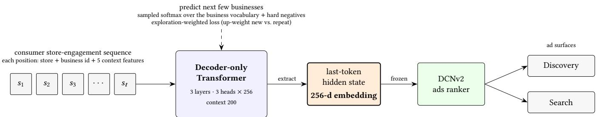
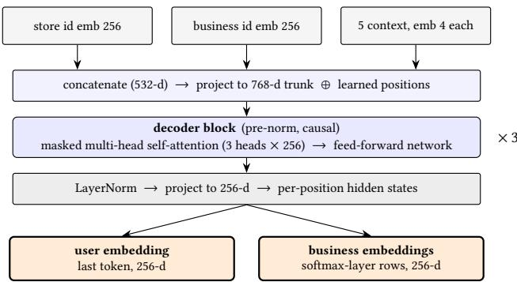

# PALATE: Pretrained Autoregressive LATent Embeddings

Sizhang Zhao sizhang.zhao@doordash.com DoorDash Seattle, WA, USA

Bin Li   
bin.li1@doordash.com   
DoorDash   
San Francisco, CA, USA

Praveen Gondhi praveen.gondhi@doordash.com DoorDash Seattle, WA, USA

Utsaw Kumar utsaw.kumar@doordash.com DoorDash San Francisco, CA, USA

## Abstract

Local-commerce and food-delivery marketplaces run large ads businesses: across hundreds of thousands of stores, merchants pay to be surfaced on browse and search surfaces, and a ranker decides which ads each consumer sees. Ranking well demands strong perconsumer personalization, yet a consumer’s raw interaction history is sparse and high-cardinality. Our production ranker had personalized only through hand-engineered signals: aggregate engagement counts, categorical embeddings, and order-agnostic pooled history — with no learned per-consumer sequence representation. We learn one by training a GPT-style generative model of the consumer’s engagement sequence to predict their next few engagements, and read its last-token hidden state as the consumer embedding. That single frozen vector becomes one shared personalization input for every ad surface: a daily job refreshes it, and each ranker consumes it as an ordinary dense feature. Ofline it is the largest single-feature gain in our ranking-AUC ladder, a relative Eval-AUC gain of +0.59% on a browse-driven feed and +0.57% on a query-driven search surface. Online, it shipped as one component of bundled ranker retrains on both surfaces: Discovery (revenue +0.79%, conversion rate +1.17%) and Search (revenue +0.94%, conversion rate +1.50%). Three design choices adapt the generative objective to a repurchase-heavy marketplace, and are the core of our contribution: an explorationweighted loss that up-weights businesses new to the consumer over ones already engaged; a two-stage curriculum: a click pretrain that keeps the representation broad and exploratory, then a conversion fine-tune that sharpens purchase intent; and a designed negative set that pairs a fixed popular-business pool and businesses shown but not ordered with random and in-batch negatives.

## CCS Concepts

• Information systems → Recommender systems; Online advertising; • Computing methodologies → Neural networks.

## Keywords

generative user representation, user embeddings, sequential recommendation, personalization, ads ranking, transformer, sampled softmax, industrial deployment

ACM Reference Format: Sizhang Zhao, Praveen Gondhi, Bin Li, and Utsaw Kumar. 2026. PALATE: Pretrained Autoregressive LATent Embeddings. In Proceedings of GRAIL 2026: Workshop on Generative, Retrieval-augmented, and Agentic Intelligence for Personalization (GRAIL @ CIKM ’26). ACM, New York, NY, USA, 5 pages.

## 1 Introduction

DoorDash is a local-commerce marketplace where consumers browse and order from hundreds of thousands of stores across food and other verticals. A large part of how those stores get discovered is through ads: merchants pay to be surfaced on Discovery (the homepage carousel and homefeed) and in Search results, and a ranker decides which ads each consumer sees. That ranking is only as good as the personalization behind it: the right store for one consumer is the wrong store for another.

The natural signal for that intent is the consumer’s own interaction history, but it is sparse and high-cardinality: each consumer touches a tiny slice of a store space with hundreds of thousands of entries. Engagement is also repurchase-heavy — most consumers re-order from a handful offavorites — so the history is dominated by repeats and the harder problem is surfacing new stores a consumer would try. For personalization, our production ranker relied only on hand-engineered signals: hundreds of aggregate click, order, and conversion counts and rates over fixed windows; sparse consumer and context categoricals; and recently engaged store and cuisine IDs, mean-pooled into order-agnostic bags. The gap was a learned per-consumer sequence representation. We instead model the history generatively: we train a GPT-style model on a consumer’s store-engagement sequence to predict the next few businesses, and hand its last-token hidden state to a DCNv2 ranker as a frozen, fixed-length embedding.

We train the model in two stages, moving from clicks to conversions, under an exploration-weighted loss that up-weights new businesses over repeats to counter the repurchase-heavy domain. Ofline, the frozen embedding is the largest single-feature gain in our ranking-AUC ladder, worth +0.59% on Discovery and +0.57% on Search, and an in-model DIN attention module adds only marginally on top of it. Notably, one embedding helps on surfaces with opposite consumer intent — the browse-driven exploration surface (Discovery) and the query-driven intent surface (Search). A single daily inference job keeps the embedding fresh, and it shipped as part of bundled ranker retrains that lifted revenue on both surfaces (+0.79% Discovery, +0.94% Search).

## 2 Related Work

Sequential recommenders encode a user’s interaction history as a token sequence and model it with self-attention to recommend the next item; SASRec [5] is the canonical causal variant, while BERT4Rec [9] uses a bidirectional masked-item (Cloze) objective. A more recent line reframes recommendation as generation: GPT4Rec [6 generates natural-language queries from a user’s history and retrieves items with a search engine, TIGER [8] casts retrieval as generating semantic item IDs, and large sequential transducers such as HSTU [13] reformulate both retrieval and ranking as generative sequential transduction at industrial scale. These systems are optimized for the recommendation task itself — retrieval or ranking — not for emitting a reusable representation to be consumed by other models. A parallel thread learns user embeddings directly and consumes them as features: YouTube [3] trains a user vector against a watch-prediction objective, and Airbnb [4] learns skip-gram listing and user-type embeddings for search ranking. Closest to our setting are reusable industrial user representations consumed by separate downstream models: PinnerFormer [7] trains a user embedding with a dense all-action loss over long-term future engagement, while PinFM [2] pretrains a billion-scale foundation model and couples it into rankers through candidate-aware crossattention. We share their reusable-representation goal but difer in objective and loss: rather than long-term all-action prediction or a candidate-conditioned foundation model, we predict a short horizon under an exploration weighting for a repurchase-heavy domain, with a sampled softmax whose hard negatives combine a fixed popular-business pool with businesses shown but not ordered.

Within CTR and ranking models, behavioral sequences are instead consumed by in-model modules: DIN [14] applies targetaware attention over the behavior history, cross networks (DCN [10], DCN-V2 [11]) learn explicit high-order feature interactions, and deployed production rankers increasingly embed a Transformer block over the behavior sequence directly [1, 12]. Because such a module lives inside one ranker, its sequence modeling is tied to that model and must be rebuilt for each new ranking task. We take a diferent route: we train a generative sequential model once and treat it as a frozen, reusable user representation that feeds a sepa rate production ranker, and we find an in-model DIN adds little on top of it.

## 3 Method

## 3.1 Input

Each entry in a consumer’s history is a store they clicked or ordered from, whether through an ad or organically, identified by a store id and a business id. A store is a single storefront a consumer can order from; a business is the merchant that owns one or more stores, so one business id can span many store locations. We embed both identifiers with pretrained 256-dimensional lookup embeddings, together with five learned categorical context features — the day part (breakfast, lunch, dinner, or late night), a weekend flag, local hour, day of week, and whether the impression was sponsored — so each position captures how and when a consumer engaged a store, not only which one. Ordering these engagements chronologically per consumer gives the store-engagement sequence, the input to the generative model (Figure 1).

## 3.2 Generative user model

Given that sequence, we predict the next few businesses the consumer will engage. At each position the store, business, and context embeddings are concatenated and projected to the trunk width.

The backbone, detailed in Figure 2, is a decoder-only, GPT-style Transformer with three layers and three attention heads of size 256 — a 768-wide trunk — with learned position embeddings over a 200-position context; a final projection yields the 256-dimensional embedding we export. The target at each position is the next business rather than the individual store — since one business can span many store locations, a store-level target would pull the model toward location instead of merchant preference — and we also predict a short look-ahead window of the next few, down-weighting farther horizons. The business vocabulary runs to hundreds of thousands of entries, and an exact softmax over that many classes at every position is too expensive at our sequence volume, so the production model is trained with a sampled softmax — and how we design its negatives is central to what the representation learns. Each positive is scored against two kinds of hard negatives — a fixed pool of about 60K popular businesses, and ones the consumer was shown but did not order — together with random and in-batch negatives. The hard negatives force the representation to separate close alternatives, while random and in-batch draws keep the denominator broad and cheap; §5.1 compares an exact full softmax.

## 3.3 Two-stage curriculum and exploration weighting

We train in two stages. Stage 1 pretrains on click sequences, which are plentiful and cover a consumer’s broad browsing and engagement behavior. Stage 2 fine-tunes on conversion (purchase) sequences to sharpen purchase intent. Rather than training Stage 2 from scratch, we warm-start it from the Stage-1 checkpoint, so the conversion model keeps the browsing coverage learned from clicks while specializing toward what consumers actually buy.

Ordering is repurchase-heavy: the next business is usually one already in the consumer’s history. Under a uniform loss the objective is dominated by these predictable repurchases, and the model can score well without learning anything about discovery. We therefore up-weight prediction terms whose target is new to the consumer’s history (exploration) and down-weight repeats. This tilts the representation toward discovery, the regime that matters for surfacing new stores (§5.1).

Putting these pieces together, the training loss is

$$
\mathcal { L } = - \sum _ { t } \sum _ { n = 1 } ^ { N } \alpha _ { n } w _ { t , n } \log \frac { e ^ { s _ { y _ { t , n } } } } { e ^ { s _ { y _ { t , n } } } + \sum _ { j \in N } e ^ { s _ { j } } } ,\tag{1}
$$

where $s _ { j } = h _ { t } ^ { \top } e _ { j }$ scores business $j -$ its output-layer embedding $e _ { j }$ against the position-� hidden state $h _ { t } ; y _ { t , n }$ is the �-step-ahead target business; $\alpha _ { n }$ weights the prediction horizon rather than applying a time decay: $\alpha _ { 1 } = 1$ and a fixed (not tuned) $\alpha _ { n \geq 2 } { = } 0 . 5$ down-weight farther-ahead steps; $w _ { t , n } { = } 0 . 9$ for a target new to the consumer’s history and 0.1 for a repeat; and N is the sampled negative set described above. We sweep this new-vs.-repeat ratio � (uniform, 3:1, 9:1) in $\ S 5 . 1 ; \alpha _ { n }$ is held fixed.

  
Stage 1: click pretrain −→ Stage 2: conversion fine-tune (warm start)

Figure 1: The generative user representation and how it is reused: a decoder-only GPT trained on each consumer’s storeengagement sequence, whose last-token hidden state is exported as a frozen 256-d feature and reused by the DCNv2 ranker across both ad surfaces  
  
Figure 2: Model architecture. Per-position store, business, and context embeddings are concatenated (532-d), projected to a 768-d trunk, run through three pre-norm causal decoder blocks, and projected to 256-d. We export the last-token hidden state as the user embedding and the softmax layer’s rows as business embeddings (§3.4).

## 3.4 Extraction and reuse

The user embedding is the model’s last-token hidden state, a single 256-dimensional vector summarizing the consumer’s sequence. We export it and consume it as a frozen dense feature in the downstream DCNv2 ads-ranking model. No gradient flows back into the generative model. The output layer also holds one 256-d vector per business, scored by dot product against the hidden state, so each is a business embedding in the same space as the user embedding; we export both and use them together downstream.

## 4 Experimental Setup

We run two kinds ofofline evaluation. Intrinsic evaluation asks how well the generative model does its own future-business prediction task, scoring it in isolation. Extrinsic evaluation asks the question we actually care about — whether the exported embedding makes the downstream ranker better. A model can win the first and contribute nothing to the second, so we report both. Both use a held-out set drawn from a period later than the training window, so no metric sees interactions the model was fit on.

Intrinsic. We score the model on future-converted-business prediction: for each consumer, the businesses they converted in the two weeks after the training window (with a one-day leakage bufer). We report Recall@�, MRR, and next-item perplexity over a fixed 120K-business candidate set; perplexity is the exponential of the mean next-item cross-entropy, and lower means more probability on the true business (§5.1).

Extrinsic. We add the user embedding to the production DCNv2 ads ranker and read its Eval AUC on Discovery and Search, as an incremental ladder that adds components one at a time, so the embedding’s gain is measured on top of everything added before it (Table 2). The embedding is not fed in raw. With � the user embedding and � the candidate business embedding, the ranker consumes their interaction

$$
\phi ( u , c ) = { \bigl [ } u , c , u \odot c , \cos ( u , c ) { \bigr ] } ,\tag{2}
$$

the concatenation ofboth raw vectors, their element-wise (Hadamard) product � ⊙ �, and their cosine similarity.

Online evaluation uses randomized A/B tests, with consumers split 50/50 by consumer\_id. Each test runs for one week, on all platforms, across the two ad surfaces: Discovery and Search. Every launch ships the user embedding as part of a bundled ranker retrain rather than as an isolated change, so the measured online movement is a property of the whole launch and is not attributable to the embedding alone. We track revenue, CVR, CTR, eCPM, and ROAS (Table 3).

## 5 Results

## 5.1 Intrinsic evaluation

Numbers in this subsection are single-run point estimates. In Table 1, hard negatives raise overall recall. A business shown but not ordered is a noisy negative, since the consumer may still have liked it, so we mix these with random and in-batch negatives. Exploration weighting lowers overall recall — which is dominated by repeat orders — but raises recall on businesses the consumer has not engaged before, monotonically in the ratio: 9:1 loses about 3× as much overall recall as 3:1 for a smaller further gain on new businesses. Removing repeats from the sequence entirely — the distinct sequence row — collapses overall recall, confirming that repeats carry most of the next-item signal. We also tried the business’s primary category as an input feature; removing it changed click R@10 by only 0.6 points (46.91%→46.28%), so we dropped it — the learned business-id embeddings likely already encode it.

Table 1: Recall ablations (% change). New R@10: recall on previously unseen businesses (“–”: not recorded). Time-decay rows use the full-softmax model; full-softmax rows are vs. sampled softmax.
<table><tr><td>Design choice</td><td>R@10</td><td>R@30</td><td>MRR</td><td>New R@10</td></tr><tr><td>+ Hard negatives</td><td>+14.3%</td><td>+9.0%</td><td>+8.2%</td><td></td></tr><tr><td>Exploration weighting 3:1</td><td>-7.0%</td><td>-3.5%</td><td>-5.7%</td><td>+18.4%</td></tr><tr><td>Exploration weighting 9:1</td><td>-20.4%</td><td>-11.1%</td><td>-19.8%</td><td>+29.1%</td></tr><tr><td>Distinct sequence</td><td>-67.5%</td><td>-46.5%</td><td>-75.5%</td><td>一</td></tr><tr><td>Time-decay attn (replace pos.)</td><td>-5.0%</td><td>-3.7%</td><td>-5.4%</td><td>一</td></tr><tr><td>Time-decay attn (+ pos.)</td><td>-3.7%</td><td>-3.1%</td><td>-3.4%</td><td>一</td></tr><tr><td>Full softmax (click)</td><td>+3.5%</td><td>+3.3%</td><td>+2.4%</td><td>一</td></tr><tr><td>Full softmax (conversion)</td><td>-0.6%</td><td>-0.1%</td><td>-0.4%</td><td>一</td></tr></table>

Adding a time-decay bias to attention, so older engagements count less, lowers recall both when it replaces the learned position embeddings and when it is added on top of them (Table 1). What matters is which businesses a consumer engaged recently, not exactly when.

Finally, as an ofline-only comparison, we replace the sampled softmax with an exact full-softmax over the business vocabulary, made tractable by a vocabulary-chunked cross-entropy that accumulates the exact partition function tile by tile without materializing the full logit matrix. It lowers perplexity by 26% on click and 14% on conversion and lifts click recall, but conversion recall stays flat (Table 1), so the production model keeps the sampled softmax.

## 5.2 Extrinsic evaluation

Fed into the ranker, the frozen user embedding is the largest singlefeature step in the ofline ladder (Table 2), helping both a browsedriven exploration surface and a query-driven intent surface. We also tested whether an in-model sequence module adds anything on top of it: a DIN attention module over the history buys only a further +0.03%, so the cheap frozen embedding already captures most of what an in-model sequence module would contribute. On Search, DIN added without the embedding gives no gain (+0.00%), while the embedding alone gives +0.57%.

We also tested exploration weighting’s efect in the ranker: using the embedding from the uniformly weighted model gave no gain in Discovery Eval AUC, whereas the 9:1 exploration-weighted embedding gains +0.59% (Table 2).

Table 2: Discovery ranking-AUC ladder: each row’s incremental relative Eval-AUC change over the rows above; row 1 is vs. the retrained production DCNv2. The uniform and 9:1 rows are alternatives, each measured on its own rather than stacked. Search: +0.57% for the user embedding. Single runs.

<table><tr><td>Component added</td><td>% impr.</td></tr><tr><td>Store emb. + mean-pooled last-N converted-store emb</td><td>+0.33%</td></tr><tr><td>+ user embedding, uniform weighting</td><td>≈0.00%</td></tr><tr><td>+ user embedding, 9:1 weighting, as φ(u, c) (Eq. 2)</td><td>+0.59%</td></tr><tr><td>+ DIN attention over the raw history</td><td>+0.03%</td></tr></table>

## 5.3 Online experiments

The embedding shipped as one component of bundled ranker retrains across two surfaces — Discovery first, then Search. Both launches raised revenue and CVR significantly (Table 3); each launch changed more than the embedding alone.

Table 3: Online A/B lift by surface (% change). ∗ ∗ ∗�<0.001, ∗∗�<0.01, ∗�<0.05; n.s. = not significant.
<table><tr><td>Metric</td><td>Discovery</td><td>Search</td></tr><tr><td>Revenue</td><td> $+ 0 . 7 9 \% ^ { * * * }$ </td><td> $+ 0 . 9 4 \% ^ { * * * }$ </td></tr><tr><td>CVR</td><td> $+ 1 . 1 7 \% ^ { * * * }$ </td><td> $+ 1 . 5 0 \% ^ { * * * }$ </td></tr><tr><td>CTR</td><td> $- 0 . 1 0 \% \left( \mathrm { n . s . } \right)$ </td><td> $+ 1 . 3 8 \% ^ { * * * }$ </td></tr><tr><td>eCPM</td><td> $+ 0 . 6 6 \% ^ { * } ^ { * * }$ </td><td> $+ 1 . 5 6 \% ^ { * } ^ { * * * }$ </td></tr><tr><td>ROAS</td><td> $+ 0 . 1 3 \% \left( \mathrm { n . s . } \right)$ </td><td> $- 0 . 0 1 \% \left( \mathrm { n . s . } \right)$ </td></tr></table>

## 6 Discussion

Because the representation is pretrained once and consumed frozen, a single daily inference job serves embeddings for tens of millions of consumers to both Discovery and Search. Sequence modeling thus lives in one shared ofline job rather than in an encoder each surface must train and serve.

Future directions include merging clicks and conversions into one sequence (the staged curriculum currently balances discovery against repurchase), longer histories with search queries, harder negatives from first-time orders that were rated poorly and never reordered, geographic context to down-weight out-of-area history, and a live-session adapter to capture the within-session intent a daily frozen embedding misses.

## 7 Conclusion

A single generative model of a consumer’s store-engagement sequence brings per-consumer sequence modeling to ads ranking at DoorDash. Its frozen last-token embedding captures intent that hand-engineered aggregates and pooled histories miss, and is the largest single-feature gain in our ranking-AUC ladder on two surfaces with opposite consumer intent. It shipped in bundled ranker retrains that lifted revenue and conversion on both surfaces. Pretrained once and consumed frozen, a generative user representation is a practical building block for large-scale personalization.

## References

[1] Qiwei Chen, Huan Zhao, Wei Li, Pipei Huang, and Wenwu Ou. 2019. Behavior Sequence Transformer for E-commerce Recommendation in Alibaba. In Proceedings

of the 1st International Workshop on Deep Learning Practice for High-Dimensional Sparse Data (DLP-KDD).

[2] Xiangyi Chen, Kousik Rajesh, Matthew Lawhon, Zelun Wang, Hanyu Li, Haomiao Li, Saurabh Vishwas Joshi, Pong Eksombatchai, Jaewon Yang, Yi-Ping Hsu, Jiajing Xu, and Charles Rosenberg. 2025. PinFM: Foundation Model for User Activity Sequences at a Billion-scale Visual Discovery Platform. In Proceedings ofthe 19th ACM Conference on Recommender Systems (RecSys).

[3] Paul Covington, Jay Adams, and Emre Sargin. 2016. Deep Neural Networks for YouTube Recommendations. In Proceedings of the 10th ACM Conference on Recommender Systems (RecSys). 191–198.

[4] Mihajlo Grbovic and Haibin Cheng. 2018. Real-time Personalization using Embeddings for Search Ranking at Airbnb. In Proceedings of the 24th ACM SIGKDD International Conference on Knowledge Discovery & Data Mining (KDD). 311–320.

[5] Wang-Cheng Kang and Julian McAuley. 2018. Self-Attentive Sequential Recommendation. In 2018 IEEE International Conference on Data Mining (ICDM). IEEE, 197–206.

[6] Jinming Li, Wentao Zhang, Tian Wang, Guanglei Xiong, Alan Lu, and Gerard Medioni. 2023. GPT4Rec: A Generative Framework for Personalized Recom mendation and User Interests Interpretation. arXiv preprint arXiv:2304.03879 (2023).

[7] Nikil Pancha, Andrew Zhai, Jure Leskovec, and Charles Rosenberg. 2022. Pinner-Former: Sequence Modeling for User Representation at Pinterest. In Proceedings ofthe 28th ACM SIGKDD Conference on Knowledge Discovery and Data Mining (KDD).

[8] Shashank Rajput, Nikhil Mehta, Anima Singh, Raghunandan H. Keshavan, Trung Vu, Lukasz Heldt, Lichan Hong, Yi Tay, Vinh Q. Tran, Jonah Samost, Maciej Kula, Ed H. Chi, and Maheswaran Sathiamoorthy. 2023. Recommender Systems with Generative Retrieval. In Advances in Neural Information Processing Systems 36 (NeurIPS).

[9] Fei Sun, Jun Liu, Jian Wu, Changhua Pei, Xiao Lin, Wenwu Ou, and Peng Jiang. 2019. BERT4Rec: Sequential Recommendation with Bidirectional Encoder Rep resentations from Transformer. In Proceedings of the 28th ACM International

Conference on Information and Knowledge Management (CIKM). 1441–1450.

[10] Ruoxi Wang, Bin Fu, Gang Fu, and Mingliang Wang. 2017. Deep & Cross Network for Ad Click Predictions. In Proceedings ofthe ADKDD’17.

[11] Ruoxi Wang, Rakesh Shivanna, Derek Zhiyuan Cheng, Sagar Jain, Dong Lin, Lichan Hong, and Ed H. Chi. 2021. DCN V2: Improved Deep & Cross Network and Practical Lessons for Web-scale Learning to Rank Systems. In Proceedings of the Web Conference 2021 (WWW).

[12] Xue Xia, Pong Eksombatchai, Nikil Pancha, Dhruvil Deven Badani, Po-Wei Wang, Neng Gu, Saurabh Vishwas Joshi, Nazanin Farahpour, Zhiyuan Zhang, and Andrew Zhai. 2023. TransAct: Transformer-based Realtime User Action Model for Recommendation at Pinterest. In Proceedings ofthe 29th ACM SIGKDD Conference on Knowledge Discovery and Data Mining (KDD).

[13] Jiaqi Zhai, Lucy Liao, Xing Liu, Yueming Wang, Rui Li, Xuan Cao, et al. 2024. Actions Speak Louder than Words: Trillion-Parameter Sequential Transducers for Generative Recommendations. In Proceedings ofthe 41st International Conference on Machine Learning (ICML).

[14] Guorui Zhou, Xiaoqiang Zhu, Chengru Song, Ying Fan, Han Zhu, Xiao Ma, Yanghui Yan, Junqi Jin, Han Li, and Kun Gai. 2018. Deep Interest Network for Click-Through Rate Prediction. In Proceedings of the 24th ACM SIGKDD International Conference on Knowledge Discovery & Data Mining (KDD). 1059– 1068.

## Generative AI Usage Disclosure

The authors used generative AI assistants (large language model– based coding and writing tools) in preparing this work: to assist with portions of the implementation, to draft and edit the text of this paper, and to help produce its figures. The authors directed and reviewed all such use, and take full responsibility for the technical content, experiments, results, and conclusions presented here.