# PhysicsNeMo-Mesh: GPU-Native Meshes and Simulation Cases for Physics AI

Peter Sharpe Corey Adams Negin Sobhani Sanjay Choudhry NVIDIA Corporation psharpe@nvidia.com

## Abstract

PhysicsNeMo-Mesh is the mesh module of the open-source PhysicsNeMo library. It provides mesh processing similar to PyVista, but on the GPU, in batches, and inside PyTorch’s automatic differentiation. Like xarray for unstructured meshes, it attaches semantics to data: fields on points, cells, and whole meshes have names and shapes, and a simulation case keeps the complete PDE problem specification, including boundary conditions and their prescribed values. It addresses three problems that plague machine learning for physical simulation. First, GPU utilization is bottlenecked by I/O, because samples are very large relative to the compute per forward pass. Second, because traditional preprocessing is expensive, it is necessarily done once, during curation, rather than differently for each model and workflow at the point of use. Finally, advanced equivariant and mesh-native architectures require information that curation ordinarily discards. Fast GPU mesh processing makes it practical to preprocess at the point of use: on one GB200 GPU, mesh operations run 6.2–1,068× faster than VTK with 72 threads, and loading a whole case is 8.0–88× faster than reading its VTK files (8.0× when both read the same fields). Overlapped with training, this preprocessing costs 2.1% of throughput for a 127 ms Transolver step. So one dataset serves many models and workflows: in PhysicsNeMo’s public recipe, one stored DrivAerML dataset feeds Transolver, GeoTransolver, and GLOBE. PhysicsNeMo-Mesh combines the speed of an intermediate array store with the flexibility of an archival format such as VTK. When shapes and wall conditions both vary, per-boundary conditions cut a heat-conduction error from 87% to 6–9%. And by keeping field ranks and named boundaries, it retains the semantic structure that next-generation architectures will need.

## 1 Introduction

Machine-learning surrogates for physical simulation train on solver output: volume and surface meshes with fields attached, written as VTK, CGNS, or solver-native files. Before a model can use these files, a curation step typically converts each case into model-specific arrays. That workflow leads to three problems that plague machine learning for physical simulation:

1. I/O-bound training. GPU utilization is bottlenecked by I/O, because samples are very large relative to the processing done on them in a forward pass. The volume mesh of one DrivAerML case is 49 GB, while a Transolver training step on 100,000 surface points takes 23 ms to 127 ms on one GPU, depending on model size (Section 4.4). Reading only the car surface of one DrivAerML case from its VTK file takes 5.2 s from local NVMe, about 40 steps of 127 ms; the whole case takes about 6.5 minutes, almost all of it spent parsing (Section 4.1). CPU preprocessing, such as point sampling, normal computation, and signed-distance evaluation, adds further overhead. Pre-computing these features into flat arrays avoids the read bottleneck only by locking the dataset to a single model, raising the question of whether on-the-fly GPU preprocessing from the stored mesh can keep pace with training.

2. Curation for one model. Because traditional preprocessing is expensive, it is necessarily done once, during curation, rather than differently for each model and workflow at the point of use. Each pipeline flattens solver output into custom arrays and retains only the fields that one model consumes. Supporting a new architecture, or adding an input feature to an existing one, requires another pass over the raw data, and DrivAerML alone is about 31 TB of VTK files for 500 cars [Ashton et al., 2024]. Whatever the initial curation drops, such as named boundaries, operating conditions, or which columns form a vector, is lost to every downstream model.

3. Discarded structure. Advanced equivariant and mesh-native architectures require information that curation ordinarily discards. Rotation augmentation and equivariant networks must know which channels form a vector and how each field transforms, and mesh-native models such as GLOBE [Sharpe, 2026a] take the boundary meshes themselves as input. A flat feature array records none of this: after concatenation, only column position identifies each quantity, and lengths, velocities, and pressures sit side by side in whatever dimensional units the solver used. Key obstacles to out-of-distribution generalization are thus baked in during data curation, before any architecture is chosen (Section 6).

We present PhysicsNeMo-Mesh, the mesh module of the open-source PhysicsNeMo library. A Mesh holds points, simplicial cells, and named fields on points, on cells, and on the whole mesh, as PyTorch tensors on any device. A DomainMesh holds one simulation case: an interior mesh, named boundary meshes, and case-wide data. The aim is for a case to hold a complete, well-posed PDE problem specification, with the data that uniquely map from the PDE formulation to its solution and nothing more: the domain, each boundary’s condition type and values, and the parameters of the governing equations (Section 3). PhysicsNeMo-Mesh provides mesh processing similar to PyVista [Sullivan and Kaszynski, 2019], with similar method names, but on the GPU, in batches, and inside PyTorch’s automatic differentiation. Like xarray [Hoyer and Hamman, 2017] for unstructured meshes, it attaches semantics to data: fields have names and tensor shapes, nest hierarchically by physics discipline, and use interchangeable on-disk formats.

The answer to the first problem enables the answer to the second. Fast mesh processing on the GPU (Section 4) makes it practical to preprocess at load time, at the point of use, rather than when the dataset is generated. That, in turn, lets one dataset serve many models and workflows, instead of a re-curation into an intermediate format for every setup (Section 5). An intermediate array store loads fast, but it bakes in model-specific choices, such as which fields are kept. An archival format such as VTK keeps everything, but it is slow to read. A stored DomainMesh is itself a tree of memory-mapped arrays, combining the speed of the first with the flexibility of the second.

Addressing the third problem prepares datasets for the foreseeable future. We already know that next-generation equivariant and mesh-native architectures require geometric and physical structure that flat arrays discard. Retaining named boundaries and each field’s tensor rank preserves that information from the outset (Section 6).

## This paper makes four contributions:

1. Two classes: Mesh for one mesh of any dimension (Section 2), and DomainMesh for a complete simulation case, with named boundaries, fields of any rank, and nested fields for multiphysics (Section 3).

2. Measurements of the data path that show it is fast enough to preprocess at the point of use (Section 4): whole-case loads 8.0–88× faster than from VTK files (8.0× when both read the same fields), 23 mesh operations on one GB200 GPU against the strongest batch VTK filter, size sweeps to 336 million triangles, and the throughput cost of preprocessing overlapped with training.

3. One dataset for many models and workflows (Section 5): each model computes its features on the fly from the stored mesh, using the same code across curation, training, and inference. In PhysicsNeMo’s public external-aerodynamics training example (its recipe), one stored DrivAerML dataset is configured to feed Transolver [Wu et al., 2024], GeoTransolver [Adams et al., 2025], and GLOBE. In a synthetic heat-conduction study in which the geometry and the wall conditions both vary, models given only the geometry remain at the theoretical error floor of geometry alone, a global vector of wall summaries roughly halves their error, and the per-boundary conditions that a DomainMesh stores bring it to 2–10%.

4. Named fields that keep their tensor rank in their trailing shape, and explicit geometric transforms that respect it, which data augmentation and equivariant architectures such as GLOBE use directly (Section 6).

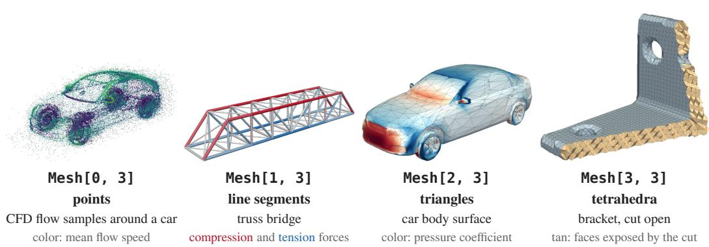  
Figure 1: One Mesh class for all four manifold dimensions, so each operation is written once: points (Mesh[0, 3]), line segments (Mesh[1, 3]), triangles (Mesh[2, 3]), and tetrahedra (Mesh[3, 3]). Each holds points, simplicial cells, and named fields.

## 2 Mesh: Points, Simplices, and Named Fields

A Mesh is a TensorDict tensorclass [Bou et al., 2024]: a dataclass of PyTorch tensors that move between devices together. It has five members:

```python
class Mesh(TensorClass):
points: Tensor # (n_points, n_spatial_dims)
cells: Tensor # (n_cells, n_manifold_dims + 1), integer
point_data: TensorDict # fields on points
cell_data: TensorDict # fields on cells
global_data: TensorDict # fields on the whole mesh
```

• Cells are simplices. Every n-simplex is convex and has n + 1 vertices, so connectivity fits in a single rectangular integer tensor with no ragged offsets or per-cell-type branching.

• Fields have names and ranks. A point field has one entry per point, and a cell field one per cell. The trailing shape gives the tensor rank: () for a scalar, (3, ) for a vector, (3, 3) for a second-order tensor. Because TensorDicts nest, multiphysics fields such as fluid/p and solid/p can coexist on one mesh.

• Fully dimensionally generic (Figure 1). A mesh with n-dimensional cells embedded in mdimensional space (denoted Mesh[n, m]) infers both dimensions directly from the shapes of cells and points. Point clouds, curves, surfaces, and volumes therefore share a single implementation of each operation.

Formats. from\_pyvista imports anything PyVista reads: VTK formats, CGNS, OpenFOAM, EnSight, Fluent, and Exodus through VTK, and Gmsh, Nastran, and SU2 through meshio [Schlömer, 2024]. Quadrilaterals, polygons, hexahedra, prisms, pyramids, and convex polyhedra are split into simplices, and each simplex keeps its parent cell’s data. A hexahedron becomes five or six tetrahedra. Non-convex polyhedra and higher-order cells are not tetrahedralized; the user can instead import their cell centroids (point\_source="cell\_centroids") as a point cloud (Mesh[0, 3]) or as a dual graph (Mesh[1, 3]) whose edges connect adjacent cells. to\_pyvista exports back to VTK and ParaView.

Why simplices only. Restricting cells to simplices means that hexahedral meshes grow five- to sixfold on import and non-convex polyhedra are not tetrahedralized. For physics AI, this is a deliberate trade-off:

• GPU alignment and dimensional genericity. Every n-simplex is guaranteed to be convex and has a fixed vertex count (n + 1). Connectivity is therefore a dense rectangular tensor rather than ragged offset arrays, which aligns cleanly with GPU SIMD execution, lets one dimension-generic implementation cover point clouds, curves, surfaces, and volumes, and concentrates optimization effort on a compact set of kernels.

Table 1: Matching PyVista and PhysicsNeMo-Mesh calls, with GB200 speedups over VTK’s 72- thread backend on Grace CPUs. b: different by design; d: VTK and NumPy; warm: locator reused.
<table><tr><td>PyVista (VTK, CPU)</td><td>PhysicsNeMo-Mesh (GPU)</td><td>Speedup</td></tr><tr><td>car.transform(R,...)</td><td>car.rotate(a, &quot;z&quot;, ...)</td><td>6.2×</td></tr><tr><td>car.reflect(n).append_polydata(car)</td><td>Mesh.merge([car, car.transform(M)])</td><td>76×</td></tr><tr><td>car.extract_cells(ids)</td><td>car.slice_cells(mask)</td><td>968xb</td></tr><tr><td>car.compute_normals(...)</td><td>car.cell_normals</td><td>12×</td></tr><tr><td>pts.compute_implicit_distance(car)</td><td>signed_distance_field(car, pts)</td><td>350×</td></tr><tr><td>car.fill_holes(size)</td><td>fill_holes(car)</td><td>20×b</td></tr><tr><td>car.cell_data_to_point_data()</td><td>car.cell_data_to_point_data()</td><td>46×</td></tr><tr><td>normals, cell sizes, NumPy sum</td><td>car.integrate(p[:, None] * n)</td><td>262×d</td></tr><tr><td>vol.compute_derivative(vorticity=True) pts.sample(vol)</td><td>vol.curl(&quot;u&quot;)</td><td>13×</td></tr><tr><td></td><td>vol.sample_data_at_points(pts)</td><td>19× (0.96× warm)</td></tr><tr><td>vol.extract_surface()</td><td>vol.get_boundary_mesh()</td><td>57×</td></tr></table>

• Cleaner discrete calculus and FEM structure. Finite-element derivations and discrete exterior calculus (implemented in PhysicsNeMo-Mesh alongside least-squares operators) are much cleaner on pure simplicial complexes than on general polyhedra.

• Minimal lossfor physics-AI architectures. Unlike traditional finite-volume solvers on polyhedral meshes, physics-AI surrogates rarely consume the polyhedral geometry of individual volume cells: point-cloud and neural-operator models need only cell centroids and volumes (Mesh[0, 3]), and graph networks such as MeshGraphNets [Pfaff et al., 2021] need only neighbor connectivity. Because an undirected graph in R<sup>3</sup> is a Mesh[1, 3], from\_pyvista can import any polyhedral or mixed-element mesh directly as its dual graph, with nodes at cell centroids (carrying cell\_data) and 1-simplex edges between adjacent cells, bypassing tetrahedralization altogether.

The API resembles PyVista. Operations mirror those of PyVista [Sullivan and Kaszynski, 2019] where an equivalent exists, often under a similar method name, making existing post-processing scripts straightforward to port. Table 1 lists eleven pairs, each timed on the same mesh in both libraries (Section 4.2). Unlike PyVista, PhysicsNeMo-Mesh operates on batches on the GPU and supports PyTorch automatic differentiation. It also adds discrete exterior and least-squares calculus in any manifold dimension, remeshing, morphing, and whole cases with named boundaries (Section 3). PhysicsNeMo-Mesh targets mesh manipulation and loading for physics AI rather than mesh generation or CAD modeling, which stay with dedicated meshers and CAD kernels.

## 3 DomainMesh: One Simulation Case

A DomainMesh holds one simulation case (Figure 2):

```python
class DomainMesh(TensorClass):
interior: Mesh
boundaries: TensorDict[str, Mesh] # named boundary meshes
global_data: TensorDict # data on the whole case
```

The interior is a Mesh of any dimension, and each named boundary is a Mesh of its own.

Exactly the posed problem. The goal of DomainMesh is to store a complete, well-posed problem: exactly what is needed to uniquely map from a PDE formulation to a PDE solution, and nothing more. In Hadamard’s sense, a problem is well posed when its data completely and uniquely determine its solution, with no extraneous data [Hadamard, 1902]. For a boundary value problem, those data are the domain, the type of condition on each part of its boundary, the values each condition prescribes, and the parameters of the governing equations. A surrogate learning the solution operator requires the same inputs: if any of them is omitted and varies across the dataset, the model is asked a different question each time [Sharpe, 2026a]. What we need is an ML-native counterpart to archival formats such as CGNS: a container that preserves the full problem specification while loading directly into GPU memory. This requires three capabilities:

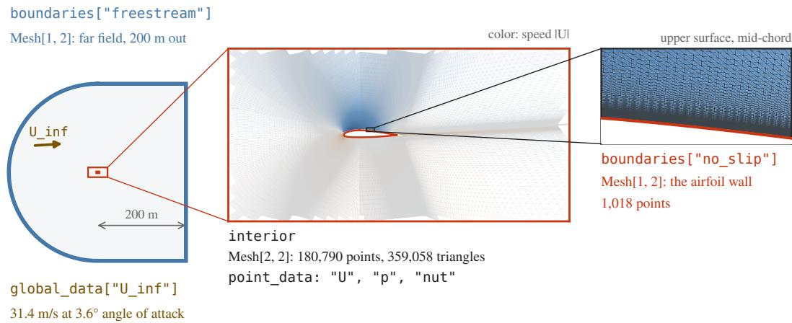  
Figure 2: An AirfRANS case [Bonnet et al., 2022] as a DomainMesh: the interior mesh, the named airfoil and freestream boundaries, and the freestream velocity $U _ { \infty }$ in global\_data.

• each boundary stores its condition type and the values it prescribes (Section 5.3);

• fields can have any rank: scalars, vectors, and higher-order tensors;

• fields nest hierarchically, so coupled multiphysics domains keep their quantities distinct.

Only case-wide quantities belong in global\_data: parameters of the governing equations, such as a kinematic viscosity or a thermal diffusivity; reference scales for nondimensionalization, such as a reference speed, density, or length; and provenance metadata such as a case identifier or unit system. Boundary conditions belong on their respective boundaries. In the AirfRANS case of Figure 2, for example, the prescribed far-field velocity is stored on the freestream boundary’s cell\_data, while global\_data records its spatial mean $U _ { \infty }$ as the reference scale. The surface-only DrivAerML dataset of Section 5.2 omits the far-field boundary, which is lossless there only because DrivAerML holds the inflow fixed across all runs and varies solely the vehicle geometry.

A boundary name is a string that the user chooses, and the classes attach no boundary-condition law to it. The classes check structure, not physics: shapes, dtypes, devices, and field lengths when a mesh is built, and, through validate, degenerate cells, duplicate vertices, and out-of-range indices. They do not check that the boundaries cover the interior or that a case specification is physically complete, nor do they infer units or governing equations.

Storage and cached geometry. Normals, areas, centroids, adjacency, and curvature are computed the first time they are accessed and cached on the mesh. Geometric transforms preserve whichever cached quantities remain valid: a rigid rotation preserves topology, rotates cached normals, and transforms cached centroids, so random rotations during training do not trigger recomputation. Under a non-similarity linear transform, cached normals are invalidated and recomputed on demand. save writes a directory tree of memory-mapped files, one per tensor, cache included, so features computed once during curation load alongside the mesh. A reader can open a single boundary of a stored case without loading the interior, and memory-mapping pages in only the tensors accessed during a training step. A Mesh or DomainMesh can also be written to a zarr store behind the same interface.

## 4 Keep the GPU Fed

Because a single simulation case is large relative to the compute of a forward pass, training pipelines are easily bottlenecked by I/O. PhysicsNeMo-Mesh removes this bottleneck in two ways: stored cases load via memory-mapping rather than file parsing, and the mesh operations required for preprocessing execute on the GPU. This section benchmarks both, establishing the throughput that makes point-of-use preprocessing (Section 5) practical. Except for loading, the benchmarks ran on

Table 2: Cold load of one case (interior and boundary), median of three from local NVMe on one machine. VTK is timed reading (pv.read) and with conversion to Mesh; the speedup uses the read alone. For DrivAerML and SHIFT-SUV, VTK reads whole files while the copies keep only the physics fields. †: VTK reads only the physics fields (full files: 136.0 s). ‡: with 13 s of cleaning (Appendix A.2).
<table><tr><td></td><td colspan="4">Cold load of one case</td><td colspan="3">Size on disk [GB]</td></tr><tr><td>Dataset</td><td>VTK read</td><td>+ conversion</td><td>PhysicsNeMo-Mesh</td><td>Speedup</td><td>VTK</td><td>PhysicsNeMo-Mesh</td><td>Ratio</td></tr><tr><td>DrivAerML</td><td>388.7 s</td><td>403.5s</td><td>4.44s</td><td>88×</td><td>49.7</td><td>6.3</td><td>7.9</td></tr><tr><td>HiLiftAeroML</td><td>113.7s†</td><td>271.8s</td><td>14.23s</td><td>8.0×</td><td>107.3</td><td>20.0</td><td>5.4</td></tr><tr><td>SHIFT-SUV</td><td>67.5s</td><td>71.3s</td><td>1.21s</td><td>56×</td><td>4.4</td><td>1.6</td><td>2.7</td></tr></table>

one GB200 node (Appendix A.3).

## 4.1 Loading a case

Table 2 compares cold loads of one whole case from VTK files and from memory-mapped PhysicsNeMo-Mesh copies. The datasets are DrivAerML, HiLiftAeroML, and SHIFT-SUV [Luminary Cloud, 2025], a set of DES simulations of parametric AeroSUV variants. Every load read from node-local NVMe on one machine (median of three, Appendix A.2).

• Speed. Because a saved DomainMesh is a directory of raw memory-mapped tensor files with no text or XML framing, it loads at the speed of a flat array store: 8.0–88× faster than VTK reads the source files. Conversion happens once; later passes memory-map the copy.

• Field selection. For DrivAerML and SHIFT-SUV, VTK must parse the entire inline-binary file, whereas the curated PhysicsNeMo-Mesh copies retain only the physics fields; for HiLiftAeroML, both formats load the exact same fields (8.0× speedup).

• Where VTK spends the time. Almost all of it is parsing: a cold read of the 49 GB DrivAerML volume takes $1 9 \mathrm { s } ( 2 . 6 \mathrm { G B } / \mathrm { s } )$ , and pv.read takes 384 s.

Training seldom reads a whole case. Even as a memory-mapped copy, a cold DrivAerML case takes 4.4 s, about 34 steps of the 127 ms Transolver step of Section 4.4. The recipe of Section 5.2 reads only the vehicle boundary of each case and subsamples its cells as it reads. Several workers read in parallel, and later epochs hit the page cache. The DrivAerML boundary alone loads in 0.70 s from the copy, against 5.2 s from VTK (19 s with conversion).

## 4.2 Mesh operations against VTK

The operation benchmark times 23 operations on one GB200. The baseline for each is the strongest batch VTK filter, never a per-element Python loop, on the Grace CPUs of the same node, with VTK’s threaded backend on 72 threads. Filters that VTK implements serially run on one thread. Both sides receive the same arrays: the DrivAerML run-1 car (17,684,913 triangles) or a cube of 5,144,250 tetrahedra. Topology, calculus, and Morton-code linear BVH operations are implemented as vectorized PyTorch tensor operations, while signed-distance queries and surface remeshing use GPU kernels in NVIDIA Warp [Macklin, 2022]. Each timed GPU call starts from tensors on the device with an empty cache, and spatial-index (locator or BVH) construction is included in the timed call for both libraries. Every output is verified against VTK or an analytical reference (Appendix A.3).

Figure 3 shows the speedups, and Table 3 gives the absolute times.

• Car surface. The GPU is $6 . 2 – 1 , 0 6 8 \times$ faster than the CPU baseline, with a median of 198× over 18 operations. Signed distance for $1 0 ^ { 6 }$ query points takes 124 ms versus 43.3 s on the CPU.

• Volume. Gradient and curl are $6 . 9 \times$ and 13× faster, and boundary extraction is $5 7 \times$ faster.

• Field transfer to $1 0 ^ { 6 }$ points is 19× faster when both sides build their cell locator in the call, and reaches parity $( 0 . 9 6 \times )$ when both reuse a prebuilt locator.

• Named baselines. Two rows have no VTK filter: NumPy is the baseline for area-weighted sampling and pyacvd for remeshing.

• Algorithmic differences. Five rows compute slightly different definitions by design; smoothing, for example, uses uniform weights in VTK and cotangent weights in PhysicsNeMo-Mesh (Appendix A.3).

a: the CPU baseline is not VTK

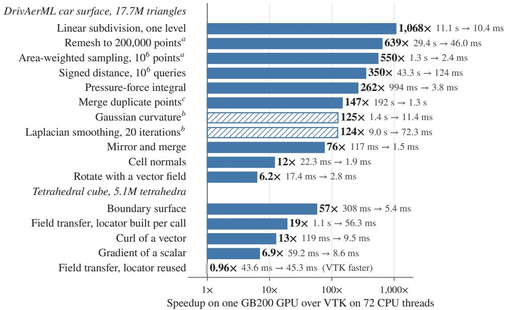  
b: the two sides compute diferent quantities by design  
c: the input is a triangle soup of the car with every vertex unshared  
Figure 3: The GPU is faster on every operation except field transfer with a reused locator (0.96×), with a median speedup of 198× on the DrivAerML car surface. Bars show the speedup of one GB200 GPU over a 72-thread Grace CPU baseline (the fastest batch VTK filter, or NumPy/pyacvd where VTK lacks an equivalent) across all operations in Table 3.

## 4.3 Scaling and batching

Size sweeps on synthetic meshes reached 336 million triangles and 384 million tetrahedra on one GPU, with time growing linearly with size above about a million cells (Table 4). For many small meshes, Mesh.merge concatenates them into one so that each operation launches its kernels once; Appendix A.3 gives the memory, size-limit, and batching results.

## 4.4 Overlapping preprocessing with training

The pipeline of Section 5.1 computes each model’s features, such as sampled points, normals, and normalized fields, from the stored mesh at every training step, instead of reading them precomputed. The PhysicsNeMo DataLoader runs each sample’s transforms on separate CUDA streams while the previous step trains. To measure what this hides, we train a surface Transolver on synthetic surfaces of 8.8 million triangles, about the size of a DrivAerML car, read from node-local disk with a warm page cache (Appendix A.4). Each step rotates the surface and its wall-shear field, normalizes the fields, samples 100,000 cells by area, places a point in each, and gathers normals and fields. We compare four configurations:

A. Precomputed (reference): trains on precomputed features resident on the GPU, with no augmentation;

B. Serial on-the-fly: runs the mesh transforms synchronously before each step;

C. Overlapped DataLoader: runs the transforms asynchronously on background CUDA streams via the DataLoader;

D. Overlapped + cached geometry: same as C, but with cell normals and areas pre-cached on disk.

Figure 4 and Table 5 give the results:

• Recipe model (6.0M parameters, a 127 ms step). Preprocessing through the DataLoader costs 2.1% of throughput and 1.8% with cached geometry, against 5.9% run serially: about 72% of the 9.9 ms of preprocessing is hidden behind the step.

• Reduced model (1.7M parameters, a 23 ms step). The DataLoader hides none of it: preprocessing

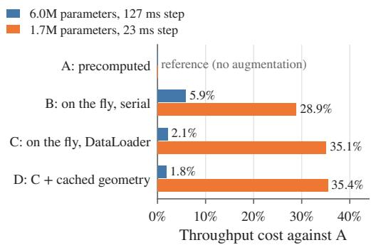

Figure 4: Overlap hides most of the preprocessing for the 127 ms step (2.1% cost through the DataLoader) and none for the launch-bound 23 ms step (35%), because kernel launches saturate the host thread (Section 4.4). Bars show the throughput reduction of configurations B–D relative to configuration A for both model sizes (Table 5).  
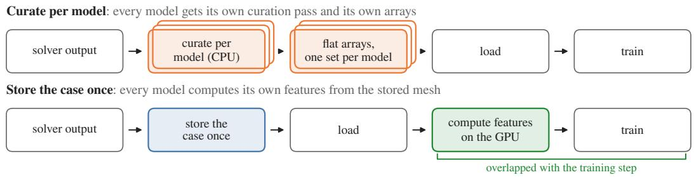  
Figure 5: Two orders of the same four stages. A conventional pipeline preprocesses on the CPU and then stores model-specific arrays. With a stored DomainMesh, the mesh is stored first and each model’s features are computed on the GPU at training time, so the stored dataset does not depend on the model.

costs 35.1%, more than the 28.9% of running it serially, and cached geometry costs 35.4%.

• Why overlap fails for the smaller model. The 23 ms step is host-launch-bound: the main thread spends 7.4 ms launching 7.8 ms of on-GPU transforms (the 9.9 ms above also includes the host-todevice copy) and 18.1 ms launching a 23 ms step, so the host never gets ahead of the GPU, and a deeper prefetch queue does not help (Appendix A.4). Fewer launches, through CUDA graphs or a compiled transform chain, would reduce this host overhead; we leave that to future work.

• Caching normals and areas saves only 0.4 ms of the 7.8 ms of transforms, because most of the cost is rotating and normalizing the whole surface and sampling it.

## 5 Curate Once

Because a stored case loads quickly and mesh operations run fast on the GPU (Section 4), preprocessing can move from dataset generation to load time, at the point of use. Computed on the GPU and overlapped with training, each model’s features cost 2.1% of throughput for a 127 ms training step (Section 4.4). That rewrites the economics of data curation: when preprocessing is slow, it must run offline during dataset generation, locking the stored arrays to a single model. When it is fast enough to run at every training step, the stored dataset need not bake in any one model’s features and can serve them all.

## 5.1 Features are computed from the stored mesh at training time

A conventional pipeline computes model features on the CPU during curation and stores them. With a stored DomainMesh, the order reverses (Figure 5). Each model computes its features, such as sampled points, normals, areas, signed distance, and normalized fields, from the mesh on the GPU at training time.

Because operations dispatch to the device of their input tensors, a single feature-extraction function runs unchanged across curation, training, and inference:

```python
from physicsnemo.mesh import DomainMesh
from physicsnemo.nn.functional import weighted_multinomial
def model_inputs(case: DomainMesh, n: int) −> dict:
car = case.boundaries["vehicle"] # a named boundary
idx = weighted_multinomial(car.cell_areas, n, replacement=True)
return {"x": car.sample_random_points_on_cells(idx),
"normal": car.cell_normals[idx],
"p": car.cell_data["pMeanTrim"][idx], # target field
"U_inf": case.global_data["U_inf"]} # case condition
# Curation: CPU workers, once per case
stats = [model_inputs(DomainMesh.load(f), 10_000) for f in files]
# Training: GPU, every step
batch = model_inputs(case.to("cuda"), 100_000)
# Inference: the body turns, the freestream stays
x = model_inputs(case.rotate(alpha, "z"), 100_000)
```

• One implementation. The same call runs on CPU workers during curation and on the GPU at each training step and inference request, so no separate CPU and GPU implementations need to agree.

• Differentiable. Features computed inside automatic differentiation keep their dependence on the vertex coordinates (verified against central finite differences via gradcheck, matching to $4 . 0 \times 1 0 ^ { - 7 }$ relative error on integrated surface-pressure forces). For shape optimization, the derivative of an objective with respect to the mesh points includes paths through normals, areas, and signed distance; precomputed features treated as constants drop those terms.

• Cached where constant. Features that never change can still be computed once and cached with the mesh (Section 3).

In the inference call, rotating the body without rotating $U _ { \infty }$ changes the angle of attack; Section 6 describes the flags that rotate vector fields alongside the geometry when a coordinate-frame rotation is desired instead.

## 5.2 One stored dataset feeds three models

The public PhysicsNeMo unified external-aerodynamics recipe reads DrivAerML cases stored as DomainMesh files. For each case, its surface dataset pipeline:

1. opens only the vehicle boundary of each case and subsamples its cells as it reads;

2. merges the case’s global\_data onto the sample, since a boundary read alone does not include it, and computes normals at load time;

3. builds a DomainMesh whose interior is the point cloud of sampled cell centroids and whose vehicle boundary is the surface mesh (Figure 6a).

Each model’s configuration names the fields of that DomainMesh that its forward call takes (Figure 6b). Training selects a model and a dataset independently, so adding a model takes a configuration block and no new curation run. GLOBE receives the boundary as a Mesh; Transolver and GeoTransolver [Adams et al., 2025] receive tensors extracted from the same paths and broadcast where needed (expand\_like). All three models train from the same dataset directory without re-curation.

## 5.3 A case marks its inputs and its targets

Traditional curation flattens each case into the arrays required by a single model, discarding everything else for all subsequent work. Public dataset releases illustrate the pattern: the preprocessed AirfRANS release broadcasts the inlet velocity onto every node and drops the freestream boundary [Bonnet et al., 2022]. The DrivAerML surface release merges its named patches into one surface [Ashton et al., 2024]. Both choices suited the original baseline models, but any downstream architecture that requires a boundary name, a per-boundary condition, a unit or reference value, or a vector field kept as a vector must re-curate from the raw solver output. Instead, we curate once, storing each case as the posed problem of Section 3, and let each model extract the inputs it needs.

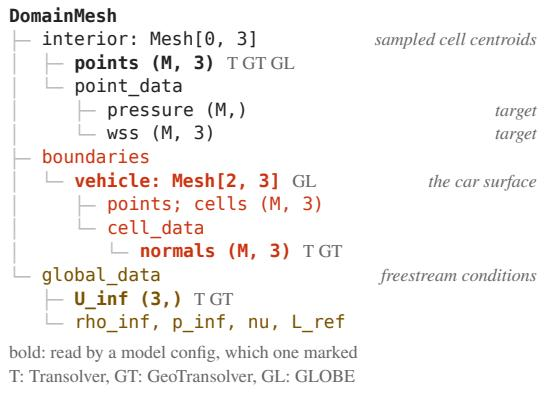

(a)  
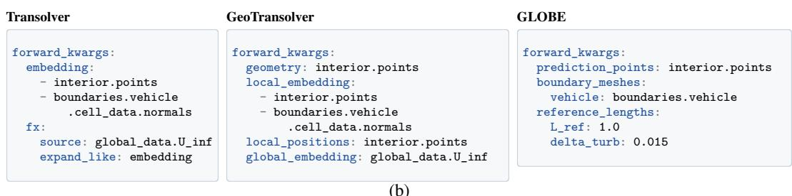  
Figure 6: One stored case, three models. (a) The DomainMesh the recipe’s pipeline builds from one stored DrivAerML case: the interior, the named boundary mesh, and the reference freestream conditions in global\_data. (b) The forward\_kwargs blocks of the three surface-model configurations in the PhysicsNeMo unified external-aerodynamics recipe (two long paths are wrapped for display). Each entry extracts a field from the DomainMesh in (a), so all three models share a single DrivAerML dataset. GLOBE’s reference\_lengths are constants, in units of the scaled positions, that set the length scales of its multiscale kernels: a reference length L\_ref and a turbulent boundary-layer thickness delta\_turb.

Boundary conditions take the same few forms across physics. In heat transfer, a fixed temperature is a Dirichlet condition, and a prescribed heat flux, zero on an insulated wall, is a Neumann condition. In fluids, an inlet prescribes a velocity, an outlet a pressure, and a wall is no-slip (u = 0) or slip (u · n = 0). In solids, a support fixes the displacement and a load prescribes the traction. A stored case retains all of these and separates problem inputs from prediction targets:

• Inputs are the geometry, each boundary’s condition type and prescribed values, and the case-wide data in global\_data, such as the governing-equation parameters and, in the cases shown here, the uniform freestream velocity (Section 3). The prescribed values go in a prescribed sub-dictionary on their boundary; conditions whose values are implicit in their type, such as no-slip or free-slip walls, require no prescribed fields.

• Targets are the fields under solution.

• Boundary names give the condition type in our converted aerodynamics datasets: inlet, outlet, no\_slip, and slip. The DrivAerML cases of Section 5.2 are the exception. They keep the release’s field names at the top level (pMeanTrim, . . . ) and name the car surface vehicle, the key expected by the existing recipe.

The split is a convention; the library does not enforce it as a type.

Why store the prescribed values. Real problems vary the geometry and the boundary conditions together, but many surrogates encode only the geometry, or the geometry and a global vector of operating conditions. A synthetic heat-conduction study (Appendix B) shows what that costs. Every sample has its own random domain and its own wall conditions: a fixed temperature on part of the wall and a heat flux on the rest, which vary around one nominal pattern by a relative amount σ. A

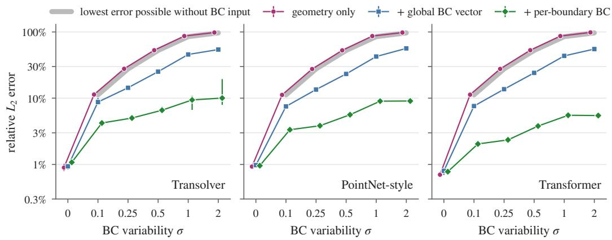  
Figure 7: Only the per-boundary conditions keep the error low as the wall conditions vary. Each panel is one architecture. Markers are medians over eight training seeds of the mean relative $\dot { L } _ { 2 }$ error on 200 unseen geometries, and bars span the seeds. The gray curve is the lowest expected error that any model seeing only the geometry can reach (zero at σ = 0).

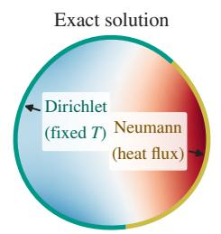

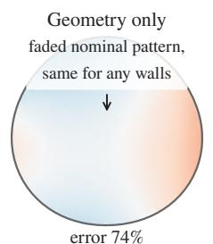

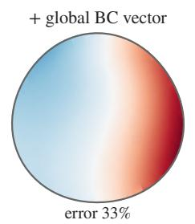

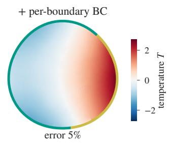

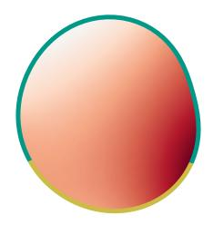

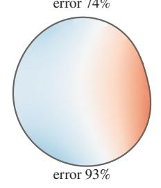

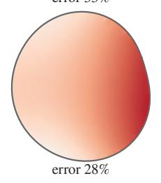

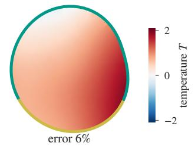

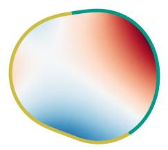

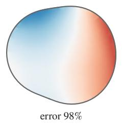

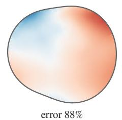

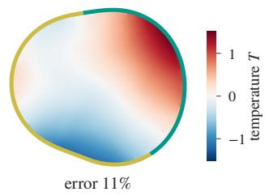  
Figure 8: Three unseen geometries at $\sigma = 1$ (rows), with Transolver predictions (seed 0). Teal walls have a fixed temperature (Dirichlet), and gold walls a prescribed heat flux (Neumann). Without the conditions, the model returns one field per geometry, whatever the wall conditions are: a faded copy of the nominal pattern that the conditions vary around. Under relative error, which weighs small fields more, that faded copy scores better on average than the nominal pattern itself (Appendix B.3). The global vector of five wall summaries recovers the broad pattern in the first two rows but not in the third, and the per-boundary conditions recover the field in all three. Each row has its own color scale. The rows are the test geometries at the 20th, 50th, and 80th percentiles of the shape deformation, chosen before training.

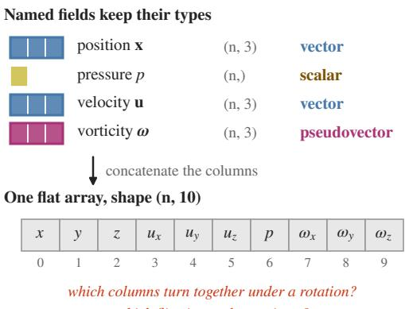  
which flip sign under a mirror?  
Figure 9: Flattening named fields into one array of columns. The Mesh keeps each field’s name and trailing shape, so scalars and vectors stay distinct; in the flat array, only the column order says which columns form a vector.

Transolver [Wu et al., 2024], a PointNet-style model, and a transformer that see only the geometry reach relative $L _ { 2 }$ errors of 0.7–0.9% at $\sigma = 0 ;$ , so they do learn the geometry, but at every $\sigma > 0$ they remain at the theoretical error floor for any geometry-only predictor (85% at σ = 1; Figure 7). Given a global vector of five wall summaries, they reach 43–46%; given each boundary’s condition type and value, as a DomainMesh stores them, they reach 6–9% (Figure 8). A curation that drops the per-boundary values leaves every later model on that floor.

## 6 Equivariant and Mesh-Native Models

The throughput gains of Section 4 and the model-agnostic curation of Section 5 benefit standard architectures immediately. No data format is permanently future-proof, but we already know what the next generation of equivariant and mesh-native architectures requires: the geometric and tensor structure that flat arrays discard. Preserving that structure during curation gives datasets what those models need for the foreseeable future, without another re-curation pass.

A common curation stacks position, pressure, velocity, and vorticity into one wide array of shape (n, 10) (Figure 9). Many pipelines take this step without a second thought, but it throws away physical structure in two ways.

Concatenation loses the vectors. A vector is not three scalar fields side by side. It has a magnitude and a direction, and it exists apart from the coordinate system we write it in. Concatenation keeps only its components in one arbitrary frame, a frame that nature does not see. The array no longer records which three columns form the velocity, which columns turn together under a rotation, or which flip sign under a mirror. So a model cannot take the dot product of every pair of vectors as a feature, and a pipeline cannot augment the data by rotating every field. Equivariant models become impossible, unless the rank of each channel is stored on the side, as the irreducible representations (irreps) of e3nn and cuEquivariance do [Geiger and Smidt, 2022, NVIDIA, 2024]. A common error is to rotate the points and forget a vector field or a reference direction.

Concatenation mixes units. Unless the data are nondimensionalized first, and often they are not, the array puts a length in meters next to a speed in meters per second. A model trained on such an array bakes in an arbitrary choice of dimensional units. It cannot be units-invariant [Sharpe, 2026a], and that alone keeps it from being a foundation model. PhysicsNeMo-Mesh does not track or enforce units. It keeps each field separate and named, so a model can still nondimensionalize each field by its own scale later; in a flat array, the fields are already mixed.

These losses of structure are easy to overlook, yet they are the original sin behind many surrogates that fail to generalize: the symmetry-breaking happens during data curation, before any model architecture is even chosen.

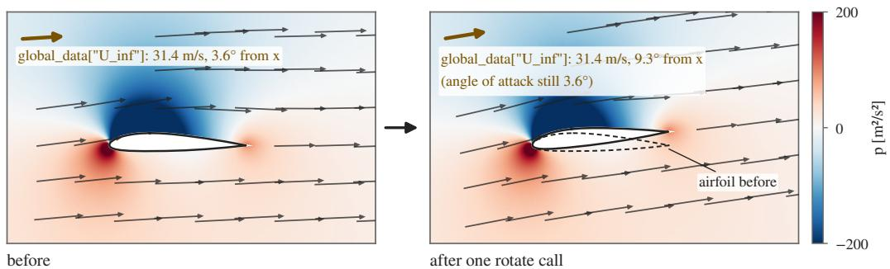  
case.rotate(0.1, transform\_point\_data={"U": True}, transform\_global\_data={"U\_inf": True})

Figure 10: One flagged rotate call is a change of frame; the angle of attack is unchanged. The airfoil, the velocity field, and $U _ { \infty }$ in global\_data turn together by 0.1 rad.

Ranks and namespaces. Because each field in a Mesh retains its key and trailing tensor shape, its tensor rank travels with the mesh: fluid/U of shape (n, 3) is a vector and solid/sigma of shape (n, 3, 3) a second-order tensor. A model can declare the fields, ranks, and parities it expects with a FieldSchema and check them against a mesh.

Transforms with explicit flags. rotate, translate, scale, and general linear transform calls move the geometry and, where flagged, the fields. For a two-dimensional AirfRANS case with velocity U and freestream U\_inf, this call rotates the case and both vectors by 0.1 rad (Figure 10):

```python
rotated = case.rotate(0.1, transform_point_data={"U": True},
transform_global_data={"U_inf": True})
```

• Rank sets the rule. Each flagged field transforms by the rule its rank implies, and cached normals and centroids are updated with the geometry (Section 3).

• Flags default to off, because the library cannot know whether the caller rotates the frame or the body. Rotating the frame turns $U _ { \infty }$ with the geometry, a change of coordinates only. Rotating the body inside a fixed flow leaves $U _ { \infty }$ alone and changes the angle of attack.

• In the recipe of Section 5.2, each surface sample gets a random rotation about z that turns the surface and, through its flags, the wall shear and $U _ { \infty }$ , then a random horizontal translation.

Mesh-native models take meshes in and return a mesh. GLOBE [Sharpe, 2026a] takes the prediction points, a dictionary of named boundary meshes, reference lengths, and the case’s global\_data, and returns a Mesh of predicted fields (signature abridged):

```python
def forward(self, prediction_points: Tensor,
boundary_meshes: dict[str, Mesh],
reference_lengths: dict[str, Tensor],
global_data: TensorDict | None = None, ...) −> Mesh:
```

It declares the ranks and parities of its output, boundary, and global fields in FieldSchemas, checks its inputs against them, and routes scalars and vectors by rank. These declarations live in the model, not in the stored data. Its kernels build invariant features from scalars and from dot products of vectors, the features that a flat array rules out, and re-project vectors onto a local basis. The model is therefore equivariant to translations, rotations, and reflections for scalar and polar-vector fields by construction; array models such as Transolver use an adapter that flattens the fields at the last step (Figure 6).

What tensor shape alone does not capture. Under non-uniform scaling, a normal transforms by the inverse transpose and a velocity does not, yet both have shape (3, ). Shape also does not separate a polar vector from a pseudovector such as vorticity, which flips sign under a mirror. The transforms leave that flip to the caller, so their guarantees for vector fields hold for proper rotations. GLOBE rejects pseudovectors and higher-rank fields, as its kernels use only scalars and polar vectors.

## 7 Related Work

Mesh processing and labeled arrays. VTK and PyVista [Sullivan and Kaszynski, 2019] are the reference for mesh processing on the CPU, Open3D [Zhou et al., 2018] processes point clouds and triangle meshes, and meshio [Schlömer, 2024] converts between formats; PhysicsNeMo-Mesh imports and exports through PyVista and has similar method names. xarray [Hoyer and Hamman, 2017] and its data tree [Nicholas and Busecke, 2023] attach labeled arrays to structured grids with netCDF and zarr back ends; UXarray [UXarray Developers, 2026] extends this to unstructured UGRID climate grids, though without boundary patches, boundary conditions, or mesh operations.

Geometric deep learning. PyTorch Geometric and DGL [Fey and Lenssen, 2019, Wang et al., 2019] batch graphs on the GPU, leaving mesh structure, boundaries, and field ranks to the user. PyTorch3D and Kaolin [Ravi et al., 2020, Jatavallabhula et al., 2019] target rendering and computer vision on surface meshes rather than volumetric PDEs, differential operators, or boundary-value specifications. PhysicsNeMo-Mesh builds on TensorDict [Bou et al., 2024] for device transfer, indexing, and memory-mapped nested tensors.

Input pipelines. FFCV, tf.data, and DALI [Leclerc et al., 2023, Murray et al., 2021, NVIDIA, 2018] overlap loading and preprocessing with training for images and other dense arrays, whereas PhysicsNeMo-Mesh brings overlapped GPU preprocessing to unstructured meshes.

Simulation schemas. CGNS and Exodus [CGNS Steering Committee, 2026, Poirier et al., 1998, Schoof and Yarberry, 1994] store meshes, boundary information, and reference states for solvers, and Gmsh physical groups name boundaries at mesh generation [Geuzaine and Remacle, 2009]. PLAID [Casenave et al., 2025] adds a CGNS-based data model with a problem definition that names inputs and outputs. These are archival formats with versioned schemas. A DomainMesh represents the same complete case as a training-time object on the GPU, importing CGNS and Exodus through PyVista.

Models and datasets. Models already use boundary information and conditions: MeshGraphNets encodes node types, BENO and BOON build in boundary data, and GINO conditions on inlet speed [Pfaff et al., 2021, Wang et al., 2024, Saad et al., 2023, Li et al., 2023]. GLOBE takes named boundary meshes directly [Sharpe, 2026a]. Dataset releases such as The Well, PDEBench, DrivAerML, DrivAerNet++, and HiLiftAeroML [Ohana et al., 2024, Takamoto et al., 2022, Ashton et al., 2024, Elrefaie et al., 2024, Ashton et al., 2026] fix or vary conditions across cases; Shikhman [2026] also analyzes the conditional risk of omitted boundary conditions.

## 8 Conclusion

PhysicsNeMo-Mesh provides mesh processing similar to PyVista, but on the GPU, in batches, and inside PyTorch’s automatic differentiation, and like xarray it attaches semantics to unstructured-mesh data. A DomainMesh stores a simulation case once, as the complete PDE problem specification: its geometry, its named boundaries and their conditions, and fields that keep their names and ranks. Fast GPU mesh processing makes it practical to preprocess at load time, at the point of use. Overlapped with training, this preprocessing keeps up with a 127 ms training step, at a 2.1% cost. So one dataset serves many models and workflows, and adding a model takes a configuration block rather than a new curation. When the geometry and the boundary conditions both vary, a model that sees only the geometry, or only a global summary of operating conditions, cannot resolve the effect of spatially varying boundary data. Because fields retain their tensor rank, geometric transforms rotate vectors and boundary conditions consistently. Many generalization failures begin before any architecture is chosen, when curation flattens a simulation case into a featureless array. Keeping the case whole avoids that loss of structure and preserves what next-generation equivariant and mesh-native architectures need for the foreseeable future.

Although this paper focuses on surrogates for PDE-governed physical systems, a GPU-native, differentiable mesh with typed, named fields applies much more broadly. Within scientific computing, the same abstractions support earth-system modeling (including storm-surge and hydrological applications on unstructured coastal and terrain meshes), structural and multiphysics simulation, and GPU-native finite-element or discrete-exterior-calculus solvers built directly on Mesh primitives. Beyond continuum PDEs, any domain that computes on geometrically embedded graphs, surfaces, or volumes (such as machine-learning interatomic potentials, deformable fabric and soft-body simulation, robotics, 3D computer vision, and differentiable graphics) can use the same data structure to keep geometry, topology, and tensor semantics together on the GPU.

Disclosure. The authors develop PhysicsNeMo at NVIDIA; two are authors of HiLiftAeroML.

## References

Corey Adams, Rishikesh Ranade, Ram Cherukuri, and Sanjay Choudhry. GeoTransolver: Learning physics on irregular domains using multi-scale geometry aware physics attention transformer. arXiv preprint arXiv:2512.20399, 2025.

Neil Ashton, Charles Mockett, Marian Fuchs, Louis Fliessbach, Hendrik Hetmann, Thilo Knacke, Norbert Schonwald, Vangelis Skaperdas, Grigoris Fotiadis, Astrid Walle, Burkhard Hupertz, and Danielle Maddix. DrivAerML: High-fidelity computational fluid dynamics dataset for road-car external aerodynamics. arXiv preprint arXiv:2408.11969, 2024.

Neil Ashton, Adam Clark, Konrad Goc, Liam Heidt, Christopher Ivey, Rahul Agrawal, Sanjeeb T. Bose, Corey Adams, Peter Sharpe, Daniel Leibovici, Semih Akkurt, Sheel Nidhan, Rishi Ranade, and Jean Kossaifi. HiLiftAeroML: A high-fidelity computational fluid dynamics dataset for high-lift aircraft aerodynamics. arXiv preprint arXiv:2605.19565, 2026.

Florent Bonnet, Jocelyn Ahmed Mazari, Paola Cinnella, and Patrick Gallinari. AirfRANS: High fidelity computational fluid dynamics dataset for approximating Reynolds-averaged Navier–Stokes solutions. In Advances in Neural Information Processing Systems (Datasets and Benchmarks), 2022. arXiv:2212.07564.

Albert Bou, Matteo Bettini, Sebastian Dittert, Vikash Kumar, Shagun Sodhani, Xiaomeng Yang, Gianni De Fabritiis, and Vincent Moens. TorchRL: A data-driven decision-making library for PyTorch. In International Conference on Learning Representations (ICLR), 2024. arXiv:2306.00577.

Fabien Casenave, Xavier Roynard, Brian Staber, Alexandre Devaux-Rivière, William Piat, Michele Alessandro Bucci, Nissrine Akkari, Abbas Kabalan, Xuan Minh Vuong Nguyen, Luca Saverio, Raphaël Carpintero Perez, Anthony Kalaydjian, Samy Fouché, Thierry Gonon, Ghassan Najjar, Thomas Daniel, Emmanuel Menier, Matthieu Nastorg, Giovanni Catalani, and Christian Rey. PLAID: A unified data model for machine learning on heterogeneous physics simulations. arXiv preprint arXiv:2505.02974, 2025. Presented at EuRIPS 2025; accepted at the AI4Physics Workshop @ ICML 2026.

CGNS Steering Committee. CGNS standard interface data structures (SIDS). https://cgns.org/ standard/SIDS/CGNS\_SIDS.html, 2026. CFD General Notation System, release 4.5 (CGNS 4.5.2, 30 April 2026); an AIAA Recommended Practice. Accessed 2 September 2026.

Peter L. Duren. Univalent Functions, volume 259 of Grundlehren der mathematischen Wissenschaften. Springer-Verlag, New York, 1983. ISBN 0-387-90795-5.

Mohamed Elrefaie, Florin Morar, Angela Dai, and Faez Ahmed. DrivAerNet++: A largescale multimodal car dataset with computational fluid dynamics simulations and deep learning benchmarks. In Advances in Neural Information Processing Systems (Datasets and Benchmarks), 2024. arXiv:2406.09624.

Matthias Fey and Jan Eric Lenssen. Fast graph representation learning with PyTorch Geometric. In ICLR Workshop on Representation Learning on Graphs and Manifolds, 2019. arXiv:1903.02428.

Mario Geiger and Tess Smidt. e3nn: Euclidean neural networks. arXiv preprint arXiv:2207.09453, 2022.

Christophe Geuzaine and Jean-François Remacle. Gmsh: A 3-D finite element mesh generator with built-in pre- and post-processing facilities. International Journalfor Numerical Methods in Engineering, 79(11):1309–1331, 2009. doi: 10.1002/nme.2579.

Jacques Hadamard. Sur les problèmes aux dérivées partielles et leur signification physique. Princeton University Bulletin, 13:49–52, 1902.

Stephan Hoyer and Joe Hamman. xarray: N-D labeled Arrays and Datasets in Python. Journal of Open Research Software, 5(1):10, 2017. doi: 10.5334/jors.148.

Krishna Murthy Jatavallabhula, Edward Smith, Jean-François Laflèche, Clement Fuji Tsang, Artem Rozantsev, Wenzheng Chen, Tommy Xiang, Rev Lebaredian, and Sanja Fidler. Kaolin: A PyTorch library for accelerating 3D deep learning research. arXiv preprint arXiv:1911.05063, 2019.

Guillaume Leclerc, Andrew Ilyas, Logan Engstrom, Sung Min Park, Hadi Salman, and Aleksander Madry. FFCV: Accelerating training by removing data bottlenecks. In Proceedings of the IEEE/CVF Conference on Computer Vision and Pattern Recognition (CVPR), pages 12011–12020, 2023. arXiv:2306.12517.

Zongyi Li, Nikola Borislavov Kovachki, Chris Choy, Boyi Li, Jean Kossaifi, Shourya Prakash Otta, Mohammad Amin Nabian, Maximilian Stadler, Christian Hundt, Kamyar Azizzadenesheli, and Anima Anandkumar. Geometry-informed neural operator for large-scale 3D PDEs. In Advances in Neural Information Processing Systems (NeurIPS), 2023. arXiv:2309.00583.

Ilya Loshchilov and Frank Hutter. Decoupled weight decay regularization. In International Conference on Learning Representations (ICLR), 2019. arXiv:1711.05101.

Luminary Cloud. SHIFT-SUV: High-fidelity computational fluid dynamics dataset for SUV external aerodynamics. https://huggingface.co/datasets/luminary-shift/SUV, 2025.

Miles Macklin. Warp: A high-performance Python framework for GPU simulation and graphics. NVIDIA GPU Technology Conference (GTC), https://github.com/NVIDIA/warp, 2022.

Derek G. Murray, Jiri Simsa, Ana Klimovic, and Ihor Indyk. tf.data: A machine learning data processing framework. Proceedings of the VLDB Endowment, 14(12):2945–2958, 2021. doi: 10.14778/3476311.3476374. arXiv:2101.12127.

Tom Nicholas and Julius Busecke. Xarray-datatree: Hierarchical data structures for multi-model science. Presentation, Zenodo, 2023. doi: 10.5281/zenodo.7679730.

NVIDIA. DALI: Data loading library. https://github.com/NVIDIA/DALI, 2018.

NVIDIA. cuEquivariance. https://github.com/NVIDIA/cuEquivariance, 2024.

Ruben Ohana, Michael McCabe, Lucas Meyer, Rudy Morel, Fruzsina J. Agocs, Miguel Beneitez, Marsha Berger, Blakesley Burkhart, Keaton Burns, Stuart B. Dalziel, Drummond B. Fielding, Daniel Fortunato, Jared A. Goldberg, Keiya Hirashima, Yan-Fei Jiang, Rich R. Kerswell, Suryanarayana Maddu, Jonah Miller, Payel Mukhopadhyay, Stefan S. Nixon, Jeff Shen, Romain Watteaux, Bruno Régaldo-Saint Blancard, François Rozet, Liam H. Parker, Miles Cranmer, and Shirley Ho. The Well: a large-scale collection of diverse physics simulations for machine learning. In Advances in Neural Information Processing Systems (Datasets and Benchmarks), 2024. arXiv:2412.00568.

Tobias Pfaff, Meire Fortunato, Alvaro Sanchez-Gonzalez, and Peter W. Battaglia. Learning meshbased simulation with graph networks. In International Conference on Learning Representations (ICLR), 2021. arXiv:2010.03409.

Diane Poirier, Steven Allmaras, Douglas McCarthy, Matthew Smith, and Francis Enomoto. The CGNS system. In 29th AIAA Fluid Dynamics Conference. American Institute of Aeronautics and Astronautics, 1998. doi: 10.2514/6.1998-3007. AIAA Paper 98-3007.

Nikhila Ravi, Jeremy Reizenstein, David Novotny, Taylor Gordon, Wan-Yen Lo, Justin Johnson, and Georgia Gkioxari. Accelerating 3D deep learning with PyTorch3D. arXiv preprint arXiv:2007.08501, 2020.

Nadim Saad, Gaurav Gupta, Shima Alizadeh, and Danielle C. Maddix. Guiding continuous operator learning through physics-based boundary constraints. In International Conference on Learning Representations (ICLR), 2023. arXiv:2212.07477.

Nico Schlömer. meshio: Tools for mesh files. Zenodo, 2024. Version 5.3.5 (31 January 2024), version DOI 10.5281/zenodo.1288334; source code at https://github.com/nschloe/meshio.

Larry A. Schoof and Victor R. Yarberry. EXODUS II: A finite element data model. Technical Report SAND92-2137, Sandia National Laboratories, 1994. doi: 10.2172/10102115.

Peter Sharpe. GLOBE: Accurate surrogates for boundary-driven PDEs via domain-inspired architectures and equivariance. In Advances in Neural Information Processing Systems (NeurIPS), 2026a. arXiv:2511.15856.

Peter Sharpe. Introducing PhysicsNeMo-Mesh: GPU-accelerated mesh processing for scientific ML. PhysicsNeMo blog, https://nvidia.github.io/physicsnemo/blog/2026/04/07/ physicsnemo-mesh/, April 2026b.

Lennon J. Shikhman. One operator to rule them all? On boundary-indexed operator families in neural PDE solvers. arXiv preprint arXiv:2603.01406, 2026. ICLR 2026 Workshop on AI & PDEs.

C. Bane Sullivan and Alexander A. Kaszynski. PyVista: 3D plotting and mesh analysis through a streamlined interface for the visualization toolkit (VTK). Journal of Open Source Software, 4(37): 1450, 2019. doi: 10.21105/joss.01450.

Makoto Takamoto, Timothy Praditia, Raphael Leiteritz, Daniel MacKinlay, Francesco Alesiani, Dirk Pflüger, and Mathias Niepert. PDEBench: An extensive benchmark for scientific machine learning. In Advances in Neural Information Processing Systems (Datasets and Benchmarks), 2022. arXiv:2210.07182.

UXarray Developers. UXarray: xarray extension for unstructured climate and global weather data. https://github.com/UXARRAY/uxarray, 2026.

Haixin Wang, Jiaxin Li, Anubhav Dwivedi, Kentaro Hara, and Tailin Wu. BENO: Boundaryembedded neural operators for elliptic PDEs. In International Conference on Learning Representations (ICLR), 2024. arXiv:2401.09323.

Minjie Wang, Da Zheng, Zihao Ye, Quan Gan, Mufei Li, Xiang Song, Jinjing Zhou, Chao Ma, Lingfan Yu, Yu Gai, Tianjun Xiao, Tong He, George Karypis, Jinyang Li, and Zheng Zhang. Deep graph library: A graph-centric, highly-performant package for graph neural networks. arXiv preprint arXiv:1909.01315, 2019.

Haixu Wu, Huakun Luo, Haowen Wang, Jianmin Wang, and Mingsheng Long. Transolver: A fast transformer solver for PDEs on general geometries. In International Conference on Machine Learning (ICML), pages 53681–53705, 2024. arXiv:2402.02366.

Qian-Yi Zhou, Jaesik Park, and Vladlen Koltun. Open3D: A modern library for 3D data processing. arXiv preprint arXiv:1801.09847, 2018.

## A Reproducibility and Benchmark Protocols

## A.1 Commits and hardware

PhysicsNeMo-Mesh is part of the open-source PhysicsNeMo library (https://github.com/ NVIDIA/physicsnemo). The benchmarks of Section 4 and the code shown or described in this paper use PhysicsNeMo commit a0de974ed18599c10a4ffaecaaa8819cbb29dc30, the main branch as of 2026-10-21. The synthetic Laplace study of Section 5 and Appendix B ran at the same commit, on NVIDIA GB300 GPUs. The operation, scaling, batching, and overlap benchmarks ran on one GB200 node, and the load benchmark on one x86 machine with local NVMe. All external datasets are public and used under their published terms; the synthetic Laplace data are generated. The experiment and benchmark scripts are available from the authors on request.

## A.2 Load-speed benchmark

The load benchmark ran on one x86 machine (Xeon Platinum 8481C, 88 vCPUs, 346 GiB) with 16 local NVMe SSDs in RAID0 under ext4, from which one thread reads the large benchmark files cold at 2.4–2.6 GB/s. Each benchmark case consists of the interior volume mesh and boundary surface mesh of a single simulation, comparing the original VTK files against two memory-mapped PhysicsNeMo-Mesh directories. Across three alternating trials per format, each load runs cold in a fresh single-threaded process (OMP\_NUM\_THREADS=1) after evicting all files from the OS page cache via posix\_fadvise. The VTK time is split into pv.read and the conversion with from\_pyvista. DrivAerML and SHIFT-SUV use inline-binary VTU files, from which VTK cannot read fields selectively, so the full file is the baseline; the PhysicsNeMo-Mesh copies keep only physics fields, which accounts for part of the ratio. For HiLiftAeroML, the baseline reads only the physics fields, the same set as the copy. Its boundary file has 4 degenerate polygons that VTK’s triangulation drops and from\_pyvista rejects; they are removed after pv.read, inside the timed conversion, and the PhysicsNeMo-Mesh copy was built from the cleaned file.

Earlier runs on a shared Lustre file system, timing VTK read and conversion together, gave ratios that vary with the file system’s load: 88×, 8.9×, and 35× for DrivAerML, HiLiftAeroML, and SHIFT-SUV from a GB200 node [Sharpe, 2026b], and 40× and 66× for DrivAerML and SHIFT-SUV from a CPU node.

## A.3 Operation benchmark

Hardware and software. All operation, scaling, and batching benchmarks ran on a single node equipped with NVIDIA GB200 GPUs and Grace CPUs. Each benchmark task used one GPU and one pinned CPU socket of 72 Neoverse-V2 cores. VTK 9.7.1 ran with its STDThread SMP backend on 72 threads, overriding the sequential default of the pip wheel; filters that VTK implements serially run on one thread. PyTorch 2.14.1+cu130 ran eagerly, without torch.compile, with PyVista 0.49.1 and pyacvd 0.4.0. The operation part and the scaling and batching parts ran at the same time on disjoint GPUs and cores.

Timing. The first call is a warmup. Operations whose first call took more than 8 s get one timed run; the others get a second warmup and up to ten timed runs within 3 s. torch.cuda.synchronize() runs before and after every call, and we report the minimum. GPU inputs are tensors already on the device, and each timed call builds a fresh Mesh from them, so the cache cannot carry results between runs. Locator and BVH builds are inside the timed call on both sides, except in the “locator reused” field-transfer row, where both sides reuse one.

Inputs and baselines. Surface operations use the DrivAerML run-1 boundary surface, triangulated to 17,684,913 triangles, with its time-averaged pressure and wall-shear fields. Volume operations use a cube $[ - 1 , 1 ] ^ { 3 }$ split into 5,144,250 Kuhn tetrahedra with the fields f = sin 2x cos $2 y + z ^ { 2 }$ and u = (sin 2y, sin 2z, sin 2x). The CPU side is the strongest batch VTK filter for each task. Where VTK has none, the baseline is named: area-weighted sampling uses a NumPy implementation of the same algorithm, and remeshing uses pyacvd, a third-party ACVD clusterer.

Outputs. Every GPU output was verified against its CPU counterpart. Rotation, cell normals, cell areas, signed distance, and field transfer agree to single-precision roundoff, and the force integrals to a relative difference of $2 \times 1 0 ^ { - 8 } $ ; subdivision, mirroring, boundary extraction, and duplicate-point merging give equal cell and point counts and equal areas. For gradient and curl, the error against the analytic field on interior points $( \| x \| _ { \infty } < 0 . 9 )$ matches VTK’s. Five rows differ by design (b in Table 3). VTK smooths with uniform weights and PhysicsNeMo-Mesh with cotangent weights, at the same iteration count and relaxation factor. Both curvatures are angle defects, but VTK divides by a third of the incident area and PhysicsNeMo-Mesh by a mixed Voronoi area. VTK averages unit face normals at a point and PhysicsNeMo-Mesh weights them by angle and area; 99% of the two normals lie within 5<sup>◦</sup>. VTK fills each hole with polygons on its loop, and PhysicsNeMo-Mesh inserts a centroid vertex and a triangle fan. Finally, VTK’s cell-extraction filter retains all unreferenced vertices in the output mesh, whereas slice\_cells shares the vertex array by reference.

Table 3: All 23 operations: the minimum time on 72 Grace CPU threads and on one GB200, the speedup, and the peak GPU memory, which includes the resident input mesh. a: the CPU baseline is not VTK (NumPy for sampling, pyacvd for remeshing). b: the two sides compute different quantities by design (see text). c: the input is a triangle soup of the car with every vertex unshared.
<table><tr><td>Operation</td><td>CPU</td><td>GPU</td><td>Speedup</td><td> Peak GPU [GB]</td></tr><tr><td colspan="5">DrivAerML car surface, 17,684,913 triangles</td></tr><tr><td>Linear subdivision, one level</td><td>11.1s</td><td>10.4ms</td><td>1,068</td><td>6.8</td></tr><tr><td>Subset by tagb</td><td>400 ms</td><td>413μs</td><td>968</td><td>1.4</td></tr><tr><td>Remesh to 200,000 pointsa</td><td>29.4s</td><td>46.0ms</td><td>639</td><td>2.0</td></tr><tr><td>Area-weighted sampling, 106 pointsa</td><td>1.3s</td><td>2.4 ms</td><td>550</td><td>2.0</td></tr><tr><td>Loop subdivision, one level</td><td>24.8s</td><td>46.7 ms</td><td>531</td><td>12.6</td></tr><tr><td>Cell areas</td><td>701 ms</td><td>1.7ms</td><td>417</td><td>2.1</td></tr><tr><td>Signed distance,  $1 0 ^ { 6 }$  queries</td><td>43.3s</td><td>124 ms</td><td>350</td><td>6.7</td></tr><tr><td>Pressure-force integral</td><td>994 ms</td><td>3.8 ms</td><td>262</td><td>2.4</td></tr><tr><td>Point adjacency</td><td>2.8s</td><td>11.2 ms</td><td>249</td><td>4.6</td></tr><tr><td>Merge duplicate pointsc</td><td>192s</td><td>1.3s</td><td>147</td><td>38.5</td></tr><tr><td>Gaussian curvatureb</td><td>1.4s</td><td>11.4 ms</td><td>125</td><td>3.6</td></tr><tr><td>Laplacian smoothing, 20 iterationsb</td><td>9.0s</td><td>72.3 ms</td><td>124</td><td>6.5</td></tr><tr><td>Mirror and merge</td><td>117ms</td><td>1.5 ms</td><td>76</td><td>3.6</td></tr><tr><td>Cell data to point data</td><td>30.7 ms</td><td>673μs</td><td>46</td><td>1.2</td></tr><tr><td>Fill 1,000 holesb</td><td>2.1 s</td><td>104 ms</td><td>20</td><td>5.7</td></tr><tr><td>Cell normals</td><td>22.3 ms</td><td>1.9 ms</td><td>12</td><td>1.9</td></tr><tr><td>Point normalsb</td><td>68.9 ms</td><td>8.8 ms</td><td>7.8</td><td>2.8</td></tr><tr><td>Rotate with a vector field</td><td>17.4ms</td><td>2.8 ms</td><td>6.2</td><td>1.7</td></tr><tr><td colspan="5">Cube of 5,144,250 tetrahedra</td></tr><tr><td>Boundary surface</td><td>308 ms</td><td>5.4 ms</td><td>57</td><td>1.9</td></tr><tr><td>Field transfer, locator built per call</td><td>1.1 s</td><td>56.3ms</td><td>19</td><td>3.3</td></tr><tr><td>Curl of a vector</td><td>119 ms</td><td>9.5 ms</td><td>13</td><td>1.3</td></tr><tr><td>Gradient of a scalar</td><td>59.2 ms</td><td>8.6 ms</td><td>6.9</td><td>1.2</td></tr><tr><td>Field transfer, locator reused</td><td>43.6 ms</td><td>45.3 ms</td><td>0.96</td><td>3.3</td></tr></table>

Size sweeps. Triangle sweeps use icospheres of 20,480 to 336 million triangles; tetrahedron sweeps use the Kuhn cube from 6,000 to 384 million tetrahedra. Timing follows the operation benchmark with up to five runs within 2 s. Table 4 gives the largest size each operation reached. The CPU line for field transfer is omitted, because that VTK sweep reused its cell locator between calls. Signed distance is left out: on an icosphere, many queries are nearly equidistant from every triangle, a worst case for both libraries.

Table 4: The largest size of each size sweep on one GB200, with the GPU time, the VTK (or a: NumPy) time with the 72-thread VTK backend, and the peak GPU memory. Gradient failed at the next size, 384M tetrahedra, on an int32 element-count limit inside torch.unique.
<table><tr><td>Operation</td><td>Mesh</td><td>Largest size</td><td>GPU time</td><td></td><td>CPU time Peak GPU [GB]</td></tr><tr><td>Area-weighted sampling,  $1 0 ^ { 6 }$  pointsª</td><td>Triangles</td><td>336M</td><td>33.4 ms</td><td>23.5s</td><td>32</td></tr><tr><td>Cell normals</td><td>Triangles</td><td>336M</td><td>32.0 ms</td><td>432 ms</td><td>27</td></tr><tr><td>Field transfer,  $1 0 ^ { 6 }$  queries</td><td>Tetrahedra</td><td>384M</td><td>489 ms</td><td></td><td>153</td></tr><tr><td>Gradient (least squares)</td><td>Tetrahedra</td><td>257M</td><td>352 ms</td><td>3.7s</td><td>58</td></tr></table>

Batching. The batching part merges 1,000 icospheres of 20,480 triangles with Mesh.merge and times the merge plus one call, against a Python loop over the meshes on the GPU and a loop over PyVista meshes on the CPU, for cell normals and for area-weighted sampling of 1,000 points per mesh (NumPy on the CPU).

## A.4 Overlap benchmark

Setup. The benchmark ran on one GB200 GPU with the host process pinned to its 36 local CPU cores. The dataset consists of eight perturbed latitude–longitude spheres of 8.8 million triangles each, with smooth synthetic pressure and wall-shear cell fields, saved as PhysicsNeMo-Mesh files on node-local NVMe. The files had just been written, so reads came from the page cache. A second copy stores cell normals and areas in the mesh’s cache. The model is the PhysicsNeMo Transolver with an embedding of position and normal, a constant $U _ { \infty }$ as its functional input, and four outputs, trained with bf16 autocast, an fp32 MSE loss, and Adam at batch size one on 100,000 surface samples per step. The 6.0M-parameter model matches the recipe’s surface model (eight layers, width 256, 256 slices); the reduced model (1.7M parameters) has four layers, width 192, and 32 slices.

Configurations. Configurations B, C, and D run the transforms of Section 4.4 at each step. Configuration A holds centroids, normals, and normalized targets for all cells on the GPU and indexes them at random, with no augmentation. B keeps the meshes on the GPU and runs the transforms on the default stream before each step. C reads through the PhysicsNeMo DataLoader with four workers, pinned memory, and the DataLoader’s defaults of a prefetch factor of two and four CUDA streams. Configuration D is identical to C, but reads the copy with pre-cached cell normals and areas.

Timing. Thirty warmup steps, then 200 timed steps between synchronizations; three repetitions with the order of configurations rotated. Component times use CUDA events, median of 20. A diagnostic run of configuration C with the reduced model timed the host wall clock of each loader call and each training-step launch; a prefetch factor of four gave 31.5 steps/s against 31.3 with two. Table 5 gives the throughput of each configuration.

Table 5: Training throughput of a surface Transolver with per-step preprocessing on one GB200 (median of three repetitions; cost relative to configuration A, which does no augmentation). The larger model is the recipe’s surface model; the smaller is a reduced 1.7M-parameter model (four layers, width 192). Preprocessing alone takes 9.9 ms per sample, including the host-to-device copy.
<table><tr><td rowspan="2">Configuration</td><td colspan="2"></td><td colspan="2">6.0M parameters 1.7M parameters</td></tr><tr><td>Steps/s</td><td></td><td>Cost Steps/s</td><td>Cost</td></tr><tr><td>A: precomputed features (no augmentation)</td><td>7.87</td><td>一</td><td>46.33</td><td></td></tr><tr><td>B: on the fly, serial</td><td>7.41</td><td>5.9%</td><td>32.95</td><td>28.9%</td></tr><tr><td>C: on the fly, DataLoader</td><td>7.70</td><td>2.1%</td><td>30.07</td><td>35.1%</td></tr><tr><td>D: on the fly, DataLoader, cached geometry</td><td>7.73</td><td>1.8%</td><td>29.92</td><td>35.4%</td></tr><tr><td>Training step alone [ms]</td><td></td><td>127.0</td><td></td><td>22.6</td></tr></table>

## B Synthetic Laplace Study

This appendix details the synthetic 2D heat-conduction study summarized in Section 5 (Figures 7 and 8). All runs used single-precision (float32) arithmetic with TF32 matrix multiplication disabled, at the commit listed in Appendix A.1.

## B.1 Construction

The temperature T solves Laplace’s equation in a domain Ω, with a fixed temperature on part of the wall (Dirichlet) and a prescribed heat flux on the rest (Neumann). Each sample draws its own domain $\Omega = \mathcal T ( F ( \mathbb { D } ) )$ . The map $F ( z ) = z + a _ { 2 } z ^ { 2 } + a _ { 3 } z ^ { 3 } + a _ { 4 } z ^ { 4 }$ has coefficients that begin as independent circular complex Gaussians and are rescaled so that $\begin{array} { r } { \kappa = \sum _ { m } m | a _ { m } | } \end{array}$ is uniform on [0.05, 0.50]. Then $| F ^ { \prime } ( z ) - 1 | \overset { \cdot } { \leq } \kappa < 1$ on the closed disk, so F is univalent by the Noshiro–Warschawski theorem [Duren, 1983]. The similarity $\tau$ applies a uniform rotation, a log-uniform scale in [0.6, 1.5], and a translation uniform in $[ - 0 . 5 , \mathbf { \bar { 0 } } . 5 ] ^ { 2 }$ times the scale.

The solution has two parts, $T = u _ { \mathrm { n o m } } + \sigma u _ { \mathrm { v a r } }$ . The nominal part is the harmonic extension into Ω of one fixed wall-temperature profile given in the lab frame, $T _ { 0 } ^ { \bullet } ( x , y ) = x + 0 . 4 x ^ { 2 } - 0 . 8 y ^ { 2 } + 0 . 6 x y ^ { 2 }$ which is not harmonic. On $| z | = 1$ the trace $T _ { 0 } ( \mathcal { T } ( F ( z ) ) )$ ) is a trigonometric polynomial of degree 12, because $F$ and $\tau$ are polynomial in z and $\bar { z } = 1 / z$ there. Its harmonic extension is therefore the real part of a degree-12 polynomial in $z ,$ which an FFT gives exactly. The nominal field depends on the shape and on its placement: the best single polynomial in $( x , y )$ fitted to it over all training samples has a test error of 24%. The variation is $\begin{array} { r } { u _ { \mathrm { v a r } } ( \mathcal { T } ( F ( z ) ) ) = \operatorname { R e } ( c _ { 0 } + \sum _ { k = 1 } ^ { 8 } c _ { k } z ^ { k } ) } \end{array}$ , with $c _ { 0 }$ a real standard Gaussian and the $c _ { k }$ circular complex Gaussians weighted by $k ^ { - 2 }$ . Both parts are scaled to unit root-mean-square value on the circle, so σ is the ratio of the variable part of the wall data to the nominal part. The law of $u _ { \mathrm { v a r } }$ is sign-symmetric and does not depend on the geometry, so $\mathbb { E } [ T \mid \Omega ] = u _ { \mathrm { n o m } }$

Each sample has 256 wall panels, with values at the midpoints of equispaced preimage arcs and outward normals from $F ^ { \prime }$ , and 1,024 interior query points drawn uniformly in the preimage disk. A random arc of 30–60% of the preimage angle, with a uniform origin, is Neumann and carries the exact normal flux; the rest is Dirichlet and carries the exact trace. The mixed problem has a unique $H ^ { 1 }$ solution because the Dirichlet arc has positive length, and that solution is $\dot { T }$ . The trace, the flux, and $T$ are linear in the two parts, so one dataset serves every $\sigma { : }$ all six values $\sigma \in \{ 0 , 0 . 1 , 0 . 2 5 , 0 . 5 , 1 , 2 \}$ use the same 4,000 training and 200 test geometries, wall splits, and variation draws. Finite-difference checks in physical coordinates on every 50th sample give a Laplacian below $4 \times 1 0 ^ { - 5 }$ at step $1 0 ^ { - 5 }$ (the roundoff level) and a flux error below $4 \times 1 0 ^ { - 9 }$

## B.2 Models and training

Three input sets share each backbone. The geometry-only tokens hold coordinates, a wall indicator, and the outward normal. The global-vector tokens add five numbers, the same on every token: the Dirichlet fraction of the wall length, and the length-weighted mean and root-mean-square deviation of the prescribed temperature on the Dirichlet arc and of the prescribed flux on the Neumann arc (passing all 17 basis coefficients of the synthetic prior would trivially remove the ambiguity here, whereas in general PDE problems boundary data do not come from a known low-dimensional basis). The per-boundary tokens add, on each wall token, Dirichlet and Neumann indicators and the posed temperature or flux, masked to its arc. The unstructured Transolver [Wu et al., 2024] has four width-192 layers, eight heads, and 32 slices (1.72 million parameters). The PointNet-style model has a three-layer width-256 token encoder, mean and maximum pooling, and a two-hidden-layer width-256 decoder (0.40 million). The transformer has four pre-norm full-attention layers of width 128 with eight heads (0.83 million). Within a family, only the input width changes. The loss is the batch mean of the per-sample squared relative $L _ { 2 }$ error on interior queries, with no input or target standardization. For each of the $3 \times 3 \times 6 = 5 4$ experimental conditions, we train eight random seeds using AdamW [Loshchilov and Hutter, 2019] for 15,000 steps (batch size 16, learning rate $1 0 ^ { - 3 }$ cosine-annealed to $1 0 ^ { - 5 }$ , weight decay $1 0 ^ { - 5 }$ , gradient clipping at 1.0) and evaluate the final checkpoint, totalling 432 training runs on NVIDIA GB300 GPUs.

## B.3 The geometry-only floor

Write $g$ for the geometry, including the query points, and rel- $L _ { 2 } ( v ) = \| v - T \| _ { 2 } / \| T \| _ { 2 }$ on the queries. Given $g , T = u _ { \mathrm { n o m } } + \sigma V c ,$ where the columns of $V$ are the 17 basis fields 1, $\operatorname { R e } z ^ { k }$ , and Im $z ^ { k } \left( k \leq 8 \right)$ at the queries, and c follows the prior above, independently of $g . \mathrm { \bf { A } }$ geometry-only predictor returns one field $v ( g )$ for every $c ,$ so

$$
\begin{array} { r } { \mathbb { E } \big [ \mathrm { r e l } { - } L _ { 2 } ( v ) \mid g \big ] \ge R _ { \sigma } ( g ) = \underset { v } { \mathrm { m i n } } \mathbb { E } _ { c } \bigg [ \frac { \big \| u _ { \mathrm { n o m } } + \sigma V c - v \big \| _ { 2 } } { \big \| u _ { \mathrm { n o m } } + \sigma V c \big \| _ { 2 } } \bigg ] . } \end{array}
$$

Every T lies in $S = \operatorname { s p a n } \{ u _ { \mathrm { n o m } } , V \}$ , of dimension 18. Writing $\boldsymbol { v } = \boldsymbol { s } + \boldsymbol { r }$ with $s \in S$ and $r \perp S$ gives $\left\| T - v \right\| _ { 2 } ^ { 2 } = \left\| T - s \right\| _ { 2 } ^ { 2 } + \left\| r \right\| _ { 2 } ^ { 2 }$ , so the minimizer lies in $S .$ . There the objective is a convex weighted sum of distances, which Weiszfeld iterations minimize over 8,192 prior draws per test geometry. The in-sample minimum, which is biased low, and the risk of the minimizer on 8,192 fresh draws, which is biased high, differ by less than $6 \times 1 0 ^ { - 4 }$ . The fresh-draw value, averaged over the

200 test geometries, is the floor. $\mathbf { A } \mathbf { t } { \boldsymbol { \sigma } } = 0$ the floor is zero; at $\sigma = 0 . 1 , 0 . 2 5 , 0 . 5 , 1$ , and 2 it is 0.112, 0.277, 0.526, 0.850, and 0.967. Predicting the conditional mean $u _ { \mathrm { n o m } }$ is not optimal under relative error, which weighs small fields more: its expected error is 0.884 at $\sigma = 1$

## B.4 Statistics

A model’s score is its mean per-sample relative $L _ { 2 }$ error over the 200 test geometries. We report the median over eight seeds and the range. The range $( x _ { ( 1 ) } , x _ { ( 8 ) } )$ covers the median of the seed law with probability $1 - 2 ^ { - 7 } \approx 0 . 9 9 2$ . Seeds cover initialization and data order, not alternative training sets.

Each test geometry carries one draw of the wall conditions, so the test mean of a geometry-only model has a draw-to-draw standard error of 0.012–0.013 at $\sigma = 1$ . A geometry-only model’s prediction does not depend on the draw, so we also average its error over 4,096 prior draws per test geometry, as for the floor. For each of the 120 geometry-only models with $\sigma > 0$ , this expected error exceeds the floor by 0.001 to 0.006.

## B.5 Results

Table 6 reports the full sweep. $\mathbf { A } \mathbf { t } { \boldsymbol { \sigma } } = 0 .$ , all three input configurations across all three architectures achieve $0 . 7 { - } 1 . 1 \%$ error, confirming that the additional boundary inputs do no harm when the conditions are fixed. Geometry-only models follow the floor at every σ. From $\sigma \ : = \ : 0 . 2 5$ on, the global vector roughly halves their error, to 44–58% of it, and the per-boundary inputs give seed medians of 2–10% for every $\sigma > 0 .$ . Transolver’s per-boundary errors have a heavy upper tail across seeds: at $\sigma = 2$ its seeds span 0.079–0.194, while the other two architectures stay within 0.006 of their medians.

Table 6: Geometry and boundary conditions both vary. Mean interior relative $L _ { 2 }$ error on 200 unseen geometries: medians over eight seeds, with the range over seeds in parentheses. Floor: the lowest expected error of any predictor that sees only the geometry.
<table><tr><td>Model</td><td>σ</td><td>Floor</td><td>Geometry only</td><td>+ global BC vector</td><td>+ per-boundary BC</td></tr><tr><td>Transolver</td><td>0</td><td>0.000</td><td>0.009 (0.008–0.010)</td><td>0.009 (0.008–0.010)</td><td>0.011 (0.010–0.011)</td></tr><tr><td></td><td>0.1</td><td>0.112</td><td>0.113 (0.113–0.115)</td><td>0.087 (0.079–0.101)</td><td>0.042 (0.037–0.046)</td></tr><tr><td></td><td>0.25</td><td>0.277</td><td>0.278 (0.277–0.280)</td><td>0.144 (0.139–0.152)</td><td>0.050 (0.048–0.054)</td></tr><tr><td></td><td>0.5</td><td>0.526</td><td>0.529 (0.527–0.532)</td><td>0.251 (0.241–0.263)</td><td>0.066 (0.063–0.075)</td></tr><tr><td></td><td>1</td><td>0.850</td><td>0.866 (0.863–0.867)</td><td>0.457 (0.440–0.462)</td><td>0.094 (0.067–0.108)</td></tr><tr><td></td><td>2</td><td>0.967</td><td>0.980 (0.978–0.982)</td><td>0.542 (0.529–0.558)</td><td>0.100 (0.079–0.194)</td></tr><tr><td>PointNet-style</td><td>0</td><td>0.000</td><td>0.009 (0.009–0.010)</td><td>0.010 (0.009–0.010)</td><td>0.010 (0.009–0.010)</td></tr><tr><td></td><td>0.1</td><td>0.112</td><td>0.112 (0.112–0.113)</td><td>0.075 (0.075–0.076)</td><td>0.033 (0.032–0.034)</td></tr><tr><td></td><td>0.25</td><td>0.277</td><td>0.276 (0.275–0.276)</td><td>0.135 (0.134–0.136)</td><td>0.038 (0.037–0.039)</td></tr><tr><td></td><td>0.5</td><td>0.526</td><td>0.527 (0.527–0.528)</td><td>0.232 (0.227–0.234)</td><td>0.056 (0.055–0.057)</td></tr><tr><td></td><td>1</td><td>0.850</td><td>0.866 (0.865–0.867)</td><td>0.425 (0.422–0.435)</td><td>0.090 (0.089–0.093)</td></tr><tr><td></td><td>2</td><td>0.967</td><td>0.978 (0.977–0.980)</td><td>0.564 (0.552–0.576)</td><td>0.091 (0.088–0.092)</td></tr><tr><td>Transformer</td><td>0</td><td>0.000</td><td>0.007 (0.006–0.007)</td><td>0.008 (0.007–0.009)</td><td>0.008 (0.007–0.008)</td></tr><tr><td></td><td>0.1</td><td>0.112</td><td>0.113 (0.112–0.114)</td><td>0.076 (0.075–0.077)</td><td>0.020 (0.019–0.023)</td></tr><tr><td></td><td>0.25</td><td>0.277</td><td>0.276 (0.275–0.278)</td><td>0.137 (0.135–0.140)</td><td>0.023 (0.022–0.026)</td></tr><tr><td></td><td>0.5</td><td>0.526</td><td>0.530 (0.528–0.530)</td><td>0.241 (0.235–0.249)</td><td>0.038 (0.035–0.040)</td></tr><tr><td></td><td>1</td><td>0.850</td><td>0.866 (0.865–0.871)</td><td>0.435 (0.412–0.457)</td><td>0.055 (0.053–0.060)</td></tr><tr><td></td><td>2</td><td>0.967</td><td>0.983 (0.981–0.985)</td><td>0.552 (0.543–0.597)</td><td>0.055 (0.049–0.059)</td></tr></table>