# Probabilistic Meshless Methods on Manifolds

Federico Pavesi∗   
Department of Economics, Management and Statistics   
University of Milano-Bicocca   
Piazza dell’Ateneo Nuovo 1, 20126 Milan, Italy

No´emie Jaquier Department of Robotics, Perception and Learning KTH Royal Institute of Technology Lindstedtsv¨agen 24, 10044 Stockholm, Sweden

Antonio Candelieri   
Department of Economics, Management and Statistics   
University of Milano-Bicocca   
Piazza dell’Ateneo Nuovo 1, 20126 Milan, Italy

f.pavesi11@campus.unimib.it

jaquier@kth.se

antonio.candelieri@unimib.it

## Abstract

Probabilistic meshless methods solve partial diferential equations (PDEs) by placing a Gaussian process prior on the solution and conditioning it on the PDE at a finite set of collocation nodes. The resulting posterior provides both an approximation of the solution and a Bayesian quantification of its error. While these methods are well established on Euclidean domains, their extension to manifolds has received little attention and, to our knowledge, lacks any convergence analysis. In this paper, we extend probabilistic meshless methods to compact manifolds and study their convergence in two settings. First, for known manifolds whose Laplace–Beltrami eigenpairs are available, the prior can be evaluated exactly, but the diferential operator of the PDE generally cannot be applied to it in closed form. We replace this operator by a standard generalized finite diference discretization built on a point cloud sampled from the manifold, and show that the resulting method is consistent at the points of the cloud, at a rate governed by their fill distance. Second, for implicit manifolds, which are only available through a point cloud, both the prior and the operator must be approximated. We propose a new generalized finite diference scheme in which the stencil radius is a free parameter. We show that this novel finite diference approximation of the operator retains the consistency of the standard construction while controlling the growth of its coeficients, and that an appropriate radius yields uniform convergence of the discrete Gram matrix. In both settings, we derive error bounds for the posterior mean which separate the collocation error intrinsic to probabilistic meshless methods from the error due to approximating the operator and, for implicit manifolds, the prior. Experiments on various manifolds such as the circle, the sphere, and the flat torus confirm our theoretical claims. Moreover, we validate our approach on real-world cortical thickness data, showing that it attains the accuracy of established discretizations, while conditioning on fewer than a tenth of the observations and providing a credible interval at every vertex.

Keywords: Probabilistic numerics, Gaussian processes, partial diferential equations on manifolds, generalized finite diferences, graph Laplacian

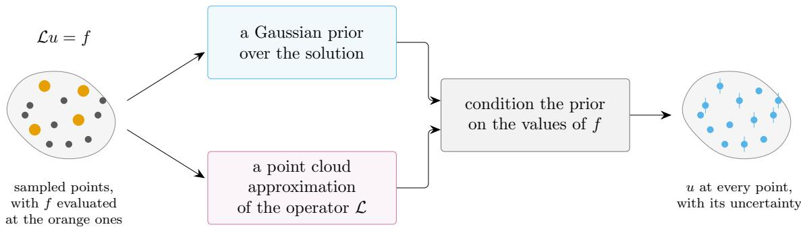  
Figure 1: Overview of the method. The equation is posed on a manifold known only through a sample of points, from which we build both a Gaussian prior over the solution and a point cloud approximation of the diferential operator. Conditioning on the values of the forcing term at the collocation points (orange) returns a posterior, which gives the solution at every node together with its uncertainty.

## 1 Introduction

Partial diferential equations (PDEs) are among the most widely used tools in mathematics and physics as they provide the natural language for modelling a wide variety of natural phenomena (Courant and Hilbert, 1989; Evans, 2022). Given a domain X, a partial diferential equation has the form

$$
A u = g
$$

where g and u are the forcing term and the solution, both belonging to function spaces over X, and A is a diferential operator from the function space of u to the one of g. When X has a boundary, an additional condition of the form $B u = b$ is typically imposed, where B and b are defined as above but only on the boundary ∂X. For simplicity, in the case with boundary, we refer to the stacked terms $g = [ g , b ] ^ { \top }$ and operators $\angle = [ A , B ] ^ { \top }$ as forcing term and diferential operator, respectively. In this work, we focus on linear diferential operators A and B. While the linear case is the simplest, it is amenable to model a wide range of phenomena such as heat difusion (Carslaw and Jaeger, 1959), electromagnetism (Jackson, 1962), and linear elasticity (Love, 1944).

In most cases of interest, PDEs do not admit closed-form solutions and must be solved numerically (Quarteroni and Valli, 1994; LeVeque, 2007; Brenner and Scott, 2008). All numerical solvers rely on a discretization, which replaces the infinite-dimensional problem by a finite-dimensional one. Among the most widely used approaches are finite elements (Brenner and Scott, 2008), finite volume (Eymard et al., 2000), generalized finite diferences (Mirzaei et al., 2012), and spectral methods (Gottlieb and Orszag, 1977). Finite elements and finite volume methods approximate the domain with a mesh. In finite element methods, the mesh induces a piecewise polynomial basis, and projecting the equation onto it turns the problem into a sparse linear system for the coeficients of the solution. This approach has proven to be extremely powerful, at the cost of the complexity of generating a mesh and of choosing a basis adapted to the geometry (Quarteroni and Valli, 1994). Generalized finite diference methods avoid the mesh and approximate the operator directly on a point cloud, with a matrix that reproduces the operator action on polynomials exactly up to a desired degree. The solution is then obtained by solving the resulting linear system, i.e., by inverting the discretized operator. However, the condition number of such matrix degrades with growing number of points and polynomial order, leading to asymptotically divergent behaviors (Zheng and Li, 2022). Spectral methods shift the discretization from the geometric domain to the function space. The eigenfunctions of the operator are taken as basis for both the solution and the forcing term. Expanding both in this basis, the operator multiplies each coeficient of the solution by the corresponding eigenvalue, so that matching the two expansions gives each coeficient of the solution as the coeficient of the forcing term divided by its eigenvalue. However, this requires the eigenpairs of the operator in closed form, which are available only in very specific cases (Gottlieb and Orszag, 1977). The output of all these methods is a numerical approximation of the PDE solution u.

Beyond the approximation itself, it is often desirable to quantify the uncertainty about its distance from the true solution. Gaussian processes provide a natural route to obtain both the approximation and an uncertainty estimate. A Gaussian process is a statistical distribution over functions, fully characterized by its mean function m : X → R and covariance kernel k : $: X \times X \to \mathbb { R }$ (Bogachev, 1998), the latter determining most of its properties. A key property of Gaussian processes is that they are closed under conditioning. Namely, given a set of points $\{ x _ { 1 } , . . . , x _ { N } \} = Y _ { N } \subset X$ and their evaluations $u ( Y _ { N } )$ of the function to approximate, the posterior distribution is again a Gaussian process with moments

$$
\begin{array} { r l } & { \mu ( x | Y _ { N } ) = \big [ k ( x , Y _ { N } ) \big ] \big [ k ( Y _ { N } , Y _ { N } ) \big ] ^ { - 1 } u ( Y _ { N } ) , } \\ & { \Sigma ( x , x ^ { \prime } | Y _ { N } ) = k ( x , x ^ { \prime } ) - \big [ k ( x , Y _ { N } ) \big ] \big [ k ( Y _ { N } , Y _ { N } ) \big ] ^ { - 1 } \big [ k ( Y _ { N } , x ^ { \prime } ) \big ] , } \end{array}
$$

where $k ( Y _ { N } , Y _ { N } )$ is called the Gram matrix. In the case where we aim at solving PDEs, the first step is to replace the solution by a Gaussian process which takes values in an appropriate function space. In the case of a PDE, however, the solution cannot be evaluated, and only the forcing term is accessible. The solution is therefore modeled as a Gaussian process $\hat { u } \sim \mathcal G P ( m , k )$ and the prior model for the forcing term is obtained by applying the operator to it, $\hat { g } = \mathcal { L } \hat { u }$ . Since $\mathcal { L }$ is linear, by closedness of Gaussians under linear operators, the forcing term $g$ is again Gaussian. Conditioning on evaluations of the forcing term at a finite set of collocation nodes then yields a posterior process whose mean approximates the solution and whose variance quantifies the uncertainty about it (S¨arkk¨a, 2011; Cialenco et al., 2012; Owhadi, 2015; Cockayne et al., 2016). This approach is known as the probabilistic meshless method (PMM) (Cockayne et al., 2016), described in detail in Section 2.1.

PMMs have been extensively studied when the domain is an appropriate subset of a Euclidean space (S¨arkk¨a, 2011; Cialenco et al., 2012; Owhadi, 2015; Cockayne et al., 2016). However, many applications involve PDEs defined on manifolds, such as granular flow (Suchde and Kuhnert, 2019), surface Navier-Stokes equations (Nitschke et al., 2012), liquid crystals (Nestler et al., 2018), biomembranes (Barreira et al., 2011; Elliott et al., 2012), and computer graphics (Bertalm´ıo et al., 2001; Crane et al., 2013). Despite their relevance, manifold domains have received little attention in the PMM literature.

A notable exception is the work of Harlim et al. (2022), which focuses on point clouds sampled from the domain being an unknown manifold with boundaries. In this setting, the Gaussian process on the manifold is approximated at the points of the cloud through a graph spectral approximation, as proposed by Harlim et al. (2020). Since the operator is not available in closed form, Harlim et al. (2022) approximate it at the points by a matrix obtained via the ghost points difusion method (Jiang and Harlim, 2023), which is constructed similarly to generalized finite diferences. The restriction of a point cloud makes the Gaussian process a finite Gaussian vector and, since the operator is a matrix, the prior model for the forcing term g is the Gaussian vector u after ghost point matrix multiplication L, L u. This work difers from ours in two respects. First, it focuses on inverse problems, in which the operator is assumed to depend on an unknown parameter θ while observations of the solution are available, and whose objective is to infer θ rather than the solution itself. Second, its convergence is assessed only through numerical experiments, without a theoretical analysis.

Inspired by this work, we extend PMMs to manifolds and provide thorough analysis of convergence rates in two settings, which difer in the prior information available about the manifold. First, we consider a known manifold, whose Laplace–Beltrami eigenpairs are available. In this case, the base Gaussian process can be written as a Fourier series in these eigenpairs. The diferential operator is then either applied to this series in closed form or approximated with a generalized finite diference method (GFDM). In the former case, the construction coincides with the Euclidean one, up to the notation. In the latter case, the Gaussian process over the solution is restricted to the point cloud on which the operator is discretized, and the prior model is obtained by GFDM matrix multiplication of the solution Gaussian process. We prove that this model is consistent with the closed-form one at the points of the cloud, at a rate governed by the fill distance of the cloud. Second, we consider an implicit manifold, which is only available through a point cloud sampled from it. In this case, we treat the problem similarly to Harlim et al. (2022), since both the operator and the Gaussian process are not available in closed form. Restricting to closed manifolds, we replace the ghost point difusion matrix with a novel GFDM scheme allowing to control the rate at which the norm of the GFDM matrix grows, thus resulting in additional stability over the action (left multiplication) of this matrix. We prove that the resulting Gram matrix converges to the closed form one at the points of the cloud. Finally, for all models, we derive error bounds for the posterior mean, which separate the intrinsic collocation error from the error due to the approximation of the operator and of the Gaussian process.

The paper is organized as follows. Section 2 reviews probabilistic meshless methods and generalized finite diferences on manifolds. Section 3 presents proposed extension to known and implicit manifolds, together with the corresponding convergence results. Section 4 derives error bounds for the posterior mean at the nodes and the contraction speed to the true solution as the density of the point cloud grows and the number evaluations of the forcing term increases. Finally, Section 6 reports numerical experiments on the circle, the sphere and the flat torus, where the exact solution is available and the theoretical results can be tested, as well as an application to the smoothing of cortical thickness data.

## 2 Background

This section first introduces the probabilistic meshless methods, the class of stochastic collocation solvers for PDEs on which our approach builds. Then, it reviews generalized finite diference methods for approximating diferential operators on manifolds. These methods

provide the discretization we rely on whenever the diferential operator cannot be applied to the kernel in closed form, both on known and on implicit manifolds.

## 2.1 Probabilistic Meshless Methods

Probabilistic meshless methods (Cockayne et al., 2016) are PDE solvers which belong to the broader class of Bayesian numerical methods (Cockayne et al., 2019). These methods recast classical numerical tasks as problems of statistical inference, and have been developed for optimization (Mockus, 1989; Mahsereci and Hennig, 2017), integration (O’Hagan, 1991), linear systems (Hennig, 2015), and ordinary and partial diferential equations (S¨arkk¨a, 2011; Cialenco et al., 2012; Owhadi, 2015; Cockayne et al., 2016; Tronarp et al., 2021). The main advantage of Bayesian methods over classical methods is that the Bayesian posterior distribution provides both an estimate of the problem solution and a quantification of its uncertainty. For PDEs, closely-related approaches have been developed under diferent formalisms, e.g., under the perspectives of stochastic partial diferential equations (Cialenco et al., 2012), Bayesian homogenization (Owhadi, 2015) and partial diferential equations (S¨arkk¨a, 2011; Cockayne et al., 2016). In the following, we introduce PMMs using the formalism of Cockayne et al. (2016).

Consider a domain $X \subseteq \mathbb { R } ^ { d }$ , possibly with Lipschitz boundary $\partial X$ , where $d < \infty$ . We write ${ \overline { { X } } } : = X \cup \partial X$ for the union of the domain and its boundary. The prototypical PDE system is defined as

$$
\left\{ \begin{array} { l l } { A u _ { 0 } ( x ) = g ( x ) , } & { x \in X } \\ { B u _ { 0 } ( x ) = b ( x ) , } & { x \in \partial X } \end{array} , \right.\tag{1}
$$

where $\mathcal { A } : H ( X ) \to H _ { \mathcal { A } } ( X )$ and $\boldsymbol { B } : H ( \boldsymbol { X } ) \to H _ { \mathcal { B } } ( \partial \boldsymbol { X } )$ are linear operators, $g \in H _ { \mathcal { A } } ( X )$ and $b \in H _ { B } ( \partial X )$ are the forcing terms, $H , H _ { A }$ and $H _ { B }$ are Hilbert spaces of functions where the sampling operator is well defined, and $u _ { 0 }$ is the solution. Following Cockayne et al. (2016), we allow for two sources of uncertainty in (1). The first one arises in Bayesian inverse problems, which aim to estimate an unknown parameter $\theta \in \Theta$ of the operator from observations of the solution given the forcing term. In Bayesian terms, the unknown $\theta$ is modeled by a probability distribution over $\Theta$ obtained via maximum a posteriori (MAP) estimation. Formally, the uncertainty over the operator is modeled by introducing a probability space $\left( \Omega ^ { \prime } , \mathcal { F } ^ { \prime } , \mathbb { P } ^ { \prime } \right)$ and setting $\theta = \theta ( \omega ^ { \prime } )$ , so that the operators are rewritten as

$$
\begin{array} { r } { A : H ( X ) \times \Omega ^ { \prime }  H _ { A } ( X ) , \qquad B : H ( X ) \times \Omega ^ { \prime }  H _ { B } ( \partial X ) , } \end{array}
$$

both assumed to be Borel measurable operators. The solution becomes a random function $u ( \cdot , \omega ^ { \prime } ) \in H ( X )$ , defined by

$$
\left\{ \begin{array} { l l } { A [ \omega ^ { \prime } ] u ( x , \omega ^ { \prime } ) = g ( x ) , } & { x \in X , } \\ { B [ \omega ^ { \prime } ] u ( x , \omega ^ { \prime } ) = b ( x ) , } & { x \in \partial X , } \end{array} \right.\tag{2}
$$

with $g \in H _ { \mathcal { A } } ( X )$ and $b \in H _ { B } ( \partial X )$ . The second source of uncertainty arises in the forward problem, i.e., in the approximation of the solution of (1). As advocated by Owhadi (2015), a natural construction places a Gaussian process prior over the forcing term, which is then propagated to the solution through the operator. To this end, we introduce a second probability space $( \Omega , \mathcal { F } , \mathbb { P } )$ and model the forcing terms as stochastic processes, such that $g : X \times \Omega $ R satisfies $g ( \cdot , \omega ) \in H _ { \cal A } ( X )$ for almost every $\omega ,$ and similarly for b. This leads to the doubly stochastic problem

$$
\left\{ \begin{array} { l l } { \boldsymbol { A } [ \omega ^ { \prime } ] u ( x , \omega ^ { \prime } , \omega ) = g ( x , \omega ) , } & { x \in X } \\ { \mathcal { B } [ \omega ^ { \prime } ] u ( x , \omega ^ { \prime } , \omega ) = \boldsymbol { b } ( x , \omega ) , } & { x \in \partial X } \end{array} \right. .\tag{3}
$$

This system encompasses the class of problems that the probabilistic meshless method can solve. Using two separate probability spaces allows a single model to cover several settings, such as inverse problems with noisy observations, or forward problems with an uncertain operator. The latter is the setting of this paper, where the uncertainty on the operator originates from its discretization.

Since Gaussian processes remain Gaussian under linear operators (Bogachev, 1998), it is convenient to model the forcing term as a Gaussian process on $H _ { \cal { L } } ( X )$ with covariance kernel Λ, and to derive the distribution of the solution u from it. To this end, we fix $\omega ^ { \prime } \in \Omega ^ { \prime }$ and write $\mathcal { L } = \mathcal { L } [ \omega ^ { \prime } ]$ . The Green’s function is defined as the solution of the system

$$
\mathcal { L } G ( x , y ) = \delta ( x - y ) , \qquad x \in \overline { { { X } } } , \ y \in \overline { { { X } } } ,\tag{4}
$$

where $\delta$ is the Dirac delta. Intuitively, G is the kernel of the right inverse of ${ \mathcal { L } } ,$ in the sense that the solution satisfies $\begin{array} { r } { u ( x ) = \int _ { \overline { { X } } } G ( x , \eta ) \left[ g , b \right] ( \eta ) \mathrm { d V o l } ( \eta ) , \forall x \in \overline { { X } } } \end{array}$ , where dVol denotes the volume measure on X and the surface measure on ∂X. If the system (3) admits a Green’s function $G ,$ , the prior on the forcing term induces the prior $u \sim \mathcal { G P } ( 0 , k _ { G } )$ on the solution (S¨arkk¨a, 2011; Cockayne et al., 2016), where

$$
k _ { G } ( x , y ) = \int _ { X } \int _ { X } G ( x , \zeta ) \Lambda ( \zeta , \eta ) G ( \eta , y ) \mathrm { d V o l } ( \zeta ) \mathrm { d V o l } ( \eta ) ,\tag{5}
$$

and we denote by $H _ { k _ { G } } ( X )$ its reproducing kernel Hilbert space (RKHS). Cockayne et al. (2016) show that $u _ { 0 } \in H _ { k _ { G } } ( X )$ . Another useful observation is that $g \sim \mathcal { G P } ( 0 , \Lambda )$ if and only if $u \sim \mathcal { G P } ( 0 , k _ { G } )$ (Cockayne et al., 2016, Proposition 2), so that the prior can equivalently be placed on the forcing term g or on the solution u.

Since Green’s functions are rarely available in closed form, we rely instead on priors placed directly on $u ,$ which is justified by the previous observation. Collocation methods posit a kernel $k _ { \dagger }$ for the solution, $u \sim \mathcal { G P } ( 0 , k _ { \dagger } )$ , chosen so that $H _ { k _ { G } } ( X )$ is embedded in $H _ { k _ { \dagger } } ( X )$ (Cockayne et al., 2016). A technical obstruction remains, since a Gaussian measure assigns zero mass to its own RKHS. This is resolved by introducing the integral-type kernel of $k _ { \dagger }$ (Cialenco et al., 2012, Lemma 2.1),

$$
k ( x , x ^ { \prime } ) : = \int _ { X } k _ { \dagger } ( x , z ) k _ { \dagger } ( z , x ^ { \prime } ) \mathrm { d V o l } ( z ) ,\tag{6}
$$

which guarantees that ${ \mathcal { G P } } ( 0 , k )$ is supported on $H _ { k _ { \mathrm { f } } } ( X )$ and $H _ { k } ( X )$ is densely embedded in it (Cockayne et al., 2016, Proposition 4). The main drawback of this choice is that samples of $u \sim \mathcal { G P } ( 0 , k )$ are not constrained to satisfy boundary conditions. To simplify notation, we write $\mathcal { L } : = [ A , B ] ^ { \top }$ for the stacked operator. Let $Z _ { N _ { c } } = \{ x _ { 1 } , \ldots , x _ { N _ { c } } \} \subset \overline { { { X } } }$ be the collocation set, at which the forcing term is observed, so that $\pmb { y } = [ g , b ] ( Z _ { N _ { c } } ) \in \mathbb { R } ^ { N _ { c } }$ collects the values of $g$ at the interior points and of b at the boundary points of $Z _ { N _ { c } }$ . Denoting by $\mathcal { L } _ { x }$ and $\mathcal { L } _ { y }$ the action of $\mathcal { L }$ on the first and second argument of a kernel, respectively, the posterior process is $\Pi ^ { u | y } = { \mathcal { G P } } ( \mu , \Sigma )$ , with

$$
\boldsymbol { \mu } ( x ) = \left[ \mathcal { L } _ { y } k ( x , Z _ { N _ { c } } ) \right] \left[ \mathcal { L } _ { x } \mathcal { L } _ { y } k ( Z _ { N _ { c } } , Z _ { N _ { c } } ) \right] ^ { - 1 } \boldsymbol { y } ,\tag{7}
$$

$$
\Sigma ( x , x ^ { \prime } ) = k ( x , x ^ { \prime } ) - \left[ \mathcal { L } _ { y } k ( x , Z _ { N _ { c } } ) \right] \left[ \mathcal { L } _ { x } \mathcal { L } _ { y } k ( Z _ { N _ { c } } , Z _ { N _ { c } } ) \right] ^ { - 1 } \left[ \mathcal { L } _ { x } k ( Z _ { N _ { c } } , x ^ { \prime } ) \right] ,\tag{8}
$$

where $\mathcal { L } _ { x } \mathcal { L } _ { y } k ( Z _ { N _ { c } } , Z _ { N _ { c } } )$ is the Gram matrix. The boundary conditions are thus enforced only at the collocation points placed on $\partial X$ . They are therefore not satisfied exactly by the posterior, but the posterior restricted to the boundary converges as the number of boundary points grows.

As noted by Cialenco et al. (2012), it is convenient to choose $k _ { \dagger }$ as a Mercer’s kernel. Given its series expansion

$$
k _ { \dagger } ( x , y ) = \sum _ { i = 0 } ^ { \infty } \lambda _ { i } \phi _ { i } ( x ) \phi _ { i } ( y ) ,
$$

the integral-type kernel k is obtained by squaring $\lambda _ { i }$ in the series. As detailed by Cialenco et al. (2012), Mat´ern kernels are a natural choice since it is easy to control the function space to which samples belong. Let $k _ { \dagger }$ be a Mat´ern with smoothness $\nu ,$ whose RKHS is norm-equivalent to the Sobolev space $\dot { H } ^ { \nu + d / 2 } ( X )$ (Cialenco et al., 2012, Example A.1), and assume that the solution lies in $H ^ { s } ( X )$ . Squaring the eigenvalues doubles the Sobolev order, so that $H _ { k } ( X ) \cong H ^ { 2 \nu + d } ( X )$ . Two conditions then constrain $\nu .$ First, $H ^ { s } ( X ) \subset H _ { k _ { \dagger } } ( X )$ requires $\nu \leq s - d / 2$ , while $H _ { k } ( X )$ is dense in $H _ { k _ { \mathrm { f } } } ( X )$ . Second, evaluating $\mathcal { L } u$ at the collocation points requires $H _ { k _ { \mathrm { + } } } ( X ) \subset C ^ { l } ( X )$ , with l the order of the diferential operator, which gives $\nu > l .$ . Combining the two, the admissible choices are $\nu \in ( l , s - d / 2 ]$ . For the integral-type kernel, this corresponds to $H _ { k } ( X ) \cong H ^ { 2 \nu + d } ( X )$ with $2 \nu + d \in ( 2 l + d , 2 s ]$

## 2.2 Generalized finite diferences on manifolds

We briefly present the GFDM approach of Suchde and Kuhnert (2019) proposed for PDEs on implicit manifolds. This is the discretization we use whenever the diferential operator cannot be applied in closed form. Its main advantage over mesh-based methods is that it only requires a point cloud sampled from the manifold.

Using the stacked notation introduced in Section 2.1, consider the problem

$$
\begin{array} { r } { \mathcal { L } u = [ g , b ] ^ { \top } , } \end{array}
$$

where $X = M$ is a smooth compact d-dimensional manifold embedded in $\mathbb { R } ^ { n }$ . Let $X _ { N } \subset M$ be a point cloud of size N. GFDM uses the point cloud to approximate the linear operator $\mathcal { L }$ with a square matrix L of dimension N whose i-th row reproduces $\mathcal { L }$ exactly on the local polynomials of degree at most $p$ centred at $x _ { i } \in X _ { N }$

At each node $x _ { i }$ , we consider an orthonormal frame $T _ { i } = [ t _ { i , 1 } , \ldots , t _ { i , d } ] \in \mathbb { R } ^ { n \times d }$ of the tangent space $\tau _ { x _ { i } } M$ , with associated orthogonal projector

$$
P _ { i } = T _ { i } { T _ { i } ^ { \top } } = \sum _ { s = 1 } ^ { d } t _ { i , s } t _ { i , s } ^ { \top } ,\tag{9}
$$

which is frame independent. The frame can be either known in advance or estimated from the point cloud, for example by tangent principal component analysis (Tyagi et al., 2013). We then define the stencil of $x _ { i }$ as the set $S _ { i } = \{ x _ { i , 1 } , \ldots , x _ { i , \mathsf { K } } \}$ of its K nearest neighbours, ordered so that $x _ { i , 1 } = x _ { i }$ , and we denote by

$$
z _ { i , a } : = T _ { i } ^ { \top } \big ( x _ { i , a } - x _ { i } \big ) \in \mathbb { R } ^ { d } ,\tag{10}
$$

the coordinates of the neighbours in the frame at $x _ { i }$ . The space of local polynomials of degree at most $p$ at $x _ { i }$ is

$$
\Pi _ { p } ( x _ { i } ) = \mathrm { s p a n } \big ( \{ q _ { i , \beta } \} _ { | \beta | \leq p } \big ) , \qquad q _ { i , \beta } ( x ) = \prod _ { s = 1 } ^ { d } \big [ t _ { i , s } \cdot ( x - x _ { i } ) \big ] ^ { \beta _ { s } } ,\tag{11}
$$

and has dimension Q := dim $\Pi _ { p } ( x _ { i } ) = { \binom { p + d } { d } }$

The stencil coeficients, which form the rows of the GFDM matrix, are computed in two steps. In the first step, u is approximated around $x _ { i }$ by a weighted least-squares fit in $\Pi _ { p } ( x _ { i } )$ . To this end, we take $\mathsf { K } > Q$ , assign positive weights $\omega _ { i , a }$ to the points of $S _ { i }$ , and write $\boldsymbol { u } _ { i } = ( u _ { i , 1 } , \ldots , u _ { i , \mathsf { K } } ) ^ { \top }$ , with $u _ { i , a } = u ( x _ { i , a } )$ , for the values of u on the stencil. The fit minimizes the quadratic objective

$$
J _ { i } ( \pmb \theta ) = \sum _ { a = 1 } ^ { \mathsf { K } } \omega _ { i , a } \big ( \ P _ { i } ( x _ { i , a } ) ^ { \top } \pmb \theta - u _ { i , a } \big ) ^ { 2 } , \qquad \ P _ { i } ( \pmb x ) : = \big ( q _ { i , \beta ( 1 ) } ( \pmb x ) , \dots , q _ { i , \beta ( Q ) } ( \pmb x ) \big ) ^ { \top } ,\tag{12}
$$

over the coeficient vectors $\pmb \theta \in \mathbb { R } ^ { Q }$ , where $\{ \beta ( 1 ) , \ldots , \beta ( Q ) \}$ enumerates the multi-indices with $| \beta | \le p$ . Stacking the rows $\mathfrak { q } _ { i } ( x _ { i , a } ) ^ { \top }$ into the Vandermonde matrix $V _ { i } \in \mathbb { R } ^ { \mathsf { K } \times Q }$ with entries $( V _ { i } ) _ { a \gamma } = z _ { i , a } ^ { \beta ( \gamma ) }$ , and writing $\Omega _ { i } = \mathrm { d i a g } ( \omega _ { i , 1 } , \dots , \omega _ { i , \mathsf { K } } )$ , the objective reads

$$
J _ { i } ( \pmb \theta ) = ( V _ { i } \pmb \theta - u _ { i } ) ^ { \top } \Omega _ { i } ( V _ { i } \pmb \theta - u _ { i } ) .\tag{13}
$$

Provided that $V _ { i }$ has full column rank, the optimum is attained at

$$
\pmb { \theta } _ { i } = \mathsf { A } _ { i } ^ { - 1 } \boldsymbol { V } _ { i } ^ { \top } \boldsymbol { \Omega } _ { i } \boldsymbol { u } _ { i } , \qquad \mathsf { A } _ { i } : = \boldsymbol { V } _ { i } ^ { \top } \boldsymbol { \Omega } _ { i } \boldsymbol { V } _ { i } .\tag{14}
$$

and the local approximation of u around $x _ { i }$ is $\hat { u } _ { i } : = \mathfrak { q } _ { i } ^ { \top } \pmb { \theta } _ { i } \in \Pi _ { p } ( x _ { i } )$

For the second step we seek the vector $c _ { i } ^ { \mathcal { L } } \in \mathbb { R } ^ { \mathsf { K } }$ of stencil coeficients, which collects the nonzero entries of the i-th row of $L _ { ; }$ such that $\begin{array} { r } { \mathcal { L } \boldsymbol { u } ( \boldsymbol { x } _ { i } ) \approx \sum _ { a } c _ { i , a } ^ { \mathcal { L } } \boldsymbol { u } ( \boldsymbol { x } _ { i , a } ) } \end{array}$ . Replacing u by $\hat { u } _ { i }$ and using the linearity of $\mathcal { L }$

$$
\mathcal { L } \hat { u } _ { i } ( \boldsymbol { x } _ { i } ) = \sum _ { \gamma = 1 } ^ { Q } ( \theta _ { i } ) _ { \gamma } \mathcal { L } q _ { i , \beta ( \gamma ) } ( \boldsymbol { x } _ { i } ) = \left( b _ { i } ^ { \mathcal { L } } \right) ^ { \top } \pmb { \theta } _ { i } , \qquad \left( b _ { i } ^ { \mathcal { L } } \right) _ { \gamma } : = \mathcal { L } q _ { i , \beta ( \gamma ) } ( \boldsymbol { x } _ { i } ) ,\tag{15}
$$

where $ { b _ { i } ^ { \mathcal { L } } }$ collects the action of $\mathcal { L }$ on each basis element, evaluated at the base point. Substituting (14) into (15) yields the stencil coeficients

$$
\left( c _ { i } ^ { \mathcal { L } } \right) ^ { \top } = \left( \pmb { b } _ { i } ^ { \mathcal { L } } \right) ^ { \top } \mathsf { A } _ { i } ^ { - 1 } V _ { i } ^ { \top } \Omega _ { i } .\tag{16}
$$

Arranging the vectors $c _ { i } ^ { \mathcal { L } }$ into rows gives a sparse matrix $\boldsymbol { L } \in \mathbb { R } ^ { N \times N }$ with at most NK nonzeros entries, and $L u | _ { X _ { N } } \approx \mathcal { L } u | _ { X _ { N } }$

The accuracy of this approximation is measured in terms of the fill distance. Given a finite set of points $Y$ contained in a domain D, the fill distance of Y in D is $h _ { \mathrm { } Y , D } : =$ $\mathrm { s u p } _ { x \in D } \mathrm { d i s t } ( x , Y )$ , where dist is the distance on D. In particular, the fill distance of the node cloud with respect to the geodesic distance $d _ { g }$ is

$$
h _ { N } : = h _ { X _ { N } , M } = \operatorname* { s u p } _ { x \in M } \operatorname* { m i n } _ { j \leq N } d _ { g } ( x , x _ { j } ) .\tag{17}
$$

Fix $h _ { 0 }$ with $h _ { N } \leq h _ { 0 }$ and let $\begin{array} { r } { M ^ { * } = \bigcup _ { x \in X _ { N } } B ( x , h _ { 0 } ) } \end{array}$ , where $B ( x , r )$ denotes the geodesic ball of radius r centred at x. Then, for $f \in \tilde { C } ^ { p + 1 } ( M ^ { * } )$ and an operator of order $l \leq p ,$ Mirzaei et al. (2012) shows that

$$
\left| \mathcal { L } f ( x _ { i } ) - L f _ { | _ { X _ { N } } } ( x _ { i } ) \right| \le C h _ { N } ^ { p + 1 - l } | f | _ { C ^ { p + 1 } ( M ^ { * } ) } .\tag{18}
$$

The approximation is therefore consistent of order $p + 1 - l .$ . Replacing the operator by a matrix built on the point cloud introduces an error which vanishes as $h _ { N }  0$ , hence as $N \to \infty$ , under mild conditions on the sampling.

## 3 Probabilistic meshless methods on manifolds

In this section we introduce our extension of probabilistic meshless methods to compact manifold domains. We distinguish two cases, depending on the information available about the manifold. A manifold is known if its tangent spaces and the eigendecomposition of its Laplace–Beltrami operator are available in closed form. Since this is the case only for special manifolds, we also consider the more general case of implicit manifolds, for which the only available information is a sample of points in the embedding space. Known manifolds may have a boundary, whereas implicit manifolds must be closed. In both cases, we focus on forward problems in which the diferential operator is replaced by an approximation, and the resulting discretization error plays the role of the uncertainty on the operator in (3). The extension to inverse problems appears possible along the lines of Harlim et al. (2022), but we do not pursue it here.

## 3.1 Known manifolds

If the manifold is known and L is available in closed form, the method is exactly the probabilistic meshless method built on the integral-type kernel (6) transported to the manifold setting. Indeed, the construction of Section 2.1 relies on properties which carry over to compact manifolds. First, a Gaussian process on a compact manifold can be built from the eigendecomposition of the Laplace–Beltrami operator (Bogachev, 1998; Borovitskiy et al., 2020). Second, linear operators act on Gaussian processes as in the Euclidean case (Bogachev, 1998). Third, the Sobolev embeddings used to select the kernel smoothness still hold (Munkres, 2018). Finally, the density of the RKHS of the integral-type kernel follows from Cialenco et al. (2012, Lemma 2.1), whose proof does not rely on any Euclidean structure the manifold does not possess, and thus transfers to manifolds. Since no approximation is involved, this model has the same control as in the Euclidean case. Therefore, it is our reference model, and the aim of the methods that follow is to approximate it.

The reference model above requires $\mathcal { L }$ in closed form, which is rarely the case. If the operator $\mathcal { L }$ is not available in closed form, we propose to sample a point cloud over the manifold and replace L by its GFDM discretization $L .$ More precisely, we first define a Gaussian process $u \sim \mathcal { G P } ( 0 , k )$ on the manifold with k the integral-type kernel (6). We then sample a point cloud $X _ { N } \subset M$ of size N over the manifold, and restrict the Gaussian process to it, obtaining a N-dimensional Gaussian vector $u _ { N }$ . The same point cloud is used to discretize the operator via GFDM approximation, i.e., to build the GFDM matrix L. The discrete surrogate of the $\mathcal { L } u$ is then the Gaussian vector $L u _ { N } \sim \mathcal { N } ( 0 , L k ( X _ { N } , X _ { N } ) L ^ { \top } )$ . The posterior is obtained by sampling the forcing term at collocation points, taken as a subset of the point cloud $Z _ { N _ { c } } \subseteq X _ { N }$ . Denoting by $L _ { c } \in \mathbb { R } ^ { N _ { c } \times N }$ the rows of L indexed by $Z _ { N _ { c } }$ , the observations y of the forcing terms at the collocation points are then modelled as $\pmb { y } = L _ { c } \pmb { u } _ { N }$ Conditioning on them gives the posterior distribution $\Pi ^ { u | y } = { \mathcal { N } } ( \mu , \Sigma )$ on the point cloud, with

$$
\mu ( x _ { i } ) = \left[ L _ { c } k ( x _ { i } , Z _ { N _ { c } } ) \right] \left[ L _ { c } k ( Z _ { N _ { c } } , Z _ { N _ { c } } ) L _ { c } ^ { \top } \right] ^ { - 1 } y ,\tag{19}
$$

$$
\Sigma ( x _ { i } , x _ { j } ) = k ( x _ { i } , x _ { j } ) - \left[ L _ { c } k ( x _ { i } , Z _ { N _ { c } } ) \right] \left[ L _ { c } k ( Z _ { N _ { c } } , Z _ { N _ { c } } ) L _ { c } ^ { \top } \right] ^ { - 1 } \left[ k ( Z _ { N _ { c } } , x _ { j } ) L _ { c } ^ { \top } \right] ,\tag{20}
$$

for $x _ { i } , x _ { j } \in X _ { N }$ This construction fits the doubly stochastic framework of Section 2.1. Indeed, the GFDM approximation depends on the point cloud, which can be regarded as a realization of a random variable $Y : \Omega ^ { \prime } \to M .$ , so that the uncertainty on the operator reflects the diferent approximations produced by diferent samples of the point cloud. The following result shows that, at the nodes, the GFDM discretization applied to samples of the prior converges to the exact operator, at a rate governed by the fill distance.

Theorem 1 (Convergence at the nodes) Let M be a compact manifold, possibly with boundary, for which the spectral expansion of the Laplace–Beltrami operator is known. Let L be a linear diferential operator of order l and L its GFDM approximation of polynomial degree $p \geq l$ . Assume the Gaussian process u is such that sample paths lie almost surely in $C ^ { p + 1 } ( M )$ . Then, for P-almost every $\omega \in \Omega$

$$
\begin{array} { r } { \left| L u _ { | X _ { N } } ( \cdot , \omega ) ( x _ { i } ) - \mathcal L u ( x _ { i } , \omega ) \right| \ \leq C h _ { N } ^ { p + 1 - l } \left| u ( \cdot , \omega ) \right| _ { C ^ { p + 1 } ( M ^ { * } ) } \qquad f o r \ e v e r y \ n o d e \ x _ { i } \in X _ { N } , } \end{array}
$$

with C independent of ω and N.

Proof. Let $\mathcal { N } \subset \Omega$ be the null set outside which sample paths fail to be $C ^ { p + 1 } ( M )$ , and fix $\omega \not \in \mathcal N$ . Writing $f : = u ( \cdot , \omega ) \in C ^ { p + 1 } ( M )$ , the consistency property of the GFDM stencil (18) gives

$$
\big | L f ( x _ { i } ) - \mathcal L f ( x _ { i } ) \big | \ \le \ C h _ { N } ^ { p + 1 - l } | f | _ { C ^ { p + 1 } ( M ^ { * } ) } .\tag{21}
$$

Since $p \geq l$ the exponent is positive, so that the right hand side goes to zero if $h _ { N }  0$

The resulting model is a probabilistic meshless method on a known manifold, in which the diferential operator is replaced by its GFDM approximation. By Theorem 1, this approximation is consistent at the nodes with the rate $h _ { N } ^ { p + 1 - l }$ inherited from the GFDM stencil. While the probabilistic meshless methods of Cockayne et al. (2016) requires $\mathcal { L }$ to be applied to the kernel in closed form, it is here suficient to have a point cloud on the manifold, on which the operator is approximated.

## 3.2 Implicit manifolds

In the known case, the kernel can be evaluated exactly and only the diferential operator needs to be approximated. In contrast, the only information available about an implicit manifold is a point cloud $X _ { N } \subset M$ of size $N$ , from which both the kernel and the operator of probabilistic meshless methods must be estimated. This requires additional assumptions.

Regarding the Gaussian process, we focus on the class of processes whose kernels are defined through the spectral expansion of the Laplace–Beltrami operator and are expressed using a Fourier series of the form

$$
k ( x , y ) = \sum _ { i = 0 } ^ { \infty } \Phi ( \lambda _ { i } ) \phi _ { i } ( x ) \phi _ { i } ( y ) ,
$$

with $\{ \lambda _ { i } , \phi _ { i } \}$ the eigenpairs of the Laplace–Beltrami operator $\Delta _ { M }$ , and $\Phi$ is a real function. Since this is a Mercer kernel, the corresponding integral-type kernel (6) is obtained by replacing $\Phi ( \lambda _ { i } )$ with $\Phi ( \lambda _ { i } ) ^ { 2 }$ . For notational simplicity, we assume that this squaring is already included in $\Phi$ . As the eigenpairs of $- \Delta _ { M }$ are not available, we approximate them by those of the graph Laplacian $\mathsf { L } ^ { ( \alpha ) } \in \mathbb { R } ^ { N \times N }$ built on the point cloud. On closed manifolds, the eigenvalues and eigenvectors of the graph Laplacian converge uniformly to the eigenvalues and eigenfunctions of $- \Delta { } _ { M }$ as $N \to \infty$ (Dunson et al., 2021). On manifolds with boundary, uniform convergence of the eigenvectors is still an open question (Peoples and Harlim, 2026), and since our analysis relies on it, we restrict to closed manifolds. Further details on the graph Laplacian and the associated convergence rates are given in Appendix $\mathrm { A }$

Writing $0 = \hat { \lambda } _ { 0 } \leq \dots \leq \hat { \lambda } _ { N - 1 }$ for the eigenvalues of $- \mathsf { L } ^ { ( \alpha ) }$ and $\hat { \phi } _ { 0 } , \ldots , \hat { \phi } _ { N - 1 }$ for the associated eigenvectors, Fichera et al. (2023) approximate a Mercer kernel on M by

$$
\widehat { k } ( x _ { i } , x _ { j } ) = \sum _ { r = 0 } ^ { N - 1 } \Phi ( \kappa ^ { 2 } + \hat { \lambda } _ { r } ) \hat { \phi } _ { r } ^ { ( i ) } \hat { \phi } _ { r } ^ { ( j ) } ,\tag{22}
$$

where the superscript (i) denotes the i-th entry of the vector. This approximation converges pointwise uniformly to the true kernel on the point cloud as $N \to \infty$ (Dunson et al., 2021; Fichera et al., 2023), and we denote this rate as

$$
\eta _ { N } : = \operatorname* { m a x } _ { 1 \leq i , j \leq N } \bigl | \widehat { k } ( x _ { i } , x _ { j } ) - k ( x _ { i } , x _ { j } ) \bigr | .\tag{23}
$$

Note that, unlike in the known case, the Gaussian process is now only defined on the point cloud, i.e., $u _ { N } \sim \mathcal { N } ( 0 , \hat { K } _ { N } )$ with $\hat { K } _ { N } : = \widehat { k } ( X _ { N } , X _ { N } )$

Since the graph-based kernel (22) is only defined on the point cloud, and the results of (Dunson et al., 2021; Fichera et al., 2023) only guarantee its convergence at the nodes, the natural target is the convergence of the Gram matrix at the nodes. Specifically, given a certain operator approximation $L ,$ we aim to prove that $| \mathcal { L } _ { x } \mathcal { L } _ { y } k - L \hat { k } L ^ { \top } |  0$ as N grows. Replacing $\mathcal { L }$ by the standard GFDM matrix, as in the known case, does not guarantee this convergence in general. The reason is that the stencil coeficients of the standard construction have $\ell ^ { 1 }$ norm of order $h _ { N } ^ { - l }$ , so that applying the GFDM matrix on both sides of $\widehat { k }$ amplifies the kernel error $\eta _ { N }$ by a factor $h _ { N } ^ { - 2 l }$ . Past a certain $N$ , this amplification dominates the gain in consistency.

To overcome this issue, we propose a diferent GFDM approximation in which the consistency rate can be slowed down to match the graph kernel rate, so that the growth of the stencil norm is controlled. This is achieved by setting a radius $\varrho _ { N } .$ , such that $h _ { N } / \delta _ { 1 } \leq \varrho _ { N } \leq \mathrm { m i n } \{ 1 , \iota / 2 \}$ , where ι is the injectivity radius of the manifold M and $\delta _ { 1 }$ is a constant independent of $N$ . The stencil at $x _ { i }$ is then selected inside the geodesic ball $B ( x _ { i } , \varrho _ { N } )$ , retaining one node of $X _ { N }$ next to each point of a suitable net of that ball, as detailed in Appendix B. We denote this stencil by $S _ { i } ^ { \varrho _ { N } }$ , and the associated stencil coeficients by $c _ { i j } ^ { \varrho _ { N } }$ , and the resulting matrix by $L ^ { \varrho _ { N } }$ , to distinguish it from the standard GFDM matrix $L ^ { h }$ . We show that $L ^ { \varrho _ { N } }$ retains the approximation properties of $L ^ { h }$ , with a consistency order governed by $\varrho _ { N }$ , meaning that it can be tuned through the choice of radius. More details about this approximation are provided in Appendix B.

The main result of this section states that, under growth conditions on $\varrho N$ and the four assumptions below, the approximated Gram matrix converges uniformly to the true one as the number of points increases.

Assumption A1 (Geometry and sampling) M is a smooth closed Riemannian d-manifold. Define $\mu = \rho \mathrm { d V o l }$ with $\rho \in C ^ { \infty } ( M )$ and $0 < \rho _ { \mathrm { m i n } } \le \rho \le \rho _ { \mathrm { m a x } }$ . The nodes $x _ { 1 } , \ldots , x _ { N }$ are $i . i . d . \sim \mu$

Assumption A2 (Operator) $\begin{array} { r } { \mathcal { L } = \sum _ { | \beta | \leq l } a _ { \beta } \partial ^ { \beta } } \end{array}$ in normal coordinates with $a _ { \beta } \in C ^ { p + 1 } ( M )$ and the stencil degree satisfies $p \geq l .$ . Set $A _ { \infty } : = \operatorname* { m a x } _ { | \beta | \leq l } \| a _ { \beta } \| _ { L ^ { \infty } }$ and $\begin{array} { r } { C _ { \mathcal { L } } : = A _ { \infty } \binom { l + d } { d } } \end{array}$

Assumption A3 (Prior) Let $- \Delta _ { M }$ have eigenvalues $0 = \lambda _ { 0 } ^ { \Delta } \leq \lambda _ { 1 } ^ { \Delta } \leq \cdot \cdot \cdot$ with $L ^ { 2 } ( M , \mu )$ orthonormal eigenfunctions $\phi _ { 0 } , \phi _ { 1 } , . . .$ . Fix $\kappa > 0$ and a decreasing $\Phi : ( 0 , \infty ) \to ( 0 , \infty )$ with $\Phi ( t ) \asymp t ^ { - 5 }$ , and let

$$
k ( x , y ) : = \sum _ { r \geq 0 } \Phi \bigl ( \kappa ^ { 2 } + \lambda _ { r } ^ { \Delta } \bigr ) \phi _ { r } ( x ) \phi _ { r } ( y ) .\tag{24}
$$

We require $\mathfrak { s } > p + 1 + d$ . Moreover, we assume also that $\| k \| _ { C ^ { p + 1 , p + 1 } } < \infty$

Assumption A4 (Graph kernel) $\widehat { k } \in \mathbb { R } ^ { N \times N }$ is the symmetric matrix from the evaluation of (22) on the point cloud, and $\eta _ { N }$ , defined in (23), satisfies $\eta _ { N } \xrightarrow [ N  \infty ] { \mathbb { P } ^ { \prime } } 0$ but slowly enough that $h _ { N } ^ { p + 1 + l } / \eta _ { N } \to 0$

Note that Assumption A4 holds, for instance, for graph heat kernels (Dunson et al., 2021) and graph Mat´ern kernels (Fichera et al., 2023).

Each of the four assumptions has a simple interpretation. In Assumption A1, the manifold must be closed because graph Laplacian eigenfunctions have no uniform convergence guarantee at the boundary, and the density is bounded so that no region is left without nodes, which ensures that $h _ { N }$ decreases predictably. In Assumption A2, the smoothness of the coeficients makes the action of $\mathcal { L }$ on local polynomials exact and bounded, and the condition $p \geq l$ guarantees the stencil basis is rich enough to reproduce it. The decay imposed in Assumption A3 makes the kernel $C ^ { p + 1 }$ in each argument. Finally, Assumption A4 requires the graph kernel to converge, but not faster than $h _ { N } ^ { p + 1 + l }$ , since otherwise the optimal radius would fall below the fill distance and the stencil could not be used.

To compare the exact and approximate models, we introduce the following notation

$$
K ( x , y ) : = \big ( \mathcal { L } _ { x } \mathcal { L } _ { y } k \big ) ( x , y ) , \qquad K _ { i j } : = K ( x _ { i } , x _ { j } ) , \qquad \widehat { K } : = L ^ { \varrho _ { N } } \widehat { k } \big ( L ^ { \varrho _ { N } } \big ) ^ { \top } ,\tag{25}
$$

where K is the Gram kernel induced by the operator and the prior, $( K _ { i j } ) _ { i , j }$ is its restriction to the point cloud, and $\widehat { K }$ is the discrete Gram matrix, whose dependence on $\varrho N$ is left implicit.

Theorem 2 (Uniform convergence of the discrete Gram matrix) Under A $\begin{array} { r } { 1 { - } A \notin , } \end{array}$ let $( \varrho _ { N } ) _ { N }$ be admissible in the sense of Lemma 6 and such that

$$
\varrho _ { N } \longrightarrow 0 \qquad a n d \qquad \frac { \eta _ { N } } { \varrho _ { N } ^ { 2 l } } \longrightarrow 0 ,\tag{26}
$$

as $N \to \infty$ . Then, with probability tending to one,

$$
\operatorname* { m a x } _ { 1 \le i , j \le N } \bigl | \widehat K _ { i j } - K _ { i j } \bigr | \ \le \ C \left( \varrho _ { N } ^ { p + 1 - l } + \frac { \eta _ { N } } { \varrho _ { N } ^ { 2 l } } \right) \ \longrightarrow \ 0\tag{27}
$$

as $N  \infty$ , with C independent of N. Moreover, the optimal rate is attained for $\varrho _ { N } \asymp$ $\eta _ { N } ^ { 1 / ( p + 1 + l ) }$ , which gives

$$
\operatorname* { m a x } _ { 1 \le i , j \le N } \Bigl | \widehat { K } _ { i j } - K _ { i j } \Bigr | \ \le \ C \eta _ { N } ^ { \frac { p + 1 - l } { p + 1 + l } } .\tag{28}
$$

The proof of is given in Appendix B. The two terms in (27) reflect the trade-of described above: the first is the consistency error of $L ^ { \varrho N }$ , which decreases with the radius, while the second is the kernel error amplified by the stencil coeficients, which increases as the radius shrinks. The optimal radius $\dot { \eta } _ { N } ^ { 1 / ( p + 1 + \check { l } ) }$ is admissible, that is, larger than a multiple of $h _ { N }$ precisely when $h _ { N } ^ { p + 1 + l } / \eta _ { N }  \stackrel { \sim } { 0 }$ , which explains the condition in Assumption A4. Finally, we note that convergence of the Gram matrix at the nodes does not imply weak convergence of the corresponding Gaussian processes as measures on a function space (Bogachev, 1998). This is, however, a standard limitation in the implicit manifold setting (Dunson et al., 2021; Fichera et al., 2023).

## 4 Error bounds for the posterior mean

When a Gaussian process is used for function approximation, it is of interest to quantify how fast the posterior mean converges to the true solution as the number of collocation points increases. In this section, we bound the error of the posterior mean at the nodes, in a form which separates the error intrinsic to PMMs from the error introduced by the approximations of Section 3.

We define $v ( x ) \in \mathbb { R } ^ { N _ { c } }$ and $A \in \mathbb { R } ^ { N _ { c } \times N _ { c } }$ with entries

$$
v _ { j } ( x ) = \mathcal { L } _ { y } k ( x , y ) | _ { y = z _ { j } } , \qquad A _ { i j } = \mathcal { L } _ { x } \mathcal { L } _ { y } k ( x , y ) | _ { x = z _ { i } , y = z _ { j } } ,
$$

so that $A _ { i j } = K ( z _ { i } , z _ { j } )$ in the notation of (25). With this notation, the posterior mean and covariance of the exact model read $\mu ( x ) = v ( x ) ^ { \top } A ^ { - 1 } y$ and $\sigma ( x ) ^ { 2 } = k ( x , x ) - v ( x ) ^ { \top } A ^ { - 1 } v ( x )$ 2 respectively. We denote by ˜· the corresponding quantities computed from the approximations at hand. For instance, we write $\tilde { k } = k$ when the manifold is known, and $\widetilde k = \widehat { k }$ in the implicit case, while ˜v and $\tilde { A }$ are obtained by replacing L with the GFDM matrix in both cases. The Lebesgue constant is $\Lambda _ { \mathrm { L e b } } ( x ) : = \operatorname* { m a x } \{ \| A ^ { - 1 } v ( x ) \| _ { 1 } , \| \tilde { A } ^ { - 1 } \tilde { v } ( x ) \| _ { 1 } \}$ . The size of the perturbation is measured by

$$
\epsilon _ { N } : = \operatorname* { m a x } \Bigl \{ \operatorname* { m a x } _ { x \in X _ { N } } \bigl | \tilde { k } ( x , x ) - k ( x , x ) \bigr | , \operatorname* { m a x } _ { x \in X _ { N } } \operatorname* { m a x } _ { j } \bigl | \tilde { v } _ { j } ( x ) - v _ { j } ( x ) \bigr | , \operatorname* { m a x } _ { i , j } \bigl | \tilde { A } _ { i j } - A _ { i j } \bigr | \Bigr \} .\tag{29}
$$

Lemma 10 bounds $\epsilon N$ in the known and in the implicit case, building on Theorems 1 and 2, respectively.

The following theorem bounds the distance between the approximated posterior mean and the true solution at the nodes, separating the collocation error, which is intrinsic to PMMs, from the error introduced by the two approximations.

Theorem 3 (Error bound for the posterior mean) Assume that k is such that $H _ { k _ { G } } ( M ) \hookrightarrow$ $H _ { k } ( M )$ , which in particular implies $u _ { 0 } \in H _ { k } ( M )$ . Let $\epsilon N$ be as in Lemma 10. For every node $x \in X _ { N }$ 2

$$
\big | \tilde { \mu } ( x ) - u _ { 0 } ( x ) \big | \ \le \ \Big ( \sigma ( x ) ^ { 2 } + 2 \epsilon _ { N } \big ( 1 + \Lambda _ { \mathrm { L e b } } ( x ) \big ) ^ { 2 } \Big ) ^ { 1 / 2 } \| u _ { 0 } \| _ { H _ { k } } ,\tag{30}
$$

and consequently, using ${ \sqrt { a ^ { 2 } + b } } \leq a + \operatorname* { m i n } \{ { \sqrt { b } } , \ b / ( 2 a ) \}$ ，

$$
\begin{array} { r l r } { \left| \tilde { \mu } ( x ) - u _ { 0 } ( x ) \right| } & { \le } & { \Big [ \sigma ( x ) + \operatorname* { m i n } \Big \{ \sqrt { 2 \epsilon _ { N } } \left( 1 + \Lambda _ { \mathrm { L e b } } ( x ) \right) , ~ \frac { \epsilon _ { N } ( 1 + \Lambda _ { \mathrm { L e b } } ( x ) ) ^ { 2 } } { \sigma ( x ) } \Big \} \Big ] \| u _ { 0 } \| _ { H _ { k } } . } \end{array}
$$

Moreover, $\sigma ( x ) = O \big ( h _ { N _ { c } } ^ { \mathfrak { s } - l - d / 2 } \big )$ , and thus the bound reads

$$
\left| \tilde { \mu } ( x ) - u _ { 0 } ( x ) \right| = O \left( h _ { N _ { c } } ^ { \mathfrak { s } - l - d / 2 } + \sqrt { \epsilon _ { N } } \left( 1 + \Lambda _ { \mathrm { L e b } } ( x ) \right) \right) \left\| u _ { 0 } \right\| _ { H _ { k } } .\tag{31}
$$

The proof is given in Appendix C. The bound (31) separates the two sources of error. The first term is the collocation error intrinsic to PMMs, for which, setting $\epsilon _ { N } = 0$ recovers the estimate of (Cockayne et al., 2016, Proposition 6). The second term is the price of approximating the operator, in the known case, or both the kernel and the operator, in the implicit case, and it vanishes as $N \to \infty$ by Lemma 10, provided that $\sqrt { \epsilon _ { N } } \Lambda _ { \mathrm { L e b } } ( x ) \to 0$

## 5 Implementation

The main practical dificulty in implementing $L ^ { \varrho _ { N } }$ is that the admissible range of stencil radii $\varrho N$ depends on geometric quantities which are unknown on an implicit manifold. We first introduce these quantities, and then describe how to estimate them. For $x \in M$ , the exponential map $\exp _ { x } : \mathcal { T } _ { x } M  M$ sends a tangent vector z to the point reached at time one along the geodesic leaving x with velocity z. It is a difeomorphism onto its image on any ball of radius at most $\iota ( x )$ , and the injectivity radius $\iota : = \operatorname* { i n f } _ { x \in M } \iota ( x )$ is positive on a compact manifold. The inverse of the exponential map at a node,

$$
\begin{array} { r } { \xi _ { i } : = \exp _ { x _ { i } } ^ { - 1 } : B ( x _ { i } , \iota ) \longrightarrow \mathsf { B } ( 0 , \iota ) \subset \mathbb { R } ^ { d } , } \end{array}
$$

defines the normal chart at $x _ { i } ,$ , where B denotes a geodesic ball in M and B a Euclidean ball in $\mathbb { R } ^ { d }$ . The chart distortion constant is the smallest $C _ { \iota } \geq 1$ such that

$$
C _ { \iota } ^ { - 1 } d _ { g } ( y , y ^ { \prime } ) \ \leq \ | \xi _ { i } ( y ) - \xi _ { i } ( y ^ { \prime } ) | \ \leq \ C _ { \iota } d _ { g } ( y , y ^ { \prime } ) ,\tag{32}
$$

for all i and all $y , y ^ { \prime } \in B ( x _ { i } , \iota / 2 )$ . It is finite on a compact manifold, depends only on $M$ and equals one if and only if M is flat.

By Lemma 6, the stencil radius must satisfy

$$
\frac { h _ { N } } { \delta _ { 1 } } \ \leq \ \varrho _ { N } \ \leq \ \operatorname* { m i n } \Bigl \{ 1 , \ \frac { \iota } { 2 } \Bigr \} , \qquad \delta _ { 1 } = \frac { c _ { p } } { 3 C _ { \iota } } ,\tag{33}
$$

where $c _ { p } = 3 / ( 4 ( 2 + \sqrt { 3 } ) p ^ { 2 } )$ and $p$ is the polynomial degree of the approximation. Since $\iota ,$ $C _ { \iota }$ and $h _ { N }$ are unknown on an implicit manifold, this admissible range must be estimated. We start with the upper bound, $\varrho _ { N } \leq \iota / 2$ . For a smooth closed manifold, the reach $\tau _ { M }$ defined as

$$
\tau _ { M } : = \operatorname* { i n f } _ { w \in M } \operatorname* { i n f } _ { w ^ { \prime } \in M \backslash \{ w \} } \frac { \Vert w ^ { \prime } - w \Vert ^ { 2 } } { 2 \operatorname { d i s t } ( w ^ { \prime } - w , \mathcal { T } _ { w } M ) } .\tag{34}
$$

The reach bounds the injectivity radius from below, $\pi \tau _ { M } \leq \iota ,$ , and it can be estimated from the point cloud (Aamari et al., 2019), which provides a computable upper bound for $\varrho _ { N }$ Explicitly, the estimate is obtained by solving

$$
\hat { \tau } _ { M } = \operatorname* { i n f } _ { x \neq y \in X _ { N } } \frac { \Vert y - x \Vert ^ { 2 } } { 2 \mathrm { d i s t } ( y - x , T _ { x } M ) } .\tag{35}
$$

Since the infimum is taken over a finite sample, ˆτM may overestimate $\tau _ { M } .$ , in which case the resulting upper bound is optimistic.

We turn to the lower bound $\begin{array} { r l } { \varrho _ { N } \ge } & { { } \frac { h _ { N } } { \delta _ { 1 } } } \end{array}$ , and start by estimating the chart distortion constant $C _ { \iota }$ . The sectional curvature $\operatorname { S e c } _ { M }$ satisfies (Aamari et al., 2019)

$$
- \frac { 2 } { \tau _ { M } ^ { 2 } } \leq \mathrm { S e c } _ { M } \leq \frac { 1 } { \tau _ { M } ^ { 2 } } ,
$$

so that $| \mathrm { S e c } _ { M } | \le \mathfrak { K } : = 2 \tau _ { M } ^ { - 2 }$ . A standard application of Rauch’s comparison theorem (Fefferman et al., 2020, Eq. (4.2)) then gives, for every pair of points x, y lying in a geodesic ball of radius r centered at $x _ { i }$

$$
\frac { \sin ( \sqrt { \& } r ) } { \sqrt { \& } r } \ \leq \ \frac { d _ { g } ( x , y ) } { \left| \xi _ { i } ( x ) - \xi _ { i } ( y ) \right| } \ \leq \ \frac { \sinh \left( \sqrt { \& } r \right) } { \sqrt { \& } r } ,
$$

whenever $r \leq \frac 1 2$ min $\{ \pi \mathfrak { K } ^ { - 1 / 2 } , \iota \}$ . Comparing these inequalities with the definition of the chart distortion constant yields the two candidate values $\sqrt { \hat { \mathcal { R } } } r / \sin ( \sqrt { \hat { \mathcal { R } } } r )$ and sinh $( \sqrt { \mathfrak { R } } r ) / ( \sqrt { \mathfrak { R } } r )$ Since $t /$ sin $t \geq$ sinh $t / t$ for $t \in ( 0 , \pi )$ , the former is the largest, and therefore

$$
C _ { \iota } \ \leq \ \frac { \sqrt { \hat { \mathscr { R } } } r } { \sin \left( \sqrt { \hat { \mathscr { R } } } r \right) } .
$$

It remains to determine the largest r for which this bound holds. Since $\lesssim 2 \tau _ { M } ^ { - 2 }$ gives $\pi \Re ^ { - 1 / 2 } = \pi \tau _ { M } / \sqrt { 2 }$ , and $\pi \tau _ { M } \leq \iota .$

$$
\pi \mathcal { R } ^ { - 1 / 2 } = \frac { \pi \tau _ { M } } { \sqrt { 2 } } < \pi \tau _ { M } \leq \iota ,
$$

so that the minimum is attained by the curvature term, the injectivity radius plays no role, and the bound holds for $r \leq \pi \tau _ { M } / ( 2 \sqrt { 2 } )$ . At $r = \pi \tau _ { M } / ( 2 \sqrt { 2 } )$ , we have $\sqrt { \mathscr { R } } r = \pi / 2$ , which gives

$$
C _ { \iota } \ \leq \ \frac { \pi / 2 } { \sin ( \pi / 2 ) } \ = \ \frac { \pi } { 2 } .
$$

Moreover, $\pi \tau _ { M } / ( 2 \sqrt { 2 } ) \leq \iota / 2$ follows from $\pi \tau _ { M } \ \leq \ \iota$ . Collecting these requirements, the stencil radius must lie in the interval

$$
\frac { 3 h _ { N } \pi } { 2 c _ { p } } \leq \varrho _ { N } \leq \operatorname* { m i n } \Bigl \{ 1 , \frac { \pi \hat { \tau } _ { M } } { 2 \sqrt { 2 } } \Bigr \} .
$$

Several approaches are available to estimate $h _ { N }$ . Under uniform sampling, $h _ { N } = O \big ( ( \log N / N ) ^ { 1 / d } \big )$ but the multiplicative constant is not accessible. A computable alternative is to build a nearest-neighbors graph and estimate $h _ { N }$ from the distance between neighbouring nodes, with the drawback that this underestimates the fill distance.

Finally, it is important to highlight that an admissible radius requires N to be significantly high. Consider for example the sphere, for which $\tau _ { M } = 1$ . In this case, using the bound $C _ { \iota } \leq \pi / 2$ , the upper bound $\pi \tau _ { M } / ( 2 \sqrt { 2 } )$ exceeds one, and the admissible range reads

$$
h _ { N } 2 \pi ( 2 + \sqrt { 3 } ) p ^ { 2 } \ \leq \ \varrho _ { N } \ \leq \ 1 .
$$

Moreover, if the sampling is quasi-uniform, then $h _ { N } \approx 2 N ^ { - 1 / 2 }$ , which gives

$$
N \geq 1 6 \pi ^ { 2 } ( 2 + \sqrt { 3 } ) ^ { 2 } p ^ { 4 }
$$

where the right hand side is of the order of $1 0 ^ { 4 }$ for $p = 2$ . This requirement is less restrictive than it appears, since $L ^ { \varrho N }$ is needed precisely when the stencil norm of $L ^ { h }$ becomes large, which happens at large N.

Since the admissible range may be empty for moderate N, we use two fallbacks. The first fallback applies when the lower bound $3 h _ { N } \pi / 2 c _ { p }$ exceeds the upper bound $\pi \hat { \tau } _ { M } / ( 2 \sqrt { 2 } )$ In this case, we set $\varrho _ { N }$ at the ceiling min $\{ 1 , \pi \hat { \tau } _ { M } / ( 2 \sqrt { 2 } ) \}$ , accepting that the density requirement on the net is violated. The second fallback applies when the upper bound is itself too small to carry a stencil. Since the space of polynomials of degree $p$ has dimension $\textstyle { \binom { p + d } { d } }$ ， a ball containing fewer points leaves the local least squares problem under-determined. In this case, we exceed the upper bound and take the smallest radius for which $L ^ { \varrho _ { N } }$ is well defined.

## 6 Experiments

We validate the proposed methods in two settings. The first is a manufactured advection– difusion–reaction problem on the circle, the sphere and the flat torus. On these manifolds, the exact solution is available in closed form, so that the theoretical results of Section 3 can be tested directly. The second setting is the smoothing of cortical thickness data on a cortical surface, where the manifold is only available through a triangulated surface and no closed-form solution exists, so that our methods are compared against established discretizations. In both settings, we report the accuracy against a reference solution and, for the probabilistic methods, the calibration of the credible intervals.

## 6.1 Advection–difusion–reaction on known, closed manifolds

In this section, we consider the advection–difusion–reaction equation

$$
\mathcal { L } u : = \mathfrak { r } u \ + \ \mathfrak { V } \cdot \mathrm { g r a d } u \ - \ \mathfrak { d } \Delta u \ = \ f ,\tag{36}
$$

where $\mathfrak { r } > 0$ is the reaction rate, $\mathfrak { V } \in \mathfrak { X } ( M )$ is a smooth vector field describing the transport, and $\mathfrak { d } > 0$ . We consider three manifolds which are standard in the literature, namely the circle $\mathbb { S } ^ { 1 } \subset \mathbb { R } ^ { 2 }$ , the unit sphere $\mathbb { S } ^ { 2 } \subset \mathbb { R } ^ { 3 }$ and the flat torus $\mathbb { T } ^ { 2 } \subset \mathbb { R } ^ { 4 }$ . The experiment on the circle is designed to expose the stability of $L ^ { \varrho N }$ compared to $L ^ { h }$ as N increases, as predicted by our theoretical results. The experiments on the sphere and the torus instead assess the quality of the proposed models in a setting closer to a real application.

The problem is constructed in the same way on the three manifolds. We choose V so that the advection term takes a simple form, and we expand in the eigenfunctions of the Laplace– Beltrami operator. The difusion term scales each eigenfunction by its eigenvalue, while the advection term maps it to a combination of eigenfunctions with the same eigenvalue, so that the action of $\mathcal { L }$ on each basis element is available in closed form. Defining u as a finite combination of basis elements therefore gives $f$ in closed form, and the problem is fully known.

On each manifold, we compare four probabilistic configurations, which difer in the information they use about the manifold. The two known configurations use the exact kernel with analytic tangent frames, combined either with the exact operator $\mathcal { L }$ or with $L ^ { h }$ . The two implicit configurations use the graph kernel with tangent frames estimated by tangent PCA (Tyagi et al., 2013), combined either with $L ^ { h }$ or with $L ^ { \varrho N }$ . In the implicit case, $L ^ { h }$ is rebuilt on the estimated frames, so that no configuration pairs an estimated kernel with the exact geometry. As a non-probabilistic baseline, we also report a direct GFDM solve with $L ^ { h }$ on the analytic frames.

Without further regularity assumptions, a strong solution of (36) lies in $C ^ { 2 } ( M )$ . We impose the smoothness directly on the integral-type kernel $k ,$ which we take to be of Mat´ern class of smoothness $\nu ,$ so that ${ \mathfrak { s } } = \nu + d / 2$ Since sample paths of $\mathcal { G P } ( 0 , k )$ lie almost surely in $C ^ { m } ( M )$ whenever ${ \mathfrak { s } } > m + d ,$ the $C ^ { 2 }$ requirement translates into $\nu > 2 + d / 2$ ， while Theorem 1 requires sample paths in $C ^ { p + 1 } ( M )$ , hence $\nu > p + 1 + d / 2$ We set $\nu = 1 1 / 2$ throughout, which satisfies both requirements in all our experiments. Kernel hyperparameters are estimated by maximum likelihood.

Circle: Instead of standard Euclidean coordinates, we parametrize points using arclength $\vartheta \in [ 0 , 2 \pi )$ . The vector field is set as a rotation of the form ${ \mathfrak { V } } = { \mathfrak { m } } \partial _ { \vartheta }$ . The eigenpairs of $- \Delta$ are the standard Fourier modes $C _ { \mathfrak { n } } = \cos ( \mathfrak { n } \vartheta )$ and $S _ { \mathfrak { n } } = \sin ( \mathfrak { n } \vartheta )$ with eigenvalue ${ \mathfrak { n } } ^ { 2 }$ . With our choice of transport field, diferentiation in ϑ gives

$$
\frac { \partial } { \partial \vartheta } C _ { \mathfrak { n } } = - \mathfrak { n } S _ { \mathfrak { n } } , \qquad \frac { \partial } { \partial \vartheta } S _ { \mathfrak { n } } = + \mathfrak { n } C _ { \mathfrak { n } } ,
$$

and combining with the eigenvalue relation gives the closed form

$$
\begin{array} { r } {  { \mathcal { L } } C _ { \mathfrak { n } } = \bigl ( \mathfrak { r } + \mathfrak { d } \mathfrak { n } ^ { 2 } \bigr ) C _ { \mathfrak { n } } \ - \mathfrak { n } \mathfrak { n } S _ { \mathfrak { n } } , } \\ {  { \mathcal { L } } S _ { \mathfrak { n } } = \bigl ( \mathfrak { r } + \mathfrak { d } \mathfrak { n } ^ { 2 } \bigr ) S _ { \mathfrak { n } } \ + \mathfrak { n } \mathfrak { n } C _ { \mathfrak { n } } . } \end{array}
$$

Fixing a finite set of integers S, we define

$$
u : = \sum _ { \mathfrak { n } \in S } \bigl ( \mathfrak { a } _ { \mathfrak { n } } C _ { \mathfrak { n } } + \mathfrak { b } _ { \mathfrak { n } } S _ { \mathfrak { n } } \bigr ) ,
$$

for coeficients ${ \mathfrak { a } } _ { \mathfrak { n } } , { \mathfrak { b } } _ { \mathfrak { n } }$

Sphere: We take for V the solid-body rotation of angular velocity ${ \mathfrak { w } } \in \mathbb { R }$ about a fixed unit axis ${ \mathfrak { e } } \in \mathbb { R } ^ { 3 }$

$$
\mathfrak { D } ( x ) \ : = \ \mathfrak { w } ( \mathfrak { e } \times x ) , \qquad x \in \mathbb { S } ^ { 2 } .
$$

We introduce the spherical coordinates $( \chi , v )$ about $\mathfrak { e } ,$ so that x = (sin χ cos $^ { v , }$ sin χ sin $^ { v , }$ cos χ). The associated orthonormal frame of $\mathcal { T } _ { x } \mathbb { S } ^ { 2 }$ is $( \hat { e } _ { \chi } , \hat { e } _ { \upsilon } )$ with $\boldsymbol { \hat { e } } _ { v } = ( - \sin v , \cos v , 0 )$ . In this frame the gradient reads

$$
\mathrm { g r a d } = \hat { e } _ { \chi } \partial _ { \chi } + \frac { 1 } { \sin \chi } \hat { e } _ { v } \partial _ { v } .
$$

A direct computation gives $\mathfrak { e } \times x = \sin \chi \hat { e } _ { v } ,$ so that the advection term becomes

$$
{ \mathfrak { V } } \cdot \operatorname { g r a d } = { \mathfrak { w } } { \frac { \partial } { \partial { \boldsymbol { v } } } } .
$$

The eigenfunctions of $- \Delta$ on $\mathbb { S } ^ { 2 }$ are the real spherical harmonics $Y _ { \mathfrak { n } } ^ { \mathfrak { m } }$ , indexed by a degree ${ \mathfrak { n } } \geq 0$ and an order $- \mathfrak { n } \leq \mathfrak { m } \leq \mathfrak { n }$ . For m $\geq 1$ , these can be written as

$$
Y _ { \mathfrak { n } } ^ { + \mathfrak { m } } = \mathfrak { c } _ { \mathfrak { n } \mathfrak { m } } P _ { \mathfrak { n } } ^ { \mathfrak { m } } ( \cos \chi ) \cos ( \mathfrak { m } \upsilon ) , \qquad Y _ { \mathfrak { n } } ^ { - \mathfrak { m } } = \mathfrak { c } _ { \mathfrak { n } \mathfrak { m } } P _ { \mathfrak { n } } ^ { \mathfrak { m } } ( \cos \chi ) \sin ( \mathfrak { m } \upsilon ) ,
$$

with $Y _ { \mathfrak { n } } ^ { 0 } = { \mathfrak { c } } _ { \mathfrak { n } 0 } P _ { \mathfrak { n } } ^ { 0 } ( \cos \chi )$ . Here, $P _ { \mathfrak { n } } ^ { \mathfrak { m } }$ is the associated Legendre polynomial and ${ \mathfrak { c } } _ { \mathfrak { n } \mathfrak { m } }$ the $L ^ { 2 } ( \mathbb { S } ^ { 2 } )$ normalization constant. With our choice of transport field, the application of the advection term to spherical harmonics gives

$$
\frac { \partial } { \partial v } Y _ { \mathfrak { n } } ^ { + \mathfrak { m } } = - \mathfrak { m } Y _ { \mathfrak { n } } ^ { - \mathfrak { m } } , \qquad \frac { \partial } { \partial v } Y _ { \mathfrak { n } } ^ { - \mathfrak { m } } = + \mathfrak { m } Y _ { \mathfrak { n } } ^ { + \mathfrak { m } } .
$$

Combining this with the eigenvalue relation $- \Delta Y _ { \mathfrak { n } } ^ { \pm \mathfrak { m } } = \mathfrak { n } ( \mathfrak { n } + 1 ) Y _ { \mathfrak { n } } ^ { \pm \mathfrak { m } }$ , the action of $\mathcal { L }$ on $Y _ { \mathfrak { n } } ^ { + \mathfrak { m } } , Y _ { \mathfrak { n } } ^ { - \mathfrak { m } }$ has the closed form

$$
\begin{array} { r } { \begin{array} { r l } & { \mathcal { L } Y _ { \mathfrak { n } } ^ { + \mathfrak { m } } = \bigl ( \mathfrak { r } + \mathfrak { d } \mathfrak { n } ( \mathfrak { n } + 1 ) \bigr ) Y _ { \mathfrak { n } } ^ { + \mathfrak { m } } \ - \ \mathfrak { w } \mathfrak { m } Y _ { \mathfrak { n } } ^ { - \mathfrak { m } } , } \\ & { \mathcal { L } Y _ { \mathfrak { n } } ^ { - \mathfrak { m } } = \bigl ( \mathfrak { r } + \mathfrak { d } \mathfrak { n } ( \mathfrak { n } + 1 ) \bigr ) Y _ { \mathfrak { n } } ^ { - \mathfrak { m } } \ + \ \mathfrak { w } \mathfrak { m } Y _ { \mathfrak { n } } ^ { + \mathfrak { m } } . } \end{array} } \end{array}
$$

Given a finite index set $s$ of pairs $( \mathfrak { n } , \mathfrak { m } )$ , we define the manufactured solution as

$$
u \ : = \sum _ { ( \mathfrak { n } , \mathfrak { m } ) \in S } \mathfrak { a } _ { \mathfrak { n } \mathfrak { m } } Y _ { \mathfrak { n } } ^ { \mathfrak { m } } ,
$$

for coeficients ${ \mathfrak { a } } _ { \mathfrak { n } \mathfrak { m } }$

Flat torus: In the case of the flat torus, we use that $\mathbb { T } ^ { 2 } \cong \mathbb { S } ^ { 1 } \times \mathbb { S } ^ { 1 }$ , so that the coordinate system is $( \vartheta , \varphi ) \in \left[ 0 , 2 \pi \right) \times \left[ 0 , 2 \pi \right)$ . The induced metric is $d \vartheta ^ { 2 } + d \varphi ^ { 2 }$ , so the tangent vectors

$$
\begin{array} { r } { \hat { e } _ { \vartheta } = ( - \sin \vartheta , \cos \vartheta , 0 , 0 ) , \qquad \hat { e } _ { \varphi } = ( 0 , 0 , - \sin \varphi , \cos \varphi ) , } \end{array}
$$

form an orthonormal frame of $\mathcal { T } _ { x } \mathbb { T } ^ { 2 }$ at every point and the gradient reads

$$
\mathrm { g r a d } = \hat { e } _ { \vartheta } \frac { \partial } { \partial \vartheta } + \hat { e } _ { \varphi } \frac { \partial } { \partial \varphi } .
$$

We take for V the field with constant components in this frame,

$$
\mathfrak { V } : = \mathfrak { w } _ { 1 } \hat { e } _ { \vartheta } + \mathfrak { w } _ { 2 } \hat { e } _ { \varphi } , \qquad ( \mathfrak { w } _ { 1 } , \mathfrak { w } _ { 2 } ) \in \mathbb { R } ^ { 2 } \backslash \{ 0 \} .
$$

The advection term becomes

$$
{ \mathfrak { V } } \cdot \mathrm { g r a d } = { \mathfrak { w } } _ { 1 } { \frac { \partial } { \partial \vartheta } } + { \mathfrak { w } } _ { 2 } { \frac { \partial } { \partial \varphi } } .
$$

The eigenpairs of $- \Delta$ on the flat torus are the standard Fourier modes, indexed by $( { \mathfrak { m } } , { \mathfrak { n } } ) \in$ $\mathbb { Z } ^ { 2 }$ . In real form, we have

$$
C _ { \mathfrak { m } \mathfrak { n } } = \mathfrak { c } _ { \mathfrak { m } \mathfrak { n } } \cos ( \mathfrak { m } \vartheta + \mathfrak { n } \varphi ) , \qquad S _ { \mathfrak { m } \mathfrak { n } } = \mathfrak { c } _ { \mathfrak { m } \mathfrak { n } } \sin ( \mathfrak { m } \vartheta + \mathfrak { n } \varphi ) ,
$$

both with eigenvalue $\mathfrak { m } ^ { 2 } + \mathfrak { n } ^ { 2 }$ , where ${ \mathfrak { c } } _ { \mathfrak { m } \mathfrak { n } }$ is the $L ^ { 2 } (  { \mathbb { T } } ^ { 2 } )$ normalization constant. With our choice of transport field, the advection term acts on a mode pair by

$$
( \mathfrak { N } \cdot \mathrm { g r a d } ) C _ { \mathfrak { m } \mathfrak { n } } = - \left( \mathfrak { w } _ { 1 } \mathfrak { m } + \mathfrak { w } _ { 2 } \mathfrak { n } \right) S _ { \mathfrak { m } \mathfrak { n } } , \qquad ( \mathfrak { N } \cdot \mathrm { g r a d } ) S _ { \mathfrak { m } \mathfrak { n } } = \left( \mathfrak { w } _ { 1 } \mathfrak { m } + \mathfrak { w } _ { 2 } \mathfrak { n } \right) C _ { \mathfrak { m } \mathfrak { n } } .
$$

Combining this with the eigenvalue relation gives the closed form

$$
\begin{array} { r l r } & { } & { \mathcal { L } C _ { \mathfrak { m n } } = \left( \mathfrak { r } + \mathfrak { d } \left( \mathfrak { m } ^ { 2 } + \mathfrak { n } ^ { 2 } \right) \right) C _ { \mathfrak { m n } } - \left( \mathfrak { m } _ { 1 } \mathfrak { m } + \mathfrak { m } _ { 2 } \mathfrak { n } \right) S _ { \mathfrak { m n } } , } \\ & { } & { \mathcal { L } S _ { \mathfrak { m n } } = \left( \mathfrak { r } + \mathfrak { d } \left( \mathfrak { m } ^ { 2 } + \mathfrak { n } ^ { 2 } \right) \right) S _ { \mathfrak { m n } } + \left( \mathfrak { w } _ { 1 } \mathfrak { m } + \mathfrak { w } _ { 2 } \mathfrak { n } \right) C _ { \mathfrak { m n } } . } \end{array}
$$

Given a finite index set $s$ of pairs $( \mathfrak { m } , \mathfrak { n } )$ , we define the manufactured solution as

$$
u \ : = \ \sum _ { ( \mathfrak { m } , \mathfrak { n } ) \in S } \left( \mathfrak { a } _ { \mathfrak { m } \mathfrak { n } } ^ { c } C _ { \mathfrak { m } \mathfrak { n } } + \mathfrak { a } _ { \mathfrak { m } \mathfrak { n } } ^ { s } S _ { \mathfrak { m } \mathfrak { n } } \right) ,
$$

for coeficients ${ \mathfrak { a } } ^ { c } , { \mathfrak { a } } ^ { s }$

Results on the circle: On the circle, we let N range from 500 to 32 000, for polynomial degrees $p \in \{ 2 , 3 \}$ , and retain 100 graph modes. We set $\mathcal { S } = \{ 1 , 2 , 3 , 5 \}$ with ${ \mathfrak { a } } _ { 1 } = 1 . 0$ $\mathfrak { b } _ { 2 } = 0 . 7 , \mathfrak { a } _ { 3 } = 0 . 5 , \mathfrak { b } _ { 5 } = 0 . 3$ and all other coeficients to zero, and the problem parameters are $\mathfrak { r } \ = \ 0 . 0 1 , \ \mathfrak { d } \ = \ 0 . 1 , \ \mathfrak { w } \ = \ 1$ . The number of collocation points is 5% of $N$ , with a minimum of 150. The nodes are equispaced in $\vartheta$ and then perturbed by independent uniform displacements of up to ±5% of the spacing.

The lower row of Figure 2 and the right hand side of Table 1 report the relative Gram matrix error ma $\mathrm { \hat { \varepsilon } } _ { i , j } \mathrm { | } \widehat { K } _ { i j } - K _ { i j } \mathrm { | } / \operatorname* { m a x } _ { i , j } \mathrm { | } K _ { i j } \mathrm { | }$ , which is the quantity bounded by Theorem 2. The graph kernel with $L ^ { \varrho _ { N } } \left( - \mathrm { = } - \right)$ converges, while the error of $L ^ { h } \left( - \infty \right)$ grows with N, as predicted by the amplification of $\eta _ { N }$ by the stencil norm. The exact kernel with $L ^ { h } \left( - \lfloor - \frac { } { } \right)$ converges, consistently with Theorem 1, since there $\eta _ { N }$ plays no role.

Table 1: Advection–difusion–reaction on $\mathbb { S } ^ { 1 }$ . Bold marks the lower of the two errors in each metric at each cloud size. A dagger marks the clouds on which the admissibility window is empty. The reported value is the estimated ceiling and $\varrho _ { N }$ is set to 1 by the first fallback.
<table><tr><td></td><td></td><td></td><td>rel.</td><td> $L ^ { 2 }$ </td><td> $\operatorname* { m a x } _ { i j } | \widehat { K } _ { i j } - K _ { i j } | /$ </td><td> $\operatorname* { m a x } _ { i j } | K _ { i j } |$ </td></tr><tr><td> $N$ </td><td> $N _ { c }$ </td><td> $\varrho _ { N }$ </td><td> $L ^ { h }$ </td><td> $L ^ { \varrho _ { N } }$ </td><td> $L ^ { h }$ </td><td> $L ^ { \varrho _ { N } }$ </td></tr><tr><td colspan="7">Degree  $p = 2$ </td></tr><tr><td> $5 0 0$ </td><td>150</td><td> $1 . 1 1 0 7 ^ { \dagger }$ </td><td> $\mathbf { 1 . 4 3 \times 1 0 ^ { - 1 } }$ </td><td>3.11</td><td> $\mathbf { 4 . 3 2 \times 1 0 ^ { - 2 } }$ </td><td> $4 . 9 2 \times 1 0 ^ { - 1 }$ </td></tr><tr><td>1000</td><td>150</td><td>0.6113</td><td> $\mathbf { 4 . 1 4 \times 1 0 ^ { - 2 } }$ </td><td> $3 . 9 3 \times 1 0 ^ { - 1 }$ </td><td> $\mathbf { 8 . 2 6 \times 1 0 ^ { - 2 } }$ </td><td> $2 . 0 7 \times 1 0 ^ { - 1 }$ </td></tr><tr><td>2000</td><td>150</td><td>0.3064</td><td> $9 . 9 9 \times 1 0 ^ { - 2 }$ </td><td> $\mathbf { 6 . 2 9 \times 1 0 ^ { - 2 } }$ </td><td> $1 . 5 9 \times 1 0 ^ { - 1 }$ </td><td> $\mathbf { 5 . 0 4 \times 1 0 ^ { - 2 } }$ </td></tr><tr><td>4000</td><td>200</td><td>0.1536</td><td> $8 . 6 8 \times 1 0 ^ { - 1 }$ </td><td> $\mathbf { 1 . 4 4 \times 1 0 ^ { - 2 } }$ </td><td> $3 . 6 4 \times 1 0 ^ { - 1 }$ </td><td> $\mathbf { 5 . 8 7 \times 1 0 ^ { - 3 } }$ </td></tr><tr><td>8000</td><td>400</td><td>0.0770</td><td> $4 . 1 4 \times 1 0 ^ { - 1 }$ </td><td> $\mathbf { 3 . 6 6 \times 1 0 ^ { - 3 } }$ </td><td> $6 . 1 3 \times 1 0 ^ { - 1 }$ </td><td> $\mathbf { 1 . 9 5 \times 1 0 ^ { - 3 } }$ </td></tr><tr><td>16 000</td><td>800</td><td>0.0385</td><td> $3 . 4 1 \times 1 0 ^ { - 1 }$ </td><td> $\mathbf { 2 . 1 8 \times 1 0 ^ { - 3 } }$ </td><td> $1 . 8 2$ </td><td> $\mathbf { 6 . 3 8 \times 1 0 ^ { - 4 } }$ </td></tr><tr><td>32000</td><td>1600</td><td>0.0193</td><td> $2 . 2 6 \times 1 0 ^ { - 1 }$ </td><td> $\mathbf { 3 . 7 5 \times 1 0 ^ { - 4 } }$ </td><td>4.30</td><td> $\mathbf { 9 . 5 7 } \times \mathbf { 1 0 ^ { - 4 } }$ </td></tr><tr><td colspan="7"> $\today$ </td></tr><tr><td>500</td><td>150</td><td> $1 . 0 7 7 5 ^ { \dagger }$ </td><td> ${ \bf 1 . 3 6 } \times { \bf 1 0 ^ { - 1 } }$ </td><td> $4 . 0 6 \times 1 0 ^ { - 1 }$ </td><td> $\mathbf { 4 . 7 7 \times 1 0 ^ { - 2 } }$ </td><td> $6 . 9 1 \times 1 0 ^ { - 2 }$ </td></tr><tr><td>1000</td><td>150</td><td> $1 . 0 7 1 4 ^ { \dagger }$ </td><td> $\mathbf { 6 . 1 7 \times 1 0 ^ { - 2 } }$ </td><td> $3 . 9 1 \times 1 0 ^ { - 1 }$ </td><td> $\mathbf { 8 . 4 9 \times 1 0 ^ { - 2 } }$ </td><td> $1 . 1 3 \times 1 0 ^ { - 1 }$ </td></tr><tr><td>2000</td><td>150</td><td>0.6895</td><td> $\mathbf { 7 . 7 1 \times 1 0 ^ { - 2 } }$ </td><td> $8 . 3 0 \times 1 0 ^ { - 2 }$ </td><td> $1 . 6 0 \times 1 0 ^ { - 1 }$ </td><td> $\mathbf { 1 . 5 8 \times 1 0 ^ { - 2 } }$ </td></tr><tr><td>4000</td><td>200</td><td>0.3457</td><td> $8 . 8 4 \times 1 0 ^ { - 1 }$ </td><td> $\mathbf { 1 . 8 4 \times 1 0 ^ { - 2 } }$ </td><td> $3 . 7 1 \times 1 0 ^ { - 1 }$ </td><td> $\mathbf { 2 . 1 0 \times 1 0 ^ { - 3 } }$ </td></tr><tr><td>8000</td><td>400</td><td>0.1732</td><td> $4 . 3 8 \times 1 0 ^ { - 1 }$ </td><td> $\mathbf { 4 . 6 0 \times 1 0 ^ { - 3 } }$ </td><td> $6 . 1 3 \times 1 0 ^ { - 1 }$ </td><td> $\mathbf { 2 . 5 3 \times 1 0 ^ { - 3 } }$ </td></tr><tr><td>16 000</td><td>800</td><td>0.0866</td><td> $3 . 3 7 \times 1 0 ^ { - 1 }$ </td><td> $\mathbf { 1 . 1 6 \times 1 0 ^ { - 3 } }$ </td><td> $1 . 8 3$ </td><td> $\mathbf { 9 . 3 6 \times 1 0 ^ { - 4 } }$ </td></tr><tr><td>32000</td><td>1600</td><td>0.0433</td><td> $2 . 2 4 \times 1 0 ^ { - 1 }$ </td><td> $\mathbf { 2 . 9 6 \times 1 0 ^ { - 4 } }$ </td><td>4.25</td><td> $\mathbf { 1 . 0 6 \times 1 0 ^ { - 4 } }$ </td></tr></table>

The upper row of Figure 2 and the left-hand side of Table 1 report the relative $L ^ { 2 }$ error against the exact solution at the nodes, which follows the same pattern. The direct GFDM solve ( ) converges at the expected order at both degrees, and PMM with the exact operator and basis ( ) remains at machine precision throughout. With the exact Mat´ern kernel, $L ^ { h }$ follows the GFDM rate, since for that configuration $\eta _ { N }$ plays no role. With the graph kernel, in contrast, $L ^ { h }$ does not converge. It is competitive on the two coarsest clouds, then its error increases by an order of magnitude and decreases only slowly afterwards, remaining above 10−1 up to $N = 3 2 0 0 0$ . With the same kernel, the same estimated frames and the same collocation set, $L ^ { \varrho _ { N } }$ instead decreases monotonically, reaching $3 . 7 5 \times 1 0 ^ { - 4 }$ at $p = 2$ and $2 . 9 6 \times 1 0 ^ { - 4 }$ at $p = 3$

Results on the sphere and torus: The problem parameters are set to $\mathfrak { r } \ = \ 1$ and $\mathfrak { d } \ : = \ : 0 . 1$ On the sphere, the transport is the rotation of angular velocity $\mathfrak { w } = 1$ about the polar axis e, while on the flat torus $( { \mathfrak { w } } _ { 1 } , { \mathfrak { w } } _ { 2 } ) = ( 1 , 0 . 3 5 )$ . In both cases, the point cloud $X _ { N }$ is given in ambient coordinates, in $\mathbb { R } ^ { 3 }$ for the sphere and $\mathbb { R } ^ { 4 }$ for the flat torus, with $N = 1 0 ^ { 4 }$ and $N _ { c } = 2 5 0$ collocation points. Both discrete operators use polynomial degree $p \ : = \ : 2$ , and $L ^ { h }$ is built on $\textsf { K } = ~ 2 5$ nearest neighbours. In the sphere case, we take $S = \left\{ ( 1 , 0 ) , ( 2 , 1 ) , ( 3 , - 2 ) , ( 4 , 1 ) \right\}$ in the $( \mathfrak { n } , \mathfrak { m } )$ indexing, while for the flat torus ${ \boldsymbol { s } } =$ $\{ ( 1 , 0 ) , ( 1 , 1 ) , ( 2 , 1 ) , ( 2 , 2 ) \}$ with coeficients {1.0, 0.7, 0.5, 0.3}.

Table 2 reports, for both manifolds, the relative $L ^ { 2 }$ and $L ^ { \infty }$ error, the empirical coverage of the credible intervals and the median posterior standard deviation. PMM with exact operator and kernel achieves by far the lowest error rates, and its credible intervals contain the true solution at every node at both nominal levels, while the posterior standard deviation remains small. Replacing the exact Mat´ern kernel by the graph kernel, at fixed operator and fixed collocation set, increases the error by roughly one order of magnitude. The direct GFDM solve and $L ^ { \varrho _ { N } }$ both perform poorly for diferent reasons. The former inverts $L ^ { h }$ whose condition number degrades as $N$ grows. For the latter, the cloud is too small for the admissible range of Section 5 to be nonempty, so that $\varrho _ { N }$ is set to 1 by the first fallback, and the resulting credible intervals are strongly overconfident. Figures 3 and 4 show the solution returned by each configuration in the top row, and the corresponding absolute error against the manufactured solution in the bottom row. The failure of $L ^ { \varrho _ { N } }$ appears as a smooth, large-scale deviation rather than as local noise, while the direct GFDM solve degrades on the whole domain.

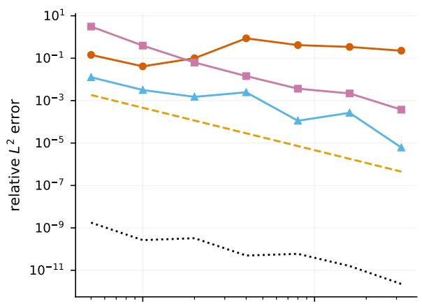

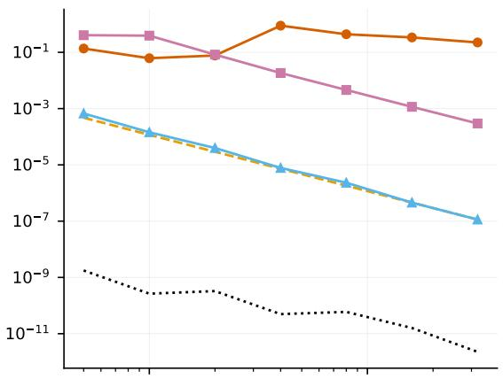

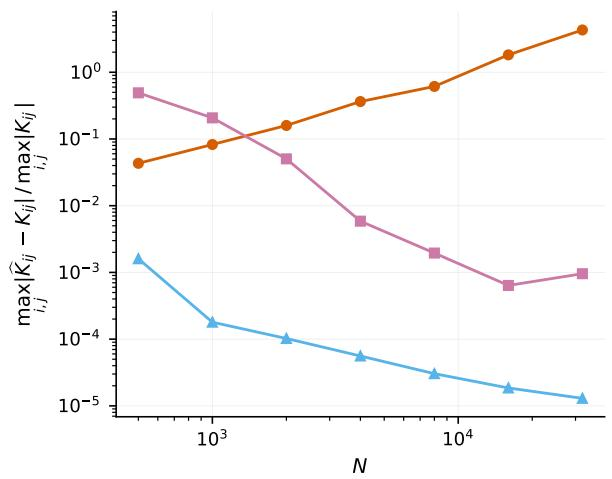

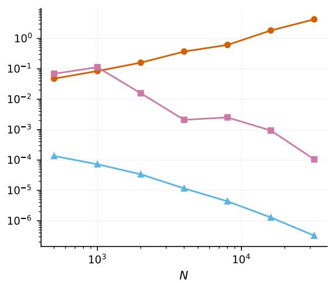  
Figure 2: Advection–difusion–reaction on $\mathbb { S } ^ { 1 }$ . Left column $p = 2$ and right column $p = 3$ $T o p { \mathrm { : } }$ relative $L ^ { 2 }$ error against the exact solution. Bottom: ma $\mathrm { x } _ { i , j } | \widehat { K } _ { i j } - K _ { i j } |$ . The curves are the direct GFDM solve $\left( -- \right)$ , PMM with exact operator and basis ( ), PMM with $L ^ { h }$ and the exact Mat´ern kernel ( ), PMM with $L ^ { h }$ and the graph kernel ( ) and PMM with $L ^ { \varrho N }$ and the graph kernel ( ).

Table 2: Steady advection–difusion–reaction on $\mathbb { S } ^ { 2 }$ and $\mathbb { T } ^ { 2 }$ . The first two columns are the relative $L ^ { 2 }$ and $L ^ { \infty }$ error against the ground truth. The remaining columns are the empirical coverage of the credible intervals at those nominal levels and the median posterior standard deviation, and exist only for the probabilistic methods. Bold marks the lowest error in each column within each block.
<table><tr><td colspan="5">Sphere  $\mathbb { S } ^ { 2 }$ </td></tr><tr><td>Method</td><td>rel.  $L ^ { 2 }$ </td><td>rel.  $L ^ { \infty }$ </td><td></td><td></td><td>cov. 68.3% (%) cov. 95% (%) med. post. sd</td></tr><tr><td colspan="6">Known manifold, analytic tangent frames</td></tr><tr><td>GFDM  $L ^ { h } ,$  direct solve</td><td> $4 . 6 1 \times 1 0 ^ { - 1 }$ </td><td>2.17</td><td></td><td></td><td></td></tr><tr><td>PMM, exact operator and basis (ours)</td><td> $\mathbf { 1 . 3 8 \times 1 0 ^ { - 8 } }$ </td><td> $\mathbf { 3 . 3 0 \times 1 0 ^ { - 8 } }$ </td><td>100.0</td><td>100.0</td><td> $1 . 9 7 \times 1 0 ^ { - 7 }$ </td></tr><tr><td>PMM,  $L ^ { h }$  + exact Matérn (ours)</td><td> $5 . 4 8 \times 1 0 ^ { - 3 }$ </td><td> $5 . 9 5 \times 1 0 ^ { - 3 }$ </td><td>51.2</td><td>72.8</td><td> $3 . 8 4 \times 1 0 ^ { - 5 }$ </td></tr><tr><td colspan="6">Implicit manifold, estimated tangent frames</td></tr><tr><td>PMM,  $L ^ { h } + \mathrm { g r a p h }$  Matérn (ours)</td><td> $\mathbf { 4 . 8 2 \times 1 0 ^ { - 2 } }$ </td><td> $\mathbf { 5 . 9 1 \times 1 0 ^ { - 2 } }$ </td><td>69.2</td><td>91.2</td><td> $5 . 5 9 \times 1 0 ^ { - 4 }$ </td></tr><tr><td>PMM,  $L _ { N } ^ { \varrho } + \mathrm { g r a p h }$  Matérn (ours)</td><td> $3 . 6 5 \times 1 0 ^ { - 1 }$ </td><td> $3 . 6 4 \times 1 0 ^ { - 1 }$ </td><td>5.0</td><td>9.4</td><td> $1 . 9 6 \times 1 0 ^ { - 4 }$ </td></tr><tr><td colspan="6">Flat torus  $\mathbb { T } ^ { 2 }$ </td></tr><tr><td>Method</td><td>rel.  $L ^ { 2 }$ </td><td>rel.  $L ^ { \infty }$ </td><td>cov. 68.3% (%)</td><td></td><td>cov. 95% (%) med. post. sd</td></tr><tr><td colspan="6">Known manifold, analytic tangent frames</td></tr><tr><td>GFDM  $L ^ { h } ,$  direct solve</td><td> $7 . 6 0 \times 1 0 ^ { - 2 }$ </td><td> $2 . 9 0 \times 1 0 ^ { - 1 }$ </td><td></td><td></td><td></td></tr><tr><td>PMM, exact operator and basis (ours)</td><td> $\mathbf { 1 . 9 6 \times 1 0 ^ { - 8 } }$ </td><td> $\mathbf { 4 . 0 5 \times 1 0 ^ { - 8 } }$ </td><td>100.0</td><td>100.0</td><td> $4 . 2 8 \times 1 0 ^ { - 6 }$ </td></tr><tr><td>PMM,  $L ^ { h }$  + exact Matérn (ours)</td><td> $5 . 6 9 \times 1 0 ^ { - 3 }$ </td><td> $8 . 2 7 \times 1 0 ^ { - 3 }$ </td><td>38.6</td><td>59.1</td><td> $5 . 0 5 \times 1 0 ^ { - 4 }$ </td></tr><tr><td colspan="6">Implicit manifold, estimated tangent frames</td></tr><tr><td>PMM,  $L ^ { h } + \mathrm { g r a p h }$  Matérn (ours)</td><td> $\mathbf { 3 . 4 9 \times 1 0 ^ { - 2 } }$ </td><td> $\mathbf { 5 . 9 2 \times 1 0 ^ { - 2 } }$ </td><td>79.5</td><td>95.1</td><td> $8 . 4 1 \times 1 0 ^ { - 3 }$ </td></tr><tr><td>PMM,  $L _ { N } ^ { \varrho } + \mathrm { g r a p h }$  Matérn (ours)</td><td> $1 . 9 6 \times 1 0 ^ { - 1 }$ </td><td> $2 . 1 7 \times 1 0 ^ { - 1 }$ </td><td>6.2</td><td>11.1</td><td> $2 . 4 2 \times 1 0 ^ { - 3 }$ </td></tr></table>

## 6.2 Brain cortical thickness smoothing

The cerebral cortex is a thin layer of neural tissue in the outermost part of the brain, where most of the neuronal activity takes place. From a geometric point of view, it is modeled as a closed surface embedded in $\mathbb { R } ^ { 3 }$ . The thickness of this surface is usually referred to as cortical thickness and can be estimated from magnetic resonance images (MRI) through several steps of image processing, described for example in Chung et al. (2005). This procedure introduces noise, which is particularly undesirable in group-level analysis, so that the measurements are usually smoothed. One of the most widely used approaches in this context is kernel smoothing, which convolves the measurements with a heat kernel whose time parameter determines the amount of smoothing. Denoting the cortical surface with M and the noisy measurements by $g ( x )$ , heat kernel smoothing is equivalent to solving the heat equation (Chung et al., 2005)

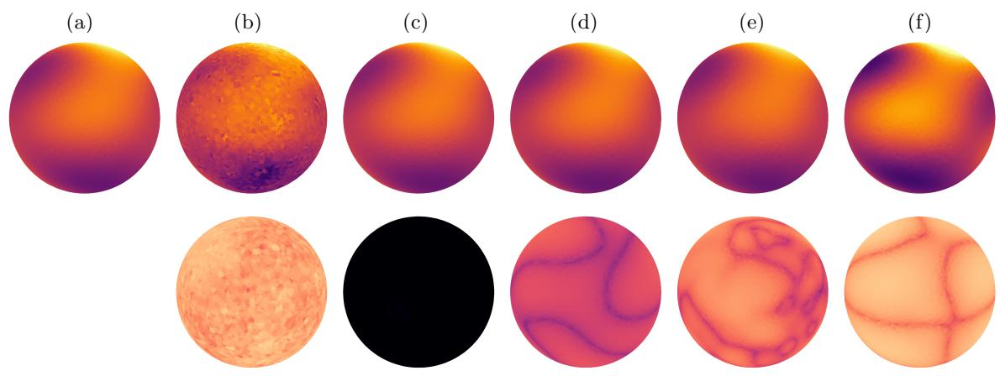  
Figure 3: Steady advection–difusion–reaction on $\mathbb { S } ^ { 2 }$ . The top row reports the predictions for (a) the manufactured exact solution, (b) the direct GFDM solve with $L ^ { h }$ , (c) PMM with the exact operator and basis, (d) PMM with $L ^ { h }$ and the exact Mat´ern kernel, (e) PMM with $L ^ { h }$ and the graph kernel, and (f) PMM with $L ^ { \varrho _ { N } }$ and the graph kernel. The bottom row reports the absolute error against the manufactured solution, that is $| u - \tilde { \mu } |$ at every node, of the panel directly above it; the cell under (a) is empty, the exact solution having no error against itself. Panels (a)–(d) use the analytic tangent frames, (e) and (f) the PCA estimates.

(a)  
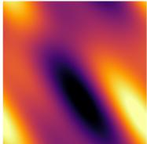

(b)  
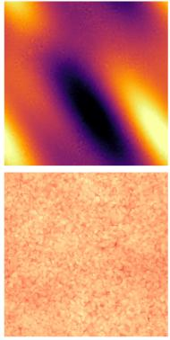

(c)  
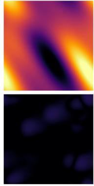

(d)  
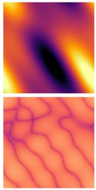

(e)  
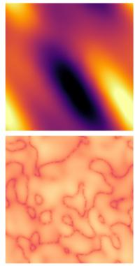

(f)  
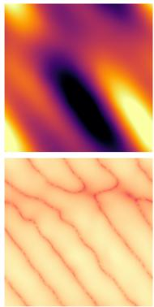  
Figure 4: Steady advection–difusion–reaction on $\mathbb { T } ^ { 2 }$ , with the panels drawn in the fundamental domain $( \vartheta , \varphi ) \in [ 0 , 2 \pi ) ^ { 2 }$ . The top row reports the predictions for (a) the manufactured exact solution, (b) the direct GFDM solve with $L ^ { h }$ , (c) PMM with the exact operator and basis, (d) PMM with $L ^ { h }$ and the exact Mat´ern kernel, (e) PMM with $L ^ { h }$ and the graph kernel, and (f) PMM with $L ^ { \varrho N }$ and the graph kernel. The bottom row reports the absolute error against the manufactured solution of the panel directly above it; the cell under (a) is empty, the exact solution having no error against itself. Panels (a)–(d) use the analytic tangent frames, (e) and (f) the PCA estimates.

$$
\begin{array} { r } { \left\{ \begin{array} { l l } { \partial _ { t } u - \Delta u = 0 } & { \mathrm { i n ~ } M \times ( 0 , T ] , } \\ { u ( \cdot , 0 ) = g } & { \mathrm { i n ~ } M , } \end{array} \right. } \end{array}
$$

whose solution at time t is given by the heat semigroup, $\boldsymbol { u } ( \cdot , t ) = e ^ { t \Delta } \boldsymbol { g }$ . Since the manifold is represented by a mesh, the problem must be discretized, and several approaches have been proposed in the literature. Chung et al. (2005) propose multiple applications of the heat kernel convolution against initial data, where the kernel is locally approximated with the exponential of the distance between nodes. Chung and Taylor (2004) instead solve the heat equation with finite elements in space and n explicit Euler steps in time. More recently, Seo et al. (2010) instead focuses on the estimation of the Laplacian eigendecomposition, so that the convolution can be represented via the spectral Fourier series. In practice, the eigenpairs are obtained using cotangent discretization (Pinkall and Polthier, 1993), and the coeficients are estimated by least squares. This approach is exact in time and it has strong convergence guarantees in space. Nevertheless, it requires a triangulation of the domain and a considerable computational efort. Since small values of t are of most interest in practice, to avoid over-smoothing the data, we propose a simpler alternative, namely solving a single backward Euler step for the heat equation

$$
( I - t \Delta ) u = g ,\tag{37}
$$

where t plays the role of the smoothing parameter. Since (37) is a linear elliptic PDE on a closed manifold, it falls within our framework of PMMs on manifolds.

As a reference, we take the solution of Seo et al. (2010) with Laplace–Beltrami eigenpairs obtained by the cotangent discretization, retaining 1000 modes. At each smoothing time t, we compare the two established discretizations, namely the iterated kernel smoothing of Chung et al. (2005) and the finite element difusion of Chung and Taylor (2004) with n time steps, and our approach, which solves (37) with PMMs using either $L ^ { h }$ or $L ^ { \varrho _ { N } }$ . We stress that both competing methods use the measurements at every vertex, while PMMs condition on a limited number of collocation points and return the smoothed field, together with an uncertainty estimate, at every vertex.

All compared methods are implemented in Python following the original papers and the MATLAB routines distributed by Chung et al. (2005), namely hk smooth for the iterated kernel smoothing, diffusion smooth for the finite-element difusion of Chung and Taylor (2004) and lb smooth for the eigenfunction expansion of Seo et al. (2010). The surface is the inflated left hemisphere of the fsaverage5 template, with 10 242 vertices.

Results. Table 3 reports the comparison at three smoothing times. While both competing methods use the measured thickness at all vertices, the PMMs impose (37) at $N _ { c } = 7 9 9$ collocation points only, that is, 7.8% of the vertices, and use a single step instead of the n steps of Chung and Taylor (2004). Both PMMs use polynomial degree $p = 3$ . Under this budget, PMMs improve on the iterated kernel smoothing of Chung et al. (2005) at every t, and remain within a small factor of the finite-element difusion of Chung and Taylor (2004), both in relative $L ^ { 2 }$ and $L ^ { \infty }$ . Our approach thus attains a comparable accuracy from less than a tenth of the observations, predicting the smoothed field at the remaining 92.2% of the vertices and providing a credible interval at every vertex, which neither competing method does.

Table 3: Cortical thickness smoothing at three difusion times t. Errors are relative $L ^ { 2 }$ and $L ^ { \infty }$ against the heat semigroup $e ^ { t \Delta } g _ { ; }$ , computed as the eigenfunction expansion of Seo et al. (2010) in the cotangent basis truncated at 1 000 modes. The last three columns are the empirical coverage of the credible intervals at the two nominal levels and the median posterior standard deviation. Bold marks the lowest error in each column within each block.
<table><tr><td>Method</td><td>rel.  $L ^ { 2 }$ </td><td>rel.  $L ^ { \infty }$ </td><td>cov. 68.3% (%)</td><td>cov. 95% (%)</td><td>med. post. sd</td></tr><tr><td colspan="6"> $t = 0 . 0 0 2$ </td></tr><tr><td>PMM,  $L ^ { h } + \mathrm { g r a p h }$  Matérn (ours)</td><td> $3 . 5 0 \times 1 0 ^ { - 2 }$ </td><td> $1 . 0 8 \times 1 0 ^ { - 1 }$ </td><td>64.5</td><td>91.0</td><td>0.067</td></tr><tr><td>PMM,  $L _ { N } ^ { \varrho }$  + graph Matérn (ours)</td><td> $3 . 6 6 \times 1 0 ^ { - 2 }$ </td><td> $1 . 1 0 \times 1 0 ^ { - 1 }$ </td><td>63.3</td><td>90.4</td><td>0.069</td></tr><tr><td>Iterated kernel smoothing (Chung et al., 2005)</td><td> $6 . 5 2 \times 1 0 ^ { - 2 }$ </td><td> $4 . 1 6 \times 1 0 ^ { - 1 }$ </td><td></td><td></td><td></td></tr><tr><td>Explicit FEM diffusion (Chung and Taylor, 2004)</td><td> $\mathbf { 2 . 2 1 \times 1 0 ^ { - 2 } }$ </td><td> $\mathbf { 7 . 8 4 \times 1 0 ^ { - 2 } }$ </td><td></td><td></td><td></td></tr><tr><td colspan="6"> $t = 0 . 0 1$ </td></tr><tr><td>PMM,  $L ^ { h } +$  graph Matérn (ours)</td><td> $3 . 3 8 \times 1 0 ^ { - 2 }$ </td><td> $\mathbf { 1 . 0 8 \times 1 0 ^ { - 1 } }$ </td><td>43.6</td><td>69.0</td><td>0.034</td></tr><tr><td>PMM,  $L _ { N } ^ { \varrho } +$  graph Matérn (ours)</td><td> $3 . 4 1 \times 1 0 ^ { - 2 }$ </td><td> $1 . 1 0 \times 1 0 ^ { - 1 }$ </td><td>43.9</td><td>70.0</td><td>0.035</td></tr><tr><td>Iterated kernel smoothing (Chung et al., 2005)</td><td> $5 . 4 1 \times 1 0 ^ { - 2 }$ </td><td> $1 . 8 3 \times 1 0 ^ { - 1 }$ </td><td></td><td></td><td></td></tr><tr><td>Explicit FEM diffusion (Chung and Taylor, 2004)</td><td> $\mathbf { 3 . 0 1 \times 1 0 ^ { - 2 } }$ </td><td> $1 . 2 8 \times 1 0 ^ { - 1 }$ </td><td></td><td></td><td></td></tr><tr><td colspan="6"> $t = 0 . 0 5$ </td></tr><tr><td>PMM,  $L ^ { h } +$  graph Matérn (ours)</td><td> $3 . 8 2 \times 1 0 ^ { - 2 }$ </td><td> $1 . 6 8 \times 1 0 ^ { - 1 }$ </td><td>26.9</td><td>51.3</td><td>0.018</td></tr><tr><td>PMM,  $L _ { N } ^ { \varrho } + \mathrm { g r a p h }$  Matérn (ours)</td><td> $3 . 8 3 \times 1 0 ^ { - 2 }$ </td><td> $1 . 7 1 \times 1 0 ^ { - 1 }$ </td><td>29.3</td><td>54.1</td><td>0.018</td></tr><tr><td>Iterated kernel smoothing (Chung et al., 2005)</td><td> $1 . 2 7 \times 1 0 ^ { - 1 }$ </td><td> $4 . 4 2 \times 1 0 ^ { - 1 }$ </td><td></td><td></td><td></td></tr><tr><td>Explicit FEM diffusion (Chung and Taylor, 2004)</td><td> $\mathbf { 2 . 3 9 \times 1 0 ^ { - 2 } }$ </td><td> $\mathbf { 6 . 8 5 \times 1 0 ^ { - 2 } }$ </td><td></td><td></td><td></td></tr></table>

The empirical coverage of both PMMs is close to the nominal levels at $t = 0 . 0 0 2$ and degrades as t increases. The two stencils give nearly identical results on this surface. Indeed, the estimated reach is smaller than the fill distance, so that the admissible range is empty and $\varrho N$ is set by the second fallback, at a value close to the $L ^ { h }$ stencil. Figure 5 shows the smoothed field at three difusion times, with the measured thickness and the reference in the first two columns, and Figure 6 shows the absolute error against the reference. Since all panels share the same colour scale, the increasing smoothing of the field with t is visible across rows.

t=0.002

(a)

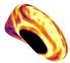

(b)

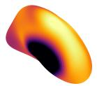  
(c)

(d)

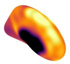

(e)

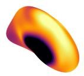

(f)

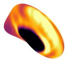

t=0.01 t=0.05

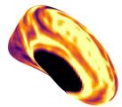

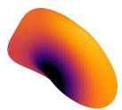

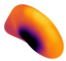

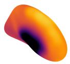

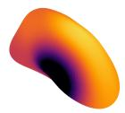

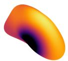

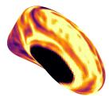

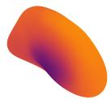

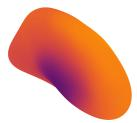

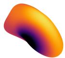

Figure 5: Cortical thickness smoothing on the inflated left hemisphere of fsaverage5, 10 242 vertices drawn on the triangulation for (a) the measured thickness $^ { g , }$ which is the datum being smoothed and is therefore identical in every row; (b) the reference, the eigenfunction expansion of Seo et al. (2010) in the cotangent basis at 1000 modes; (c) PMM with $L ^ { h }$ (d) PMM with $L ^ { \varrho _ { N } }$ ; (e) the finite-element difusion of Chung and Taylor (2004); (f) the iterated kernel smoothing of Chung et al. (2005). Columns (c) and (d) condition on $N _ { c } = 7 9 9$ vertices, 7.8% of the mesh, while (b), (e) and (f) read all of them.

t=0.002

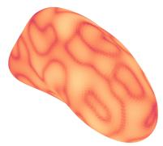  
(a)

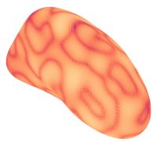  
(b)

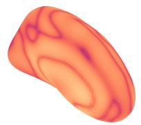  
(c)

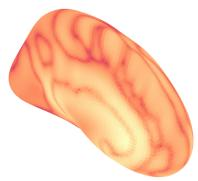  
(d)  
t=0.01

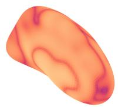

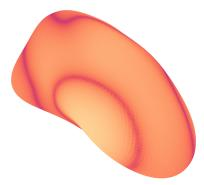

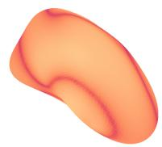

t=0.05

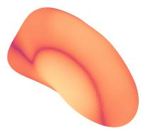

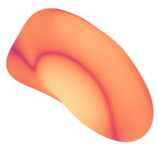

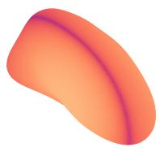

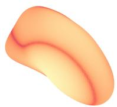

Figure 6: Absolute error of each compared method against the reference of Figure 5(b) for (a) PMM with $L ^ { h } ;$ ; (b) PMM with $L ^ { \varrho _ { N } }$ ; (c) the finite-element difusion of Chung and Taylor (2004); (d) the iterated kernel smoothing of Chung et al. (2005).

## 7 Conclusions

This paper extended probabilistic meshless methods to manifold domains and quantified their convergence according to the information available about the manifold. When the manifold and the eigendecomposition of its Laplace–Beltrami operator are known, the construction carries over directly from the Euclidean setting. If, in addition, the diferential operator is not available in closed form, it is replaced by a GFDM discretization, which is consistent at the nodes by Theorem 1. When the manifold is implicit, both the kernel and the operator are estimated from the point cloud, and we proposed a novel GFDM LϱN which, by Theorem 2, yields uniform convergence of the Gram matrix. Finally, Theorem 3 bounds the error of the posterior mean, separating the collocation error intrinsic to PMMs from the error due to the approximation of the operator and, in the implicit case, of the kernel. This bound reduces to the estimate of Cockayne et al. (2016, Proposition 6) when no approximation is made.

The experiments support our analysis. On the circle, the Gram matrix obtained with the standard GFDM stencil drifts away from its target as N grows, while the one obtained by LϱN converges, and the solution errors follow the same pattern. On the sphere and on the flat torus, the clouds are too coarse for the admissible range of the stencil radius to be nonempty and the standard stencil remains preferable. This is consistent with the theory, since LϱN is designed for the asymptotic regime in which the amplification of the kernel error dominates. On cortical thickness data, our approach attains an accuracy comparable to that of established discretizations, while conditioning on fewer than a tenth of the vertices and providing a credible interval at every vertex.

Our approach has two main limitations. First, the graph kernel is only defined on the point cloud, so that, in the implicit case, the posterior is a distribution over the values at the nodes rather than a Gaussian process on the manifold, and convergence is only established at the nodes. Second, the admissible range of the stencil radius is nonempty only for large N, a regime in which computing both the graph Laplacian and the stencils becomes expensive.

## References

Eddie Aamari, Jisu Kim, Fr´ed´eric Chazal, Bertrand Michel, Alessandro Rinaldo, and Larry Wasserman. Estimating the reach of a manifold. Electronic Journal of Statistics, 13(1): 1359–1399, 2019. doi: 10.1214/19-EJS1551.

Raquel Barreira, Charles M. Elliott, and Anotida Madzvamuse. The surface finite element method for pattern formation on evolving biological surfaces. Journal of Mathematical Biology, 63(6):1095–1119, 2011. doi: 10.1007/s00285-011-0401-0.

Marcelo Bertalm´ıo, Li-Tien Cheng, Stanley Osher, and Guillermo Sapiro. Variational problems and partial diferential equations on implicit surfaces. Journal of Computational Physics, 174(2):759–780, 2001. doi: 10.1006/jcph.2001.6937.

Vladimir I. Bogachev. Gaussian Measures, volume 62 of Mathematical Surveys and Monographs. American Mathematical Society, 1998. doi: 10.1090/surv/062.

Viacheslav Borovitskiy, Alexander Terenin, Peter Mostowsky, and Marc Peter Deisenroth. Mat´ern Gaussian processes on Riemannian manifolds. Neural Information Processing Systems (NeurIPS), 33:12426–12437, 2020. URL https://proceedings.neurips.cc/ paper\_files/paper/2020/file/92bf5e6240737e0326ea59846a83e076-Paper.pdf.

Susanne C. Brenner and L. Ridgway Scott. The Mathematical Theory of Finite Element Methods. Texts in Applied Mathematics. Springer, 2008. doi: 10.1007/978-0-387-75934-0.

Horatio S. Carslaw and John C. Jaeger. Conduction of Heat in Solids. Oxford University Press, 2 edition, 1959. URL https://global.oup.com/academic/product/ conduction-of-heat-in-solids-9780198533689.

Moo K. Chung and Jonathan Taylor. Difusion smoothing on brain surface via finite element method. In IEEE International Symposium on Biomedical Imaging: Nano to Macro, pages 432–435, 2004. doi: 10.1109/ISBI.2004.1398593.

Moo K. Chung, Steve Robbins, and Alan C. Evans. Unified statistical approach to cortical thickness analysis. In Information Processing in Medical Imaging, pages 627–638, Berlin, Heidelberg, 2005. Springer Berlin Heidelberg. doi: 10.1007/11505730 52.

Igor Cialenco, Gregory E. Fasshauer, and Qi Ye. Approximation of stochastic partial diferential equations by a kernel-based collocation method. International Journal of Computer Mathematics, 89(18):2543–2561, 2012. doi: 10.1080/00207160.2012.688111.

Jon Cockayne, Chris J. Oates, T. J. Sullivan, and Mark Girolami. Probabilistic meshless methods for partial diferential equations and Bayesian inverse problems. arXiv preprint arXiv:1605.07811v1, 2016. doi: 10.48550/arXiv.1605.07811.

Jon Cockayne, Chris J. Oates, T. J. Sullivan, and Mark Girolami. Bayesian probabilistic numerical methods. SIAM Review, 61(4):756–789, 2019. doi: 10.1137/17M1139357.

Richard Courant and David Hilbert. Methods of Mathematical Physics. Wiley, 1989. doi: 10.1002/9783527617210.

Keenan Crane, Clarisse Weischedel, and Max Wardetzky. Geodesics in heat: a new approach to computing distance based on heat flow. ACM Transactions on Graphics, 32(5):1–11, 2013. doi: 10.1145/2516971.2516977.

David B. Dunson, Hau-Tieng Wu, and Nan Wu. Spectral convergence of graph Laplacian and heat kernel reconstruction in L∞ from random samples. Applied and Computational Harmonic Analysis, 55:282–336, 2021. doi: 10.1016/j.acha.2021.06.002.

Charles M. Elliott, Bj¨orn Stinner, and Chandrasekhar Venkataraman. Modelling cell motility and chemotaxis with evolving surface finite elements. Journal of the Royal Society Interface, 9(76):3027–3044, 2012. doi: 10.1098/rsif.2012.0276.

Lawrence C. Evans. Partial Diferential Equations, volume 19 of Graduate Studies in Mathematics. American Mathematical Society, 2022. doi: 10.1090/gsm/019.

Robert Eymard, Thierry Gallou¨et, and Rapha\`ele Herbin. Finite volume methods. Handbook of Numerical Analysis, 7:713–1020, 2000. doi: 10.1016/S1570-8659(00)07005-8.

Charles Feferman, Sergei Ivanov, Yaroslav Kurylev, Matti Lassas, and Hariharan Narayanan. Reconstruction and interpolation of manifolds I: the geometric Whitney problem. Foundations of Computational Mathematics, 20:1035–1133, 2020. doi: 10.1007/s10208-019-09439-7.

Bernardo Fichera, Viacheslav Borovitskiy, Andreas Krause, and Aude G. Billard. Implicit manifold Gaussian process regression. Neural Information Processing Systems (NeurIPS), 36:67701–67720, 2023. URL https://proceedings.neurips.cc/paper\_files/paper/ 2023/file/d611d06e3207330555fbc10810e70163-Paper-Conference.pdf.

David Gottlieb and Steven A. Orszag. Numerical Analysis of Spectral Methods. Society for Industrial and Applied Mathematics, 1977. doi: 10.1137/1.9781611970425.

John Harlim, Daniel Sanz-Alonso, and Ruiyi Yang. Kernel methods for Bayesian elliptic inverse problems on manifolds. SIAM/ASA Journal on Uncertainty Quantification, 8(4): 1414–1445, 2020. doi: 10.1137/19M1295222.

John Harlim, Shixiao W. Jiang, Hwanwoo Kim, and Daniel Sanz-Alonso. Graph-based prior and forward models for inverse problems on manifolds with boundaries. Inverse Problems, 38(3):035006, 2022. doi: 10.1088/1361-6420/ac3994.

Philipp Hennig. Probabilistic interpretation of linear solvers. SIAM Journal on Optimization, 25(1):234–260, 2015. doi: 10.1137/140955501.

John David Jackson. Classical Electrodynamics. Wiley, New York, 1962. URL https: //archive.org/details/classicalelectro0000jack.

Shixiao Willing Jiang and John Harlim. Ghost point difusion maps for solving elliptic PDEs on manifolds with classical boundary conditions. Communications on Pure and Applied Mathematics, 76(2):337–405, 2023. doi: 10.1002/cpa.22035.

Randall J. LeVeque. Finite Diference Methods for Ordinary and Partial Diferential Equations: Steady-State and Time-Dependent Problems. Society for Industrial and Applied Mathematics, 2007. doi: 10.1137/1.9780898717839.

Augustus Edward Hough Love. A Treatise on the Mathematical Theory of Elasticity. Dover, New York, 1944. URL https://archive.org/details/treatiseonmathem0000love.

Maren Mahsereci and Philipp Hennig. Probabilistic line searches for stochastic optimization. Journal of Machine Learning Research, 18(119):1–59, 2017. URL http://jmlr.org/ papers/v18/17-049.html.

Davoud Mirzaei, Robert Schaback, and Mehdi Dehghan. On generalized moving least squares and difuse derivatives. IMA Journal of Numerical Analysis, 32(3):983–1000, 2012. doi: 10.1093/imanum/drr030.

Jonas Mockus. The application of Bayesian methods. In Bayesian Approach to Global Optimization: Theory and Applications, pages 157–196. Springer, 1989. doi: 10.1007/ 978-94-009-0909-0 7.

James R. Munkres. Analysis on Manifolds. CRC Press, 2018. doi: 10.1201/9780429494147.

Michael Nestler, Ingo Nitschke, Simon Praetorius, and Axel Voigt. Orientational order on surfaces: the coupling of topology, geometry, and dynamics. Journal of Nonlinear Science, 28(1):147–191, 2018. doi: 10.1007/s00332-017-9405-2.

Ingo Nitschke, Axel Voigt, and J¨org Wensch. A finite element approach to incompressible two-phase flow on manifolds. Journal of Fluid Mechanics, 708:418–438, 2012. doi: 10. 1017/jfm.2012.317.

Anthony O’Hagan. Bayes–Hermite quadrature. Journal of Statistical Planning and Inference, 29(3):245–260, 1991. doi: 10.1016/0378-3758(91)90002-V.

Houman Owhadi. Bayesian numerical homogenization. Multiscale Modeling & Simulation, 13(3):812–828, 2015. doi: 10.1137/140974596.

J. Wilson Peoples and John Harlim. Spectral convergence of symmetrized graph Laplacian on manifolds with boundary. Foundations of Data Science, 8:119–167, 2026. doi: 10. 3934/fods.2025005.

Ulrich Pinkall and Konrad Polthier. Computing discrete minimal surfaces and their conjugates. Experimental Mathematics, 2(1):15–36, 1993. doi: 10.1080/10586458.1993. 10504266.

Alfio Quarteroni and Alberto Valli. Numerical Approximation of Partial Diferential Equations. Springer Series in Computational Mathematics. Springer, Berlin, Heidelberg, 1994. doi: 10.1007/978-3-540-85268-1.

Simo S¨arkk¨a. Linear operators and stochastic partial diferential equations in Gaussian process regression. In Artificial Neural Networks and Machine Learning – ICANN 2011, pages 151–158, Berlin, Heidelberg, 2011. Springer Berlin Heidelberg. doi: 10.1007/ 978-3-642-21738-8 20.

Seongho Seo, Moo K. Chung, and Houri K. Vorperian. Heat kernel smoothing using Laplace–Beltrami eigenfunctions. In Medical Image Computing and Computer-Assisted Intervention – MICCAI 2010, pages 505–512, Berlin, Heidelberg, 2010. Springer Berlin Heidelberg. doi: 10.1007/978-3-642-15711-0 63.

Pratik Suchde and J¨org Kuhnert. A meshfree generalized finite diference method for surface PDEs. Computers & Mathematics with Applications, 78(8):2789–2805, 2019. doi: 10. 1016/j.camwa.2019.04.030.

Filip Tronarp, Simo S¨arkk¨a, and Philipp Hennig. Bayesian ODE solvers: the maximum a posteriori estimate. Statistics and Computing, 31(3):23, 2021. doi: 10.1007/ s11222-021-09993-7.

Hemant Tyagi, Elıf Vural, and Pascal Frossard. Tangent space estimation for smooth embeddings of Riemannian manifolds. Information and Inference: A Journal of the IMA, 2(1):69–114, 2013. doi: 10.1093/imaiai/iat003.

Holger Wendland. Scattered Data Approximation. Cambridge Monographs on Applied and Computational Mathematics. Cambridge University Press, Cambridge, 2004. doi: 10.1017/CBO9780511617539.

Zhiyin Zheng and Xiaolin Li. Theoretical analysis of the generalized finite diference method. Computers & Mathematics with Applications, 120:1–14, 2022. doi: 10.1016/j.camwa.2022. 06.017.

## Appendix A. The graph Laplacian and its spectral convergence

Suppose M is a d-dimensional closed manifold embedded in a higher dimensional Euclidean space. Consider a Gaussian kernel on the ambient space, $k _ { \zeta } ( x , x ^ { \prime } ) = \exp \left( { - \| x - x ^ { \prime } \| _ { 2 } ^ { 2 } / 4 \zeta ^ { 2 } } \right)$ with $\zeta > 0$ , and denote with $\begin{array} { r } { \mathsf { d } _ { \zeta } ( x _ { i } ) = \sum _ { j = 1 } ^ { N } k _ { \zeta } ( x _ { i } , x _ { j } ) } \end{array}$ the associated degree. Define the afinity matrix as

$$
W _ { i j } ^ { ( \alpha ) } : = \frac { k _ { \zeta } ( x _ { i } , x _ { j } ) } { \mathsf { d } _ { \zeta } ( x _ { i } ) ^ { \alpha } \mathsf { d } _ { \zeta } ( x _ { j } ) ^ { \alpha } } , \qquad \alpha \in [ 0 , 1 ] ,\tag{38}
$$

the degree matrix $\begin{array} { r } { D _ { i i } ^ { ( \alpha ) } = \sum _ { j } W _ { i j } ^ { ( \alpha ) } } \end{array}$ and the transition matrix $\mathsf { A } ^ { ( \alpha ) } = \bigl ( D ^ { ( \alpha ) } \bigr ) ^ { - 1 } W ^ { ( \alpha ) }$ . The graph Laplacian, which approximates $\Delta _ { M }$ , is defined as (Dunson et al., 2021)

$$
\mathsf { L } ^ { ( \alpha ) } = \frac { \mathsf { A } ^ { ( \alpha ) } - I } { \zeta ^ { 2 } } .\tag{39}
$$

For $\alpha = 0$ this is the random walk graph Laplacian built on the unnormalized afinity matrix. Denote the spectrum of $- \mathsf { L } ^ { ( \alpha ) }$ by $0 = \hat { \lambda } _ { 0 } \le \hat { \lambda } _ { 1 } \le \dots \le \hat { \lambda } _ { N - 1 } \le 2 \zeta ^ { - 2 }$ , with $\ell ^ { 2 } \scriptscriptstyle -$ normalized eigenvectors $\hat { \phi } _ { 0 } , \ldots , \hat { \phi } _ { N - 1 }$ . Assume that the eigenvalues of $- \Delta { } _ { M }$ are simple, that the sampling density is smooth and non-vanishing, and that $\zeta = \zeta ( N )$ is chosen properly. Then, for N large and for a suitable sign $\varsigma _ { r } \in \{ - 1 , 1 \}$ , Dunson et al. (2021) give, in the case $\alpha = 1$ 1,

$$
\begin{array} { r } { \left| \hat { \lambda } _ { r } - \lambda _ { r } ^ { \Delta } \right| \leq C \Big ( \frac { \log N } { N } \Big ) ^ { \frac { 3 } { 8 d + 2 6 } } , \qquad \underset { x _ { j } \in X _ { N } } { \operatorname* { m a x } } \left| \varsigma _ { r } \hat { \phi } _ { r } ^ { ( j ) } - \phi _ { r } ( x _ { j } ) \right| \leq C \Big ( \frac { \log N } { N } \Big ) ^ { \frac { 1 } { 8 d + 1 6 } } , } \end{array}\tag{40}
$$

while for $\alpha = 0$ under uniform sampling

$$
\begin{array} { r } { \left| \hat { \lambda } _ { r } - \lambda _ { r } ^ { \Delta } \right| \leq C \Big ( \frac { \log N } { N } \Big ) ^ { \frac { 1 } { d + 6 } } , \qquad \underset { x _ { j } \in X _ { N } } { \operatorname* { m a x } } \left| \varsigma _ { r } \hat { \phi } _ { r } ^ { ( j ) } - \phi _ { r } ( x _ { j } ) \right| \leq C \Big ( \frac { \log N } { N } \Big ) ^ { \frac { 1 } { d + 4 } } . } \end{array}\tag{41}
$$

## Appendix B. Convergence on implicit manifolds

Let M be a smooth Riemannian d-manifold with geodesic distance $d _ { g } ( \cdot , \cdot )$ and volume dVol. Throughout this appendix, B denotes a geodesic ball in M and B a Euclidean ball in $\mathbb { R } ^ { d }$ Write $\exp _ { x } : \mathcal { T } _ { x } M \to M$ for the exponential map of the Levi-Civita connection. Recalling the definitions of Section 5, the injectivity radius at $x , \iota ( x )$ , is the largest radius such that $\mathrm { e x p } _ { x }$ is a difeomorphism from the ball of that radius onto its image, and it is easy to see that $\iota : = \operatorname* { i n f } _ { x \in M } \iota ( x ) > 0$ on a compact manifold. Fixing an orthonormal basis of $\tau _ { x { _ i } } M$ and identifying $\mathcal { T } _ { x _ { i } } M \cong \mathbb { R } ^ { d }$ , we write

$$
\xi _ { i } : = \exp _ { x _ { i } } ^ { - 1 } \ : \ B ( x _ { i } , \iota ) \longrightarrow \mathsf { B } ( 0 , \iota ) \subset \mathbb { R } ^ { d }
$$

for the normal chart at $x _ { i }$ , so that $\xi _ { i } ( x _ { i } ) = 0$ and

$$
| \xi _ { i } ( y ) | = d _ { g } ( x _ { i } , y ) ,\tag{42}
$$

for all $y \in B ( x _ { i } , \iota )$ . Moreover, as in Section 5, the normal chart distorts geodesic distances by a bounded factor

$$
C _ { \iota } ^ { - 1 } d _ { g } ( y , y ^ { \prime } ) \ \leq \ | \xi _ { i } ( y ) - \xi _ { i } ( y ^ { \prime } ) | \ \leq \ C _ { \iota } d _ { g } ( y , y ^ { \prime } ) ,\tag{43}
$$

for all i and all $y , y ^ { \prime } \in B ( x _ { i } , \iota / 2 )$ . It is finite on a compact manifold and depends only on M, and $C _ { \iota } = 1$ exactly when M is flat. It is convenient to regard functions on $M$ as diferentiated through this atlas. In other words, u locally takes the form $u \circ \exp _ { x }$ and it is a function of $z \in \mathbb { R } ^ { d }$ . A linear diferential operator of order l acts as

$$
( { \mathcal { L } } u ) ( x ) = \sum _ { | \beta | \leq l } a _ { \beta } ( x ) \partial _ { z } ^ { \beta } { \big ( } u \circ \exp _ { x } { \big ) } ( 0 ) ,\tag{44}
$$

with $A _ { \infty }$ and $C _ { \mathcal { L } }$ as in Assumption A2. We write

$$
\| w \| _ { C ^ { s } ( M ) } : = \operatorname* { s u p } _ { x \in M } \ \operatorname* { s u p } _ { | z | \leq \iota / 2 } \operatorname* { m a x } _ { | \gamma | \leq s } \big | \partial _ { z } ^ { \gamma } \big ( w \circ \exp _ { x } \big ) ( z ) \big | ,
$$

and for a kernel the mixed norm

$$
\Vert k \Vert _ { C ^ { p + 1 , p + 1 } } : = \operatorname* { m a x } _ { | \gamma | \leq p + 1 } \operatorname* { m a x } _ { | \delta | \leq p + 1 } \operatorname* { s u p } _ { x , y \in M } \operatorname* { s u p } _ { | z _ { x } | , | z _ { y } | \leq L / 2 } \left| \partial _ { z _ { x } } ^ { \gamma } \partial _ { z _ { y } } ^ { \delta } \left[ k \left( \exp _ { x } ( z _ { x } ) , \exp _ { y } ( z _ { y } ) \right) \right] \right| .\tag{45}
$$

For multi-indices ${ \boldsymbol { \beta } } \in  { \mathbb { N } } _ { 0 } ^ { d }$ we use the notation $\begin{array} { r } { | \beta | = \sum _ { s } \beta _ { s } , \beta ! = \prod _ { s } \beta _ { s } ! , z ^ { \beta } = \prod _ { s } z _ { s } ^ { \beta _ { s } } } \end{array}$ , and $\Pi _ { p } = \operatorname { s p a n } \{ z ^ { \beta } : | \beta | \leq p \}$ , of dimension $Q \ = \ { \binom { p + d } { d } }$ . Finally, $R _ { N } : C ( M ) \to \mathbb { R } ^ { N }$ is the restriction operator which acts as $( R _ { N } f ) _ { i } = f ( \dot { x } _ { i } )$ for all $x _ { i } \in X _ { N }$ . We also define norms for finite dimensional vectors as $\| v \| _ { \ell ^ { \infty } } = \operatorname* { m a x } _ { i } | v _ { i } |$ and $\begin{array} { r } { \| v \| _ { \ell ^ { 1 } } = \sum _ { i } | v _ { i } | } \end{array}$

We start by reporting two results of Wendland (2004) of fundamental relevance for the argument.

Theorem 4 (Wendland, 2004, Thm. 3.4) Let V be a finite-dimensional normed linear space and ${ \mathcal { Z } } = \{ \zeta _ { 1 } , \ldots , \zeta _ { \mathsf { M } } \} \subseteq V ^ { * }$ a norming set for V , i.e. the sampling operator $T : v \mapsto$ $( \zeta _ { a } ( v ) ) _ { a } \in \mathbb { R } ^ { \mathsf { M } }$ is injective. Equip $\mathbb { R } ^ { M }$ with $\| \cdot \| _ { \infty } ,$ so the dual norm is $\Vert \cdot \Vert _ { 1 }$ , and set $\| T ^ { - 1 } \| =$ $\mathrm { s u p } _ { v \neq 0 } \| v \| _ { V } / \| T v \| _ { \infty }$ . Then for every $\psi \in V ^ { * }$ there is $u \in \mathbb { R } ^ { M }$ with $\begin{array} { r } { \psi ( v ) = \sum _ { a } u _ { a } \zeta _ { a } ( v ) } \end{array}$ for all $v \in V$ and $\| u \| _ { 1 } \leq \| \psi \| _ { V ^ { * } } \| T ^ { - 1 } \|$

Theorem 5 (Wendland, 2004, Cor. 3.11) Put $c _ { p } : = { \frac { 3 } { 4 ( 2 + { \sqrt { 3 } } ) p ^ { 2 } } } . \ I f Y \subseteq \mathsf { B } = \mathsf { B } ( x _ { 0 } , \delta ) \subset$ $\mathbb { R } ^ { d }$ satisfies $h _ { Y , \mathsf { B } } \leq c _ { p } \delta$ , then $\{ \delta _ { y } : y \in Y \}$ is a norming set for $\Pi _ { p \mid _ { \mathsf { B } } }$ with norming constant $\| T ^ { - 1 } \| \leq 2$

The next lemma asserts the existence of stencils for the matrix $L ^ { \varrho _ { N } }$ and guarantees exactness properties over intrinsic polynomials, as well as a bound over the stencil norm.

Lemma 6 Let $p \geq l$ and put

$$
c _ { p } : = \frac { 3 } { 4 ( 2 + \sqrt { 3 } ) p ^ { 2 } } , \qquad \delta _ { 1 } : = \frac { c _ { p } } { 3 C _ { \iota } } ,
$$

with $C _ { \iota }$ as in (43). If

$$
\varrho _ { N } \leq \operatorname* { m i n } \{ 1 , \iota / 2 \} \qquad a n d \qquad h _ { N } / \varrho _ { N } \leq \delta _ { 1 } ,
$$

then at every node $x _ { i }$ there exist weights $( c _ { i j } ^ { \varrho _ { N } } ) _ { j \in S _ { i } ^ { \varrho _ { N } } }$ , where $S _ { i } ^ { \varrho _ { N } } : = X _ { N } \cap B ( x _ { i } , \varrho _ { N } )$ , such that

$$
\sum _ { j \in S _ { i } ^ { \varrho _ { N } } } c _ { i j } ^ { \varrho _ { N } } q ( x _ { j } ) = ( \mathcal { L } q ) ( x _ { i } ) \qquad f o r \ a l l \ q \in \Pi _ { p } ,\tag{46}
$$

$$
\| c _ { i } ^ { \varrho _ { N } } \| _ { 1 } \leq C _ { 1 } \varrho _ { N } ^ { - l } , \qquad C _ { 1 } : = 2 \gamma _ { p , d , l } A _ { \infty } ,\tag{47}
$$

with $\gamma _ { p , d , l }$ depending only on $p , d , l$ . In particular $C _ { 1 }$ depends neither on N nor on $| S _ { i } ^ { \varrho N } |$

Proof. Given $\varrho _ { N } \leq \iota / 2$ , the chart $\xi _ { i }$ is defined on $B ( x _ { i } , \iota ) \supseteq B ( x _ { i } , \varrho _ { N } )$ . Put

$$
\begin{array} { r } { \mathsf { B } : = \mathsf { B } ( 0 , \varrho _ { N } ) \subset \mathbb { R } ^ { d } , \qquad Y : = \big \{ y _ { j } : = \xi _ { i } ( x _ { j } ) \ : \ x _ { j } \in S _ { i } ^ { \varrho _ { N } } \big \} , \qquad V : = \Pi _ { p } \big | _ { \mathsf { B } } . } \end{array}
$$

Define $\mathcal { Z } : = \{ \delta _ { y _ { j } } : x _ { j } \in S _ { i } ^ { \varrho _ { N } } \}$ with sampling operator $T ,$ where $\mathbb { R } ^ { | Y | }$ is equipped with $\| \cdot \| _ { \infty }$ Note $Y \subseteq \mathsf { B }$ , since $| \xi _ { i } ( x _ { j } ) | = d _ { g } ( x _ { i } , x _ { j } ) < \varrho _ { N }$ , and $Y \neq \emptyset$ because $x _ { i } \in S _ { i } ^ { \varrho _ { N } }$ . Given $p \geq 1$ and $C _ { \iota } \geq 1$

$$
\delta _ { 1 } ~ \leq ~ { \frac { c _ { p } } { 3 } } ~ = ~ { \frac { 1 } { 4 ( 2 + \sqrt { 3 } ) p ^ { 2 } } } ~ < ~ { \frac { 1 } { 4 } } .
$$

The standing hypothesis $h _ { N } \leq \delta _ { 1 } \varrho _ { N }$ therefore gives $h _ { N } < \varrho _ { N } / 4$ and, in particular,

$$
\varrho _ { N } - 2 h _ { N } > \varrho _ { N } - \frac { \varrho _ { N } } { 2 } = \frac { \varrho _ { N } } { 2 } > 0 ,\tag{48}
$$

which is needed for the retraction to be well defined.

Step 1: $\mathcal { Z }$ is a norming set with constant 2. It is clear then that the objective is to verify the hypothesis $h _ { Y , \mathsf { B } } \leq c _ { p } \varrho _ { N }$ of Theorem 5. Fix $z \in \mathsf { B }$ and distinguish two cases. If $| z | \le \varrho _ { N } - 2 h _ { N }$ , let $y : = \exp _ { x _ { i } } ( z )$ , so $d _ { g } ( x _ { i } , y ) = | z |$ by (42). By definition of the fill distance there is a node $x _ { j }$ with $d _ { g } ( y , x _ { j } ) \leq h _ { N }$ , and it lies inside the ball,

$$
d _ { g } ( x _ { i } , x _ { j } ) \leq d _ { g } ( x _ { i } , y ) + d _ { g } ( y , x _ { j } ) \leq ( \varrho _ { N } - 2 h _ { N } ) + h _ { N } = \varrho _ { N } - h _ { N } < \varrho _ { N } ,
$$

so $x _ { j } \in S _ { i } ^ { \varrho _ { N } }$ and $\xi _ { i } ( x _ { j } ) \in Y$ . By (43) and $\xi _ { i } ( y ) = z$

$$
\mathrm { d i s t } ( z , Y ) \leq | \xi _ { i } ( x _ { j } ) - \xi _ { i } ( y ) | \leq C _ { \iota } d _ { g } ( x _ { j } , y ) \leq C _ { \iota } h _ { N } .\tag{49}
$$

If instead $\varrho _ { N } - 2 h _ { N } < | z | < \varrho _ { N }$ , retract z radially to $\begin{array} { r } { z ^ { \prime } : = \frac { \varrho _ { N } - 2 h _ { N } } { | z | } z } \end{array}$ , which satisfies $| z ^ { \prime } | = \varrho _ { N } - 2 h _ { N }$ , so the previous case applies to $z ^ { \prime }$ . Moreover

$$
\begin{array} { r } { | z - z ^ { \prime } | = \Big | z \Big ( 1 - \frac { \varrho _ { N } - 2 h _ { N } } { | z | } \Big ) \Big | = | z | - \big ( \varrho _ { N } - 2 h _ { N } \big ) < \varrho _ { N } - \big ( \varrho _ { N } - 2 h _ { N } \big ) = 2 h _ { N } , } \end{array}
$$

using $| z | > \varrho _ { N } - 2 h _ { N }$ and $| z | < \varrho _ { N }$ for the second inequality. Hence, by the triangle inequality,

$$
\mathrm { d i s t } ( z , Y ) \le | z - z ^ { \prime } | + \mathrm { d i s t } ( z ^ { \prime } , Y ) \le 2 h _ { N } + C _ { \iota } h _ { N } = ( 2 + C _ { \iota } ) h _ { N } .\tag{50}
$$

Since $C _ { \iota } \geq 1$ , we have $2 + C _ { \iota } \ \le \ 3 C _ { \iota }$ , and if we now combine the two cases we obtain dist $( z , Y ) \leq 3 C _ { \iota } h _ { N }$ . Taking the supremum over $z \in { \mathsf { B } }$

$$
h _ { Y , \tt B } \leq 3 C _ { \iota } h _ { N } \leq 3 C _ { \iota } \delta _ { 1 } \varrho _ { N } = 3 C _ { \iota } \frac { c _ { p } } { 3 C _ { \iota } } \varrho _ { N } = c _ { p } \varrho _ { N } .
$$

Theorem 5 now applies with $\delta = \varrho _ { N }$

Step 2: the functional has norm $O ( \varrho _ { N } ^ { - l } )$ . Define $\psi \in V ^ { * }$ by $\psi ( q ) : = ( \mathcal { L } q ) ( x _ { i } )$ , which in our convention writes $\begin{array} { r } { \psi ( q ) = \sum _ { | \beta | \leq l } a _ { \beta } ( \stackrel { \cdot \cdot } { x _ { i } } ) \partial ^ { \beta } q ( 0 ) } \end{array}$ . The dilation $q \mapsto \tilde { q } , \tilde { q } ( z ) : = q ( \varrho _ { N } z )$ , is an isometry of $( \Pi _ { p } | _ { \mathsf { B } ( 0 , \varrho _ { N } ) } , \| \cdot \| _ { L ^ { \infty } } )$ onto $( \Pi _ { p } | _ { \mathsf { B } ( 0 , 1 ) } , \parallel \cdot \parallel _ { L ^ { \infty } } )$ , and by the chain rule $\partial ^ { \beta } q ( 0 ) =$ $\varrho _ { N } ^ { - | \beta | } \partial ^ { \beta } \tilde { q } ( 0 )$ . Let $\gamma _ { \beta }$ be the norm of the functional $\tilde { q } \mapsto \partial ^ { \beta } \tilde { q } ( 0 )$ , a constant depending only on $p , d , \beta$ which is finite since linear functionals are bounded on finite dimensional spaces. Then

$$
| \partial ^ { \beta } q ( 0 ) | = \varrho _ { N } ^ { - | \beta | } | \partial ^ { \beta } \tilde { q } ( 0 ) | \leq \gamma _ { \beta } \varrho _ { N } ^ { - | \beta | } \| q \| _ { L ^ { \infty } ( \mathsf { B } ) } ,
$$

and since $\varrho _ { N } \leq 1$ gives $\varrho _ { N } ^ { - | \beta | } \leq \varrho _ { N } ^ { - l }$ for $| \beta | \le l$

$$
\| \psi \| _ { V ^ { * } } \leq A _ { \infty } \Big ( \sum _ { | \beta | \leq l } \gamma _ { \beta } \Big ) \varrho _ { N } ^ { - l } = \gamma _ { p , d , l } A _ { \infty } \varrho _ { N } ^ { - l } .
$$

Step $\it 3 .$ conclusion. Theorem 4, applied to $\mathcal { Z }$ and ψ, gives $u \in \mathbb { R } ^ { | Y | }$ with $\begin{array} { r } { \psi ( q ) = \sum _ { j } u _ { j } \delta _ { y _ { j } } ( q ) } \end{array}$ for all $q \in V$ and $\| u \| _ { 1 } \leq \| \psi \| _ { V ^ { * } } \| T ^ { - 1 } \|$ . Setting $c _ { i j } ^ { \varrho _ { N } } : = u _ { j }$ and reading the identity back through the chart gives (46), while Steps 1–2 give $\lVert c _ { i } ^ { \varrho _ { N } } \rVert _ { 1 } \leq 2 \gamma _ { p , d , l } A _ { \infty } \varrho _ { N } ^ { - l }$

We record here a practical consequence of Lemma 6 for the implementation of $L ^ { \varrho _ { N } }$ Lemma 6 requires the stencil nodes to satisfy the density condition $h _ { Y , \mathsf { B } } \leq c _ { p } \varrho _ { N }$ inside $\mathsf { B } = \mathsf { B } ( 0 , \varrho _ { N } )$ . Retaining the K nearest neighbours of $x _ { i }$ as in standard GFDM clearly fails it. The required modification is to choose the stencil as a $\frac { c _ { p } \varrho _ { N } } { 2 }$ -net of B. Take a maximal $\displaystyle \frac { c _ { p } \varrho _ { N } } { 2 }$ -separated subset $\{ w _ { 1 } , \hdots , w _ { \mathsf { M } } \}$ of B and retain, for each $w _ { s } .$ , the node of $X _ { N }$ nearest to it, obtaining a set $\widetilde { Y }$ of at most M nodes. The number M can be obtained by noticing that the balls $\mathsf { B } ( w _ { s } , \frac { c _ { p } \varrho _ { N } } { 4 } )$ are pairwise disjoint and all contained in $\begin{array} { r } { \mathsf { B } ( 0 , \varrho _ { N } + \frac { c _ { p } \varrho _ { N } } { 4 } ) } \end{array}$ , so

$$
\begin{array} { r } { \mathsf { M } \Bigl ( \frac { c _ { p } \varrho _ { N } } { 4 } \Bigr ) ^ { d } \ \leq \ \Bigl ( \varrho _ { N } + \frac { c _ { p } \varrho _ { N } } { 4 } \Bigr ) ^ { d } , } \end{array}
$$

thus we obtain the maximum cardinality of the set to be $\mathsf { M } \leq \left( 1 + 4 / c _ { p } \right) ^ { d }$ , which depends only on p and $d .$

Most importantly, with this scheme weights have the same bound up to a constant rescaling. The minimization of the Suchde and Kuhnert (2019) algorithm over $\widetilde { Y }$ is well posed on this stencil, since Step 1 makes the node set $\Pi _ { p } .$ -unisolvent and the vector u of Lemma 6 is one of its feasible points. The Gaussian weights of Suchde and Kuhnert (2019) are $\varpi _ { i j } = \exp \bigl ( - \operatorname { W F } \| x _ { j } - x _ { i } \| ^ { 2 } / ( h _ { i } ^ { 2 } + h _ { j } ^ { 2 } ) \bigr )$ , where $\mathrm { W F } > 0$ is a shape parameter fixed by the user and $h _ { i }$ denotes the mean distance between $x _ { i }$ and the nodes of its own stencil. They satisfy $\varpi _ { \mathrm { m i n } } \leq \varpi _ { i j } \leq 1$ , with $\varpi _ { \mathrm { m i n } } > 0$ the smallest weight attained on the stencil. Denoting with $c ^ { \mathrm { m i n } }$ the minimizer of the weighted objective over $\widetilde { Y }$ subject to the exactness constraints (46), minimality gives

$$
\| c ^ { \mathrm { m i n } } \| _ { 2 } ^ { 2 } \leq \sum _ { j } \frac { ( c _ { j } ^ { \mathrm { m i n } } ) ^ { 2 } } { \varpi _ { i j } } \leq \sum _ { j } \frac { u _ { j } ^ { 2 } } { \varpi _ { i j } } \leq \varpi _ { \mathrm { m i n } } ^ { - 1 } \| u \| _ { 2 } ^ { 2 } ,
$$

and therefore, using $\| \cdot \| _ { 2 } \leq \| \cdot \| _ { 1 }$ and Cauchy–Schwarz on a vector of length M, $\big \| c ^ { \mathrm { m i n } } \big \| _ { 1 } \leq$ $\sqrt { \mathsf { M } / \varpi _ { \mathrm { m i n } } } \ C _ { 1 } \varrho _ { N } ^ { - l }$ . Lemma 6 and everything downstream therefore apply to the computed stencil, with $C _ { 1 }$ replaced by $\sqrt { { \mathsf { M } } / \varpi _ { \mathrm { m i n } } } C _ { 1 }$

The following result provides a proof that $L ^ { \varrho _ { N } }$ approximates the operator as in the standard case, but with convergence speed controlled by $\varrho _ { N } \ge h _ { N } / \delta _ { 1 }$

Lemma 7 Under the hypotheses of Lemma 6, for every $w \in C ^ { p + 1 } ( M )$

$$
\begin{array} { r } { \left\| { L ^ { \varrho _ { N } } R _ { N } w - R _ { N } \mathcal { L } w } \right\| _ { \ell ^ { \infty } } \leq C _ { 2 } \varrho _ { N } ^ { p + 1 - l } \| w \| _ { C ^ { p + 1 } ( M ) } , } \end{array}
$$

where $C _ { \mathrm { 2 } } : = C _ { \mathrm { 1 } } C _ { \mathrm { T a y } }$ and $\begin{array} { r } { C _ { \mathrm { T a y } } : = \frac { d ^ { p + 1 } } { ( p + 1 ) ! } } \end{array}$

Proof. Fix i and work in the chart $\xi _ { i } ,$ writing $f : = w \circ \exp _ { x _ { i } }$ . Note that every stencil node has $| \xi _ { i } ( x _ { j } ) | = d _ { g } ( x _ { i } , x _ { j } ) < \varrho _ { N }$ , so all evaluations below take place in $\mathsf { B } ( 0 , \varrho _ { N } )$ . Let $\begin{array} { r } { T _ { i } = \sum _ { | \gamma | \leq p } \frac { \partial ^ { \gamma } f ( 0 ) } { \gamma ! } z ^ { \gamma } \in \Pi _ { p } } \end{array}$ be the degree-p Taylor polynomial of $f$ at 0 and let the remainder be $r _ { i } : = f - T _ { i }$ . Define now $g ( t ) : = f ( t z ) , t \in [ 0 , 1 ]$ , and expanding $\begin{array} { r } { g ^ { ( m ) } ( t ) = ( z \cdot \nabla ) ^ { m } f ( t z ) = } \end{array}$ $\scriptstyle \sum _ { | { \boldsymbol { \gamma } } | = m } { \frac { m ! } { \gamma ! } } z ^ { \gamma } \partial ^ { \gamma } f ( t z )$ , we notice that these are the numerators of the sum defining $T _ { i }$ at $t = 0$ . The one-dimensional Taylor formula with integral remainder, applied to g at $t = 0$ and evaluated at $t = 1$ , therefore reads

$$
f ( z ) = g ( 1 ) = \sum _ { m = 0 } ^ { p } { \frac { g ^ { ( m ) } ( 0 ) } { m ! } } + { \frac { 1 } { p ! } } \int _ { 0 } ^ { 1 } ( 1 - t ) ^ { p } g ^ { ( p + 1 ) } ( t ) d t = T _ { i } ( z ) + { \frac { 1 } { p ! } } \int _ { 0 } ^ { 1 } ( 1 - t ) ^ { p } g ^ { ( p + 1 ) } ( t ) d t .
$$

Substituting the expansion of $g ^ { ( p + 1 ) }$ and using $\textstyle { \frac { ( p + 1 ) ! } { p ! } } = p + 1$

$$
r _ { i } ( z ) = ( p + 1 ) \sum _ { | \gamma | = p + 1 } \frac { z ^ { \gamma } } { \gamma ! } \int _ { 0 } ^ { 1 } ( 1 - t ) ^ { p } \partial ^ { \gamma } f ( t z ) d t .\tag{51}
$$

Bounding $\begin{array} { r } { | z ^ { \gamma } | \leq | z | ^ { p + 1 } \leq \varrho _ { N } ^ { p + 1 } , \int _ { 0 } ^ { 1 } ( 1 - t ) ^ { p } d t = \frac { 1 } { p + 1 } , \mathrm { a n d } | \partial ^ { \gamma } f ( t z ) | \leq \| w \| _ { C ^ { p + 1 } ( M ) } \mathrm { f o r } t \in [ 0 , 1 ] } \end{array}$ This gives, for $| z | \leq \varrho _ { N }$

$$
| r _ { i } ( z ) | \leq \varrho _ { N } ^ { p + 1 } \| w \| _ { C ^ { p + 1 } ( M ) } \sum _ { | \gamma | = p + 1 } \frac { 1 } { \gamma ! } = \frac { d ^ { p + 1 } } { ( p + 1 ) ! } \varrho _ { N } ^ { p + 1 } \| w \| _ { C ^ { p + 1 } ( M ) } ,
$$

using $\begin{array} { r } { \sum _ { | \gamma | = n } \frac { n ! } { \gamma ! } = d ^ { n } } \end{array}$ . Moreover $\partial _ { z } ^ { \gamma } r _ { i } ( 0 ) = 0$ for $| \gamma | \leq p ,$ , since $\partial ^ { \gamma } z ^ { \delta } | _ { z = 0 } = \gamma ! \delta _ { \gamma \delta }$ shows that $T _ { i }$ reproduces every derivative of f at 0 up to that order, and since $p \geq l$ this gives $\begin{array} { r } { ( \mathcal { L } r _ { i } ) ( x _ { i } ) = \sum _ { | \beta | < l } a _ { \beta } ( x _ { i } ) \partial ^ { \beta } r _ { i } ( 0 ) = 0 } \end{array}$ . Exactness (46) reproduces $( \mathcal { L } T _ { i } ) ( x _ { i } )$ , so that the two contributions of $\hat { T } _ { i }$ cancel and

$$
\begin{array} { r } { \big ( L ^ { \varrho _ { N } } R _ { N } w \big ) _ { i } - ( \mathcal { L } w ) ( x _ { i } ) = \underbrace { \sum _ { j } c _ { i j } ^ { \varrho _ { N } } T _ { i } ( x _ { j } ) - ( \mathcal { L } T _ { i } ) ( x _ { i } ) } _ { = 0 } + \sum _ { j } c _ { i j } ^ { \varrho _ { N } } r _ { i } ( x _ { j } ) - \underbrace { ( \mathcal { L } r _ { i } ) ( x _ { i } ) } _ { = 0 } , } \end{array}
$$

thus the error is at most $\begin{array} { r } { \| c _ { i } ^ { \varrho _ { N } } \| _ { 1 } \operatorname* { m a x } _ { j } | r _ { i } ( x _ { j } ) | \leq C _ { 1 } \varrho _ { N } ^ { - l } C _ { \mathrm { T a y } } \varrho _ { N } ^ { p + 1 } \| w \| _ { C ^ { p + 1 } } } \end{array}$

We are now ready to focus on the object of interest, which is the Gram matrix error. For convenience, split

$$
\widehat { K } _ { i j } - K _ { i j } = \underbrace { \sum _ { a , b } c _ { i a } ^ { \varrho _ { N } } c _ { j b } ^ { \varrho _ { N } } \left[ \widehat { k } _ { a b } - k ( x _ { a } , x _ { b } ) \right] } _ { \mathrm { ( A ) } _ { i j } } + \underbrace { \sum _ { a , b } c _ { i a } ^ { \varrho _ { N } } c _ { j b } ^ { \varrho _ { N } } k ( x _ { a } , x _ { b } ) - K _ { i j } } _ { \mathrm { ( B ) } _ { i j } } .\tag{52}
$$

First, we focus on term B. It is clear that for this term we are interested in consistency properties similar to those of Lemma $^ { 7 , }$ but for a kernel. This is exactly the content of the following result.

Lemma 8 Under the hypotheses of Lemmas $6 \mathrm { - } 7$ and Assumption $^ { A \mathcal { B } } ,$

$$
\operatorname* { m a x } _ { i , j } \bigl | ( \mathrm { B } ) _ { i j } \bigr | \ \leq \ C _ { 3 } \varrho _ { N } ^ { p + 1 - l } \| k \| _ { C ^ { p + 1 , p + 1 } } , \qquad C _ { 3 } : = C _ { 2 } \bigl ( 2 C _ { \mathcal { L } } + C _ { 2 } \bigr ) .
$$

Proof. Define the function

$$
G _ { j } ( x ) : = \sum _ { b } c _ { j b } ^ { \varrho _ { N } } k ( x , x _ { b } ) ,
$$

in which the stencil has been applied in the second entry. It is a finite linear combination of the smooth functions $k ( \cdot , x _ { b } )$ with constant coeficients, hence $G _ { j } \in C ^ { \infty } ( M )$ , and by construction

$$
\left( L ^ { \varrho _ { N } } R _ { N } G _ { j } \right) _ { i } = \sum _ { a } c _ { i a } ^ { \varrho _ { N } } G _ { j } ( x _ { a } ) = \sum _ { a , b } c _ { i a } ^ { \varrho _ { N } } c _ { j b } ^ { \varrho _ { N } } k ( x _ { a } , x _ { b } ) .\tag{53}
$$

Step $\begin{array} { r l } { 1 \colon } & { { } \| G _ { j } \| _ { C ^ { p + 1 } } } \end{array}$ is bounded uniformly in $j , N$ . Fix $x \in M , \ | z _ { x } | \leq \iota / 2$ and $| \gamma | \leq p + 1$ Diferentiating under the finite sum, $\begin{array} { r } { \partial _ { z _ { x } } ^ { \gamma } \big ( G _ { j } \circ \exp _ { x } \big ) ( z _ { x } ) = \sum _ { b } c _ { j b } ^ { \varrho _ { N } } \partial _ { z _ { x } } ^ { \gamma } \big [ k ( \exp _ { x } ( z _ { x } ) , x _ { b } ) \big ] } \end{array}$ . Set now $\Psi _ { x , z _ { x } , \gamma } ( y ) : = \partial _ { z _ { x } } ^ { \gamma } \big [ k ( \exp _ { x } ( z _ { x } ) , y ) \big ]$ , then

$$
\partial _ { z _ { x } } ^ { \gamma } \bigl ( G _ { j } \circ \exp _ { x } \bigr ) ( z _ { x } ) = \sum _ { b } c _ { j b } ^ { \varrho _ { N } } \Psi _ { x , z _ { x } , \gamma } ( x _ { b } ) = \bigl ( L ^ { \varrho _ { N } } R _ { N } \Psi _ { x , z _ { x } , \gamma } \bigr ) _ { j } .
$$

Unfolding (45), it is clear that

$$
\| \Psi _ { x , z _ { x } , \gamma } \| _ { C ^ { p + 1 } } \leq \| k \| _ { C ^ { p + 1 , p + 1 } }\tag{54}
$$

since the latter ranges over a wider set. Lemma 7 applied to $\Psi _ { x , z _ { x } , \gamma }$ , read at component $j$ then gives

$$
\begin{array} { r } { \big | \partial _ { z _ { x } } ^ { \gamma } \big ( G _ { j } \circ \exp _ { x } \big ) ( z _ { x } ) \big | \leq \big | ( \mathcal { L } \Psi _ { x , z _ { x } , \gamma } ) ( x _ { j } ) \big | + C _ { 2 } \varrho _ { N } ^ { p + 1 - l } \| \Psi _ { x , z _ { x } , \gamma } \| _ { C ^ { p + 1 } } . } \end{array}
$$

For the first term, $| ( \mathcal L \Psi _ { x , z _ { x } , \gamma } ) ( x _ { j } ) | \leq A _ { \infty } \binom { l + d } { d } \| \Psi _ { x , z _ { x } , \gamma } \| _ { C ^ { p + 1 } } = C _ { \mathcal L } \| \Psi _ { x , z _ { x } , \gamma } \| _ { C ^ { p + 1 } }$ . For the second, $\varrho _ { N } \leq 1$ and $p + 1 - l \ge 1$ give $\varrho _ { N } ^ { p + 1 - l } \leq 1$ . With (54), and taking the supremum over x, over $| z _ { x } | \leq \iota / 2$ and over $| \gamma | \leq p + 1$ , we obtain

$$
\| G _ { j } \| _ { C ^ { p + 1 } ( M ) } \ \leq \ \bigl ( C _ { \mathcal { L } } + C _ { 2 } \bigr ) \| k \| _ { C ^ { p + 1 , p + 1 } } = : C _ { G } .\tag{55}
$$

Step $\it 2 .$ outer application. Apply Lemma $7$ to $G _ { j }$ and rearrange terms so that we can state

$$
\left( L ^ { \varrho _ { N } } R _ { N } G _ { j } \right) _ { i } = ( \mathcal { L } G _ { j } ) ( x _ { i } ) + E _ { 1 } ,\tag{56}
$$

where $E _ { 1 }$ is the approximation error, which is bounded by $| E _ { 1 } | \le C _ { 2 } C _ { G } \varrho _ { N } ^ { p + 1 - l }$

Step 3: exchange. By linearity of the operator and finiteness of the sum, $( \mathcal { L } G _ { j } ) ( x _ { i } ) =$ $\sum _ { b } c _ { j b } ^ { \varrho _ { N } } H _ { i } ( x _ { b } )$ with $H _ { i } ( y ) : = ( \mathcal { L } _ { x } k ) ( x _ { i } , y )$ . Since $| \beta | \le l \le p + 1$ , each $\partial _ { x } ^ { \beta } \partial _ { y } ^ { \delta } k$ appearing in $\partial _ { y } ^ { \delta } H _ { i }$ is controlled by the kernel norm, so

$$
\| H _ { i } \| _ { C ^ { p + 1 } ( M ) } \leq C \mathcal { L } \| k \| _ { C ^ { p + 1 , p + 1 } } ,\tag{57}
$$

uniformly in i and $N$

Step $\it 4 :$ inner application. Similarly to Step 2, apply Lemma $7$ to $H _ { i }$ at component $j ,$

$$
\sum _ { b } c _ { j b } ^ { \varrho _ { N } } H _ { i } ( x _ { b } ) = ( \mathcal { L } H _ { i } ) ( x _ { j } ) + E _ { 2 } ,\tag{58}
$$

where the error is bounded by $\begin{array} { r } { | E _ { 2 } | \leq C _ { 2 } C _ { \mathcal { L } } \| k \| _ { C ^ { p + 1 , p + 1 } } \varrho _ { N } ^ { p + 1 - l } \mathrm { ~ a n d ~ } ( \mathcal { L } H _ { i } ) ( x _ { j } ) = ( \mathcal { L } _ { y } \mathcal { L } _ { x } k ) ( x _ { i } , x _ { j } ) = } \end{array}$ $K _ { i j }$

Step 5: conclusion. Combining (53), (56), Step 3 and (58) gives $( \mathrm { B } ) _ { i j } = E _ { 1 } + E _ { 2 }$ , and (55)–(58) give the bound, uniformly in $i , j$ ■

It remains to bound the term A.

Lemma 9 (Kernel-error term) $\operatorname* { m a x } _ { i \ , \ i } \lvert ( \mathrm { A } ) _ { i j } \rvert \leq \lVert c _ { i } ^ { \varrho _ { N } } \rVert _ { 1 } \lVert c _ { j } ^ { \varrho _ { N } } \rVert _ { 1 } \eta _ { N } \leq C _ { 1 } ^ { 2 } \varrho _ { N } ^ { - 2 l } \eta _ { N }$ . Likewise, i,j   
for a single application, ma $\begin{array} { r } { \mathrm { x } _ { i , a } \big | \sum _ { b } c _ { a b } ^ { \varrho _ { N } } \big [ \widehat { k } _ { i b } - k ( x _ { i } , x _ { b } ) \big ] \big | \leq C _ { 1 } \varrho _ { N } ^ { - l } \eta _ { N } } \end{array}$

Proof. H¨older’s inequality gives

$$
| \sum _ { a , b } c _ { i a } ^ { \varrho _ { N } } c _ { j b } ^ { \varrho _ { N } } ( \widehat { k } _ { a b } - k ( x _ { a } , x _ { b } ) ) | \leq ( \operatorname* { m a x } _ { a , b } | \widehat { k } _ { a b } - k ( x _ { a } , x _ { b } ) | ) \| c _ { i } ^ { \varrho _ { N } } \| _ { 1 } \| c _ { j } ^ { \varrho _ { N } } \| _ { 1 } .
$$

Applying the bound in Lemma 6, the first estimate holds. The second estimate follows by the same argument related to a single application.

Proof of Theorem 2. By Lemmas 8 and 9,

$$
\operatorname* { m a x } _ { i , j } \big | \widehat K _ { i j } - K _ { i j } \big | \leq C _ { 3 } \| k \| _ { C ^ { p + 1 , p + 1 } } \varrho _ { N } ^ { p + 1 - l } + C _ { 1 } ^ { 2 } \varrho _ { N } ^ { - 2 l } \eta _ { N } .
$$

Define $C = C _ { 3 } \| k \| _ { C ^ { p + 1 , p + 1 } } + C _ { 1 } ^ { 2 }$ , which is finite by Assumption A3. Since none of the constants depends on $N$ , this gives

$$
\operatorname* { m a x } _ { 1 \leq i , j \leq N } \bigl | \widehat { K } _ { i j } - K _ { i j } \bigr | \ \leq \ C \left( \varrho _ { N } ^ { p + 1 - l } + \frac { \eta _ { N } } { \varrho _ { N } ^ { 2 l } } \right) .
$$

For the last claim, set the right hand side of (27) as $C f ( \varrho _ { N } )$ with $f ( \varrho _ { N } ) : = \varrho _ { N } ^ { p + 1 - l } +$ $\eta _ { N } \varrho _ { N } ^ { - 2 l }$ , and note that $p + 1 - l \ge 1$ and $2 l \geq 1$ . Then

$$
f ^ { \prime } ( \varrho _ { N } ) = \varrho _ { N } ^ { - 2 l - 1 } \big ( ( p + 1 - l ) \varrho _ { N } ^ { p + 1 + l } - 2 l \eta _ { N } \big ) ,
$$

and, since $\varrho _ { N }$ is positive, the bracket is strictly increasing in $\varrho _ { N }$ with a single zero. Setting $f ^ { \prime } ( \varrho _ { N } ) = 0 \quad$ , we find its unique minimizer is

$$
\varrho _ { N } ^ { * } = \Big ( \frac { 2 l \eta _ { N } } { p + 1 - l } \Big ) ^ { \frac { 1 } { p + 1 + l } } .
$$

The minimiser is admissible, since $\varrho _ { N } ^ { * } \asymp \eta _ { N } ^ { 1 / ( p + 1 + l ) } \to 0$ and $\eta _ { N } ( \varrho _ { N } ^ { * } ) ^ { - 2 l } \asymp \eta _ { N } ^ { ( p + 1 - l ) / ( p + 1 + l ) } \to \qquad $ 0. ■

## Appendix C. Error bounds for the posterior mean

Before starting with the discussion to prove the results regarding posterior contraction, we report here some useful notation already introduced in the main text. Define $v ( x ) \in \mathbb { R } ^ { N _ { c } }$ with entries

$$
v _ { j } ( x ) : = \mathcal { L } _ { y } k ( x , y ) | _ { y = z _ { j } } ,
$$

and similarly $A \in \mathbb { R } ^ { N _ { c } \times N _ { c } }$ with entries

$$
A _ { i j } : = \mathcal { L } _ { x } \mathcal { L } _ { y } k ( x , y ) | _ { x = z _ { i } , y = z _ { j } } .
$$

Henceforth, we denote with ˜· all quantities where we adopted the desired approximation. For example, in the case of the kernel we write $\tilde { k } = k$ when the manifold is known and the spectral expansion of $\Delta _ { M }$ is available, and $\widetilde { k } = \widehat { k }$ in the implicit case. The perturbation size is defined as

$$
\epsilon _ { N } : = \operatorname* { m a x } \Bigl \{ \operatorname* { m a x } _ { x \in X _ { N } } \bigl | \tilde { k } ( x , x ) - k ( x , x ) \bigr | , \operatorname* { m a x } _ { x \in X _ { N } } \operatorname* { m a x } _ { j } \bigl | \tilde { v } _ { j } ( x ) - v _ { j } ( x ) \bigr | , \operatorname* { m a x } _ { i , j } \bigl | \tilde { A } _ { i j } - A _ { i j } \bigr | \Bigr \} .
$$

For $u \in \mathbb { R } ^ { N _ { c } }$ , we introduce the quadratic form

$$
Q _ { x } ( u ) : = k ( x , x ) - 2 u ^ { \top } v ( x ) + u ^ { \top } A u .
$$

Lemma 10 For $\epsilon _ { N }$ as in the previous definition, we have

1. (known kernel, $\tilde { k } = k )$ with the stencil radius taken at its smallest admissible value ϱN = hN /δ1, ϵN ≤ C h p+1−lN ∥k∥Cp+1,p+1 ;

2. (graph kernel, $\widetilde { k } = \widehat { k } )$ with $\varrho _ { N }$ as in Theorem 2, $\epsilon _ { N } \leq C \eta _ { N } ^ { \frac { p + 1 - l } { p + 1 + l } }$

Proof. For the known kernel case, the first entry vanishes while the third one follows from Lemma 8 with $\varrho _ { N } = h _ { N } / \delta _ { 1 }$ . Finally, the second term follows from Lemma 7 applied to $k ( x , \cdot )$ , whose $C ^ { p + 1 }$ norm is bounded by $\| k \| _ { C ^ { p + 1 , p + 1 } }$ uniformly in $x ,$ again with $\varrho _ { N } = h _ { N } / \delta _ { 1 }$ In the case of implicit kernel, the first term is at most $\eta _ { N }$ by Assumption A4 and the third term is the object of Theorem 2. For the second term, we split into

$$
\big | L ^ { \varrho _ { N } } \widehat { k } ( x , z _ { j } ) - \mathcal { L } _ { y } k ( x , z _ { j } ) \big | \leq \big | L ^ { \varrho _ { N } } \widehat { k } ( x , z _ { j } ) - L ^ { \varrho _ { N } } k ( x , z _ { j } ) \big | + \big | L ^ { \varrho _ { N } } k ( x , z _ { j } ) - \mathcal { L } _ { y } k ( x , z _ { j } ) \big | .
$$

The second part follows from the previous case, while the first follows from the singlep+1 application statement of Lemma 9, which gives $C _ { 1 } \varrho _ { N } ^ { - l } \eta _ { N } = C _ { 1 } \eta _ { N } ^ { \frac { r } { p + 1 + l } }$ ; since $\eta _ { N } \leq 1$ and $\textstyle { \frac { p + 1 } { p + 1 + l } } > { \frac { p + 1 - l } { p + 1 + l } }$ , this is dominated by $\varrho _ { N } ^ { p + 1 - l } = \eta _ { N } ^ { \frac { p + 1 - l } { p + 1 + l } }$ ■

Lemma 11 For every node $x \in X _ { N }$ ，

$$
\tilde { \mu } ( x ) - u _ { 0 } ( x ) = \tilde { R } _ { x } u _ { 0 } ,
$$

where we defined $\begin{array} { r l r } { \tilde { R } _ { x } : = \sum _ { j = 1 } ^ { N _ { c } } \left( \tilde { A } ^ { - 1 } \tilde { v } ( x ) \right) _ { j } ( \delta _ { z _ { j } } \circ \mathcal { L } ) - \delta _ { x } } & { \in } & { H _ { k } ^ { * } } \end{array}$ . Moreover, $\| \tilde { R } _ { x } \| _ { H _ { k } ^ { * } } ^ { 2 } =$ $Q _ { x } \big ( \tilde { A } ^ { - 1 } \tilde { v } ( x ) \big )$

Proof. We can write data points as $\begin{array} { r } { y _ { j } = ( \delta _ { z _ { j } } \circ \mathcal { L } ) u _ { 0 } , \mathrm { s o } \tilde { \mu } ( x ) = [ \tilde { A } ^ { - 1 } \tilde { v } ( x ) ] ^ { \top } \pmb { y } = \sum _ { j } \big ( \tilde { A } ^ { - 1 } \tilde { v } ( x ) \big ) _ { j } ( \delta _ { z _ { j } } \circ } \end{array}$ $\mathcal { L } ) u _ { 0 }$ and subtracting $u _ { 0 } ( x ) = \delta _ { x } u _ { 0 }$ gives the identity. The Riesz representer of $\delta _ { z _ { j } } \circ \mathcal { L }$ in $H _ { k }$ is $R _ { j } = ( \delta _ { z _ { j } } \circ \mathcal { L } _ { y } ) k ( \cdot , y )$ and that of $\delta _ { x }$ is $k ( \cdot , x )$ , so $\tilde { R } _ { x }$ is represented by ${ \textstyle \sum _ { j } } \big ( \tilde { A } ^ { - 1 } \tilde { v } ( x ) \big ) _ { j } R _ { j } -$ $k ( \cdot , x )$ . Noting now that $\langle R _ { i } , R _ { j } \rangle _ { { \cal H } _ { k } } ~ = ~ \mathcal { L } _ { x } \mathcal { L } _ { y } k ( x , y ) | _ { x = z _ { i } , y = z _ { j } } ~ = ~ A _ { i j } , ~ \langle R _ { j } , k ( \cdot , x ) \rangle _ { { \cal H } _ { k } } ~ = ~$ $R _ { j } ( x ) = \mathcal { L } _ { y } k ( x , y ) | _ { y = z _ { j } } = v _ { j } ( x )$ and $\langle k ( \cdot , x ) , k ( \cdot , x ) \rangle _ { H _ { k } } = k ( x , x )$ gives

$$
\begin{array} { r l r } {  { \langle \tilde { R } _ { x } , \tilde { R } _ { x } \rangle _ { H _ { k } } = \Big \langle \sum _ { i } \bigl ( \tilde { A } ^ { - 1 } \tilde { v } ( x ) \bigr ) _ { i } R _ { i } - k ( \cdot , x ) , \sum _ { j } \bigl ( \tilde { A } ^ { - 1 } \tilde { v } ( x ) \bigr ) _ { j } R _ { j } - k ( \cdot , x ) \Big \rangle _ { H _ { k } } } } \\ & { } & { = \Big \langle \sum _ { i } \bigl ( \tilde { A } ^ { - 1 } \tilde { v } ( x ) \bigr ) _ { i } R _ { i } , \sum _ { j } \bigl ( \tilde { A } ^ { - 1 } \tilde { v } ( x ) \bigr ) _ { j } R _ { j } \Big \rangle _ { H _ { k } } - 2 \Big \langle \sum _ { i } \bigl ( \tilde { A } ^ { - 1 } \tilde { v } ( x ) \bigr ) _ { i } R _ { i } , k ( \cdot , x ) \Big \rangle _ { H _ { k } } } \\ & { } & { \quad + \ \langle k ( \cdot , x ) , k ( \cdot , x ) \rangle _ { H _ { k } } } \\ & { } & { = Q _ { x } \bigl ( \tilde { A } ^ { - 1 } \tilde { v } ( x ) \bigr ) . } \end{array}
$$

We notice that, as a byproduct of this proof carried out with a general u in place of $\tilde { A } ^ { - 1 } \tilde { v } ( x )$ , we get that $Q _ { x } ( u )$ is the squared dual norm

$$
Q _ { x } ( u ) = \left. \delta _ { x } - \sum _ { j = 1 } ^ { N _ { c } } u _ { j } \left( \delta _ { z _ { j } } \circ \mathcal { L } \right) \right. _ { H _ { k } ^ { * } } ^ { 2 } .
$$

In particular $Q _ { x } \geq 0$ and it is easy to see it admits a unique minimizer $A ^ { - 1 } v ( x )$ , with minimum value

$$
\operatorname* { m i n } _ { u \in \mathbb { R } ^ { N _ { c } } } Q _ { x } ( u ) = k ( x , x ) - v ( x ) ^ { \top } A ^ { - 1 } v ( x ) = \sigma ( x ) ^ { 2 } .
$$

The same argument stays true for $\tilde { Q } _ { x } , \tilde { A } ^ { - 1 } \tilde { v } ( x )$ and $\tilde { \sigma } ( x ) ^ { 2 }$

Lemma 12 For every node $x \in X _ { N }$

$$
Q _ { x } \big ( \tilde { A } ^ { - 1 } \tilde { v } ( x ) \big ) \ \le \ \sigma ( x ) ^ { 2 } + 2 \epsilon _ { N } \big ( 1 + \Lambda _ { \mathrm { L e b } } ( x ) \big ) ^ { 2 } .
$$

Proof. First notice that, for any $u \in \mathbb { R } ^ { N _ { c } }$ ,

$$
\begin{array} { r l r } {  { \big | Q _ { x } ( u ) - \tilde { Q } _ { x } ( u ) \big | \leq \big | k ( x , x ) - \tilde { k } ( x , x ) \big | + 2 \| u \| _ { 1 } \| v ( x ) - \tilde { v } ( x ) \| _ { \infty } + \| u \| _ { 1 } ^ { 2 } \operatorname* { m a x } _ { i , j } ^ { 2 } \big | A _ { i j } - \tilde { A } _ { i j } \big | } } \\ & { } & { \quad \leq \epsilon _ { N } \big ( 1 + \| u \| _ { 1 } \big ) ^ { 2 } . } \end{array}\tag{59}
$$

Both $Q _ { x }$ and $\tilde { Q } _ { x }$ are minimized over the same space $\mathbb { R } ^ { N _ { c } }$ , at $A ^ { - 1 } v ( x )$ and $\tilde { A } ^ { - 1 } \tilde { v } ( x )$ respectively, with minima $\sigma ( x ) ^ { 2 }$ and $\tilde { \sigma } ( x ) ^ { 2 }$ . We now get

$$
\begin{array} { r l r } { Q _ { x } \big ( \tilde { A } ^ { - 1 } \tilde { v } ( x ) \big ) \leq } & { \tilde { Q } _ { x } \big ( \tilde { A } ^ { - 1 } \tilde { v } ( x ) \big ) + \epsilon _ { N } \big ( 1 + \| \tilde { A } ^ { - 1 } \tilde { v } ( x ) \| _ { 1 } \big ) ^ { 2 } } & \\ { \leq } & { \tilde { Q } _ { x } \big ( A ^ { - 1 } v ( x ) \big ) + \epsilon _ { N } \big ( 1 + \| \tilde { A } ^ { - 1 } \tilde { v } ( x ) \| _ { 1 } \big ) ^ { 2 } } \\ { \leq } & { Q _ { x } \big ( A ^ { - 1 } v ( x ) \big ) + \epsilon _ { N } \big ( 1 + \| \tilde { A } ^ { - 1 } \tilde { v } ( x ) \| _ { 1 } \big ) ^ { 2 } + \epsilon _ { N } \big ( 1 + \| A ^ { - 1 } v ( x ) \| _ { 1 } \big ) ^ { 2 } } \\ { = } & { \sigma ( x ) ^ { 2 } + \epsilon _ { N } \big ( 1 + \| \tilde { A } ^ { - 1 } \tilde { v } ( x ) \| _ { 1 } \big ) ^ { 2 } + \epsilon _ { N } \big ( 1 + \| A ^ { - 1 } v ( x ) \| _ { 1 } \big ) ^ { 2 } , } & \end{array}
$$

where the second inequality follows since $\tilde { A } ^ { - 1 } \tilde { v } ( x )$ minimizes $\tilde { Q } _ { x }$ . Both $\| A ^ { - 1 } v ( x ) \| _ { 1 }$ 1 and $\| \tilde { A } ^ { - 1 } \tilde { v } ( x ) \| _ { 1 }$ are at most $\Lambda _ { \mathrm { L e b } } ( x )$ by the definition of $\Lambda _ { \mathrm { L e b } }$ , which gives the claim. ■

Proof of Theorem 3. Fix a node $x \in X _ { N }$ . By Lemma 11,

$$
\tilde { \mu } ( x ) - u _ { 0 } ( x ) = \tilde { R } _ { x } u _ { 0 } , \qquad \tilde { R } _ { x } \in H _ { k } ^ { * } ,
$$

and since $u _ { 0 } \in H _ { k }$ by hypothesis,

$$
\lvert \tilde { \mu } ( x ) - u _ { 0 } ( x ) \rvert \leq \lVert \tilde { R } _ { x } \rVert _ { H _ { k } ^ { * } } \lVert u _ { 0 } \rVert _ { H _ { k } } .
$$

The same lemma also gives $\left\| \tilde { R } _ { x } \right\| _ { H _ { k } ^ { * } } ^ { 2 } = Q _ { x } \bigl ( \tilde { A } ^ { - 1 } \tilde { v } ( x ) \bigr )$ , and Lemma 12 bounds this by $\sigma ( x ) ^ { 2 } +$ $2 \epsilon _ { N } \big ( 1 + \Lambda _ { \mathrm { L e b } } ( x ) \big ) ^ { 2 }$ . Taking the square root of this estimate and combining with the previous one, the bound becomes

$$
\big | \tilde { \mu } ( x ) - u _ { 0 } ( x ) \big | \ \leq \ \Big ( \sigma ( x ) ^ { 2 } + 2 \epsilon _ { N } \big ( 1 + \Lambda _ { \mathrm { L e b } } ( x ) \big ) ^ { 2 } \Big ) ^ { 1 / 2 } \| u _ { 0 } \| _ { H _ { k } } .
$$

This final part is devoted to proving the rate at which the posterior variance reduces as we increase the number of collocation points, which is used to obtain the formula (31).

Lemma 13 Let $M \subset \mathbb { R } ^ { n }$ be a smooth compact d-dimensional manifold and let $\mathcal { L }$ be a diferential operator of order l. Then

$$
\sigma ( x ) = O \big ( h _ { N _ { c } } ^ { \mathfrak { s } - l - d / 2 } \big ) \qquad f o r \ x \in M ,
$$

where $h _ { { { N } _ { c } } }$ is the geodesic fill distance of the collocation set $Z _ { N _ { c } }$ and s is the exponent of Assumption A3.

Proof. Fix $x \in M$ . By Wendland (2004, Lemma 17.20) there exist a chart $( U , \varphi )$ with $x \in U$ and $\varphi ( U ) \subset \mathbb { R } ^ { d }$ a ball, and a constant $m _ { U } > 0$ , such that

$$
m _ { U } \| \varphi ( u ) - \varphi ( v ) \| _ { 2 } \ \leq \ d _ { g } ( u , v ) \qquad { \mathrm { f o r ~ a l l ~ } } u , v \in U .
$$

Since M is compact it is covered by finitely many such charts, so $m : = \operatorname* { m i n } _ { U } m _ { U } > 0$ can be chosen independently of $x ,$ and after shrinking the charts slightly we may assume that for $h _ { {  { N _ { c } } } }$ below a threshold depending only on the atlas, every point at geodesic distance $h _ { { N _ { c } } }$ from $U$ still lies in the original chart domain.

Let $u \in U$ . By definition of the geodesic fill distance there is $\tilde { x } _ { j } \in Z _ { N _ { c } }$ with $d _ { g } ( u , \tilde { x } _ { j } ) \leq$ $h _ { { N _ { c } } }$ , and by the previous paragraph $\tilde { x } _ { j }$ lies in the chart. The displayed inequality then gives

$$
\| \varphi ( u ) - \varphi ( \tilde { x } _ { j } ) \| _ { 2 } \ \leq \ \frac { 1 } { m } d _ { g } ( u , \tilde { x } _ { j } ) \ \leq \ \frac { h _ { N _ { c } } } { m } .
$$

Taking the supremum over $u \in U$ shows that the fill distance of $\varphi \big ( Z _ { N _ { c } } \cap U \big )$ in $\varphi ( U )$ is at most $h _ { N _ { c } } / m = O ( h _ { N _ { c } } )$

By Wendland (2004, Prop. 17.18) the pulled-back kernel $\Psi \big ( \varphi ( u ) , \varphi ( v ) \big ) : = k ( u , v )$ is positive definite on $\varphi ( U )$ , which is a ball. Hence Cialenco et al. (2012, Lemma 3.4) applies on $\varphi ( U )$ and gives $\sigma ( x ) = O \big ( h _ { N _ { c } } ^ { \mathfrak { s } - l - d / 2 } \big )$ , as claimed.