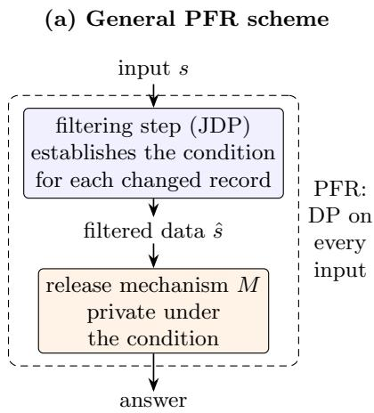
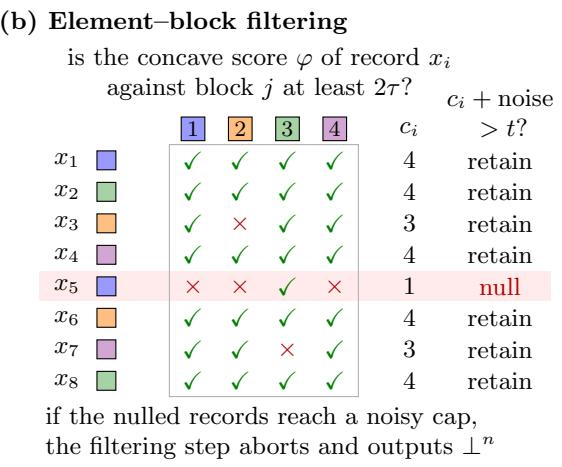
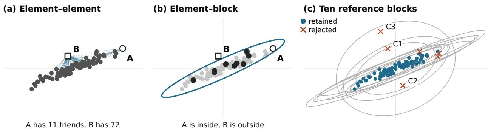
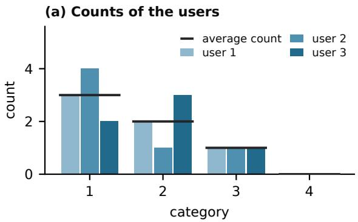
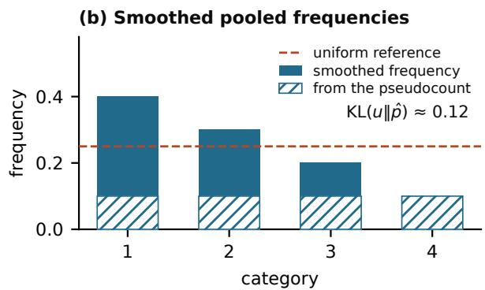
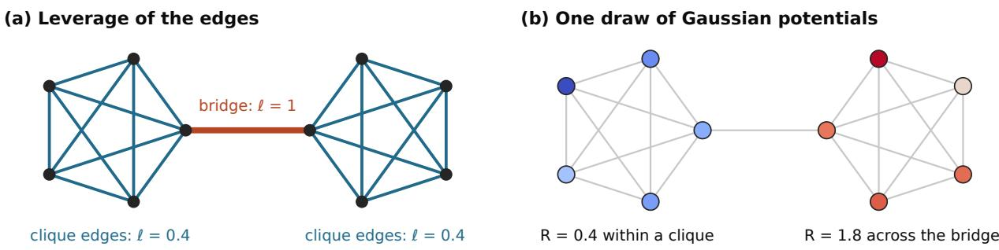

# Propose-Filter-Release: Scaling Noise to Typical Sensitivity via Private Filtering

Moshe Shenfeld<sup>∗,†</sup> Eliad Tsfadia<sup>∗,‡</sup> Katrina Ligett<sup>§</sup>

## Abstract

An estimator can be accurate and stable on typical data, yet sensitive to a few possible records. Diferentially private mechanisms commonly scale their noise to the worst-case influence of a single record, which lets these records dictate the noise even when the remaining data would allow far less. Removing them first would restore the smaller scale, but the removal must itself be private.

We introduce propose-filter-release (PFR), which, by privately filtering its input, turns a mechanism that protects the addition or removal of a typical record, one that fits the remaining data, into one that is diferentially private in the standard sense, on every input. Using our novel filtering step, PFR requires only a concave friendliness score, which measures how well a record fits a dataset, and a release mechanism that is friendly-DP, that is, private when the changed record fits the remaining data. For every such score and release mechanism, it guarantees diferential privacy under public conditions on the number of records, so it is a general privacy primitive, comparable to propose-test-release, and FriendlyCore can be viewed as one of its implementations.

We illustrate the generality of PFR by instantiating it for scalar statistics, principal subspace estimation, the KL divergence of user histograms, the efective resistances of a graph, and treatment-rule selection.

## Contents

1 Introduction 1   
Technical Overview 6   
Related Work . 7   
2 Preliminaries 8   
Notation . . 8   
Diferential Privacy 8   
3 Private Filtering 9   
3.1 Fixed-Threshold Sparse Vector 10   
3.2 The Filter . 11   
3.3 Privacy and Retention 11   
4 Propose-Filter-Release 12   
4.1 Friendliness Scores and Friendly DP 13   
4.2 The PFR Theorem . 14   
4.3 Relation to FriendlyCore, Propose-Test-Release and Down Sensitivity 15   
5 Applications 16   
5.1 Warm-Up: Scalar Releases and Trace Estimation 17   
5.2 Gaussian Sketches and Subspace Estimation . 18   
5.3 KL Divergence of User Histograms from a Uniform Reference 20   
5.4 All-Pairs Efective Resistance 21   
5.5 Treatment-Rule Selection 22   
6 Discussion 23   
A Additional Preliminaries 26   
B Proofs from Section 3 30   
B.1 Fixed-Threshold Sparse Vector 30   
B.2 Privacy and Retention of the Filter 33   
C Proofs from Section 4 35   
D Details and Proofs from Section 5 38   
D.1 Scalar Releases and Trace Estimation 38   
D.2 Gaussian Sketches and Subspace Estimation 40   
D.3 KL Divergence of User Histograms 45   
D.4 All-Pairs Efective Resistance 49   
D.5 Treatment-Rule Selection 55   
E FriendlyCore as an Implementation of Propose-Filter-Release 58

## 1 Introduction

Statistical analysis estimates patterns shared by a population from data contributed by individuals. When these data are sensitive, the results should not reveal much about any single contributor. Diferential privacy (DP) [DMN+06] makes this requirement precise: a randomized algorithm is diferentially private if changing the data of any single individual barely changes the distribution of its output. This must hold for every pair of datasets that difer in one individual, including datasets on which the analysis is not expected to be accurate. For convenience, we model a change of one individual’s data as replacing their record with a null placeholder, which is essentially the same as removing it, and equivalent, up to constant factors in the privacy parameters, to replacing it with another record (Section 2).

The goals of statistics and of privacy pull in diferent directions. In particular, privacy must also protect a record whose change would move the result substantially. A statistical analysis, by contrast, is concerned with typical data, in which the records follow a common pattern and no single record has much influence on the result. Noise that protects the worst case is calibrated to records that typical data do not contain, so on typical data it can be disproportionate to the influence of any of their records. The goal of this paper is a general technique whose noise reflects the influence of records on typical data, while it remains private on every dataset. On atypical datasets, it may fail or return an uninformative answer.

An illustrative example. We illustrate this goal with principal subspace estimation. Given independent samples from a centered Gaussian distribution in R<sup>d</sup>, the task is to estimate the subspace spanned by the k leading eigenvectors of its covariance, which are the directions along which the data vary the most. An estimate is accurate when every unit vector in it lies close to this subspace. On such data the samples concentrate near the target subspace, as the samples of Figure 2 do in the plane, and for the covariances that we consider, a non-private estimate is accurate from a number of samples that grows with k but not with the ambient dimension d (Section 5.2). A straightforward private approach adds noise that does not depend on the data at hand, and the number of samples that it needs grows polynomially with d (Section 5.2). In this example, the goal above is a private algorithm that needs, for the data that we consider, a number of samples without a polynomial dependence on d, as in the non-private case.

Global and local sensitivity. The most common way to achieve DP adds noise calibrated to the global sensitivity of the target statistic, the largest change in it between any two neighboring datasets [DMN+06]. This worst-case calibration is private on every dataset, but it ignores the structure that makes typical data easy, and it is the source of the disproportionate noise described above. One hope is to replace the worst-case bound by an instance-dependent one: the local sensitivity of a statistic at a dataset is its largest change between this dataset and one of its neighbors [NRS07], and it can be much smaller on typical data. Simply adding noise at this scale, however, is not private in general, since the scale itself depends on the data and can reveal the changed record. In the illustrative example, a single suficiently large record in a direction orthogonal to the data can turn a direction of the empirical subspace by a right angle, regardless of the sample size, so the global sensitivity of the empirical subspace is maximal. Noise at this scale cannot exploit an otherwise stable low-dimensional structure. The straightforward private approach of the illustrative example instead clips every record to a public norm bound, computes the empirical second moment of the clipped records, adds noise calibrated to the largest change that a single record can cause in this matrix, and returns the top-k subspace of the result. Its noise grows with the clipping radius, which must be large enough to leave typical records intact, and with the dimension of the d × d matrix to which it is added, rather than with the small spread of the data around the subspace. By contrast, on a typical sample whose spectral separation is strong and in which no single record dominates the fit, removing one record barely moves the empirical subspace. Its local sensitivity is therefore small, but noise scaled to it would not be private.

Propose-test-release. A second hope is to rely on a bound on the local sensitivity only after privately testing that the data satisfy it. The propose-test-release (PTR) framework of Dwork and Lei [DL09] does so by combining two kinds of privacy guarantees. Its inner mechanism adds noise scaled to a proposed bound on the local sensitivity, and it is private only under a condition: on the pairs of neighboring datasets on which the bound holds. The complete algorithm wraps it in a test: it first privately measures how far the dataset is from violating the bound, and then either runs the inner mechanism or reports failure. A dataset that is close to a violation passes the test only with small probability, so the inner mechanism almost never runs where its condition fails, and the complete algorithm is DP on every dataset. PTR thus already provides a route from a mechanism that is private only under a condition to one that is private everywhere. Its limitation is that the test concerns the dataset as a whole: a dataset fails as soon as it is close to a single violation, even if all its other records are typical, unless PTR is applied to a statistic that is robust or stabilized against such records. In the illustrative example, every dataset is one change away from containing a large record orthogonal to the data, which violates any useful bound on the influence of a record. PTR applied directly to such a bound therefore fails on every dataset, except with small probability (Proposition C.5).

Private filtering. Since the test of PTR concerns the dataset as a whole, one may hope instead to privately filter out the records that do not fit the rest, and then run a mechanism that needs to be private only on the datasets that such a filter can produce. FriendlyCore [TCK+22] does so through pairwise comparisons: a predicate specifies which pairs of records are friends, its filtering step keeps the records that have many friends, and its release mechanism needs to be private only on datasets in which every two records have a common friend. For averaging, for example, a distance predicate keeps a concentrated cluster of records and excludes a few distant outliers. In the illustrative example, however, the distance between two records does not reflect their influence on the subspace. Two records far apart along the subspace are not friends although both fit the data, while a record just of the subspace, near the origin, is a friend of many (Figure 2a). This is a limitation of one natural predicate for this task, not of every pairwise predicate.

To capture structure that single records do not reveal, a second approach, in the spirit of sample-and-aggregate, compares subsets of records instead of single records: the records are split into blocks, a model is estimated non-privately on each block, and the models are aggregated privately. In the illustrative example, Tsfadia [Tsf24, Algorithms 4.1–4.3] applies FriendlyCore to the subspaces estimated on the blocks, an approach that we call block–block FriendlyCore, and Singhal and Steinke [SS21] aggregate these subspaces through a private histogram. When the eigenvalues beyond the target rank are much smaller than the leading ones, the block estimates cluster tightly, and the published guarantees of both methods do not grow polynomially with d. A harder regime has a constant ratio between the k’th and (k + 1)’th eigenvalues, an absolute gap between them that shrinks as the dimension grows, and a light tail of many weak directions that together carry little variance. Non-privately, the small gap does not force a dependence on d there. Privately, however, to the best of our knowledge no previously published sample size for this notion of accuracy is independent of the dimension for a given rank. The published guarantees that we compare with either require an eigenvalue ratio that decreases with d or retain terms that grow polynomially with

d (Section 5.2).

Our contribution. Our contribution toward the goal stated above is twofold. First, we introduce propose-filter-release (PFR), a general technique that extends the structure of FriendlyCore to other filtering steps and other conditions for privacy (Figure 1a). Second, we develop element–block filtering, a new filtering step for PFR that compares each record with blocks of records rather than with single records (Figure 1b).

PFR follows the same route as PTR, but it replaces the test of the whole dataset by a filtering step that is applied to individual records, and then runs a release mechanism on the filtered data. The release mechanism needs to be private only on the pairs of neighboring datasets that satisfy a condition between the changed record and the remaining data. The filtering step must be jointly diferentially private (JDP) [KPR+14]: its outputs on two neighboring inputs must be indistinguishable once the changed record is nulled in both. It must also establish the condition of the release mechanism for each changed record, with high probability. Our PFR theorem (Theorem 4.4) shows that these requirements make the complete mechanism diferentially private in the standard sense, on every input. Since the filtering step removes individual records, PFR need not fail when the dataset is close to a single violation, unlike PTR. FriendlyCore can be viewed as one implementation of PFR, whose condition is that the retained records are pairwise compatible (Section E).

Element–block filtering difers both from the element–element comparisons of FriendlyCore and from block–block FriendlyCore, which compares models estimated on blocks. In the illustrative example, comparing a record with blocks captures structure that a distance test between single records misses (Figure 2a,b). The influence of a record is measured by a friendliness score against a dataset, which is larger for records of smaller influence, and a record is friendly with a dataset when its score is at least a proposed threshold τ. The condition of the release mechanism concerns only the changed record: it must be friendly with the remaining data, which may contain other outliers. We call a release mechanism that is private under this condition friendly-DP: it protects the addition or removal of a record that is typical relative to the remaining data. For a release mechanism that adds noise to a statistic, it sufices to calibrate the noise to a bound on the change of the statistic when such a record is removed. This is a bound on its down sensitivity [CZ13; LRS+25], the change caused by removing records that are present, restricted here to friendly records.

The filtering step tests each record against several reference blocks, random disjoint subsets of the data, at the stricter threshold 2τ. It nulls the records that fail too many tests (Figure 2c) and passes the rest to the release mechanism, which runs once on all of them. The noise of the release mechanism therefore reflects the influence of records once a few outliers are removed, which we informally call the typical sensitivity of the data. Each application states retention conditions, on its data and its block size, under which random reference blocks are representative of the data. Under these conditions, with high probability every typical record passes its tests and is retained, and only the few records that fail, if any, are removed (Theorem 3.6). The filtering step aborts only when the failing records reach a noisy cap of order log $( 1 / \delta ) / \varepsilon$ , in which case it passes a dataset of null records to the release mechanism. PFR with element–block filtering thus tolerates a number of outliers of this order, which does not grow with the size of the data, and not a constant fraction of contamination.

The one structural requirement of element–block filtering is that the score be concave: the score of a record against a union of datasets is at least the size-weighted average of its scores against them. Since scores are nonnegative, a record that scores at least 2τ against at least half of several equally sized blocks scores at least τ against their union, which is why the filtering step tests at 2τ. Passing the tests against many blocks then establishes, with high probability, that the changed record fits the remaining filtered data, as the release mechanism requires (see the Technical Overview). The blocks serve only to test records, and not to estimate the answer, so their size need not depend on the target accuracy (Figure 2b,c).



  
Figure 1: Propose-filter-release. (a) The general scheme, whose guarantee is the PFR theorem (Theorem 4.4): the application specifies the release mechanism M and a condition between the changed record and the remaining data under which M is private. The filtering step is jointly diferentially private (JDP), that is, its outputs on two neighboring inputs are indistinguishable once the changed slot is nulled in both, and it establishes the condition of the release mechanism, with high probability, for each changed record. The complete mechanism, whose only output is the answer of the release mechanism, is then diferentially private on every input. (b) Element–block filtering, the filtering step of this paper, whose condition is that the changed record is friendly with the remaining filtered data; other filtering steps that meet the same interface, such as that of FriendlyCore, can take its place in (a). It fills a matrix of tests, one for every record and every reference block of a random partition, each asking whether the score of the record against the block is at least $2 \tau .$ , twice the threshold of the release mechanism. The friend count $c _ { i }$ of a record, its number of friendly blocks, plus noise, is compared with a fixed threshold t, and the records that fail are nulled. The colored square next to a record marks the block that contains it.

With element–block filtering, PFR becomes a meta-algorithm: it is instantiated by choosing a concave friendliness score and a release mechanism that is friendly-DP with respect to it. Concavity shows that element–block filtering establishes the condition of the release mechanism, so the PFR theorem makes the resulting algorithm DP once the public parameters provide enough reference blocks.

Theorem 1.1 (PFR with element–block filtering, informal version of Theorem 4.6). Given $\varepsilon \in ( 0 , 1 ]$ $\delta \in ( 0 , 1 )$ , a concave friendliness score $\varphi _ { i }$ , a threshold $\tau > 0$ , and a release mechanism M that is $( \varepsilon / 2 , \delta / 4 )$ -friendly-DP at the threshold τ, if the number $m = n / b$ of reference blocks of size b is at least $C L ^ { 2 } / \varepsilon ^ { 3 / 2 }$ , where $L : = \ln ( 1 6 / \delta )$ and C is a universal constant, then PFR with element–block filtering is $( \varepsilon , \delta ) \ – D P$

The conditions of the theorem involve only public quantities, so privacy holds also on inputs with many outliers, on which the filtering step may abort and the output is uninformative. PFR outputs only the answer of the release mechanism and does not signal an abort. The number of blocks that sufices depends only on the privacy parameters, so the number of records that our construction uses for filtering is linear in the block size, and it adds to the sample requirement of the release mechanism rather than multiplying it. Whether the filtering step retains the data, and how accurate the answer is, are separate questions, which each application answers for its own typical data.

  
Figure 2: In this example, comparing a record with blocks of records captures structure that a distance test between single records misses. The data are 100 samples from an anisotropic Gaussian distribution, the probes A and B are not records, and the test noise is omitted. (a) Compared with the records one by one, and friendly with those within a fixed distance, A, which lies along the data, has few friends, and B, which lies of the data near the origin, has many. (b) An ellipse with the shape of the second moment of one block of records, long along the directions in which the block varies and short across them, contains A but not B. (c) Tests against several blocks separate the outliers C1–C3 from the data.

The illustrative example brings these ideas together. Its release mechanism draws r independent Gaussian sketches, random Gaussian combinations of the retained records perturbed by Gaussian noise of a small public variance, and returns the principal subspace of their empirical covariance. The covariance of each sketch is a regularized second moment of the filtered data, and the coeficients of the combinations remain internal. Restoring a record changes the distribution of each sketch by an amount controlled by the leverage of the record with respect to the remaining data, a squared Mahalanobis norm that is small along the directions in which the data vary and large across them. The friendliness score is the reciprocal of the leverage, a concave score, and a record is tested by asking whether it lies in an ellipsoid determined by a reference block (Figure 2b). The sketches are friendly-DP once n exceeds the leverage bound $1 / \tau$ by a factor of order $( \sqrt { r L } + L ) / \varepsilon$ (Theorem 5.8). For Gaussian data with the geometric spectrum of Section 5.2, an instance of the harder regime above, with blocks of $\widetilde O ( k )$ records and τ of order $1 / k .$ , up to logarithmic factors, the sample size $n = \widetilde O ( k / \varepsilon ^ { 3 / 2 } + k / \alpha ^ { 2 } + k ^ { 3 / 2 } / ( \alpha \varepsilon ) )$ sufices for accuracy α with high probability. That is, every unit vector of the estimate then lies within distance α of the target subspace. The first two terms come from the number of blocks and the statistical condition of Theorem 5.9, and the third from the privacy condition of Theorem 5.8. This bound has no explicit factor of the ambient dimension d, and assumes no bound on the norms of the records, but the spectrum requires $k > \lceil \log _ { 2 } d \rceil$ , so for a fixed rank it covers only dimensions up to $2 ^ { k - 1 }$ . The previously published bounds for this notion of accuracy that we compare with grow polynomially with d on this spectrum, although an adaptation of an existing stable estimator may also avoid this dependence (Sections 5.2 and 6).

Section 5 gives further examples of friendly-DP release mechanisms: a scalar release with Gaussian noise, which estimates a regularized trace and tolerates a few arbitrary outliers; the KL divergence of user histograms from a uniform reference, with Laplace noise; the efective resistances of all pairs of vertices of a graph, with Gaussian vertex potentials; and the selection of a treatment rule with the exponential mechanism.

Beyond the worst case. More broadly, PFR is an instance of a general idea for going beyond minimax lower bounds, which are determined by the hardest inputs. The idea is to treat the bad inputs and the typical ones separately, with guarantees governed by the structure of the typical input at hand, as in the beyond-worst-case analysis of algorithms [Rou21] and in instance-dependent private estimation [NRS07; AD20]. In private statistics, the minimax noise level is set by the worst-case influence of a single record, and privacy must hold also on the bad inputs. PFR separates the two kinds of inputs through its filtering step. Under the retention conditions of an application, it removes nothing from typical inputs with high probability, and its accuracy then follows their typical sensitivity. On bad inputs, it rejects the records that fail its tests, or aborts when there are many, and it remains private either way. This does not contradict minimax lower bounds, which concern the worst case, and we make no claim of instance optimality.

## Technical Overview

The proof of Theorem 1.1 verifies the two requirements of the PFR theorem for element–block filtering, in two components. The first is the joint diferential privacy of the filtering step, for an arbitrary friendliness predicate, which runs a sparse vector algorithm with a fixed threshold as an internal step (Section 3). The second is a concavity argument showing that the filtering step establishes the condition of the release mechanism (Section 4). The goal is that a number of records linear in the block size b sufices, up to factors that depend only on ε and L.

First component: a private filtering step. For each record, the filtering step compares its friend count, the number of reference blocks that are friendly with it, with a threshold (Figure 1b). In the illustrative example, the friend count is the number of block ellipsoids that contain the record (Figure 2c). Changing one record changes one reference block, so the count of every other record changes by at most one, while the test of the changed record now asks about a diferent record, so its answer can change arbitrarily. Protecting all n comparisons by direct composition gives noise whose margin grows as ${ \sqrt { n } } ,$ , so for counts that range over [0, m] this analysis needs $n = \Omega ( b ^ { 2 } L ^ { 2 } / \varepsilon ^ { 2 } )$ records, quadratic in the block size b (Section 3.3).

The filtering step therefore runs the tests through the sparse vector technique, whose privacy analysis pays only for a few paid answers, here the rejections. It uses the variant with a fixed public threshold, which follows from the target-charging technique of Cohen and Lyu [CL23]. Each count is compared with the same threshold after adding independent Laplace noise, so the tests share no random state, and the proof can set aside the exceptional test of the changed record and treat every other test as a query of sensitivity one. For comparison, the variant of Dwork and Roth [DR14, Algorithm 2] redraws its threshold noise after each paid answer, so an exceptional answer that is paid in only one of the two executions also changes the threshold that all the later tests use. That variant is private for queries of sensitivity one, but its analysis does not isolate a single query that changes arbitrarily. With a cap of K paid answers, Laplace noise of scale $O ( \sqrt { K L } / \varepsilon )$ sufices, independently of the number of comparisons.

The exceptional test can still contribute one extra rejection, and thereby make only one of the executions on s and on $s ^ { i  \perp }$ reach the cap, where $s ^ { i  \perp }$ denotes s with its i’th record replaced by ⊥. Laplace noise added to the cap hides this one-bit change in the number of rejections. Together, the two noises make the filtered outputs on s and on $s ^ { i  \perp }$ indistinguishable once slot i is nulled in both, which is joint diferential privacy under our adjacency (Definition 3.3 and Theorem 3.4). We set the cap to order $L / \varepsilon$ rejections, enough to absorb its own noise when no record is expected to fail, and the scale of the test noise then follows from advanced composition. A test with Laplace noise of scale σ is $( 1 / \sigma , 0 ) { \mathrm { - D P } } ,$ , and composing order $L / \varepsilon$ paid tests costs order $\sqrt { ( L / \varepsilon ) L } / \sigma$ , which is at most ε for σ of order $\sqrt { ( L / \varepsilon ) L } / \varepsilon = L / \varepsilon ^ { 3 / 2 }$ . A separate tail bound gives the number of blocks. The noise of one test exceeds order σ ${ \cal L } = { \cal L } ^ { 2 } / \varepsilon ^ { 3 / 2 }$ only with probability of order $\delta ,$ and this margin is small compared with the range [0, m] of a friend count once $m = \Omega ( L ^ { 2 } / \varepsilon ^ { 3 / 2 } )$ , that is, once $n = \Omega ( b L ^ { 2 } / \varepsilon ^ { 3 / 2 } )$ , which is linear in the block size. In the illustrative example, filtering thus costs $\widetilde { O } ( k / \varepsilon ^ { 3 / 2 } )$ records.

Second component: concavity, which connects the filtering step to the release mechanism. The filtering step guarantees only that a retained record is friendly with many separate blocks, whereas the release mechanism needs it to be friendly with the remaining filtered data as a whole. Concavity bridges the two. If the record of the changed slot is retained, then, up to the noise of its own test, it passed the test against more than $7 m / 8$ of the blocks, the acceptance threshold that our analysis uses. Since the run did not abort, at most order $L / \varepsilon$ records were rejected, a small fraction of m. Setting aside the blocks of the rejected records and the block of the changed record leaves at least $m / 2$ intact blocks, with none of their records rejected and with score at least 2τ against the record. Concavity combines them with the rest of the filtered data, whose score is nonnegative, and shows that the score of the record against the remaining filtered data is at least $( 1 / 2 ) \cdot 2 \tau = \tau$ . Here the filtered data keep all n slots, so the size-weighted average uses the full denominator, which nulling the rejected records does not shrink. In the illustrative example, a record that lies in the $1 / ( 2 \tau )$ -ellipsoids of half of the blocks, all of them intact, therefore lies in the 1/τ-ellipsoid of the pooled retained data. The PFR theorem then combines the two components: joint diferential privacy compares the filtered outputs on the two neighboring inputs, and the friendly DP of the release mechanism pays for restoring the retained record.

This argument controls a bad event for one fixed changed slot, which involves only the noise of its own test and of the cap, and it does not certify that every retained record is friendly at the same time. This is why the privacy bound on m has no log n factor. A guarantee that all the records of typical data are retained must control all the tests, and it pays an additional factor that is logarithmic in n (Corollary C.3).

## Related Work

PFR follows the route of PTR [DL09] from a mechanism that is private only under a condition to one that is private on every input, and it exploits the instance-dependent stability that local sensitivity [NRS07] describes. Unlike the sample-and-aggregate methods for subspace estimation [Tsf24; SS21], it uses blocks only to test records, and not to estimate models. Its closest relative is Friendly Core [TCK+22], whose release mechanism needs to be private only on neighboring datasets whose records are pairwise compatible, whereas that of element–block filtering needs to be private only on the neighboring pairs in which the changed record is friendly with the remaining data. The two hypotheses do not imply one another, so neither implementation subsumes the other. Stability-based estimators [BHS23] and the subsample-test-aggregate reduction [RGH26] also exploit stability under the deletion of records, through a stabilized estimator or through certified releases on accepted subsamples, which are then aggregated, whereas PFR applies one friendly-DP release mechanism to all the retained records. General frameworks for black-box statistics estimate a real-valued statistic from its values on subsets of the data, under a Lipschitz condition on the statistic [LRS+25] or for i.i.d. data [SS26; BLM+26], whereas the output of a friendly-DP release mechanism need not be a scalar. Section 4.3 compares PFR with FriendlyCore, PTR and down sensitivity at the level of their interfaces, and compares the numbers of records that FriendlyCore and element–block filtering need. Section 6 discusses further related work, among them smooth sensitivity, generalized PTR, restricted sensitivity, per-instance diferential privacy and private Gaussian sketching, and compares PFR in more detail with the black-box frameworks, with stable estimators and with

subsample-test-aggregate.

## 2 Preliminaries

This section sets the notation, recalls diferential privacy under the adjacency notion that we use, and recalls the noise mechanisms and composition tools used in the proofs. Their formal statements, together with further preliminaries, including R´enyi divergence and concentration bounds, can be found in Section A.

## Notation

Datasets. Given a data domain, we augment it with a null element ⊥, which stands for a record that was removed or withheld, and denote the augmented domain by X. A dataset $s = ( s _ { 1 } , \ldots , s _ { n } ) \in$ $\mathcal { X } ^ { n }$ is a sequence of n records, each occupying a slot, and $\textstyle { \mathcal { X } } ^ { * } : = \bigcup _ { n > 0 } { \mathcal { X } } ^ { n }$ is the set of all datasets, including the empty dataset ∅. A null record still occupies its slot: the size $| s | = n$ is the number of slots, null ones included, and the all-null dataset $\perp ^ { n }$ is not the empty dataset when $n > 0$ . We denote by $( s , s ^ { \prime } )$ the concatenation of two datasets, by $s ^ { I  \perp }$ the dataset obtained from s by replacing the records indexed by $I \subseteq [ n ] : = \{ 1 , \dots , n \}$ with ⊥, and by $s ^ { i  x }$ the one obtained by replacing $s _ { i }$ with x. The symbol fail denotes a failure output of a mechanism, and is distinct from ⊥.

Probability and asymptotics. We denote by $X \sim P \mathrm { ~ a ~ }$ draw from a distribution $P ,$ by $P ^ { n }$ the distribution of n independent draws from it, and by 1{E} the indicator of an event E. We denote by $\mathrm { B i n } ( N , p ) , { \mathcal { N } } ( \mu , \Sigma )$ and $\operatorname { L a p } ( \sigma )$ the binomial distribution, the Gaussian distribution, which may be singular, and the centered Laplace distribution with density $( 2 \sigma ) ^ { - 1 } e ^ { - | z | / \sigma }$ . All logarithms are natural; $O , \Omega$ and Θ suppress universal constant factors, $\widetilde O$ and Ωe also suppress factors that are logarithmic in the parameters and in the failure probabilities, and C denotes a universal constant that may change between occurrences.

Standing notation. Table 1 lists the recurring symbols, which keep their meaning throughout the paper; statements use them without introducing them again, except that they restate $L : = \ln ( 1 6 / \delta )$ where it enters a condition.

<table><tr><td></td><td>Symbol Meaning</td></tr><tr><td>n</td><td>number of slots of a dataset, null records included</td></tr><tr><td>b</td><td>block size: the filter splits the dataset into reference blocks of b records, where b divides n</td></tr><tr><td>m</td><td>number of reference blocks,  $m : = n / b$ </td></tr><tr><td>t</td><td>acceptance threshold: the filter retains a record if the number of blocks that are friendly</td></tr><tr><td></td><td>with it, plus Laplace noise, exceeds t  $\tilde { K } = \lceil 2 \sigma _ { 1 } L + \mathrm { L a p } ( \sigma _ { 1 } ) \rceil$ </td></tr><tr><td> $\tilde { K }$ </td><td>noisy cap: the filter aborts once it has rejected records scales of these two Laplace noises:  $\sigma _ { m }$  for the noise that is added to the number of friendly</td></tr><tr><td> $\sigma _ { m } , \sigma _ { 1 }$ </td><td>blocks, which is at most m, and  $\sigma _ { 1 }$  for the noise that is added to the cap</td></tr><tr><td> $\varphi$ </td><td>friendliness score:  $\varphi ( s , x ) \geq 0$  scores a record x against a dataset s, and a higher score means a smaller influence</td></tr><tr><td> $\tau$ </td><td>threshold on the friendliness score: s is τ-friendly with x if  $\dot { \varphi } ( s , x ) \geq \tau$  , where  $\tau > 0 ,$ </td></tr><tr><td> $\varepsilon , \delta , L$ </td><td>the filter tests at the stricter threshold 2τ privacy parameters, and  $L : = \ln ( 1 6 / \delta )$ </td></tr></table>

Table 1: Recurring notation. The filter is defined in Section 3.2 and friendliness scores in Section 4.1.

## Diferential Privacy

We use zero-out adjacency [KMS+21, Definition 1.1], which operates over a fixed and public number of slots: two datasets $s , s ^ { \prime } \in \mathcal { X } ^ { n }$ are neighbors, denoted $s \simeq s ^ { \prime }$ , if they are s and $s ^ { i  \perp }$ for some $i \in [ n ]$ with $s _ { i } \neq \perp$ . This notion models a participant who withholds their data while their slot remains present, so neighboring datasets have the same number of slots, and hence the same number of reference blocks. It is a common convention in private learning, with guarantees essentially equivalent to those of the add/remove notion [PHK+23, Section 2.1.1]. The sensitivity of a real-valued function q on datasets is the supremum of $| q ( s ) - q ( s ^ { \prime } ) |$ over all pairs of neighboring datasets $s \simeq s ^ { \prime }$ . We state diferential privacy through the indistinguishability of two random variables, because several proofs compare pairs of distributions that are not the outputs of one mechanism on neighboring datasets.

Definition 2.1 (Diferential privacy [DMN+06]). Given $\varepsilon \geq 0$ and $\delta \in [ 0 , 1 ]$ , we say that two random variables X and Y over a common domain are $( \varepsilon , \delta )$ -indistinguishable, and denote it by $\mathbf { X } \approx _ { \varepsilon , \delta } \mathbf { Y }$ , if $\operatorname* { P r } [ \mathbf { X } \in O ] \leq e ^ { \varepsilon } \operatorname* { P r } [ \mathbf { Y } \in O ] + \delta$ and $\operatorname* { P r } [ \mathbf { Y } \in O ] \leq e ^ { \varepsilon } \operatorname* { P r } [ \mathbf { X } \in O ] + \delta$ for every event O. A randomized mechanism M will be called (ε, δ)-diferentially private (DP) if $M ( s ) \approx _ { \varepsilon , \delta } M ( s ^ { \prime } )$ for every pair of neighboring datasets $s \simeq s ^ { \prime }$

Replacing one value by another takes two zero-out steps through a null slot, so an $( \varepsilon _ { 0 } , \delta _ { 0 } ) – \mathrm { D P }$ mechanism is $( 2 \varepsilon _ { 0 } , ( 1 + e ^ { \varepsilon _ { 0 } } ) \delta _ { 0 } ) – \mathrm { D P }$ with respect to replacing a single record, while privacy with respect to replacement implies DP with the same parameters (Claim A.1 in Section A). For a desired $\varepsilon \leq 1$ , it therefore sufices to run the mechanism with $\varepsilon _ { 0 } = \varepsilon / 2$ and $\delta _ { 0 } = \delta / 3$ . All the parameters of our algorithms, including the proposed thresholds and any population bounds used to set them, are public or separately privatized, while unknown population quantities may appear in suficient conditions for utility.

Noise mechanisms and composition. We recall the noise mechanisms and composition tools that our proofs use, and state them formally, in the form for two fixed distributions in which the proofs use them, in Section A. Adding ${ \mathcal { N } } ( 0 , \sigma ^ { 2 } )$ to a real-valued function of sensitivity at most 1 is $( \varepsilon , \delta _ { \mathcal { N } _ { \sigma } } ( \varepsilon ) ) – \mathrm { D P }$ for every $\varepsilon > 0$ , where $\delta _ { \mathcal { N } _ { \sigma } } ( \varepsilon ) : = \Phi ( 1 / ( 2 \sigma ) - \varepsilon \sigma ) - e ^ { \varepsilon } \Phi ( - 1 / ( 2 \sigma ) - \varepsilon \sigma )$ is the privacy profile of the Gaussian mechanism [BW18, Theorem 8] and Φ is the standard Gaussian CDF (Fact A.2). Adding Lap(σ) to such a function is $( 1 / \sigma , 0 ) – \mathrm { D P }$ by the Laplace mechanism [DMN+06], and the noise exceeds $a \geq 0$ in absolute value with probability exactly $e ^ { - a / \sigma }$ (Fact A.3). By advanced composition, in the form of Bun and Steinke [BS16], an adaptive interaction of at most N rounds, each of which is (ζ, 0)-DP given the preceding outputs, is $( N \zeta ^ { 2 } / 2 + \zeta \sqrt { 2 N \ln ( 1 / \delta _ { 0 } ) } , \delta _ { 0 } ) – \mathrm { D P }$ for every $\delta _ { 0 } \in ( 0 , 1 )$ (Fact A.4). Finally, two-stage composition is the form of adaptive basic composition that our proofs use: if the first stages of two runs take countably many values and are $( \varepsilon _ { 2 } , \delta _ { 2 } ) .$ indistinguishable, and the second stages are $( \varepsilon _ { 1 } , \delta _ { 1 } )$ -indistinguishable conditionally on every common value of the first, then the two runs are $( \varepsilon _ { 1 } + \varepsilon _ { 2 } , \delta _ { 1 } + \delta _ { 2 } )$ )-indistinguishable (Proposition A.5).

## 3 Private Filtering

This section constructs the filtering step of PFR, its first and internal stage: a private filter that tests each record against the blocks of a random partition of the dataset, retains the records that are friendly with suficiently many blocks, nulls the others, and aborts if too many records fail. PFR never releases the output of the filter, and the composition of Section 4 needs from it only a joint form of diferential privacy (Section 3.3). The proofs that are not given here can be found in Section B.

```latex
Algorithm 1 Fixed-threshold sparse vector Algorithm 2 Private filtering $\mathcal { F } _ { b , t , \sigma _ { m } , \sigma _ { 1 } } ( F ; s )$
$\operatorname { S V } _ { t , K , \sigma } ( q ; s )$ Require: Dataset $s = ( s _ { 1 } , \ldots , s _ { n } ) \in \mathcal { X } ^ { n }$
Require: Dataset s, queries $q _ { 1 } , \ldots , q _ { n }$ of friendliness predicate F, block size $b \in \mathbb N$ that
sensitivity at most 1, threshold $t \in \mathbb { R }$ divides $n ,$ acceptance threshold $t \in [ 0 , m ]$ for
failure cap $K \in \mathbb { N } ,$ noise scale $\sigma > 0$ $m = n / b ,$ noise scales $\sigma _ { m } , \sigma _ { 1 } > 0$ , and privacy
$\mathbf { u } \gets ( )$ parameter $\delta \in ( 0 , 1 )$
for $i \in [ n ]$ do $\eta \sim \mathrm { L a p } ( \sigma _ { 1 } ) , \tilde { K } \gets \lceil 2 \sigma _ { 1 } L + \eta \rceil$
$\gamma _ { i } \sim \mathrm { L a p } ( \sigma )$ if $\tilde { K } \le 0$ then return $\perp ^ { n }$
$u _ { i }  \mathbb { 1 } \{ q _ { i } ( s ) + \gamma _ { i } \leq t \}$ ▷ failure Uniformly partition $[ n ]$ into m subsets of size $b ,$
$\mathbf { u }  ( \mathbf { u } , u _ { i } )$ inducing the blocks $\bar { s } ^ { ( 1 ) } , \dots , s ^ { ( m ) }$ , each in original
if $\| \mathbf { u } \| = K$ then return u index order
end for $\begin{array} { r } { q _ { i } ( \cdot ) : = \sum _ { j \in [ m ] } F \left( \cdot ^ { ( j ) } , s _ { i } \right) } \end{array}$ for $i \in [ n ]$
return u u $\gets \mathrm { S V } _ { t , \dot { K } , \sigma _ { m } } ( q ; s )$
if $\| { \mathbf { u } } \| = \tilde { K }$ then return $\perp ^ { n }$
return $\hat { s } \gets s ^ { R \to \bot }$ where $R : = \{ i : u _ { i } = 1 \}$
```

## 3.1 Fixed-Threshold Sparse Vector

The sparse vector technique (SVT) [DNR+09; RR10; HR10; Vad17] answers threshold queries with a privacy cost governed by the number of positive responses, rather than the total number of queries. We use a fixed public threshold, with independent Laplace noise added only to the query values, which is a direct application of the target-charging technique of Cohen and Lyu [CL23, Algorithm 1] to private tests. The tests then share no random state, so given the preceding transcript, each answer depends only on its own query and its own noise. A query that changes arbitrarily, as one does in the filter, therefore afects only its own bit, unlike in a variant that redraws its threshold noise after each paid answer (see the Technical Overview). Algorithm 1 releases one bit per query: a noisy query value of at most t is a failure, encoded by 1, and the algorithm stops at the K’th failure or after all the queries have been answered. For a binary transcript $\mathbf { u } = ( u _ { 1 } , u _ { 2 } , \ldots )$ , we denote by |u| its length and by $\textstyle \| \mathbf { u } \| : = \sum _ { j \in [ | \mathbf { u } | ] } u _ { j }$ the number of failures in it. The next proposition treats the queries as public: each query may depend on the preceding transcript, but not on the dataset in any other way; in the filter the queries also depend on the input, which Section 3.3 handles separately.

Proposition 3.1 (Privacy of fixed-threshold sparse vector). Given $\delta \in ( 0 , 1 )$ ， $0 < \varepsilon \le 4 \ln ( 2 / \delta )$ , a threshold $t \in \mathbb R$ , an integer $K \geq 1$ , and queries $q _ { 1 } , \ldots , q _ { n }$ of sensitivity at most 1, where each q<sub>i</sub> may be chosen as a function of the preceding transcript $( u _ { 1 } , \ldots , u _ { i - 1 } )$ , if $K \ge 1 2 \ln ( 2 / \delta )$ , then $\mathrm { S V } _ { t , K , \sigma }$ (Algorithm 1) with $\sigma : = 7 \sqrt { K \ln ( 2 / \delta ) } / \varepsilon \ i s \ ( \varepsilon , \delta ) { \cdot } D P .$

Proof outline. Conditional on the preceding transcript, the next bit is a threshold post-processing of a sensitivity-one Laplace mechanism, and by a lemma of Cohen and $\mathrm { L y u }$ [CL23] (Lemma B.1) its two possible distributions are mixtures, with a common weight, of the constant 0 and of a pair of $( 1 / \sigma , 0 )$ -indistinguishable distributions that output a failure with probability at least $1 / ( e ^ { 1 / \sigma } + 1 ) \geq 4 / 9 $ ; we call a draw from the second component a private call. A multiplicative Chernof bound (Proposition $\mathrm { A } . 8 )$ shows that the run reaches its K’th failure within $W \le 5 K$ private calls, except with probability e<sup>−</sup> $\dot { \cdot } K / 4 \le \delta / 2$ . Advanced composition (Fact A.4) over these calls, with $\delta _ { 0 } = \delta / 2$ , gives the privacy loss $W / ( 2 \sigma ^ { 2 } ) + \sqrt { 2 W \ln ( 2 / \delta ) } / \sigma < \varepsilon$ for the stated σ (Section B.1).

## 3.2 The Filter

The filter tests each record against blocks of records through a friendliness predicate, which the application chooses and which specifies when a record fits a dataset.

Definition 3.2 (Friendliness predicate). A friendliness predicate is a function $F : \mathcal { X } ^ { * } \times \mathcal { X } \to \{ 0 , 1 \}$ such that $F ( s , \bot ) = 0$ for every $s \in \mathcal { X } ^ { \ast }$ . We say that a dataset s is friendly with a record x if $F ( s , x ) = 1$

We also say that x is friendly with s. Our filter $\mathcal { F } _ { b , t , \sigma _ { m } , \sigma _ { 1 } } ( F ; \cdot )$ (Algorithm 2), element–block filtering, partitions the n slots into $m = n / b$ reference blocks of b slots each, and tests each record through its friend count $c _ { i } .$ , the number of blocks that are friendly with it. It proceeds in four steps. First, it draws a noisy cap $\tilde { K }$ on the number of rejections, a public ofset $2 \sigma _ { 1 } L$ plus Laplace noise of scale $\sigma _ { 1 }$ , where $L = \ln ( 1 6 / \delta )$ . Second, it partitions the slots uniformly at random, independently of the data. Third, it runs fixed-threshold sparse vector on the friend counts, record by record: the record $s _ { i }$ fails its test if $c _ { i }$ plus fresh Laplace noise of scale $\sigma _ { m }$ is at most the acceptance threshold t. If the failures reach $\tilde { K }$ , the run stops early, and the filter aborts and returns the all-null dataset $\perp ^ { n } . ^ { 1 }$ Fourth, if the run completes, the filter nulls the records that failed, and every retained record keeps its slot. Its parameters, which Table 1 describes, are omitted from the notation when they are clear from the context.

The noisy cap $\tilde { K }$ and the transcript u, including its length, are internal. The cap does not grow with the data, because we analyze data in which no record is expected to fail. Its ofset $2 \sigma _ { 1 } L$ is twice a high-probability bound on its noise, so a run in which no test fails aborts only with probability $\frac { 1 } { 2 } e ^ { - \hat { 2 } L }$ , and half of the ofset leaves room for a few failing records (Theorem 3.6). A run that does not stop early evaluates the predicate nm times: the sparse vector technique reduces the privacy cost of these comparisons, and not their number.

## 3.3 Privacy and Retention

Since a filter rejects a record by nulling it, the retained records keep their slots, and the privacy notion that we require compares the outputs on neighboring inputs only outside the changed slot.

Definition 3.3 (Filter and joint diferential privacy). A randomized function $\mathcal { F } : \mathcal { X } ^ { * }  \mathcal { X } ^ { * }$ will be called a filter if, given a dataset, it returns the same dataset up to replacing a subset of its records with ⊥; that is, for every $s \in \mathcal { X } ^ { * }$ we have $\mathcal { F } ( s ) = s ^ { I  \perp }$ for some random $I \subseteq [ | s | ]$ . A filter will be called $( \varepsilon , \delta )$ -jointly diferentially private (JDP) if for any $s \in \mathcal { X } ^ { n }$ and $i \in [ n ]$ we have $\mathcal { F } ( s ) ^ { i  \perp } \approx _ { \varepsilon , \delta } \mathcal { F } ( s ^ { i  \perp } )$

This is the notion of Kearns et al. [KPR+14], specialized to zero-out adjacency. It compares the two filtered datasets only after slot i is nulled in both, so the filter may reveal whether it retained $s _ { i } ;$ a mechanism applied to its output pays for that record separately, either through ordinary privacy (Corollary 3.5) or, in PFR, through friendly DP (Theorem 4.4).<sup>2</sup> The noise scales that make the filter jointly diferentially private do not depend on the number of records.

Theorem 3.4 (Privacy of the filter). Given $\varepsilon \in ( 0 , 1 ]$ and $\delta \in ( 0 , 1 )$ , for every friendliness predicate $F ,$ every block size b that divides n and every $t \in [ 0 , m ]$ , the filter $\mathcal { F } _ { b , t , \sigma _ { m } , \sigma _ { 1 } } ( F ; \cdot )$ (Algorithm 2) with $\sigma _ { m } : = ( 8 / \varepsilon ) \sqrt { \lceil 2 4 L / \varepsilon \rceil \ln ( 4 / \delta ) }$ and $\sigma _ { 1 } : = 8 / \varepsilon$ , where $L : = \ln ( 1 6 / \delta )$ , is $( \varepsilon , \delta ) \ – J D P$

Proof outline. Fix s and $i ,$ condition on the common partition, and compare the outputs on s and $s ^ { i  \perp }$ , with slot i nulled in both, in two steps. With the queries fixed, nulling $s _ { i }$ changes one block and hence every query by at most one, and Proposition 3.1 with the deterministic cap $\lceil 2 4 L / \varepsilon \rceil$ which bounds $\check { K }$ except with probability $\delta / 2$ , gives a $( 7 \varepsilon / 8 , \delta )$ comparison. With the input fixed, only the query of slot i changes, since it is parameterized by $s _ { i } ;$ this shifts the number of failures by at most one, and the noise of the cap gives an $( \varepsilon / 8 , 0 )$ comparison (Section B.2). □

A jointly diferentially private filter composes with any diferentially private mechanism (Section B.2).

Corollary 3.5 (Composition with a private mechanism). If a mechanism M is $( \varepsilon _ { 1 } , \delta _ { 1 } ) – D P$ and a filter $\mathcal { F }$ is $( \varepsilon _ { 2 } , \delta _ { 2 } ) \lrcorner J D P$ , then $M \circ { \mathcal { F } }$ is $( \varepsilon _ { 1 } + \varepsilon _ { 2 } , \delta _ { 1 } + \delta _ { 2 } ) – D P$

Cost. Protecting all n comparisons directly, as the Gaussian-noise implementation of Friendly-Core [TCK+22] does for element–element friendliness, needs noise whose margin for a single record is $O ( \sqrt { n } L / \varepsilon )$ , and hence $n = \Omega ( b ^ { 2 } L ^ { 2 } / \varepsilon ^ { 2 } )$ for counts in $[ 0 , m ]$ . Calibrating the noise of the tests to the cap instead gives the margin ${ \cal O } ( L ^ { 2 } / \varepsilon ^ { 3 / 2 } )$ , which is small compared with m once $n = \Omega ( b L ^ { 2 } / \varepsilon ^ { 3 / 2 } )$ the order of Theorem 4.6; both conditions are suficient for the respective analyses, not lower bounds.

Retention. The next theorem describes when the filter retains the data instead of aborting, and what every retained record satisfies.

Theorem 3.6 (Retention guarantee). Given $n \geq 1$ , a dataset $s \in \mathcal { X } ^ { n }$ , a friendliness predicate $F _ { \ast }$ $\beta , \delta \in ( 0 , 1 ) , t \in [ 0 , m ]$ and $\sigma _ { m } , \sigma _ { 1 } > 0$ , with probability at least $1 - \beta$ over the noises of the filter $\mathcal { F } _ { b , t , \sigma _ { m } , \sigma _ { 1 } } ( F ; s )$ (Algorithm ${ \it 2 ) }$ , conditionally on any realization of its partition, the following hold simultaneously, where $c _ { i }$ is the number of blocks of the realized partition that are friendly with $s _ { i ; }$ $\bar { \gamma } : = \sigma _ { m } \ln ( 2 n / \beta )$ and $\bar { \eta } : = \sigma _ { 1 } \ln ( 2 / \beta )$

1. Retention: $I f \left| \left\{ i : c _ { i } \leq t + \bar { \gamma } \right\} \right| < 2 \sigma _ { 1 } L - \bar { \eta }$ , where $L : = \ln ( 1 6 / \delta )$ , then the run does not abort and retains every $s _ { i }$ with $c _ { i } > t + \bar { \gamma }$

2. Quality of retained records: Every retained record $s _ { i }$ satisfies $c _ { i } > t - \bar { \gamma }$

Proof. Pre-sample all n test noises, including those that an execution that reaches its cap would not use. $\mathrm { B y }$ Fact A.3 and a union bound, the event E that $| \gamma _ { j } | \le \bar { \gamma }$ for every $j$ and $| \eta | \le \bar { \eta }$ has probability at least $1 - \beta$ , since $\operatorname* { P r } [ | \gamma _ { j } | > \bar { \gamma } ] = \beta / ( 2 n )$ and $\operatorname* { P r } [ | \eta | > \bar { \eta } ] = \beta / 2$ , and since the noises are independent of the partition, this bound also holds conditionally on the partition. On $E _ { i }$ , a record with $c _ { i } > t + \bar { \gamma }$ passes its noisy test, so under the retention hypothesis fewer than $2 \sigma _ { 1 } L - \bar { \eta } \leq 2 \sigma _ { 1 } L + \eta$ tests fail, the run does not abort, and it retains all such records. Conversely, a retained record passed its noisy test, so $c _ { i } + \gamma _ { i } > t$ , which gives $c _ { i } > t - \bar { \gamma }$ on $E$ □

If a random reference block is, with high probability, friendly with almost all of the population, then an i.i.d. sample passes through the filter without aborting and with few rejections; Corollary B.7 in Section B.2 gives the precise condition.

## 4 Propose-Filter-Release

This section states the general guarantee of PFR, the PFR theorem: a release mechanism that is private only on suitably “friendly” neighboring datasets, preceded by a filtering step that is a jointly private filter and establishes friendliness for the changed record, is diferentially private in the standard sense. It then instantiates this guarantee with element–block filtering, the filter of Section 3, which guarantees only that a retained record is friendly with many individual reference blocks. We therefore derive the friendliness predicate from a concave score, which combines these blockwise guarantees into friendliness with the remaining filtered data, as the release mechanism requires. The proofs that are not given here can be found in Section C.

## 4.1 Friendliness Scores and Friendly DP

A friendliness score quantifies how well a record fits a dataset, and a threshold on it induces a friendliness predicate.

Definition 4.1 (Score-based friendliness). A friendliness score is a function $\varphi : { \mathcal { X } } ^ { * } \times { \mathcal { X } } \to [ 0 , + \infty ]$ that is invariant under permutations of its first argument and satisfies $\varphi ( \varnothing , x ) = 0$ and $\varphi ( s , \bot ) = 0$ for every $s \in \mathcal { X } ^ { * }$ and $x \in \mathcal { X }$ . Given a threshold $\tau > 0$ , the friendliness predicate induced by $\varphi$ is $F _ { \tau } ( \varphi ; s , x ) : = \mathbb { 1 } \{ \varphi ( s , x ) \geq \tau \}$ , and we say that s is $\tau { - } f r i e n d l y$ with x if $F _ { \tau } ( \varphi ; s , x ) = 1$

A higher score means a smaller influence of the record on a release. Since $\tau > 0$ , no dataset is friendly with the null record, and the empty dataset is friendly with no record; null records of a nonempty reference dataset are included in its size.<sup>3</sup> The property that lets friendliness with separate blocks be combined is the following.

Definition 4.2 (Concave friendliness score). A friendliness score $\varphi$ will be called concave if $\varphi ( ( s , s ^ { \prime } ) , x ) \geq ( | s | \varphi ( s , x ) + | s ^ { \prime } | \varphi ( s ^ { \prime } , x ) ) / ( | s | + | s ^ { \prime } | )$ for any nonempty datasets s and $s ^ { \prime }$ and record $x \in \mathcal { X }$

When $\varphi ( s , x )$ depends on s only through its empirical distribution, this condition says that $\varphi$ is concave along mixtures of empirical distributions, which is the reason for the name. For example, if ν of the m equal-size blocks of a dataset satisfy $\varphi ( s ^ { ( j ) } , x ) \ge \tau ^ { \prime }$ , then permutation invariance, repeated concavity, and $\varphi \geq 0$ on the remaining blocks give the lower bound $( \nu / m ) \tau ^ { \prime }$ on the score against the whole dataset, which is the aggregation step in the proof of Theorem 4.6.

Example: element–element friendliness. Given a predicate ψ on pairs of records, with $\psi ( x , y ) : = 0$ whenever x or y is ⊥, the fraction of friends $\begin{array} { r } { \varphi _ { \psi } ( s , x ) : = { \frac { 1 } { | s | } } \sum _ { j \in [ | s | ] } \psi ( x , s _ { j } ) } \end{array}$ is a concave friendliness score, with equality in Definition 4.2. The predicate $F _ { 1 } ( \varphi _ { \psi } ; ( y ) , x ) = \psi ( x , y )$ recovers the singleton-block test of FriendlyCore [TCK+22].

We can now state the privacy requirement on the release mechanism.

Definition 4.3 (Friendly DP). Given a friendliness predicate F, a mechanism M will be called $( \varepsilon , \delta ) { \mathrm { - } } f r i e n d l y - D P$ with respect to F if $M ( s ^ { i  \bot } ) \approx _ { \varepsilon , \delta } M ( s )$ for every $s \in \mathcal { X } ^ { n }$ and $i \in [ n ]$ such that $F ( s ^ { i  \perp } , s _ { i } ) = 1$

For a predicate induced by a friendliness score, the condition concerns only the changed record: the remaining data may contain other outliers, and the release mechanism must be private on such pairs as well.<sup>4</sup> The role of the filtering step is to establish this condition for the changed record in a stable manner, for each slot i separately and except with small probability. For a release mechanism that adds noise to a statistic, a bound on the change of the statistic on the admitted pairs, such as a dominating score provides (Section 5.1), gives friendly DP once the noise is calibrated to it.

## 4.2 The PFR Theorem

The general guarantee of PFR rests on three properties, which the PFR theorem combines: the filtering step is a jointly diferentially private filter, a retained record is friendly with the remaining filtered data except with small probability, and the release mechanism is private on friendly pairs.

Theorem 4.4 (PFR theorem). Given $\varepsilon _ { 1 } , \varepsilon _ { 2 } \geq 0 , \delta _ { 1 } , \delta _ { 2 } , \delta _ { 3 } \in [ 0 , 1 ]$ , a friendliness predicate $F ,$ an $( \varepsilon _ { 1 } , \delta _ { 1 } ) \ – J D P$ filter $\mathcal { F }$ , and a release mechanism M that is $( \varepsilon _ { 2 } , \delta _ { 2 } ) – f r i e n d l y  – D P$ with respect to $F ,$ suppose that for every $s \in \mathcal { X } ^ { n }$ and $i \in [ n ]$ with $s _ { i } \neq \perp$ , the probability that $\mathcal { F } ( s )$ retains $s _ { i }$ while $F ( \mathcal { F } ( s ) ^ { i  \perp } , s _ { i } ) = 0$ is at most $\delta _ { 3 }$ . Then $M \circ \mathcal { F } \ i s \ ( \varepsilon _ { 1 } + \varepsilon _ { 2 } , \delta _ { 1 } + \delta _ { 2 } + e ^ { \varepsilon _ { 1 } + \varepsilon _ { 2 } } \delta _ { 3 } ) . D P$

Proof outline. Fix s and i with $x : = s _ { i } \neq \bot$ , let A be the output of the filter on s with slot i nulled, and modify the release on s by also nulling slot i whenever x is not friendly with A. Conditional on A, the modified release is $M ( A )$ or, on a friendly pair only, $M ( A ^ { i  x } )$ , so friendly DP makes it $( \varepsilon _ { 2 } , \delta _ { 2 } )$ -indistinguishable from $M ( A )$ , and two-stage composition (Proposition $\mathrm { A . 5 } )$ with the joint diferential privacy of the filter compares it with the release on $s ^ { i  \perp }$ . The modification changes the output with probability at most $\delta _ { 3 }$ , which adds $\delta _ { 3 }$ to the additive error in one direction and $e ^ { \varepsilon _ { 1 } + \varepsilon _ { 2 } } \delta _ { 3 }$ in the other (Section C). □

When M is private on all neighboring pairs, it is friendly-DP with respect to the predicate that admits every non-null record, the last hypothesis holds with $\delta _ { 3 } = 0$ , and the theorem reduces to Corollary 3.5. Any filter that satisfies the hypotheses of the theorem for some predicate can serve as the filtering step of $\mathrm { P F R , }$ and the Gaussian filter of FriendlyCore is one (Section 4.3). The implementation of this paper runs the filter of Section 3 with the predicate that a score induces at a tightened threshold.

Definition 4.5 (PFR with element–block filtering). Given a friendliness score $\varphi ,$ a threshold $\tau > 0$ and a release mechanism M, PFR with element–block filtering is the mechanism $\mathrm { P F R } _ { b , t , \sigma _ { m } , \sigma _ { 1 } } ( M , \varphi , \tau ) : = M \circ \mathcal { F } _ { b , t , \sigma _ { m } , \sigma _ { 1 } } \left( F _ { 2 \tau } ( \varphi ) \right)$

That is, it runs the filter with the predicate that $\varphi$ induces at the tightened threshold $2 \tau$ and evaluates M on the filtered dataset, which is $\perp ^ { n }$ if the filter aborts. From now on, “the PFR mechanism” refers to this implementation. Our main result instantiates the PFR theorem (Theorem 4.4) for it: for a suitable choice of the parameters of the filter, concavity bounds $\delta _ { 3 } ,$ so the PFR mechanism is diferentially private whenever M is private on the pairs that are friendly at the threshold τ.

Theorem 4.6 (PFR with element–block filtering). Given $\varepsilon \in ( 0 , 1 ] , \delta \in ( 0 , 1 )$ , a concave friendliness score $\varphi ,$ a threshold $\tau > 0$ , and a release mechanism M that is $( \varepsilon / 2 , \delta / 4 )$ -friendly-DP with respect to $F _ { \tau } ( \varphi ) , i f m \geq 4 0 0 L ^ { 2 } / \varepsilon ^ { 3 / 2 }$ , where $L : = \ln ( 1 6 / \delta )$ , then $\mathrm { P F R } _ { b , t , \sigma _ { m } , \sigma _ { 1 } } ( M , \varphi , \tau )$ (Definition 4.5) with $t : = 7 m / 8 , \sigma _ { m } : = 1 0 8 L / \varepsilon ^ { 3 / 2 }$ and $\sigma _ { 1 } : = 1 2 / \varepsilon \ i s \ ( \varepsilon , \delta ) \ – D P$

We denote by $\mathrm { P F R } _ { b } ^ { \varepsilon , \delta }$ the PFR mechanism with the parameters of Theorem 4.6, which are the ones that we use in the applications. The condition of the theorem involves only the public quantities $n , b , \varepsilon$ and $\delta ,$ and it does not grow with $n _ { \mathrm { : } }$ , since the argument controls only the noise of the changed slot and of the cap. With these parameters, the filter aborts once it has rejected about $2 4 L / \varepsilon$ records, and the PFR mechanism then releases $M ( \bot ^ { n } )$ without reporting the abort, so its accuracy guarantees count the runs that abort as inaccurate.

Proof outline. We apply Theorem 4.4 with $\varepsilon _ { 1 } = \varepsilon / 2 , \varepsilon _ { 2 } = \varepsilon / 2 , \delta _ { 1 } = 1 7 \delta / 3 2 , \delta _ { 2 } = \delta / 4$ and $\delta _ { 3 } = \delta / 3 2$ for which the total additive error is $( 2 5 + e ^ { \varepsilon } ) \delta / 3 2 < \delta$ . With the stated noise scales, Proposition 3.1 gives a $( 5 \varepsilon / 1 2 , \delta / 2 )$ guarantee for fixed queries and cap $\lceil 3 6 L / \varepsilon \rceil$ . The two comparisons of the proof of Theorem 3.4 then make the filter $( \varepsilon / 2 , 1 7 \delta / 3 2 ) – \mathrm { J D P }$ , after adding the cap-overflow probability $\delta / 3 2$ and the exceptional-query cost $1 / \sigma _ { 1 } = \varepsilon / 1 2$ . It remains to bound $\delta _ { 3 }$ , which concerns the changed record only. Let $E _ { i }$ be the event that $\gamma _ { i } \le \sigma _ { m } L _ { 3 2 }$ and $\eta \leq \sigma _ { 1 } L _ { 3 2 }$ , where $L _ { 3 2 } : = \ln ( 3 2 / \delta )$ whose probability is at least $1 - \delta / 3 2$ by the one-sided Laplace tails. On $E _ { i } ,$ a retained $x : = s _ { i }$ has $c _ { i } > t - \sigma _ { m } L _ { 3 2 }$ , and fewer than $2 \sigma _ { 1 } L + \sigma _ { 1 } L _ { 3 2 }$ records were rejected, so setting aside their blocks and the block of x leaves $\nu \ge m / 2$ intact 2τ-friendly blocks, by the lower bound on $m .$ . Concavity, with the full number n of slots in the denominator, since rejected records are nulled and not removed, then gives $\varphi ( { \hat { s } } ^ { i  \bot } , x ) \geq ( \nu / m ) 2 \tau \geq \tau$ (Section C). □

Retention. Theorem 4.6 is a privacy guarantee only, and retention follows from Theorem 3.6 with its parameters, under a larger lower bound on m that controls all n test noises at once (Corollary C.3 in Section C). If m $\geq 1 8 0 0 L \ln ( 2 n / \beta ) / \varepsilon ^ { 3 / 2 }$ for some $\beta \ge \delta / 8$ , then with probability at least $1 - \beta _ { \mathrm { { \ell } } }$ whenever fewer than $1 2 L / \varepsilon$ records are friendly with at most $1 5 m / 1 6$ of the blocks under $F _ { 2 \tau } ( \varphi )$ the filter does not abort and retains every other record. The applications use this mainly for data in which every record is friendly with more than $1 5 m / 1 6$ of the blocks, a condition on the data and on the block size that each application establishes for its own data. The slack of fewer than $1 2 L / \varepsilon$ failing records, which does not grow with $n ,$ absorbs the rare failing records of an i.i.d. sample (Corollary B.7) and a few arbitrary outliers (Corollary D.3).

## 4.3 Relation to FriendlyCore, Propose-Test-Release and Down Sensitivity

The methods compared here difer first in their interfaces. FriendlyCore and element–block filtering are two implementations of PFR that establish diferent conditions for the release mechanism, whereas PTR tests the original input against a proposed bound.

FriendlyCore. FriendlyCore [TCK+22] can be viewed as an implementation of PFR that compares elements with elements: its filtering step makes the retained records pairwise compatible, in that every two of them have a common friend, and its release mechanism is private on neighboring datasets whose records are pairwise compatible. This condition is a friendliness predicate of the remaining data and the changed record.<sup>5</sup> Element–block filtering instead establishes only that the changed record is friendly with the remaining filtered data, which is what allows friendliness to be judged against blocks. The price is that this guarantee requires a lower bound on the number of blocks, whereas the privacy guarantee of FriendlyCore holds for every n. The hypotheses that the two implementations place on the release mechanism do not imply one another (Section E), so neither subsumes the other. Useful output also requires enough records in FriendlyCore, and an informal calculation (Section E) suggests that with singleton blocks the PFR mechanism does not improve on the private averaging of FriendlyCore. The purpose of element–block filtering is the case of larger blocks, in which a record is judged against a model supported by a block. The number of records that then sufices is the maximum of the filtering requirement $4 0 0 b L ^ { 2 } / \varepsilon ^ { 3 / 2 }$ and the requirement of the release mechanism, which is their sum up to a factor of two, not their product.

This also difers from block–block FriendlyCore (Section 1), which aggregates the models estimated on the blocks, whereas PFR uses the blocks only to test the records.

Propose-test-release. PTR [DL09] privately tests whether the input is suficiently far from every dataset that violates a proposed bound, and returns fail otherwise, so the bound is useful only if the whole input satisfies it (Definition C.4 states PTR in our notation). PFR instead removes records so that, for each changed slot separately, the condition under which the release mechanism is private holds with high probability. The proposed bound is then useful as long as few records violate it. This comparison concerns testing a given statistic directly, since PTR can itself be applied to a robust or stabilized statistic. For the scores of Sections 5.1 and 5.2, on an unbounded domain some value is always unfriendly with the remaining data, so every input is within one adjacency step of a violation, and PTR applied to the unfiltered statistic returns fail on every input, except with small probability (Proposition C.5). In this sense, PTR seeks to certify the local sensitivity of the original statistic, whereas PFR exploits its typical sensitivity, the influence of individual records after removing a few outliers, and remains private even when the filter rejects everything.

Down sensitivity. The down sensitivity of a statistic at a dataset bounds its change when records that are present are removed [CZ13; LRS+25], and the bound that sufices for friendly DP in Section 4.1 is a bound of this kind, restricted to the removals that the predicate admits. Theorem 4.6 takes a concave score and a friendly-DP release mechanism as its hypotheses, and it is not stated as a reduction from a bound on down sensitivity. For release mechanisms that do not add noise to a statistic, such as the Gaussian sketches of Section 5.2 and the exponential mechanism of Section 5.5, friendly DP follows from the privacy analysis of the mechanism itself. The leverage of a record, for example, bounds a R´enyi divergence between the two sketch distributions, and it is neither the sensitivity of a statistic nor the privacy loss itself.

## 5 Applications

Each application follows the recipe of Theorem 1.1. It fixes a task, its data domain and the target that the output should approximate, and supplies a concave friendliness score φ and a release mechanism M that is friendly-DP with respect to the induced predicate. The algorithm is then $\mathrm { P F R } _ { b } ^ { \varepsilon , \delta } ( M , \varphi , \tau )$ , that is, PFR with the parameters of Theorem 4.6, run with this score and release mechanism at a public threshold τ , and Theorem 4.6 gives its diferential privacy on every input under public conditions. Each application then analyzes retention and accuracy, stating whether they concern the filtered data, the original input or a population, and compares with existing methods. Except for subspace estimation, the utility guarantees are stated next to their proofs in Section D, which also contains the proofs that are not given here.

The warm-up of Section 5.1 introduces the recipe on a real-valued statistic released with Gaussian noise. Its example is the logarithm of a regularized trace, whose score compares the squared norm of a record with the regularized trace of a reference dataset, and whose estimate remains accurate when a few records of otherwise well-behaved data are replaced by arbitrary outliers. The other applications show the range of the recipe. For principal subspace estimation (Section 5.2), the score is the reciprocal of the leverage of a vector with respect to the regularized second moment of a reference dataset, and the release mechanism draws Gaussian sketches of the retained data. For Gaussian data with the geometric spectrum of the illustrative example, its sample size avoids a polynomial dependence on the dimension. We then outline three more applications, to user histograms, graphs and treatment rules (Sections 5.3 to 5.5), and give their constructions and theorems in Section D.

Vectors and matrices. Data vectors are column vectors in $\mathbb { R } ^ { d } , \lVert \cdot \rVert$ is the Euclidean norm of vectors and the operator norm of matrices, and $A ^ { T } , A ^ { \dag }$ and Tr(A) are the transpose, the pseudoinverse and the trace of a matrix A. For symmetric matrices, $A \preceq B$ means that $B - A$ is positive semidefinite, $\lambda _ { i } ( A )$ is the i’th largest eigenvalue of A, and $A ^ { 1 / 2 }$ is the positive semidefinite square root of $A \succeq 0$ Without an index, λ denotes the public regularizer of the application at hand, such as a ridge or a pseudocount. For a dataset of vectors, we also use s for the matrix whose rows are $s _ { i } ^ { T }$ , so $\begin{array} { r } { s ^ { T } s = \sum _ { i } s _ { i } s _ { i } ^ { T } } \end{array}$ . In such sums and second moments a null record is represented by a zero row and is still counted in the size of the dataset. This convention does not identify ⊥ with an ordinary zero record, such as a zero vector: an ordinary zero can pass a friendliness test, whereas ⊥ never does (Definition 3.2).

## 5.1 Warm-Up: Scalar Releases and Trace Estimation

To release a real-valued statistic g with Gaussian noise, we need a score that controls the change of g when a record is nulled.

Definition 5.1 (Dominating score). A friendliness score $\varphi$ dominates a real-valued function g on nonempty datasets if $| g ( s ) - g ( s ^ { i  \perp } ) | \leq 1 / ( n \varphi ( s ^ { i  \perp } , s _ { i } ) )$ for every $n \geq 1 , s \in \mathcal { X } ^ { n }$ and $i \in [ n ]$ with $s _ { i } \neq \perp$ , where the bound is +∞ when the score is 0, and 0 when it is $+ \infty$

Across a neighboring pair that $F _ { \tau } ( \varphi )$ admits, the change of g is then at most $1 / ( \tau n )$ , a bound that comes from domination, and not from concavity. We calibrate the noise through the privacy profile $\delta _ { \mathcal { N } _ { \sigma } }$ of the Gaussian mechanism (Section 2).

Theorem 5.2 (Scalar PFR). Given $\varepsilon \in ( 0 , 1 ] , \delta \in ( 0 , 1 )$ , a concave friendliness score $\varphi$ that dominates a function g, a threshold $\tau > 0 ,$ , and $\sigma > 0$ such that $\delta _ { \mathcal { N } _ { \sigma } } ( \varepsilon / 2 ) \le \delta / 4$ , where $\delta _ { \mathcal { N } _ { \sigma } } i s$ defined in Fact A.2, if $m \geq 4 0 0 L ^ { 2 } / \varepsilon ^ { 3 / 2 }$ , where $L : = \ln ( 1 6 / \delta )$ , then $\mathrm { P F R } _ { b } ^ { \varepsilon , \delta } ( M , \varphi , \tau )$ with $M ( s ) : =$ $g ( s ) + \mathcal { N } \left( 0 , ( \sigma / ( \tau n ) ) ^ { 2 } \right) \ i s \ ( \varepsilon , \delta ) { \boldsymbol { \cdot } } D P$

On an admitted pair, the two releases are Gaussians of common scale $\sigma / ( \tau n )$ whose means difer by at most $1 / ( \tau n )$ , so the Gaussian mechanism makes the release mechanism $( \varepsilon / 2 , \delta _ { \mathcal { N } _ { \sigma } } ( \varepsilon / 2 ) ) .$ friendly-DP, and Theorem 4.6 proves the claim. Nothing in this argument is specific to Gaussian noise: any release mechanism that satisfies the friendly-DP hypothesis of Theorem 4.6 may be substituted.

Private trace estimation. For a nonempty dataset s of vectors in $\mathbb { R } ^ { d } ,$ its empirical trace is $\begin{array} { r } { Q ( s ) : = | s | ^ { - 1 } \sum _ { j \in [ | s | ] } \| s _ { j } \| ^ { 2 } } \end{array}$ , which Dong, Liang, and Yi [DLY22, Section 5.2] privately estimate with Gaussian noise in a bounded-norm setting. Given a public regularizer $\lambda > 0$ , we release $g _ { \lambda } ( s ) : = \ln ( \lambda + Q ( s ) )$ , whose logarithm expresses accuracy on a relative scale, using the score $\varphi _ { \mathrm { t r } , \lambda } ( s , x ) : = ( \lambda + Q ( s ) ) / \| x \| ^ { 2 }$ for $x \neq 0$ and $\varphi _ { \mathrm { t r } , \lambda } ( s , 0 ) : = + \infty$ , for a nonempty dataset s and a non-null record x. That is, $F _ { \tau } ( \varphi _ { \mathrm { t r } , \lambda } ; s , x ) = 1$ means that $\| x \| ^ { 2 } \leq \bigl ( \lambda + Q ( s ) \bigr ) / \tau$ , which compares the squared norm of the record with the scale of a reference dataset, rather than with a public norm bound. This is the one-dimensional analogue of the reciprocal leverage of Section 5.2. The score controls the logarithm: nulling a record $x \neq 0$ of s changes $g _ { \lambda }$ by ln $\left( 1 + \| x \| ^ { 2 } / ( n ( \lambda + Q ( s ^ { \prime } ) ) ) \right) \le 1 / ( n \varphi _ { \mathrm { t r } , \lambda } ( s ^ { \prime } , x ) )$ where $s ^ { \prime }$ is the remaining dataset. The score is concave because the regularized trace is a size-weighted average under concatenation.

Lemma 5.3. For every $\lambda > 0$ , the score $\varphi _ { \mathrm { t r } , \lambda }$ is a concave friendliness score that dominates $g _ { \lambda }$

Combining the lemma with Theorem 5.2 gives a private estimate of the logarithm of the regularized trace.

Theorem 5.4 (Private regularized-trace estimation). Given $\varepsilon \in ( 0 , 1 ] , \delta \in ( 0 , 1 )$ , a public $\lambda > 0$ and a threshold $\tau > 0$ , if $m \ge 4 0 0 L ^ { 2 } / \varepsilon ^ { 3 / 2 }$ , where $L : = \ln ( 1 6 / \delta )$ , then $\mathrm { P F R } _ { b } ^ { \varepsilon , \delta } ( M , \varphi _ { \mathrm { t r } , \lambda } , \tau )$ with $M ( s ) : = \ln \bigl ( \lambda + Q ( s ) \bigr ) + \mathcal { N } \bigl ( 0 , ( 4 \sqrt { L } / ( \tau \varepsilon n ) ) ^ { 2 } \bigr ) \ i s \ ( \varepsilon , \delta ) { \cdot } D P .$

The output Y estimates ln $( \lambda + Q )$ of the filtered dataset, with the original normalization by $n ,$ so $e ^ { Y }$ estimates its regularized trace to within a factor $e ^ { \pm \xi }$ , where $\xi$ is of order $\sqrt { L \ln ( 1 / \beta ) } / ( \tau \varepsilon n )$ with probability $1 - \beta$ and with no bound on the norms of the records (Theorem D.2). For $\xi \le 1$ this is a relative error of order $\xi .$ . When every record satisfies $\| x \| ^ { 2 } \leq \kappa ( \lambda + Q )$ for a public $\kappa \geq 1$ blocks of $\widetilde O ( \kappa )$ records are representative and, with $\tau = 1 / ( 4 \kappa )$ , the filter retains every record with high probability, so $e ^ { Y }$ then estimates the regularized trace of the input itself. If fewer than $1 2 L / \varepsilon$ of these records are replaced by arbitrary outliers, then with high probability the filter still retains every other record, and each outlier changes the estimate of ln $( \lambda + Q )$ of the original records by at most $8 \kappa / n$ (Corollary D.3). An outlier is not necessarily rejected: the filter retains it only if many reference blocks are friendly with it, and concavity then bounds its squared norm by 4κ times the regularized trace of the filtered data. Without the filter, a single record of large norm can move ln $( \lambda + Q )$ arbitrarily.

## 5.2 Gaussian Sketches and Subspace Estimation

This section develops private Gaussian sketching, a release of Gaussian vectors whose covariance depends on the filtered data, so that the randomness of the sketches itself supplies the privacy of the release. We then use it to estimate the principal subspace of the illustrative example of Section 1. The data values are vectors in $\mathbb { R } ^ { d }$ , and we filter according to the regularized leverage of a record, which governs its efect on the distribution of a sketch, instead of bounding every input vector in Euclidean norm.

Definition 5.5 (Regularized leverage). Given $\lambda \geq 0$ and a nonempty dataset $s$ of vectors in $\mathbb { R } ^ { d }$ with null records represented by zero vectors, denote its regularized second moment by $\widehat { \Sigma } _ { \lambda } ( s ) : =$ $s ^ { T } s / | s | + \lambda I _ { d }$ . The λ-regularized leverage of $\boldsymbol { x } \in \mathbb { R } ^ { d }$ with respect to s is $\mathcal { L } _ { \lambda } ( s , x ) : = x ^ { T } \widehat { \Sigma } _ { \lambda } ( s ) ^ { - 1 } x$ for $\lambda > 0$ , and $\begin{array} { r } { \mathcal { L } _ { 0 } ( s , x ) : = \operatorname* { l i m } _ { \lambda ^ { \prime } \to 0 ^ { + } } \mathcal { L } _ { \lambda ^ { \prime } } ( s , x ) } \end{array}$ , allowing $+ \infty$ . The corresponding friendliness score of a non-null record is $\varphi _ { \lambda } ( s , x ) : = 1 / \mathcal { L } _ { \lambda } ( s , x )$ , with value +∞ when $\mathcal { L } _ { \lambda } ( s , x ) = 0$ and value 0 when $\mathcal { L } _ { \lambda } ( s , x ) = + \infty$

For $\lambda > 0 .$ , the tightened test $\varphi _ { \lambda } ( s , x ) \geq 2 \tau$ asks that x lie in the ellipsoid $\{ y : y ^ { T } \widehat { \Sigma } _ { \lambda } ( s ) ^ { - 1 } y \leq$ $1 / ( 2 \tau ) \}$ , which is wide along the directions in which the reference data vary and narrow across them. For $\lambda = 0$ , the leverage is finite only in the span of the reference data, and a positive ridge is what lets smaller blocks be informative.

Lemma 5.6. For every $\lambda \geq 0$ , the score $\varphi _ { \lambda }$ of Definition 5.5 is a concave friendliness score.

The proof (Section D.2) uses the identity $\begin{array} { r } { 1 / ( x ^ { T } A ^ { - 1 } x ) = \operatorname* { i n f } _ { z : x ^ { T } z = 1 } z ^ { T } A z } \end{array}$ for $A \succ 0$ and $x \neq 0$ which shows that the reciprocal leverage is an infimum of linear functions of the regularized second moment, and the latter is a size-weighted average under concatenation.

Definition 5.7 (Gaussian sketches). Given $\lambda \geq 0$ and a nonempty dataset $s \in \mathcal { X } ^ { n }$ of vectors in $\mathbb { R } ^ { d }$ , the Gaussian sketch mechanism $M _ { \lambda }$ outputs a vector drawn from $\mathcal { N } \left( 0 , \widehat { \Sigma } _ { \lambda } ( s ) \right)$ , and given an integer $r \geq 1$ , the mechanism ${ M } _ { \lambda , r }$ outputs r independent draws $( Z _ { 1 } , \ldots , \dot { Z _ { r } } )$ from this distribution.

A sketch has the distribution of a combination $n ^ { - 1 / 2 } \sum _ { i \in [ n ] }$ w s of the records with independent standard Gaussian coeficients $w _ { i } ,$ plus independent noise $\mathcal { N } ( 0 , \dot { \lambda } I _ { d } )$ , where the normalization uses the number of slots $n ,$ also after filtering. Only the sketch is released, and the coeficients remain internal. Restoring a record x to a nulled slot changes the covariance of the sketch from $A : = \widehat { \Sigma } _ { \lambda } ( s ^ { i  \perp } )$ to $A + x x ^ { T } / n ,$ since both datasets have n slots and the same ridge, so the leverage of x measures the efect of the record on the distribution of a sketch. On a pair admitted by $F _ { \tau } ( \varphi _ { \lambda } )$ , the leverage of x is finite, so x lies in the range of $A ,$ also when $\lambda = 0$ . Hence $\omega : = x ^ { T } A ^ { \dagger } x / n = \mathcal { L } _ { \lambda } ( s ^ { i  \perp } , x ) / n \leq 1 / ( \tau n )$ where $A ^ { \dagger }$ is the pseudoinverse of $A ,$ which equals $A ^ { - 1 }$ when $\lambda > 0$ . For $\lambda = 0$ the matrix A may be singular, and the range condition is what makes this quadratic form the leverage. For every order $\vartheta > 1$ with $( \vartheta - 1 ) \omega < 1$ , both directed R´enyi divergences of order $\vartheta$ between the two Gaussians are then at most $\vartheta \omega ^ { 2 } / ( 4 ( 1 - ( \vartheta - 1 ) \omega ) )$ (Proposition D.4 in Section D.2). The analysis of the Gaussian mixing mechanism [LSS+25, Lemma 1] bounds the same divergences when public bounds on the norms of the rows and on the smallest eigenvalue of the data control the leverage. Since R´enyi divergence is additive over independent sketches, Proposition $\mathrm { A . 7 }$ and Theorem 4.6 give the following guarantee.

Theorem 5.8 (Private Gaussian sketching). Given $\varepsilon \in ( 0 , 1 ] , \delta \in ( 0 , 1 )$ , a threshold $\tau > 0 , \lambda \geq 0$ and an integer $r \geq 1 , \ i f m \geq 4 0 0 L ^ { 2 } / \varepsilon ^ { 3 / 2 }$ and $n \geq 2 ( \sqrt { r L } + L ) / ( \tau \varepsilon )$ , where $L : = \ln ( 1 6 / \delta )$ , then $\mathrm { P F R } _ { b } ^ { \varepsilon , \delta } ( M _ { \lambda , r } , \varphi _ { \lambda } , \tau ) \ i s \ ( \varepsilon , \delta ) \ – D P .$

The two conditions pay for filtering and for releasing the sketches, respectively, and in terms of the block size they read $n \geq \operatorname* { m a x } \{ 4 0 0 b L ^ { 2 } / \varepsilon ^ { 3 / 2 } , \ 2 ( \sqrt { r L } + L ) / ( \tau \varepsilon ) \}$ . The dimension d enters only through the leverage bound $1 / \tau$ and the number of sketches needed for accuracy, and privacy holds for arbitrary unbounded vectors.

Two spectral regimes. We compare two families of covariances $\Sigma ,$ both with arbitrary unknown eigenvectors. The two-value spectrum has k eigenvalues in $[ 1 / 2 , 1 ]$ and $d - k$ eigenvalues of at most $d ^ { - 2 }$ . Its eigenvalue gap is large, and the published guarantees of model aggregation [SS21; $\mathrm { T s f 2 4 ] }$ already avoid a polynomial dependence on d there, so this spectrum does not require PFR. The geometric spectrum, for $\lceil \log _ { 2 } d \rceil < k \leq d / 2$ , has $k - \lceil \log _ { 2 } d \rceil$ unit eigenvalues followed by a geometrically decaying tail, $\lambda _ { k - \lceil \log _ { 2 } d \rceil + j } ( \Sigma ) = 2 ^ { - j }$ for $j \geq 1$ . Its target is the span of all the directions of variance at least $a : = \lambda _ { k } ( \Sigma ) = 2 ^ { - \lceil \log _ { 2 } d \rceil } \in ( 1 / ( 2 d ) , 1 / d ]$ At this cutof the ratio $\lambda _ { k + 1 } ( \Sigma ) / \lambda _ { k } ( \Sigma )$ is $1 / 2$ , while the gap $\lambda _ { k } ( \Sigma ) - \lambda _ { k + 1 } ( \Sigma ) = a / 2$ vanishes as d grows, and the tail is light, $\Sigma _ { i > k } \lambda _ { i } ( \Sigma ) \leq a$ . For the geometric spectrum, ${ \widetilde O } ( k / \alpha ^ { 2 } )$ non-private samples sufice for projector error $\alpha \in ( 0 , 1 / 4 ]$ in operator norm, independently of $d ,$ as the sampling step in the proof of Theorem 5.9 shows.

Subspace estimation. Given an integer $k < d$ and public parameters $\lambda \ge 0 , \tau > 0$ and $r \geq 1$ , the illustrative-example mechanism runs $\mathrm { P F R } _ { b } ^ { \varepsilon , \delta } ( M _ { \lambda , r } , \varphi _ { \lambda } , \tau )$ and returns the projector $\widetilde { P }$ onto the top k eigenvectors of $\begin{array} { r } { r ^ { - 1 } \sum _ { j \in [ r ] } Z _ { j } Z _ { j } ^ { T } } \end{array}$ , with ties broken by a public rule. We denote by $P _ { k } ( \Sigma )$ the projector onto the top k eigenvectors of $\Sigma$ . This mechanism is $( \varepsilon , \delta ) – \mathrm { D P }$ on every input, Gaussian or not, whenever $m \geq 4 0 0 L ^ { 2 } / \varepsilon ^ { 3 / 2 }$ and $n \geq 2 ( \sqrt { r L } + L ) / ( \tau \varepsilon )$ , by Theorem 5.8, since $\widetilde { \boldsymbol { P } }$ is a post-processing of the sketches. The next theorem sets its parameters for the geometric spectrum.

Theorem 5.9 (Subspace estimation on the illustrative example). There exists a universal constant C such that the following holds for all integers $d \geq 4$ and k with $\lceil \log _ { 2 } d \rceil < k \leq d / 2$ , every target accuracy $\alpha \in ( 0 , 1 / 4 ]$ , failure probability $\beta \in ( 0 , 1 / 4 ) , \varepsilon \in ( 0 , 1 ]$ and $\delta \in ( 0 , 1 )$ with $\delta \leq 2 \beta$ , where $L : =$ $\ln ( 1 6 / \delta )$ and $a : = 2 ^ { - \lceil \log _ { 2 } d \rceil } . \ I f b \geq C ( k + \ln ( n / \beta ) ) , m \geq \operatorname* { m a x } \{ 4 0 0 L ^ { 2 } / \varepsilon ^ { 3 / 2 }$ $1 8 0 0 L \ln ( 8 n / \beta ) / \varepsilon ^ { 3 / 2 } \}$ $n \geq C ( k + \ln ( 1 / \beta ) ) / \alpha ^ { 2 }$ , and the records are independent draws from $\mathcal { N } ( 0 , \Sigma )$ for a covariance Σ with the geometric spectrum, then with probability at least $1 - \beta _ { i }$ , the illustrative-example mechanism $( i . e .$ drawing PFR Gaussian sketches $Z _ { 1 } , \ldots , Z _ { r }$ and outputting the top-k projector of $r ^ { - 1 } \Sigma _ { j } Z _ { j } Z _ { j } ^ { T } )$ with $\lambda : = a / d , \tau : = 1 / ( C ( k + \ln ( n / \beta ) ) )$ and $r : = \lceil C ( k + \ln ( 1 / \beta ) ) / \alpha ^ { 2 } \rceil$ retains every record in its filter and returns $\widetilde { P }$ with $\| \widetilde { P } - P _ { k } ( \Sigma ) \| \le \alpha$

Theorem 5.9 is restated and proved directly in Section D.2. The sample-size and block-size requirements of Theorem 5.9 have no explicit dependence on $d ;$ dimension enters through the public ridge and the admissible rank range. With b of order $k + \ln ( n / \beta )$ , the block-count and statistical conditions of Theorem 5.9 hold for $n = \widetilde { O } ( k / \varepsilon ^ { 3 / 2 } + k / \alpha ^ { 2 } )$ The privacy condition $n \geq 2 ( \sqrt { r L } { + } L ) / ( \tau \varepsilon )$ of Theorem 5.8 adds the term $\widetilde { \cal O } ( k ^ { 3 / 2 } / ( \alpha \varepsilon ) )$ , so the mechanism is private on every input and accurate on the illustrative example for a sample size $n = \widetilde O ( k / \varepsilon ^ { 3 / 2 } + k / \alpha ^ { 2 } + k ^ { 3 / 2 } / ( \alpha \varepsilon ) )$ . For a fixed rank, the geometric spectrum exists only up to dimension $2 ^ { k - 1 }$ , so the theorem is not a guarantee for a fixed rank as $d$ grows without bound. For a fixed number $k - \lceil \log _ { 2 } d \rceil$ of unit eigenvalues, the rank grows with ${ \log } _ { 2 } d ,$ and the sample size grows polylogarithmically with d. The proof measures errors relative to $\left| \Sigma - ( 3 a / 4 ) I \right|$ , which weighs each direction by its distance from the cutof. Relative to this matrix, $\Sigma + \lambda I$ has operator norm at most 5 and trace $O ( k )$ , because the many small tail directions contribute only a constant. The efective dimension $\mathrm { T r } ( \Sigma ( \Sigma + \lambda I ) ^ { - 1 } )$ is at most 2k, which is why blocks of $\widetilde O ( k )$ records retain all the records. A perturbation bound for projectors in this metric (Lemma A.10) then turns the errors of the sample and of the sketches into projector error $\alpha _ { \mathrm { { \ell } } }$ without requiring $n \geq d$ or $r \geq d .$

Comparison with published guarantees. At the eigenvalue ratio $1 / 2$ of the geometric spectrum, the published guarantees that we compare with retain a polynomial dependence on d (Section D.2). The gap condition of Singhal and Steinke [SS21, Theorem 1.2] gives a suficient sample size of order $d ^ { 2 } k ^ { 2 } / ( \alpha ^ { 2 } \varepsilon )$ , up to logarithmic factors. The relative covariance guarantee of Brown, Hopkins, and Smith [BHS23], combined with Lemma A.10, gives projector error $\alpha$ from $\widetilde { O } ( d / \alpha ^ { 2 } + d / \varepsilon + d ^ { 3 / 2 } / ( \alpha \varepsilon ) )$ samples under its side conditions. The Gaussian perturbation bound of Mangoubi and Vishnoi [MV25], after clipping, gives a privacy term that grows as $d ^ { 3 / 2 }$ , up to the factors of (log d)<sup>log</sup> <sup>log</sup> <sup>d</sup> that their notation hides. The second-moment estimator of Mahpud and Shefet [MS25] also relies on representative subsamples, but its theorem assumes a positive-definite empirical second moment, forcing subsamples of at least d records and a $d ^ { 3 / 2 }$ factor in its suficient sample-size bound, whereas the ridge lets the reference blocks of PFR have $\widetilde O ( k )$ records. The bounds of block–block FriendlyCore [Tsf24, Theorems 1.6–1.7] retain terms that grow with d on this spectrum. They concern a captured-energy loss on records normalized to unit norm, under gap conditions on the empirical data. The gap-free private PCA of Ene and Nguyen [EN26] bounds the variance captured by a single direction. Both losses difer from the projector error of a population. To our knowledge, no previously published bound for this spectrum and the projector loss is independent of d for a given rank, as that of Theorem 5.9 is. This is not a uniform improvement in all the parameters: the filtering term $k / \varepsilon ^ { 3 / 2 }$ dominates when ε is small, and when k is of order $d ,$ the leading term $k ^ { 3 / 2 } / ( \alpha \varepsilon )$ is of the same order as the term $d ^ { 3 / 2 } / ( \alpha \varepsilon )$ of Brown, Hopkins, and Smith [BHS23]. An adaptation of the stable covariance estimator of Brown, Hopkins, and Smith [BHS23] to a fixed public ridge, which is not a published theorem, may recover the same guarantee, potentially with a smaller overhead (Section 6).

## 5.3 KL Divergence of User Histograms from a Uniform Reference

In this application, each user contributes a histogram of $T$ observations over d public categories, and the goal is to measure how unevenly the pooled histogram of all the users covers the categories, with user-level privacy. A record is the whole histogram of a user, so zero-out adjacency protects all the observations of a user. The target is the KL divergence of the smoothed pooled frequencies from the uniform distribution on the categories, where smoothing adds a public pseudocount $\lambda > 0$ to the average count of every category. It is large when some categories are covered much less than the average, and the pseudocount keeps it finite when a category is absent.

The score compares the counts of a user with the regularized average counts of the reference dataset, category by category. It is the reciprocal of the average, over the categories, of the ratio between the count of the user and the regularized average count of the category. The test of a user therefore weighs all their counts, each relative to the average count of its category in the block, so a user who concentrates on one category is not rejected for that alone. As for the leverage, the score is an infimum of linear functions of the average counts, and hence concave, and it dominates the target in the sense of Definition 5.1. The release mechanism adds Laplace noise to the target, and PFR is then $( \varepsilon , \delta ) – \mathrm { D P }$ on every input (Theorem D.8 in Section D.3).

For utility, we assume only a deterministic condition: given a public $\kappa \geq 1$ , no user contributes to a category more than κ times its regularized average count. The scales of the categories are unknown and may difer widely, and the users may have diferent distributions, or none. Under this condition, random blocks of $\widetilde O ( \kappa )$ users are representative with high probability, so the filter retains all the users, and $n = \widetilde { O } ( \kappa / \varepsilon ^ { 3 / 2 } + \kappa / ( \alpha \varepsilon ) )$ users sufice for error α (Theorem D.9). The algorithm uses no frequency and no lower bound on the frequencies. An informal calculation suggests that Laplace noise calibrated to the global sensitivity of the target pays a factor of order $T / ( d \lambda )$ in the number of users, which is large for a small pseudocount. PFR replaces this factor by κ. Under the same condition, we expect other techniques to avoid this factor as well: the subset-extension wrapper of Linder et al. [LRS+25], averaging the target over random blocks of users, a stabilization in the style of Brown, Hopkins, and Smith [BHS23], and restricted sensitivity [BBD+13]. They difer in their overheads and running times, and none of these specializations is a published theorem (Section D.3). This application therefore illustrates how the score of PFR adapts to unknown coordinate scales with an eficient filter, and not a statistical rate that other techniques cannot attain.

## 5.4 All-Pairs Efective Resistance

The efective resistance between two vertices of a graph measures how well they are connected by all the paths between them. If an edge of weight w is viewed as an electrical conductor of conductance w, the efective resistance is the voltage that sends a unit current between the two vertices. Many parallel paths give a small resistance, and a single route through a bridge gives a large one (Figure 4 in Section D.4). We privately estimate the resistances of all pairs of vertices of a weighted graph to a public relative-error target. The v vertices are public and the records are the edges, so zero-out adjacency protects an entire edge, including its weight.

The influence of an edge is measured by its leverage, the product of its weight and the resistance between its endpoints, which is the share of the connectivity between these endpoints that the edge itself supplies. The leverage is at most one, it equals one for a bridge, whose removal disconnects the graph, and it is small when many other paths connect the endpoints. By the Sherman–Morrison formula, removing an edge of leverage $\ell < 1$ multiplies the resistance between its endpoints by $1 / ( 1 - \ell )$ . The score is the reciprocal leverage $\varphi _ { 0 }$ of Definition 5.5, with zero ridge, applied to edge records whose outer products are the Laplacians of the edges. It is concave by Lemma 5.6, and it is zero when the endpoints of the edge are disconnected in the reference graph. The release mechanism draws random Gaussian potentials on the vertices, whose covariance is the pseudoinverse of the Laplacian of the retained edges. The expected squared diference between the potentials of two vertices is then their resistance, and averaging several draws estimates all the resistances at once. Inverting the covariances swaps the two directed R´enyi divergences between centered Gaussians, so the privacy calibration of Theorem 5.8 applies unchanged, and PFR is $( \varepsilon , \delta ) – \mathrm { D P }$ on all weighted graphs, connected or not (Theorem D.10).

The mechanism is indexed by the public accuracy target α, and it never receives or computes the leverages. If the input is a connected graph whose maximum leverage $\ell _ { \mathrm { m a x } }$ is small enough for random blocks to represent its connectivity, then with high probability the filter retains all the edges. Every resistance is then estimated to relative error $\alpha ,$ provided that α is at least of order $\ell _ { \mathrm { m a x } } / \varepsilon$ , up to logarithmic factors (Theorem D.13). Since the leverages of the edges of a connected graph sum to $v - 1$ , a small $\ell _ { \mathrm { m a x } }$ requires at least $( v - 1 ) / \ell _ { \mathrm { m a x } }$ edges, and a graph with a bridge, such as a tree, is outside this regime. A lower bound from group privacy, over the deletion of order $1 / \varepsilon$ edges at one vertex of a clique, shows that the rate $\widetilde { O } ( \ell _ { \mathrm { m a x } } / \varepsilon )$ is optimal up to logarithmic factors where both results apply (Theorem D.14).

The leverage can be small even when the spectral gap of the graph is small. For two cliques joined by a perfect matching, the spectral gap of the Laplacian is 2, whereas the maximum leverage is of order $1 / v$ . Our guarantee therefore supports a relative-error target of order $1 / ( \varepsilon v )$ on this family, up to logarithmic factors, once v is large enough. An additive guarantee A for the Laplacian implies relative error at most $A / ( 2 - A )$ for all the resistances of this graph when $A < 2 ~ \mathrm { [ L U Z 2 4 }$ Lemma 30], which says nothing once $A \geq 2$ . The other published guarantees that we compare with do not give a leverage-based relative bound either (Section D.4). On nonbipartite regular expanders, however, an informal calculation suggests that noisy degrees, combined with the approximation of resistances by degrees of Luxburg, Radl, and Hein [LRH14, Proposition 5], already achieve the same rate. We therefore expect the advantage of PFR to lie in graphs whose resistances are not determined by the degrees, such as the two cliques.

## 5.5 Treatment-Rule Selection

A randomized study records, for each participant, covariates, an assignment (or eligibility) to a treatment, and an outcome. Empirical welfare maximization selects, from a public library of N treatment rules that assign treatment based on the covariates, the one with the largest inverse propensity-weighted average outcome [KT18]. For example, Kitagawa and Tetenov [KT18] study eligibility for job training in the JTPA study, using the 30-month earnings of the participants as the outcome and threshold rules on their years of education and prior earnings. A single participant with a huge outcome can determine which rule wins, and clipping at a conservative public cap makes the privacy cost depend on the cap rather than on the outcomes of typical participants.

With a known propensity, as in a randomized trial, the weight of a record is its outcome divided by the propensity of its assignment. Maximizing the welfare then amounts to minimizing a weighted risk, which is the reduction of outcome-weighted learning to weighted classification [ZZR+12]. PFR compares the weight of each participant with the average weight of the reference blocks. A record passes a test when its weight is at most $1 / \tau$ times that average, whose absolute scale need not be known. This score is afine in the average weight of the reference dataset, and hence concave. Friendliness bounds the change of every weighted risk by $1 / ( \tau n )$ when a record is restored, so the exponential mechanism [MT07], applied to the retained data, is friendly-DP. PFR is then $( \varepsilon , \delta ) – \mathrm { D P }$ for arbitrary nonnegative and unbounded weights (Theorem D.15 in Section D.5).

Three guarantees concern the selected rule, with diferent targets. On the internal filtered dataset, its weighted risk is within $( 4 / ( \tau \varepsilon n ) ) \ln ( N / \beta )$ of that of the best rule in the library, with probability at least $1 - \beta$ , which by itself says nothing about the original data (Theorem D.16). When the filter removes records, the excess weighted risk on the original data is at most $( 1 - \varrho )$

times that on the filtered data plus the fraction ϱ of the total weight that the removed records carry (Proposition D.17). Removing records of small total weight thus costs little, whereas a few removed records of large weight can cost much. For the population, suppose that the records are independent draws whose weights are at most κ times their unknown mean, for a public $\kappa \geq 1$ . Then, with high probability, blocks of $\widetilde O ( \kappa )$ records are representative and the filter with $\tau = 1 / ( 4 \kappa )$ retains every record. In this case, $\widetilde { \cal O } ( \kappa / \varepsilon ^ { 3 / 2 } + \kappa \ln ( N / \beta ) / \alpha ^ { 2 } + \kappa \ln ( N / \beta ) / ( \alpha \varepsilon ) )$ records sufice for excess population risk α, which is a welfare regret of α times the mean weight (Corollary D.18).

Giddens et al. [GZK+26] study private weighted risk minimization for a continuous class of predictors, with a public bound on the weights and clipped outcomes. With a trustworthy public cap, clipping the weights and applying the exponential mechanism is simpler, while PFR requires no absolute cap and retains the records with large outcomes under the relative-weight condition. Scale-adaptive alternatives, such as clipping at a privately estimated scale of the weights, may also avoid an absolute cap. We do not compare with them, so this application shows how the relative-weight score handles an unknown scale, not an advantage over every adaptive method.

## 6 Discussion

This work introduces propose-filter-release, a general technique that turns a release mechanism that is private only on neighboring pairs satisfying a condition between the changed record and the remaining data into a mechanism that is diferentially private in the standard sense, through a jointly private filtering step that establishes this condition. The filtering step that this paper develops, element–block filtering, nulls the records that fail tests against reference blocks of the data, and its interface, a concave friendliness score and a friendly-DP release mechanism, is met by the applications of Section 5, which difer in their data and in their release mechanisms. In our construction, the number of blocks that sufices for privacy depends only on the privacy parameters, so the filtering overhead is linear in the block size. The blocks are used only to test individual records, so in the illustrative example their size does not depend on the target accuracy.

Limitations. The filter aborts once order $L / \varepsilon$ records fail, a number that does not grow with n for fixed privacy parameters, so it does not tolerate a constant fraction of contamination. Most utility results concern inputs on which the filter removes nothing, where it serves as a safeguard for privacy. The two guarantees after actual removals are Corollary D.3, for a trace-estimation input in which fewer than $1 2 L / \varepsilon$ records are replaced by arbitrary outliers, and the bound on the excess risk of treatment rules through the removed weight (Proposition D.17). Privacy alone does not turn accuracy on the filtered data into accuracy on the original input or the population: this requires retention, which requires representative reference blocks and is proved separately in each application. The thresholds, the regularization, the block size and any spectral information used to set them are public parameters, which must be set independently of the data or privatized separately. A full run evaluates the score nm times, whereas the subset-extension wrapper of Linder et al. [LRS+25] evaluates the statistic on $n ^ { O ( L / \varepsilon ) }$ datasets. These counts concern diferent oracles, and comparing running times also requires an eficiently computable score and the cost of preprocessing each block, such as inverting its regularized second moment. For Gaussian data, small reference blocks require a small efective dimension after adding the ridge: when the eigenvalues decay as $i ^ { - p }$ for some $p > 1$ , a ridge of order $1 / d$ leaves order $d ^ { 1 / p }$ efective directions. The constants in Theorem 4.6 and in the utility results were not optimized: at $\varepsilon = 1$ and $\delta = 1 0 ^ { - 6 }$ the theorem asks for about $1 . 1 \cdot 1 0 ^ { 5 }$ reference blocks, so the guarantees describe the order $L ^ { 2 } / \varepsilon ^ { 3 / 2 }$ of the block count rather than practical parameter settings.

Related work. FriendlyCore [TCK+22] and the independently developed framework of Ashtian and Liaw [AL22] turn pairwise agreement among candidate estimates into private aggregation; Dagan et al. [DJY+24] use the former, for example, for private mean estimation that exploits anisotropy, and Arbas, Ashtiani, and Liaw [AAL23] extend the latter to Gaussian mixtures. These frameworks accommodate structured candidates, such as covariance matrices or the subspace estimates of block– block FriendlyCore [Tsf24], but friendship remains a relation between two candidates, so structure that is visible only in a collection of records must first be summarized by a model estimated on each block. Our larger blocks instead let a record be judged against a model supported by several records. Smooth sensitivity [NRS07] calibrates the noise to a smooth upper bound on the local sensitivity, which keeps the mechanism private on every input but requires bounding the local sensitivity at the datasets near the input. Generalized PTR [RZW23] privately tests a data-dependent bound on the privacy loss of a mechanism, rather than on the sensitivity of a statistic, which extends PTR beyond noise addition. Like PTR [DL09], both exploit the instance-dependent stability of the input as it is, and decline to answer or add large noise rather than modify the input. Other frameworks establish stability for specific estimators [KMV22; ZZ25; DHK23; BHH+24]. Closest in structure to our use of a filter is the restricted sensitivity of Blocki et al. [BBD+13], who compose a query with a deterministic projection onto a family of datasets on which it is less sensitive. Our filter plays the role of such a projection, onto the datasets in which the record of a given slot is null or friendly with the remaining records, but it is randomized, its stability is joint diferential privacy, and it reaches this family for each slot separately, with high probability. Friendly DP is per-instance diferential privacy [Wan19] at the pairs that a predicate admits, and down sensitivity [CZ13; LRS+25] measures the change of a function when records that are present are removed. What we add to both is a filtering step that enforces the predicate before the release mechanism runs. Finally, Gaussian sketching is private for rows of bounded norm when the smallest singular value of the data is large enough [BBD+12; She17; LSS+25], whereas Theorem 5.8 gives privacy for arbitrary unbounded inputs, through the leverage test of the filter.

General frameworks for black-box statistics. Recent general methods estimate a real-valued statistic from black-box access, through interfaces that difer from that of PFR. Steinke and Steinke [SS26] evaluate the statistic only on subsets of the data, and trade statistical eficiency, the number of samples, against oracle eficiency, the number of evaluations. At one extreme, sample-and-aggregate makes few evaluations but multiplies the sample size; at the other, the sample size grows only additively, but the number of evaluations is exponential in this overhead. Their scheme interpolates between the two, with lower bounds on the number of evaluations that show it to be nearly optimal. Brown et al. [BLM+26] use the monotonicity of a statistic, whose value on a subset of the data never exceeds its value on the whole data, to save a factor t in the sample size of sample-and-aggregate at the price of a factor $e ^ { O ( t ) }$ in running time, with a matching lower bound on the number of queries. Both target the statistical accuracy of the estimate on i.i.d. data, and ask nothing of the statistic beyond its accuracy on subsamples, or its monotonicity. PFR instead asks for a concave score and a friendly-DP release mechanism, whose output need not be a scalar, and its accuracy is analyzed in each application, in some of them under deterministic conditions on the data rather than i.i.d. sampling. As for the wrapper of Linder et al. [LRS+25] above, the nm evaluations of the score by PFR concern a diferent oracle from theirs.

Stable estimators and subsample-test-aggregate. Brown, Hopkins, and Smith [BHS23] stabilize their covariance estimate by averaging nested largest subsets of records with bounded leverage, and privately test a score that tracks how many records must be excluded, with an analogous rule based on pairwise distances for the mean; they also release Gaussian samples from the stabilized covariance. Their results are concrete and strong, but they do not state a general theorem for every concave score and every friendly-DP release mechanism. For subspace estimation, their published relative covariance guarantee depends polynomially on d (Section 5.2). An adaptation of their construction to a fixed public ridge, which is not a published theorem, can release the same regularized covariance sketches on typical Gaussian data, so it may recover the same guarantee as Theorem 5.9, potentially with a smaller stabilization overhead. To our knowledge, the guarantee of the illustrative example, which depends on d only through the condition $k > \lceil \log _ { 2 } d \rceil$ , is new among published bounds, but it does not separate PFR from all the adaptations of existing techniques. Similarly, a stabilization of the coordinatewise logarithms in the style of Brown, Hopkins, and Smith [BHS23], which is not a published theorem either, may give a guarantee comparable to that of Theorem D.9, with a smaller overhead, which the generic but ineficient wrapper of Linder et al. [LRS+25] appears to attain already (Section D.3). The subsample-test-aggregate (STA) reduction of Rubinstein, Ge, and Hopkins [RGH26] also starts from one-sided stability under deletions: the output of a vector-valued learner on an accepted subsample, perturbed with Gaussian noise whose covariance a certificate provides, is private [RGH26, Lemma 28]. Such draws can be aggregated arbitrarily, with a privacy cost that grows with their number [RGH26, Theorem 30], after a private check of the acceptance rate [RGH26, Theorem 17], so an aggregate that needs many draws to concentrate pays for each of them. PFR instead filters individual records and applies any friendly-DP release mechanism to all the retained data together. Like PFR, both approaches exploit typical rather than worst-case stability; a concrete open task is to compare their general hypotheses, their privacy and sample overheads, and the cost of evaluating their certificates with those of PFR.

Open directions. We do not know whether Gaussian tests, analyzed through concentrated diferential privacy, can reduce the number of blocks that the filter requires with the same cap of order $L / \varepsilon .$ , or whether a lower bound on the number of blocks is necessary for privacy at all. Other directions include tolerating more outliers with useful accuracy after their removal, selecting the public parameters privately, selecting the most frequent categories from histograms of heterogeneous users, and further release mechanisms that admit useful concave scores.

## A Additional Preliminaries

This appendix states formally the noise mechanisms and composition tools recalled in Section 2, and collects additional standard tools used in the proofs of Sections B to D. We use the notation of Section 2, and the notation for vectors and matrices of Section 5: in particular, the domain X includes the null element ⊥, the size |s| counts all the records of s including null ones, and $s ^ { I  \perp }$ replaces the records indexed by I with ⊥.

Zero-out and replacement adjacency. The following claim relates zero-out adjacency (Section 2) to replacement adjacency on the same domain $\mathcal { X }$ , which includes ⊥.

Claim A.1 (Zero-out and replacement adjacency). Given $\varepsilon _ { 0 } \geq 0 , \delta _ { 0 } \in [ 0 , 1 ]$ and a mechanism M on $\mathcal { X } ^ { n }$ , the following hold.

1. $I f M ( s ) \approx _ { \varepsilon _ { 0 } , \delta _ { 0 } } M ( s ^ { i  y } )$ for every $s \in \mathcal { X } ^ { n } , i \in [ n ]$ and $y \in \mathcal X$ , then M is $( \varepsilon _ { 0 } , \delta _ { 0 } ) \lrcorner D P .$

2. If M is $( \varepsilon _ { 0 } , \delta _ { 0 } ) – D P ,$ , then $M ( s ) \approx _ { 2 \varepsilon _ { 0 } , ( 1 + e ^ { \varepsilon _ { 0 } } ) \delta _ { 0 } } M ( s ^ { i  y } )$ for every $s \in \mathcal { X } ^ { n } , i \in [ n ]$ and $y \in { \mathcal { X } }$

Proof. The first item holds since every pair of neighboring datasets has the form $( s , s ^ { i  \perp } )$ , which is a replacement pair with $y = \perp$ . For the second, given $s , i$ and $y ,$ denote $w : = s ^ { i \to \bot } = ( s ^ { i \to y } ) ^ { i \to \bot }$ so each of s and $s ^ { i  y }$ either equals w or is a neighbor of it. For every event $O$ , the two privacy inequalities through w give

$$
\operatorname* { P r } [ M ( s ) \in O ] \leq e ^ { \varepsilon _ { 0 } } \operatorname* { P r } [ M ( w ) \in O ] + \delta _ { 0 } \leq e ^ { 2 \varepsilon _ { 0 } } \operatorname* { P r } [ M ( s ^ { i  y } ) \in O ] + ( 1 + e ^ { \varepsilon _ { 0 } } ) \delta _ { 0 } ,
$$

and exchanging the roles of s and $s ^ { i  y }$ gives the other inequality.

For $\varepsilon \leq 1$ , the second item with $\varepsilon _ { 0 } = \varepsilon / 2$ and $\delta _ { 0 } = \delta / 3$ gives replacement privacy with parameters $( \varepsilon , \delta )$ , since $1 + e ^ { 1 / 2 } < 3$

Noise mechanisms and composition. We state the Gaussian and Laplace mechanisms for two fixed means, which is the form in which the proofs use them.

Fact A.2 (Gaussian mechanism, Theorem 8 in [BW18]). Given $\sigma > 0$ and $\mu , \mu ^ { \prime } \in \mathbb { R }$ with $| \mu - \mu ^ { \prime } | \leq 1$ 2 for any $\varepsilon > 0$ we have $\mathcal { N } ( \mu , \sigma ^ { 2 } ) \approx _ { \varepsilon , \delta _ { N _ { \alpha } } ( \varepsilon ) } \mathcal { N } ( \mu ^ { \prime } , \sigma ^ { 2 } )$ , where $\delta _ { \mathcal { N } _ { \sigma } } ( \varepsilon ) : = \Phi ( 1 / ( 2 \sigma ) - \varepsilon \sigma ) - e ^ { \varepsilon } \Phi ( - 1 / ( 2 \sigma ) -$ εσ) and Φ is the standard Gaussian CDF.

In particular, if the sensitivity of a function $g : \mathcal { X } ^ { * }  \mathbb { R }$ is bounded by 1, then the Gaussian noise addition mechanism $\mathcal { N } _ { \sigma } ( g )$ , which outputs $g ( s ) + \mathcal { N } ( 0 , \sigma ^ { 2 } )$ on input $s ,$ is $( \varepsilon , \delta _ { \mathcal { N } _ { \sigma } } ( \varepsilon ) ) – D P$

Balle and Wang [BW18] state this bound for mechanisms. The form for two fixed means follows by applying it to a function that is defined on two neighboring datasets and takes the values $\mu$ and $\mu ^ { \prime }$ on them.

Fact A.3 (Laplace mechanism $\left[ \mathrm { D M N + 0 6 } \right] )$ . Given $\sigma > 0$ and $\mu , \mu ^ { \prime } \in \mathbb { R }$ with $| \mu - \mu ^ { \prime } | \leq 1$ , we have $\mu + \mathrm { L a p } ( \sigma ) \approx _ { 1 / \sigma , 0 } \mu ^ { \prime } + \mathrm { L a p } ( \sigma )$ . In particular, if the sensitivity of a real-valued function $q$ on datasets is bounded by 1, then $q ( \cdot ) + \operatorname { L a p } ( \sigma )$ is $( 1 / \sigma , 0 ) { - } D P .$ . Moreover, for every $a \geq 0$

$$
\begin{array} { r } { \operatorname* { P r } \left[ \mathrm { L a p } ( \sigma ) > a \right] = \operatorname* { P r } \left[ \mathrm { L a p } ( \sigma ) < - a \right] = \frac { 1 } { 2 } e ^ { - a / \sigma } \qquad a n d \qquad \operatorname* { P r } \left[ | \mathrm { L a p } ( \sigma ) | > a \right] = e ^ { - a / \sigma } . } \end{array}
$$

Proof. The densities of the two shifted distributions have ratio $e ^ { ( | z - \mu ^ { \prime } | - | z - \mu | ) / \sigma } \leq e ^ { | \mu - \mu ^ { \prime } | / \sigma } \leq e ^ { 1 / \sigma }$ at every $z ,$ so integrating over an event gives both inequalities of Definition 2.1 with $\delta = 0$ . The tails follow by integrating the density $( 2 \sigma ) ^ { - 1 } e ^ { - | z | / \sigma }$ □

Fact A.4 (Advanced composition for pure DP, in the form of [BS16]). Given an integer $N \geq 1$ and $\zeta > 0$ , consider an adaptive interaction of at most N rounds on a private dataset. The mechanism used in a round may depend on all preceding outputs, but suppose that, after every preceding transcript, it is $( \zeta , 0 ) – D P$ . Then, for every $\delta _ { 0 } \in ( 0 , 1 )$ , the full transcript is $( \varepsilon _ { \mathrm { c o m p } } , \delta _ { 0 } ) – D P$ where $\varepsilon _ { \mathrm { c o m p } } = N \zeta ^ { 2 } / 2 + \zeta \sqrt { 2 N \ln ( 1 / \delta _ { 0 } ) }$ . Equivalently, the same conclusion holds when, in every round, the two possible output distributions are $( \zeta , 0 ) - i n d i s t i n g u i s h a b l e .$

The advanced composition theorem of Dwork, Rothblum, and Vadhan [DRV10] has $N \zeta ( e ^ { \zeta } - 1 )$ in place of $N \zeta ^ { 2 } / 2$ . The form above is obtained through concentrated diferential privacy [BS16]: $\mathrm { ~ a ~ } ( \zeta , 0 ) { - } \mathrm { D P }$ mechanism is $( \zeta ^ { 2 } / 2 ) \mathrm { - z C D P }$ , zCDP composes adaptively and additively, and a $\rho { \mathrm { - z C D P } }$ mechanism is $( \rho + 2 \sqrt { \rho \ln ( 1 / \delta _ { 0 } ) } , \delta _ { 0 } ) \ – \mathrm { D P } .$ , which for $\rho = N \zeta ^ { 2 } / 2$ is the stated bound.

Two-stage composition. The next proposition is the form of adaptive basic composition that our proofs use: a first stage with countably many outcomes, followed by a second stage whose distribution depends on the outcome of the first.

Proposition A.5 (Two-stage composition). Let A, A<sup>′</sup> be random variables over a countable set U such that $\mathbf { A } \approx _ { \varepsilon _ { 2 } , \delta _ { 2 } } \mathbf { A } ^ { \prime }$ , and for each $u \in U$ , let $P _ { u } , P _ { u } ^ { \prime }$ be distributions such that $P _ { u } \approx _ { \varepsilon _ { 1 } , \delta _ { 1 } } P _ { u } ^ { \prime }$ ${ \cal I } f \mathbf { B } , \mathbf { B } ^ { \prime }$ are random variables such that B has distribution $P _ { u }$ conditionally on $\mathbf { A } = u$ , and $\mathbf { B ^ { \prime } }$ has distribution $P _ { u } ^ { \prime }$ conditionally on $\mathbf { A } ^ { \prime } = u ,$ , whenever these events have positive probability, then $\left( \mathbf { A } , \mathbf { B } \right) \approx _ { \varepsilon _ { 1 } + \varepsilon _ { 2 } , \delta _ { 1 } + \delta _ { 2 } } \left( \mathbf { A } ^ { \prime } , \mathbf { B } ^ { \prime } \right)$ , and in particular $\mathbf { B } \approx _ { \varepsilon _ { 1 } + \varepsilon _ { 2 } , \delta _ { 1 } + \delta _ { 2 } } \mathbf { B } ^ { \prime }$

Proof. By symmetry, it sufices to prove one of the two inequalities of Definition 2.1. Let $O$ be an event and write $O _ { u } : = \{ y : ( u , y ) \in O \}$ . For every $u \in U$

$$
P _ { u } ( O _ { u } ) \leq \operatorname* { m i n } \left\{ 1 , e ^ { \varepsilon _ { 1 } } P _ { u } ^ { \prime } ( O _ { u } ) + \delta _ { 1 } \right\} \leq w ( u ) + \delta _ { 1 } , \qquad \mathrm { w h e r e ~ } w ( u ) : = \operatorname* { m i n } \left\{ 1 , e ^ { \varepsilon _ { 1 } } P _ { u } ^ { \prime } ( O _ { u } ) \right\} \leq \varepsilon _ { 1 } .
$$

Since w takes values in [0, 1],

$$
\mathbb { E } [ w ( \mathbf { A } ) ] = \int _ { 0 } ^ { 1 } \operatorname* { P r } [ w ( \mathbf { A } ) > y ] d y \leq \int _ { 0 } ^ { 1 } \left( e ^ { \varepsilon _ { 2 } } \operatorname* { P r } [ w ( \mathbf { A } ^ { \prime } ) > y ] + \delta _ { 2 } \right) d y = e ^ { \varepsilon _ { 2 } } \mathbb { E } [ w ( \mathbf { A } ^ { \prime } ) ] + \delta _ { 2 } ,
$$

where the inequality is the indistinguishability of A and $\mathbf { A } ^ { \prime } ,$ applied to the event $\{ u : w ( u ) > y \}$ Combining the two displays,

$$
\operatorname* { P r } [ ( \mathbf { A } , \mathbf { B } ) \in O ] = \sum _ { u \in U } \operatorname* { P r } [ \mathbf { A } = u ] P _ { u } ( O _ { u } ) \leq \operatorname { \mathbb { E } } [ w ( \mathbf { A } ) ] + \delta _ { 1 } \leq e ^ { \varepsilon _ { 2 } } \mathbb { E } [ w ( \mathbf { A } ^ { \prime } ) ] + \delta _ { 1 } + \delta _ { 2 } ,
$$

and $\begin{array} { r } { \mathbb { E } [ w ( \mathbf { A } ^ { \prime } ) ] \leq e ^ { \varepsilon _ { 1 } } \sum _ { u \in U } \operatorname* { P r } [ \mathbf { A } ^ { \prime } = u ] P _ { u } ^ { \prime } ( O _ { u } ) = e ^ { \varepsilon _ { 1 } } \operatorname* { P r } [ ( \mathbf { A } ^ { \prime } , \mathbf { B } ^ { \prime } ) \in O ] } \end{array}$ . The claim about B and $\mathbf { B ^ { \prime } }$ follows by post-processing. □

R´enyi divergence. The privacy of the Gaussian sketches in Section 5.2 is analyzed through R´enyi divergence.

Definition A.6 (R´enyi divergence). Given distributions $P \ll Q$ over a common measurable space and an order $\vartheta > 1$ , the R´enyi divergence of order ϑ is $\begin{array} { r } { \pmb { R } _ { \vartheta } ( P \| Q ) : = \frac { 1 } { \vartheta - 1 } \ln \mathbb { E } _ { z \sim Q } [ ( \frac { d P } { d Q } ( z ) ) ^ { \vartheta } ] } \end{array}$ . A mechanism M will be called $( \vartheta , \rho ) \ – R D P$ if $R _ { \vartheta } ( M ( s ) \| M ( s ^ { \prime } ) ) \leq \rho$ for every pair of neighboring datasets $s \simeq s ^ { \prime }$ , and $\rho ^ { \prime } { - } z C D P$ [BS16] if it is $( \vartheta , \rho ^ { \prime } \vartheta ) – \mathrm { R D P }$ for every $\vartheta > 1$

Proposition A.7 (RDP to DP conversion, Proposition 12 in [CKS20]). Given distributions $P , Q$ over a common measurable space, $\vartheta > 1$ and $\rho \geq 0$ , if $R _ { \vartheta } ( P \| Q ) \leq \rho$ and $\begin{array} { r } { { \pmb R } _ { \vartheta } ( Q \| P ) \leq \rho _ { \mathrm { i } } } \end{array}$ , then for every $\varepsilon > \rho$ we have $P \approx _ { \varepsilon , \delta } Q$ with $\delta : = e ^ { ( \vartheta - 1 ) ( \rho - \varepsilon ) } ( 1 - 1 / \vartheta ) ^ { \vartheta } / ( \vartheta - 1 )$ . In particular, $P \approx _ { \varepsilon ^ { \prime } , \delta } Q$ for every $\delta \in ( 0 , 1 )$ and $\varepsilon ^ { \prime } : = \rho + \ln ( 1 / \delta ) / ( \vartheta - 1 )$

Canonne, Kamath, and Steinke [CKS20] state this bound for mechanisms, and it applies to two fixed distributions through a mechanism that outputs them on two neighboring datasets.

Concentration.

Proposition A.8 (Multiplicative Chernof bound, see, e.g., [MU05]). Given independent Bernoulli random variables $X _ { 1 } , \ldots , X _ { N }$ , denote $\begin{array} { r } { X : = \sum _ { i = 1 } ^ { N } X _ { i } } \end{array}$ and $\mu : = \mathbb { E } [ X ]$ . Then

$$
\operatorname* { P r } \left[ X \leq ( 1 - u ) \mu \right] \leq \exp \left( - \frac { u ^ { 2 } \mu } { 2 } \right) \quad ( 0 \leq u \leq 1 ) , \quad \operatorname* { P r } \left[ X \geq ( 1 + u ) \mu \right] \leq \exp \left( - \frac { u ^ { 2 } \mu } { 2 + u } \right) \quad ( u \geq 0 ) .
$$

In particular, these bounds apply to $X \sim \mathrm { B i n } ( N , p )$ with $\mu = N p$

The bounds are standard, and we include the short proof because the second one is usually stated in a slightly diferent form.

Proof. Let $p _ { i }$ be the parameter of $X _ { i } ,$ so that $\mu = \textstyle \sum _ { i } p _ { i }$ . For every $\zeta \in \mathbb { R }$ , independence and the inequality $1 + y \le e ^ { y }$ give

$$
\mathbb { E } \left[ e ^ { \zeta X } \right] = \prod _ { i = 1 } ^ { N } \left( 1 + p _ { i } ( e ^ { \zeta } - 1 ) \right) \leq \exp \left( \mu ( e ^ { \zeta } - 1 ) \right) .
$$

Both bounds are trivial for $u = 0$ . For the upper tail, let $u > 0$ and $\zeta : = \ln ( 1 + u ) > 0$ . Markov’s inequality for e<sup>ζX</sup> gives $e ^ { \zeta X }$

$$
\operatorname* { P r } \left[ X \geq ( 1 + u ) \mu \right] \leq \mathbb { E } \left[ e ^ { \zeta X } \right] e ^ { - \zeta ( 1 + u ) \mu } \leq \exp \left( \mu \left( u - ( 1 + u ) \ln ( 1 + u ) \right) \right) \leq \exp \left( - \frac { u ^ { 2 } \mu } { 2 + u } \right) ,
$$

where the last inequality uses ln $\iota ( 1 + u ) \geq 2 u / ( 2 + u )$ , which holds for $u \geq 0$ since both sides vanish at 0 and the derivative of the left-hand side, $1 / ( 1 + u )$ , is at least that of the right-hand side, $4 / ( 2 + u ) ^ { 2 }$

For the lower tail, let $u \in ( 0 , 1 )$ and $\zeta : = \ln ( 1 - u ) < 0$ . Markov’s inequality for $e ^ { \zeta X }$ gives

$$
\operatorname* { P r } \left[ X \leq ( 1 - u ) \mu \right] \leq \mathbb { E } \left[ e ^ { \zeta X } \right] e ^ { - \zeta ( 1 - u ) \mu } \leq \exp \left( \mu \left( - u - ( 1 - u ) \ln ( 1 - u ) \right) \right) \leq \exp \left( - { \frac { u ^ { 2 } \mu } { 2 } } \right) ,
$$

where the last inequality uses $( 1 - u ) \ln ( 1 - u ) \geq - u + u ^ { 2 } / 2$ , which holds on $[ 0 , 1 )$ since both sides vanish at 0 and the derivative of the diference is $- \ln ( 1 - u ) - u \geq 0$ . Finally, for $u = 1$ we have $\begin{array} { r } { \operatorname* { P r } [ X \leq 0 ] = \prod _ { i } ( 1 - p _ { i } ) \leq e ^ { - \mu } \leq e ^ { - \mu / 2 } } \end{array}$ □

Two proofs below count indicators that are not independent, but whose conditional probabilities given the past are bounded. The following coupling reduces them to binomial counts.

Lemma A.9 (Adapted Bernoulli sequences). Given $\{ 0 , 1 \}$ -valued random variables $X _ { 1 } , \ldots , X _ { N }$ 2 σ-algebras ${ \mathcal { G } } _ { 0 } \subseteq \cdots \subseteq { \mathcal { G } } _ { N }$ such that $X _ { j }$ is measurable with respect to $\mathcal { G } _ { j }$ , and $\underline { { p } } \in [ 0 , 1 ]$ , the following hold.

1. If $\operatorname* { P r } [ X _ { j } = 1 \mid { \mathcal G } _ { j - 1 } ] \le p$ almost surely for every j, then $\begin{array} { r } { \operatorname* { P r } \left[ \sum _ { j } X _ { j } \ge y \right] \le \operatorname* { P r } \left[ \mathrm { B i n } ( N , \underline { { p } } ) \ge y \right] } \end{array}$ for every $y \in \mathbb { R }$

2. If $\operatorname* { P r } [ X _ { j } = 1 \mid { \mathcal G } _ { j - 1 } ] \ge \underline { { p } }$ almost surely for every j, then $\begin{array} { r } { \operatorname* { P r } \left[ \sum _ { j } X _ { j } < y \right] \leq \operatorname* { P r } \left[ \mathrm { B i n } ( N , \underline { { p } } ) < y \right] } \end{array}$ for every $y \in \mathbb { R }$

Proof. We prove the first item; the second is identical with the inequalities reversed. For $j \in [ N ]$ and $w \in \{ 0 , 1 \} ^ { j - 1 }$ , let $p _ { j } ( w ) : = \mathrm { P r } [ X _ { j } = 1 \mid ( X _ { 1 } , \ldots , X _ { j - 1 } ) = w ]$ if the conditioning event has positive probability, and $p _ { j } ( w ) : = \underline { { p } }$ otherwise. Since $( X _ { 1 } , \ldots , X _ { j - 1 } )$ is measurable with respect to $\mathcal { G } _ { j - 1 }$ , the tower property gives $p _ { j } ( w ) \leq \underline { { p } }$

Let $U _ { 1 } , \dots , U _ { N }$ be independent and uniform on [0, 1], and define recursively $\widetilde { X } _ { j } : = \mathbb { 1 } \{ U _ { j } \ \leq$ $p _ { j } ( \widetilde { X } _ { 1 } , \dots , \widetilde { X } _ { j - 1 } ) \}$ and $Y _ { j } : = \mathbb { 1 } \{ U _ { j } \leq \underline { { p } } \}$ . By the chain rule, $( \widetilde { X } _ { 1 } , \ldots , \widetilde { X } _ { N } )$ has the distribution of $( X _ { 1 } , \ldots , X _ { N } )$ . The $Y _ { j }$ are independent Bernoulli variables with parameter $\underline { { p } } ,$ and $\widetilde { X } _ { j } \le Y _ { j }$ for every j. Hence $\begin{array} { r } { \operatorname* { P r } [ \sum _ { j } X _ { j } \ge y ] = \operatorname* { P r } [ \sum _ { j } \widetilde { X } _ { j } \ge y ] \le \operatorname* { P r } [ \sum _ { j } Y _ { j } \ge y ] } \end{array}$ □

Gaussian concentration and a gap-weighted projector bound. This paragraph collects the tools for the subspace application (Section 5.2). All unqualified matrix norms in it are operator norms.

Gaussian concentration. For $Y \sim { \mathcal { N } } ( 0 , B )$ and $z \ > \ 0$ , diagonalization and the Gaussian moment-generating function give

$$
\operatorname* { P r } \left[ \| Y \| _ { 2 } ^ { 2 } > \operatorname { T r } ( B ) + 2 \sqrt { \operatorname { T r } ( B ^ { 2 } ) z } + 2 \| B \| z \right] \le e ^ { - z } .\tag{1}
$$

Indeed, for $0 < y < ( 2 \| B \| ) ^ { - 1 }$ , the logarithm of $\mathbb { E } e ^ { y ( \| Y \| _ { 2 } ^ { 2 } - \mathrm { T r } ( B ) ) }$ is $\begin{array} { r } { \sum _ { j } [ - y \lambda _ { j } ( B ) - \frac { 1 } { 2 } \ln ( 1 - 2 y \lambda _ { j } ( B ) ) ] \le } \end{array}$ $y ^ { 2 } \mathrm { T r } ( B ^ { 2 } ) / ( 1 - 2 y \| B \| )$ , and optimizing the Chernof bound over y gives (1). For q independent copies $Y _ { 1 } , \dots , Y _ { q } $ , the efective-rank bound of Koltchinskii and Lounici [KL17] (Corollary 2 in the third arXiv version) gives, with probability at least $1 - e ^ { - z }$ for every $z \geq 1$ ，

$$
\left\| { \frac { 1 } { q } } \sum _ { j = 1 } ^ { q } Y _ { j } Y _ { j } ^ { T } - B \right\| \leq C \left[ { \sqrt { \frac { \| B \| \mathrm { T r } ( B ) + \| B \| ^ { 2 } z } { q } } } + { \frac { \mathrm { T r } ( B ) + \| B \| z } { q } } \right] .\tag{2}
$$

Their efective rank $( \mathbb { E } \| Y \| _ { 2 } ) ^ { 2 } / \| B \|$ is at most $\operatorname { T r } ( B ) / \| B \|$ , which gives this form, and for $B = 0$ the bound is trivial. Applied to the concatenation of the q observations, which is a Gaussian vector with covariance ${ { I } _ { q } } \otimes B$ , (1) also gives, with the same failure probability,

$$
\mathrm { T r } \left( \frac { 1 } { q } \sum _ { j = 1 } ^ { q } Y _ { j } Y _ { j } ^ { T } \right) \leq \mathrm { T r } ( B ) + 2 \sqrt { \frac { \| B \| \mathrm { T r } ( B ) z } { q } } + \frac { 2 \| B \| z } { q } ,\tag{3}
$$

since $\operatorname { T r } ( B ^ { 2 } ) \leq \| B \| \operatorname { T r } ( B )$

The next lemma is a perturbation bound for the projector onto the positive eigenspace of a symmetric matrix, in which the perturbation is measured relative to the magnitudes of the eigenvalues. It is what allows the subspace application to use a small absolute gap.

Lemma A.10 (A gap-weighted projector bound). Given an invertible real symmetric matrix A and a real symmetric matrix F with $\| F \| \le \eta < 1$ , denote $H : = | A | , E : = \overline { { H ^ { 1 / 2 } F H ^ { 1 / 2 } } }$ and $B : = A + E$ . Then A and B have the same numbers of positive and negative eigenvalues, and $\| P _ { + } ( B ) - P _ { + } ( A ) \| \le \eta / ( 2 ( 1 - \eta ) )$ , where $P _ { + } ( \cdot )$ denotes the orthogonal projector onto the positive eigenspace.

Proof. Denote $J : = \mathrm { s i g n } ( A )$ , so that $A = H ^ { 1 / 2 } J H ^ { 1 / 2 }$ and $B = H ^ { 1 / 2 } ( J + F ) H ^ { 1 / 2 }$ . The eigenvalues of $J + F$ are within $\eta < 1$ of the eigenvalues ±1 of J, so they cannot cross zero, and since $H ^ { 1 / 2 }$ is invertible, Sylvester’s law of inertia proves the first assertion.

For $\omega \in \mathbb { R }$ , denote $R _ { A } ( \omega ) : = ( A - i \omega I ) ^ { - 1 }$ , and similarly $R _ { B } ( \omega )$ . Since A commutes with $H$ , the matrix $H ^ { 1 / 2 } R _ { A } ( \omega ) H ^ { 1 / 2 }$ is normal, with eigenvalues $| a | / ( a - i \omega )$ for the eigenvalues a of $A$ , whose absolute values are at most one. The resolvent identity $R _ { B } = R _ { A } - R _ { A } E R _ { B }$ implies

$$
\left( I + H ^ { 1 / 2 } R _ { A } ( \omega ) H ^ { 1 / 2 } F \right) H ^ { 1 / 2 } R _ { B } ( \omega ) = H ^ { 1 / 2 } R _ { A } ( \omega ) ,
$$

so a Neumann series gives $\| H ^ { 1 / 2 } R _ { B } ( \omega ) x \| _ { 2 } \le \| H ^ { 1 / 2 } R _ { A } ( \omega ) x \| _ { 2 } / ( 1 - \eta )$ for every complex vector x. Diagonalizing A and integrating each coordinate yields the exact identity

$$
\int _ { \mathbb { R } } \| H ^ { 1 / 2 } R _ { A } ( \omega ) x \| _ { 2 } ^ { 2 } d \omega = \sum _ { j } | x _ { j } | ^ { 2 } \int _ { \mathbb { R } } \frac { | \lambda _ { j } ( A ) | } { \lambda _ { j } ( A ) ^ { 2 } + \omega ^ { 2 } } d \omega = \pi \| x \| _ { 2 } ^ { 2 } ,
$$

where $x _ { j }$ are the coordinates of x in an eigenbasis of A. For a nonzero real scalar $^ { a , }$ the symmetric integral of $( a - i \omega ) ^ { - 1 }$ over R is π sign(a), and $P _ { + } = ( I + \mathrm { s i g n } ( \cdot ) ) / 2$ . Functional calculus, followed by the resolvent identity $\begin{array} { r } { R _ { B } - R _ { A } = - R _ { B } E R _ { A } } \end{array}$ , thus gives

$$
P _ { + } ( B ) - P _ { + } ( A ) = \frac { 1 } { 2 \pi } \int _ { \mathbb { R } } ( R _ { B } ( \omega ) - R _ { A } ( \omega ) ) d \omega = - \frac { 1 } { 2 \pi } \int _ { \mathbb { R } } R _ { B } ( \omega ) E R _ { A } ( \omega ) d \omega ,
$$

where the integral converges absolutely, since its integrand is continuous and of order $| \omega | ^ { - 2 }$ at infinity. For unit vectors $x , y$ , using $R _ { B } ( \omega ) ^ { * } = R _ { B } ( - \omega ) , E = H ^ { 1 / 2 } F H ^ { 1 / 2 }$ , the Cauchy–Schwarz inequality in $\omega ,$ and the two preceding bounds, we get

$$
\begin{array} { r l } & { | x ^ { * } ( P _ { + } ( B ) - P _ { + } ( A ) ) y | \le \displaystyle \frac { \eta } { 2 \pi } \left( \int _ { \mathbb { R } } \| H ^ { 1 / 2 } R _ { B } ( - \omega ) x \| _ { 2 } ^ { 2 } d \omega \right) ^ { 1 / 2 } \left( \int _ { \mathbb { R } } \| H ^ { 1 / 2 } R _ { A } ( \omega ) y \| _ { 2 } ^ { 2 } d \omega \right) ^ { 1 / 2 } } \\ & { \quad \quad \quad \le \displaystyle \frac { \eta } { 2 ( 1 - \eta ) } . } \end{array}
$$

Taking the supremum over x and y proves the asserted bound on the operator norm.

## B Proofs from Section 3

This appendix contains the proofs that are omitted or only outlined in Section 3, with the long results restated before their proofs, and the retention guarantee for i.i.d. data, which is stated only here. The standard tools are those of Sections A and 2.

## B.1 Fixed-Threshold Sparse Vector

We use two statements from the target-charging framework of Cohen and $\mathrm { L y u }$ [CL23], specialized to pure-DP Boolean mechanisms and written in our notation. Lemma B.1 is the decomposition that the proof of Cohen and $\mathrm { L y u }$ [CL23, Lemma C.3] gives for private tests with Boolean output, and Lemma B.2 is the pure Boolean specialization of their target-charging theorem [CL23, Theorem B.4], stated with the composition bound of Fact A.4. Their proofs are included for completeness.

Lemma B.1 (Boolean tests, following Lemma C.3 in [CL23]). For every $\zeta > 0$ and distributions P<sup>0</sup>, P<sup>1</sup> over $\{ 0 , 1 \}$ satisfying ${ \bf P } ^ { 0 } \approx _ { \zeta , 0 } { \bf P } ^ { 1 }$ , there exist a weight $\pi \in [ 0 , 1 ]$ and distributions $\mathbf { B } ^ { 0 } , \mathbf { B } ^ { 1 }$ such th $a t , f o r \ z \in \{ 0 , 1 \}$ ,

$$
\mathbf { P } ^ { z } = \pi \mathbf { 0 } + ( 1 - \pi ) \mathbf { B } ^ { z } , \qquad \mathbf { B } ^ { 0 } \approx _ { \zeta , 0 } \mathbf { B } ^ { 1 } , \qquad \mathrm { P r } [ \mathbf { B } ^ { z } = 1 ] \geq \underline { { p } } _ { \zeta } : = \frac { 1 } { e ^ { \zeta } + 1 } ,
$$

where 0 denotes the distribution that takes 0 with probability 1.

Proof of Lemma B.1. For $z \in \{ 0 , 1 \}$ , write $p _ { z } : = \operatorname* { P r } \left[ \mathbf { P } ^ { z } = 1 \right]$ , and assume without loss of generality that $p _ { 0 } \leq p _ { 1 }$ . The assumption $\mathbf { P } ^ { 0 } \approx _ { \zeta , 0 } \mathbf { P } ^ { 1 }$ implies that $p _ { 1 } \leq e ^ { \zeta } p _ { 0 }$ and $1 - p _ { 0 } \leq e ^ { \zeta } ( 1 - p _ { 1 } )$ .

If $p _ { 0 } \geq \underline { { p } } _ { \zeta } ,$ , take $\pi = 0$ and $\mathbf { B } ^ { z } = \mathbf { P } ^ { z }$ . All the conclusions are immediate. If $p _ { 0 } = 0$ , the first inequality above forces $p _ { 1 } = 0 ;$ in this degenerate case take $\pi = 1$ and let both $\mathbf { B } ^ { 0 }$ and $\mathbf { B } ^ { 1 }$ be the constant 1.

It remains to consider $0 < p _ { 0 } < \underline { { p } } _ { \zeta }$ . In the following, define

$$
d : = \frac { e ^ { \zeta } p _ { 1 } - p _ { 0 } } { e ^ { \zeta } - 1 } , \qquad \pi : = 1 - d , \qquad \operatorname* { P r } \left[ \mathbf { B } ^ { z } = 1 \right] : = \frac { p _ { z } } { d } \quad \mathrm { f o r } z \in \{ 0 , 1 \} .
$$

Since $p _ { 0 } \leq p _ { 1 }$ , and by these two inequalities, respectively, we have

$$
d - p _ { 1 } = \frac { p _ { 1 } - p _ { 0 } } { e ^ { \zeta } - 1 } \geq 0 \qquad \mathrm { a n d } \qquad 1 - d = \frac { e ^ { \zeta } ( 1 - p _ { 1 } ) - ( 1 - p _ { 0 } ) } { e ^ { \zeta } - 1 } \geq 0 .
$$

These two inequalities give $p _ { 1 } \leq d \leq 1$ , meaning that $\mathbf { B } ^ { 0 }$ and $\mathbf { B } ^ { 1 }$ are well-defined, and $\begin{array} { r l } { \pi { \mathbf 0 } + ( 1 - \pi ) { \mathbf B } ^ { z } = } \end{array}$ $\mathbf { P } ^ { z }$ because both sides assign probability $p _ { z }$ to the outcome 1.

The inequality $p _ { 1 } \leq e ^ { \zeta } p _ { 0 }$ also gives $d \le ( e ^ { 2 \zeta } p _ { 0 } - p _ { 0 } ) / ( e ^ { \zeta } - 1 ) = p _ { 0 } ( e ^ { \zeta } + 1 )$ , and hence $\begin{array} { r l r } { \mathrm { P r } \left. \mathbf B ^ { 0 } = 1 \right. = } & { { } } & { } \end{array}$ $p _ { 0 } / d \ge 1 / ( e ^ { \zeta } + 1 ) = \underline { { p } } _ { \zeta }$ . Since $p _ { 1 } \geq p _ { 0 }$ , the same lower bound holds for $\mathbf { B } ^ { 1 }$ . Finally, $\mathrm { P r } [ { \bf B } ^ { \tilde { 1 } } =$ $1 ] / \operatorname* { P r } [ \mathbf { B } ^ { 0 } = 1 ] = p _ { 1 } / p _ { 0 } \leq e ^ { \zeta }$ , while the definition of d gives Pr $\left[ { \bf B } ^ { 0 } = 0 \right] = e ^ { \zeta } \mathrm { P r } \left[ { \bf B } ^ { 1 } = 0 \right]$ , as required. □

Lemma B.2 (Target charging, following Theorem B.4 in [CL23]). Given integers n, $K \geq 1 , \zeta > 0$ $\underline { { p } } \in ( 0 , 1 ]$ , and two neighboring datasets, consider an adaptive interaction of at most n Boolean rounds which halts after its K’th answer equal to 1. Suppose $t h a t ,$ after every preceding transcript, the distributions of the next answer have decompositions $\pi { \bf 0 } + ( 1 - \pi ) { \bf B } ^ { 0 }$ and $\pi { \bf 0 } + ( 1 - \pi ) { \bf B } ^ { 1 }$ , where the same weight $\pi \in [ 0 , 1 ]$ is used at both endpoints, 0 is the constant-zero distribution, and $\mathbf { B } ^ { 0 } , \mathbf { B } ^ { 1 }$ are distributions over $\{ 0 , 1 \}$ that satisfy $\mathbf { B } ^ { 0 } \approx _ { \zeta , 0 } \mathbf { B } ^ { 1 }$ and min<sub>z</sub> $\mathrm { P r } [ \mathbf { B } ^ { z } = 1 ] \geq \underline { { p } }$

For $a > 0$ , denote

$$
W ( a ) : = \left\lceil \frac { ( 1 + a ) K } { \underline { { { p } } } } \right\rceil , \qquad \delta ^ { * } ( a ) : = \exp \left( - \frac { a ^ { 2 } K } { 2 ( 1 + a ) } \right) .
$$

Then for every $\delta _ { 0 } \in ( 0 , 1 )$ , the transcript is $( \varepsilon _ { \mathrm { t c } } , \delta _ { \mathrm { t c } } )$ -indistinguishable, where

$$
\varepsilon _ { \mathrm { t c } } = \frac { W ( a ) \zeta ^ { 2 } } { 2 } + \zeta \sqrt { 2 W ( a ) \ln ( 1 / \delta _ { 0 } ) } , \qquad \delta _ { \mathrm { t c } } \leq \delta _ { 0 } + \delta ^ { * } ( a ) .
$$

Proof. Let $z \in \{ 0 , 1 \}$ be the private bit specifying which of the two neighboring datasets is used. We describe a simulator whose released transcript has exactly the law of the original interaction at endpoint $z .$ . Conditional on the transcript so far, choose the decomposition in the statement and toss a coin of bias π. On one outcome, output 0, independently of $z .$ On the other outcome, draw from $\mathbf { B } ^ { z }$ . We call the latter draw a private call. The mixture identity shows, inductively over the rounds, that the simulator faithfully reproduces the original transcript. Let $\mathbf { V } ^ { z }$ denote the simulator’s $f u l l$ view at endpoint z: for each round until termination, it records whether the simulator chose the constant-zero branch or made a private call, together with the resulting answer bit. Let $\mathbf { T } ^ { z }$ denote the released transcript at that endpoint, consisting only of the answer bits observed in the original interaction. Thus $\mathbf { T } ^ { z }$ is obtained from $\mathbf { V } ^ { z }$ by deleting the branch indicators, and is therefore a post-processing of $\mathbf { V } ^ { z }$

For each endpoint $z ,$ let $H ^ { z }$ denote the number of private calls made before the interaction halts, and define the nonfailure event $G ^ { z } : = \{ H ^ { z } \leq W ( a ) \}$ . Conditioned on every preceding simulated history, a private call returns 1 with probability at least $\underline { { p } } ,$ whereas a constant-zero draw never returns 1. For $j \in [ W ( a ) ]$ , let $X _ { j }$ be the answer of the $j ^ { \cdot } \mathrm { t h }$ private call if the interaction makes at least $j$ private calls, and an independent Bernoulli variable with parameter $\underline { { \boldsymbol { p } } }$ otherwise. If $H ^ { z } > W ( a )$ , then the interaction did not halt during its first $W ( a )$ private calls, so these calls returned fewer than K ones; that is, $\textstyle \sum _ { j } X _ { j } < K$ . Each $X _ { j }$ equals 1 with probability at least $\underline { { p } }$ conditionally on the history that precedes it, so Lemma A.9 gives $\operatorname* { P r } [ H ^ { z } > W ( a ) ] \leq \operatorname* { P r } [ Y < K ]$ for $Y \sim \mathrm { B i n } ( W ( a ) , p )$

Let $\mu : = \mathbb { E } [ \bar { Y } ] = W ( a ) p \geq ( 1 + a ) K$ . Applying the multiplicative Chernof bound (Proposition A.8) with $u = a / ( 1 + a )$ gives, for each $z \in \{ 0 , 1 \}$

$$
\begin{array} { r l r } & { \operatorname* { P r } [ \neg G ^ { z } ] = \operatorname* { P r } [ H ^ { z } > W ( a ) ] \leq \operatorname* { P r } [ Y < K ] \leq \operatorname* { P r } \left[ Y < \left( 1 - \frac { a } { 1 + a } \right) \mu \right] } & \\ & { } & \\ & { \leq \exp \left( - \frac { a ^ { 2 } \mu } { 2 ( 1 + a ) ^ { 2 } } \right) \leq \exp \left( - \frac { a ^ { 2 } K } { 2 ( 1 + a ) } \right) = \delta ^ { * } ( a ) . } & \end{array}
$$

To apply composition, modify the simulator so that it stops just before making private call $W ( a ) + 1$ and returns a fresh failure symbol ⊥. If it finishes without exceeding this limit, it returns its full view. Denote its output at endpoint z by ${ \widehat { \mathbf { V } } } ^ { z }$ . Between private calls, the branch choices and constant-zero answers depend only on the preceding view and fresh randomness. This modified simulator makes at most min $\{ W ( a ) , n \}$ pure $( \zeta , 0 ) – \mathrm { D P }$ calls, interspersed with processing that does not access z. Grouping each private call with the steps that follow the previous private call gives an adaptive interaction of at most $W ( a )$ rounds, each of which is $( \zeta , 0 ) – \mathrm { D P }$ given the preceding view, and the steps after the last private call do not access z. Fact $\mathrm { A . 4 } .$ , followed by post-processing, gives

$$
\widehat { { \mathbf { V } } } ^ { 0 } \approx _ { \varepsilon _ { \mathrm { t c } } , \delta _ { 0 } } \widehat { { \mathbf { V } } } ^ { 1 } , \qquad \varepsilon _ { \mathrm { t c } } = \frac { W ( a ) \zeta ^ { 2 } } { 2 } + \zeta \sqrt { 2 W ( a ) \ln ( 1 / \delta _ { 0 } ) } .
$$

This argument does not condition on $G ^ { z }$ and does not require $W ( a ) \leq n$

Couple the two simulators at each endpoint using the same randomness. For every event O of original full views, with $\perp \notin O$ , we have $\mathrm { P r } [ \widehat { \mathbf { V } } ^ { z } \in O ] = \mathrm { P r } [ \mathbf { V } ^ { z } \in O , G ^ { z } ]$ . Therefore, for either $z \in \{ 0 , 1 \}$ ,

$$
\begin{array} { r l } & { \mathrm { P r } [ \mathbf { V } ^ { z } \in O ] \leq \mathrm { P r } [ \widehat { \mathbf { V } } ^ { z } \in O ] + \delta ^ { * } ( a ) } \\ & { \qquad \leq e ^ { \varepsilon _ { \mathrm { t c } } } \mathrm { P r } [ \widehat { \mathbf { V } } ^ { 1 - z } \in O ] + \delta _ { 0 } + \delta ^ { * } ( a ) } \\ & { \qquad \leq e ^ { \varepsilon _ { \mathrm { t c } } } \mathrm { P r } [ \mathbf { V } ^ { 1 - z } \in O ] + \delta _ { 0 } + \delta ^ { * } ( a ) . } \end{array}
$$

Post-processing gives the claimed guarantee for the released transcripts $\mathbf { T } ^ { 0 } , \mathbf { T } ^ { 1 }$

We now apply these lemmas directly to Proposition 3.1, restated below.

Proposition B.3 (Restatement of Proposition 3.1). Given $\delta \in ( 0 , 1 ) , 0 < \varepsilon \leq 4 \ln ( 2 / \delta )$ , a threshold $t \in \mathbb { R }$ , an integer $K \geq 1$ , and queries $q _ { 1 } , \ldots , q _ { n }$ of sensitivity at most 1, where each $q _ { i }$ may be chosen as a function of the preceding transcript $( u _ { 1 } , \ldots , u _ { i - 1 } )$ , if $K \ge 1 2 \ln ( 2 / \delta )$ , then $\mathrm { S V } _ { t , K , \sigma }$ (Algorithm 1) with $\sigma : = 7 \sqrt { K \ln ( 2 / \delta ) } / \varepsilon \ i s \ ( \varepsilon , \delta ) { \cdot } D P .$

Proof. Denote $J : = \ln ( 2 / \delta )$ , so that $\sigma = 7 \sqrt { K J } / \varepsilon$ . The assumptions $K \ge 1 2 J$ and $\varepsilon \leq 4 J$ imply $\sigma \geq 7 \sqrt { 1 2 } / 4 > 6$ , hence $\underline { { p } } _ { \sigma } : = 1 / ( e ^ { 1 / \sigma } + 1 ) \geq 4 / 9$

Fix two neighboring datasets. Conditional on any preceding transcript, the next bit of Algorithm 1 is a threshold post-processing of a sensitivity-one Laplace mechanism, so its two laws are $( 1 / \sigma , 0 )$ indistinguishable. Lemma B.1 supplies the decompositions required by Lemma B.2, with $\zeta = 1 / \sigma$ and ${ \underline { { p } } } = { \underline { { p } } } _ { \sigma }$ . Applying the latter lemma with the fixed choices $a = 1$ and $\delta _ { 0 } = \delta / 2$ gives

$$
W : = \left\lceil \frac { 2 K } { \underline { { p } } _ { \sigma } } \right\rceil \leq 5 K , \qquad \varepsilon _ { \mathrm { t c } } = \frac { W } { 2 \sigma ^ { 2 } } + \frac { \sqrt { 2 W J } } { \sigma } , \qquad \delta _ { \mathrm { t c } } \leq \frac { \delta } { 2 } + e ^ { - K / 4 } .
$$

Substituting the noise scale and using $\varepsilon \leq 4 J$ yields

$$
\varepsilon _ { \mathrm { t c } } \leq { \frac { 5 K } { 2 \sigma ^ { 2 } } } + { \frac { \sqrt { 1 0 K J } } { \sigma } } = { \frac { 5 \varepsilon ^ { 2 } } { 9 8 J } } + { \frac { \sqrt { 1 0 } } { 7 } } \varepsilon \leq \left( { \frac { 1 0 } { 4 9 } } + { \frac { \sqrt { 1 0 } } { 7 } } \right) \varepsilon < \varepsilon .
$$

Also, $K \ge 1 2 J$ gives $\delta _ { \mathrm { t c } } \leq \delta / 2 + e ^ { - 3 J } \leq \delta / 2 + e ^ { - J } = \delta$ . Since the neighboring pair was arbitrary, this proves $( \varepsilon , \delta ) – \mathrm { D P }$ □

## B.2 Privacy and Retention of the Filter

Since the partition is public, the sparse vector may be invoked on s itself, and on a non-aborting run $s _ { i }$ is retained exactly when $c _ { i } + \gamma _ { i } > t$ , where $c _ { i } = q _ { i } ( s )$ . Nulling $s _ { i }$ alters exactly one block, and since $F$ is $\{ 0 , 1 \}$ -valued, this changes the value of every query on s by at most 1, which is the sensitivity that Proposition 3.1 requires. What that guarantee does not cover is that $q _ { i }$ is itself parameterized by $s _ { i } \colon$ the i’th query changes as a function, so its answer may flip irrespective of the others. The random cap $\tilde { K }$ conceals the resulting one-bit shift in the number of failures. For the analysis, we pre-sample independent test noises $\gamma _ { i } \sim \mathrm { L a p } ( \sigma _ { m } )$ and denote by $\begin{array} { r } { N _ { \mathrm { f } } : = \sum _ { i \in \left[ n \right] } \mathbb { 1 } \left\{ q _ { i } ( s ) + \gamma _ { i } \leq t \right\} } \end{array}$ the number of failed tests, so that the filter aborts exactly when $N _ { \mathrm { f } } \geq 2 \sigma _ { 1 } L + \dot { \eta }$

The proof of Theorem 3.4, restated below, uses the following accounting rule when privacy of the distributions conditioned on success has been established separately.

Fact B.4 (Failure-event accounting, Fact 2.5 in the full version of $\mathrm { [ C K M + 2 1 ] } )$ . Given random variables $\mathbf { X } ^ { 0 } , \mathbf { X } ^ { 1 }$ and events $E ^ { 0 } , E ^ { 1 }$ with $\operatorname* { P r } [ \mathbf { X } ^ { z } \in E ^ { z } ] > 0 , \ i f \left( \mathbf { X } ^ { 0 } \mid \mathbf { X } ^ { 0 ^ { \circ } } \in E ^ { 0 } \right) \approx _ { \varepsilon , \delta _ { 1 } } \left( \mathbf { X } ^ { 1 } \mid \mathbf { X } ^ { 1 } \in E ^ { 1 } \right)$ and $\mathrm { P r } [ \mathbf { X } ^ { z } \in E ^ { z } ] \geq 1 - \delta _ { 2 }$ for both $z \in \{ 0 , 1 \}$ , then $\mathbf { X } ^ { 0 } \approx _ { \varepsilon , \delta _ { 1 } + \delta _ { 2 } } \mathbf { X } ^ { 1 }$

Theorem B.5 (Restatement of Theorem 3.4). Given $\varepsilon \in \mathsf { \Gamma } ( 0 , 1 ]$ and $\delta \in \mathsf { \Gamma } ( 0 , 1 )$ , for every friendliness predicate F, every block size b that divides n and every $t \in [ 0 , m ]$ , the $\mathit { f i l t e r } \mathcal { F } _ { b , t , \sigma _ { m } , \sigma _ { 1 } } ( F ; \cdot )$ (Algorithm 2) with $\sigma _ { m } : = ( 8 / \varepsilon ) \sqrt { \left\lceil 2 4 L / \varepsilon \right\rceil \ln ( 4 / \delta ) }$ and $\sigma _ { 1 } : = 8 / \varepsilon$ , where $L : = \ln ( 1 6 / \delta ) , i s ( \varepsilon , \delta ) \ – J D P$

Proof of Theorem 3.4. Fix neighboring datasets s and $s ^ { \prime } : = s ^ { i  \perp }$ , and condition on their common public partition. For $v \in \{ s , s ^ { \prime } \}$ , define the fixed queries $\begin{array} { r } { q _ { j } ^ { v } ( w ) : = \sum _ { h \in [ m ] } F ( w ^ { ( h ) } , v _ { j } ) } \end{array}$ on datasets w, which have sensitivity at most 1. Let $A _ { w , v }$ be the output of the filter on input w using the query family $\mathbf { q } ^ { v }$ , with slot i nulled, which we call the erased output. The two query families agree except at $j = i ,$ , and we compare $A _ { s , s }$ with $A _ { s ^ { \prime } , s ^ { \prime } }$ through $A _ { s ^ { \prime } , s }$ in one direction and through $A _ { s , s ^ { \prime } }$ in the other, changing first the input and then the query family.

Changing the input, with the queries fixed. Denote $\bar { K } : = \lceil 2 4 L / \varepsilon \rceil$ , a deterministic cap that is not an input of the algorithm. Since $\varepsilon \leq 1$ and $L \ge \ln ( 4 / \delta )$ , we have $\bar { K } \ge 1 2 \ln ( 4 / \delta )$ and $7 \varepsilon / 8 \le 4 \ln ( 4 / \delta )$ , so Proposition 3.1 makes $\mathrm { S V } _ { t , \bar { K } , \sigma _ { m } } ~ ( 7 \varepsilon / 8 , \delta / 2 ) – \mathrm { D P }$ . The cap $\tilde { K }$ exceeds K<sup>¯</sup> only if $\eta > \bar { K } - 2 \sigma _ { 1 } L \ge 8 L / \varepsilon \ge \sigma _ { 1 } \ln ( 1 / \delta )$ , so $\operatorname* { P r } [ \tilde { K } > \bar { K } ] \le \delta / 2$ . For each cap $1 \le \tilde { K } \le \bar { K }$ , the erased output of the filter is a common post-processing of this sparse-vector transcript: return $\perp ^ { n }$ if the transcript reaches its $\tilde { K }$ ’th failure, and otherwise retain the passing records outside slot $i ;$ for $\tilde { K } \le 0$ the output is constant.

To apply Fact B.4, fix v and consider the augmented outputs $\mathbf { X } ^ { 0 } : = ( \tilde { K } , A _ { s , v } )$ and $\mathbf { X } ^ { 1 } : = ( \tilde { K } , A _ { s ^ { \prime } , v } )$ where the cap in each pair is the one sampled in that run. Take $E ^ { 0 } = E ^ { 1 } = \{ ( c , y ) : c \leq \bar { K } \}$ , so that $\mathbf { X } ^ { z } \in E ^ { z }$ is exactly the event $\tilde { K } \le \bar { K }$ , which has probability at least $1 - \delta / 2 > 0$ at both endpoints. The sparse-vector run with deterministic cap K<sup>¯</sup> uses test noises independent of $\tilde { K }$ , so conditioning on $\tilde { K } \le \bar { K }$ leaves its law, and hence its $( 7 \varepsilon / 8 , \delta / 2 )$ privacy guarantee, unchanged. For each $z \in \{ 0 , 1 \} , ( \mathbf { X } ^ { z } \mid \mathbf { X } ^ { z } \in E ^ { z } )$ is obtained by the following common randomized post-processing of this sparse-vector transcript: independently sample $\tilde { K }$ from its input-independent distribution conditioned on $\tilde { K } \le \bar { K }$ , reconstruct the erased filter output as above, and return it together with $\tilde { K }$ . Post-processing therefore gives $( \mathbf { X } ^ { 0 } \mid \mathbf { X } ^ { 0 } \in E ^ { 0 } ) \approx _ { 7 \varepsilon / 8 , \delta / 2 } ( \mathbf { X } ^ { 1 } \mid \mathbf { X } ^ { 1 } \in E ^ { 1 } )$ . Thus Fact B.4, with privacy parameter $7 \varepsilon / 8$ and $\delta _ { 1 } = \delta _ { 2 } = \delta / 2$ , gives $\mathbf { X } ^ { 0 } \approx _ { 7 \varepsilon / 8 , \delta } \mathbf { X } ^ { 1 }$ . Discarding the cap by post-processing yields $A _ { s , v } \approx _ { 7 \varepsilon / 8 , \delta } A _ { s ^ { \prime } , v }$ for either fixed v.

Changing the query family, with the input fixed. Pre-sample all test noises, and let $N _ { \mathrm { f } } { } ^ { v }$ be the number of failed tests under $\mathbf { q } ^ { v }$ . Since only query i changes, $| N _ { \mathrm { f } } { } ^ { s } - N _ { \mathrm { f } } { } ^ { s ^ { \prime } } | \le 1$ , and the candidate filtered datasets agree after slot i is nulled. Under $\mathbf { q } ^ { v }$ , aborting is exactly the test $N _ { \mathrm { f } } { v } - \eta \ge 2 \sigma _ { 1 } L .$ so conditional on the test noises, the erased output is a common post-processing of a sensitivity-one Laplace mechanism with scale $\sigma _ { 1 } = 8 / \varepsilon$ , and averaging over the test noises gives $A _ { w , s } \approx _ { \varepsilon / 8 , 0 } A _ { w , s ^ { \prime } }$ for either fixed input $w .$

Applying the two comparisons in this order, the privacy parameters add up to ε in both directions and the additive error remains $\delta ,$ and averaging over the public partition proves the theorem.

Corollary B.6 (Restatement of Corollary 3.5). If a mechanism M is $( \varepsilon _ { 1 } , \delta _ { 1 } ) – D P$ and a filter $\mathcal { F }$ is $( \varepsilon _ { 2 } , \delta _ { 2 } ) \ – J D P ,$ then $M \circ { \mathcal { F } }$ is $( \varepsilon _ { 1 } + \varepsilon _ { 2 } , \delta _ { 1 } + \delta _ { 2 } ) – D P .$

Proof of Corollary 3.5. Given s and i with $x : = s _ { i } \neq \bot$ , let $A : = \mathcal { F } ( s ) ^ { i  \perp }$ , which is $( \varepsilon _ { 2 } , \delta _ { 2 } ) \cdot$ indistinguishable from $\mathcal { F } ( s ^ { i  \perp } )$ by joint diferential privacy. Conditional on $A = y ;$ , the release on s is a mixture of $M ( y )$ and $M ( y ^ { i  x } )$ , according to whether the filter retained $x ,$ while on $s ^ { i  \perp }$ it is $M ( y )$ , since a filter only nulls records. The datasets y and $y ^ { i  x }$ are neighbors, so averaging the two privacy inequalities of M shows that these second-stage releases are $( \varepsilon _ { 1 } , \delta _ { 1 } )$ -indistinguishable for every $y .$ The first stage takes finitely many values, so two-stage composition (Proposition A.5) proves the claim. □

Retention of the filter. The following corollary gives a distributional condition under which the filter of Algorithm 2 retains most of an i.i.d. sample: if a random reference block is, with high probability, friendly with almost all of the population, then the filter does not abort and rejects few records.

Corollary B.7 (Retention for i.i.d. data). Given a distribution P over $\mathcal { X }$ , a friendliness predicate $F ,$ and $p _ { 0 } , \beta _ { 0 } > 0$ , suppose that $\operatorname* { P r } _ { s \sim P ^ { b } } [ \mathbb { E } _ { X \sim P } [ F ( s , X ) ] < 1 - p _ { 0 } ] < \beta _ { 0 }$ . Given also $n \geq 1 , \delta \in ( 0 , 1 )$ $\beta \in [ \delta / 8 , 1 ) , t \in [ 0 , m ]$ and $\sigma _ { m } , \sigma _ { 1 } > 0 , i f \sigma _ { m } \ln ( 2 n / \beta ) \leq ( m - t ) / 2 - 2$ and $p _ { 0 } \leq ( m - t ) \sigma _ { 1 } L / ( 3 2 m n )$ where $L : = \ln ( 1 6 / \delta )$ , then with probability at least $1 - \beta - m \beta _ { 0 } - 2 e ^ { - \sigma _ { 1 } L / 2 4 }$ over $s \sim P ^ { n }$ and the randomness of the filter, $\mathcal { F } _ { b , t , \sigma _ { m } , \sigma _ { 1 } } ( F ; s )$ (Algorithm 2) does not abort and rejects fewer than $\sigma _ { 1 } L / 2$ records.

Proof. Denote by $\bar { \gamma } : = \sigma _ { m } \ln ( 2 n / \beta )$ and $\bar { \eta } : = \sigma _ { 1 } \ln ( 2 / \beta )$ the margins of Theorem 3.6, so that the first hypothesis reads $\bar { \gamma } \leq ( m - t ) / 2 - 2$ , and $\beta \ge \delta / 8$ gives $\bar { \eta } \leq \sigma _ { 1 } L$ . Condition on the partition, which is independent of s; the blocks $s ^ { ( 1 ) } , \ldots , s ^ { ( m ) }$ are then $\mathrm { i . i . d . }$ . draws from $P ^ { b }$ . Call block j good if $\mathbb { E } _ { X \sim P } \left[ F ( s ^ { ( j ) } , X ) \right] \ge 1 - p _ { 0 }$ , and let B be the event that all m blocks are good; the hypothesis and a union bound give $\mathrm { P r } [ \neg B ] < m \beta _ { 0 }$

For $x \in \mathcal { X }$ let $\bar { c } ( x ) : = | \{ j : F ( s ^ { ( j ) } , x ) = 0 \} |$ count the blocks unfriendly with x. Call record i at risk if $c _ { i } \leq t + \bar { \gamma } ;$ ; since $c _ { i } = m - { \bar { c } } ( s _ { i } )$ , this reads $\bar { c } ( s _ { i } ) \geq m - t - \bar { \gamma } \geq ( m - t ) / 2 + 2$ . Split this count by whether a block precedes or follows the one containing the record: for a record in block $j$ and $x \in \mathcal { X }$ , define

$$
\bar { c } _ { < } ( x ) : = \big | \{ h < j : F ( s ^ { ( h ) } , x ) = 0 \} \big | \qquad \mathrm { a n d } \qquad \bar { c } _ { > } ( x ) : = \big | \{ h > j : F ( s ^ { ( h ) } , x ) = 0 \} \big | ,
$$

where the dependence on $j$ is suppressed. The block of the record itself contributes at most 1 to $\bar { c } ( s _ { i } )$ , so an at-risk record satisfies $\bar { c } _ { < } ( s _ { i } ) + \bar { c } _ { > } ( s _ { i } ) \geq ( m - t ) / 2 + 1$ , and hence $\bar { c } _ { < } ( s _ { i } ) \geq ( m - t ) / 4$ or $\bar { c } _ { > } ( s _ { i } ) \geq ( m - t ) / 4$

If $\sigma _ { 1 } L > 8 n$ , the at-risk records number at most $n < \sigma _ { 1 } L / 8$ , which is below $2 \sigma _ { 1 } L - \bar { \eta }$ since $\bar { \eta } \leq \sigma _ { 1 } L$ . In this case, Theorem 3.6 shows, on its event of probability at least $1 - \beta$ , that the run does not abort and rejects at most $n < \sigma _ { 1 } L / 2$ records, as claimed. Assume therefore that $\sigma _ { 1 } L \leq 8 n$ so that $\sigma _ { 1 } L / ( 8 n )$ is a valid Bernoulli parameter below.

Read the blocks in index order and let $\mathcal { G } _ { j } : = \sigma \left( s ^ { ( 1 ) } , \ldots , s ^ { ( j ) } \right)$ . For i in block j the indicator $\mathbb { 1 } \{ { \bar { c } } _ { < } ( s _ { i } ) \geq ( m - t ) / 4 \}$ is a function of $s _ { i }$ and $\mathcal { G } _ { j - 1 }$ alone, and $s _ { i }$ is an independent draw from $P ;$ if the first $j - 1$ blocks are good then $\mathbb { E } _ { X } [ \bar { c } _ { < } ( X ) ] \leq m p _ { 0 }$ , so Markov’s inequality bounds its conditional probability by $m p _ { 0 } / ( ( m - t ) / 4 ) = 4 m p _ { 0 } / ( m - t ) \leq \sigma _ { 1 } L / ( 8 n )$ (here $m - t > 0$ , since $( m - t ) / 2 - 2 \geq 0 )$ . Zeroing the indicator whenever some earlier block is bad makes this bound hold unconditionally. Ordering the records by block and then within block, each indicator then has conditional probability at most $\sigma _ { 1 } L / ( 8 n )$ given all its predecessors, so by Lemma A.9 the resulting count $z _ { < }$ over the n records satisfies $\operatorname* { P r } [ z _ { < } \ge y ] \le \operatorname* { P r } [ \mathrm { B i n } ( n , \sigma _ { 1 } L / ( 8 n ) ) \ge y ]$ for every $y ,$ where the binomial has mean $\sigma _ { 1 } L / 8$ . Reading the blocks in the reverse order gives the same for $z _ { > }$

The upper-tail bound in Proposition A.8, applied with $u = 1$ , gives $\operatorname* { P r } \bigl [ \mathrm { B i n } ( n , \sigma _ { 1 } L / ( 8 n ) ) \ \geq$ $\sigma _ { 1 } L / 4 ] \le e ^ { - \sigma _ { 1 } L / 2 4 }$ , so $z _ { < } + z _ { > } < \sigma _ { 1 } L / 2$ except with probability $2 e ^ { - \sigma _ { 1 } L / 2 4 }$ . On $B .$ , the indicators were never zeroed, so their sum bounds the number of at-risk records. Including $\mathrm { P r } [ \lnot B ] < m \beta _ { 0 }$ that number is below $\sigma _ { 1 } L / 2$ except with probability $m \beta _ { 0 } + 2 e ^ { - \sigma _ { 1 } L / 2 4 }$ . Since $\bar { \eta } \leq \sigma _ { 1 } L$ this is below $2 \sigma _ { 1 } L - \bar { \eta }$ . The retention guarantee of Theorem $3 . 6 ,$ on its event of probability at least $1 - \beta$ , therefore shows that the run does not abort and retains every record that is not at risk, so fewer than $\sigma _ { 1 } L / 2$ records are rejected. □

## C Proofs from Section 4

This appendix contains the proofs that are omitted or only outlined in Section 4, with the long results restated before their proofs, states the retention guarantee of the filter with the parameters of PFR, and states propose-test-release in our notation, with a remark on why its test cannot count deletions only.

Theorem C.1 (Restatement of Theorem 4.4). Given $\varepsilon _ { 1 } , \varepsilon _ { 2 } \geq 0 , \delta _ { 1 } , \delta _ { 2 } , \delta _ { 3 } \in [ 0 , 1 ]$ , a friendliness predicate $F _ { \bot }$ , an $( \varepsilon _ { 1 } , \delta _ { 1 } ) – J D P ~ f l t e r ~ \mathcal { F }$ , and a release mechanism M that is $( \varepsilon _ { 2 } , \delta _ { 2 } ) – f r i e n d l y  – D P$ with respect to $F _ { \ast }$ suppose that for every $s \in \mathcal { X } ^ { n }$ and $i \in [ n ]$ with $s _ { i } \neq \perp$ , the probability that $\mathcal { F } ( s )$ retains $s _ { i }$ while $F ( \mathcal { F } ( s ) ^ { i  \perp } , s _ { i } ) = 0$ is at most $\delta _ { 3 }$ . Then M ◦ F is $( \varepsilon _ { 1 } + \varepsilon _ { 2 } , \delta _ { 1 } + \delta _ { 2 } + e ^ { \varepsilon _ { 1 } + \varepsilon _ { 2 } } \delta _ { 3 } ) – D P .$

Proof of Theorem $4 { \cdot } 4$ . Fix s and i with $x : = s _ { i } \neq \bot$ , and write $s ^ { \prime } : = s ^ { i  \perp }$ and $\varepsilon : = \varepsilon _ { 1 } + \varepsilon _ { 2 }$ . Run the filter once on $s ,$ denote its output by ${ \hat { s } } : = { \mathcal { F } } ( s )$ , and let $A : = \hat { s } ^ { i  \perp }$ . Thus ${ \hat { s } } = A$ if the filter rejected $x ,$ and $\hat { s } = A ^ { i \to x }$ if it retained x. The two releases to compare are $Y : = M ( { \widehat { s } } )$ and $Y ^ { \prime } : = M ( \mathcal { F } ( s ^ { \prime } ) )$ .

For the analysis, modify this same filter output by additionally nulling slot i whenever x is not friendly with A:

$$
\widetilde { A } : = \left\{ \begin{array} { l l } { \widehat { s } , } & { F ( A , x ) = 1 , } \\ { A , } & { F ( A , x ) = 0 , } \end{array} \right. \quad \widetilde { Y } : = M ( \widetilde { A } ) .
$$

If the filter already rejected x, then ${ \hat { s } } = A$ , so this modification has no efect. If it retained x, then $\widetilde { A }$ keeps x exactly when $F ( A , x ) = 1$ . We first compare $\widetilde { Y }$ with $Y ^ { \prime }$ using friendly DP, and then account for the probability that $\stackrel { \sim } { A } \neq \hat { s }$

Conditional on $A = y , \mathrm { i f } \ F ( y , x ) = 0$ , then $\widetilde { A } = y$ and $\widetilde { Y }$ has law $M ( y )$ . If $F ( y , x ) = 1$ , then $\widetilde { A }$ is either y or $y ^ { i  x }$ , according to whether the filter rejected or retained x. Friendly DP gives $M ( y ^ { i  x } ) \approx _ { \varepsilon _ { 2 } , \delta _ { 2 } } M ( y )$ , so any mixture of these two release laws is also $\left( \varepsilon _ { 2 } , \delta _ { 2 } \right)$ -indistinguishable from $M ( y )$ . In both cases, $( \widetilde Y \mid A = y ) \approx _ { \varepsilon _ { 2 } , \delta _ { 2 } } M ( y )$

To apply Proposition A.5, set $A ^ { \prime } : = \mathcal { F } ( s ^ { \prime } )$ , so that $Y ^ { \prime } = M ( A ^ { \prime } )$ . Its first-stage variables are A and $A ^ { \prime } { : }$ they take values in a common finite set $U _ { : }$ , and joint diferential privacy gives $A \approx _ { \varepsilon _ { 1 } , \delta _ { 1 } } A ^ { \prime }$ For each $y \in U$ , let $P _ { y }$ be the law of $( \widetilde { Y } \mid A = y )$ and $P _ { y } ^ { \prime }$ the law of $M ( y )$ ; when $\operatorname* { P r } [ A = y ] = 0$ set $P _ { y } = P _ { y } ^ { \prime }$ . The preceding comparison gives $P _ { y } \approx _ { \varepsilon _ { 2 } , \delta _ { 2 } } \ P _ { y } ^ { \prime }$ for every $y \in U$ . These are the conditional laws of the second-stage variables $\widetilde { Y }$ and $Y ^ { \prime }$ , respectively. Thus Proposition $\mathrm { A . 5 } { } _ { ; }$ , with its two privacy-parameter pairs interchanged, gives $( A , \widetilde { Y } ) \approx _ { \varepsilon _ { 1 } + \varepsilon _ { 2 } , \delta _ { 1 } + \delta _ { 2 } } \ : \left( A ^ { \prime } , Y ^ { \prime } \right)$ . Discarding the first component by post-processing yields $\widetilde { Y } \approx _ { \varepsilon , \delta _ { 1 } + \delta _ { 2 } } Y ^ { \prime }$

Finally, couple Y and $\widetilde { Y }$ using the same filter output sˆ and the same randomness for M. They agree unless $\hat { s } _ { i } = x$ and $F ( A , x ) = 0$ , an event whose probability is at most $\delta _ { 3 }$ by assumption. Hence, for every event O,

$$
\operatorname* { P r } [ Y \in O ] \le \operatorname* { P r } [ \widetilde { Y } \in O ] + \delta _ { 3 } \le e ^ { \varepsilon } \operatorname* { P r } [ Y ^ { \prime } \in O ] + \delta _ { 1 } + \delta _ { 2 } + \delta _ { 3 } ,
$$

$$
\operatorname* { P r } [ Y ^ { \prime } \in O ] \le e ^ { \varepsilon } \operatorname* { P r } [ \widetilde { Y } \in O ] + \delta _ { 1 } + \delta _ { 2 } \le e ^ { \varepsilon } \operatorname* { P r } [ Y \in O ] + \delta _ { 1 } + \delta _ { 2 } + e ^ { \varepsilon } \delta _ { 3 } .
$$

Since $\varepsilon \geq 0$ , these two inequalities prove the claimed privacy guarantee.

Theorem C.2 (Restatement of Theorem 4.6). Given $\varepsilon \in ( 0 , 1 ] , \delta \in ( 0 , 1 )$ , a concave friendliness score φ, a threshold $\tau > 0$ , and a release mechanism M that is $( \varepsilon / 2 , \delta / 4 ) – f r i e n d l y – D P$ with respect to $F _ { \tau } ( \varphi ) , i f m \geq 4 0 0 L ^ { 2 } / \varepsilon ^ { 3 / 2 }$ , where $L : = \ln ( 1 6 / \delta )$ , then $\mathrm { P F R } _ { b , t , \sigma _ { m } , \sigma _ { 1 } } ( M , \varphi , \tau )$ (Definition $4 . 5 )$ with $t : = 7 m / 8 , \sigma _ { m } : = 1 0 8 L / \varepsilon ^ { 3 / 2 }$ and $\sigma _ { 1 } : = 1 2 / \varepsilon$ is $( \varepsilon , \delta ) \ – D P$

Proof. Given s and i, write $x : = s _ { i }$ and $s ^ { \prime } : = s ^ { i  \perp }$ . If $x = \perp$ , the datasets coincide, so assume otherwise, and abbreviate the filter by $\mathcal { F }$ . We verify the hypotheses of Theorem 4.4 with $\varepsilon _ { 1 } = \varepsilon / 2$ $\varepsilon _ { 2 } = \varepsilon / 2 , \delta _ { 1 } = 1 7 \delta / 3 2 , \delta _ { 2 } = \delta / 4$ and $\delta _ { 3 } = \delta / 3 2$ , for which the theorem gives the additive error $( 2 5 + e ^ { \varepsilon } ) \delta / 3 2 < \delta ;$ the friendly DP of M is assumed.

Step 1: joint diferential privacy of the filter. Set $J : = \ln ( 4 / \delta )$ and $\bar { K } : = 7 3 6 L / \varepsilon ]$ . Since $\varepsilon \leq 1$ and $L \ge \ln { 1 6 }$ , we have $1 2 J \leq \bar { K } \leq 3 7 L / \varepsilon$ . With $\sigma _ { m } = 1 0 8 L / \varepsilon ^ { 3 / 2 }$ , this gives

$$
\varepsilon _ { \mathrm { S V } } : = \frac { 7 \sqrt { { \bar { K } } J } } { \sigma _ { m } } \leq \frac { 7 \sqrt { 3 7 } } { 1 0 8 } \varepsilon < \frac { 5 \varepsilon } { 1 2 } \leq 4 J .
$$

Applying Proposition 3.1 with privacy parameters $( \varepsilon _ { \mathrm { S V } } , \delta / 2 )$ therefore makes the sparse vector with fixed queries and deterministic cap $\bar { K } \ ( \varepsilon _ { \mathrm { S V } } , \delta / 2 ) – \mathrm { D P }$ . The ofset of the noisy cap is $2 \sigma _ { 1 } L = 2 4 L / \varepsilon _ { \mathrm { ; } }$ , so $\operatorname* { P r } [ \tilde { K } > \bar { K } ] \leq \operatorname* { P r } [ \eta > \sigma _ { 1 } L ] = \frac { 1 } { 2 } e ^ { - L } = \delta / 3 2$ . The two comparisons in the proof of Theorem $3 . 4$ now apply with these scales: changing the input at fixed queries costs $( \varepsilon _ { \mathrm { S V } } , \delta / 2 + \delta / 3 2 )$ , and changing the exceptional query costs $( 1 / \sigma _ { 1 } , 0 )$ . Their privacy costs sum to at most $5 \varepsilon / 1 2 + \varepsilon / 1 2 = \varepsilon / 2$ , and their additive errors sum to $\delta / 2 + \delta / 3 2 = 1 7 \delta / 3 2$ . Therefore $\mathcal { F } ( s ) ^ { i  \perp } \approx _ { \varepsilon / 2 , 1 7 \delta / 3 2 } \mathcal { F } ( s ^ { \prime } )$ , and since s and i are arbitrary, the filter is $( \varepsilon / 2 , 1 7 \delta / 3 2 ) – \mathrm { J D P }$

Step 2: a retained record is friendly with the remaining data. Denote $L _ { 3 2 } : = \ln ( 3 2 / \delta ) \le 5 L / 4$ as in the outline, and pre-sample the test noises. The event $E _ { i } : = \{ \gamma _ { i } \leq \sigma _ { m } L _ { 3 2 } , \ \eta \leq \sigma _ { 1 } L _ { 3 2 } \}$ has probability at least $1 - \delta / 3 2$ by the two one-sided Laplace tails. On $E _ { i }$ , if x is retained, then $c _ { i } > 7 m / 8 - \sigma _ { m } L _ { 3 2 }$ , and since the run did not abort, fewer than $2 \sigma _ { 1 } L + \sigma _ { 1 } L _ { 3 2 } = 2 4 L / \varepsilon + \sigma _ { 1 } L _ { 3 2 }$ records are rejected. The chosen noise scales give

$$
\begin{array} { c l c r } { { 2 \sigma _ { 1 } L + ( \sigma _ { m } + \sigma _ { 1 } ) L _ { 3 2 } + 1 \leq \displaystyle \frac { 1 3 5 L ^ { 2 } } { \varepsilon ^ { 3 / 2 } } + \frac { 3 9 L } { \varepsilon } + 1 } } \\ { { \leq \displaystyle \frac { 1 5 0 L ^ { 2 } } { \varepsilon ^ { 3 / 2 } } \leq \frac { 3 m } { 8 } , } } \end{array}
$$

where the second inequality uses $3 9 L / \varepsilon + 1 \leq 4 0 L / \varepsilon \leq 1 5 L ^ { 2 } / \varepsilon ^ { 3 / 2 }$ , since $L \ge \ln 1 6 > 8 / 3$ and $\varepsilon \leq 1$ and the last uses $m \overset { \cdot } { \geq } 4 0 \overset { \cdot } { 0 } L ^ { 2 } / \varepsilon ^ { 3 / 2 }$ . Discarding the blocks of the rejected records and the block containing slot i therefore leaves $\nu$ intact, 2τ-friendly blocks, where $\nu > 7 m / 8 - 2 4 L / \varepsilon - ( \sigma _ { m } +$ $\sigma _ { 1 } ) L _ { 3 2 } - 1 \geq m / 2$ . By permutation invariance, group the intact blocks first in $A : = \mathcal { F } ( s ) ^ { i  \perp }$ Concavity, n = mb and $\varphi \geq 0$ on the remaining slots imply $\varphi ( A , x ) \geq ( \nu b / n ) 2 \tau = ( \nu / m ) 2 \tau \geq \tau$ Thus the probability that x is retained although it is not τ-friendly with A is at most $\delta / 3 2$ , which is the last hypothesis of Theorem 4.4; only the noise of the changed slot is controlled, so no union bound over records is needed. □

The cap also enters the retention guarantee. The following corollary specializes Theorem 3.6 to the parameters of Theorem 4.6, under a larger lower bound on m that controls the noise of all n tests at once, and Corollary B.7 gives the corresponding condition for i.i.d. data.

Corollary C.3 (Retention with the parameters of PFR). Given $\varepsilon \in ( 0 , 1 ] , \delta \in ( 0 , 1 ) , \beta \in [ \delta / 8 , 1 )$ a friendliness score $\varphi$ and a threshold $\tau > 0$ , if m ≥ 1800L ln $( 2 n / \beta ) / \varepsilon ^ { 3 / 2 }$ , where $L : = \ln ( 1 6 / \delta )$ then the filter $\mathcal { F } _ { b , t , \sigma _ { m } , \sigma _ { 1 } } ( F _ { 2 \tau } ( \varphi ) )$ with the parameters $t , \ \sigma _ { m }$ and $\sigma _ { 1 }$ of Theorem $4 . 6 ,$ which is the filter of $\mathrm { P F R } _ { b } ^ { \varepsilon , \delta } ( M , \varphi , \tau )$ for every mechanism M, satisfies the following. For every dataset $s \in \mathcal { X } ^ { n }$ with probability at least $1 - \beta$ , also conditionally on the partition of the filter, both conclusions of Theorem ${ \it 3 . 6 }$ hold with $m / 1 6$ in place of the margin $\bar { \gamma }$ and $1 2 L / \varepsilon$ in place of the margin $\bar { \eta }$ . In particular, on this event, if fewer than $1 2 L / \varepsilon$ records have $c _ { i } \leq 1 5 m / 1 6 ,$ , where $c _ { i }$ is the number of blocks that are friendly with $s _ { i }$ under $F _ { 2 \tau } ( \varphi )$ , then the filter does not abort and retains every record with $c _ { i } > 1 5 m / 1 6$

Proof. Since $1 6 \cdot 1 0 8 \leq 1 8 0 0$ , the lower bound on m gives $\sigma _ { m } \ln ( 2 n / \beta ) = 1 0 8 L \ln ( 2 n / \beta ) / \varepsilon ^ { 3 / 2 } \leq m / 1 6$ and $\beta \ge \delta / 8$ gives $\sigma _ { 1 } \ln ( 2 / \beta ) = 1 2 \ln ( 2 / \beta ) / \varepsilon \le 1 2 L / \varepsilon$ . The margins of Theorem 3.6 are therefore at most $m / 1 6$ and $1 2 L / \varepsilon$ , respectively, so on its event of probability at least $1 - \beta$ its conclusions also hold with these larger margins, and substituting $t = 7 m / 8$ and $2 \sigma _ { 1 } L = 2 4 L / \varepsilon$ gives the stated retention condition. □

Half of the ofset $2 4 L / \varepsilon$ of the cap absorbs its noise, and the other half leaves room for the fewer than $1 2 L / \varepsilon$ failing records of the corollary. The condition $\beta \ge \delta / 8$ is no restriction in practice: for a smaller $\beta ,$ running PFR with δ replaced by $8 \beta$ only strengthens its privacy.

We conclude with propose-test-release, which Section 4.3 compares with PFR. We state it using the same notion of a friendly pair and the paper’s zero-out adjacency.

Definition C.4 (Propose-test-release, PTR [DL09]). Given a friendliness score $\varphi ,$ a threshold $\tau > 0$ a mechanism M on $\mathcal { X } ^ { n } , \varepsilon _ { 0 } > 0$ and $\delta _ { 0 } \in ( 0 , 1 )$ , let $B _ { \tau }$ consist of both members of all pairs $( v , v ^ { i  \perp } )$ with $v \in \mathcal { X } ^ { n } , i \in [ n ] , v _ { i } \neq \perp$ and $F _ { \tau } ( \varphi ; v ^ { i \to \bot } , v _ { i } ) = 0$ . Denote by $\mathrm { d i s t } _ { \tau } ( s )$ the minimum number of zero-out adjacency steps from s to $B _ { \tau }$ , where a step may either null a record or restore a value at a null slot, and which is $+ \infty$ if $B _ { \tau }$ is empty.

The associated propose-test-release mechanism returns fail if dist $. ( s ) + \mathrm { L a p } ( 1 / \varepsilon _ { 0 } ) \le \ln ( 1 / \delta _ { 0 } ) / \varepsilon _ { 0 }$ and $M ( s )$ otherwise, using independent randomness for M. If $B _ { \tau }$ is empty, it simply returns $M ( s )$

When $B _ { \tau }$ is nonempty, this distance has sensitivity at most 1: a path from a neighboring dataset can be prefixed with one adjacency step. If M is $( \varepsilon _ { 1 } , \delta _ { 1 } )$ -friendly-DP with respect to $F _ { \tau } ( \varphi )$ , PTR is $( \varepsilon _ { 0 } + \varepsilon _ { 1 } , \delta _ { 0 } + \delta _ { 1 } ) – \mathrm { D P }$ . Indeed, on a friendly neighboring pair we compose the $( \varepsilon _ { 0 } , 0 ) – \mathrm { D P }$ test with M; on an unfriendly pair both distances are zero, so each execution returns fail with probability at least $1 - \delta _ { 0 } / 2$ . If $B _ { \tau }$ is empty, every neighboring pair is friendly and the guarantee follows directly from that of M.

The next proposition shows that on an unbounded domain this test fails on every input, which is the case for the trace and leverage scores of Sections 5.1 and 5.2: for every dataset w and every threshold, a record of suficiently large norm is unfriendly with w under both $\varphi _ { \mathrm { t r } , \lambda }$ (Section 5.1) and $\varphi _ { \lambda }$ (Section 5.2).

Proposition C.5 (PTR with unfriendly values). In the setting of Definition $C . 4 ,$ suppose that for every $w \in \mathcal { X } ^ { n }$ that has a null slot there exists a non-null record $y \in \mathcal { X }$ with $F _ { \tau } ( \varphi ; w , y ) = 0$ Then dist $\tau ( s ) \leq 1$ for every $s \in \mathcal { X } ^ { n }$ , and on every input the PTR mechanism returns fail except with probability at most $e ^ { \varepsilon _ { 0 } } \delta _ { 0 } / 2$

Proof. Given s and a slot j, denote $w : = s ^ { j  \perp }$ , which is either s itself or one nulling step away from it. Take y with $F _ { \tau } ( \varphi ; w , y ) = 0$ . The neighboring pair $( w ^ { j  y } , w )$ is then not admitted by $F _ { \tau } ( \varphi )$ so $w \in B _ { \tau }$ and $\mathrm { d i s t } _ { \tau } ( s ) \le 1$ . PTR avoids fail only if $\mathrm { L a p } ( 1 / \varepsilon _ { 0 } ) > \ln ( 1 / \delta _ { 0 } ) / \varepsilon _ { 0 } - 1$ . For every real a and $\sigma > 0$ we have $\operatorname* { P r } [ \operatorname { L a p } ( \sigma ) > a ] \leq { \frac { 1 } { 2 } } e ^ { - a / \sigma }$ : this is an equality for $a \geq 0$ (Fact A.3), and for $a < 0$ , writing $c : = e ^ { - a / \sigma } > 1$ , it reads $1 - 1 / ( 2 c ) \le c / 2$ , that is, $( c - 1 ) ^ { 2 } \geq 0$ . With $\sigma = 1 / \varepsilon _ { 0 }$ and $a = \ln ( 1 / \delta _ { 0 } ) / \varepsilon _ { 0 } - 1$ , the probability is at most $e ^ { \varepsilon _ { 0 } } \delta _ { 0 } / 2$ □

The deletion-only intuition. A diferent diagnostic counts only nulling steps until a remaining record violates the proposed bound. In least-squares regression, for example, points with small residuals around a hyperplane give a fit of low down sensitivity when the explanatory variables are well spread and no record dominates the fit; a single outlier with an extreme response reduces the diagnostic to zero, and removing it recovers the stable fit. This diagnostic need not have sensitivity 1: inserting an outlier into a null slot can change it from a large value to zero in one neighboring step, so adding $\mathrm { L a p } ( 1 / \varepsilon _ { 0 } )$ to it does not in general give a private test. PTR uses the full, symmetric adjacency relation precisely to avoid this problem. Its bad set includes both endpoints of each violating pair, so a dataset can be bad even if the violating value is not currently present, and restricting paths to nulling steps while keeping this bad set would not recover the deletion-only diagnostic. PFR takes a diferent route to a bound on the down sensitivity: it does not test the bound on the input, but filters the data so that the bound holds for the changed record of each neighboring pair with high probability.

## D Details and Proofs from Section 5

This appendix contains the proofs from Section 5, with the long results restated before their proofs, and the utility guarantees of the applications other than subspace estimation, which are stated only here, next to their proofs.

## D.1 Scalar Releases and Trace Estimation

Proof of Lemma 5.3. The regularized trace $\lambda + Q$ is a size-weighted average under concatenation, so the score is concave with equality for $x \neq 0 ,$ , and it is identically +∞ for $x = 0$ and 0 for $x = \perp$ . For domination, given $x = s _ { i } \neq 0$ and $s ^ { \prime } : = s ^ { i  \perp }$ , we have $Q ( s ) = Q ( s ^ { \prime } ) + \| x \| ^ { 2 } / n$ , so $| g _ { \lambda } ( s ) - g _ { \lambda } ( s ^ { \prime } ) | = \ln \bigl ( 1 + \| x \| ^ { 2 } / ( n ( \lambda + Q ( s ^ { \prime } ) ) ) \bigr ) \le 1 / ( n \varphi _ { \mathrm { t r } , \lambda } ( s ^ { \prime } , x ) )$ , by $\ln ( 1 + y ) \leq y ;$ when $x = 0$ ， nulling its slot changes nothing. □

Theorem D.1 (Restatement of Theorem 5.4). Given $\varepsilon \in ( 0 , 1 ] , \delta \in ( 0 , 1 )$ , a public $\lambda > 0$ and a threshold $\tau > 0$ , if $m \ge 4 0 0 L ^ { 2 } / \varepsilon ^ { 3 / 2 }$ , where $L : = \ln ( 1 6 / \delta )$ , then $\mathrm { P F R } _ { b } ^ { \varepsilon , \upsilon } ( M , \varphi _ { \mathrm { t r } , \lambda } , \tau )$ with $M ( s ) : = \ln \bigl ( \lambda + Q ( s ) \bigr ) + \mathcal { N } \bigl ( 0 , ( 4 \sqrt { L } / ( \tau \varepsilon n ) ) ^ { 2 } \bigr ) \ i s \ ( \varepsilon , \delta ) { \cdot } D P .$

The accuracy of this mechanism concerns the filtered dataset, with the original normalization by n.

Theorem D.2 (Accuracy of private trace estimation). Given $\varepsilon \in ( 0 , 1 ] , \delta \in ( 0 , 1 )$ , a public $\lambda > 0$ and a threshold $\tau > 0$ , if $m \geq 4 0 0 L ^ { 2 } / \varepsilon ^ { 3 / 2 }$ , where $L : = \ln ( 1 6 / \delta )$ , then for every dataset $s \in \mathcal { X } ^ { n }$ and every $\beta \in ( 0 , 1 )$ , with probability at least $1 - \beta ,$ the output Y of the mechanism of Theorem $5 . 4$ satisfies $e ^ { - \xi } ( \lambda + Q ( \hat { s } ) ) \leq e ^ { Y } \leq e ^ { \xi } ( \lambda + Q ( \hat { s } ) )$ , where $\xi : = 4 \sqrt { 2 L \ln ( 2 / \beta ) } / ( \tau \varepsilon n )$ and sˆ is the filtered dataset.

Proof of Theorem $5 . 4$ and Theorem D.2. We check privacy first. By Lemma $5 . 3 , \varphi _ { \mathrm { t r } , \lambda }$ is a concave friendliness score that dominates $g _ { \lambda }$ , so a pair admitted by $F _ { \tau } ( \varphi _ { \mathrm { t r } , \lambda } )$ changes $g _ { \lambda }$ by at most $1 / ( \tau n )$ Set $\sigma : = 4 \sqrt { L } / \varepsilon$ . By Fact $\mathrm { A . 2 }$ and the standard Gaussian tail bound,

$$
\delta _ { { \cal N } _ { \sigma } } ( \varepsilon / 2 ) \le \Phi \left( \frac { \varepsilon } { 8 \sqrt { L } } - 2 \sqrt { L } \right) \le \Phi ( - \sqrt { 2 L } ) \le e ^ { - L } = \frac { \delta } { 1 6 } < \frac { \delta } { 4 } ,
$$

where $L > 1$ and $\varepsilon \leq 1$ justify the second inequality. The mechanism M of the statement is the one of Theorem 5.2 for $g _ { \lambda }$ and this $\sigma ,$ and the two theorems have the same hypothesis on $m .$ Consequently, Theorem 5.2 proves privacy.

For accuracy, denote by $Z : = Y - \ln ( \lambda + Q ( \hat { s } ) )$ the noise in the output Y, and condition on the filter’s output. The noise is independent of the filter, so it remains Gaussian with standard deviation $4 \sqrt L / ( \tau \varepsilon n )$ , and

$$
\operatorname* { P r } [ | Z | > \xi \mid \hat { s } ] \leq 2 \exp \left( - \frac { \xi ^ { 2 } } { 2 ( 4 \sqrt { L } / ( \tau \varepsilon n ) ) ^ { 2 } } \right) = \beta .
$$

On the complementary event, exponentiating $| Z | \le \xi$ gives the claimed inequalities. Averaging over the filter’s randomness proves the stated probability, including when the filter aborts and $\hat { s } = \perp ^ { n }$ □

When the filter retains all the records, $e ^ { Y }$ estimates $\lambda + Q ( s )$ itself, with no bound on the norms of the records. The next corollary gives a condition under which the filter retains the records, also when a few of them are replaced by arbitrary outliers, and bounds the error with respect to the original records.

Corollary D.3 (Trace estimation with outliers). Given $\varepsilon \in ( 0 , 1 ] , \delta \in ( 0 , 1 ) , \beta \in ( 0 , 1 )$ with $\delta \leq 2 \beta$ , a public $\lambda > 0 , a p u b l i c \kappa \geq 1$ , and a dataset $s ^ { * } \in \mathcal X ^ { n }$ without null records such that $\| x \| ^ { 2 } \leq \kappa ( \lambda { + } Q ( s ^ { * } ) )$ for each of its records x, $i f b \ge 1 6 \kappa \ln ( 4 n / \beta )$ , m $\geq \operatorname* { m a x } \{ 4 0 0 L ^ { 2 } / \varepsilon ^ { 3 / 2 }$ , 1800L ln $( 8 n / \beta ) / \varepsilon ^ { 3 / 2 } \}$ , where $L : = \ln ( 1 6 / \delta )$ , and the input $s \in \mathcal { X } ^ { n }$ agrees with $s ^ { * }$ outside a set $I \subseteq [ n ] \ o f \left| I \right| < 1 2 L / \varepsilon$ slots, then with probability at least $1 - \beta$ , the filter of the mechanism of Theorem $5 . 4$ with $\tau : = 1 / ( 4 \kappa )$ retains every record of s outside I, and the output Y satisfies

$$
\left| Y - \ln \bigl ( \lambda + Q ( s ^ { * } ) \bigr ) \right| \leq \frac { 1 6 \kappa \sqrt { 2 L \ln ( 4 / \beta ) } } { \varepsilon n } + \frac { 8 \kappa | I | } { n } .
$$

For $I = \emptyset$ , the input is $s ^ { * }$ itself, so with probability at least $1 - \beta$ the filter retains every record and $e ^ { Y }$ estimates $\lambda + Q ( s ^ { * } )$ to within a factor $e ^ { \pm \xi }$ with $\xi$ of order $\kappa \sqrt { L \ln ( 1 / \beta ) } / ( \varepsilon n )$ . A single record of large norm can move ln $\mathfrak { l } ( \lambda + Q )$ arbitrarily, whereas here each outlier costs at most $8 \kappa / n \colon$ the filter keeps an outlier only if many reference blocks are friendly with it, and concavity then bounds its norm by the scale of the filtered data.

Proof of Corollary D.3. Denote $v : = \lambda + Q ( s ^ { * } )$ and $\varphi : = \varphi _ { \mathrm { t r } , \lambda }$ , and let ˆs be the filtered dataset.

Representative blocks. The values $U _ { i } : = ( \lambda + \| s _ { i } ^ { * } \| ^ { 2 } ) / ( 2 \kappa v )$ lie in [0, 1], since $\lambda \le v \le \kappa v$ and their average over the n records is $1 / ( 2 \kappa )$ . A reference block is a uniform sample of b slots without replacement, and by Hoefding [Hoe63, Theorem 4], the expectation of a continuous convex function of the sum of its values $U _ { i }$ is at most that for b independent uniform draws from them, with replacement. For such a draw $U .$ , the inequality $e ^ { - y \ln 2 } \leq 1 - y / 2$ for $y \in [ 0 , 1 ]$ gives $\mathbb { E } e ^ { - U \ln 2 } \le 1 - 1 / ( 4 \kappa ) \le e ^ { - 1 / ( 4 \kappa ) }$ , so Markov’s inequality gives, for every block $s ^ { * ( j ) }$ of $s ^ { * }$

$$
\operatorname* { P r } \Bigl [ \sum _ { i \in s ^ { * ( j ) } } U _ { i } < \frac { b } { 4 \kappa } \Bigr ] \leq \exp \Bigl ( \frac { b \ln 2 } { 4 \kappa } - \frac { b } { 4 \kappa } \Bigr ) \leq \exp \Bigl ( - \frac { b } { 1 6 \kappa } \Bigr ) .
$$

Since $\begin{array} { r } { \lambda + Q ( s ^ { * ( j ) } ) = ( 2 \kappa v / b ) \sum _ { i \in s ^ { * ( j ) } } U _ { i } } \end{array}$ , a union bound over the at most n blocks and the lower bound on b show that, except with probability $\beta / 4 .$ , every block of $s ^ { * }$ satisfies $\lambda + Q ( s ^ { * ( j ) } ) \ge v / 2$ On this event, every record x of $s ^ { * }$ satisfies $\varphi ( s ^ { * ( j ) } , x ) \geq ( v / 2 ) / ( \kappa v ) = 2 \tau$ against every block, also when $x = 0$ , whose score is $+ \infty$

Filtering. Condition on a partition in this event. At most |I| blocks of s contain a slot of I, and the other blocks are blocks of $s ^ { * }$ , so every record of s outside I is friendly with at least $m - \vert I \vert$ blocks under $F _ { 2 \tau } ( \varphi )$ . The lower bound on m, together with $L > 2 . 7 7$ and $\varepsilon \leq 1$ , gives $m / 1 6 \geq 1 1 L ^ { 2 } / \varepsilon ^ { 3 / 2 } > 3 0 L / \varepsilon$ so $| I | < 1 2 L / \varepsilon < m / 1 6$ , and only records in I can have $c _ { i } \leq 1 5 m / 1 6$ . Corollary C.3, with failure probability $\beta / 4 \geq \delta / 8$ , then shows that, except with probability $\beta / 4$ , the filter does not abort, retains every record outside I, and retains only records with $c _ { i } > 7 m / 8 - m / 1 6 = 1 3 m / 1 6$ . In particular, it rejects at most |I| records.

Retained outliers. Let $i \in I$ be a slot whose record $x : = s _ { i }$ is retained. Setting aside the at most $| I |$ blocks that contain a rejected record, and the block of slot i, leaves $\nu > 1 3 m / 1 6 - | I | - 1 \ge m / 2$ blocks that are 2τ-friendly with x and whose records are all retained, since $| I | + 1 \leq 5 m / 1 6$ . As in the proof of Theorem 4.6, permutation invariance, concavity and $\varphi \geq 0$ give $\varphi ( { \hat { s } } ^ { i  \bot } , x ) \geq ( \nu / m ) 2 \tau \geq \tau$ so $\| x \| ^ { 2 } \leq ( \lambda + Q ( \hat { s } ^ { i  \perp } ) ) / \tau \leq 4 \kappa ( \lambda + Q ( \hat { s } ) )$ .

Accuracy. The filtered dataset agrees with $s ^ { * }$ outside I and retains at most |I| records in I, each of squared norm at most $4 \kappa ( \lambda + Q ( \hat { s } ) )$ ), while the records of $s ^ { * }$ in I have squared norms at most κv. Hence

$$
n v - \kappa | I | v \leq n { \bigl ( } \lambda + Q ( { \hat { s } } ) { \bigr ) } \leq n v + 4 \kappa | I | { \bigl ( } \lambda + Q ( { \hat { s } } ) { \bigr ) } .
$$

The lower bounds on b and m give $n = m b \geq 6 4 0 0 \kappa L ^ { 2 } / \varepsilon ^ { 3 / 2 }$ , so $4 \kappa | I | / n < \varepsilon ^ { 1 / 2 } / ( 6 0 L ) < 1 / 2$ , and therefore $( 1 - \kappa | I | / n ) v \le \lambda + Q ( \hat { s } ) \le v / ( 1 - 4 \kappa | I | / n )$ . Since $- \ln ( 1 - y ) \leq 2 y$ for $y \in [ 0 , 1 / 2 ]$ we get $| \ln ( \lambda + Q ( \hat { s } ) ) - \ln v | \leq 8 \kappa | I | / n$ . Finally, Theorem D.2 with failure probability $\beta / 2$ gives $| Y - \ln ( \lambda + Q ( \hat { s } ) ) | \leq 4 \sqrt { 2 L \ln ( 4 / \beta ) } / ( \tau \varepsilon n ) = 1 6 \kappa \sqrt { 2 L \ln ( 4 / \beta ) } / ( \varepsilon n )$ , except with probability $\beta / 2$ 2 and the failure probabilities of the three steps sum to $\beta .$ □

## D.2 Gaussian Sketches and Subspace Estimation

This subsection proves the results of Section 5.2. All matrix norms in it are operator norms, and $C$ denotes a universal constant that may increase between occurrences. Recall that nulling a slot changes neither the denominator n of the regularized second moment nor its public ridge.

Proof of Lemma 5.6. The score is invariant under permutations, and its values on the empty dataset and on the null record are 0 by definition. For $x \neq 0$ and $A \succ 0$ , the Cauchy–Schwarz inequality in the inner product defined by A gives $\textstyle ( x ^ { T } A ^ { - 1 } x ) ^ { - 1 } = \operatorname* { i n f } _ { z : x ^ { T } z = 1 } z ^ { T } A z$ , with equality at $z = A ^ { - 1 } x / ( x ^ { T } A ^ { - 1 } x )$ . An infimum of linear functions of A is concave and nonnegative on the positive semidefinite cone. Since $\widehat { \Sigma } _ { \lambda } ( ( s , s ^ { \prime } ) )$ is the size-weighted average of $\widehat { \Sigma } _ { \lambda } ( s )$ and ${ \widehat \Sigma } _ { \lambda } ( s ^ { \prime } )$ , this proves the inequality of Definition 4.2 for $\lambda > 0$ and $x \neq 0$ . For $\lambda = 0$ , apply this inequality with ridges $\lambda ^ { \prime }$ that decrease to zero: for each of the three datasets, $\mathcal { L } _ { \lambda ^ { \prime } } ( \cdot , x )$ increases to $\mathcal { L } _ { 0 } ( \cdot , x ) \in ( 0 , + \infty ]$ , so the reciprocal leverages converge to finite nonnegative limits, which are zero when x has a component outside the span of the reference data, and the inequality is preserved in the limit. Finally, for an ordinary zero record the score is identically $+ \infty$ , and for a null record it is identically zero, so the inequality also holds in these cases. □

The privacy of the sketches relies on the following bound for a rank-one change of the covariance of a centered Gaussian. The same divergences appear in the analysis of the Gaussian mixing mechanism of Lev et al. [LSS+25, Lemma 1]; we include a short proof of the form that we use, in which the leverage is measured against the remaining data.

Proposition D.4 (R´enyi divergence of a single sketch). Given a positive semidefinite matrix A, a vector y in its range, and a R´enyi order $\vartheta > 1$ such that $( \vartheta - 1 ) \omega < 1$ , where $\omega : = y ^ { T } A ^ { \dagger } y$ , both directed R´enyi divergences of order ϑ between ${ \mathcal { N } } ( 0 , A )$ and $\mathcal { N } ( 0 , A + y y ^ { T } )$ are at most $\rho _ { \vartheta } ( \omega ) : = \quad$ $\vartheta \omega ^ { 2 } / \big ( 4 ( 1 - ( \vartheta - 1 ) \omega ) \big )$

Proof. If $y = 0$ , the two distributions coincide, so assume $y \ne 0$ . Both distributions are supported on the range of A, which contains y, so we may restrict all matrices and vectors to this subspace, where A is positive definite and $\omega = y ^ { T } A ^ { - 1 } y$

A common invertible change of variables preserves R´enyi divergence. Applying $A ^ { - 1 / 2 }$ transforms the pair into $\mathcal { N } ( 0 , I )$ and $\mathcal { N } ( 0 , I + u u ^ { T } )$ , where $u : = A ^ { - 1 / 2 } y$ satisfies $\| u \| ^ { 2 } = \omega .$ and I is the identity on the range of A. Rotate the coordinates so that u lies along the first axis. The first coordinate then has variance 1 in one distribution and $1 + \omega$ in the other, while all the other coordinates are independent standard Gaussians in both and contribute zero divergence. It therefore remains to compare $\mathcal { N } ( 0 , 1 )$ and $\mathcal { N } ( 0 , 1 + \omega )$ in both directions.

For positive variances $v , v ^ { \prime }$ , let p and $p ^ { \prime }$ be the densities of $\mathcal { N } ( 0 , v )$ and $\mathcal { N } ( 0 , v ^ { \prime } )$ , and denote $\xi : = \vartheta / v + ( 1 - \vartheta ) / v ^ { \prime }$ . When $\xi > 0$ , substituting the Gaussian densities gives

$$
\exp \bigl ( ( \vartheta - 1 ) \pmb { R } _ { \vartheta } ( \mathcal { N } ( 0 , v ) \| \mathcal { N } ( 0 , v ^ { \prime } ) ) \bigr ) = \int _ { \mathbb { R } } p ( z ) ^ { \vartheta } p ^ { \prime } ( z ) ^ { 1 - \vartheta } d z = v ^ { - \vartheta / 2 } ( v ^ { \prime } ) ^ { ( \vartheta - 1 ) / 2 } \xi ^ { - 1 / 2 } ,
$$

and when $\xi \le 0$ the integral diverges. Taking logarithms, dividing by $\vartheta - 1$ , and substituting the two pairs of variances yields

$$
d _ { 1 } ( \omega ) : = R _ { \vartheta } \big ( \mathcal { N } ( 0 , 1 ) \| \mathcal { N } ( 0 , 1 + \omega ) \big ) = \frac { \vartheta \ln ( 1 + \omega ) - \ln ( 1 + \vartheta \omega ) } { 2 ( \vartheta - 1 ) } ,
$$

$$
d _ { 2 } ( \omega ) : = R _ { \vartheta } \big ( \mathcal { N } ( 0 , 1 + \omega ) \| \mathcal { N } ( 0 , 1 ) \big ) = - \frac { \ln ( 1 + \omega ) } { 2 } - \frac { \ln ( 1 - ( \vartheta - 1 ) \omega ) } { 2 ( \vartheta - 1 ) } ,
$$

where the second divergence is finite exactly under the hypothesis $( \vartheta - 1 ) \omega < 1$ , since then $\xi = ( 1 - ( \vartheta - 1 ) \omega ) / ( 1 + \omega )$ . Both functions vanish at zero, and their derivatives are

$$
d _ { 1 } ^ { \prime } ( \varrho ) = \frac { \vartheta \varrho } { 2 ( 1 + \varrho ) ( 1 + \vartheta \varrho ) } \qquad \mathrm { a n d } \qquad d _ { 2 } ^ { \prime } ( \varrho ) = \frac { \vartheta \varrho } { 2 ( 1 + \varrho ) ( 1 - ( \vartheta - 1 ) \varrho ) } .
$$

For $0 \leq \varrho \leq \omega$ , we have $1 + \varrho \ge 1 , 1 + \vartheta \varrho \ge 1$ and $1 - ( \vartheta - 1 ) \varrho \ge 1 - ( \vartheta - 1 ) \omega > 0$ , so for either $j \in \{ 1 , 2 \}$

$$
d _ { j } ( \omega ) = \int _ { 0 } ^ { \omega } d _ { j } ^ { \prime } ( \varrho ) d \varrho \le \frac { \vartheta } { 2 ( 1 - ( \vartheta - 1 ) \omega ) } \int _ { 0 } ^ { \omega } \varrho d \varrho = \rho _ { \vartheta } ( \omega ) .
$$

Moreover, $\rho _ { \vartheta }$ is increasing on $[ 0 , 1 / ( \vartheta - 1 ) )$ , since its numerator increases and its positive denominator decreases, so the bound also holds when ω is replaced by an upper bound in this interval. □

Proof of Theorem 5.8. The lower bound on m is the one that Theorem 4.6 requires, and $\varphi _ { \lambda }$ is a concave friendliness score by Lemma 5.6. It remains to show that the lower bound on n makes the release mechanism ${ M } _ { \lambda , r ; }$ , which draws the r sketches, $( \varepsilon / 2 , \delta / 4 ) – \mathrm { D P }$ on friendly pairs. Given a pair $s , s ^ { i  \perp }$ admitted by $F _ { \tau } ( \varphi _ { \lambda } )$ , the two sketch covariances are $A : = \widehat { \Sigma } _ { \lambda } ( s ^ { i  \perp } )$ and $A + y y ^ { T }$ for $y : = s _ { i } / \sqrt { n }$ , since both datasets have n slots and the same ridge. Friendliness gives $\mathcal { L } _ { \lambda } ( s ^ { i  \perp } , s _ { i } ) \leq 1 / \tau < \infty$ , so y lies in the range of $A ,$ , also when $\lambda = 0$ , and $y ^ { T } A ^ { \dagger } y \leq 1 / ( \tau n )$ ; denote $\omega : = 1 / ( \tau n )$ and $L _ { 4 } : = \ln ( 4 / \delta ) = L - \ln 4$ . Proposition D.4, the monotonicity of $\rho _ { \vartheta }$ , the additivity of R´enyi divergence over the independent sketches, and Proposition A.7 with the order $\vartheta = 1 + v$ give $( \varepsilon _ { \mathrm { s k } } , \delta / 4 )$ -friendly DP, where

$$
\varepsilon _ { \mathrm { s k } } \leq { \frac { r ( 1 + v ) \omega ^ { 2 } } { 4 ( 1 - v \omega ) } } + { \frac { L _ { 4 } } { v } } \qquad ( 0 < v < 1 / \omega ) .
$$

The choice $v : = \sqrt { L _ { 4 } } / \lbrack \omega \big ( \sqrt { r ( 1 + \omega ) } / 2 + \sqrt { L _ { 4 } } \big ) \rbrack$ lies in this interval, and substituting it yields $\varepsilon _ { \mathrm { s k } } \leq r \omega ^ { 2 } / 4 + \omega \sqrt { r ( 1 + \omega ) L _ { 4 } } + \omega L _ { 4 }$ , for every $r \geq 1$

To check the constant, denote $K : = { \sqrt { r L } } + L$ . The lower bound on n gives $\omega \leq \varepsilon / ( 2 K ) \leq 1 / ( 2 L )$ and consequently

$$
\sqrt { \frac { ( 1 + \omega ) L _ { 4 } } { L } } \leq \sqrt { 1 - \frac { \ln { 4 } - 1 / 2 } { L } } \leq 1 - \frac { \ln { 4 } - 1 / 2 } { 2 L } \leq 1 - \frac { 1 } { 8 L } .
$$

Using also $r \omega / 4 \le r \varepsilon / ( 8 K ) \le \sqrt { r L } / ( 8 L )$ , which follows from $K \geq \sqrt { r L }$ and $\varepsilon \leq 1$ , and $L _ { 4 } \leq L$ , we get

$$
\varepsilon _ { \mathrm { s k } } \leq \omega \left[ \frac { \sqrt { r L } } { 8 L } + \sqrt { r L } \left( 1 - \frac { 1 } { 8 L } \right) + L \right] = \omega K \leq \frac { \varepsilon } { 2 } .
$$

The sketches are therefore $( \varepsilon / 2 , \delta / 4 ) – \mathrm { f r i e n d l y – D P }$ , as Theorem 4.6 requires, which proves the claim. □

The utility analysis starts from the observation that blocks of order $D _ { \lambda } ( \Sigma )$ records pass every leverage test.

Lemma D.5 (Simultaneous leverage tests). Given $\lambda > 0 , \zeta \in ( 0 , 1 )$ , a positive semidefinite matrix $\Sigma ,$ and $D \geq D _ { \lambda } ( \Sigma ) : = T r ( \Sigma ( \Sigma + \lambda I ) ^ { - 1 } )$ ， $i f b \geq C ( D + \ln ( 4 n / \zeta ) )$ and $1 / \tau \geq C ( D + \ln ( 4 n / \zeta ) )$ for $\textit { a s u f f c i e n t l y }$ large universal constant C, then for independent $X _ { 1 } , . . . , X _ { n } \sim { \mathcal { N } } ( 0 , \Sigma )$ and every partition of [n] into blocks of b records that is independent of them, with probability at least $1 - \zeta$ every record passes the tightened test $\varphi _ { \lambda } ( s ^ { ( j ) } , X _ { i } ) \ge 2 \tau$ against every block.

Proof. Condition on the partition, and denote $B : = \Sigma + \lambda I$ and $G : = B ^ { - 1 / 2 } \Sigma B ^ { - 1 / 2 }$ , so that $\| G \| \leq 1$ and ${ \mathrm { T r } } ( G ) = D _ { \lambda } ( \Sigma ) \leq D$ . Since $\lambda B ^ { - 1 } = I - G$ , the regularized second moment of a block $s ^ { ( j ) }$ satisfies

$$
B ^ { - 1 / 2 } \widehat { \Sigma } _ { \lambda } ( s ^ { ( j ) } ) B ^ { - 1 / 2 } = I + \frac { 1 } { b } \sum _ { i \in s ^ { ( j ) } } B ^ { - 1 / 2 } X _ { i } X _ { i } ^ { T } B ^ { - 1 / 2 } - G .
$$

By (2) with $z : = \ln ( 4 n / \zeta )$ and a union bound over the at most n blocks, all these matrices are at least $I / 2$ , except with probability $\zeta / 4 . \mathrm { \ B y \ ( 1 ) }$ and another union bound, $X _ { i } ^ { T } B ^ { - 1 } X _ { i } \ \leq$ $D + 2 { \sqrt { D z } } + 2 z \leq 3 ( D + z )$ for all the records simultaneously, except with probability $\zeta / 4$ . On both events, $\mathcal { L } _ { \lambda } ( s ^ { ( j ) } , X _ { i } ) \le 2 X _ { i } ^ { T } B ^ { - 1 } X _ { i } \le 6 ( D + z ) \le 1 / ( 2 \tau )$ for every record and every block, by the inverse-matrix order and the choice of C. These events concern all the records and blocks simultaneously, so no independence between a record and its own block is needed, and averaging over the partition proves the claim. □

We now prove the guarantee for the geometric spectrum directly, controlling the sampling error and the sketching error in the same metric.

Theorem D.6 (Restatement of Theorem 5.9). There exists a universal constant C such that the following holds for all integers $d \geq 4$ and k with $\lceil \log _ { 2 } d \rceil < k \leq d / 2$ , every target accuracy $\alpha \in ( 0 , 1 / 4 ]$ , failure probability $\beta \in ( 0 , 1 / 4 ) , \varepsilon \in ( 0 , 1 ]$ and $\delta \in ( 0 , 1 )$ with $\delta \leq 2 \beta$ , where $L : =$ ln $( 1 6 / \delta )$ and $a : = 2 ^ { - \lceil \log _ { 2 } d \rceil }$ $I f b \geq C ( k + \ln ( n / \beta ) )$ $m \ge \operatorname* { m a x } \{ 4 0 0 L ^ { 2 } / \varepsilon ^ { 3 / 2 }$ $1 8 0 0 L \ln ( 8 n / \beta ) / \varepsilon ^ { 3 / 2 } \}$ $n \geq C ( k + \ln ( 1 / \beta ) ) / \alpha ^ { 2 }$ , and the records are independent draws from $\mathcal { N } ( 0 , \Sigma )$ for a covariance Σ with the geometric spectrum, then with probability at least $1 - \beta ,$ , the illustrative-example mechanism $( i . e . ,$ drawing PFR Gaussian sketches $Z _ { 1 } , \ldots , Z _ { r }$ and outputting the top-k projector of $r ^ { - 1 } \Sigma _ { j } Z _ { j } Z _ { j } ^ { T } )$ with $\lambda : = a / d , \tau : = 1 / ( C ( k + \ln ( n / \beta ) ) )$ and $r : = \lceil C ( k + \ln ( 1 / \beta ) ) / \alpha ^ { 2 } \rceil$ retains every record in its filter and returns $\bar { P }$ with $\| \tilde { P } - P _ { k } ( \Sigma ) \| \le \alpha$

Proof of Theorem 5.9. Write $\ell : = \lceil \log _ { 2 } d \rceil < k$ . Since $\lambda = a / d$ and the eigenvalues below rank k are $a 2 ^ { - j }$ , their contribution to the efective dimension gives

$$
D _ { \lambda } ( \Sigma ) \leq k + \sum _ { j \geq 1 } \operatorname* { m i n } \{ 1 , d 2 ^ { - j } \} \leq k + \ell + d 2 ^ { - \ell } \leq 2 k .
$$

The choices of $b , \tau$ and m therefore allow Lemma D.5 and Corollary C.3 with failure probability $\beta / 4$ each; here $\delta \leq 2 \beta$ ensures $\beta / 4 \geq \delta / 8$ . Thus the filter retains every record except with probability $\beta / 2$

Set $B : = \Sigma + \lambda I$ and $H : = | \Sigma - 3 a I / 4 |$ . Every leading eigenvalue $x \geq a$ satisfies $( x + \lambda ) / ( x - 3 a / 4 ) \leq$ $5 ,$ and every tail eigenvalue $x \leq a / 2$ satisfies $( x + \lambda ) / ( 3 a / 4 - x ) \le 3$ . The tail denominators are at least $a / 4$ , so

$$
B \preceq 5 H , \qquad \mathrm { T r } ( H ^ { - 1 } B ) \leq 5 k + 4 \sum _ { j \geq 1 } 2 ^ { - j } + { \frac { 4 ( d - k ) } { d } } \leq 5 k + 8 .
$$

These are the only spectral bounds needed below.

Let $\begin{array} { r } { \bar { \Sigma } : = n ^ { - 1 } \sum _ { i } X _ { i } X _ { i } ^ { T } } \end{array}$ . The covariance of $B ^ { - 1 / 2 } X _ { i }$ has norm at most one and trace $D _ { \lambda } ( \Sigma ) \leq 2 k$ Thus (2) and the assumed lower bound on n give

$$
- \frac { \alpha } { 1 0 } B \preceq \bar { \Sigma } - \Sigma \preceq \frac { \alpha } { 1 0 } B
$$

except with probability $\beta / 4$ . Consequently,

$$
\left\| { \cal H } ^ { - 1 / 2 } ( \bar { \Sigma } - \Sigma ) { \cal H } ^ { - 1 / 2 } \right\| \le \frac { \alpha } { 2 } , \qquad \bar { \Sigma } + \lambda I \preceq ( 1 + \alpha / 1 0 ) B .
$$

On this event and full retention, conditional on the data and filter randomness, the vectors $H ^ { - 1 / 2 } Z _ { j }$ are independent Gaussians whose covariance has norm at most 6 and trace at most Ck, by the

spectral bounds above. Writing $\begin{array} { r } { R : = r ^ { - 1 } \sum _ { j } Z _ { j } Z _ { j } ^ { T } } \end{array}$ , another application of (2) with the stated number r of sketches gives

$$
\left\| H ^ { - 1 / 2 } ( R - \bar { \Sigma } - \lambda I ) H ^ { - 1 / 2 } \right\| \leq \frac { \alpha } { 2 }
$$

except with conditional probability $\beta / 4 .$ Combining the two error bounds yields $\parallel H ^ { - 1 / 2 } ( R - \lambda I -$ $\Sigma ) H ^ { - 1 / 2 } \parallel \leq \alpha$ . By Lemma A.10, the matrices $\Sigma - 3 a I / 4$ and $R - ( \lambda + 3 a / 4 ) I$ both have exactly k positive eigenvalues, and their positive-eigenspace projectors difer by at most $\alpha / ( 2 ( 1 - \alpha ) ) \leq \alpha$ These projectors are $P _ { k } ( \Sigma )$ and the mechanism’s output ${ \widetilde { P } } ,$ respectively. The total failure probability is at most $\beta / 2 + \beta / 4 + \beta / 4 = \beta$ □

Sample size. With b of order $k + \ln ( n / \beta )$ , the filtering condition costs $\widetilde { O } ( k / \varepsilon ^ { 3 / 2 } )$ records, the sampling condition ${ \cal \tilde { O } } ( k / \alpha ^ { 2 } )$ , and the sketch-privacy condition $\widetilde { O } ( k ^ { 3 / 2 } / ( \alpha \varepsilon ) + \dot { k } / \bar { \varepsilon } )$ , whose last term is absorbed by the filtering term since $\varepsilon \leq 1$

Published comparisons. The following calculations specialize the published guarantees named in Section 5.2 to the geometric spectrum. Singhal and Steinke [SS21, Theorem 1.2] assume, up to universal constants and for accuracy α in operator norm,

$$
n \gtrsim \frac { L } { \varepsilon } \big ( k + \ln ( L / \varepsilon ) \big ) \qquad \mathrm { a n d } \qquad \frac { \lambda _ { k + 1 } ( \Sigma ) } { \lambda _ { k } ( \Sigma ) } \lesssim \frac { \varepsilon \alpha ^ { 2 } n } { d ^ { 2 } k L \operatorname* { m a x } \{ k , \ln ( k L / \varepsilon ) \} } ,
$$

which give the stated rate at the ratio $1 / 2$ of the geometric spectrum. Their guarantee holds with constant probability, and Singhal and Steinke [SS21, Theorem 4.10] raise it to $1 - \beta$ at the cost of a factor ln $( 1 / \beta )$ in the sample size. Tsfadia [Tsf24, Algorithms 4.1–4.3] applies block–block FriendlyCore to the vectorized block projectors or to their projections of shared Gaussian reference points. His Definitions 1.2–1.5 measure an additive captured-energy loss on input rows of unit norm, and assume that the squared k’th singular value of the data matrix is at least $0 . 0 1 n / k$ , together with either a bound on the empirical tail energy or a bound on the ratio of adjacent singular values. The small-error regime of his strong theorem [Tsf24, Theorem 1.7] requires a singular-value ratio of order at most $\widetilde { \cal O } ( k ^ { - 2 / 3 } d ^ { - 1 / 3 } )$ for constant error, which a covariance ratio of $1 / 2$ does not satisfy, and his weak theorem [Tsf24, Theorem 1.6] retains terms that grow with d at a constant ratio. These published bounds therefore remain dependent on the dimension on the geometric spectrum. The comparison is not exact, since captured energy weighs each direction by its variance, and on the geometric spectrum it hardly distinguishes the directions near the cutof. For the covariance Σ itself, the projector $P ^ { \prime }$ obtained from $P _ { k } ( \Sigma )$ by replacing the k’th eigenvector by the $( k + 1 )$ ’th satisfies $\| P ^ { \prime } - P _ { k } ( \Sigma ) \| = 1$ , but $\mathrm { T r } ( P _ { k } ( \Sigma ) \Sigma ) - \mathrm { T r } ( P ^ { \prime } \Sigma ) = \lambda _ { k } ( \Sigma ) - \lambda _ { k + 1 } ( \Sigma ) \leq 1 / ( 2 d )$ , out of a total variance $\operatorname { T r } ( \Sigma ) \geq k - \lceil \log _ { 2 } d \rceil$ . For the same reason, the k’th direction carries only a small share of the energy of the normalized records, so the lower bound on the k’th singular value in his Definition 1.3 need not hold on this spectrum.

The relative covariance guarantee of Brown, Hopkins, and Smith [BHS23] is Theorem 43 in the full version of their paper, which assumes $\delta < \varepsilon / 1 0 0 0$ and $d = \Omega ( \ln n )$ . Using a smaller internal δ enforces the first condition, and the second is retained when quoting the theorem. At constant confidence, its relative operator-norm guarantee $\alpha ^ { \prime }$ has a suficient sample size of $\widetilde { \cal O } ( d / \alpha ^ { \prime 2 } + d / \varepsilon + d ^ { 3 / 2 } / ( \alpha ^ { \prime } \varepsilon ) )$ On the geometric spectrum, $\begin{array} { r } { \| H ^ { - 1 / 2 } \Sigma H ^ { - 1 / 2 } \| = \operatorname* { m a x } _ { i } \lambda _ { i } ( \Sigma ) / | \lambda _ { i } ( \Sigma ) - 3 a / 4 | = 4 } \end{array}$ , with the maximum attained at $\lambda _ { k } ( \Sigma ) = a$ . Thus a relative error $\alpha ^ { \prime }$ implies a gap-weighted error of at most $4 \alpha ^ { \prime }$ , and Lemma A.10 with $\alpha ^ { \prime }$ of order $\alpha$ gives the stated projector consequence. To raise the confidence to $1 - \beta _ { ; }$ , repeat the estimator on $O ( \ln ( 1 / \beta ) )$ disjoint parts of the data, with the dimension condition applied to each part, compute the top-k projector of each covariance estimate, and select a projector that lies within operator-norm distance $2 \alpha$ of more than half of these projectors. If more than half of them have projector error at most α, which holds with probability $1 - \beta$ by a Chernof bound, such a projector exists, and every selected projector is within 2α of one of them, so its error is at most $3 \alpha ;$ running each repetition with accuracy $\alpha / 3$ gives error α. The selection must be made among the projectors: a medoid of the covariance estimates themselves in operator norm need not preserve relative accuracy, since covariance estimates that are close in operator norm can still difer greatly relative to the small eigenvalues near the cutof.

For Mangoubi and Vishnoi [MV25], their Theorem 5.1 bounds the root-mean-square Frobenius error of the top-k projector of a perturbed matrix $M + \sqrt { T } ( W + W ^ { T } )$ , for a symmetric M with nonnegative eigenvalues and a matrix W of independent standard Gaussian entries, by $\begin{array} { r } { \widetilde { O } \big ( ( T \sum _ { i < k < i } ( \lambda _ { i } ( M ) ) ^ { - } \lambda _ { j } ( M ) ) ^ { - 2 } ) ^ { 1 / 2 } \big ) } \end{array}$ , under their Assumption 2.1, $\lambda _ { k } ( M ) - \lambda _ { k + 1 } ( M ) \geq 4 { \sqrt { T d } } .$ As stated in their Section 2, the notation $\widetilde O$ there also hides polynomial factors of $( \log d ) ^ { \log \log d }$ They apply it to $M = s ^ { T } s$ for rows of norm at most one and $T = \Theta ( \ln ( 1 / \delta ) / \varepsilon ^ { 2 } )$ , for which the perturbation is the Gaussian mechanism. Denote $\ell : = \lceil \log _ { 2 } d \rceil$ , so that the spectrum has $k - \ell$ unit eigenvalues. Clipping at the public squared radius $R ^ { 2 } = C ( k - \ell + 1 + \ln ( n / \beta ) )$ changes no Gaussian record except with probability $O ( \beta )$ , by (1) and $\mathrm { T r } \Sigma < k - \ell + 1$ , and rescaling the clipped rows by $1 / R$ gives $M = ( n / R ^ { 2 } ) \bar { \Sigma }$ . On the sampling event established in the proof of Theorem 5.9, with error at most $1 / 4$ , the min–max principle applied to $\Sigma \pm H / 4$ gives $\lambda _ { i } ( \bar { \Sigma } ) - \lambda _ { j } ( \bar { \Sigma } ) \geq ( 3 / 4 ) ( \lambda _ { i } ( \Sigma ) - \lambda _ { j } ( \Sigma ) )$ for $i \le k < j$ . For the population spectrum,

$$
\frac { d - k } { a ^ { 2 } } \leq \sum _ { i \leq k < j } \frac { 1 } { ( \lambda _ { i } ( \Sigma ) - \lambda _ { j } ( \Sigma ) ) ^ { 2 } } \leq 4 ( d - k ) \left( k - \ell + \sum _ { j = 1 } ^ { \ell } 4 ^ { j } \right) = O ( d / a ^ { 2 } ) = O ( d ^ { 3 } ) ,
$$

where the lower bound uses only the summands with $i = k$ , and the upper bound uses $\lambda _ { j } ( \Sigma ) \leq$ $\lambda _ { i } ( \Sigma ) / 2$ across the cutof. The suficient privacy term of the published theorem is therefore $\widetilde O ( ( k - \ell + 1 ) d ^ { 3 / 2 } / ( \alpha \varepsilon ) )$ , up to these factors of $( \log d ) ^ { \log \log d }$ , which do not change its polynomial growth with $d ,$ and this term also enforces the gap condition of their Assumption 2.1, since $a = \Theta ( 1 / d )$ and $\alpha \leq 1 / 4$ . Their bound concerns the mean-square Frobenius loss, and Markov’s inequality gives operator-norm accuracy with constant probability, which disjoint repetition and the selection among projectors described above raise to $1 - \beta ;$ the sampling term of Theorem 5.9 is included in this population comparison.

The private second-moment estimator of Mahpud and Shefet [MS25] also relies on representative subsamples, and tolerates a small fraction of outliers. Its theorem assumes, however, a positivedefinite empirical second moment and random subsamples that preserve it up to a constant factor in the Loewner order on all of $\mathbb { R } ^ { d } ;$ ; hence the subsamples have at least d records, and its suficient sample-size bound contains a $d ^ { 3 / 2 }$ factor.

Finally, Ene and Nguyen [EN26, Theorem 1] return, with constant probability, a unit vector x with $x ^ { T } \Sigma x \geq ( 1 - \alpha ) \lambda _ { 1 } ( \Sigma )$ from $\widetilde { \cal O } ( d / \alpha ^ { 2 } + d / ( \bar { \varepsilon } \alpha ) )$ samples, given a public estimate of $\lambda _ { 1 } ( \Sigma )$ up to a factor of two. This rank-one guarantee on the captured variance does not bound the rank-k projector loss considered here.

## D.3 KL Divergence of User Histograms

This subsection gives the construction that Section 5.3 outlines, its privacy and utility guarantees, and their proofs.

Setting and target. A record is either ⊥ or a whole histogram $H \in \mathbb { Z } _ { > 0 } ^ { d }$ with $\textstyle \sum _ { j \in [ d ] } H _ { j } = T$ for public integers $T \geq 1$ and $d \geq 2$ . Zero-out adjacency thus protects all the observations of a user, and Claim A.1 converts this into privacy with respect to replacing the histogram of one user. Denote by $\bar { H } _ { j } ( s )$ the average count of category j over the records of $s ,$ where null records count as zero histograms and are included in $| s |$ . Given a public pseudocount $\lambda > 0$ , which is added to every average count, as if every user had contributed λ additional observations to every category, the smoothed pooled frequencies and the released statistic are



  
Figure 3: The target $g _ { \mathrm { K L } }$ on three users with $T = 6$ observations over $d = 4$ categories. (a) The counts of the users, and their average counts ${ \bar { H } } _ { j } ;$ no user has an observation in the fourth category. (b) The smoothed pooled frequencies $\hat { p } _ { j }$ for the pseudocount $\lambda = 1$ , of which the hatched part comes from the pseudocount, against the uniform reference $1 / d .$ The divergence $D _ { \mathrm { K L } } ( u \Vert \hat { p } ) \approx 0 . 1 2$ is computed from the formula for data without null records.

$$
\hat { p } _ { j } ( s ) : = \frac { \lambda + \bar { H } _ { j } ( s ) } { T + d \lambda } , \qquad g _ { \mathrm { K L } } ( s ) : = D _ { \mathrm { K L } } ( u \| \hat { p } ( s ) ) = \ln \frac { T + d \lambda } { d } - \frac { 1 } { d } \sum _ { j \in [ d ] } \ln \bigl ( \lambda + \bar { H } _ { j } ( s ) \bigr ) ,
$$

for a nonempty dataset s, where $u = ( 1 / d , \ldots , 1 / d )$ is the uniform distribution on the categories and $\begin{array} { r } { D _ { \mathrm { K L } } ( p \Vert q ) : = \sum _ { j } p _ { j } \ln ( p _ { j } / q _ { j } ) } \end{array}$ . The target is the divergence of the smoothed pooled frequencies from the uniform reference, with the uniform distribution as the first argument. It is therefore large when some categories are covered much less than the average, and it is finite even when a category is absent, since every smoothed frequency is at least $\lambda / ( T + d \lambda )$ . On a dataset without null records, the smoothed average counts $\lambda + { \bar { H } } _ { j } ( s )$ sum to $T + d \lambda$ , so $g _ { \mathrm { K L } } ( s )$ is the logarithm of the ratio between their arithmetic and geometric means, which vanishes when they are all equal. For example, three users with $T = 6$ observations over $d = 4$ categories and the histograms (3, 2, 1, 0), (4, 1, 1, 0) and (2, 3, 1, 0) have the average counts (3, 2, 1, 0). With $\lambda = 1$ , the smoothed frequencies are (0.4, 0.3, 0.2, 0.1) and $g _ { \mathrm { K L } } \approx 0 . 1 2$ , while without the pseudocount the absent fourth category would make the divergence infinite (Figure 3). On datasets with null records, which the filter can produce, we use the same formula, with the denominators n and $T + d \lambda$ unchanged, so that $\hat { p } ( s )$ sums to less than one. This fixed-denominator extension of the target is not a divergence between two distributions, and the interpretations above hold only without null records. Without null records, the other orientation, $D _ { \mathrm { K L } } ( \hat { p } ( s ) \Vert u )$ , is ln d minus the Shannon entropy of $\hat { p } ( s )$ . Private entropy estimation [AKS+18], which concerns the entropy of a distribution from independent samples with privacy for each sample, does not directly give an estimator for this empirical target with user-level privacy.

Score and release mechanism. For a nonempty dataset s and a non-null histogram H, the score $\textstyle \varphi _ { \mathrm { K L } } ( s , H ) : = \big ( d ^ { - 1 } \sum _ { j \in [ d ] } H _ { j } / ( \lambda + \bar { H } _ { j } ( s ) ) \big ) ^ { - 1 }$ compares the counts of the user with the regularized average counts of s. The release mechanism $M _ { \mathrm { K I } }$ adds Laplace noise of scale $2 / ( \tau n \varepsilon )$ to $g _ { \mathrm { K L } } ( s )$

which is $( \varepsilon / 2 , 0 )$ -friendly-DP with respect to $F _ { \tau } ( \varphi _ { \mathrm { K L } } )$ . The threshold is set through a public $\kappa \geq 1$ the bound on the relative contributions of the users that the utility analysis below assumes. The privacy of this release mechanism rests on two properties of its score.

Lemma D.7 (Concavity and domination). Given $\lambda > 0$ , the score φ is a concave friendliness score that dominates $g _ { \mathrm { K L } }$

Proof. The score is invariant under permutations, and its values on the empty dataset and on the nul record are 0 by definition. Given a non-null histogram H, denote $a _ { j } : = H _ { j } / d$ and $S : = \{ j : a _ { j } > 0 \}$ which is nonempty since $\begin{array} { r } { \sum _ { j } H _ { j } = T \ge 1 } \end{array}$ , and for a nonempty dataset s denote $z _ { j } : = \lambda + \bar { H } _ { j } ( s ) > 0$ By the Cauchy–Schwarz inequality, $\begin{array} { r } { ( \sum _ { j \in S } y _ { j } ) ^ { 2 } \le ( \sum _ { j \in S } a _ { j } / z _ { j } ) ( \sum _ { j \in S } z _ { j } y _ { j } ^ { 2 } / a _ { j } ) } \end{array}$ for every vector $y .$ with equality when $y _ { j }$ is proportional to $a _ { j } / z _ { j }$ , so

$$
\varphi _ { \mathrm { K L } } ( s , H ) = \Bigl ( \sum _ { j \in S } \frac { a _ { j } } { z _ { j } } \Bigr ) ^ { - 1 } = \operatorname* { i n f } \Bigl \{ \sum _ { j \in S } \frac { z _ { j } y _ { j } ^ { 2 } } { a _ { j } } : \sum _ { j \in S } y _ { j } = 1 \Bigr \}
$$

is an infimum of linear functions of $z ,$ and hence a concave function of the average histogram of s. Under concatenation, the average histogram is the size-weighted average of the two average histograms, with the same public λ, which proves the inequality of Definition 4.2.

For domination, given s and i with $H : = s _ { i } \neq \bot$ , denote $s ^ { \prime } : = s ^ { i  \perp }$ . Both datasets have n slots, so the first term of g<sub>KL</sub> is the same for both, $\bar { H } _ { j } ( s ) = \bar { H } _ { j } ( s ^ { \prime } ) + H _ { j } / n .$ , and

$$
0 \leq g _ { \mathrm { K L } } ( s ^ { \prime } ) - g _ { \mathrm { K L } } ( s ) = \frac { 1 } { d } \sum _ { j \in [ d ] } \ln \Bigl ( 1 + \frac { H _ { j } } { n ( \lambda + \bar { H } _ { j } ( s ^ { \prime } ) ) } \Bigr ) \leq \frac { 1 } { n d } \sum _ { j \in [ d ] } \frac { H _ { j } } { \lambda + \bar { H } _ { j } ( s ^ { \prime } ) } = \frac { 1 } { n \varphi _ { \mathrm { K L } } ( s ^ { \prime } , H ) } ,
$$

by ln $( 1 + y ) \leq y$

Theorem D.8 (Private KL divergence from a uniform reference). Given $\varepsilon \in ( 0 , 1 ] , \delta \in ( 0 , 1 )$ ， a public pseudocount $\lambda > 0$ and a public $\kappa \geq 1$ , i $\mathrm { ~ \it ~ { ~ f ~ m ~ } ~ } \geq \mathrm { ~ 4 0 0 L ^ { 2 } / \varepsilon ^ { \dot { 3 } / 2 } ~ }$ , where $L : = \ln ( 1 6 / \delta )$ , then $\mathrm { P F R } _ { b } ^ { \varepsilon , \delta } ( M _ { \mathrm { K L } } , \varphi _ { \mathrm { K L } } , \tau )$ with $\tau : = 1 / ( 4 \kappa ) \ i s \ ( \varepsilon , \delta ) \ / { \cal D } P$

Utility. For utility, we assume only a deterministic condition, under which no user contributes to a category much more than its regularized average count: given the public $\kappa \geq 1$ , the input has no null records and

$$
H _ { i j } \leq \kappa { \bigl ( } \lambda + { \bar { H } } _ { j } ( s ) { \bigr ) } \qquad { \mathrm { f o r ~ a l l ~ } } i \in [ n ] { \mathrm { ~ a n d ~ } } j \in [ d ] .\tag{4}
$$

The scales of the categories are unknown and may difer widely, the users may have diferent distributions, or none, and the condition gives no lower bound on the frequencies other than the pseudocount.

Theorem D.9 (Utility of the private KL divergence). Given $\varepsilon \in ( 0 , 1 ] , \delta \in ( 0 , 1 )$ , a public pseudocount $\lambda > 0$ , a public $\kappa \geq 1$ and $\beta \in \mathsf { \Gamma } ( 0 , 1 )$ with $\delta \le 2 \beta , \ i f \ b \ \ge \ 1 6 \kappa \ln ( 4 n d / \beta )$ and $m \ge \operatorname* { m a x } \{ 4 0 0 L ^ { 2 } / \varepsilon ^ { 3 / 2 }$ , 1800L ln $( 8 n / \beta ) / \varepsilon ^ { 3 / 2 } \}$ , where $L : = \ln ( 1 6 / \delta )$ , and the input s has no null records and satisfies (4), then with probability at least $1 - \beta$ , the filter of $\mathrm { P F R } _ { b } ^ { \varepsilon , \delta } ( M _ { \mathrm { K L } } , \varphi _ { \mathrm { K L } } , \tau )$ with $\tau : = 1 / ( 4 \kappa )$ retains every record, and its output Y satisfies $| Y - g _ { \mathrm { K L } } ( s ) | \leq 8 \kappa \ln ( 2 / \beta ) / ( n \varepsilon )$

The proof shows that in random blocks of $\widetilde { O } ( \kappa )$ users, every regularized average count is at least half of that of the input, so every user passes every test; consequently, $n = \widetilde { O } ( \kappa / \varepsilon ^ { 3 / 2 } + \kappa / ( \alpha \varepsilon ) )$ users sufice for error α.

Proof of Theorem $D . 8$ and Theorem D.9. Privacy. By Lemma D.7, a pair admitted by $F _ { \tau } ( \varphi _ { \mathrm { K L } } )$ changes g by at most $1 / ( \tau n )$ , so the Laplace mechanism (Fact A.3) with scale $2 / ( \tau n \varepsilon )$ makes M<sub>KL</sub> $( \varepsilon / 2 , 0 )$ -friendly-DP with respect to $F _ { \tau } ( \varphi _ { \mathrm { K L } } )$ , and since the score is concave, Theorem 4.6 proves privacy on every input.

Representative blocks. Given the input $s ,$ which has no null records and satisfies (4), fix a category $j$ and denote $\mu : = \bar { H } _ { j } ( s )$ . If $\mu \leq \lambda ,$ , every block satisfies $\lambda + \bar { H } _ { j } ( s ^ { ( \ell ) } ) \geq \lambda \geq ( \lambda + \mu ) / 2$ Otherwise, every count satisfies $H _ { i j } \le \kappa ( \lambda + \mu ) < 2 \kappa \mu$ , so the normalized counts $U _ { i } : = H _ { i j } / ( 2 \kappa \mu )$ lie in [0, 1] and have average $1 / ( 2 \kappa )$ over the n records. A block is a uniform sample of b of these records without replacement, and by Hoefding [Hoe63, Theorem $4 ]$ , the expectation of a continuous convex function of the sum of its normalized counts is at most that for $b$ independent uniform draws from the records, with replacement. For such draws and $\xi \ge 0$ , the inequality $e ^ { - \xi y } \leq 1 + ( e ^ { - \xi } - 1 ) y$ for $y \in [ 0 , 1 ]$ bounds $\mathbb { E } e ^ { - \xi U }$ by $1 + ( e ^ { - \xi } - 1 ) / ( 2 \kappa ) \le \exp ( ( e ^ { - \xi } - 1 ) / ( 2 \kappa ) )$ , and Markov’s inequality at $\xi = \ln 2$ gives

$$
\operatorname* { P r } \Big [ \bar { H } _ { j } \big ( s ^ { ( \ell ) } \big ) < \frac { \mu } { 2 } \Big ] \leq \exp \Big ( \frac { b \ln 2 } { 4 \kappa } - \frac { b } { 4 \kappa } \Big ) \leq \exp \Big ( - \frac { b } { 1 6 \kappa } \Big ) .
$$

A union bound over the at most nd pairs of a block and a category, together with the lower bound on $b ,$ , shows that, except with probability $\beta / 4$

$$
\begin{array} { r } { \lambda + \bar { H } _ { j } ( s ^ { ( \ell ) } ) \geq \frac { 1 } { 2 } \big ( \lambda + \bar { H } _ { j } ( s ) \big ) \qquad \mathrm { f o r ~ e v e r y ~ b l o c k ~ \ell ~ a n d ~ c a t e g o r y ~ } j . } \end{array}
$$

On this event, (4) gives, for every record and every block,

$$
\frac { 1 } { \varphi _ { \mathrm { K L } } ( s ^ { ( \ell ) } , H _ { i } ) } = \frac { 1 } { d } \sum _ { j \in [ d ] } \frac { H _ { i j } } { \lambda + \bar { H } _ { j } ( s ^ { ( \ell ) } ) } \leq \frac { 2 } { d } \sum _ { j \in [ d ] } \frac { H _ { i j } } { \lambda + \bar { H } _ { j } ( s ) } \leq 2 \kappa = \frac { 1 } { 2 \tau } ,
$$

so every record passes every test, since none is null. This event concerns all the records and blocks simultaneously, so no independence between a record and its own block is needed.

Retention and release. Conditional on such a partition, Corollary C.3, with failure probability $\beta / 4 \geq \delta / 8$ and the assumed number of blocks, shows that the filter retains every record, except with probability $\beta / 4$ . On full retention, the output is $g _ { \mathrm { K L } } ( s )$ plus independent Laplace noise of scale $2 / ( \tau n \varepsilon ) = 8 \kappa / ( n \varepsilon )$ , whose magnitude exceeds 8κ ln $( 2 / \beta ) / ( n \varepsilon )$ with probability $\beta / 2$ . The three failure probabilities sum to $\beta$ □

Comparison. On every dataset, g<sub>KL</sub> takes values in $[ 0 , R _ { \mathrm { K L } } ]$ , where $R _ { \mathrm { K L } } : = \ln ( 1 + T / ( d \lambda ) )$ , so a constant output has error at most $R _ { \mathrm { K L } } / 2$ , and the comparisons of Section 5.3 concern smaller errors α. They rest on the following outlines, which give the arguments for all the techniques named there except the stabilization. Among them, the subset-extension wrapper appears to have a smaller overhead than PFR, but it evaluates $g _ { \mathrm { K L } }$ on $n ^ { O ( L / \varepsilon ) }$ datasets.

Direct noise. For every neighboring pair s and $s ^ { \prime } : = s ^ { i  \bot }$ with $H : = s _ { i } \neq \perp$ , the identity in the proof of Lemma D.7 shows that nulling H increases g<sub>KL</sub> by at most $\begin{array} { r } { d ^ { - 1 } \sum _ { j \in [ d ] } \ln ( 1 + H _ { j } / ( n \lambda ) ) } \end{array}$ with equality when all the other slots of $s ^ { \prime }$ are null. By the concavity of the logarithm, this bound is largest when the counts of H are as even as possible, which gives a global sensitivity at most $T / ( n d \lambda )$ , and at least half of this bound in the regime $n \lambda \geq \lceil T / d \rceil$ . Laplace noise calibrated to this sensitivity therefore needs order $T \ln ( 1 / \beta ) / ( d \lambda \alpha \varepsilon )$ users for error α with probability $1 - \beta$ in this regime, a statement about this calibration and not a lower bound for other mechanisms. A public lower bound on the smoothed frequencies would remove the factor $T / ( d \lambda )$ , but (4) supplies no such bound, and the uniformity of the reference does not either.

Subset extension. Linder et al. [LRS+25, Theorem 4.1] give an $( \varepsilon , \delta ) – \mathrm { D P }$ mechanism with black-box access to a real-valued function, which evaluates it only on the datasets obtained from the input by removing at most $C L / \varepsilon$ records, for a universal constant C. It returns the value of the function at the input plus Laplace noise of scale $O ( c / \varepsilon )$ whenever the function is c-Lipschitz on these datasets, and their Proposition 7.1 extends it to zero-out adjacency, with the numbering of the arXiv version. Their theorem is stated for functions that are c-Lipschitz on all datasets, and a McShane extension reduces the local condition to it. Under (4), nulling at most $C L / \varepsilon$ users lowers every regularized average count by at most a factor $1 - \kappa C L / ( \varepsilon n )$ , so the identity in the proof of Lemma D.7 suggests that g<sub>KL</sub> is $2 \kappa / n \ – \mathrm { I }$ Lipschitz on these datasets once $n \geq 2 C \kappa L / \varepsilon$ . This would give error α from order $\kappa L / \varepsilon + \kappa \ln ( 1 / \beta ) / ( \alpha \varepsilon )$ users, through $n ^ { O ( L / \varepsilon ) }$ evaluations of g<sub>KL</sub>, which is necessary for black-box access to functions of unbounded range [LRS+25, Remark 6.3]; we do not know whether the structure of $g _ { \mathrm { K L } }$ allows a faster implementation.

Averaging over random blocks. Since $g _ { \mathrm { K L } }$ takes values in $[ 0 , R _ { \mathrm { K L } } ]$ on every dataset, the release $\begin{array} { r } { m ^ { - 1 } \sum _ { \ell \in [ m ] } g _ { \mathrm { K L } } ( s ^ { ( \ell ) } ) + \mathrm { L a p } ( b R _ { \mathrm { K L } } / ( n \varepsilon ) ) } \end{array}$ over a uniformly random partition into blocks of a public size $b ,$ where each block statistic uses the size b of its block, is $( \varepsilon , 0 ) – \mathrm { D P }$ on every input, without a filter. Besides the Laplace noise, its error is a nonnegative bias, an average of $\psi ( y ) : = y - 1 -$ ln y over the ratios between the regularized average counts of the blocks and those of the input. Under (4), each ratio has mean 1 and variance at most $\kappa / b$ , and a quadratic bound on ψ near 1 suggests an expected bias of order $\kappa / b + R _ { \mathrm { K L } } e ^ { - b / ( 1 6 \kappa ) }$ . Markov’s inequality and a Laplace tail bound then suggest error $\alpha$ for ${ \widetilde O } ( \kappa R _ { \mathrm { K L } } / ( \alpha ^ { 2 } \varepsilon ) )$ users at constant confidence, where the dependence on the confidence comes from Markov’s inequality.

Restricted sensitivity. Two datasets that satisfy (4) and difer in q records have regularized average counts within a factor $1 - q \kappa / n$ of each other when $q \leq n / ( 2 \kappa )$ , and values of $g _ { \mathrm { K L } }$ within $R _ { \mathrm { K I } }$ <sub>L</sub> of each other otherwise, so $g _ { \mathrm { K L } }$ is 2κ max $\{ 1 , R _ { \mathrm { K L } } \} / n { \mathrm { - L i p s c h i t z } }$ in Hamming distance on these datasets. Its Lipschitz extension to all datasets, the approach of restricted sensitivity $\left[ \mathrm { B B D + 1 3 } \right]$ then suggests a pure-DP release mechanism with $O ( \kappa \operatorname* { m a x } \{ 1 , R _ { \mathrm { K L } } \} \ln ( 1 / \beta ) / ( \alpha \varepsilon ) )$ users, through an infimum over datasets whose computation need not be eficient. The factor $R _ { \mathrm { K L } }$ cannot be removed from a Lipschitz bound on this whole family. For $d = 2 , \kappa \geq 2 , \lambda \leq T$ and an even n, consider the dataset in which half of the users have the histogram $( T , 0 )$ and the others $( 0 , T )$ , and the dataset in which all the users have $( T , 0 )$ . Both satisfy (4), they difer in $n / 2$ records, and they show that a Lipschitz constant on the family is at least $R _ { \mathrm { K L } } / ( 4 n )$ . The subset-extension mechanism avoids this factor because it needs a Lipschitz bound only on the datasets obtained from the input by nulling a few records.

## D.4 All-Pairs Efective Resistance

This subsection gives the construction that Section 5.4 outlines, its privacy and utility guarantees, a matching lower bound, and the proofs.

Setting. Given a public set V of $v : = | V | \geq 2$ vertices, there is one record slot for every unordered pair of vertices. An edge $\boldsymbol { e } = \{ u , u ^ { \prime } \}$ of weight $w _ { e } \geq 0$ has the record $x _ { e } : = \sqrt { w _ { e } } ( \chi _ { u } - \chi _ { u ^ { \prime } } )$ , where $\chi _ { u }$ is the standard basis vector of u. An unweighted graph has weights in $\{ 0 , 1 \}$ , and an absent edge has the ordinary zero record, which is not ⊥. So that the block size divides the number of slots, the dataset may be padded with a public number of ordinary zero records, and n denotes the number of slots after padding. The Laplacian of a graph G is $\begin{array} { r } { \mathbf { L } _ { G } : = \sum _ { e } x _ { e } x _ { e } ^ { T } } \end{array}$ , and the efective resistance between two vertices in the same component is $R _ { \mathrm { e f f } G } ( u , u ^ { \prime } ) : = ( \chi _ { u } - \chi _ { u ^ { \prime } } ) ^ { T } \mathbf { L } _ { G } ^ { \dagger } ( \chi _ { u } - \chi _ { u ^ { \prime } } )$ , where $\mathbf { L } _ { G } ^ { \dagger }$ is the pseudoinverse of the singular matrix $\mathbf { L } _ { G }$ . The leverage of an edge is $\ell _ { e } : = w _ { e } R _ { \mathrm { e f f } G } ( e )$ , which is unchanged by scaling all the weights, and we denote $\ell _ { \mathrm { { m a x } } } : = \operatorname* { m a x } _ { e : w _ { e } > 0 } \ell _ { e }$ . Zero-out adjacency protects an entire edge, including its weight.

  
Figure 4: Efective resistance and leverage on two cliques of five vertices joined by a bridge, with unit weights. (a) Each clique edge has leverage 0.4, since its endpoints are also joined by many parallel paths, while the bridge has leverage 1 and its removal disconnects the graph; a graph with a bridge is therefore outside the low-leverage regime of the utility guarantee. (b) One draw of the Gaussian potentials: vertices joined by many parallel paths receive similar potentials, and the expected squared diference of two potentials is the resistance between their vertices, which is 0.4 within a clique and 1.8 between two vertices of diferent cliques that are not endpoints of the bridge.

Score and release mechanism. We use the score $\varphi _ { 0 }$ of Definition 5.5, with zero ridge, on edge records, which is concave by Lemma 5.6. For a nonempty reference dataset s of edge records, $\begin{array} { r } { \mathbf { L } _ { s } = \sum _ { e \in s } x _ { e } x _ { e } ^ { T } } \end{array}$ , where null records contribute zero and are still counted in $| s |$ . For an ordinary record $x \neq 0$ , the leverage of Definition 5.5 with zero ridge is

$$
\mathcal { L } _ { 0 } ( s , x ) = \operatorname* { l i m } _ { \lambda \downarrow 0 } x ^ { T } \left( \frac { \mathbf { L } _ { s } } { \vert s \vert } + \lambda I \right) ^ { - 1 } x = \left\{ \begin{array} { l l } { \vert s \vert x ^ { T } \mathbf { L } _ { s } ^ { \dagger } x , } & { x \in \mathrm { r a n g e } ( \mathbf { L } _ { s } ) , } \\ { + \infty , } & { x \nmid \mathrm { r a n g e } ( \mathbf { L } _ { s } ) , } \end{array} \right.
$$

and $\varphi _ { 0 } ( s , x ) = 1 / \mathcal { L } _ { 0 } ( s , x )$ . For x in the range, the Cauchy–Schwarz inequality on the range gives $\begin{array} { r } { \operatorname* { i n f } _ { z : x ^ { T } z = 1 } z ^ { T } ( { \bf L } _ { s } / | s | ) z = 1 / ( | s | x ^ { T } { \bf L } _ { s } ^ { \dag } x ) } \end{array}$ , and if x has a nonzero component in the kernel, a scaled kernel vector is feasible and has zero objective, in agreement with $\varphi _ { 0 } ( s , x ) = 0$ . For an edge record, being outside the range means that the endpoints of the edge lie in diferent components of the reference graph, so a finite pseudoinverse quadratic form across components is never used as a certificate. An ordinary zero record has score $+ \infty$ and is friendly with every nonempty block, while a null record is friendly with none. After filtering, the release mechanism $M _ { \mathrm { p o t } }$ draws independent potential vectors $Y _ { 1 } , \dots , Y _ { r } \sim { \mathcal { N } } ( 0 , \mathbf { L } _ { \hat { s } } ^ { \dagger } )$ , which form an embedding of the vertices rather than a synthetic graph. They answer every pairwise query through $\begin{array} { r } { \widehat { R _ { \mathrm { e f f } } } ( u , u ^ { \prime } ) : = r ^ { - 1 } \sum _ { j \in [ r ] } ( Y _ { j } ( u ) - Y _ { j } ( u ^ { \prime } ) ) ^ { 2 } } \end{array}$ since $Y _ { j } ( u ) - Y _ { j } ( u ^ { \prime } )$ has variance $\left( \chi _ { u } - \chi _ { u ^ { \prime } } \right) ^ { T } \mathbf { L } _ { \hat { s } } ^ { \dagger } \left( \chi _ { u } - \chi _ { u ^ { \prime } } \right)$ , which is the efective resistance $R _ { \mathrm { e f f } \hat { s } } ( u , u ^ { \prime } )$ when u and $u ^ { \prime }$ are connected in ˆs.

Theorem D.10 (Private all-pairs efective resistance). Given $\alpha \in ( 0 , 1 ) , \varepsilon \in ( 0 , 1 ] , \delta \in ( 0 , 1 )$ and $\beta _ { Q } \in ( 0 , 1 )$ , denote $L : = \ln ( 1 6 / \delta ) , J _ { Q } : = \ln ( v ^ { 2 } / \beta _ { Q } )$ and $r : = \lceil 8 J _ { Q } / \alpha ^ { 2 } \rceil . \ I f m \geq 4 0 0 L ^ { 2 } / \varepsilon ^ { 3 / 2 }$ , then $\mathrm { P F R } _ { b } ^ { \varepsilon , \delta } ( M _ { \mathrm { p o t } } , \varphi _ { 0 } , \tau )$ with r potential vectors and $\tau : = 2 ( \sqrt { r L } + L ) / ( n \varepsilon ) \ i s \ ( \varepsilon , \delta ) { \cdot } D P$ on all weighted graphs.

The potential vectors have the pseudoinverse of a Laplacian as their covariance, whereas a sketch has the second moment itself, and the next lemma reduces the privacy of the potentials to that of the sketches.

Lemma D.11 (Inversion and common support). Given positive definite matrices $C , C ^ { \prime }$ on a common finite-dimensional space and an order $\vartheta > 1$ , we have $R _ { \vartheta } \big ( \mathcal { N } ( 0 , C ^ { - 1 } ) \| \mathcal { N } ( 0 , C ^ { \prime - 1 } ) \big ) \ =$ $R _ { \vartheta } \left( \mathcal { N } ( 0 , C ^ { \prime } ) \| \mathcal { N } ( 0 , C ) \right)$ , including the value $+ \infty$ . Consequently, the maximum of the two directed divergences is unchanged by inversion. Moreover, for a friendly nulling pair of graph datasets, the two Laplacians have the same range, so the identity applies on that range.

Proof. The Gaussian integral that defines the left side is finite exactly when $B : = \vartheta C + ( 1 - \vartheta ) C ^ { \prime }$ is positive definite, and then the R´enyi divergence on the left side equals (ϑ ln det $C + ( 1 - \vartheta )$ ln det $C ^ { \prime } -$ ln det $B ) / ( 2 ( \vartheta - 1 ) )$ . For the right side, the precision matrix in the Gaussian integral is $\vartheta C ^ { \prime - 1 } + ( 1 -$ $\vartheta ) C ^ { - 1 } = C ^ { - 1 } B C ^ { \prime - 1 }$ , whose determinant is det $B / ( \operatorname* { d e t } C \operatorname* { d e t } C ^ { \prime } )$ , which gives the same value. The two finiteness conditions agree: diagonalizing the positive definite matrix $C ^ { - 1 / 2 } C ^ { \prime } C ^ { - 1 / 2 }$ reduces both to the positivity of $\vartheta + ( 1 - \vartheta ) \lambda$ for each of its eigenvalues λ.

For the support claim, write the two Laplacians as L and ${ \mathbf L } + x x ^ { T }$ . Friendliness at a positive threshold implies that the leverage of x with respect to L is finite, hence $x \in { \mathrm { r a n g e } } ( \mathbf { L } )$ , and since the range of a sum of positive semidefinite matrices is the span of their ranges, the range of ${ \mathbf { L } } + x x ^ { T }$ equals that of L. Restricting to this range, where L is positive definite, proves the claim, and if the range is zero-dimensional, both laws are the same point mass. □

Privacy. The release mechanism $M _ { \mathrm { p o t } }$ is defined even for a disconnected or empty graph, and makes no connectivity test. On a friendly pair, Lemma D.11 reduces the two directed divergences between the laws of one potential vector to those between $\mathcal { N } ( 0 , { \bf L } )$ and $\mathcal { N } ( 0 , \mathbf { L } + x x ^ { T } )$ on their common range, and scaling both covariances by $1 / n$ does not change them, so Proposition D.4 bounds them exactly as for the zero-ridge Gaussian sketch, with $\omega = x ^ { T } \mathbf { L } ^ { \dagger } x \leq 1 / ( \tau n )$ . The divergences add over the independent potential vectors, so the calibration in the proof of Theorem 5.8 proves the privacy guarantee of Theorem D.10, also on inputs on which the utility conditions of Theorem D.13 fail. For a desired budget $( \varepsilon , \delta )$ with respect to replacing one edge, run the mechanism with $\varepsilon _ { 0 } = \varepsilon / 2$ and $\delta _ { 0 } = \delta / 3$ , as in Section 2, and compute all the public parameters, including L, from $( \varepsilon _ { 0 } , \delta _ { 0 } )$

Padding to a public number of blocks. The following public rule pads the graph to a feasible number of blocks, without using any leverage. Denote by $n _ { 0 } : = { \binom { v } { 2 } }$ the number of vertex pairs and define $\mathcal { M } ( N ) : = \lceil \operatorname* { m a x } \{ 4 0 0 L ^ { 2 } / \varepsilon ^ { 3 / 2 }$ $1 8 0 0 L \ln ( 2 N / \beta _ { F } ) / \varepsilon ^ { 3 / 2 } \} \ ]$ . Choose the smallest power of two m with $m \geq \mathcal { M } ( n _ { 0 } + m )$ , which exists since m grows faster than the logarithm of $n _ { 0 } + m$ , and set $b : = \lceil n _ { 0 } / m \rceil$ and $n : = m b$ . Then $n _ { 0 } \leq n < n _ { 0 } + m$ , b divides $n ,$ , and $m \geq \mathcal { M } ( n )$ , since $\mathcal { M }$ is nondecreasing, so both lower bounds of Theorem D.13 on m hold. Keeping m near its lower bound matters, since the second utility condition becomes stronger as m grows.

The utility analysis requires that, for a fixed graph, all the random blocks of the filter represent its connectivity.

Lemma D.12 (Random blocks of a fixed graph). Given a connected graph G on $v \geq 2$ vertices with maximum leverage $\ell _ { \mathrm { m a x } }$ , represented by n ordinary records, if these records are partitioned uniformly at random into m blocks of $b = n / m$ records, then

$$
\operatorname* { P r } \left[ \exists j \in [ m ] : { \textbf { L } } _ { s ( j ) } \not \subseteq { \frac { \mathbf { L } _ { G } } { 2 m } } \right] \leq m ( v - 1 ) \exp \left( - { \frac { 1 } { 8 m \ell _ { \operatorname* { m a x } } } } \right) ,
$$

and on the complementary event, every record has score at least $1 / ( 2 n \ell _ { \mathrm { m a x } } )$ against every block.

Proof. On the subspace $\mathbf { 1 } ^ { \perp }$ , with identity $I _ { \perp }$ , denote $A _ { e } : = \mathbf { L } _ { G } ^ { \dagger / 2 } x _ { e } x _ { e } ^ { T } \mathbf { L } _ { G } ^ { \dagger / 2 }$ . These matrices satisfy $\textstyle \sum _ { e } A _ { e } = I _ { \perp }$ and $0 \preceq A _ { e } \preceq \ell _ { e } I _ { \perp } \preceq \ell _ { \mathrm { m a x } } I _ { \perp }$ , and zero records contribute zero. A fixed block is a uniform sample of b slots without replacement, so $\begin{array} { r } { \mathbb { E } \sum _ { e \in s ^ { ( j ) } } A _ { e } = I _ { \perp } / m } \end{array}$ . The comparison of trace exponentials in Gross and Nesme [GN10, Section D] shows that the moment-generating bounds behind the matrix Chernof inequality for sampling with replacement also hold for sampling without replacement. The lower tail of the matrix Chernof inequality [Tro12, Corollary 5.2], in dimension $v - 1$ , with $\mu _ { \mathrm { m i n } } = 1 / m$ and $R = \ell _ { \mathrm { m a x } }$ , and the simplification of Tropp [Tro12, Remark 5.3] then $\mathrm { g i v e }$ , for $0 < \eta < 1$ 2

$$
\operatorname* { P r } \left[ \lambda _ { \operatorname* { m i n } } \left( \sum _ { e \in s ^ { ( j ) } } A _ { e } \right) \leq \frac { 1 - \eta } { m } \right] \leq ( v - 1 ) \left( \frac { e ^ { - \eta } } { ( 1 - \eta ) ^ { 1 - \eta } } \right) ^ { 1 / ( m \ell _ { \operatorname* { m a x } } ) } \leq ( v - 1 ) e ^ { - \eta ^ { 2 } / ( 2 m \ell _ { \operatorname* { m a x } } ) } .
$$

Take $\eta \ : = \ : 1 / 2$ and apply a union bound over the m blocks, which need not be independent. Conjugating by $\mathbf { L } _ { G } ^ { 1 / 2 }$ gives the asserted Loewner inequality on $\mathbf { 1 } ^ { \perp }$ , and both sides vanish on 1. On this event every block has range $\mathbf { 1 } ^ { \perp }$ , and inverting the inequality on $\mathbf { 1 } ^ { \perp }$ gives, for every edge,

$$
| s ^ { ( j ) } | x _ { e } ^ { T } \mathbf { L } _ { s ^ { ( j ) } } ^ { \dagger } x _ { e } \leq \frac { n } { m } 2 m x _ { e } ^ { T } \mathbf { L } _ { G } ^ { \dagger } x _ { e } = 2 n \ell _ { e } \leq 2 n \ell _ { \mathrm { m a x } } ,
$$

so every edge has score at least $1 / ( 2 n \ell _ { \mathrm { m a x } } )$ against every block, and absent edges and padding have score $+ \infty$ □

The following theorem states the utility of the mechanism of Theorem D.10; privacy needs only the public lower bound $4 0 0 L ^ { 2 } / \varepsilon ^ { 3 / 2 }$ on m, and the second lower bound on m serves retention.

Theorem D.13 (Utility of private all-pairs efective resistance). Given $\alpha \in ( 0 , 1 ) , \varepsilon \in ( 0 , 1 ]$ $\delta \in ( 0 , 1 )$ and $\beta _ { B } , \beta _ { F } , \beta _ { Q } > 0$ with $\beta : = \beta _ { B } + \beta _ { F } + \beta _ { Q } < 1$ , denote $L : = \ln ( 1 6 / \delta ) , J _ { Q } : = \ln ( v ^ { 2 } / \beta _ { Q } )$ and $r : = \lceil 8 J _ { Q } / \alpha ^ { 2 } \rceil$ . I $f m \geq \operatorname* { m a x } \{ 4 0 0 L ^ { 2 } / \varepsilon ^ { 3 / 2 }$ , 1800L ln $( 2 n / \beta _ { F } ) / \varepsilon ^ { 3 / 2 } \} , \delta \le 8 \beta _ { F }$ , and the input is a connected graph without null records that satisfies

$$
\ell _ { \mathrm { m a x } } \leq \frac { \varepsilon } { 8 ( \sqrt { r L } + L ) } \qquad a n d \qquad m ( v - 1 ) \exp \left( - \frac { 1 } { 8 m \ell _ { \mathrm { m a x } } } \right) \leq \beta _ { B } ,\tag{5}
$$

then with probability at least $1 - \beta _ { i }$ , the filter of $\mathrm { P F R } _ { b } ^ { \varepsilon , \delta } ( M _ { \mathrm { p o t } } , \varphi _ { 0 } , \tau )$ with r potential vectors and $\tau : = 2 ( \sqrt { r L } + L ) / ( n \varepsilon )$ retains every record, and every pair of distinct vertices satisfies $| \widehat { R _ { \mathrm { e f f } } } ( u , u ^ { \prime } ) -$ $R _ { \mathrm { e f f } G } ( u , u ^ { \prime } ) \vert \leq \alpha R _ { \mathrm { e f f } G } ( u , u ^ { \prime } )$

The mechanism never receives or computes $\ell _ { \mathrm { m a x } }$ , which enters only the two utility conditions of (5).

Proof of Theorem D.13. By Lemma D.12 and the second condition of (5), with probability at least $1 - \beta _ { B }$ every record has score at least $1 / ( 2 n \ell _ { \mathrm { m a x } } )$ against every block, and the first condition gives $1 / ( 2 n \ell _ { \mathrm { m a x } } ) \geq 2 \tau$ . All the friend counts are then $m ,$ so there are no records at risk of rejection. Conditional on any such partition, Corollary C.3, with failure probability $\beta _ { F } \geq \delta / 8$ , and the assumed lower bound on m ensure that the filter retains every record, except with probability $\beta _ { F }$

On full retention, the release mechanism uses exactly $\mathbf { L } _ { G } ^ { \dagger }$ . For any distinct $u , u ^ { \prime } .$ , the standardized diferences $( Y _ { j } ( u ) \ : - \ : Y _ { j } ( u ^ { \prime } ) ) / \sqrt { R _ { \mathrm { e f f } \ : G } ( u , u ^ { \prime } ) }$ are independent standard Gaussians, so $r \widehat { R _ { \mathrm { e f f } } } ( u , u ^ { \prime } ) / R _ { \mathrm { e f f } G } ( u , u ^ { \prime } )$ has the chi-square distribution with r degrees of freedom. The chi-square tail bounds of Laurent and Massart [LM00, Lemma 1] give

$$
\operatorname* { P r } \left[ \left| \frac { \widehat { R _ { \mathrm { e f f } } } ( u , u ^ { \prime } ) } { R _ { \mathrm { e f f } G } ( u , u ^ { \prime } ) } - 1 \right| > 2 \sqrt { \frac { J _ { Q } } { r } } + \frac { 2 J _ { Q } } { r } \right] \leq 2 e ^ { - J _ { Q } } ,
$$

and a union bound over the $\binom { v } { 2 }$ pairs costs at most $v ^ { 2 } e ^ { - J _ { Q } } = \beta _ { Q }$ . Since $r \geq 8 J _ { Q } / \alpha ^ { 2 }$ and $0 < \alpha < 1$ 2 we have $2 \sqrt { J _ { Q } / r } + 2 J _ { Q } / r \le \alpha / \sqrt { 2 } + \alpha ^ { 2 } / 4 < \alpha$ . The randomness of the potentials is independent of that of the filter, so combining the three failure events proves the theorem. □

The second utility condition can be written as $\ell _ { \mathrm { m a x } } \leq 1 / ( 8 m \ln ( m ( v - 1 ) / \beta _ { B } ) )$ , which, for the number of blocks chosen by the padding rule above, is a restriction of the form $\ell _ { \mathrm { m a x } } = \widetilde { O } ( \varepsilon ^ { 3 / 2 } )$ where the logarithmic factors involve $1 / \delta , 1 / \beta _ { B } , 1 / \beta _ { F } ,$ n and v. The first condition holds when $\alpha \geq 6 4 \ell _ { \operatorname* { m a x } } \sqrt { J _ { Q } L } / \varepsilon$ and $\ell _ { \mathrm { m a x } } \leq \varepsilon / ( 1 6 L )$ , since $r \leq 1 6 J _ { Q } / \alpha ^ { 2 }$ , and it implies $\alpha \ge 8 \ell _ { \mathrm { m a x } } \sqrt { 8 J _ { Q } L } / \varepsilon$ so the smallest relative error that it certifies is $\widetilde { O } ( \ell _ { \mathrm { m a x } } / \varepsilon )$ These are guarantees for a family of mechanisms indexed by $\alpha ,$ and not a private adaptation of α to the observed graph.

The following lower bound shows that the tradeof of Theorem D.13 is optimal up to logarithmic factors where both results apply.

Theorem D.14 (Lower bound). Given $\varepsilon \in ( 0 , 1 ] , \delta \in [ 0 , \varepsilon / 1 0 ]$ and $\ell _ { 0 } \in ( 0 , \varepsilon ]$ , for every integer $v \geq 2 \lceil 4 / \ell _ { 0 } \rceil - 1$ , no $( \varepsilon , \delta ) \ – D P$ mechanism with respect to replacing one edge can estimate the resistance of even one fixed pair of vertices to relative error $\ell _ { 0 } / ( 8 0 \varepsilon )$ with probability at least 0.9 on every connected unweighted graph on v vertices with $\ell _ { \mathrm { m a x } } \leq \ell _ { 0 }$

The proof compares a clique with the graph obtained by deleting $\lfloor 1 / \varepsilon \rfloor$ edges at one vertex, and since zero-out privacy implies privacy with respect to replacing one edge, with doubled parameters (Claim A.1), the bound applies to our mechanism up to constant factors.

Proof of Theorem $D . 1 \llangle$ . We first show that for $v \geq 2 / \varepsilon + 2$ , no such mechanism achieves relative error $1 / ( 1 6 \varepsilon v )$ with probability at least 0.9 on every connected unweighted graph on v vertices with maximum leverage at most $4 / v _ { \parallel }$ , and then attach a clique to obtain the stated bound. Fix distinct vertices $u , u ^ { \prime }$ of the complete graph $K _ { v } ,$ and let $G _ { D }$ be the graph obtained by deleting $D : = \lfloor 1 / \varepsilon \rfloor$ edges incident to $u ,$ other than $\{ u , u ^ { \prime } \}$ . For every intermediate number $0 \le j \le D$ of deletions, the Laplacian of the deleted edges is that of a star with $j$ leaves, whose largest eigenvalue is $j + 1$ when $j > 0$ . Since $\mathbf { L } _ { K _ { \imath } }$ is vI on $\mathbf { 1 } ^ { \perp }$ , every graph along the deletion path has $\lambda _ { 2 } \ge v - D - 1 \ge v / 2$ , so every present edge has leverage, here equal to its resistance, at most $2 / \lambda _ { 2 } \leq 4 / v$

We compute the resistance by sending one unit of current from u to $u ^ { \prime }$ and setting the potential of $u ^ { \prime }$ to zero. Denote by $p _ { u }$ the potential of $u ,$ by $p _ { - }$ the common potential of its D nonneighbors, and by $p _ { + }$ the common potential of its $v - 2 - D$ neighbors other than $u ^ { \prime } .$ . Symmetry and Kirchhof’s law give

$$
( v - 1 - D ) p _ { - } = ( v - 2 - D ) p _ { + } , \qquad ( D + 2 ) p _ { + } = p _ { u } + D p _ { - } , \qquad ( v - 1 - D ) p _ { u } - ( v - 2 - D ) p _ { + } = 1 .
$$

The first two equations give $p _ { + } = ( v - 1 - D ) p _ { u } / ( 2 ( v - 1 ) - D )$ , and substituting into the last one gives

$$
R _ { \mathrm { e f f } G _ { D } } ( u , u ^ { \prime } ) = p _ { u } = \frac { 2 ( v - 1 ) - D } { v ( v - 1 - D ) } , \qquad \mathrm { w h i l e } \qquad R _ { \mathrm { e f f } K _ { v } } ( u , u ^ { \prime } ) = \frac { 2 } { v } .
$$

The ratio of the two resistances is therefore $1 + D / ( 2 ( v - 1 - D ) )$ , so the intervals of relative radius α around them are disjoint whenever $\alpha < D / ( 4 ( v - 1 ) - 3 D )$ . Since $D \geq 1 / ( 2 \varepsilon )$ , the value $\alpha = 1 / ( 1 6 \varepsilon v )$ is strictly smaller than this threshold. Let E be the accuracy interval around $R _ { \mathrm { e f f } K _ { v } } ( u , u ^ { \prime } )$ . Success probability 0.9 on both graphs would imply $\operatorname* { P r } [ M ( K _ { v } ) \in E ] \ge 0 . 9$ and $\operatorname* { P r } [ M ( G _ { D } ) \in E ] \leq 0 . 1$ , while group privacy along the $D$ deletions gives

$$
0 . 9 \leq 0 . 1 e ^ { D \varepsilon } + \delta \sum _ { j = 0 } ^ { D - 1 } e ^ { j \varepsilon } \leq 0 . 1 e + \frac { \varepsilon } { 1 0 } \cdot \frac { e - 1 } { e ^ { \varepsilon } - 1 } \leq 0 . 1 e + 0 . 1 ( e - 1 ) < 0 . 4 4 4 ,
$$

a contradiction.

For the stated bound, denote $q : = \lceil 4 / \ell _ { 0 } \rceil$ , and form a graph by identifying one vertex of $K _ { q }$ with one vertex of $K _ { v - q + 1 }$ , which has at least q vertices. Perform the same deletions inside the first clique and query two of its vertices. For any current injection and withdrawal in one clique, extending its electrical potential by a constant across the other clique gives a valid solution with zero current in the attached clique. Thus the resistances of the edges inside either clique, and the queried resistance, equal those before the attachment. The deletion path in the small clique has maximum leverage at most $4 / q \le \ell _ { 0 }$ , by the first part, which applies to it since $q \geq 4 / \varepsilon \geq 2 / \varepsilon + 2$ and the edges of the other clique have leverage $2 / ( v - q + 1 ) \leq 2 / q \leq \ell _ { 0 }$ . Finally, $q \ell _ { 0 } \leq 4 + \ell _ { 0 } \leq 5$ implies $\ell _ { 0 } / ( 8 0 \varepsilon ) \le 1 / ( 1 6 \varepsilon q )$ , so the interval-separation and group-privacy arguments of the first part apply unchanged. □

Comparison. The comparison of Section 5.4 rests on the following calculations. A private synthetic graph would support more downstream tasks than the potentials that PFR releases.

Two cliques joined by a matching. We outline the calculation behind the example of Section 5.4, two cliques of $q \geq 2$ vertices joined by a perfect matching, so that $v = 2 q$ With the vertices ordered by clique, the Laplacian acts on the symmetric vectors $( z , z )$ as $q I - \mathbf { 1 1 } ^ { T }$ and on the antisymmetric vectors $( z , - z )$ as $( q + 2 ) I - \mathbf { 1 1 } ^ { T }$ , where $\mathbf { 1 1 } ^ { T }$ is the $q \times q$ all-ones matrix, so its spectrum is 0, 2, q with multiplicity $q - 1$ , and $q + 2$ with multiplicity $q - 1$ . Decomposing the diference vector of two vertices into these eigenspaces gives the resistance $1 / q + 1 / ( q + 2 )$ within a clique, $3 / ( q + 2 )$ for a matched pair and $( 3 q + 2 ) / ( q ( q + 2 ) )$ ) for an unmatched pair across the cliques. Only the pairs within a clique and the matched pairs are edges, so the maximum leverage is $3 / ( q + 2 )$ , and all the resistances are $\Theta ( 1 / v )$ . A method tailored to this family could also exploit its structure.

The published guarantees. Liu, Upadhyay, and Zou [LUZ24, Lemma 30] bound the perturbation of the pseudoinverse of a Laplacian under an additive perturbation $A = \| \mathbf { L } _ { G } - \mathbf { L } _ { \widetilde { G } } \| < \lambda _ { 2 } ( \mathbf { L } _ { G } )$ and Liu, Upadhyay, and Zou [LUZ24, Section 5.4] use it for all the pairwise resistances; their neighboring graphs difer in the weight of one edge by at most one. On $\mathbf { 1 } ^ { \perp }$ , this additive bound and $\mathbf { L } _ { G } \succeq \lambda _ { 2 } ( \mathbf { L } _ { G } ) I$ give multiplicative bounds on $\mathbf { L } _ { \widetilde { G } }$ , and inverting them gives the relative error $A / ( \lambda _ { 2 } ( \mathbf { L } _ { G } ) - A )$ used in Section 5.4. The guarantees of Arora and Upadhyay [AU19, Section 3.1] concern the graph overlaid with a scaled complete graph, with no condition on the maximum leverage for relative accuracy on the original graph. The additive spectral errors of Fan et al. [FLP+26, Theorem 2], for unweighted graphs whose maximum degree is at most a public $d _ { \mathrm { m a x } }$ and with adjacency that adds or removes one edge, grow with $d _ { \mathrm { m a x } }$ , and on the two cliques, where $d _ { \operatorname* { m a x } } = v / 2$ while $\lambda _ { 2 } ( \mathbf { L } _ { G } ) = 2$ , they do not certify $A < 2$

For an unweighted, connected and nonbipartite q-regular graph whose random-walk matrix has spectral gap at least a fixed $g > 0$ , Luxburg, Radl, and Hein [LRH14, Proposition 5] approximate every resistance by $2 / q .$ , up to an additive $2 ( g ^ { - 1 } + 2 ) / q ^ { 2 }$ . Under unweighted edge replacement, the degree vector has $\ell _ { 1 }$ sensitivity 2, so an informal calculation suggests that Laplace noise on the degrees, followed by this approximation, gives relative error $\widetilde { O } ( 1 / ( q \varepsilon ) )$ for $\varepsilon \leq 1$ . This matches Theorem D.13 on such graphs, where $\lambda _ { 2 } ( \mathbf { L } _ { G } ) \geq g q$ and hence $\ell _ { \mathrm { m a x } } \leq 2 / ( g q )$ , but the argument uses unweighted adjacency, and it does not give privacy for unrestricted changes of an unbounded edge weight.

## D.5 Treatment-Rule Selection

This subsection gives the construction that Section 5.5 outlines, its privacy and utility guarantees, and their proofs.

Weighted classification. A record is $\boldsymbol { x } = ( z , a , y )$ , with covariates $z ,$ an assignment $a \in \{ 0 , 1 \}$ and an outcome $y \geq 0 ;$ in the JTPA example of Section 5.5, z consists of the years of education and the prior earnings of a participant, a indicates assignment to training, and $y$ is their 30-month earnings. The propensity $\pi ( a \mid z ) > 0$ is a known public function, as in a randomized trial,<sup>6</sup> and in the example $\pi ( 1 \mid z ) = 2 / 3$ and $\pi ( 0 \mid z ) = 1 / 3$ for every z. The library H is a public set of $N$ treatment rules, each mapping covariates to $\{ 0 , 1 \}$ , such as the threshold rules on the two covariates with thresholds on a public grid. The weight of a record is $w ( x ) : = y / \pi ( a \mid z )$ , with $w ( \bot ) : = 0$ , so in the example a participant assigned to training has weight $3 y / 2$ and any other participant $3 y .$ . The loss of a rule $h \in \mathcal H$ is $\log _ { h } ( x ) : = \mathbb { 1 } \left\{ h ( z ) \neq a \right\}$ , so that the outcome of a participant counts for $h$ exactly when h agrees with their actual assignment. More generally, the construction allows any public recordwise weight $w \geq 0$ and losses los ${ \mathfrak { i } } _ { h } \in [ 0 , 1 ]$ . For a dataset $s \in \mathcal { X } ^ { n }$ , we denote its total weight, its weighted risks and its average weight by

$$
W ( s ) : = \sum _ { i \in [ n ] } w ( s _ { i } ) , \qquad R _ { h } ( s ) : = \frac { \sum _ { i \in [ n ] } w ( s _ { i } ) \mathrm { l o s s } _ { h } ( s _ { i } ) } { W ( s ) } , \qquad \bar { W } ( s ) : = \frac { W ( s ) } { n } ,
$$

with $R _ { h } ( s ) : = 0 { \mathrm { ~ i f ~ } } W ( s ) = 0$ , and with null records contributing zero. The empirical welfare of $h$ is $\widehat { W } _ { h } ( s ) : = \bar { W } ( s ) ( 1 - R _ { h } ( s ) )$ , the inverse-propensity-weighted average outcome under $h ,$ so minimizing the weighted risk maximizes the welfare, which is the reduction of outcome-weighted learning to weighted classification [ZZR+12]. The raw earnings of the example are nonnegative and fit this setting without a cap, whereas the cost-adjusted earnings that Kitagawa and Tetenov [KT18] also use can be negative and do not.

Relative-weight score and release mechanism. For a nonempty reference dataset s and a non-null record $x ,$ the score is $\varphi _ { \mathrm { w } } ( s , x ) : = W ( s ) / ( | s | w ( x ) )$ , which is +∞ when $w ( x ) = 0$ . That is, a record is τ-friendly with s when its weight is at most $1 / \tau$ times the average weight of s, whose absolute scale need not be known. The release mechanism $M _ { \mathrm { s e l } }$ is the exponential mechanism that selects $h \in \mathcal H$ with probability proportional to $\exp ( - \varepsilon \tau n R _ { h } ( s ) / 4 )$ , which is uniform on the all-null dataset.

Theorem D.15 (Private treatment-rule selection). Given $\varepsilon \in ( 0 , 1 ] , \delta \in ( 0 , 1 )$ and a public threshold $\tau > 0 , i f m \geq 4 0 0 L ^ { 2 } / \varepsilon ^ { 3 / 2 }$ , where $L : = \ln ( 1 6 / \delta )$ , then $\mathrm { P F R } _ { b } ^ { \varepsilon , \delta } ( M _ { \mathrm { s e l } } , \varphi _ { \mathrm { w } } , \tau )$ is $( \varepsilon , \delta ) \mathopen { } \mathclose \bgroup \left. \left. D P \right. \right.$ , for arbitrary nonnegative and unbounded weights.

Utility. On every input, the exponential mechanism selects a nearly optimal rule for the data that it receives, which is the internal filtered dataset.

Theorem D.16 (Utility of private treatment-rule selection). Given $\varepsilon \in ( 0 , 1 ] , \delta \in ( 0 , 1 )$ and a public threshold $\tau > 0 , \ i f m \geq 4 0 0 L ^ { 2 } / \varepsilon ^ { 3 / 2 }$ , where $L : = \ln ( 1 6 / \delta )$ , then for every input s and every $\beta \in ( 0 , 1 )$ , with probability at least $1 - \beta$ , the rule $\widehat { h }$ selected by $\mathrm { P F R } _ { b } ^ { \varepsilon , \delta } ( M _ { \mathrm { s e l } } , \varphi _ { \mathrm { w } } , \tau )$ satisfies

$$
R _ { \widehat { h } } ( \widehat { s } ) \leq \operatorname* { m i n } _ { h \in \mathcal { H } } R _ { h } ( \widehat { s } ) + \frac { 4 } { \tau \varepsilon n } \ln \frac { N } { \beta } ,\tag{6}
$$

where sˆ is the internal filtered dataset; equivalently, the empirical welfare of $\widehat { h }$ on sˆ is within W<sup>¯</sup> (sˆ) times this additive term of the best rule.

Proof of Theorem D.15 and Theorem D.16. Score and friendly sensitivity. The score is invariant under permutations and has the prescribed values on empty reference datasets and null records. For nonempty datasets $s , s ^ { \prime }$ and a record x of positive weight, additivity of the total weight gives $\varphi _ { \mathrm { w } } ( ( s , s ^ { \prime } ) , x ) = ( | s | \varphi _ { \mathrm { w } } ( s , x ) + | s ^ { \prime } | \varphi _ { \mathrm { w } } ( s ^ { \prime } , x ) ) / ( | s | + | s ^ { \prime } | )$ , and for a non-null record of zero weight all three scores are +∞, so $\varphi _ { \mathrm { w } }$ is a concave friendliness score.

Given a friendly pair $s , s ^ { \prime } : = s ^ { i \to \bot }$ , denote $w : = w ( s _ { i } )$ . If $w = 0 ,$ , every weighted sum and the total weight are unchanged, so every risk and the distribution of the release are identical, also under the convention for zero total weight. If $w > 0$ , friendliness gives $w \le W ( s ^ { \prime } ) / ( \tau n )$ , which implies $W ( s ^ { \prime } ) > 0$ , and the weighted-average identity yields, for every $h \in \mathcal H$

$$
| R _ { h } ( s ) - R _ { h } ( s ^ { \prime } ) | = \frac { w } { W ( s ^ { \prime } ) + w } \left| \mathrm { l o s s } _ { h } ( s _ { i } ) - R _ { h } ( s ^ { \prime } ) \right| \le \frac { w } { W ( s ^ { \prime } ) } \le \frac { 1 } { \tau n } ,
$$

since both quantities in the absolute value lie in [0, 1]. This bound holds without a positive lower bound on the weights.

Privacy. Denote $c : = \varepsilon \tau n / 4$ and $\begin{array} { r } { Z ( s ) : = \sum _ { h \in \mathcal { H } } e ^ { - c R _ { h } ( s ) } } \end{array}$ . By the sensitivity bound, every unnormalized probability changes by a factor between $e ^ { - \varepsilon / 4 }$ and $e ^ { \varepsilon / 4 }$ , and so does $Z ,$ so for every $h \in \mathcal H$

$$
\frac { \operatorname* { P r } [ M _ { \mathrm { s e l } } ( s ) = h ] } { \operatorname* { P r } [ M _ { \mathrm { s e l } } ( s ^ { \prime } ) = h ] } = e ^ { - c \left( R _ { h } ( s ) - R _ { h } ( s ^ { \prime } ) \right) } \frac { Z ( s ^ { \prime } ) } { Z ( s ) } \in [ e ^ { - \varepsilon / 2 } , e ^ { \varepsilon / 2 } ] .
$$

Summing over events proves $( \varepsilon / 2 , 0 )$ -friendly DP, and Theorem 4.6 gives $( \varepsilon , \delta ) – \mathrm { D P }$ for PFR.

Empirical utility. Condition on any realized filtered dataset sˆ, including the all-null dataset, and denote $\begin{array} { r } { R _ { * } : = \operatorname* { m i n } _ { h \in \mathcal { H } } R _ { h } ( \hat { s } ) } \end{array}$ . Since $Z ( \hat { s } ) \geq e ^ { - c R _ { * } }$ , for every $\xi > 0$ we have $\mathrm { P r } [ R _ { \widehat { h } } ( { \widehat { s } } ) > R _ { * } + \xi \mid { \widehat { s } } ] \leq$ $N e ^ { - c \xi }$ . Taking $\xi : = c ^ { - 1 } \ln ( N / \beta )$ and averaging over the filter proves (6). Multiplying the bound by $\bar { W } ( \hat { s } )$ gives the statement on the welfare, and when this average is zero, every rule has zero empirical welfare. □

When the filter removes records, the excess risk on the original data is controlled by the share of the total weight that the removed records carry.

Proposition D.17 (Excess risk after removal). Given a dataset s with $W ( s ) > 0$ and a dataset sˆ obtained from s by nulling some of its records, denote by $\varrho : = 1 - W ( \hat { s } ) / W ( s )$ the fraction of the total weight that was removed. Then for every $h ^ { \prime } \in \mathcal { H }$ ，

$$
R _ { h ^ { \prime } } ( s ) - \operatorname* { m i n } _ { h \in \mathcal H } R _ { h } ( s ) \leq ( 1 - \varrho ) \Big ( R _ { h ^ { \prime } } ( \hat { s } ) - \operatorname* { m i n } _ { h \in \mathcal H } R _ { h } ( \hat { s } ) \Big ) + \varrho .
$$

Combined with Theorem D.16, with probability at least $1 - \beta$ the selected rule has excess weighted risk on the original data at most $( 1 - \varrho ) ( 4 / ( \tau \varepsilon n ) ) \ln ( N / \beta ) + \varrho$ , where $\varrho$ is the removed fraction of the realized run.

Proof of Proposition D.17. If $\varrho = 1$ , the right-hand side is at least 1, which bounds every diference of risks in [0, 1]. Otherwise $W ( { \hat { s } } ) = ( 1 - \varrho ) W ( s ) > 0$ . Denote by I the set of slots whose records are nulled in sˆ but not in s, so that $\begin{array} { r } { \sum _ { i \in I } w ( s _ { i } ) = \varrho W ( s ) } \end{array}$ , and for $h \in { \mathcal { H } }$ let $r _ { h } : = { \bf \Phi }$ $\begin{array} { r } { \sum _ { i \in I } w ( s _ { i } ) { \mathrm { l o s s } } _ { h } ( s _ { i } ) / ( \varrho W ( s ) ) \in [ 0 , 1 ] \mathrm { ~ i f ~ } \varrho > 0 } \end{array}$ , and $r _ { h } : = 0$ otherwise. Splitting the weighted sum of s into the retained and the removed records gives $R _ { h } ( s ) = ( 1 - \varrho ) R _ { h } ( \hat { s } ) + \varrho r _ { h }$ for every h. For a minimizer $h _ { * }$ of $R _ { h } ( s )$ , we therefore have

$$
\begin{array} { r } { R _ { h ^ { \prime } } ( s ) - R _ { h _ { \ast } } ( s ) = ( 1 - \varrho ) \big ( R _ { h ^ { \prime } } ( \hat { s } ) - R _ { h _ { \ast } } ( \hat { s } ) \big ) + \varrho ( r _ { h ^ { \prime } } - r _ { h _ { \ast } } ) \le ( 1 - \varrho ) \Big ( R _ { h ^ { \prime } } ( \hat { s } ) - \underset { h \in \mathbb { H } } { \operatorname* { m i n } } R _ { h } ( \hat { s } ) \Big ) + \varrho . } \end{array}
$$

The next corollary shows that representative blocks retain all the records when no weight is much larger than the mean weight, and bounds the excess risk with respect to the population, $R ( h ) : = \mathbb { E } [ w \mathrm { l o s s } _ { h } ] / \mathbb { E } [ w ]$

Corollary D.18 (Population welfare). Given $\varepsilon \in ( 0 , 1 ] , \delta \in ( 0 , 1 ) , \beta \in ( 0 , 1 / 4 )$ with $\delta \leq 2 \beta$ , and $\kappa \geq 1$ , suppose that the records are independent draws from a distribution over non-null records whose weight satisfies $0 \leq w \leq$ κµ almost surely, where $\mu : = \mathbb { E } [ w ] \in ( 0 , \infty )$ $I f b \ge 8 \kappa \ln ( 4 m / \beta )$ and m $\geq \operatorname* { m a x } \{ 4 0 0 L ^ { 2 } / \varepsilon ^ { 3 / 2 }$ , 1800L ln $\left( 8 n / \beta \right) / \varepsilon ^ { 3 / 2 } \}$ , where $L : = \ln ( 1 6 / \delta )$ , then with probability at least $1 - \beta , \mathrm { P F R } _ { b } ^ { \varepsilon , \delta } ( M _ { \mathrm { s e l } } , \varphi _ { \mathrm { w } } , \tau )$ with $\tau : = 1 / ( 4 \kappa )$ retains every record and selects a rule $\widehat { h }$ with

$$
R ( \widehat { h } ) - \operatorname* { m i n } _ { h \in \mathcal { H } } R ( h ) \leq C \left\lceil \sqrt { \frac { \kappa \ln ( 8 ( N + 1 ) / \beta ) } { n } } + \frac { \kappa \ln ( 8 ( N + 1 ) / \beta ) } { \varepsilon n } \right\rceil
$$

for a universal constant C.

Consequently, $n = \widetilde { O } ( \kappa / \varepsilon ^ { 3 / 2 } + \kappa \ln ( N / \beta ) / \alpha ^ { 2 } + \kappa \ln ( N / \beta ) / ( \alpha \varepsilon ) )$ records sufice for excess risk $\alpha \in ( 0 , 1 )$ , which is a welfare regret of $\mu \alpha$ , since $R ( h ) = 1 - V ( h ) / \mu$ for the expected welfare $V ( h ) : = \mathbb { E } [ y ] \{ a = h ( z ) \} / \pi ( a \mid z ) ]$ of a rule under the randomized design, while the algorithm uses no value of $\mu .$ The corollary assumes non-null records: a null record has score zero and fails every test, so a population that produced many null records would make the filter abort. The blocks matter for retention: when only a small fraction of the records have positive outcomes, a singleton reference with a zero outcome is unfriendly with every record of positive weight, whereas blocks of $\widetilde O ( \kappa )$ records retain all of them. The condition on the weights bounds them relative to their unknown mean, so it describes a bounded relative support with an unknown scale rather than a heavy-tailed distribution; privacy, in contrast, holds for arbitrary weights.

Proof of Corollary D.18. Representative blocks. For the analysis only, normalize the weights as $U _ { i } : = w ( x _ { i } ) / ( \kappa \mu ) \in [ 0 , 1 ]$ , so that $\mathbb { E } U _ { i } = 1 / \kappa$ . For every $\xi \ge 0$ , the inequality $e ^ { - \xi y } \leq 1 + ( e ^ { - \xi } - 1 ) y$ for $y \in [ 0 , 1 ]$ bounds the moment-generating function of $- U _ { i }$ by that of a Bernoulli variable with mean $1 / \kappa .$ , and Markov’s inequality at $\xi = \ln 2$ gives, for any fixed block of b records,

$$
\operatorname* { P r } \left[ \frac { 1 } { b } \sum _ { i \in s ^ { ( j ) } } w ( x _ { i } ) < \frac { \mu } { 2 } \right] \leq \exp \left( - \frac { ( 1 - \ln 2 ) b } { 2 \kappa } \right) \leq \exp \left( - \frac { b } { 8 \kappa } \right) .
$$

The partition is independent of the records, so conditional on it the records of each block are independent draws, and a union bound over the blocks and the lower bound on b show that all the block averages are at least $\mu / 2$ , except with probability $\beta / 4$ . On this event, every record of positive weight has $\varphi _ { \mathrm { w } } \big ( s ^ { ( j ) } , x _ { i } \big ) \geq ( \mu / 2 ) / ( \kappa \mu ) = 1 / ( 2 \kappa ) = 2 \tau$ against every block, and every record of zero weight, which is not null by assumption, has score $+ \infty$ . Corollary C.3, with failure probability $\beta / 4 \geq \delta / 8$ , since $\delta \leq 2 \beta$ , and the assumed number of blocks, then shows that the filter retains all the records, except with probability $\beta / 4$

Population concentration. Denote $\begin{array} { r } { v _ { i } : = w ( x _ { i } ) / \mu , \bar { v } : = n ^ { - 1 } \sum _ { i } v _ { i } } \end{array}$ and $\begin{array} { r } { a _ { h } : = n ^ { - 1 } \sum _ { i } v _ { i } \mathrm { l o s s } _ { h } ( x _ { i } ) } \end{array}$ ， so that $0 \leq v _ { i } \leq \kappa , \mathbb { E } v _ { i } = 1$ and $\mathbb { E } [ v _ { i } \mathrm { l o s s } _ { h } ( x _ { i } ) ] = R ( h )$ . The variance of $v _ { i }$ is at most $\mathbb { E } v _ { i } ^ { 2 } \leq \kappa ,$ and since $( v _ { i } \mathrm { l o s s } _ { h } ) ^ { 2 } \le \kappa v _ { i } \mathrm { l o s s } _ { h }$ , the variance of every summand of $a _ { h }$ is at most κ as well. With $J : = \ln ( 8 ( N + 1 ) / \beta )$ , Bernstein’s inequality and a union bound over these $N + 1$ averages give, except with probability $\beta / 4$

$$
| \bar { v } - 1 | \leq \zeta \qquad \mathrm { a n d } \qquad | a _ { h } - R ( h ) | \leq \zeta \mathrm { f o r ~ a l l ~ } h \in \mathcal { H } , \qquad \mathrm { w h e r e ~ } \zeta : = \sqrt { \frac { 2 \kappa J } { n } } + \frac { 2 \kappa J } { 3 n } .
$$

$\operatorname { I f } \zeta \leq 1 / 2$ , then $\bar { v } \geq 1 / 2$ , the empirical total weight is positive, and for every rule

$$
\left| R _ { h } ( s ) - R ( h ) \right| = \left| { \frac { a _ { h } } { \bar { v } } } - R ( h ) \right| \leq 2 { \big ( } | a _ { h } - R ( h ) | + R ( h ) | 1 - \bar { v } | { \big ) } \leq 4 \zeta .
$$

This concentration holds simultaneously for the whole public library, so it also applies to the selected rule.

Selection. Theorem D.16 with failure probability $\beta / 4$ and $\tau = 1 / ( 4 \kappa )$ gives $\begin{array} { r } { R _ { \widehat { h } } ( { \widehat { s } } ) - \operatorname* { m i n } _ { h } R _ { h } ( { \widehat { s } } ) \leq } \end{array}$ 16κ ln $( 4 N / \beta ) / ( \varepsilon n )$ , and on full retention $\hat { s } = s$ . If $\zeta \leq 1 / 2$ , adding the population-to-empirical errors of the selected rule and of a population minimizer bounds the excess population risk by $8 \zeta + 1 6 \kappa \ln ( 4 N / \beta ) / ( \varepsilon n )$ , which, since $\varepsilon \leq 1$ , is at most the bound of Corollary D.18 for a suitable universal constant C. If $\zeta > 1 / 2$ , the same conclusion follows from the trivial bound 1 on the excess risk, after enlarging C. The probabilities of the four failure events, for the blocks, the filter, the concentration and the selection, sum to at most $\beta .$ . The mean weight $\mu$ appears only in this proof, and not in the mechanism, and $\mathbb { E } [ w \mathrm { l o s s } _ { h } ] = \mu - V ( h )$ gives the identity $R ( h ) = 1 - V ( h ) / \mu$ for the welfare. □

## E FriendlyCore as an Implementation of Propose-Filter-Release

This appendix restates the FriendlyCore paradigm of Tsfadia et al. [TCK+22], outlines why its Gaussian filter meets the hypotheses of Theorem 4.4, derives the statement that Theorem 4.6 gives for element–block filtering with singleton blocks (Corollary E.4), and compares the two implementations, which expands the summary given in Section 4.3. The definitions, algorithms and theorems of Tsfadia et al. [TCK+22] are cited by their numbers in its full version.

The FriendlyCore paradigm. We keep the setting of Tsfadia et al. [TCK+22] in this paragraph: a dataset $D = ( y _ { 1 } , \dotsc , y _ { n } ) $ is a finite sequence of data values, without null records, and two datasets are neighbors if one is obtained from the other by removing a single element. This is insertion–deletion adjacency, under which neighboring datasets have diferent sizes, unlike the zero-out adjacency of Section 2.

Definition E.1 (Friendly and complete datasets, Definitions 1.1 and 3.1 in [TCK+22]). Given a reflexive predicate $\psi$ on pairs of data values, a dataset D is ψ-friendly if for every $y , y ^ { \prime } \in D$ there exists a data value $z ,$ not necessarily in D, such that $\psi ( y , z ) = \psi ( y ^ { \prime } , z ) = 1$ . It is ψ-complete if $\psi ( y , y ^ { \prime } ) = 1$ for all $y , y ^ { \prime } \in D$

That is, in an ψ-friendly dataset, every two elements have a common friend, which Sections 1 and 4.3 call pairwise compatible, whereas in an ψ-complete dataset, all pairs are friends. For the distance predicate $\psi _ { r } ( y , y ^ { \prime } ) : = \mathbb { 1 } \{ \| y - y ^ { \prime } \| \leq r \}$ , the triangle inequality shows that an ψ -friendly dataset is ψ -complete.

Definition E.2 (Friendly DP for a pairwise predicate, Definition 3.2 in [TCK+22]). An algorithm A is ψ-friendly $( \varepsilon , \delta ) { \mathrm { - } } D P { \mathrm { ~ i f ~ } } A ( D ) \approx _ { \varepsilon , \delta } { \mathcal { A } } ( D ^ { \prime } )$ for every pair of neighboring datasets $D , D ^ { \prime }$ such that $D \cup D ^ { \prime }$ is ψ-friendly.

The filter of FriendlyCore decides for each element whether it belongs to the core, according to its number of friends. In its basic version [TCK+22, Algorithm 4.3], given a parameter $\phi \in [ 0 , 1 / 2 )$ it keeps $y _ { i }$ independently with probability

$$
p _ { i } : = \operatorname* { m i n } \left\{ 1 , \operatorname* { m a x } \left\{ 0 , \frac { z _ { i } } { ( 1 / 2 - \phi ) n } \right\} \right\} , \qquad z _ { i } : = \sum _ { j \in [ n ] } \psi ( y _ { i } , y _ { j } ) - \frac { n } { 2 } ,
$$

and the sequence of the elements that were kept is the output [TCK+22, Definition 4.10], which we denote by $\mathrm { F C } _ { \phi } ( D , \psi )$ . An element with at most $n / 2$ friends is never kept, and an element with at least $( 1 - \phi ) n$ friends is always kept. Since every element of the core has more than $n / 2$ friends in $D _ { ; }$ any two elements of the core have a common friend, and the same argument applies to the union of the cores of two neighboring datasets. The probabilities $p _ { i }$ change slowly with the friend counts, which makes the core stable.

Theorem E.3 (Paradigm for DP, Theorem 4.11 in [TCK+22]). For every $\phi \in [ 0 , 1 / 2 )$ and every ψ-friendly $( \varepsilon , \delta ) \ – D P$ algorithm A, the algorithm $D \mapsto \mathcal { A } ( \mathrm { F C } _ { \phi } ( D , \psi ) )$ is

$$
\Bigl ( c _ { \phi } ( e ^ { \varepsilon } - 1 ) , ~ c _ { \phi } \delta e ^ { \varepsilon + c _ { \phi } ( e ^ { \varepsilon } - 1 ) } \Bigr ) \cdot D P , \qquad w h e r e ~ c _ { \phi } : = { \frac { 1 } { 1 - 2 \phi } } + 1 .
$$

Furthermore, $\mathrm { F C } _ { \phi } ( D , \psi )$ includes every element $y \in D$ with $\begin{array} { r } { \sum _ { y ^ { \prime } \in D } \psi ( y , y ^ { \prime } ) \geq ( 1 - \phi ) n } \end{array}$

For small ε and $\phi = 0$ , the composition is approximately $( 2 \varepsilon , 2 e ^ { 3 \varepsilon } \delta ) – \mathrm { D P }$ . We note three features of this theorem. Its privacy guarantee holds for every dataset size $n .$ . Its retention guarantee holds with probability one and for each element separately, regardless of how many friends the other elements have. And the friendliness of the core, on which the privacy of $\mathcal { A }$ relies, holds with probability one and for all elements of the core simultaneously. These are guarantees of the filter; the private release mechanism that follows it still needs enough records to be useful. For example, the version of FriendlyAvg for $( \varepsilon , \delta ) – \mathrm { D P } _ { \mathrm { : } }$ , described after Algorithm 3.3 in [TCK+22], aborts when the private estimate $\hat { n } : = n - \ln ( 1 / \delta ) / \varepsilon _ { 1 } + \mathrm { L a p } ( 1 / \varepsilon _ { 1 } )$ of the size n of the core is not positive, where $\varepsilon _ { 1 }$ is the part of the privacy budget spent on this estimate. A Laplace tail bound, which is our calculation and is not stated in [TCK+22], suggests that this branch is avoided with probability $1 - \beta$ once n is of order $\ln ( 1 / ( \beta \delta ) ) / \varepsilon _ { 1 }$

Tsfadia et al. [TCK+22] also give a version for concentrated diferential privacy, in which the filter receives parameters $\rho , \delta > 0$ , adds Gaussian noise to each $z _ { i } .$ , and compares it with a threshold [TCK+22, Algorithm 4.5]. There the core is friendly except with probability δ [TCK+22, Lemma 4.6], and the composition of the filter with an ψ-friendly $( \rho ^ { \prime } , \delta ^ { \prime } ) – \mathrm { z C D P }$ algorithm is $( \rho + \rho ^ { \prime } , \delta +$ $\delta ^ { \prime } ) \mathrm { - z C D P }$ , again for every n [TCK+22, Theorem 4.8], where $( \rho , \delta ) \mathrm { - z C D P }$ denotes δ-approximate ρ-zCDP [BS16]. A lower bound on n is needed only for retention: for every $\phi \in [ 0 , 1 / 2 )$ and $\beta > 0$ with probability $1 - \beta$ the core includes every element with at least $( 1 - \phi ) n$ friends, provided that $n \geq 4 \ln \bigl ( 1 / ( ( 1 / 2 - \phi ) \rho \operatorname* { m i n } \{ \beta , \delta \} ) \bigr ) / ( ( 1 / 2 - \phi ) ^ { 2 } \rho ) \ [ \mathrm { T C K + 2 2 }$ , Theorem 4.8].

The Gaussian filter as an implementation of PFR. We outline why this filter, translated to zero-out adjacency, meets the hypotheses of Theorem 4.4, citing the guarantees of Tsfadia et al. [TCK+22] rather than repeating their analysis. On an input $s \in \mathcal { X } ^ { n }$ , the translated filter removes the null records, runs the Gaussian filter, with its parameters $\rho$ and $\delta ,$ on the sequence of the remaining records in slot order, and restores the records of the core to their slots, nulling the others. On an input without non-null records, the Gaussian filter runs on the empty sequence and returns the empty core, so the output is $\perp ^ { n }$ . For neighboring datasets s and $s ^ { i  \perp }$ , the two sequences of non-null records difer by the single element $s _ { i } ,$ so they are neighbors under insertion–deletion adjacency. The records outside slot i correspond one to one to the elements that the two sequences share, and the decisions on these elements are what joint diferential privacy compares.

First, the condition of the release mechanism is the friendliness predicate $F _ { \psi }$ , in the sense of Definition 3.2, with $F _ { \psi } ( s ^ { \prime } , x ) : = 1 { \mathrm { ~ i f ~ } } x \neq \bot$ and every two non-null records of $( s ^ { \prime } , x )$ have a common friend, and $F _ { \psi } ( s ^ { \prime } , x ) : = 0$ otherwise. For a reflexive $\psi ,$ a single non-null record is a friend of itself, so $F _ { \psi } ( \bot ^ { n } , x ) = 1$ for every $x \neq \bot$ . Since the non-null records of the union of $s$ and $s ^ { i  \perp }$ are those of $s ,$ a ψ-friendly $( \varepsilon _ { 2 } , \delta _ { 2 } ) – \mathrm { D P }$ algorithm in the sense of Definition E.2, applied to the non-null records, is $( \varepsilon _ { 2 } , \delta _ { 2 } )$ -friendly-DP with respect to $F _ { \psi }$ . Second, Tsfadia et al. [TCK+22, Lemma 4.6] show that, conditionally on events of probability at least $1 - \delta$ in the two executions, the decisions of the filter on the shared elements satisfy $\rho { \mathrm { - z C D P } }$ . For every $\delta ^ { \prime } \in ( 0 , 1 )$ , the conversion of $\rho { \mathrm { - z C D P } }$ to $( \rho + 2 \sqrt { \rho \ln ( 1 / \delta ^ { \prime } ) } , \delta ^ { \prime } ) – \mathrm { D P }$ [BS16] and the accounting of Fact B.4 for the events make the translated filter $( \rho + 2 \sqrt { \rho \ln ( 1 / \delta ^ { \prime } ) } , \delta + \delta ^ { \prime } ) – \mathrm { J D P }$ . Third, on the events of the same lemma, every retained record is a friend of more than half of the non-null records of the input, so every two retained records have a common friend, and a retained changed record x satisfies $F _ { \psi } ( \mathcal { F } ( s ) ^ { i  \perp } , x ) = 1$ . The last hypothesis of Theorem 4.4 therefore holds with $\delta _ { 3 } = \delta ,$ , and the theorem gives an approximate-DP counterpart of the composition theorem of FriendlyCore [TCK+22, Theorem 4.8], with diferent constants.

Element–block filtering with singleton blocks. We return to the setting of this paper: datasets in $\mathcal { X } ^ { n }$ and zero-out adjacency. With singleton blocks, element–block filtering compares each record with single records, as FriendlyCore does, but it keeps its own condition on the release mechanism, which concerns only the changed record. Given a predicate $\psi$ on pairs of non-null records, extended by $\psi ( x , y ) : = 0$ whenever x or y is ⊥, recall the friendliness score $\begin{array} { r } { \varphi _ { \psi } ( s , x ) = \frac { 1 } { | s | } \sum _ { j } \psi ( x , s _ { j } ) } \end{array}$ of Section 4.1, which is concave with equality. Applying Theorem 4.6 to $\varphi _ { \psi }$ with singleton blocks gives the following statement.

Corollary E.4 (Pairwise PFR). Given $\varepsilon \in ( 0 , 1 ] , \delta \in ( 0 , 1 )$ , and a mechanism M on $\mathcal { X } ^ { n }$ such that $M ( s ) \ \approx _ { \varepsilon / 2 , \delta / 4 } \ M ( s ^ { i  \perp } )$ for every $s \in \mathcal { X } ^ { n }$ and $i \in [ n ]$ for which $x : = s _ { i } \neq \bot$ satisfies $\textstyle \sum _ { j \neq i } \psi ( x , s _ { j } ) \geq n / 2 , \ i f n \geq 4 0 0 L ^ { 2 } / \varepsilon ^ { 3 / 2 }$ , where $L : = \ln ( 1 6 / \delta )$ , then $\mathrm { P F R } _ { b } ^ { \varepsilon , \delta } ( M , \varphi _ { \psi } , \tau )$ with $b : = 1$ and $\tau : = 1 / 2 \ i s \ ( \varepsilon , \delta ) – D P$ . Its filter uses singleton blocks and the predicate $F ( ( y ) , x ) = \psi ( x , y )$ , and on a run that does not abort it retains $s _ { i }$ exactly when the noisy number of friends $c _ { i } + \gamma _ { i }$ exceeds $7 n / 8$ , where $\begin{array} { r } { c _ { i } = \sum _ { j \in [ n ] } \psi ( s _ { i } , s _ { j } ) } \end{array}$

Proof. For $b = 1$ the blocks are singletons and $m = n$ , so the acceptance threshold of $\mathrm { P F R } _ { b } ^ { \varepsilon , \delta }$ is $7 n / 8$ For a singleton block (y) and a non-null record x, we have $F _ { 2 \tau } ( \varphi _ { \psi } ; ( y ) , x ) = \mathbb { 1 } \{ \psi ( x , y ) \geq 1 \} = \psi ( x , y )$ and $F _ { 2 \tau } ( \varphi _ { \psi } ; ( y ) , \perp ) = 0$ , so the predicate of the filter and its friend counts are the stated ones. For $x = s _ { i } \neq \perp$ and $s ^ { \prime } = s ^ { i  \bot }$ , slot i of $s ^ { \prime }$ is null and $\psi ( x , \bot ) = 0$ , so

$$
F _ { \tau } ( \varphi _ { \psi } ; s ^ { \prime } , x ) = 1 \iff { \frac { 1 } { n } } \sum _ { j \in [ n ] } \psi ( x , s _ { j } ^ { \prime } ) \geq { \frac { 1 } { 2 } } \iff \sum _ { j \neq i } \psi ( x , s _ { j } ) \geq { \frac { n } { 2 } } .
$$

This shows that the hypothesis on M is that it is $( \varepsilon / 2 , \delta / 4 ) – \mathrm { f r i e n d l y – D P }$ with respect to $F _ { \tau } ( \varphi _ { \psi } )$ 2 and Theorem 4.6 with $m = n$ completes the proof. □

For utility, Corollary C.3 with $m = n$ shows that if also $\beta \ge \delta / 8$ and $n \geq 1 8 0 0 L \ln ( 2 n / \beta ) / \varepsilon ^ { 3 / 2 }$ then with probability at least $1 - \beta$ the filter does not abort and retains every record with more than $1 5 n / 1 6$ friends, provided that fewer than $1 2 L / \varepsilon$ records, null records included, have at most $1 5 n / 1 6$ friends.

Comparison. Corollary E.4 has the form of Theorem E.3: a filter based on friend counts turns a mechanism that is private only on favorable neighboring pairs into a diferentially private one. The two statements difer in the following respects.

Adjacency. FriendlyCore uses insertion–deletion adjacency and outputs a subsequence of the input. Our filter keeps the number of slots fixed and nulls the rejected records, which is what lets the reference blocks of the two neighboring executions be aligned.

The hypothesis on the release mechanism. Definition E.2 asks for privacy on neighboring datasets whose union is ψ-friendly, a condition on all pairs of elements. Corollary E.4 asks for privacy whenever the changed record is a friend of at least half of the slots of the remaining dataset, a condition on the changed record alone. Neither condition implies the other. In one direction, a dataset can be ψ-friendly while a record has few friends inside it, since the common friends may lie outside the dataset: for the distance predicate $\psi _ { r }$ on the real line, the dataset (0, 2r) is ψ<sub>r</sub>-friendly, through the common friend $r ,$ although its two elements are not friends. In the other direction, a record that is a friend of half of the dataset says nothing about the other records, two of which may have no common friend. As a consequence, a mechanism designed for one hypothesis need not satisfy the other. For example, the friendly averaging algorithm of Tsfadia et al. [TCK+22, Algorithm 3.3] adds noise proportional to $r ,$ which sufices because an $\psi _ { r } { \mathrm { - f r i e n d l y } }$ dataset has diameter at most $2 r ;$ this is no longer the case when only the changed record is known to be close to half of the others.

What the filter guarantees. The core of FriendlyCore is friendly with probability one (or 1 − δ in the zCDP version) and for all its elements simultaneously. Our argument shows only that, for each neighboring pair separately, the changed record is friendly with the remaining filtered data except with probability $\delta / 3 2$ , if it was retained. This sufices for privacy, but it is the reason that Theorem 4.6 needs a lower bound on the number of blocks, which in the pairwise case reads $n \geq 4 0 0 L ^ { 2 } / \varepsilon ^ { 3 / 2 }$ . The privacy guarantee of Theorem E.3 needs no such bound.

Retention. FriendlyCore retains each element with at least $( 1 - \phi ) n$ friends, regardless of how many friends the other elements have. Our filter caps the number of rejections, and aborts when the cap is reached, so its retention guarantee holds with probability $1 - \beta _ { ; }$ , for $n \geq 1 8 0 0 L \ln ( 2 n / \beta ) / \varepsilon ^ { 3 / 2 }$ and only when fewer than $1 2 L / \varepsilon$ records have at most $1 5 n / 1 6$ friends.

Useful output nevertheless needs a minimal number of records in FriendlyCore as well, and an informal calculation suggests how many. The tail bound above suggests order $\ln ( 1 / ( \beta \delta ) ) / \varepsilon$ records for private averaging when $\varepsilon _ { 1 }$ is a constant fraction of $\varepsilon ,$ , and the retention bound of the Gaussian filter, with $\rho$ of order $\varepsilon ^ { 2 } / \ln ( 1 / \delta )$ , suggests order $\ln ^ { 2 } ( 1 / \delta ) / \varepsilon ^ { 2 }$ records, up to further logarithmic factors. PFR with singleton blocks requires $n \geq 4 0 0 L ^ { 2 } / \varepsilon ^ { 3 / 2 }$ , which lies between these two orders, so we do not expect it to improve on the private averaging of FriendlyCore in the pairwise case. The purpose of element–block filtering is the case $b > 1$ , in which a record is compared with a block and not with a single record. For the element–element score, the blockwise test $F _ { 2 \tau } ( \varphi _ { \psi } ; s , x ) = 1$ asks that at least a $2 \tau$ fraction of the block s be friends of $x _ { i }$ , and the friendly predicate asks that at least $\mathrm { ~ a ~ } \tau$ fraction of the remaining data be friends of x. The general concave friendliness scores of Section 4 go further, by judging x against a model supported by the block as a whole, as the regularized leverage of Section 5.2 does. For such predicates the number of records that sufices for the privacy of our filter is linear in the block size (Section 3.3). In block–block FriendlyCore, the compared objects are instead models estimated on blocks, such as projectors or their projections of shared reference points [Tsf24, Algorithms 4.1–4.3]. Its utility analysis requires those models to agree as much as its aggregation guarantee demands, whereas PFR requires only blocks that certify the influence of individual records.

## AI Methodology Statement

In this work, the authors used OpenAI’s Codex and Anthropic’s Claude to assist with the literature review and with drafting and revising text throughout the main text and appendices, including proofs. The main research ideas were developed solely by the authors. All parts of the paper,

including AI-assisted material, were checked and edited by the authors, who take full responsibility for the paper’s content, correctness, originality, and references.

## References

[AAL23] Jamil Arbas, Hassan Ashtiani, and Christopher Liaw. “Polynomial Time and Private Learning of Unbounded Gaussian Mixture Models”. In: Proceedings of the 40th International Conference on Machine Learning, ICML. Vol. 202. 2023, pp. 1018–1040.

[AD20] Hilal Asi and John C. Duchi. “Instance-optimality in Diferential Privacy via Approximate Inverse Sensitivity Mechanisms”. In: Advances in Neural Information Processing Systems, NeurIPS. Vol. 33. 2020, pp. 14106–14117.

[AKS+18] Jayadev Acharya, Gautam Kamath, Ziteng Sun, and Huanyu Zhang. “INSPECTRE: Privately Estimating the Unseen”. In: Proceedings of the 35th International Conference on Machine Learning, ICML. Vol. 80. Proceedings of Machine Learning Research. 2018, pp. 30–39.

[AL22] Hassan Ashtiani and Christopher Liaw. “Private and polynomial time algorithms for learning Gaussians and beyond”. In: Proceedings of Thirty Fifth Conference on Learning Theory, COLT. Vol. 178. 2022, pp. 1075–1076.

[AU19] Raman Arora and Jalaj Upadhyay. “On Diferentially Private Graph Sparsification and Applications”. In: Advances in Neural Information Processing Systems. Vol. 32. 2019.

[BBD+12] Jeremiah Blocki, Avrim Blum, Anupam Datta, and Or Shefet. “The Johnson-Lindenstrauss Transform Itself Preserves Diferential Privacy”. In: 2012 IEEE 53rd Annual Symposium on Foundations of Computer Science, FOCS. 2012, pp. 410–419. arXiv: 1204.2136.

[BBD+13] Jeremiah Blocki, Avrim Blum, Anupam Datta, and Or Shefet. “Diferentially Private Data Analysis of Social Networks via Restricted Sensitivity”. In: Proceedings of the 4th Conference on Innovations in Theoretical Computer Science, ITCS. 2013, pp. 87–96.

[BHH+24] Gavin Brown, Jonathan Hayase, Samuel B. Hopkins, Weihao Kong, Xiyang Liu, Sewoong Oh, Juan C. Perdomo, and Adam Smith. “Insuficient Statistics Perturbation: Stable Estimators for Private Least Squares Extended Abstract”. In: Proceedings of 37th Conference on Learning Theory, COLT. Vol. 247. 2024, pp. 750–751.

[BHS23] Gavin Brown, Samuel B. Hopkins, and Adam Smith. “Fast, Sample-Eficient, Afine-Invariant Private Mean and Covariance Estimation for Subgaussian Distributions”. In: Proceedings of Thirty Sixth Conference on Learning Theory, COLT. Vol. 195. 2023, pp. 5578–5579. Full version: arXiv:2301.12250.

[BLM+26] Gavin Brown, Ephraim Linder, Mahbod Majid, and Vikrant Singhal. Privately Estimating Monotone Statistics in Polynomial Time. 2026. arXiv: 2605.27912. Accepted to NeurIPS 2026.

[BS16] Mark Bun and Thomas Steinke. “Concentrated Diferential Privacy: Simplifications, Extensions, and Lower Bounds”. In: Proceedings of the 14th International Conference on Theory of Cryptography, TCC. Vol. 9985. 2016, pp. 635–658.

[BW18] Borja Balle and Yu-Xiang Wang. “Improving the Gaussian Mechanism for Diferential Privacy: Analytical Calibration and Optimal Denoising”. In: Proceedings of the 35th International Conference on Machine Learning, ICML. Vol. 80. 2018, pp. 394–403.

[CKM+21] Edith Cohen, Haim Kaplan, Yishay Mansour, Uri Stemmer, and Eliad Tsfadia. “Diferentially-Private Clustering of Easy Instances”. In: Proceedings of the 38th International Conference on Machine Learning, ICML. Vol. 139. 2021, pp. 2049–2059. Full version: arXiv:2112.14445.

[CKS20] Cl´ement L. Canonne, Gautam Kamath, and Thomas Steinke. “The Discrete Gaussian for Diferential Privacy”. In: Advances in Neural Information Processing Systems, NeurIPS. Vol. 33. 2020, pp. 15676–15688.

[CL23] Edith Cohen and Xin Lyu. “The target-charging technique for privacy analysis across interactive computations”. In: Advances in Neural Information Processing Systems, NeurIPS. Vol. 36. 2023, pp. 62139–62168. arXiv: 2302.11044.

[CZ13] Shixi Chen and Shuigeng Zhou. “Recursive Mechanism: Towards Node Diferential Privacy and Unrestricted Joins”. In: Proceedings of the 2013 ACM SIGMOD International Conference on Management of Data. 2013, pp. 653–664.

[DHK23] John Duchi, Saminul Haque, and Rohith Kuditipudi. “A Pretty Fast Algorithm for Adaptive Private Mean Estimation”. In: Proceedings of Thirty Sixth Conference on Learning Theory, COLT. Vol. 195. 2023, pp. 2511–2551.

[DJY+24] Yuval Dagan, Michael I. Jordan, Xuelin Yang, Lydia Zakynthinou, and Nikita Zhivotovskiy. “Dimension-free Private Mean Estimation for Anisotropic Distributions”. In: Advances in Neural Information Processing Systems, NeurIPS. Vol. 37. 2024, pp. 120667–120698.

[DL09] Cynthia Dwork and Jing Lei. “Diferential Privacy and Robust Statistics”. In: Proceedings of the 41st Annual ACM Symposium on Theory of Computing, STOC. 2009, pp. 371–380.

[DLY22] Wei Dong, Yuting Liang, and Ke Yi. “Diferentially Private Covariance Revisited”. In: Advances in Neural Information Processing Systems. Vol. 35. 2022, pp. 850–861.

[DMN+06] Cynthia Dwork, Frank McSherry, Kobbi Nissim, and Adam Smith. “Calibrating Noise to Sensitivity in Private Data Analysis”. In: Theory of Cryptography, TCC. Vol. 3876. 2006, pp. 265–284.

[DNR+09] Cynthia Dwork, Moni Naor, Omer Reingold, Guy N. Rothblum, and Salil P. Vadhan. “On the Complexity of Diferentially Private Data Release: Eficient Algorithms and Hardness Results”. In: Proceedings of the 41st Annual ACM Symposium on Theory of Computing. Association for Computing Machinery, 2009, pp. 381–390.

[DR14] Cynthia Dwork and Aaron Roth. “The Algorithmic Foundations of Diferential Privacy”. In: Foundations and Trends in Theoretical Computer Science 9.3–4 (2014), pp. 211–407.

[DRV10] Cynthia Dwork, Guy N. Rothblum, and Salil P. Vadhan. “Boosting and Diferential Privacy”. In: Proceedings of the 51st Annual IEEE Symposium on Foundations of Computer Science. 2010, pp. 51–60.

[EN26] Alina Ene and Huy L. Nguyen. Gap-free Diferentially Private PCA for Gaussian Data. 2026. arXiv: 2609.31614.

[FLP+26] Chenglin Fan, Jingcheng Liu, Pan Peng, Hangyu Xu, and Zongrui Zou. Private Approximation of Graph Spectra and Cuts via Spectral Amplifiers. 2026. arXiv: 2607. 18846. Accepted to SODA 2027.

[GN10] David Gross and Vincent Nesme. Note on Sampling without Replacing from a Finite Collection of Matrices. 2010. arXiv: 1001.2738.

[GZK+26] Spencer Giddens, Yiwang Zhou, Kevin R. Krull, Tara M. Brinkman, Peter X. K. Song, and Fang Liu. “A Diferentially Private Weighted Empirical Risk Minimization Procedure and Its Application to Outcome Weighted Learning”. In: IEEE Transactions on Information Forensics and Security 21 (2026), pp. 6247–6257. arXiv: 2307.13127.

[Hoe63] Wassily Hoefding. “Probability Inequalities for Sums of Bounded Random Variables”. In: Journal of the American Statistical Association 58.301 (1963), pp. 13–30.

[HR10] Moritz Hardt and Guy N. Rothblum. “A Multiplicative Weights Mechanism for Privacy-Preserving Data Analysis”. In: Proceedings of the 51st Annual IEEE Symposium on Foundations of Computer Science. IEEE, 2010, pp. 61–70.

[KL17] Vladimir Koltchinskii and Karim Lounici. “Concentration Inequalities and Moment Bounds for Sample Covariance Operators”. In: Bernoulli 23.1 (2017), pp. 110–133. arXiv: 1405.2468.

[KMS+21] Peter Kairouz, Brendan McMahan, Shuang Song, Om Thakkar, Abhradeep Thakurta, and Zheng Xu. “Practical and Private (Deep) Learning Without Sampling or Shufling”. In: Proceedings of the 38th International Conference on Machine Learning, ICML. Vol. 139. 2021, pp. 5213–5225. arXiv: 2103.00039.

[KMV22] Pravesh Kothari, Pasin Manurangsi, and Ameya Velingker. “Private Robust Estimation by Stabilizing Convex Relaxations”. In: Proceedings of Thirty Fifth Conference on Learning Theory, COLT. Vol. 178. 2022, pp. 723–777.

[KPR+14] Michael Kearns, Mallesh M. Pai, Aaron Roth, and Jonathan Ullman. “Mechanism Design in Large Games: Incentives and Privacy”. In: Proceedings of the 5th Conference on Innovations in Theoretical Computer Science, ITCS. 2014, pp. 403–410.

[KT18] Toru Kitagawa and Aleksey Tetenov. “Who Should Be Treated? Empirical Welfare Maximization Methods for Treatment Choice”. In: Econometrica 86.2 (2018), pp. 591– 616.

[LM00] B´eatrice Laurent and Pascal Massart. “Adaptive Estimation of a Quadratic Functiona by Model Selection”. In: The Annals of Statistics 28.5 (2000), pp. 1302–1338.

[LRH14] Ulrike von Luxburg, Agnes Radl, and Matthias Hein. “Hitting and Commute Times in Large Random Neighborhood Graphs”. In: Journal of Machine Learning Research 15.52 (2014), pp. 1751–1798.

[LRS+25] Ephraim Linder, Sofya Raskhodnikova, Adam Smith, and Thomas Steinke. “Privately Evaluating Untrusted Black-Box Functions”. In: Proceedings of the 57th Annual ACM Symposium on Theory of Computing, STOC. 2025, pp. 2350–2361. arXiv: 2503.19268.

[LSS+25] Omri Lev, Vishwak Srinivasan, Moshe Shenfeld, Katrina Ligett, Ayush Sekhari, and Ashia C. Wilson. “The Gaussian Mixing Mechanism: Renyi Diferential Privacy via Gaussian Sketches”. In: Advances in Neural Information Processing Systems, NeurIPS. Vol. 38. 2025, pp. 50647–50679.

[LUZ24] Jingcheng Liu, Jalaj Upadhyay, and Zongrui Zou. “Optimal Bounds on Private Graph Approximation”. In: Proceedings of the 2024 Annual ACM-SIAM Symposium on Discrete Algorithms (SODA). 2024, pp. 1019–1049.

[MS25] Bar Mahpud and Or Shefet. “A Private Approximation of the 2nd-Moment Matrix of Any Subsamplable Input”. In: Advances in Neural Information Processing Systems, NeurIPS. Vol. 38. 2025, pp. 156905–156933.

[MT07] Frank McSherry and Kunal Talwar. “Mechanism Design via Diferential Privacy”. In: Proceedings of the 48th Annual IEEE Symposium on Foundations of Computer Science, FOCS. 2007, pp. 94–103.

[MU05] Michael Mitzenmacher and Eli Upfal. Probability and Computing: Randomized Algorithms and Probabilistic Analysis. Cambridge University Press, 2005.

[MV25] Oren Mangoubi and Nisheeth K. Vishnoi. “Private Low-Rank Approximation for Covariance Matrices, Dyson Brownian Motion, and Eigenvalue-Gap Bounds for Gaussian Perturbations”. In: Journal of the ACM 72.2, 14 (2025), pp. 1–88. arXiv: 2502.07657.

[NRS07] Kobbi Nissim, Sofya Raskhodnikova, and Adam Smith. “Smooth Sensitivity and Sampling in Private Data Analysis”. In: Proceedings of the 39th Annual ACM Symposium on Theory of Computing, STOC. 2007, pp. 75–84.

[PHK+23] Natalia Ponomareva, Hussein Hazimeh, Alex Kurakin, Zheng Xu, Carson Denison, H. Brendan McMahan, Sergei Vassilvitskii, Steve Chien, and Abhradeep Guha Thakurta. “How to DP-fy ML: A Practical Guide to Machine Learning with Diferential Privacy”. In: Journal of Artificial Intelligence Research 77 (2023), pp. 1113–1201. arXiv: 2303.00654.

[RGH26] Ittai Rubinstein, Chris Ge, and Samuel B. Hopkins. “Private Linear Regression via a Down-Sensitivity to Privacy Reduction”. In: Proceedings of Thirty Ninth Conference on Learning Theory, COLT. Vol. 336. Proceedings of Machine Learning Research. 2026, pp. 5662–5720.

[Rou21] Tim Roughgarden, ed. Beyond the Worst-Case Analysis of Algorithms. Cambridge University Press, 2021.

[RR10] Aaron Roth and Tim Roughgarden. “Interactive Privacy via the Median Mechanism”. In: Proceedings of the 42nd ACM Symposium on Theory of Computing. Association for Computing Machinery, 2010, pp. 765–774.

[RZW23] Rachel Redberg, Yuqing Zhu, and Yu-Xiang Wang. “Generalized PTR: User-Friendly Recipes for Data-Adaptive Algorithms with Diferential Privacy”. In: Proceedings of the 26th International Conference on Artificial Intelligence and Statistics, AISTATS. Vol. 206. 2023, pp. 3977–4005.

[She17] Or Shefet. “Diferentially Private Ordinary Least Squares”. In: Proceedings of the 34th International Conference on Machine Learning, ICML. Vol. 70. 2017, pp. 3105–3114.

[SS21] Vikrant Singhal and Thomas Steinke. “Privately Learning Subspaces”. In: Advances in Neural Information Processing Systems, NeurIPS. Vol. 34. 2021, pp. 1312–1324. arXiv: 2106.00001.

[SS26] G¨unter Steinke and Thomas Steinke. “Privately Estimating Black-Box Statistics”. In: Proceedings of Thirty Ninth Conference on Learning Theory, COLT. Vol. 336. 2026, pp. 6029–6074. arXiv: 2510.00322.

[TCK+22] Eliad Tsfadia, Edith Cohen, Haim Kaplan, Yishay Mansour, and Uri Stemmer. “FriendlyCore: Practical Diferentially Private Aggregation”. In: Proceedings of the 39th International Conference on Machine Learning, ICML. Vol. 162. 2022, pp. 21828–21863. Full version: arXiv:2110.10132.

[Tro12] Joel A. Tropp. “User-Friendly Tail Bounds for Sums of Random Matrices”. In: Foundations of Computational Mathematics 12.4 (2012), pp. 389–434.

[Tsf24] Eliad Tsfadia. “On Diferentially Private Subspace Estimation in a Distribution-Free Setting”. In: Advances in Neural Information Processing Systems, NeurIPS. Vol. 37. 2024, pp. 39923–39962.

[Vad17] Salil P. Vadhan. “The Complexity of Diferential Privacy”. In: Tutorials on the Foundations of Cryptography. Ed. by Yehuda Lindell. Springer International Publishing, 2017, pp. 347–450.

[Wan19] Yu-Xiang Wang. “Per-instance Diferential Privacy”. In: Journal of Privacy and Confidentiality 9.1 (2019).

[ZZ25] Manolis Zampetakis and Felix Zhou. “Private Statistical Estimation via Truncation”. In: Advances in Neural Information Processing Systems, NeurIPS. Vol. 38. 2025, pp. 90015–90049.

[ZZR+12] Yingqi Zhao, Donglin Zeng, A. John Rush, and Michael R. Kosorok. “Estimating Individualized Treatment Rules Using Outcome Weighted Learning”. In: Journal of the American Statistical Association 107.499 (2012), pp. 1106–1118.