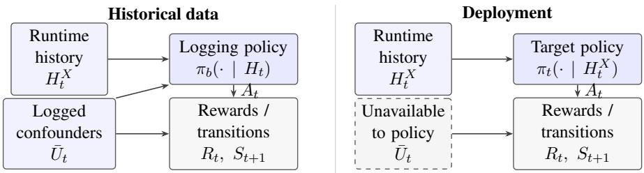

# Reinforcement Learning Under Runtime Confounding: Policy Learning and Off-Policy Evaluation

Raphael Kim Cornell Tech, Cornell University

Michele Santacatterina Division of Biostatistics, NYU Grossman School of Medicine

Ramin Zabih Cornell Tech, Cornell University

Keith Barnatchez Department ofBiostatistics, Johns Hopkins University

## Abstract

Reinforcement learning (RL) is increasingly used to train robust, adaptable systems across healthcare, e-commerce, and robotics. In these settings, legal, ethical, or logistical concerns may preclude certain key variables that drive decisions from being collected during deployment time. This gives rise to a setting known as runtime confounding: the logged data hold full observability, but deployment time lacks knowledge of certain variables, known as runtime confounders. Unlike single timepoint and non-adaptive settings, runtime confounding under reinforcement learning has the potential to propagate over time, as earlier decisions affect future states, observations, and action assignments, leading to biased learning. We address these problems with three contributions: we (1) develop policy learning algorithms under runtime-confounding, (2) develop semi-parametric efficient off-policy estimation procedures, and (3) provide diagnostics for understanding the price of runtime confounding.

Keywords: reinforcement learning, runtime confounding, off-policy estimation, policy learning

## 1. Introduction

Sequential decision-making rules are often deployed in settings with less information than was available during training. For example, a clinical decision-support tool may be trained on records that include laboratory results, clinician notes, or socioeconomic variables, but some of these variables that relate to sensitive subgroup classification, such as socioeconomics, may not be allowed as inputs when the tool is deployed to protect against discriminative profiling. This problem can occur in other settings with high-stakes decisionmaking, such as adjusting credit limits or child welfare screening. Despite having knowledge of all variables that influence outcomes in historical logs, during deployment time, one may not have access to an individual’s protected attributes for ethical, legal, or logistical reasons. More formally, these variables observed in historical data but are unavailable at deployment are known as runtime confounders, and the setting of misaligned logging data and deployment data is referred to as runtime confounding (Coston et al., 2020).

While a large part of reinforcement learning (RL) literature studies a related problem of unobserved confounding, to the best of our knowledge, no work studies runtime confounding precisely. More precisely, past work assume both logging and deployment lack confounders, and handle the non-identifiability with a range of approaches including causal bounds and online identification (Bareinboim et al., 2015; Zhang and Bareinboim, 2019), sensitivity analysis (Kallus and Zhou, 2018; Namkoong et al., 2020), and proximal or partially observable formulations (Tennenholtz et al., 2020; Bennett and Kallus, 2024; Uehara et al., 2023). In runtime confounding, the difficulty lies in the fact that the deployed policy can only condition on a variable set that does not include the runtime confounders, leading to a different policy class than that used in the historical data and violations to sequential randomization during deployment. Coston et al. (2020) address runtime confounding in single-period counterfactual prediction, and recent work studies a conformal prediction approach in the same setting (Barnatchez et al., 2026).

We address this gap by proposing a semiparametric-efficient framework for policy learning and off-policy evaluation under runtime confounding. The key observation is that the runtime restriction enters only through the numerator of an importance ratio. Hence, one may take a reweighting approach to recover the value of any policy in the runtimeconfounding policy class, with all nuisances estimated from the full data. As a result, reinforcement leanring under runtime confounding can fit within the ideas of doubly robust off-policy evaluation (Jiang and Li, 2016; Thomas and Brunskill, 2016; Kallus and Uehara, 2020; van der Laan and Luedtke, 2015) with cross-fitted nuisances (Chernozhukov et al., 2018), as well as the literature on dynamic treatment regimes for restricted policies (Luedtke and van der Laan, 2016b; Sakaguchi, 2025) and the broader literature on policy learning with observational data (Athey and Wager, 2021).

Our contributions are as follows.

1. Policy learning. We propose a doubly robust policy learning algorithm for reinforcement learning under runtime confounding over a class of runtime deployable policies (Algorithm 1). Its regret relative to the full-information optimum is an irreducible runtime regret gap and efficient rates (Theorem 3).

2. Semiparametric-Efficient Off-Policy Evaluation. For a fixed runtime policy, we propose a doubly-robust estimator that is asymptotically normal and attains the semiparametric efficiency bound, yielding valid confidence intervals and testing procedures (Theorem 2).

3. Diagnosing and Characterizing the Price of Runtime Confounding. Because the runtime confounders are logged, we can test the price of runtime confounding. We propose a test for the irreducible runtime regret gap, giving a decision-relevant quantity for having to accept or choosing these runtime confounders.

  
Figure 1: Problem setting. $U _ { t }$ is observed in the historical data, but unmeasured during deployment and in turn unavailable to the target policy.

## 2. Problem Setting

## 2.1. Notation

We consider a setting where we have complete observation logging data available over $i \in [ n ]$ sample trajectories and $t \in [ T ]$ timepoints. Trajectories are denoted by

$$
O = ( S _ { 1 } , A _ { 1 } , R _ { 1 } , \ldots , S _ { T } , A _ { T } , R _ { T } ) , \qquad S _ { t } = ( X _ { t } , U _ { t } ) \in S
$$

where $S _ { t }$ is the full-state consisting of $X _ { t }$ (available at deployment) and $U _ { t }$ (recorded in the logs, but unavailable at runtime), $A _ { t } \in { \mathcal { A } }$ is the action, and $R _ { t } \in \mathbb { R }$ is the reward, bounded by $R _ { m a x }$ . Define the histories

$$
H _ { t } = ( S _ { 1 } , A _ { 1 } , R _ { 1 } , \ldots , S _ { t - 1 } , A _ { t - 1 } , R _ { t - 1 } , S _ { t } ) , \quad H _ { t } ^ { X } = ( X _ { 1 } , A _ { 1 } , R _ { 1 } , \ldots , X _ { t - 1 } , A _ { t - 1 } , R _ { t - 1 } , X _ { t } )
$$

so that $H _ { t } ^ { X }$ is the runtime version of the history, or $H _ { t }$ with each full state $S _ { s }$ replaced by its runtime component $X _ { s }$ . The observed data are generated by a logging policy $\pi _ { b } ( \cdot \mid H _ { t } )$ which we allow to be known or unknown by the researcher, where rewards and states are generated according to $R _ { t } \sim p _ { t } ( \cdot \mid H _ { t } , A _ { t } )$ and $S _ { t + 1 } \sim p _ { t } ( \cdot \mid H _ { t } , A _ { t } , R _ { t } )$ , respectively. Importantly, during deployment $U _ { t }$ is unavailable so that newer target policies which depend on $U _ { t }$ are infeasible. Figure 1 outlines our problem setting.

We occasionally write $A _ { t } ^ { \pi }$ to make dependence on the policy π explicit, though we often omit this notation for brevity. Letting $\bar { a } _ { s } = a _ { 1 } , \ldots , a _ { s } )$ denote a fixed sequence of actions, we let $R _ { t } ( \bar { a } _ { t } )$ denote the counterfactual reward under action sequence ${ { \bar { a } } _ { t } }$ , and similarly let $S _ { t } ( \bar { a } _ { t - 1 } )$ denote the counterfactual state at time t that would be observed under action sequence $\bar { a } _ { t - 1 }$

## 2.2. Target Parameters and Identification

Our target is the $\gamma -$ −discounted objective function under a fixed policy $\pi { } .$

$$
J ( \pi ) = \mathbb { E } _ { \pi } \Big [ \sum _ { t = 1 } ^ { T } \gamma ^ { t - 1 } R _ { t } \Big ]\tag{1}
$$

In RL, one typically seeks to learn an optimal policy, and evaluate fixed policies, which act on the full history $H _ { t } ,$ or current contexts $S _ { t }$ and any relevant past information. What makes runtime confounding unique compared to standard RL settings is that we do not observe $U _ { t }$ at runtime, so policies that require $U _ { t }$ are infeasible. In turn, we instead aim to perform inference and learning over the policy class which acts only over the variables available at runtime:

$$
\Pi _ { X } = \{ \pi = ( \pi _ { t } ) _ { t \leq T } : \pi _ { t } ( \cdot \mid H _ { t } ^ { X } ) , \sigma ( H _ { t } ^ { X } ) \mathrm { \cdot m e a s u r a b l e } \}
$$

Importantly, $J ( \pi )$ is not immediately identified for policies $\pi$ other than the logging policy $\pi _ { b }$ that generated the observed data. We assume the following identification conditions to identify $J ( \pi )$ for any $\pi \in \Pi _ { X }$

(Id1) Sequential ignorability. For all $t \in [ T ]$ , and for any generic action sequence $\bar { a } _ { T } =$ $( a _ { 1 } , \ldots , a _ { T } )$

$$
R _ { t } ( { \bar { a } } _ { t } ) , \dots , R _ { T } ( { \bar { a } } _ { T } ) , S _ { t + 1 } ( { \bar { a } } _ { t } ) , \dots , S _ { T } ( { \bar { a } } _ { T - 1 } ) \ \bot \ { \cal A } _ { t } \ | \ H _ { t }
$$

(Id2) Consistency: $S _ { t } = S _ { t } ( \bar { A } _ { t - 1 } )$ and $R _ { t } = R _ { t } ( \bar { A } _ { t } )$ for all t.

(Id3) Overlap. $\pi _ { b } ( a \mid H _ { t } ) \geq \eta _ { g } > 0$ for all $a \in { \mathcal { A } }$ and $t \in [ T ]$

(Id1) – (Id3) are standard identification assumptions in policy learning (Murphy et al., 2001; Zhang et al., 2013) and reinforcement learning (Kallus and Uehara, 2020).

With these identification assumptions, one can identify $J ( \pi )$ from the observed data. Let the superscript RC denote the runtime version of any fixed object. Then define the runtime importance ratio as:

$$
\rho _ { 1 : t } ^ { \mathrm { R C } } = \prod _ { s = 1 } ^ { t } \lambda _ { s } ^ { \mathrm { R C } } , \qquad { \mathrm { f o r ~ } } \lambda _ { s } ^ { \mathrm { R C } } = { \frac { \pi _ { s } ( A _ { s } \mid H _ { s } ^ { X } ) } { \pi _ { b } ( A _ { s } \mid H _ { s } ) } }\tag{2}
$$

Here, the importance weight takes a particular form: In contrast to the non RC setting which uses $\begin{array} { r } { \dot { \rho _ { 1 : t } } = \prod _ { s = 1 } ^ { t } \frac { \pi _ { s } \overline { { ( A _ { s } | S _ { s } ) } } } { \pi _ { b } ( A _ { s } | H _ { s } ) } } \end{array}$ , the RC importance weight has the numerator correspond to runtime-confounded quantities while the denominator is the full information policy. For $t = T , \dots , 1$ , we then recursively define the Q- and Value function.

$$
\begin{array} { l } { { \displaystyle Q _ { t } ^ { \pi } ( H _ { t } , a ) = \mathbb { E } _ { \pi _ { b } } [ R _ { t } + \gamma V _ { t + 1 } ^ { \pi } ( H _ { t + 1 } ) \mid H _ { t } , A _ { t } = a ] } } \\ { { \displaystyle V _ { t } ^ { \pi } ( H _ { t } ) = \sum _ { a } \pi _ { t } ( a \mid H _ { t } ^ { X } ) Q _ { t } ^ { \pi } ( H _ { t } , a ) } } \end{array}
$$

where $V _ { T + 1 } ^ { \pi } = 0$ . Again, the primary difference is the action density that we marginalize over — a runtime policy.

Under Assumptions (Id1)-(Id3), $J ( \pi )$ is identified by the observed data functionals:

$$
J ( \pi ) = \mathbb { E } _ { \pi _ { b } } [ V _ { 1 } ^ { \pi } ( H _ { 1 } ) ] = \mathbb { E } _ { \pi _ { b } } \left[ \sum _ { { t = 1 } } ^ { T } \gamma ^ { t - 1 } \rho _ { 1 : t } ^ { \mathrm { R C } } R _ { t } \right]\tag{3}
$$

Importantly, the identifying functional in (3) does not discard the historical $U _ { t }$ . Discarding variables that unavailable at runtime is a common practice in data science and machine learning (Coston et al., 2020), but will tend to yield invalid identifying functionals when the discarded variables are truly confounders. Specifically, focusing on the importanceweighted identifying functional in (3), if we were to to instead use the importance weights

$$
\rho _ { 1 : t } ^ { X } = \prod _ { s = 1 } ^ { t } \lambda _ { s } ^ { X } , \qquad \mathrm { w h e r e } \qquad \lambda _ { s } ^ { X } = \frac { \pi _ { s } ( A _ { s } \mid H _ { s } ^ { X } ) } { \pi _ { b } ( A _ { S } \mid H _ { s } ^ { X } ) }
$$

the resulting identifying functional would generally not equal $J ( \pi )$ . In turn, standard methods for both policy learning and inference (Kallus and Uehara, 2020) that naively estimate this functional would target the wrong parameter inducing unintended bias.

## 3. Efficient Estimation and Policy Learning

Both policy-learning and off-policy estimation will build on the efficient influence function (EIF) for the identifying functional (3) of the target parameter $J ( \pi )$ . EIFs are crucial ingredients for constructing estimators of statistical parameters, and enable valid $\sqrt { n }$ asymptotic inference even when estimators of underlying nuisance functions themselves converge at slower rates (Kennedy, 2024). Throughout, we will estimate the EIF of $J ( \pi )$ using nuisance models for the propensity and the conditional outcome model, denoted by $\eta = ( \pi _ { b } ( \cdot \mid H _ { t } ) , \{ Q _ { t } ^ { \pi } ( H _ { t } , \cdot ) \} )$ ). Writing $\delta _ { t } ^ { \pi } = R _ { t } + \gamma V _ { t + 1 } ^ { \pi } ( H _ { t + 1 } ) - Q _ { t } ^ { \pi } ( H _ { t } , A _ { t } )$ for the Bellman residual, the efficient influence function of J at fixed $\pi \in \Pi _ { X }$ is given by the following Theorem:

Theorem 1 (Efficient Influence Function under Runtime-Confounding) Fix $\pi \in \Pi _ { X }$ Under our assumptions (Id1)-(Id3), the efficient influencefunction of $J ( \pi )$ is

$$
\varphi ( O ; \pi , \eta ) = V _ { 1 } ^ { \pi } ( H _ { 1 } ) - J ( \pi ) + \sum _ { t = 1 } ^ { T } \gamma ^ { t - 1 } \rho _ { 1 : t } ^ { R C } \delta _ { t } ^ { \pi }\tag{4}
$$

where $\mathbb { E } [ \varphi ( O ; \pi , \eta ) ] = 0 .$ . The proof is found in Section A.1.

The EIF in (4) is analogous to the EIF considered by Kallus and Uehara (2020) for non-Markov decision processes, where here the importance weights are restrictied to accommodate policies $\pi \in \Pi _ { X }$

Theorem 1 motivates an estimator based on the EIF $\varphi ( O ; \pi , \eta )$ , where we use crossfitting (Chernozhukov et al., 2018) to ensure the resulting asymptotic distribution remains tractable. Specifically, letting $\hat { \eta } ~ = ~ ( \hat { g } , \{ \hat { q } _ { t } ^ { \pi } \} )$ denote nuisances cross-fitted on folds not containing unit i, estimate the objective by

$$
\hat { J } ( \pi ) = \frac { 1 } { n } \sum _ { i = 1 } ^ { n } \Bigl \{ \widehat { V } _ { 1 } ^ { \pi } ( H _ { 1 } ^ { ( i ) } ) + \sum _ { t = 1 } ^ { T } \gamma ^ { t - 1 } \hat { \rho } _ { 1 : t } ^ { \mathrm { R C } , ( i ) } \hat { \delta } _ { t } ^ { \pi , ( i ) } \Bigr \}\tag{5}
$$

The full estimation procedure is outlined in Algorithm 1.

Algorithm 1: Doubly robust policy learning and inference under runtime confound  
ing   
Input: Logged trajectories $\{ O _ { i } \} _ { i = 1 } ^ { n }$ with $\boldsymbol { S _ { i t } } = \left( \boldsymbol { X _ { i t } } , \boldsymbol { U _ { i t } } \right)$ ; policy class $\Pi \subseteq \Pi _ { X } ;$ folds   
$K ;$ overlap constant $\begin{array} { r } { \eta _ { g } ; C _ { Q } = R _ { \operatorname* { m a x } } \sum _ { t } \gamma ^ { t - 1 } } \end{array}$   
Output: $\hat { \pi } , \hat { J } ( \cdot )$ , confidence intervals   
Split [n] into folds $\mathcal { T } _ { 1 } , \ldots , \mathcal { T } _ { K }$   
// Propensities (full information), fitted on $\mathcal { T } _ { - k }$   
for $k = 1 , \ldots , K$ do   
for $t = 1 , \dots , T$ do   
Fit $\hat { g } _ { t } ^ { ( - k ) } ( a \mid H _ { t } )$ by regressing $A _ { t }$ on $H _ { t }$   
end   
end   
// Cross-fitted value estimate for $\pi \in \Pi _ { X }$   
Function Value(π):   
for $k = 1 , \ldots , K$ do   
Set $\hat { V } _ { T + 1 } ^ { ( - k ) } \equiv 0$   
// Fitted-Q evaluation on $\mathcal { T } _ { - k }$   
for $t = T , \dots , .$ 1 do   
Fit $\hat { q } _ { t } ^ { \pi , ( - k ) } ( H _ { t } , a )$ by regressing $R _ { t } + \gamma \hat { V } _ { t + 1 } ^ { ( - k ) } ( H _ { t + 1 } )$ on $( H _ { t } , A _ { t } )$   
$\begin{array} { r } { \hat { V } _ { t } ^ { ( - k ) } ( H _ { t } ) \gets \sum _ { a } \pi _ { t } ( a \mid H _ { t } ^ { X } ) \hat { q } _ { t } ^ { \pi , ( - k ) } ( H _ { t } , a ) } \end{array}$   
end   
$/ /$ Evaluation on the held-out fold $\mathcal { T } _ { k }$   
for $i \in \mathcal { Z } _ { k }$ do   
$\begin{array} { r } { \hat { \rho } _ { i , 1 : t } ^ { \mathrm { R C } }  \prod _ { s \leq t } \frac { \pi _ { s } ( A _ { i s } \vert H _ { i s } ^ { X } ) } { \hat { g } _ { s } ^ { ( - k ) } ( A _ { i s } \vert H _ { i s } ) } } \end{array}$ for $t \in [ T ]$   
$\hat { \delta } _ { i t } ^ { \pi } \gets R _ { i t } + \gamma \hat { V } _ { t + 1 } ^ { ( - k ) } ( H _ { i , t + 1 } ) - \hat { q } _ { t } ^ { \pi , ( - k ) } ( H _ { i t } , A _ { i t } )$   
$\begin{array} { r } { \psi _ { i } ( \pi )  \hat { V } _ { 1 } ^ { ( - k ) } ( H _ { i 1 } ) + \sum _ { t = 1 } ^ { T } \gamma ^ { t - 1 } \hat { \rho } _ { i , 1 : t } ^ { \mathrm { R C } } \hat { \delta } _ { i t } ^ { \pi } } \end{array}$   
end   
end   
return $\begin{array} { r } { \hat { J } ( \pi ) = \frac { 1 } { n } \sum _ { i = 1 } ^ { n } \psi _ { i } ( \pi ) a n d \hat { \sigma } ^ { 2 } ( \pi ) = \frac { 1 } { n } \sum _ { i = 1 } ^ { n } \bigl ( \psi _ { i } ( \pi ) - \hat { J } ( \pi ) \bigr ) ^ { 2 } } \end{array}$   
// Learning and inference   
Policy learning: $\hat { \pi } \gets \mathrm { a r g } \mathrm { m a x } _ { \pi \in \Pi }$ Value(π)   
Inference for a fixed π: report $\hat { J } ( \pi ) \pm z _ { 1 - \alpha / 2 } \hat { \sigma } ( \pi ) / \sqrt { n }$

Error Decomposition with the EIF. We now describe the high-level decomposition used to produce our policy learning and off-policy evaluation guarantees. Let $\mathbb { P } _ { n } f ~ =$ $n ^ { - 1 } \sum _ { i = 1 } ^ { n } f ( O _ { i } )$ denote the empirical measure, ${ \widehat { \varphi } } ^ { \pi }$ denote $\varphi ^ { \pi }$ with cross-fitted nuisance estimates, and $\Delta g _ { t } = \hat { g } _ { t } - \pi _ { b }$ and $\Delta q _ { t } ^ { \pi } = \hat { q } _ { t } ^ { \pi } - Q _ { t } ^ { \pi }$ denote estimation error of each respective nuisance function. To analyze $\hat { J } ( \pi )$ , we decompose our error into the following

terms:

$$
\hat { J } ( \pi ) - J ( \pi ) = \underbrace { ( \mathbb { P } _ { n } - \mathbb { E } ) \varphi ^ { \pi } } _ { ( \mathrm { E } ) } + \underbrace { \mathrm { R e m } ( \hat { \eta } ; \pi ) } _ { ( \mathrm { R } ) } + \underbrace { ( \mathbb { P } _ { n } - \mathbb { E } ) \big ( \widehat { \varphi } ^ { \pi } - \varphi ^ { \pi } \big ) } _ { ( \mathrm { C } ) }\tag{6}
$$

where the remainder is given by:

$$
\mathrm { R e m } ( \hat { \eta } ; \pi ) = \sum _ { t = 1 } ^ { T } \gamma ^ { t - 1 } \mathbb { E } \Big [ \hat { \rho } _ { 1 : t - 1 } ^ { \mathrm { R C } } \sum _ { a } \pi _ { t } ( a \mid H _ { t } ^ { X } ) \frac { \Delta g _ { t } ( a \mid H _ { t } ) } { \hat { g } _ { t } ( a \mid H _ { t } ) } \Delta q _ { t } ^ { \pi } ( H _ { t } , a ) \Big ]\tag{7}
$$

This is a standard decomposition in the semiparametric literature (Kennedy, 2024), where term (E) is sampling error, term (R) denotes nuisance bias, and term (C) is controlled by cross-fitting. This decomposition to establish regret bounds and conditions under which $\hat { J } ( \pi )$ attains asymptotic normality.

Before introducing our results, we introduce the following estimation assumptions, which are sufficient to control the remainder term in (7).

(Est1) Product rate at π. $\begin{array} { r } { \sum _ { t = 1 } ^ { T } \lVert \Delta g _ { t } \rVert _ { 2 } \lVert \Delta g _ { t } ^ { \pi } \rVert _ { 2 } = o _ { P } \bigl ( n ^ { - 1 / 2 } \bigr ) } \end{array}$

(Est2) Consistency at π. $\| \Delta g _ { t } \| _ { 2 } + \| \Delta q _ { t } ^ { \pi } \| _ { 2 } = o _ { P } ( 1 )$ for each $t \in [ T ]$

(Est3) Complexity. $\Pi _ { X }$ has finite uniform entropy integral bounded by $\mathcal { I } < \infty$

(Est1)-(Est2) are standard rate assumptions in semiparametric inference supporting the use of non-Donsker function classes in estimation. (Est3) is an entropy condition on the runtime policy class, rather than the nuisance function estimator, used for regret analysis. In the coming sections, we establish off-policy evaluation (3.1) and policy learning (3.2) results based on these assumptions.

## 3.1. Efficient Off-Policy Evaluation

We now fix $\pi \in \Pi _ { X }$ and give conditions under which $\hat { J } ( \pi )$ in (5) is asymptotically normal and efficient based on Theorem 1.

Theorem 2 (Asymptotic normality and efficiency) Under our identification assumptions (Id1)-(Id3), and estimation assumptions $( E s t I ) – ( E s t 2 )$ ,

$$
\sqrt { n } \big ( \hat { J } ( \pi ) - J ( \pi ) \big )  \mathcal { N } ( 0 , \sigma _ { R C } ^ { 2 } )
$$

where

$$
\sigma _ { R C } ^ { 2 } = \mathbb { V } \big [ V _ { 1 } ^ { \pi } ( H _ { 1 } ) \big ] + \sum _ { t = 1 } ^ { T } \gamma ^ { 2 ( t - 1 ) } \mathbb { E } \big [ ( \rho _ { 1 : t } ^ { R C } ) ^ { 2 } \mathbb { V } [ \delta _ { t } ^ { \pi } \mid H _ { t } , A _ { t } ] \big ]
$$

is the semiparametric efficiency bound. Moreover $\hat { \sigma } _ { R C } ^ { 2 } = \mathbb { P } _ { n } ( \mathcal { \hat { \varphi } } ^ { \pi } ) ^ { 2 }$ is consistent, so $\hat { J } ( \pi ) \pm$ $z _ { 1 - \frac { \alpha } { 2 } } \frac { \hat { \sigma } _ { R C } } { \sqrt { n } }$ is an asymptotically valid $( 1 - \alpha )$ confidence interval. The proof is found in Section A.3.

This result gives us a way to characterize uncertainty for runtime-confounded policies, and do valid testing procedures. The finding is analogous to the results from Kallus and Uehara (2020), but RC adjusted.

## 3.2. Policy Learning under Runtime-Confounding

Let $\pi ^ { \star } = \arg \operatorname* { m a x } _ { \pi } J ( \pi )$ over the unrestricted (full-information) policies, and $\pi _ { X } ^ { \star } = \arg \operatorname* { m a x } _ { \pi \in \Pi _ { X } } J ( \pi )$ The learned policy maximizes the cross-fitted estimator (5) over runtime policies,

$$
{ \hat { \pi } } = \arg \operatorname* { m a x } _ { \pi \in \Pi _ { X } } { \hat { J } } ( \pi )
$$

so that πˆ takes only $H _ { t } ^ { X }$ as input and is deployable.

Theorem 3 (Regret under runtime confounding) Under the identification assumptions (Id1)–(Id3), (Est1) at πˆ and $\pi _ { X } ^ { \star }$ , and (Est3),

$$
J ( \pi ^ { \star } ) - J ( \hat { \pi } ) \leq \Delta _ { R C } + O _ { P } \Big ( \frac { C _ { \rho } \mathcal { I } } { \sqrt { n } } \Big ) + o _ { P } \big ( n ^ { - 1 / 2 } \big )\tag{8}
$$

where $\Delta _ { R C } = J ( \pi ^ { \star } ) - J ( \pi _ { X } ^ { \star } )$ and $\begin{array} { r } { C _ { \rho } \lesssim ( R _ { \operatorname* { m a x } } + C _ { Q } ) \sum _ { t = 1 } ^ { T } \gamma ^ { t - 1 } \eta _ { q } ^ { - t } } \end{array}$ where we recall that $\eta _ { g }$ is our positivity constraintfor the logger. The proofisfound in Section A.2.

The result states that our learned policy, under sufficient regularity conditions, follows the same finding of $\sqrt { n }$ rates with an irreducible runtime gap $\Delta _ { \mathrm { R C } }$

## 4. Diagnosing and Testing Runtime Confounding

One may ask the gap we are losing in the decision-making process by using variables available only at runtime. This can inform future experimentation or provide an interpretable gap when it is unavoidable for domain experts. We lower-bound and test the irreducible runtime gap $\Delta _ { \mathrm { R C } } = J ( \pi ^ { \star } ) - J ( \pi _ { X } ^ { \star } ) \geq 0$ , which is the value lost by withholding $\bar { U } _ { t }$ at deployment. Because $\Delta _ { \mathrm { R C } }$ is a difference of maxima, inference on this parameter can be non-regular (Luedtke and van der Laan, 2016a). To address this difficult, we employ a sample-splitting approach. Specifically, we split the sample into parts A and B. On A, we learn a full-information policy $\hat { \pi } _ { S }$ on $H _ { t }$ and a runtime policy $\hat { \pi } _ { X } \in \Pi _ { X }$ by Algorithm 1. On B, estimate the runtime gap by

$$
\hat { \Delta } _ { \mathrm { R C } } = \hat { J } _ { B } ( \hat { \pi } _ { S } ) - \hat { J } _ { B } ( \hat { \pi } _ { X } )
$$

By Theorem $2 , \sqrt { n _ { B } } \big ( \hat { \Delta } _ { \mathrm { R C } } - [ J ( \hat { \pi } _ { S } ) - J ( \hat { \pi } _ { X } ) ] \big )$ is asymptotically normal.

Assuming $J ( \pi ^ { \star } ) - J ( \hat { \pi } _ { S } ) = o _ { P } ( n ^ { - 1 / 2 } )$ and $J ( \pi _ { X } ^ { \star } ) - J ( \hat { \pi } _ { X } ) = o _ { P } ( n ^ { - 1 / 2 } )$

$$
\hat { \Delta } _ { \mathrm { R C } } \pm z _ { 1 - \alpha / 2 } \hat { \sigma } / \sqrt { n _ { B } }
$$

is an asymptotically valid $( 1 - \alpha )$ confidence interval for $\Delta _ { \mathrm { R C } }$ , and we can test $\begin{array} { r } { H _ { 0 } : \Delta _ { \mathrm { R C } } = } \end{array}$ 0, by $p = 2 \big ( 1 - \Phi \big ( \sqrt { n _ { B } } \big | \hat { \Delta } _ { \mathrm { R C } } \big | / \hat { \sigma } \big ) \big )$

Under $H _ { 0 }$ this can fail if the two policies coincide so their scores are equal, so we impose $\mathbb { V } [ \varphi ^ { \hat { \pi } _ { S } } - \varphi ^ { \hat { \pi } _ { X } } ] \geq c > 0$

## 5. Discussion

Under high-stakes or high-latency decision-making, deployment of standard methods can be biased due to variables present in training logs not being present during implementation. We introduce policy learning and efficient off-policy evaluation methods for reinforcement learning under runtime confounding to overcome this gap. We additionally provide diagnostics to understand bias from using a runtime confounded policy, informing future design of experiments and the price of runtime confounding. Extensions to online settings and decaying overlap are left for future work.

## Acknowledgments

This work was supported by National Institutes of Health (NIH) grant T32HL139426. We thank Rachel Nethery for helping birth this research.

## References

Susan Athey and Stefan Wager. Policy learning with observational data. Econometrica, 89 (1):133–161, 2021.

Elias Bareinboim, Andrew Forney, and Judea Pearl. Bandits with unobserved confounders: A causal approach. In Advances in Neural Information Processing Systems, volume 28, 2015.

Keith Barnatchez, Kevin P. Josey, Rachel C. Nethery, and Giovanni Parmigiani. Debiased machine learning for conformal prediction of counterfactual outcomes under runtime confounding. In Proceedings of the Fifth Conference on Causal Learning and Reasoning, volume 323 of Proceedings of Machine Learning Research, pages 1345–1379, 2026.

Andrew Bennett and Nathan Kallus. Proximal reinforcement learning: Efficient off-policy evaluation in partially observed Markov decision processes. Operations Research, 72 (3):1071–1086, 2024.

Victor Chernozhukov, Denis Chetverikov, Mert Demirer, Esther Duflo, Christian Hansen, Whitney Newey, and James Robins. Double/debiased machine learning for treatment and structural parameters. The Econometrics Journal, 21(1):C1–C68, 2018.

Amanda Coston, Edward Kennedy, and Alexandra Chouldechova. Counterfactual predictions under runtime confounding. Advances in neural information processing systems, 33:4150–4162, 2020.

Nan Jiang and Lihong Li. Doubly robust off-policy value evaluation for reinforcement learning. In Proceedings of the 33rd International Conference on Machine Learning, volume 48 of Proceedings of Machine Learning Research, pages 652–661, 2016.

Nathan Kallus and Masatoshi Uehara. Double reinforcement learning for efficient offpolicy evaluation in markov decision processes. Journal ofMachine Learning Research, 21(167):1–63, 2020. URL https://jmlr.org/papers/v21/19-827.html.

Nathan Kallus and Angela Zhou. Confounding-robust policy improvement. In Advances in Neural Information Processing Systems, volume 31, 2018.

Edward H Kennedy. Semiparametric doubly robust targeted double machine learning: a review. Handbook of statistical methods for precision medicine, pages 207–236, 2024.

Alexander R. Luedtke and Mark J. van der Laan. Statistical inference for the mean outcome under a possibly non-unique optimal treatment strategy. The Annals of Statistics, 44(2): 713–742, 2016a.

Alexander R. Luedtke and Mark J. van der Laan. Super-learning of an optimal dynamic treatment rule. The International Journal of Biostatistics, 12(1):305–332, 2016b. doi: 10.1515/ijb-2015-0052.

Susan A. Murphy, Mark J. van der Laan, James M. Robins, and Conduct Problems Prevention Research Group. Marginal mean models for dynamic regimes. Journal of the American Statistical Association, 96(456):1410–1423, 2001. doi: 10.1198/ 016214501753382327.

Hongseok Namkoong, Ramtin Keramati, Steve Yadlowsky, and Emma Brunskill. Offpolicy policy evaluation for sequential decisions under unobserved confounding. In Ad vances in Neural Information Processing Systems, volume 33, 2020.

Shosei Sakaguchi. Estimation of optimal dynamic treatment assignment rules under policy constraints. Quantitative Economics, 16(3):981–1022, 2025. doi: 10.3982/QE2288.

Guy Tennenholtz, Uri Shalit, and Shie Mannor. Off-policy evaluation in partially observable environments. In Proceedings of the AAAI Conference on Artificial Intelligence, volume 34, pages 10276–10283, 2020.

Philip Thomas and Emma Brunskill. Data-efficient off-policy policy evaluation for reinforcement learning. In Proceedings of the 33rd International Conference on Machine Learning, volume 48 of Proceedings of Machine Learning Research, pages 2139–2148, 2016.

Masatoshi Uehara, Haruka Kiyohara, Andrew Bennett, Victor Chernozhukov, Nan Jiang, Nathan Kallus, Chengchun Shi, and Wen Sun. Future-dependent value-based off-policy evaluation in POMDPs. In Advances in Neural Information Processing Systems, volume 36, 2023.

Mark J van der Laan and Alexander R Luedtke. Targeted learning of the mean outcome under an optimal dynamic treatment rule. Journal ofcausal inference, 3(1):61–95, 2015.

Baqun Zhang, Anastasios A. Tsiatis, Eric B. Laber, and Marie Davidian. Robust estimation of optimal dynamic treatment regimes for sequential treatment decisions. Biometrika, 100(3):681–694, 2013.

Junzhe Zhang and Elias Bareinboim. Near-optimal reinforcement learning in dynamic treatment regimes. In Advances in Neural Information Processing Systems, volume 32, 2019.

## Appendix A. Proofs

## A.1. Proof of Theorem 1

Proof In general, note the factorization given by

$$
\mathbb { P } ( h _ { T } ) = \mathbb { P } ( s _ { 1 } ) \prod _ { t } \pi _ { b } ( a _ { t } \mid h _ { t } ) \mathbb { P } _ { t } ( r _ { t } \mid h _ { t } , a _ { t } ) \mathbb { P } _ { t } ( s _ { t + 1 } \mid r _ { t } , h _ { t } , a _ { t } )
$$

The EIF will be derived using the point mass contamination method, by perturbations on each of these densities, except $\pi _ { b } .$ , which is assumed to be logged. Let $Z = ( S , A , R )$ $S = ( X , U )$ , we consider perturbations of the form $\mathbb { P } _ { \varepsilon } = ( 1 - \varepsilon ) \mathbb { P } + \varepsilon \delta _ { \tilde { z } }$

T=1 We start with the case when $T = 1$ . Define $\begin{array} { r } { m ( S ) = \sum _ { a } \pi ( a \mid X ) Q ( S , a ) , Q ( s , a ) = } \end{array}$ $\mathbb { E } [ R \mid s , a ]$

Our target parameter is

$$
J ( \mathbb { P } ) = \int \sum _ { a } \pi ( a \mid x ) Q ( s , a ) f ( s ) d s
$$

Perturb along each population object: $Q ( s , a ) , f ( s )$ . Then, by the chain rule, we have

$$
\frac { \mathrm { d } } { \mathrm { d } \varepsilon } J ( \mathbb { P } _ { \varepsilon } ) \Big | _ { 0 } = \sum _ { a } \pi ( a \mid \tilde { x } ) Q ( \tilde { s } , a ) - J + \int \sum _ { a } \pi ( a \mid x ) \big ( \frac { \mathrm { d } } { \mathrm { d } \varepsilon } Q ( s , a ) | _ { \varepsilon = 0 } \big ) f ( s ) d s
$$

Noting the usual calculation,

$$
\frac { \mathrm { d } } { \mathrm { d } \varepsilon } \mathbb { E } _ { \mathbb { P } _ { \varepsilon } } [ Y \mid Z = z ] | _ { \varepsilon = 0 } = \mathbb { I } [ z = \tilde { z } ] / f ( z ) ( \tilde { y } - \mathbb { E } [ Y \mid Z = z ] )
$$

This reduces to

$$
\begin{array} { r l r } {  { \frac { \mathrm { d } } { \mathrm { d } \varepsilon } J ( \mathbb { P } _ { \varepsilon } ) \Big | _ { 0 } = \big ( \sum _ { a } \pi ( a \mid \tilde { x } ) Q ( \tilde { s } , a ) - J \big ) + \pi ( \widetilde { a } \mid \tilde { x } ) / f ( \widetilde { s } , \widetilde { a } ) ( \tilde { r } - Q ( \tilde { s } , \widetilde { a } ) ) f ( \widetilde { s } ) } } \\ & { } & { = \big ( \sum _ { a } \pi ( a \mid \tilde { x } ) Q ( \tilde { s } , a ) - J \big ) + \pi ( \widetilde { a } \mid \tilde { x } ) / \pi _ { b } ( \widetilde { a } \mid \tilde { s } ) ( \tilde { r } - Q ( \tilde { s } , \widetilde { a } ) ) } \end{array}
$$

Hence, the EIF at $T = 1$ reduces to $\varphi = m ( S ) - J + \lambda _ { 1 } ^ { \mathrm { R C } } ( R - Q ( S , A ) )$ , for importance weight at one timepoint given by $\lambda _ { 1 } ^ { \mathrm { R C } } = \pi _ { 1 } ( A _ { 1 } \mid X _ { 1 } ) / \pi _ { b } ( A _ { 1 } \mid H _ { 1 } )$

General T Now, we wish to extend this logic to general T. The difference is that $V _ { t }$ is a recursive object:

$$
V _ { t } ^ { \pi } ( H _ { t } ) = \sum _ { a } \pi _ { t } ( a \mid H _ { t } ^ { X } ) Q _ { t } ^ { \pi } ( H _ { t } , a ) = \sum _ { a } \pi _ { t } ( a \mid H _ { t } ^ { X } ) \mathbb { E } [ R _ { t } + \gamma V _ { t + 1 } ^ { \pi } ( H _ { t + 1 } ) \mid H _ { t } , A _ { t } = a ]
$$

In the same manner as above, we have

$$
\frac { \mathrm { d } } { \mathrm { d } \varepsilon } J ( \mathbb { P } _ { \varepsilon } ) \Big | _ { 0 } = V _ { 1 } ^ { \pi } ( \tilde { H } _ { 1 } ) - J + \mathbb { E } [ \big ( \frac { \mathrm { d } } { \mathrm { d } \varepsilon } V _ { 1 } ^ { \pi } ( H _ { 1 } ) | _ { \varepsilon = 0 } \big ) ]
$$

where we have used that $\begin{array} { r } { \mathbb { E } [ V _ { 1 } ^ { \pi } ( H _ { 1 } ) ] = \mathbb { E } _ { \pi } [ \sum _ { t } \gamma ^ { t - 1 } R _ { t } ] = J ( \pi ) } \end{array}$

For convenience, define the following time t IS-weighted EIF of $V$ as

$$
\Gamma _ { t } = \mathbb { E } [ \rho _ { 1 : t - 1 } ^ { \mathrm { R C } } \frac { \mathrm { d } } { \mathrm { d } \varepsilon } V _ { t } ^ { \pi } ( H _ { t } ) | _ { \varepsilon = 0 } ]
$$

Setting the base case for our weights to $1 , \rho _ { 1 : 0 } ^ { \mathrm { R C } } = 1$ , gives $\begin{array} { r } { \Gamma _ { 1 } = \mathbb { E } [ \left( \frac { \mathrm { d } } { \mathrm { d } \varepsilon } V _ { 1 } ^ { \pi } ( H _ { 1 } ) | _ { \varepsilon = 0 } \right) ] } \end{array}$ as our object as interest.

Since the value function is a function of the future timepoints (e.g. $\Gamma _ { 1 } = \mathbb { E } [ \frac { \mathrm { d } } { \mathrm { d } \varepsilon } V _ { 1 } ^ { \pi } ( H _ { 1 } ) | _ { \varepsilon = 0 } ]$ for $V _ { 1 }$ being a function of $V _ { 2 } )$ , we require unrolling this sum and understanding $\Gamma _ { t }$

Borrowing the key calculation from above on $Q .$ , we perturb the distributions, and calculate the EIF on $Q _ { t }$ :

$$
\begin{array} { r l r } {  { \frac { \mathrm { d } } { \mathrm { d } \varepsilon } Q _ { t } ^ { \pi } ( H _ { t } , a ) | _ { \varepsilon = 0 } = \mathbb { I } [ H _ { t } = \tilde { h } _ { t } , a = \tilde { a } _ { t } ] / f ( H _ { t } , a ) ( \tilde { r } _ { t } + \gamma V _ { t + 1 } ^ { \pi } ( \tilde { H } _ { t + 1 } ) - Q _ { t } ^ { \pi } ( H _ { t } , a ) ) } } \\ & { } & { + \gamma \mathbb { E } [ \frac { \mathrm { d } } { \mathrm { d } \varepsilon } V _ { t + 1 } ^ { \pi } ( H _ { t + 1 } ) | _ { \varepsilon = 0 } \mid H _ { t } , A _ { t } = a ] ~ } \end{array}
$$

Plugging this into $\Gamma _ { t }$ (the directional derivative for $V _ { t } ^ { \pi }$ along $\mathbb { P } _ { \varepsilon } )$ , using $f ( \tilde { h } _ { t } , \tilde { a } _ { t } ) =$ $f ( \tilde { h } _ { t } ) \pi _ { b } ( \tilde { a } _ { t } \mid \tilde { h } _ { t } )$ in the first term and $\begin{array} { r } { \mathbb { E } [ \sum _ { a } \pi _ { t } ( a \mid H _ { t } ^ { X } ) g ( \dot { H } _ { t } , a ) ] = \mathbb { E } [ \lambda _ { t } ^ { \mathrm { R C } } g ( H _ { t } , \boldsymbol { A } _ { t } ) ] } \end{array}$ in the second, gives

$$
\begin{array} { r l } & { \Gamma _ { t } = \rho _ { 1 : t - 1 } ^ { \mathrm { R C } } \frac { \pi _ { t } ( \tilde { a } _ { t } \mid \tilde { h } _ { t } ^ { X } ) } { \pi _ { b } ( \tilde { a } _ { t } \mid \tilde { h } _ { t } ) } ( \tilde { r } _ { t } + \gamma V _ { t + 1 } ^ { \pi } ( \tilde { H } _ { t + 1 } ) - Q _ { t } ^ { \pi } ( \tilde { h } _ { t } , \tilde { a } _ { t } ) ) + \gamma \mathbb { E } [ \rho _ { 1 : t - 1 } ^ { \mathrm { R C } } \lambda _ { t } ^ { \mathrm { R C } } \frac { \mathrm { d } } { \mathrm { d } \varepsilon } V _ { t + 1 } ^ { \pi } ( H _ { t + 1 } ) | _ { \varepsilon = 0 } ] } \\ & { \quad = \rho _ { 1 : t } ^ { \mathrm { R C } } ( \tilde { r } _ { t } + \gamma V _ { t + 1 } ^ { \pi } ( \tilde { H } _ { t + 1 } ) - Q _ { t } ^ { \pi } ( \tilde { h } _ { t } , \tilde { a } _ { t } ) ) + \gamma \Gamma _ { t + 1 } } \end{array}
$$

where $\rho _ { 1 : t } ^ { \mathrm { R C } }$ in the last line is evaluated at the point mass.

Unroll this from t = 1, with $\Gamma _ { T + 1 } = 0$

$$
\Gamma _ { 1 } = \sum _ { t = 1 } ^ { T } \gamma ^ { t - 1 } \rho _ { 1 : t } ^ { \mathrm { R C } } ( \tilde { r } _ { t } + \gamma V _ { t + 1 } ^ { \pi } ( \tilde { H } _ { t + 1 } ) - Q _ { t } ^ { \pi } ( \tilde { h } _ { t } , \tilde { a } _ { t } ) )
$$

Hence, the EIF form follows.

Note, if $\pi _ { b }$ is unknown and we need to account for local perturbations in the derivation, just as in the iid case, our score is orthogonal yielding the same EIF as above. ■

## A.2. Proof of Theorem 3

Step 1: Regret decomposition. Adding and subtracting $J ( \pi _ { X } ^ { \star } )$ , the value at the optimal runtime-confounded policy, we can decompose the regret as

$$
J ( \pi ^ { \star } ) - J ( \hat { \pi } ) = \underbrace { J ( \pi ^ { \star } ) - J ( \pi _ { X } ^ { \star } ) } _ { \Delta _ { \mathrm { R c } } } + \underbrace { J ( \pi _ { X } ^ { \star } ) - J ( \hat { \pi } ) } _ { \mathrm { e s t i m a t i o n } }\tag{9}
$$

$\Delta _ { \mathrm { R C } }$ is irreducible, representing the gap between the optimal policy and optimal runtime policy. It remains to bound the estimation term, which is the only term depending on the data.

## Step 1: Value-error decomposition. We can bound the estimation term as follows:

$$
\begin{array} { r l } & { J ( \pi _ { \Pi } ^ { \star } ) - J ( \hat { \pi } ) = \big [ J ( \pi _ { \Pi } ^ { \star } ) - \hat { J } ( \pi _ { \Pi } ^ { \star } ) \big ] + \big [ \hat { J } ( \pi _ { \Pi } ^ { \star } ) - \hat { J } ( \hat { \pi } ) \big ] + \big [ \hat { J } ( \hat { \pi } ) - J ( \hat { \pi } ) \big ] } \\ & { \qquad \leq \big [ \hat { J } - J \big ] ( \hat { \pi } ) - \big [ \hat { J } - J \big ] ( \pi _ { \Pi } ^ { \star } ) } \\ & { \qquad = ( \mathbb { P } _ { n } - \mathbb { E } ) \big ( \varphi ^ { \hat { \pi } } - \varphi ^ { \pi _ { \Pi } ^ { \star } } \big ) + \mathrm { R e m } ( \hat { \eta } ; \hat { \pi } ) - \mathrm { R e m } ( \hat { \eta } ; \pi _ { \Pi } ^ { \star } ) } \\ & { \qquad + ( \mathbb { P } _ { n } - \mathbb { E } ) \big [ ( \hat { \varphi } - \varphi ) ^ { \hat { \pi } } - ( \hat { \varphi } - \varphi ) ^ { \pi _ { \Pi } ^ { \star } } \big ] } \\ & { \qquad \leq 2 \operatorname* { s u p } \bigl | ( \mathbb { P } _ { n } - \mathbb { E } ) \varphi ^ { \pi } \big | + 2 \operatorname* { s u p } \bigl | ( \mathbb { P } _ { n } - \mathbb { E } ) ( \hat { \varphi } ^ { \pi } - \varphi ^ { \pi } ) \big | + \big | \mathrm { R e m } ( \hat { \eta } ; \hat { \pi } ) \big | + \big | \mathrm { R e m } ( \hat { \eta } ; \pi _ { \Pi } ^ { \star } ) \big | } \end{array}\tag{10}
$$

The first inequality follows by adding and subtracting $\hat { J } ( \pi _ { \Pi } ^ { * } )$ and $\hat { J } ( \hat { \pi } )$ , and applying the basic inequality. The second equality follows plugging in (6) and expanding. The final inequality follows from the triangle inequality and realizability.

## Step 2: Empirical process control, on supremum terms.

Term $2 \operatorname* { s u p } _ { \pi \in \Pi } \Bigl | ( \mathbb { P } _ { n } - \mathbb { E } ) \varphi ^ { \pi } \Bigr | .$ : By (Id3), $| V _ { 1 } ^ { \pi } | , | J ( \pi ) | \le C _ { Q } , \rho _ { 1 : t } ^ { \mathrm { R C } } \le \eta _ { g } ^ { - t }$ and $| \delta _ { t } ^ { \pi } | \leq R _ { \operatorname* { m a x } } +$ $( 1 + \gamma ) C _ { Q }$ , and the same bounds hold for the estimated versions. Hence $\Phi _ { \Pi }$ and ${ \widehat \Phi } _ { \Pi } ^ { ( k ) }$ admit an envelope $\begin{array} { r } { C _ { \rho } = 2 C _ { Q } + ( R _ { \operatorname* { m a x } } + 2 C _ { Q } ) \sum _ { t = 1 } ^ { T } \gamma ^ { t - 1 } \eta _ { g } ^ { - t } } \end{array}$ . Then, by symmetrization and Dudley’s entropy bound under (Est3),

$$
\mathbb { E } \operatorname* { s u p } _ { \pi \in \Pi } \big | ( \mathbb { P } _ { n } - \mathbb { E } ) \varphi ^ { \pi } \big | \lesssim \frac { C _ { \rho } \mathcal { I } } { \sqrt { n } }
$$

Term 2 $\operatorname* { s u p } _ { \pi \in \Pi } \left| ( \mathbb { P } _ { n } - \mathbb { E } ) ( { \widehat { \varphi } } ^ { \pi } - \varphi ^ { \pi } ) \right|$ : Cross-fitting splits the term over folds of size $n _ { k } =$ $n / K$ . Let the function class implied by this process be given by $\mathcal { G } _ { k } = \{ \varphi ^ { \pi } ( \cdot ; \hat { \eta } ^ { ( - k ) } ) ~ -$ $\varphi ^ { \pi } ( \cdot ; \eta ) : \pi \in \Pi \}$ . Then,

$$
\operatorname* { s u p } _ { \pi \in \Pi } \bigl | ( \mathbb { P } _ { n } - \mathbb { E } ) ( \widehat { \varphi } ^ { \pi } - \varphi ^ { \pi } ) \bigr | \leq \sum _ { k = 1 } ^ { K } \frac { n _ { k } } { n } \operatorname* { s u p } _ { g \in \mathcal { G } _ { k } } \bigl | ( \mathbb { P } _ { n _ { k } } - \mathbb { E } ) g \bigr |
$$

Conditional on the training folds ${ \mathcal { T } } _ { - k } ,$ the nuisance estimates are fixed, so $\mathcal { G } _ { k }$ is a fixed class of differences between elements of ${ \widehat \Phi } _ { \Pi } ^ { ( k ) }$ and $\Phi _ { \Pi }$ , with envelope $2 C _ { \rho }$ . Its entropy is at most the sum of the entropies of these two classes, so $\mathcal { I } ( \mathcal { G } _ { k } ) \leq 2 \mathcal { I }$ by (Est3). Dudley’s integral on the evaluation fold gives $\begin{array} { r } { \mathbb { E } [ \operatorname* { s u p } _ { g \in \mathcal { G } _ { k } } \left| ( \mathbb { P } _ { n _ { k } } - \mathbb { E } ) g \right| \mid \mathcal { T } _ { - k } ] \lesssim C _ { \rho } \mathcal { I } / \sqrt { n _ { k } } } \end{array}$ . Since K is fixed, Markov’s inequality gives $\begin{array} { r l } { 2 \operatorname* { s u p } _ { \pi \in \Pi } \big | ( \mathbb { P } _ { n } - \mathbb { E } ) ( \widehat { \varphi } ^ { \pi } - \varphi ^ { \pi } ) \big | = O _ { P } ( C _ { \rho } \mathcal { I } / \sqrt { n } ) } & { { } } \end{array}$

Step 3: Second-order remainder (R) By (7), applied fold by fold with $\hat { \eta } = \hat { \eta } ^ { ( - k ) }$ , for any $\pi \in \Pi _ { X }$ ,

$$
\begin{array} { r l } & { \big | \mathrm { R e m } ( \hat { \eta } ; \pi ) \big | \leq \displaystyle \sum _ { t = 1 } ^ { T } \gamma ^ { t - 1 } \mathbb { E } \Big [ \hat { \rho } _ { 1 : t - 1 } ^ { \mathbb { R } \subset } \frac { 1 } { \operatorname* { m i n } _ { a } \hat { g } _ { t } ( a \mid H _ { t } ) } \sum _ { a } \pi _ { t } ( a \mid H _ { t } ^ { X } ) | \Delta g _ { t } ( a \mid H _ { t } ) | \cdot | \Delta q _ { t } ^ { \pi } ( H _ { t } , a ) | \Big ] } \\ & { \qquad \leq \displaystyle \sum _ { t = 1 } ^ { T } \gamma ^ { t - 1 } \eta _ { g } ^ { - t } \mathbb { E } \Big [ \operatorname* { m a x } _ { a } | \Delta g _ { t } ( a \mid H _ { t } ) | \cdot \operatorname* { m a x } _ { a } | \Delta q _ { t } ^ { \pi } ( H _ { t } , a ) | \Big ] } \\ & { \qquad \leq \displaystyle \sum _ { t = 1 } ^ { T } \gamma ^ { t - 1 } \eta _ { g } ^ { - t } \Big \| \operatorname* { m a x } _ { a } | \Delta g _ { t } ( a \mid \cdot ) | \Big \| _ { 2 } \Big \| \operatorname* { m a x } _ { a } | \Delta q _ { t } ^ { \pi } ( \cdot , a ) | \Big \| _ { 2 } } \end{array}
$$

where the second inequality uses $\hat { \rho } _ { 1 : t - 1 } ^ { \mathrm { R C } } \le \eta _ { g } ^ { - ( t - 1 ) }$ from (Id3), and the third follows from Cauchy–Schwarz. (Est1) then shows $| \mathrm { R e m } ( \hat { \eta } ; \hat { \pi } ) | + | \mathrm { R e m } ( \hat { \eta } ; \pi _ { X } ^ { \star } ) | = o _ { P } ( n ^ { - 1 / 2 } )$

## A.3. Proof of Theorem 2

Proof

Decomposition. Our decomposition yielded

$$
\hat { J } ( \pi ) - J ( \pi ) = \underbrace { ( \mathbb { P } _ { n } - \mathbb { E } ) \varphi ^ { \pi } } _ { ( \mathrm { E } ) } + \underbrace { \mathrm { R e m } ( \hat { \eta } ; \pi ) } _ { ( \mathrm { R } ) } + \underbrace { ( \mathbb { P } _ { n } - \mathbb { E } ) \big ( \widehat { \varphi } ^ { \pi } - \varphi ^ { \pi } \big ) } _ { ( \mathrm { C } ) }
$$

We show the result by demonstrating ${ \sqrt { n } } ( \mathbb { P } _ { n } - \mathbb { E } ) \varphi ^ { \pi }  { \mathcal { N } } ( 0 , \sigma _ { \mathrm { R C } } ^ { 2 } )$ and that (R) and (C) are $o _ { P } ( n ^ { - 1 / 2 } )$ .

Term (E) and the variance. By (Id3), $\varphi ^ { \pi }$ is bounded by $C _ { \rho } ,$ and $\mathbb { E } [ \boldsymbol { \varphi } ^ { \pi } ] = 0$ . Since trajectories are i.i.d., the central limit theorem gives ${ \sqrt { n } } ( \mathbb { P } _ { n } - \mathbb { E } ) \varphi ^ { \pi }  { \mathcal { N } } ( 0 , \mathbb { V } [ \varphi ^ { \pi } ] )$ .

We are explicit about the form of $\mathbb { V } [ \varphi ^ { \pi } ]$ . Write $\textstyle \varphi ^ { \pi } = \xi _ { 0 } + \sum _ { t = 1 } ^ { T } \xi _ { t } .$ , where

$$
\xi _ { 0 } = V _ { 1 } ^ { \pi } ( H _ { 1 } ) - J ( \pi ) , \qquad \xi _ { t } = \gamma ^ { t - 1 } \rho _ { 1 : t } ^ { \mathrm { R C } } \delta _ { t } ^ { \pi }
$$

for Bellman residual $\delta _ { t } ^ { \pi } = R _ { t } + \gamma V _ { t + 1 } ^ { \pi } ( H _ { t + 1 } ) - Q _ { t } ^ { \pi } ( H _ { t } , { \cal A } _ { t } )$ . Expanding the variance of the sum,

$$
\mathbb { V } [ \varphi ^ { \pi } ] = \mathbb { V } [ \xi _ { 0 } ] + \sum _ { t = 1 } ^ { T } \mathbb { V } [ \xi _ { t } ] + 2 \sum _ { t = 1 } ^ { T } \operatorname { C o v } ( \xi _ { 0 } , \xi _ { t } ) + 2 \sum _ { 1 \leq s < t \leq T } \operatorname { C o v } ( \xi _ { s } , \xi _ { t } )\tag{11}
$$

Mean Zero. By the tower property and the Bellman equation $\mathbb { E } [ \delta _ { t } ^ { \pi } \mid H _ { t } , A _ { t } ] = \mathbb { E } [ R _ { t } +$ $\gamma V _ { t + 1 } ^ { \pi } ( H _ { t + 1 } ) \mid H _ { t } , A _ { t } \rfloor - Q _ { t } ^ { \pi } ( H _ { t } , A _ { t } ) = 0$

$$
\mathbb { E } [ \xi _ { t } ] = \mathbb { E } \big [ \gamma ^ { t - 1 } \rho _ { 1 : t } ^ { \mathbb { R C } } \mathbb { E } [ \delta _ { t } ^ { \pi } \mid H _ { t } , A _ { t } ] \big ] = 0 , \qquad \mathbb { E } [ \xi _ { 0 } ] = \mathbb { E } [ V _ { 1 } ^ { \pi } ( H _ { 1 } ) ] - J ( \pi ) = 0
$$

Covariances with $\xi _ { 0 } .$ . Conditioning on $( H _ { t } , A _ { t } )$ and pulling out the measurable factors $\xi _ { 0 }$ and $\gamma ^ { t - 1 } \rho _ { 1 : t } ^ { \mathrm { R C } }$

$$
\operatorname { C o v } ( \xi _ { 0 } , \xi _ { t } ) = \mathbb { E } [ \xi _ { 0 } \xi _ { t } ] = \mathbb { E } \big [ \xi _ { 0 } \gamma ^ { t - 1 } \rho _ { 1 : t } ^ { \mathrm { R C } } \mathbb { E } [ \delta _ { t } ^ { \pi } \mid H _ { t } , A _ { t } ] \big ] = 0
$$

Covariances across periods. For $s < t , \xi _ { s }$ is $\sigma ( H _ { t } , A _ { t } )$ -measurable, so

$$
\operatorname { C o v } ( \xi _ { s } , \xi _ { t } ) = \mathbb { E } [ \xi _ { s } \xi _ { t } ] = \mathbb { E } \big [ \xi _ { s } \gamma ^ { t - 1 } \rho _ { 1 : t } ^ { \mathrm { R C } } \mathbb { E } [ \delta _ { t } ^ { \pi } \mid H _ { t } , A _ { t } ] \big ] = 0
$$

Variances. $\mathbb { E } [ ( \delta _ { t } ^ { \pi } ) ^ { 2 } \mid H _ { t } , A _ { t } ] = \mathbb { V } [ \delta _ { t } ^ { \pi } \mid H _ { t } , A _ { t } ] ,$ , so

$$
\mathbb { V } [ \xi _ { t } ] = \mathbb { E } [ \xi _ { t } ^ { 2 } ] = \gamma ^ { 2 ^ { ( t - 1 ) } } \mathbb { E } \big [ ( \rho _ { 1 : t } ^ { \mathrm { R C } } ) ^ { 2 } \mathbb { E } [ ( \delta _ { t } ^ { \pi } ) ^ { 2 } \mid H _ { t } , A _ { t } ] \big ] = \gamma ^ { 2 ^ { ( t - 1 ) } } \mathbb { E } \big [ ( \rho _ { 1 : t } ^ { \mathrm { R C } } ) ^ { 2 } \mathbb { V } [ \delta _ { t } ^ { \pi } \mid H _ { t } , A _ { t } ] \big ]
$$

and $\mathbb { V } [ \xi _ { 0 } ] = \mathbb { V } [ V _ { 1 } ^ { \pi } ( H _ { 1 } ) ]$

Combining. Substituting into (11), we find

$$
\mathbb { V } [ \varphi ^ { \pi } ] = \mathbb { V } \big [ V _ { 1 } ^ { \pi } ( H _ { 1 } ) \big ] + \sum _ { t = 1 } ^ { T } \gamma ^ { 2 ( t - 1 ) } \mathbb { E } \big [ ( \rho _ { 1 : t } ^ { \mathrm { R C } } ) ^ { 2 } \mathbb { V } [ \delta _ { t } ^ { \pi } \mid H _ { t } , A _ { t } ] \big ] = \sigma _ { \mathrm { R C } } ^ { 2 }
$$

Hence

$$
\mathbb { V } [ \varphi ^ { \pi } ] = \mathbb { V } \big [ V _ { 1 } ^ { \pi } ( H _ { 1 } ) \big ] + \sum _ { t = 1 } ^ { T } \mathbb { E } [ \xi _ { t } ^ { 2 } ] = \sigma _ { \mathrm { R C } } ^ { 2 }
$$

which is the efficiency bound since $\varphi ^ { \pi }$ is the EIF (Theorem 1).

Term (R). See Theorem 2 for the proof.

By the bound on the remainder in the proof of Theorem 3, at the fixed $\pi ,$

$$
\big | \mathrm { R e m } ( \hat { \eta } ; \pi ) \big | \leq \sum _ { t = 1 } ^ { T } \gamma ^ { t - 1 } \eta _ { g } ^ { - t } \| \Delta g _ { t } \| _ { 2 } \| \Delta q _ { t } ^ { \pi } \| _ { 2 } = o _ { P } ( n ^ { - 1 / 2 } )
$$

by (Est1).

Term (C). Fix a fold k with $n _ { k } = n / K$ units. Conditional on the training folds $\mathcal { T } _ { - k }$ $\widehat { \varphi } ^ { \pi , ( - k ) } - \varphi ^ { \pi }$ is a fixed function so

$$
\begin{array} { r } { \mathbb { E } \big [ ( \mathbb { P } _ { n _ { k } } - \mathbb { E } ) ( \widehat { \varphi } ^ { \pi , ( - k ) } - \varphi ^ { \pi } ) \mid \mathcal { T } _ { - k } \big ] = 0 , \qquad \mathbb { V } \big [ ( \mathbb { P } _ { n _ { k } } - \mathbb { E } ) ( \widehat { \varphi } ^ { \pi , ( - k ) } - \varphi ^ { \pi } ) \mid \mathcal { T } _ { - k } \big ] \leq \frac { \| \widehat { \varphi } ^ { \pi , ( - k ) } - \varphi ^ { \pi } \| _ { 2 } ^ { 2 } } { n _ { k } } } \end{array}
$$

By Chebyshev’s inequality, this term is $O _ { P } ( \lVert \widehat { \varphi } ^ { \pi , ( - k ) } - \varphi ^ { \pi } \rVert _ { 2 } / \sqrt { n } )$ . The difference can be decomposed as

$$
\widehat { \varphi } ^ { \pi } - \varphi ^ { \pi } = ( \widehat { V } _ { 1 } ^ { \pi } - V _ { 1 } ^ { \pi } ) + \sum _ { t = 1 } ^ { T } \gamma ^ { t - 1 } \big [ \big ( \widehat { \rho } _ { 1 : t } ^ { \mathrm { R C } } - \rho _ { 1 : t } ^ { \mathrm { R C } } \big ) \widehat { \delta } _ { t } ^ { \pi } + \rho _ { 1 : t } ^ { \mathrm { R C } } \big ( \widehat { \delta } _ { t } ^ { \pi } - \delta _ { t } ^ { \pi } \big ) \big ]
$$

By (Id3), $\begin{array} { r } { \vert \widehat { V } _ { 1 } ^ { \pi } - V _ { 1 } ^ { \pi } \vert \le \operatorname* { m a x } _ { a } \vert \Delta q _ { 1 } ^ { \pi } \vert , \vert \widehat { \delta } _ { t } ^ { \pi } \vert \le R _ { \operatorname* { m a x } } + ( 1 + \gamma ) C _ { Q } } \end{array}$ . Also, $| \hat { \delta } _ { t } ^ { \pi } - \delta _ { t } ^ { \pi } | \leq$ maxa $\left. \Delta q _ { t } ^ { \pi } \right. + \gamma \operatorname* { m a x } _ { a } \left. \Delta q _ { t + 1 } ^ { \pi } \right.$ , and $\rho _ { 1 : t } ^ { \mathrm { R C } }$ is at most $\eta _ { g } ^ { - 1 }$ . Combining, we can bound the $\rho$ difference by

$$
| \hat { \rho } _ { 1 : t } ^ { \mathrm { R C } } - \rho _ { 1 : t } ^ { \mathrm { R C } } | \leq \eta _ { g } ^ { - ( t - 1 ) } \sum _ { s \leq t } \Bigl | \frac { \pi _ { s } } { \hat { g } _ { s } } - \frac { \pi _ { s } } { \pi _ { b } } \Bigr | \leq \eta _ { g } ^ { - ( t + 1 ) } \sum _ { s \leq t } \operatorname* { m a x } _ { a } | \Delta g _ { s } |
$$

Hence by (Est2), $\begin{array} { r } { \| \widehat { \varphi } ^ { \pi , ( - k ) } - \varphi ^ { \pi } \| _ { 2 } \lesssim \sum _ { t = 1 } ^ { T } ( \| \Delta g _ { t } \| _ { 2 } + \| \Delta q _ { t } ^ { \pi } \| _ { 2 } ) = o _ { P } ( 1 ) \smash { \mathstrut } } \end{array}$

Consistency of our Variance Estimator. Since $\begin{array} { r } { | \widehat { \varphi } ^ { \pi } | , | \varphi ^ { \pi } | \leq C _ { \rho } , } \end{array}$

$$
\big | \mathbb { P } _ { n } ( \widehat { \varphi } ^ { \pi } ) ^ { 2 } - \mathbb { P } _ { n } ( \varphi ^ { \pi } ) ^ { 2 } \big | = \big | \mathbb { P } _ { n } [ ( \widehat { \varphi } ^ { \pi } - \varphi ^ { \pi } ) ( \widehat { \varphi } ^ { \pi } + \varphi ^ { \pi } ) ] \big | \leq 2 C _ { \rho } \mathbb { P } _ { n } | \widehat { \varphi } ^ { \pi } - \varphi ^ { \pi } |
$$

With cross-fitting, $\begin{array} { r } { \mathbb { P } _ { n } | \widehat { \varphi } ^ { \pi } - \varphi ^ { \pi } | = \sum _ { k = 1 } ^ { K } \frac { n _ { k } } { n } \mathbb { P } _ { n _ { k } } | \widehat { \varphi } ^ { \pi , ( - k ) } - \varphi ^ { \pi } | } \end{array}$ . Conditional on $\mathcal { T } _ { - k } , \widehat { \varphi } ^ { \pi , ( - k ) } -$ $\varphi ^ { \pi }$ is a fixed function evaluated on the independent fold $k ,$ , so by Cauchy–Schwarz

$$
\mathbb { E } \big [ \mathbb { P } _ { n _ { k } } | \widehat { \varphi } ^ { \pi , ( - k ) } - \varphi ^ { \pi } | \bigm | \mathcal { T } _ { - k } \big ] = \mathbb { E } \big [ | \widehat { \varphi } ^ { \pi , ( - k ) } - \varphi ^ { \pi } | \bigm | \mathcal { T } _ { - k } \big ] \leq \| \widehat { \varphi } ^ { \pi , ( - k ) } - \varphi ^ { \pi } \| _ { 2 }
$$

The right side is $o _ { P } ( 1 )$ by our analysis on Term (C), so by Markov’s inequality applied conditionally on $\mathcal { T } _ { - k } , \mathbb { P } _ { n _ { k } } | \widehat { \varphi } ^ { \pi , ( - k ) } - \varphi ^ { \pi } | = o _ { P } ( 1 )$ for each k.

It remains to show $\mathbb { P } _ { n } ( \varphi ^ { \pi } ) ^ { 2 } \to \sigma _ { \mathrm { R C } } ^ { 2 }$ . The terms $\varphi ^ { \pi } ( O _ { i } ) ^ { 2 }$ are i.i.d. and bounded by $C _ { \rho } ^ { 2 }$ so by the law of large numbers $\mathbb { P } _ { n } ( \varphi ^ { \pi } ) ^ { 2 } \ \to \ \mathbb { E } [ ( \varphi ^ { \pi } ) ^ { 2 } ]$ in probability. Therefore $\hat { \sigma } _ { \mathrm { R C } } ^ { 2 } \overset { \cdot } { = }$ $\mathbb { P } _ { n } ( \widetilde { \varphi } ^ { \pi } ) ^ { 2 } \to \sigma _ { \mathrm { R C } } ^ { 2 }$ in probability.