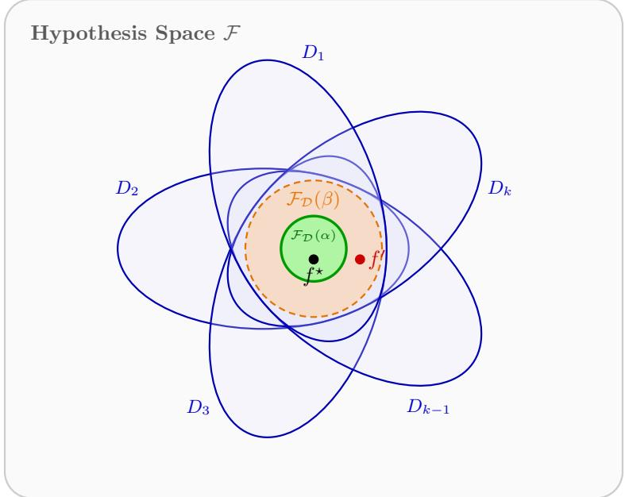

# Rural Readiness: Domain Generalization with Adversarially Chosen Domains

Cynthia Dwork Harvard University

Andisheh Ghasemi Northeastern University

Lunjia Hu Northeastern University

## Abstract

Predictive models trained at well-resourced data-rich institutions often fail when deployed in new populations. Motivated by the goal of building clinical diagnosis and decision-making algorithms for data-scarce rural populations using the general knowledge learned from data-rich hospitals, we formulate the fundamental question of domain generalization with adversarially chosen domains, which asks a learner to perform on any unseen target domain nearly as well as the worst hypothesis consistent with the evidence from the observed source domains.

Assuming only that the hypothesis class contains a “universal” predictor with small error on all k source domains, we characterize the sample complexity of this objective up to logarithmic factors. Letting d denote the VC dimension of the hypothesis class, we find, somewhat surprisingly, that the sample complexity reduces significantly from Ω(dk) to $O ( d )$ under a small relaxation of the learning goal in which, roughly speaking, we allow the learned model to compete with hypotheses that perform well on 99% instead of 100% of the source domains. By applying this insight to the meta-distributional setting, in which source domains are selected according to a distribution on distributions, we obtain a corresponding improvement over known sample complexity upper bounds. We also study the efect of data access to the target domain and show that a small labeled sample from the target domain does not improve the worst-case sample complexity on the source domains.

## 1 Introduction

Consider the task of creating a diagnostic tool that, given information about a patient such as lab results and vitals, outputs a score in [0, 1], with higher numbers viewed as a positive diagnosis. Suppose well-funded, data-rich medical research centers have developed diagnostic tools that perform well on the local populations on which they were trained. It is well known among medical researchers that a scoring function developed in one facility can be significantly less efective at other facilities (Deng et al., 2020; Patil and Parmigiani, 2018). This can arise from technical factors such as the methods and batches of chemicals used for specimen collection, as well as population diferences involving diets, environmental exposures, and genetic factors. These factors can change the joint probability distribution over patient information and ground-truth diagnoses; we call such a distribution a domain. The source domains on which a diagnostic tool is trained may difer from the target domains on which it is evaluated. The resulting performance degradation from source to target is known as the Harvard–Stanford problem: letting $D _ { H }$ and $D _ { S }$ denote the distributions on which Harvard and Stanford predictors $f _ { H }$ and $f _ { S }$ are trained, respectively, the cross-domain errors err $D _ { S } { \big ( } f _ { H } { \big ) }$ and err $D _ { H } ( f _ { S } )$ can be higher than the within-domain errors err $D _ { H } { \big ( } f _ { H } )$ and $\mathrm { e r r } _ { D _ { S } } ( f _ { S } )$

As long as in practice each predictor is used only for the distribution on which it is trained, there is no immediate problem.

Unfortunately, not all populations live near well-resourced, data-rich, cutting-edge medical research centers. At the same time, it is believed that human populations are not all so diferent from one another. This led Deng et al. (2020) to pose the following question: assuming the existence of an “α-universal” predictor, meaning, informally, that it has error at most α on all populations of interest, for some small $\alpha > 0$ (although it might not be optimal for any single population), can we leverage samples from the observed populations to construct a β-universal predictor, for some $\beta \geq \alpha ?$ We call this goal achieving rural readiness; it is closely related to domain generalization. Our formulation without assumptions relating diferent populations is one of our principal contributions. As noted in Deng et al. (2020), rural readiness “provides a new dimension of fairness, transferring the benefit of federal research dollars from preeminent bench to geographically remote bedside.”

A simple example shows that, absent assumptions relating populations, achieving absolute rural readiness using data collected from even a large set of observed populations can be impossible: if all observed populations are identical, and if these identical distributions difer markedly from an unobserved population, then there is little reason to think lessons learned from the observed populations will generalize to the new population. This suggests a competitive notion capturing the goal of building a scoring function that generalizes to unseen target domains “as well as possible” given the source domains that have been observed. We call this conditional rural readiness, or simply rural readiness, since the absolute version is impossible. We describe the competitive learning goal as follows.

Fix a hypothesis class ${ \mathcal { F } } \subseteq \{ f : \chi \to \{ 0 , 1 \} \}$ , where $\mathcal { X }$ is an instance space (in our discussion, its elements describe patients). Although in the motivating discussion, we assume there is an α- universal predictor that has error at most α on all populations of interest, in our formal treatment we assume only that $\mathcal { F }$ contains a predictor $f ^ { \star }$ with error at most $\alpha$ on each of the observed source domains. We call any hypothesis $f ^ { \star } \in { \mathcal { F } }$ satisfying this property α-universal. This weaker assumption sufices for our competitive learning goal. In particular, $f ^ { \star }$ need not have low error on the unobserved target domain.1 Throughout the paper, our upper bounds hold under this sourceonly assumption, whereas our lower bounds hold even in the easier setting where $f ^ { \star }$ has zero error on the target domain.

Each observed source domain eliminates hypotheses whose error exceeds $\beta$ on that domain. The survivors form a benchmark set. Without assumptions relating sources to targets, the source data provide no basis for preferring one surviving hypothesis over another on an unseen target $D$ We therefore require the learned classifier to perform, up to an additive slack, at least as well as the worst-performing benchmark hypothesis on $D .$ If the sources are informative, every benchmark hypothesis performs well on the target domain; if they are not, the benchmark permits large target error and the guarantee appropriately becomes vacuous.

We also consider a larger, relaxed benchmark. If a function $f \in { \mathcal { F } }$ performs well on, say, 99% rather than 100% of the observed sources, this may still be evidence that it may perform well on target distributions. The relaxed benchmark therefore permits a hypothesis to fail on $\mathrm { ~ a ~ } \gamma$ fraction of the sources. It contains the strict benchmark, which permits no failures, but may include additional members of $\mathcal { F }$

We study the sample complexity of achieving (conditional) rural readiness, assuming only the existence of an α-universal predictor in ${ \mathcal { F } } ,$ obtaining upper and lower bounds that match up to logarithmic factors for both the strict and relaxed benchmark sets. A key insight from our analysis is that, perhaps surprisingly, the sample complexity for the relaxed version is dramatically smaller than for the strict version.

Rural readiness is a domain generalization problem in which the source and target domains can all be chosen adversarially. The formulation has applications beyond the medical scenario that originally motivated our research, so in our technical results we use the term adversarial domain generalization for this learning goal.2

## 1.1 Summary of Contributions

We formalize the problem of achieving (conditional) rural readiness without assumptions relating the source and target distributions, and characterize its sample complexity. Our key modeling contribution is a competitive formulation with an appropriate choice of benchmark that formalizes the goal of doing as well as possible given what has been observed.

Adversarial Domain Generalization. We formalize the objective of conditional rural readiness using the adversarial domain generalization task in Section 2. In this task, the goal is to design a learning algorithm that collects data from k adversarially chosen source domains $\mathcal { D } = ( D _ { 1 } , \ldots , D _ { k } )$ ， and outputs a model that achieves competitive error on unseen target domains. We make the $\alpha \mathrm { - }$ universality assumption: there exists an unknown $f ^ { \star }$ from a hypothesis class $\mathcal { F }$ achieving error at most α on every source domain. The competitive error goal is defined with respect to the benchmark set $\mathcal { F } _ { \mathcal { D } } ( { \boldsymbol { \beta } } )$ consisting of hypotheses $f \in { \mathcal { F } }$ whose error on every source domain is at most $\beta ,$ for $\beta \geq \alpha$ . We say a model achieves competitive error on a target domain if its error is at most the maximum error of a benchmark $f \in \mathcal { F } _ { \mathcal { D } } ( { \boldsymbol \beta } )$ on that target domain, plus ε. We also consider the larger, relaxed benchmark set $\mathcal { F } _ { \mathcal { D } } ^ { ( \gamma ) } ( { \beta } )$ consisting of hypotheses $f \in { \mathcal { F } }$ that achieve error at most $\beta$ on at least a $( 1 - \gamma )$ fraction of the k source domains.

Near-Matching Bounds for the Strict Benchmark. We prove near-matching upper and lower bounds on the sample complexity of adversarial domain generalization in Sections 3 and 4. We start with the setting with the strict benchmark set $\mathcal { F } _ { \mathcal { D } } ( { \boldsymbol { \beta } } )$

Theorem 1 (informal, see Corollary 6 and Theorem 9). Assume $0 \leq \alpha < \beta < 1 / 4 , 0 \leq \varepsilon < 1 / 4$ $0 < \delta < 1 / 4$ , and $d \geq 1 0$ log k. In the worst case over hypothesis classes of VC dimension at most $d ,$ the sample complexity of adversarial domain generalization $i s ,$ up to logarithmic factors,

$$
\frac { \beta } { ( \beta - \alpha ) ^ { 2 } } \cdot k ( d + \log ( 1 / \delta ) ) .
$$

The $\Omega ( k d )$ lower bound is in sharp contrast to recent results on multi-distribution learning Zhang et al. (2025), where the sample complexity for finding a predictor that performs well on k given distributions is only an additive $k + d .$ . When $\beta > 2 \alpha$ , these better bounds apply to our problem if the family F satisfies a strong majority-closure condition: for every finite multiset $f _ { 1 } , \ldots , f _ { T } \in { \mathcal { F } }$ the function that assigns to x the majority value assigned to x by $f _ { 1 } , \ldots , f _ { T }$ is also in $\mathcal { F } ;$ see Appendix E.

A strength of our sample complexity lower bound in Theorem 1 is that it holds for an easier task. Our adversarial domain generalization task requires the learner to output a single model that achieves a competitive error guarantee for all target domains. Our lower bound holds even if the error guarantee is only required for a single target domain that depends solely on the source domains and is independent of the sampled data points and the learner’s randomness. Moreover, that single target domain is fully realizable: the α-universal hypothesis $f ^ { \star } \in { \mathcal { F } }$ is the only member of the benchmark family $\mathcal { F } _ { \mathcal { D } } ( { \boldsymbol { \beta } } )$ and it achieves zero error on the target domain.

To prove the lower bound, we carefully construct a family of hard instances, where solving the adversarial domain generalization problem requires the learner to fully identify $f ^ { \star }$ . This construction allows us to use an adversarial domain generalization learner to solve hidden-coordinate identification problems. These problems isolate the key information-theoretic insight in our proof. We describe these problems in Section 3.1 and apply standard information-theoretic tools (e.g. Fano’s inequality and the information processing inequality for KL divergences) to prove lower bounds for them in Appendix C. This allows us to present the rest of the proof in a modular way in Section 3.

To prove the sample complexity upper bound in Theorem 1, we design an algorithm that achieves a stronger goal: with probability at least $1 - \delta$ , the algorithm outputs a member of the benchmark set $\mathcal { F } _ { \mathcal { D } } ( { \boldsymbol { \beta } } )$ . Since our competitive error goal is with respect to the worst hypotheses in the benchmark set, any member of the benchmark set is a valid solution to the adversarial domain generalization problem. Our algorithm uses source data points to estimate the error of hypotheses $f \in { \mathcal { F } }$ on every source domain, in order to rule out all hypotheses not in the benchmark set $\mathcal { F } _ { \mathcal { D } } ( { \boldsymbol { \beta } } )$ The α-universality assumption ensures that the algorithm does not rule out all hypotheses, allowing the algorithm to choose its output from the remaining hypotheses. Obtaining a tight upper bound requires carefully designing the criterion for ruling out hypotheses, which we describe in more detail in Section 4.

Near-Matching Bounds for a Relaxed Benchmark. Our results make no distributional assumptions, but they do reflect a distributional optimism: the observed distributions are suficiently informative to teach us how to make predictions for as-yet-unobserved distributions. Our relaxed benchmark captures even greater optimism, specifically, that the information needed to make good predictions on an unobserved distribution can be learned even while disregarding a small fraction of the observed sources. This could happen, for example, if we believe some observed sources may be pathological or anomalous.

If there is reason to be strongly optimistic in the above sense, we can aim for a relaxed benchmark class $\mathcal { F } _ { \mathcal { D } } ^ { ( \gamma ) } ( { \beta } )$ in which we retain candidates from $\mathcal { F }$ that may fail to be accurate on up to a small constant fraction $\gamma$ of the observed domains. This fully eliminates the linear dependence on $k$ in Theorem 1:

Theorem 2 (informal, see Corollary 6 and theorem 9). In the setting of Theorem 1, assume $\gamma \in [ 1 / k , 1 / 4 ]$ . In the worst case over hypothesis classes of VC dimension at most $d ,$ the sourcesample complexity of γ-relaxed adversarial domain generalization is, up to logarithmic factors,

$$
\frac { \beta } { ( \beta - \alpha ) ^ { 2 } } \cdot \frac { 1 } { \gamma } \cdot ( d + \log ( 1 / \delta ) ) .
$$

Interestingly, the sample complexity bound in Theorem 2 is independent of $k ,$ demonstrating the power of the benchmark relaxation. As an application of this result, we use it to achieve improved sample complexity for the domain generalization problem studied by Dwork et al. (2025).

We prove the lower bound in Theorem 2 by reducing to the strict-benchmark bound in Theorem 1. Set $r = \lfloor \gamma k \rfloor + 1$ and $\boldsymbol { B } = \lfloor \boldsymbol { k } / r \rfloor$ , start from a strict instance with B sources, and repeat each source at least r times. A hypothesis that violates the threshold on one original source then violates it on more than $\gamma k$ copies. The relaxed benchmark of the repeated instance is therefore exactly the strict benchmark of the original instance.

Since the sample complexity upper bound in Theorem 2 is independent of $k ,$ our algorithm need not collect data from every source domain when k is large. The key idea is to sample a subset of the source domains and collect data only from those sampled domains. The size of this subset needs to be chosen carefully to obtain a tight bound. We describe the details in Section 4.

Improved Upper Bounds for Meta-Generalization. There is a large literature on domain generalization when the observed distributions are themselves drawn from a distribution over distributions. Dwork, Hu, and Shao (Dwork et al., 2025) model this in the PAC framework, introduce the domain shattering dimension, and give tight bounds on the number of randomly sampled domains needed to achieve absolute rural readiness. In this setting, we prove that every member of the relaxed benchmark generalizes to new domains from the meta-distribution. For constant parameters, combining this transfer result with our learner gives total labeled sample complexity $\widetilde { O } ( \mathrm { V C } ( \mathcal { F } ) )$ , independent of $k ,$ rather than the $\widetilde { O } ( k \mathrm { V C } ( \mathcal { F } ) )$ used by the min–max ERM implementation analyzed in Dwork et al. (2025). This saving concerns labeled examples: the number k of observed domains must still scale with the domain shattering dimension, and the transferred bad-domain probability includes an additive $\gamma .$

Data Access to the Target Domain. Our results above assume that no target data are available. Perhaps surprisingly, a small labeled target sample does not improve the worst-case sourcesample complexity: the source lower bound persists until the target sample is large enough for target-only learning.

Theorem 3 (informal, see Theorem 12). Given data access to the target domain, the source-domain lower bounds in Theorems 1 and 2 continue to hold up to constant factors whenever the number of labeled target examples is smaller than a constant multiple of

$$
\frac { d + \log ( 1 / \delta ) } { \varepsilon ^ { 2 } }\tag{1}
$$

data points from the target domain, where ε is the additive slack in the competitive error goal.

Conversely, standard agnostic learning uses $O ( ( d + \log ( 1 / \delta ) ) / \varepsilon ^ { 2 } )$ labeled target examples and no source examples. We also prove a realizable counterpart: even when the benchmark has zero target error, the source lower bound persists below the $( d + \log ( 1 / \delta ) ) / \varepsilon$ target-sample scale; see Theorem 21. This matches the usual realizable target-only sample complexity. These results hold in the relaxed-benchmark setting by the same repeated-source reduction (see Corollary 13).

## 1.2 Related Work

Speaking intuitively, both similarities and diferences across observed populations can be leveraged to achieve rural readiness. Similarities help isolate invariant mechanisms that reliably transfer to unseen populations, whereas diferences alert the learner to spurious or domain-specific features that must be avoided.

Approaches exploiting similarities typically seek stable causal mechanisms via invariant risk minimization (Arjovsky et al., 2019). Conversely, other approaches explicitly exploit domain or group diferences, for example through adversarial domain discrimination (Deng et al., 2020), distributionally robust optimization across environments (Sagawa et al., 2020), or adversarial fairness and transfer objectives (Madras et al., 2018). Theoretical work by Rosenfeld et al. (2021) and Gouk et al. (2022) identifies specific formal settings in which invariant or general-purpose domaingeneralization methods cannot improve fundamentally over empirical risk minimization (pooling-ERM). Empirical work, including Teterwak et al. (2025), likewise emphasizes that carefully tuned ERM-style baselines can be highly competitive against specialized domain generalization methods on standard benchmarks. For comprehensive overviews of domain generalization and transfer learning, see Zhou et al. (2022); Wang et al. (2022).

Multi-Distribution and Collaborative Learning (Observed Sources). A rich line of work investigates learning predictors evaluated exclusively across k known source distributions. Initiated by Blum et al. (2017), collaborative PAC learning characterizes the sample complexity of finding a shared classifier that simultaneously satisfies all participating domains, with matching logarithmicoverhead bounds established in relevant collaborative-PAC regimes by Nguyen and Zakynthinou (2018) and Chen et al. (2018). Recent work has studied demand-driven on-demand query allocation (Haghtalab et al., 2022), formalized open questions regarding sample complexity for VC classes (Awasthi et al., 2023), settled the minimax sample complexity of multi-distribution learning (Peng, 2024; Zhang et al., 2025), and developed derandomized collaborative algorithms (Larsen et al., 2024). Extending multi-distribution learning to noisy settings, Hanashiro et al. (2026) show that in personalized multi-distribution learning, bounded label noise can preclude fast 1/ϵ- type rates, leading instead to $k / \epsilon ^ { 2 } .$ -type dependence or multiplicative penalties under stronger benchmarks. These frameworks assess performance strictly in-sample on observed distributions $D _ { 1 } , \ldots , D _ { k } ;$ in contrast, our goal is out-of-domain generalization to an unobserved, potentially adversarial target distribution D′.

Assumptions on Source–Target Similarity and Divergences. To generalize to an unobserved target domain, the dominant paradigm in domain adaptation and domain generalization is to restrict the discrepancy between source and target distributions through explicit geometric, statistical, or algebraic bounds. In domain adaptation, classical theory bounds target risk using discrepancy measures such as H∆H-divergence (Ben-David et al., 2010), while target-specific inference often uses propensity-score reweighting (Kim et al., 2022). In domain generalization without target data, early theoretical frameworks control transfer to an unseen target by bounding distribution discrepancies in an RKHS, either by embedding domain marginal distributions (Blanchard et al., 2011) or minimizing maximum mean discrepancy to learn domain-invariant representations (Muandet et al., 2013). Alternatively, agnostic multi-distribution learning restricts the target domain to lie within the convex mixture simplex of the observed source distributions (Mohri et al., 2019), while group-theoretic approaches bound worst-case generalization by assuming target distributions are generated by known transformation-group symmetries acting on the source data (Shao et al., 2022; Montasser et al., 2024). In contrast to all these approaches, our adversarial domain generalization framework operates under zero target data and imposes no divergence bounds, distribution-distance constraints, mixture simplex assumptions, or transformation symmetries between the observed sources and the unseen target.

Causal Mechanisms, Drift, and Representation Learning. Beyond direct distance bounds between domains, related lines of work generalize across environments by isolating invariant causal mechanisms or shared feature representations. Causal frameworks rely on structural causal models and causal DAGs to identify invariant conditional distributions (Sch¨olkopf et al., 2012; Zhang et al., 2015; Gong et al., 2016), while other works address transfer under posterior and decisionrule drift (Maity et al., 2024; Zhu et al., 2024, 2025; Wang and Ning, 2025), where $P ( { Y \vert { X } } )$ shifts across domains. In empirical representation learning, adversarial domain generalization methods align feature representations across source domains (Zhu et al., 2022), adapting gradient-reversal techniques originally developed for source-target alignment in domain adaptation (Ganin et al., 2016). A parallel theoretical line in multi-task and representation learning guarantees transfer by assuming that all tasks share a common low-dimensional linear representation or subspace (Balcan et al., 2015; Maurer et al., 2016; Kong et al., 2020; Tripuraneni et al., 2020, 2021; Du et al., 2021; Thekumparampil et al., 2021; Collins et al., 2021). Recent advances in this setting establish optima subspace recovery under heterogeneous noise (Duchi et al., 2022) and in extreme regimes with only constant samples per task (Aliakbarpour et al., 2024). Rather than restricting the data-generating process to specific parametric forms, causal graphs, or low-dimensional linear representations, we operate solely under the α-universality assumption over general hypothesis classes F.

Meta-Learning and Meta-Distributional Generalization. Meta-learning typically models domains as independent draws from an underlying meta-distribution M. Several formulations evaluate average performance over domains drawn from a meta-distribution (Garg et al., 2021); in some cases this reduces to learning under the induced mixture, while other formulations retain explicit domain-level structure. Recent work also investigates fundamental ERM principles and sample requirements in meta-learning (Alon et al., 2024), or studies online meta-learning for fast parameter initialization (Khodak et al., 2019, 2023; Balcan et al., 2021). When bounding uniform error across unseen domains supported on M, prior work relies on domain complexity measures such as the domain-shattering dimension introduced by Dwork et al. (2025). While the min-max ERM algorithm of Dwork et al. (2025) achieves optimal domain complexity (k), its literal implementation requires estimating observed-domain empirical errors uniformly to high precision, incurring a total sample cost of ${ \tilde { O } } ( k \cdot \mathrm { V C } ( { \mathcal { F } } ) )$ ). By framing meta-generalization through our relaxed benchmark, we reduce this total hospital-side sample burden to ${ \tilde { O } } ( { \mathrm { V C } } ( { \mathcal { F } } ) ) ,$ ) for constant parameters, independent of k, while maintaining strong out-of-domain guarantees.

## 1.3 Paper Organization

The rest of the paper is organized as follows. Section 2 formalizes adversarial domain generalization, universality, and the strict and relaxed benchmarks. Section 3 proves the strict and relaxed sample-complexity lower bounds, while Section 4 gives near-matching upper bounds via subset certificates and random-domain batches. Section 5 studies how labeled target samples change the lower bounds, and Section 6 applies the relaxed benchmark to meta-distribution generalization.

Appendix A collects the information-theoretic and VC tools, Appendix B proves the two upper bounds, Appendix C proves the hidden-coordinate lemmas, Appendix D gives the detailed targetaccess lower bounds, and Appendix E develops improved guarantees under majority closure.

## 2 Problem Setup: Adversarial Domain Generalization

In this section, we formally define the adversarial domain generalization problem, starting from two key concepts: the universality assumption and the benchmark set.

## 2.1 The Universality Assumption

Let $\mathcal { X }$ be an instance space and let $\mathcal { V } = \{ 0 , 1 \}$ be the binary label space. A hypothesis class is a family $\mathcal { F }$ of binary classifiers $f : \mathcal { X }  \{ 0 , 1 \}$ . For a distribution D on $\mathcal { X } \times \mathcal { V }$ and a classifier $f : \mathcal { X }  \{ 0 , 1 \}$ , we define

$$
\operatorname { e r r } _ { D } ( f ) : = \operatorname* { P r } _ { ( x , y ) \sim D } [ f ( x ) \neq y ] .
$$

Suppose we have data access to k source distributions $\mathcal { D } : = ( D _ { 1 } , \ldots , D _ { k } )$ . (Note that $\mathcal { D }$ is a list, not a distribution.) For example, each $D _ { i }$ represents the distribution of patients x in a specific hospital with their corresponding labels $y .$ The learner may request labeled examples from any source; each request to $D _ { i }$ returns a fresh i.i.d. draw from that distribution. Following the terminology in domain generalization, we call these distributions source domains.

We make the following α-universality assumption on the hypothesis class $\mathcal { F }$ and the source distributions $D _ { 1 } , \ldots , D _ { k }$ :

Definition 1 (α-universality). We say a hypothesis class $\mathcal { F }$ satisfies α-universality on distributions $D _ { 1 } , \ldots , D _ { k }$ if there exists $f ^ { \star } \in { \mathcal { F } }$ such that

$$
\mathrm { e r r } _ { D _ { i } } ( f ^ { \star } ) \leq \alpha \quad f o r \ a l l \ i = 1 , \ldots , k .
$$

We think of α as a small positive constant in $[ 0 , 1 ] , \ \mathrm { s a y } , \ \alpha = 0 . 1$ for concreteness. The $\alpha \mathrm { - }$ universality condition requires that some $f ^ { \star } \in { \mathcal { F } }$ performs reasonably well on all the source domains. Ideally, $f ^ { \star }$ would capture some universal scientific knowledge that holds across all realistic patient distributions, but our results make no such assumption. That said, the classifier $f ^ { \star }$ need not be optimal on any specific source domain $D _ { i } { \mathrm { : } }$ another $D _ { i }$ -specific classifier $f _ { D _ { i } } \in \mathcal { F }$ may achieve significantly smaller error on $D _ { i }$

## 2.2 The Benchmark Set

Our goal is to use data collected from the source domains to learn a universal classifier ${ \hat { f } } : { \mathcal { X } } \to$ {0, 1} that performs well on new target domains D′. We study a challenging setting:

1. We do not make any explicit assumption on the similarity between the source domains and the target domain. This is in contrast to prior work on domain generalization that relies on distance or divergence bounds between the source and the target (see Assumptions on Source–Target Similarity and Divergences in Section 1.2). This is also diferent from metadistributional models in which domains are sampled i.i.d. (Dwork et al., 2025) (see Meta-Learning and Meta-Distributional Generalization in Section 1.2).

  
Figure 1: Geometry of the benchmark $\mathcal { F } _ { \mathcal { D } } ( { \boldsymbol { \beta } } )$ . Each petal represents the hypotheses whose population error is at most $\beta$ on one source $D _ { i }$ . Their intersection is $\mathcal { F } _ { \mathcal { D } } ( { \boldsymbol { \beta } } )$ ; the inner region $\mathcal { F } _ { \mathcal { D } } ( \alpha )$ contains the universal predictor $f ^ { \star }$ from Definition 1. The classifier $f ^ { \prime } \in \arg \operatorname* { m a x } _ { f \in { \mathcal { F } } _ { \mathcal { D } } ( \beta ) } \exp { \exp { ( f ) } }$ is the benchmark member with largest target error. Both $f ^ { \star }$ and $f ^ { \prime }$ satisfy the relevant source constraints, but without assumptions relating source and target domains, source evidence alone gives no smaller uniform target guarantee than the error of this worst benchmark member.

2. We train the classifier $\hat { f }$ without using any data from the target distribution $D ^ { \prime }$

In this challenging setting without any data from the unconstrained target distribution $D ^ { \prime }$ , it is impossible to always achieve a non-trivial error guarantee on it. We aim for the relaxed goal of achieving competitive error with respect to a benchmark set of classifiers:

Definition 2 (Benchmark set). Given a hypothesis class $\mathcal { F } _ { ; }$ , source distributions $\mathcal { D } = ( D _ { 1 } , \ldots , D _ { k } )$ and an error parameter $\beta \in [ 0 , 1 ]$ , we define the benchmark set

$$
\mathcal F _ { \mathcal D } ( \beta ) : = \Big \{ f \in \mathscr F : \operatorname* { m a x } _ { i \in [ k ] } \mathrm { e r r } _ { D _ { i } } ( f ) \leq \beta \Big \} .
$$

When $\beta$ is understood from context we may simply write $\mathcal { F } _ { \mathcal { D } }$

The benchmark set $\mathcal { F } _ { \mathcal { D } } ( { \boldsymbol \beta } )$ consists of classifiers $f \in { \mathcal { F } }$ that perform reasonably well on all source distributions. Assuming α-universality for $\alpha \leq \beta$ , it is clear by definition that the α-universal classifier $f ^ { \star }$ belongs to the benchmark set $\mathcal { F } _ { \mathcal { D } } ( { \boldsymbol { \beta } } )$

To see the intuition behind Definition 2, let us consider the special case where $\beta = \alpha$ . In this case, $\mathcal { F } _ { \mathcal { D } } ( \alpha )$ is exactly the set of candidates for $f ^ { \star }$ if we fully observed the source distributions $D _ { 1 } , \ldots , D _ { k }$ . That is, even if we have full knowledge of $D _ { 1 } , \ldots , D _ { k }$ , the only information we can learn about $f ^ { \star }$ is that it is a member of $\mathcal { F } _ { \mathcal { D } } ( \alpha )$ . If we take an arbitrary $\hat { f } \in \mathcal { F } _ { \mathcal { D } } ( \alpha )$ as a guess for $f ^ { \star }$ , we immediately obtain the following distribution-free guarantee on a new target distribution

D′:

$$
\mathrm { e r r } _ { D ^ { \prime } } ( \hat { f } ) \leq \operatorname* { m a x } _ { f \in \mathcal { F } _ { \mathcal { D } } ( \alpha ) } \mathrm { e r r } _ { D ^ { \prime } } ( f ) .\tag{2}
$$

This motivates (2) as a conservative competitive guarantee based only on the source distributions, even if those distributions were known exactly.

We also consider the following γ-relaxed benchmark set:

Definition 3 (Relaxed benchmark set). In the setting of Definition ${ \mathcal { Q } } ,$ for $\gamma \in [ 0 , 1 ]$ , define

$$
\mathcal { F } _ { \mathcal { D } } ^ { ( \gamma ) } ( \beta ) : = \Big \{ f \in \mathcal { F } : \big | \{ i \in [ k ] : \mathrm { e r r } _ { D _ { i } } ( f ) > \beta \} \big | \le \gamma k \Big \} .
$$

Equivalently, $f \in \mathcal { F } _ { \mathcal { D } } ^ { ( \gamma ) } ( \beta )$ may violate the threshold $\beta$ on at most $\lfloor \gamma k \rfloor$ sources.

It is clear that $\mathcal { F } _ { D } ( \beta ) = \mathcal { F } _ { D } ^ { ( 0 ) } ( \beta )$ and $\mathcal { F } _ { D } ^ { ( \gamma _ { 1 } ) } ( \beta ) \subseteq \mathcal { F } _ { D } ^ { ( \gamma _ { 2 } ) } ( \beta )$ whenever $\gamma _ { 1 } \leq \gamma _ { 2 }$

## 2.3 Adversarial Domain Generalization

We use a relaxation of (2) as our goal of adversarial domain generalization, permitting our competitive guarantee to have a small additive slack, parameterized by ε:

Definition 4 $( ( k , \alpha , \beta , \varepsilon , \delta )$ -adversarial domain generalization). Let k be a positive integer and let $\alpha , \beta , \varepsilon , \delta ~ \in ~ [ 0 , 1 ]$ be parameters satisfying $\beta \ \geq \ \alpha$ We say a learning algorithm $\mathcal { L }$ solves $( k , \alpha , \beta , \varepsilon , \delta )$ -adversarial domain generalization for a hypothesis class $\mathcal { F }$ if the following holds. Let $\mathcal { D } = ( D _ { 1 } , \ldots , D _ { k } )$ be an arbitrary collection of source domains satisfying the α-universality assumption (Definition $^ { 1 ) }$ . The learner $\mathcal { L }$ collects labeled examples from the sources and outputs a classifier ${ \hat { f } } : { \mathcal { X } }  \{ 0 , 1 \}$ . It may adaptively choose the source of each example as a function of its previous observations and internal randomness. With probability at least $1 - \delta$ over the data and the learner’s randomness,

$$
\mathrm { e r r } _ { D ^ { \prime } } ( \hat { f } ) \leq \operatorname* { m a x } _ { f \in \mathcal { F } _ { D } ( \beta ) } \mathrm { e r r } _ { D ^ { \prime } } ( f ) + \varepsilon  &  f o r \ e v e r y \ d i s t r i b u t i o n \ D ^ { \prime } \ o n \ \mathcal { X } \times \{ 0 , 1 \} .\tag{3}
$$

We do not assume in general that the output $\hat { f }$ belongs to ${ \mathcal { F } } ;$ when we impose $\hat { f } \in \mathcal { F } .$ , we say so explicitly. However, if $\hat { f }$ does belong to the benchmark class $\mathcal { F } _ { \mathcal { D } } ( { \boldsymbol { \beta } } )$ , which is a subset of $\mathcal { F }$ , then $\hat { f }$ automatically satisfies (3):

$$
\operatorname { e r r } _ { D ^ { \prime } } ( \hat { f } ) \leq \operatorname* { m a x } _ { f \in \mathcal { F } _ { \mathcal { D } } ( \beta ) } \operatorname { e r r } _ { D ^ { \prime } } ( f ) \leq \operatorname* { m a x } _ { f \in \mathcal { F } _ { \mathcal { D } } ( \beta ) } \operatorname { e r r } _ { D ^ { \prime } } ( f ) + \varepsilon .
$$

The error guarantee (3) is competitive with the worst-case hypotheses in the strict benchmark set $\mathcal { F } _ { \mathcal { D } } ( { \boldsymbol { \beta } } )$ , which consists of hypotheses with error at most $\beta$ on every source domain. This guarantee is meaningful when all hypotheses in the strict benchmark set have small error on the target domain. As discussed in the Introduction, we may have reason to believe that hypotheses in the larger, relaxed benchmark set $\mathcal { F } _ { \mathcal { D } } ^ { ( \gamma ) } ( { \beta } )$ also achieve low error on the target domain, where the relaxed benchmark set consists of hypotheses that have error at most $\beta$ on at least $1 - \gamma$ fraction of the source domains. In this case, we relax the error guarantee accordingly:

Definition 5 (γ-relaxed adversarial domain generalization). Let $\gamma \in [ 0 , 1 ]$ . In the setting of $D e f i -$ nition $^ { 4 , }$ , we say a learner L solves γ-relaxed $( k , \alpha , \beta , \varepsilon , \delta )$ -adversarial domain generalization for $\mathcal { F }$ $i f$ it achieves the following relaxation of (3), where $\mathcal { F } _ { \mathcal { D } } ( { \boldsymbol { \beta } } )$ is replaced by $\mathcal { F } _ { \mathcal { D } } ^ { ( \gamma ) } ( \beta )$

$$
\mathrm { e r r } _ { D ^ { \prime } } ( \hat { f } ) \leq \operatorname* { m a x } _ { f \in \mathcal { F } _ { \mathcal { D } } ^ { ( \gamma ) } ( \beta ) } \mathrm { e r r } _ { D ^ { \prime } } ( f ) + \varepsilon  f o r e v e r y ~ d i s t r i b u t i o n ~ D ^ { \prime } ~ o n ~ \mathcal { X } \times \{ 0 , 1 \} .\tag{4}
$$

Our focus is on the sample complexity of adversarial domain generalization. That is, how many data points in total from the k source distributions are needed to solve the adversarial domain generalization task. We establish lower and upper bounds that match up to logarithmic factors in the following sections.

Convention. All logarithms in this paper are natural, unless explicitly stated.

## 3 Sample Complexity Lower Bounds

In this section, we prove sample complexity lower bounds for the adversarial domain generalization problem defined in the previous section. Our first theorem states the lower bound in terms of the class size. We convert it to a VC-dimension bound in Corollary $6 ;$ the strict case corresponds to $B = k$ there.

Theorem 4 (Strict-benchmark lower bound). Fix $k \geq 1 , 0 \leq \alpha < \beta < 1 / 2 , 0 \leq \varepsilon < 1 / 4$ , and $\delta \in ( 0 , 1 / 4 )$ . For every integer $M \geq 2$ , there exists a hypothesis class ${ \mathcal { F } } \ o f$ size $k M + 1$ with the following property. Let L be any learner that solves $( k , \alpha , \beta , \varepsilon , \delta )$ -adversarial domain generalization for F in the sense of Definition 4 using at most n data points in total. Then

$$
n \geq \Omega \left( k \frac { \beta } { ( \beta - \alpha ) ^ { 2 } } \big [ \log M + \log ( 1 / \delta ) \big ] \right) .\tag{5}
$$

Moreover, for each source tuple $\mathcal { D } = ( D _ { 1 } , \ldots , D _ { k } )$ considered in our lower bound proof, we focus on a single target distribution $D ^ { \prime }$ . This distribution is fixed before the source data points and the learner’s randomness are realized and satisfies a zero-error guarantee for every benchmark classifier:

$$
\operatorname* { m a x } _ { f \in { \mathscr { F } _ { D } ( \beta ) } } \operatorname { e r r } _ { D ^ { \prime } } ( f ) = 0 .\tag{6}
$$

The lower bound continues to hold if the only target-domain guarantee required of the learner is

$$
\operatorname* { P r } \left[ \operatorname { e r r } _ { D ^ { \prime } } ( { \widehat { f } } ) \leq \varepsilon \right] \geq 1 - \delta\tag{7}
$$

for this single target domain D′ associated with the source tuple $\mathcal { D } = ( D _ { 1 } , \ldots , D _ { k } )$

Since $\alpha \leq \beta$ , α-universality implies $f ^ { \star } \in { \mathcal { F } } _ { \mathcal { D } } ( \beta )$ . Equation (6) then gives err $D ^ { \prime } \big ( f ^ { \star } \big ) = 0$ . Thus the lower bound already holds in the easier setting where the universal source classifier is also realizable on the target.

Our lower bound for the relaxed benchmark will follow by repeating each domain in the strict construction suficiently many times. The key observation is that repetition preserves α-universality. We state the result below and prove it in Section 3.2.

Theorem 5 (Relaxed-benchmark lower bound). In the setting of Theorem $^ { 4 , }$ additionally fix a relaxation parameter $\gamma \in [ 0 , 1 )$ and define

$$
r : = \lfloor \gamma k \rfloor + 1 , \qquad B : = \lfloor k / r \rfloor .
$$

For every integer $M \geq 2$ , there exists a hypothesis class F of size $B M + 1$ with the following property. Let $\mathcal { L }$ be any learner that solves γ-relaxed $( k , \alpha , \beta , \varepsilon , \delta )$ -adversarial domain generalization for $\mathcal { F }$ in the sense of Definition 5 using at most n data points in total. Then

$$
n \geq \Omega \left( B \frac { \beta } { ( \beta - \alpha ) ^ { 2 } } \big [ \log M + \log ( 1 / \delta ) \big ] \right) .\tag{8}
$$

Moreover, as in Theorem $^ { 4 , }$ the lower bound continues to hold if the only target-domain guarantee required of the learner is $\operatorname* { P r } \left[ \operatorname { e r r } _ { D ^ { \prime } } ( { \widehat { f } } ) \leq \varepsilon \right] \geq 1 - \delta$ for a single target domain D′ associated with each source tuple D considered in our proof, where D′ satisfies max $\dot { \boldsymbol { \mathbf { \rho } } } _ { f \in \mathcal { F } _ { D } ^ { ( \gamma ) } ( \beta ) } \operatorname { e r r } _ { D ^ { \prime } } ( f ) = 0$

Corollary 6 gives the VC-dimension versions of Theorems 4 and 5. Setting $\gamma = 0$ makes $B = k$ and recovers the strict case.

Corollary 6. In the setting of Theorem 5, for every positive integer $d \geq 1 0$ log B, there exists a hypothesis class F with VC dimension at most d such that the total number n of source samples used by any learner L solving γ-relaxed $( k , \alpha , \beta , \varepsilon , \delta )$ -adversarial domain generalization for $\mathcal { F }$ satisfies

$$
n \geq \Omega \left( B \frac { \beta } { ( \beta - \alpha ) ^ { 2 } } \big [ d + \log ( 1 / \delta ) \big ] \right) .
$$

We prove Corollary 6 using Theorem 5. We then prove Theorems 4 and 5 in the next two subsections.

Proof. Set

$$
M : = \left\lfloor \frac { 2 ^ { d } } { B } \right\rfloor .
$$

We first verify that $M \geq 2$ , as required by Theorem 5. If $d = 1$ , then $1 \geq 1 0 \log B$ forces the positive integer B to equal 1, and hence $M = 2$ . If $d \geq 2$ , the assumption log $B \leq d / 1 0$ gives

$$
\frac { 2 ^ { d } } { B } \geq \exp \bigl ( ( \log 2 - 1 / 1 0 ) d \bigr ) > 3 ,
$$

so again $M \geq 2$

Apply Theorem 5 with this value of M. The resulting class has cardinality

$$
| { \mathcal { F } } | = B M + 1 \le 2 ^ { d } + 1 < 2 ^ { d + 1 } .
$$

Since a class that shatters v points contains at least $2 ^ { v }$ distinct hypotheses, $\begin{array} { r } { \mathrm { V C } ( \mathcal { F } ) \leq \lfloor \log _ { 2 } \vert \mathcal { F } \vert \rfloor \leq d . } \end{array}$

It remains to express the first term of the lower bound in terms of d. For $x \ge 2 , \lfloor x \rfloor \ge x / 2$ Thus, when $d \geq 2$

$$
\log M \geq d \log 2 - \log B - \log 2 \geq ( \log 2 - 1 / 1 0 ) d - \log 2 \geq \frac { d } { 5 } .
$$

The same conclusion holds when $d = 1$ , because then $B = 1$ and $M = 2$ . Substituting B log $M \geq$ $B d / 5$ into the lower bound of Theorem 5 and absorbing the factor $1 / 5$ into the universal constant proves the claim. □

## 3.1 The Hidden Coordinate Lemma

Our lower bound proofs rely on Lemmas 7 and 8 below, whose full proofs appear in Appendix C. Imagine a learner who observes M-bit strings with one hidden exceptional coordinate: the exceptional coordinate has Bernoulli mean $\alpha ,$ , while all other coordinates have Bernoulli mean $\beta .$ The learner must identify the exceptional coordinate with high probability. The lemma quantifies the number of samples required for this task. The heart of the lower bound proof is a reduction from this hidden-coordinate learning problem to adversarial domain generalization.

Let M be a positive integer. For every $i \in [ M ]$ , define $D _ { i } ( \alpha , \beta )$ to be the distribution on M-bit strings $\{ 0 , 1 \} ^ { M }$ where the (exceptional) i-th coordinate is sampled from the Bernoulli distribution with mean $\alpha ,$ and all other coordinates are sampled independently from the Bernoulli distribution with mean $\beta .$

Lemma 7. Let $M \geq 2$ be an integer and let $0 \leq \alpha < \beta \leq 1 / 2$ . Let I be uniformly distributed on [M]. A randomized learner adaptively observes an arbitrary, possibly random, number N of i.i.d. examples from $D _ { I } ( \alpha , \beta )$ and outputs $\widehat { I } \in [ M ]$ $I f \operatorname* { P r } [ \widehat { I } = I ] \geq 3 / 4$ , then

$$
\mathbb { E } [ N ] \ge \Omega \left( \frac { \beta } { ( \beta - \alpha ) ^ { 2 } } \log M \right) .
$$

The learner is allowed to stop when it feels it has suficient confidence, rather than running for some pre-specified number of steps; nonetheless, Lemma 7 shows that the expected number of samples is large.

The lemma concerns a single M-way hidden-coordinate identification task. The log M term comes from the need to identify one coordinate among M possibilities. The same argument shows that this term is already necessary if the learner succeeds with any fixed probability strictly greater than $1 / 2$

Remark 1. We will make heavy use of Lemma 7. Later, it will be convenient to think of strings of length $M + 1$ , with $M \geq 1$ ordinary coordinates and one exceptional coordinate (rather than simply $M \geq 2$ coordinates as in the statement of the lemma).

We will also need the following similar lemma with a tight dependence on the failure probability bound δ.

Lemma 8 (Two-coordinate testing under a common reference). Let $0 \leq \alpha < \beta \leq 1 / 2$ and $\delta \in$ (0, 1/4). Define

$$
P _ { 1 } = \mathrm { B e r n o u l l i } ( \alpha ) \otimes \mathrm { B e r n o u l l i } ( \beta ) , \qquad P _ { 2 } = \mathrm { B e r n o u l l i } ( \beta ) \otimes \mathrm { B e r n o u l l i } ( \alpha ) ,
$$

and let $R = { \mathrm { B e r n o u l l i } } ( \alpha ) ^ { \otimes 2 }$ . A randomized sequential test observes i.i.d. samples, stops after an arbitrary, possibly random, number N of samples, and outputs $\widehat { I } \in \{ 1 , 2 \}$ . If

$$
\operatorname* { P r } _ { P _ { 1 } } [ \widehat { I } = 1 ] \geq 1 - \delta , \qquad \operatorname* { P r } _ { P _ { 2 } } [ \widehat { I } = 2 ] \geq 1 - \delta ,
$$

then its expected sample size under the reference distribution satisfies

$$
\mathbb { E } _ { R } [ N ] \ge \Omega \left( \frac { \beta } { ( \beta - \alpha ) ^ { 2 } } \log ( 1 / \delta ) \right) .
$$

Lemma 8 supplies the separate confidence-dependent ingredient. The expected sample size is measured under the common reference $R = \left( \alpha , \alpha \right)$ rather than under either alternative. This direction of comparison yields the finite divergence $\mathrm { k l } ( \alpha \| \beta )$ even when $\alpha = 0$ . Later, we use one common reference experiment for all source blocks, so their expected query counts sum to the learner’s total budget.

Proofs of both lemmas use standard information theory techniques and appear in Appendix C.

## 3.2 Proof of the Strict-Benchmark Lower Bound

We prove Theorem 4 by reducing the hidden-coordinate identification problem in Lemma 7 to adversarial domain generalization. The two source families used for the size and confidence terms are summarized in Table 1. As noted in Remark 1, it will be easier to think in terms of strings of length $M + 1$ , with $M \geq 1$ ordinary coordinates and one exceptional coordinate. With this in mind, we begin by constructing an infinite family of hard instances. Whereas the hiddencoordinate problem involved $M + 1$ distributions, the hard instances here can be viewed as $k \geq 1$ coupled hidden-coordinate problems sharing one distinguished coordinate.

The Hard Instances of Source Domains. Let

$$
\eta : = \frac { 1 } { 2 } \operatorname* { m i n } \{ \beta - \alpha , 1 / 2 - \beta \} , \qquad \rho : = \beta + \eta .
$$

Thus $\beta < \rho < 1 / 2$ , while

$$
\rho - \alpha \leq { \frac { 3 } { 2 } } ( \beta - \alpha ) , \qquad \beta \leq \rho \leq { \frac { 3 } { 2 } } \beta .\tag{9}
$$

Set $N : = k M + 1$ , let $\mathcal { X } : = \{ 0 , 1 \} ^ { N }$ , and take the coordinate class

$$
{ \mathcal { F } } : = \{ f _ { 1 } , \ldots , f _ { N } \} , \qquad f _ { i } ( x ) : = x _ { i } .
$$

Thus $| \mathcal { F } | = N = k M + 1$

A hidden instance is an ordered partition of $[ N ]$ into {t} together with a set of k equal-sized blocks:

$$
\theta = ( t , C _ { 1 } , \ldots , C _ { k } ) , \qquad [ N ] = \{ t \} \sqcup C _ { 1 } \sqcup \cdots \sqcup C _ { k } , \qquad | C _ { s } | = M .
$$

The resulting pattern of coordinate-wise error means is displayed in Table $1 ( \mathrm { a } )$

For this instance and each source index $s \in [ k ]$ , define the source distribution $D _ { s } ^ { \theta }$ as follows. For every $i \in [ N ]$ , set

$$
q _ { s , i } ^ { \theta } : = { \left\{ \begin{array} { l l } { \rho , } & { i \in C _ { s } , } \\ { \alpha , } & { { \mathrm { o t h e r w i s e } } , } \end{array} \right. }
$$

Next draw a fair bit $Y \sim$ Bernoull $\mathfrak { i } ( 1 / 2 )$ and, independently, draw

$$
\Xi _ { i } \sim \mathrm { B e r n o u l l i } ( q _ { s , i } ^ { \theta } ) , \qquad i \in [ N ] ,
$$

mutually independently. Set $X _ { i } : = Y \oplus \Xi _ { i }$ for every $i \in [ N ]$ and return $( X , Y )$ . Consequently,

$$
{ \bf 1 } \{ f _ { i } ( X ) \neq Y \} = \Xi _ { i } \qquad \mathrm { f o r ~ e v e r y ~ } i \in [ N ] .
$$

Thus all $k M + 1$ error indicators are mutually independent and err $_ { D _ { s } ^ { \theta } } ( f _ { i } ) = q _ { s , i } ^ { \theta }$ for every $i \in [ N ]$ In particular, $f _ { t }$ has error α on every source, so the sources satisfy α-universality. Every $f _ { i }$ with $i \in C _ { s }$ has error $\rho > \beta$ on source s and is therefore excluded from the strict benchmark. Hence

$$
{ \mathcal { F } } _ { ( D _ { 1 } ^ { \theta } , . . . , D _ { k } ^ { \theta } ) } ( \beta ) = \{ f _ { t } \} .\tag{10}
$$

The Target Domain and the Exact Identification Guarantee. Let $D _ { t } ^ { \prime }$ be the target distribution obtained by drawing X uniformly from $\mathcal { X } = \{ 0 , 1 \} ^ { N }$ and setting $Y = X _ { t } = f _ { t } ( X )$ . By (10),

$$
\operatorname* { m a x } _ { f \in \mathscr { F } _ { ( D _ { 1 } ^ { \theta } , \ldots , D _ { k } ^ { \theta } ) } ( \beta ) } \operatorname { e r r } _ { D _ { t } ^ { \prime } } ( f ) = \operatorname { e r r } _ { D _ { t } ^ { \prime } } ( f _ { t } ) = 0 ,
$$

so $D _ { t } ^ { \prime }$ is the single zero-benchmark-error target domain promised in the theorem. For binary classifiers $g , h$ on $\mathcal { X } ,$ , write

$$
d ( g , h ) : = \operatorname* { P r } _ { X \sim \operatorname { U n i f } ( \mathcal { X } ) } [ g ( X ) \neq h ( X ) ] .
$$

If the error guarantee (3) holds for $D _ { t } ^ { \prime } .$ , then

$$
d ( \widehat { f } , f _ { t } ) = \operatorname { e r r } _ { D _ { t } ^ { \prime } } ( \widehat { f } ) \leq \varepsilon .
$$

For every $j \neq t ,$ the two distinct coordinate functions $f _ { j }$ and $f _ { t }$ disagree on exactly half of the Boolean cube, so $d ( f _ { j } , f _ { t } ) = 1 / 2$ . The triangle inequality and $\varepsilon < 1 / 4$ give

$$
d ( \widehat { f } , f _ { j } ) \geq d ( f _ { j } , f _ { t } ) - d ( \widehat { f } , f _ { t } ) \geq \frac { 1 } { 2 } - \varepsilon > \varepsilon \geq d ( \widehat { f } , f _ { t } ) .
$$

Hence $f _ { t }$ is the unique member of $\mathcal { F }$ closest to $\widehat { f }$ under $d ,$ and a successful learner identifies t exactly by nearest-neighbor decoding. The rest of the proof uses only this exact-identification consequence, and therefore applies under the weaker single-target requirement stated in the theorem.

This completes the description of the hard instances.

(a) Balanced blocks: the k log M term
<table><tr><td>source</td><td>t</td><td> $C _ { 1 }$ </td><td> $C _ { 2 }$ </td><td></td><td></td><td> $C _ { k }$ </td></tr><tr><td> $D _ { 1 } ^ { \theta }$ </td><td>α</td><td>ρ</td><td>α</td><td></td><td> $\cdot \cdot \cdot$ </td><td>α</td></tr><tr><td> $D _ { 2 } ^ { \theta }$ </td><td>α</td><td>α</td><td>ρ</td><td></td><td></td><td>α</td></tr><tr><td></td><td>•</td><td></td><td></td><td></td><td></td><td></td></tr><tr><td></td><td>•</td><td>• •</td><td>• •</td><td></td><td></td><td>•</td></tr><tr><td></td><td>•</td><td>•</td><td>•</td><td></td><td> $\ddots$ </td><td></td></tr><tr><td> $D _ { k } ^ { \theta }$ </td><td>α</td><td>α</td><td>α</td><td></td><td></td><td>ρ</td></tr></table>

(b) Hidden extra coordinate: the $k \log ( 1 / \delta )$ term
<table><tr><td>source s</td><td>u</td><td>v</td></tr><tr><td>reference  $R _ { s }$ </td><td>α</td><td>α</td></tr><tr><td> $D _ { s } ^ { u , s }$ </td><td>α</td><td>ρ</td></tr><tr><td> $D _ { s } ^ { v , s }$ </td><td>ρ</td><td>α</td></tr></table>

$| C _ { s } | = M$ , while the shared exceptional coordinate t has error α on every source.  
All other observations have the same distribution. Under the reference transcript  
law $Q ^ { \Pi }$ , the query counts satisfy

$$
\begin{array} { r } { \sum _ { s } \mathbb { E } _ { Q ^ { \Pi } } [ N _ { s } ] \le n . } \end{array}
$$

Table 1: The two source families in the proof of Theorem 4. In part (a), the coordinates are partitioned as $[ N ] = \{ t \} \sqcup C _ { 1 } \sqcup \cdots \sqcup C _ { k }$ . Source s assigns error mean $\rho$ to the M coordinates in $C _ { s }$ and error mean α to every other coordinate. Conditioning on all but $C _ { s } \cup \{ t \}$ produces an $( M + 1 ) – \mathrm { w a y }$ hidden-coordinate problem for each source, giving the k log M term. Part (b) shows the second family for a fixed possible owner s: the alternatives interchange which of $u , v$ is exceptional, whereas the common reference keeps both at mean α. Applying the two-coordinate reference lemma to every s and summing the reference query counts gives the $k \log ( 1 / \delta )$ term.

The Blockwise Bound. This is the principal reduction from hidden-coordinate identification to adversarial domain generalization; see Table $1 ( \mathrm { a } )$ . Given an instance of the hidden-coordinate problem, we choose a random distinguished set $U _ { s }$ of size $M + 1$ indices in $[ N ]$ and $k - 1$ other random source blocks of M indices each. Randomly biject the coordinates of the hidden-coordinate instance to $U _ { s }$ . We map the hidden exceptional coordinate to $t ,$ and define $C _ { s }$ to be the other M coordinates of $U _ { s }$ . This creates one coupled identification problem for each source block.

Conditioning on all information outside the coordinates $C _ { s } \cup \{ t \}$ yields an instance of the hidden coordinate problem, so Lemma 7 lower-bounds the conditional expected number of queries $N _ { s }$ to that source and hence $\mathbb { E } [ N _ { s } ]$ . Because $\textstyle \sum _ { s = 1 } ^ { k } N _ { s } \leq n$ , the k per-source bounds add to give the factor $k$

Choose a hidden partition $\theta = ( t , C _ { 1 } , \ldots , C _ { k } )$ uniformly from the set of all hidden partitions on [N]. For each $s \in [ k ]$ , let $N _ { s }$ be the random number of rounds on which $\mathcal { L }$ queries source s. Thus

$$
\sum _ { s = 1 } ^ { k } N _ { s } \leq n \qquad \mathrm { o n ~ e v e r y ~ t r a n s c r i p t } .\tag{11}
$$

Recall that $D _ { t } ( \alpha , \rho )$ is the hidden-coordinate distribution in which coordinate t is the special lownoise coordinate. Fix s, condition on the unordered set $U _ { s } : = \{ t \} \cup C _ { s } .$ , and condition on all other blocks $C _ { s ^ { \prime } } , s ^ { \prime } \neq s$ . Under this conditioning, everything about the partition is known except which member of $U _ { s }$ is the special coordinate t, which is uniform on $U _ { s }$ . On a query to source s, the learner receives a labeled example $( X , Y )$ , where $X \in \{ 0 , 1 \} ^ { N }$ and $Y \in \{ 0 , 1 \}$ . Since $f _ { i } ( X ) = X _ { i }$ the learner can evaluate the hypotheses $f _ { i }$ for each $i \in U _ { s }$ and form the vector of error indicators

$$
( \mathbf { 1 } \{ f _ { i } ( X ) \neq Y \} ) _ { i \in U _ { s } } .
$$

By the construction of $D _ { s } ^ { \theta } .$ , this vector consists of independent Bernoulli variables, with mean α at the distinguished coordinate t and mean $\rho$ at every coordinate in $C _ { s }$ . Thus, after relabeling the coordinates in $U _ { s }$ as $[ M + 1 ]$ , each query to source s produces one sample from the $( M + 1 )$ way hidden-coordinate distribution $D _ { t } ( \alpha , \rho )$ . For a query to any other source, this vector has a probability distribution independent of t. The remaining error indicators also have a distribution independent of t. Moreover given the vector of error indicators $( \Xi _ { i } ) _ { i \in [ N ] }$ with the specified distribution, one can generate a labeled sample distributed according to $D _ { s } ^ { \theta }$ by drawing an independent fair bit Y and setting $X _ { i } = Y \oplus \Xi _ { i }$ for every $i \in [ N ]$ . Hence the fair label carries no additional information about t.

Consequently, running L gives a hidden-coordinate learner that uses $N _ { s }$ oracle samples and identifies the uniform index $t \in U _ { s }$ with probability at least $1 - \delta$ . Lemma $^ { 7 , }$ with $\rho$ in place of $\beta _ { i }$ therefore gives

$$
\mathbb { E } [ N _ { s } \mid U _ { s } , ( C _ { s ^ { \prime } } ) _ { s ^ { \prime } \neq s } ] \geq \Omega \left( \frac { \rho } { ( \rho - \alpha ) ^ { 2 } } \log | U _ { s } | \right) .
$$

Since $| U _ { s } | = M + 1$ , averaging the conditioning and then summing over $s$ in (11) yields

$$
n \geq \Omega \left( k \frac { \rho } { ( \rho - \alpha ) ^ { 2 } } \log M \right) .\tag{12}
$$

This argument permits the source queried at every round to depend arbitrarily on the preceding transcript.

The Confidence-Dependent Bound. It remains to prove the factor-k confidence term. We use a second family of source tuples on the same coordinate class, summarized in Table 1(b). Fix distinct coordinates $u , v \in [ N ]$ and an owner map

$$
g : \left[ N \right] \backslash \left\{ u , v \right\} \longrightarrow \left[ k \right]
$$

having one fiber of size $M - 1$ and the other $k - 1$ fibers of size M. For every $s \in [ k ]$ , form two source tuples. In $\mathcal { D } ^ { u , s }$ , coordinate u is exceptional, the coordinates governed by $g$ retain their owners, and $v$ is assigned to source s. In $\mathcal { D } ^ { v , s }$ , interchange the roles of u and v. Thus the owner blocks have sizes

$$
| C _ { j } | = | g ^ { - 1 } ( j ) | + \mathbf { 1 } \{ j = s \} ,
$$

and the identity of the block receiving the extra coordinate is not public. Define the source distributions from these blocks exactly as above, using error mean $\rho$ on the owner block and α elsewhere. Consequently,

$$
\mathcal { F } _ { D ^ { u , s } } ( \beta ) = \{ f _ { u } \} , \qquad \mathcal { F } _ { D ^ { v , s } } ( \beta ) = \{ f _ { v } \} .
$$

Associate these tuples with the targets $D _ { u } ^ { \prime }$ and $D _ { v } ^ { \prime }$ , respectively, where X is uniform on $\{ 0 , 1 \} ^ { N }$ and $Y = X _ { u }$ or $Y = X _ { v }$ . The nearest-coordinate decoder above therefore produces an estimate $\widehat { t }$ satisfying, for every s,

$$
\operatorname* { P r } _ { \mathcal { D } ^ { u , s } } [ \widehat { t } = u ] \geq 1 - \delta , \qquad \operatorname* { P r } _ { \mathcal { D } ^ { v , s } } [ \widehat { t } = v ] \geq 1 - \delta .\tag{13}
$$

Define one common reference source tuple $\mathcal { R } = ( R _ { 1 } , \ldots , R _ { k } )$ . Under $R _ { j }$ , the coordinates in $g ^ { - 1 } ( j )$ have error mean $\rho ,$ while every other coordinate, including u and $v ,$ has error mean α. Let Π denote the learner’s complete transcript and let $Q ^ { \Pi }$ be its distribution under $\mathcal { R }$ . As above, $N _ { s }$ is the number of queries to source s. Since the learner uses at most n samples,

$$
\sum _ { s = 1 } ^ { k } \mathbb { E } _ { Q ^ { \Pi } } [ N _ { s } ] \leq n .\tag{14}
$$

Fix s. Using a sample from Bernoull $\mathrm { i } ( \alpha ) \otimes \mathrm { B e r n o u l l i } ( \rho )$ (or, respectively, from Bernoulli $( \rho ) \otimes$ Bernoulli(α)) whenever the learner queries source $s ,$ and generating all other observations locally, simulates the interactions with $\mathcal { D } ^ { u , s }$ (or, respectively, $\mathcal { D } ^ { v , s } )$ . Under the two-coordinate reference Bernoulli $( \alpha ) ^ { \otimes 2 }$ , the same simulation has transcript distribution $Q ^ { \Pi }$ and uses exactly $N _ { s }$ oracle samples. Therefore (13) and Lemma $^ { 8 , }$ with $\rho$ in place of $\beta ,$ imply for every s that

$$
\mathbb { E } _ { Q ^ { \Pi } } [ N _ { s } ] \geq \Omega \left( \frac { \rho } { ( \rho - \alpha ) ^ { 2 } } \log ( 1 / \delta ) \right) .
$$

Summing over s and using (14) yields the complete confidence-dependent bound

$$
n \geq \Omega \left( k \frac { \rho } { ( \rho - \alpha ) ^ { 2 } } \log ( 1 / \delta ) \right) .\tag{15}
$$

Completing the Proof. We are now ready to complete the proof of Theorem 4.

Proof of Theorem $\it 4 .$ Retaining only the log M term in the balanced-block bound (12) gives

$$
n \geq \Omega \left( k \frac { \rho } { ( \rho - \alpha ) ^ { 2 } } \log M \right) .
$$

The comparison (9) gives

$$
\frac { \rho } { ( \rho - \alpha ) ^ { 2 } } \geq \frac { 4 } { 9 } \frac { \beta } { ( \beta - \alpha ) ^ { 2 } } .
$$

Applying this comparison both to the preceding size bound and to (15), and then using max $\{ a , b \} \ge$ $( a + b ) / 2$ , proves (5). □

## 3.3 Proof of the Relaxed-Benchmark Lower Bound

We prove Theorem 5 by repeating each source domain from the strict construction suficiently often.

Proof of Theorem 5. Let

$$
r = \lfloor \gamma k \rfloor + 1 , \qquad B = \lfloor k / r \rfloor ,
$$

as in the theorem. Instantiate Theorem 4 with B source domains, and let $\mathcal { F }$ be the resulting hypothesis class of size $B M + 1$

Partition the k source indices into

$$
{ \cal G } _ { b } : = \{ ( b - 1 ) r + 1 , \ldots , b r \} \quad ( b < B ) , \qquad { \cal G } _ { B } : = \{ ( B - 1 ) r + 1 , \ldots , k \} .
$$

Each group has size at least r. Given any B-tuple $\tilde { \mathcal { D } } = ( \widetilde { D } _ { 1 } , \ldots , \widetilde { D } _ { B } )$ , form a k-tuple $\mathcal { D } =$ $( D _ { 1 } , \ldots , D _ { k } )$ by setting

$$
D _ { s } : = \widetilde { D } _ { b } \qquad \mathrm { w h e n e v e r } \ s \in G _ { b } .
$$

Repetition preserves α-universality. It also gives the exact benchmark identity

$$
\mathcal { F } _ { \mathcal { D } } ^ { ( \gamma ) } ( \beta ) = \mathcal { F } _ { \widetilde { \mathcal { D } } } ( \beta ) .\tag{16}
$$

Indeed, a hypothesis in the strict benchmark on the right violates no threshold and therefore belongs to the relaxed benchmark on the left. Conversely, if a hypothesis is not in the strict benchmark, then it has error greater than $\beta$ on some $\widetilde { D } _ { b }$ . It consequently violates the threshold on every source in $G _ { b }$ , hence on at least $r > \gamma k$ sources, and is excluded from the relaxed benchmark.

Now suppose $\mathcal { L }$ is a learner satisfying the premise of Theorem 5. Construct a learner $\widetilde { \mathcal { L } }$ for B source domains by running $\mathcal { L }$ on the repeated tuple above. Whenever $\mathcal { L }$ queries a source $s \in G _ { b }$ , the learner $\widetilde { \mathcal { L } }$ requests a fresh sample from $\widetilde { D } _ { b }$ and returns it to ${ \mathcal { L } } .$ . This simulates the repeated-domain interaction exactly, including when the next source is selected adaptively, and uses the same total budget of at most n samples.

By (16), the relaxed guarantee of $\mathcal { L }$ becomes the strict guarantee of ${ \widetilde { \mathcal { L } } } .$ The same identity shows that the restricted-target version of the premise also becomes the restricted-target version in Theorem 4. That theorem, with B in place of $k ,$ therefore gives

$$
n \geq \Omega \left( B \frac { \beta } { ( \beta - \alpha ) ^ { 2 } } \big [ \log M + \log ( 1 / \delta ) \big ] \right) ,
$$

as claimed.

## 4 Sample Complexity Upper Bounds

In this section, we prove sample complexity upper bounds that match the lower bounds in Section 3 up to logarithmic factors. We state the tightest upper bound in Theorem $9$ as well as a simpler yet slightly weaker bound in Corollary 10. When the relaxation parameter $\gamma$ is a constant, we obtain a simple upper bound in Corollary 11.

To solve the adversarial domain generalization problem, it is enough to find any hypothesis in the strict or relaxed benchmark set $\mathcal { F } _ { \mathcal { D } } ( { \boldsymbol { \beta } } )$ or $\mathcal { F } _ { \mathcal { D } } ^ { ( \gamma ) } ( { \beta } )$ : such a proper output satisfies the competitive error guarantee by definition. Our algorithm therefore aims at rejecting every hypothesis whose error exceeds $\beta$ on at least $r : = \lfloor \gamma k \rfloor + 1$ sources without rejecting the α-universal hypothesis. There are two useful ways to aggregate this evidence, corresponding to two algorithms for diferent parameter regimes. We give some high level intuition here. Details appear in Section 4.1.

The subset-certificate learner tests every subset of $r$ source domains. A function $f$ that exceeds error $\beta$ on $r$ or more sources has at least one such subset on which its average error exceeds $\beta ,$ and is therefore rejected by the corresponding empirical test with high probability. The α-universal hypothesis has average error at most α on every subset and passes all the tests with high probability.

The random-domain batch learner repeatedly chooses a source domain at random and draws a small batch of examples from that domain. It uses each batch to determine whether a candidate function’s empirical error exceeds a threshold $q = ( \alpha + \beta ) / 2$ . The α-universal hypothesis exceeds this threshold only rarely, whereas any function outside the relaxed benchmark exceeds it on at least $r$ sources (by definition), and therefore does so with noticeably larger probability when the source is chosen at random. Repeating the experiment suficiently many times lets the learner distinguish these two cases with high probability.

Throughout this section, assume $\gamma \in [ 0 , 1 / 4 ]$ and write, as in the relaxed lower bound,

$$
r : = \lfloor \gamma k \rfloor + 1 , \qquad B : = \left\lfloor { \frac { k } { r } } \right\rfloor , \qquad \kappa : = { \frac { \beta } { ( \beta - \alpha ) ^ { 2 } } } , \qquad \ell : = \log ( e B ) .
$$

Since $B \leq k / r < 2 B$ , replacing $k / r$ by $B$ afects our bounds only by a universal constant. Moreover, for $k \geq 2$ our assumption on $\gamma$ gives $r \leq k / 2$ , and the standard binomial estimates yield

$$
\log \binom { k } { r } = \Theta \bigg ( r \log \frac { e k } { r } \bigg ) = \Theta ( r \ell ) .
$$

When $k = 1$ , the binomial term is zero and is absorbed by the other terms in the bounds below. We also define the separation parameter

$$
\rho _ { \alpha , \beta } : = \left\{ \begin{array} { l l } { 1 + \log ( \beta / \alpha ) , } & { \alpha > 0 , } \\ { + \infty , } & { \alpha = 0 , } \end{array} \right. \quad A _ { \alpha , \beta } ( k , r ) : = 1 + \frac { \ell } { \rho _ { \alpha , \beta } } ,
$$

where a quotient by $+ \infty$ is zero.

Theorem 9 (Best-of-two upper bound). Let $k \geq 1 , 0 \leq \alpha < \beta < 1 / 2 , \gamma \in [ 0 , 1 / 4 ] , \varepsilon \in [ 0 , 1 ]$ $\delta \in ( 0 , 1 )$ , and let $\mathcal { F }$ have VC dimension at most an integer d $\geq 1$ . There is a nonadaptive proper learner that achieves γ-relaxed $( k , \alpha , \beta , \varepsilon , \delta )$ -adversarial domain generalization using

$$
n = O \left( \kappa B \operatorname* { m i n } \left\{ \begin{array} { l } { d \log ( e \kappa ) + \log ( 1 / \delta ) + r \ell , } \\ { A _ { \alpha , \beta } ( k , r ) \left[ d \log ( e \kappa B A _ { \alpha , \beta } ( k , r ) ) + \log ( 1 / \delta ) \right] } \end{array} \right\} \right)\tag{17}
$$

labeled source examples.

The next corollary suppresses the finer comparison between the two rejection strategies and is often the easiest form to compare with the lower bound.

Corollary 10 (Simplified upper bound). Under the assumptions of Theorem $^ { g } ,$

$$
n = O ( \kappa B \ell [ d \log ( e \kappa B \ell ) + \log ( 1 / \delta ) ] ) .\tag{18}
$$

When a constant fraction of source domains may be discarded, the dependence on the total number of domains disappears.

Corollary 11 (Constant relaxation level). For every constant $\gamma _ { 0 } \in ( 0 , 1 / 4 ] , \ i f \gamma \in [ \gamma _ { 0 } , 1 / 4 ]$ , then

$$
n = O _ { \gamma _ { 0 } } ( \kappa [ d \log ( e \kappa ) + \log ( 1 / \delta ) ] ) .\tag{19}
$$

In particular, whenever $\gamma$ is bounded below by a positive constant, the upper bound is independent $o f k$

In the regime of Corollary $6 ,$ these results match the lower bound up to logarithmic factors: the common leading term is $\begin{array} { r } { \frac { \beta } { ( \beta - \alpha ) ^ { 2 } } B [ d + \log ( 1 / \delta ) ] } \end{array}$ . In particular, $B = k$ for the strict benchmark $\gamma = 0$ , whereas $B = \Theta ( 1 / \gamma )$ when $\gamma \geq 1 / k$

## 4.1 Algorithms for identifying a benchmark hypothesis

We describe the two algorithms we use to establish Theorem 9. Both algorithms are proper empirical procedures. As usual for VC-type sample-complexity statements, we suppress computational issues associated with carrying out empirical minimization over ${ \mathcal F } .$

Subset-certificate learner. Roughly speaking, the subset-certificate learner tests every subset of $r$ source domains. The intuition is that if $f$ is not in the relaxed benchmark, then its error exceeds $\beta$ on every domain in some subset of $r$ source domains; hence its error on the uniform mixture of those domains also exceeds $\beta .$ . In contrast, the α-universal hypothesis has error at most α on every source mixture and therefore survives all of the subset-based rejection tests with high probability.

In more detail, set $q = ( \alpha + \beta ) / 2$ , and let $S _ { r } = \{ S \subseteq [ k ] : | S | = r \}$ . Draw source indices independently and uniformly from $[ k ]$ , and then draw one labeled example from the selected source. For every $S \in S _ { r }$ , use the first

$$
m _ { \mathrm { c e r t } } = \lceil C \kappa \left[ d \log ( e \kappa ) + \log ( 1 / \delta ) + r \ell \right] \rceil
$$

observations whose source index lies in $S ,$ where $C > 0$ is a suficiently large universal constant arising from the VC threshold-separation bound. These observations are i.i.d. from the uniform mixture $\begin{array} { r } { D _ { S } = r ^ { - 1 } \sum _ { i \in S } D _ { i } } \end{array}$ . The learner returns any $f \in { \mathcal { F } }$ whose empirical error on every one of these ${ \binom { k } { r } }$ samples is at most $q .$ . A random uniform source schedule of length $O ( B m _ { \mathrm { c e r t } } )$ supplies all of the required samples with high probability. Uniform convergence shows that an α-universal hypothesis survives all of the subset-based rejection tests, whereas each hypothesis outside the relaxed benchmark fails the certificate formed by any $r$ of its bad domains. This gives the first expression in (17).

Random-domain batch learner. At a high level, the random-domain batch learner operates in rounds. At each round, a random domain is selected together with a number $m _ { 0 }$ of samples from that domain. Every time a batch is drawn, we evaluate the empirical loss of each $f \in { \mathcal { F } }$ on this batch, and record whether or not it exceeds a specific threshold $q .$ Let the score of a function $f \in { \mathcal { F } }$ be the total number of times its loss exceeds q as this process is over a specific number $T$ of rounds. We return any function with a minimal score.

In more detail, set

$$
m _ { 0 } = \left\lceil C \kappa A _ { \alpha , \beta } ( k , r ) \right\rceil .
$$

A batch is generated by choosing I uniformly from [k] and drawing $m _ { 0 }$ independent labeled examples from $D _ { I }$ . For $f \in { \mathcal { F } } .$ , declare the batch loss to be one when the empirical error of f on the batch exceeds q, and zero otherwise. Draw

$$
T = O ( B \left[ d \log ( e m _ { 0 } B ) + \log ( 1 / \delta ) \right] )
$$

independent batches and return a hypothesis minimizing its empirical batch loss. The choice of $m _ { 0 }$ makes the batch-loss probability at most $r / ( 3 2 k )$ for an α-universal hypothesis and larger than $3 r / ( 4 k )$ for every hypothesis outside the relaxed benchmark. A relative VC bound for the induced batch-loss class therefore separates the two sets using $T$ batches. This yields the second expression in (17).

The learner in Theorem 9 evaluates the two displayed budgets from the known parameters and runs the cheaper construction. Complete proofs, including the simultaneous VC arguments, appear in Appendix B.

## 5 Lower Bounds with Target Access

It is natural to ask whether even a modest labeled sample from the target domain can substantially reduce the amount of source data needed for adversarial domain generalization. Theorem 12 shows that, in general, it cannot: even after giving the learner m labeled target examples, the learner still needs essentially the same number of source samples as in the no-target-access lower bound—unless $m$ is large enough for the learner to learn the relevant target hypothesis directly from the target data. To be specific, the lower bounds on the number of source samples persist unless the target sample is on the order of $( \log M + \log ( 1 / \delta ) ) / \varepsilon ^ { 2 }$ . This is essentially the usual target-only sample size for learning the relevant finite hypothesis class to excess error ε. Thus target data become useful in the worst case only when there are enough of them to learn directly from the target, without relying on the source domains.

We first define the learning task obtained by augmenting Definition 4 with labeled target data.

Definition 6 (m-target-access adversarial domain generalization). Let k be a positive integer, let m be a nonnegative integer, and let $\alpha , \beta , \varepsilon , \delta \in [ 0 , 1 ]$ satisfy $\beta \geq \alpha$ . We say that a learner $\mathcal { L }$ solves $( k , \alpha , \beta , \varepsilon , \delta )$ -adversarial domain generalization with m-sample target access for a hypothesis class $\mathcal { F } \mathrm { \it ~ i f }$ the following holds. Let $\mathcal { D } = ( D _ { 1 } , \ldots , D _ { k } )$ be an arbitrary tuple of source domains satisfying α-universality, and let D′ be an arbitrary target distribution. Before querying the source domains, $\mathcal { L }$ receives m i.i.d. labeled examples from D′. It may then choose each source query adaptively as a function of the target sample, its preceding source observations, and its internal randomness, and outputs a classifier ${ \widehat { f } } : \mathcal { X } \to \{ 0 , 1 \}$ . With probability at least $1 - \delta$ over the target sample, the source

samples, and the learner’s randomness,

$$
\mathrm { e r r } _ { D ^ { \prime } } ( \widehat { f } ) \leq \operatorname* { m a x } _ { f \in \mathcal { F } _ { D } ( \beta ) } \mathrm { e r r } _ { D ^ { \prime } } ( f ) + \varepsilon .\tag{20}
$$

The m target examples are not included in the source-sample complexity.

Thus, for every fixed pair $( \mathcal { D } , D ^ { \prime } )$ , the success probability in (20) is at least $1 - \delta ;$ unlike in Definition 4, the output may depend on labeled data from the particular target $D ^ { \prime }$ . The following result shows that, for a noisy target, the source lower bound persists until the target sample size reaches the $1 / \varepsilon ^ { 2 }$ information scale.

Theorem 12 (Noisy target lower bound at the $1 / \varepsilon ^ { 2 }$ scale). Fix $k \ge 1 , 0 \le \alpha < \beta < 1 / 2$ $0 < \varepsilon < 1 / 4 , \delta \in ( 0 , 1 / 4 )$ , and integers $m \geq 0$ and $M \geq 2$ . There is a universal constant $c _ { 0 } > 0$ ， a hypothesis class $\mathcal { F }$ of size $k M + 1$ , and a family of α-universal source tuples $\mathcal { D } ^ { \theta } = ( D _ { 1 } ^ { \theta } , \ldots , D _ { k } ^ { \theta } )$ with associated target distributions $D _ { \theta } ^ { \prime }$ and numbers $p _ { \theta } \in [ 0 , 1 / 2 )$ such that

$$
\operatorname* { m a x } _ { f \in \mathscr { F } _ { \mathcal { D } ^ { \theta } } ( \beta ) } \operatorname { e r r } _ { D _ { \theta } ^ { \prime } } ( f ) = p _ { \theta } .
$$

Suppose a learner receives m i.i.d. labeled examples from $D _ { \theta } ^ { \prime } { } _ { ; }$ , then uses a fixed total budget of n adaptively selected source samples, and satisfies, for every hidden instance $\theta ,$

$$
\operatorname* { P r } \left[ \operatorname { e r r } _ { D _ { \theta } ^ { \prime } } ( \widehat { f } ) \leq p _ { \theta } + \varepsilon \right] \geq 1 - \delta .
$$

Then

$$
\operatorname* { m a x } \left\{ \frac { ( \beta - \alpha ) ^ { 2 } } { \beta } n , \ k \varepsilon ^ { 2 } m \right\} \geq c _ { 0 } k \left[ \log M + \log ( 1 / \delta ) \right] .\tag{21}
$$

The realizable counterpart, Theorem 21, strengthens the target condition by requiring the benchmark error on the target to be zero. Thus, any candidate function with target error at least ε is contradicted by a fresh labeled target example with probability at least ε. So in the realizable case the target contribution is kεm rather than $k \varepsilon ^ { 2 } m$ , so the source lower bound persists until the target sample reaches order (log $M + \log ( 1 / \delta ) ) / \varepsilon$ . This change is unavoidable: Proposition 22 shows that this many target samples sufice, up to constants and the distinction between log M and log |F|, for target-only learning.

The next corollary states the consequence in the VC-dimension language used in the Introduction. It covers the strict benchmark by setting $\gamma = 0$

Corollary 13 (VC-dimension target-access tradeof). Fix $k \geq 1 , \gamma \in [ 0 , 1 ) , 0 \leq \alpha < \beta < 1 / 2$ $0 < \varepsilon < 1 / 4 , \delta \in ( 0 , 1 / 4 )$ , and a nonnegative integer m. Define

$$
r : = \lfloor \gamma k \rfloor + 1 , \qquad B : = \lfloor k / r \rfloor .
$$

For every positive integer $d \geq 1 0 \log B$ , there is a hypothesis class $\mathcal { F }$ of VC dimension at most d for which every learner that receives m labeled target examples, uses n labeled source examples, and satisfies (20) with $\mathcal { F } _ { \mathcal { D } } ^ { ( \gamma ) } ( \beta )$ in place of $\mathcal { F } _ { \mathcal { D } } ( { \boldsymbol \beta } )$ must obey

$$
\operatorname* { m a x } \left\{ \frac { ( \beta - \alpha ) ^ { 2 } } { \beta } n , \ B \varepsilon ^ { 2 } m \right\} = \Omega ( B [ d + \log ( 1 / \delta ) ] ) .
$$

Thus, unless the number of target examples is $\Omega ( ( d + \log ( 1 / \delta ) ) / \varepsilon ^ { 2 } )$ , the source lower bound persists. We prove Theorem 12 and corollary 13 in Appendix D, which also contains the realizable counterpart Theorem 21, the target-only upper bound Proposition 22, and the relaxed-benchmark reduction Corollary 23.

## 6 Relaxed Benchmarks and Meta-Distribution Generalization

Theorem 9 gives a proper learner whose output lies in the relaxed benchmark class and is therefore competitive with the worst function in that class on every target domain. The goal of this section is to give a guarantee for the worst function in the benchmark when the observed domains are drawn i.i.d. from a meta-distribution. Intuitively, if even the worst benchmark function performs well on most of the observed random domains, then it should also perform well on a new domain drawn from the same meta-distribution. In Section 6.1, we formalize this intuition using the domain shattering dimension of Dwork, Hu, and Shao (Dwork et al., 2025) and prove Theorem 14. In Section 6.2, we combine this guarantee with our earlier upper bound and explain the resulting sample complexity improvement over Dwork et al.

## 6.1 A guarantee for the worst benchmark function

Let ${ \mathcal { G } } \subseteq \Delta ( { \mathcal { X } } \times \{ 0 , 1 \} )$ be a family of domains, let P be a meta-distribution over ${ \mathcal { G } } _ { : }$ and draw $\mathcal { D } = ( D _ { 1 } , \ldots , D _ { k } ) \sim P ^ { k }$ . For a predictor $f : \mathcal { X }  \{ 0 , 1 \}$ , recall that

$$
\operatorname { e r r } _ { D } ( f ) = \operatorname* { P r } _ { ( x , y ) \sim D } [ f ( x ) \neq y ] .
$$

Following Dwork et al. (Dwork et al., 2025, Section 3), for a threshold $t \in [ 0 , 1 ]$ define the domainerror rate

$$
\mathrm { E r } _ { P , t } ( f ) : = \operatorname* { P r } _ { D \sim P } [ \mathrm { e r r } _ { D } ( f ) > t ] .
$$

For a threshold $\tau$ and relaxation parameter $\gamma \in [ 0 , 1 ]$ , the relaxed benchmark from Definition 3 is

$$
\mathcal { F } _ { \mathcal { D } } ^ { ( \gamma ) } ( \tau ) : = \left\{ f \in \mathcal { F } : \frac { 1 } { k } \sum _ { i = 1 } ^ { k } \mathbf { 1 } [ \mathrm { e r r } _ { D _ { i } } ( f ) > \tau ] \leq \gamma \right\} .
$$

We now recall the domain shattering dimension using the conventions of Dwork et al. (Dwork et al., 2025, Definition 4.1). For a level $t \in [ 0 , 1 ]$ and a margin $\rho > 0$ , a finite set $S \subseteq { \mathcal { G } }$ is $\rho \cdot$ -shattered by $\mathcal { F }$ at level t if, for every $E \subseteq S$ , there is an $f _ { E } \in \mathcal { F }$ such that

$$
\operatorname { e r r } _ { D } ( f _ { E } ) < t - \rho \quad ( D \in E ) , \qquad \operatorname { e r r } _ { D } ( f _ { E } ) > t \quad ( D \in S \setminus E ) .
$$

The domain shattering dimension Gdim $( \mathcal { F } , \mathcal { G } , t , \rho )$ is the largest cardinality of such a set.

Theorem 14 (Relaxed benchmark generalizes over domains). Let ${ \mathcal { F } } \subseteq \{ 0 , 1 \} ^ { \mathcal { X } }$ , let $\mathcal { G } \subseteq \Delta ( \mathcal { X } \times$ $\{ 0 , 1 \} )$ , and let P be any meta-distribution over $\mathcal { G }$ . Draw $\mathcal { D } = ( D _ { 1 } , \ldots , D _ { k } ) \sim P ^ { k }$ . Fix $\tau \in [ 0 , 1 ]$ $\eta > 0$ with $\tau + \eta \leq 1 , \gamma \in [ 0 , 1 ]$ , and $\delta \in ( 0 , 1 )$ , and let

$$
d _ { \mathrm { d o m } } : = \mathrm { G } \mathrm { d i m } ( \mathcal { F } , \mathcal { G } , \tau + \eta , \eta / 2 ) , \qquad a _ { \mathrm { d o m } } : = \frac { d _ { \mathrm { d o m } } \log ^ { 2 } ( 2 k ) + \log ( 2 / \delta ) } { k } .
$$

There is a universal constant C such that, with probability at least $1 - \delta$ over $\mathcal { D } _ { \perp }$ , every $f \in \mathcal { F } _ { \mathcal { D } } ^ { ( \gamma ) } ( \tau )$ satisfies

$$
\mathrm { E r } _ { P , \tau + \eta } ( f ) \le \gamma + C \left( \sqrt { \gamma a _ { \mathrm { d o m } } } + a _ { \mathrm { d o m } } \right) .
$$

Consequently, whenever the relaxed benchmark is nonempty,

$$
\operatorname* { s u p } _ { f \in \mathcal { F } _ { \mathcal { D } } ^ { ( \gamma ) } ( \tau ) } \mathrm { E r } _ { P , \tau + \eta } ( f ) \le \gamma + C \left( \sqrt { \gamma a _ { \mathrm { d o m } } } + a _ { \mathrm { d o m } } \right) .
$$

The proof uses the following extension of the partial-concept uniform convergence lemma of Dwork et al. (Dwork et al., 2025, Lemma 4.2). Recall that a set is shattered by a partial concept class if every binary labeling of the set is realized without using ⊥; its VC dimension is the largest size of such a set (Dwork et al., 2025, Definition 2.1).

Lemma 15 (Relative one-sided uniform convergence for partial concepts). Let C be a class of partial concepts $c : \mathcal { Z }  \{ 0 , 1 , \bot \}$ with VC dimension at most d, and let $Z _ { 1 } , \ldots , Z _ { k }$ be drawn i.i.d. from a distribution $Q$ on $\mathcal { Z }$ . There is a universal constant C such that, writing

$$
a : = \frac { d \log ^ { 2 } ( 2 k ) + \log ( 2 / \delta ) } { k } ,
$$

we have

$$
\operatorname* { P r } _ { ( Z _ { 1 } , \ldots , Z _ { k } ) \sim Q ^ { k } } \left[ \exists c \in \mathcal { C } : \quad \left\{ \frac { 1 } { k } \sum _ { i = 1 } ^ { k } \mathbf { 1 } [ c ( Z _ { i } ) \neq 0 ] \leq \gamma \right\} \right. \qquad \\  \left. \qquad a n d \quad \left\{ \operatorname* { P r } _ { Z \sim Q } [ c ( Z ) = 1 ] > \gamma + C \left( \sqrt { \gamma a } + a \right) \right\} \right] \leq \delta .
$$

Proof. For a sample $S = ( Z _ { 1 } , \ldots , Z _ { k } )$ and a partial concept c, write

$$
{ \widehat { q } } _ { S } ( c ) : = { \frac { 1 } { k } } \sum _ { i = 1 } ^ { k } \mathbf { 1 } [ c ( Z _ { i } ) \neq 0 ] , \qquad p ( c ) : = \operatorname* { P r } _ { Z \sim Q } [ c ( Z ) = 1 ] .
$$

Set $s = C ( \sqrt { \gamma a } + a )$ , where the universal constant $C \geq 1$ will be chosen below, and define the bad event

$$
A : = \{ \exists c \in { \mathcal { C } } : \ { \widehat { q } } s ( c ) \leq \gamma \ { \mathrm { a n d } } \ p ( c ) > \gamma + s \} .
$$

$\operatorname { I f } \gamma + s \geq 1$ , then A is empty, so assume $\gamma + s < 1$

We first reduce A to a double-sample event. Draw an independent second sample $S ^ { \prime } =$ $( Z _ { 1 } ^ { \prime } , \ldots , Z _ { k } ^ { \prime } )$ and let

$$
B : = \left\{ \exists c \in \mathcal { C } : \ \widehat { q } s ( c ) \leq \gamma \ \mathrm { a n d } \ \frac { 1 } { k } \sum _ { i = 1 } ^ { k } \mathbf { 1 } [ c ( Z _ { i } ^ { \prime } ) = 1 ] > \gamma + s / 2 \right\} .
$$

Fix $S \in A$ and a witnessing concept c. Conditional on S, the number $\begin{array} { r } { Y : = \sum _ { i } \mathbf { 1 } [ c ( Z _ { i } ^ { \prime } ) = 1 ] } \end{array}$ is binomial with parameters k and $p : = p ( c ) > \gamma + s$ . The lower-tail Chernof bound gives

$$
\begin{array} { l } { \displaystyle \operatorname* { P r } \left[ Y \leq ( \gamma + s / 2 ) k \mid S \right] \leq \exp \left( - \frac { k ( p - \gamma - s / 2 ) ^ { 2 } } { 2 p } \right) } \\ { \leq \exp \left( - \frac { k s ^ { 2 } } { 8 ( \gamma + s ) } \right) . } \end{array}
$$

The second inequality follows because $( p - b ) ^ { 2 } / p$ is increasing for $p > b$ and we may take $b = \gamma + s / 2$ and $p \geq \gamma + s$ . We will choose $C$ so that the last display is at most $1 / 2$ . It then follows by conditioning on S that

$$
\operatorname* { P r } _ { S } [ A ] \leq 2 \operatorname* { P r } _ { S , S ^ { \prime } } [ B ] .\tag{22}
$$

It remains to bound B. Condition on the pooled multiset of 2k sample points, retaining the identities of repeated occurrences. By exchangeability, the original and second samples form a uniformly random split of these occurrences into two groups of size $k .$ The quasipolynomial Sauer– Shelah–Perles lemma for partial concepts gives a family H of total binary labelings of the pooled points such that

$$
| \mathcal { H } | \le ( 2 k ) ^ { C _ { 0 } d \log ( 2 k ) }\tag{23}
$$

for a universal constant $C _ { 0 }$ , and every $c \in { \mathcal { C } }$ has an $h \in \mathcal H$ that agrees with c wherever c is not ⊥ (Dwork et al., 2025, Theorem 4.3).

Suppose a concept c witnesses B, and choose such an extension h. On the original sample, every point with $c ( Z _ { i } ) = 0$ must also have $h ( Z _ { i } ) = 0$ . Therefore the number of original points labeled 1 by h is at most the number of nonzero values of $c ,$ and hence at most $\gamma k .$ . On the second sample, every point with $c ( Z _ { i } ^ { \prime } ) = 1$ also has $h ( Z _ { i } ^ { \prime } ) = 1$ , so more than $( \gamma + s / 2 ) k$ second-sample points are labeled 1 by h.

Fix $h \in \mathcal H$ . Let J be the total number of its 1-labels among the pooled occurrences, and let X be the number of these occurrences assigned to the original sample. Conditional on the pool, X has the hypergeometric distribution with population size 2k, J successes, and sample size k. The event just described implies

$$
X \leq \gamma k , \qquad J - X > ( \gamma + s / 2 ) k .\tag{24}
$$

Writing $u : = J / ( 2 k )$ , we have $\mathbb { E } [ X ] = u k$ . The first inequality in (24) gives $u - X / k \geq u - \gamma$ , while the second gives $u - X / k > \gamma + s / 2 - u$ . Thus

$$
u - \frac { X } { k } > \Delta ( u ) : = \operatorname* { m a x } \{ u - \gamma , \gamma + s / 2 - u \} .\tag{25}
$$

The two arguments of the maximum sum to $s / 2$ , so $\Delta ( u ) \ge s / 4$ . We also need a relative, rather than additive, bound. If $u \geq \gamma + s / 4$ , then $\Delta ( u ) = u - \gamma$ and $( u - \gamma ) ^ { 2 } / u$ is increasing in u. If $u \leq \gamma + s / 4$ , then $\Delta ( u ) = \gamma + s / 2 - u$ and $( \gamma + s / 2 - u ) ^ { 2 } / u$ is decreasing in $u .$ Consequently, both cases are minimized at $u = \gamma + s / 4$ , and

$$
\frac { \Delta ( u ) ^ { 2 } } { u } \geq \frac { ( s / 4 ) ^ { 2 } } { \gamma + s / 4 } \geq \frac { s ^ { 2 } } { 1 6 ( \gamma + s ) } .\tag{26}
$$

If $\Delta ( u ) > u ,$ , the event in (25) is impossible because $X \geq 0$ . Otherwise, the success indicators in a hypergeometric sample are negatively associated, so the usual multiplicative Chernof lower-tail bound applies and gives

$$
\begin{array} { r } { \operatorname* { P r } \left[ X \leq \gamma k , \ J - X > ( \gamma + s / 2 ) k \ | \ \mathrm { p o o l e d \ s a m p l e } | \leq \mathrm { P r } [ X \leq ( u - \Delta ( u ) ) k ] \right. \qquad } \\ { \leq \exp \left( - \displaystyle \frac { k \Delta ( u ) ^ { 2 } } { 2 u } \right) \leq \exp \left( - \displaystyle \frac { k s ^ { 2 } } { 3 2 ( \gamma + s ) } \right) . } \end{array}\tag{27}
$$

This bound is uniform over the pooled sample and over $h \in { \mathcal { H } }$ . Taking a union bound using (23) therefore yields

$$
\mathrm { P r } [ B ] \leq \exp \left( C _ { 0 } d \log ^ { 2 } ( 2 k ) - \frac { k s ^ { 2 } } { 3 2 ( \gamma + s ) } \right) .
$$

For completeness, the choice of s makes the last exponent suficiently negative. If $\gamma \geq s$ , then

$$
\frac { s ^ { 2 } } { \gamma + s } \geq \frac { C ^ { 2 } \gamma a } { 2 \gamma } = \frac { C ^ { 2 } a } { 2 } ;
$$

if $\gamma < s .$ , then

$$
\frac { s ^ { 2 } } { \gamma + s } \geq \frac { s } { 2 } \geq \frac { C a } { 2 } .
$$

Thus $s ^ { 2 } / ( \gamma + s ) \geq C a / 2$ for $C \geq 1$ . Since $k a = d \log ^ { 2 } ( 2 k ) + \log ( 2 / \delta )$ , choosing $C$ larger than a suitable universal constant makes $\operatorname* { P r } [ B ] \leq \delta / 2$ and also makes the second-sample failure probability above at most $1 / 2$ . Finally, (22) gives $\mathrm { P r } [ A ] \leq \delta .$ , as claimed. □

Proof of Theorem $1 \not \angle .$ . The assertion is vacuous when $d _ { \mathrm { d o m } } = \infty$ , so assume that $d _ { \mathrm { d o m } } < \infty$ . Following the partial-concept reduction of Dwork et al. (Dwork et al., 2025, proof of Theorem 4.1), associate with each $f \in { \mathcal { F } }$ the partial concept

$$
c _ { f } ( D ) : = \left\{ \begin{array} { l l } { 0 , } & { \mathrm { e r r } _ { D } ( f ) \leq \tau , } \\ { 1 , } & { \mathrm { e r r } _ { D } ( f ) > \tau + \eta , } \\ { \perp , } & { \tau < \mathrm { e r r } _ { D } ( f ) \leq \tau + \eta . } \end{array} \right.
$$

If this partial class shatters a set, then the same set is $( \eta / 2 )$ -shattered by $\mathcal { F }$ at level $\tau + \eta \colon$ a partial label 0 gives error at most $\tau < \tau + \eta / 2$ , while a partial label 1 gives error greater than $\tau + \eta$ . Hence

$$
\operatorname { V C } ( \{ c _ { f } : f \in { \mathcal { F } } \} ) \leq \operatorname { G d i m } ( { \mathcal { F } } , { \mathcal { G } } , \tau + \eta , \eta / 2 ) = d _ { \mathrm { d o m } } .
$$

The half-margin accommodates the weak inequality err $\ b { D } ( f ) \leq \tau$ in the relaxed benchmark.

Apply Lemma 15 on the domain space $\mathcal { G } _ { : }$ , with $Q = P$ and the partial class just defined. For every $f \in \mathcal { F } _ { \mathcal { D } } ^ { ( \gamma ) } ( \tau )$ ，

$$
\frac { 1 } { k } \sum _ { i = 1 } ^ { k } \mathbf { 1 } [ c _ { f } ( D _ { i } ) \neq 0 ] = \frac { 1 } { k } \sum _ { i = 1 } ^ { k } \mathbf { 1 } [ \mathrm { e r r } _ { D _ { i } } ( f ) > \tau ] \leq \gamma .
$$

Outside the failure event in Lemma 15, which has probability at most $\delta ,$ , no such $f$ can have domain-error rate larger than the claimed bound. Indeed,

$$
\operatorname* { P r } _ { D \sim P } [ c _ { f } ( D ) = 1 ] = \operatorname* { P r } _ { D \sim P } [ \mathrm { e r r } _ { D } ( f ) > \tau + \eta ] = \mathrm { E r } _ { P , \tau + \eta } ( f ) .
$$

This proves the simultaneous claim, from which the supremum bound follows.

The supremum in Theorem 14 is outside the probability over a new domain. Thus the theorem controls the bad-domain rate of the worst fixed member of the relaxed benchmark; it does not claim that $\begin{array} { r } { \operatorname* { P r } _ { D \sim P } [ \operatorname* { s u p } _ { f \in \mathcal { F } _ { D } ^ { ( \gamma ) } ( \tau ) } \operatorname { e r r } _ { D } ( f ) > \tau + \eta ] } \end{array}$ is small. The stated uniform guarantee is nevertheless exactly what is needed for a proper, data-dependent learner whose output lies in the benchmark.

## 6.2 Application: sample complexity improvement over Dwork et al.

Suppose $0 \leq \alpha < \beta < 1 / 2$ and there is a single $f ^ { \star } \in { \mathcal { F } }$ such that $\mathrm { e r r } _ { D } ( f ^ { \star } ) \leq \alpha$ for P-almost every D. Then an i.i.d. tuple $\mathcal { D } \sim P ^ { k }$ satisfies the α-universality condition almost surely. For any $\gamma \in ( 0 , 1 / 4 ]$ bounded below by a positive constant, Corollary 11 gives a proper learner using

$$
N _ { \mathrm { l a b } } = O \left( \frac { \beta } { ( \beta - \alpha ) ^ { 2 } } \left[ d _ { \mathrm { V C } } \log \left( \frac { e \beta } { ( \beta - \alpha ) ^ { 2 } } \right) + \log ( 1 / \delta _ { \mathrm { s r c } } ) \right] \right) , \qquad d _ { \mathrm { V C } } : = \mathrm { V C } ( \mathcal { F } ) ,
$$

labeled examples in total across the observed domains and outputting $\hat { f } \in \mathcal { F } _ { \mathcal { D } } ^ { ( \gamma ) } ( \beta )$ with probability at least $1 - \delta _ { \mathrm { s r c } }$

Apply Theorem 14 with $\tau = \beta$ and domain margin $\eta .$ . Because its event is uniform over the benchmark, it applies to the data-dependent output $\hat { f } . \mathrm { ~ A ~ }$ union bound shows that, with probability at least $1 - \delta _ { \mathrm { s r c } } - \delta _ { \mathrm { d o m } }$ over both the sampled domains and the labeled examples,

$$
\begin{array} { r } { \mathrm { E r } _ { P , \beta + \eta } ( \hat { f } ) \leq \gamma + C \left( \sqrt { \gamma a _ { \mathrm { d o m } } } + a _ { \mathrm { d o m } } \right) , } \end{array}
$$

where

$$
a _ { \mathrm { d o m } } : = \frac { \mathrm { G d i m } ( \mathcal { F } , \mathcal { G } , \beta + \eta , \eta / 2 ) \log ^ { 2 } ( 2 k ) + \log ( 2 / \delta _ { \mathrm { d o m } } ) } { k } .
$$

In the realizable case $\alpha = 0$ , this becomes

$$
N _ { \mathrm { l a b } } = O \left( \frac { 1 } { \beta } \left[ d _ { \mathrm { V C } } \log ( e / \beta ) + \log ( 1 / \delta _ { \mathrm { s r c } } ) \right] \right) .
$$

The number $k$ of observed domains and the number $N _ { \mathrm { l a b } }$ of labeled examples play diferent roles. The former must still be large enough to make $a _ { \mathrm { d o m } }$ small and is therefore governed by the domain shattering dimension, as in the domain-sample bounds of Dwork et al. (Dwork et al., 2025, Theorems 4.1 and 4.4). The improvement is in $N _ { \mathrm { l a b } }$ . Their min–max ERM analysis assumes uniformly accurate estimates of every hypothesis’s error on every observed domain (Dwork et al., 2025, Section 4.1). Obtaining estimation accuracy u from empirical errors uses

$$
O \bigg ( \frac { d _ { \mathrm { V C } } + \log ( k / \delta ) } { u ^ { 2 } } \bigg )
$$

labels from each of the k domains, and hence $\widetilde { \cal O } ( k [ d _ { \mathrm { V C } } + \log ( 1 / \delta ) ] )$ labels in total when the error margins are constant. In contrast, for constant $\gamma , \alpha ,$ and $\beta$ , our relaxed-benchmark route uses $\widetilde { O } ( d _ { \mathrm { V C } } + \log ( 1 / \delta _ { \mathrm { s r c } } ) )$ labels in total, independently of k.

This saving comes with the relaxation parameter $\gamma \colon$ the transferred bad-domain rate contains an additive $\gamma .$ More generally, to obtain a target bad-domain rate of order $\zeta ,$ one may take $\gamma = \Theta ( \zeta )$ and choose k so that $a _ { \mathrm { d o m } } = O ( \zeta )$ . For fixed classification-error margins, the random-domain batch branch of Theorem 9 then uses $\smash { \widetilde { O } ( ( d _ { \mathrm { V C } } + \log ( 1 / \delta _ { \mathrm { s r c } } ) ) / \zeta ) }$ labels in total, still independently of the possibly much larger k. The comparison above concerns the labeled cost of the empirical min–max ERM implementation analyzed by Dwork et al.; it is not a lower bound on the labeled sample complexity of their learning model.

## AI Disclosure

OpenAI’s ChatGPT and Codex assisted with drafting and editing portions of the exposition, LaTeX typesetting, and the presentation of proofs throughout the paper. The authors verified the correctness and originality of all content, including citations and references, independently checked the mathematical arguments, and take full responsibility for the submission. The problem formulation and benchmark were developed by the authors.

## References

Maryam Aliakbarpour, Konstantina Bairaktari, Gavin Brown, Adam Smith, Nathan Srebro, and Jonathan Ullman. Metalearning with very few samples per task. In The Thirty Seventh Annual Conference on Learning Theory, pages 46–93. PMLR, 2024.

Yannay Alon, Steve Hanneke, Shay Moran, and Uri Shalit. On the erm principle in meta-learning. arXiv preprint arXiv:2411.17898, 2024.

Martin Arjovsky, L´eon Bottou, Ishaan Gulrajani, and David Lopez-Paz. Invariant risk minimization. arXiv preprint arXiv:1907.02893, 2019.

Pranjal Awasthi, Nika Haghtalab, and Eric Zhao. Open problem: The sample complexity of multidistribution learning for VC classes. In Proceedings of the Thirty-Sixth Conference on Learning Theory, volume 195 of Proceedings of Machine Learning Research, pages 5943–5949. PMLR, 2023. URL https://proceedings.mlr.press/v195/awasthi23a.html.

Maria-Florina Balcan, Avrim Blum, and Santosh Vempala. Eficient representations for lifelong learning and autoencoding. In Conference on Learning Theory, pages 191–210. PMLR, 2015.

Maria-Florina F Balcan, Mikhail Khodak, Dravyansh Sharma, and Ameet Talwalkar. Learningto-learn non-convex piecewise-lipschitz functions. Advances in Neural Information Processing Systems, 34:15056–15069, 2021.

Shai Ben-David, John Blitzer, Koby Crammer, Alex Kulesza, Fernando Pereira, and Jennifer Wortman Vaughan. A theory of learning from diferent domains. Machine learning, 79(1):151–175, 2010.

Gilles Blanchard, Gyemin Lee, and Clayton Scott. Generalizing from several related classification tasks to a new unlabeled sample. Advances in neural information processing systems, 24, 2011.

Avrim Blum, Nika Haghtalab, Ariel Procaccia, and Mingda Qiao. Collaborative pac learning. Advances in Neural Information Processing Systems, 30, 2017.

Jiecao Chen, Qin Zhang, and Yuan Zhou. Tight bounds for collaborative pac learning via multiplicative weights. Advances in neural information processing systems, 31, 2018.

Liam Collins, Hamed Hassani, Aryan Mokhtari, and Sanjay Shakkottai. Exploiting shared representations for personalized federated learning. In International conference on machine learning, pages 2089–2099. PMLR, 2021.

Thomas M. Cover and Joy A. Thomas. Elements of Information Theory. Wiley-Interscience, Hoboken, NJ, 2 edition, 2006. doi: 10.1002/047174882X.

Zhun Deng, Frances Ding, Cynthia Dwork, Rachel Hong, Giovanni Parmigiani, Prasad Patil, and Pragya Sur. Representation via representations: Domain generalization via adversarially learned invariant representations. CoRR, abs/2006.11478, 2020. URL https://arxiv.org/abs/2006. 11478.

Simon S Du, Wei Hu, Sham M Kakade, Jason D Lee, and Qi Lei. Few-shot learning via learning the representation, provably. In International Conference on Learning Representations, 2021. URL https://openreview.net/forum?id=pW2Q2xLwIMD.

John C Duchi, Vitaly Feldman, Lunjia Hu, and Kunal Talwar. Subspace recovery from heterogeneous data with non-isotropic noise. Advances in Neural Information Processing Systems, 35: 5854–5866, 2022.

Cynthia Dwork, Lunjia Hu, and Han Shao. How many domains sufice for domain generalization? A tight characterization via the domain shattering dimension. In D. Belgrave, C. Zhang, H. Lin, R. Pascanu, P. Koniusz, M. Ghassemi, and N. Chen, editors, Advances in Neural Information Processing Systems, volume 38, Main Conference, pages 115008–115034. Curran Associates, Inc., 2025. doi: 10.52202/085713-3835. URL https://proceedings.neurips.cc/paper\_files/ paper/2025/file/a6e072cfc12794cba1e861f57be8f4de-Paper-Conference.pdf.

Yaroslav Ganin, Evgeniya Ustinova, Hana Ajakan, Pascal Germain, Hugo Larochelle, Fran¸cois Laviolette, Mario Marchand, and Victor Lempitsky. Domain-adversarial training of neural networks. Journal of Machine Learning Research, 17(59):1–35, 2016. URL http://jmlr.org/papers/v17/ 15-239.html.

Vikas Garg, Adam Tauman Kalai, Katrina Ligett, and Steven Wu. Learn to expect the unexpected: Probably approximately correct domain generalization. In International Conference on Artificial Intelligence and Statistics, pages 3574–3582. PMLR, 2021.

Mingming Gong, Kun Zhang, Tongliang Liu, Dacheng Tao, Clark Glymour, and Bernhard Sch¨olkopf. Domain adaptation with conditional transferable components. In International conference on machine learning, pages 2839–2848. PMLR, 2016.

Henry Gouk, Ondrej Bohdal, Da Li, and Timothy Hospedales. On the limitations of general purpose domain generalisation methods. arXiv preprint arXiv:2202.00563, 2022.

Nika Haghtalab, Michael Jordan, and Eric Zhao. On-demand sampling: Learning optimally from multiple distributions. Advances in Neural Information Processing Systems, 35:406–419, 2022.

Rafael Hanashiro, Abhishek Shetty, and Patrick Jaillet. Is multi-distribution learning as easy as PAC learning: Sharp rates with bounded label noise. In Steve Hanneke and Tor Lattimore, editors, The Thirty Ninth Annual Conference on Learning Theory, June 29 - July 3, 2026, San Diego, California, USA, volume 336 of Proceedings of Machine Learning Research, pages 3109– 3142. PMLR, 2026. URL https://proceedings.mlr.press/v336/hanashiro26a.html.

Mikhail Khodak, Maria-Florina F Balcan, and Ameet S Talwalkar. Adaptive gradient-based metalearning methods. Advances in neural information processing systems, 32, 2019.

Misha Khodak, Ilya Osadchiy, Keegan Harris, Maria-Florina F Balcan, Kfir Y Levy, Ron Meir, and Steven Z Wu. Meta-learning adversarial bandit algorithms. Advances in Neural Information Processing Systems, 36:35441–35471, 2023.

Michael P Kim, Christoph Kern, Shafi Goldwasser, Frauke Kreuter, and Omer Reingold. Universa adaptability: Target-independent inference that competes with propensity scoring. Proceedings of the National Academy of Sciences, 119(4):e2108097119, 2022.

Weihao Kong, Raghav Somani, Zhao Song, Sham Kakade, and Sewoong Oh. Meta-learning for mixed linear regression. In International Conference on Machine Learning, pages 5394–5404. PMLR, 2020.

Kasper Green Larsen, Omar Montasser, and Nikita Zhivotovskiy. Derandomizing multi-distribution learning. Advances in Neural Information Processing Systems, 37:94246–94264, 2024.

Tor Lattimore and Csaba Szepesv´ari. Bandit Algorithms. Cambridge University Press, 2020. doi: 10.1017/9781108571401.

David Madras, Elliot Creager, Toniann Pitassi, and Richard Zemel. Learning adversarially fair and transferable representations. In International Conference on Machine Learning, pages 3384–3393. PMLR, 2018.

Subha Maity, Diptavo Dutta, Jonathan Terhorst, Yuekai Sun, and Moulinath Banerjee. A linear adjustment-based approach to posterior drift in transfer learning. Biometrika, 111(1):31–50, 2024.

Andreas Maurer, Massimiliano Pontil, and Bernardino Romera-Paredes. The benefit of multitask representation learning. Journal of Machine Learning Research, 17(81):1–32, 2016.

Mehryar Mohri, Gary Sivek, and Ananda Theertha Suresh. Agnostic federated learning. In International conference on machine learning, pages 4615–4625. PMLR, 2019.

Omar Montasser, Han Shao, and Emmanuel Abbe. Transformation-invariant learning and theoretical guarantees for ood generalization. Advances in Neural Information Processing Systems, 37: 108649–108673, 2024.

Krikamol Muandet, David Balduzzi, and Bernhard Sch¨olkopf. Domain generalization via invariant feature representation. In International conference on machine learning, pages 10–18. PMLR, 2013.

Huy Nguyen and Lydia Zakynthinou. Improved algorithms for collaborative pac learning. Advances in Neural Information Processing Systems, 31, 2018.

Prasad Patil and Giovanni Parmigiani. Training replicable predictors in multiple studies. Proceedings of the National Academy of Sciences, 115(11):2578–2583, 2018.

Binghui Peng. The sample complexity of multi-distribution learning. In The Thirty Seventh Annual Conference on Learning Theory, pages 4185–4204. PMLR, 2024.

Elan Rosenfeld, Pradeep Ravikumar, and Andrej Risteski. The risks of invariant risk minimization. In International Conference on Learning Representations, 2021. URL https://openreview. net/forum?id=BbNIbVPJ-42.

Shiori Sagawa, Pang Wei Koh, Tatsunori B Hashimoto, and Percy Liang. Distributionally robust neural networks for group shifts: On the importance of regularization for worst-case generalization. In International Conference on Learning Representations, 2020. URL https: //openreview.net/forum?id=ryxGuJrFvS.

Bernhard Sch¨olkopf, Dominik Janzing, Jonas Peters, Eleni Sgouritsa, Kun Zhang, and Joris Mooij. On causal and anticausal learning. arXiv preprint arXiv:1206.6471, 2012.

Han Shao, Omar Montasser, and Avrim Blum. A theory of pac learnability under transformation invariances. Advances in Neural Information Processing Systems, 35:13989–14001, 2022.

Piotr Teterwak, Kuniaki Saito, Theodoros Tsiligkaridis, Kate Saenko, and Bryan Plummer. Erm++: An improved baseline for domain generalization. In Proceedings of the Winter Conference on Applications of Computer Vision, pages 8514–8524, 2025.

Kiran Koshy Thekumparampil, Prateek Jain, Praneeth Netrapalli, and Sewoong Oh. Sample eficient linear meta-learning by alternating minimization. arXiv preprint arXiv:2105.08306, 2021.

Nilesh Tripuraneni, Michael Jordan, and Chi Jin. On the theory of transfer learning: The importance of task diversity. Advances in neural information processing systems, 33:7852–7862, 2020.

Nilesh Tripuraneni, Chi Jin, and Michael Jordan. Provable meta-learning of linear representations. In International conference on machine learning, pages 10434–10443. Pmlr, 2021.

V. N. Vapnik and A. Ya. Chervonenkis. On the uniform convergence of relative frequencies of events to their probabilities. Theory of Probability and Its Applications, 16(2):264–280, 1971. doi: 10.1137/1116025.

Jindong Wang, Cuiling Lan, Chang Liu, Yidong Ouyang, Tao Qin, Wang Lu, Yiqiang Chen, Wenjun Zeng, and Philip S Yu. Generalizing to unseen domains: A survey on domain generalization. IEEE transactions on knowledge and data engineering, 35(8):8052–8072, 2022.

Xiaohan Wang and Yang Ning. Transfer learning for classification under decision rule drift with application to optimal individualized treatment rule estimation. arXiv preprint arXiv:2508.20942, 2025.

Kun Zhang, Mingming Gong, and Bernhard Sch¨olkopf. Multi-source domain adaptation: A causal view. In Proceedings of the AAAI Conference on Artificial Intelligence, volume 29, 2015.

Zihan Zhang, Wenhao Zhan, Yuxin Chen, Simon S. Du, and Jason D. Lee. Optimal multidistribution learning. J. ACM, 72(5):36:1–36:71, 2025. doi: 10.1145/3760256. URL https: //doi.org/10.1145/3760256.

Kaiyang Zhou, Ziwei Liu, Yu Qiao, Tao Xiang, and Chen Change Loy. Domain generalization: A survey. IEEE transactions on pattern analysis and machine intelligence, 45(4):4396–4415, 2022.

Wei Zhu, Le Lu, Jing Xiao, Mei Han, Jiebo Luo, and Adam P. Harrison. Localized adversarial domain generalization. In 2022 IEEE/CVF Conference on Computer Vision and Pattern Recognition (CVPR), pages 7098–7108, 2022. doi: 10.1109/CVPR52688.2022.00697.

Yilun Zhu, Jianxin Zhang, Aditya Gangrade, and Clayton Scott. Label noise: Ignorance is bliss. Advances in neural information processing systems, 37:116575–116616, 2024.

Yilun Zhu, Naihao Deng, Naichen Shi, Aditya Gangrade, and Clayton Scott. Domain generalization under posterior drift. arXiv preprint arXiv:2510. $O 4 4 4 .$ 2025.

## A Useful Results from Information Theory and Learning Theory

## A.1 Divergences and Information Inequalities

All logarithms are natural. We state the results for discrete spaces; the same arguments extend to general measurable spaces by replacing sums with the corresponding integrals. We follow the standard information-theoretic conventions of (Cover and Thomas, 2006, Chapter 2); for the corresponding sequential and adaptive formulations, see (Lattimore and Szepesv´ari, 2020, Chapter 15).

Definition 7 (Relative entropy and binary relative entropy). For distributions $P , Q$ on $\mathcal { Z }$ , define

$$
\mathrm { K L } ( P \| Q ) : = \sum _ { z \in \mathcal { Z } } P ( z ) \log \frac { P ( z ) } { Q ( z ) } ,
$$

with the usual conventions that $P ( x )$ log $\frac { P ( x ) } { Q ( x ) }$ is defined to be 0 whenever $P ( x ) = 0$ . For $p , q \in [ 0 , 1 ]$ write

$$
\operatorname { k l } ( p \| q ) : = p \log { \frac { p } { q } } + ( 1 - p ) \log { \frac { 1 - p } { 1 - q } } .
$$

Relative entropy is nonnegative and vanishes exactly when the two distributions agree. We repeatedly use its chain rule: for joint distributions $P _ { X Y }$ and $Q _ { X Y }$ ，

$$
\operatorname { K L } ( P _ { X Y } \| Q _ { X Y } ) = \operatorname { K L } ( P _ { X } \| Q _ { X } ) + \operatorname { \mathbb { E } } _ { X \sim P _ { X } } \operatorname { K L } ( P _ { Y | X } \| Q _ { Y | X } ) .\tag{28}
$$

In particular, relative entropy is additive for product distributions. The same chain rule applies to adaptive transcripts. If an observation is drawn at round t only on the event that the algorithm has not stopped, its conditional divergence contributes its one-round divergence multiplied by the probability of reaching round t. This is the stopped chain rule used in (47).

For a random variable V and transcript $T _ { \ast }$ , mutual information is

$$
I ( V ; T ) : = \mathrm { K L } ( P _ { V T } \| P _ { V } P _ { T } ) .
$$

For another random variable S, conditional mutual information is

$$
I ( V ; T \mid S ) : = \mathbb { E } _ { S } \mathrm { K L } ( P _ { V T | S } | | P _ { V | S } P _ { T | S } ) .
$$

Suppose $V \sim \operatorname { U n i f } ( [ M ] )$ , and suppose that $T \mid ( V = i ) \sim P _ { i }$ for each $i \in [ M ]$ . Then the marginal distribution of $T$ is $\begin{array} { r } { \overline { { P } } = M ^ { - 1 } \sum _ { i } P _ { i } } \end{array}$ and

$$
I ( V ; T ) = \frac { 1 } { M } \sum _ { i = 1 } ^ { M } \mathrm { K L } ( P _ { i } \| \overline { { P } } ) .
$$

For every reference distribution $Q .$

$$
{ \frac { 1 } { M } } \sum _ { i = 1 } ^ { M } \mathrm { K L } ( P _ { i } \| Q ) = I ( V ; T ) + \mathrm { K L } ( \overline { { { P } } } \| Q ) ,\tag{29}
$$

and hence $\begin{array} { r } { I ( V ; T ) \le M ^ { - 1 } \sum _ { i } \mathrm { K L } ( P _ { i } \| Q ) } \end{array}$

Definition 8 (Channel). A (randomized) channel K from Z to W assigns to each $z \in { \mathcal { Z } }$ a distribution $K ( \cdot \mid z )$ on W. If the input has distribution P, then KP denotes the output distribution, given in the discrete case by

$$
( K P ) ( w ) : = \sum _ { z \in \mathcal { Z } } P ( z ) K ( w \mid z ) .
$$

A deterministic map is the special case in which $K ( \cdot \mid z )$ is a point mass for every z. On general measurable spaces, a channel is also called a Markov kernel.

The following standard data-processing inequalities are stated in the form we use below; see (Cover and Thomas, 2006, Section 2.8).

Lemma 16 (Data processing inequalities; Cover and Thomas, 2006, Section 2.8). Let K be a possibly randomized channel. Then

$$
\mathrm { K L } ( K P \| K Q ) \leq \mathrm { K L } ( P \| Q ) .
$$

Consequently, $i f \phi : { \mathcal { Z } } \to \{ 0 , 1 \}$ and $p = P [ \phi = 1 ] , q = Q [ \phi = 1 ]$ , then

$$
\mathrm { K L } ( P \| Q ) \geq \mathrm { k l } ( p \| q ) .
$$

$I f V \to T \to W$ is a Markov chain, then

$$
I ( V ; W ) \leq I ( V ; T ) .
$$

We also use Fano’s inequality in its standard finite-hypothesis form (Cover and Thomas, 2006, Section 2.10).

Lemma 17 (Fano’s inequality; Cover and Thomas, 2006, Section 2.10). Let V be uniform on [M], and let $\widehat { V }$ be any estimator based on an observation T. $I f p _ { \mathrm { e } } : = \mathrm { P r } [ \widehat { V } \neq V ]$ , then

$$
I ( V ; T ) \geq \log M - h _ { 2 } ( p _ { \mathrm { e } } ) - p _ { \mathrm { e } } \log ( M - 1 ) ,\tag{30}
$$

where $h _ { 2 } ( p ) : = - p \log p - ( 1 - p ) \log ( 1 - p )$ . In particular, if $p _ { \mathrm { e } } \leq 1 / 4$ and $M \geq 2$ , then $I ( V ; T ) =$ Ω(log M).

We also use the following standard elementary Bernoulli estimates (Cover and Thomas, 2006, Chapter 2). For $0 \leq p < q \leq 1 / 2$ 2

$$
\operatorname { k l } ( p \| q ) \leq { \frac { ( q - p ) ^ { 2 } } { q ( 1 - q ) } } \leq { \frac { 2 ( q - p ) ^ { 2 } } { q } } .\tag{31}
$$

We also use the integral identities

$$
\begin{array} { r } { \mathrm { k l } ( q \| p ) = \left\{ \begin{array} { l l } { \displaystyle \int _ { p } ^ { q } \frac { q - t } { t ( 1 - t ) } d t , } & { p < q , } \\ { \displaystyle \int _ { q } ^ { p } \frac { t - q } { t ( 1 - t ) } d t , } & { q < p . } \end{array} \right. } \end{array}\tag{32}
$$

These identities, or Taylor’s theorem, yield the quadratic lower bounds used in the Chernof calculations in Section 4 and appendix D.

## A.2 Uniform Convergence Bounds

The following one-sided threshold formulation of the classical relative VC inequality is the form used in our upper bounds; see Vapnik and Chervonenkis (1971). For a {0, 1}-valued class ${ \mathcal { G } } ,$ , let $\Pi _ { \mathcal { G } }$ denote its growth function.

Lemma 18 (VC threshold separation; Vapnik and Chervonenkis, 1971). Let G be a class $o f \left\{ 0 , 1 \right\}$ valued functions with VC dimension at most $d ,$ let P be a distribution, and let $\widehat { P } _ { m }$ be the empirical measure of m i.i.d. observations from P. Fix $0 \leq a < b < 1$ , set

$$
q : = \frac { a + b } { 2 } , \qquad \Lambda ( a , b ) : = \frac { b ( 1 - a ) } { ( b - a ) ^ { 2 } } .
$$

There are universal constants $c , C > 0$ such that

$$
\operatorname* { P r } \bigl [ \exists g \in \mathcal { G } : \ : P g \leq a , \ : \ : \widehat { P } _ { m } g > q \bigr ] \leq C \Pi _ { \mathcal { G } } ( 2 m ) e ^ { - c m / \Lambda ( a , b ) } ,\tag{33}
$$

$$
\operatorname* { P r } \left[ \exists g \in \mathcal { G } : \ : P g > b , \ : \ : \widehat { P } _ { m } g \leq q \right] \leq C \Pi _ { \mathcal { G } } ( 2 m ) e ^ { - c m / \Lambda ( a , b ) } .\tag{34}
$$

Consequently, for every $\zeta \in ( 0 , 1 )$ , if

$$
m \geq C \Lambda ( a , b ) \left[ d \log ( e \Lambda ( a , b ) ) + \log ( 1 / \zeta ) \right] ,\tag{35}
$$

then, with probability at least $1 - \zeta .$ , simultaneously for every $g \in { \mathcal { G } }$

$$
P g \leq a \implies \widehat { P } _ { m } g \leq q , \qquad P g > b \implies \widehat { P } _ { m } g > q .\tag{36}
$$

## B Proofs for the Sample Complexity Upper Bounds

This appendix proves the two component bounds stated in Section 4 and then derives the simplifications in Corollaries 10 and 11. We retain the notation $r , B , \kappa , \ell , \rho _ { \alpha , \beta }$ , and $A _ { \alpha , \beta } ( k , r )$ introduced there.

## B.1 The subset-certificate construction

Proposition 19 (Subset-certificate construction). Under the assumptions of Theorem 9, there is a nonadaptive proper learner using

$$
n = O ( \kappa B \left[ d \log ( e \kappa ) + \log ( 1 / \delta ) + r \ell \right] )\tag{37}
$$

labeled source examples.

Proof. We apply the VC separation lemma, Lemma 18, to the class $\mathcal { G }$ of loss functions

$$
{ \mathcal { G } } : = \{ ( x , y ) \mapsto \mathbf { 1 } \{ f ( x ) \neq y \} : f \in { \mathcal { F } } \} ,
$$

whose VC dimension equals that of ${ \mathcal F } .$ . Let

$$
S _ { r } : = \{ S \subseteq [ k ] : | S | = r \} , \qquad L : = \log \left( \frac { 4 | S _ { r } | } \delta \right) .
$$

Set $\begin{array} { r } { \kappa = \frac { \beta } { ( \beta - \alpha ) ^ { 2 } } } \end{array}$ . Since $1 / 2 < 1 - \alpha \leq 1$ , we have $\Lambda ( \alpha , \beta ) = \Theta ( \kappa )$ . Choose

$$
m = \lceil C \kappa \left[ d \log ( e \kappa ) + L \right] \rceil\tag{38}
$$

for a suficiently large universal constant C. For each $S \in S _ { r }$ , write

$$
D _ { S } : = \frac { 1 } { r } \sum _ { i \in S } D _ { i }
$$

for the uniform mixture of the source distributions in $S .$

Each $S \in S _ { r }$ is a possible “elimination certificate” for a candidate hypothesis ${ \widehat { f } } { \mathrm { : } }$ if $\widehat { f }$ has error greater than $\beta$ on every source in $S _ { i }$ then

$$
\mathrm { e r r } _ { D _ { S } } ( \widehat { f } ) = \frac { 1 } { r } \sum _ { i \in S } \mathrm { e r r } _ { D _ { i } } ( \widehat { f } ) > \beta .
$$

The learner uses a fixed number

$$
n = \left\lceil C _ { 0 } \frac { k } { r } m \right\rceil
$$

of rounds. On each round it draws I uniformly from $[ k ]$ and requests one labeled example from $D _ { I }$ . For $S \in S _ { r }$ , let $N _ { S }$ be the number of rounds for which $I \in S$ . Since $N _ { S } \sim$ Binomia $\scriptstyle { \mathrm { 1 } } ( n , r / k )$ , a Chernof bound and a union bound over $S _ { r }$ show, for a suficiently large $C _ { 0 }$ , that

$$
\mathrm { P r } [ N _ { S } \geq m \ \mathrm { f o r ~ e v e r y } \ S \in { \cal S } _ { r } ] \geq 1 - \delta / 2 .\tag{39}
$$

Indeed, $m \geq C L$ , so the failure probability for each fixed $S$ is at most $e ^ { - c m } \leq \delta / ( 2 | S _ { r } | )$

If some $N _ { S } < m$ , the learner outputs an arbitrary fixed member of F. Otherwise it proceeds as follows. Conditional on $I \in S$ , the labeled observation has distribution $D _ { S }$ . Hence the first m observations whose source indices lie in $S$ are i.i.d. from $D _ { S }$ . Let ${ \widehat { \operatorname { e r r } } } _ { S } ( f )$ be the error of $f$ on these m observations. Apply Lemma 18 with $a = \alpha , b = \beta$ , and $\zeta = \delta / ( 2 | S _ { r } | )$ , and take a union bound over $S \in S _ { r }$ . Together with (39), with probability at least $1 - \delta$ we have, simultaneously for every $S \in S _ { r }$ and every $f \in { \mathcal { F } }$

$$
\operatorname { e r r } _ { D _ { S } } ( f ) \leq \alpha \implies \widehat { \operatorname { e r r } } _ { S } ( f ) \leq q , \qquad \operatorname { e r r } _ { D _ { S } } ( f ) > \beta \implies \widehat { \operatorname { e r r } } _ { S } ( f ) > q ,\tag{40}
$$

where $q = ( \alpha { + } \beta ) / 2$ . Dependence among the samples used for diferent subsets $S$ causes no problem for this union bound.

By α-universality, there is an $f ^ { \star } \in { \mathcal { F } }$ satisfying err $D _ { i } \left( f ^ { \star } \right) \leq \alpha$ for every $i \in [ k ]$ . Therefore err $D _ { S } ( f ^ { \star } ) \leq \alpha$ for every $S \in S _ { r }$ , and (40) shows that $f ^ { \star }$ belongs to the empirical feasible set

$$
{ \widehat { \mathcal { F } } } : = \{ f \in { \mathcal { F } } : { \widehat { \operatorname { e r r } } } _ { S } ( f ) \leq q { \mathrm { ~ f o r ~ e v e r y ~ } } S \in { \mathcal { S } } _ { r } \} .
$$

The learner outputs any $\widehat { f } \in \widehat { \mathcal { F } }$ , and outputs the arbitrary fixed member of $\mathcal { F }$ if this set is empty. It remains to verify that every empirically feasible hypothesis belongs to the relaxed benchmark. Suppose, to the contrary, that ${ \widehat { f } } \notin { \mathcal { F } } _ { { D } } ^ { ( \gamma ) } ( \beta )$ . Then $\widehat { f }$ has error greater than $\beta$ on at least $r = \lfloor \gamma k \rfloor + 1$ sources. Choose a set $S \in S _ { r }$ of such sources. We have $\mathrm { e r r } _ { D _ { S } } ( { \widehat { f } } ) > \beta ,$ so (40) gives ${ \widehat { \operatorname { e r r } } } _ { S } ( { \widehat { f } } ) > q .$ contradicting empirical feasibility. Thus, on the event (40), the learner outputs $\widehat { f } \in \mathcal { F } _ { \mathcal { D } } ^ { ( \gamma ) } ( \beta )$ . This event has probability at least $1 - \delta$

Since the learner is proper, for every target distribution $D ^ { \prime } .$

$$
\mathrm { e r r } _ { D ^ { \prime } } ( \widehat f ) \leq \operatorname* { m a x } _ { f \in \mathcal { F } _ { D } ^ { ( \gamma ) } ( \beta ) } \mathrm { e r r } _ { D ^ { \prime } } ( f ) \leq \operatorname* { m a x } _ { f \in \mathcal { F } _ { D } ^ { ( \gamma ) } ( \beta ) } \mathrm { e r r } _ { D ^ { \prime } } ( f ) + \varepsilon .
$$

This proves both the stated benchmark-membership guarantee and the resulting learning guarantee. Finally, $k / r = \Theta ( B )$ and

$$
\log | S _ { r } | = \log \binom { k } { r } = O ( r \ell )
$$

give (37).

□

## B.2 The random-domain batch construction

Proposition 20 (Random-domain batch construction). Under the assumptions of Theorem ${ \mathit { 9 , } }$ there is a nonadaptive proper learner using

$$
n = O ( \kappa B A _ { \alpha , \beta } ( k , r ) [ d \log ( e \kappa B A _ { \alpha , \beta } ( k , r ) ) + \log ( 1 / \delta ) ] )\tag{41}
$$

labeled source examples.

Proof. Let

$$
g : = \frac { r } { k } , \qquad \ell _ { g } : = \log \frac { e } { g } = \log \frac { e k } { r } , \qquad \tau : = \frac { \alpha + \beta } { 2 } ,
$$

and set

$$
\begin{array} { r } { \rho : = \left\{ \begin{array} { l l } { 1 + \log ( \beta / \alpha ) , } & { \alpha > 0 , } \\ { \infty , } & { \alpha = 0 , } \end{array} \right. \qquad A _ { g } : = 1 + \frac { \ell _ { g } } { \rho } . } \end{array}
$$

Since $B \leq 1 / g < 2 B$ , we have $\ell _ { g } = \Theta ( \ell )$ and $A _ { g } = \Theta ( A _ { \alpha , \beta } ( \boldsymbol { k } , \boldsymbol { r } ) )$ . Let

$$
m _ { 0 } = \left\lceil C \frac { \beta } { ( \beta - \alpha ) ^ { 2 } } A _ { g } \right\rceil
$$

for a suficiently large universal constant C. A domain batch is generated by drawing I uniformly from $[ k ]$ and then drawing m0 independent labeled examples $Z _ { 1 } , \ldots , Z _ { m _ { 0 } }$ from $D _ { I }$ . For $f \in { \mathcal { F } }$ define the batch-loss function

$$
h _ { f } ( I , Z _ { 1 } , \ldots , Z _ { m _ { 0 } } ) : = \mathbf { 1 } \left\{ { \frac { 1 } { m _ { 0 } } } \sum _ { j = 1 } ^ { m _ { 0 } } \mathbf { 1 } \{ f ( X _ { j } ) \neq Y _ { j } \} > \tau \right\} ,
$$

and write $R ( f )$ for its expectation under the domain-batch distribution. For a fixed $f \in { \mathcal { F } }$ and $i \in [ k ]$ , let

$$
{ \widehat { \mu } } _ { m _ { 0 } } : = { \frac { 1 } { m _ { 0 } } } \sum _ { j = 1 } ^ { m _ { 0 } } \mathbf { 1 } \{ f ( X _ { j } ) \neq Y _ { j } \} , \qquad ( X _ { j } , Y _ { j } ) \stackrel { \mathrm { i . i . d . } } { \sim } D _ { i } ,
$$

and write $\mu _ { i } : = \mathrm { e r r } _ { D _ { i } } ( f )$ . Then $\widehat { \mu } _ { m _ { 0 } }$ is the empirical error of $f$ on the batch, with expectation $\mu _ { i }$ Write $\Delta : = \beta - \alpha$ and let $\operatorname { k l } ( q \| p )$ denote the binary relative entropy from Appendix A. The Chernof bounds and monotonicity of binomial tails give

$$
\mathrm { P r } \left[ \widehat { \mu } _ { m _ { 0 } } > \tau \right] \leq \exp \left( - m _ { 0 } \mathrm { k l } ( \tau \| \alpha ) \right)
$$

$$
{ \mathrm { w h e n ~ } } \mu _ { i } \leq \alpha ,
$$

$$
\operatorname* { P r } \left[ { \widehat { \mu } } _ { m _ { 0 } } \leq \tau \right] \leq \exp \left( - m _ { 0 } \mathrm { k l } ( \tau \| \beta ) \right)
$$

$$
{ \mathrm { w h e n ~ } } \mu _ { i } > \beta .
$$

The two exponents need not be treated symmetrically. For universal constants $c _ { 1 } , c _ { 2 } > 0$

$$
\mathrm { k l } ( \tau \| \alpha ) \geq c _ { 1 } \frac { \Delta ^ { 2 } } { \beta } \left( 1 + \log \frac { \beta } { \alpha } \right) , \qquad \mathrm { k l } ( \tau \| \beta ) \geq c _ { 2 } \frac { \Delta ^ { 2 } } { \beta } .\tag{42}
$$

The first inequality is interpreted as an infinite divergence when $\alpha = 0$ . To see these inequalities, use the integral identities (32):

$$
\begin{array} { r } { \mathrm { k l } ( q \| p ) = \left\{ \begin{array} { l l } { \displaystyle \int _ { p } ^ { q } \frac { q - t } { t ( 1 - t ) } d t , } & { p < q , } \\ { \displaystyle \int _ { q } ^ { p } \frac { t - q } { t ( 1 - t ) } d t , } & { q < p . } \end{array} \right. } \end{array}
$$

Since $\tau - \alpha = \beta - \tau = \Delta / 2$ and every integration variable is at most $\beta _ { i }$ the corresponding integral gives the lower bound $\Delta ^ { 2 } / ( 8 \beta )$ for each divergence. For the first divergence it also gives

$$
\operatorname { k l } ( \tau \| \alpha ) \geq \tau \log { \frac { \tau } { \alpha } } - ( \tau - \alpha ) .
$$

When log $( \beta / \alpha )$ is at most a universal constant, the quadratic lower bound proves the first inequality in $( 4 2 )$ ; when it is larger, the last display, together with $\tau \geq \beta / 2$ , supplies the additional logarithmic factor. For $\alpha > 0$ , the identity $A _ { g } \rho = \rho + \ell _ { g } \geq \ell _ { g }$ makes the first tail probability at most $g / 3 2$ for a suficiently large $C ;$ for $\alpha = 0$ , this probability is zero. Since $A _ { g } \geq 1$ , the second tail probability is at most $1 / 8$ . Consequently, for every source i and every $f \in { \mathcal { F } }$

$$
\mathrm { e r r } _ { D _ { i } } ( f ) \leq \alpha \implies \mathrm { P r } [ h _ { f } = 1 \mid I = i ] \leq \frac { g } { 3 2 } ,\tag{43}
$$

$$
\mathrm { e r r } _ { D _ { i } } ( f ) > \beta \implies \mathrm { P r } [ h _ { f } = 1 \mid I = i ] \ge \frac { 7 } { 8 } .\tag{44}
$$

In particular, the α-universal hypothesis $f ^ { \star }$ satisfies $R ( f ^ { \star } ) \leq g / 3 2$ . On the other hand, if $f \notin$ $\mathcal { F } _ { \mathcal { D } } ^ { ( \gamma ) } ( { \beta } )$ , then $f$ has error greater than $\beta$ on at least r sources, and hence

$$
R ( f ) \geq { \frac { 7 g } { 8 } } > { \frac { 3 g } { 4 } } .
$$

Let $\mathcal { H } : = \{ h _ { f } : f \in \mathcal { F } \}$ . On any $T$ domain batches, the labeling by $h _ { f }$ is determined by the labeling of the underlying $m _ { 0 } T$ examples by the loss function of $f .$ Consequently,

$$
\Pi _ { \mathcal { H } } ( 2 T ) \leq \Pi _ { \mathcal { G } } ( 2 m _ { 0 } T ) \leq \left( \frac { 2 e m _ { 0 } T } { d } \right) ^ { d } .\tag{45}
$$

Draw

$$
T = O \left( \frac { 1 } { g } \left[ d \log \left( \frac { e m _ { 0 } } { g } \right) + \log ( 1 / \delta ) \right] \right)
$$

independent domain batches, with a suficiently large constant in the big-O. Thus, the learner draws independent source indices $I _ { 1 } , \ldots , I _ { T }$ uniformly from $[ k ]$ and, for each t, draws a batch $( Z _ { t , 1 } , \ldots , Z _ { t , m _ { 0 } } )$ from $D _ { I _ { t } }$ . Define

$$
\widehat { \mathrm { e r r } } _ { t } ( f ) : = \frac { 1 } { m _ { 0 } } \sum _ { j = 1 } ^ { m _ { 0 } } \mathbf { 1 } \{ f ( X _ { t , j } ) \neq Y _ { t , j } \} , \qquad \widehat { R } _ { T } ( f ) : = \frac { 1 } { T } \sum _ { t = 1 } ^ { T } \mathbf { 1 } \{ \widehat { \mathrm { e r r } } _ { t } ( f ) > \tau \} ,
$$

and let

$$
u : = \frac { 1 } { 2 } \left( \frac { g } { 3 2 } + \frac { 3 g } { 4 } \right) = \frac { 2 5 g } { 6 4 } .
$$

The learner outputs

$$
{ \widehat { f } } \in \operatorname * { a r g m i n } _ { f \in { \mathcal { F } } } { \widehat { R } } _ { T } ( f ) ,\tag{46}
$$

with ties broken arbitrarily. All source indices and batch sizes are fixed before any labeled observations are seen, so the learner is non-adaptive.

There are two ways in which empirical batch risks could fail to separate the universal hypothesis from hypotheses outside the relaxed benchmark:

$$
\begin{array} { r } { E _ { \mathrm { F R } } : = \left\{ \exists f \in \mathcal { F } : \ R ( f ) \le \frac { g } { 3 2 } , \ \widehat { R } _ { T } ( f ) > u \right\} , } \\ { E _ { \mathrm { F A } } : = \left\{ \exists f \in \mathcal { F } : \ R ( f ) > \frac { 3 g } { 4 } , \ \widehat { R } _ { T } ( f ) \le u \right\} . } \end{array}
$$

The event $E _ { \mathrm { F R } }$ is a false rejection: a genuinely low-risk hypothesis, in particular potentially $f ^ { \star }$ appears to have empirical batch risk above the separating threshold. The event $E _ { \mathrm { F A } }$ is a false acceptance: a high-risk hypothesis, which includes every hypothesis outside $\mathcal { F } _ { \mathcal { D } } ^ { ( \gamma ) } ( { \beta } )$ , appears to have empirical batch risk below the threshold.

Apply Lemma 18, specifically (33) and (34), to H with $a = g / 3 2$ and $b = 3 g / 4$ . Here $\Lambda ( a , b ) =$ $O ( 1 / g )$ , and (45) gives, for each $E \in \{ E _ { \mathrm { F R } } , E _ { \mathrm { F A } } \}$

$$
\mathrm { P r } [ E ] \leq C \left( \frac { 2 e m _ { 0 } T } { d } \right) ^ { d } e ^ { - c g T } \leq \frac { \delta } { 2 } ,
$$

where the last inequality follows from the choice of $T$ by a standard rearrangement. On the complement of $E _ { \mathrm { F R } } \cup E _ { \mathrm { F A } }$ , the universal hypothesis satisfies $\widehat { R } _ { T } ( f ^ { \star } ) \leq u$ . Hence the minimizing property of $\widehat { f }$ gives $\widehat { R } _ { T } ( \widehat { f } ) \leq u$ . If $\widehat { f }$ were outside $\mathcal { F } _ { \mathcal { D } } ^ { ( \gamma ) } ( { \beta } )$ , then $R ( \widehat { f } ) > 3 g / 4$ and the complement of $E _ { \mathrm { F A } }$ would instead give $\widehat { R } _ { T } ( \widehat { f } ) > u$ , a contradiction. A union bound therefore proves that $\widehat { f } \in \mathcal { F } _ { D } ^ { ( \gamma ) } ( \beta )$ with probability at least $1 - \delta$

The learner uses the fixed total budget $n = m _ { 0 } T$ . Substituting $g = r / k$ and the definition of m0 gives (41). Since the output is proper and belongs to the relaxed benchmark, it also satisfies the adversarial domain generalization guarantee. □

## B.3 Combining and simplifying the bounds

Proof of Theorem 9. By Proposition 19, the subset-certificate learner uses

$$
O ( \kappa B [ d \log ( e \kappa ) + \log ( 1 / \delta ) + r \ell ] )
$$

samples. By Proposition 20, the random-domain batch learner uses

$$
O ( \kappa B A _ { \alpha , \beta } ( k , r ) [ d \log ( e \kappa B A _ { \alpha , \beta } ( k , r ) ) + \log ( 1 / \delta ) ] )
$$

samples. Both learners are nonadaptive and proper. Choosing the learner with the smaller parameter-dependent budget proves (17). □

Proof of Corollary 10. Since $\rho _ { \alpha , \beta } \geq 1$ and $\ell \geq 1$

$$
A _ { \alpha , \beta } ( k , r ) \leq 1 + \ell \leq 2 \ell .
$$

Substituting this inequality into the random-domain batch branch of Theorem 9 proves (18).

Proof of Corollary 11. If $\gamma \geq \gamma _ { 0 } > 0$ , then $r = \lfloor \gamma k \rfloor + 1 > \gamma k$ , and therefore

$$
B \leq \frac { k } { r } < \frac { 1 } { \gamma _ { 0 } } , \qquad \ell \leq \log \frac { e } { \gamma _ { 0 } } , \qquad A _ { \alpha , \beta } ( k , r ) \leq 1 + \log \frac { e } { \gamma _ { 0 } } .
$$

The random-domain batch branch of Theorem 9 is consequently

$$
O _ { \gamma _ { 0 } } ( \kappa [ d \log ( e \kappa ) + \log ( 1 / \delta ) ] ) ,
$$

which proves (19).

## C Proof of the Hidden Coordinate Lemmas

Proof of Lemma 7. For each $i \in [ M ]$ , let $\mathbb { E } _ { i }$ denote expectation conditional on $I = i$ . Since I is uniform on [M],

$$
\mathbb { E } [ N ] = \frac { 1 } { M } \sum _ { i = 1 } ^ { M } \mathbb { E } _ { i } [ N ] .
$$

If $\mathbb { E } _ { i } [ N ] = \infty$ for some $i ,$ then $\mathbb { E } [ N ] = \infty$ and the claimed lower bound is immediate. We may therefore assume without loss of generality that $\mathbb { E } _ { i } [ N ] < \infty$ for every $i \in [ M ]$

Include all of the learner’s internal randomness in a random seed $R ,$ and let

$$
T = ( R , N , v _ { 1 } , \ldots , v _ { N } ) ,
$$

where each $v _ { i } \in \{ 0 , 1 \} ^ { M }$ , be the stopped transcript. For $i \in [ M ]$ , write $P _ { i } ^ { T }$ for the distribution of $T$ when the examples have distribution $D _ { i } ( \alpha , \beta )$ . As a reference experiment, let

$$
Q = { \mathrm { B e r n o u l l i } } ( \beta ) ^ { \otimes M }
$$

be the one-example distribution under which every coordinate has mean $\beta ,$ and let $Q ^ { T }$ be the distribution of the stopped transcript obtained by running the same learner on i.i.d. examples from $Q .$

The stopped form of the relative-entropy chain rule (28) gives3

$$
\begin{array} { l } { \displaystyle \mathrm { K L } ( P _ { i } ^ { T } \| Q ^ { T } ) = \sum _ { t \geq 1 } \operatorname* { P r } [ N \geq t | I = i ] \mathrm { K L } \big ( D _ { i } ( \alpha , \beta ) \| Q \big ) } \\ { \displaystyle \qquad = \mathbb { E } _ { i } [ N ] \mathrm { k l } ( \alpha \| \beta ) . } \end{array}\tag{47}
$$

Indeed, conditional on the learner requesting example $t ,$ that example is independent of the past and has distribution $D _ { i } ( \alpha , \beta )$ under $P _ { i } ^ { T }$ and distribution $Q$ under $Q ^ { T }$ . The learner’s stopping decisions

have the same conditional distribution in the two experiments and therefore add no relative entropy. Finally, $D _ { i } ( \alpha , \beta )$ and $Q$ difer only in coordinate $i ,$ which proves the second equality. The displayed chain rule follows directly by truncating at $N \wedge$ m and sending $m  \infty$

Now let I be uniform on $[ M ]$ and let $\overline { { { P } } } ^ { T } = M ^ { - 1 } \sum _ { i = 1 } ^ { M } P _ { i } ^ { T }$ be the marginal distribution of $T$ The reference-distribution decomposition (29), with reference distribution $\dot { Q } ^ { T }$ , yields

$$
\begin{array} { l } { { \displaystyle I ( I ; T ) = \frac { 1 } { M } \sum _ { i = 1 } ^ { M } \mathrm { K L } ( P _ { i } ^ { T } \parallel \overline { { P } } ^ { T } ) } } \\ { { \displaystyle \qquad \leq \frac { 1 } { M } \sum _ { i = 1 } ^ { M } \mathrm { K L } ( P _ { i } ^ { T } \parallel Q ^ { T } ) } } \\ { { \displaystyle \qquad = \mathbb E [ N ] \mathrm { k l } ( \alpha \parallel \beta ) } , } \end{array}
$$

where the last expectation is over the uniform choice of $I ,$ the data, and the learner’s randomness. Since $\widehat { I }$ is a function of $T .$ , the data processing inequality (Lemma 16) and Fano’s inequality (Lemma 17) give

$$
\begin{array} { r } { \mathbb { E } [ N ] \operatorname { k l } ( \alpha \| \beta ) \geq I ( I ; \widehat { I } ) \geq \log M - h _ { 2 } ( 1 / 4 ) - \frac { 1 } { 4 } \log ( M - 1 ) = \Omega ( \log M ) , } \end{array}
$$

where $h _ { 2 } ( x ) : = - x \log x - ( 1 - x ) \log ( 1 - x )$ . Moreover, (31) gives

$$
\operatorname { k l } ( \alpha \| \beta ) \leq { \frac { ( \beta - \alpha ) ^ { 2 } } { \beta ( 1 - \beta ) } } \leq { \frac { 2 ( \beta - \alpha ) ^ { 2 } } { \beta } } ,
$$

so

$$
\mathbb { E } [ N ] \ge \Omega \left( \frac { \beta } { ( \beta - \alpha ) ^ { 2 } } \log M \right) .\tag{48}
$$

Proof of Lemma 8. Include the test’s random seed in its stopped transcript $T .$ Let $R ^ { T } , P _ { 1 } ^ { T } , P _ { 2 } ^ { T }$ denote the transcript distributions under $R , P _ { 1 } , P _ { 2 }$ . The stopped KL chain rule gives

$$
\mathrm { K L } ( R ^ { T } \| P _ { 1 } ^ { T } ) = \mathbb { E } _ { R } [ N ] \mathrm { K L } ( R \| P _ { 1 } ) = \mathbb { E } _ { R } [ N ] \mathrm { k l } ( \alpha \| \beta ) ,
$$

and, symmetrically,

$$
\mathrm { K L } ( R ^ { T } \| P _ { 2 } ^ { T } ) = \mathbb { E } _ { R } [ N ] \mathrm { k l } ( \alpha \| \beta ) .
$$

These identities follow because R and $P _ { 1 }$ difer only in their second coordinate, while R and $P _ { 2 }$ difer only in their first.

Let $A _ { i } = \{ \stackrel { \frown } { I } = i \}$ . Since $A _ { 1 }$ and $A _ { 2 }$ are disjoint, choose $i \in \{ 1 , 2 \}$ such that $R ^ { T } ( A _ { i } ) \le 1 / 2$ Then $R ^ { T } ( A _ { i } ^ { c } ) \stackrel { \cdot } { = } 1 / 2$ , whereas the testing guarantee gives $P _ { i } ^ { T } ( A _ { i } ^ { c } ) \leq \bar { \delta }$ . Binary-event data processing implies

$$
\begin{array} { r l } & { \mathbb { E } _ { R } [ N ] \mathrm { k l } ( \alpha \| \beta ) = \mathrm { K L } ( R ^ { T } \| P _ { i } ^ { T } ) } \\ & { \qquad \geq \mathrm { k l } \big ( R ^ { T } ( A _ { i } ^ { c } ) \| P _ { i } ^ { T } ( A _ { i } ^ { c } ) \big ) } \\ & { \qquad \geq \mathrm { k l } ( 1 / 2 \| \delta ) = \Omega ( \log ( 1 / \delta ) ) . } \end{array}
$$

Finally,

$$
\operatorname { k l } ( \alpha \| \beta ) \leq { \frac { ( \beta - \alpha ) ^ { 2 } } { \beta ( 1 - \beta ) } } \leq { \frac { 2 ( \beta - \alpha ) ^ { 2 } } { \beta } } ,
$$

which proves the claim, including when $\alpha = 0$

## D Lower Bounds with Target Access

We first prove the noisy-target lower bound, Theorem 12, and then give its realizable counterpart.   
The latter retains the zero-benchmark-error property and reaches the $( \log M ) / \varepsilon$ scale.

## D.1 Proof of Theorem 12

This proof is similar to the lower bound proof when we have no target samples, only this time we choose the target distribution to difer from the reference distribution in a manner that depends on the error parameter ε. Specifically, in the reference distribution, X is uniform on $x ,$ , and $Y$ is an independent fair bit, so $f _ { t } ( X )$ is correct with probability $1 / 2$ , where t is the distinguished coordinate. In the target distribution, X is again uniform on $x ,$ but the label is generated from the distinguished coordinate $X _ { t } \colon$ start with $X _ { t }$ and pass it through a binary symmetric channel that leaves it unchanged with probability roughly $1 / 2 + \varepsilon ,$ so $f _ { t } ( x )$ is correct with probability roughly $1 / 2 + \Omega ( \varepsilon )$ The resulting one-sample KL divergence from the independent-fair-bit reference is $O ( \varepsilon ^ { 2 } )$ .

Proof of Theorem 12. Set $N = k M + 1$ and use the coordinate class $\mathcal { F } = \{ f _ { 1 } , \ldots , f _ { N } \}$ , where $f _ { i } ( x ) = x _ { i }$ on $\mathcal { X } = \{ 0 , 1 \} ^ { N }$ . Let $\rho \in ( \beta , 1 / 2 )$ be as in (9). We use two subfamilies of source-target pairs on this same class.

For the first subfamily, take the balanced-block sources from the proof of Theorem 4. Thus a hidden instance is $\theta = ( t , C _ { 1 } , \ldots , C _ { k } )$ , with $| C _ { s } | = M$ , and its benchmark is $\{ f _ { t } \}$ . Put $\sigma _ { 0 } =$ min $\{ 8 \varepsilon , 1 \}$ } and define its target by drawing X uniformly on X and setting

$$
Y = X _ { t } \oplus Z , \qquad Z \sim { \mathrm { B e r n o u l l i } } ( ( 1 - \sigma _ { 0 } ) / 2 ) .
$$

The benchmark error is $p _ { \theta } = ( 1 - \sigma _ { 0 } ) / 2$ , and, for every classifier $h ,$

$$
\operatorname { e r r } _ { D _ { \theta } ^ { \prime } } ( h ) = p _ { \theta } + \sigma _ { 0 } \operatorname* { P r } [ h ( X ) \neq f _ { t } ( X ) ] .
$$

A successful output therefore satisfies

$$
\operatorname* { P r } [ \widehat { f } ( X ) \neq f _ { t } ( X ) ] \leq \frac { \varepsilon } { \sigma _ { 0 } } < \frac { 1 } { 4 } ;
$$

when $\varepsilon \le 1 / 8$ the ratio is $1 / 8 ,$ and otherwise it equals $\varepsilon < 1 / 4$ . Distinct coordinate functions have distance $1 / 2$ under the uniform input distribution, so the triangle inequality makes $f _ { t }$ the unique coordinate function nearest to ${ \widehat { f } } .$ Thus every successful output identifies t by nearest-coordinate decoding.

Let Π denote the complete transcript, including the target samples, all source observations, and the learner’s randomness, and let $N _ { s }$ count the queries to source s. Put the uniform distribution on the balanced hidden partitions. For a fixed block s, condition on $\mathcal { H } _ { s } = ( \{ t \} \cup C _ { s } , ( C _ { s ^ { \prime } } ) _ { s ^ { \prime } \neq s } )$ Conditional on $\mathcal { H } _ { s }$ , the index t is uniform on $U _ { s } : = \{ t \} \cup C _ { s }$ , which has $M + 1$ elements. For $u \in U _ { s }$ let $P _ { u } ^ { \Pi }$ be the conditional distribution of the complete transcript when $t = u$ . We compare these distributions with a common rencrence distribution $Q _ { s } ^ { \Pi }$ , obtained by running the same learner in the following reference experiment:

• each target input is uniform on $x ,$ but its label is an independent fair bit;

• on source $s ,$ all error indicators indexed by $U _ { s }$ have mean $\rho ,$ so there is no exceptional coordinate in $U _ { s } ;$

• all remaining source observations have their original u-independent conditional distributions.

This reference experiment may depend on $\mathcal { H } _ { s } .$ , but it does not depend on the unknown index u.

For one target observation, the input distribution is the same under $P _ { u } ^ { \Pi }$ and $Q _ { s } ^ { \Pi }$ . Conditional on the input, its label is the output of a binary symmetric channel with crossover probability $( 1 - \sigma _ { 0 } ) / 2$ under $P _ { u } ^ { \Pi }$ and is fair under $Q _ { s } ^ { \Pi }$ . Its KL contribution is therefore

$$
\mathrm { k l } \left( \frac { 1 - \sigma _ { 0 } } { 2 } \bigg \| \frac { 1 } { 2 } \right) = \log 2 - h _ { 2 } ( ( 1 - \sigma _ { 0 } ) / 2 ) \leq C \varepsilon ^ { 2 } .
$$

A source query outside block s has identical conditional distribution in the two experiments and contributes zero KL. At a query to source $s ,$ the distributions difer only at coordinate $u ,$ whose error mean is $\alpha$ under $P _ { u } ^ { \Pi }$ and $\rho$ under $Q _ { s } ^ { \Pi }$ ; hence its contribution is $\operatorname { k l } ( \alpha \| \rho )$ . The learner’s adaptive source choice is determined by the preceding transcript and contributes no KL of its own. Thus the adaptive KL chain rule, exactly as in the proof of the Hidden Coordinate Lemma (Lemma 7) Equation (47), and again letting $E _ { i }$ denote expectation conditional on $I = i ,$ for each $i \in [ M ]$ , gives

$$
\mathrm { K L } ( P _ { u } ^ { \mathrm { I I } } \| Q _ { s } ^ { \mathrm { I I } } ) \leq C m \varepsilon ^ { 2 } + \mathbb { E } _ { u } [ N _ { s } \mid \mathcal { H } _ { s } ] \mathrm { k l } ( \alpha \| \rho ) .
$$

Let $\begin{array} { r } { \overline { { P } } ^ { \Pi } = ( M + 1 ) ^ { - 1 } \sum _ { u \in U _ { s } } P _ { u } ^ { \Pi } } \end{array}$ be the conditional mixture transcript distribution. Applying the reference-distribution decomposition (29), as in the proof of Lemma 7, now yields

$$
\begin{array} { r l } { I ( t ; \Pi \mid \mathcal { H } _ { s } ) = \displaystyle \frac { 1 } { M + 1 } \sum _ { u \in U _ { s } } \mathrm { K L } ( P _ { u } ^ { \Pi } \| \overline { { P } } ^ { \Pi } ) } & { } \\ { \displaystyle \leq \frac { 1 } { M + 1 } \sum _ { u \in U _ { s } } \mathrm { K L } ( P _ { u } ^ { \Pi } \| Q _ { s } ^ { \Pi } ) } & { } \\ { \displaystyle \leq C m \varepsilon ^ { 2 } + \mathbb { E } _ { u } [ N _ { s } \mid \mathcal { H } _ { s } ] \mathrm { k l } ( \alpha \| \rho ) . } \end{array}
$$

Here the last expectation averages over the uniform choice of $u \in U _ { s }$ as well as the learner and the observations. Fano’s inequality lower-bounds the left side by c log M. Averaging, summing over $s ,$ using $\textstyle \sum _ { s } N _ { s } = n$ , and applying $\mathrm { k l } ( \alpha \| \rho ) \le 2 ( \rho - \alpha ) ^ { 2 } / \rho$ gives

$$
\operatorname* { m a x } \left\{ \frac { ( \beta - \alpha ) ^ { 2 } } { \beta } n , \ k \varepsilon ^ { 2 } m \right\} \geq c _ { 1 } k \log M .\tag{49}
$$

For the confidence term, use the following hidden-block-size construction. Fix $u \ne v$ and let $g : [ N ] \backslash \{ u , v \}  [ k ]$ be an owner map with one fiber (pre-image) of size $M - 1$ and the other $k - 1$ fibers of size M. For each $s \in [ k ]$ , form $\mathcal { D } ^ { u , s }$ by making u exceptional and assigning v to source $s ,$ and form $\mathcal { D } ^ { v , s }$ with the roles reversed. Their benchmarks are $\left\{ f _ { u } \right\}$ and $\{ f _ { v } \}$

Fix $x ^ { u , v }$ with $x _ { u } ^ { u , v } = 0$ and $x _ { v } ^ { u , v } = 1$ . For $w \in \{ u , v \}$ , associate $\mathcal { D } ^ { w , s }$ with the target supported on $X = x ^ { u , v }$ and

$$
Y = f _ { w } ( X ) \oplus Z , \qquad Z \sim \mathrm { B e r n o u l l i } ( p _ { 1 } ) , \qquad p _ { 1 } : = { \frac { 1 - 2 \varepsilon } { 2 } } .
$$

The benchmark error is $p _ { 1 }$ , whereas predicting the wrong label at $x ^ { u , v }$ has error $p _ { 1 } + 2 \varepsilon$ . Success therefore determines whether $w = u \ \mathrm { o r } \ w = v$

Define a common reference experiment as follows. Under reference source $R _ { j }$ , the coordinates in $g ^ { - 1 } ( j )$ have error mean $\rho$ and all others, including $u , v ,$ , have error mean α. The reference target is supported on $x ^ { u , v }$ and has an independent fair label. Write $Q ^ { \Pi }$ for the complete reference transcript distribution, and define

$$
A _ { w } : = \{ \widehat { f } ( x ^ { u , v } ) = f _ { w } ( x ^ { u , v } ) \} , \qquad w \in \{ u , v \} .
$$

Since $f _ { u } ( x ^ { u , v } ) \ne f _ { v } ( x ^ { u , v } )$ , the events $A _ { u }$ and $A _ { v }$ are disjoint. Choose w such that $Q ^ { \Pi } ( A _ { w } ) \leq 1 / 2$ this same choice is used for every source s.

If $P _ { w , s } ^ { \Pi }$ is the transcript distribution for the valid pair $( \mathcal { D } ^ { w , s } , D _ { w , s } ^ { \prime } )$ , the adaptive KL chain rule gives

$$
\mathrm { K L } ( Q ^ { \mathrm { { I I } } } \| P _ { w , s } ^ { \mathrm { { I I } } } ) = m \mathrm { k l } \left( \frac 1 2 \bigg \| \frac { 1 - 2 \varepsilon } { 2 } \right) + \mathbb { E } _ { Q ^ { \mathrm { { I I } } } } [ N _ { s } ] \mathrm { k l } ( \alpha \| \rho ) \le C ^ { \prime } m \varepsilon ^ { 2 } + \mathbb { E } _ { Q ^ { \mathrm { { I I } } } } [ N _ { s } ] \mathrm { k l } ( \alpha \| \rho ) .
$$

On the other hand, $Q ^ { \Pi } ( A _ { w } ^ { c } ) \ge 1 / 2$ and the success guarantee gives $P _ { w , s } ^ { \Pi } ( A _ { w } ^ { c } ) \leq \delta$ . Binary-event data processing therefore makes the last display at least $\mathrm { k l } ( 1 / 2 \lVert \delta ) = \Omega ( \log ( 1 / \delta ) )$ . Summing this inequality over s, using $\begin{array} { r } { \sum _ { s } \mathbb { E } _ { Q ^ { \Pi } } N _ { s } = n } \end{array}$ , and again applying (9) and the Bernoulli KL upper bound yields

$$
\operatorname* { m a x } \left\{ \frac { ( \beta - \alpha ) ^ { 2 } } { \beta } n , \ k \varepsilon ^ { 2 } m \right\} \geq c _ { 2 } k \log ( 1 / \delta ) .\tag{50}
$$

This includes $\alpha = 0$ , since $\mathrm { k l } ( 0 \| \rho ) < \infty$ . Combining the last two displays proves (21).

## D.2 Realizable Target-Access Lower Bound

Recall the intuition for dependence on $\varepsilon$ in the realizable case, where we require the benchmark error on the target to be zero: Any candidate function with target error at least ε is contradicted by a fresh labeled target example with probability at least ε.

Theorem 21 (Realizable target at the $1 / \varepsilon$ scale). Fix $k \geq 1 , 0 \leq \alpha < \beta < 1 / 2 , 0 < \varepsilon < 1 / 4$ $\delta \in ( 0 , 1 / 4 )$ , and integers $m \geq 0$ and $M \geq 2$ . There is a universal constant $c _ { 0 } > 0$ , a hypothesis class $\mathcal { F }$ of size $k M + 1$ , and a family of α-universal source tuples $\mathcal { D } ^ { \theta } = ( D _ { 1 } ^ { \theta } , \ldots , D _ { k } ^ { \theta } )$ with associated target distributions $D _ { \theta } ^ { \prime }$ such that

$$
\operatorname* { m a x } _ { f \in { \mathscr { F } _ { \mathcal { D } } \theta } \left( \beta \right) } { \mathrm { e r r } _ { D _ { \theta } ^ { \prime } } ( f ) = 0 . }
$$

Suppose a learner receives m i.i.d. labeled examples from $D _ { \theta } ^ { \prime }$ , then uses a fixed total budget of n adaptively selected source samples, and satisfies, for every hidden instance $\theta ,$

$$
\operatorname* { P r } \left[ \operatorname { e r r } _ { D _ { \theta } ^ { \prime } } ( { \widehat { f } } ) \leq \varepsilon \right] \geq 1 - \delta .
$$

Then

$$
\operatorname* { m a x } \left\{ \frac { ( \beta - \alpha ) ^ { 2 } } { \beta } n , \ k \varepsilon m \right\} \geq c _ { 0 } k \big [ \log M + \log ( 1 / \delta ) \big ] .\tag{51}
$$

Proof. Use the hypothesis class and source tuples from the proof of the Strict Benchmark lower bound (Theorem 4), including the choice of $\rho \in ( \beta , 1 / 2 )$ . Thus $\mathcal { F } _ { \mathcal { D } ^ { \theta } } ( \beta ) = \{ f _ { t } \}$ . Set

$$
q : = \operatorname* { m i n } \{ 8 \varepsilon , 1 \} .
$$

Define $D _ { t } ^ { \prime }$ by drawing $( X , Y )$ as follows. With probability $1 - q ,$ set $( X , Y ) = ( 0 ^ { N } , 0 )$ , where $N = k M + 1$ . With probability $q ,$ draw X uniformly from $\{ 0 , 1 \} ^ { N }$ and set $Y ~ = ~ X _ { t }$ . Since all coordinate hypotheses vanish at $0 ^ { N }$ , by construction we always have $Y = f _ { t } ( X )$ , and hence $\mathrm { e r r } _ { D _ { \ast } ^ { \prime } } ( f _ { t } ) = 0$

Let $P _ { X }$ be the input marginal of $D _ { t } ^ { \prime }$ and write $d _ { q } ( g , h ) : = \operatorname* { P r } _ { X \sim P _ { X } } [ g ( X ) \neq h ( X ) ]$ . For $i \neq j$

$$
d _ { q } ( f _ { i } , f _ { j } ) = \frac { q } { 2 } > 2 \varepsilon .
$$

Indeed, this is 4ε when $\varepsilon \le 1 / 8$ , and it is $1 / 2 > 2 \varepsilon$ otherwise. If $\mathrm { e r r } _ { D _ { t } ^ { \prime } } ( \widehat { f } ) \leq \varepsilon$ , then $d _ { q } ( \widehat { f } , f _ { t } ) \leq \varepsilon$ whereas the triangle inequality gives

$$
d _ { q } ( \widehat { f } , f _ { j } ) \geq d _ { q } ( f _ { t } , f _ { j } ) - d _ { q } ( \widehat { f } , f _ { t } ) > \varepsilon \qquad ( j \neq t ) .
$$

Thus nearest-neighbor decoding identifies t whenever the learner succeeds.

Put the uniform distribution on the hidden ordered partitions $\theta = ( t , C _ { 1 } , \ldots , C _ { k } )$ used in the proof of Theorem 4. Fix $s \in [ k ]$ , condition on $U _ { s } : = \{ t \} \cup C _ { s } .$ , and condition on all blocks $C _ { s ^ { \prime } }$ with $s ^ { \prime } \neq s$ . Under this conditioning, t is uniform on the $M + 1$ elements of $U _ { s }$ . Let $T _ { \mathrm { t a r } }$ be the m-example target sample and let Π be the complete transcript, including $T _ { \mathrm { t a r } }$ , all source observations, and the learner’s randomness. For brevity, denote the information conditioned on above by $\mathcal { H } _ { s } : = ( U _ { s } , ( C _ { s ^ { \prime } } ) _ { s ^ { \prime } \neq s } )$

For $u \in U _ { s }$ , let $P _ { u } ^ { \Pi }$ be the conditional distribution of the complete transcript when $t = u$ . Define a common reference distribution $Q _ { s } ^ { \Pi }$ by running the same learner in the following experiment. For each target example, first draw the same component indicator $B \sim$ Bernoulli(q) as in the hard instance. If $B = 0$ , return $( 0 ^ { N } , 0 ) ; \mathrm { i f } \ B = 1$ , draw X uniformly from $\{ 0 , 1 \} ^ { N }$ and draw Y as an independent fair bit. On source s, give every error indicator indexed by $U _ { s }$ mean $\rho ;$ all remaining source observations retain their original u-independent conditional distributions. This reference depends on $\mathcal { H } _ { s }$ but not on u.

It is convenient to augment both target experiments by the latent component indicator $B .$ Conditional on $B = 0$ , their target observations agree. Conditional on $B = 1$ , their inputs agree and the hard-instance label is deterministic given $( X , u )$ whereas the reference label is fair. By data processing after discarding B, the KL contribution of one observed target example is therefore at most q log 2.

Let $N _ { s }$ denote the number of source queries to block s. A source query outside block s has the same conditional distribution in the two experiments and contributes zero KL. At a query to source s, only the error indicator at coordinate u changes, from mean α under $P _ { u } ^ { \Pi }$ to mean $\rho$ under $Q _ { s } ^ { \Pi }$ , and hence contributes $\operatorname { k l } ( \alpha \| \rho )$ . The learner’s adaptive source choice is determined by the preceding transcript and contributes no KL. Consequently, the adaptive KL chain rule gives

$$
\mathrm { K L } ( P _ { u } ^ { \mathrm { I I } } \| Q _ { s } ^ { \mathrm { I I } } ) \leq m q \log 2 + \mathbb { E } _ { u } [ N _ { s } \mid \mathcal { H } _ { s } ] \mathrm { k l } ( \alpha \| \rho ) .
$$

Let $\begin{array} { r } { \overline { { P } } ^ { \Pi } = ( M + 1 ) ^ { - 1 } \sum _ { u \in U _ { s } } P _ { u } ^ { \Pi } } \end{array}$ . The reference-distribution decomposition (29) yields

$$
\begin{array} { r l } {  { I ( t ; \Pi \mid \mathcal { H } _ { s } ) = \frac { 1 } { M + 1 } \sum _ { u \in U _ { s } } \mathrm { K L } ( P _ { u } ^ { \Pi } \| \overline { { P } } ^ { \Pi } ) } } \\ & { \leq \frac { 1 } { M + 1 } \sum _ { u \in U _ { s } } \mathrm { K L } ( P _ { u } ^ { \Pi } \| Q _ { s } ^ { \Pi } ) } \\ & { \leq m q \log 2 + \mathbb { E } [ N _ { s } \mid \mathcal { H } _ { s } ] \mathrm { k l } ( \alpha \| \rho ) . } \end{array}
$$

Since $q \leq 8 \varepsilon$ , this proves directly that

$$
I ( t ; \Pi \mid U _ { s } , ( C _ { s ^ { \prime } } ) _ { s ^ { \prime } \neq s } ) \leq 8 m \varepsilon \log 2 + \mathbb { E } [ N _ { s } \mid U _ { s } , ( C _ { s ^ { \prime } } ) _ { s ^ { \prime } \neq s } ] \mathrm { k l } ( \alpha \| \rho ) .\tag{52}
$$

Since the decoded index has error at most $\delta < 1 / 4$ , Fano’s inequality (Lemma 17) lower-bounds the left-hand side by $c _ { 1 }$ log M for a universal $c _ { 1 } > 0$ . Moreover, the Bernoulli estimate (31) gives

$$
\operatorname { k l } ( \alpha \| \rho ) \leq { \frac { 2 ( \rho - \alpha ) ^ { 2 } } { \rho } } ,
$$

and (9) implies $\rho / ( \rho - \alpha ) ^ { 2 } = \Omega ( \beta / ( \beta - \alpha ) ^ { 2 } )$ . Averaging the conditioning, summing over $s \in [ k ]$ ， and using $\textstyle \sum _ { s } N _ { s } = n$ proves the first term in (51).

It remains to prove the strengthened confidence term. We use a second subfamily on the same coordinate class. Fix $u \ne v$ and an owner map $g : [ N ] \backslash \{ u , v \}  [ k ]$ with one fiber of size $M - 1$ and all other fibers of size M. For each $s \in [ k ]$ , construct $\mathcal { D } ^ { u , s }$ and $\mathcal { D } ^ { v , s }$ by making coordinate u (respectively v) exceptional and assigning the other coordinate to source $s ;$ coordinates governed by g retain their owners. Their benchmark sets are $\left\{ f _ { u } \right\}$ and $\{ f _ { v } \}$

Choose $x ^ { u , v }$ with $x _ { u } ^ { u , v } = 0$ and $x _ { v } ^ { u , v } = 1$ , and put $q _ { 1 } : = 2 \varepsilon$ . The realizable target for $\mathcal { D } ^ { w , s }$ w $, \in \{ u , v \}$ , equals $( 0 ^ { N } , 0 )$ with probability $1 - q _ { 1 }$ and equals $( x ^ { u , v } , f _ { w } ( x ^ { u , v } ) )$ with probability $q _ { 1 }$ Thus $f _ { w }$ has zero target error, while predicting the wrong label at $x ^ { u , v }$ incurs error $q _ { 1 } = 2 \varepsilon$ . Every successful output therefore identifies $w$

Define a common reference source tuple R so that under reference source $R _ { j }$ , the coordinates in $g ^ { - 1 } ( j )$ have error mean $\rho ,$ and all others, including $u , v ,$ have error mean α. Let the reference target put all its mass on $( 0 ^ { N } , 0 )$ , and let $Q ^ { \Pi }$ be the distribution of the complete reference transcript. Define

$$
A _ { w } : = \{ \widehat { f } ( x ^ { u , v } ) = f _ { w } ( x ^ { u , v } ) \} , \qquad w \in \{ u , v \} .
$$

These two events are disjoint. Choose w such that $Q ^ { \Pi } ( A _ { w } ) \leq 1 / 2 ;$ this choice is common to every s.

Let $P _ { w , s } ^ { \Pi }$ be the transcript distribution for the valid source–target pair associated with $\mathcal { D } ^ { w , s }$ The reference target is absolutely continuous with respect to the realizable target, with one-sample divergence log $( 1 / ( 1 - q _ { 1 } ) ) = O ( \varepsilon )$ . Moreover, only queries to source s distinguish the source tuples. Hence the adaptive KL chain rule gives

$$
\mathrm { K L } ( Q ^ { \Pi } \| P _ { w , s } ^ { \Pi } ) = m \log \frac { 1 } { 1 - q _ { 1 } } + \mathbb { E } _ { Q ^ { \Pi } } [ N _ { s } ] \mathrm { k l } ( \alpha \| \rho ) \leq C m \varepsilon + \mathbb { E } _ { Q ^ { \Pi } } [ N _ { s } ] \mathrm { k l } ( \alpha \| \rho ) .\tag{53}
$$

Since $Q ^ { \Pi } ( A _ { w } ^ { c } ) \ge 1 / 2$ and success implies $P _ { w , s } ^ { \Pi } ( A _ { w } ^ { c } ) \leq \delta$ , binary-event data processing makes (53) at least $\mathrm { k l } ( 1 / 2 \lVert \delta ) = \Omega ( \log ( 1 / \delta ) )$ ). Summing over $s ,$ using $\begin{array} { r } { \sum _ { s } \mathbb { E } _ { Q ^ { \Pi } } N _ { s } = n } \end{array}$ , and applying $\mathrm { k l } ( \alpha \| \rho ) \leq$ $2 ( \rho - \alpha ) ^ { 2 } / \rho$ gives

$$
\operatorname* { m a x } \left\{ \frac { ( \beta - \alpha ) ^ { 2 } } { \beta } n , \ k \varepsilon m \right\} \geq c _ { 2 } k \log ( 1 / \delta ) .
$$

This remains valid at $\alpha = 0$ because $\operatorname { k l } ( 0 \| \rho ) < \infty$ . Combining it with the previously established k log M bound proves (51). □

The noisy, and generally nonzero, benchmark error in Theorem 12 is what permits the $1 / \varepsilon ^ { 2 }$ target-information scale. At zero benchmark error, the following elementary upper bound gives a $1 / \varepsilon$ ceiling instead.

Proposition 22 (Target-only upper bound at zero benchmark error). Let $\mathcal { F }$ be finite, let ${ \mathcal { F } } _ { 0 } \subseteq { \mathcal { F } }$ be nonempty, and suppose a target distribution $D ^ { \prime }$ satisfies

$$
\operatorname* { m a x } _ { f \in { \mathcal { F } } _ { 0 } } \operatorname { e r r } _ { D ^ { \prime } } ( f ) = 0 .
$$

Given

$$
m \geq \frac { \log | \mathcal { F } | + \log ( 1 / \delta ) } { \varepsilon }
$$

labeled target examples, a learner using no source samples can output ${ \widehat { f } } \in { \mathcal { F } }$ such that

$$
\operatorname* { P r } [ \operatorname { e r r } _ { D ^ { \prime } } ( { \widehat { f } } ) \leq \varepsilon ] \geq 1 - \delta .
$$

Proof. Output any hypothesis in $\mathcal { F }$ consistent with the target sample. Such a hypothesis exists because every member of $\mathcal { F } _ { 0 }$ has zero target error. For any $f \in { \mathcal { F } }$ with err $D ^ { \prime } \left( f \right) > \varepsilon .$ , the probability that f is consistent with all m examples is at most $( 1 - \varepsilon ) ^ { m } \leq e ^ { - m \varepsilon }$ . A union bound over $\mathcal { F }$ proves the claim. □

In particular, when $\mathcal { F } _ { 0 }$ is the source benchmark and its maximum target error is zero, the proposition achieves the target-access guarantee without querying any source. For the classes above, $| \mathcal { F } | = k M + 1$ , so a source lower bound cannot in general persist beyond order $( \log ( k M ) + \log ( 1 / \delta ) ) / \varepsilon$ target samples while retaining the zero-benchmark-error property. In particular, when k is fixed or polynomial in M, this rules out persistence to order $( \log M ) / \varepsilon ^ { 2 } \arg \varepsilon \to 0$

## D.3 Relaxed-Benchmark Target-Access Lower Bound

Both lower bounds extend to the relaxed benchmark by exactly the domain-repetition reduction used in the proof of Theorem 5.

Corollary 23 (Relaxed target-access lower bounds). Fix $k \geq 1 , \gamma \in [ 0 , 1 )$ , and define

$$
r : = \lfloor \gamma k \rfloor + 1 , \qquad B : = \lfloor k / r \rfloor .
$$

In the setting of Theorem 21, there is a class of size $B M + 1$ for which every learner satisfying the target-access guarantee with the relaxed benchmark $\mathcal { F } _ { \mathcal { D } } ^ { ( \gamma ) } ( { \beta } )$ obeys

$$
\operatorname* { m a x } \left\{ \frac { ( \beta - \alpha ) ^ { 2 } } { \beta } n , B \varepsilon m \right\} \geq c _ { 0 } B \big [ \log M + \log ( 1 / \delta ) \big ]
$$

for the zero-benchmark targets of Theorem 21. For the noisy targets of Theorem 12, the corresponding bound is

$$
\operatorname* { m a x } \left\{ \frac { ( \beta - \alpha ) ^ { 2 } } { \beta } n , \ B \varepsilon ^ { 2 } m \right\} \geq c _ { 0 } B \big [ \log M + \log ( 1 / \delta ) \big ] .
$$

Proof. Start from either strict B-source construction above. Partition the k source indices into B groups of size at least $r = \lfloor \gamma k \rfloor + 1$ and repeat each strict source throughout its group, exactly as in the proof of Theorem 5. If De is the original B-tuple and D is the repeated k-tuple, then

$$
\mathcal { F } _ { D } ^ { ( \gamma ) } ( \beta ) = \mathcal { F } _ { \widetilde { D } } ( \beta ) = \{ f _ { t } \} .
$$

The target distribution and its m labeled examples are unchanged. A query to any repeated source can be simulated by a fresh query to the corresponding original source, including under adaptive source selection. The two strict lower bounds with B in place of k therefore give the claimed inequalities. □

Proof of Corollary 13. Apply the noisy-target part of Corollary 23 with

$$
M : = \left\lfloor \frac { 2 ^ { d } } { B } \right\rfloor .
$$

The calculation in the proof of Corollary 6 shows that $M \geq 2 .$ , that the resulting class of size $B M + 1$ has VC dimension at most $d ,$ and that log $M = \Omega ( d )$ . Substituting this last bound into the noisy inequality of Corollary 23 proves the claim. □

## E Multi-Distribution Learning under Majority Closure

This appendix isolates the positive results that use a structural closure assumption. Results outside this appendix do not require it. We use MDL as shorthand for the multi-distribution learning routine invoked below.

Definition 9 (Majority closure). We call F majority-closed $i f ,$ for every positive integer $T$ and every multiset $f _ { 1 } , \ldots , f _ { T } \in { \mathcal { F } }$ , the thresholded pointwise vote

$$
x \longmapsto \mathbf { 1 } \left[ { \frac { 1 } { T } } \sum _ { t = 1 } ^ { T } f _ { t } ( x ) \geq { \frac { 1 } { 2 } } \right]
$$

also belongs to $\mathcal { F }$

This is a strong condition: the required value of T may depend on the accuracy and confidence parameters, yet the vote must remain in the original binary hypothesis class.

## E.1 Strict benchmark

Theorem 24 (Majority-closure upper bound). Let $d = \operatorname { V C } ( { \mathcal { F } } )$ . Suppose $\mathcal { F }$ is majority-closed and the source distributions satisfy α-universality. $I f \beta > 2 \alpha$ , then there is a proper learner that uses

$$
\tilde { O } \Big ( \frac { d + k + \log ( 1 / \delta ) } { ( \beta - 2 \alpha ) ^ { 2 } } \Big )
$$

source samples and outputs $\hat { f } \in \mathcal { F }$ satisfying, with probability at least $1 - \delta$

$$
\operatorname* { m a x } _ { i \in [ k ] } \mathrm { e r r } _ { D _ { i } } ( \hat { f } ) \leq \beta .
$$

In particular $\hat { f } \in \mathcal { F } _ { \mathcal { D } } ( { \boldsymbol \beta } )$ , so $\hat { f }$ automatically satisfies the guarantee in Definition $\it 4 .$

Proof. Set $\eta : = \beta - 2 \alpha > 0$ . The randomized multi-distribution learning algorithm of Zhang et al. (2025) gives a finite multiset $f _ { 1 } , \ldots , f _ { T } \in { \mathcal { F } }$ satisfying, with probability at least $1 - \delta$ ，

$$
\operatorname* { m a x } _ { i \in [ k ] } \frac { 1 } { T } \sum _ { t = 1 } ^ { T } \mathrm { e r r } _ { D _ { i } } ( f _ { t } ) \leq \alpha + \frac { \eta } { 2 } ,
$$

using $\widetilde { O } ( ( d + k + \log ( 1 / \delta ) ) / \eta ^ { 2 } )$ source samples. Define the deterministic majority vote

$$
\hat { f } ( x ) : = \mathbf { 1 } \left[ \frac { 1 } { T } \sum _ { t = 1 } ^ { T } f _ { t } ( x ) \geq \frac { 1 } { 2 } \right] .
$$

Since $\mathcal { F }$ is majority-closed, $\hat { f } \in \mathcal { F }$ . For any labeled example $( x , y )$ , if $\hat { f } ( x ) \neq y$ then at least half the multiset predicts incorrectly, giving

$$
\mathbf { 1 } [ { \hat { f } } ( x ) \neq y ] \leq { \frac { 2 } { T } } \sum _ { t = 1 } ^ { T } \mathbf { 1 } [ f _ { t } ( x ) \neq y ] .
$$

Taking expectation over $( x , y ) \sim D _ { i }$

$$
\operatorname { e r r } _ { D _ { i } } ( { \hat { f } } ) \leq { \frac { 2 } { T } } \sum _ { t = 1 } ^ { T } \operatorname { e r r } _ { D _ { i } } ( f _ { t } ) \leq 2 \alpha + \eta = \beta \quad { \mathrm { f o r ~ e v e r y ~ } } i \in [ k ] .
$$

Hence $\hat { f } \in \mathcal { F } _ { D } ( \beta )$ , so the observation following Definition 4 shows that $\hat { f }$ satisfies (3). □

## E.2 Relaxed benchmark

The same output also handles every relaxed benchmark, because it violates the threshold $\beta$ on no source at all.

Theorem 25 (Majority closure for relaxed benchmarks). Assume $\mathcal { F }$ is majority-closed and let $d = \mathrm { V C } ( { \mathcal { F } } ) . ~ I f \beta > 2 \alpha$ , then for every $\gamma \in [ 0 , 1 ]$ there is a proper learner that uses

$$
\tilde { O } \Big ( \frac { d + k + \log ( 1 / \delta ) } { ( \beta - 2 \alpha ) ^ { 2 } } \Big )
$$

source samples and outputs $\hat { f } \in \mathcal { F } _ { \mathcal { D } } ^ { ( \gamma ) } ( \beta )$ with probability at least $1 - \delta$ . Consequently, the same learner satisfies the relaxed guarantee in Definition ${ 5 . }$

Proof. By Theorem 24, the MDL procedure returns a proper hypothesis $\hat { f } \in \mathcal { F }$ such that, with probability at least $1 - \delta$

$$
\operatorname* { m a x } _ { i \in [ k ] } \mathrm { e r r } _ { D _ { i } } ( \hat { f } ) \leq \beta .
$$

Hence the set of sources on which $\hat { f }$ violates the threshold $\beta$ is empty, and therefore $\hat { f } \in \mathcal { F } _ { D } ^ { ( \gamma ) } ( \beta )$ for every $\gamma \in [ 0 , 1 ]$ . Since the output itself belongs to the relaxed benchmark, its error on every target distribution is at most the maximum error over that benchmark, which proves (4). □

Remark 2. Under majority closure, the upper bound is independent $o f \gamma$ . The dependence on γ in Theorems 5 and 9 arises for general classes, not from the MDL argument.