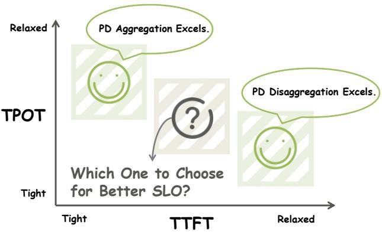
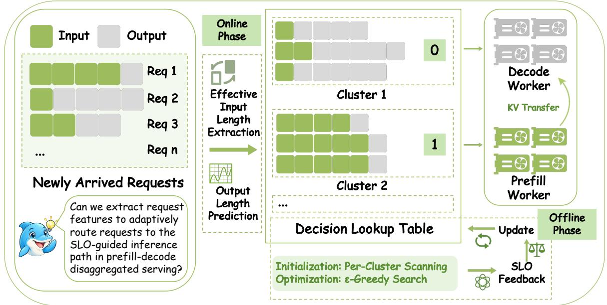
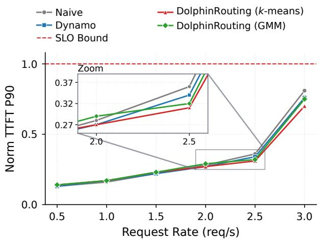
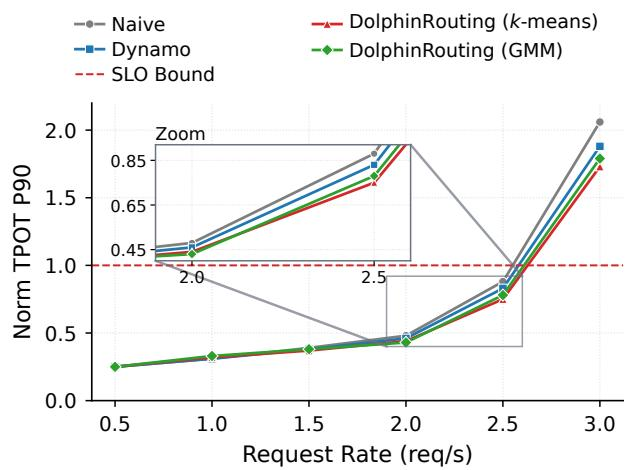
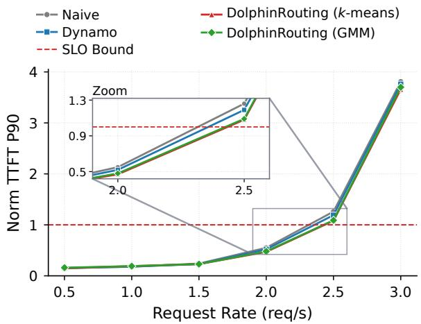
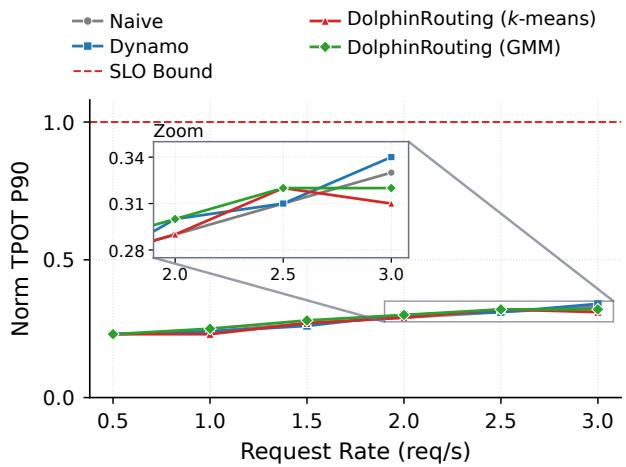
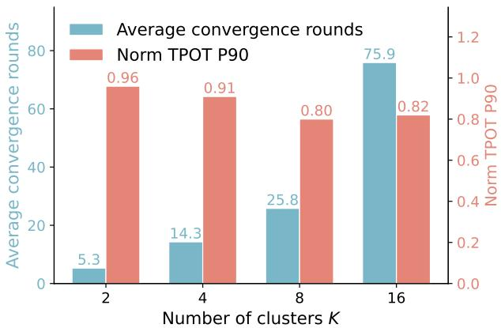
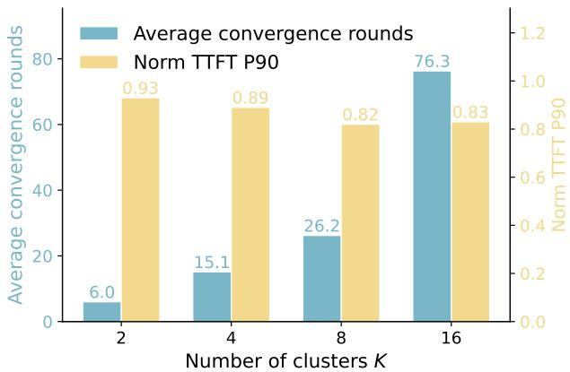

# S DOLPHINROUTING: CLUSTER-LEVEL BINARY ROUTING FOR DISAGGREGATED LLM INFERENCE SERVING

Yishuo Yuan Shaoyu Yang Chunrong Fang

Nanjing University Equal contribution

231870185@smail.nju.edu.cn shaoyuyoung@gmail.com fangchunrong@nju.edu.cn

## ABSTRACT

Prefill-decode (PD) disaggregation isolates the two phases of large language model serving, but request-level path selection must account for prefill work, cache reuse, and decode demand. We present DolphinRouting, which learns this choice from end-to-end SLO feedback under a given P/D resource allocation. Requests are clustered by raw prompt length, cache-adjusted input lengths on both worker pools, and output-length information. Offline policy search learns one binary action per cluster. Online feature extraction, cluster assignment, and table lookup select local or remote prefill. We evaluate DolphinRouting on a real PD-disaggregated cluster using three public benchmarks, a mixed workload, and real data. Across the mixed workload and real data, DolphinRouting with k-means reduces P90 TTFT by 5.7–7.9% and P90 TPOT by 2.6–10.1% relative to Dynamo.

  
Figure 1. Trade-off between PD aggregation and disaggregation under different TTFT and TPOT constraints.

## 1 INTRODUCTION

Large language model (LLM) serving has become a dominant workload in modern datacenters, and its cost is increasingly dominated by how efficiently the underlying GPUs are utilized (Yu et al., 2022; Kwon et al., 2023; Agrawal et al., 2024). A request in an LLM service is processed in two phases. The prefill phase reads the entire prompt in one compute-saturating pass and produces the first token, and its latency is bounded by the time-to-first-token (TTFT). The decode phase then emits output tokens one at a time while the KV cache grows in GPU memory, and its latency is bounded by the time-per-output-token (TPOT). Since prefill is compute-bound and decode is memory-bound, colocating them on the same GPU causes mutual interference (Agrawal et al., 2024; Patel et al., 2024).

This observation has motivated prefill-decode (PD) disaggregation, which places the two phases on separate worker pools and transfers the KV cache between them (Zhong et al., 2024; Patel et al., 2024; Qin et al., 2026). These systems address phase placement, resource allocation, and cache management. We study the complementary question of choosing local or remote prefill for each request under a given P/D allocation.

TaiChi’s simulated ArXiv workload at 12 requests/s quantifies the trade-off illustrated in Figure 1 (Wang et al., 2025). With TTFT/TPOT targets of 5 s/250 ms, aggregation and disaggregation achieve SLO attainment rates of 97% and 42%, respectively. With targets of 16 s/60 ms, these rates become 7% and 98%. At 6 s/100 ms, they are 16% and 50%. Aggregation allows all instances to process prefill, but prefill and decode share compute resources. Disaggregation isolates the two phases while assigning only a subset of instances to prefill. These results motivate request-level path selection based on prefill cost, cache reuse, and decode demand.

An arriving request can either run both phases on a decode worker or run prefill on a prefill worker followed by decode on a decode worker. NVIDIA Dynamo exposes this choice through configurable rules based on effective input length, the effective-to-raw input-length ratio, and prefill load (NVIDIA, 2026). Our evaluated baseline uses the length-based rule described in Section 4.4. We investigate learning cluster-level routing boundaries from measured SLO feedback using cache information from both worker pools and output-length information.

To address this, we introduce DolphinRouting, which learns cluster-level binary routing decisions from SLO feedback. We group requests with similar input lengths, output lengths, and cache-reuse patterns into K clusters offline and learn one binary decision per cluster. At runtime, an incoming request is assigned to its cluster, and the corresponding decision determines whether it follows the aggregated or disaggregated path. This path selection uses feature extraction, cluster assignment, and table lookup, avoiding an additional per-request cost-model scoring step. Instance-level scheduling and execution remain with the serving backend. We evaluate DolphinRouting with two prefill/decode allocations on the test cluster, learning a separate decision table for each allocation.

We formulate the problem as cluster-level binary policy search, where a policy assigns one routing action to each of the K clusters. Each request is represented by four features: raw sequence length, P-side effective ISL, D-side effective ISL, and output sequence length. The decisions are learned in two stages, per-cluster scanning for initialization and ϵ- greedy search for refinement. On Hybrid, DolphinRouting with k-means reduces P90 TTFT by 7.5–7.9% and P90 TPOT by 6.5–10.1% relative to Dynamo across the two allocations. On Real Data, the respective reductions are 5.7–6.5% and 2.6–5.5%.

## 2 RELATED WORK

## 2.1 Prefill-Decode Disaggregation

Serving systems address prefill–decode interference through batching and adaptive execution. Orca introduces iterationlevel scheduling and selective batching (Yu et al., 2022), and Sarathi-Serve uses chunked prefills and stall-free batching to limit interruptions to ongoing decodes (Agrawal et al., 2024). POD-Attention overlaps prefill and decode attention within a GPU (Kamath et al., 2025), while DuetServe combines aggregated execution with adaptive SM-level partitioning and activates spatial isolation when predicted contention threatens token-generation latency (Gao et al., 2025). These approaches schedule the two phases within shared GPU resources.

Disaggregated systems assign the phases to separate workers. DistServe co-optimizes phase placement, parallelism, and resource allocation for goodput (Zhong et al., 2024), and Splitwise uses phase-specific hardware on separate machines (Patel et al., 2024). TetriInfer combines fixed-size prompt chunks with two-level scheduling and predicted resource demands across decode instances (Hu et al., 2024b).

P/D-Serve scales disaggregated serving on Ascend clusters through flexible P/D organization, request forwarding, and device-to-device KV transfer (Jin et al., 2024). These systems address resource provisioning, workload balance, and the cost of moving request state.

Other designs make the phase boundary more flexible. TaiChi unifies aggregation and disaggregation through differentiated-capability instances and a latency-shifting scheduler (Wang et al., 2025). DynaServe splits requests into micro-requests according to the P/D resource ratio and instance load (Ruan et al., 2025), and Adrenaline offloads decode attention computation to prefill instances (Liang et al., 2025). These approaches adjust where parts of a request execute.

Instance selection and migration operate at another scheduling level. Llumnix reschedules requests and migrates their in-memory state to balance serving instances (Sun et al., 2024). Calibrate, Then Route estimates additional completion time using prompt length, predicted output length, KV-cache pressure, and SLO class (Tumkur et al., 2026). These works determine which instance serves a request; DolphinRouting chooses whether prefill executes locally on a decode worker or remotely on a prefill worker.

Dynamo exposes this path choice through conditional disaggregation based on effective input length, prefill load, or their combination (NVIDIA, 2026). Under a given P/D allocation, DolphinRouting groups requests using raw input length, cache-adjusted input lengths on both sides, and estimated output length. It learns one binary action per cluster from end-to-end SLO feedback and uses the resulting table online, leaving resource allocation and within-worker execution to the backend.

## 2.2 KV Cache Transfer

KV-cache management determines how much prefill computation can be reused and what state must move between workers. vLLM’s PagedAttention manages and shares KV caches in blocks (Kwon et al., 2023), and SGLang’s RadixAttention reuses KV caches across language-model calls (Zheng et al., 2024). Raw prompt length therefore does not fully describe prefill work, since workers may hold different amounts of cached context for the same request. DolphinRouting captures this difference through separate P-side and D-side effective input lengths.

Reuse also extends across conversation turns and memory tiers. CachedAttention preserves conversation KV caches in the AttentionStore hierarchy and overlaps cache loading and saving with computation (Gao et al., 2024). MemServe combines context caching and disaggregated inference through an elastic memory pool and locality-aware scheduling (Hu et al., 2024a), and Mooncake coordinates cache reuse, transfer, and admission around a distributed KV-cache pool (Qin et al., 2025). These systems connect cache placement to scheduling, since exploiting remote or offloaded state requires accounting for retrieval and transfer.

CacheGen compresses KV tensors and adapts loading to available bandwidth (Liu et al., 2024). CacheBlend extends reuse to non-prefix text chunks in retrieval-augmented generation, combining cached chunks with selective recomputation (Yao et al., 2025). Compression and selective recomputation change the communication and computation costs that a routing policy must weigh.

At the transport layer, NIXL provides a common interface across memory and storage backends (NVIDIA, 2025), and vLLM’s NixlConnector supports P/D transfers, including bidirectional reuse that lets prefill workers retrieve state retained by decode workers from earlier turns (vLLM Project, 2025). FlowKV combines an optimized KV-transfer layout with load-aware scheduling and flexible P/D allocation (Li et al., 2025). Transfer optimization and routing are thus often coupled. DolphinRouting focuses on path selection from request and cache features and evaluates decisions through measured SLO attainment on the deployed system.

## 2.3 Novelty of Our Work

DolphinRouting introduces a cache-aware, cluster-level policy for choosing the prefill execution path. DistServe optimizes phase placement and resource allocation (Zhong et al., 2024); our policy selects local or remote prefill under a given P/D allocation. Dynamo’s conditional routing rules (NVIDIA, 2026) use effective input length or prefill load; DolphinRouting jointly considers raw prompt length, cache-adjusted lengths on both P and D workers, and output-length information, which distinguishes requests with different cache reuse and decode demands. Offline scans and joint-policy evaluations learn one binary action per request cluster from end-to-end SLO feedback. Runtime routing then uses feature extraction, cluster assignment, and table lookup. The design connects cache asymmetry to execution-path decisions while keeping policy search outside the request-serving path.

## 3 METHODOLOGY

## 3.1 Overview

DolphinRouting learns cluster-level binary routing decisions for disaggregated LLM serving. The core idea is to partition incoming requests into K behaviorally coherent clusters, and for each cluster learn a single binary decision: whether its requests should follow the aggregated path (local prefill and decode on a decode worker) or the disaggregated path (remote prefill on a prefill worker, followed by decode on a decode worker).

Formally, let $c \in \{ 1 , \ldots , K \}$ denote a cluster, and let

$$
a _ { c } \in \{ 0 , 1 \} , \quad a _ { c } = { \left\{ 0 , \quad { \mathrm { a g g r e g a t e d p a t h } } , \right. }\tag{1}
$$

denote the routing action assigned to cluster c. The cluster profile summarizes the input-length distribution, outputlength distribution, and cache-reuse pattern of the cluster’s member requests. The reward of cluster c is the SLO attainment rate of its requests.

A routing policy is a vector $\mathbf { a } = ( a _ { 1 } , \ldots , a _ { K } ) \in \{ 0 , 1 \} ^ { K }$ giving $2 ^ { \breve { K } }$ possible decision tables. Because clusters share workers and caches, a cluster’s reward depends on the joint policy, workload, and cache state. DolphinRouting uses per-cluster action estimates to guide a binary policy search, evaluating the resulting joint policies on the serving system.

## 3.2 System Architecture

DolphinRouting consists of a feature extractor, a cluster assignment module, a routing decision lookup table, and a decision updater. At runtime, the extractor computes the raw prompt length, P-side and D-side effective ISL, and estimated output length. The assignment module maps this vector to a cluster ID, whose one-bit table entry selects the aggregated (0) or disaggregated (1) path.

All policy optimization is performed offline. Historical traces are used to fit the feature extractor and output-length predictor, group requests into K clusters, and construct profiles of their length distributions and cache-reuse patterns. The decision updater initializes the table through per-cluster scanning and refines it with ϵ-greedy search, using SLO feedback measured under saturated load.

## 3.3 Feature Types

Four features capture prefill work, decode demand, and cache reuse.

• Request sequence length $\ell ^ { \mathrm { { r a w } } }$ : the raw prompt length before subtracting any cached prefix.

• P-side effective ISL $\ell ^ { P } \colon$ the prompt length after subtracting the cached prefix overlap on the prefill worker, i.e., the prefill computation the prefill worker must perform on the disaggregated path.

• D-side effective ISL $\ell ^ { D } \colon$ : the prompt length after subtracting the cached prefix overlap on the decode worker, i.e., the local prefill computation the decode worker must perform on the aggregated path.

• Output sequence length $L \colon$ the number of generated tokens, which reflects decode-side pressure and KV growth.

  
Figure 2. Overview of DolphinRouting.

The two effective ISL features implicitly encode cache reuse, since they subtract the cache hit length from the raw prompt length. The output length captures output-side behavior that length features alone cannot reflect.

The offline stage uses ground-truth output lengths from historical traces. At admission, the output length is unknown, so we use a coarse estimate L<sup>ˆ</sup> from Clairvoyant, a CPUdeployed XGBoost classifier that predicts short, medium, or long responses (Sundaresan, 2026). Clairvoyant uses 19 lexical features without a tokenizer, and its authors report 0.029 ms per request, which is orders of magnitude smaller than LLM inference latency. We map the predicted classes to representative output lengths.

## 3.4 Offline Clustering

Clustering determines which requests must share a routing action. We cluster requests using the four features with either k-means or a Gaussian mixture model (GMM), where K is the number of clusters.

Algorithm 1 summarizes the procedure. Feature extraction is parallelized across requests, since the raw sequence length, the two effective ISL values, and the output length come from independent sources. Offline, we use the groundtruth output length recorded in the historical traces instead of a prediction. The three length features are long-tailed and span several orders of magnitude, so we apply a log(1 + x) transform followed by standardization before clustering. For each cluster, we build a profile that records the distributions of the four features and the cluster’s request proportion in the historical workload.

Algorithm 1 Offline Clustering and Profile Construction   
Require: Historical traces $\mathcal { D } = \{ x _ { 1 } , \ldots , x _ { N } \}$   
Ensure: Cluster assignment ϕ, cluster profiles $\{ \mathcal { P } _ { c } \} _ { c = \mathrm { . } } ^ { K }$ 1   
1: Feature extraction (parallel):   
2: for $x _ { i } \in \mathcal { D }$ in parallel do   
3: $\ell _ { i } ^ { \mathrm { r a w } } \gets \mathrm { l e n } ( x _ { i } )$   
4: $\ell _ { i } ^ { P } \gets \ell _ { i } ^ { \mathrm { r a w } } - \mathrm { H i t } _ { P } ( x _ { i } )$   
5: $\ell _ { i } ^ { D } \gets \bar { \ell } _ { i } ^ { \mathrm { r a w } } - \mathrm { H i t } _ { D } ( x _ { i } )$   
6: $L _ { i } \gets \mathrm { O S L } ( x _ { i } )$   
7: end for   
8: Normalization: $\ell ^ { ( \cdot ) } \ \gets \ \mathrm { Z S c o r e } \big ( \log ( 1 + \ell ^ { ( \cdot ) } ) \big )$ for   
length features   
9: Clustering: ϕ ← Cluster $( \{ x _ { i } \} _ { i = 1 } ^ { N } )$   
10: for $c = 1 , \ldots , K$ do   
11: $\mathcal { P } _ { c } \gets$ Profile $\left( \{ x _ { i } : \phi ( x _ { i } ) = c \} \right)$   
12: $\mathrm { i f } \mathrm { S p a n } ( \mathcal { P } _ { c } ) > \tau$ then   
13: Mark(c)   
14: end if   
15: end for   
16: return ϕ, $\{ \mathcal { P } _ { c } \} _ { c = 1 } ^ { K }$

Clustering groups requests with similar prefill cost and cache-reuse behavior, so that each cluster can receive a single binary decision that matches its dominant behavior. Requests with a small D-side effective ISL are cheap to serve locally on a decode worker, while routing them through the disaggregated path only adds transfer overhead. Requests with a large D-side effective ISL would otherwise impose a heavy prefill burden on the decode worker.

Algorithm 2 Initialization by Per-Cluster Scanning   
Require: Cluster assignment $\phi ,$ number of clusters $\overline { { K } }$   
scanning duration $T ,$ saturated load   
Ensure: Initial decision table $\{ a _ { c } \} _ { c = 1 } ^ { K }$ and scan rewards   
$\{ R _ { \mathrm { a g g } } ( c ) , R _ { \mathrm { d i s a g g } } ( c ) \} _ { c = 1 } ^ { K }$   
1: for $c = 1 , \ldots , K$ do   
2: Fix $\{ a _ { c ^ { \prime } } \} _ { c ^ { \prime } \neq c }$   
3: Route cluster c via the aggregated path for T and   
record $R _ { \mathrm { a g g } } ( c )$   
4: Route cluster c via the disaggregated path for T and   
record $R _ { \mathrm { d i s a g g } } ( c )$   
5: $a _ { c } \gets \arg \operatorname* { m a x } _ { a \in \{ 0 , 1 \} } \{ R _ { \mathrm { a g g } } ( c ) , R _ { \mathrm { d i s a g g } } ( c ) \}$   
6: end for   
7: return $\{ a _ { c } \} _ { c = 1 } ^ { K } , \{ R _ { \mathrm { a g g } } ( c ) , R _ { \mathrm { d i s a g g } } ( c ) \} _ { c = 1 } ^ { K }$

## 3.5 Reward Design

We optimize the fraction of requests that meet an end-to-end completion-time SLO. For request r, let $T _ { r } ^ { \mathrm { e 2 e } }$ denote the elapsed time from request arrival to generation of the last output token, and let $\mathrm { S L O } _ { r }$ denote its end-to-end latency threshold. The reward for cluster c is

$$
R _ { c } = \frac { 1 } { \left| \mathcal { R } _ { c } \right| } \sum _ { r \in \mathcal { R } _ { c } } \mathbb { I } \big [ T _ { r } ^ { \mathrm { e 2 e } } \leq \mathrm { S L O } _ { r } \big ] ,\tag{2}
$$

where $\mathcal { R } _ { c }$ is the set of requests routed to cluster c during reward measurement. A completed request with $L _ { r } \ge 2$ output tokens has $T _ { r } ^ { \mathrm { e 2 e } } = \mathrm { T T F T } _ { r } + \left( L _ { r } - 1 \right) \mathrm { T P O T } _ { r }$

## 3.6 Decision Search

DolphinRouting’s decision search consists of two stages: an initialization stage that produces a coarse decision table, and an optimization stage that refines it. Both stages measure SLO attainment under saturated load.

Initialization. The initialization stage adopts per-cluster scanning, as summarized in Algorithm 2. For each cluster c, the decisions of all other clusters are held fixed, and the requests of cluster c are routed through the aggregated path for a period T, after which the reward $R _ { \mathrm { a g g } } ( c )$ is recorded. The same cluster is then routed through the disaggregated path for the same duration T, and the reward $R _ { \mathrm { d i s a g g } } ( c )$ is recorded. The action with the higher reward is selected as the initial decision for cluster c. The 2K scans produce the initial decision table and a measured reward for each cluster-action pair, which initialize the subsequent search. These rewards reflect the other clusters’ routing choices and cache state during each scan.

Optimization. The optimization stage adopts ϵ-greedy per-cluster search, as summarized in Algorithm 3. The scan rewards initialize $\hat { R } _ { c } ( 0 ) = R _ { \mathrm { a g g } } ( c )$ and $\hat { R } _ { c } ( 1 ) = R _ { \mathrm { d i s a g g } } ( c )$ Since each action has been measured once, we initialize $n _ { c } ( 0 ) ~ = ~ n _ { c } ( 1 ) ~ = ~ 1$ , where $n _ { c } ( a )$ counts rewardmeasurement windows. The first greedy choice therefore uses the preferences established by scanning. For every cluster c, with probability $\epsilon _ { t }$ the cluster selects a random action in {0, 1}, and with probability $1 - \epsilon _ { t }$ it selects the action with the higher estimated reward $\hat { R } _ { c } ( a )$ . The requests are then routed according to the resulting decision table under saturated load, and the SLO attainment is observed. The reward estimate of each cluster is updated using an incremental average over the action that was actually executed.

```latex
Algorithm 3 Optimization by ϵ-Greedy Search
Require: Initial decision table $\{ a _ { c } \} _ { c = 1 } ^ { K }$ , scan rewards
$\{ R _ { \mathrm { a g g } } ( c ) , R _ { \mathrm { d i s a g g } } ( c ) \} _ { c = 1 } ^ { K }$ , horizon $T _ { \mathrm { m a x } }$ , saturated load
Ensure: Final decision table $\{ a _ { c } \} _ { c = 1 } ^ { K }$
1: $\hat { R } _ { c } ( 0 ) \gets R _ { \mathrm { a g g } } ( c )$ for all c
2: $\hat { R } _ { c } ( 1 ) \gets R _ { \mathrm { d i s a g g } } ( c )$ for all c
3: $n _ { c } ( 0 ) \gets 1 , n _ { c } ( \bar { 1 } ) \gets 1$ for all c
4: for $t = 1 , \dots , T _ { \mathrm { m a x } }$ do
5: $\epsilon _ { t } \gets \epsilon _ { \mathrm { m i n } } + \left( \epsilon _ { 0 } - \epsilon _ { \mathrm { m i n } } \right) \exp ( - t / K )$
6: for $c = 1 , \ldots , K$ in parallel do
7: $a _ { c } \gets$ random action in $\{ 0 , 1 \}$ with probability $\epsilon _ { t } ;$
otherwise $a _ { c } \gets$ arg max<sub>a</sub> $\hat { R } _ { c } ( a )$
8: end for
9: Route requests according to $\{ a _ { c } \} _ { c = 1 } ^ { K }$ under saturated
load; observe SLO attainment
10: for $c = 1 , \ldots , K$ do
11: $R _ { c } \gets$ cluster reward for the current round
12: $n _ { c } ( a _ { c } ) \gets n _ { c } ( a _ { c } ) + 1$
13: $\begin{array} { r } { \hat { R } _ { c } ( a _ { c } ) \gets \hat { R } _ { c } ( a _ { c } ) + \frac { 1 } { n _ { c } ( a _ { c } ) } \big ( R _ { c } - \hat { R } _ { c } ( a _ { c } ) \big ) } \end{array}$
14: end for
15: end for
16: return $\{ a _ { c } \} _ { c = 1 } ^ { K }$
```

The exploration probability follows an exponential decay schedule,

$$
\epsilon _ { t } = \epsilon _ { \mathrm { m i n } } + \left( \epsilon _ { 0 } - \epsilon _ { \mathrm { m i n } } \right) \exp \left( - \frac { t } { K } \right) ,\tag{3}
$$

with $\epsilon _ { 0 } = 0 . 5$ and $\epsilon _ { \mathrm { m i n } } = 0 . 0 1$ . Using K as the decay time constant keeps exploration active for more rounds as the number of binary decisions grows.

## 4 EXPERIMENTS

## 4.1 Testbed

All experiments use Qwen3.8-72B (Qwen Team, 2026) as the served model and are conducted on a cluster where each node is equipped with 4 NVIDIA H20-SXM GPUs, each with 141 GB HBM3e, connected via NVLink with 900 GB/s interconnect bandwidth. Each node also carries an Intel Xeon Platinum 8457C CPU and RDMA network cards supporting up to 800 Gb/s of inter-node bandwidth. Each node deploys either a prefill instance or a decode instance according to the startup parameter.

## 4.2 Datasets and Workloads

We select three public benchmarks and one real-world trace as outlined in Table 1. ArXiv Summarization (Cohan et al., 2018) represents a prefill-heavy workload with long inputs and short outputs. L-Eval (An et al., 2023) represents a decode-reuse-heavy workload with very long inputs but high prefix-cache hit rates, so that the effective prefill cost is much smaller than the raw input length suggests. HumanEval (Chen et al., 2021) represents a short-input, shortoutput, cache-cold workload, where disaggregation offers little benefit. The Hybrid workload is constructed by mixing the three benchmarks in proportion to their Poisson arrival intensities, so that it contains both prefill-heavy and decodeheavy request types. The Real Data workload is drawn from the publicly available conversation trace in Mooncake (Qin et al., 2025), which contains authentic user requests with realistic input/output length distributions.

Table 1. Dataset characteristics. Lengths are average token counts.
<table><tr><td>Dataset</td><td>Input length</td><td>Output length</td><td>Cache ratio</td><td>Arrival</td></tr><tr><td>ArXiv Summarization</td><td>8088</td><td>229</td><td>~0%</td><td>Poisson</td></tr><tr><td>L-Eval</td><td>19019</td><td>72</td><td>&gt;80%</td><td>Poisson</td></tr><tr><td>HumanEval</td><td>198</td><td>221</td><td>~0%</td><td>Poisson</td></tr><tr><td>Real Data</td><td>12035</td><td>343</td><td>~50%</td><td>Timestamp</td></tr></table>

## 4.3 Metrics

We report two metrics, both measured at the saturated operating point described below. TTFT (Time To First Token) is the time from request arrival to the generation of the first output token, which reflects the combined cost of prefill computation, queueing, and KV transfer. TPOT (Time Per Output Token) is the average time between consecutive output tokens during the decode stage, which reflects the decode-side load and KV-cache pressure. We use the 90th percentile (P90) of both metrics, which captures whether the majority of requests satisfy the SLOs and is more representative of the user-perceived tail behavior.

For each workload and PD configuration, we measure the Naive configuration at a near-idle request rate of 0.1 requests/s, and use its P90 TTFT and P90 TPOT as the reference latencies b<sub>TTFT</sub> and b<sub>TPOT</sub>, respectively. The SLO bounds are $B _ { \mathrm { T T F T } } = 1 0 b _ { \mathrm { T T F T } }$ and $B _ { \mathrm { T P O T } } = 5 b _ { \mathrm { T P O T } } ,$ and are fixed across methods within the same workload and PD configuration. Exceeding these bounds indicates a failure to meet the SLO, and the corresponding consumed resources are considered wasted. We normalize the measured TTFT and TPOT values against these bounds, so that a normalized value of 1.0 corresponds to the SLO boundary, values below 1.0 indicate that the SLO is satisfied, and lower values are better.

All reported results correspond to the saturated operating point for each workload. Specifically, we increase the request rate from a low value and stop at the lower boundary of saturation, i.e., the smallest load at which $\mathrm { P 9 0 } ( \mathrm { T T F T } ) \geq B _ { \mathrm { T T F T } }$ or $\mathrm { P 9 0 } ( \mathrm { T P O T } ) \geq B _ { \mathrm { T P O T } } ,$ equivalently Norm P90 $\mathrm { T T F T } \geq 1 . 0$ or Norm P90 $\mathrm { T P O T } \geq$ 1.0. The main table reports the metrics at this operating point.

## 4.4 Baselines

All systems are instantiated on vLLM as the serving backend, and use Mooncake (Qin et al., 2026) as the KV transfer mechanism for the disaggregated path. We compare four systems. Naive is the original PD-disaggregated configuration without conditional routing, and serves as the default baseline. Dynamo denotes the length-based conditional disaggregation rule evaluated here (NVIDIA, 2026): a request takes the aggregated path when its effective ISL is below a global threshold and its effective-to-raw ISL ratio is below a global ratio threshold. This comparison does not cover Dynamo’s additional load-based policies. DolphinRouting (k-means) and DolphinRouting (GMM) instantiate DolphinRouting with k-means and Gaussian mixture model clustering, respectively.

## 4.5 Settings

We evaluate each system under two PD settings, namely P3D1 (three prefill instances and one decode instance) and P2D2 (two prefill instances and two decode instances). For each workload and PD configuration, we first determine the saturated request rate on the Naive configuration, and then compare all methods at this same request rate. For DolphinRouting, both clustering and decision optimization are performed offline on a 20% sample of each dataset. This sample is drawn from a separate trace that does not overlap with the requests used for evaluation. We set the number of clusters to K = 8 in all experiments. The sensitivity to K is examined in Section 4.8. Each configuration is repeated three times, and the reported numbers are the average across the three runs.

## 4.6 Main Results

Table 2 compares normalized P90 TTFT and TPOT at the saturated operating point, with all methods evaluated at the same operating point within each workload and PD configuration. Values are normalized by the SLO bounds defined in Section 4.3, so 1.0 marks the SLO boundary and lower is better.

Table 2. Normalized P90 TTFT and TPOT at the saturated operating point under five workloads and two PD settings.
<table><tr><td rowspan="2">Workload</td><td rowspan="2">Method</td><td colspan="2">P3D1</td><td colspan="2">P2D2</td></tr><tr><td>Norm TTFT P90 ↓</td><td>Norm TPOT P90 ↓</td><td>Norm TTFT P90 ↓</td><td>Norm TPOT P90 ↓</td></tr><tr><td rowspan="5">ArXiv</td><td>Naive</td><td>1.00</td><td>0.49</td><td>1.00</td><td>0.22</td></tr><tr><td>Dynamo</td><td>0.99</td><td>0.50</td><td>1.01</td><td>0.24</td></tr><tr><td>DolphinRouting (k-means)</td><td>0.98</td><td>0.51</td><td>1.03</td><td>0.24</td></tr><tr><td>DolphinRouting (GMM)</td><td>0.99</td><td>0.50</td><td>1.02</td><td>0.23</td></tr><tr><td>Naive</td><td>0.21</td><td>1.00</td><td>0.99</td><td>0.25</td></tr><tr><td rowspan="4">L-Eval</td><td>Dynamo</td><td>0.24</td><td>0.92</td><td>0.91</td><td>0.27</td></tr><tr><td>DolphinRouting (k-means)</td><td>0.25</td><td>0.90</td><td>0.85</td><td>0.28</td></tr><tr><td>DolphinRouting (GMM)</td><td>0.24</td><td>0.92</td><td>0.90</td><td>0.27</td></tr><tr><td>Naive</td><td>0.12</td><td>1.01</td><td>0.19</td><td>1.02</td></tr><tr><td rowspan="4">HumanEval</td><td>Dynamo</td><td>0.11</td><td>1.03</td><td>0.19</td><td>1.03</td></tr><tr><td>DolphinRouting (k-means)</td><td>0.13</td><td>1.04</td><td>0.20</td><td>1.06</td></tr><tr><td>DolphinRouting (GMM)</td><td>0.13</td><td>1.03</td><td>0.21</td><td>1.05</td></tr><tr><td>Naive</td><td>0.42</td><td>1.00</td><td>1.01</td><td>0.30</td></tr><tr><td rowspan="4">Hybrid</td><td>Dynamo</td><td>0.40</td><td>0.89</td><td>0.89</td><td>0.31</td></tr><tr><td>DolphinRouting (k-means)</td><td>0.37</td><td>0.80</td><td>0.82</td><td>0.29</td></tr><tr><td>DolphinRouting (GMM)</td><td>0.39</td><td>0.83</td><td>0.84</td><td>0.30</td></tr><tr><td>Naive</td><td></td><td></td><td></td><td></td></tr><tr><td rowspan="4">Real Data</td><td>Dynamo</td><td>0.38 0.35</td><td>1.00 0.91</td><td>1.02 0.92</td><td>0.42 0.39</td></tr><tr><td>DolphinRouting (k-means)</td><td>0.33</td><td>0.86</td><td>0.86</td><td>0.38</td></tr><tr><td>DolphinRouting (GMM)</td><td>0.35</td><td>0.89</td><td>0.87</td><td>0.37</td></tr><tr><td></td><td></td><td></td><td></td><td></td></tr></table>



  
Figure 3. Normalized P90 TTFT and P90 TPOT on the Hybrid workload under P3D1 as the request rate increases. The dashed lines at 1.0 mark the SLO bounds. Insets magnify the boxed regions.

On ArXiv, DolphinRouting is close to Naive. With k-means, TTFT changes by about 2–3% and TPOT by about 4–9% across the two PD settings, and GMM shows similar small changes. On L-Eval, the two settings behave differently: under P3D1, k-means trades a higher TTFT for a lower TPOT, while under P2D2 it lowers TTFT and raises TPOT. These two workloads are dominated by a single request type, and routing shifts load between the prefill and decode sides without a consistent gain.

The benefit appears on the mixed and real traces. On Hybrid and Real Data, DolphinRouting (k-means) improves both metrics over Dynamo in all four settings, with TTFT reductions of roughly 6–8% and TPOT reductions of roughly 3– 10%. Relative to Naive, the TTFT reduction reaches about 12–19% and the TPOT reduction about 3–20%. Neither metric improves over Dynamo in any of the four ArXiv/L-Eval settings, which is consistent with the lack of mixed prefill/decode demand in those workloads.

Between the two clustering choices, k-means is better in seven of the eight metric/configuration comparisons on Hybrid and Real Data; the exception is Real Data TPOT under P2D2, where GMM is marginally better (0.37 versus 0.38). The ablations below therefore use k-means.



  
Figure 4. Normalized P90 TTFT and P90 TPOT on the Hybrid workload under P2D2 as the request rate increases. The dashed lines at 1.0 mark the SLO bounds. Insets magnify the boxed regions.

## 4.7 Analysis

Figures 3 and 4 report normalized P90 latencies on Hybrid as the request rate increases. Under P3D1, at 2.5 requests/s, k-means gives a TPOT of 0.75, below Naive (0.88) and Dynamo (0.83). When the rate rises to 3.0 requests/s, its TPOT crosses the SLO bound and reaches 1.73, and TTFT rises from 0.31 to 0.70. Under P2D2, increasing the rate from 2.0 to 2.5 requests/s pushes k-means TTFT from 0.47 to 1.08; at 2.5 requests/s this is below both Naive (1.26) and Dynamo (1.19), while TPOT stays near 0.32 and remains well below the SLO bound throughout the sweep.

The routing decision changes where prefill is executed. Local prefill uses decode-worker compute and avoids the remote-prefill KV transfer, while the disaggregated path executes prefill on a prefill worker and still uses a decode worker for generation. Learning a separate decision table for each allocation lets the policy choose between these costs using measured rewards.

## 4.8 Ablation Study

## 4.8.1 Effect of the Number of Clusters

The number of clusters K controls the granularity of routing and the number of binary decisions to be learned. On the Hybrid workload, we vary $K \in \{ 2 , 4 , 8 , 1 6 \}$ and report the average number of optimization rounds needed to converge and the resulting normalized metrics under P3D1 and P2D2.

As shown in Figure 5, increasing K from 8 to 16 roughly triples the optimization rounds, from about 26 to about 76 under both settings, while the normalized metrics change only slightly (TPOT 0.80 to 0.82 under P3D1; TTFT 0.82 to 0.83 under P2D2). Reducing K to 2 or 4 shortens convergence to roughly 5–15 rounds but raises the corresponding latency metrics by about 9–20% relative to $K = 8 .$ . We use $K = 8$ in the remaining experiments.

## 4.8.2 Effect ofthe Initialization Stage

To isolate the contribution of initialization, we fix $K = 8$ under P3D1 on Hybrid. We compare the full pipeline, which uses scanning followed by ϵ-greedy search, with a variant that omits scanning and starts optimization from a random decision table.

Table 3. Effect of the initialization stage under P3D1.
<table><tr><td>Metric</td><td>Full pipeline</td><td>w/o initialization</td></tr><tr><td>Avg conv. rounds ↓</td><td>25.8</td><td>39.6</td></tr><tr><td>Norm TTFT P90 ↓</td><td>0.37</td><td>0.40</td></tr><tr><td>Norm TPOT P90 ↓</td><td>0.80</td><td>0.91</td></tr></table>

Removing initialization increases the average number of optimization rounds from 25.8 to 39.6 (Table 3), and raises normalized TTFT from 0.37 to 0.40 and TPOT from 0.80 to 0.91. At $K = 8 ,$ initialization uses 16 scans to seed both action estimates per cluster, which explains most of the convergence gap.

## 4.8.3 Effect of the Output-Length Feature

We evaluate the contribution of the output-length feature by removing it from the clustering representation. With $K = 8$ on Hybrid, the resulting variant uses three features: raw sequence length, P-side effective ISL, and D-side effective ISL.



  
Figure 5. Effect of the number of clusters K on the average convergence rounds and the normalized P90 metric, under P3D1 (left) and P2D2 (right).

Table 4. Effect of the output-length (OSL) feature.
<table><tr><td>Metric</td><td>Full pipeline</td><td>w/o OSL</td></tr><tr><td>P3D1 setting</td><td></td><td></td></tr><tr><td>Norm TTFT P90 ↓</td><td>0.37</td><td>0.42</td></tr><tr><td>Norm TPOT P90 ↓</td><td>0.80</td><td>0.93</td></tr><tr><td>P2D2 setting</td><td></td><td></td></tr><tr><td>Norm TTFT P90 ↓</td><td>0.82</td><td>0.92</td></tr><tr><td>Norm TPOT P90 ↓</td><td>0.29</td><td>0.30</td></tr></table>

Removing the output-length feature degrades both metrics in both settings (Table 4). The effect is largest under P3D1, where normalized TTFT rises from 0.37 to 0.42 and TPOT from 0.80 to 0.93; under P2D2 the TTFT increase is similar (0.82 to 0.92), while TPOT changes only marginally (0.29 to 0.30).

## 5 CONCLUSION

We presented DolphinRouting, a cluster-level binary routing framework for prefill-decode disaggregated LLM serving. DolphinRouting groups requests by their execution characteristics, including raw prompt length, cache-adjusted input lengths on both worker pools, and output-length information, and learns one binary routing action per cluster from end-to-end SLO feedback. Offline policy search constructs the decision table, and runtime feature extraction, cluster assignment, and table lookup select local or remote prefill. On the mixed workload and real data under both tested P/D allocations, DolphinRouting with k-means reduces P90 TTFT by 5.7–7.9% and P90 TPOT by 2.6–10.1% relative to Dynamo. These results show that a compact, cache-aware routing table learned from SLO feedback can improve tail latency without changing the underlying P/D resource allocation.

## REFERENCES

Agrawal, A., Kedia, N., Panwar, A., Mohan, J., Kwatra, N., Gulavani, B. S., Tumanov, A., and Ramjee, R. Taming throughput-latency tradeoff in llm inference with sarathi-serve, 2024. URL https://arxiv.org/ abs/2403.02310.

An, C., Gong, S., Zhong, M., Li, M., Zhang, J., Kong, L., and Qiu, X. L-eval: Instituting standardized evaluation for long context language models, 2023.

Chen, M., Tworek, J., Jun, H., Yuan, Q., de Oliveira Pinto, H. P., Kaplan, J., Edwards, H., Burda, Y., Joseph, N., Brockman, G., Ray, A., Puri, R., Krueger, G., Petrov, M., Khlaaf, H., Sastry, G., Mishkin, P., Chan, B., Gray, S., Ryder, N., Pavlov, M., Power, A., Kaiser, L., Bavarian, M., Winter, C., Tillet, P., Such, F. P., Cummings, D., Plappert, M., Chantzis, F., Barnes, E., Herbert-Voss, A., Guss, W. H., Nichol, A., Paino, A., Tezak, N., Tang, J., Babuschkin, I., Balaji, S., Jain, S., Saunders, W., Hesse, C., Carr, A. N., Leike, J., Achiam, J., Misra, V., Morikawa, E., Radford, A., Knight, M., Brundage, M., Murati, M., Mayer, K., Welinder, P., McGrew, B., Amodei, D., McCandlish, S., Sutskever, I., and Zaremba, W. Evaluating large language models trained on code. 2021.

Cohan, A., Dernoncourt, F., Kim, D. S., Bui, T., Kim, S., Chang, W., and Goharian, N. A discourse-aware attention model for abstractive summarization of long documents. In Proceedings of the 2018 Conference of the North American Chapter of the Association for Computational Linguistics: Human Language Technologies, Volume 2 (Short Papers), pp. 615–621, New Orleans, Louisiana, June 2018. Association for Computa-

tional Linguistics. doi: 10.18653/v1/N18-2097. URL https://aclanthology.org/N18-2097.

Gao, B., He, Z., Sharma, P., Kang, Q., Jevdjic, D., Deng, J., Yang, X., Yu, Z., and Zuo, P. Cost-efficient large language model serving for multi-turn conversations with CachedAttention. In 2024 USENIX Annual Technical Conference (USENIX ATC 24), pp. 111–126, 2024. URL https://www.usenix.org/conference/ atc24/presentation/gao-bin-cost.

Gao, L., Jiang, C., Zarch, H. E., Wong, D., Hill, M., and Annavaram, M. DuetServe: Harmonizing prefill and decode for LLM serving via adaptive GPU multiplexing. arXiv preprint arXiv:2511.04791, 2025. URL https: //arxiv.org/abs/2511.04791.

Hu, C., Huang, H., Hu, J., Xu, J., Chen, X., Xie, T., Wang, C., Wang, S., Bao, Y., Sun, N., and Shan, Y. MemServe: Context caching for disaggregated LLM serving with elastic memory pool. arXiv preprint arXiv:2406.17565, 2024a. URL https://arxiv. org/abs/2406.17565.

Hu, C., Huang, H., Xu, L., Chen, X., Xu, J., Chen, S., Feng, H., Wang, C., Wang, S., Bao, Y., Sun, N., and Shan, Y. Inference without interference: Disaggregate LLM inference for mixed downstream workloads. arXiv preprint arXiv:2401.11181, 2024b. URL https:// arxiv.org/abs/2401.11181.

Jin, Y., Wang, T., Lin, H., Song, M., Li, P., Ma, Y., Shan, Y., Yuan, Z., Li, C., Sun, Y., Wu, T., Chu, X., Huan, R., Ma, L., You, X., Zhou, W., Ye, Y., Liu, W., Xu, X., Zhang, Y., Dong, T., Zhu, J., Wang, Z., Ju, X., Song, J., Cheng, H., Li, X., Ding, J., Guo, H., and Zhang, Z. P/D-Serve: Serving disaggregated large language model at scale. arXiv preprint arXiv:2408.08147, 2024. URL https://arxiv.org/abs/2408.08147.

Kamath, A. K., Prabhu, R., Mohan, J., Peter, S., Ramjee, R., and Panwar, A. POD-Attention: Unlocking full prefill-decode overlap for faster LLM inference. In Proceedings ofthe 30th ACM International Conference on Architectural Support for Programming Languages and Operating Systems, Volume 2, pp. 897–912, 2025. URL https://arxiv.org/abs/2410.18038.

Kwon, W., Li, Z., Zhuang, S., Sheng, Y., Zheng, L., Yu, C. H., Gonzalez, J. E., Zhang, H., and Stoica, I. Efficient memory management for large language model serving with pagedattention, 2023. URL https:// arxiv.org/abs/2309.06180.

Li, W., Jiang, G., Ding, X., Tao, Z., Hao, C., Xu, C., Zhang, Y., and Wang, H. FlowKV: A disaggregated inference framework with low-latency KV cache

transfer and load-aware scheduling. arXiv preprint arXiv:2504.03775, 2025. URL https://arxiv. org/abs/2504.03775.

Liang, Y., Chen, Z., Zuo, P., Zhou, Z., Chen, X., and Yu, Z. Injecting adrenaline into llm serving: Boosting resource utilization and throughput via attention disaggregation, 2025. URL https://arxiv.org/abs/2503. 20552.

Liu, Y., Li, H., Cheng, Y., Ray, S., Huang, Y., Zhang, Q., Du, K., Yao, J., Lu, S., Ananthanarayanan, G., Maire, M., Hoffmann, H., Holtzman, A., and Jiang, J. Cachegen: Kv cache compression and streaming for fast large language model serving, 2024. URL https://arxiv.org/ abs/2310.07240.

NVIDIA. NVIDIA Inference Xfer Library (NIXL). https://github.com/ai-dynamo/nixl, 2025. Accessed: 2026-10-26.

NVIDIA. Nvidia dynamo: An open source inference framework for serving generative ai. https://docs. nvidia.com/dynamo/, 2026. Accessed: 2026-10- 26.

Patel, P., Choukse, E., Zhang, C., Shah, A., <sup>´</sup>Inigo Goiri,˜ Maleki, S., and Bianchini, R. Splitwise: Efficient generative llm inference using phase splitting, 2024. URL https://arxiv.org/abs/2311.18677.

Qin, R., Li, Z., He, W., Cui, J., Ren, F., Zhang, M., Wu, Y., Zheng, W., and Xu, X. Mooncake: Trading more storage for less computation — a KVCachecentric architecture for serving LLM chatbot. In 23rd USENIX Conference on File and Storage Technologies (FAST 25), pp. 155–170, Santa Clara, CA, feb 2025. USENIX Association. ISBN 978-1-939133-45-8. URL https://www.usenix.org/conference/ fast25/presentation/qin.

Qin, R., Li, Z., He, W., Zhang, M., Wu, Y., Zheng, W., and Xu, X. Mooncake: A kvcache-centric disaggregated architecture for llm serving, 2026. URL https:// arxiv.org/abs/2407.00079v5.

Qwen Team. Qwen3.8-Max: A new bar for coding and cowork, August 2026. URL https://qwen.ai/ blog?id=qwen3.8.

Ruan, C., Chen, Y., Tian, D., Shi, Y., Wu, Y., Li, J., and Li, C. Dynaserve: Unified and elastic execution for dynamic disaggregated llm serving, 2025. URL https://arxiv.org/abs/2504.09285.

Sun, B., Huang, Z., Zhao, H., Xiao, W., Zhang, X., Li, Y., and Lin, W. Llumnix: Dynamic scheduling for large language model serving. In 18th

USENIX Symposium on Operating Systems Design and Implementation (OSDI 24), pp. 173–191, 2024. URL https://www.usenix.org/conference/ osdi24/presentation/sun-biao.

Sundaresan, A. Clairvoyant: Predictive sjf scheduling to mitigate head-of-line blocking in serial llm backends. arXiv preprint arXiv:2606.07248, 2026.

Tumkur, S. D., Iyer, J., Simhadri, M., Kumar, S. P., Kumar, S. K., and Nampelly, R. Calibrate, then route: A measured study of learned request routing for disaggregated llm serving, 2026. URL https://arxiv.org/ abs/2609.16206.

vLLM Project. vLLM NixlConnector Usage Guide. https://docs.vllm.ai/en/latest/ features/nixl\_connector\_usage/, 2025. Accessed: 2026-10-26.

Wang, C., Zuo, P., Chen, Z., Liang, Y., Yu, Z., and Yang, M.- C. Prefill-decode aggregation or disaggregation? unifying both for goodput-optimized llm serving, 2025. URL https://arxiv.org/abs/2508.01989.

Yao, J., Li, H., Liu, Y., Ray, S., Cheng, Y., Zhang, Q., Du, K., Lu, S., and Jiang, J. CacheBlend: Fast large language model serving for RAG with cached knowledge fusion. In Proceedings of the Twentieth European Conference on Computer Systems, pp. 94–109, 2025. URL https: //arxiv.org/abs/2405.16444.

Yu, G.-I., Jeong, J. S., Kim, G.-W., Kim, S., and Chun, B.- G. Orca: A distributed serving system for Transformer-Based generative models. In 16th USENIX Symposium on Operating Systems Design and Implementation (OSDI 22), pp. 521–538, Carlsbad, CA, July 2022. USENIX Association. ISBN 978-1-939133-28-1. URL https://www.usenix.org/conference/ osdi22/presentation/yu.

Zheng, L., Yin, L., Xie, Z., Sun, C., Huang, J., Yu, C. H., Cao, S., Kozyrakis, C., Stoica, I., Gonzalez, J. E., Barrett, C., and Sheng, Y. SGLang: Efficient execution of structured language model programs. Advances in Neural Information Processing Systems, 37:62557–62583, 2024. URL https://arxiv.org/abs/2312.07104.

Zhong, Y., Liu, S., Chen, J., Hu, J., Zhu, Y., Liu, X., Jin, X., and Zhang, H. Distserve: Disaggregating prefill and decoding for goodput-optimized large language model serving, 2024. URL https://arxiv.org/abs/2401. 09670.