# Smartphone Indoor Localization Enhanced by Hierarchical Multi-Sensor Context Recognition

Wenhui Feng1, Muhan Weng1, Jianyu Liu, Xiansheng Yang\*, Hao Zhang, Liang Wang, and Yuan Zhuang, Senior Member, IEEE

Abstract—Smartphone indoor localization requires low-cost, robust positioning across scene transitions and phone-use variations. Pedestrian dead reckoning (PDR) enables infrastructure-free deployment but accumulates errors from heading drift, structural transitions, and carrying-mode changes. Existing methods often treat contextual cues as a single event stream or local correction signal, limiting their ability to address distinct localization errors. This paper presents a framework enhanced by hierarchica multi-sensor context recognition. A jointly data- and model-driven recognition model predicts environment, scene, and activity probabilities, which are converted into scene-event and action-context segments. Scene-event segments guide scene-constrained PDR correction through corridor heading constraints, landmark attraction, fixed-lag backtracking, and vertical-transition handling. Action-context segments drive action-aware RoNIN-based position compensation for carrying-mode-dependent drift. Experiments on cross-floor and multi-action trajectories against LiDAR-SLAM references show that the proposed framework outperforms PDR and representative learned inertial odometry baselines, demonstrating that hierarchical semantics provide reliable, localization-specific correction cues.

Index Terms—Smartphone indoor localization, Infrastructure-free positioning, Context recognition, Pedestrian dead reckoning, Inertial odometry, Trajectory correction

## INTRODUCTION

[Pedestrian indoor localization and navigation are key enabling technologies for smart buildings and smart com-1munities, supporting location-aware services such as in-vdoor autonomous systems, personal guidance, emergency response, and facility management. Outdoor positioning 6is widely supported by global navigation satellite systems 9(GNSS), such as GPS and BeiDou. In indoor and under-3ground spaces, however, satellite signals are easily blocked 0by physical obstructions, leading to severe attenuation. As 1a result, high-precision GNSS services are difficult to extend 6to indoor and underground scenes. Reliable, low-cost, and 2robust smartphone indoor localization remains an impor-vtant research problem [1], [2].

i Various indoor localization techniques have been stud-Xied for this problem. Wi-Fi and Bluetooth solutions are relatively easy to deploy. Their accuracy and stability are affected by signal blockage, environmental change, and device heterogeneity. Ultra-wideband, acoustic, and other infrastructure-assisted methods can provide higher accuracy in controlled settings, but they introduce deployment costs and maintenance burdens. Smartphone-based multimodal tracking systems have fused radio, inertial, and magnetic-field observations to improve indoor tracking robustness without dedicated user-side hardware [3], [4], [12]. Inertial localization based on smartphone sensors, especially pedestrian dead reckoning (PDR), is attractive because it is self-contained, low-cost, and independent of external signal coverage. However, PDR still suffers from step-length error, heading drift, and incorrect handling of scene or floor transitions, causing the localization error to accumulate over time [5]–[8].

Existing PDR and learned inertial localization methods usually rely on inertial measurements, gait models, map constraints, structural priors, or data-driven motion estimation [9], [10], [14]–[18]. Although these designs address important aspects of localization, they underuse hierarchical recognition of user context. Indoor space is not homogeneous: corridors, stairs, elevators, gates, and semi-open areas impose different trajectory constraints. At the same time, phone-use modes such as holding, calling, arm-swinging, and pocket placement change the observed inertial signals. Existing semantic-aided methods often compress these cues into one event stream or use them only for local correction, which limits robustness under complex scene transitions and action changes.

The key issue is that different semantic layers can address different localization error sources. Environment recognition can indicate indoor, semi-open, and outdoor states for confidence filtering and transition handling. Scene recognition can identify corridor, stair, elevator, gate, and related structural events to trigger heading constraints, landmark attraction, vertical-transition handling, and backtracking smoothing. Activity recognition can identify phone holding, calling, arm-swinging, and pocket modes to compensate carrying-mode-dependent inertial drift. In this way, context recognition can convert classification outputs into correction cues that directly enhance trajectory estimation.

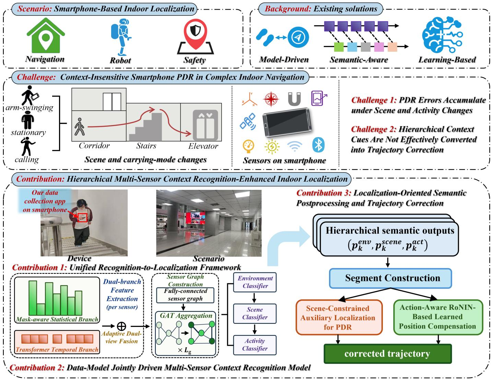  
Fig. 1. Overview of the key challenges and the proposed smartphone localization framework enhanced by hierarchical multi-sensor context recognition.

This paper presents a smartphone indoor localization framework enhanced by hierarchical multi-sensor context recognition. Multi-sensor temporal windows are first processed by a data-model jointly driven context recognition model to obtain environment-, scene-, and activitylevel probabilities. The predicted semantic outputs are then converted into scene-event and action-context segments through a localization-oriented postprocessing interface. Scene events guide a scene-constrained PDR branch, while action context guides an action-aware RoNIN compensation branch.

The main contributions of this paper are summarized as follows:

1) A smartphone localization framework enhanced by hierarchical multi-sensor context recognition that maps environment, scene, and activity recognition outputs to localization enhancement modules, enabling unified modeling from recognition results to trajectory correction.

2) A data-model jointly driven multi-sensor context recognition model that fuses temporal, statistical, and crosssensor representations to predict hierarchical semantic probabilities for localization enhancement.

3) A localization-oriented semantic postprocessing and trajectory correction mechanism, including scene-event extraction, confidence filtering, structural constraint triggering, vertical-transition handling, action-context compensation, and backtracking smoothing, with its effectiveness verified through multi-route experiments.

## 2 RELATED WORK

Smartphone indoor localization has evolved from standalone PDR to hybrid systems that combine inertial sensing, structural context, wireless cues, and learned motion estimation [1], [2]. Classical PDR estimates pedestrian displacement from step detection, step length, and heading updates, and remains attractive because of its low cost and interpretability [5]. Later systems improve robustness by adding motion-state adaptation, personalized parameters, floor-transition handling, or map structure [6]–[8], [11], [19], [20]. These context-aware PDR methods can reduce drift when the motion model and structural prior are reliable. However, their correction rules are usually designed for a single dead-reckoning chain, making such contextual cues difficult to reuse in learned inertial odometry or other localization schemes. Beyond smartphone PDR, recent indoor positioning studies have explored RIS-assisted radio environments, learning-based multistatic UWB radar using low-cost devices, and site-survey-free positioning based on RSSI diversity [21]–[23]. These studies broaden the available measurement and infrastructure choices for robust indoor positioning. Construction-oriented studies further emphasize deployment considerations by comparing on-site indoor positioning technologies and applying BLE-based RTLS to worker proximity alerts [24], [25].

TABLE 1  
Context Cues in Related Localization Methods
<table><tr><td>Method family</td><td>Context cue and use</td><td>Our Work</td></tr><tr><td>Context-aware PDR</td><td>Motion state, carrying mode, or map structure adjusts steps, headings, and floor transitions.</td><td>Scene events drive map-guided PDR correction.</td></tr><tr><td>Semantic-aided localization</td><td>Scene, activity, or landmark events constrain routes, topology, or graph factors.</td><td>Environment, scene, and activity cues are separated before localization.</td></tr><tr><td>Learned inertial odometry</td><td>IMU windows predict velocity or displacement in a learned trajectory stream.</td><td>Action context compensates RoNIN trajectory drift.</td></tr></table>

Semantic-aided localization introduces higher-level information into the positioning process. Scene and activity recognition methods infer walking, stairs, elevators, and phone-use modes from smartphone sensors [26]–[28]. Recent sensor-fusion activity recognition studies also show that heterogeneous time-series representations and selfsupervised multimodal representations can improve wearable and mobile recognition robustness [29], [30]. Construction monitoring research has also reviewed sensor-based mapping, scene understanding, positioning, and tracking, while a recent indoor worker-monitoring system fused BLE location, body orientation, and accelerometer-derived productivity states [31], [32]. Beyond inertial sensing, a qualitydriven geomagnetic framework quantifies fingerprint distinguishability and combines constrained trajectory matching with learned feature comparison to improve positioning robustness [33]. FINLOS-TriSeg integrates fisheye semantic masks with satellite geometry for GNSS NLOS identification, illustrating how complementary semantic and geometric cues can improve environmental perception reliability [34]. These findings suggest that incorporating additional modalities and explicit measurement-quality cues into hierarchical context recognition could further improve recognition accuracy and localization robustness. The recognized labels can then be used as landmarks, sequence constraints, topology cues, or graph factors to support position inference and drift correction [9], [10], [14], [15], [35]. These studies show that semantic events are useful for localization, especially when geometric measurements alone are weak. Still, many methods merge different semantic labels into a single time-ordered event sequence. This makes it difficult to distinguish structural scene cues, such as corridors or stairs, from action and carrying-mode cues, which mainly affect inertial motion estimation.

Learning-based inertial odometry estimates motion directly from IMU windows and reduces the dependence on hand-crafted gait assumptions. RIDI and IONet first showed that data-driven models can suppress double-integration drift [16], [36]. RoNIN improved robustness under unconstrained daily motion, while IDOL, TLIO, LLIO, and MEIO further considered orientation estimation, tight filtering, lightweight deployment, and adaptive computation [13], [17], [18], [37]–[39]. These methods provide competitive trajectory baselines based primarily on inertial sequences and cover complementary design families, including doubleintegration learning, robust neural inertial navigation, filtercoupled learned odometry, and efficient motion-aware inertial odometry. They usually do not expose an explicit interface through which scene structure or phone-use semantics can be used as external correction cues.

Our work uses a hierarchical semantic interface to provide semantic information for different localization backends. Environment and scene outputs are converted into scene-event segments for scene-constrained PDR correction, while activity outputs are converted into action-context segments for action-aware RoNIN compensation. Table 1 summarizes this distinction.

## 3 HIERARCHICAL MULTI-SENSOR CONTEXT RECOGNITION MODEL

## 3.1 Hierarchical Context Semantics

The recognition model converts heterogeneous smartphone observations into three hierarchical semantic layers. This separation preserves the context cues needed by downstream localization correction at the environment, scene, and activity levels.

For the k-th temporal window, the multi-sensor input is denoted by

$$
\begin{array} { r } { \mathcal { X } _ { k } = \left\{ \mathbf { X } _ { k } ^ { \left( s \right) } , \mathbf { M } _ { k } ^ { \left( s \right) } \right\} _ { s = 1 } ^ { S } , } \end{array}\tag{1}
$$

where S is the number of sensor modalities, $\mathbf { X } _ { k } ^ { ( s ) } \in \mathbb { R } ^ { T _ { s } \times d _ { s } }$ is the feature matrix of sensor s in that window, and $\mathbf { M } _ { k } ^ { ( s ) } \ \in \ \{ 0 , 1 \} ^ { T _ { s } }$ is the validity mask used to identify available samples under asynchronous sensing or padding. The model outputs three semantic layers:

$$
{ \bf p } _ { k } ^ { \mathrm { e n v } } , \quad { \bf p } _ { k } ^ { \mathrm { s c e n e } } , \quad { \bf p } _ { k } ^ { \mathrm { a c t } } ,\tag{2}
$$

which represent environment, scene, and activity probabilities. The environment layer distinguishes indoor, semi-open, and outdoor exposure states. The scene layer describes navigation states such as corridor, stairs, elevator, escalator, walking, and stationary. The activity layer describes phoneuse and carrying modes, including holding, calling, armdown, arm-swinging, and pocket. Accordingly, the output dimensions are $\tilde { N _ { \mathrm { e n v } } } ~ = ~ \bar { 3 } , ~ N _ { \mathrm { s c e n e } } ~ = ~ 6 ,$ and $N _ { \mathrm { a c t } } ~ = ~ 5$ The localization modules use these layers differently: scenerelated predictions trigger structural PDR correction, while activity predictions condition the learned RoNIN compensation branch.

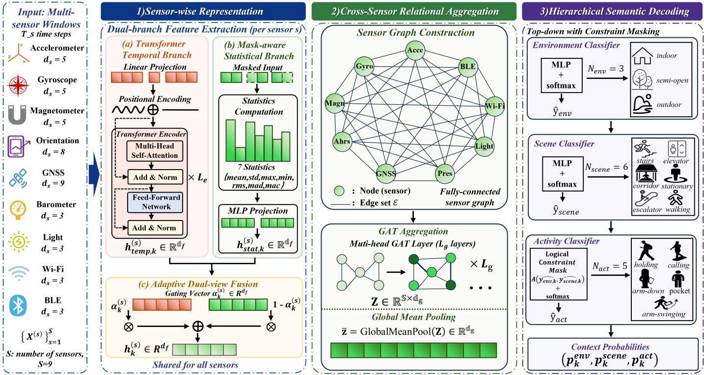  
Fig. 2. Hierarchical multi-sensor context recognition model. The model extracts temporal and mask-aware statistical features for each sensor, aggregates cross-sensor relations with a fully connected graph-attention module, and decodes environment, scene, and activity probabilities with top-down semantic constraints.

## 3.2 Data-Model Jointly Driven Multi-Sensor Context Recognition Model

This semantic front end connects heterogeneous smartphone sensing with localization correction. Scene structure and phone-use mode affect different localization error sources: structural events can activate map-aware PDR constraints, while carrying-mode changes can condition RoNIN compensation. The recognition model turns asynchronous multi-sensor windows into reliable context probabilities, labels, and confidence scores for the downstream localization modules. Fig. 2 summarizes this model. It follows three stages: sensor-wise representation learning, cross-sensor relational aggregation, and hierarchical semantic decoding.

## 3.2.1 Sensor-Wise Temporal Encoding

Each sensor stream is first processed by a temporal branch to capture motion patterns within the current window. For sensor $s ,$ the raw feature sequence is projected into a shared latent space and combined with positional encoding:

$$
\mathbf { U } _ { k } ^ { \left( s \right) } = \mathrm { P E } \left( \mathbf { X } _ { k } ^ { \left( s \right) } \mathbf { W } _ { \mathrm { i n } } ^ { \left( s \right) } \right) ,\tag{3}
$$

where $\mathbf { W } _ { \mathrm { i n } } ^ { ( s ) }$ is the input projection matrix and PE(·) denotes positional encoding. The Transformer encoder then uses the validity mask as the padding mask, with $L _ { e }$ denoting the number of encoder layers:

$$
\mathbf { H } _ { k } ^ { ( s ) } = \operatorname { E n c } ^ { ( s ) } \left( \mathbf { U } _ { k } ^ { ( s ) } ; \mathbf { M } _ { k } ^ { ( s ) } \right) ,\tag{4}
$$

where invalid samples neither attend to nor are attended by valid samples. A compact temporal embedding is obtained by masked average pooling:

$$
\mathbf { h } _ { \mathrm { t e m p } , k } ^ { ( s ) } = \frac { \sum _ { t = 1 } ^ { T _ { s } } M _ { k , t } ^ { ( s ) } \mathbf { H } _ { k , t } ^ { ( s ) } } { \operatorname* { m a x } \left( \sum _ { t = 1 } ^ { T _ { s } } M _ { k , t } ^ { ( s ) } , 1 \right) } .\tag{5}
$$

The resulting embedding satisfies $\mathbf { h } _ { \mathrm { t e m p } , k } ^ { ( s ) } \in \mathbb { R } ^ { d _ { f } }$ . If a sensorwindow contains no valid sample, the temporal embedding is set to zero and the fusion gate relies on the available modalities. This branch mainly describes step rhythm, local transitions, and longer-range dependencies embedded in inertial and environmental signals.

## 3.2.2 Mask-Aware Statistical Encoding

Heterogeneous smartphone sensing also requires stable window-level statistics, especially for sparse or intermittently available modalities. The valid index set of sensor s in the k-th window is

$$
\mathcal { T } _ { k } ^ { ( s ) } = \{ t \mid M _ { k , t } ^ { ( s ) } = 1 \} .\tag{6}
$$

For each feature channel $f ,$ the statistical branch computes

$$
\begin{array} { r } { \phi _ { k , f } ^ { ( s ) } = \left[ \mu _ { f } , \sigma _ { f } , x _ { f } ^ { \operatorname* { m a x } } , x _ { f } ^ { \operatorname* { m i n } } , \mathrm { r m s } _ { f } , \mathrm { m a d } _ { f } , \mathrm { m a c } _ { f } \right] , } \end{array}\tag{7}
$$

where the statistics are evaluated only on $\mathcal { T } _ { k } ^ { ( s ) }$ , and rmsf, mad $\cdot f ,$ and macf denote root mean square, mean absolute deviation, and mean absolute change over consecutive valid pairs, respectively. The sensor-level descriptor stacks all channel-wise descriptors:

$$
\phi _ { k } ^ { ( s ) } = \mathrm { C o n c a t } \biggl ( \left\{ \phi _ { k , f } ^ { ( s ) } \right\} _ { f = 1 } ^ { d _ { s } } \biggr ) .\tag{8}
$$

If a valid set is empty, the corresponding statistic is set to zero before projection. The descriptor is mapped to the shared feature space through an MLP:

$$
\mathbf { h } _ { \mathrm { s t a t } , k } ^ { ( s ) } = \mathrm { M L P } _ { \mathrm { s t a t } } ^ { ( s ) } \Big ( \phi _ { k } ^ { ( s ) } \Big ) .\tag{9}
$$

The resulting statistical embedding satisfies $\mathbf { h } _ { \mathrm { s t a t } , k } ^ { ( s ) } \in \mathbb { R } ^ { d _ { f } }$ This branch supplies robust distributional evidence and reduces the influence of padding, missing samples, and short-term fluctuations.

## 3.2.3 Adaptive Dual-View Fusion

The temporal and statistical views contribute differently under different contexts. A learnable gating mechanism balances their contributions:

$$
\begin{array} { r } { \pmb { \alpha } _ { k } ^ { ( s ) } = \sigma \Big ( \mathbf { W } _ { \alpha } \left[ \mathbf { h } _ { \mathrm { t e m p } , k } ^ { ( s ) } \parallel \mathbf { h } _ { \mathrm { s t a t } , k } ^ { ( s ) } \right] + \mathbf { b } _ { \alpha } \Big ) , } \end{array}\tag{10}
$$

$$
\mathbf { h } _ { k } ^ { \left( s \right) } = \alpha _ { k } ^ { \left( s \right) } \odot \mathbf { h } _ { \mathrm { t e m p } , k } ^ { \left( s \right) } + \left( 1 - \alpha _ { k } ^ { \left( s \right) } \right) \odot \mathbf { h } _ { \mathrm { s t a t } , k } ^ { \left( s \right) } ,\tag{11}
$$

where ${ \pmb { \alpha } } _ { k } ^ { ( s ) } \in ( 0 , 1 ) ^ { d _ { f } }$ is the fusion gate, $\mathbf { h } _ { k } ^ { ( s ) } \in \mathbb { R } ^ { d _ { f } }$ is the fused sensor-wise embedding, ⊙ denotes element-wise multiplication, and ∥ denotes vector concatenation. This design allows the module to favor temporal evidence when the window contains distinctive motion evolution, while relying more heavily on stable statistics when the signal is noisy or weakly structured.

## 3.2.4 Cross-Sensor Relational Aggregation

After dual-view fusion, one node embedding is obtained for each sensor. Because scene and activity cues may be distributed across complementary sensor responses, a fully connected sensor graph models inter-sensor relations through stacked graph-attention layers. With ${ \bf z } _ { s , k } ^ { ( 0 ) } = { \bf h } _ { k } ^ { ( s ) } .$ the final node matrix is $\mathbf { Z } _ { k } = [ \mathbf { z } _ { 1 , k } ^ { ( L _ { g } ) } , \ldots , \mathbf { z } _ { S , k } ^ { ( L _ { g } ) } ] ^ { \top } \in \mathbb { R } ^ { S \times d _ { g } }$ The window-level representation is obtained by global mean pooling over the final sensor nodes:

$$
\bar { \bf z } _ { k } = \mathrm { G l o b a l M e a n P o o l } ( { \bf Z } _ { k } ) ,\tag{12}
$$

with $\bar { \mathbf { z } } _ { k } \in \mathbb { R } ^ { d _ { g } }$ and $L _ { g }$ denoting the number of graphattention layers. This stage captures cross-modal relations among inertial, orientation, pressure, light, and wireless cues.

## 3.2.5 Hierarchical Semantic Decoding

The final stage uses hierarchical semantic constraints to decode the aggregated graph representation in a top-down order across environment, scene, and activity levels. The environment prediction is first obtained from the global feature:

$$
{ \bf p } _ { k } ^ { \mathrm { e n v } } = \mathrm { s o f t m a x } ( f _ { \mathrm { e n v } } ( \bar { \bf z } _ { k } ) ) .\tag{13}
$$

The scene prediction is then conditioned on the same global feature together with the environment output:

$$
{ \bf p } _ { k } ^ { \mathrm { s c e n e } } = \mathrm { s o f t m a x } ( f _ { \mathrm { s c e n e } } ( [ \bar { \bf z } _ { k } \ | | { \bf p } _ { k } ^ { \mathrm { e n v } } ] ) ) .\tag{14}
$$

For windows assigned to an outdoor environment in the training data, the scene target is marked as unavailable. At inference, an N/A scene state is generated only in postprocessing when the environment prediction indicates outdoor motion. Finally, the activity decoder receives the global feature and both upper-level semantic outputs:

$$
\ell _ { k } ^ { \mathrm { a c t } } = f _ { \mathrm { a c t } } ( [ \bar { \mathbf { z } } _ { k } ]  \mathbf { p } _ { k } ^ { \mathrm { e n v } }  \mathbf { p } _ { k } ^ { \mathrm { s c e n e } } ] ) .\tag{15}
$$

During both training and normal inference, the activity decoder is conditioned on the soft upper-level probabilities. A hard semantic filter is used only as a low-confidence consistency postprocessing step. When this filter is enabled, inadmissible activity classes are suppressed according to the predicted environment-scene pair:

$$
\tilde { \ell } _ { k , c } ^ { \mathrm { a c t } } = \left\{ \begin{array} { l l } { \ell _ { k , c } ^ { \mathrm { a c t } } , } & { c \in A ( \hat { y } _ { k } ^ { \mathrm { e n v } } , \hat { y } _ { k } ^ { \mathrm { s c e n e } } ) , } \\ { - \gamma , } & { \mathrm { o t h e r w i s e } , } \end{array} \right.\tag{16}
$$

where $\hat { y } _ { k } ^ { \mathrm { e n v } } = \arg \operatorname* { m a x } _ { c } { \bf p } _ { k , c } ^ { \mathrm { e n v } }$ and $\hat { y } _ { k } ^ { \mathrm { s c e n e } } = \arg \operatorname* { m a x } _ { c } \mathbf { p } _ { k , c } ^ { \mathrm { s c e n e } }$ are the hard environment and scene predictions, $A ( \cdot , \cdot )$ is the admissible activity set, and γ is a large positive constant. If the filter is not activated, $\tilde { \ell } _ { k } ^ { \mathrm { a c t } } = \ell _ { k } ^ { \mathrm { a c t } }$ . The activity probability is then produced by

$$
\mathbf { p } _ { k } ^ { \mathrm { a c t } } = \mathrm { s o f t m a x } \left( \tilde { \ell } _ { k } ^ { \mathrm { a c t } } \right) .\tag{17}
$$

This top-down decoder preserves coarse-to-fine semantics and avoids physically inconsistent context combinations.

The recognition front-end is trained with a compact multi-task objective. Let $y _ { k } ^ { \mathrm { e n v } } , ~ y _ { k } ^ { \mathrm { s c e n e } }$ , and $y _ { k } ^ { \mathrm { a c t } }$ denote the three labels, and let $m _ { k } ^ { \mathrm { s c e n i e } } \in \{ \ddot { 0 } , 1 \}$ indicate whether the scene label is available. The total loss is

$$
\mathcal { L } _ { \mathrm { r e c } } = \mathcal { L } _ { \mathrm { e n v } } + 0 . 8 \mathcal { L } _ { \mathrm { s c e n e } } + 0 . 8 \mathcal { L } _ { \mathrm { a c t } } ,\tag{18}
$$

where $\mathcal { L } _ { \mathrm { e n v } }$ and $\mathcal { L } _ { \mathrm { a c t } }$ are class-weighted cross-entropy losses, and

$$
\mathcal { L } _ { \mathrm { s c e n e } } = \frac { \sum _ { k } m _ { k } ^ { \mathrm { s c e n e } } \mathrm { C E } ( \mathbf { p } _ { k } ^ { \mathrm { s c e n e } } , y _ { k } ^ { \mathrm { s c e n e } } ) } { \operatorname* { m a x } ( \sum _ { k } m _ { k } ^ { \mathrm { s c e n e } } , 1 ) } .\tag{19}
$$

With this masking strategy, outdoor or otherwise unavailable scene labels do not contribute to the scene loss, while the environment and activity branches remain supervised.

## 3.3 Recognition-to-Localization Interface

The semantic outputs of the hierarchical context recognition model are organized into continuous, temporally aligned cues for downstream localization refinement.

A window-level prediction record is defined as

$$
o _ { k } = \left\{ t _ { k } ^ { \mathrm { s t } } , t _ { k } ^ { \mathrm { e d } } , \mathbf { p } _ { k } ^ { \mathrm { e n v } } , \mathbf { p } _ { k } ^ { \mathrm { s c e n e } } , \mathbf { p } _ { k } ^ { \mathrm { a c t } } \right\} ,\tag{20}
$$

where $t _ { k } ^ { \mathrm { s t } }$ and $t _ { k } ^ { \mathrm { e d } }$ are the starting and ending timestamps of the k-th window. For each semantic level $r \in { }$ {env, scene, act}, the window-level dominant label and confidence are

$$
\hat { c } _ { k } ^ { r } = \arg \operatorname* { m a x } _ { c } p _ { k , c } ^ { r } , \quad \rho _ { k } ^ { r } = \arg \operatorname* { m a x } _ { c } p _ { k , c } ^ { r } .\tag{21}
$$

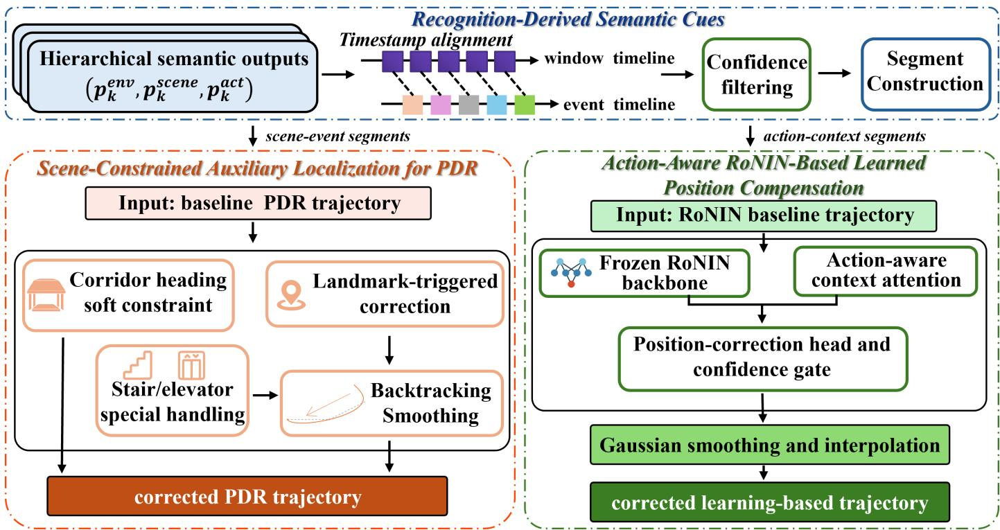  
Fig. 3. Auxiliary localization framework driven by recognition-derived semantic cues. Scene-event segments activate scene-constrained auxiliary localization for PDR, while action-context segments guide action-aware RoNIN-based learned position compensation.

Window records are sorted by timestamp. If two records overlap, the overlapped interval is assigned to the record with the larger confidence at the semantic level being processed. Adjacent records are merged when they have the same dominant label and their temporal gap is no larger than $\tau _ { g }$

The first interface is a set of scene-event segments,

$$
e _ { m } = \left\{ t _ { m } ^ { \mathrm { s t } } , t _ { m } ^ { \mathrm { e d } } , \hat { c } _ { m } ^ { \mathrm { e n v } } , \hat { c } _ { m } ^ { \mathrm { s c e n e } } , q _ { m } \right\} ,\tag{22}
$$

where $\hat { c } _ { m } ^ { \mathrm { e n v } }$ and $\hat { c } _ { m } ^ { \mathrm { s c e n e } }$ are the dominant environment and scene labels in the segment and $q _ { m }$ denotes its segmentlevel confidence. Let $\mathcal { I } _ { m }$ denote the set of windows merged into $e _ { m }$ . For indoor scene events, the segment confidence is computed as

$$
q _ { m } = \frac { 1 } { | \mathcal { T } _ { m } | } \sum _ { k \in \mathcal { T } _ { m } } \operatorname* { m i n } ( \rho _ { k } ^ { \mathrm { e n v } } , \rho _ { k } ^ { \mathrm { s c e n e } } ) ,\tag{23}
$$

Outdoor-transition segments use the average environment confidence only, as the scene label is unavailable. The environment label is mainly used to identify indoor-outdoor transitions, while the scene label supports corridor constraints and vertical-transition handling. These segments are supplied to the scene-constrained localization path to activate the corridor heading soft constraint, entrance constraints, and vertical-transition handling.

The second interface is a set of action-context segments,

$$
a _ { n } = \left\{ t _ { n } ^ { \mathrm { s t } } , t _ { n } ^ { \mathrm { e d } } , \hat { c } _ { n } ^ { \mathrm { a c t } } , \bar { \bf p } _ { n } ^ { \mathrm { a c t } } \right\} ,\tag{24}
$$

where $\hat { c } _ { n } ^ { \mathrm { a c t } }$ is the dominant activity class and $\bar { \mathbf { p } } _ { n } ^ { \mathrm { a c t } }$ is the segment-level action-probability vector. If $\mathcal { I } _ { n }$ is the set of

windows in $a _ { n } ,$ then

$$
\bar { \mathbf { p } } _ { n } ^ { \mathrm { a c t } } = \frac { 1 } { | \mathcal { T } _ { n } | } \sum _ { k \in \mathcal { I } _ { n } } \mathbf { p } _ { k } ^ { \mathrm { a c t } } , \quad \hat { c } _ { n } ^ { \mathrm { a c t } } = \arg \operatorname* { m a x } _ { c } \bar { p } _ { n , c } ^ { \mathrm { a c t } } .\tag{25}
$$

These action segments are used by the action-aware compensation path to modulate correction strength according to the carrying mode and motion pattern. The two segment types form the inputs to the localization branches.

## 4 AUXILIARY LOCALIZATION METHODS

The proposed semantic interface can support localization backends with different error mechanisms. In conventional PDR, structural scene cues can constrain accumulated heading and transition errors through map-aware correction. In learned inertial odometry, phone-use and carrying-mode cues can refine motion estimation when the inertial feature distribution changes. The auxiliary localization framework contains two branches: a scene-constrained auxiliary localization branch for PDR and an action-aware RoNIN-based learned position compensation branch, as summarized in Fig. 3.

## 4.1 Scene-Constrained Auxiliary Localization for PDR

The first path starts from a baseline step-wise PDR trajectory and uses scene-event segments to activate corridor, landmark, stair, and elevator corrections. Only reliable segments are retained:

$$
\begin{array} { r } { \mathcal { E } _ { \mathrm { v a l i d } } = \{ e _ { m } ~ | ~ q _ { m } \ge \tau _ { q } , ~ N _ { m } \ge N _ { \mathrm { m i n } } ( \hat { c } _ { m } ^ { \mathrm { s c e n e } } ) \} , } \end{array}\tag{26}
$$

where $\tau _ { q }$ is the confidence threshold, $N _ { m }$ is the number of aligned windows contained in segment $e _ { m } ,$ and $N _ { \mathrm { m i n } } ( \cdot )$

is the minimum window-count requirement. Stair, elevator, and outdoor-transition events are required to persist over at least two consecutive windows to suppress isolated false alarms.

The baseline PDR first detects steps from accelerationmagnitude peaks with a minimum step-interval constraint. Let $t _ { i }$ denote the timestamp of the i-th detected step, and let $A _ { i } ^ { \mathrm { m a x } }$ and $A _ { i } ^ { \operatorname* { m i n } }$ be the local acceleration-magnitude extrema around the detected peak. The raw step length follows the Weinberg model:

$$
s _ { i } ^ { 0 } = K _ { w } \left( A _ { i } ^ { \operatorname* { m a x } } - A _ { i } ^ { \operatorname* { m i n } } \right) ^ { 1 / 4 } ,\tag{27}
$$

where $K _ { w }$ is the calibrated step-length coefficient. For flatground walking, $s _ { i } = s _ { i } ^ { 0 } ;$ for validated stair segments, the stride is shortened by a stair factor $\eta _ { \mathrm { s t a i r } }$

The raw step heading $\psi _ { i } ^ { 0 }$ is obtained from the AHRS yaw after initial alignment with the floor-plan coordinate system. The starting point, yaw offset, principal corridor directions, and landmark positions are defined in the same map frame; accordingly, this branch is map-guided. Let $\mathbf { p } _ { i } = \mathbf { \bar { \Psi } } [ x _ { i } , y _ { i } ] ^ { \top }$ denote the position after the step, $s _ { i }$ the scene-adjusted step length, and $\bar { \psi _ { i } }$ the corrected heading used for integration. The nominal update is

$$
\mathbf { p } _ { i } = \mathbf { p } _ { i - 1 } + s _ { i } \left[ \cos \psi _ { i } \right] .\tag{28}
$$

Before any semantic correction, ${ \bar { \psi } } _ { i } = \psi _ { i } ^ { 0 } .$

The main correction mechanism in ordinary indoor walking is the corridor heading soft constraint. The method uses a set of principal corridor directions defined in the map coordinate system. For a step detected inside a reliable indoor segment, the nearest principal direction is selected by

$$
d _ { i } ^ { \star } = \arg \operatorname* { m i n } _ { d \in \mathcal { D } _ { \mathrm { c o r r } } } \left| \Delta ( \psi _ { i } ^ { 0 } , d ) \right| ,\tag{29}
$$

where $\mathcal { D } _ { \mathrm { c o r r } }$ is the map-defined corridor direction set and $\Delta ( \cdot , \cdot )$ denotes the wrapped angular difference. If the deviation remains within a tolerance band, the heading is softly pulled toward the nearest principal direction:

$$
\bar { \psi } _ { i } = \psi _ { i } ^ { 0 } - \lambda \Delta ( \psi _ { i } ^ { 0 } , d _ { i } ^ { \star } ) , \quad \left| \Delta ( \psi _ { i } ^ { 0 } , d _ { i } ^ { \star } ) \right| < \varepsilon ,\tag{30}
$$

where $\lambda ~ \in ~ ( 0 , 1 )$ is the pull strength and $\varepsilon$ is the corridor tolerance. This design reduces heading drift while preserving local trajectory flexibility. The corridor direction set $\mathcal { D } _ { \mathrm { c o r r } }$ and the two correction parameters are selected based on the floor-plan geometry and the target deployment environment.

Beyond corridor regularization, scene-event segments also trigger landmark-related corrections. Outdoor gate transitions, stair entrances or exits, and elevator entrances are each associated with a predefined landmark position in the map coordinate system. A landmark correction is activated only when both temporal and spatial gating conditions are satisfied:

$$
t _ { i } \in \left[ t _ { m } ^ { \mathrm { s t } } - T _ { m } ^ { \mathrm { p r e } } , t _ { m } ^ { \mathrm { e d } } + T _ { m } ^ { \mathrm { p o s t } } \right] , \quad \left\| \mathbf { p } _ { i } - \mathbf { c } _ { m } \right\| _ { 2 } < \tau _ { m } ,\tag{31}
$$

where $\mathbf { c } _ { m }$ is the landmark associated with scene event $e _ { m } , T _ { m } ^ { \mathrm { p r e } }$ and $T _ { m } ^ { \mathrm { p o s t } }$ are event-dependent temporal margins, and $\tau _ { m }$ is the corresponding spatial activation radius. This design allows the system to anticipate a gate or stair entrance slightly before the exact semantic boundary and also prevents distant false triggers from abruptly dragging the track toward an unrelated landmark.

Once a landmark correction is triggered, a backtracking smoothing mechanism pulls the current buffered segment toward the mapped target and suppresses abrupt breaks in the polyline trajectory. Suppose that the current buffered segment spans from time $t _ { s }$ to $t _ { i } ,$ and that the current endpoint $\mathbf { p } _ { i }$ is to be corrected to a target landmark c. The endpoint drift is written as

$$
\delta _ { i } = \mathbf { c } - \mathbf { p } _ { i } .\tag{32}
$$

For each buffered point $\mathbf { p } _ { j }$ with timestamp $t _ { j } \in [ t _ { s } , t _ { i } ]$ , the smoothed backtracking update is

$$
{ \bf p } _ { j } ^ { \prime } = { \bf p } _ { j } + \omega _ { j } \delta _ { i } , \quad \omega _ { j } = \frac { t _ { j } - t _ { s } } { t _ { i } - t _ { s } } .\tag{33}
$$

Earlier points receive smaller corrections, while points closer to the detected event absorb a larger share of the drift. This gradual update preserves trajectory continuity and better matches the physical behavior of a user approaching a doorway, stair entrance, or elevator landing. The correction is implemented with a fixed-lag buffer: only the current uncommitted segment is modified before it is appended to the final trajectory. In online use this introduces a bounded output delay, while in offline evaluation the same buffered update is applied as postprocessing to the corresponding segment.

Elevator events require additional handling because they involve waiting, entering, and short stationary periods that are poorly described by ordinary walking PDR. The method monitors short consecutive high-confidence elevator detections before switching to elevator mode. Once activated, the recent trajectory is retrospectively corrected to a waiting position ${ \bf c } _ { \mathrm { w a i t } }$ and then to an inside-elevator position $\mathbf { c } _ { \mathrm { i n } } .$ For a buffered point with timestamp $t _ { j }$ , the retrospective update can be summarized as

$$
\mathbf { p } _ { j } ^ { \prime } = \left\{ \begin{array} { l l } { \mathbf { c } _ { \mathrm { w a i t } } , } & { t _ { i } - t _ { j } > T _ { \mathrm { e n t e r } } , } \\ { \left( 1 - \xi _ { j } \right) \mathbf { c } _ { \mathrm { w a i t } } + \xi _ { j } \mathbf { c } _ { \mathrm { i n } } , } & { 0 \leq t _ { i } - t _ { j } \leq T _ { \mathrm { e n t e r } } , } \end{array} \right.\tag{34}
$$

where

$$
\xi _ { j } = 1 - \frac { t _ { i } - t _ { j } } { T _ { \mathrm { e n t e r } } }\tag{35}
$$

is the normalized entering progress and $T _ { \mathrm { e n t e r } }$ is the entering duration. After the backtracking update, the trajectory is temporarily locked to the elevator state until the validated elevator interval ends. Together with stair-specific stride scaling, gate or stair entrance attraction, and the corridor heading soft constraint, this path yields a corrected PDR trajectory that remains compatible with both the floor-plan structure and the recognized scene transitions.

## 4.2 Action-Aware RoNIN-Based Learned Position Compensation

The second path focuses on motion-mode-dependent drift and refines a RoNIN baseline trajectory using action-context segments. It learns a two-dimensional position correction from frozen RoNIN features and predicted carrying-mode context. For each inference window centered at time $\tau _ { i . }$ , the corresponding action segment $a _ { n }$ satisfying $\tau _ { i } ~ \in ~ [ t _ { n } ^ { \mathrm { s t } } , t _ { n } ^ { \mathrm { e d } } ]$ provides a five-dimensional context vector

$$
\mathbf { c } _ { i } = \bar { \mathbf { p } } _ { n } ^ { \mathrm { a c t } } = \left[ \bar { p } _ { n } ^ { \mathrm { h a n d } } , \bar { p } _ { n } ^ { \mathrm { c a l l } } , \bar { p } _ { n } ^ { \mathrm { d o w n } } , \bar { p } _ { n } ^ { \mathrm { s w i n g } } , \bar { p } _ { n } ^ { \mathrm { p o c k e t } } \right] ^ { \top } ,\tag{36}
$$

which corresponds to holding, calling, arm-down, armswinging, and pocket modes, respectively. The method carries forward the probability vector from the segment covering the current timestamp, which helps handle ambiguous transitions between motion modes smoothly.

The RoNIN backbone first produces a baseline velocity estimate $\hat { \mathbf { v } } _ { i } ^ { \mathrm { r o n } }$ for each IMU window $\mathbf { X } _ { i } ^ { \mathrm { i m u } }$

$$
\begin{array} { r } { \hat { \mathbf { v } } _ { i } ^ { \mathrm { r o n } } = \mathcal { R } ( \mathbf { X } _ { i } ^ { \mathrm { i m u } } ) , } \end{array}\tag{37}
$$

where $\mathcal { R } ( \cdot )$ denotes the frozen RoNIN network. Integrating these window-wise velocity predictions yields the baseline trajectory $\mathbf { p } ^ { \mathrm { r o n } } ( t )$ . In parallel, a 512-dimensional intermediate backbone feature

$$
\mathbf { f } _ { i } = \boldsymbol { B } ( \mathbf { X } _ { i } ^ { \mathrm { i m u } } )\tag{38}
$$

is extracted from the RoNIN front-end and supplied to the learned correction head.

To inject carrying-mode information, the model applies a lightweight action-conditioned context gate to the context vector. Let $\mathbf { W } _ { q } , \mathbf { W } _ { k } , \mathbf { W } _ { v } ,$ , and $\mathbf { W } _ { o }$ denote the query, key, value, and output projections, respectively, let $\bar { \sigma ( \cdot ) }$ denote the sigmoid function, and let $d _ { a }$ be the context-gate dimension. The scalar gate response is

$$
\alpha _ { i } ^ { \mathrm { c t x } } = \sigma \bigg ( \frac { \left( \mathbf { W } _ { q } \mathbf { f } _ { i } \right) ^ { \top } \left( \mathbf { W } _ { k } \mathbf { c } _ { i } \right) } { \sqrt { d _ { a } } } \bigg ) ,\tag{39}
$$

and the gated action context is obtained by

$$
\begin{array} { r } { \tilde { \bf c } _ { i } = { \bf W } _ { o } \big ( \alpha _ { i } ^ { \mathrm { c t x } } { \bf W } _ { v } { \bf c } _ { i } \big ) . } \end{array}\tag{40}
$$

The fused representation

$$
\mathbf { z } _ { i } = [ \mathbf { f } _ { i } \parallel \tilde { \mathbf { c } } _ { i } ]\tag{41}
$$

is then fed to a position-correction head composed of a correction branch and a confidence gate:

$$
\Delta \mathbf { p } _ { i } ^ { \mathrm { r a w } } = d _ { \mathrm { m a x } } \operatorname { t a n h } ( \mathcal { D } ( \mathbf { z } _ { i } ) ) , \quad g _ { i } = \mathcal { G } ( \mathbf { z } _ { i } ) \in [ 0 , 1 ] ,\tag{42}
$$

where $\mathcal { D } ( \cdot )$ is the multilayer correction regressor, $\mathcal { G } ( \cdot )$ is the gate network, and $d _ { \mathrm { m a x } }$ limits the magnitude of the raw correction. The final window-center correction is

$$
\Delta { \bf p } _ { i } = g _ { i } \Delta { \bf p } _ { i } ^ { \mathrm { r a w } } .\tag{43}
$$

This gated design keeps the model conservative when the action evidence is limited or the RoNIN feature already appears reliable, and permits larger compensation when the motion mode implies stronger pose-induced drift.

During training, the RoNIN backbone is frozen and only the position-correction head is optimized. After timestamp synchronization and the same SE(2) spatial alignment used for evaluation, the target correction at the window center is

$$
\Delta \mathbf { p } _ { i } ^ { \star } = \mathbf { p } ^ { \mathrm { g t } } ( \tau _ { i } ) - \mathbf { p } ^ { \mathrm { r o n } } ( \tau _ { i } ) .\tag{44}
$$

The correction loss is

$$
\mathcal { L } _ { \mathrm { p o s } } = \frac { 1 } { B } \sum _ { i = 1 } ^ { B } \left\| \Delta \mathbf { p } _ { i } - \Delta \mathbf { p } _ { i } ^ { \star } \right\| _ { 2 } ^ { 2 } + \beta \left\| \Delta \mathbf { p } _ { i } \right\| _ { 2 } ^ { 2 } ,\tag{45}
$$

where B is the number of training windows in the minibatch, $\beta$ controls the correction regularizer, and the second term regularizes the correction magnitude.

Because the correction head operates on strided windows, the predicted corrections are sparse in time. To obtain a continuous correction stream, the window-center sequence $\{ \Delta \mathbf { p } _ { i } \}$ is first smoothed by a Gaussian temporal filter and then linearly interpolated onto the full RoNIN time axis. The final corrected trajectory is written as

$$
\begin{array} { r } { \mathbf { p } ^ { \mathrm { c o r r } } ( t ) = \mathbf { p } ^ { \mathrm { r o n } } ( t ) + \bar { \Delta \mathbf { p } } ( t ) , } \end{array}\tag{46}
$$

where $\bar { \Delta \mathbf { p } } ( t )$ denotes the smoothed and interpolated position correction. In this formulation, holding, calling, and arm-down segments tend to correspond to relatively stable device poses, while arm-swinging and pocket segments usually expose larger orientation and placement mismatch. By conditioning the correction head on the full actionprobability vector, the method can adapt its correction magnitude and gating behavior continuously across these carrying modes while preserving a complete output trajectory.

## 5 EXPERIMENTS AND RESULTS

## 5.1 Experimental Setup

The proposed framework was evaluated using two representative types of smartphone trajectories, denoted as Route A and Route B. The test trajectories were collected by multiple volunteers in two large-scale indoor environments covering areas over $4 0 0 ~ \mathrm { m ^ { 2 } } ,$ , and were paired with LiDAR-SLAM reference trajectories, which were treated as ground truth for quantitative evaluation. The smartphone logs were recorded with a Xiaomi 14 Pro. Route A represents an approximately 230 s cross-floor trajectory type with multiscene transitions, and mainly examines whether scene-event cues can constrain and repair the accumulated drift of a step-wise PDR pipeline, especially around gate, stair, and elevator transitions. Route B represents an approximately 80 s second-floor trajectory type with multiple phone-use switches, and focuses on whether action-context cues can improve a learned inertial trajectory under changing phone carrying modes and motion patterns. The sensor modalities and nominal sampling rates used in the test logs are summarized in Table 2.

TABLE 2  
Smartphone Sensor Configuration Used in the Experiments
<table><tr><td>Sensor</td><td>Recorded attributes</td><td>Sampling rate</td></tr><tr><td>Accelerometer</td><td>3-axis linear acceleration</td><td>100–200 Hz</td></tr><tr><td>Gyroscope</td><td>3-axis angular velocity</td><td>100–200 Hz</td></tr><tr><td>Magnetometer</td><td>3-axis magnetic field</td><td>100 Hz</td></tr><tr><td>AHRS</td><td>Pitch, roll, yaw, quaternion</td><td>100-200 Hz</td></tr><tr><td>Barometer</td><td>Pressure</td><td>20 Hz</td></tr><tr><td>Light</td><td>Illuminance</td><td>5-10 Hz</td></tr><tr><td>GNSS</td><td>Position and motion status</td><td>1-2 Hz</td></tr><tr><td>Sound</td><td>RMS and sound pressure level 1.8–1.9 Hz</td><td></td></tr><tr><td>Wi-Fi</td><td>Access-point RSS observations 0.22–0.50 Hz</td><td></td></tr><tr><td>BLE 4.0</td><td>Beacon RSSI observations</td><td>4.95–6.94 Hz</td></tr></table>

The principal parameters used for semantic filtering and trajectory correction are summarized in Table 3.

TABLE 3  
Principal Parameters Used in the Localization Experiments
<table><tr><td>Parameter</td><td>Value</td></tr><tr><td>Semantic and elevator confidence threshold,  $\tau _ { q }$  Minimum transition-event persistence,  $N _ { \mathrm { m i n } }$ </td><td>0.9 2 consecutive</td></tr><tr><td></td><td>windows</td></tr><tr><td>Corridor pull strength, λ</td><td>0.6</td></tr><tr><td>Corridor heading tolerance, ε</td><td>20°</td></tr><tr><td>Maximum position correction,  $d _ { \mathrm { m a x } }$ </td><td>20.0 m</td></tr><tr><td>Correction regularization coefficient,  $\beta$  Gaussian smoothing parameter, σ</td><td>0.005 (training) 30</td></tr></table>

The semantic cues used in all localization experiments are predicted labels and probabilities generated by the recognition module. The recognition front end was trained on our self-collected large-scale multi-sensor hierarchical dataset, which contains 186 recording sequences, 23,193 labeled segments, and 32.09 h of valid recordings. As summarized in Table 4, the model achieves high per-level and joint accuracy on the held-out test split, indicating that it can provide reliable semantic inputs for the downstream localization modules.

TABLE 4  
Recognition Performance of the Semantic Front End (%)
<table><tr><td>Model</td><td>Environment Accuracy</td><td>Scene Accuracy</td><td>Activity Accuracy</td><td>Joint Accuracy</td><td>Mean Macro-F1</td></tr><tr><td>Ours</td><td>97.54</td><td>95.24</td><td>98.06</td><td>94.35</td><td>96.83</td></tr></table>

TABLE 5  
Compared Methods Used in the Experiments
<table><tr><td>Method</td><td>Description</td></tr><tr><td>PDR</td><td>Step-wise dead reckoning baseline driven by pedestrian motion estimation and heading updates.</td></tr><tr><td>RoNIN</td><td>Robust neural inertial navigation baseline used as the main learned trajectory reference.</td></tr><tr><td>MEIO</td><td>Motion-aware inertial odometry baseline with adaptive computation design.</td></tr><tr><td>RIDI</td><td>Double-integration-based inertial baseline representing a classic learning-based IMU pipeline.</td></tr><tr><td>TLIO</td><td>Tight learned inertial odometry baseline for drift-aware trajectory estimation.</td></tr><tr><td>Our Work</td><td>Hierarchical semantic interface with scene-constrained PDR correction on Route A and action-aware RoNIN position compensation on Route B.</td></tr></table>

The compared methods are summarized in Table 5. PDR serves as the conventional dead-reckoning reference, with its step-wise implementation following the smartphone PDR formulation in SmartPDR [5], while RoNIN, MEIO, RIDI, and TLIO represent representative learned inertial localization approaches [17], [18], [36], [39]. These baselines were selected to cover classical step-wise dead reckoning, robust neural inertial navigation, motion-aware efficient odometry, double-integration learning, and tightly coupled learned inertial filtering. The compared learned baselines were reproduced using their released open-source implementations and corresponding public benchmark data or pretrained resources, and were evaluated using the same input trajectories and evaluation protocol. The semantic outputs of the recognition module described in Section III are routed according to the target backbone: scene-constrained correction for PDR in Route A and action-aware position compensation for the RoNIN-based trajectory in Route B.

Three metrics are used in the main evaluation. The first metric, ATE, measures the global absolute deviation of the aligned trajectory and reflects overall localization accuracy. The second metric, RTE@10m, evaluates relative error over fixed 10 m sub-trajectories and is used to characterize local drift accumulation. The third metric, $\mathrm { A P E } _ { \mathrm { m e d i a n } } ,$ , reports the median point-wise absolute position error over time and thus reflects the typical error level with reduced sensitivity to extreme outliers.

For fair comparison, all estimated trajectories were first temporally synchronized with the LiDAR-SLAM reference and then spatially aligned in a common planar coordinate frame before metric computation. Spatial alignment uses a two-dimensional rigid transformation, $\mathrm { i . e . , }$ rotation and translation in SE(2), with no scale factor. The same alignment and evaluation procedures were applied to all methods on both routes. Let $\mathbf { p } _ { i }$ and $\hat { \mathbf { p } } _ { i }$ denote the groundtruth and aligned estimated positions at the i-th timestamp, respectively. The point-wise position error is defined as

$$
e _ { i } = \| \hat { \mathbf { p } } _ { i } - \mathbf { p } _ { i } \| _ { 2 } .\tag{47}
$$

Accordingly, ATE and $\mathrm { A P E } _ { \mathrm { m e d i a n } }$ are computed by

$$
\mathrm { A T E } = \sqrt { \frac { 1 } { N } \sum _ { i = 1 } ^ { N } e _ { i } ^ { 2 } } , \mathrm { A P E } _ { \mathrm { m e d i a n } } = \mathrm { m e d i a n } \left( \{ e _ { i } \} _ { i = 1 } ^ { N } \right)\tag{48}
$$

where $N$ is the number of aligned samples. For local drift evaluation, let $( a _ { j } , b _ { j } )$ denote the index pair of the j-th reference segment whose length is 10 m. The corresponding metric is defined as

$$
\mathrm { R T E @ 1 0 m } = \sqrt { \frac { 1 } { N _ { 1 0 } } \sum _ { j = 1 } ^ { N _ { 1 0 } } { \left\| { \left( \hat { \mathbf { p } } _ { b _ { j } } - \hat { \mathbf { p } } _ { a _ { j } } \right) } - \left( \mathbf { p } _ { b _ { j } } - \mathbf { p } _ { a _ { j } } \right) \right\| _ { 2 } ^ { 2 } } } ,\tag{49}
$$

where $N _ { 1 0 }$ is the number of 10 m segments.

## 5.2 Comparative Experiments and Error Analysis

Table 6 reports the main quantitative comparison. Route A evaluates scene-constrained PDR correction on a route with multiple scene transitions, and Route B evaluates action-aware RoNIN compensation on a route with multiple phone-use switches.

On Route A, the scene-constrained PDR branch reduces ATE from 17.705 to 2.699 m, RTE@10m from 12.298 to 3.765 m, and $\mathrm { A P E } _ { \mathrm { m e d i a n } }$ from 7.974 to 1.524 m relative to conventional PDR. It also outperforms the learned baselines on this map-guided, multi-scene route. The three panels in Fig. 4 show that the corrected path stays closer to the reference across corridor traversal and floor transitions.

Compared with RoNIN on Route $\scriptstyle \mathrm { \mathrm { B } } ,$ the proposed method reduces ATE from 6.902 to 3.411 m, RTE@10m from 2.211 to 1.707 m, and $\mathrm { A P E } _ { \mathrm { m e d i a n } }$ from 6.457 to 3.851 m. The corrected trajectory remains closer to the reference during carrying-mode changes. This result indicates that the actioncontext prior stabilizes learned trajectory refinement, as illustrated in Fig. 5.

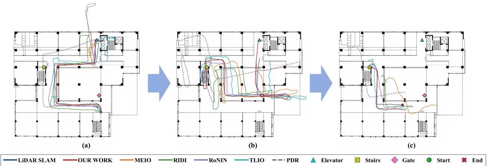  
Fig. 4. Route A trajectory comparison across floor transitions. (a) Initial trajectory segment on the second floor. (b) Trajectory segment after descending to the first floor. (c) Trajectory segment after returning to the second floor.

TABLE 6  
Overall Quantitative Comparison on Route A and Route B
<table><tr><td></td><td>Method</td><td>ATE (m)</td><td>RTE@10 m (m)</td><td> $\mathrm { A P E } _ { \mathrm { m e d } }$  (m)</td></tr><tr><td rowspan="6">Route A</td><td>PDR</td><td>17.705</td><td>12.298</td><td>7.974</td></tr><tr><td>TLIO</td><td>8.666</td><td>6.164</td><td>5.214</td></tr><tr><td>MEIO</td><td>5.537</td><td>5.293</td><td>7.593</td></tr><tr><td>RIDI</td><td>7.280</td><td>6.933</td><td>4.307</td></tr><tr><td>RoNIN</td><td>3.727</td><td>4.738</td><td>1.945</td></tr><tr><td>Our Work</td><td>2.699</td><td>3.765</td><td>1.524</td></tr><tr><td rowspan="6">Route B</td><td>PDR</td><td>18.760</td><td>10.684</td><td>22.440</td></tr><tr><td>TLIO</td><td>12.729</td><td>10.690</td><td>7.872</td></tr><tr><td>MEIO</td><td>10.391</td><td>9.000</td><td>9.905</td></tr><tr><td>RIDI</td><td>4.557</td><td>5.355</td><td>10.797</td></tr><tr><td>RoNIN</td><td>6.902</td><td>2.211</td><td>6.457</td></tr><tr><td>Our Work</td><td>3.411</td><td>1.707</td><td>3.851</td></tr></table>

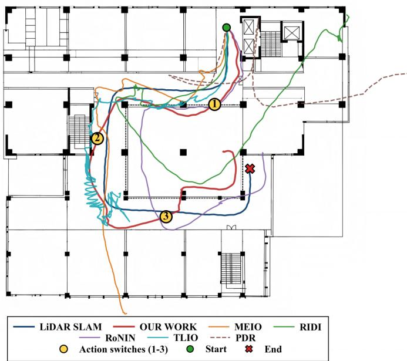  
Fig. 5. Route B overall trajectory comparison under multiple phone-use switches.  
Fig. 6 further supports the aggregate results. In the CDF

curves of Fig. 6(a) and (b), our work reaches the same cumulative probability at smaller APE values than the compared methods, indicating that both the typical error and the longtail error are reduced. The time-series curves in Fig. 6(c) and (d) show that the proposed method maintains a lower error level over most of the two routes.

On Route A, the corrected trajectory remains stable across the multi-scene route, except for a short error fluctuation near a transition segment. On Route B, the advantage becomes clearer after carrying-mode changes, where several baselines show sustained error growth while our work remains comparatively stable.

## 5.3 Gain Around Key Points

This analysis examines localized improvements around the semantic triggers. For each structural key point in Route A and each action-switch boundary in Route B, a fixed time window from −15 s to 25 s is extracted. The upper row of Fig. 7 shows the APE evolution within these windows, and the lower row summarizes all APE samples collected from the same windows at a 0.02 s step size. The key points are determined from the postprocessed recognition outputs after confidence and continuity filtering.

For Route A, the selected key points correspond to elevator entrances, the gate entrance, and the stair entrance. The proposed method achieves lower and more stable APE around the elevator and stair anchors. The gate segment still has a larger local error, indicating that the improvement is less pronounced near the gate entrance.

For Route B, the analysis windows are centered on the effective action-switch boundaries derived from the predicted action sequence, including the transitions from holding to calling, from calling to arm-swinging, and from arm-swinging to pocket. The holding-to-calling transition yields only a moderate gain, as the RoNIN baseline is already stable there. The later carrying-mode boundaries show clearer separation, especially around the calling-toarm-swinging and arm-swinging-to-pocket intervals. This matches the intended role of action-aware compensation: it is most useful when a phone-use transition causes increased drift in the learned inertial trajectory.

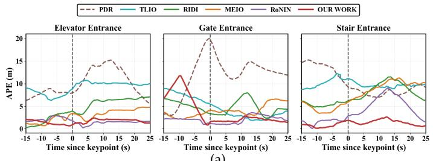  
PDRTLIORIDIMEIORoNINOUR WORK Corridor Elevator Outdoor Stair

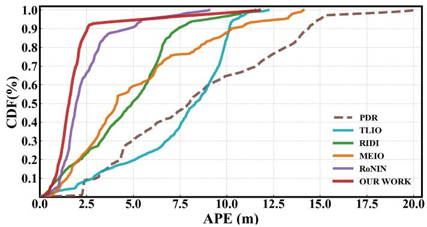  
(a)

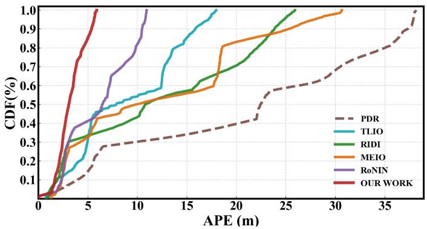  
(b)

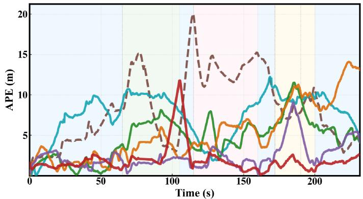  
(c)

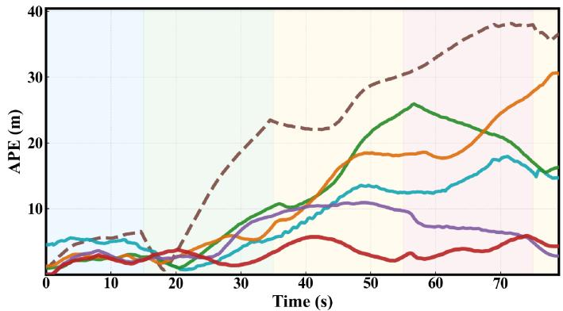  
(d)  
Fig. 6. Overall error analysis. The upper row shows displacement-error CDFs, and the lower row shows APE time series. (a) Route A displacementerror CDF. (b) Route B displacement-error CDF. (c) Route A APE time-series comparison. (d) Route B APE time-series comparison.

(a)  
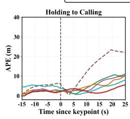

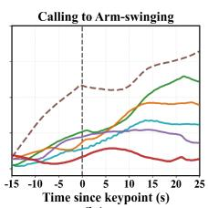  
(b)

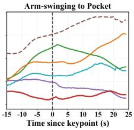

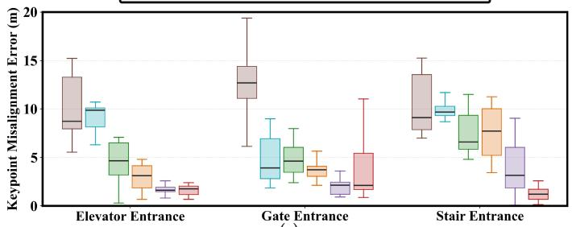  
(c)

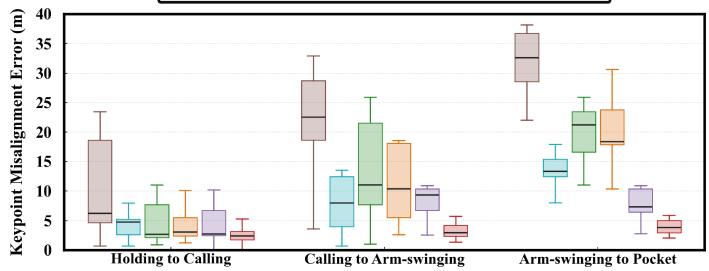  
(d)  
Fig. 7. Localized gain analysis around semantic triggers. The upper row shows APE curves in [−15, 25] s windows, and the lower row shows APE distributions. (a) Route A key-point APE evolution. (b) Route B action-switch APE evolution. (c) Route A key-point APE distribution. (d) Route B action-switch APE distribution.

## 5.4 Ablation Study

To isolate component effects, one component or semantic cue is removed at a time while all other settings remain unchanged. For Route A, each ablation disables one sceneconstrained PDR component: gate entrance attraction, corridor heading constraint, backtracking smoothing, or verticaltransition handling. For Route $\scriptstyle \mathrm { \mathrm { B } , }$ each ablation suppresses the action-aware compensation cue for one action mode appearing in the route. Table 7 reports the quantitative changes, and Fig. 8 visualizes the corresponding trajectory deviations.

TABLE 7  
Ablation results for Route A scene-constrained components and Route B action-aware components.
<table><tr><td>Route</td><td>Variant</td><td>ATE (m)</td><td>RTE@10m (m)</td><td>Median APE (m)</td></tr><tr><td rowspan="5">Route A</td><td>Our Work</td><td>2.699</td><td>3.765</td><td>1.524</td></tr><tr><td>w/o Gate Entrance Attraction</td><td>3.753↑</td><td>4.583↑</td><td>3.182↑</td></tr><tr><td>w/o Corridor Heading Constraint</td><td>2.747↑</td><td>3.820↑</td><td>1.617↑</td></tr><tr><td>w/o Backtracking Smoothing</td><td>3.399↑</td><td>4.452↑</td><td>2.219↑</td></tr><tr><td>w/o Vertical-Transition Handling</td><td>2.828↑</td><td>2.063↓</td><td>2.142↑</td></tr><tr><td rowspan="5">Route B</td><td>Our Work</td><td>3.411</td><td>1.707</td><td>3.851</td></tr><tr><td>w/o Holding</td><td>4.757↑</td><td>4.536↑</td><td>4.103↑</td></tr><tr><td>w/o Calling</td><td>4.001↑</td><td>3.533↑</td><td>4.062↑</td></tr><tr><td>w/o Arm-Swinging</td><td>4.339↑</td><td>4.221↑</td><td>3.431↓</td></tr><tr><td>w/o Pocket</td><td>4.276↑</td><td>4.170↑</td><td>3.707↓</td></tr></table>

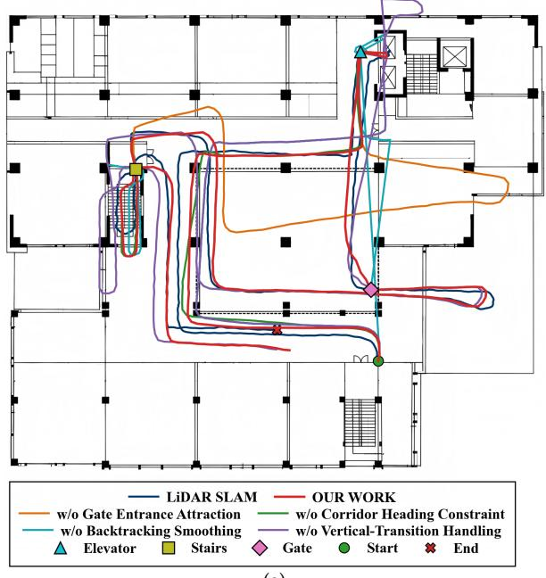  
(a)

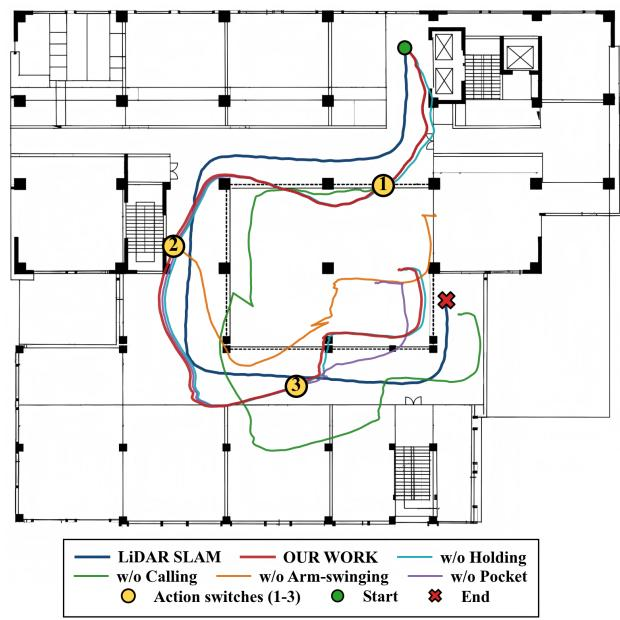  
(b)  
Fig. 8. Ablation trajectory comparison. (a) Route A removes one scene-constrained PDR component at a time. (b) Route B removes one action aware compensation cue at a time.

For Route A, removing the gate entrance attraction term causes the largest overall degradation. The ATE rises from 2.699 to 3.753, the RTE@10m rises from 3.765 to 4.583, and the median APE more than doubles from 1.524 to 3.182. Removing backtracking smoothing also degrades all three metrics, which confirms that event-driven correction alone is insufficient without propagating the recovered alignment to neighboring segments. Removing the corridor heading constraint produces only a mild increase, indicating that corridor heading guidance mainly acts as a stabilizing prior. The vertical-transition handling component shows a different pattern: removing it increases ATE and $\mathrm { A P E } _ { \mathrm { m e d i a n } }$ to 2.828 and 2.142, even though the local RTE@10m becomes smaller. Combined with the trajectory overlay in Fig. 8, this suggests that vertical-transition handling is most valuable for preserving global consistency around elevator-related transitions.

For Route B, all four action-mode cues contribute to route-level consistency. Removing the holding cue yields the largest degradation, with ATE increasing from 3.411 to 4.757 and RTE@10m from 1.707 to 4.536. The calling, arm-swinging, and pocket cues also cause clear degradation in ATE and RTE@10m when removed, and the trajectory overlay reveals more pronounced deviation after the action-switch regions. The median APE does not increase monotonically for every reduced variant; for example, the w/o Arm-Swinging variant has a slightly smaller $\mathrm { A P E } _ { \mathrm { m e d i a n } }$ than the complete system. This behavior indicates that the action-mode cues mainly suppress route-level drift and switch-boundary distortion, while the point-wise median error alone does not fully capture their contribution.

## 6 CONCLUSION

This study contributes a hierarchical semantic enhancement framework for smartphone indoor localization that connects multi-sensor context recognition with a scene-constrained PDR branch and an action-aware RoNIN compensation branch. The results highlight the value of using hierarchical context as a semantic interface between recognition outputs and trajectory correction. In particular, scene cues can express structure-related opportunities for constraining PDR trajectories, while activity cues can identify phone-use changes that are relevant to learned drift compensation.

These observations also show that the effect of semantic enhancement depends on whether the semantic cues are reliable, temporally stable, and aligned with the localization errors to be corrected.

Several limitations should be acknowledged. The sceneconstrained PDR branch relies on prior map information, including corridor directions and landmark locations; incomplete or outdated maps may therefore weaken its corrections, particularly in dynamically changing indoor spaces. In addition, the evaluation covered only two route types in two indoor environments using a single smartphone model. Generalization across buildings, devices, users, and longer trajectories requires further validation.

Future work will investigate online map adaptation and landmark discovery to reduce dependence on map priors, while extending the evaluation to more diverse conditions. More adaptive semantic triggering will also be explored to account for uncertainty and temporal alignment. With broader validation, the framework may support pedestrian navigation and tracking in multi-floor public buildings, transportation hubs, indoor construction sites, and emergency-response environments, where structural transitions and phone-use variations commonly affect localization reliability.

## REFERENCES

[1] J. Li, Y. Song, Z. Ma, Y. Liu, C. Chen, A review of indoor localization methods leveraging smartphone sensors and spatial context, Sensors 24 (2024) 6956. https://doi.org/10.3390/s24216956.

[2] J. Liu, Z. Yang, S. Zlatanova, S. Li, B. Yu, Indoor localization methods for smartphones with multi-source sensors fusion: Tasks, challenges, strategies, and perspectives, Sensors 25 (2025) 1806. https://doi.org/10.3390/s25061806.

[3] M. Mart´ınez del Horno, L. Orozco-Barbosa, I. Garc´ıa-Varea, A smartphone-based multimodal indoor tracking system, Inf. Fusion 76 (2021) 36–45. https://doi.org/10.1016/j.inffus.2021.05.001.

[4] K. Mottakin, K. Davuluri, M. Allison, Z. Song, SWiLoc: Fusing smartphone sensors and WiFi CSI for accurate indoor localization, Sensors 24 (2024) 6327. https://doi.org/10.3390/s24196327.

[5] W. Kang, Y. Han, SmartPDR: Smartphone-based pedestrian dead reckoning for indoor localization, IEEE Sens. J. 15 (2015) 2906– 2916. https://doi.org/10.1109/JSEN.2014.2382568.

[6] H. Liu, Z. Gao, L. Wang, Q. Xu, C. Yang, Reliable positioning model of smartphone sensors and user motions tightly enhanced PDR, IEEE Internet Things J. 11 (2024) 30925–30938. https://doi. org/10.1109/JIOT.2024.3413792.

[7] B. Khalili, R.A. Abbaspour, A. Chehreghan, N. Vesali, A contextaware smartphone-based 3D indoor positioning using pedestrian dead reckoning, Sensors 22 (2022) 9968. https://doi.org/10.3390/ s22249968.

[8] G. Huang, J. Liu, S. Yang, X. Gong, Y. Zhao, Context-assisted personalized pedestrian dead reckoning localization with a smartphone, Geo-Spat. Inf. Sci. 28 (2025) 1417–1433. https://doi.org/10. 1080/10095020.2024.2338225.

[9] B. Zhou, Q. Li, Q. Mao, W. Tu, X. Zhang, Activity sequencebased indoor pedestrian localization using smartphones, IEEE Trans. Hum.-Mach. Syst. 45 (2015) 562–574. https://doi.org/10. 1109/THMS.2014.2368092.

[10] H. Abdelnasser, R. Mohamed, A. Elgohary, M.F. Alzantot, H. Wang, S. Sen, R.R. Choudhury, M. Youssef, SemanticSLAM: Using environment landmarks for unsupervised indoor localization, IEEE Trans. Mob. Comput. 15 (2016) 1770–1782. https://doi.org/ 10.1109/TMC.2015.2478451.

[11] J. Choi, G. Lee, S. Choi, S. Bahk, Smartphone based indoor path estimation and localization without human intervention, IEEE Trans. Mob. Comput. 21 (2022) 681–695. https://doi.org/10.1109/ TMC.2020.3013113.

[12] W. Luo, Q. Song, Z. Yan, R. Tan, G. Lin, Indoor smartphone SLAM with acoustic echoes, IEEE Trans. Mob. Comput. 23 (2024) 6634– 6649. https://doi.org/10.1109/TMC.2023.3323393.

[13] S. Bai, Y. Lyu, Z. Lyu, R. Xu, X. Wang, W. Wen, Watch your position: Neural inertial localization with a single wrist-worn device, IEEE Trans. Mob. Comput. 25 (2026) 13047–13061. https: //doi.org/10.1109/TMC.2026.3672619.

[14] B. Zhou, P. Wu, X. Zhang, D. Zhang, Q. Li, Activity semanticsbased indoor localization using smartphones, IEEE Sens. J. 24 (2024) 11069–11079. https://doi.org/10.1109/JSEN.2024.3357718.

[15] S. Bai, W. Wen, Factor graph optimization-based indoor pedestrian SLAM with probabilistic exact activity loop closures using smartphone, in: Proc. Int. Conf. Indoor Positioning Indoor Navig. (IPIN), 2023, pp. 1–8. https://doi.org/10.1109/IPIN57070.2023. 10332510.

[16] C. Chen, X. Lu, A. Markham, N. Trigoni, IONet: Learning to cure the curse of drift in inertial odometry, Proc. AAAI Conf. Artif. Intell. 32 (2018) 6468–6476. https://doi.org/10.1609/aaai. v32i1.12102.

[17] S. Herath, H. Yan, Y. Furukawa, RoNIN: Robust neural inertial navigation in the wild: Benchmark, evaluations, and new methods, in: Proc. IEEE Int. Conf. Robot. Autom. (ICRA), 2020, pp. 3146–3152. https://doi.org/10.1109/ICRA40945.2020.9196860.

[18] W. Liu, D. Caruso, E. Ilg, J. Dong, A.I. Mourikis, K. Daniilidis, V. Kumar, J. Engel, TLIO: Tight learned inertial odometry, IEEE Robot. Autom. Lett. 5 (2020) 5653–5660. https://doi.org/10.1109/ LRA.2020.3007421.

[19] C. Shi, W. Teng, Y. Zhang, Y. Yu, L. Chen, R. Chen, Q. Li, Autonomous multi-floor localization based on smartphoneintegrated sensors and pedestrian indoor network, Remote Sens. 15 (2023) 2933. https://doi.org/10.3390/rs15112933.

[20] B. Shin, T. Kim, T. Lee, Real-time three-dimensional pedestrian localization system using smartphones, Sensors 24 (2024) 652. https://doi.org/10.3390/s24020652.

[21] S. Bazin, K. Navaie, RIS-assisted smart radio environment for enhanced non-orthogonal multiplexing indoor positioning system, IEEE Trans. Wireless Commun. 25 (2026) 8938–8953. https: //doi.org/10.1109/TWC.2025.3649587.

[22] K. Shao, Z. Li, M. Sun, C. De Cock, D. Plets, High-accuracy multistatic UWB radar positioning using low-cost devices based on dense convolutional network and a DBSCAN denoiser, IEEE Internet Things J. 13 (2026) 13345–13361. https://doi.org/10.1109/ JIOT.2026.3654952.

[23] B. Pinto, Y. Assayag, R. Barreto, H. Oliveira, OPTIMAPS: A site survey-free indoor positioning system based on RSSI diversity and sequential least squares programming, IEEE Internet Things J. 13 (2026) 9524–9534. https://doi.org/10.1109/JIOT.2025.3645666.

[24] C.T. Li, J.C.P. Cheng, K. Chen, Top 10 technologies for indoor positioning on construction sites, Autom. Constr. 118 (2020) 103309. https://doi.org/10.1016/j.autcon.2020.103309.

[25] Y. Huang, A. Hammad, Z. Zhu, Providing proximity alerts to workers on construction sites using Bluetooth Low Energy RTLS, Autom. Constr. 132 (2021) 103928. https://doi.org/10.1016/ j.autcon.2021.103928.

[26] M. Liu, R. Chen, D. Li, Y. Chen, G. Guo, Z. Cao, Y. Pan, Scene recognition for indoor localization using a multi-sensor fusion approach, Sensors 17 (2017) 2847. https://doi.org/10.3390/ s17122847.

[27] B. Zhou, J. Yang, Q. Li, Smartphone-based activity recognition for indoor localization using a convolutional neural network, Sensors 19 (2019) 621. https://doi.org/10.3390/s19030621.

[28] X. Wang, Y. Wang, J. Wu, Position-aware indoor human activity recognition using multisensors embedded in smartphones, Sensors 24 (2024) 3367. https://doi.org/10.3390/s24113367.

[29] Z. Qin, Y. Zhang, S. Meng, Z. Qin, K.-K.R. Choo, Imaging and fusing time series for wearable sensor-based human activity recognition, Inf. Fusion 53 (2020) 80–87. https://doi.org/10.1016/ j.inffus.2019.06.014.

[30] S.A. Khowaja, P. Khuwaja, F.A. Dharejo, S. Raza, I.H. Lee, R.A. Naqvi, K. Dev, ReFuSeAct: Representation fusion using selfsupervised learning for activity recognition in next generation networks, Inf. Fusion 102 (2024) 102044. https://doi.org/10.1016/ j.inffus.2023.102044.

[31] A.S. Rao, M. Radanovic, Y. Liu, S. Hu, Y. Fang, K. Khoshelham, M. Palaniswami, T. Ngo, Real-time monitoring of construction sites: Sensors, methods, and applications, Autom. Constr. 136 (2022) 104099. https://doi.org/10.1016/j.autcon.2021.104099.

[32] M. Khazen, M. Nik-Bakht, O. Moselhi, Monitoring workers on indoor construction sites using data fusion of real-time worker’s

location, body orientation, and productivity state, Autom. Constr. 160 (2024) 105327. https://doi.org/10.1016/j.autcon.2024.105327.

[33] J. Wang, Z. Ren, Z. Zhang, M. Xia, C. Shi, A quality-driven geomagnetic measurement framework for indoor positioning: Fingerprint distinguishability analysis and robust trajectory matching, IEEE Trans. Instrum. Meas. 75 (2026) 1–15. https://doi.org/10. 1109/TIM.2026.3687298.

[34] J. Wang, H. Li, Z. Yuan, M. Xia, F. Meng, W. Chen, C. Shi, FINLOS-TriSeg: Fine-grained fisheye semantic segmentation for GNSS NLOS identification in consumer-grade measurement systems, IEEE Trans. Instrum. Meas. 75 (2026) 8511218. https://doi.org/ 10.1109/TIM.2026.3709443.

[35] S. Guo, H. Xiong, X. Zheng, Y. Zhou, Activity recognition and semantic description for indoor mobile localization, Sensors 17 (2017) 649. https://doi.org/10.3390/s17030649.

[36] H. Yan, Q. Shan, Y. Furukawa, RIDI: Robust IMU double integration, in: Proc. Eur. Conf. Comput. Vis. (ECCV), 2018, pp. 641–656. https://doi.org/10.1007/978-3-030-01261-8 38.

[37] S. Sun, D. Melamed, K. Kitani, IDOL: Inertial deep orientationestimation and localization, Proc. AAAI Conf. Artif. Intell. 35 (2021) 6128–6137. https://doi.org/10.1609/aaai.v35i7.16763.

[38] Y. Wang, J. Kuang, X. Niu, J. Liu, LLIO: Lightweight learned inertial odometer, IEEE Internet Things J. 10 (2023) 2508–2518. https://doi.org/10.1109/JIOT.2022.3214087.

[39] X. Sun, Y. Li, Y. Wang, H. Yan, X. Zhang, S. Liu, X. Guo, Z. Wen, MEIO-Net: A motion-aware early-exit inertial odometry network for efficient pedestrian dead reckoning (PDR), IEEE Internet Things J. 13 (2026) 4142–4152. https://doi.org/10.1109/JIOT.2025. 3633690.