# Softmax Routing Dynamics in Mixture-of-Experts Models: Collapse and Recovery

Shengze Xu1 Maolin Deng1 Tieyong Zeng2,3∗

1The Chinese University of Hong Kong

2Beijing Normal-Hong Kong Baptist University 3Guangzhou Nanfang College

## Abstract

Softmax routing in mixture-of-experts models can concentrate probability on a subset of experts, suppressing access to the others. We study how this concentration forms, why it persists, and how suppressed probabilities recover. For fixed experts, a stationary-loss barrier identifies the face supporting the optimal routed output. In a common-target square-loss model with freely trainable expert outputs, slow adaptation tracks fixed-expert dynamics on finite horizons, while every fixed positive adaptation rate yields an interior routing limit. An exact normal-velocity decomposition separates complementary-expert covariance from relative gradient advantage. Under positive two-sided power bounds along recovery paths, uniform over initial masses, the resulting coeficient’s order of vanishing gives logarithmic or power-law recovery times. Integrations of constructed fields reproduce these orders. An exact discrete log-odds identity relates neural updates to threshold crossing. In paired Transformer-MoE training, removing a class-conditional router-gradient contrast delays confirmed recovery and reduces accumulated log-odds on fixed tokens, both with and without capacity constraints.

Keywords: mixture of experts, softmax routing, routing collapse, gradient flow, routing recovery

## 1 Introduction

Sparse mixture-of-experts (MoE) models increase capacity by activating only a subset of expert subnetworks for each input, enabling conditional computation at large scale [12, 13, 23, 36]. A learned router assigns probabilities to experts, while top-k selection and capacity constraints determine the executed assignments. During training, self-reinforcing routing preferences can concentrate assignments on a few experts, a form of routing collapse [9, 36].

We study routing concentration: small pre-dispatch probability mass outside a proper coordinate face. Asymptotic concentration means that this mass tends to zero. Severe concentration suppresses access to some experts for a given input and constitutes the probability-space aspect of routing collapse. Finite logits keep probabilities positive, so finite-time collapse appears as near-boundary concentration. We call the return of a suppressed probability to a prescribed positive threshold recovery.

Load-balancing losses encourage balanced aggregate expert use [13, 36, 47]. Yet individual inputs can concentrate on diferent experts while maintaining balanced aggregate loads. Routing probabilities also evolve jointly with expert parameters and input representations. Persistent concentration and subsequent reactivation observed during MoE training [35] therefore raise three questions: which simplex face is selected as routing concentrates? Why can concentration persist when experts are trainable? What determines the time required for a suppressed expert to recover?

Near a simplex boundary, a small probability can respond slowly even to a favorable gradient signal. Continuous-time gradient flow on softmax logits makes this efect explicit. For a routing vector $p ,$ let $J ( p ) = \mathrm { d i a g } ( p ) - p p ^ { \top }$ be the softmax Jacobian and g the probability gradient of the half-loss. Euclidean logit-gradient flow and its probability-space form are

$$
\dot { q } = - J ( p ) g , \qquad \dot { p } = - J ( p ) ^ { 2 } g .
$$

At $p _ { j } = 0$ , the jth row of $J ( p )$ vanishes. Under bounded gradient signals, normal probability motion therefore vanishes as $p _ { j } \downarrow 0 ;$ we call this boundary degeneracy. It is a property of the vector field, whereas concentration describes the routing state. The direction and order of normal motion depend on the complementary routing state and gradient field. Related Jacobian structures appear in value–softmax dynamics [37]; here we characterize how this geometry governs routing concentration, persistence, and recovery.

Main results For fixed experts, the optimal routed output is the target’s projection onto the expert convex hull. Below the smallest suboptimal stationary loss, every limit point represents this projection and is supported on experts in the minimal hull face containing it. Geometric separation gives bounds on outside-face mass and neighborhood entry times (Section 3).

Expert adaptation introduces a second time scale. As the expert-update rate tends to zero, the joint flow approaches the fixed-expert trajectory on each fixed finite horizon. For every fixed positive rate in the common-target square-loss model with freely trainable outputs, however, residual decay makes the logits converge to finite limits and routing to an interior point. Thus concentration can persist over finite horizons even though the long-time limit is interior (Section 4).

Our main recovery result separates complementary-expert covariance from relative gradient advantage in an exact normal-velocity decomposition (Section 5). For a suppressed probability $x = p _ { j }$ , it gives $\dot { x } = x ( 1 - x ) ^ { 2 } \Gamma _ { j }$ . The order of vanishing of $\Gamma _ { j }$ governs the recovery time $T _ { \theta } ( \varepsilon )$ from initial mass ε to a fixed threshold θ. For fixed $\alpha \geqslant 0$ , positive two-sided comparisons along the entire recovery path, with constants independent of $\varepsilon , \mathrm { ~ y ~ }$ ield

$$
\Gamma _ { j } \asymp x ^ { \alpha } \quad \Longrightarrow \quad T _ { \theta } ( \varepsilon ) \asymp \left\{ \begin{array} { l l } { \log ( 1 / \varepsilon ) , } & { \alpha = 0 , } \\ { \varepsilon ^ { - \alpha } , } & { \alpha > 0 , } \end{array} \right. \quad \varepsilon \downarrow 0 .
$$

For two experts under the same advantage signal bounded above and away from zero, squared-Jacobian, single-Jacobian, and Euclidean projected flows yield inverse-probability, logarithmic, and bounded recovery times, respectively.

For input-conditioned routers, an afine separation criterion describes initial routing diferences, and an exact discrete log-odds identity relates threshold crossing to individual neural updates (Section 6). Paired Transformer-MoE interventions show that removing a class-conditional router-gradient contrast delays confirmed recovery and reduces accumulated log-odds on fixed tokens, both with and without capacity constraints (Section 7).

Code is available at https://github.com/shengze-xu/softmax-routing-dynamics.

## 1.1 Related work

Routing, allocation, and statistical recovery Learned gating originated in adaptive and hierarchical mixtures [19, 20]. Modern methods study expert assignment, balanced utilization, expert choice, and diferentiable dispatch [17, 24, 31, 40, 45]. Expert-wise biases control aggregate loads [38], and assignment dynamics admit primal–dual formulations [16]. Load balance, input specialization, and token-level route quality are distinct allocation properties [15, 39, 43]; assignments can become established early in pre-training [42]. Statistical analyses address identifiability and estimation [2, 6, 28, 29] or recovery of latent clusters and tasks [8, 11, 21, 25]. Stochastic-optimization analyses quantify how routing sparsity afects overall convergence [46]. We study the time a suppressed routing probability takes to regain a prescribed threshold during optimization.

Concentration observables and softmax dynamics Representation clustering around expert centroids [10], concentration of expert-selection paths across layers [14], and the efective rank of routing-similarity graphs across reasoning rollouts [7] describe observables distinct from our outside-face mass for an individual probability vector. Optimization geometry determines how gradients move that vector: replicator dynamics and entropic mirror descent induce a single softmax Jacobian in probability space [5, 18, 34], whereas Euclidean logit-gradient flow induces its square. Tabular softmax policy-optimization rates depend on initialization and bounds on optimal-action probabilities [26]. Face selection also relates to active-set identification [41]. Our stationary-loss barrier combines convex projection and loss dissipation to identify the hull face supporting the limiting output; exposing directions then control outside-face mass.

Trainable value–softmax dynamics Varre, Rofin, and Flammarion [37] study joint value– softmax flow. Their square-loss analysis gives exponential residual decay and finite cumulative polarization; the latter is derived under a zero-initialized value matrix. We use the same dissipation mechanism to establish convergence of logits and expert outputs for arbitrary finite initialization and every positive expert-update rate, with explicit tail and probability-floor bounds (Theorem 4.2). Combining this result with the slow-expert approximation separates finite-horizon concentration from the interior long-time limit. Recovery is then governed by the normal coeficient in Section 5.

Router–expert coupling Joint training couples routing preferences to expert adaptation. Kiselev [22] derives symmetry-breaking bifurcations in a two-expert reinforcement-and-decay model. Ahrac, Hochwald, and Geva [1] analyze shared token directions in router and expert gradients and the efects of load balancing on their alignment. We study how a class-conditional target–comparator gradient contrast afects subsequent recovery. Matched neural branches estimate the response to removing this contrast, and the discrete log-odds identity relates the observed routing changes to individual threshold crossing.

## 2 Problem setup and preliminaries

## 2.1 Softmax routing as gradient flow

For n experts, let $p \in \Delta ^ { n - 1 }$ denote the routing vector, where $\Delta ^ { n - 1 } = \{ p \in \mathbb { R } _ { + } ^ { n } : \mathbf { 1 } ^ { \top } p = 1 \}$ and 1 is the all-ones vector; $\mathbb { R } _ { + } = [ 0 , \infty )$ and ⊤ denotes transpose. The relative interior int $( \Delta ^ { n - 1 } )$ consists of vectors with every coordinate positive.

To quantify concentration near a coordinate face, fix an expert index set $S \subseteq \{ 1 , \dots , n \}$ and define its outside-face mass by $\begin{array} { r } { D _ { S } ( p ) : = \sum _ { i \notin S } p _ { i } } \end{array}$ . Small $D _ { S } ( p )$ measures finite-time concentration near the coordinate face supported on S; $\dot { D _ { S } } ( p ( t ) )  0$ means asymptotic concentration on that face.

Stack the expert outputs $E _ { i } \in \mathbb { R } ^ { d }$ as the rows of $E \in \mathbb { R } ^ { n \times d }$ . For a common target $\boldsymbol { y } \in \mathbb { R } ^ { d }$ the routed output is $E ^ { \top } p$ and the corresponding square loss is

$$
\begin{array} { r } { \mathcal { L } ( p , E ) = \| E ^ { \top } p - y \| ^ { 2 } . } \end{array}
$$

The gradient flows below optimize the half-loss $\mathcal { H } ( p , E ) : = \mathcal { L } ( p , E ) / 2 ;$ ; we retain L for loss levels and dissipation statements. Write $R : = E ^ { \top } p - y$

We write $\| \cdot \| \mathrm { o r } \| \cdot \| _ { 2 }$ for the Euclidean vector norm, $\| \cdot \| _ { 1 }$ for the sum of absolute coordinates, and $\| \cdot \| _ { \mathrm { o p } }$ and $\Vert \cdot \Vert _ { \mathrm { F } }$ for the operator and Frobenius matrix norms. An unsubscripted matrix

norm is the operator norm; $\langle \cdot , \cdot \rangle$ is the Euclidean inner product. We use $O ( \cdot )$ for upper bounds up to a constant and $\Theta ( \cdot )$ or ≍ for two-sided bounds by positive constants; the relevant limit and fixed parameters accompany each result.

For logits $q \in \mathbb { R } ^ { n }$ , the softmax map is $\begin{array} { r } { p _ { i } = e ^ { q _ { i } } / \sum _ { k = 1 } ^ { n } e ^ { q _ { k } } } \end{array}$ . Its Jacobian is

$$
J ( p ) = \mathrm { d i a g } ( p ) - p p ^ { \top } .
$$

Here di $\lg ( p )$ has diagonal entries $p _ { 1 } , \ldots , p _ { n }$ . Write $e _ { j }$ for the $j \mathrm { t h }$ coordinate vector. All logarithms are natural. The half-loss gradients are

$$
g ( p , E , y ) : = \nabla _ { p } \mathcal { H } = E R , \qquad s ( p , E , y ) : = \nabla _ { q } \mathcal { H } = J ( p ) g , \qquad \nabla _ { E i } \mathcal { H } = p _ { i } R .
$$

Euclidean gradient flow in logit space gives $\dot { q } = - s$ . Transporting the logit velocity through the softmax map gives ${ \dot { p } } = J ( p ) { \dot { q } }$ , and hence the fixed-expert routing dynamics

$$
\dot { p } = - M ( p ) E ( E ^ { \top } p - y ) , \qquad M ( p ) : = J ( p ) ^ { 2 } .\tag{2.1}
$$

One Jacobian factor diferentiates the loss with respect to logits; the other transports logit velocity to probability space.

With expert-to-router learning-rate ratio $\eta \geqslant 0$ , training the experts on the same half-loss gives the coupled dynamics

$$
\left\{ \begin{array} { l l } { \dot { p } = - M ( p ) E ( E ^ { \top } p - y ) , } \\ { \dot { E } _ { i } = - \eta p _ { i } ( E ^ { \top } p - y ) , } & { i = 1 , \dots , n . } \end{array} \right.\tag{2.2}
$$

Each $E _ { i }$ is a freely trainable output vector, and $\eta$ scales its update relative to the router.   
Optimizing the full loss instead of the half-loss rescales time by a factor of two.

The softmax log-ratio identity is

$$
{ \frac { d } { d t } } \log { \frac { p _ { i } } { p _ { j } } } = - ( s _ { i } - s _ { j } )
$$

for every pair of positive routing coordinates. It relates routing-coordinate evolution to relative logit motion.

## 2.2 Loss dissipation and equilibria on simplex faces

The simplex structure is preserved by the routing dynamics. Indeed, $J ( p ) \mathbf { 1 } = 0$ , and any zero coordinate annihilates the corresponding row and column of $J ( p )$ . Therefore, the simplex and each of its faces are invariant under the fixed-expert flow. Moreover, for fixed $E$

$$
\frac { d } { d t } \mathcal { L } ( p ( t ) , E ) = - 2 \| J ( p ) E ( E ^ { \top } p - y ) \| ^ { 2 } \leqslant 0 .\tag{2.3}
$$

The static minimizers represent the projection of y onto $\mathcal { C } ( E ) : = \operatorname { c o n v } \{ E _ { 1 } , \dots , E _ { n } \}$ [32]. Boundary equilibria can instead represent suboptimal restricted-hull projections.

A point with support $S = \operatorname { s u p p } ( p ) : = \{ i : p _ { i } > 0 \}$ is stationary exactly when $g _ { i } = E _ { i } ^ { \top } ( E ^ { \top } p - y )$ is constant over $i \in S$ . This is the first-order stationarity condition for the convex loss restricted to the corresponding simplex face. Hence every interior stationary point solves the full projection problem, whereas a boundary stationary point may violate the inactive-coordinate Karush–Kuhn– Tucker (KKT) inequalities. The next section uses stationary loss levels to identify the selected face.

## 3 Face selection with fixed experts

For fixed experts, convex projection identifies the optimal routed output. We use the gap between stationary loss levels to determine the hull face supporting every limiting representation. The geometric bounds below then quantify concentration near that face.

For a nonempty closed convex set $C .$ , write $\mathrm { P r o j } _ { C } y$ for Euclidean projection. For a point $p$ and a set C in the same space, write dist $\begin{array} { r } { ( p , C ) : = \operatorname* { i n f } _ { v \in C } \| p - v \| } \end{array}$

## 3.1 Stationary-loss barrier and face selection

For every nonempty support set $S \subseteq \{ 1 , \dots , n \}$ , define the convex hull of the expert outputs indexed by S, its projection of the target, and its corresponding loss level by

$$
\begin{array} { r } { \mathcal { C } _ { S } : = \mathrm { c o n v } \{ E _ { i } : i \in S \} , \qquad z _ { S } : = \mathrm { P r o j } _ { \mathcal { C } _ { S } } y , \qquad \ell _ { S } : = \| z _ { S } - y \| ^ { 2 } . } \end{array}
$$

The closed simplex face indexed by S is $\Delta _ { S } : = \{ p \in \Delta ^ { n - 1 } : p _ { i } = 0$ for $i \not \in S \}$ , with relative interior $\Delta _ { S } ^ { \circ } : = \{ p \in \Delta ^ { n - 1 } : \operatorname { s u p p } ( p ) = S \}$ . Define the finite set of stationary supports by

$$
\mathfrak { S } _ { \mathrm { s t a t } } : = \{ S \subseteq \{ 1 , \ldots , n \} : S \neq \emptyset , \quad z _ { S } = E ^ { \top } p \ \mathrm { f o r ~ s o m e } \ p \in \Delta _ { S } ^ { \circ } \} .
$$

Theorem 3.1 (Face selection below the stationary-loss barrier). Let $E \in \mathbb { R } ^ { n \times d } , n \geqslant 2 , y \in \mathbb { R } ^ { d }$ and $z ^ { * } : = \mathrm { P r o j } _ { \mathcal { C } ( E ) } y$ . Let $G ^ { * }$ be the smallest face of $\mathcal { C } ( E )$ containing $z ^ { * }$ . Define its expert index set $F ^ { * }$ and the set ${ \mathcal { P } } ^ { * }$ of routing vectors representing $z ^ { * }$ by

$$
{ \cal F } ^ { * } : = \{ i : E _ { i } \in { \cal G } ^ { * } \} , \qquad { \mathcal { P } } ^ { * } : = \{ p \in \Delta ^ { n - 1 } : E ^ { \top } p = z ^ { * } \} ,
$$

and let $p ( t )$ solve (2.1) from an interior initial point. Define the suboptimal stationary supports and their lowest loss by

$$
\mathfrak { S } _ { \mathrm { c o m p } } : = \{ S \in \mathfrak { S } _ { \mathrm { s t a t } } : z _ { S } \neq z ^ { * } \} , \qquad \ell _ { \mathrm { c o m p } } : = \operatorname* { m i n } _ { S \in \mathfrak { S } _ { \mathrm { c o m p } } } \ell _ { S } ,
$$

with the convention $\ell _ { \mathrm { c o m p } } = + \infty$ when $\mathfrak { S } _ { \mathrm { c o m p } } = \emptyset$ . Assume that the trajectory enters the strict sublevel below this level: for some finite $t _ { \mathrm { e n t } } \geqslant 0$

$$
\begin{array} { r } { \mathcal { L } ( p ( t _ { \mathrm { e n t } } ) , E ) < \ell _ { \mathrm { c o m p } } . } \end{array}\tag{3.1}
$$

Then, as $t \to \infty$

$$
\mathrm { d i s t } \big ( p ( t ) , \mathcal { P } ^ { * } \big ) \to 0 , \qquad E ^ { \top } p ( t ) \to z ^ { * } .
$$

These conclusions include $G ^ { * } = { \mathcal { C } } ( E ) . ~ H G ^ { * }$ is proper, then the mass outside its expert index set satisfies

$$
D _ { F ^ { * } } ( p ( t ) )  0 .
$$

For the full face, $D _ { F ^ { * } } \equiv 0$ . If P∗ = {p∗}, then $p ( t ) \to p ^ { * }$

Routing approaches the coordinate face $\Delta _ { F ^ { * } }$ , but the representation set ${ \mathcal { P } } ^ { * }$ may contain multiple vectors. Selection therefore need not give positive limiting mass to every expert in $F ^ { * }$

Proof of Theorem 3.1. Set $c = \mathcal { L } ( p ( t _ { \mathrm { e n t } } ) , E ) < \ell _ { \mathrm { c o m p } }$ . The closed simplex sublevel set $K _ { c } = \{ p \in$ $\Delta ^ { n - 1 } : { \mathcal { L } } ( p , E ) \leqslant c \}$ is compact and positively invariant. By (2.3), zero dissipation is equivalent to $J ( p ) E ( E ^ { \top } p - y ) = 0$ , which also makes the vector field vanish. LaSalle’s principle [18, 34] therefore implies that the ω-limit set is contained in the set of equilibria.

For an equilibrium with support S, the active components $g _ { i } , i \in S$ , are identical. The convexity of the square loss restricted to the face $\Delta _ { S }$ then identifies the corresponding output as $z _ { S }$ . Hence $S \in { \mathfrak { S } } _ { \mathrm { s t a t } }$ , and membership in $K _ { c }$ excludes every stationary output satisfying $z _ { S } \neq z ^ { * }$ Consequently, every limit point belongs to ${ \mathcal { P } } ^ { * }$ . Compactness then yields convergence in distance to ${ \mathcal { P } } ^ { * }$ and convergence of the routed output to $z ^ { * }$ , including the case where the projection lies in the relative interior of the full convex hull.

When $G ^ { * }$ is proper, the face property implies that every convex representation of $z ^ { * }$ assigns zero weight to experts outside $F ^ { * }$ . Continuity of the trajectory therefore gives $D _ { F ^ { * } } ( p ( t ) ) \to$ 0. If the representation set is a singleton, the distance convergence reduces to pointwise convergence. □

## 3.2 Quantitative bounds on face concentration

Corollary 3.2 (A neighborhood below the stationary-loss barrier). Retain the notation of Theorem 3.1 and suppose $\mathfrak { S } _ { \mathrm { c o m p } } \neq \emptyset$ . Set

$$
r _ { * } : = \lVert z ^ { * } - y \rVert , \qquad \Delta _ { \mathrm { f a c e } } : = \ell _ { \mathrm { c o m p } } - r _ { * } ^ { 2 } > 0 , \qquad d _ { * } ( p ) : = \mathrm { d i s t } ( p , \mathcal { P } ^ { * } ) .
$$

Every $p \in \Delta ^ { n - 1 }$ satisfying

$$
\| E \| _ { \mathrm { o p } } d _ { * } ( p ) < \sqrt { r _ { * } ^ { 2 } + \Delta _ { \mathrm { f a c e } } } - r _ { * }
$$

lies below the lowest suboptimal stationary loss. Thus every interior initialization in this neighborhood satisfies (3.1) with $t _ { \mathrm { e n t } } = 0$

Proof. Let $p ^ { * }$ attain $d _ { * } ( p )$ and define $u = \| E ^ { \top } ( p - p ^ { * } ) \| \leqslant \| E \| _ { \mathrm { o p } } d _ { * } ( p )$ . The triangle inequality gives

$$
\begin{array} { r } { \mathcal { L } ( p , E ) - r _ { * } ^ { 2 } \leqslant 2 r _ { * } u + u ^ { 2 } , } \end{array}
$$

which proves the claim.

Corollary 3.3 (Loss excess controls mass outside the optimal face). Retain the notation of Theorem 3.1 and assume $G ^ { * }$ is proper. Choose an exposing vector $v \in \mathbb { R } ^ { d }$ and level $b \in \mathbb { R }$ for the polytope face $G ^ { * }$ , oriented so that

$$
\begin{array} { r l r } { \boldsymbol { v } ^ { \intercal } \boldsymbol { z } = \boldsymbol { b } } & { { } ( \boldsymbol { z } \in \boldsymbol { G } ^ { \ast } ) , \qquad \boldsymbol { v } ^ { \intercal } \boldsymbol { E } _ { i } > \boldsymbol { b } } & { { } ( i \notin \boldsymbol { F } ^ { \ast } ) , } \end{array}
$$

and set $\begin{array} { r } { \kappa _ { F } : = \operatorname* { m i n } _ { i \notin F ^ { * } } ( v ^ { \top } E _ { i } - b ) > 0 } \end{array}$ . Then every $p \in \Delta ^ { n - 1 }$ satisfies

$$
D _ { F ^ { * } } ( p ) \leqslant \frac { \| v \| } { \kappa _ { F } } \| E ^ { \top } p - z ^ { * } \| \leqslant \frac { \| v \| } { \kappa _ { F } } \sqrt { \mathcal L ( p , E ) - \| z ^ { * } - y \| ^ { 2 } } .
$$

The factor $\| v \| / \kappa _ { F }$ measures face separation in the chosen direction and is invariant under positive rescaling of $( v , b )$

Proof. For $z = E ^ { \top } p ,$ exposedness gives

$$
\kappa _ { F } D _ { F ^ { * } } ( p ) \leqslant v ^ { \top } ( z - z ^ { * } ) \leqslant \| v \| \| z - z ^ { * } \| .
$$

The projection inequality $\langle y - z ^ { * } , z - z ^ { * } \rangle \leqslant 0$ yields

$$
\mathcal { L } ( p , E ) - \| z ^ { * } - y \| ^ { 2 } \geqslant \| z - z ^ { * } \| ^ { 2 } ,
$$

which proves the claim.

The bound in Theorem 3.3 uses loss excess and an exposing direction to control outside-face mass. The neighborhood in Theorem 3.2 is determined by the stationary-loss gap.

Proposition 3.4 (Finite-time entry into an optimal-face neighborhood). Retain the notation of Theorems 3.1 and 3.2, assume $G ^ { * }$ is proper, and choose $r _ { * } ^ { 2 } < c < \ell _ { \mathrm { c o m p } }$ and $\delta > 0$ . Define

$$
\begin{array} { r } { \mathcal { K } _ { c , \delta } : = \{ p \in \Delta ^ { n - 1 } : \mathcal { L } ( p , E ) \leqslant c , \ D _ { F ^ { * } } ( p ) \geqslant \delta \} , } \end{array}
$$

and

$$
\mu ( c , \delta ) : = \operatorname* { m i n } _ { p \in { \mathcal { K } } _ { c , \delta } } \| J ( p ) E ( E ^ { \top } p - y ) \| ^ { 2 } ,
$$

whenever $\mathcal { K } _ { c , \delta } \neq \emptyset$ . Then $\mu ( c , \delta ) > 0$ . If a fixed-expert trajectory satisfies $\mathcal { L } ( p ( t _ { 0 } ) , E ) \leqslant c$ at a time $t _ { 0 } \geqslant 0$ and $D _ { F ^ { * } } ( p ( t _ { 0 } ) ) \geqslant \delta$ , its first entry time $\tau _ { \delta } : = \operatorname* { i n f } \{ t \geqslant t _ { 0 } : D _ { F ^ { * } } ( p ( t ) ) < \delta \}$ obeys

$$
\tau _ { \delta } - t _ { 0 } \leqslant \frac { \mathcal { L } ( p ( t _ { 0 } ) , E ) - r _ { * } ^ { 2 } } { 2 \mu ( c , \delta ) } .\tag{3.2}
$$

Proof. Compactness gives the minimum. If the minimum were zero, there would exist a stationary point below $\ell _ { \mathrm { c o m p } }$ with $D _ { F ^ { * } } \geqslant \delta$ . Such a point would necessarily represent the optimal output $z ^ { * }$ , contradicting the fact that every representation of $z ^ { * }$ has zero mass outside $F ^ { * }$ . Hence $\mu ( c , \delta ) > 0$ . Integrating $\begin{array} { r } { \frac { d } { d t } \mathcal { L } ( p ( t ) , E ) \leqslant - 2 \mu ( c , \delta ) } \end{array}$ until the first hitting time gives (3.2). □

A lower bound on $\mu ( c , \delta )$ makes the entry-time estimate explicit. Appendices $\mathrm { A . 1 { - } A . 2 }$ and B.1 give geometric bounds and initialization results.

## 4 Expert adaptation: transient concentration and interior convergence

Slow expert adaptation preserves fixed-expert trajectories on finite horizons. For every fixed positive rate, however, the common-target joint square-loss flow has an interior long-time limit.

## 4.1 Finite-horizon approximation by fixed-expert dynamics

Let $p _ { 0 } ( t )$ denote the fixed-expert solution of (2.1) with expert matrix $E ^ { 0 }$ , and let $( p _ { \eta } ( t ) , E _ { \eta } ( t ) )$ denote the joint-flow solution of (2.2) from the same router state and $E _ { \eta } ( 0 ) = E ^ { 0 }$

Theorem 4.1 (Finite-horizon slow-expert approximation). Fix $T < \infty$ , finite $E ^ { 0 }$ , and an interior initial router state. There exist $\eta _ { T } > 0$ and $C _ { T } < \infty$ , depending on the initial state, target, and $T ,$ , such that for every $0 \leqslant \eta \leqslant \eta _ { T }$

$$
\operatorname* { s u p } _ { 0 \leqslant t \leqslant T } \big ( \| p _ { \eta } ( t ) - p _ { 0 } ( t ) \| + \| E _ { \eta } ( t ) - E ^ { 0 } \| _ { \mathrm { F } } \big ) \leqslant C _ { T } \eta .\tag{4.1}
$$

Proof. Write $R _ { \eta } = E _ { \eta } ^ { \top } p _ { \eta } - y$ and $R _ { 0 } = E ^ { 0 \top } p _ { 0 } ( 0 ) - y$ . Diferentiating the joint loss $\mathrm { g i }$ ves

$$
\dot { \mathcal { L } } = - 2 \| J ( p _ { \eta } ) E _ { \eta } R _ { \eta } \| ^ { 2 } - 2 \eta \| p _ { \eta } \| ^ { 2 } \| R _ { \eta } \| ^ { 2 } \leqslant 0 .
$$

Consequently, $\| \dot { E } _ { \eta } \| _ { \mathrm { F } } \leqslant \eta \| R _ { 0 } \|$ , so $\begin{array} { r } { \operatorname* { s u p } _ { t \leqslant T } \| E _ { \eta } ( t ) - E ^ { 0 } \| _ { \mathrm { F } } \leqslant \eta T \| R _ { 0 } \| } \end{array}$ . For $0 \leqslant \eta \leqslant 1$ , these matrices remain in a common bounded ball. The polynomial router field $\begin{array} { r } { f ( p , E ) = - J ( p ) ^ { 2 } E ( E ^ { \top } p - y ) } \end{array}$ has finite Lipschitz constants $L _ { T } , K _ { T }$ there, uniformly for $p$ in the simplex. These bounds also prevent finite-time escape. With $d ( t ) = \| p _ { \eta } ( t ) - p _ { 0 } ( t ) \|$ , the integral equations give

$$
\begin{array} { c l l } { \displaystyle { d ( t ) \leqslant \int _ { 0 } ^ { t } \bigl ( L _ { T } d ( s ) + K _ { T } \eta s \| R _ { 0 } \| \bigr ) d s \leqslant \frac { 1 } { 2 } K _ { T } \eta \| R _ { 0 } \| t ^ { 2 } e ^ { L _ { T } t } , } } \end{array}
$$

where the final inequality is Gronwall’s estimate. Combining the bounds proves (4.1). □

Appendix A.3 gives explicit constants for this finite-horizon bound.

## 4.2 Interior convergence of the joint square-loss flow

The square-loss dissipation mechanism in value–softmax flow [37] gives exponential residual decay. We use this decay to bound expert motion and total logit motion, obtaining convergence and explicit positive routing bounds for arbitrary finite initialization.

Theorem 4.2 (Interior convergence of the joint square-loss flow). Let $( q ( t ) , E ( t ) )$ be the maximal solution of the joint gradient flow whose probability-space form is (2.2), with $\eta > 0$ , finite $q ( 0 )$ and finite E(0). Set $p ( t ) = \mathrm { S o f t m a x } ( q ( t ) )$ and $\begin{array} { r } { R ( t ) = E ( t ) ^ { \top } p ( t ) - y } \end{array}$ , and define

$$
\rho _ { 0 } : = \| R ( 0 ) \| , \qquad B _ { 0 } : = \| E ( 0 ) \| _ { \mathrm { o p } } + n \rho _ { 0 } , \qquad C _ { 0 } : = \frac { n B _ { 0 } \rho _ { 0 } } { \eta } .
$$

Then the solution exists for all $t \geqslant 0$ and

$$
\| R ( t ) \| ^ { 2 } \leqslant \| R ( 0 ) \| ^ { 2 } e ^ { - 2 \eta t / n } , \qquad \int _ { t } ^ { \infty } \| R ( \tau ) \| d \tau \leqslant \frac { n \rho _ { 0 } } { \eta } e ^ { - \eta t / n } .\tag{4.2}
$$

Moreover, $q ( t ) \to q _ { \infty } \in \mathbb { R } ^ { n }$ and $E ( t ) \to E _ { \infty }$ , and hence

$$
\| E ( t ) - E _ { \infty } \| _ { \mathrm { F } } \leqslant n \rho _ { 0 } e ^ { - \eta t / n } , \qquad \| q ( t ) - q _ { \infty } \| \leqslant C _ { 0 } e ^ { - \eta t / n } .\tag{4.3}
$$

For every expert i and every $t \geqslant 0$

$$
p _ { i } ( t ) \geqslant \frac { p _ { i } ( 0 ) } { p _ { i } ( 0 ) + e ^ { 2 C _ { 0 } } ( 1 - p _ { i } ( 0 ) ) } > 0 .\tag{4.4}
$$

In particular,

$$
p ( t ) \to p _ { \infty } = \operatorname { S o f t m a x } ( q _ { \infty } ) \in \operatorname { i n t } ( \Delta ^ { n - 1 } ) , \qquad E ( t ) ^ { \top } p ( t ) \to y .
$$

Thus, for every finite initialization and $n \geqslant 2$ , the reduced joint square-loss flow converges to a strictly interior routing vector.

Proof. For the scalar energy $\mathcal { H } ( t ) : = \| R ( t ) \| ^ { 2 } / 2$ , we have

$$
\dot { \mathcal { H } } = - \| J ( p ) E R \| ^ { 2 } - \eta \| p \| ^ { 2 } \| R \| ^ { 2 } \leqslant - \frac { 2 \eta } { n } \mathcal { H } ,
$$

where we used $\| p \| ^ { 2 } \geqslant 1 / n$ on the simplex. Therefore, the residual decays exponentially on every interval of existence. Since $\dot { E } = - \eta p R ^ { \intercal }$ and $\| p \| \leqslant 1$ 2

$$
\| E ( t ) \| _ { \mathrm { o p } } \leqslant \| E ( 0 ) \| _ { \mathrm { o p } } + \eta \int _ { 0 } ^ { t } \| R ( \tau ) \| d \tau \leqslant B _ { 0 } .
$$

The uniform bound on $E ( t )$ , together with $\| J ( p ) \| _ { \mathrm { o p } } \leqslant 1$ , bounds the logit velocity $\dot { q } = - J ( p ) E R$ ruling out finite-time escape and proving global existence. Integrating the residual estimate yields (4.2) and

$$
\int _ { t } ^ { \infty } \| \dot { E } ( \tau ) \| _ { \mathrm { F } } d \tau \leqslant n \rho _ { 0 } e ^ { - \eta t / n } , \qquad \int _ { t } ^ { \infty } \| \dot { q } ( \tau ) \| d \tau \leqslant C _ { 0 } e ^ { - \eta t / n } ,
$$

which proves the convergence of $E ( t ) , q ( t )$ , and (4.3). The bound $\| q ( t ) - q ( 0 ) \| \leqslant C _ { 0 }$ , inserted into the softmax ratios, gives (4.4). The remaining conclusions follow from $R ( t ) \to 0$ □

Appendix A.4 extends the argument to residual losses with matching Polyak– Lojasiewicz lower and gradient upper bounds.

## 4.3 Transient face concentration under slow expert adaptation

Corollary 4.3 (Transient face concentration with an interior limit). Let $E ^ { 0 } , y ,$ and the common interior initial router state satisfy the hypotheses of Theorem 3.1, with proper selected index set $F ^ { * }$ . Use $D _ { F ^ { * } }$ from that theorem and let $p _ { \eta }$ denote the joint flow from $E ^ { 0 }$ . For every $\delta \in ( 0 , 1 )$ , there exist $T _ { \delta } < \infty$ and $\eta _ { \delta } > 0$ such that, for every $\eta \in [ 0 , \eta _ { \delta } ]$

$$
D _ { F ^ { * } } ( p _ { \eta } ( T _ { \delta } ) ) < \delta .\tag{4.5}
$$

For every fixed $\eta > 0$ , there exists $p _ { \eta , \infty } \in \mathrm { i n t } ( \Delta ^ { n - 1 } )$ such that $p _ { \eta } ( t ) \to p _ { \eta , \infty }$ and

$$
\operatorname* { l i m } _ { t \to \infty } D _ { F ^ { * } } ( p _ { \eta } ( t ) ) = \sum _ { i \notin F ^ { * } } ( p _ { \eta , \infty } ) _ { i } > 0 .\tag{4.6}
$$

Thus arbitrarily slow expert learning preserves the finite-time approach to the selected simplex face, whereas every fixed positive expert-update rate produces a strictly interior long-time limit in this model.

Proof. Choose $T _ { \delta }$ such that the fixed-expert solution satisfies $D _ { F ^ { * } } ( p _ { 0 } ( T _ { \delta } ) ) < \delta / 2$ . The finitehorizon estimate (4.1) and the continuity bound $| D _ { F ^ { * } } ( p ) - D _ { F ^ { * } } ( \tilde { p } ) | \leqslant \| p - \tilde { p } \| _ { 1 }$ imply (4.5) for suficiently small η. For fixed $\eta > 0$ , Theorem 4.2 gives convergence to an interior limiting routing vector. Since $F ^ { * }$ is a proper subset, the complementary routing mass remains strictly positive, yielding (4.6). □

The interior mass floor need not be uniform as $\eta \downarrow 0$ . Recovery to a prescribed threshold requires suficient normal motion, which we study next.

## 5 Recovery-time scaling near simplex boundaries

Near a simplex face, complementary-expert covariance and relative gradient advantage determine the normal velocity. We separate these contributions and relate the resulting recovery coeficient to the time needed to reach a threshold.

## 5.1 Normal-velocity decomposition

Proposition 5.1 (Exact normal-velocity decomposition). Let $p ( t ) \in \mathrm { i n t } ( \Delta ^ { n - 1 } )$ solve $\dot { p } =$ $- J ( p ) ^ { 2 } g ( t )$ , with n ⩾ 2, where $g ( t ) \in \mathbb { R } ^ { n }$ is locally integrable along the trajectory. Fix an expert $j ,$ write $x = p _ { j }$ , and let $w = ( w _ { k } ) _ { k \neq j }$ be the conditional probability vector on the face $p _ { j } = 0$ , with

$$
w _ { k } : = \frac { p _ { k } } { 1 - x } , \qquad \bar { g } _ { - j } : = \sum _ { k \ne j } w _ { k } g _ { k } , \qquad \Delta _ { j } : = \bar { g } _ { - j } - g _ { j } .
$$

A positive $\Delta _ { j }$ favors the suppressed coordinate relative to the conditional mean gradient of its complementary experts. Define

$$
\Lambda _ { j } : = \sum _ { k \ne j } w _ { k } ^ { 2 } ( g _ { k } - \bar { g } _ { - j } ) , \quad \quad \Gamma _ { j } : = \Lambda _ { j } + x ( 1 + \| w \| _ { 2 } ^ { 2 } ) \Delta _ { j } ,
$$

where $\Lambda _ { j } = \operatorname { C o v } _ { k \sim w } ( w _ { k } , g _ { k } )$ is the weighted covariance for an index k sampled according to $w _ { k }$ and $\Gamma _ { j }$ is the efective recovery coeficient. Positive covariance contributes to recovery even when $\Delta _ { j } = 0$ . The following identities hold almost everywhere:

$$
\dot { x } = x ( 1 - x ) ^ { 2 } \big [ \Lambda _ { j } + x ( 1 + \| w \| _ { 2 } ^ { 2 } ) \Delta _ { j } \big ] = x ( 1 - x ) ^ { 2 } \Gamma _ { j } ,
$$

$$
\frac { d } { d t } \log \frac { x } { 1 - x } = ( 1 - x ) \Gamma _ { j } .\tag{5.1}
$$

Proof. Let $s = J ( p ) g$ . Diferentiating the singleton log-odds and substituting the conditional probabilities gives

$$
\frac { d } { d t } \log \frac { x } { 1 - x } = \frac { \sum _ { k \neq j } p _ { k } s _ { k } } { 1 - x } - s _ { j } = ( 1 - x ) \big [ \Lambda _ { j } + x ( 1 + \| w \| _ { 2 } ^ { 2 } ) \Delta _ { j } \big ] .
$$

Multiplication by $x ( 1 - x )$ proves the normal-velocity identity.

The covariance term is positive when larger complementary weights $w _ { k }$ tend to accompany larger probability-gradient values $g _ { k }$ . It can therefore increase $p _ { j }$ even when the mean relative advantage $\Delta _ { j }$ is zero. When the two terms oppose each other, their sum $\Gamma _ { j }$ determines whether $p _ { j }$ increases.

## 5.2 Boundary degeneracy and recovery-time scaling

The factor x in (5.1) expresses softmax boundary degeneracy. The normal velocity is $\Theta ( x ^ { 1 + \alpha } )$ when $\Gamma _ { j } \asymp x ^ { \alpha }$ , including linear motion when $\Gamma _ { j } \asymp 1$ . The recovery-time bounds below compare the coeficient with powers of $x$ throughout the path to the threshold.

Theorem 5.2 (Recovery time from the order of normal degeneracy). Retain the notation and hypotheses of Theorem 5.1, with $x ( 0 ) = \varepsilon$ and $0 < \varepsilon < \theta < 1$ . Define $T _ { \theta } : = \operatorname* { i n f } \{ t \geqslant 0 : x ( t ) = \theta \}$ with inf $\mathcal { D } = \infty$ . Assume the solution exists and remains in the simplex interior on $[ 0 , T _ { \theta } )$ , with global existence when $T _ { \theta } = \infty$ . For α $\geqslant 0$ , put

$$
H _ { 1 + \alpha } ( a , b ) : = \int _ { a } ^ { b } \frac { d u } { u ^ { 1 + \alpha } ( 1 - u ) ^ { 2 } } .
$$

If there are constants $0 < c \leqslant c ^ { \prime }$ with

$$
c x ( t ) ^ { \alpha } \leqslant \Gamma _ { j } ( t ) \leqslant c ^ { \prime } x ( t ) ^ { \alpha } , \qquad 0 \leqslant t < T _ { \theta } ,
$$

then $T _ { \theta } < \infty$ and

$$
\frac { H _ { 1 + \alpha } ( \varepsilon , \theta ) } { c ^ { \prime } } \leqslant T _ { \theta } \leqslant \frac { H _ { 1 + \alpha } ( \varepsilon , \theta ) } { c } .\tag{5.2}
$$

For a family indexed by $\varepsilon ,$ with fixed $n , \theta , \alpha$ and constants $c , c ^ { \prime }$ independent of $\varepsilon ,$ this gives $T _ { \theta } = \Theta ( \log ( 1 / \varepsilon ) )$ when $\alpha = 0$ and $T _ { \theta } = \Theta ( \varepsilon ^ { - \alpha } )$ when $\alpha > 0$

Proof. Substituting the exponent bounds into (5.1) gives

$$
c x ^ { 1 + \alpha } ( 1 - x ) ^ { 2 } \leqslant \dot { x } \leqslant c ^ { \prime } x ^ { 1 + \alpha } ( 1 - x ) ^ { 2 } ,
$$

and separation of variables yields (5.2). For $\alpha > 0$ , the uniform bounds $1 \leqslant ( 1 - u ) ^ { - 2 } \leqslant ( 1 - \theta ) ^ { - 2 }$ on $[ \varepsilon , \theta ]$ yield

$$
\frac { \varepsilon ^ { - \alpha } - \theta ^ { - \alpha } } { \alpha } \leqslant H _ { 1 + \alpha } ( \varepsilon , \theta ) \leqslant \frac { \varepsilon ^ { - \alpha } - \theta ^ { - \alpha } } { \alpha ( 1 - \theta ) ^ { 2 } } .
$$

This proves the polynomial order for every fixed $\alpha > 0$ . For $\alpha = 0 , H _ { 1 } ( \varepsilon , \theta ) = \log ( 1 / \varepsilon ) + O _ { \theta } ( 1 )$ where the subscript allows dependence on the fixed threshold. □

A coeficient bounded away from zero gives logarithmic recovery; linear vanishing gives inverse-probability recovery. The decomposition reduces the recovery-time question to the evolution of complementary-expert covariance and relative gradient advantage along the path. The next corollary gives suficient structural conditions for these two regimes.

Corollary 5.3 (Logarithmic and inverse-probability recovery criteria). Retain the trajectory and recovery-time hypotheses of Theorem 5.2, with fixed $n , \theta .$ Write $H _ { 1 }$ and H2 for the corresponding integrals at $\alpha = 0$ and $\alpha = 1$ . All bounds below hold until $T _ { \theta }$ , uniformly over the small-mass family.

1. $I f 0 < \lambda _ { - } \leqslant \Lambda _ { j } \leqslant \lambda _ { + } , \vert \Delta _ { j } \vert \leqslant D$ , and $2 \theta D < \lambda _ { - }$ , then

$$
\frac { H _ { 1 } ( \varepsilon , \theta ) } { \lambda _ { + } + 2 \theta D } \leqslant T _ { \theta } \leqslant \frac { H _ { 1 } ( \varepsilon , \theta ) } { \lambda _ { - } - 2 \theta D } , \qquad T _ { \theta } = \Theta ( \log ( 1 / \varepsilon ) ) .
$$

2. $I f \left| \Lambda _ { j } \right| \leqslant C x , 0 < \Delta _ { - } \leqslant \Delta _ { j } \leqslant \Delta _ { + }$ , and $c _ { - } : = ( 1 + 1 / ( n - 1 ) ) \Delta _ { - } - C > 0$ , then

$$
\frac { H _ { 2 } ( \varepsilon , \theta ) } { C + 2 \Delta _ { + } } \leqslant T _ { \theta } \leqslant \frac { H _ { 2 } ( \varepsilon , \theta ) } { c _ { - } } , \qquad T _ { \theta } = \Theta ( \varepsilon ^ { - 1 } ) .
$$

In particular, positive bounds $\underline { { \Gamma } } \leqslant \Gamma _ { j } \leqslant \overline { { \Gamma } }$ give

$$
\frac { H _ { 1 } ( \varepsilon , \theta ) } { \overline { { \Gamma } } } \leqslant T _ { \theta } \leqslant \frac { H _ { 1 } ( \varepsilon , \theta ) } { \underline { { \Gamma } } } .
$$

When $\Lambda _ { j } = 0$ and $0 < \underline { { \Delta } } \leqslant \Delta _ { j } \leqslant \overline { { \Delta } }$ , the second case specializes to

$$
\frac { H _ { 2 } ( \varepsilon , \theta ) } { 2 \overline { { \Delta } } } \leqslant T _ { \theta } \leqslant \frac { H _ { 2 } ( \varepsilon , \theta ) } { ( 1 + 1 / ( n - 1 ) ) \underline { { \Delta } } } .
$$

Proof. Since $\begin{array} { r } { \frac { 1 } { n - 1 } \leqslant \| w \| _ { 2 } ^ { 2 } \leqslant 1 } \end{array}$ , the first case bounds $\Gamma _ { j }$ between $\lambda _ { - } - 2 \theta D$ and $\lambda _ { + } + 2 \theta D$ The second case bounds $\Gamma _ { j }$ between $c - x$ and $( C + 2 \Delta _ { + } ) x$ . Applying the recovery estimate $\dot { x } = x ( 1 - x ) ^ { 2 } \Gamma _ { j }$ and integrating gives the claims. □

## 5.3 Optimization geometry and recovery scaling

For two experts, $\Lambda _ { j } = 0$ . An advantage bounded above and away from zero yields inverseprobability recovery under squared-Jacobian flow. Comparing three flows under the same advantage signal isolates the efect of optimization geometry.

Corollary 5.4 (Two-expert recovery times). For two experts, write p(t) for the scalar probability of the expert favored after the target changes, and let $0 < p ( 0 ) = \varepsilon < \theta < 1$ . Write $g _ { \mathrm { f a v } }$ and gother for the corresponding components of g, and put $\Delta g = g _ { \mathrm { o t h e r } } - g _ { \mathrm { f a v } }$ . In the following three flows, J is evaluated at $( p , 1 - p )$ , and I is the $2 \times 2$ identity matrix:

$$
\dot { p } = \left\{ \begin{array} { l l } { 2 p ^ { 2 } ( 1 - p ) ^ { 2 } \Delta g ( t ) , } & { M ( p ) = J ( p ) ^ { 2 } , } \\ { p ( 1 - p ) \Delta g ( t ) , } & { M ( p ) = J ( p ) , } \\ { \frac 1 2 \Delta g ( t ) , } & { M ( p ) = I - \frac 1 2 \mathbf { 1 1 } ^ { \top } , } \end{array} \right.
$$

and, for $0 < a , b < 1$ , define

$$
I _ { 2 } ( a , b ) : = \int _ { a } ^ { b } \frac { d u } { 2 u ^ { 2 } ( 1 - u ) ^ { 2 } } , \quad I _ { 1 } ( a , b ) : = \log \frac { b ( 1 - a ) } { ( 1 - b ) a } , \quad I _ { 0 } ( a , b ) : = 2 ( b - a ) ,
$$

with $\begin{array} { r } { A ( t ) = \int _ { 0 } ^ { t } \Delta g ( \tau ) d \tau } \end{array}$ and $r = 2 , 1 , 0$ in the three cases, respectively. Until first boundary contact, the corresponding flow satisfies

$$
I _ { r } ( \varepsilon , p ( t ) ) = A ( t ) .
$$

Hence, on any horizon T preceding boundary contact, recovery by T is equivalent to

$$
\operatorname* { s u p } _ { t \leqslant T } A ( t ) \geqslant I _ { r } ( \varepsilon , \theta ) .
$$

Let $T _ { \theta }$ denote the first hitting time. If, for $0 \leqslant t < T _ { \theta } , 0 < \gamma \leqslant \Delta g \leqslant \overline { { \gamma } }$ , then

$$
\frac { I _ { r } ( \varepsilon , \theta ) } { \overline { { \gamma } } } \leqslant T _ { \theta } \leqslant \frac { I _ { r } ( \varepsilon , \theta ) } { \underline { { \gamma } } } .
$$

For fixed 1 $\theta ,$

$$
I _ { 2 } ( \varepsilon , \theta ) = \frac { 1 } { 2 \varepsilon } + O \left( \log \frac { 1 } { \varepsilon } \right) , \qquad I _ { 1 } ( \varepsilon , \theta ) = \log \frac { 1 } { \varepsilon } + O _ { \theta } ( 1 ) , \qquad I _ { 0 } ( \varepsilon , \theta ) = 2 \theta + O ( \varepsilon ) .
$$

Thus advantages bounded above and away from zero, uniformly over the initial-mass family, give $\Theta ( \varepsilon ^ { - 1 } ) , \Theta ( \log ( 1 / \varepsilon ) )$ , and $\Theta ( 1 )$ recovery times, respectively.

Proof. The chain rule gives $\begin{array} { r } { \frac { d } { d t } I _ { r } ( \varepsilon , p ( t ) ) = \Delta g ( t ) } \end{array}$ . Integration, monotonicity, and the endpoint expansions give the claims. □

## 6 Input-conditioned routing and discrete recovery

For a neural router, each input’s probabilities depend on shared parameters and changing representations. We characterize initial separation under an afine router, then derive an exact log-odds criterion for discrete updates.

## 6.1 First-order separation under a shared afine router

Proposition 6.1 (First-order separation of afine routing distributions). Let K groups have weights $\pi _ { k } > 0$ with $\textstyle \sum _ { k } \pi _ { k } = 1$ , targets $y _ { k } \in \mathbb { R } ^ { d }$ , and fixed feature vectors $h _ { k } \in \mathbb { R } ^ { d _ { h } }$ , indexed by $k = 1 , \ldots , K$ . Consider shared parameters $W \in \mathbb { R } ^ { n \times d _ { h } }$ and $b \in \mathbb { R } ^ { n }$ in the afine router

$$
q ^ { ( k ) } = W h _ { k } + b , \qquad p ^ { ( k ) } = \mathrm { S o f t m a x } ( q ^ { ( k ) } ) ,
$$

trained by gradient flow on

$$
\Phi ( W , b , E ) : = \frac 1 2 \sum _ { k = 1 } ^ { K } \pi _ { k } \| E ^ { \top } p ^ { ( k ) } - y _ { k } \| ^ { 2 } .
$$

The experts may be fixed or may follow their joint gradient flow with expert-rate multiplier $\eta _ { E } \geqslant 0$ , with $\eta _ { E } = 0$ corresponding to fixed experts. Suppose that at a state $( W _ { 0 } , b _ { 0 } , E _ { 0 } )$ all routing distributions coincide at $p _ { 0 }$ . Define

$$
\mathcal { A } _ { 0 } : = \sum _ { a = 1 } ^ { K } \pi _ { a } M ( p _ { 0 } ) E _ { 0 } ( E _ { 0 } ^ { \top } p _ { 0 } - y _ { a } ) h _ { a } ^ { \top } \in \mathbb { R } ^ { n \times d _ { h } } .
$$

Then, for every pair of groups k, ℓ,

$$
\dot { p } ^ { ( k ) } ( 0 ) - \dot { p } ^ { ( \ell ) } ( 0 ) = - A _ { 0 } ( h _ { k } - h _ { \ell } ) .\tag{6.1}
$$

Consequently, if

$$
\chi _ { \mathrm { f e a t } } : = \operatorname* { m a x } _ { k , \ell } \| \mathcal { A } _ { 0 } ( h _ { k } - h _ { \ell } ) \| > 0 ,
$$

at least two group routing distributions difer for all suficiently small positive times, with

$$
\operatorname* { m a x } _ { k , \ell } \Vert p ^ { ( k ) } ( t ) - p ^ { ( \ell ) } ( t ) \Vert = \chi _ { \mathrm { f e a t } } t + o ( t )\tag{t ↓ 0).}
$$

Here o(t) denotes a remainder whose ratio to t tends to zero. If all features coincide, or all feature contrasts lie in the nullspace ker $( A _ { 0 } )$ , first-order separation is impossible. With equal weights and one-hot features, the criterion reduces, up to a common time factor, to the independent-group case.

Proof. Let $R _ { a } = E _ { 0 } ^ { \top } p _ { 0 } - y _ { a }$ . At the shared point,

$$
\dot { p } ^ { ( k ) } = - \sum _ { a = 1 } ^ { K } \pi _ { a } M ( p _ { 0 } ) E _ { 0 } R _ { a } ( 1 + h _ { a } ^ { \top } h _ { k } ) .
$$

Subtracting the expressions for k and ℓ yields (6.1) and its first-order expansion. The instantaneous router velocity depends on the current expert outputs, while expert velocities influence subsequent evolution. □

The action of $\mathcal { A } _ { 0 }$ on a feature contrast determines initial routing separation; shared-bias updates cancel from this contrast. Appendix C.1 gives the shared-bias identity and tests the afine separation criterion.

## 6.2 Log-odds criterion for discrete recovery

Accumulated relative-logit motion characterizes threshold recovery in both continuous and discrete time. For neural routers, the identity applies separately to each input.

For $\dot { p } = - J ( p ) ^ { 2 } g$ , set $s = J ( p ) g$ . Integrating the normal log-odds velocity gives

$$
\log \frac { p _ { j } ( T ) } { 1 - p _ { j } ( T ) } = \log \frac { p _ { j } ( 0 ) } { 1 - p _ { j } ( 0 ) } + \int _ { 0 } ^ { T } a _ { j } ( t ) d t , \qquad a _ { j } : = \frac { \sum _ { k \neq j } p _ { k } s _ { k } } { 1 - p _ { j } } - s _ { j } .
$$

Thus a coordinate starting at ε reaches θ precisely when the accumulated log-odds change reaches $\begin{array} { r } { B _ { \theta , \varepsilon } : = \log \frac { \theta ( 1 - \varepsilon ) } { ( 1 - \theta ) \varepsilon } } \end{array}$ . The discrete-time counterpart holds for arbitrary optimizer increments.

Proposition 6.2 (Exact discrete-time log-odds identity). For integer update indices m $\geqslant 0$ , let $q ^ { m } \in \mathbb { R } ^ { n } , p ^ { m } =$ Softmax $( q ^ { m } )$ , and $u ^ { m } = q ^ { m + 1 } - q ^ { m }$ , with arbitrary logit increments. For a fixed coordinate $j$ , set

$$
w _ { k } ^ { m } : = \frac { p _ { k } ^ { m } } { 1 - p _ { j } ^ { m } } \quad ( k \neq j ) , \qquad c _ { j } ^ { m } : = \log \left( \sum _ { k \neq j } w _ { k } ^ { m } e ^ { u _ { k } ^ { m } } \right) .
$$

With logit $( u ) : = \log ( u / ( 1 - u ) )$ for $u \in ( 0 , 1 )$ , every integer update horizon $N \geqslant 1$ satisfies

$$
\mathrm { l o g i t } ( p _ { j } ^ { N } ) = \mathrm { l o g i t } ( p _ { j } ^ { 0 } ) + \sum _ { m = 0 } ^ { N - 1 } ( u _ { j } ^ { m } - c _ { j } ^ { m } ) .\tag{6.2}
$$

Consequently, if $p _ { j } ^ { 0 } = \varepsilon$ and $0 < \varepsilon < \theta < 1$ , recovery by step N occurs if and only if

$$
\operatorname* { m a x } _ { 1 \leqslant m \leqslant N } \sum _ { \ell = 0 } ^ { m - 1 } ( u _ { j } ^ { \ell } - c _ { j } ^ { \ell } ) \geqslant B _ { \theta , \varepsilon } .\tag{6.3}
$$

Proof. Since logit $\begin{array} { r } { ( p _ { j } ^ { m } ) = q _ { j } ^ { m } - \log \sum _ { k \neq j } e ^ { q _ { k } ^ { m } } } \end{array}$ and

$$
c _ { j } ^ { m } = \log \sum _ { k \neq j } e ^ { q _ { k } ^ { m + 1 } } - \log \sum _ { k \neq j } e ^ { q _ { k } ^ { m } } ,
$$

one update contributes $u _ { j } ^ { m } - c _ { j } ^ { m }$ . Summation and monotonicity give (6.2)–(6.3).

Each increment $u _ { j } ^ { m } - c _ { j } ^ { m }$ measures target-logit motion relative to all complementary logits; the maximum cumulative sum accounts for sign-changing updates. For the continuous flow, the corresponding rate is $a _ { j } = ( 1 - p _ { j } ) \Gamma _ { j }$ . This relates accumulated log-odds to the recovery coeficient in Theorem 5.2.

## 6.3 Afine updates and mean routing probability

For an afine neural router evaluated on an input $x ,$ let $h ^ { m } ( x ) \in \mathbb { R } ^ { d _ { h } }$ be its feature vector, $W ^ { m } \in \mathbb { R } ^ { n \times d _ { h } }$ its weight matrix, and $b ^ { m } \in \mathbb { R } ^ { n }$ its bias, so that $q ^ { m } ( x ) = W ^ { m } h ^ { m } ( x ) + b ^ { m }$ . The exact logit increment can be decomposed into parameter updates and representation changes:

$$
u ^ { m } ( x ) = \underbrace { ( W ^ { m + 1 } - W ^ { m } ) h ^ { m } ( x ) + ( b ^ { m + 1 } - b ^ { m } ) } _ { \mathrm { r o u t e r - p a r a m e t e r ~ c o n t r i b u t i o n } } + \underbrace { W ^ { m + 1 } ( h ^ { m + 1 } ( x ) - h ^ { m } ( x ) ) } _ { \mathrm { r e p r e s e n t a t i o n ~ c o n t r i b u t i o n } } .
$$

Here $q _ { j } ^ { m } ( x )$ is a raw softmax logit, whereas logit $\begin{array} { r } { ( p _ { j } ^ { m } ( x ) ) = q _ { j } ^ { m } ( x ) - \log \sum _ { k \neq j } e ^ { q _ { k } ^ { m } ( x ) } } \end{array}$ is the scalar one-versus-rest log-odds. For a fixed collection X of active evaluation-token inputs, define $\begin{array} { r } { A _ { j } ^ { N } ( x ) : = \sum _ { m = 0 } ^ { N - 1 } ( u _ { j } ^ { m } ( x ) - c _ { j } ^ { m } ( x ) ) } \end{array}$ . The mean routing probability is then exactly

$$
\bar { p } _ { j } ^ { N } = \frac { 1 } { | \mathcal { X } | } \sum _ { x \in \mathcal { X } } \sigma \big ( \mathrm { l o g i t } ( p _ { j } ^ { 0 } ( x ) ) + A _ { j } ^ { N } ( x ) \big ) , \qquad \sigma ( z ) : = \frac { 1 } { 1 + e ^ { - z } } .
$$

The mean routing probability follows by accumulating each input’s log-odds increments, converting to probabilities, and averaging. For any comparator $c \neq j$ , the pairwise quantity $q _ { j } - q _ { c }$ compares the target with one competing expert, whereas $c _ { j } ^ { m }$ aggregates the motion of all complementary logits in the exact recovery identity. Section 7 uses these quantities to relate a router-gradient intervention to input-wise log-odds and the mean routing probability.

## 7 Experiments

Reduced-flow integrations compare the derived time scales with numerical hitting times. Paired Transformer-MoE interventions then test whether removing a class-conditional router-gradient contrast changes recovery under matched training. We measure both confirmed recovery of the overall mean probability and accumulated log-odds on fixed tokens.

## 7.1 Experimental setup

Reduced-flow experiments compare trajectories with theoretical bounds and independent quadrature calculations, using step refinement to assess numerical accuracy. Neural comparisons use matched initial parameters, optimizer states, and minibatch orders; random seeds are treated as independent units for statistical inference. Layer–initial-mass combinations and repeated evaluations remain grouped within each seed. Appendices B–E provide numerical refinement, training and inference procedures, and additional input-conditioning experiments.

## 7.2 Face selection and expert adaptation

We enumerate stationary supports in four fixed-expert geometries and compare their loss barriers with the trajectories in Table 1. The representative interior trajectories enter the strict sublevel and approach the predicted face. A cube trajectory initialized at a suboptimal boundary equilibrium remains stationary, illustrating why face invariance alone does not determine selection.

Figure 1 illustrates the two adaptation time scales. The finite-horizon routing error scales approximately linearly with $\eta ,$ while positive-rate trajectories retain positive outside-face mass. This agrees with the approximation and interior-convergence results of Theorems 4.1 and 4.2. Appendices B.1–B.2 and B.4 give the configurations, initialization sweep, and numerical refinement.

(c) O(η) tracking

(a) Face selection

(b) Transient concentration  
Table 1: Fixed-expert face selection. Barrier gap is $\ell _ { \mathrm { c o m p } } - r _ { * } ^ { 2 } ;$ entry time is the first sample with $\mathcal { L } < \ell _ { \mathrm { c o m p } }$ . Outside-face mass $D _ { F ^ { * } } ( p )$ and projection error $\| E ^ { \top } p - z ^ { * } \|$ are measured at $T = 2 0 0 0$ . A dash denotes no entry for the boundary control.
<table><tr><td colspan="4"></td></tr><tr><td>Geometry</td><td>Barrier gap</td><td>Outside mass Entry time  $( \times 1 0 ^ { - 3 } )$ </td><td> $( \times 1 0 ^ { - 3 } )$  1.64</td></tr><tr><td>Triangle</td><td>0.1225</td><td>5.38</td><td>1.62</td></tr><tr><td>Pentagon edge</td><td>0.3360</td><td>18.88</td><td>1.08 1.22</td></tr><tr><td>Redundant hexagon face</td><td>0.0400</td><td>91.78</td><td>1.53 1.59</td></tr><tr><td>Cube bottom facet</td><td>0.4880</td><td>26.60</td><td>2.51 2.51 482</td></tr><tr><td>Cube boundary control</td><td>0.4880</td><td></td><td>320</td></tr></table>

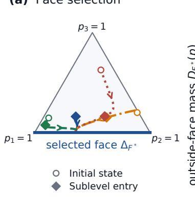

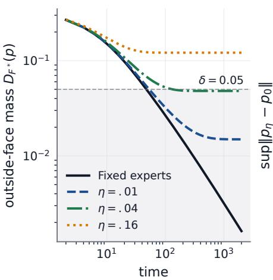

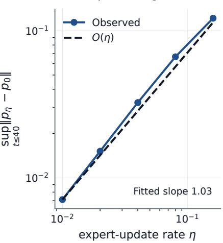  
Figure 1: Face selection and expert-adaptation time scales. (a) Triangle trajectories approach $\Delta _ { F ^ { * } }$ circles mark initial states and diamonds mark entry below the stationary-loss barrier. (b) Outside-face mass under fixed and adapting experts; shading marks $D _ { F ^ { * } } < 0 . 0 5$ . (c) Finite-horizon routing error follows the ${ \cal { O } } ( \eta )$ prediction of Theorem 4.1.

## 7.3 Recovery-time scaling

We test the covariance and advantage mechanisms in Theorem 5.3, then vary the vanishing order of $\Gamma _ { j }$ to examine Theorem 5.2.

Numerical hitting times in Figure $^ { 2 ( \mathrm { a , b } ) }$ agree with the theoretical integrals to relative error below $4 \times 1 0 ^ { - 7 }$ . The two fields realize logarithmic and inverse-probability recovery under the same squared-Jacobian geometry, showing how covariance and advantage produce diferent orders of normal motion.

Prescribing $\Gamma _ { j } = x ^ { \alpha }$ extends the comparison to a range of vanishing orders. The fitted exponents in panel (c) agree with the imposed orders; at $\alpha = 0$ , we fit recovery time against log(1/ε). These constructions test the recovery-time classification across coeficient orders within squared-Jacobian flow. Appendices B.3–B.4 give the fields, their regularity, fitting windows, and numerical accuracy checks.

## 7.4 Router-gradient interventions

We test whether removing a class-conditional router-gradient contrast delays recovery in paired Transformer-MoE training.

Matched training and intervention We use a six-layer Transformer-MoE with eight experts per layer and top-2 routing, trained on AG News text [44] with an autoregressive next-token objective and class-balanced sampling. AdamW is used without auxiliary load balancing or router noise. Appendix C.2 gives the model configuration.

initial mass ε  
(c) Exponent correspondence  
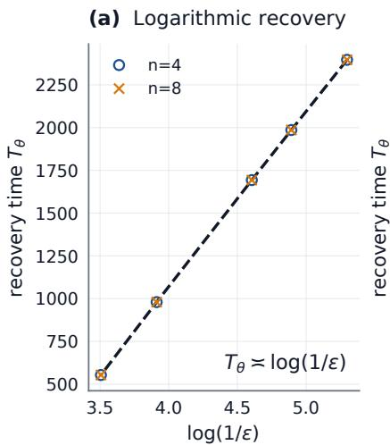

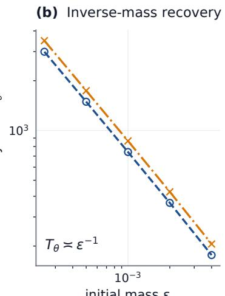

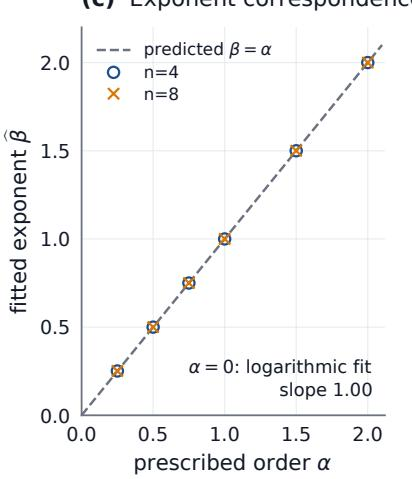  
Figure 2: Recovery-time scaling in constructed fields. (a) Fixed positive covariance and zero mean advantage $\mathrm { g i v e }$ logarithmic recovery. (b) Zero covariance and uniform complementary weights give inverse-probability recovery under a fixed positive advantage. Lines show theoretical hitting times and symbols show numerical events for $n = 4 , 8 ,$ with $\theta = 0 . 0 5 ;$ the curves in (a) coincide. (c) Fitted exponents agree with prescribed orders in $\Gamma _ { j } = x ^ { \alpha } ; \alpha = 0$ uses a separate logarithmic fit.

In each middle layer, the target expert $j$ has the smallest mean pre-dispatch probability among experts with mean at least 0.05; the comparator c has the largest remaining mean. We select the input class on which the target’s mean probability is largest. After controlled suppression, a scalar router-bias shift calibrates its overall mean to $\varepsilon \in \{ 0 . 0 0 5 , 0 . 0 1 , 0 . 0 2 , 0 . 0 4 \}$ (Appendix D.2). Selection, calibration, and recovery measurement share a fixed 512-sequence validation sample; optimizer updates use training data.

Write $G _ { i } ^ { \mathrm { s e l } }$ for the selected-class gradient contribution for router-parameter row $i ,$ including its bias. Both branches start from the same calibrated parameters and optimizer state and use identical minibatches. We compare unmodified training (control) with a branch that orthogonally projects the class-conditional row gradients onto the subspace $G _ { j } ^ { \mathrm { s e l } } = G _ { c } ^ { \mathrm { s e l } }$

$$
\begin{array} { r } { G _ { j } ^ { \mathrm { s e l } } , G _ { c } ^ { \mathrm { s e l } } \gets \frac { 1 } { 2 } ( G _ { j } ^ { \mathrm { s e l } } + G _ { c } ^ { \mathrm { s e l } } ) , \frac { 1 } { 2 } ( G _ { j } ^ { \mathrm { s e l } } + G _ { c } ^ { \mathrm { s e l } } ) . } \end{array}
$$

Projection precedes global norm clipping and AdamW. The paired response therefore includes subsequent optimizer and representation dynamics.

Confirmed recovery and inference Each branch runs for $\tau = 1 , 0 2 4$ steps, with evaluation every 64 steps. Confirmed recovery occurs at the second of two consecutive evaluations with overall mean target probability at least 0.05. We average confirmation times truncated at $\tau$ over the 16 layer–initial-mass combinations within each seed. Averaging over seeds gives the restricted mean time to confirmed recovery (RMST) [33]; $\Delta \mu _ { \tau }$ denotes its projection-minuscontrol diference. We chose RMST as a post hoc summary of the recovery trajectories. Inference uses 16 paired seeds without token dropping and eight with capacity factor 1.25; 95% confidence intervals (CIs) use percentile-bootstrap resamples of paired seeds with their complete collections of layer–initial-mass combinations.

Projection delays confirmed recovery under both dispatch policies. The restricted mean increases by 44.25 steps without dropping (95% CI [31.25, 57.50]) and 59.00 steps with capacity constraints ([39.50, 81.00]); both paired-seed intervals lie above zero (Table 2).

By the observation horizon, projection reduces the confirmed fraction by 8.59 percentage points under both dispatch policies (Figure 3). Post hoc analyses at three alternative probability thresholds preserve the direction, with all pointwise 95% paired-seed intervals above zero. Descriptive RMST contrasts are also positive at each of the four initial probabilities in both dispatch settings.

Table 2: Efect of router-gradient projection on restricted mean time to confirmed recovery through 1,024 steps. Confirmation requires mean target probability $\geqslant 0 . 0 5$ at two consecutive 64-step evaluations. Diferences are projection minus control, with 95% paired-seed bootstrap CIs. The no-drop and capacity settings use 16 and eight paired seeds; sign-test p-values are exact and two-sided, excluding ties.
<table><tr><td>Dispatch</td><td></td><td>Control Projection (95% CI)</td><td>RMST difference</td><td>Sign-test p</td></tr><tr><td>No drop</td><td>796.25</td><td> $8 4 0 . 5 0 ~ + 4 4 . 2 5$ </td><td>[31.25, 57.50]</td><td> $9 . 7 7 \times 1 0 ^ { - 4 }$ </td></tr><tr><td>Capacity 1.25</td><td>810.50</td><td> $8 6 9 . 5 0 ~ + 5 9 . 0 0$ </td><td>[39.50, 81.00]</td><td> $7 . 8 1 \times 1 0 ^ { - 3 }$ </td></tr></table>

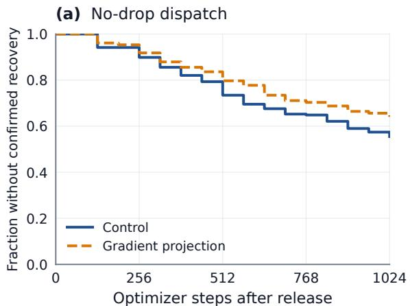

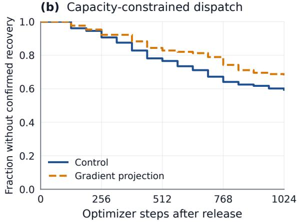

(c) Paired recovery delay  
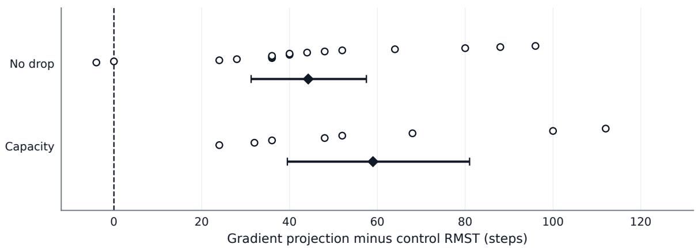  
Figure 3: Router-gradient projection delays confirmed recovery. (a), (b) Fractions without confirmed recovery under no-drop and capacity-constrained dispatch (factor 1.25), using 16 and eight paired seeds, respectively. Curves weight seeds and their layer–initial-mass combinations equally; their areas through 1,024 steps define RMST. (c) Circles show paired-seed RMST diferences (projection minus control); diamonds and bars give means and 95% paired-seed bootstrap CIs.

Fixed-token log-odds We measure accumulated log-odds on fixed, initially subthreshold tokens from the selected class, using eight paired seeds per dispatch setting. The no-drop trajectories are a subset of the RMST sample; capacity token measurements use separate executions with the same seed values as the RMST analysis. Initial states and token identities match between branches. Define

$$
A _ { j } ^ { N } ( x ) = \log \mathrm { i t } ( p _ { j } ^ { N } ( x ) ) - \log \mathrm { i t } ( p _ { j } ^ { 0 } ( x ) ) , \qquad B ( x ) = \log \mathrm { i t } ( 0 . 0 5 ) - \log \mathrm { i t } ( p _ { j } ^ { 0 } ( x ) ) .
$$

A token meets its threshold exactly when $A _ { j } ^ { N } ( x ) \geqslant B ( x )$ . We pool retained tokens across layers within each initial mass, then weight masses and seeds equally; inference resamples whole paired seeds. These token-level measurements use the selected class at a single evaluation; confirmed recovery uses the overall sample at two consecutive evaluations.

Projection reduces both accumulated log-odds and the fraction of tokens meeting the threshold at step 1,024 (Table 3). Together with the RMST contrasts, these measurements link a specified gradient intervention to slower overall recovery and smaller token-level log-odds gains. The discrete identity in Theorem 6.2 expresses those gains in the coordinates that determine individual threshold crossing.

Table 3: Log-odds response of initially subthreshold tokens at step 1,024. Diferences are projection minus control, with 95% paired-seed bootstrap CIs from eight seeds per setting. Threshold attainment is evaluated for each token before averaging; pp denotes percentage points.
<table><tr><td>Dispatch</td><td>Cumulative log-odds difference (95% CI)</td><td>Difference in fraction meeting threshold (pp; 95% CI)</td></tr><tr><td>No drop</td><td>-0.194 [-0.252, -0.133]</td><td> $- 1 . 0 6 \left[ - 1 . 6 4 , - 0 . 5 4 \right]$ </td></tr><tr><td>Capacity 1.25</td><td>-0.228 [−0.304, -0.140]</td><td>-2.28 [−3.71, −0.82]</td></tr></table>

Appendices D.2 and E.1–E.4 give the intervention procedure, recovery summaries, and fixed-token trajectories.

## 8 Discussion and conclusions

The normal-velocity decomposition isolates two efects: covariance among complementary experts and the suppressed route’s relative gradient advantage. Their combined coeficient distinguishes recovery regimes within the same squared-Jacobian geometry. Positive two-sided power bounds along recovery paths, uniform over initial masses, give logarithmic or power-law recovery times; constructed fields reproduce these orders.

Face selection and expert adaptation determine the setting in which recovery takes place. A stationary-loss barrier identifies the supporting face for fixed experts. In the common-target square-loss model with freely trainable outputs, slow adaptation approximates fixed-expert trajectories on finite horizons, while every fixed positive rate gives an interior limit. Explicit tails and probability floors quantify the interior convergence for each fixed rate.

In paired Transformer-MoE training, removing a class-conditional router-gradient contrast delays confirmed recovery and reduces accumulated log-odds on fixed tokens under both dispatch policies. These intervention efects connect a change in training gradients to the motion needed for recovery. The discrete log-odds identity relates the token-level response to threshold crossing under the actual optimizer updates.

Estimating recovery coeficients in naturally evolving systems and testing their predictions on new trajectories would extend the continuous analysis. Independent evaluation inputs and norm-matched gradient controls would further assess how the neural response transfers across inputs and depends on the chosen gradient direction.

## References

[1] S. Ahrac, N. Hochwald, and M. Geva. Routers learn the geometry of their experts: Geometric coupling in sparse mixture-of-experts. arXiv preprint arXiv:2605.12476, 2026.

[2] E. S. Allman, C. Matias, and J. A. Rhodes. Identifiability of parameters in latent structure models with many observed variables. 2009.

[3] E. Alpaydin and C. Kaynak. Optical recognition of handwritten digits. UCI Machine Learning Repository, 1998. URL https://uci.edu.

[4] D. Anguita, A. Ghio, L. Oneto, X. Parra, J. L. Reyes-Ortiz, et al. A public domain dataset for human activity recognition using smartphones. In Esann, volume 3, pages 3–4, 2013.

[5] A. Beck and M. Teboulle. Mirror descent and nonlinear projected subgradient methods for convex optimization. Operations Research Letters, 31(3):167–175, 2003.

[6] J. Chen. Optimal rate of convergence for finite mixture models. The Annals of Statistics, pages 221–233, 1995.

[7] K. Chen, S. Zhao, Y. Cao, and Y.-G. Jiang. From concentration to diferentiation and back: Routing efective rank in moe reasoning cohorts. arXiv preprint arXiv:2609.06403, 2026.

[8] Z. Chen, Y. Deng, Y. Wu, Q. Gu, and Y. Li. Towards understanding the mixture-of-experts layer in deep learning. Advances in neural information processing systems, 35:23049–23062, 2022.

[9] A. Cheng, S. Duan, S. Li, C. Yin, M. Cheng, S. Nazarian, P. Thompson, and P. Bogdan. Emoe: Eigenbasis-guided routing for mixture-of-experts. In ICASSP 2026-2026 IEEE International Conference on Acoustics, Speech and Signal Processing (ICASSP), pages 1081–1085. IEEE, 2026.

[10] Z. Chi, L. Dong, S. Huang, D. Dai, S. Ma, B. Patra, S. Singhal, P. Bajaj, X. Song, X.-L. Mao, et al. On the representation collapse of sparse mixture of experts. Advances in Neural Information Processing Systems, 35:34600–34613, 2022.

[11] N. Dikkala, N. Ghosh, R. Meka, R. Panigrahy, N. Vyas, and X. Wang. On the benefits of learning to route in mixture-of-experts models. In Proceedings of the 2023 Conference on Empirical Methods in Natural Language Processing, pages 9376–9396, 2023.

[12] N. Du, Y. Huang, A. M. Dai, S. Tong, D. Lepikhin, Y. Xu, M. Krikun, Y. Zhou, A. W. Yu, O. Firat, et al. Glam: Eficient scaling of language models with mixture-of-experts. In International conference on machine learning, pages 5547–5569. PMLR, 2022.

[13] W. Fedus, B. Zoph, and N. Shazeer. Switch transformers: Scaling to trillion parameter models with simple and eficient sparsity. Journal of Machine Learning Research, 23(120): 1–39, 2022.

[14] Z. Gu, T. Likhomanenko, V. Thilak, J. Ramapuram, and N. Jaitly. Path-constrained mixture-of-experts. arXiv preprint arXiv:2603.18297, 2026.

[15] H. Guo, H. Lu, G. Nan, B. Chu, J. Zhuang, Y. Yang, W. Che, X. Cao, S. Leng, Q. Cui, et al. Advancing expert specialization for better moe. Advances in Neural Information Processing Systems, 38:48767–48809, 2026.

[16] X. Han and Y. Zhong. A theoretical framework for auxiliary-loss-free load balancing of sparse mixture-of-experts in large-scale ai models. arXiv preprint arXiv:2512.03915, 2025.

[17] H. Hazimeh, Z. Zhao, A. Chowdhery, M. Sathiamoorthy, Y. Chen, R. Mazumder, L. Hong, and E. Chi. Dselect-k: Diferentiable selection in the mixture of experts with applications to multi-task learning. Advances in Neural Information Processing Systems, 34:29335–29347, 2021.

[18] J. Hofbauer, K. Sigmund, et al. Evolutionary games and population dynamics, volume 1. Cambridge university press Cambridge, 1998.

[19] R. A. Jacobs, M. I. Jordan, S. J. Nowlan, and G. E. Hinton. Adaptive mixtures of local experts. Neural computation, 3(1):79–87, 1991.

[20] M. I. Jordan and R. A. Jacobs. Hierarchical mixtures of experts and the em algorithm. Neural computation, 6(2):181–214, 1994.

[21] R. Kawata, K. Matsutani, Y. Kinoshita, N. Nishikawa, and T. Suzuki. Mixture of experts provably detect and learn the latent cluster structure in gradient-based learning. arXiv preprint arXiv:2506.01656, 2025.

[22] O. Kiselev. A minimal bifurcation model of load imbalance in a softmax mixture-of-experts router. arXiv preprint arXiv:2605.29121, 2026.

[23] D. Lepikhin, H. Lee, Y. Xu, D. Chen, O. Firat, Y. Huang, M. Krikun, N. Shazeer, and Z. Chen. Gshard: Scaling giant models with conditional computation and automatic sharding. arXiv preprint arXiv:2006.16668, 2020.

[24] M. Lewis, S. Bhosale, T. Dettmers, N. Goyal, and L. Zettlemoyer. Base layers: Simplifying training of large, sparse models. In International Conference on Machine Learning, pages 6265–6274. PMLR, 2021.

[25] F. Liao and A. Kyrillidis. Guided by the experts: Provable feature learning dynamic of soft-routed mixture-of-experts. arXiv preprint arXiv:2510.07205, 2025.

[26] J. Mei, C. Xiao, C. Szepesvari, and D. Schuurmans. On the global convergence rates of softmax policy gradient methods. In International conference on machine learning, pages 6820–6829. PMLR, 2020.

[27] S. Merity, C. Xiong, J. Bradbury, and R. Socher. Pointer sentinel mixture models. arXiv preprint arXiv:1609.07843, 2016.

[28] H. Nguyen, P. Akbarian, and N. Ho. Is temperature sample eficient for softmax gaussian mixture of experts? arXiv preprint arXiv:2401.13875, 2024.

[29] H. Nguyen, N. Ho, and A. Rinaldo. On least square estimation in softmax gating mixture of experts. arXiv preprint arXiv:2402.02952, 2024.

[30] B. T. Polyak. Gradient methods for solving equations and inequalities. USSR Computational Mathematics and Mathematical Physics, 4(6):17–32, 1964.

[31] J. Puigcerver, C. Riquelme Ruiz, B. Mustafa, and N. Houlsby. From sparse to soft mixtures of experts. In International Conference on Learning Representations, volume 2024, pages 28435–28445, 2024.

[32] R. T. Rockafellar. Convex analysis, volume 28. Princeton university press, 1997.

[33] P. Royston and M. K. Parmar. Restricted mean survival time: an alternative to the hazard ratio for the design and analysis of randomized trials with a time-to-event outcome. BMC medical research methodology, 13(1):152, 2013.

[34] W. H. Sandholm. Population games and evolutionary dynamics, volume 25. MIT press Cambridge, 2010.

[35] H. Sha. Sparse mixture-of-experts routing in visual difusion transformers: Diagnosis, boundary calibration and evolutionary roadmap from routing collapse to selective deadlock. arXiv preprint arXiv:2605.19378, 2026.

[36] N. Shazeer, A. Mirhoseini, K. Maziarz, A. Davis, Q. Le, G. Hinton, and J. Dean. Outrageously large neural networks: The sparsely-gated mixture-of-experts layer. arXiv preprint arXiv:1701.06538, 2017.

[37] A. Varre, M. Rofin, and N. Flammarion. Gradient flow polarizes softmax outputs towards low-entropy solutions. arXiv preprint arXiv:2603.06248, 2026.

[38] L. Wang, H. Gao, C. Zhao, X. Sun, and D. Dai. Auxiliary-loss-free load balancing strategy for mixture-of-experts. arXiv preprint arXiv:2408.15664, 2024.

[39] X. Wang, S. Hayou, and E. Nalisnick. The myth of expert specialization in moes: Why routing reflects geometry, not necessarily domain expertise. arXiv preprint arXiv:2604.09780, 2026.

[40] Z. Wang, J. Zhu, and J. Chen. Remoe: Fully diferentiable mixture-of-experts with relu routing. In International Conference on Learning Representations, volume 2025, pages 59486–59507, 2025.

[41] S. J. Wright. Identifiable surfaces in constrained optimization. SIAM Journal on Control and Optimization, 31(4):1063–1079, 1993.

[42] F. Xue, Z. Zheng, Y. Fu, J. Ni, Z. Zheng, W. Zhou, and Y. You. Openmoe: An early efort on open mixture-of-experts language models. arXiv preprint arXiv:2402.01739, 2024.

[43] Y. Yoon, S. Wang, W. Chen, and J. Ok. When are experts misrouted? counterfactual routing analysis in mixture-of-experts language models. arXiv preprint arXiv:2605.07260, 2026.

[44] X. Zhang, J. Zhao, and Y. LeCun. Character-level convolutional networks for text classification. Advances in neural information processing systems, 28, 2015.

[45] Y. Zhou, T. Lei, H. Liu, N. Du, Y. Huang, V. Zhao, A. M. Dai, Q. V. Le, J. Laudon, et al. Mixture-of-experts with expert choice routing. Advances in Neural Information Processing Systems, 35:7103–7114, 2022.

[46] W. Zhu, L. Shi, K. Wei, Z. Wang, Y. Zhou, and H. Zhang. Rethinking convergence in moe training: The role of routing sparsity. In Forty-third International Conference on Machine Learning.

[47] B. Zoph, I. Bello, S. Kumar, N. Du, Y. Huang, J. Dean, N. Shazeer, and W. Fedus. St-moe: Designing stable and transferable sparse expert models. arXiv preprint arXiv:2202.08906, 2022.

## Appendices

Contents These appendices contain auxiliary theory, additional numerical results, and details of the input-conditioned routing and recovery experiments.

<table><tr><td>Appendix</td><td>Contents</td><td>Page</td></tr><tr><td>A</td><td>Further theoretical results</td><td>22</td></tr><tr><td>B</td><td>Additional numerical results</td><td>26</td></tr><tr><td>C</td><td>Input-conditioned routing</td><td>30</td></tr><tr><td>D</td><td>Recovery interventions</td><td>33</td></tr><tr><td>E</td><td>Recovery analysis</td><td>34</td></tr></table>

## A Further theoretical results

We use the notation and norm conventions of the main text. Here $p \in \Delta ^ { n - 1 }$ is the routing vector for n experts, $E \in \mathbb { R } ^ { n \times d }$ has expert outputs as rows, $\boldsymbol { y } \in \mathbb { R } ^ { d }$ is the target, $q \in \mathbb { R } ^ { n }$ is the logit vector, and η is the expert-to-router learning-rate ratio. In particular,

$$
\begin{array} { r } { \mathcal { L } ( p , E ) = \| E ^ { \top } p - y \| ^ { 2 } , \qquad J ( p ) = \mathrm { d i a g } ( p ) - p p ^ { \top } , \qquad M ( p ) = J ( p ) ^ { 2 } . } \end{array}
$$

As in the main text, these flows optimize the half-loss $\mathcal { H } : = \mathcal { L } / 2$ . The fixed-expert router flow and joint expert equation are

$$
\begin{array} { c } { \dot { p } = - M ( p ) E ( E ^ { \top } p - y ) , } \\ { \dot { E _ { i } } = - \eta p _ { i } ( E ^ { \top } p - y ) . } \end{array}\tag{A.1}
$$

We write $g = E ( E ^ { \top } p - y )$ and $s = J ( p ) g$ for the probability and logit gradients of H.

## A.1 Convergence to an edge in the three-expert model

Consider the three-expert triangle

$$
E _ { 1 } = ( 0 , 0 ) , \qquad E _ { 2 } = ( 1 , 0 ) , \qquad E _ { 3 } = ( 0 , 1 ) , \qquad y = ( x , - h ) , \quad 0 < x < 1 , \ h > 0 .
$$

Theorem A.1 (Convergence to an edge with three experts). Let $p ( t )$ solve (A.1) from the simplex interior. Define

$$
p _ { 2 3 } : = { \bigg ( } 0 , { \frac { 1 + x + h } { 2 } } , { \frac { 1 - x - h } { 2 } } { \bigg ) }
$$

when $x + h \textless 1$ , and omit this point otherwise. Let $e _ { i }$ denote the ith simplex vertex. If $\mathcal { L } ( v , E ) > \mathcal { L } ( p ( 0 ) , E )$ for every $v \in \{ e _ { 1 } , e _ { 2 } , e _ { 3 } \} \cup ( \{ p _ { 2 3 } \} \ i f \ x + h < 1 )$ , then

$$
p ( t )  ( 1 - x , x , 0 ) .
$$

In particular, $p _ { 3 } ( t ) \to 0 ;$ hence for every $\delta > 0 , p _ { 3 } ( t ) < \delta$ for all suficiently large t.

Proof. Here $E ^ { \top } p = ( p _ { 2 } , p _ { 3 } )$ and $g = ( 0 , p _ { 2 } - x , p _ { 3 } + h )$ . An interior stationary point would require all three components of g to agree, while $p _ { 3 } + h > 0$ . Every vertex is stationary. In the relative interior of edge {2, 3}, the condition $g _ { 2 } = g _ { 3 }$ gives p23, which exists there exactly when $x + h < 1$ . On edge {1, 3}, equality $g _ { 1 } = g _ { 3 }$ would require $p _ { 3 } = - h ,$ , so its relative interior contains no stationary point. On edge $\{ 1 , 2 \}$ , equality $g _ { 1 } = g _ { 2 } { \mathrm { ~ g i v e s ~ } } ( 1 - x , x , 0 )$ . Loss dissipation and LaSalle’s invariance principle place the ω-limit set in this stationary set, and the strict loss inequalities select $( 1 - x , x , 0 )$ as its sole member. □

## A.2 Separation of stationary outputs

For fixed $E , y ,$ , let $z ^ { * } = \mathrm { P r o j } _ { \mathrm { c o n v } \{ E _ { i } \} } y$ and $r _ { * } = \| z ^ { * } - y \|$ . Let $\ell _ { \mathrm { c o m p } }$ be the lowest suboptimal stationary loss defined in the main text.

Proposition A.2 (Separation of stationary outputs). Define

$$
\mathcal { Z } _ { \mathrm { s t a t } } : = \{ \boldsymbol { E } ^ { \top } \boldsymbol { p } : \boldsymbol { p } \in \Delta ^ { n - 1 } , \ J ( \boldsymbol { p } ) E ( \boldsymbol { E } ^ { \top } \boldsymbol { p } - \boldsymbol { y } ) = 0 \} .
$$

This set is finite. If it contains an output diferent from $z ^ { * }$ , set

$$
\sigma _ { * } : = \operatorname* { m i n } _ { z \in { \mathcal { Z } } _ { \mathrm { s t a t } } , z \neq z ^ { * } } \| z - z ^ { * } \| .
$$

Then

$$
r _ { * } ^ { 2 } < r _ { * } ^ { 2 } + \sigma _ { * } ^ { 2 } \leqslant \ell _ { \mathrm { c o m p } } .
$$

Thus loss below $r _ { * } ^ { 2 } + \sigma _ { * } ^ { 2 }$ satisfies the barrier condition in the main face-selection theorem.   
Computing $\sigma _ { * }$ requires solving a global polynomial problem.

Proof. On each stationary support, $E ^ { \top } p$ is the unique projection of y onto the convex hull of the expert outputs in that support, so only finitely many stationary outputs occur. For any suboptimal one, the projection inequality at $z ^ { * }$ gives

$$
\begin{array} { r } { \| z - y \| ^ { 2 } - r _ { * } ^ { 2 } \geqslant \| z - z ^ { * } \| ^ { 2 } \geqslant \sigma _ { * } ^ { 2 } . } \end{array}
$$

Minimizing over suboptimal stationary outputs proves the result.

Computing the geometric bounds Support enumeration considers up to $2 ^ { n } - 1$ nonempty restricted hulls to identify the stationary outputs and their loss barrier. The hitting-time constant $\mu ( c , \delta )$ in Theorem 3.4 is a global minimum of the squared logit-gradient norm over the compact loss sublevel with outside-face mass at least δ. Once an exposing direction is available, Theorem 3.3 instead converts a measured loss excess directly into an outside-face mass bound. Section B.1 evaluates stationary-loss separation across fixed-expert geometries and initializations.

## A.3 Explicit finite-horizon stability constants

Lemma A.3 (Uniform bounds for slow expert motion). Let $T > 0$ be a fixed horizon and $E ^ { 0 }$ the common initial expert matrix for the fixed and joint flows, with common routing state $p ( 0 )$ Set $\rho = \| E ^ { 0 ^ { \top } } p ( 0 ) - y \|$ and $Y = \| y \|$ . For the joint square-loss flow with $0 \leqslant \eta \leqslant 1$ , set

$$
K = \| E ^ { 0 } \| _ { \mathrm { F } } + T \rho , \qquad L = 6 K ( K + Y ) + K ^ { 2 } , \qquad K _ { E } = 2 K + Y .
$$

The fixed-expert solution $p _ { 0 }$ and the joint solution satisfy, for $0 \leqslant t \leqslant T$ 2

$$
\| E _ { \eta } ( t ) - E ^ { 0 } \| _ { \mathrm { F } } \leqslant \eta \rho t , \qquad \| p _ { \eta } ( t ) - p _ { 0 } ( t ) \| \leqslant \eta K _ { E } \rho \Psi _ { L } ( t ) ,
$$

where

$$
\Psi _ { L } ( t ) = { \left\{ \begin{array} { l l } { ( e ^ { L t } - 1 - L t ) / L ^ { 2 } , } & { L > 0 , } \\ { t ^ { 2 } / 2 , } & { L = 0 . } \end{array} \right. }
$$

In particular, $C _ { T } = \rho T + K _ { E } \rho \Psi _ { L } ( T )$ is an admissible constant in the main text’s finite-horizon bound. Its dependence on $T$ is explicit through $\Psi _ { L } ( T )$ and the expert-norm bound $K$

Proof. For the residual $R _ { \eta } ( t ) = E _ { \eta } ( t ) ^ { \top } p _ { \eta } ( t ) - y$ , joint loss dissipation implies $\| R _ { \eta } ( t ) \| \leqslant \rho .$ Since $\| p _ { \eta } \| \leqslant 1$ , integrating $\| \dot { E } _ { \eta } \| _ { \mathrm { F } } = \eta \| p _ { \eta } \| \| R _ { \eta } \|$ gives the first bound and $\| E _ { \eta } \| _ { \mathrm { F } } \leqslant K$ . For simplex points, $\| J ( p ) \| \leqslant 1$ and $\| J ( p ) - J ( \widetilde { p } ) \| \leqslant 3 \| p - \widetilde { p } \|$ , hence $\| J ( p ) ^ { 2 } - J ( \dot { \widetilde { p } } ) ^ { 2 } \| \leqslant 6 \| p - \widetilde { p } \|$ . For $\begin{array} { r } { f ( p , E ) = - J ( p ) ^ { 2 } E ( E ^ { \top } p - y ) } \end{array}$ , these inequalities give

$$
\| f ( p , E ) - f ( \widetilde { p } , \widetilde { E } ) \| \leqslant L \| p - \widetilde { p } \| + K _ { E } \| E - \widetilde { E } \| _ { \mathrm { F } }
$$

when both expert norms are at most K. Here the two terms in L bound the changes in $J ( p ) ^ { 2 }$ and in the residual, respectively; $K _ { E }$ bounds the two occurrences of E. Bounded expert and logit velocities give continuation on [0, T]. With $d ( t ) = \| p _ { \eta } ( t ) - p _ { 0 } ( t ) \|$ , the probability error obeys

$$
d ( t ) \leqslant \int _ { 0 } ^ { t } \bigl ( L d ( s ) + \eta K _ { E } \rho s \bigr ) d s \leqslant \eta K _ { E } \rho \int _ { 0 } ^ { t } e ^ { L ( t - s ) } s d s .
$$

Evaluating the integral gives $\Psi _ { L } ( t )$ , including its continuous extension at $L = 0$

## A.4 Interior convergence for PL residual losses

The interior-convergence argument extends to residual losses with lower and upper gradient bounds. The lower bound is the Polyak– Lojasiewicz (PL) inequality [30] for a nonnegative loss with minimum value zero.

Theorem A.4 (Interior convergence for a PL residual-loss class). Let $\varphi : \mathbb { R } ^ { d }  [ 0 , \infty )$ have locally Lipschitz gradient and suppose that, for $\mu , L > 0$

$$
2 \mu \varphi ( r ) \leqslant \| \nabla \varphi ( r ) \| ^ { 2 } \leqslant 2 L \varphi ( r ) , \qquad r \in \mathbb { R } ^ { d } .
$$

For $\boldsymbol { R } = \boldsymbol { E } ^ { \intercal } \boldsymbol { p } - \boldsymbol { y } ,$ consider

$$
\dot { q } = - J ( p ) E \nabla \varphi ( R ) , \qquad \dot { E } = - \eta p \nabla \varphi ( R ) ^ { \top } , \qquad p = \mathrm { S o f t m a x } ( q ) ,
$$

with $\eta > 0$ and finite $q ( 0 ) , E ( 0 )$ . Taking $\varphi ( \boldsymbol { r } ) = \| \boldsymbol { r } \| ^ { 2 } / 2$ recovers the main half-loss flow, with $\mu = L = 1$ . Define

$$
\Phi _ { 0 } : = \varphi ( R ( 0 ) ) , \quad G _ { 0 } : = \frac { n \sqrt { 2 L \Phi _ { 0 } } } { \eta \mu } , \quad B _ { \varphi } : = \| E ( 0 ) \| _ { \mathrm { o p } } + \eta G _ { 0 } , \quad C _ { \varphi } : = B _ { \varphi } G _ { 0 } .
$$

Then the solution is global,

$$
\varphi ( R ( t ) ) \leqslant \Phi _ { 0 } e ^ { - 2 \eta \mu t / n } ,
$$

and $E ( t ) \to E _ { \infty } , q ( t ) \to q _ { \infty }$ , with

$$
\| E ( t ) - E _ { \infty } \| _ { \mathrm { F } } \leqslant \eta G _ { 0 } e ^ { - \eta \mu t / n } , \qquad \| q ( t ) - q _ { \infty } \| \leqslant C _ { \varphi } e ^ { - \eta \mu t / n } .
$$

Moreover,

$$
p _ { i } ( t ) \geqslant \frac { p _ { i } ( 0 ) } { p _ { i } ( 0 ) + e ^ { 2 C _ { \varphi } } ( 1 - p _ { i } ( 0 ) ) } > 0
$$

for every expert and every time, so the router converges to an interior point.

Proof. Writing $D = \nabla \varphi ( R )$ , gradient-flow dissipation and $\| p \| ^ { 2 } \geqslant 1 / n$ give

$$
\frac { d } { d t } \varphi ( R ) = - \| J ( p ) E D \| ^ { 2 } - \eta \| p \| ^ { 2 } \| D \| ^ { 2 } \leqslant - \frac { 2 \eta \mu } { n } \varphi ( R ) .
$$

The gradient upper bound therefore yields

$$
\int _ { t } ^ { \infty } \| D ( \tau ) \| d \tau \leqslant G _ { 0 } e ^ { - \eta \mu t / n } .
$$

Integrating the expert and logit equations gives the stated tails and precludes finite-time divergence of the logits. Finally $\| q ( t ) - q ( 0 ) \| \leqslant C _ { \varphi } ;$ ; bounding every logit diference by $2 C _ { \varphi }$ gives the lower bound on the probabilities and interior limit. □

For $\varphi ( \boldsymbol { r } ) = \lVert \boldsymbol { r } \rVert ^ { 2 } / 2$ , these constants reduce to $G _ { 0 } = n \| R ( 0 ) \| / \eta , B _ { \varphi } = \| E ( 0 ) \| _ { \mathrm { o p } } + n \| R ( 0 ) \|$ and $C _ { \varphi } = n B _ { \varphi } \| R ( 0 ) \| / \eta$ , as in the main square-loss theorem.

## A.5 A log-ratio criterion for interior convergence

Proposition A.5 (Interior convergence from accumulated logit-gradient diferences). Let $( p ( t ) , E ( t ) )$ be any global solution of $\dot { p } = - J ( p ) ^ { 2 } E ( t ) ( E ( t ) ^ { \top } p - y )$ that remains in int $( \Delta ^ { n - 1 } )$ for every finite time. Define $g ( t ) = E ( t ) ( E ( t ) ^ { \top } p ( t ) - y ) , s ( t ) = J ( p ( t ) ) g ( t )$ , and $A _ { i j } ( t ) : =$ $\begin{array} { r } { \int _ { 0 } ^ { t } \bigl ( s _ { i } ( \tau ) - s _ { j } ( \tau ) \bigr ) } \end{array}$ dτ . $I f A _ { i j } ( t )$ has a finite limit, then $p _ { i } ( t ) / p _ { j } ( t )$ converges to a finite positive limit. $\begin{array} { r } { I f \operatorname* { s u p } _ { t \geq 0 } | A _ { i n } ( t ) | < \infty } \end{array}$ for every $i < n$ , then

$$
\operatorname* { i n f } _ { t \geq 0 } \operatorname* { m i n } _ { i } p _ { i } ( t ) > 0 .
$$

If every $A _ { i n } ( t )$ converges, then $p ( t ) \to p _ { \infty } \in \mathrm { i n t } ( \Delta ^ { n - 1 } )$ . In particular, bounded experts and $\begin{array} { r } { \int _ { 0 } ^ { \infty } \| E ( t ) ^ { \top } p ( t ) - y \| d t < \infty } \end{array}$ imply this interior convergence.

Proof. The softmax log-ratio identity gives $\begin{array} { r } { \frac { p _ { i } ( t ) } { p _ { j } ( t ) } = \frac { p _ { i } ( 0 ) } { p _ { j } ( 0 ) } e ^ { - A _ { i j } ( t ) } } \end{array}$ . Uniformly bounded reference diferences keep all ratios $p _ { i } / p _ { n }$ between positive constants, so normalization yields the uniform positive lower bound. If they converge, set $r _ { i } = \mathrm { l i m } _ { t  \infty } p _ { i } ( t ) / p _ { n } ( t ) \in ( 0 , \infty )$ . Then

$$
p _ { n } ( t ) \to { \frac { 1 } { 1 + \sum _ { i < n } r _ { i } } } , \qquad p _ { i } ( t ) \to { \frac { r _ { i } } { 1 + \sum _ { k < n } r _ { k } } } .
$$

Finally, $| s _ { i } - s _ { j } | \leqslant 2 \| E \| _ { \mathrm { o p } } \| E ^ { \top } p - y \|$ , so the last hypotheses make every logit-gradient diference absolutely integrable. □

## A.6 Cumulative log-odds thresholds for recovery

Corollary A.6 (Cumulative log-odds threshold for coupled recovery). For the coupled-flow log-odds identity in the main text, write $a _ { j } ( t ) = d \log \mathrm { i t } ( p _ { j } ( t ) ) / d t$ Fix a recovery threshold $\theta \in ( 0 , 1 )$ , let $p _ { j } ( 0 ) = \varepsilon \in ( 0 , \theta )$ , and set $T _ { \theta } = \operatorname* { i n f } \{ t \geqslant 0 : p _ { j } ( t ) \geqslant \theta \}$ $I f T _ { \theta } < \infty$ and $p _ { j } ( t ) \in ( 0 , 1 )$ on $[ 0 , T _ { \theta } ]$ , then

$$
\int _ { 0 } ^ { T _ { \theta } } a _ { j } ( t ) d t = B _ { \theta , \varepsilon } : = \log \frac { \theta ( 1 - \varepsilon ) } { ( 1 - \theta ) \varepsilon } = \log \frac { 1 } { \varepsilon } + O _ { \theta } ( 1 ) .
$$

$I f a _ { j } ( t ) \leqslant \bar { a }$ on $[ 0 , T _ { \theta } ]$ for some $\bar { a } > 0$ , then $T _ { \theta } \geqslant B _ { \theta , \varepsilon } / \bar { a }$ . Moreover, for any horizon $T _ { \cdot }$

$$
\int _ { 0 } ^ { T } a _ { j } ( t ) _ { + } d t < B _ { \theta , \varepsilon } , \qquad a _ { j } ( t ) _ { + } : = \operatorname* { m a x } \{ a _ { j } ( t ) , 0 \} ,
$$

implies $p _ { j } ( t ) < \theta$ for every $t \in [ 0 , T ]$

Proof. At the first hitting time, continuity and the main text’s exact log-odds identity give $\begin{array} { r } { \int _ { 0 } ^ { T _ { \theta } } \dot { a } _ { j } ( t ) d t = B _ { \theta , \varepsilon } } \end{array}$ . The upper bound on $a _ { j }$ yields $B _ { \theta , \varepsilon } \leqslant \bar { a } T _ { \theta }$ . If recovery occurred by time $T$ the same identity at its first hitting time would imply $\begin{array} { r } { B _ { \theta , \varepsilon } \leqslant \int _ { 0 } ^ { T } a _ { j } ( t ) _ { + } d t \colon } \end{array}$ contraposition proves the last claim. □

## A.7 First-order group separation with independent logits

Proposition A.7 (First-order separation with independent logits). Let $k = 1 , \ldots , K$ index groups with targets $y _ { k } \in \mathbb { R } ^ { d }$ Give each group its own logits $\boldsymbol { q } ^ { ( k ) }$ and routing probabilities $p ^ { ( k ) } = \operatorname { S o f t m a x } ( q ^ { ( k ) } )$ , and fix the experts. Under the half-loss gradient flow for each group, $\dot { p } ^ { ( k ) } = - M ( p ^ { ( k ) } ) \dot { E } ( \dot { E } ^ { \top } p ^ { ( k ) } - y _ { k } )$ . At a shared point $p ^ { ( 1 ) } = \cdot \cdot \cdot = p ^ { ( K ) } = p _ { 0 }$ , define $\chi ( p _ { 0 } , E ) : =$ ma $\mathfrak { c } _ { k , \ell } \| M ( p _ { 0 } ) E ( y _ { k } - y _ { \ell } ) \|$ . The routing velocities difer across groups exactly when $\chi ( p _ { 0 } , E ) > 0$ in which case

$$
\operatorname* { m a x } _ { k , \ell } \| p ^ { ( k ) } ( t ) - p ^ { ( \ell ) } ( t ) \| = \chi ( p _ { 0 } , E ) t + o ( t ) .
$$

If the groupwise routing distributions converge and their limiting outputs have diferent minimal hull faces, those distributions are distinct. Objective weights rescale time, while the groupwise vector fields determine persistent between-group routing variation.

Proof. At a shared point, ${ \dot { p } } ^ { ( k ) } ( 0 ) - { \dot { p } } ^ { ( \ell ) } ( 0 ) = M ( p _ { 0 } ) E ( y _ { k } - y _ { \ell } )$ , which proves the separation criterion and first-order expansion. Outputs with diferent minimal hull faces are distinct, so they cannot be represented by the same routing distribution. Multiplying a group objective by a positive weight $w _ { k }$ rescales time and leaves its phase portrait unchanged. □

## B Additional numerical results

These studies compare selection, adaptation, and recovery with their continuous predictions.   
Solver refinement and independent quadrature assess numerical accuracy.

## B.1 Face selection

Table 1 reports the representative fixed-expert trajectories. The initialization sweep below examines sublevel entry and face selection across the triangle simplex.

For a projection in the relative interior of the full hull, take $E _ { 1 } = ( 0 , 0 ) , E _ { 2 } = ( 1 , 0 )$ ${ \cal E } _ { 3 } = ( 0 , 1 )$ , and $y \ = \ ( 0 . 3 0 , 0 . 2 5 )$ . The unique minimizing route is $p ^ { * } = ( 0 . 4 5 , 0 . 3 0 , 0 . 2 5 )$ Initialization at $( 0 . 5 5 , 0 . 2 4 , 0 . 2 1 )$ has loss 0.0052, below the lowest suboptimal stationary loss 0.0625. DOP853 integrations to $t = 2 0 0 0$ , with relative tolerances $1 0 ^ { - 1 0 }$ and $1 0 ^ { - 1 2 }$ , give terminal probability errors at most $2 . 5 5 \times 1 0 ^ { - 1 2 }$ . This illustrates the full-hull case of the main face-selection theorem.

Geometric configurations The four configurations use the following expert orderings, targets, and initial probabilities:

1. Triangle: expert rows (0, 0), (1, 0), (0, 1), y = (0.35, −0.20), and $p ( 0 ) = ( 1 / 3 , 1 / 3 , 1 / 3 )$

2. Pentagon: expert rows $( - 1 , 0 ) , ( 1 , 0 ) , ( 1 . 3 , 1 ) , ( 0 , 1 . 5 ) , ( - 1 . 2 , 1 ) , y \ = \ ( 0 . 2 5 , - 0 . 5 0 )$ , and $p ( 0 ) = ( 0 . 0 4 , 0 . 0 5 , 0 . 2 5 , 0 . 3 8 , 0 . 2 8 )$

3. Redundant hexagon face: expert rows $( - 1 , 0 ) , ( 0 , 0 ) , ( 1 , 0 ) , ( 1 . 2 , 0 . 9 ) , ( 0 , 1 . 5 ) , ( - 1 . 2 , 0 . 9 )$ ， $y = ( 0 . 2 0 , - 0 . 4 0 )$ , and $p ( 0 ) = ( 0 . 0 3 , 0 . 0 3 , 0 . 0 4 , 0 . 2 4 , 0 . 3 8 , 0 . 2 8 )$

4. Cube: the first four rows are $( - 1 , - 1 , 0 ) , ( 1 , - 1 , 0 ) , ( 1 , 1 , 0 ) , ( - 1 , 1 , 0 )$ ; the next four have the same first two coordinates and third coordinate one. Here $y = ( 0 , 0 , - 0 . 4 0 )$ and $p ( 0 ) = ( 0 . 0 2 5 , 0 . 0 2 5 , 0 . 0 2 5 , 0 . 0 2 5 , 0 . 2 0 , 0 . 2 2 , 0 . 2 5 , 0 . 2 3 )$ . The boundary control has support $\{ 1 , 2 , 7 \}$ and weights (0.50, 0.18, 0.32) on those experts.

For each of four fixed-expert geometries, we enumerate the $2 ^ { n } - 1$ nonempty supports, identify the stationary supports, and compute $\ell _ { \mathrm { c o m p } }$ from their restricted-hull projections. The classical fourth-order Runge–Kutta method $\mathrm { ( R K 4 ) }$ with time step $\Delta t = 0 . 0 2$ runs to $t = 2 0 0 0$ , including a control initialized at a suboptimal stationary point. Table 1 gives entry times and terminal errors.

We draw 600 triangle initializations from a Dirichlet distribution with concentration parameter 0.7 in each coordinate. Under step halving, all face-selection classifications agree: 130 start below the loss barrier, 448 enter later and select the face, and 22 have not selected the face by $T = 2 0 0 0$ . Of the last group, seven have entered the sublevel set and 15 have not. The maximum terminal routing discrepancy is below $1 0 ^ { - 1 1 }$

## B.2 Expert-adaptation time scales

Joint-flow simulations compare residual decay and interior stabilization with the fixed-horizon approximation by fixed-expert routing.

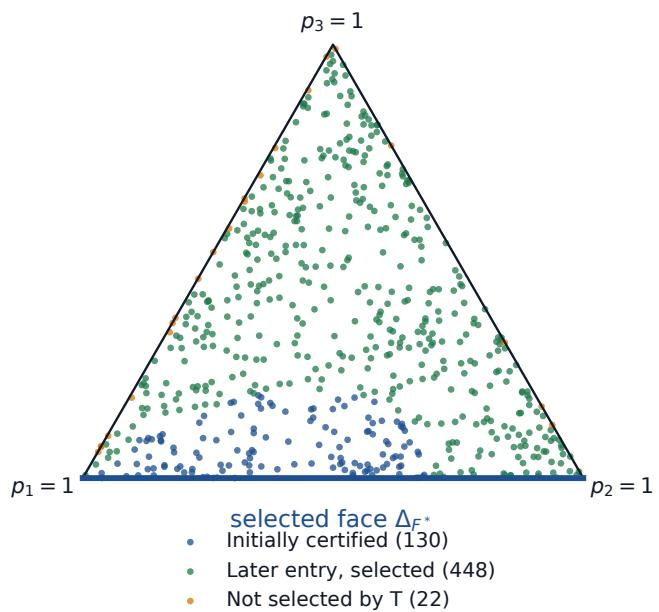  
Figure B.1: Face selection across triangle initializations. Colors distinguish initial loss below the stationary-loss barrier, later sublevel entry with face selection, and trajectories that have not selected the face by $T = 2 0 0 0$

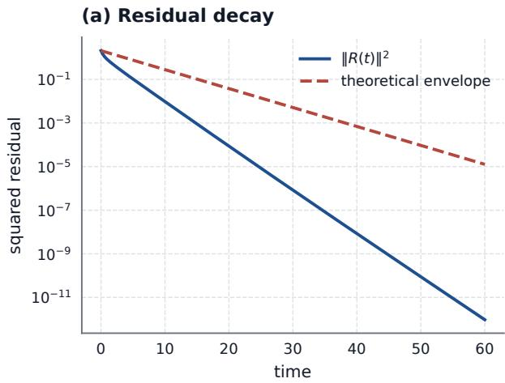

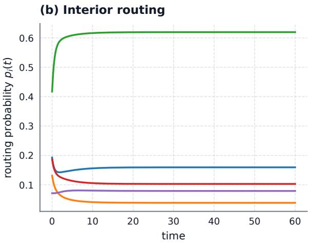  
Figure B.2: Residual decay and interior routing under joint training. (a) Squared residual norm and its exponential envelope. (b) Expert routing probabilities along the same trajectory.

Joint training and PL residual losses The joint square-loss study uses three configurations $( n , d , \eta ) \colon ( 3 , 2 , 0 . 1 ) , ( 5 , 4 , 0 . 5 )$ , and $( 8 , 6 , 1 )$ . Each configuration uses five Gaussian initializations and three RK4 step sizes over $0 \leqslant t \leqslant 6 0$ . All trajectories satisfy the residual and probability bounds. The largest coarse-to-fine terminal routing error is below $3 \times 1 0 ^ { - 5 }$

The nonquadratic experiment uses $\begin{array} { r } { \varphi ( r ) = \frac { 1 } { 2 } \| r \| ^ { 2 } + 0 . 3 5 \sum _ { k } ( 1 - \cos r _ { k } ) } \end{array}$ . This loss is 0.65- strongly convex and 1.35-smooth, so the PL bounds hold with $( \mu , L ) = ( 0 . 6 5 , 1 . 3 5 )$ . Using the same configurations and integration scheme as above, all finest-step trajectories satisfy the loss and probability bounds; the coarse-to-fine terminal routing error is again below $3 \times 1 0 ^ { - 5 }$

The time-scale comparison in Figure $^ { 1 ( \mathrm { b , c } ) }$ uses the triangle configuration above, RK4 step 0.02, and $\eta \in \{ 0 . 0 1 , 0 . 0 2 , 0 . 0 4 , 0 . 0 8 , 0 . 1 6 \}$ . The maximum routing error on [0, 40] has fitted log–log slope 1.03, consistent with the fixed-horizon approximation.

## B.3 Recovery-time scaling

We vary the efective recovery coeficient within squared-Jacobian flow. Comparing numerical threshold events with the resulting hitting-time integrals tests the conditional recovery-time classification.

Two constructed vector fields realize the structural recovery regimes. For the field with nonzero covariance $\Lambda _ { j }$ , let w denote the conditional weights on the face $p _ { j } = 0$ , with all sums below over $k \neq j$ , and set

$$
\nu ( w ) : = \sum _ { k } w _ { k } ^ { 3 } - \left( \sum _ { k } w _ { k } ^ { 2 } \right) ^ { 2 } , \qquad g _ { j } = 0 , \qquad g _ { k } = 1 0 ^ { - 3 } \frac { w _ { k } - \| w \| _ { 2 } ^ { 2 } } { \nu ( w ) } .
$$

On the domain $\nu ( w ) > 0 _ { : }$ , this gives $\Delta _ { j } = 0$ and $\Lambda _ { j } = 1 0 ^ { - 3 }$ identically. Here $\nu ( w )$ is the variance of $w _ { k }$ under $k \sim w ;$ the vector field can become singular as this variance vanishes. The initial conditional weights are proportional to the entries of $( 1 ^ { 8 } , 2 ^ { 8 } , \dots , ( n -$ $1 ) ^ { 8 } ) ; \varepsilon \in \{ 0 . 0 0 5 , 0 . 0 0 7 5 , 0 . 0 1 , 0 . 0 2 , 0 . 0 3 \} , \theta = 0 . 0 5$ , and classical RK4 uses $\Delta t = 0 . 2 5$ . For the zero-covariance field, the complementary weights are uniform, $g _ { j } ~ = ~ - 1 , ~ g _ { k } ~ = ~ 0$ for $k \neq j ,$ so $\Lambda _ { j } ~ = ~ 0 , ~ \Delta _ { j } ~ = ~ 1$ , and the complementary weights remain uniform. Here $\varepsilon \in$ $\{ 0 . 0 0 0 2 5 , 0 . 0 0 0 5 , 0 . 0 0 1 , 0 . 0 0 2 , 0 . 0 0 4 \}$ and $\Delta t = 0 . 1$ , with the same threshold. The predicted hitting times are $H _ { 1 } ( \varepsilon , \theta ) / 1 0 ^ { - 3 }$ and $H _ { 2 } ( \varepsilon , \theta ) / ( 1 + 1 / ( n - 1 ) )$ , respectively.

All 20 trajectories recover, with maximum relative hitting-time error below $4 \times 1 0 ^ { - 7 }$ . The covariance-driven times fit $\log ( 1 / \varepsilon )$ , while the zero-covariance log–log slope is −1.02.

Constructed fields with diferent orders of vanishing A field with a prescribed recovery coeficient illustrates the theorem for $\alpha \in \{ 0 , 0 . 2 5 , 0 . 5 , 0 . 7 5 , 1 \}$ . Let $x = p _ { j }$ , initialize the $n - 1$ complementary weights uniformly, and write $\kappa _ { n } = 1 + 1 / ( n - 1 )$ . Choose

$$
g _ { j } = - { \frac { x ^ { \alpha - 1 } } { \kappa _ { n } } } , \qquad g _ { k } = 0 \quad ( k \neq j ) .
$$

The complementary weights remain uniform, so $\Lambda _ { j } = 0 , \Delta _ { j } = x ^ { \alpha - 1 } / \kappa _ { n }$ , and $\Gamma _ { j } = x ^ { \alpha }$ exactly. Thus the predicted time is $H _ { 1 + \alpha } ( \varepsilon , \theta )$ . The field is smooth on every recovery interval $0 < \varepsilon \leqslant$ $x \leqslant \theta < 1$ and satisfies the coeficient comparison there with constants equal to one. For $\alpha < 1$ $g _ { j }$ diverges as $x \downarrow 0$ . The preceding field with nonuniform complementary weights realizes logarithmic recovery through a fixed positive covariance.

For positive $\alpha \leqslant 1$ , we fit the negative slope of log $T _ { \theta }$ against log ε on $[ 1 0 ^ { - 1 2 } , 1 0 ^ { - 6 } ]$ and $[ 1 0 ^ { - 1 2 } , 1 0 ^ { - 9 } ]$ . Narrowing the window gives fitted exponents $0 . 2 5 1 , 0 . 5 0 0 , 0 . 7 5 0$ , and 1.000 for the four positive orders, with agreement across expert counts. $\mathrm { A t } ~ \alpha = 0$ , fitting $T _ { \theta }$ against $\log ( 1 / \varepsilon )$ gives slope 1.00. Figure B.3 shows the fitting-window efect.

For $\alpha > 1$ , the same construction has bounded probability gradients, with $g _ { j } \to 0$ as $x \downarrow 0$ We test $\alpha = 1 . 5 , 2$ at $n = 4 , 8$ over initial masses from $1 0 ^ { - 9 } \ \mathrm { t o } \ 1 0 ^ { - 5 }$ , using the transformed-time scheme below. The fitted exponents agree with the imposed orders to within $1 0 ^ { - 5 }$ , and the maximum relative quadrature error is below $2 \times 1 0 ^ { - 1 2 }$

Optimization geometry and changing advantages The two-expert comparison evaluates the separated-variable formulas in the two-expert recovery corollary for $\varepsilon \in [ 1 0 ^ { - 4 } , 1 0 ^ { - 1 } ]$ and $\theta = 0 . 2 5$ . The $J ^ { 2 }$ slope is $- 0 . 9 9 6$ . For $\varepsilon = 1 0 ^ { - 4 }$ , let $T _ { J ^ { 2 } }$ and $T _ { \mathrm { p r o j } }$ denote the corresponding hitting times; then $\varepsilon T _ { J ^ { 2 } } = 0 . 5 0 0 6$ and $T _ { \mathrm { p r o j } } = 0 . 4 9 9 8$

Starting from $\varepsilon = 0 . 0 8$ with threshold $\theta = 0 . 3 0$ , classical RK4 with $\Delta t = 0 . 0 0 2$ directly integrates the $J ^ { 2 } , J ,$ , and Euclidean projected probability ODEs under an oscillation with positive drift, a zero-mean oscillation, and a subthreshold oscillation. The instantaneous advantage changes sign over each observation horizon. Recovery occurs in four of the nine combinations. All nine outcomes agree with whether the accumulated advantage sup $A ( t )$ reaches the flow-specific threshold over the observation horizon. The numerical error in $I _ { r } ( \varepsilon , p ( t ) ) = A ( t )$ stays below $1 0 ^ { - 1 3 }$ . For the positive-drift advantage, the sign changes before recovery under all three flows.

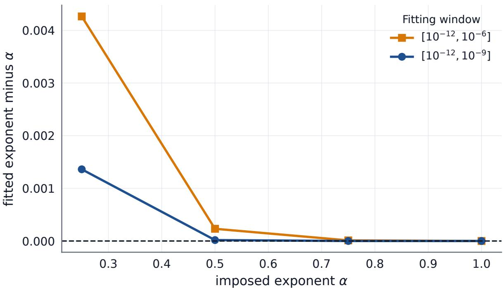  
Figure B.3: Fitting-window efects on recovery exponents. Fitted exponent errors decrease as the upper end of the initial-mass window approaches zero. Results use $n = 4 ; n = 8$ agrees at plotting precision.

## B.4 Numerical accuracy and refinement

Normal-velocity identity Direct evaluation of $- J ( p ) ^ { 2 } g$ checks the normal-velocity identity at 256 random simplex states per expert count, with $n = 4 , 8$ , Dirichlet-distributed probabilities and Gaussian gradients. The identity holds to floating-point precision.

Quadrature and event-time agreement The integration uses $n = 4 , 8$ and $\theta = 0 . 0 5$ , with initial masses $\varepsilon \in \{ 1 0 ^ { - 1 2 } , 1 0 ^ { - 1 1 } , . . . , 1 0 ^ { - 3 } \}$ . We evolve all logits using transformed time s, where $d s = x ^ { \alpha } d t$ . We also rescale physical time as $\tau = \varepsilon ^ { \alpha } t$ , giving

$$
{ \frac { d q } { d s } } = { \frac { e _ { j } - p } { \kappa _ { n } } } , \qquad { \frac { d \tau } { d s } } = \left( { \frac { \varepsilon } { x } } \right) ^ { \alpha } .
$$

The explicit eighth-order Runge–Kutta method DOP853 uses relative tolerance 10−11, absolute tolerance $1 0 ^ { - 1 3 }$ , and maximum steps 0.5 and 0.25 in s. Event detection at $p _ { j } = \theta$ is compared with independent quadrature of

$$
\varepsilon ^ { \alpha } H _ { 1 + \alpha } ( \varepsilon , \theta ) = \int _ { 0 } ^ { \log ( \theta / \varepsilon ) } \frac { e ^ { - \alpha z } } { ( 1 - \varepsilon e ^ { z } ) ^ { 2 } } d z .
$$

Across 200 trajectories, both quadrature diferences and changes under step halving remain below $1 0 ^ { - 1 2 }$ in relative terms.

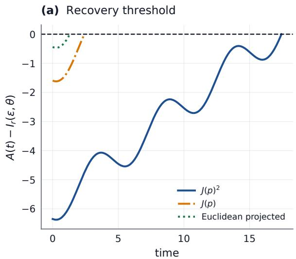

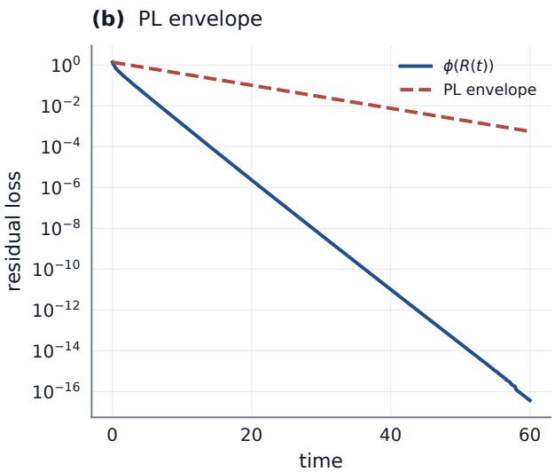  
Figure B.4: Recovery with changing advantages and nonquadratic joint training. (a) Accumulated sign-changing advantage relative to the flow-specific recovery threshold; zero marks threshold attainment. (b) Nonquadratic PL loss and its exponential envelope.

## C Input-conditioned routing

For K groups and n experts, let $P \in \mathbb { R } ^ { K \times n }$ have routing distribution $P _ { k , \ast }$ : in row $k .$ Define the mean between-group $\ell ^ { 1 }$ deviation and the number of distinct row-wise maximizers by

$$
\begin{array} { r l r } {  { S ( P ) : = \frac { 1 } { K } \sum _ { k = 1 } ^ { K } \| P _ { k , : } - \bar { P } \| _ { 1 } , } } & { } & { \bar { P } : = \frac { 1 } { K } \sum _ { k = 1 } ^ { K } P _ { k , : } , } \\ & { } & { i _ { k } ^ { * } : = \operatorname* { m i n } \arg \operatorname* { m a x } _ { i } P _ { k , i } , \quad D ( P ) : = | \{ i _ { k } ^ { * } : 1 \leqslant k \leqslant K \} | . } \end{array}
$$

Here $\bar { P }$ is the mean routing distribution, $i _ { k } ^ { * }$ selects the smallest expert index in a tie, and set bars denote cardinality. Thus $S ( P ) = 0$ exactly when all groups have the same routing distribution; $D ( P )$ counts their distinct dominant experts. These statistics distinguish input-dependent allocation from aggregate load.

## C.1 Afine routing and shared-bias invariance

Theorem 6.1 identifies when feature–residual coupling separates initially equal routing distributions. We test this criterion and show that shared bias shifts preserve cross-group log-odds contrasts.

Remark C.1 (A shared bias preserves cross-group log-odds contrasts). For any groups $k , \ell$ and experts $i , j ,$ , a common expert-bias vector $v \in \mathbb { R } ^ { n }$ , applied as $\begin{array} { r } { \widetilde { q } ^ { ( k ) } = q ^ { ( k ) } + v } \end{array}$ with $\widetilde { p } ^ { ( k ) } =$ Softmax $( \widetilde { q } ^ { ( k ) } )$ , leaves

$$
\log \frac { \widetilde { p } _ { i } ^ { ( k ) } } { \widetilde { p } _ { j } ^ { ( k ) } } - \log \frac { \widetilde { p } _ { i } ^ { ( \ell ) } } { \widetilde { p } _ { j } ^ { ( \ell ) } } = \log \frac { p _ { i } ^ { ( k ) } } { p _ { j } ^ { ( k ) } } - \log \frac { p _ { i } ^ { ( \ell ) } } { p _ { j } ^ { ( \ell ) } }
$$

unchanged: both within-group log ratios acquire the same $v _ { i } - v _ { j }$ . Such a bias can change aggregate load and top-k assignments without changing this cross-group contrast. Individual probabilities, log-odds thresholds, and subsequent dynamics depend on the shifted probabilities.

Initial routing separation The afine-router calculation compares predicted and observed initial separation rates in 64 random feature–residual configurations and 16 nullspace controls. The median relative prediction error is $2 \times 1 0 ^ { - 5 }$ ; every control has zero separation to numerical precision (Figure C.1).

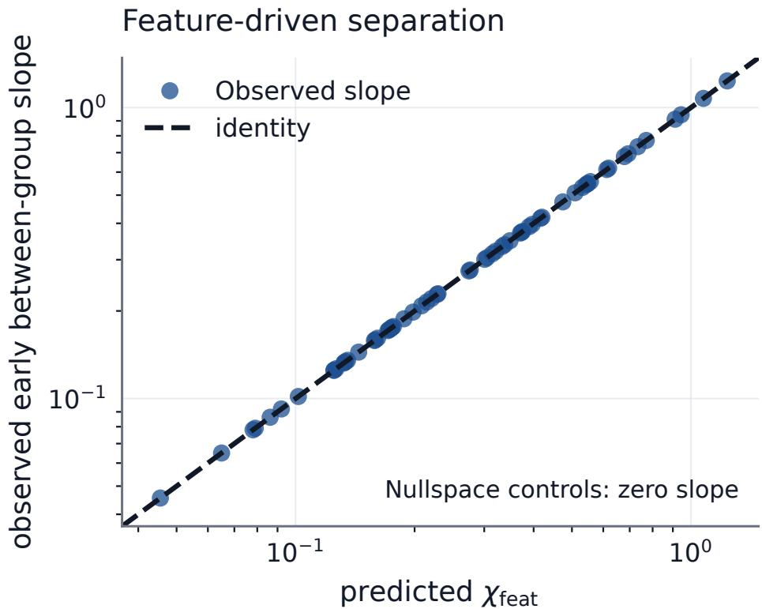  
Figure C.1: Initial routing separation under a shared afine router. Observed slopes agree with $\chi _ { \mathrm { f e a t } }$ in random feature–residual configurations; nullspace controls have zero first-order separation.

## C.2 Models and training

The synthetic routing and synthetic mini-batch multilayer perceptron (MLP) studies use Adam; the Digits and UCI HAR MLPs and all Transformers use AdamW. The larger Transformer-MoE has six layers, width 384, six attention heads, and eight two-layer GELU experts of hidden width 768 per layer, with top-2 routing and approximately 50–55 million parameters. Training updates the full model in bfloat16 precision. The four-domain and independent AG News comparisons use approximately $6 . 4 \times 1 0 ^ { 7 }$ and $5 . 9 \times 1 0 ^ { 6 }$ target tokens per condition, respectively.

The smaller studies use six experts: a one-block Transformer on AG News and MLPs on Digits and UCI HAR. Complete architectures, training settings, and random seeds are provided in the accompanying code.

## C.3 Routing structure across datasets

The synthetic studies compare shared-global and input-conditioned routers, including balancing, entropy, and capacity variants. In the three shared-global variants, the group routing distributions coincide, giving $S ( P ) = 0$ and $D ( P ) = 1$ . Input conditioning produces distinct allocations across groups (Table C.1).

The synthetic mini-batch MLP comparison gives paired deviation increases of 1.037 (95% CI [0.959, 1.109]) for softmax and 1.150 ([1.052, 1.246]) for top-2 routing, positive in all ten pairs.

The external-data studies use a stratified AG News subset [44], a stratified Digits split with 1,347 training and 450 test samples [3], and the oficial subject-disjoint UCI HAR split with 7,352 training and 2,947 test windows [4]. HAR features are standardized using training-set statistics. Routing deviation was the prespecified outcome. Paired inference uses seeds as the independent units. The deviation increases are positive in all ten AG News and Digits pairs and all twelve HAR pairs.

Table C.1: Routing structure across synthetic and external datasets. Values are means ± standard deviations over ten paired seeds, except twelve for UCI HAR. Single values denote invariant statistics. The synthetic shared-global row summarizes the identical routing-structure statistics of softmax, load-balanced, and top-2 variants.
<table><tr><td>Router</td><td>Mean l¹ deviation</td><td>Dominant experts</td></tr><tr><td>Synthetic data</td><td></td><td></td></tr><tr><td>Shared global</td><td>0</td><td>1</td></tr><tr><td>Input-conditioned, softmax</td><td> $1 . 0 1 2 \pm 0 . 1 2 0$ </td><td> $3 . 1 \pm 0 . 5$ </td></tr><tr><td>Input-conditioned, entropy</td><td> $0 . 3 0 5 \pm 0 . 0 4 7$ </td><td> $3 . 2 \pm 0 . 4$ </td></tr><tr><td>Input-conditioned, capacity</td><td> $1 . 0 7 2 \pm 0 . 0 8 4$ </td><td>4</td></tr><tr><td>AG News</td><td></td><td></td></tr><tr><td>Global top-2</td><td>0</td><td>1</td></tr><tr><td>Conditioned top-2</td><td> $0 . 2 6 6 \pm 0 . 0 5 8$ </td><td> $2 . 8 \pm 0 . 9$ </td></tr><tr><td>Conditioned, load balancing</td><td> $0 . 2 4 1 \pm 0 . 0 6 0$ </td><td> $3 . 7 \pm 0 . 5$ </td></tr><tr><td>Digits</td><td></td><td></td></tr><tr><td>Global top-2</td><td>0</td><td>1</td></tr><tr><td>Conditioned top-2</td><td> $0 . 8 0 4 \pm 0 . 1 1 4$ </td><td> $4 . 2 \pm 0 . 7$ </td></tr><tr><td>UCI HAR</td><td></td><td></td></tr><tr><td>Global top-2</td><td>0</td><td>1</td></tr><tr><td>Conditioned top-2</td><td> $1 . 1 5 0 \pm 0 . 0 6 7$ </td><td> $4 . 3 \pm 0 . 5$ </td></tr></table>

Table C.2: Mean between-group ℓ1 deviation diferences across settings (input-conditioned minus shared global), averaged over evaluated middle layers. Intervals are paired-seed bootstrap 95% CIs. Each study uses eight seeds except the four-domain capacity comparison, whose four-seed mean is reported descriptively. Capacity factor is 1.25.
<table><tr><td>Study</td><td>Mean difference</td><td>95% CI</td></tr><tr><td>Four-domain small model</td><td>0.444</td><td>[0.404,0.478]</td></tr><tr><td>Four-domain large model</td><td>0.236</td><td>[0.217,0.255]</td></tr><tr><td>Four-domain large, capacity</td><td>0.174</td><td></td></tr><tr><td>AG News, no drop</td><td>0.102</td><td>[0.081,0.128]</td></tr><tr><td>AG News, capacity</td><td>0.102</td><td>[0.087,0.117]</td></tr></table>

## C.4 Model scale and capacity constraints

Each study uses matched initialization and data order; estimates are reported separately across datasets and model scales.

Datasets and train–test splits The four-domain corpus contains ArXiv abstracts, Project Gutenberg books, U.S. Government Publishing Ofice text, and WikiText-103 [27]. Whole documents are assigned to disjoint train, validation, and shift splits; GPT-2 tokenized fragments have lengths 256 or 512. Domain labels support balanced sampling and held-out routing summaries.

Routing diferences across scales The conditioned-minus-shared routing contrast remains positive in the small and large four-domain models, with and without capacity constraints, and in the independent AG News implementation (Table C.2). All evaluated middle layers have positive mean contrasts, and all seed-level contrasts are positive.

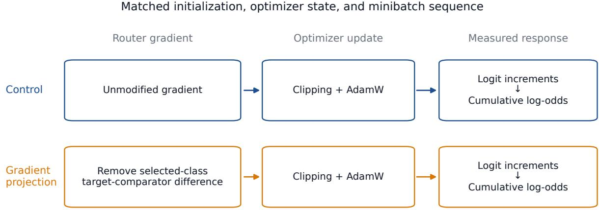  
Figure D.1: Paired training with and without class-conditional gradient projection. Branches share the calibrated state and minibatches; projection acts before clipping and AdamW.

## D Recovery interventions

We compare clamp removal with continued suppression, then estimate the efect of removing a class-conditional router-gradient contrast. Paired branches share their calibrated state and training sequence, so their recovery-time diference measures the response to this gradient intervention.

## D.1 Release from routing suppression

Auxiliary AG News experiments compare clamp removal with continued suppression from the same checkpoint, optimizer state, and minibatch sequence. Each dispatch setting uses eight paired seeds, four middle layers, and 1,024 post-release steps. Recovery is confirmed by two consecutive 64-step evaluations with mean target probability at least 0.05. Clamp removal yields confirmation in 24 of 32 no-drop and 29 of 32 capacity-constrained seed–layer combinations, compared with none under continued suppression.

## D.2 Class-conditional router-gradient intervention

The intervention uses 16 paired seeds without drops and eight at capacity factor 1.25, evaluating the four middle layers. It uses the six-layer model in Section C.2, with noise-free afine logits and renormalized top-2 dispatch. Training minimizes masked autoregressive cross-entropy without auxiliary balancing on 119,800 AG News sequences. AdamW uses batch size four, learning rate $2 \times 1 0 ^ { - 4 }$ , weight decay 0.01, and gradient-norm clipping at one. Targets, comparators, and selected classes follow the main text’s rules after 29,950 training steps; a 1,024-step suppression interval then produces the common state for calibration.

Initial-probability calibration The clamp is removed for calibration. For each middle layer in network order, let $p _ { j , a }$ be the target probability at active token a in the fixed 512- sequence validation sample, containing $N _ { \mathrm { t o k } }$ active (nonpadding) tokens. The desired mean is $\varepsilon \in \{ 0 . 0 0 5 , 0 . 0 1 , 0 . 0 2 , 0 . 0 4 \}$ . We shift only that layer’s target-router bias by d, solving

$$
\frac { 1 } { N _ { \mathrm { t o k } } } \sum _ { a = 1 } ^ { N _ { \mathrm { t o k } } } \frac { e ^ { d } p _ { j , a } } { 1 - p _ { j , a } + e ^ { d } p _ { j , a } } = \varepsilon .
$$

Bisection calibrates the layers in network order, remeasuring probabilities after each upstream bias shift. The final absolute mean-probability error is at most 0.001 in every middle layer. Calibration changes only target-router biases. All branches receive the same calibrated parameters and suppression-stage optimizer state. Selection, calibration, and recovery measurement use the same validation sample; subsequent updates use training data with matched class-balanced minibatches.

Gradient intervention Projection replaces the selected-class target and comparator gradient rows by their average, leaving other rows and other classes’ gradient contributions unchanged. It acts before global clipping and AdamW, so the measured response includes ensuing optimizer and representation dynamics. Capacity-constrained dispatch drops about 35% of assignments across the control and projection branches.

Section E.1 defines confirmed recovery and the statistical analysis.

## E Recovery analysis

Confirmed recovery uses the overall mean routing probability. The token-level analysis follows fixed inputs from the selected class.

## E.1 Restricted mean time to confirmed recovery

We index seeds by s, the four middle layers by $\ell \in \{ 1 , 2 , 3 , 4 \}$ , and the initial probabilities $( 0 . 0 0 5 , 0 . 0 1 , 0 . 0 2 , 0 . 0 4 )$ by $m \in \{ 1 , 2 , 3 , 4 \}$ , in that order. For condition $b \in \{ \mathrm { c t r l } , \mathrm { p r o j } \}$ (control or gradient projection), let the indicator $I _ { s , \ell , m , k } ^ { b } \in \{ 0 , 1 \}$ equal one when the mean target probability is at least 0.05 at step 64k. The confirmation time is

$$
\begin{array} { r } { T _ { s , \ell , m } ^ { \mathrm { c o n f , b } } = 6 4 \operatorname* { i n f } \{ k \gtrsim 2 : I _ { s , \ell , m , k - 1 } ^ { b } = I _ { s , \ell , m , k } ^ { b } = 1 \} , } \end{array}
$$

with inf $\mathcal { O } = \infty$ . We observe $k = 1 , \ldots , 1 6$ , with right-censoring at $\tau = 1 , 0 2 4$ when confirmation is pending. Define

$$
Y _ { s } ^ { b } = \frac { 1 } { 1 6 } \sum _ { \ell , m } \operatorname* { m i n } \{ T _ { s , \ell , m } ^ { \mathrm { c o n f , b } } , \tau \} , \qquad \mu _ { \tau } ^ { b } = \mathbb { E } _ { s } [ Y _ { s } ^ { b } ] , \qquad \Delta \mu _ { \tau } = \mathbb { E } _ { s } [ Y _ { s } ^ { \mathrm { p r o j } } - Y _ { s } ^ { \mathrm { c t r l } } ] .
$$

The expectation is over seeds, with equal weight on the 16 fixed layer–initial-mass combinations. Equivalently, $\mu _ { \tau } ^ { b }$ averages their seed-marginal survival integrals $\begin{array} { r } { \int _ { 0 } ^ { \tau } \mathrm { P r } _ { s } ( T _ { s , \ell , m } ^ { \mathrm { c o n f , b } } > t ) } \end{array}$ dt. Complete follow-up to τ makes the empirical integral the mean of truncated confirmation times. Confirmation exactly at $\tau$ contributes $\tau$ to this mean and counts as an observed event.

Confidence intervals use 100,000 percentile-bootstrap resamples of paired seeds, retaining all 16 layer–initial-mass combinations within each seed. Exact two-sided sign tests exclude ties. No-drop and capacity estimates use 16 and eight paired seeds, respectively.

## E.2 Sensitivity to the probability threshold

We apply the same confirmation rule to the saved trajectories at $\theta \in \{ 0 . 0 4 , 0 . 0 5 , 0 . 0 6 , 0 . 0 8 \}$ . The additional thresholds are a post hoc sensitivity analysis with pointwise paired-seed bootstrap intervals. At $\theta = 0 . 0 4$ , the largest initial mass equals the threshold, so confirmation measures sustained attainment after release.

All contrasts and pointwise intervals remain above zero (Table E.1). At higher thresholds, fewer trajectories confirm recovery and both restricted means approach the observation horizon, reducing the contrast within this window.

## E.3 Recovery across initial probabilities

Table E.2 reports RMST at each initial probability using the main analysis definition. All eight mean contrasts favor earlier recovery under unmodified training.

Table E.1: Confirmed-recovery sensitivity to the probability threshold. RMST diferences are projection minus control in optimizer steps, with pointwise 95% paired-seed bootstrap CIs. Percentages give confirmation by step 1,024. The no-drop and capacity settings use 16 and eight seeds, with equal weight on seeds and layer–initial-mass combinations within seeds.
<table><tr><td>Dispatch</td><td>θ</td><td>RMST difference (95% CI)</td><td>Control recovery (%)</td><td>Projection recovery (%)</td></tr><tr><td>No drop</td><td>0.04</td><td>56.50 [46.00, 67.25]</td><td>71.48</td><td>59.38</td></tr><tr><td></td><td>0.05</td><td>44.25 [31.25, 57.50]</td><td>44.53</td><td>35.94</td></tr><tr><td></td><td>0.06</td><td>25.00 [15.25, 37.50]</td><td>22.27</td><td>18.36</td></tr><tr><td></td><td>0.08</td><td>10.50 [4.50, 17.50]</td><td>6.64</td><td>5.08</td></tr><tr><td>Capacity 1.25</td><td>0.04</td><td>75.50 [55.50, 96.50]</td><td>65.63</td><td>53.13</td></tr><tr><td></td><td>0.05</td><td>59.00 [39.50, 81.00]</td><td>40.63</td><td>32.03</td></tr><tr><td></td><td>0.06</td><td>30.50 [9.50, 52.00]</td><td>23.44</td><td>17.97</td></tr><tr><td></td><td>0.08</td><td>15.50 [4.00, 29.00]</td><td>10.16</td><td>6.25</td></tr></table>

Control Gradient projection

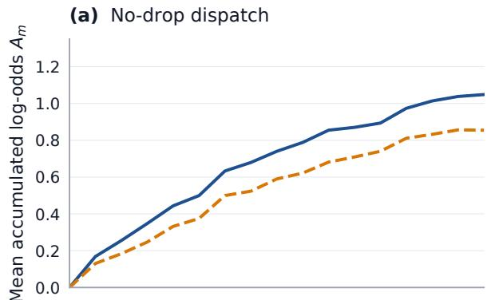

(b) Capacity-constrained dispatch  
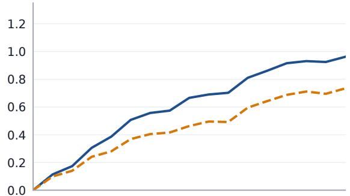

(c) Individual threshold membership  
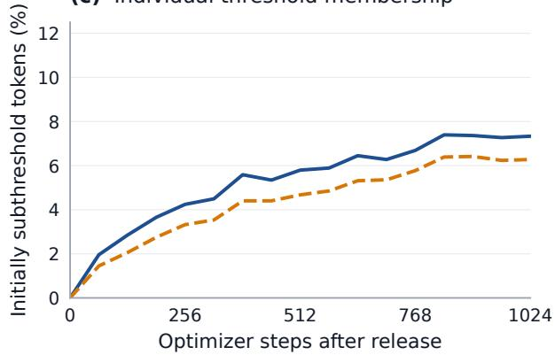

(d) Individual threshold membership  
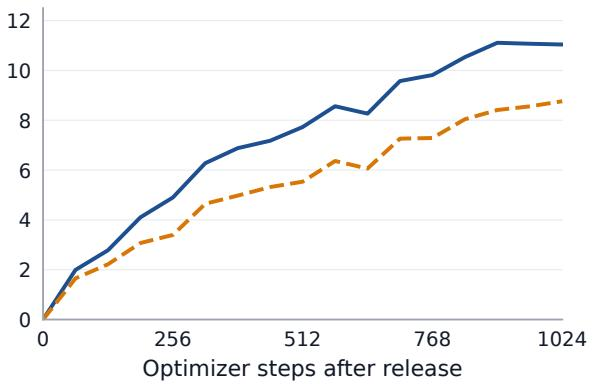  
Figure E.1: Accumulated log-odds and fractions of tokens meeting the threshold. (a), (b) Mean accumulated log-odds $A _ { m } .$ . (c), (d) Fractions satisfying $A _ { m } ( x ) \geqslant B ( x )$ at each evaluation, computed before averaging. Each setting uses eight paired seeds, with equal mass and seed weights; capacity factor is 1.25.

## E.4 Token-level log-odds trajectories

The trajectories complement Table 3 and use eight paired seeds per dispatch setting. The no-drop measurements use a subset of the RMST sample; capacity measurements use separate runs with the same seed values. We follow the first 128 active selected-class validation tokens in each middle layer, with fixed identities across times and branches. For a token x at evaluation index m, define

$$
A _ { m } ( x ) = \log \mathrm { i t } ( p _ { j } ^ { m } ( x ) ) - \log \mathrm { i t } ( p _ { j } ^ { 0 } ( x ) ) , \qquad B ( x ) = \log \mathrm { i t } ( 0 . 0 5 ) - \log \mathrm { i t } ( p _ { j } ^ { 0 } ( x ) ) .
$$

Table E.2: Confirmed recovery by initial probability ε. Descriptive RMST diferences are projection minus control through 1,024 steps at threshold 0.05, averaging four layers within each seed and then seeds equally. Percentages give confirmation by step 1,024. No-drop and capacity settings use 16 and eight seeds, respectively; capacity factor is 1.25.
<table><tr><td>ε</td><td>Dispatch</td><td>RMST difference (steps)</td><td>Control recovery (%)</td><td>Projection recovery (%)</td></tr><tr><td>0.005</td><td>No drop</td><td>+14</td><td>10.9</td><td>6.3</td></tr><tr><td></td><td>Capacity</td><td>+22</td><td>12.5</td><td>3.1</td></tr><tr><td>0.010</td><td>No drop</td><td>+33</td><td>23.4</td><td>17.2</td></tr><tr><td></td><td>Capacity</td><td>+48</td><td>21.9</td><td>12.5</td></tr><tr><td>0.020</td><td>No drop</td><td>+62</td><td>57.8</td><td>39.1</td></tr><tr><td></td><td>Capacity</td><td>+94</td><td>46.9</td><td>37.5</td></tr><tr><td>0.040</td><td>No drop</td><td>+68</td><td>85.9</td><td>81.3</td></tr><tr><td></td><td>Capacity</td><td>+72</td><td>81.3</td><td>75.0</td></tr></table>

By the discrete log-odds identity, $\begin{array} { r } { A _ { m } ( x ) = \sum _ { r < m } ( u _ { j } ^ { r } ( x ) - c _ { j } ^ { r } ( x ) ) } \end{array}$ , and $p _ { j } ^ { m } ( x ) \geqslant 0 . 0 5$ exactly when $A _ { m } ( x ) \geqslant B ( x )$ . Here m indexes 64-step evaluations; ${ u } _ { j } ^ { m }$ and $c _ { j } ^ { m }$ are the corresponding logit and complementary log-sum-exp increments.

We retain tokens with $p _ { j } ^ { 0 } ( x ) < 0 . 0 5$ , determined before either branch evolves. Within each seed and initial mass, we pool retained tokens across layers, then weight masses and seeds equally. Figure E.1 shows mean accumulated changes and the fraction of tokens meeting the threshold.

The projection branch has smaller accumulated log-odds gains and a lower fraction of tokens meeting the threshold. These token-level responses accompany the confirmed-recovery delay in the main analysis, connecting the gradient intervention to both recovery measures.