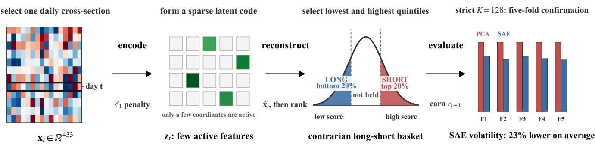
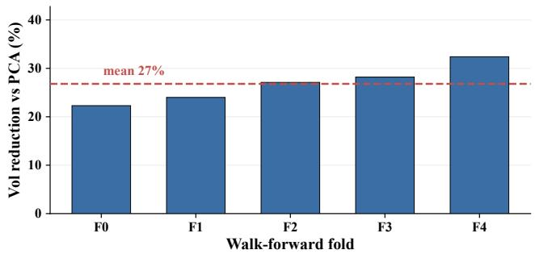
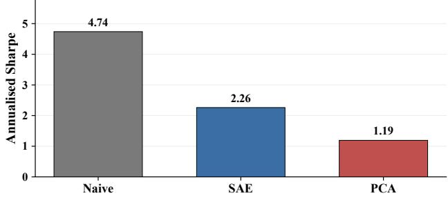
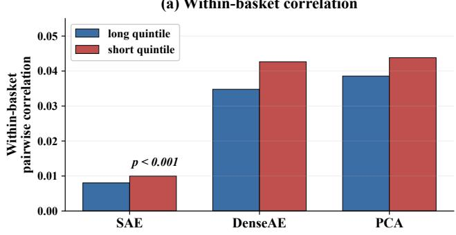
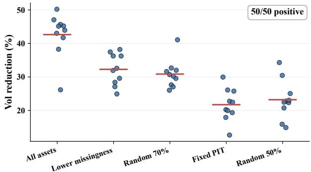
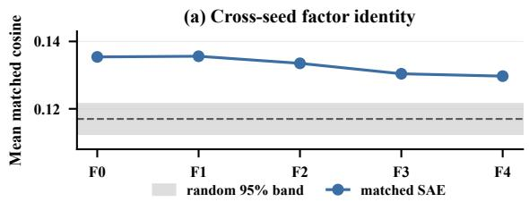
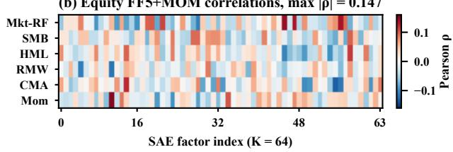

# Sparse Autoencoders as Implicit Diversification Regularisers for Cross-Sectional Cryptocurrency Returns

Weijia Han University of Washington Seattle, Washington, USA weivivi77@gmail.com

## Abstract

Factor models are central to asset pricing and portfolio construction, but neural factors are often dificult to interpret, and their efect on portfolio risk is unclear. A sparse autoencoder (SAE) may address both concerns by describing daily returns across many assets with only a few active features. We ask whether this sparse representation produces stable financial factors and better-diversified portfolios. We study cryptocurrency returns, use equities as a secondary test, and compare the SAE with common benchmarks in a time-ordered evaluation. We find consistently lower volatility in SAE portfolios and link this result to lower correlations among the selected assets. However, the SAE does not outperform a simple contrarian strategy on risk-adjusted return, and its factor identities are not stable across training runs. Our contribution is to show that sparse coding can support portfolio diversification, while clearly separating this risk efect from claims about alpha or stable factor identities.

## CCS Concepts

• Computing methodologies → Machine learning; • Applied computing → Economics.

## Keywords

sparse autoencoders, sparse coding, factor models, portfolio diversification, volatility, cryptocurrency

## ACM Reference Format:

Weijia Han and Lisha Qu. 2026. Sparse Autoencoders as Implicit Diversification Regularisers for Cross-Sectional Cryptocurrency Returns. In 7th ACM International Conference on AI in Finance (ICAIF ’26), November 14–17, 2026, Milan, AA, Italy. ACM, New York, NY, USA, 8 pages. https://doi.org/ 10.1145/3858063.3858690

## 1 Introduction

Factor models are the organising framework of empirical asset pricing. From the Capital Asset Pricing Model (CAPM) [23] to the Fama-French five-factor model [6, 7], the premise is that crosssectional return variation decomposes into a handful of systematic risk exposures plus idiosyncratic noise. The rise of machine learning has relaxed the assumption of linearity: Gu et al. [9] show that feed-forward networks and gradient-boosted trees consistently outperform linear factor models in equity return prediction, and Kelly

Lisha Qu   
University of Washington   
Bothell, Washington, USA   
lishaq@uw.edu

et al. [14] demonstrate that an instrumented form of principal component analysis (PCA) bridges characteristic-based and latent factor representations. Yet predictive gains carry an interpretability cost: a neural network encodes its implicit “factors” as distributed activation patterns across thousands of weights, frustrating any clean mapping between network dimensions and identifiable economic forces. The obstacle is structural: Elhage et al. [5] show that neural networks systematically encode more features than they have dimensions, representing distinct concepts in linear superposition within each neuron. Applied to financial returns, superposition implies that each latent dimension of a dense autoencoder conflates multiple economic forces.

Sparse autoencoders (SAEs) as a candidate. Bricken et al. [2] and Huben et al. [13] show that an $\ell _ { 1 }$ penalty on the latent layer of an autoencoder can recover monosemantic features: latent dimensions that activate for one coherent concept rather than a mixture of many. Templeton et al. [24] show that this approach scales to large language models. We test whether the same principle transfers from token embeddings to asset returns. If so, monosemanticitystyle SAEs would provide a factor layer whose dimensions are individually attributable to economic themes. We find no evidence of seed-reproducible factor identities (§4.6); what the bottleneck does deliver is a change in the risk of the portfolios built on it, and that is the subject of this paper.

Cryptocurrency markets as a testbed. Crypto markets trade 24/7, include more than 400 assets with high cross-sectional return dispersion, and have fewer documented factors than equities; Liu et al. [18] document momentum, size, and network premia. Because that dispersion inflates long-short Sharpe magnitudes, we treat absolute crypto Sharpes as within-panel, cross-method comparisons and perform a secondary transfer check on 200 S&P 500 stocks.

Contributions. We study a portfolio-construction property: the realised risk of baskets ranked on a factor model’s reconstruction. We make no asset-pricing, forecasting, or alpha claim. At the exploratory �=64 setting, individual factor identities are not seedreproducible: retraining with another seed yields an essentially diferent matched dictionary (§4.6). Figure 1 summarises the endto-end pipeline. (C1) We provide a walk-forward empirical study of a monosemanticity-style $\ell _ { 1 }$ autoencoder for cross-sectional factor discovery. The model is a standard sparse-coding or dictionarylearning estimator [19, 20]. Three protocol changes reduce common sources of bias in out-of-sample evaluation: a validity-masked reconstruction loss (which avoids bias toward observation patterns from zero-filling missing returns), chronological splits, and a cross-sectional clipped inverse-normal rank transformation (§3.2). (C2) Under strictly pre-fold selection, the chosen �=128 SAE has

20–26% lower long-short volatility than matched-� PCA in all five confirmation folds. Exploratory �=64 analyses show the same direction on raw returns and associate it with lower within-basket pairwise correlation (0.008 vs 0.039, �<0.001), not selection of lowvolatility assets. A Ledoit–Wolf minimum-variance overlay on the naive contrarian reduces the SAE-versus-naive volatility gap by approximately 73%. The SAE remains less volatile in four of five folds, but the remaining diference is not statistically significant at the 5% level under a two-sided test (�=0.057). (C3) The volatility reduction also appears in a secondary exploratory equity analysis, where the lowest realised volatility is 6.6%. The equity factors have low pairwise correlations with the Fama–French five-factor model plus momentum (FF5+MOM; max |�|=0.147). However, the cryptocurrency Sharpe ranking does not transfer: the equity SAE–PCA walkforward Sharpe gap is not statistically significant (−0.20, �=0.160), and the SAE also trails the naive contrarian $\left( - 0 . 6 6 , p { = } 0 . 0 7 2 \right)$ . The naive contrarian achieves the highest pre-cost crypto Sharpe on the rank scale (gap −2.91, �=0.002) and in money units (−2.48, �=0.009), and a lagged-return multilayer perceptron (MLP) in the spirit of Gu et al. [9] widens the gap. We position the SAE as a bottleneck-induced diversification regulariser.

## 2 Related Work

Factor models for cross-sectional returns range from the Fama-French families [6, 7] and data-driven linear alternatives (PCA, instrumented PCA [14], and risk-premium PCA [17]) to nonlinear machine-learning methods that improve return-prediction accuracy at the cost of interpretability: Gu et al. [9] show that gradientboosted trees and feed-forward networks outperform factor models in large equity panels, while Chen et al. [3] learn deep conditional factors from firm characteristics; the conditional autoencoder of Gu et al. [10] is the closest architectural ancestor, but its latent loadings are characteristic-driven, without an $\ell _ { 1 }$ penalty. In natural language processing (NLP), SAEs resolve superposition [5] by enforcing $\ell _ { 1 }$ sparsity on transformer activations; Bricken et al. [2] and Huben et al. [13] demonstrate that the resulting features are monosemantic. Templeton et al. [24] extend this approach to large language models. In finance, Kozak et al. [15] apply $\ell _ { 1 }$ shrinkage to stochastic discount factor (SDF) pricing coeficients (sparsity on weights, distinct from codes), and Avellaneda and Lee [1] establish the residual-reversal statistical-arbitrage pipeline that motivates our reconstruction-based long-short ranking. For the crypto testbed, Liu et al. [18] document momentum, size, and network premia that motivate future crypto-native spanning tests. To our knowledge, the NLP monosemanticity framework has not been applied to crosssectional factor discovery.

## 3 Method

## 3.1 Architecture and loss

Let ${ \bf x } _ { t } \in \mathbb { R } ^ { N }$ denote the cross-section of preprocessed returns on day �, with �=433 (crypto) or �=200 (equity). The SAE maps each cross-section through a rectified linear unit (ReLU) encoder to a �-dimensional nonnegative sparse latent code and reconstructs it through a linear decoder:

$$
\mathbf { z } _ { t } = \mathrm { R e L U } ( \mathbf { W } _ { \mathrm { e n c } } \mathbf { x } _ { t } + \mathbf { b } _ { \mathrm { e n c } } ) , \quad \hat { \mathbf { x } } _ { t } = \mathbf { W } _ { \mathrm { d e c } } \mathbf { z } _ { t } + \mathbf { b } _ { \mathrm { d e c } } ,\tag{1}
$$

where $\mathbf { W } _ { \mathrm { e n c } } \in \mathbb { R } ^ { K \times N } , \mathbf { W } _ { \mathrm { d e c } } \in \mathbb { R } ^ { N \times K } , \mathbf { b } _ { \mathrm { e n c } } \in \mathbb { R } ^ { K }$ , and $\mathbf { b } _ { \mathrm { d e c } } \in \mathbb { R } ^ { N }$ Decoder columns are unit-ℓ2-normalised so that ∥z� ∥1 is a meaningful proxy for total factor usage; all reported runs tie the decoder to the encoder $( \mathbf { W } _ { \mathrm { d e c } } { = } \mathbf { W } _ { \mathrm { e n c } } ^ { \top } )$ . The training objective combines cellpooled validity-masked reconstruction error with a per-day mean ℓ1 penalty over training days $\mathcal { T } _ { \mathrm { t r } }$

$$
\mathcal { L } = \frac { \sum _ { t \in \mathcal { T } _ { \mathrm { t r } } } \sum _ { i \in \mathcal { M } _ { t } } ( x _ { t i } - \hat { x } _ { t i } ) ^ { 2 } } { \sum _ { t \in \mathcal { T } _ { \mathrm { t r } } } | \mathcal { M } _ { t } | } + \frac { \lambda } { K } \cdot \frac { 1 } { | \mathcal { T } _ { \mathrm { t r } } | } \sum _ { t \in \mathcal { T } _ { \mathrm { t r } } } \Vert \mathbf { z } _ { t } \Vert _ { 1 } ,\tag{2}
$$

where ${ \mathbf { } } _ { } { \mathbf { } } _ { } { \mathbf { } } _ { } { \mathbf { } } _ { } { \mathbf { } } _ { } { \mathbf { } } _ { } { \mathbf { } } _ { } { \mathbf { } } _ { } { \mathbf { } } _ { } { \mathbf { } } _ { } { \mathbf { } } _ { } { \mathbf { } } _ { } { \mathbf { } } _ { } { \mathbf { } } _ { } { \mathbf { } } _ { } { \mathbf { } } _ { } { } \mathbf { } _ { } { } _ { } { \mathbf { } } _ { } { } \mathbf { } _ { } { } _ { } { } \mathbf { } _ { } { } _ { } { } \mathbf { } _ { } { } _ { } { } \mathbf { } _ { } { } _ { } { } \mathbf { } _ { } { } _ { } { } \mathbf { } _ { } { } _ { } { } \mathbf { } _ { } { } _ { } { } \mathbf { } _ { } { } _ { } { } \mathbf { } _ { } { } _ { } { } \mathbf { } _ { } { } _ { } { } \mathbf { } _ { } { } _ { } { } \mathbf { } _ { }  _ { }$ is the set of assets with observed returns on day � and � is the sparsity coeficient. Reconstruction error is pooled over observed cells, so days with more valid assets receive proportionally more weight. The validity mask is central to our protocol. Without it, zero-filled returns could make the decoder learn missingness patterns rather than return structure. We set missing encoder inputs to zero so that the linear map is defined, but exclude those entries from the loss. At test time, we also treat residual missing returns as zero (flat) in the rank-scale portfolio evaluation. Because a missing return may reflect an asset collapse, and the contrarian strategy buys recent losers, §4.2 tests this convention with a tradability mask and a separate loss calculation for assets that disappear from the data. Training uses Adam $( K = 6 4 , \lambda = 1 0 ^ { - 2 }$ , 100 epochs on the static split), retaining the checkpoint with minimum validation loss; validation loss is still declining at the epoch cap, so the retained checkpoint coincides with the final epoch.

## 3.2 Data and preprocessing

Crypto data are Binance daily open, high, low, close, and volume (OHLCV) observations from 2019-01-01 to 2024-12-31, covering �=433 assets over 1,988 days after a coverage filter (assets must have ≥ 252 non-missing days; days with fewer than 50 valid prices are dropped). The crypto pairs are quoted against Tether (USDT) and use Coordinated Universal Time (UTC) day boundaries; stablecoins, leveraged tokens, and duplicate asset representations are excluded. Equity data are S&P 500 daily adjusted-close returns (Yahoo Finance, 2015-01-01 to 2024-12-31), starting from a static list of large constituents compiled in early 2025 and retaining the �=200 stocks that pass the same minimum-observation filter. This is not a point-in-time constituent universe, so the equity analysis carries survivorship exposure; we accordingly treat it as a secondary exploratory transfer check. Both panels end on 31 December 2024, and all reported experiments use this common sample period. The winsorised (1st/99th percentiles per day) close-to-close log-returns $\mathbf { r } _ { t }$ are mapped cross-sectionally to clipped inverse-normal rank scores. We use average ranks over the observed set $\textstyle { \mathcal { M } } _ { t }$ , following the van der Waerden approach [25]. This difers from the classical rankit (rank −0.5)/�. The resulting vector is the SAE input $\mathbf { x } _ { t }$ in Eq. 1:

$$
x _ { t i } = \Phi ^ { - 1 } \left( \mathrm { c l i p } \left[ { \frac { \mathrm { r a n k } _ { i } ( { \bf r } _ { t } ) } { N _ { t } } } , 0 . 0 1 , 0 . 9 9 \right] \right) ,\tag{3}
$$

where $N _ { t } { = } | \mathcal { M } _ { t } |$ is the number of observed assets on day � and the clip bounds the tails of the inverse normal. Data are split chronologically (70/10/20 train/val/test, no shufling). Residual missing values are forward-filled with a strict bound of three consecutive days; longer gaps remain missing, are masked in the SAE loss $( \operatorname { E q } . 2 ) ;$ and are zero-filled at evaluation as disclosed in §3.1.

  
Figure 1: Pipeline from the daily crypto return cross-section $\mathbf { x } _ { t }$ through a sparse code and reconstructed-return ranking to a contrarian quintile basket. Under strictly pre-fold selection, the chosen �=128 SAE reduces rank-scale long-short volatility by 23% on average relative to matched-� PCA (20–26% in all five folds).

Survivorship and point-in-time limitations. The coverage filter uses full-sample information and is therefore not fully point-in-time (PIT). Delisted assets remain in the panel through their final quote and are masked afterwards. As a survivorship check, we repeat the headline SAE–PCA comparison with a fold-specific eligibility rule inside the ex-post 433-asset universe. This does not reconstruct a true point-in-time universe, but it uses only information available before each test fold: an asset is tradable only if at least 126 of the 252 days preceding the fold’s test start are non-missing (322–367 of 433 assets qualify per fold). The Sharpe gap remains positive (mean +1.15±0.80, 9/10 folds, paired �(9)=4.57, �=0.001) and the volatility reduction holds in 10/10 folds (mean 34%); a stricter fixed-universe PIT variant (216 assets) is among the subsets of Fig. 3b.

## 3.3 Baselines and evaluation

We compare three headline baselines in the body. PCA at matched � (top-� principal components via exact singular value decomposition (SVD)) is the primary structural comparator. Matching �=64 controls latent dimension, but PCA and the SAE still difer in architecture, activation, objective, and missing-value treatment. Dense autoencoder (DenseAE) (�=0 in Eq. 2) shares the SAE’s architec ture but removes the sparsity penalty, isolating the role of $\ell _ { 1 } .$ . Naive contrarian ranks assets by same-day return and goes long the bottom quintile and short the top quintile. Within each leg, equal weighting follows the simple $1 / N$ benchmark of DeMiguel et al. [4]. This is the no-model baseline; it has higher pre-cost rank-scale Sharpe than all factor-model methods on this panel, previewing the no-incremental-Sharpe finding of §4.4. Every reconstruction model (SAE, PCA, DenseAE) applies this same quintile rule, ranking by the model reconstruction xˆ� (Eq. 1) in place of the raw return: long the lowest-�ˆ quintile, short the highest, equal-weighted. We also include four data-driven baselines in the walk-forward comparison of §4.2: nonnegative matrix factorisation (NMF), independent component analysis (ICA), sparse PCA, and dictionary learning. A characteristic-based (Barra-type) factor model needs fundamentals and market capitalisations that our crypto panel lacks, so the baselines span only the no-model and data-driven categories. PCA is fitted by exact SVD in every Sharpe comparison and in Table 1 and Fig. 2; the correlation and universe-subset analyses of Fig. 3 and the static equity analysis use randomised SVD. Exact-SVD sensitivity checks change the static basket correlation from 0.039 to 0.040 and the fold volatility reductions by at most 2.3 percentage points.

Evaluation protocol. Each observation $\mathbf { r } _ { t }$ is a close-to-close return and is available only after the day-� close. The reported daily-close portfolio pairs the resulting ranking with the day-�+1 close-to-close return. The evaluation therefore assumes that positions are entered at the same close used to form the signal. Because this trade is not executable in practice, we interpret the results as signal evidence rather than as a tradable backtest. Trading at the next available price could change the results, and the daily data do not support claims about execution or capacity. The same timing convention defines the contrarian information coeficient (IC) of §4.1. The primary walk-forward uses 5 expanding folds with 159-day test windows (795 evaluation days); the SAE is retrained from scratch per fold over seeds {42, 123, 456, 789, 1024}. A finer ten-fold expanding design (994-day initial training window, 99-day test folds, one rotated seed per fold) is used for robustness analyses (Table 2). We use paired fold-level tests together with stationary block-bootstrap [21] 95% intervals (1,000 resamples over paired daily return diferences, geometric block lengths with mean ℓ=5 days). The exploratory static mechanism checks instead use 10,000 stationary block-bootstrap resamples of paired daily statistic diferences with mean 30-day blocks, matching their rolling estimation window. With $\mathbf { \nabla } \mathcal { P } t$ the daily equal-weighted long-short profit-and-loss (long and short legs each gross 1, zero net) and $\bar { p } , s ( \boldsymbol { p } )$ its sample mean and standard deviation over test days, we report $R _ { \mathrm { a n n } } { = } A \bar { p } , \sigma _ { \mathrm { a n n } } { = } \sqrt { A } s ( p )$ and $\mathsf { S R } { = } \sqrt { A } \bar { p } / s ( \boldsymbol p )$ , with �=365 (crypto) or 252 (equity) and zero risk-free rate. The exploratory $K = 6 4 , \lambda { = } 1 0 ^ { - 2 }$ setting came from an initial reconstruction-loss sweep whose selection window overlaps the early walk-forward test windows (folds begin at 60% of the sample). Although it was not selected on test Sharpe, the overlap makes the �=64 portfolio comparisons exploratory. We therefore repeat selection on the first 748 days, strictly before all confirmation folds. The grid uses �∈{32, 64, 128} and �∈ $\{ 1 0 ^ { - 3 } , 1 0 ^ { - 2 } , 1 0 ^ { - 1 } \}$ . Learning rates are �∈ $\{ 3 { \times } 1 0 ^ { - 4 } , 1 0 ^ { - 3 } \}$ , giving 18 configurations. Validation reconstruction selects the largest model and strongest penalty: �=128 and $\lambda { = } 1 0 ^ { - 1 }$ , with $\eta { = } 1 0 ^ { - 3 }$ . Loss falls monotonically in $K ,$ and the original �=64 configuration ranks ninth. When we rerun the walk forward analysis at the selected setting, using five 248-day folds that begin after the selection window, the SAE reduces volatility by 20– 26% in all five folds. The SAE–PCA Sharpe gap is +0.33 (4/5 folds, $\scriptstyle { p = 0 . 1 4 ) }$ . Across �∈{32, 64, 128, 256, 433} under this unified protocol $( \lambda { = } 1 0 ^ { - 1 } )$ , the volatility reduction is positive in every fold. For increasing �, the mean reductions are 32%, 26%, 23%, 18%, and 17%. The corresponding Sharpe gaps are $- 0 . 5 5 , + 0 . 4 1 , + 0 . 3 3 , - 0 . 6 3$ , and −0.83. The gap is largest at an intermediate value of � and becomes significantly negative only for �≥256 (�≤0.039), as matched-� PCA approaches the naive contrarian when $K {  } N .$ The volatility claim survives strict re-selection; the Sharpe ranking remains specific to the setting. Walk-forward retraining uses 50 epochs (the static-split model of §3.1 trains for 100). In the exploratory �=64 analysis, checkpoint selection used the same folds that were later evaluated. Although the selected checkpoints coincided with the final-epoch models, this design is not strictly out of sample. We therefore treat all $K { = } 6 4$ results as exploratory and base our main conclusion on the strictly pre-fold �=128 analysis above. The overlay control of §4.4 uses a trailing 60-day Ledoit–Wolf-shrunk covariance with 20% quintiles. All �-values are two-sided; where the hypothesis is directional (the overlay residual) we add the one-sided value.

Interpretation ofrank-scale results. Reported absolute Sharpes are pre-cost rank-scale artefacts of the per-day clipped inverse-normal rank transformation $( \operatorname { E q } . 3 ) { \mathrm { : } }$ they are valid only for cross-method comparison. We do not subtract monetary transaction costs from these dimensionless scores; all economic return comparisons use the raw-return panel and are reported pre-cost.

## 4 Results

## 4.1 Factor quality at matched K

At the exploratory setting �=64, the $\ell _ { 1 }$ penalty substantially increases code sparsity, while we find no clear evidence of an improvement in predictive IC. We measure code sparsity with the Hoyer index [12]:

$$
H ( \mathbf { z } ) = \frac { \sqrt { K } - \| \mathbf { z } \| _ { 1 } / \| \mathbf { z } \| _ { 2 } } { \sqrt { K } - 1 } .
$$

The index is evaluated on |z| and ranges from 0 for an equalmagnitude dense code to 1 for a one-hot code. Over five seeds, it is $0 . 4 9 7 \pm 0 . 0 0 3$ for the SAE, compared with 0.303 for DenseAE $( \lambda { = } 0 ,$ identical architecture) and 0.272 for PCA scores. Thus, the dense autoencoder’s latent code is not sparse on these data without the penalty. Contrarian IC $( - \operatorname { I C } ( \mathbf { r } _ { t + 1 } , \hat { \mathbf { x } } _ { t } )$ on the test split) is +0.016 ± 0.002 for the SAE, compared with +0.020 for DenseAE and +0.021 for PCA. These diferences are small relative to cross-day IC noise and remain untested. ReLU and JumpReLU [22] SAE variants produce similar values at the reported precision (IC and Hoyer match to two decimal places).

## 4.2 Portfolio: volatility reduction is the robust efect

Table 1 presents exploratory contrarian quintile long-short results at �=64 on the clipped inverse-normal rank scale of §3.3. All results are pre-cost. At the same latent dimension, the SAE realises 4.2% annualised portfolio volatility versus PCA-�=64’s 6.8%, a 38% reduction, while earning lower rank-scale return (+13.9% vs +18.1%). The SAE’s higher pre-cost Sharpe (+3.28 vs +2.67) therefore comes from lower volatility, not higher return. DenseAE (6.4% volatility) and NMF (7.0% volatility) are closer to PCA than to the SAE. The same is true for sparse PCA and dictionary learning, whose walk-forward mean volatilities are 7.5% and $8 . 8 \% ,$ compared with the SAE’s 4.9%. This indicates that neither nonlinearity, nonnegativity, nor loading-side sparsity alone achieves the SAE’s codelevel within-basket decorrelation. The naive contrarian delivers the highest pre-cost rank-scale Sharpe (+6.20) at substantially higher volatility; it has higher Sharpe than all factor models and serves as the no-incremental-Sharpe benchmark in §4.4. ICA is omitted from Table 1 because its contrarian Sharpe is −3.07 at $K { \ge } 6 4 ,$ reflecting a momentum-type signal that reverses the contrarian direction.

Table 1: Exploratory contrarian portfolios at matched �=64 on the crypto static test split. Rank-scale values support crossmethod comparison only; all values are pre-cost. Bold marks the best factor model; PCA uses exact SVD.
<table><tr><td>Model</td><td>Return</td><td>Volatility</td><td>Sharpe</td></tr><tr><td>Naive</td><td>+47.9</td><td>7.7</td><td> $+ 6 . 2 0$ </td></tr><tr><td>SAE-K=64</td><td>+13.9</td><td>4.2</td><td>+3.28</td></tr><tr><td>PCA-K=64</td><td>+18.1</td><td>6.8</td><td>+2.67</td></tr><tr><td>DenseAE-K=64</td><td>+16.3</td><td>6.4</td><td>+2.53</td></tr><tr><td>NMF-K=64</td><td>+14.1</td><td>7.0</td><td>+2.02</td></tr></table>

We obtain exploratory out-of-sample evidence from a five-fold walk-forward in which the SAE is retrained from scratch and PCA-$K { = } 6 4$ is recomputed on each fold’s training window. The volatility advantage is consistent: SAE realised volatility ranges 4.1–5.7% against PCA-�=64’s 6.1–9.1%, a 32–37% reduction in every fold. The SAE–PCA Sharpe gap is positive on average but not statistically significant at �=5: mean $+ 0 . 8 2 \pm 0 . 8 1 , 4 / 5$ folds, paired $t ( 4 ) { = } 2 . 2 5 ,$ �=0.088 (5/5 folds and �=0.048 when missing assets are masked in place of zero-filled). The solver matters for this comparison: a randomised SVD moves the PCA Sharpe by about ±0.2 per fold across draws, enough to change the fold count, so we fit PCA by exact SVD. Against DenseAE (+1.16±0.66, �=0.017) the SAE leads at identical architecture and capacity, which supports the $\ell _ { 1 }$ penalty’s role in the reduction.

Against the five other structured baselines the SAE Sharpe gap is positive in 5/5 folds (DenseAE +1.16, NMF +1.29, ICA +1.86, sparse PCA +0.85, dictionary learning +1.48; raw paired �=0.017, $0 . 0 4 1 , 0 . 0 2 4 , 0 . 0 2 4 , 0 . 0 0 9 )$ . Benjamini–Hochberg false-discoveryrate (BH-FDR) control (�=0.05) [11] retains these five and drops PCA; strict Bonferroni family-wise correction rejects none (smallest adjusted �=0.055), reflecting the limited leverage of �=5 folds. A structurally diferent ten-fold expanding design uses a 994-day initial training window, 99-day test folds, and one rotated seed per fold. We treat this as a separate robustness protocol, not as a higher-powered extension of the five-fold analysis. Under strict Bonferroni correction, the SAE difers significantly from DenseAE and dictionary learning (both paired $t ( 9 ) { = } 3 . 6 7 ,$ , raw $\wp = 0 . 0 0 5 \ <$ 0.05/6). BH-FDR retains five of the six comparisons, including PCA (+1.32 ± 1.55, 7/10 folds, $\scriptstyle { p = 0 . 0 2 5 } )$ , and drops ICA (�=0.069). Foldlevel volatilities appear in Table 2.

Table 2: Exploratory �=64 ten-fold robustness analysis (994- day initial training window, 99-day test $\mathbf { f o l d s } ,$ rotating seeds). Volatility is annualised on the rank scale; $\Delta \rho _ { \mathrm { l f } }$ is the leak-free trailing 60-day long-basket correlation gap (SAE − PCA).
<table><tr><td>Fold</td><td>SAE Vol.</td><td>PCA Vol.</td><td>DenseAE Vol.</td><td> $\Delta \rho _ { \mathrm { l f } }$ </td></tr><tr><td>0</td><td>6.6</td><td>9.7</td><td>10.2</td><td>-0.048</td></tr><tr><td>1</td><td>5.5</td><td>8.5</td><td>8.4</td><td>-0.032</td></tr><tr><td>2</td><td>5.2</td><td>7.3</td><td>7.3</td><td>-0.025</td></tr><tr><td>3</td><td>5.9</td><td>9.7</td><td>9.7</td><td>-0.039</td></tr><tr><td>4</td><td>4.5</td><td>7.4</td><td>7.1</td><td>-0.030</td></tr><tr><td>5</td><td>4.2</td><td>7.1</td><td>7.2</td><td>-0.030</td></tr><tr><td>6</td><td>4.0</td><td>6.4</td><td>6.1</td><td>-0.032</td></tr><tr><td>7</td><td>4.2</td><td>6.3</td><td>6.2</td><td>-0.024</td></tr><tr><td>8</td><td>5.2</td><td>8.5</td><td>8.2</td><td>-0.035</td></tr><tr><td>9</td><td>5.9</td><td>9.1</td><td>9.0</td><td>-0.036</td></tr><tr><td>mean</td><td>5.1</td><td>8.0</td><td>7.9</td><td>-0.033</td></tr></table>

Raw-return robustness. Signals are formed on clipped inversenormal rank scores (Eq. 3), so a natural concern is whether the volatility reduction is an artefact of the rank transform or persists when portfolio returns are measured in money units. As an exploratory robustness check, we recompute the matched-�=64 contrarian long-short volatility on the raw winsorised log-return panel: signals are still formed on rank scores, but portfolio profitand-loss, realised volatility, and the per-day eligibility mask are computed on raw returns. Basket membership uses only signals and return availability observed on day �; a held asset with a missing day-�+1 return is treated as flat in the headline calculation. The reduction persists in money units: SAE raw annualised long-short volatility is 20.0% against PCA-�=64’s 27.3%, a mean reduction of 27% across the five folds (per-fold 22–32%). Across the five disjoint 159-day test windows, the reduction is positive in every fold. Because the expanding training windows create some dependence across folds, we emphasise only that the reduction has the same direction in all five folds. The raw-return result is consistent with the within-basket decorrelation observed on the rank scale and shows that the reduction is not solely a mechanical consequence of the bounded rank scale. SAE volatility in money units is also 17–34% below that of the naive contrarian in all five folds.

Money-scale Sharpe and missing-return sensitivity. Under the same day-� eligibility rule, mean pre-cost Sharpes are +4.74 for naive, +2.26 for SAE, and +1.19 for PCA. The SAE−naive gap is −2.48 (0/5 folds, �(4)=−4.81, �=0.009), so the naive ordering of §4.4 holds in money units. The SAE−PCA gap is +1.07 (5/5 folds, �=0.084). To bound the flat-return convention, we assign more adverse outcomes to held assets that disappear from the data on day �+1. At most 67 of ∼136,000 basket slots per method are afected. If every vanished asset collapses by 50%, none of the three Sharpes moves by more than 0.08. In a worst case, assets held long lose 50% and assets held short double in price. The three Sharpes then fall to 3.73, 1.34, and 0.43. The ordering and both gaps remain unchanged.

Economic scope. Because the daily-close design is an idealised signal evaluation rather than an executable strategy, we do not estimate monetary transaction costs or trading capacity. Figure 2b instead reports the pre-cost Sharpe ordering on raw returns: the naive contrarian leads, followed by the SAE and PCA.

(a) Day-t-eligible raw-return volatility (5/5 folds)  

(b) Day-t-eligible pre-cost Sharpe (money returns)  
  
Figure 2: Exploratory day-�-eligible raw-return results at matched �=64. (a) SAE volatility reduction relative to PCA is positive in all five folds. (b) Pre-cost annualised Sharpe; the naive contrarian leads both reconstruction models.

## 4.3 Exploratory �=64 mechanism: within-basket diversification

At matched �=64, the mean pairwise return correlation within SAE long baskets is 0.008, compared with 0.039 for PCA. On the short side, the corresponding values are 0.010 and 0.044. The PCA correlations are 4.4–4.8 times as large as the SAE correlations (30-day stationary block-bootstrap �<0.001, �=368 rebalance days). These are full-window descriptive statistics; a leak-free out-of-sample check follows below. Both factor models produce within-basket correlations above the universe-average reference $( \bar { \rho } _ { \mathrm { u n i v } } { = } 1 . 2 8 \times 1 0 ^ { - 4 }$ �=433), but the increase is much smaller for the SAE. This pattern is consistent with an ℓ penalty that selects assets from less-correlated return directions. The associated covariance decomposition is informative. Writing the long-short variance as

$$
\operatorname { V a r } ( L - S ) = \operatorname { V a r } ( L ) + \operatorname { V a r } ( S ) - 2 \operatorname { C o v } ( L , S ) ,
$$

and splitting each leg into a diagonal (idiosyncratic) and an ofdiagonal (within-basket) part yields four terms. On the static split, the SAE–PCA portfolio-variance diference is −0.029 rank units, a 32% reduction (�<0.001). Within-basket covariance accounts for 99.5% of this diference: 46.7% comes from the long leg and 52.8% from the short leg. Cross-basket hedging contributes another 36.2%, whereas the idiosyncratic component ofsets 35.6% of the reduction. The idiosyncratic component has the opposite sign because the SAE holds higher-variance assets, contrary to a low-volatilityselection explanation. It roughly cancels the gain from cross-basket hedging. Thus, lower within-basket covariance is the dominant component of the static SAE–PCA variance diference. All four components are significant under the 30-day stationary block bootstrap (�<0.001, �=368). This covariance attribution uses a single seed and a trailing 30-day window, so its scale difers from that of ex-post realised volatility. It explains most of the static variance diference associated with the 4.2% versus 6.8% volatility result in Table 1. The volatility reduction remains positive in all 50 combinations of universe definition and fold, as well as all 40 random sub-panel draws (Fig. 3b). Across the five universe definitions and ten folds, reductions range from approximately 13% to 50%.

(a) Within-basket correlation  

(b) Universe-invariance (50 cells)  
  
Figure 3: Exploratory �=64 diagnostics. (a) Mean withinbasket pairwise correlations. (b) SAE–PCA volatility reduction across five universe definitions and ten folds; cells share underlying days.

Lower portfolio volatility could arise from two channels: select ing low-idiosyncratic-volatility assets, or decorrelating a basket of higher-volatility assets. An asset-level analysis does not sup port the former explanation. SAE basket members have idiosyn cratic volatility 2% above the universe mean, and the SAE−PCA basket idiosyncratic-volatility diference is +2.7pp (30-day stationary block-bootstrap �<0.001, �=368 rebalance days), the opposite of what the low-volatility-selection explanation predicts. The SAE baskets contain higher-variance assets but exhibit lower pairwise return correlations.

We next estimate the correlation gap out of sample using only a trailing 60-day basket-correlation window. Sharpe inference (§4.2) uses the primary five-fold walk-forward, while the mechanism’s leak-free check uses the finer ten-fold split for more precise per-day correlation estimates. The ten-fold design yields long-side $\Delta = -$ 0.033, negative in $1 0 / 1 0$ folds (per-fold values in Table 2). Because the trailing windows overlap heavily, we report the fold-level sign count rather than a pooled daily �-test. The five-fold variant agrees in direction (long-side $\Delta { = } - 0 . 0 0 7$ , negative in all five folds).

�-ablation: decorrelation without underfitting. A seven-point � sweep at an otherwise fixed specification (�=64, identical optimiser settings, static test split) separates the bottleneck mechanism from sparsity-induced underfitting. For $\lambda \in [ 1 0 ^ { - 4 } , 5 { \times } 1 0 ^ { - 2 } ]$ , reconstruction mean squared error (MSE) is nearly constant (1.043–1.047, spread $< 0 . 5 \%$ , while trailing 60-day long-basket correlation is only about one-fifth to one-third of the �=0 DenseAE value (0.0066– 0.0108 vs 0.0328). Long-short volatility is 21–30% lower. Only at $\lambda { = } 1 0 ^ { - 1 }$ does reconstruction degrade (MSE 1.18) with no decorrelation gain. Decorrelation therefore appears once $\lambda > 0$ in the ReLU-plus-ℓ1 code, with little reconstruction cost. This pattern argues against underfitting. Within the nearly constant-MSE range, correlation increases slightly with �, so we describe a threshold efect rather than a monotone dose-response.

## 4.4 Scope: overlay control and no incremental Sharpe

At the exploratory �=64 setting, we ask whether the volatility advantage requires a sparse autoencoder or whether a simple diversification overlay reproduces it. We address this with an additional control: a Ledoit–Wolf [16] minimum-variance overlay applied to the naive contrarian’s quintile portfolios. On the five-fold walkforward, the strengthened naive baseline attains realised annualised volatility 5.60% versus the SAE’s 4.85%, reducing the SAE–naive volatility gap by approximately 73%. A smaller descriptive diference remains in four of five folds; the fifth shows no clear diference (paired $t ( 4 ) { = } { + } 2 . 6 5$ , one-sided $\scriptstyle p = 0 . 0 2 9$ , two-sided $\scriptstyle { p = 0 . 0 5 7 ) }$ . The margin is crypto-specific: on equities, the overlaid naive portfolio is less volatile than the SAE portfolio in all five folds (6.2% vs 8.6%). Most of the volatility advantage is therefore reproducible by standard covariance shrinkage on the naive signal. The overlay does not remove the diference completely, but the remaining evidence is not conclusive under a two-sided test. We therefore do not interpret the remainder as a separate mechanism.

Beyond volatility, the SAE gains no incremental Sharpe over stronger naive baselines. The naive equal-weighted contrarian achieves higher pre-cost rank-scale Sharpe than the SAE (SAE– naive gap −2.91, stationary block-bootstrap 95% confidence interval $\left[ - 4 . 4 0 , - 1 . 3 4 \right] , p { = } 0 . 0 0 2 )$ [21] and in money units (−2.48 walkforward, $\scriptstyle p = 0 . 0 0 9$ , §4.2), and a lagged-return MLP (LR-MLP) in the spirit of Gu et al. [9] (per-asset MLP on a 20-day trailing return window, trained per fold) widens the gap further: the SAE’s residual Sharpe orthogonal to the joint (naive, LR-MLP) span is −5.98 (paired $t = - 7 . 9 4 , p { < } 0 . 0 0 1 )$ ). These results characterise the SAE primarily as a volatility regulariser and are consistent with the within-basket decorrelation evidence; its risk-adjusted return remains below that of the naive contrarian. This scope statement carries into the crossasset results (§4.5) and the conclusion.

(b) Equity FF5+MOM correlations, max |ρ| = 0.147

Table 3: Summary of empirical findings. Strict confirmation applies only to the �=128 volatility result; the �=64 evidence is exploratory.
<table><tr><td>Claim</td><td>Evidence</td><td>Status</td></tr><tr><td>Volatility reduction</td><td>Strict K=128: 20-26%, 5/5 folds; exploratory K=64: 32-37%, 5/5</td><td>supported</td></tr><tr><td>Within-basket decorrelation</td><td>Exploratory K=64: leak-free ∆=-0.033, 10/10 folds</td><td>supported</td></tr><tr><td>Low-volatility selection</td><td>K=64 SAE-PCA idiosyncratic volatility +2.7pp, p&lt;0.001</td><td>not supported</td></tr><tr><td>Sharpe against structured baselines</td><td>Exploratory K=64 suggestive; strict K=128: +0.33, p=0.14</td><td>suggestive</td></tr><tr><td>Incremental Sharpe against naive</td><td>Rank-scale gap -2.91; day-t-eligible raw-return gap -2.48</td><td>not supported</td></tr><tr><td>Seed-reproducible identities</td><td>Matched cosine 0.13 compared with random 0.12; best match 0.23</td><td>not supported</td></tr><tr><td>Cross-asset Sharpe transfer</td><td>Equity SAE-PCA gap -0.20, crypto-specific p=0.160; SAE also trails naive</td><td></td></tr></table>

## 4.5 Cross-asset transfer and factor correlations

As a secondary exploratory check, we apply the method to a 200- stock S&P 500 panel from 2015–2024. The SAE again has the lowest realised long-short volatility of any factor-model method: 6.6%, which is 21% below matched-� PCA’s 8.4% on the static test split. This result extends the volatility-reduction pattern to a structurally diferent asset class, although the equity panel remains exposed to survivorship bias (§3.2). The transfer holds fold-by-fold under the equity five-fold walk-forward. SAE realised volatility is 9.9%, 9.6%, 8.4%, 7.6%, and 7.5%; the corresponding PCA values are 12.2%, 11.7%, 9.5%, 8.8%, and 8.4%. The SAE is lower in all five folds, with reductions of 10–19%. The SAE factors have low marginal pairwise correlation with the canonical Fama-French five-factor model plus momentum [7]. On equities, the largest absolute correlation is 0.147, so no single classical factor explains them. This is a marginal check, not a joint spanning test. However, the crypto Sharpe edge fails to transfer: the equity five-fold SAE−PCA Sharpe diference is not statistically significant (−0.20, �=0.160), and the naive contrarian again leads (SAE +0.80 vs naive +1.46; SAE−naive gap −0.66, �=0.072), consistent with the volatility-regularisation reading of §4.4. On crypto, the SAE factors likewise show low marginal correlation with FF5+MOM (max $| \rho | { = } 0 . 1 5 7 )$ . This is only a pairwise check, not a spanning test against crypto-native factor portfolios.

## 4.6 Interpretability: no reproducible dictionary

A core motivation for the SAE architecture is the monosemanticity reported in NLP [2]. At the exploratory �=64 setting, we ask whether individual factor identities are stable: similar directions should reappear when the model is retrained with another seed. This is a reproducibility diagnostic, not a complete test of semantic coherence, feature splitting, or subspace stability. In each walk forward fold we align the decoder columns of the five seed models pairwise by Hungarian matching on absolute cosine similarity. The mean matched cosine is 0.13 in every fold. Pairs of random dictionaries ofthe same shape score 0.117±0.002. The observed alignment is above this random reference but remains small: all 50 seed pairs lie above its maximum over 500 draws, yet the best match among 3,200 factor pairs is only 0.23. Each seed therefore learns a diferent dictionary under this matching criterion, while the portfolio efect is seed-stable (all 25 fold×seed cells). We find no seed-reproducible per-factor identity; the test does not rule out meaningful features within one run or a stable higher-dimensional subspace.

  
Figure 4: Factor stability and correlations. (a) Mean Hungarian-matched decoder cosine by fold; the shaded band is the random-dictionary 95% reference interval. (b) Descriptive equity-sample correlations with FF5+MOM (max $\scriptstyle \left| \rho \right| = 0 . 1 4 7 )$ , short of a joint spanning test.

As a descriptive exercise, we use the Llama-3.1-8B large language model [8] to assign labels to the 64 factors of one fitted SAE from their top-loading assets. The automated labels vary little across factor representations. Applied to SAE, PCA, DenseAE, and randomprojection factors in the final walk-forward fold, the same procedure reports almost the same mean confidence for all four (0.82, 0.81, 0.82, 0.81) and the same theme mix: momentum, volatility and liquidity account for 88–97% of the labels in every representation. After aligning factors across seeds, SAE theme agreement (0.28– 0.44) exceeds the 95th percentile of a permutation null (0.42) in one of three seed pairs. We make no monosemanticity claim; a stronger claim would require both cross-seed stability and human-validated concept naming.

## 5 Discussion and Conclusion

The $\ell _ { 1 }$ bottleneck behaves as an implicit diversification regulariser for cross-sectional return panels. The exploratory mechanism evidence points to within-basket decorrelation (§4.3): pairwise return correlations inside PCA baskets are 4.4–4.8 times as large as those inside SAE baskets at matched �=64. Low-volatility asset selection is not supported by the asset-level evidence; after a Ledoit–Wolf overlay reduces the naive gap by approximately 73% (§4.4), a smaller descriptive diference remains in four of five crypto folds. This difference is significant under a one-sided test (�=0.029) but not under a two-sided test (�=0.057).

The naive contrarian achieves the highest pre-cost Sharpe (SAEversus-naive gap −2.91 on the rank scale and −2.48 in money units), and a lagged-return MLP widens the gap further. The evidence therefore supports a specific interpretation of the $\ell _ { 1 }$ bottleneck’s efect on portfolio structure: the strict $K { = } 1 2 8$ experiment confirms lower volatility, while the exploratory �=64 analyses are consistent with the reduction arising largely from within-basket covariance. The method provides no incremental risk-adjusted return, seed-reproducible dictionary, or cross-asset Sharpe improvement (Table 3). The exploratory matched-� Sharpe edge is positive in 5/5 crypto folds against five structured baselines and in 4/5 against exact-SVD PCA $\scriptstyle ( p = 0 . 0 8 8 )$ ; it is specific to the setting and to crypto: on S&P 500 equities, the SAE trails PCA. The volatility reduction and low correlations with classical factors do transfer to equities (§4.5).

Four directions remain open: conditional encoders with firm characteristics [10]; broader equity panels with intraday execution data; the use of sparse codes to identify market regimes and as inputs to downstream models; and a theory linking the $\ell _ { 1 }$ bottleneck to basket-level decorrelation.

## References

[1] Marco Avellaneda and Jeong-Hyun Lee. 2010. Statistical Arbitrage in the U.S. Equities Market. Quantitative Finance 10, 7 (2010), 761–782. doi:10.1080 14697680903124632

[2] Trenton Bricken, Adly Templeton, Joshua Batson, Brian Chen, Adam Jermyn, Tom Conerly, Nick Turner, Cem Anil, Carson Denison, Amanda Askell, Robert Lasenby, Yifan Wu, Shauna Kravec, Nicholas Schiefer, Tim Maxwell, Nicholas Joseph, Zac Hatfield-Dodds, Alex Tamkin, Karina Nguyen, Brayden McLean, Josiah E Burke, Tristan Hume, Shan Carter, Tom Henighan, and Christopher Olah. 2023. Towards Monosemanticity: Decomposing Language Models With Dictionary Learning. Transformer Circuits Thread. https://transformer-circuits. pub/2023/monosemantic-features/index.html

[3] Luyang Chen, Markus Pelger, and Jason Zhu. 2024. Deep Learning in Asset Pricing. Management Science 70, 2 (2024), 714–750. doi:10.1287/mnsc.2023.4695

[4] Victor DeMiguel, Lorenzo Garlappi, and Raman Uppal. 2009. Optimal Versus Naive Diversification: How Ineficient Is the 1/N Portfolio Strategy? The Review ofFinancial Studies 22, 5 (2009), 1915–1953. doi:10.1093/rfs/hhm075

[5] Nelson Elhage, Tristan Hume, Catherine Olsson, Nicholas Schiefer, Tom Henighan, Shauna Kravec, Zac Hatfield-Dodds, Robert Lasenby, Dawn Drain, Carol Chen, Roger Grosse, Sam McCandlish, Jared Kaplan, Dario Amodei, Martin Wattenberg, and Christopher Olah. 2022. Toy Models of Superposition. Trans former Circuits Thread. https://transformer-circuits.pub/2022/toy\_model/index. html

[6] Eugene F Fama and Kenneth R French. 1993. Common Risk Factors in the Returns on Stocks and Bonds. Journal ofFinancial Economics 33, 1 (1993), 3–56. doi:10.1016/0304-405X(93)90023-5

[7] Eugene F Fama and Kenneth R French. 2015. A Five-Factor Asset Pricing Model. Journal ofFinancial Economics 116, 1 (2015), 1–22. doi:10.1016/j.jfineco.2014.10.010

[8] Aaron Grattafiori, Abhimanyu Dubey, Abhinav Jauhri, Abhinav Pandey, et al. 2024. The Llama 3 Herd of Models. arXiv:2407.21783 [cs.AI] doi:10.48550/arXiv. 2407.21783

[9] Shihao Gu, Bryan Kelly, and Dacheng Xiu. 2020. Empirical Asset Pricing via Machine Learning. The Review of Financial Studies 33, 5 (2020), 2223–2273. doi:10.1093/rfs/hhaa009

[10] Shihao Gu, Bryan Kelly, and Dacheng Xiu. 2021. Autoencoder Asset Pricing Models. Journal of Econometrics 222, 1 (2021), 429–450. doi:10.1016/j.jeconom. 2020.07.009

[11] Campbell R Harvey, Yan Liu, and Heqing Zhu. 2016. . . . and the Cross-Section of Expected Returns. The Review ofFinancial Studies 29, 1 (2016), 5–68. doi:10.1093/ rfs/hhv059

[12] Patrik O Hoyer. 2004. Non-Negative Matrix Factorization with Sparseness Constraints. Journal of Machine Learning Research 5 (2004), 1457–1469. https: //jmlr.org/papers/v5/hoyer04a.html

[13] Robert Huben, Hoagy Cunningham, Logan Smith, Aidan Ewart, and Lee Sharkey. 2024. Sparse Autoencoders Find Highly Interpretable Features in Language Models. In International Conference on Learning Representations, B. Kim, Y. Yue, S. Chaudhuri, K. Fragkiadaki, M. Khan, and Y. Sun (Eds.), Vol. 2024. 7827–7845. https://proceedings.iclr.cc/paper\_files/paper/2024/file/ 1fa1ab11f4bd5f94b2ec20e794dbfa3b-Paper-Conference.pdf

[14] Bryan T Kelly, Seth Pruitt, and Yinan Su. 2019. Characteristics Are Covariances: A Unified Model of Risk and Return. Journal ofFinancial Economics 134, 3 (2019), 501–524. doi:10.1016/j.jfineco.2019.05.001

[15] Serhiy Kozak, Stefan Nagel, and Shrihari Santosh. 2020. Shrinking the Cross-Section. Journal of Financial Economics 135, 2 (2020), 271–292. doi:10.1016/j. jfineco.2019.06.008

[16] Olivier Ledoit and Michael Wolf. 2004. A Well-Conditioned Estimator for Large-Dimensional Covariance Matrices. Journal ofMultivariate Analysis 88, 2 (2004), 365–411. doi:10.1016/S0047-259X(03)00096-4

[17] Martin Lettau and Markus Pelger. 2020. Factors That Fit the Time Series and Cross-Section of Stock Returns. The Review ofFinancial Studies 33, 5 (2020), 2274–2325. doi:10.1093/rfs/hhaa020

[18] Yukun Liu, Aleh Tsyvinski, and Xi Wu. 2022. Common Risk Factors in Cryptocurrency. The Journal ofFinance 77, 2 (2022), 1133–1177. doi:10.1111/jofi.13119

[19] Julien Mairal, Francis Bach, Jean Ponce, and Guillermo Sapiro. 2009. Online dictionary learning for sparse coding. In Proceedings of the 26th Annual International Conference on Machine Learning. Association for Computing Machinery, New York, NY, USA, 689–696. doi:10.1145/1553374.1553463

[20] Bruno A Olshausen and David J Field. 1996. Emergence of simple-cell receptive field properties by learning a sparse code for natural images. Nature 381, 6583 (1996), 607–609. doi:10.1038/381607a0

[21] Dimitris N. Politis and Joseph P. Romano. 1994. The Stationary Bootstrap. J. Amer. Statist. Assoc. 89, 428 (1994), 1303–1313. doi:10.1080/01621459.1994.10476870

[22] Senthooran Rajamanoharan, Tom Lieberum, Nicolas Sonnerat, Arthur Conmy, Vikrant Varma, János Kramár, and Neel Nanda. 2024. Jumping Ahead: Improving Reconstruction Fidelity with JumpReLU Sparse Autoencoders. arXiv:2407.14435 [cs.LG] doi:10.48550/arXiv.2407.14435

[23] William F Sharpe. 1964. Capital Asset Prices: A Theory of Market Equilibrium Under Conditions of Risk. The Journal ofFinance 19, 3 (1964), 425–442. doi:10. 1111/j.1540-6261.1964.tb02865.x

[24] Adly Templeton, Tom Conerly, Jonathan Marcus, Jack Lindsey, Trenton Bricken, Brian Chen, Adam Pearce, Craig Citro, Emmanuel Ameisen, Andy Jones, Hoagy Cunningham, Nicholas L Turner, Callum McDougall, Monte MacDiarmid, Alex Tamkin, Esin Durmus, Tristan Hume, Francesco Mosconi, C. Daniel Freeman, Theodore R. Sumers, Edward Rees, Joshua Batson, Adam Jermyn, Shan Carter, Christopher Olah, and Tom Henighan. 2024. Scaling Monosemanticity: Extracting Interpretable Features from Claude 3 Sonnet. Transformer Circuits Thread. https://transformer-circuits.pub/2024/scaling-monosemanticity/index.html

[25] B. L. van der Waerden. 1952. Order tests for the two-sample problem and their power. Indagationes Mathematicae (Proceedings) 55 (1952), 453–458. doi:10.1016/ S1385-7258(52)50063-5