# Statistical Analysis of Synthetic Data with Verification: A Linear Regression Framework

Heejune Sheen and Harrison H. Zhou

Department of Statistics and Data Science Yale University New Haven, CT 06511 USA

## Abstract

Synthetic data are widely used for training modern AI systems. However, their statistical understanding remains limited. It is well recognized in statistics that repeated self-training on synthetic data can amplify errors inherited from pre-trained models, leading to model collapse. Verification plays a crucial role in selecting high-quality synthetic data to help prevent model collapse and improve model performance. We study verified self-training in a linear regression framework, where a pre-trained estimator generates synthetic data with injected generation noise and a verifier selects samples according to a verification threshold. Post-training on the accepted samples updates either all coordinates (full fine-tuning) or only an active subset (partial fine-tuning). Our analysis reveals three potentially counterintuitive efects. We establish that tighter verification does not always lead to lower prediction risk. We also find that a suitable level of injected generation noise can reduce prediction risk, while excessive noise can increase it. Moreover, full and partial fine-tuning can respond diferently to the same verification rule, since pre-training error in the frozen coordinates afects both sample selection and post-training risk. We analyze these efects by deriving finite sample risk bounds for four separate regimes determined by the relative scales of the verification threshold, generation noise, and pre-training error. The bounds precisely characterize how verification afects prediction risk across these regimes. In particular, we quantify how the generation noise, the efective accepted sample size, and the covariance of the accepted covariates afect prediction risk. The analysis extends to iterative verified full fine-tuning, where suficiently tight verification reduces the initial error contribution at a geometric rate.

Keywords: Synthetic data, Fine-tuning, Verification, Prediction risk, Model collapse.

## 1 Introduction

Synthetic data generated by models are increasingly used to supplement human-written training data. Pre-trained models can produce large numbers of responses and thereby increase the data available for post-training. This approach is particularly valuable when additional labeled data are dificult to obtain. However, a fundamental statistical dificulty arises since the model used to generate the additional training samples is itself estimated from finite data. Thus, synthetic data can carry errors from the pre-trained model, which can be propagated or even amplified through subsequent updates. Without an adequate verification procedure, repeated self-training may lead to progressive performance degradation, a phenomenon known as model collapse (Shumailov et al., 2024; Dohmatob et al., 2024; Alemohammad et al., 2024; Gerstgrasser et al., 2024; Dey and Donoho, 2024).

Verification provides a practical approach by selecting only generated samples that satisfy an accuracy criterion based on ground truth labels (Zelikman et al., 2022), automated checks such as code execution (Zhao et al., 2026a), or judge models (Zheng et al., 2023; Gu et al., 2026). The efectiveness of fine-tuning with synthetic data depends on verification quality (Feng et al., 2025; El Firdoussi et al., 2025; Yi et al., 2026). However, the efects of verification are not limited to the accuracy of the retained responses. It also afects the number of accepted samples and the distribution of the data used for post-training. Thus, response accuracy by itself does not fully characterize the statistical efect of verification.

A theoretical understanding of training with verified synthetic data is important, as this form of training has not been fully characterized despite its growing use. Three natural questions arise. Under what conditions can post-training on verified self-generated data reduce prediction risk relative to the pre-trained model, and to what extent? How does the verification threshold afect the accuracy and number of synthetic responses available for post-training? How does pre-training error propagate when only part of the parameter vector is updated, as in parameter eficient fine-tuning?

We study these questions in a linear regression framework and quantify how pre-training error, generation noise, verification, and partial fine-tuning jointly determine prediction risk. An ordinary least squares estimator of $\beta ^ { * } \in \mathbb { R } ^ { d }$ is constructed from n real samples, which we refer to as the pretrained estimator, $\hat { \beta } ^ { \mathrm { p r e } }$ . We independently draw m downstream covariates and use the pre-trained estimator to generate synthetic responses satisfying $\tilde { y } _ { j } = \tilde { x } _ { i } ^ { \top } \hat { \beta } ^ { \mathrm { p r e } } + \tilde { \varepsilon } _ { j }$ , where $\tilde { x } _ { j }$ is a downstream covariate and $\tilde { \varepsilon } _ { j }$ is the injected generation noise with scale $\tilde { \sigma } .$ . An oracle verifier accepts a generated pair if $| \tilde { y } _ { j } - \tilde { x } _ { j } ^ { \top } \tilde { \beta } ^ { \ast } | \leq \delta$ , where $\delta$ is the verification threshold. This process is motivated by language model fine-tuning methods that filter generated responses based on the correctness of their final answers (Zelikman et al., 2022; Yuan et al., 2023; Setlur et al., 2024). In practice, verification can exploit known true answers, executable checks, or judgments from a more capable large language model. In our setting, the verifier evaluates response errors exactly, while the verification threshold δ determines the accuracy requirement for acceptance. It provides only acceptance decisions, without revealing $\beta ^ { * }$ or the true regression values. The accepted samples are used to construct the posttraining estimator $\hat { \beta } ^ { \mathrm { p o s t } }$ , which either updates all coordinates, referred to as full fine-tuning, or updates only an active set of $s \leq d$ coordinates while keeping the remaining coordinates, called the frozen coordinates, at their pre-trained values, referred to as partial fine-tuning.

We observe three potentially counterintuitive phenomena in verified post-training. A natural expectation is that tighter verification always improves prediction risk and that additional generation noise can only worsen it. However, this is not always true, as we observe in Figure 1. First, in panel (a), we notice that tighter verification can increase excess prediction risk under partial finetuning. As the verification threshold decreases, risk first decreases and then increases, producing a U-shaped curve. Second, panel (b) illustrates that small injected generation noise is not always preferable, since prediction risk is minimized at an intermediate injected noise level. Third, we observe the distinct behavior of full and partial fine-tuning in panel (c). Under suitable conditions, a verification threshold below the generation noise scale sharply reduces excess prediction risk for full fine-tuning, whereas the corresponding risk contribution remains close to its pre-training scale under partial fine-tuning. These phenomena motivate a more precise analysis of how the verification threshold, generation noise, and the choice between full and partial fine-tuning jointly afect the resulting prediction risk.

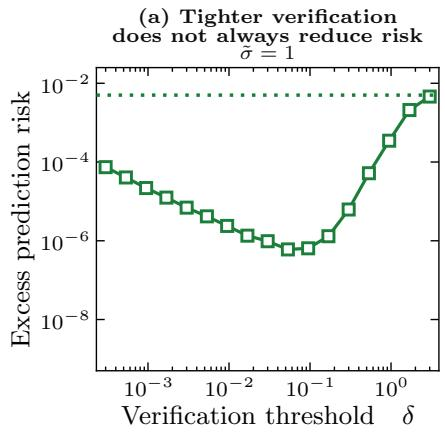

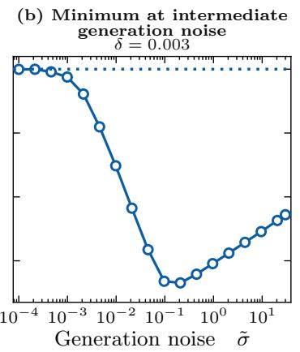

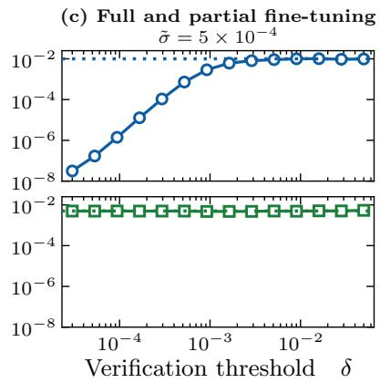  
Full fine-tuning (s = d = 20) Partial fine-tuning (s = 10) Pre-trained model  
Figure 1: Excess prediction risk under verified post-training. Panel (a) displays risk against the verification threshold under partial fine-tuning, panel (b) shows risk against generation noise under full fine-tuning. In panel (c), we compare full and partial fine-tuning across verification thresholds when generation noise is small. For partial fine-tuning, the excess risk excludes the direct contribu tion from the frozen coordinates.

In the following informal theorem, we make the phenomena underlying Figure 1 explicit and establish a unified leading risk rate for partial and full fine-tuning. The formal results and precise sample conditions are given in Section 3. Let ExcessRisk denote the diference between the prediction risk of the post-training estimator and the minimum prediction risk over the active coordinates, with the frozen coordinates fixed at their pre-trained values.

Theorem 1.1 (Informal Fine-Tuning Rate). Suppose that $n \geq C d$ and $1 \leq s \leq d .$ . Define the acceptance probability scale $p : = \operatorname* { m i n } ( 1 , \delta / \sqrt { \tilde { \sigma } ^ { 2 } + d / n } )$ . If the efective accepted sample size mp is suficiently large, then, with high probability, ExcessRisk is of order

$$
\underbrace { \frac { s } { n } \bigg ( \bigg ( \frac { d - s } { n \tilde { \sigma } ^ { 2 } + d - s } \bigg ) ^ { 2 } + \operatorname* { m i n } ( 1 , ( \delta / \tilde { \sigma } ) ^ { 4 } ) \bigg ) } _ { p r e - t r a i n i n g \ b i a s } + \underbrace { \frac { s g _ { d - s , d } ( \sqrt { d / n } / \operatorname* { m a x } ( \tilde { \sigma } , \delta ) ) } { m p } \left( \operatorname* { m i n } ( \delta ^ { 2 } , \tilde { \sigma } ^ { 2 } ) + \frac { \tilde { \sigma } ^ { 2 } ( d - s ) } { n \tilde { \sigma } ^ { 2 } + d - s } \right) } _ { p o s t - t r a i n a g \ v a r i a n c e } .
$$

From the first term, which represents the expected squared conditional bias inherited from pretraining, we see that, when $\delta / { \widetilde { \sigma } }$ is small, generation noise can mitigate the error from pre-training among the accepted samples by a factor of $( \delta / \tilde { \sigma } ) ^ { 4 }$ , while the error in the frozen coordinates limits the extent of this reduction through the term $( ( d - s ) / ( n \tilde { \sigma } ^ { 2 } + d - s ) ) ^ { 2 }$ . From the second term, which represents the expected conditional post-training variance induced by injected generation noise, we see a verification threshold tradeof in minimizing the excess risk. The factor $g _ { d - s , d }$ reflects the change in the covariate distribution induced by verification and equals one when $d - s \geq 3$ . For full fine-tuning, $s = d ,$ the frozen coordinate terms in both parts disappear, while the variance factor becomes $g _ { 0 , d } ( \sqrt { d / n } / \operatorname* { m a x } ( \tilde { \sigma } , \delta ) ) = 1 + 1 / ( n \operatorname* { m a x } ( \tilde { \sigma } ^ { 2 } , \delta ^ { 2 } ) )$ .

In the formal results, we present this characterization across four regimes determined by the relative scales of the verification threshold $\delta ,$ the injected generation noise scale $\tilde { \sigma } .$ , and the typical pre-training error scale $\sqrt { d / n }$ . The four regimes reveal a common principle. We show that the efect of verification depends on the threshold relative to generation noise and on the covariate variation preserved among the accepted samples. If the accepted covariates remain representative of the downstream population, the threshold is suficiently small relative to the injected generation noise scale, and suficiently many samples are accepted, then post-training can reduce the leading contribution from the pre-trained estimator. By contrast, when the pre-training error dominates the injected generation noise, the improvement can be less substantial, as verification tends to select samples already well fitted by the pre-trained estimator. The reduction is further limited if the injected generation noise does not exceed the verification threshold and the threshold lies below the pre-training error scale. In this regime, the leading contribution inherited from pre-training remains of order s/n.

We also characterize the diference in prediction risk between partial and full fine-tuning. Under partial fine-tuning $( s < d )$ , the pre-training error in the frozen coordinates afects both verification and prediction risk, and its interaction with the updated coordinates can persist, while this interaction does not appear under full fine-tuning $( s = d )$ . Moreover, we extend the analysis to iterative verified full fine-tuning and characterize how estimation error propagates across generations. Finally, we complement our theoretical results with Gaussian simulations and real data experiments that illustrate the efects of the verification threshold, generation noise, and the choice between partial and full fine-tuning.

## 1.1 Contributions

Our main contributions are:

• Nonasymptotic risk characterization. We establish nonasymptotic prediction risk bounds in four regimes determined by the relative scales of the verification threshold, the generation noise, and the pre-training error. The bounds identify the underlying efects of accepted response error, efective sample size, and covariate variation that lead to counterintuitive phenomena.

• Partial and full fine-tuning. We show that verification can have fundamentally diferent efects under partial and full fine-tuning. When the generation noise dominates the pretraining error, tighter verification reduces the active coordinate contribution inherited from pre-training but can increase the contribution induced by the frozen coordinates through the smaller efective number of accepted samples. This tradeof can lead to a U-shaped risk under partial fine-tuning and does not appear under full fine-tuning. However, when the pre-training error dominates the generation noise, the reduced variation of the accepted covariates can have a stronger efect under full fine-tuning.

• Iterative verified full fine-tuning. We extend the analysis to repeated verified full finetuning and establish upper and lower bounds for the propagation of estimation error across generations. When the verification threshold is suficiently small relative to the generation noise, the contribution from the initial error contracts geometrically. The lower bound further shows that the initial error cannot decrease rapidly when the verification threshold is large relative to the generation noise.

## 1.2 Related Work

Model collapse. A growing literature studies model collapse, the degradation that can occur when models are repeatedly trained on self-generated data (Shumailov et al., 2024). The phenomenon has been analyzed theoretically in linear regression (Gerstgrasser et al., 2024; Dey and Donoho, 2024; Garg et al., 2026), distribution estimation (Kanabar and Gastpar, 2025; Xu et al., 2025), and through changes in scaling laws (Dohmatob et al., 2025). Prior work shows that estimation error inherited from earlier generations can persist through subsequent rounds of synthetic training. To mitigate the resulting degradation, several strategies have been proposed. One approach retains or accumulates real data across generations (Gerstgrasser et al., 2024; Dey and Donoho, 2024; Kanabar and Gastpar, 2025). Another approach mixes synthetic data with fresh real data with an optimized mixing weight (He et al., 2026; Garg et al., 2026). In contrast, we study whether self-generated samples themselves can be made useful through verification, without relying on additional real training responses.

Self-distillation and self-generated data. A related line of work studies when models can benefit from training on their own predictions. Empirically, self-generated data have been shown to improve performance in a range of settings (Zelikman et al., 2022; Setlur et al., 2024; Song et al., 2025; Zhao et al., $^ { 2 0 2 6 \mathrm { b } , \mathrm { a } ) }$ . Theoretical analyses consider self-distillation in classification (Frei et al., 2022; Das and Sanghavi, 2023; Das et al., 2024; Dang et al., 2026) and regression (Das and Sanghavi, 2023; Dang et al., 2026; Lecoiu et al., 2026; Wu et al., 2026; Moniri and Hassani, 2026). These results show that training on model predictions can improve performance over the initial estimator under suitable conditions. Motivated by these results, we study how external verification of self-generated responses afects prediction risk under partial and full fine-tuning.

Verification and data selection. Verification has become an important mechanism for selecting useful synthetic data in practice (Zelikman et al., 2022; Setlur et al., 2024; Song et al., 2025; Zhao et al., 2026a), and empirical evidence shows that a verified subset can substantially outperform synthetic data without verification and, in some settings, even the full human-written dataset (Feng et al., 2025; Amin et al., 2026). Recently, for theoretical understanding, Feng et al. (2025) characterize when an imperfect verifier can recover Bayes optimal classification through its acceptance rates for correct and incorrect labels, while El Firdoussi et al. (2025) quantify the efect of generator estimation error even under perfect label verification. Related work considers filtering in recursive training (Fu et al., 2026), weak external supervision (Amin et al., 2026), preference-based curation (Ferbach et al., 2024), and the scaling of verified sample sizes across rounds (Yang et al., 2026). These analyses focus on classification or iterative generative learning. For linear regression, covariance based synthetic data selection without verification has been studied (Rezaei et al., 2026).

Most closely related, Yi et al. (2026) study synthetic retraining with verification in linear regression and characterize both the improvement from one round and the behavior under repeated retraining. Their theoretical setting uses fixed orthogonal covariate directions, which reduces linear regression to separate one-dimensional Gaussian mean estimation problems with a fixed verification threshold and a fixed generation noise scale. We instead draw synthetic covariates from the downstream distribution and allow the verification threshold δ and generation noise scale σ˜ to vary relative to the pre-training error scale $\sqrt { d / n }$ . Under this general setting, our nonasymptotic analysis yields four distinct risk regimes arising from the interaction between the efective accepted sample size and the covariance of the accepted covariates. These rates do not follow from a direct extension of the fixed orthogonal setting. Moreover, we also study partial fine-tuning, where the contribution from the frozen coordinates leads to a diferent risk characterization.

## 1.3 Organization.

In Section 2, we introduce the data model, verification rule, and post-training estimator. In Section 3, we establish the nonasymptotic risk bounds for partial and full fine-tuning across the four regimes.

In Section 4, we provide a proof sketch of the main results. In Section $5 ,$ we extend the analysis to repeated verified full fine-tuning. In Section 6, we present Gaussian simulations and real data experiments. In Section 7, we conclude the paper. The appendices contain the detailed proofs, auxiliary results, and further details for the experiments.

## 1.4 Notation.

We denote the standard normal distribution function and density by Φ and ϕ, respectively. For vectors, $\| x \| = \| x \| _ { 2 }$ , and for a positive semidefinite matrix $M , \| x \| _ { M } ^ { 2 } = x ^ { \top } M x$ . The trace of A is denoted $\mathrm { b y ~ t r } ( A )$ . For $S \subseteq \{ 1 , \ldots , d \}$ , let $- S$ denote its complement and let $A _ { S S }$ and $A _ { S , - S }$ denote the corresponding matrix blocks. We denote the indicator function by $\mathbf { 1 } \{ \cdot \}$ . Unless stated otherwise, $c , C$ denote positive constants independent of $n , m , d , s , \delta , \tilde { \sigma }$ The relations $a \lesssim b$ and $a \gtrsim b$ denote the bounds $a \leq C b$ and $a \geq c b .$ , respectively. For nonnegative $a , b ,$ the notation $a \asymp b$ denotes the bounds $c b \leq a \leq C b$ . The notation $a = O ( b )$ denotes the bound $| a | \leq C b$

## 2 Problem Setting

## 2.1 Pre-Training Data and the Pre-Trained Estimator

We consider pre-training data with sample size n and true coeficient vector $\beta ^ { * } \in \mathbb { R } ^ { d }$ . Let $X _ { \mathrm { p r e } } \in$ $\mathbb { R } ^ { n \times d }$ be a matrix with rows $x _ { \mathrm { p r e } , i } ^ { \top } ,$ and let $Y _ { \mathrm { p r e } } \in \mathbb { R } ^ { n }$ and $\varepsilon _ { \mathrm { p r e } } \in \mathbb { R } ^ { n }$ denote the response and noise vectors, respectively. They satisfy

$$
Y _ { \mathrm { p r e } } = X _ { \mathrm { p r e } } \beta ^ { * } + \varepsilon _ { \mathrm { p r e } } , \qquad x _ { \mathrm { p r e } , i } \sim \mathcal { N } ( 0 , \Sigma ) , \qquad \varepsilon _ { \mathrm { p r e } } \sim \mathcal { N } ( 0 , I _ { n } ) .
$$

We assume that $x _ { \mathrm { p r e } , 1 } , \ldots , x _ { \mathrm { p r e } , n }$ are independent and that $\varepsilon _ { \mathrm { p r e } }$ is independent of $X _ { \mathrm { p r e } }$ . For the downstream task, the covariate and response satisfy

$$
y = x ^ { \mathsf { T } } { \boldsymbol { \beta } } ^ { * } + \varepsilon , \qquad x \sim { \mathcal { N } } ( 0 , \Sigma _ { 1 } ) , \qquad \mathbb { E } [ \varepsilon \mid x ] = 0 , \qquad \mathrm { V a r } ( \varepsilon \mid x ) = \sigma _ { 1 } ^ { 2 } .
$$

Furthermore, we assume that the pre-training and downstream covariances are well conditioned.

Assumption 2.1 (Covariance regularity). There exist fixed constants $0 < c _ { \lambda } \le C _ { \lambda } < \infty$ such that

$$
c _ { \lambda } I _ { d } \preceq \Sigma \preceq C _ { \lambda } I _ { d } , \qquad c _ { \lambda } I _ { d } \preceq \Sigma _ { 1 } \preceq C _ { \lambda } I _ { d } .
$$

For $n \geq d ,$ the ordinary least squares pre-trained estimator is $\hat { \beta } ^ { \mathrm { p r e } } = ( X _ { \mathrm { p r e } } ^ { \top } X _ { \mathrm { p r e } } ) ^ { - 1 } X _ { \mathrm { p r e } } ^ { \top } Y _ { \mathrm { p r e } }$ . Define the pre-training error by $\Delta = \beta ^ { * } - \hat { \beta } ^ { \mathrm { p r e } }$ . We then have

$$
\Delta = - ( X _ { \mathrm { p r e } } ^ { \top } X _ { \mathrm { p r e } } ) ^ { - 1 } X _ { \mathrm { p r e } } ^ { \top } \varepsilon _ { \mathrm { p r e } } , \qquad \Delta \mid X _ { \mathrm { p r e } } \sim { \mathcal N } ( 0 , \Gamma / n ) , \qquad \Gamma = \left( n ^ { - 1 } X _ { \mathrm { p r e } } ^ { \top } X _ { \mathrm { p r e } } \right) ^ { - 1 } .
$$

For $n \geq C d .$ the normalized Gram matrix satisfies $( c _ { \lambda } / 2 ) I _ { d } \preceq X _ { \mathrm { p r e } } ^ { \top } X _ { \mathrm { p r e } } / n \preceq 2 C _ { \lambda } I _ { d }$ with probability at least $1 - 2 e ^ { - c n }$ , as presented in Lemma B.1.

## 2.2 Verified Synthetic Data

Given the pre-trained estimator, we draw m covariates from the downstream distribution and generate the corresponding synthetic responses. In the language model interpretation, the synthetic

covariates $\tilde { x } _ { j }$ can be considered as the features of queries for the task, and the synthetic responses $\tilde { y } _ { j }$ represent the generated answers. For $j = 1 , \ldots , m$

$$
\begin{array} { r } { \tilde { y } _ { j } = \tilde { x } _ { j } ^ { \top } \hat { \beta } ^ { \mathrm { p r e } } + \tilde { \varepsilon } _ { j } , \qquad \tilde { x } _ { j } \sim { \mathcal N } ( 0 , \Sigma _ { 1 } ) , \qquad \tilde { \varepsilon } _ { j } \sim { \mathcal N } ( 0 , \tilde { \sigma } ^ { 2 } ) , } \end{array}
$$

where $\tilde { \sigma } > 0$ denotes the scale of the injected generation noise. The scale $\tilde { \sigma }$ represents the amount of injected randomness, analogous to the role of sampling temperature in large language model response generation (Renze, 2024). We assume that the synthetic covariate $\tilde { x } _ { j }$ and generation noise $\tilde { \varepsilon } _ { j }$ are mutually independent and independent of the pre-training data. Let $\tilde { X } \in \mathbb { R } ^ { m \times d }$ denote the matrix with rows $\tilde { x } _ { j } ^ { \top }$ , and let $\tilde { \varepsilon } = ( \tilde { \varepsilon } _ { 1 } , \dots , \tilde { \varepsilon } _ { m } ) ^ { \top }$

Let $\delta \in \mathsf { \Gamma } ( 0 , \infty ]$ be the verification threshold. An oracle verifier accepts the jth pair when $| \tilde { y } _ { j } - \tilde { x } _ { i } ^ { \top } \beta ^ { * } | \le \delta$ . The threshold δ specifies the accuracy criterion for verification, corresponding to sample selection based on response correctness or reward scores in large language model fine-tuning (Zelikman et al., 2022; Gulcehre et al., 2023). Although the oracle verifier evaluates response errors exactly, accepted responses may have error up to $\delta .$ Correspondingly, we define the generated response error and acceptance indicator by

$$
\begin{array} { r } { \xi _ { j } : = \tilde { y } _ { j } - \tilde { x } _ { j } ^ { \top } \beta ^ { * } = - \tilde { x } _ { j } ^ { \top } \Delta + \tilde { \varepsilon } _ { j } , \qquad \mathbb { I } _ { j } : = { \bf 1 } \{ | \xi _ { j } | \leq \delta \} , \qquad j = 1 , \ldots , m . } \end{array}
$$

The representation of $\xi _ { j }$ reveals that verification depends jointly on the pre-trained prediction error $- \tilde { x } _ { j } ^ { \top } \Delta$ and the injected generation noise $\tilde { \varepsilon } _ { j }$ . We refer to samples $\{ ( \tilde { x } _ { j } , \tilde { y } _ { j } ) \} _ { j = 1 } ^ { m }$ with $\mathbb { I } _ { j } = 1$ as accepted samples. Note that we consider Gaussian distributions for the synthetic covariates and generation noise, since this allows us to obtain explicit expressions for the acceptance probability and conditional moments of accepted samples.

## 2.3 Post-Training Estimator

Let $S \subseteq \{ 1 , \ldots , d \}$ be a fixed active coordinate set, independent of the data, with $| S | = s$ and $1 \leq s \leq d .$ . We refer to its complement $- S$ as the frozen coordinate set. Motivated by parameter eficient fine-tuning in practice (Houlsby et al., 2019), post-training updates the coordinates in S by least squares on the accepted samples and keeps the coordinates in $- S$ at their pre-trained values, which leads to $\hat { \beta } _ { - S } ^ { \mathrm { p o s t } } = \hat { \beta } _ { - S } ^ { \mathrm { p r e } }$ . The cases $s < d$ and $s = d$ correspond to partial and full fine-tuning, respectively. When the accepted active coordinate Gram matrix $\begin{array} { r } { \sum _ { j = 1 } ^ { m } \mathbb { I } _ { j } \tilde { x } _ { j , S } \tilde { x } _ { j , S } ^ { \top } } \end{array}$ is invertible, the active coordinates of the post-training estimator are

$$
\hat { \beta } _ { S } ^ { \mathrm { p o s t } } = \bigg ( \sum _ { j = 1 } ^ { m } \mathbb { I } _ { j } \tilde { x } _ { j , S } \tilde { x } _ { j , S } ^ { \top } \bigg ) ^ { - 1 } \sum _ { j = 1 } ^ { m } \mathbb { I } _ { j } \tilde { x } _ { j , S } \big ( \tilde { y } _ { j } - \tilde { x } _ { j , - S } ^ { \top } \hat { \beta } _ { - S } ^ { \mathrm { p r e } } \big ) ,
$$

where $\tilde { x } _ { j , S } , \hat { \beta } _ { S } ^ { \mathrm { p o s t } } \in \mathbb { R } ^ { s }$ . Since the frozen coordinates retain their pre-training error, the downstream prediction risk over the active coordinates is not necessarily minimized at $\beta _ { S } ^ { * }$ . Therefore, with $\hat { \beta } _ { - S } ^ { \mathrm { p r e } } = \beta _ { - S } ^ { * } - \Delta _ { - S }$ fixed, we define the corresponding downstream population target by

$$
\begin{array} { r } { \beta _ { S } ^ { \mathrm { c o r r } } : = \operatorname * { a r g m i n } _ { \beta _ { S } \in \mathbb { R } ^ { s } } \mathbb { E } _ { x } \left[ \left( x _ { S } ^ { \top } \beta _ { S } + x _ { - S } ^ { \top } \hat { \beta } _ { - S } ^ { \mathrm { p r e } } - x ^ { \top } \beta ^ { * } \right) ^ { 2 } \right] = \beta _ { S } ^ { * } + \Sigma _ { 1 , S S } ^ { - 1 } \Sigma _ { 1 , S , - S } \Delta _ { - S } . } \end{array}
$$

Thus, under partial fine-tuning, the pre-training error $\Delta _ { - S }$ can shift the active coordinate target through the covariance between the active and frozen coordinates. Under full fine-tuning, the frozen block is empty and $\beta _ { S } ^ { \mathrm { c o r r } } = \beta _ { S } ^ { * }$ . Figure 2 summarizes the four steps of verified post-training.

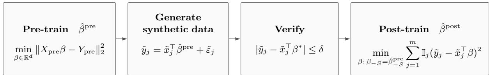  
Figure 2: Post-training with verified synthetic data.

## 2.4 Prediction Risk

Let $\hat { \beta }$ be any estimator constructed from the pre-training and synthetic data, and let $( x , y )$ be an independent test sample from the downstream model. Conditioned on the realized covariates $( X _ { \mathrm { p r e } } , { \tilde { X } } )$ , define its prediction risk by

$$
R _ { 1 } \big ( \hat { \beta } ; X _ { \mathrm { p r e } } , \tilde { X } \big ) : = \mathbb { E } \big [ ( y - x ^ { \top } \hat { \beta } ) ^ { 2 } \big | X _ { \mathrm { p r e } } , \tilde { X } \big ] = \sigma _ { 1 } ^ { 2 } + \mathbb { E } \big [ \| \hat { \beta } - \beta ^ { * } \| _ { \Sigma _ { 1 } } ^ { 2 } \big | X _ { \mathrm { p r e } } , \tilde { X } \big ] .
$$

The expectation is over the pre-training noise $\varepsilon _ { \mathrm { p r e } } .$ , the generation noise $\tilde { \varepsilon } ,$ and the independent test sample $( x , y )$ . In the next section, we decompose the risk and state the regime specific rates for verified post-training.

## 3 Main Results

We first decompose the prediction risk and present the baseline without verification. Then, we present and compare the partial and full fine-tuning rates across the four regimes.

## 3.1 Risk Decomposition

The prediction risk consists of the downstream noise variance, the active coordinate error, and the contribution from the frozen coordinates. Let $\Sigma _ { 1 , - S | S } : = \Sigma _ { 1 , - S , - S } - \Sigma _ { 1 , - S , S } \Sigma _ { 1 , S S } ^ { - 1 } \Sigma _ { 1 , S , - S }$ denote the Schur complement of $\Sigma _ { 1 , S S }$ in $\Sigma _ { 1 }$ . By the notation, we decompose the prediction risk as follows.

Proposition 3.1 (Risk Decomposition). Under the model in Section ${ \mathcal { Q } } ,$ let $\hat { \beta }$ be any post-training estimator satisfying $\hat { \beta } _ { - S } = \hat { \beta } _ { - S } ^ { \mathrm { p r e } }$ . Conditioned on $X _ { \mathrm { p r e } }$ and $\tilde { X }$

$$
R _ { 1 } \big ( \hat { \beta } ; X _ { \mathrm { p r e } } , \tilde { X } \big ) = \sigma _ { 1 } ^ { 2 } + \mathrm { B i a s } _ { S } ^ { 2 } + \mathrm { V a r } _ { S } + \mathrm { V a r } _ { - S } ,
$$

where $\mathrm { B i a s } _ { S } ^ { 2 } : = | | \mathbb { E } [ \hat { \beta } _ { S } - \beta _ { S } ^ { \mathrm { c o r r } } \ | \ X _ { \mathrm { p r e } } , \tilde { X } ] | | _ { \Sigma _ { 1 , S S } } ^ { 2 } .$ , and

$$
\operatorname { V a r } _ { S } : = \operatorname { t r } ( \Sigma _ { 1 , S S } \operatorname { C o v } ( \hat { \beta } _ { S } - \beta _ { S } ^ { \operatorname { c o r r } } \mid X _ { \operatorname { p r e } } , \tilde { X } ) ) , \qquad \operatorname { V a r } _ { - S } : = \operatorname { t r } ( \Sigma _ { 1 , - S | S } \operatorname { C o v } ( \Delta _ { - S } \mid X _ { \operatorname { p r e } } ) ) .
$$

The decomposition is proved in Appendix C. Let $\begin{array} { r } { G ( \Delta ) : = \sum _ { j = 1 } ^ { m } \mathbb { I } _ { j } \tilde { x } _ { j , S } \tilde { x } _ { j , S } ^ { \top } } \end{array}$ denote the accepted active coordinate Gram matrix for the realized synthetic covariates $\tilde { X }$ . Since $G ( \Delta )$ can be singular, we consider the following extended estimator.

Definition 3.2 (Extended Post-Training Estimator). Fix $C _ { G } \geq 2$ . Let $\Omega _ { \mathrm { p o s t } } : = \{ \lambda _ { \mathrm { m i n } } ( G ( \Delta ) / m ) \geq$ $m ^ { - C _ { G } } \}$ . We define the extended post-training estimator as the post-training estimator on $\Omega _ { \mathrm { p o s t } }$ and the pre-trained estimator on its complement:

$$
\begin{array} { r } { \hat { \beta } _ { S , \mathrm { e x t } } ^ { \mathrm { p o s t } } : = \left\{ \begin{array} { l l } { \hat { \beta } _ { S } ^ { \mathrm { p o s t } } , } & { o n { \Omega } _ { \mathrm { p o s t } } , } \\ { \hat { \beta } _ { S } ^ { \mathrm { p r e } } , } & { o n { \Omega } _ { \mathrm { p o s t } } ^ { \mathrm { c } } , } \end{array} \right. \qquad \hat { \beta } _ { - S , \mathrm { e x t } } ^ { \mathrm { p o s t } } : = \hat { \beta } _ { - S } ^ { \mathrm { p r e } } . } \end{array}
$$

To analyze the active coordinate contribution to the risk, let $r _ { S } : = \hat { \beta } _ { S } ^ { \mathrm { p o s t } } - \beta _ { S } ^ { \mathrm { c o r r } }$ denote the post-training residual on $\Omega _ { \mathrm { p o s t } }$ . We define $r _ { S } \mathbf { 1 } _ { \Omega _ { \mathrm { p o s t } } }$ to be zero on $\Omega _ { \mathrm { p o s t } } ^ { \mathrm { c } }$ . The corresponding residual for the extended estimator is

$$
r _ { S , \mathrm { e x t } } : = \hat { \beta } _ { S , \mathrm { e x t } } ^ { \mathrm { p o s t } } - \beta _ { S } ^ { \mathrm { c o r r } } = r _ { S } \mathbf { 1 } _ { \Omega _ { \mathrm { p o s t } } } - \Sigma _ { 1 , S S } ^ { - 1 } ( \Sigma _ { 1 } \Delta ) s \mathbf { 1 } _ { \Omega _ { \mathrm { p o s t } } ^ { \mathrm { c } } } .\tag{1}
$$

We consider this extended estimator when evaluating the downstream prediction risk. It follows from Lemma D.4 that $\mathrm { B i a s } _ { S } ^ { 2 } = 0$ . Furthermore, since Cov $( \Delta \mid X _ { \mathrm { p r e } } ) = \Gamma / n$ , we also have Var− $_ { \cdot S } =$ t $\cdot ( \Sigma _ { 1 , - S | S } \Gamma _ { - S , - S } ) / n$ . Thus, it remains to analyze the active coordinate variance $\mathrm { V a r } _ { S }$

For the remainder of this section, Var denotes the active coordinate variance of the extended estimator. Conditioned on $( X _ { \mathrm { p r e } } , { \tilde { X } } )$ , the law of total variance applied to $r _ { S , \mathrm { { e x t } } }$ yields $\mathrm { V a r } _ { S } = \mathcal { V } _ { 1 } + \mathcal { V } _ { 2 }$ where

$$
\begin{array} { r l } & { \mathcal { V } _ { 1 } : = \mathrm { t r } \big ( \Sigma _ { 1 , S S } \mathrm { C o v } ( \mathbb { E } _ { \widetilde { \varepsilon } } [ r _ { S , \mathrm { e x t } } \mid \Delta , \tilde { X } ] \mid X _ { \mathrm { p r e } } , \tilde { X } ) \big ) , } \\ & { \mathcal { V } _ { 2 } : = \mathbb { E } [ \mathrm { t r } ( \Sigma _ { 1 , S S } \mathrm { C o v } _ { \widetilde { \varepsilon } } ( r _ { S , \mathrm { e x t } } \mid \Delta , \tilde { X } ) ) \mid X _ { \mathrm { p r e } } , \tilde { X } ] . } \end{array}\tag{2}
$$

Here, $\mathcal { V } _ { 1 }$ is the expectation of the squared conditional bias inherited from the pre-training error, while $\nu _ { 2 }$ is the expectation of the conditional post-training variance induced by injected generation noise. For fixed $\Delta$ and $\tilde { X }$ , the conditional bias is the diference between $\breve { \mathbb { E } } _ { \tilde { \varepsilon } } [ \tilde { \beta } _ { S , \mathrm { e x t } } ^ { \mathrm { \check { p } o s t } } \ | \ \breve { \Delta } , \tilde { X } ]$ and the downstream population target $\beta _ { S } ^ { \mathrm { c o r r } }$ . The conditional variance describes the variation of $\hat { \beta } _ { S , \mathrm { e x t } } ^ { \mathrm { p o s t } }$ around this conditional expectation, as injected generation noise afects both the synthetic responses and which samples are accepted. These two terms determine the risk rates under the four verification regimes introduced in Section 3.3. Before presenting the main results, we first consider post-training without verification, which provides a baseline for evaluating the efect of verification.

## 3.2 Baseline without Verification

For the baseline, we consider $\delta = \infty$ , where every generated sample is accepted, and post-training uses all m synthetic samples. In this case, $\begin{array} { r } { G ( \Delta ) = G : = \sum _ { i = 1 } ^ { m } \tilde { x } _ { i , S } \tilde { x } _ { i , S } ^ { \top } } \end{array}$ , and the variance components $\nu _ { 1 }$ and $\nu _ { 2 }$ admit explicit forms.

Proposition 3.3 (Baseline without Verification). Let $c _ { 1 } > 0$ and $1 \leq s \leq d$ , and suppose that Assumption 2.1 holds and $\delta = \infty . \ I f n \geq C d$ and $m \geq C ( s + \log m )$ , then, with probability at least $1 - 2 e ^ { - c n } - m ^ { - c _ { 1 } }$ jointly over $( X _ { \mathrm { p r e } } , { \tilde { X } } )$ , the post-training estimator satisfies

$$
R _ { 1 } - \sigma _ { 1 } ^ { 2 } - \mathrm { V a r } _ { - S } = \underbrace { \frac { 1 } { n } \mathrm { t r } { \left( \Sigma _ { 1 , S S } ^ { - 1 } ( \Sigma _ { 1 } \Gamma \Sigma _ { 1 } ) _ { S S } \right) } } _ { \mathcal { V } _ { 1 } } + \underbrace { \tilde { \sigma } ^ { 2 } \mathrm { t r } { \left( \Sigma _ { 1 , S S } G ^ { - 1 } \right) } } _ { \mathcal { V } _ { 2 } } \asymp \frac { s } { n } + \frac { s \tilde { \sigma } ^ { 2 } } { m } .
$$

In particular, when $s = d .$ , we have

$$
R _ { 1 } - \sigma _ { 1 } ^ { 2 } = \underbrace { \frac { 1 } { n } \operatorname { t r } ( \Sigma _ { 1 } \Gamma ) } _ { \mathcal { V } _ { 1 } } + \underbrace { \tilde { \sigma } ^ { 2 } \operatorname { t r } ( \Sigma _ { 1 } G ^ { - 1 } ) } _ { \mathcal { V } _ { 2 } } \asymp \frac { d } { n } + \frac { d \tilde { \sigma } ^ { 2 } } { m } .
$$

The proposition is proved in Appendix C. To assess improvement over pre-training, we note that the pre-trained estimator itself has conditional prediction risk $\sigma _ { 1 } ^ { 2 } + \mathrm { t r } ( \Sigma _ { 1 } \Gamma ) / n$ , with the excess risk rate of order $d / n$ . Thus, post-training without verification leaves the contribution from the pre-training error rate unchanged while adding post-training variance $\nu _ { 2 } \times s \tilde { \sigma } ^ { 2 } / m$ as we inject generation noise during the synthetic data generation.

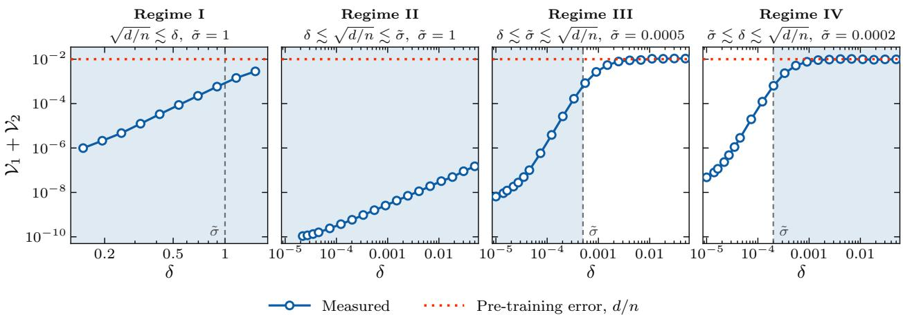  
Figure 3: Full fine-tuning with $s = d = 2 0 , n = 2 0 0 0$ , and $m = 3 \times 1 0 ^ { 6 }$ . Simulation estimates of $\nu _ { 1 } + \nu _ { 2 }$ are plotted against the verification threshold $\delta ,$ , with $\tilde { \sigma }$ fixed in each panel. Tighter verification reduces the variance in Regime I even when $\delta$ exceeds $\sqrt { d / n }$ . The variance is smallest in Regime II, increases in Regime III, and remains near $d / n$ in Regime $\mathrm { I V }$ , where tight verification provides little improvement when generation noise is too small.

## 3.3 Verification Regimes

Now, we consider $0 < \delta < \infty$ , under which verification changes both the number and distribution of samples employed for post-training. Since $\xi _ { j } = - \tilde { x } _ { j } ^ { \top } \Delta + \tilde { \varepsilon } _ { j }$ , the efect of verification depends on the relative magnitudes of the verification threshold $\delta ,$ , the injected generation noise scale ${ \tilde { \sigma } } ,$ , and the pre-training error scale $\sqrt { d / n }$ . Therefore, we distinguish the following four regimes.

Regime I : $\sqrt { d / n } \lesssim \delta ,$ loose verification,

Regime II : $\delta \lesssim \sqrt { d / n } \lesssim \tilde { \sigma }$ , tight verification, noise-dominated,

Regime III : $\delta \lesssim \tilde { \sigma } \lesssim \sqrt { d / n } ,$ , tight verification, pre-training error-dominated,

Regime IV : $\begin{array} { r } { \tilde { \sigma } \lesssim \delta \lesssim \sqrt { d / n } , } \end{array}$ low injected generation noise.

These inequalities hold up to fixed constants, hence the adjacent regimes overlap when the corresponding scales are comparable. We present the partial and full fine-tuning results within each regime in the following subsections. Figures 3–6 illustrate the active coordinate variance $\nu _ { 1 } + \nu _ { 2 }$ across the four verification regimes under full and partial fine-tuning.

For the four regimes, we work under Assumption 2.1 and suppose that $n \geq C d$ and $m \geq C$ Each regime additionally imposes its stated scale and accepted sample conditions. We assume that $d +$ log m is bounded above by a polynomial in $m .$ . For fixed $c _ { 1 } > 0$ , the results hold when the constants in the sample conditions are suficiently large. We provide a proof sketch in Section 4 and the detailed proofs in Appendix I.

## 3.4 Regime I: Loose Verification

In Regime I, verification is loose relative to the pre-training error scale, $\sqrt { d / n } \lesssim \delta$ , and does not impose an ordering between $\delta$ and $\tilde { \sigma } .$ . The scale condition is

$$
\sqrt { d / n } \lesssim \delta .\tag{I-scale}
$$

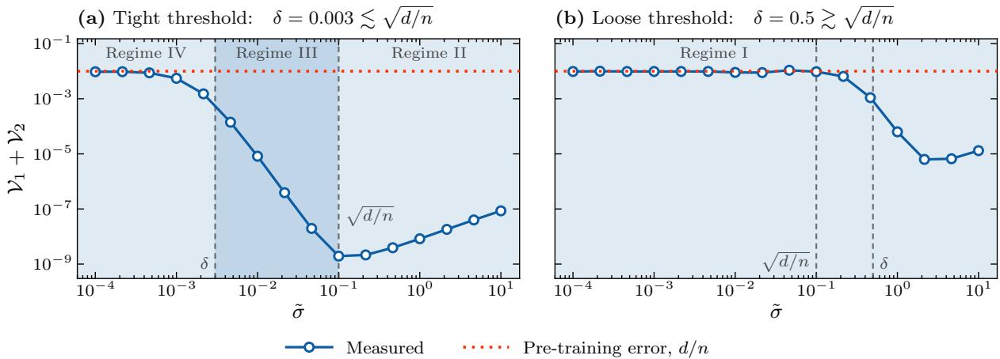  
Figure 4: Full fine-tuning with $s = d = 2 0 , n = 2 0 0 0 .$ , and $m = 3 \times 1 0 ^ { 6 }$ . Simulation estimates of $\nu _ { 1 } + \nu _ { 2 }$ are plotted against the generation noise $\tilde { \sigma }$ under (a) tight and (b) loose verification. In both cases, the variance is minimized at an intermediate generation noise level. Nearly deterministic generation leaves the variance near $d / n$ , whereas excessive generation noise increases it.

Under this condition, $p _ { \mathrm { I } } : = \operatorname* { m i n } ( 1 , \delta / \tilde { \sigma } )$ is the acceptance scale, and $m p _ { \mathrm { I } }$ is the efective accepted sample size.

Theorem 3.4 (Partial Fine-Tuning in Regime I). Suppose that Assumption 2.1 holds and $1 \leq s < d$ If (I-scale) holds and $m p _ { \mathrm { I } } \geq C ( s + \log m ) ( \log m ) ^ { 7 / 2 }$ , then, with probability at least $1 - 2 e ^ { - c n } - m ^ { - c _ { 1 } }$ jointly over $( X _ { \mathrm { p r e } } , { \tilde { X } } )$ , the extended estimator satisfies

$$
\begin{array} { r l } & { R _ { 1 } - \sigma _ { 1 } ^ { 2 } - \mathrm { V a r } _ { - S } \lesssim \underbrace { \frac { s } { n } \operatorname* { m i n } \big ( 1 , ( \delta / \tilde { \sigma } ) ^ { 4 } \big ) + C \mathrm { R e m } \nu _ { 1 } } _ { \mathcal { V } _ { 1 } } + \underbrace { \frac { s \operatorname* { m i n } ( \delta ^ { 2 } , \tilde { \sigma } ^ { 2 } ) } { m p _ { \mathrm { I } } } } _ { \mathcal { V } _ { 2 } } , } \\ & { R _ { 1 } - \sigma _ { 1 } ^ { 2 } - \mathrm { V a r } _ { - S } \gtrsim \underbrace { \frac { s } { n } \operatorname* { m i n } \big ( 1 , ( \delta / \tilde { \sigma } ) ^ { 4 } \big ) - C \mathrm { R e m } \nu _ { 1 } } _ { m p _ { \mathrm { I } } } + \underbrace { \frac { s \operatorname* { m i n } ( \delta ^ { 2 } , \tilde { \sigma } ^ { 2 } ) } { m p _ { \mathrm { I } } } } _ { m p _ { \mathrm { I } } } , } \end{array}
$$

$$
w h e r e \mathrm { \tiny ~ R e m } \nu _ { 1 } : = d ( s + \log m ) / ( m n ) + s ( s + ( \log m ) ^ { 2 } ) ( \log m ) ^ { 3 } \operatorname* { m i n } ( \delta ^ { 2 } , \tilde { \sigma } ^ { 2 } ) / ( m p _ { \mathrm { I } } ) ^ { 2 } .
$$

We obtain the following corollary under an additional sample condition, which allows $\mathrm { R e m } _ { \nu _ { 1 } }$ to be absorbed into the sum of the leading $\mathcal { V } _ { 1 }$ and $\nu _ { 2 }$ terms.

Corollary 3.5 (Leading Risk Rate in Regime I). Suppose that the assumptions of Theorem $\it 3 . 4$ hold and additionally assume that m min $( 1 , ( \delta / \tilde { \sigma } ) ^ { 4 } ) \ge C d ( s + \log m ) / s$ for a suficiently large constant C. Then, with probability at least $1 - 2 e ^ { - c n } - m ^ { - c _ { 1 } }$ jointly over $( X _ { \mathrm { p r e } } , { \tilde { X } } )$ , the extended estimator satisfies

$$
R _ { 1 } - \sigma _ { 1 } ^ { 2 } - \mathrm { V a r } _ { - S } \asymp \underbrace { \frac { s } { n } \operatorname* { m i n } \bigl ( 1 , ( \delta / \tilde { \sigma } ) ^ { 4 } \bigr ) } _ { \mathcal { V } _ { 1 } } + \underbrace { \frac { s \operatorname* { m i n } ( \delta ^ { 2 } , \tilde { \sigma } ^ { 2 } ) } { m p _ { \mathrm { I } } } } _ { \mathcal { V } _ { 2 } } .
$$

Compared to the baseline without verification, verification changes $\nu _ { 1 }$ and $\nu _ { 2 }$ in diferent ways. The leading $\nu _ { 1 }$ term has order $( s / n ) \operatorname* { m i n } ( 1 , ( \delta / \tilde { \sigma } ) ^ { 4 } )$ . Hence, the active coordinate term inherited from pre-training falls below the baseline scale $s / n$ when $\delta / { \widetilde { \sigma } }$ is suficiently small and the remainder terms are of lower order. For $\nu _ { 2 }$ , the conditional variance induced by the generation noise

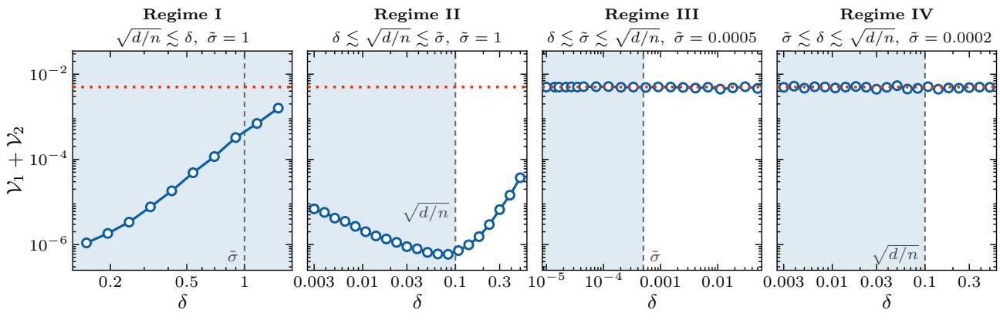  
Measured Pre-training error in the active coordinates, $s / n$

Figure 5: Partial fine-tuning with $s = 1 0 , d = 2 0 , n = 2 0 0 0$ , and $m = 3 \times 1 0 ^ { 6 }$ . Simulation estimates of $\nu _ { 1 } + \nu _ { 2 }$ are plotted against $\delta ,$ with σ˜ fixed in each panel. Regime I exhibits the same reduction as under full fine-tuning, while the frozen coordinates change the behavior in the Regimes II and III. The U-shaped graph in Regime II reflects the tradeof between the error in the accepted responses and the frozen coordinate contribution, and the variance remains near $s / n$ in Regimes III and IV.

has scale min $( \delta ^ { 2 } , \tilde { \sigma } ^ { 2 } )$ , while the efective accepted sample size has order $m p _ { \mathrm { I } }$ . Its leading rate is s min $( \delta ^ { 2 } , \tilde { \sigma } ^ { 2 } ) / ( m p _ { \mathrm { I } } )$ , equivalently sσ˜ min $( \delta , \tilde { \sigma } ) / m$ . When $\delta \lesssim \tilde { \sigma }$ , this is smaller than the baseline rate $s \tilde { \sigma } ^ { 2 } / m$ by a factor of order $\delta / { \widetilde { \sigma } }$

Theorem 3.6 (Full Fine-Tuning in Regime I). Suppose that Assumption 2.1 holds and $s = d .$ If (I-scale) holds and $m p _ { \mathrm { I } } \geq C ( d + \log m ) ( \log m ) ^ { 7 / 2 }$ , then, with probability at least $1 - 2 e ^ { - c n } - m ^ { - c _ { 1 } }$ jointly over $( X _ { \mathrm { p r e } } , { \tilde { X } } )$ , the extended estimator satisfies

$$
R _ { 1 } - \sigma _ { 1 } ^ { 2 } \asymp \underbrace { \frac { d } { n } \operatorname* { m i n } \left( 1 , ( \delta / \tilde { \sigma } ) ^ { 4 } \right) } _ { \mathcal { V } _ { 1 } } + \underbrace { \frac { d \operatorname* { m i n } ( \delta ^ { 2 } , \tilde { \sigma } ^ { 2 } ) } { m p _ { \mathrm { I } } } } _ { \mathcal { V } _ { 2 } } .
$$

For the full fine-tuning, the leading $\mathcal { V } _ { 1 }$ term has scale $( d / n ) \operatorname* { m i n } ( 1 , ( \delta / \tilde { \sigma } ) ^ { 4 } )$ , while the leading $\nu _ { 2 }$ term has scale dσ˜ min $( \delta , \tilde { \sigma } ) / m$ . Therefore, when $\delta / { \widetilde { \sigma } }$ is suficiently small, verification reduces the leading term inherited from pre-training below the scale $d / n$ . Similar to partial fine-tuning, this reduction can occur even when the verification threshold exceeds the pre-training error scale.

The key feature of Regime I is that verification can reduce both leading variance terms when $\delta / { \widetilde { \sigma } }$ is small, even though the threshold is loose relative to the pre-training error scale. When $\delta / { \widetilde { \sigma } }$ is small, verification retains samples for which the injected generation noise ofsets the error inherited from pre-training. This mechanism applies under both partial and full fine-tuning, and the leading active coordinate rates have the same form, with s replaced by d under full fine-tuning.

## 3.5 Regime II: Tight Verification, Noise-Dominated

Regime II considers a verification threshold smaller than the pre-training error scale, while the pre-training error scale is smaller than the injected generation noise scale σ˜. In this regime, the generation noise can ofset the pre-training prediction error, while each accepted generated response has error at most δ. The scale condition is

$$
\delta \lesssim \sqrt { d / n } \lesssim \tilde { \sigma } .\tag{II-scale}
$$

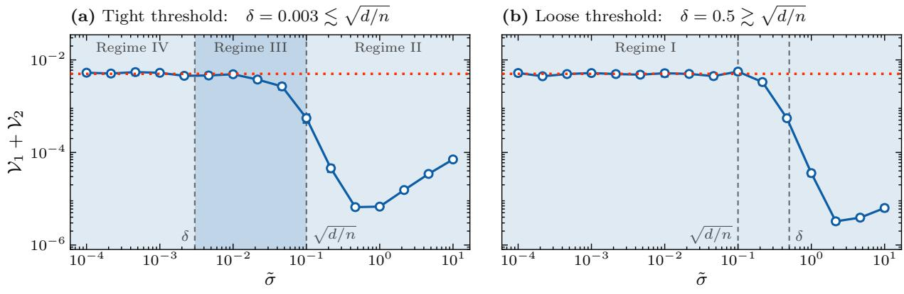  
Measured Pre-training error in the active coordinates, $s / n$

Figure 6: Partial fine-tuning with $s = 1 0 , d = 2 0 , n = 2 0 0 0$ , and $m = 3 \times 1 0 ^ { 6 }$ . Simulation estimates of $\nu _ { 1 } + \nu _ { 2 }$ are plotted against $\tilde { \sigma }$ under (a) tight and (b) loose verification. In both cases, suficiently large generation noise is needed to reduce the variance below $s / n ,$ while excessive generation noise increases it. The variance is therefore minimized at an intermediate generation noise level.

Under this condition, $p _ { \mathrm { I I } } : = \delta / \tilde { \sigma }$ is the acceptance scale, and $m p _ { \mathrm { I I } }$ is the efective accepted sample size.

Theorem 3.7 (Partial Fine-Tuning in Regime II). Suppose that Assumption 2.1 holds and $1 \leq s <$ d. If (II-scale) holds and $m p _ { \mathrm { I I } } \geq C ( s + \log m ) ( \log m ) ^ { 7 / 2 }$ , then, with probability at least $1 - 2 e ^ { - c n } -$ m−c1 jointly over $( X _ { \mathrm { p r e } } , { \tilde { X } } )$ , the extended estimator satisfies

$$
R _ { 1 } - \sigma _ { 1 } ^ { 2 } - \mathrm { V a r } _ { - } s \lesssim \underbrace { \frac { s } { n } \left( \left( \frac { d - s } { n \tilde { \sigma } ^ { 2 } + d - s } \right) ^ { 2 } + ( \delta / \tilde { \sigma } ) ^ { 4 } \right) + C \mathrm { R e m } \nu _ { 1 } } _ { \nu _ { 1 } } + \underbrace { \frac { s } { m p _ { \mathrm { I I } } } \left( \delta ^ { 2 } + \frac { \tilde { \sigma } ^ { 2 } ( d - s ) } { n \tilde { \sigma } ^ { 2 } + d - s } \right) } _ { \nu _ { 2 } } ,
$$

$$
R _ { 1 } - \sigma _ { 1 } ^ { 2 } - \mathrm { V a r } _ { - } s \gtrsim \frac { s } { n } \left( \left( \frac { d - s } { n \tilde { \sigma } ^ { 2 } + d - s } \right) ^ { 2 } + ( \delta / \tilde { \sigma } ) ^ { 4 } \right) - C \mathrm { R e m } \gamma _ { 1 } + \frac { s } { m p _ { \mathrm { I I } } } \left( \delta ^ { 2 } + \frac { \tilde { \sigma } ^ { 2 } ( d - s ) } { n \tilde { \sigma } ^ { 2 } + d - s } \right) ,
$$

$$
w h e r e \mathrm { R e m } \chi _ { 1 } : = d ( s + \log m ) / ( m n ) + s ( s + ( \log m ) ^ { 2 } ) ( \log m ) ^ { 3 } ( \delta ^ { 2 } + \bar { \sigma } ^ { 2 } ( d - s ) / ( n \bar { \sigma } ^ { 2 } + d - s ) ) / ( m p _ { \mathrm { I I } } ) ^ { 2 } .
$$

We obtain the following corollary under an additional sample condition, which allows $\mathrm { R e m } _ { \nu _ { 1 } }$ to be absorbed into the sum of the leading $\mathcal { V } _ { 1 }$ and $\nu _ { 2 }$ terms.

Corollary 3.8 (Leading Risk Rate in Regime II). Suppose that the assumptions of Theorem 3.7 hold and additionally assume that m $\iota \delta ^ { 2 } ( \delta ^ { 2 } + ( d - s ) / n ) / \tilde { \sigma } ^ { 4 } \geq C d ( s + \log m ) / s$ for a suficiently large constant C. Then, with probability at least $1 - 2 e ^ { - c n } - m ^ { - c _ { 1 } }$ jointly over $( X _ { \mathrm { p r e } } , { \tilde { X } } )$ , the extended estimator satisfies

$$
R _ { 1 } - \sigma _ { 1 } ^ { 2 } - \mathrm { V a r } _ { - S } \asymp \underbrace  \frac { s } { n } \mathopen { } \mathclose \bgroup \mathopen { } \mathclose \bgroup \mathopen { } \mathclose \bgroup \mathopen { } \mathclose \bgroup \mathopen { } \mathclose \bgroup \mathopen { } \mathclose \bgroup \mathopen { } \mathclose \bgroup \mathopen { } \mathclose \bgroup \mathopen { } \mathclose \bgroup \mathopen { } \mathclose \bgroup \mathopen { } \mathclose \bgroup \mathopen { } \mathclose \bgroup \mathopen { } \mathclose \bgroup \mathopen { } \mathclose \bgroup \mathopen { } \mathclose \bgroup \mathopen { } \mathclose \bgroup \left( \frac { d - s } { n \tilde { \sigma } ^ { 2 } + d - s } \aftergroup \egroup \aftergroup \egroup \aftergroup \egroup \aftergroup \egroup \aftergroup \egroup \aftergroup \egroup \aftergroup \egroup \aftergroup \egroup \aftergroup \egroup \aftergroup \egroup \aftergroup \egroup \aftergroup \egroup \aftergroup \egroup \aftergroup \egroup \aftergroup \egroup \aftergroup \egroup \right) ^ { 2 } + ( \delta / \tilde { \sigma } ) ^ { 4 } \aftergroup \egroup \aftergroup \egroup \aftergroup \egroup \aftergroup \egroup \aftergroup \egroup \aftergroup \egroup \aftergroup \egroup \aftergroup \egroup \aftergroup \egroup \aftergroup \egroup \aftergroup \egroup \qquad \underbrace { s } ~ \frac { \rho } { n \tilde { \sigma } ^ { 2 } + \frac { \tilde { \sigma } ^ { 2 } ( d - s ) } { n \tilde { \sigma } ^ { 2 } + d - s } } .
$$

The leading $\nu _ { 1 }$ rate has two terms. The first is induced by the pre-training error in the frozen coordinates, while the term proportional to $( \delta / \tilde { \sigma } ) ^ { 4 }$ represents the threshold dependent active coordinate contribution inherited from pre-training. When $\delta / { \tilde { \sigma } }$ is small, verification reduces the threshold

dependent term. The frozen coordinate term in $\nu _ { 1 }$ can nevertheless limit this reduction under partial fine-tuning.

For $\nu _ { 2 }$ , the efective accepted sample size has order mpII, while every accepted sample satisfies $| \xi _ { j } | \le \delta$ . Since $p _ { \mathrm { I I } } = \delta / \tilde { \sigma }$ and $\tilde { \sigma } ^ { 2 } ( d - s ) / ( n \tilde { \sigma } ^ { 2 } + d - s ) \asymp ( d - s ) / n$ , its leading rate has the form

$$
\frac { s \delta \tilde { \sigma } } { m } + \frac { s \tilde { \sigma } ( d - s ) } { m n \delta } .
$$

The first term is induced by generation noise after verification, while the second is induced by the pre-training error in the frozen coordinates. We observe that there exists a tradeof in $\delta$ and these two $\nu _ { 2 }$ terms balance at $\delta \asymp { \sqrt { ( d - s ) / n } }$ . Moreover, the $( \delta / \tilde { \sigma } ) ^ { 4 }$ term in $\mathcal { V } _ { 1 }$ also becomes smaller as $\delta$ decreases, while the other $\nu _ { 1 }$ term is independent of $\delta$ and provides a lower bound. These terms explain the U-shaped Regime II plot in Figure 5.

Theorem 3.9 (Full Fine-Tuning in Regime II). Suppose that Assumption 2.1 holds and $s = d .$ . If (II-scale) holds and mpII $\geq C ( d + \log m ) ( \log m ) ^ { 7 / 2 }$ , then, with probability at least $1 - 2 e ^ { - c n } - m ^ { - c _ { 1 } }$ jointly over $( X _ { \mathrm { p r e } } , { \tilde { X } } )$ , the extended estimator satisfies

$$
R _ { 1 } - \sigma _ { 1 } ^ { 2 } \asymp \underbrace { \frac { d } { n } ( \delta / \tilde { \sigma } ) ^ { 4 } + \underbrace { \frac { d \delta ^ { 2 } } { m p _ { \mathrm { I I } } } } _ { \mathcal { V } _ { 1 } } . }
$$

For the full fine-tuning, the leading $\nu _ { 1 }$ and $\nu _ { 2 }$ terms have scales $( \delta / \tilde { \sigma } ) ^ { 4 } d / n$ and $d \delta \tilde { \sigma } / m$ , respectively. Both terms are reduced when $\delta / { \widetilde { \sigma } }$ is small as we can observe in Figure 3.

The key feature of Regime II is that tight verification reduces the threshold dependent term in $\nu _ { 1 }$ and the generation noise term in $\nu _ { 2 }$ , while the frozen coordinate terms create a verification tradeof under partial fine-tuning. Under partial fine-tuning, the frozen coordinates add a δ-independent term to $\nu _ { 1 }$ and a term to $\nu _ { 2 }$ that increases as $\delta$ decreases, producing the U-shaped behavior. Full fine-tuning removes both terms, and hence tighter verification directly reduces the two leading terms when $\delta / { \widetilde { \sigma } }$ is small. At the same time, the accepted covariates retain variation across the downstream directions relevant to prediction. This distinguishes Regime II from Regimes III and IV, where reduced variation along the pre-training error direction contributes additional factors to $\nu _ { 2 }$

## 3.6 Regime III: Tight Verification, Pre-Training Error-Dominated

Regime III considers a verification threshold smaller than the injected generation noise scale, while the generation noise scale is smaller than the pre-training error scale. In this regime, verification depends substantially on $- \tilde { x } _ { j } ^ { \top } \Delta$ and favors covariates for which the pre-training prediction error $| \tilde { x } _ { j } ^ { \top } \Delta |$ is small. The scale condition is

$$
\delta \lesssim \tilde { \sigma } \lesssim \sqrt { d / n } .\tag{III-scale}
$$

Under this condition, $p _ { \mathrm { I I I } } : = \delta / \sqrt { d / n }$ is the acceptance scale, and mpIII is the efective accepted sample size. For the partial fine-tuning $\nu _ { 2 }$ rates in Regimes III and $\mathrm { I V }$ , define, for $z > 0$

$$
g _ { d - s , d } ( z ) : = \left\{ \begin{array} { l l } { 1 + z / \sqrt { d } , } & { d - s = 1 , } \\ { \log ( e + z ^ { 2 } / d ) , } & { d - s = 2 , } \\ { 1 , } & { d - s \geq 3 . } \end{array} \right.
$$

Theorem 3.10 (Partial Fine-Tuning in Regime III). Let Assumption 2.1 hold and let $1 \leq s <$ d. Suppose that (III-scale) holds and $m p _ { \mathrm { I I I } } \geq C ( 1 + d / ( n \tilde { \sigma } ^ { 2 } ) ) ( s + \log m ) ( \log m ) ^ { 7 / 2 }$ . Then, with probability at least $1 - 2 e ^ { - c n } - m ^ { - c _ { 1 } }$ jointly over $( X _ { \mathrm { p r e } } , { \tilde { X } } )$ , the extended estimator satisfies

$$
\begin{array} { r l } & { R _ { 1 } - \sigma _ { 1 } ^ { 2 } - \mathrm { V a r } _ { - S } \lesssim } \\ & { \underbrace { \frac { s } { n } \left( \left( \frac { d - s } { n \tilde { \sigma } ^ { 2 } + d - s } \right) ^ { 2 } + ( \delta / \tilde { \sigma } ) ^ { 4 } \right) + C \mathrm { R e m } \nu _ { 1 } } _ { \mathcal { V } _ { 1 } } + \underbrace { \frac { s } { m p _ { \mathrm { I I I } } } \left( \delta ^ { 2 } + \frac { \tilde { \sigma } ^ { 2 } ( d - s ) } { n \tilde { \sigma } ^ { 2 } + d - s } \right) g _ { d - s , d } ( \sqrt { d / n } / \tilde { \sigma } ) } _ { \mathcal { V } _ { 2 } } , } \\ & { R _ { 1 } - \sigma _ { 1 } ^ { 2 } - \mathrm { V a r } _ { - S } \gtrsim } \\ & { \frac { s } { n } \left( \left( \frac { d - s } { n \tilde { \sigma } ^ { 2 } + d - s } \right) ^ { 2 } + ( \delta / \tilde { \sigma } ) ^ { 4 } \right) - C \mathrm { R e m } \nu _ { 1 } + \frac { s } { m p _ { \mathrm { I I I } } } \left( \delta ^ { 2 } + \frac { \tilde { \sigma } ^ { 2 } ( d - s ) } { n \tilde { \sigma } ^ { 2 } + d - s } \right) g _ { d - s , d } ( \sqrt { d / n } / \tilde { \sigma } ) , } \end{array}
$$

$$
\begin{array} { r l } & { w h e r e ~ \operatorname { R e m } _ { \mathcal { V } _ { 1 } } : = d ( s + \log { m } ) \cdot \sqrt { 1 + d / ( n \tilde { \sigma } ^ { 2 } ) } \cdot ( 1 + s / ( n \tilde { \sigma } ^ { 2 } ) ) / ( m n ) + s ( 1 + d / ( n \tilde { \sigma } ^ { 2 } ) ) \cdot ( s + ( 1 + s / ( n \tilde { \sigma } ^ { 2 } ) ) / ( m n ) ) ^ { 2 } , } \\ & { d / ( n \tilde { \sigma } ^ { 2 } ) ) ( \log { m } ) ^ { 2 } ) \cdot ( \log { m } ) ^ { 3 } \cdot ( \delta ^ { 2 } + \tilde { \sigma } ^ { 2 } ( d - s ) / ( n \tilde { \sigma } ^ { 2 } + d - s ) ) / ( m p \Pi ) ^ { 2 } . } \end{array}
$$

We obtain the following corollary under an additional sample condition, which allows $\mathrm { R e m } _ { \nu _ { 1 } }$ to be absorbed into the sum of the leading $\mathcal { V } _ { 1 }$ and $\nu _ { 2 }$ terms.

Corollary 3.11 (Leading Risk Rate in Regime III). Suppose that the assumptions of Theorem 3.10 hold and additionally assume that mpIII $\begin{array} { r } { \big ( ( ( d - s ) / ( n \tilde { \sigma } ^ { 2 } + d - s ) ) ^ { 2 } + ( \delta / \tilde { \sigma } ) ^ { 4 } \big ) \geq C d ( s + \log m ) ( 1 + \delta / \tilde { \sigma } ^ { 2 } + d - s ) } \end{array}$ $d / ( n \widetilde { \sigma } ^ { 2 } ) ) \sqrt { \log m } / s$ for a suficiently large constant C. Then, with probability at least $1 - 2 e ^ { - c n } - m ^ { - c _ { 1 } }$ jointly over $( X _ { \mathrm { p r e } } , { \tilde { X } } )$ , the extended estimator satisfies

$$
\begin{array} { r l } & { R _ { 1 } - \sigma _ { 1 } ^ { 2 } - \mathrm { V a r } _ { - S } \asymp } \\ & { \underbrace { \frac { s } { n } \bigg ( \bigg ( \frac { d - s } { n \tilde { \sigma } ^ { 2 } + d - s } \bigg ) ^ { 2 } + ( \delta / \tilde { \sigma } ) ^ { 4 } \bigg ) } _ { \mathcal { V } _ { 1 } } + \underbrace { \frac { s } { m p _ { \mathrm { I I I } } } \bigg ( \delta ^ { 2 } + \frac { \tilde { \sigma } ^ { 2 } ( d - s ) } { n \tilde { \sigma } ^ { 2 } + d - s } \bigg ) g _ { d - s , d } ( \sqrt { d / n } / \tilde { \sigma } ) } _ { \mathcal { V } _ { 2 } } . } \end{array}
$$

The leading $\mathcal { V } _ { 1 }$ rate has a frozen coordinate term and a threshold dependent term. When $( d - s ) / ( n \tilde { \sigma } ^ { 2 } ) \stackrel { > } { \sim } 1$ , the first has order $s / n$ and does not decrease as m grows, which is observed in the Regime III plot of Figure 5. The second term has order $( s / n ) ( \delta / \tilde { \sigma } ) ^ { 4 }$ and is reduced under tight verification as similar to Regime II.

For $d - s \geq 3$ , by the definition, $g _ { d - s , d } ( \sqrt { d / n } / \tilde { \sigma } ) = 1$ , and the leading $\nu _ { 2 }$ rate difers from Regime II primarily through the acceptance scale. In particular, the acceptance scales satisfy $p _ { \mathrm { I I I } } / p _ { \mathrm { I I } } = \tilde { \sigma } / \sqrt { d / n }$ . Hence, the efective accepted sample size decreases relative to Regime II as the pre-training error scale becomes larger relative to the generation noise scale. Within the numerator of $\nu _ { 2 }$ , the factor $\delta ^ { 2 }$ is induced by generation noise after verification, while $\tilde { \sigma } ^ { 2 } ( d - s ) / ( n \tilde { \sigma } ^ { 2 } + d - s )$ is induced by the pre-training error in the frozen coordinates. When $d - s = 1$ or $d - s = 2$ , the inverse covariance of the accepted covariates additionally introduces the factors $1 + 1 / ( \sqrt { n } \tilde { \sigma } )$ and $\log ( e + 1 / ( n \tilde { \sigma } ^ { 2 } ) )$ , respectively. These factors can be large when the generation noise scale $\tilde { \sigma }$ is small compared to $1 / \sqrt { n }$

Theorem 3.12 (Full Fine-Tuning in Regime III). Let Assumption 2.1 hold and let $s = d$ . Suppose that (III-scale) holds and mpIII $\geq C ( 1 + d / ( n \tilde { \sigma } ^ { 2 } ) ) ( d +$ log $m ) ( \log m ) ^ { 7 / 2 }$ . Then, with probability at least $1 - 2 e ^ { - c n } - m ^ { - c _ { 1 } }$ jointly over $( X _ { \mathrm { p r e } } , { \tilde { X } } )$ , the extended estimator satisfies

$$
R _ { 1 } - \sigma _ { 1 } ^ { 2 } \asymp \underbrace { \frac { d } { n } ( \delta / \tilde { \sigma } ) ^ { 4 } } _ { \mathcal { V } _ { 1 } } + \underbrace { \frac { d \delta ^ { 2 } ( 1 + 1 / ( n \tilde { \sigma } ^ { 2 } ) ) } { m p _ { \mathrm { I I I } } } } _ { \mathcal { V } _ { 2 } } .
$$

Under full fine-tuning, the leading $\nu _ { 1 }$ term has scale $( \delta / \tilde { \sigma } ) ^ { 4 } d / n$ . Since verification favors covariates for which $| \tilde { x } _ { j } ^ { \top } \Delta |$ is small, the accepted covariates are concentrated toward the hyperplane orthogonal to the pre-training error. In Regime III, $| \tilde { x } _ { j } ^ { \top } \Delta |$ typically has scale $\tilde { \sigma }$ among accepted samples. The resulting reduction in variation along the pre-training error direction contributes the additional factor $1 + 1 / ( n \tilde { \sigma } ^ { 2 } )$ to $\nu _ { 2 }$ . Moreover, this efect is stronger under full fine-tuning than under partial fine-tuning. Thus, full fine-tuning removes the frozen coordinate term in $\nu _ { 1 }$ , while the covariance of the accepted covariates can increase $\nu _ { 2 }$ in Regime III. Figure 4 illustrates this increase as $\tilde { \sigma }$ decreases from Regime II into Regime III.

The key feature of Regime III is that tight verification can reduce the threshold dependent term of $\mathcal { V } _ { 1 }$ , while the smaller efective accepted sample size and inverse covariance factor can increase $\nu _ { 2 }$ However, under partial fine-tuning, the frozen coordinate term maintains $\nu _ { 1 }$ at order $s / n$ , while the inverse covariance efect in $\nu _ { 2 }$ is weaker. On the other hand, for the full fine-tuning, this term in $\nu _ { 1 }$ disappears, while the reduced variation along the pre-training error direction yields the stronger factor $1 + 1 / ( n \tilde { \sigma } ^ { 2 } )$ in $\nu _ { 2 }$

To interpret these results, regard $\tilde { x } _ { j }$ as a query and $\tilde { y } _ { j }$ as its generated response. Since the generation noise is smaller than the pre-training error scale, verification favors queries on which the pre-trained estimator already has a small prediction error. This selection reduces the efective accepted sample size and distorts the structure of the covariance of the accepted covariates.

## 3.7 Regime IV: Low Generation Noise

Regime IV considers an injected generation noise scale smaller than the verification threshold, while the verification threshold is smaller than the pre-training error scale. In this regime, verification depends substantially on $- \tilde { x } _ { j } ^ { \top } \Delta$ and favors covariates for which $| \tilde { x } _ { j } ^ { \top } \Delta | \lesssim \delta$ . The scale condition is

$$
\tilde { \sigma } \lesssim \delta \lesssim \sqrt { d / n } .\tag{IV-scale}
$$

Under this condition, $p _ { \mathrm { I V } } : = \delta / \sqrt { d / n }$ is the acceptance scale, and mp is the efective accepted sample size.

Theorem 3.13 (Partial Fine-Tuning in Regime IV). Let Assumption 2.1 hold and let $1 \leq s < d$ Suppose that (IV-scale) holds and mpI $\boldsymbol { \cdot } \geq C d ( s + \log m ) ( \log m ) ^ { 7 / 2 } / ( n \delta ^ { 2 } )$ . Then, with probability at least $1 - 2 e ^ { - c n } - m ^ { - c _ { 1 } }$ jointly over $( X _ { \mathrm { p r e } } , { \tilde { X } } )$ , the extended estimator satisfies

$$
R _ { 1 } - \sigma _ { 1 } ^ { 2 } - \mathrm { V a r } _ { - S } \lesssim \underbrace { \frac { s } { n } + C \mathrm { R e m } \nu _ { 1 } } _ { \mathcal { V } _ { 1 } } + \underbrace { \frac { s \tilde { \sigma } ^ { 2 } } { m p _ { \mathrm { I V } } } g _ { d - s , d } ( \sqrt { d / n } / \delta ) } _ { \mathcal { V } _ { 2 } } ,
$$

$$
R _ { 1 } - \sigma _ { 1 } ^ { 2 } - \mathrm { V a r } _ { - S } \gtrsim \frac { s } { n } - C \mathrm { R e m } \nu _ { 1 } + \frac { s \tilde { \sigma } ^ { 2 } } { m p _ { \mathrm { I V } } } g _ { d - s , d } ( \sqrt { d / n } / \delta ) ,
$$

where RemV $: = d ( s + \log m ) \cdot \sqrt { d / n } \cdot ( 1 + \operatorname* { m i n } ( s / ( n \tilde { \sigma } ^ { 2 } ) , d / ( n \delta ^ { 2 } ) ) ) / ( m n \delta ) + s d \cdot ( s + d ( \log m ) ^ { 2 } / ( n \delta ^ { 2 } ) )$ $( \log m ) ^ { 3 } \cdot \tilde { \sigma } ^ { 2 } \ / / ( n \delta ^ { 2 } ( m p _ { \mathrm { I V } } ) ^ { 2 } )$

We obtain the following corollary under an additional sample condition, which allows $\mathrm { R e m } _ { \nu _ { 1 } }$ to be absorbed into the sum of the leading $\mathcal { V } _ { 1 }$ and $\nu _ { 2 }$ terms.

Corollary 3.14 (Leading Risk Rate in Regime IV). Suppose that the assumptions of Theorem 3.13 hold and additionally assume that $\begin{array} { r } { m p _ { \mathrm { I V } } \geq C d \big ( s + \log m \big ) \Big ( 1 + \operatorname* { m i n } \big ( s / \big ( n \tilde { \sigma } ^ { 2 } \big ) , d / \big ( n \delta ^ { 2 } \big ) \big ) \Big ) \sqrt { \log m } / s \ f o r \ \delta } \end{array}$ a

suficiently large constant C. Then, with probability at least $1 - 2 e ^ { - c n } - m ^ { - c _ { 1 } }$ jointly over $( X _ { \mathrm { p r e } } , { \tilde { X } } )$ ， the extended estimator satisfies

$$
R _ { 1 } - \sigma _ { 1 } ^ { 2 } - \mathrm { V a r } _ { - S } \asymp \underbrace { \frac { s } { n } } _ { \mathcal { V } _ { 1 } } + \underbrace { \frac { s \tilde { \sigma } ^ { 2 } } { m p _ { \mathrm { I V } } } g _ { d - s , d } ( \sqrt { d / n } / \delta ) } _ { \mathcal { V } _ { 2 } } .
$$

Observe that the leading $\mathcal { V } _ { 1 }$ term has order $s / n$ . Since $\tilde { \sigma } \lesssim \delta$ , the threshold dependent factor is of constant order, and verification does not yield the $( \delta / \tilde { \sigma } ) ^ { 4 }$ rate reduction that appears in Regimes II and III. Thus, the leading active coordinate term inherited from pre-training remains of order $s / n ,$ which explains why the Regime IV curve in Figure 5 remains near $s / n$

For $d - s \ge 3$ , we have $g _ { d - s , d } ( \sqrt { d / n } / \delta ) = 1$ , and the leading $\nu _ { 2 }$ rate has scale $s \tilde { \sigma } ^ { 2 } / \bigl ( m p _ { \mathrm { I V } } \bigr )$ Since $p _ { \mathrm { I V } } = \delta / \sqrt { d / n }$ , tighter verification reduces the efective accepted sample size. Since $\tilde { \sigma } \lesssim \delta$ the generation noise term in the $\nu _ { 2 }$ numerator has order $\tilde { \sigma } ^ { 2 }$ , while the frozen coordinate term $\tilde { \sigma } ^ { 2 } ( d - s ) / ( n \tilde { \sigma } ^ { 2 } + d - s )$ is bounded by $\tilde { \sigma } ^ { 2 }$ . On the other hand, when $d - s = 1$ or $d - s = 2$ the inverse covariance of the accepted covariates additionally contributes the factors $1 + 1 / ( \sqrt { n } \delta )$ and $\log ( e + 1 / ( n \delta ^ { 2 } ) )$ , respectively. These factors arise from the change in the covariate distribution induced by verification.

Theorem 3.15 (Full Fine-Tuning in Regime IV). Let Assumption 2.1 hold and let $s = d .$ Suppose that (IV-scale) holds and $m p _ { \mathrm { I V } } \geq C d ( d + \log m ) ( \log m ) ^ { 7 / 2 } / ( n \delta ^ { 2 } )$ . Then, with probability at least $1 - 2 e ^ { - c n } - m ^ { - c _ { 1 } }$ jointly over $( X _ { \mathrm { p r e } } , { \tilde { X } } )$ , the extended estimator satisfies

$$
R _ { 1 } - \sigma _ { 1 } ^ { 2 } \asymp \underbrace { \frac { d } { n } } _ { \nu _ { 1 } } + \underbrace { \frac { d \tilde { \sigma } ^ { 2 } ( 1 + 1 / ( n \delta ^ { 2 } ) ) } { m p _ { \mathrm { I V } } } } _ { \nu _ { 2 } } .
$$

For the full fine-tuning, it follows that $\nu _ { 1 }$ remains of order $d / n$ . Hence, removing the frozen coordinates does not restore the $( \delta / \tilde { \sigma } ) ^ { 4 }$ reduction. In addition, as in Regime III, verification favors covariates near the hyperplane orthogonal to the pre-training error. Especially, in Regime $\mathrm { I V } , | \tilde { x } _ { j } ^ { \top } \Delta |$ typically has scale $\delta$ among accepted samples. The resulting reduction in variation along the pretraining error direction contributes the factor $1 + 1 / ( n \delta ^ { 2 } )$ to $\nu _ { 2 }$ . Furthermore, the order $d / n$ of $\nu _ { 1 }$ explains why the Regime IV curve in Figure 3 remains near $d / n$

The key feature of Regime IV is that, when the generation noise is smaller than the verification threshold, tight verification does not improve the leading rates of either $\nu _ { 1 }$ or $\nu _ { 2 }$ . For the partial fine-tuning, $\nu _ { 1 }$ remains of order $s / n$ , while $\nu _ { 2 }$ retains the scale $s \tilde { \sigma } ^ { 2 } / \bigl ( m p _ { \mathrm { I V } } \bigr )$ , up to its covariance factor. For the full fine-tuning, $\nu _ { 1 }$ remains of order $d / n$ , while the reduced variation along the pre-training error direction contributes the factor $1 + 1 / ( n \delta ^ { 2 } )$ in $\nu _ { 2 }$

Considering the query and generated response interpretation introduced in Section 2, verification similarly favors queries on which the pre-trained estimator is already accurate. Since the generation noise is smaller than the threshold in Regime IV, this selection depends more directly on the pretraining error.

## 3.8 Comparison Across Regimes

We summarize the leading active coordinate variance terms for partial fine-tuning in Table 1. When $\delta / { \widetilde { \sigma } }$ is small, verification reduces the threshold dependent term in $\nu _ { 1 }$ by the factor $( \delta / \tilde { \sigma } ) ^ { 4 }$ in

<table><tr><td>Regime</td><td>Scales</td><td> $\nu _ { 1 }$  terms</td><td> $\nu _ { 2 }$  terms</td></tr><tr><td></td><td>No verification all generated samples</td><td></td><td> $s \tilde { \sigma } ^ { 2 } / m$ </td></tr><tr><td>I</td><td> $\sqrt { d / n } \lesssim \delta$ </td><td> $\frac { s } { n } \operatorname* { m i n } \left( 1 , ( \delta / \tilde { \sigma } ) ^ { 4 } \right)$ </td><td> $s \operatorname* { m i n } ( \delta ^ { 2 } , \tilde { \sigma } ^ { 2 } )$   $m p _ { \mathrm { I } }$ </td></tr><tr><td>II</td><td> $\delta \lesssim \sqrt { d / n } \lesssim \tilde { \sigma }$ </td><td></td><td> $\frac { s } { n } \left( \left( \frac { d - s } { n \tilde { \sigma } ^ { 2 } + d - s } \right) ^ { 2 } + ( \delta / \tilde { \sigma } ) ^ { 4 } \right) \frac { s } { m p _ { \mathrm { I I } } } \left( \delta ^ { 2 } + \frac { \tilde { \sigma } ^ { 2 } ( d - s ) } { n \tilde { \sigma } ^ { 2 } + d - s } \right)$ </td></tr><tr><td>III</td><td> $\delta \lesssim \tilde { \sigma } \lesssim \sqrt { d / n }$ </td><td> $\frac { s } { n } \left( \left( \frac { d - s } { n \tilde { \sigma } ^ { 2 } + d - s } \right) ^ { 2 } + ( \delta / \tilde { \sigma } ) ^ { 4 } \right) \frac { s } { m p _ { \mathrm { I I I } } } \left( \delta ^ { 2 } + \frac { \tilde { \sigma } ^ { 2 } ( d - s ) } { n \tilde { \sigma } ^ { 2 } + d - s } \right) g _ { d - s , d } ( \sqrt { d / n } / \tilde { \sigma } )$ </td><td></td></tr><tr><td>IV</td><td> $\tilde { \sigma } \lesssim \delta \lesssim \sqrt { d / n }$ </td><td> $s / n$ </td><td> $\frac { s \tilde { \sigma } ^ { 2 } } { m p _ { \mathrm { I V } } } g _ { d - s , d } ( \sqrt { d / n } / \delta )$ </td></tr></table>

Table 1: Leading active coordinate variance terms for partial fine-tuning $( s < d )$

Regimes I–III. In Regime IV, the leading $\mathcal { V } _ { 1 }$ rate instead remains of order $s / n$ under partial finetuning and $d / n$ under full fine-tuning. For $\nu _ { 2 }$ , the accepted covariates retain variation across the downstream directions in Regimes I and II. In Regimes III and IV, verification favors covariates for which $| \tilde { x } ^ { \top } \Delta |$ is small, and the resulting change in their covariance can contribute additional factors to $\nu _ { 2 }$

In addition, we find that partial and full fine-tuning difer through the pre-training error retained in the frozen coordinates. In Regimes II and III, the frozen coordinate error contributes to both $\nu _ { 1 }$ and $\nu _ { 2 }$ , and the resulting leading term in $\nu _ { 1 }$ can remain of order $s / n$ even when the verification threshold is suficiently small. In Regimes III and ${ \mathrm { I V } } ,$ the change in the covariance of the accepted covariates has a weaker efect on $\nu _ { 2 }$ under partial fine-tuning and contributes only a constant order factor when $d - s \geq 3$ . On the other hand, full fine-tuning removes the frozen coordinate terms, while this covariance efect becomes stronger and results in the factors $1 + 1 / ( n \tilde { \sigma } ^ { 2 } )$ in Regime III and $1 + 1 / ( n \delta ^ { 2 } )$ in Regime IV.

For post-training of large language models, the generation noise scale can be interpreted as the randomness in response sampling, which can be adjusted through the sampling temperature. The verification threshold corresponds to the strictness of the criterion exploited by a verifier to accept generated responses, such as a minimum quality score or a required proportion of verification checks passed. Our results suggest considering how these criteria afect response accuracy and the number and distribution of accepted samples. Overall, these results characterize when verified synthetic data can improve prediction risk and how its efects vary across the four regimes and between partial and full fine-tuning, providing useful insights for the employment of synthetic data and verification in practice.

## 4 Proof Sketch of the Main Results

In Section 3, we have characterized the prediction risk and reduced the analysis of the active coordinate variance to $\nu _ { 1 } + \nu _ { 2 }$ . In this section, we provide a high level proof sketch of how the conditional mean and conditional covariance of the post-training residual lead to bounds for these two terms. We focus on partial fine-tuning and briefly explain the diferences under full fine-tuning. Throughout this section, we fix $X _ { \mathrm { p r e } } \in \Omega _ { \mathrm { p r e } }$ , where $\Omega _ { \mathrm { p r e } }$ is the event defined in (5) on which the pre-training sample covariance is well conditioned. Expectations over $\Delta$ are conditioned on $X _ { \mathrm { p r e } }$ and $\Delta \mid X _ { \mathrm { p r e } } \sim \mathcal { N } ( 0 , \Gamma / n )$

Step 1: Identify the conditional mean and conditional covariance. By the risk decomposition and $\mathrm { B i a s } _ { S } ^ { 2 } = 0$ , the active coordinate contribution to excess prediction risk is $\mathrm { V a r } _ { S } = \mathcal { V } _ { 1 } + \mathcal { V } _ { 2 }$ Recall that the terms $\nu _ { 1 }$ and $\nu _ { 2 }$ are determined by the conditional mean and conditional covariance of $r _ { S , \mathrm { { e x t } } }$ over generation noise, respectively. Since $\mathrm { B i a s } _ { S } ^ { 2 } = 0$ , their definitions imply

$$
\begin{array} { r } { \mathcal { V } _ { 1 } = \mathbb { E } _ { \Delta } \left[ \left\| \mathbb { E } _ { \bar { \varepsilon } } [ r _ { S , \mathrm { e x t } } \mid \Delta , \tilde { X } ] \right\| _ { \Sigma _ { 1 , S S } } ^ { 2 } \right] , \quad \mathcal { V } _ { 2 } = \mathbb { E } _ { \Delta } \left[ \mathrm { t r } \big ( \Sigma _ { 1 , S S } \mathrm { C o v } _ { \bar { \varepsilon } } ( r _ { S , \mathrm { e x t } } \mid \Delta , \tilde { X } ) \big ) \right] . } \end{array}
$$

On $\Omega _ { \mathrm { p o s t } }$ , we have $r _ { S , \mathrm { e x t } } = r _ { S } : = \hat { \beta } _ { S } ^ { \mathrm { p o s t } } - \beta _ { S } ^ { \mathrm { c o r r } }$ , which we analyze below.

Common residual decomposition. To analyze $r _ { S }$ , we define the following quantities:

$$
\begin{array} { r l r l } & { G ( \Delta ) : = \displaystyle \sum _ { i = 1 } ^ { m } \mathbb { I } _ { i } \tilde { x } _ { i , S } \tilde { x } _ { i , S } ^ { \top } , \qquad } & & { \mu ( \Delta ) : = \displaystyle \sum _ { i = 1 } ^ { m } \mathbb { I } _ { i } \tilde { x } _ { i , S } \big ( \tilde { x } _ { i , - S } ^ { \top } \Delta _ { - S } + \xi _ { i } \big ) , } \\ & { \bar { G } ( \Delta ) : = \mathbb { E } _ { \bar { \varepsilon } } [ G ( \Delta ) \mid \Delta , \tilde { X } ] , \qquad } & & { \bar { \mu } ( \Delta ) : = \mathbb { E } _ { \bar { \varepsilon } } [ \mu ( \Delta ) \mid \Delta , \tilde { X } ] . } \end{array}
$$

Since $G ( \Delta )$ is invertible on $\Omega _ { \mathrm { p o s t } }$ , whenever $\bar { G } ( \Delta )$ is also invertible, we can decompose the residual as

$$
\begin{array} { r l } & { r _ { S } = G ( \Delta ) ^ { - 1 } \mu ( \Delta ) - \Sigma _ { 1 , S S } ^ { - 1 } \Sigma _ { 1 , S , - S } \Delta _ { - S } } \\ & { \quad = \underbrace { \bar { G } ( \Delta ) ^ { - 1 } \bar { \mu } ( \Delta ) - \Sigma _ { 1 , S S } ^ { - 1 } \Sigma _ { 1 , S , - S } \Delta _ { - S } } _ { \mathrm { l e a d i n g ~ c o n d i t i o n a l ~ m e a n } } + \underbrace { \bar { G } ( \Delta ) ^ { - 1 } \big ( \mu ( \Delta ) - G ( \Delta ) \bar { G } ( \Delta ) ^ { - 1 } \bar { \mu } ( \Delta ) \big ) } _ { \mathrm { c e n t e r e d ~ t e r m ~ f o r ~ c o n d i t i o n a l ~ c o v a r i a n c e } } } \\ & { \quad + \underbrace { \big ( G ( \Delta ) ^ { - 1 } - \bar { G } ( \Delta ) ^ { - 1 } \big ) \big ( \mu ( \Delta ) - G ( \Delta ) \bar { G } ( \Delta ) ^ { - 1 } \bar { \mu } ( \Delta ) \big ) } _ { \mathrm { i n v e r s e ~ r e m a i n d e r } } . } \end{array}
$$

By the definitions of $\bar { G } ( \Delta )$ and $\bar { \mu } ( \Delta )$ , the centered numerator in the last two terms has conditional mean zero over $\tilde { \varepsilon } .$ Hence, the leading contribution to $\nu _ { 1 }$ is the squared $\Sigma _ { 1 , S S }$ norm of the conditional mean, while the leading contribution to $\nu _ { 2 }$ is the conditional second moment of the centered term in the same norm. The final term is the error from replacing $G ( \Delta ) ^ { - 1 } \mathrm { b y } \bar { G } ( \Delta ) ^ { - 1 }$

Step 2: Analysis of the $\nu _ { 1 }$ rates. First, we analyze $\mathcal { V } _ { 1 }$ through the conditional mean in Step 1. For fixed $\Delta .$ , we approximate this conditional mean by its population expression and then take expectation over $\Delta$ . For one synthetic sample, let x˜ and $\tilde { \varepsilon }$ denote the covariate and injected generation noise. Recall that $\xi = - \tilde { x } ^ { \top } \Delta + \tilde { \varepsilon }$ and $\mathbb { I } = \mathbf { 1 } \{ | \boldsymbol { \xi } | \leq \delta \}$ . Conditioned on $\Delta$ , the residual $\xi$ is centered Gaussian with variance $\sigma _ { \xi } ^ { 2 } ( \Delta ) : = \tilde { \sigma } ^ { 2 } + \| \Delta \| _ { \Sigma _ { 1 } } ^ { 2 }$ . By Lemma E.1, its acceptance probability satisfies $p _ { \Delta } : = \mathbb { P } ( | \xi | \leq \delta \mid \Delta ) \asymp \mathrm { m i n } ( 1 , \delta / \sigma _ { \xi } ( \Delta ) )$ ). We define the population Gram matrix and residual numerator by

$$
\bar { G } _ { \mathrm { p o p } } ( \Delta ) : = \mathbb { E } _ { \bar { x } , \bar { \varepsilon } } [ \mathbb { I } \tilde { x } _ { S } \tilde { x } _ { S } ^ { \top } \mid \Delta ] , \quad \bar { \mu } _ { \mathrm { p o p } } ( \Delta ) : = \mathbb { E } _ { \bar { x } , \bar { \varepsilon } } [ \mathbb { I } \tilde { x } _ { S } ( \tilde { x } _ { - S } ^ { \top } \Delta _ { - S } + \xi ) \mid \Delta ] .
$$

It follows that $\mathbb { E } _ { \tilde { X } } [ \bar { G } ( \Delta ) \mid \Delta ] = m \bar { G } _ { \mathrm { p o p } } ( \Delta )$ and $\mathbb { E } _ { \tilde { X } } [ \bar { \mu } ( \Delta ) \mid \Delta ] = m \bar { \mu } _ { \mathrm { p o p } } ( \Delta )$

We replace $\bar { G } ( \Delta )$ and $\bar { \mu } ( \Delta )$ in the leading conditional mean of Step 1 by $m \bar { G } _ { \mathrm { p o p } } ( \Delta )$ and $m \bar { \mu } _ { \mathrm { p o p } } ( \Delta )$ , respectively. Hence, the leading population contribution to $\nu _ { 1 }$ is

$$
\begin{array} { r } { \mathbb { E } _ { \Delta } \left[ \left. \bar { G } _ { \mathrm { p o p } } ( \Delta ) ^ { - 1 } \bar { \mu } _ { \mathrm { p o p } } ( \Delta ) - \Sigma _ { 1 , S S } ^ { - 1 } \Sigma _ { 1 , S , - S } \Delta _ { - S } \right. _ { \Sigma _ { 1 , S S } } ^ { 2 } \right] . } \end{array}
$$

For the population conditional mean, we employ the identity $\tilde { x } _ { - S } ^ { \top } \Delta _ { - S } + \xi = - \tilde { x } _ { S } ^ { \top } \Delta _ { S } + \tilde { \varepsilon }$ and obtain

$$
\bar { \mu } _ { \mathrm { p o p } } ( \Delta ) = - \bar { G } _ { \mathrm { p o p } } ( \Delta ) \Delta _ { S } + \mathbb { E } _ { \tilde { x } , \tilde { \varepsilon } } [ \mathbb { I } \tilde { x } _ { S } \tilde { \varepsilon } \mid \Delta ] .
$$

To evaluate $\mathbb { E } _ { \tilde { { x } } , \tilde { \varepsilon } } [ \mathbb { I } \tilde { { x } } _ { S } \tilde { \varepsilon } \mid \Delta ]$ , we condition the jointly Gaussian vector $( \tilde { x } _ { S } , \tilde { \varepsilon } , \xi )$ on $\xi$ and then take expectation after multiplying by I. With $\theta _ { \Delta }$ defined in Lemma E.3, we obtain $\bar { G } _ { \mathrm { p o p } } ( \Delta ) ^ { - 1 } \mathbb { E } _ { \tilde { x } , \tilde { \varepsilon } } [ \mathbb { I } \tilde { x } _ { S } \tilde { \varepsilon } \ |$ $\Delta ] = \theta _ { \Delta } \Sigma _ { 1 , S S } ^ { - 1 } ( \Sigma _ { 1 } \Delta ) _ { S }$ . Therefore, the population conditional mean has the form

$$
\bar { G } _ { \mathrm { p o p } } ( \Delta ) ^ { - 1 } \bar { \mu } _ { \mathrm { p o p } } ( \Delta ) - \Sigma _ { 1 , S S } ^ { - 1 } \Sigma _ { 1 , S , - S } \Delta _ { - S } = - ( 1 - \theta _ { \Delta } ) \Sigma _ { 1 , S S } ^ { - 1 } ( \Sigma _ { 1 } \Delta ) _ { S } ,
$$

where $0 < \theta _ { \Delta } < 1$ . By Lemma $\mathrm { E . 4 }$ , it follows that

$$
1 - \theta _ { \Delta } \asymp \frac { \| \Delta _ { - S } \| _ { \Sigma _ { 1 , - S | S } } ^ { 2 } } { \tilde { \sigma } ^ { 2 } + \| \Delta _ { - S } \| _ { \Sigma _ { 1 , - S | S } } ^ { 2 } } + \operatorname* { m i n } \bigl ( 1 , ( \delta / \tilde { \sigma } ) ^ { 2 } \bigr ) .
$$

Note that $\hat { \beta } _ { S } ^ { \mathrm { p r e } } - \beta _ { S } ^ { \mathrm { c o r r } } = - \Sigma _ { 1 , S S } ^ { - 1 } ( \Sigma _ { 1 } \Delta ) _ { S }$ , and the population conditional mean is $1 - \theta _ { \Delta }$ times this pretraining residual. Since $\Delta \mid X _ { \mathrm { p r e } } \sim \mathcal { N } ( 0 , \Gamma / n )$ , covariance regularity implies $\mathbb { E } _ { \Delta } [ \| ( \Sigma _ { 1 } \Delta ) _ { S } \| _ { \Sigma _ { 1 , S S } ^ { - 1 } } ^ { 2 } ] \asymp$ $s / n$ . Thus, we take the squared $\Sigma _ { 1 , S S }$ norm of the population conditional mean and then take expectation over $\Delta$ to obtain the leading population contribution to $\nu _ { 1 }$ :

$$
\mathbb { E } _ { \Delta } \bigg [ ( 1 - \theta _ { \Delta } ) ^ { 2 } \big \lVert ( \Sigma _ { 1 } \Delta ) _ { S } \big \rVert _ { \Sigma _ { 1 , S S } ^ { - 1 } } ^ { 2 } \bigg ] \asymp \frac { s } { n } \operatorname* { m i n } \big ( 1 , ( \delta / \tilde { \sigma } ) ^ { 4 } \big ) + \mathbb { E } _ { \Delta } \left[ \big \lVert ( \Sigma _ { 1 } \Delta ) _ { S } \big \rVert _ { \Sigma _ { 1 , S S } ^ { - 1 } } ^ { 2 } \left( \frac { \| \Delta _ { - S } \| _ { \Sigma _ { 1 , - S | S } } ^ { 2 } } { \bar { \sigma } ^ { 2 } + \| \Delta _ { - S } \| _ { \Sigma _ { 1 , - S | S } } ^ { 2 } } \right) ^ { 2 } \right] .\tag{3}
$$

For $1 \leq s < d ,$ , we condition on $\Delta _ { - S }$ and apply Gaussian moment bounds to the second term on the right hand side of $( 3 )$ . The corresponding contribution from the pre-training error in the frozen coordinates is $( s / n ) ( ( d - s ) / ( n \tilde { \sigma } ^ { 2 } + d - s ) ) ^ { 2 }$ . Hence, by Corollary E.5, we obtain

$$
\mathbb { E } _ { \Delta } \left[ ( 1 - \theta _ { \Delta } ) ^ { 2 } \big \lVert ( \Sigma _ { 1 } \Delta ) s \big \rVert _ { \Sigma _ { 1 , S S } ^ { - 1 } } ^ { 2 } \right] \asymp \frac { s } { n } \left( \left( \frac { d - s } { n \tilde { \sigma } ^ { 2 } + d - s } \right) ^ { 2 } + \operatorname* { m i n } \bigl ( 1 , ( \delta / \tilde { \sigma } ) ^ { 4 } \bigr ) \right) .
$$

We obtain the rates in the four regimes by substituting their scale conditions, while the finite sample remainder is treated in Step 4.

When $s = d ,$ the frozen coordinate contribution is zero. For the sharper finite sample bound, we condition on the acceptance indicators and obtain $\mathcal { V } _ { 1 } \asymp \operatorname* { m i n } ( 1 , ( \delta / \tilde { \sigma } ) ^ { 4 } ) d / n$ under the sample conditions in Corollary H.2.

Step 3: Analysis of the $\nu _ { 2 }$ rates. We analyze $\nu _ { 2 }$ through the conditional covariance over generation noise. By the decomposition in Step 1, the leading covariance contribution is determined by $\bar { G } ( \Delta ) ^ { - 1 } ( \mu ( \Delta ) - G ( \Delta ) \bar { G } ( \Delta ) ^ { - 1 } \bar { \mu } ( \Delta ) )$ . First, we evaluate its conditional covariance trace for fixed $( \Delta , { \tilde { X } } )$ . The centered numerator can be expressed as

$$
\mu ( \Delta ) - G ( \Delta ) { \bar { G } } ( \Delta ) ^ { - 1 } { \bar { \mu } } ( \Delta ) = \sum _ { i = 1 } ^ { m } \mathbb { I } _ { i } { \tilde { x } } _ { i , S } \left( { \tilde { \varepsilon } } _ { i } - { \tilde { x } } _ { i , S } ^ { \top } \left( \Delta _ { S } + { \bar { G } } ( \Delta ) ^ { - 1 } { \bar { \mu } } ( \Delta ) \right) \right) .
$$

Since $\bar { G } ( \Delta ) ^ { - 1 }$ is fixed conditioned on $( \Delta , { \tilde { X } } )$ and the generation noises are independent across $i ,$ we obtain

$$
\mathrm { t r } \Big ( \Sigma _ { 1 , S S } \mathrm { C o v } _ { \tilde { \varepsilon } } \Big ( \bar { G } ( \Delta ) ^ { - 1 } \big ( \mu ( \Delta ) - G ( \Delta ) \bar { G } ( \Delta ) ^ { - 1 } \bar { \mu } ( \Delta ) \big ) \Big | \Delta , \tilde { X } \Big ) \Big )
$$

$$
= \operatorname { t r } \left( \Sigma _ { 1 , S S } \bar { G } ( \Delta ) ^ { - 1 } \left[ \sum _ { i = 1 } ^ { m } \tilde { x } _ { i , S } \bar { x } _ { i , S } ^ { \top } \mathrm { V a r } _ { \bar { \varepsilon } _ { i } } \left( \mathbb { I } _ { i } \left( \bar { \varepsilon } _ { i } - \bar { x } _ { i , S } ^ { \top } \left( \Delta _ { S } + \bar { G } ( \Delta ) ^ { - 1 } \bar { \mu } ( \Delta ) \right) \right) \Big | \Delta , \tilde { X } \right) \right] \bar { G } ( \Delta ) ^ { - 1 } \right) .
$$

For the population conditional covariance, we replace $\bar { G } ( \Delta )$ by $m \bar { G } _ { \mathrm { p o p } } ( \Delta )$ and $\bar { G } ( \Delta ) ^ { - 1 } \bar { \mu } ( \Delta )$ by $\bar { G } _ { \mathrm { p o p } } ( \Delta ) ^ { - 1 } \bar { \mu } _ { \mathrm { p o p } } ( \Delta )$ . By the population conditional mean identity in Step 2, we have $\Delta s +$ $\bar { G } _ { \mathrm { p o p } } ( \bar { \Delta } ) ^ { - 1 } \bar { \mu } _ { \mathrm { p o p } } ( \bar { \Delta } ) = \theta _ { \Delta } \Sigma _ { 1 , S S } ^ { - 1 } ( \Sigma _ { 1 } \Delta ) _ { S }$ . Thus, we evaluate the conditional variance over generation noise of $\mathbb { I } ( \tilde { \varepsilon } - \theta _ { \Delta } \tilde { x } _ { S } ^ { \top } \Sigma _ { 1 , S S } ^ { - 1 } ( \Sigma _ { 1 } \Delta ) _ { S } )$ and then take expectation over ${ \tilde { x } } .$ . By Lemma E.6, we obtain

$$
\begin{array} { r } { c \tilde { \sigma } ^ { 2 } ( 1 - \theta _ { \Delta } ) \bar { G } _ { \mathrm { p o p } } ( \Delta ) \preceq \mathbb { E } _ { \tilde { x } } \left[ \tilde { x } _ { S } \tilde { x } _ { S } ^ { \top } \mathrm { V a r } _ { \tilde { \varepsilon } } \Big ( \mathbb { I } \left( \tilde { \varepsilon } - \theta _ { \Delta } \tilde { x } _ { S } ^ { \top } \Sigma _ { 1 , S S } ^ { - 1 } ( \Sigma _ { 1 } \Delta ) s \right) \Big | \Delta , \tilde { x } \Big ) \Big | \Delta \right] \preceq \tilde { \sigma } ^ { 2 } ( 1 - \theta _ { \Delta } ) \bar { G } _ { \mathrm { p o p } } ( \Delta ) . } \end{array}
$$

Therefore, the resulting population covariance is bounded above and below by constant multiples of

$$
\left( m \bar { G } _ { \mathrm { p o p } } ( \Delta ) \right) ^ { - 1 } \left( m \tilde { \sigma } ^ { 2 } ( 1 - \theta _ { \Delta } ) \bar { G } _ { \mathrm { p o p } } ( \Delta ) \right) \left( m \bar { G } _ { \mathrm { p o p } } ( \Delta ) \right) ^ { - 1 } = \frac { \tilde { \sigma } ^ { 2 } ( 1 - \theta _ { \Delta } ) } { m } \bar { G } _ { \mathrm { p o p } } ( \Delta ) ^ { - 1 } .
$$

We take the trace weighted by $\Sigma _ { 1 , S S }$ and then take expectation over $\Delta .$ . The resulting population contribution to $\nu _ { 2 }$ is m− $^ { 1 } \mathbb { E } _ { \Delta } [ \tilde { \sigma } ^ { 2 } ( 1 - \theta _ { \Delta } ) \mathrm { t r } \big ( \Sigma _ { 1 , S S } \bar { G } _ { \mathrm { p o p } } ( \Delta ) ^ { - 1 } \big ) ]$ ]. To analyze this expectation, we note that it follows from Lemmas E.4 and E.2 that

$$
\begin{array} { r } { \tilde { \sigma } ^ { 2 } ( 1 - \theta _ { \Delta } ) \asymp \operatorname* { m i n } ( \delta ^ { 2 } , \tilde { \sigma } ^ { 2 } ) + \frac { \tilde { \sigma } ^ { 2 } \| \Delta _ { - S } \| _ { \Sigma _ { 1 , - S | S } } ^ { 2 } } { \tilde { \sigma } ^ { 2 } + \| \Delta _ { - S } \| _ { \Sigma _ { 1 , - S | S } } ^ { 2 } } , } \\ { \mathrm { t r } \big ( \Sigma _ { 1 , S S } \bar { G } _ { \mathrm { p o p } } ( \Delta ) ^ { - 1 } \big ) \asymp \frac { 1 } { p _ { \Delta } } \left( s + \frac { \| ( \Sigma _ { 1 } \Delta ) _ { S } \| _ { \Sigma _ { 1 , S S } ^ { - 1 } } ^ { 2 } } { \tilde { \sigma } ^ { 2 } + \delta ^ { 2 } + \| \Delta _ { - S } \| _ { \Sigma _ { 1 , - S | S } } ^ { 2 } } \right) . } \end{array}
$$

Then, we substitute these expressions and obtain

$$
\begin{array} { r l } & { \frac { 1 } { m } \mathbb { E } _ { \Delta } \left[ \tilde { \sigma } ^ { 2 } ( 1 - \theta _ { \Delta } ) \operatorname { t r } \left( \Sigma _ { 1 , S S } \bar { G } _ { \mathrm { p o p } } ( \Delta ) ^ { - 1 } \right) \right] } \\ & { \quad \times \frac { 1 } { m } \mathbb { E } _ { \Delta } \left[ \left( \operatorname* { m i n } ( \delta ^ { 2 } , \tilde { \sigma } ^ { 2 } ) + \frac { \tilde { \sigma } ^ { 2 } \| \Delta - S \| _ { \Sigma _ { 1 , S S } } ^ { 2 } } { \tilde { \sigma } ^ { 2 } + \| \Delta - S \| _ { \Sigma _ { 1 , - S | S } } ^ { 2 } } \right) \frac { 1 } { p _ { \Delta } } \left( s + \frac { \| ( \Sigma _ { 1 } \Delta ) s \| _ { \Sigma _ { 1 , S S } ^ { - 1 } } ^ { 2 } } { \tilde { \sigma } ^ { 2 } + \delta ^ { 2 } + \| \Delta - S \| _ { \Sigma _ { 1 , - S | S } } ^ { 2 } } \right) \right] . } \end{array}\tag{4}
$$

Observe that (4) separates the contributions from generation noise after verification and pre-training error in the frozen coordinates, with $m p _ { \Delta }$ as the efective accepted sample size.

For partial fine-tuning, we condition on $\Delta _ { - S }$ , as in Step $2 . \mathrm { \textrm { ~ B y } }$ Gaussian conditioning and covariance regularity, we have $c s / n \leq \mathbb { E } _ { \Delta } [ \| ( \Sigma _ { 1 } \Delta ) _ { S } \| _ { { \Sigma _ { 1 , \mathrm { ~ c ~ c ~ } } ^ { - 1 } } } ^ { 2 } | \Delta _ { - S } ] \leq C ( s / n + \| \Delta _ { - S } \| _ { { \Sigma _ { 1 , - S | S } } } ^ { 2 } )$ . Since 1,SS $\| \Delta _ { - S } \| _ { \Sigma _ { 1 , - S | S } } ^ { 2 } / ( \tilde { \sigma } ^ { 2 } + \delta ^ { 2 } + \| \Delta _ { - S } \| _ { \Sigma _ { 1 , - S | S } } ^ { 2 } ) \leq 1$ and $s \geq 1$ , it follows that

$$
\mathbb { E } _ { \Delta } [ s + \frac { \| ( \Sigma _ { 1 } \Delta ) s \| _ { \Sigma _ { 1 , s s } ^ { - 1 } } ^ { 2 } } { \tilde { \sigma } ^ { 2 } + \delta ^ { 2 } + \| \Delta _ { - } s \| _ { \Sigma _ { 1 , - } s | s } ^ { 2 } } | \Delta _ { - S } ] \asymp s ( 1 + \frac { 1 } { n ( \tilde { \sigma } ^ { 2 } + \delta ^ { 2 } + \| \Delta _ { - S } \| _ { \Sigma _ { 1 , - } s | s } ^ { 2 } ) } ) .
$$

To analyze the inverse moment, we use the Gaussian distribution of $\Delta _ { - S }$ . Let $k = d - s ,$ and $Z _ { 1 } , \ldots , Z _ { k }$ be independent standard normal variables, and $\begin{array} { r } { X _ { k } = \sum _ { \ell = 1 } ^ { k } Z _ { \ell } ^ { 2 } \sim \chi _ { k } ^ { 2 } } \end{array}$ . By the Gaussian distribution of $\Delta$ and the covariance bounds, it holds that

$$
n \| \Delta _ { - S } \| _ { \Sigma _ { 1 , - S | S } } ^ { 2 } \stackrel { \mathrm { d } } { = } \sum _ { \ell = 1 } ^ { k } a _ { \ell } Z _ { \ell } ^ { 2 } , \qquad c X _ { k } \leq \sum _ { \ell = 1 } ^ { k } a _ { \ell } Z _ { \ell } ^ { 2 } \leq C X _ { k } .
$$

By Lemma G.9, the additional factor in the population rate is comparable to the following inverse moment. With $t = 1 / ( n ( \tilde { \sigma } ^ { 2 } + \delta ^ { 2 } ) )$ , we have

$$
1 + \frac { 1 } { n } \mathbb { E } _ { \Delta } \left[ \frac { 1 } { \widetilde { \sigma } ^ { 2 } + \delta ^ { 2 } + \| \Delta _ { - } s \| _ { \Sigma _ { 1 , - } s | s } ^ { 2 } } \right] \asymp 1 + t \mathbb { E } [ ( 1 + t X _ { k } ) ^ { - 1 } ] \asymp \left\{ \begin{array} { l l } { 1 + \sqrt { t } , } & { k = 1 , } \\ { \log ( e + t ) , } & { k = 2 , = : g _ { k , d } ( \sqrt { d t } ) , } \\ { 1 , } & { k \geq 3 , } \end{array} \right.
$$

where the last comparison follows from inverse moment bounds for the $\chi ^ { 2 }$ distribution in Lemma J.3. Hence, for $1 \leq s < d ,$ the population contribution in (4) is comparable to

$$
\frac { s } { m \operatorname* { m i n } ( 1 , \delta / \sqrt { \tilde { \sigma } ^ { 2 } + d / n } ) } \left( \operatorname* { m i n } ( \delta ^ { 2 } , \tilde { \sigma } ^ { 2 } ) + \frac { \tilde { \sigma } ^ { 2 } ( d - s ) } { n \tilde { \sigma } ^ { 2 } + d - s } \right) g _ { d - s , d } \left( \sqrt { \frac { d } { n ( \tilde { \sigma } ^ { 2 } + \delta ^ { 2 } ) } } \right) .
$$

The factor $g _ { d - s , d } ( \sqrt { d / ( n ( \tilde { \sigma } ^ { 2 } + \delta ^ { 2 } ) ) } )$ has constant order in Regimes I and II. Since $\tilde { \sigma } ^ { 2 } + \delta ^ { 2 } \asymp \tilde { \sigma } ^ { 2 }$ in Regime III and $\tilde { \sigma } ^ { 2 } + \delta ^ { 2 } \asymp \delta ^ { 2 }$ in Regime IV, the corresponding factors are $g _ { d - s , d } ( \sqrt { d / n } / \tilde { \sigma } )$ and $g _ { d - s , d } ( \sqrt { d / n } / \delta )$ , respectively.

When $s = d ,$ , the frozen coordinate terms are zero, while the additional factor in the population contribution to $\nu _ { 2 }$ becomes $1 + 1 / ( n ( \tilde { \sigma } ^ { 2 } + \delta ^ { 2 } ) )$ . We provide the details of these calculations in Lemma G.9 and the resulting $\nu _ { 2 }$ rates for the four regimes in Appendix I. Next, we bound the diferences between the empirical and population quantities and the inverse remainder to establish the finite sample upper and lower bounds.

Step 4: Establish the finite sample bounds. Finally, let $0 < \eta \le 1 / 2$ and fix $\Delta$ satisfying the sample condition (43). By the concentration inequalities over $\tilde { X }$ , with conditional probability at least $1 - \eta$ , we have

$$
\begin{array} { r } { \frac { 1 } { 2 } m \bar { G } _ { \mathrm { p o p } } ( \Delta ) \preceq \bar { G } ( \Delta ) = \frac { 3 } { 2 } m \bar { G } _ { \mathrm { p o p } } ( \Delta ) , \quad \bar { G } ( \Delta ) ^ { - 1 } \bar { \mu } ( \Delta ) = \bar { G } _ { \mathrm { p o p } } ( \Delta ) ^ { - 1 } \bar { \mu } _ { \mathrm { p o p } } ( \Delta ) + e _ { \mu , m } ( \Delta , \tilde { X } ) , } \\ { \mathbb { E } _ { \tilde { \varepsilon } } \left[ \left\| \bar { G } ( \Delta ) ^ { - 1 } \big ( \mu ( \Delta ) - G ( \Delta ) \bar { G } ( \Delta ) ^ { - 1 } \bar { \mu } ( \Delta ) \big ) \right\| _ { \Sigma _ { 1 , S S } } ^ { 2 } \Big \vert \Delta , \tilde { X } \right] \asymp \frac { \tilde { \sigma } ^ { 2 } ( 1 - \theta _ { \Delta } ) } { m } \operatorname { t r } \bigl ( \Sigma _ { 1 , S S } \bar { G } _ { \mathrm { p o p } } ( \Delta ) ^ { - 1 } \bigr ) , } \end{array}
$$

where the $\Sigma _ { 1 , S S }$ norm of $e _ { \mu , m } ( \Delta , \tilde { X } )$ has an $m ^ { - 1 / 2 }$ factor, with the complete finite sample bound stated in Lemma F.3. Under the stated sample conditions, the Gaussian bounds for $\Delta$ and concentration over $\tilde { X }$ establish the above relations with failure probability at most $\eta ^ { 2 }$ over $( \Delta , { \tilde { X } } )$ . Then, the tower property and Markov’s inequality imply that, with probability at least $1 - \eta$ over $\tilde { X }$ , the above relations hold with conditional probability at least $1 - \eta$ over $\Delta$

Furthermore, conditioned on $( \Delta , { \tilde { X } } )$ , concentration over $\tilde { \varepsilon }$ justifies replacing $G ( \Delta ) ^ { - 1 }$ by $\bar { G } ( \Delta )$ −1 in Step 1. The errors from this replacement and the empirical approximations account for the remainder terms. We bound these errors and the contribution on the complementary event, then combine the bounds with the population calculations in Steps 2 and 3 to obtain the finite sample upper and lower bounds for partial fine-tuning in Regimes I–IV. The complete argument is provided in Appendices F and G.

## 5 Iterative Full Fine-Tuning with Verification

Up to this section, we have characterized the prediction risk after a single verified post-training update. For the iterative full fine-tuning, the current estimator generates the responses in the next

synthetic batch, and the accepted samples determine the next estimator. In this section, we study how the estimation error propagates across generations.

Let $\hat { \beta } ^ { ( 0 ) }$ be an initial estimator and define $\Delta ^ { ( 0 ) } = \beta ^ { * } - \hat { \beta } ^ { ( 0 ) }$ . For each generation $t \geq 1$ , given ${ \hat { \beta } } ^ { ( t - 1 ) }$ , we draw m covariates from the downstream distribution and generate the corresponding synthetic responses. For $j = 1 , \ldots , m$ , we consider

$$
\begin{array} { r l r l r } { \tilde { y } _ { j } ^ { ( t ) } = ( \tilde { x } _ { j } ^ { ( t ) } ) ^ { \top } \hat { \beta } ^ { ( t - 1 ) } + \tilde { \varepsilon } _ { j } ^ { ( t ) } , } & { \qquad } & { \tilde { x } _ { j } ^ { ( t ) } \sim \mathcal { N } ( 0 , \Sigma _ { 1 } ) , } & { \qquad } & { \tilde { \varepsilon } _ { j } ^ { ( t ) } \sim \mathcal { N } ( 0 , \tilde { \sigma } ^ { 2 } ) , } \end{array}
$$

where the covariates and generation noises are mutually independent across $j$ and t and independent of $\hat { \beta } ^ { ( 0 ) }$ . At every generation, we follow the verification procedure. Let $\delta > 0$ be the verification threshold, and define the generated response error and acceptance indicator by

$$
\begin{array} { r } { \xi _ { j } ^ { ( t ) } : = \tilde { y } _ { j } ^ { ( t ) } - ( \tilde { x } _ { j } ^ { ( t ) } ) ^ { \top } \beta ^ { * } = - ( \tilde { x } _ { j } ^ { ( t ) } ) ^ { \top } \Delta ^ { ( t - 1 ) } + \tilde { \varepsilon } _ { j } ^ { ( t ) } , \qquad \mathbb { I } _ { j } ^ { ( t ) } : = { \bf 1 } \{ | \xi _ { j } ^ { ( t ) } | \leq \delta \} , \qquad j = 1 , \ldots , m . } \end{array}
$$

For each $t \geq 1$ , using the samples with $\mathbb { I } _ { j } ^ { ( t ) } = 1$ , let ${ \hat { \boldsymbol { \beta } } } ^ { ( t ) }$ be the extended estimator in Definition 3.2 with $s \ = \ d$ and ${ \hat { \beta } } ^ { ( t - 1 ) }$ in place of $\hat { \beta } ^ { \mathrm { p r e } }$ , and define $\Delta ^ { ( t ) } = \beta ^ { * } - \hat { \beta } ^ { ( t ) }$ . We fix the batch size $m ,$ verification threshold δ, injected generation noise scale $\tilde { \sigma } > 0$ , and covariance $\Sigma _ { 1 }$ across generations. Now, we present the iterative full fine-tuning results as follows.

Theorem 5.1 (Iterative Full Fine-Tuning Upper Bound). Under the iterative model above, suppose that Assumption 2.1 holds. There exist constants $C > 0$ and $c \in ( 0 , 1 ]$ , depending only on $c _ { \lambda } , \ : C _ { \lambda }$ and $C _ { G }$ $I f m \geq C , 0 < \delta / \tilde { \sigma } \leq c _ { : }$ , and m $\begin{array} { r } { \mathfrak { H } / \tilde { \sigma } \geq C \bigl ( d ^ { 2 } \log m + ( d + \mathbf { \beta } } \end{array}$ log $m ) ( \log m ) ^ { 2 } )$ , then, for every initial error $\Delta ^ { ( 0 ) }$ satisfying $\| \Delta ^ { ( 0 ) } \| _ { \Sigma _ { 1 } } ^ { 2 } \le \tilde { \sigma } ^ { 2 }$ and every integer $T \geq 0$ , it holds that

$$
\mathbb { E } [ \| \boldsymbol { \Delta } ^ { ( T ) } \| _ { \Sigma _ { 1 } } ^ { 2 } \mid \boldsymbol { \Delta } ^ { ( 0 ) } ] \leq \big ( 2 ( \delta / \tilde { \sigma } ) ^ { 4 } / 9 \big ) ^ { T } \| \boldsymbol { \Delta } ^ { ( 0 ) } \| _ { \Sigma _ { 1 } } ^ { 2 } + \frac { 1 - \big ( 2 ( \delta / \tilde { \sigma } ) ^ { 4 } / 9 \big ) ^ { T } } { 1 - 2 ( \delta / \tilde { \sigma } ) ^ { 4 } / 9 } \frac { C d \delta \tilde { \sigma } } { m } .
$$

We note that the condition $\| \Delta ^ { ( 0 ) } \| _ { \Sigma _ { 1 } } ^ { 2 } \le \tilde { \sigma } ^ { 2 }$ is required only at initialization. If $\hat { \beta } ^ { ( 0 ) } = \hat { \beta } ^ { \mathrm { p r e } }$ $n \geq C d .$ , and $\tilde { \sigma } ^ { 2 } \geq C ( d +$ log m)/n, Lemma B.1 and Corollary B.2 imply that this condition holds with probability at least $1 - 2 e ^ { - c n } - m ^ { - c }$ over the pre-training data. By the Theorem 5.1, we have that the term arising from the pre-training error decreases by the factor $2 ( \delta / \tilde { \sigma } ) ^ { 4 } / 9$ at each generation, while the accumulated sampling error remains of order $d \delta \tilde { \sigma } / m$ uniformly in T. In the following theorem, we present the complementary lower bound for the iterative full fine-tuning.

Theorem 5.2 (Iterative Full Fine-Tuning Lower Bound). Under the iterative model above, there exists a universal constant $C > 0$ such that, for every initial error $\Delta ^ { ( 0 ) } \in \mathbb { R } ^ { d }$ and integer $T \geq 0$ , it holds that

$$
\mathbb { E } [ \| \Delta ^ { ( T ) } \| _ { \Sigma _ { 1 } } ^ { 2 } \mid \Delta ^ { ( 0 ) } ] \ge \biggl ( \frac { \delta ^ { 2 } } { \delta ^ { 2 } + C \tilde { \sigma } ^ { 2 } } \biggr ) ^ { 2 T } \| \Delta ^ { ( 0 ) } \| _ { \Sigma _ { 1 } } ^ { 2 } .
$$

We observe from the lower bound that the initial error cannot decrease rapidly when the verification threshold is large relative to the generation noise. In particular, reducing this error by a fixed proportion requires at least a constant multiple of $( \delta / \tilde { \sigma } ) ^ { 2 }$ generations. The proofs of Theorem 5.1 and Theorem 5.2 are given in Appendix K.

## 6 Empirical Experiments

We present Gaussian simulations and real data experiments. The details of the experiments are provided in Appendix L.

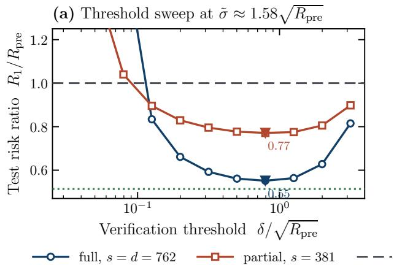

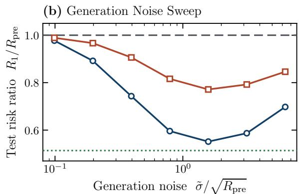  
Figure 7: Test risk across verification thresholds and generation noise scales, with $n = 2 0 4 8 , d = 7 6 2 .$ and m = 32,000. Panel (a) varies the threshold at $\tilde { \sigma } \approx 1 . 5 8 \sqrt { R _ { \mathrm { p r e } } }$ , while panel (b) presents the best average test risk ratio among the 11 examined thresholds for each generation noise scale. Each setting averages 40 runs. The direct fitting reference fits the linear model directly on all 7229 target human labels.

## 6.1 Gaussian Simulations

We examine how the verification threshold and injected generation noise afect the active coordinate variance after one post-training update under the Gaussian design. We set $\Sigma _ { 1 } = I _ { d } ,$ draw ∆ $\mathcal { N } ( 0 , I _ { d } / n )$ , and take d = 20, n = 2000, and $m = 3 \times 1 0 ^ { 6 }$ . We compare full fine-tuning $( s = d )$ and partial fine-tuning (s = 10) through estimates of $\nu _ { 1 } + \nu _ { 2 }$ . Figure 1 presents the three comparisons discussed in the introduction, while Figures 3–6 display the results across the four regimes.

The threshold comparisons illustrate how the efect of verification difers across the four regimes. For partial fine-tuning, the variance has a U-shaped dependence on the threshold in Regime II and remains near $s / n$ in Regimes III and IV. The generation noise comparisons show that nearly deterministic generation provides limited improvement, while an intermediate noise scale minimizes excess risk under both full and partial fine-tuning.

## 6.2 Real Data Experiments

For the real data experiments, we consider semantic textual similarity, where the task is to estimate a human similarity score between zero and five for a pair of sentences. We employ the STS2012– 2015 collections (Agirre et al., 2012, 2013, 2014, 2015) for pre-training, the STS-B training data (Cer et al., 2017) for post-training, and the STS-B test data for evaluation. For example, “A man is playing a guitar” and “A man is playing a trumpet” have a similarity score of approximately 1.7. We encode each sentence using all-MiniLM-L6-v2,1 which is based on MiniLM (Wang et al., 2020). The encoder has approximately 22.7 million parameters and produces embeddings in $\mathbb { R } ^ { 3 8 4 }$ . We construct pairwise covariates from these embeddings and remove six nearly constant coordinates, which results in d = 762. In each run, we fit the pre-trained linear estimator using a sample of size n = 2048 from the pre-training data.

For post-training, we sample sentence pairs with replacement from the post-training data and generate synthetic similarity scores by adding Gaussian noise to the pre-trained predictions. For the verification, we accept a sample when $| \tilde { y } _ { j } - y _ { j } | \le \delta$ , where $y _ { j }$ is its human similarity score. Then, we refit either all coeficients $( s = d )$ or a fixed subset of $s = 3 8 1$ coeficients using the accepted samples, while keeping the sentence encoder fixed. This can be viewed as a post-training of the last linear prediction head of the model.

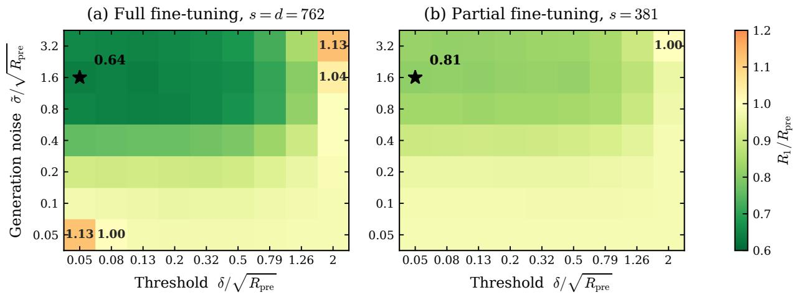  
Figure 8: Test risk across verification thresholds and generation noise scales at a fixed accepted sample size, with $n \ = \ 2 0 4 8$ and $d = 7 6 2$ . Across 16 attempted runs per setting, every fitted estimator uses 3048 accepted samples, and the star marks the minimum test risk ratio in each panel.

We evaluate each estimator by its mean squared error on the STS-B test data and normalize the error by $R _ { \mathrm { p r e } }$ , which is the average pre-training test mean squared error. In Figure 7, panel (a) varies the verification threshold over 11 logarithmically spaced values from 0.0381 to 3.81 at $\tilde { \sigma } \approx$ $1 . 5 8 \sqrt { R _ { \mathrm { p r e } } }$ . We observe that for both full and partial fine-tuning, the minimum test risk ratio is attained at an intermediate verification threshold. For the real data, we note that there exists also the efect of noisy verification, as the human similarity scores are noisy, and that can afect the risk behavior as well. For each injected generation noise scale, panel (b) presents the best test risk ratio over the same threshold grid. The best ratio is attained at an intermediate generation noise scale. Hence, neither tighter verification nor smaller generation noise always reduces test risk. In Figure 8, when we fix the accepted sample size, we find that the lowest test risk is attained at an intermediate scale of generation noise with a tight verification threshold.

## 7 Conclusion

We have characterized nonasymptotic risk rates for verified post-training on self-generated synthetic data across four regimes determined by the verification threshold, the injected generation noise, and the pre-training error scale, under both partial and full fine-tuning. The rates clarify how verification afects the error in the accepted responses, the efective accepted sample size, and the covariance of the accepted covariates, while partial fine-tuning introduces an additional contribution from the frozen coordinates. We have also investigated repeated full fine-tuning. These results provide usefu insights for the use of verification and synthetic data for post-training modern models, including large language models. For future work, it would be interesting to extend these results to more general models and data distributions.

Acknowledgments. The authors thank Chao Gao and Pragya Sur for helpful comments.

Statement on AI use. We used ChatGPT to help polish the text, check grammar and the consistency of mathematical notation, and check mathematical derivations. We also used ChatGPT to help implement, monitor, and debug the experiments. The authors are responsible for the final content of the paper.

## References

Agirre, E., Banea, C., Cardie, C., Cer, D., Diab, M., Gonzalez-Agirre, A., Guo, W., Lopez-Gazpio, I., Maritxalar, M., Mihalcea, R. et al. (2015). Semeval-2015 task 2: Semantic textual similarity, english, spanish and pilot on interpretability. In Proceedings of the 9th international workshop on semantic evaluation (SemEval 2015).

Agirre, E., Banea, C., Cardie, C., Cer, D., Diab, M., Gonzalez-Agirre, A., Guo, W., Mihalcea, R., Rigau, G. and Wiebe, J. (2014). Semeval-2014 task 10: Multilingual semantic textual similarity. In Proceedings of the 8th international workshop on semantic evaluation (SemEval 2014).

Agirre, E., Cer, D., Diab, M. and Gonzalez-Agirre, A. (2012). SemEval-2012 task 6: A pilot on semantic textual similarity. In \*SEM 2012: The First Joint Conference on Lexical and Computational Semantics – Volume 1: Proceedings of the main conference and the shared task, and Volume 2: Proceedings of the Sixth International Workshop on Semantic Evaluation (SemEval 2012) (E. Agirre, J. Bos, M. Diab, S. Manandhar, Y. Marton and D. Yuret, eds.). Association for Computational Linguistics, Montréal, Canada. https://aclanthology.org/S12-1051/

Agirre, E., Cer, D., Diab, M., Gonzalez-Agirre, A. and Guo, W. (2013). \* sem 2013 shared task: Semantic textual similarity. In Second joint conference on lexical and computational semantics (\* SEM), volume 1: proceedings of the Main conference and the shared task: semantic textual similarity.

Alemohammad, S., Casco-Rodriguez, J., Luzi, L., Humayun, A. I., Babaei, H., LeJeune, D., Siahkoohi, A. and Baraniuk, R. (2024). Self-consuming generative models go mad. In International Conference on Learning Representations, vol. 2024.

Amin, K., Babakniya, S., Bie, A., Kong, W., Syed, U. and Vassilvitskii, S. (2026). Escaping collapse: The strength of weak data for large language model training. Advances in Neural Information Processing Systems, 38 29345–29378.

Cer, D., Diab, M., Agirre, E., Lopez-Gazpio, I. and Specia, L. (2017). Semeval-2017 task 1: Semantic textual similarity multilingual and crosslingual focused evaluation. In Proceedings of the 11th international workshop on semantic evaluation (SemEval-2017).

Dang, H., Patil, P. and Rinaldo, A. (2026). Prediction-only distillation in linear and logistic regression. arXiv preprint arXiv:2607.15450.

Das, R., Dhillon, I. S., Epasto, A., Javanmard, A., Mao, J., Mirrokni, V., Sanghavi, S. and Zhong, P. (2024). Retraining with predicted hard labels provably increases model accuracy. arXiv preprint arXiv:2406.11206.

Das, R. and Sanghavi, S. (2023). Understanding self-distillation in the presence of label noise. In International Conference on Machine Learning. PMLR.

Dey, A. and Donoho, D. (2024). Universality of the π2/6 pathway in avoiding model collapse. arXiv preprint arXiv:2410.22812.

Dohmatob, E., Feng, Y. and Kempe, J. (2024). Model collapse demystified: The case of regression. Advances in Neural Information Processing Systems, 37 46979–47013.

Dohmatob, E., Feng, Y., Subramonian, A. and Kempe, J. (2025). Strong model collapse. In International Conference on Learning Representations, vol. 2025.

El Firdoussi, A., Seddik, M. E. A., Hayou, S., Alami, R., Alzubaidi, A. and Hacid, H. (2025). Maximizing the potential of synthetic data: Insights from random matrix theory. In International Conference on Learning Representations, vol. 2025.

Feng, Y., Dohmatob, E., Yang, P., Charton, F. and Kempe, J. (2025). Beyond model collapse: Scaling up with synthesized data requires verification. In International Conference on Learning Representations, vol. 2025.

Ferbach, D., Bertrand, Q., Bose, A. J. and Gidel, G. (2024). Self-consuming generative models with curated data provably optimize human preferences. arXiv preprint arXiv:2407.09499.

Frei, S., Zou, D., Chen, Z. and Gu, Q. (2022). Self-training converts weak learners to strong learners in mixture models. In International Conference on Artificial Intelligence and Statistics. PMLR.

Fu, S., Wang, Y., Chen, Y., Shen, L. and Tao, D. (2026). Self-verification provably prevents model collapse in recursive synthetic training. Advances in Neural Information Processing Systems, 38 36101–36154.

Garg, A., Bhattacharya, S. and Sur, P. (2026). Preventing model collapse under overparametrization: Optimal mixing ratios for interpolation learning and ridge regression. In International Conference on Learning Representations, vol. 2026.

Gerstgrasser, M., Schaefer, R., Dey, A., Rafailov, R., Sleight, H., Hughes, J., Korbak, T., Agrawal, R., Pai, D., Gromov, A. et al. (2024). Is model collapse inevitable? breaking the curse of recursion by accumulating real and synthetic data. arXiv preprint arXiv:2404.01413.

Gu, J., Jiang, X., Shi, Z., Tan, H., Zhai, X., Xu, C., Li, W., Shen, Y., Ma, S., Liu, H. et al. (2026). A survey on llm-as-a-judge. The Innovation, 7.

Gulcehre, C., Paine, T. L., Srinivasan, S., Konyushkova, K., Weerts, L., Sharma, A., Siddhant, A., Ahern, A., Wang, M., Gu, C. et al. (2023). Reinforced self-training (rest) for language modeling. arXiv preprint arXiv:2308.08998.

He, H., Xu, S. and Cheng, G. (2026). Recursive learning without collapse: a weighting-based stabilization framework. Journal of the Royal Statistical Society Series B: Statistical Methodology qkag099.

Houlsby, N., Giurgiu, A., Jastrzebski, S., Morrone, B., De Laroussilhe, Q., Gesmundo, A., Attariyan, M. and Gelly, S. (2019). Parameter-eficient transfer learning for nlp. In International conference on machine learning. PMLR.

Kanabar, M. and Gastpar, M. (2025). Model non-collapse: Minimax bounds for recursive discrete distribution estimation. IEEE Transactions on Information Theory.

Lecoiu, R., Mukherjee, D. and Sur, P. (2026). Self-distillation is optimal among spectral shrinkage estimators in spiked covariance models. arXiv preprint arXiv:2605.17778.

Moniri, B. and Hassani, H. (2026). On the mechanisms of weak-to-strong generalization: A theoretical perspective. Advances in Neural Information Processing Systems, 38 121409–121444.

Renze, M. (2024). The efect of sampling temperature on problem solving in large language models. In Findings of the association for computational linguistics: EMNLP 2024.

Rezaei, P., Kovačević, F., Locatello, F. and Mondelli, M. (2026). High-dimensional analysis of synthetic data selection. In International Conference on Learning Representations, vol. 2026.

Setlur, A., Garg, S., Geng, X., Garg, N., Smith, V. and Kumar, A. (2024). Rl on incorrect synthetic data scales the eficiency of llm math reasoning by eight-fold. Advances in Neural Information Processing Systems, 37 43000–43031.

Shumailov, I., Shumaylov, Z., Zhao, Y., Papernot, N., Anderson, R. and Gal, Y. (2024). Ai models collapse when trained on recursively generated data. Nature, 631 755–759.

Song, Y., Zhang, H., Eisenach, C., Kakade, S., Foster, D. and Ghai, U. (2025). Mind the gap: Examining the self-improvement capabilities of large language models. In International Conference on Learning Representations, vol. 2025.

Tropp, J. A. (2015). An introduction to matrix concentration inequalities. Foundations and trends in machine learning, 8 1–230.

Vershynin, R. (2019). High-dimensional probability. Cambridge Series in Statistical and Probabilistic Mathematics, 47.

Wainwright, M. J. (2019). High-dimensional statistics: A non-asymptotic viewpoint, vol. 48. Cambridge university press.

Wang, W., Wei, F., Dong, L., Bao, H., Yang, N. and Zhou, M. (2020). Minilm: Deep self-attention distillation for task-agnostic compression of pre-trained transformers. Advances in neural information processing systems, 33 5776–5788.

Wu, M., Yang, A. Y. and Sun, Q. (2026). Why self-distillation helps and hurts: Denoising vs. signal forgetting. In Forty-third International Conference on Machine Learning.

Xu, S., He, H. and Cheng, G. (2025). A probabilistic perspective on model collapse. arXiv preprint arXiv:2505.13947.

Yang, P., Feng, Y., Chen, Z., Wu, Y. and Li, Z. (2026). Spend wisely: Maximizing post-training gains in iterative synthetic data bootstrapping. Advances in Neural Information Processing Systems, 38 158602–158639.

Yi, B., Liu, Q., Cheng, Y. and Xu, H. (2026). Escaping model collapse via synthetic data verification: Near-term improvements and long-term convergence. In International Conference on Learning Representations, vol. 2026.

Yuan, Z., Yuan, H., Li, C., Dong, G., Lu, K., Tan, C., Zhou, C. and Zhou, J. (2023). Scaling relationship on learning mathematical reasoning with large language models. arXiv preprint arXiv:2308.01825.

Zelikman, E., Wu, Y., Mu, J. and Goodman, N. (2022). Star: Bootstrapping reasoning with reasoning. Advances in Neural Information Processing Systems, 35 15476–15488.

Zhao, A., Wu, Y., Wu, T., Xu, Q., Yue, Y., Lin, M., Wang, S., Wu, Q., Zheng, Z. and Huang, G. (2026a). Absolute zero: Reinforced self-play reasoning with zero data. Advances in Neural Information Processing Systems, 38 105816–105879.

Zhao, S., Xie, Z., Liu, M., Huang, J., Pang, G., Chen, F. and Grover, A. (2026b). Self-distilled reasoner: On-policy self-distillation for large language models. arXiv preprint arXiv:2601.18734.

Zheng, L., Chiang, W.-L., Sheng, Y., Zhuang, S., Wu, Z., Zhuang, Y., Lin, Z., Li, Z., Li, D., Xing, E. et al. (2023). Judging llm-as-a-judge with mt-bench and chatbot arena. Advances in neural information processing systems, 36 46595–46623.

A Common Probability Tools 30   
B Pre-Training Covariance Concentration 33   
C Risk Decomposition and Baseline without Verification 34   
D Variance Decomposition 35   
E Population Mean and Covariance for Accepted Samples 41   
F Empirical Mean and Covariance Bounds 52   
G Variance Components for the Realized Synthetic Covariates 64   
H Full Fine-Tuning Rate for $\mathcal { V } _ { 1 }$ 76   
I Regime Specializations and Main Results 77   
J Moment Bounds for Accepted Samples and Pre-Training Error 83   
K Proofs for Iterative Full Fine-Tuning 89   
L Experimental Details 98

Organization of the appendix. In Sections A and B, we establish the probability bounds and pre-training covariance regularity used in the appendix. In Sections C and D, we derive the risk and residual decompositions, establish that the active bias equals zero, and express the active variance through $\nu _ { 1 }$ and $\nu _ { 2 }$ . In Section $\mathrm { E } ,$ we derive the population mean and covariance of the accepted samples. In Sections F and G, we establish empirical Gram matrix, conditional mean, and conditional covariance bounds for fixed $\Delta$ and use a common event for the realized synthetic covariates to bound $\mathcal { V } _ { 1 }$ and $\nu _ { 2 }$ . In Section H, we complete the full fine-tuning analysis of $\nu _ { 1 }$ In Section I, we specialize the resulting bounds to the four regimes and prove the results. In Section J, we establish the supporting moment bounds. In Section $\mathrm { K } ,$ we prove the iterative full fine-tuning results. In Section L, we provide further details for the Gaussian simulations and real data experiments.

For the complement event arguments in the appendix, d + log m is bounded above by a fixed polynomial in m. We use the notation and conditions introduced in Sections 2 and 3.

## A Common Probability Tools

We state the probability bounds used in the appendix.

Lemma A.1 (Gaussian maximum norm bound, Wainwright (2019, Example 2.28)). Let $x _ { 1 } , \ldots , x _ { m }$ be i.i.d.  (0, Σ) random vectors in $\mathbb { R } ^ { d }$ , and suppose that $\| \Sigma \| _ { \mathrm { o p } } \leq C _ { 1 }$ for a fixed constant $C _ { 1 } > 0$

There exists $C > 0$ , depending only on $C _ { 1 }$ , such that, for every fixed coordinate subset $S \subseteq \{ 1 , \ldots , d \}$ and every $0 < \eta < 1$ , with probability at least $1 - \eta$

$$
\operatorname* { m a x } _ { 1 \leq i \leq m } \| x _ { i , S } \| ^ { 2 } \leq C \left\{ | S | + \log \left( { \frac { m } { \eta } } \right) \right\} .
$$

In the subsequent proof, the concentration bounds are established over $\tilde { X }$ for each fixed $\Delta$ whereas the conditional risk is evaluated at the fixed $\tilde { X }$ . The following lemma bounds the conditional probability over $\Delta$ that these bounds fail.

Lemma A.2 (Conditional probability bound). Fix $X _ { \mathrm { p r e } }$ and let $0 < \eta \le 1 / 2$ . Conditioned on $X _ { \mathrm { p r e } } ,$ suppose that $\Delta$ and $\tilde { X }$ are independent. Let $\Omega _ { \Delta }$ be determined by $\Delta$ and satisfy $\mathbb { P } ( \Omega _ { \Delta } \mid$ $X _ { \mathrm { p r e } } ) \geq 1 - \eta / 2$ . Let $\Omega _ { 1 } ( \Delta , \tilde { X } )$ be determined by $( \Delta , { \tilde { X } } )$ and suppose that, for every $\Delta \in \Omega _ { \Delta }$ 2 $\mathbb { P } ( \Omega _ { 1 } ( \Delta , \tilde { X } ) \mid X _ { \mathrm { p r e } } , \Delta ) \ge 1 - \eta ^ { 2 } / 4$ . Then, conditioned on $X _ { \mathrm { p r e } }$ , with probability at least $1 - \eta / 2$ over $\tilde { X }$

$$
\begin{array} { r } { \mathbb { P } _ { \Delta | X _ { \mathrm { p r e } } , \tilde { X } } \left( \Omega _ { \Delta } \cap \Omega _ { 1 } ( \Delta , \tilde { X } ) \right) \geq 1 - \eta . } \end{array}
$$

Proof. By the tower property, we have

$$
\mathbb { E } _ { { \tilde { X } } | X _ { \mathrm { p r e } } } \left[ \mathbb { P } _ { \Delta | X _ { \mathrm { p r e } } , { \tilde { X } } } \left( \Omega _ { \Delta } \cap \Omega _ { 1 } ( \Delta , { \tilde { X } } ) ^ { \mathrm { c } } \right) \right] = \mathbb { P } _ { \Delta , { \tilde { X } } | X _ { \mathrm { p r e } } } \left( \Omega _ { \Delta } \cap \Omega _ { 1 } ( \Delta , { \tilde { X } } ) ^ { \mathrm { c } } \right) \leq \frac { \eta ^ { 2 } } { 4 } ,
$$

where the inequality follows by conditioning on $\Delta$ and applying the assumed conditional probability bound. Applying Markov’s inequality, we obtain that, with probability at least $1 - \eta / 2$ over $\tilde { X } , \ \mathbb { P } _ { \Delta | X _ { \mathrm { p r e } } , \tilde { X } } ( \Omega _ { \Delta } \cap \Omega _ { 1 } ( \Delta , \tilde { X } ) ^ { \mathrm { c } } ) \leq \eta / 2$ . Conditional independence also implies $\mathbb { P } _ { \Delta | X _ { \mathrm { p r e } } , \tilde { X } } ( \Omega _ { \Delta } ^ { \mathrm { c } } ) =$ $\mathbb { P } _ { \Delta | X _ { \mathrm { p r e } } } ( \dot { \Omega } _ { \Delta } ^ { \mathrm { c } } ) \le \eta / 2$ . Combining these bounds, we obtain the stated conditional probability bound. □

Lemma A.3 (Bernstein inequality, Wainwright (2019, Proposition 2.10)). Let $X _ { 1 } , \ldots , X _ { m }$ be independent centered real random variables. Suppose that, for some $V , B \ > \ 0 , \ \sum _ { i = 1 } ^ { m } \mathbb { E } | X _ { i } | ^ { k } \ \leq$ $( k ! / 2 ) V B ^ { k - 2 }$ for every integer $k \geq 2$ . Then, for every $t > 0$

$$
\mathbb { P } \left( \left| \sum _ { i = 1 } ^ { m } X _ { i } \right| \geq { \sqrt { 2 V t } } + B t \right) \leq 2 e ^ { - t } .
$$

Lemma A.4 (Hanson–Wright inequality, Vershynin (2019, Theorem 6.2.2)). Let $Z \sim { \mathcal { N } } ( 0 , \Sigma )$ in $\mathbb { R } ^ { d }$ , where $\Sigma \succ 0$ . There exists a universal constant $C > 0$ such that, for every $0 < \eta < 1$ , with probability at least $1 - \eta$

$$
\begin{array} { r } { \left| \| Z \| _ { 2 } ^ { 2 } - \operatorname { t r } ( \Sigma ) \right| \le C \left( \sqrt { \operatorname { t r } ( \Sigma ^ { 2 } ) \log ( 2 / \eta ) } + \| \Sigma \| _ { \mathrm { o p } } \log ( 2 / \eta ) \right) . } \end{array}
$$

Moreover, for every positive integer $r ,$

$$
\left( \mathbb { E } \Vert Z \Vert _ { 2 } ^ { 2 r } \right) ^ { 1 / r } \leq C r \operatorname { t r } ( \Sigma ) .
$$

Lemma A.5 (Matrix Bernstein inequality, Tropp (2015, Theorem 6.1.1)). Let $Y _ { 1 } , \dots , Y _ { m }$ be independent centered self-adjoint d d random matrices. Suppose that, for some $V , R > 0 , \operatorname* { m a x } _ { 1 \leq i \leq m } \| Y _ { i } \| _ { \mathrm { o p } }$ $\le R$ almost surely and $\begin{array} { r } { \left\| \sum _ { i = 1 } ^ { m } \mathbb { E } Y _ { i } ^ { 2 } \right\| _ { \mathrm { o p } } \leq V } \end{array}$ . There is a universal constant $C > 0$ such that, for every $0 < \eta < 1$ , with probability at least $1 - \eta$

$$
\left\| \sum _ { i = 1 } ^ { m } Y _ { i } \right\| _ { \mathrm { o p } } \leq C \left( \sqrt { V \log ( 2 d / \eta ) } + R \log ( 2 d / \eta ) \right) .
$$

For a real random variable $Y$ and $\alpha \in \{ 1 , 2 \}$ , define $\| Y \| _ { \psi _ { \alpha } } : = \operatorname* { i n f } \left\{ t > 0 : \mathbb { E } \exp ( | Y | ^ { \alpha } / t ^ { \alpha } ) \leq 2 \right\}$

Lemma A.6 (Sub-exponential vector concentration). Let $m , d \geq 1 \quad$ , and let $X _ { 1 } , \hdots , X _ { m } \in \mathbb { R } ^ { d }$ be independent centered random vectors. Suppose that max $1 \leq i \leq m \big \| \big \| X _ { i } \big \| _ { 2 } \big \| _ { \psi _ { 1 } } < \infty$ . Then, there is a universal constant $C > 0$ such that, for every $0 < \eta < 1$ , with probability at least $1 - \eta$

$$
\left\| \sum _ { i = 1 } ^ { m } X _ { i } \right\| _ { 2 } ^ { 2 } \leq C \left\{ \log \left( \frac { m + d } { \eta } \right) \sum _ { i = 1 } ^ { m } \mathbb { E } \| X _ { i } \| _ { 2 } ^ { 2 } + \left( \operatorname* { m a x } _ { 1 \leq i \leq m } \left\| \| X _ { i } \| _ { 2 } \right\| _ { \psi _ { 1 } } \right) ^ { 2 } \log ^ { 4 } \left( \frac { m + d } { \eta } \right) \right\} .
$$

Proof. Let $L = \operatorname* { m a x } _ { 1 \leq i \leq m } \left\| \| X _ { i } \| _ { 2 } \right\| _ { \psi _ { 1 } }$ . If $L = 0$ , then $X _ { i } = 0$ almost surely for every $i ,$ and the result is immediate. Suppose that $L > 0$ . By the definition of the ψ1-norm, $\mathbb { P } ( \| X _ { i } \| _ { 2 } > t ) \le 2 \exp ( - c t / L )$ for $t \geq 0$ and an absolute constant $c > 0$ . Since the vectors are not necessarily almost surely bounded, we truncate them before applying matrix Bernstein. For a suficiently large universal constant $C ,$ let $T = C L \log ( ( m + d ) / \eta )$ and $X _ { i } ^ { \circ } = X _ { i } \mathbf { 1 } \{ \| X _ { i } \| _ { 2 } \leq T \}$ . Taking a union bound, we obtain

$$
\mathbb { P } \left( \operatorname* { m a x } _ { 1 \leq i \leq m } \| X _ { i } \| _ { 2 } > T \right) \leq \sum _ { i = 1 } ^ { m } \mathbb { P } ( \| X _ { i } \| _ { 2 } > T ) \leq 2 m \exp ( - c T / L ) \leq \frac { \eta } { 3 } .
$$

Thus, with probability at least $1 - \eta / 3$ , it holds that $X _ { i } ^ { \circ } = X _ { i }$ for every i. We next bound the bias introduced by truncation. Since $\mathbb { E } X _ { i } = 0$ , tail integration implies

$$
\left\| \sum _ { i = 1 } ^ { m } \mathbb { E } X _ { i } ^ { \circ } \right\| _ { 2 } \leq \sum _ { i = 1 } ^ { m } \mathbb { E } \left[ \| X _ { i } \| _ { 2 } { \bf 1 } \{ \| X _ { i } \| _ { 2 } > T \} \right] \leq L \eta .
$$

For each $i ,$ let

$$
Y _ { i } : = \binom { 0 } { X _ { i } ^ { \circ } - \mathbb { E } X _ { i } ^ { \circ } } \stackrel { } { ( } X _ { i } ^ { \circ } - \mathbb { E } X _ { i } ^ { \circ } ) ^ { \top } \bigg ) .
$$

These $( d + 1 ) \times ( d + 1 )$ matrices are independent, centered, and self-adjoint, and satisfy $\| Y _ { i } \| _ { \mathrm { o p } } =$ $\| X _ { i } ^ { \circ } - \mathbb { E } X _ { i } ^ { \circ } \| _ { 2 } \leq 2 T$ . Moreover, we have

$$
\left\| \sum _ { i = 1 } ^ { m } \mathbb { E } Y _ { i } ^ { 2 } \right\| _ { \mathrm { o p } } = \sum _ { i = 1 } ^ { m } \mathbb { E } \| X _ { i } ^ { \circ } - \mathbb { E } X _ { i } ^ { \circ } \| _ { 2 } ^ { 2 } \leq \sum _ { i = 1 } ^ { m } \mathbb { E } \| X _ { i } \| _ { 2 } ^ { 2 } .
$$

Since $\begin{array} { r } { \| \sum _ { i = 1 } ^ { m } Y _ { i } \| _ { \mathrm { o p } } = \| \sum _ { i = 1 } ^ { m } ( X _ { i } ^ { \circ } - \mathbb { E } X _ { i } ^ { \circ } ) \| _ { 2 } } \end{array}$ , we apply Lemma $\mathrm { A . 5 }$ with failure probability $2 \eta / 3$ and obtain

$$
\left\| \sum _ { i = 1 } ^ { m } ( X _ { i } ^ { \circ } - \mathbb { E } X _ { i } ^ { \circ } ) \right\| _ { 2 } \leq C \left\{ \left( \log \left( \frac { m + d } { \eta } \right) \sum _ { i = 1 } ^ { m } \mathbb { E } \| X _ { i } \| _ { 2 } ^ { 2 } \right) ^ { 1 / 2 } + L \log ^ { 2 } \left( \frac { m + d } { \eta } \right) \right\}
$$

with probability at least $1 - 2 \eta / 3$ . By combining these bounds and squaring, we obtain the claimed bound with probability at least $1 - \eta$ . This completes the proof. □

## B Pre-Training Covariance Concentration

First, we define the event on which the pre-training sample covariance is well conditioned:

$$
\Omega _ { \mathrm { p r e } } : = \left\{ \frac { c _ { \lambda } } { 2 } I _ { d } \preceq \frac { 1 } { n } X _ { \mathrm { p r e } } ^ { \top } X _ { \mathrm { p r e } } \preceq 2 C _ { \lambda } I _ { d } \right\} .\tag{5}
$$

Lemma B.1 (Pre-training covariance bounds, Vershynin (2019, Remark 4.7.3)). Suppose that Assumption 2.1 holds. There exist constants $c , C ~ > ~ 0$ , depending only on $c _ { \lambda }$ and $C _ { \lambda . }$ , such that, whenever $n \geq C d$ , the following bounds hold on $\Omega _ { \mathrm { p r e } }$ , where $\mathbb { P } ( \Omega _ { \mathrm { p r e } } ) \geq 1 - 2 e ^ { - c n }$

$$
\frac { 1 } { 2 C _ { \lambda } } I _ { d } \preceq \Gamma ( X _ { \mathrm { p r e } } ) \preceq \frac { 2 } { c _ { \lambda } } I _ { d } .
$$

Moreover, uniformly over $S \subseteq \{ 1 , \ldots , d \}$ with $| S | = s .$

$$
\begin{array} { r } { \mathrm { t r } ( \Sigma _ { 1 } \Gamma ) \asymp d , \qquad \mathrm { t r } \left( \Sigma _ { 1 , S S } ^ { - 1 } ( \Sigma _ { 1 } \Gamma \Sigma _ { 1 } ) _ { S S } \right) \asymp s , \qquad \mathrm { t r } ( \Sigma _ { 1 , - S | S } \Gamma _ { - S , - S } ) \asymp d - s \quad ( s < d ) . } \end{array}
$$

Pre-training error scales. By applying the covariance bounds, we bound the total and active coordinate pre-training errors relative to the generation noise variance. These quantities appear in the acceptance probability in Section E and the sample conditions and variance bounds in Section G. On $\Omega _ { \mathrm { p r e } }$ , the pre-training error satisfies $\Delta \mid X _ { \mathrm { p r e } } \sim \mathcal { N } ( 0 , \Gamma ( X _ { \mathrm { p r e } } ) / n )$ . For every $\Delta \in \mathbb { R } ^ { d }$ , define $\rho _ { \Delta } ^ { 2 } : = \dot { \| \Delta \| _ { \Sigma _ { 1 } } } / \tilde { \sigma } ^ { 2 }$ . For a realization of $X _ { \mathrm { p r e } }$ , we use the notation $\Gamma = \Gamma ( X _ { \mathrm { p r e } } )$ . The conditional mean of $\rho _ { \Delta } ^ { 2 }$ is defined as

$$
\bar { \rho } ^ { 2 } : = \mathbb { E } _ { \Delta } [ \rho _ { \Delta } ^ { 2 } \mid X _ { \mathrm { p r e } } ] = \frac { \mathrm { t r } ( \Sigma _ { 1 } \Gamma ) } { n \tilde { \sigma } ^ { 2 } } .
$$

We also define $\rho ^ { 2 } = d / ( n \tilde { \sigma } ^ { 2 } )$ . For the active coordinates, define

$$
\rho _ { S , \Delta } ^ { 2 } : = \frac { \| ( \Sigma _ { 1 } \Delta ) _ { S } \| _ { \Sigma _ { 1 , S S } ^ { - 1 } } ^ { 2 } } { \tilde { \sigma } ^ { 2 } } , \qquad \bar { \rho } _ { S } ^ { 2 } : = \mathbb { E } _ { \Delta } [ \rho _ { S , \Delta } ^ { 2 } \mid X _ { \mathrm { p r e } } ] = \frac { \mathrm { t r } \left( \Sigma _ { 1 , S S } ^ { - 1 } ( \Sigma _ { 1 } \Gamma \Sigma _ { 1 } ) _ { S S } \right) } { n \tilde { \sigma } ^ { 2 } } .
$$

On $\Omega _ { \mathrm { p r e } }$ , Lemma B.1 implies $\bar { \rho } \asymp \rho$ and $\bar { \rho } _ { S } ^ { 2 } \asymp s / ( n \tilde { \sigma } ^ { 2 } )$ . Moreover, we establish high probability bounds for the total and active pre-training error scales in the following corollary.

Corollary B.2 (Pre-training error bounds). Under Assumption ${ \it 2 . 1 , }$ fix $X _ { \mathrm { p r e } } \in \Omega _ { \mathrm { p r e } }$ . There exists $C > 0$ such that, for every $0 < \eta \le 1 / 2$ , conditioned on $X _ { \mathrm { p r e } }$ , with probability at least $1 - \eta$ over $\Delta$ ,

$$
\rho _ { \Delta } ^ { 2 } \leq \frac { C ( d + \log ( 4 / \eta ) ) } { n \tilde { \sigma } ^ { 2 } } , \qquad \rho _ { S , \Delta } ^ { 2 } \leq \frac { C ( s + \log ( 4 / \eta ) ) } { n \tilde { \sigma } ^ { 2 } } .
$$

Proof. We apply Lemma A.4, conditioned on $X _ { \mathrm { p r e } }$ , with failure probability $\eta / 2$ to the Gaussian vector $\Sigma _ { 1 } ^ { 1 / 2 } \Delta / \tilde { \sigma }$ . Its squared norm is $\rho _ { \Delta } ^ { 2 }$ , and its covariance is $\Sigma _ { 1 } ^ { 1 / 2 } \Gamma \Sigma _ { 1 } ^ { 1 / 2 } / ( n \tilde { \sigma } ^ { 2 } )$ , whose trace is $\bar { \rho } ^ { 2 }$ It follows from Lemma B.1 and Assumption 2.1 that its operator norm is at most $C / ( n \tilde { \sigma } ^ { 2 } )$ , so that its squared Frobenius norm is at most $C d / ( n \tilde { \sigma } ^ { 2 } ) ^ { 2 }$ . Therefore, with probability at least $1 - \eta / 2$ , we have

$$
\rho _ { \Delta } ^ { 2 } \leq \bar { \rho } ^ { 2 } + \frac { C ( \sqrt { d \log ( 4 / \eta ) } + \log ( 4 / \eta ) ) } { n \tilde { \sigma } ^ { 2 } } \leq \frac { C ( d + \log ( 4 / \eta ) ) } { n \tilde { \sigma } ^ { 2 } } ,
$$

where the last inequality follows from $\bar { \rho } ^ { 2 } \asymp d / ( n \tilde { \sigma } ^ { 2 } )$ . The analogous analysis applied to the Gaussian vector $\Sigma _ { 1 , S S } ^ { - 1 / 2 } ( \Sigma _ { 1 } \Delta ) _ { S } / \tilde { \sigma }$ provides, with probability at least $1 - \eta / 2$

$$
\rho _ { S , \Delta } ^ { 2 } \leq \frac { C ( s + \log ( 4 / \eta ) ) } { n \tilde { \sigma } ^ { 2 } } .
$$

## C Risk Decomposition and Baseline without Verification

We prove the risk decomposition in Proposition 3.1, derive the residual representation (7) and the decomposition of the active variance in (2), and prove the baseline without verification in Proposition 3.3.

## C.1 Proof of Proposition 3.1

Proof. Conditioned on $( X _ { \mathrm { p r e } } , { \tilde { X } } )$ , we have

$$
R _ { 1 } \big ( \hat { \beta } ; X _ { \mathrm { p r e } } , \tilde { X } \big ) = \mathbb { E } \big [ ( y - x ^ { \top } \hat { \beta } ) ^ { 2 } \big | X _ { \mathrm { p r e } } , \tilde { X } \big ] = \sigma _ { 1 } ^ { 2 } + \mathbb { E } \big [ \| \hat { \beta } - \beta ^ { * } \| _ { \Sigma _ { 1 } } ^ { 2 } \big | X _ { \mathrm { p r e } } , \tilde { X } \big ] ,
$$

where the second equality follows from the downstream model. We apply the Schur complement to the partitioned matrix $\Sigma _ { 1 }$ and obtain $\| \hat { \beta } - \beta ^ { * } \| _ { \Sigma _ { 1 } } ^ { 2 } = \| \hat { \beta } _ { S } - \beta _ { S } ^ { \mathrm { c o r r } } \| _ { \Sigma _ { 1 , S S } } ^ { 2 } + \| \Delta _ { - S } \| _ { \Sigma _ { 1 , - S | S } } ^ { 2 }$ , where $\beta _ { S } ^ { \mathrm { c o r r } } = \beta _ { S } ^ { * } + \Sigma _ { 1 , S S } ^ { - 1 } \Sigma _ { 1 , S , - S } \Delta _ { - S }$ . We take the conditional expectation and apply the bias and variance decomposition to the active coordinate term to obtain $\mathrm { B i a s } _ { S } ^ { 2 } + \mathrm { V a r } _ { S }$ . Since $\Delta$ and $\tilde { X }$ are independent given $X _ { \mathrm { p r e } }$ and $\begin{array} { r } { \mathbb { E } [ \Delta \mid X _ { \mathrm { p r e } } ] = 0 , \mathbb { E } \big [ \| \Delta _ { - S } \| _ { \Sigma _ { 1 , - S | S } } ^ { 2 } \big | X _ { \mathrm { p r e } } , \tilde { X } \big ] = \operatorname { t r } \big ( \Sigma _ { 1 , - S | S } \mathrm { C o v } ( \Delta _ { - S } \mid X _ { \mathrm { p r e } } ) \big ) = \operatorname { V a r } _ { - S } } \end{array}$ Thus, we obtain the stated risk decomposition. □

## C.2 Derivation of the Residual Representation

Recall $r _ { S }$ and $G ( \Delta )$ from Section 3.1. Define the accepted residual numerator by

$$
\mu ( \Delta ) : = \sum _ { i = 1 } ^ { m } \mathbb { I } _ { i } \tilde { x } _ { i , S } \big ( \tilde { x } _ { i , - S } ^ { \top } \Delta _ { - S } + \xi _ { i } \big ) .\tag{6}
$$

On $\Omega _ { \mathrm { p o s t } } , G ( \Delta )$ is invertible. For the post-training estimator, we have $\begin{array} { r } { \hat { \beta } _ { S } ^ { \mathrm { p o s t } } = G ( \Delta ) ^ { - 1 } \sum _ { i = 1 } ^ { m } \mathbb { I } _ { i } \tilde { x } _ { i , S } } \end{array}$ $\left( \tilde { y } _ { i } - \tilde { x } _ { i , - S } ^ { \top } \hat { \beta } _ { - S } ^ { \mathrm { p r e } } \right)$ . Since $\tilde { y } _ { i } = \tilde { x } _ { i } ^ { \top } \beta ^ { * } + \xi _ { i }$ and $\hat { \beta } _ { - S } ^ { \mathrm { p r e } } = \beta _ { - S } ^ { * } - \Delta _ { - S }$ , we have $\widetilde { y } _ { i } - \widetilde { x } _ { i , - S } ^ { \top } \hat { \beta } _ { - S } ^ { \mathrm { p r e } } = \widetilde { x } _ { i , S } ^ { \top } \beta _ { S } ^ { * } +$ $\tilde { x } _ { i , - S } ^ { \top } \Delta _ { - S } + \xi _ { i }$ . By substituting this relation into the expression for the post-training estimator, we obtain $\hat { \beta } _ { S } ^ { \mathrm { p o s t } } = \beta _ { S } ^ { * } + G ( \Delta ) ^ { - 1 } \mu ( \Delta )$ . Then, we subtract $\beta _ { S } ^ { \mathrm { c o r r } } = \beta _ { S } ^ { * } + \Sigma _ { 1 , S S } ^ { - 1 } \Sigma _ { 1 , S , - S } \Delta _ { - S }$ and obtain the residual representation

$$
r _ { S } = G ( \Delta ) ^ { - 1 } \mu ( \Delta ) - \Sigma _ { 1 , S S } ^ { - 1 } \Sigma _ { 1 , S , - S } \Delta _ { - S } .\tag{7}
$$

Equivalently, since $\tilde { x } _ { i , - S } ^ { \top } \Delta _ { - S } + \xi _ { i } = - \tilde { x } _ { i , S } ^ { \top } \Delta _ { S } + \tilde { \varepsilon } _ { i }$ , we can express the residual as

$$
r _ { S } = - \Sigma _ { 1 , S S } ^ { - 1 } ( \Sigma _ { 1 } \Delta ) _ { S } + G ( \Delta ) ^ { - 1 } \sum _ { i = 1 } ^ { m } \mathbb { I } _ { i } \tilde { x } _ { i , S } \tilde { \varepsilon } _ { i } .\tag{8}
$$

## C.3 Derivation of the Variance Decomposition

For the extended estimator, we have Var $s = \mathrm { t r } ( \Sigma _ { 1 , S S } \mathrm { C o v } ( r _ { S , \mathrm { e x t } } \mid X _ { \mathrm { p r e } } , \tilde { X } ) )$ . We apply the law of total covariance with respect to $\Delta$ and obtain

$$
\mathrm { C o v } ( r _ { S , \mathrm { e x t } } \mid X _ { \mathrm { p r e } } , \tilde { X } ) = \mathrm { C o v } \left( \mathbb { E } _ { \xi } [ r _ { S , \mathrm { e x t } } \mid \Delta , \tilde { X } ] \ \Big | \ X _ { \mathrm { p r e } } , \tilde { X } \right) + \mathbb { E } \left[ \mathrm { C o v } _ { \xi } ( r _ { S , \mathrm { e x t } } \mid \Delta , \tilde { X } ) \ \Big | \ X _ { \mathrm { p r e } } , \tilde { X } \right] \ .
$$

By multiplying by $\Sigma _ { 1 , S S }$ and taking traces, we have $\mathrm { V a r } _ { S } = \mathcal { V } _ { 1 } + \mathcal { V } _ { 2 }$ , where $\mathcal { V } _ { 1 }$ and $\nu _ { 2 }$ are defined in (2).

## C.4 Proof of Proposition 3.3

Proof. When $\delta = \infty$ , every generated sample is accepted. Hence, $\mathbb { I } _ { i } = 1$ for every i and $G ( \Delta ) =$ $\begin{array} { r } { G : = \sum _ { i = 1 } ^ { m } \tilde { x } _ { i , S } \tilde { x } _ { i , S } ^ { \top } } \end{array}$ . Since the vectors $\Sigma _ { 1 , S S } ^ { - 1 / 2 } \tilde { x } _ { i , S }$ are independent and follow $\mathcal { N } ( 0 , I _ { s } )$ , we apply Vershynin (2019, Remark 4.7.3) and use $m \geq C ( s + \log m )$ to obtain ${ \frac { m } { 2 } } \Sigma _ { 1 , S S } \preceq G \preceq 2 m \Sigma _ { 1 , S S }$ with probability at least $1 - m ^ { - c _ { 1 } }$ over $\tilde { X }$ . For suficiently large $C$ in the sample condition, the lower bound on $G$ and Assumption 2.1 provide $\lambda _ { \operatorname* { m i n } } ( G / m ) \geq c _ { \lambda } / 2 \geq m ^ { - C _ { G } }$ . Thus, this event is contained in $\Omega _ { \mathrm { p o s t } }$ . On its intersection with $\Omega _ { \mathrm { p r e } }$ , the post-training estimator is well defined and agrees with the extended estimator.

On this intersection, by (8) and $\mathbb { I } _ { i } = 1$ , we have $r _ { S } = - \Sigma _ { 1 , S S } ^ { - 1 } ( \Sigma _ { 1 } \Delta ) _ { S } + G ^ { - 1 } \sum _ { i = 1 } ^ { m } \tilde { x } _ { i , S } \tilde { \varepsilon } _ { i }$ . Therefore, $\mathbb { E } _ { \tilde { \varepsilon } } [ r _ { S } \mid \Delta , \tilde { X } ] = - \Sigma _ { 1 , S S } ^ { - 1 } ( \Sigma _ { 1 } \Delta ) _ { S }$ . Conditioned on $X _ { \mathrm { p r e } } , ~ \Delta$ is independent of $\tilde { X }$ and has covariance $\Gamma / n .$ . Hence,

$$
\mathcal { V } _ { 1 } = \mathrm { t r } \left( \Sigma _ { 1 , S S } \operatorname { C o v } \left( \Sigma _ { 1 , S S } ^ { - 1 } ( \Sigma _ { 1 } \Delta ) _ { S } \mid X _ { \mathrm { p r e } } , \tilde { X } \right) \right) = \frac { 1 } { n } \mathrm { t r } \left( \Sigma _ { 1 , S S } ^ { - 1 } ( \Sigma _ { 1 } \Gamma \Sigma _ { 1 } ) _ { S S } \right) .
$$

It follows from Lemma B.1 that $\nu _ { 1 } \asymp s / n$ on $\Omega _ { \mathrm { p r e } }$ . When $s = d ,$ the trace reduces to $\operatorname { t r } ( \Sigma _ { 1 } \Gamma ) / n \asymp$ $d / n$

For $\nu _ { 2 }$ , we employ the independence of the generation noises and obtain $\mathrm { C o v } _ { \tilde { \varepsilon } } ( r _ { S } \mid \Delta , \tilde { X } ) =$ $\tilde { \sigma } ^ { 2 } G ^ { - 1 }$ . This covariance does not depend on $\Delta$ . Therefore, $\mathcal { V } _ { 2 } = \tilde { \sigma } ^ { 2 } \mathrm { t r } ( \Sigma _ { 1 , S S } G ^ { - 1 } )$ , and the bounds on G imply $\mathrm { t r } ( \Sigma _ { 1 , S S } G ^ { - 1 } ) \asymp s / m$ . Since the conditional mean of $r _ { S }$ is centered over $\Delta ,$ we have $\mathrm { B i a s } _ { S } ^ { 2 } = 0$ Then, we apply Proposition 3.1 and (2) to obtain the exact risk identities in the statement. By combining the event on which these bounds on G hold with $\Omega _ { \mathrm { p r e } }$ , we obtain the claimed probability and rate bounds. □

## D Variance Decomposition

In this section, we analyze $\nu _ { 1 }$ and $\nu _ { 2 }$ through the conditional mean and covariance of $r _ { S , \mathrm { { e x t } } }$ over the injected generation noise $\tilde { \varepsilon } ,$ with $( \Delta , { \tilde { X } } )$ fixed and $0 < \delta < \infty$ . We derive the residual decomposition, identify the leading variance contributions, and bound the inverse remainder and the complement contribution. The sharper full fine-tuning rate for $\nu _ { 1 }$ is established in Section H.

Conditioning convention. Recall $G ( \Delta )$ from Section 3.1 and $\mu ( \Delta )$ from (6). Fix $X _ { \mathrm { p r e } } \in \Omega _ { \mathrm { p r e } }$ and let $\Gamma = \Gamma ( X _ { \mathrm { p r e } } )$ , for which $\Delta \mid X _ { \mathrm { p r e } } \sim \mathcal { N } ( 0 , \Gamma / n )$ . In this section, $\mathbb { E } _ { \Delta } [ \cdot ]$ and $\mathrm { C o v } _ { \Delta } ( \cdot )$ denote expectation and covariance with respect to $\Delta \mid X _ { \mathrm { p r e } }$ , while conditioning on $\tilde { X }$ is written explicitly. For fixed $( \Delta , \tilde { X } ) , \mathbb { E } _ { \tilde { \varepsilon } } [ \cdot \mid \Delta , \tilde { X } ]$ denotes expectation over the generation noise. Whenever an inverse is multiplied by an event indicator, it is evaluated on that event and interpreted as zero outside it.

## D.1 Conditional Mean and Expected Gram Matrix Bounds

We introduce the conditional means of the accepted Gram matrix and residual numerator. These quantities determine the leading conditional mean in $\nu _ { 1 }$ and center the numerator in $\nu _ { 2 }$ . Then, we compare $G ( \Delta ) ^ { - 1 }$ with $\bar { G } ( \Delta ) ^ { - 1 }$ and derive the residual decomposition that applies to both variance components.

## D.1.1 Conditional means

For fixed $( \Delta , { \tilde { X } } )$ , define the conditional means of $G ( \Delta )$ and the numerator $\mu ( \Delta )$ in (7) by

$$
\bar { G } ( \Delta ) : = \mathbb { E } _ { \tilde { \varepsilon } } [ G ( \Delta ) \mid \Delta , \tilde { X } ] , \qquad \bar { \mu } ( \Delta ) : = \mathbb { E } _ { \tilde { \varepsilon } } [ \mu ( \Delta ) \mid \Delta , \tilde { X } ] .\tag{9}
$$

Define $P _ { i } ( \Delta ) : = \mathbb { P } _ { \tilde { \varepsilon } _ { i } } \big ( | - \tilde { x } _ { i } ^ { \top } \Delta + \tilde { \varepsilon } _ { i } | \ \leq \ \delta \ | \ \Delta , \tilde { X } \big )$ . At fixed $( \Delta , { \tilde { X } } ) , P _ { i } ( \Delta )$ is the acceptance probability for the realized covariate ${ \tilde { x } } _ { i } .$ , and $\Sigma _ { i = 1 } ^ { m } \bar { P _ { i } } ( \Delta )$ is the conditional expected number of accepted samples.

Population quantities. To compare the conditional means with the corresponding expectations over the covariates, define the one sample population quantities by

$$
\bar { G } _ { \mathrm { p o p } } ( \Delta ) : = \mathbb { E } _ { \tilde { x } _ { i } } \left[ P _ { i } ( \Delta ) \tilde { x } _ { i , S } \tilde { x } _ { i , S } ^ { \top } \mid \Delta \right] , \quad \bar { \mu } _ { \mathrm { p o p } } ( \Delta ) : = \mathbb { E } _ { \tilde { x } _ { i } , \tilde { \varepsilon } _ { i } } \left[ \mathbb { I } _ { i } \tilde { x } _ { i , S } ( \tilde { x } _ { i , - S } ^ { \top } \Delta _ { - S } + \xi _ { i } ) \mid \Delta \right] .
$$

Note that by the linearity of expectation, $\mathbb { E } _ { \tilde { X } } [ \bar { G } ( \Delta ) ~ | ~ \Delta ] = m \bar { G } _ { \mathrm { p o p } } ( \Delta )$ and $\mathbb { E } _ { { \tilde { X } } } [ { \bar { \mu } } ( \Delta ) ~ | ~ \Delta ] =$ $m \bar { \mu } _ { \mathrm { p o p } } ( \Delta )$

## D.1.2 Accepted Gram matrices and inverse bounds

Conditioned on $( \Delta , { \tilde { X } } )$ , the accepted Gram matrix $G ( \Delta )$ is random only with respect to the generation noise, and its conditional expectation is $\bar { G } ( \Delta )$ . We employ the following conditions to control $G ( \Delta ) ^ { - 1 }$ . When $\bar { G } ( \Delta ) \succ 0$ , define the maximal relative quadratic form

$$
\ell _ { \mathrm { { m a x } } } ( \Delta ) : = \operatorname* { m a x } _ { 1 \leq i \leq m } \tilde { x } _ { i , S } ^ { \top } \bar { G } ( \Delta ) ^ { - 1 } \tilde { x } _ { i , S } .
$$

For $0 < \eta \le 1 / 2$ and a suficiently small universal constant $c \in ( 0 , 1 ]$ , let $\Omega _ { \mathrm { e m p } } ( \Delta )$ be an event determined by $( \Delta , { \tilde { X } } )$ on which

$$
\frac { 1 } 2 m \bar { G } _ { \mathrm { p o p } } ( \Delta ) \preceq \bar { G } ( \Delta ) \preceq \frac { 3 } { 2 } m \bar { G } _ { \mathrm { p o p } } ( \Delta ) , \qquad \ell _ { \mathrm { m a x } } ( \Delta ) \log ( m / \eta ) \leq c .\tag{10}
$$

These conditions are established in Section F under the stated sample conditions. By Lemma E.2, $\bar { G } _ { \mathrm { p o p } } ( \Delta )$ is positive definite. Hence, by the first condition in (10), we have $\bar { G } ( \Delta ) \succ 0$ and $\bar { G } ( \Delta ) ^ { - 1 } \preceq$ $( 2 / m ) \bar { G } _ { \mathrm { p o p } } ( \Delta ) ^ { - 1 }$ . With the population bounds in Section E, this matrix inequality provides bounds for $\mathrm { t r } ( \Sigma _ { 1 , S S } \bar { G } ( \Delta ) ^ { - 1 } )$ and $\| \Sigma _ { 1 , S S } ^ { 1 / 2 } \bar { G } ( \Delta ) ^ { - 1 / 2 } \| _ { \mathrm { o p } } ^ { 2 }$ . Under the second condition in (10), we show in the following proposition that the fluctuation of $G ( \Delta )$ from $\bar { G } ( \Delta )$ is suficiently small with high probability over the generation noise.

Proposition D.1 (Accepted Gram matrix concentration). Under the model in Section ${ \it 2 } , \it { \it f i x } \left( \Delta , \tilde { X } \right)$ with $\bar { G } ( \Delta ) \succ 0$ . Define

$$
{ \cal H } ( \Delta ) : = \bar { G } ( \Delta ) ^ { - 1 / 2 } \big ( G ( \Delta ) - \bar { G } ( \Delta ) \big ) \bar { G } ( \Delta ) ^ { - 1 / 2 } ,
$$

and let $\begin{array} { r } { \ell _ { \operatorname* { m a x } } ( \Delta ) : = \operatorname* { m a x } _ { 1 \leq i \leq m } \tilde { x } _ { i , S } ^ { \top } \bar { G } ( \Delta ) ^ { - 1 } \tilde { x } _ { i , S } } \end{array}$ . There exists a universal constant $C > 0$ such that, for every $0 < \eta \leq 1 / 2$

$$
\| H ( \Delta ) \| _ { \mathrm { o p } } \leq C \Bigl ( \sqrt { \ell _ { \mathrm { m a x } } ( \Delta ) \log ( m / \eta ) } + \ell _ { \mathrm { m a x } } ( \Delta ) \log ( m / \eta ) \Bigr )
$$

with probability at least $1 - \eta$ over the generation noise.

Proof. Conditioned on $( \Delta , { \tilde { X } } )$ , the independence of the generation noises implies that the indicators I are independent. By the definition of $P _ { i } ( \Delta )$ , we have $\mathbb { E } _ { \tilde { \varepsilon } } [ \mathbb { I } _ { i } \mid \Delta , \tilde { X } ] = P _ { i } ( \Delta )$ . Let $v _ { i } = \bar { G } ( \Delta ) ^ { - 1 / 2 } \tilde { x } _ { i , S }$ . By the definitions of $\bar { G } ( \Delta )$ and $H ( \Delta )$ , we have

$$
\sum _ { i = 1 } ^ { m } P _ { i } ( \Delta ) v _ { i } v _ { i } ^ { \top } = I _ { s } , \qquad H ( \Delta ) = \sum _ { i = 1 } ^ { m } ( \mathbb { I } _ { i } - P _ { i } ( \Delta ) ) v _ { i } v _ { i } ^ { \top } ,
$$

where the matrices $( \mathbb { I } _ { i } - P _ { i } ( \Delta ) ) v _ { i } v _ { i } ^ { \top }$ are independent, centered, and self-adjoint.

By the definition of $\ell _ { \mathrm { m a x } } ( \Delta )$ , we have $\| v _ { i } \| _ { 2 } ^ { 2 } \le \ell _ { \operatorname* { m a x } } ( \Delta )$ . Since $| \mathbb { I } _ { i } - P _ { i } ( \Delta ) | \le 1$ , it follows that $\| ( \mathbb { I } _ { i } - P _ { i } ( \Delta ) ) v _ { i } v _ { i } ^ { \top } \| _ { \mathrm { o p } } = | \mathbb { I } _ { i } - P _ { i } ( \Delta ) | \| v _ { i } \| _ { 2 } ^ { 2 } \leq \ell _ { \operatorname* { m a x } } ( \Delta )$ almost surely. Next, we bound the matrix variance of $H ( \Delta )$ . Observe that

$$
\sum _ { i = 1 } ^ { m } \mathbb { E } _ { \hat { \varepsilon } } [ ( \mathbb { I } _ { i } - P _ { i } ( \Delta ) ) ^ { 2 } \mid \Delta , \tilde { X } ] ( v _ { i } v _ { i } ^ { \top } ) ^ { 2 } = \sum _ { i = 1 } ^ { m } P _ { i } ( \Delta ) ( 1 - P _ { i } ( \Delta ) ) \| v _ { i } \| _ { 2 } ^ { 2 } v _ { i } v _ { i } ^ { \top } \preceq \ell _ { \operatorname* { m a x } } ( \Delta ) I _ { s } .
$$

Then, we can apply Lemma A.5 with $V = R = \ell _ { \mathrm { m a x } } ( \Delta )$ and failure probability η and obtain the stated bound. □

For this choice of $\Omega _ { \mathrm { e m p } } ( \Delta )$ , define

$$
\begin{array} { r } { \Omega ( \Delta ) : = \Omega _ { \mathrm { e m p } } ( \Delta ) \cap \left\{ \| H ( \Delta ) \| _ { \mathrm { o p } } \leq C \left( \sqrt { \ell _ { \operatorname* { m a x } } ( \Delta ) \log ( m / \eta ) } + \ell _ { \operatorname* { m a x } } ( \Delta ) \log ( m / \eta ) \right) \right\} , } \end{array}\tag{11}
$$

On $\Omega _ { \mathrm { e m p } } ( \Delta )$ , Proposition D.1 provides

$$
\begin{array} { r } { \mathbb { P } _ { \tilde { \varepsilon } } \left( \Omega ( \Delta ) \Big | \Delta , \tilde { X } \right) \geq 1 - \eta . } \end{array}\tag{12}
$$

For suficiently small $c > 0$ , we have $\| H ( \Delta ) \| _ { \mathrm { o p } } \leq 1 / 2$ on $\Omega ( \Delta )$ . By the definition of $H ( \Delta )$ , this implies $G ( \Delta ) \succeq \bar { G } ( \Delta ) / 2 \succ 0$ . Hence, $G ( \Delta )$ is invertible. In the following residual decomposition, we employ the bound on $H ( \Delta )$ to control the error from replacing $G ( \Delta ) ^ { - 1 } \ \mathrm { b y } \ \bar { G } ( \Delta ) ^ { - 1 }$

## D.1.3 Residual decomposition

We decompose the post-training residual to study its conditional mean and covariance over the generation noise. Recall from (7) that, on $\Omega _ { \mathrm { p o s t } }$ , we have

$$
r _ { S } = G ( \Delta ) ^ { - 1 } \mu ( \Delta ) - \Sigma _ { 1 , S S } ^ { - 1 } \Sigma _ { 1 , S , - S } \Delta _ { - S } .
$$

On $\Omega _ { \mathrm { p o s t } }$ , whenever $\bar { G } ( \Delta )$ is invertible, we compare $G ( \Delta ) ^ { - 1 } \mu ( \Delta )$ with $\bar { G } ( \Delta ) ^ { - 1 } \bar { \mu } ( \Delta )$ through the identity

$$
G ( \Delta ) ^ { - 1 } \mu ( \Delta ) - \bar { G } ( \Delta ) ^ { - 1 } \bar { \mu } ( \Delta ) = G ( \Delta ) ^ { - 1 } \left( \mu ( \Delta ) - G ( \Delta ) \bar { G } ( \Delta ) ^ { - 1 } \bar { \mu } ( \Delta ) \right) .
$$

By the definitions of $\bar { G } ( \Delta )$ and $\bar { \mu } ( \Delta )$ , we have $\mathbb { E } _ { \widetilde { \varepsilon } } [ \mu ( \Delta ) - G ( \Delta ) \bar { G } ( \Delta ) ^ { - 1 } \bar { \mu } ( \Delta ) \mid \Delta , \tilde { X } ] = 0$ . However, $G ( \Delta ) ^ { - 1 }$ depends on the same acceptance indicators, and its product with this numerator can have a nonzero conditional mean. We employ $G ( \Delta ) ^ { - 1 } = \bar { G } ( \Delta ) ^ { - 1 } + ( G ( \Delta ) ^ { - 1 } - \bar { G } ( \Delta ) ^ { - 1 } )$ in this diference and obtain

$$
\begin{array} { r l } & { { r _ { S } } = \left( { \bar { G } } ( \Delta ) ^ { - 1 } { \bar { \mu } } ( \Delta ) - \Sigma _ { 1 , S S } ^ { - 1 } \Sigma _ { 1 , S , - S } \Delta _ { - S } \right) + { \bar { G } } ( \Delta ) ^ { - 1 } \left( { \mu } ( \Delta ) - { G } ( \Delta ) { \bar { G } } ( \Delta ) ^ { - 1 } { \bar { \mu } } ( \Delta ) \right) } \\ & { \quad \quad \quad + \left( { G } ( \Delta ) ^ { - 1 } - { \bar { G } } ( \Delta ) ^ { - 1 } \right) \left( { \mu } ( \Delta ) - { G } ( \Delta ) { \bar { G } } ( \Delta ) ^ { - 1 } { \bar { \mu } } ( \Delta ) \right) . } \end{array}\tag{13}
$$

Conditioned on $( \Delta , { \tilde { X } } )$ , the first term in (13) is fixed, and the second term has conditional mean zero. The last term is the error from replacing $G ( \Delta ) ^ { - 1 } \log \bar { G } ( \Delta ) ^ { - 1 }$ . Its conditional mean and second moment contribute to the bounds for $\nu _ { 1 }$ and $\nu _ { 2 }$ , respectively. By the definition of $\mu ( \Delta )$ in (6) and the identity $\tilde { x } _ { i , - S } ^ { \top } \Delta _ { - S } + \xi _ { i } = - \tilde { x } _ { i , S } ^ { \top } \Delta _ { S } + \tilde { \varepsilon } _ { i }$ , we also have

$$
\mu ( \Delta ) - G ( \Delta ) \bar { G } ( \Delta ) ^ { - 1 } \bar { \mu } ( \Delta ) = \sum _ { i = 1 } ^ { m } \mathbb { I } _ { i } \tilde { x } _ { i , S } \left[ \tilde { \varepsilon } _ { i } - \tilde { x } _ { i , S } ^ { \top } \left( \Delta _ { S } + \bar { G } ( \Delta ) ^ { - 1 } \bar { \mu } ( \Delta ) \right) \right] .\tag{14}
$$

The decomposition in (13) expresses the post-training residual $r _ { S }$ . We note that the variance bounds are stated for the extended estimator. By (1), the corresponding residual $r _ { S , \mathrm { { e x t } } }$ satisfies

$$
r _ { S , \mathrm { e x t } } = r _ { S } \mathbf { 1 } _ { \Omega _ { \mathrm { p o s t } } } - \Sigma _ { 1 , S S } ^ { - 1 } ( \Sigma _ { 1 } \Delta ) _ { S } \mathbf { 1 } _ { \Omega _ { \mathrm { p o s t } } ^ { \mathrm { c } } } .
$$

In the applications below, we verify $\Omega ( \Delta ) \subseteq \Omega _ { \mathrm { p o s t } }$ . Hence, $r _ { S , \mathrm { e x t } } = r _ { S }$ on $\Omega ( \Delta )$ , and (13) holds on the event $\Omega ( \Delta )$ . For $\Omega ( \Delta )$ defined in (11), define the mean squared inverse remainder on $\Omega ( \Delta )$ by

$$
R _ { \mathrm { r e s } } ^ { \Omega } : = \mathbb { E } _ { \Delta , \bar { \varepsilon } } \left[ \big \| \big ( G ( \Delta ) ^ { - 1 } - \bar { G } ( \Delta ) ^ { - 1 } \big ) \left( \mu ( \Delta ) - G ( \Delta ) \bar { G } ( \Delta ) ^ { - 1 } \bar { \mu } ( \Delta ) \right) \big \| _ { \Sigma _ { 1 , S S } } ^ { 2 } \mathbf { 1 } _ { \Omega ( \Delta ) } \Big | X _ { \mathrm { p r e } } , \tilde { X } \right] .\tag{15}
$$

We employ this decomposition to analyze $\nu _ { 1 }$ and $\nu _ { 2 }$ , with the contribution on $\Omega ( \Delta ) ^ { \mathrm { c } }$ bounded separately.

## D.2 Conditional Mean Variance Contribution $\mathcal { V } _ { 1 }$

We apply (13) to analyze the conditional mean $\mathbb { E } _ { \tilde { \varepsilon } } [ r _ { S , \mathrm { e x t } } \mid \Delta , \tilde { X } ]$ , whose variation over $\Delta$ determines $\nu _ { 1 }$ . Recall that

$$
\mathcal { V } _ { 1 } = \mathrm { t r } \left( \Sigma _ { 1 , S S } \operatorname { C o v } _ { \Delta } \left( \mathbb { E } _ { \widetilde { \varepsilon } } [ r _ { S , \mathrm { e x t } } \mid \Delta , \widetilde { X } ] \Big | \widetilde { X } \right) \right) .
$$

The first term in (13) depends on $\tilde { X }$ through $\bar { G } ( \Delta )$ and $\bar { \mu } ( \Delta )$ . We compare this term with the population conditional mean $\bar { G } _ { \mathrm { p o p } } ( \Delta ) ^ { - 1 } \bar { \mu } _ { \mathrm { p o p } } ( \Delta ) - \Sigma _ { 1 , S S } ^ { - 1 } \Sigma _ { 1 , S , - S } \Delta _ { - S }$ . By symmetry in $\Delta$ , this population conditional mean has expectation zero. Hence, we compare $\nu _ { 1 }$ with its second moment

$$
\begin{array} { r } { \mathbb { E } _ { \Delta } \left[ \left. \bar { G } _ { \mathrm { p o p } } ( \Delta ) ^ { - 1 } \bar { \mu } _ { \mathrm { p o p } } ( \Delta ) - \Sigma _ { 1 , S S } ^ { - 1 } \Sigma _ { 1 , S , - S } \Delta _ { - S } \right. _ { \Sigma _ { 1 , S S } } ^ { 2 } \right] . } \end{array}
$$

We express the diference between the conditional mean of $r _ { S , \mathrm { { e x t } } }$ and the population conditional mean to bound $\mathcal { V } _ { 1 }$ . We consider (13) on $\Omega ( \Delta )$ , where the inverse diference is controlled. Suppose that $\Omega ( \Delta ) \subseteq \Omega _ { \mathrm { p o s t } }$ . Since $r _ { S , \mathrm { e x t } } = r _ { S }$ on $\Omega ( \Delta )$ , we have

$$
\mathbb { E } _ { \boldsymbol { \tilde { \varepsilon } } } [ r _ { S , \mathrm { e x t } } \mid \Delta , \boldsymbol { \tilde { X } } ] = \mathbb { E } _ { \boldsymbol { \tilde { \varepsilon } } } [ r _ { S } \mathbf { 1 } _ { \Omega ( \Delta ) } \mid \Delta , \boldsymbol { \tilde { X } } ] + \mathbb { E } _ { \boldsymbol { \tilde { \varepsilon } } } [ r _ { S , \mathrm { e x t } } \mathbf { 1 } _ { \Omega ( \Delta ) ^ { \mathrm { c } } } \mid \Delta , \boldsymbol { \tilde { X } } ] .
$$

First, we analyze $\mathbb { E } _ { \tilde { \varepsilon } } [ r _ { S } \mathbf { 1 } _ { \Omega ( \Delta ) } \mid \Delta , \tilde { X } ]$ . The second term in (13) has conditional mean zero, but its contribution on $\Omega ( \Delta )$ can be nonzero. Therefore, on $\Omega _ { \mathrm { e m p } } ( \Delta )$ , we have

$$
\mathbb { E } _ { \tilde { \varepsilon } } \left[ \big ( \mu ( \Delta ) - G ( \Delta ) \bar { G } ( \Delta ) ^ { - 1 } \bar { \mu } ( \Delta ) \big ) \mathbf { 1 } _ { \Omega ( \Delta ) } \mid \Delta , \tilde { X } \right] = - \mathbb { E } _ { \tilde { \varepsilon } } \left[ \big ( \mu ( \Delta ) - G ( \Delta ) \bar { G } ( \Delta ) ^ { - 1 } \bar { \mu } ( \Delta ) \big ) \mathbf { 1 } _ { \Omega ( \Delta ) ^ { c } } \mid \Delta , \tilde { X } \right]
$$

Multiplying (13) by $\mathbf { 1 } _ { \Omega ( \Delta ) }$ and taking conditional expectation over $\tilde { \varepsilon } ,$ we obtain

$$
\begin{array} { r l } & { \mathbb { E } _ { \bar { \varepsilon } } [ r _ { S } \mathbf { 1 } _ { \Omega ( \Delta ) } \mid \Delta , \tilde { X } ] - ( \bar { G } _ { \mathrm { p o p } } ( \Delta ) ^ { - 1 } \bar { \mu } _ { \mathrm { p o p } } ( \Delta ) - \Sigma _ { 1 , S S } ^ { - 1 } \Sigma _ { 1 , S , - S } \Delta _ { - S } ) \mathbf { 1 } _ { \Omega _ { \mathrm { e m p } } ( \Delta ) } } \\ & { \quad = \mathbb { P } _ { \bar { \varepsilon } } ( \Omega ( \Delta ) \mid \Delta , \tilde { X } ) ( \bar { G } ( \Delta ) ^ { - 1 } \bar { \mu } ( \Delta ) - \bar { G } _ { \mathrm { p o p } } ( \Delta ) ^ { - 1 } \bar { \mu } _ { \mathrm { p o p } } ( \Delta ) ) \mathbf { 1 } _ { \Omega _ { \mathrm { e m p } } ( \Delta ) } } \\ & { \quad \quad - \mathbb { P } _ { \bar { \varepsilon } } ( \Omega ( \Delta ) ^ { \mathrm { c } } \mid \Delta , \tilde { X } ) ( \bar { G } _ { \mathrm { p o p } } ( \Delta ) ^ { - 1 } \bar { \mu } _ { \mathrm { p o p } } ( \Delta ) - \Sigma _ { 1 , S S } ^ { - 1 } \Sigma _ { 1 , S , - S } \Delta _ { - S } ) \mathbf { 1 } _ { \Omega _ { \mathrm { e m p } } ( \Delta ) } } \\ & { \quad \quad - \bar { G } ( \Delta ) ^ { - 1 } \mathbb { E } _ { \bar { \varepsilon } } [ ( \mu ( \Delta ) - G ( \Delta ) \bar { G } ( \Delta ) ^ { - 1 } \bar { \mu } ( \Delta ) ) \mathbf { 1 } _ { \Omega ( \Delta ) ^ { \mathrm { c } } } \mid \Delta , \tilde { X } ] \mathbf { 1 } _ { \Omega _ { \mathrm { e m p } } ( \Delta ) } } \\ &  \quad \quad + \mathbb { E } _ { \bar { \varepsilon } } [ ( G ( \Delta ) ^ { - 1 } - \bar { G } ( \Delta ) ^ { - 1 } ) ( \mu ( \Delta ) - G ( \Delta ) \bar { G } ( \Delta \end{array}\tag{16}
$$

For the first term in (16), we bound the mean squared diference between $\bar { G } ( \Delta ) ^ { - 1 } \bar { \mu } ( \Delta )$ and $\bar { G } _ { \mathrm { p o p } } ( \Delta ) ^ { - 1 } \bar { \mu } _ { \mathrm { p o p } } ( \Delta )$ . For the second and third terms, we employ (12) and the conditional Cauchy– Schwarz inequality. By conditional Jensen’s inequality, the squared $\Sigma _ { 1 , S S }$ norm of the fourth term, after taking expectation over $\Delta ,$ , is bounded by $R _ { \mathrm { r e s } } ^ { \Omega }$ defined in (15).

After taking expectation over $\Delta$ , conditional Jensen’s inequality and Lemma D.3 also bound the contribution of $r _ { S , \mathrm { { e x t } } }$ on $\Omega ( \Delta ) ^ { \mathrm { c } }$ . We also bound the population conditional mean on $\Omega _ { \mathrm { e m p } } ( \Delta ) ^ { \mathrm { c } }$ These bounds control the expected squared diference between the conditional means. We evaluate them in Section G to obtain the upper and lower bounds for $\nu _ { 1 }$ . In what follows, we analyze the conditional covariance contribution $\nu _ { 2 }$

## D.3 Generation Noise Variance Contribution $\nu _ { 2 }$

We analyze the second variance component:

$$
\mathcal { V } _ { 2 } = \mathbb { E } _ { \Delta } \left[ \mathrm { t r } \left( \Sigma _ { 1 , S S } \mathrm { C o v } _ { \tilde { \varepsilon } } ( r _ { S , \mathrm { e x t } } \mid \Delta , \tilde { X } ) \right) \Big | \tilde { X } \right] .
$$

Suppose that $\Omega ( \Delta ) \subseteq \Omega _ { \mathrm { p o s t } }$ . By (13) and $r _ { S , \mathrm { e x t } } = r _ { S }$ on $\Omega ( \Delta )$ , we obtain

$$
\begin{array} { r l } & { r _ { S , \mathrm { e x t } } - ( \bar { G } ( \Delta ) ^ { - 1 } \bar { \mu } ( \Delta ) - \Sigma _ { 1 , S S } ^ { - 1 } \Sigma _ { 1 , S , - S } \Delta _ { - S } ) \mathbf { 1 } _ { \Omega _ { \mathrm { e m p } } ( \Delta ) } } \\ & { \quad = \bar { G } ( \Delta ) ^ { - 1 } ( \mu ( \Delta ) - G ( \Delta ) \bar { G } ( \Delta ) ^ { - 1 } \bar { \mu } ( \Delta ) ) \mathbf { 1 } _ { \Omega _ { \mathrm { e m p } } ( \Delta ) } } \\ & { \quad \quad + ( G ( \Delta ) ^ { - 1 } - \bar { G } ( \Delta ) ^ { - 1 } ) ( \mu ( \Delta ) - G ( \Delta ) \bar { G } ( \Delta ) ^ { - 1 } \bar { \mu } ( \Delta ) ) \mathbf { 1 } _ { \Omega ( \Delta ) } } \\ & { \quad \quad + \left\{ r _ { S , \mathrm { e x t } } - ( \bar { G } ( \Delta ) ^ { - 1 } \bar { \mu } ( \Delta ) - \Sigma _ { 1 , S S } ^ { - 1 } \Sigma _ { 1 , S , - S } \Delta _ { - S } ) \mathbf { 1 } _ { \Omega _ { \mathrm { e m p } } ( \Delta ) } \right. } \\ & { \quad \quad \quad \left. - \bar { G } ( \Delta ) ^ { - 1 } ( \mu ( \Delta ) - G ( \Delta ) \bar { G } ( \Delta ) ^ { - 1 } \bar { \mu } ( \Delta ) ) \mathbf { 1 } _ { \Omega _ { \mathrm { e m p } } ( \Delta ) } \right\} \mathbf { 1 } _ { \Omega ( \Delta ) ^ { c } } . } \end{array}\tag{17}
$$

We compute the conditional covariance of the first term on the right hand side of (17). Whenever $\bar { G } ( \Delta )$ is invertible, define

$$
\begin{array} { r l } & { M ( \Delta ) : = \operatorname { C o v } _ { \tilde { \varepsilon } } \Big ( \mu ( \Delta ) - G ( \Delta ) \bar { G } ( \Delta ) ^ { - 1 } \bar { \mu } ( \Delta ) \Big | \Delta , \tilde { X } \Big ) } \\ & { \qquad = \displaystyle \sum _ { i = 1 } ^ { m } \tilde { x } _ { i , S } \tilde { x } _ { i , S } ^ { \top } \operatorname { V a r } _ { \tilde { \varepsilon } _ { i } } \left( \mathbb { I } _ { i } \left[ \tilde { \varepsilon } _ { i } - \tilde { x } _ { i , S } ^ { \top } \left( \Delta _ { S } + \bar { G } ( \Delta ) ^ { - 1 } \bar { \mu } ( \Delta ) \right) \right] \Big | \Delta , \tilde { X } \right) , } \end{array}\tag{18}
$$

where the second equality follows from (14) and the independence of the generation noise across samples. By the definitions in (9), the numerator has conditional mean zero. Hence,

$$
\mathbb { E } _ { \boldsymbol { \bar { \varepsilon } } } [  \boldsymbol { \bar { G } } ( \Delta ) ^ { - 1 } ( \boldsymbol { \mu } ( \Delta ) - \boldsymbol { G } ( \Delta ) \boldsymbol { \bar { G } } ( \Delta ) ^ { - 1 } \boldsymbol { \bar { \mu } } ( \Delta ) )  _ { \Sigma _ { 1 , S S } } ^ { 2 }  \Delta , \boldsymbol { \tilde { X } } ] = \mathrm { t r } ( \Sigma _ { 1 , S S } \boldsymbol { \bar { G } } ( \Delta ) ^ { - 1 } \boldsymbol { M } ( \Delta ) \boldsymbol { \bar { G } } ( \Delta ) ^ { - 1 } ) .
$$

This is the leading conditional covariance contribution to $\nu _ { 2 }$

We compare $\nu _ { 2 }$ with this leading contribution. We multiply this identity by $\mathbf { 1 } _ { \Omega _ { \mathrm { e m p } } ( \Delta ) }$ and take expectation over $\Delta$ . For the two remainder terms in (17), the conditional covariance trace of their sum is bounded by its expected squared norm. Hence, by the triangle inequality $\left| ( \mathbb { E } \| x \| ^ { 2 } ) ^ { 1 / 2 } - ( \mathbb { E } \| y \| ^ { 2 } ) ^ { 1 / 2 } \right| ^ { 2 }$ $\leq \mathbb { E } \Vert x - y \Vert ^ { 2 }$ and the definition of $R _ { \mathrm { r e s } } ^ { \Omega }$ in (15), we obtain

$$
\begin{array} { r l } & { \mathcal { V } _ { 2 } ^ { 1 / 2 } - \left( \mathbb { E } _ { \Delta } \left[ \mathrm { t r } \left( \Sigma _ { 1 , S S } \tilde { G } ( \Delta ) ^ { - 1 } M ( \Delta ) \tilde { G } ( \Delta ) ^ { - 1 } \right) \mathbf { 1 } _ { \Omega _ { \mathrm { c o m p } } ( \Delta ) } \Big | X _ { \mathrm { p r e } } , \tilde { X } \Big ] \right) ^ { 1 / 2 } \right| ^ { 2 } } \\ & { \quad \leq \mathbb { E } _ { \Delta } \Bigg [ \mathrm { t r } \Bigg ( \Sigma _ { 1 , S S } \mathrm { C o v } _ { \tilde { \varepsilon } } \Big ( r _ { S , \mathrm { e x t } } - \tilde { G } ( \Delta ) ^ { - 1 } ( \mu ( \Delta ) - G ( \Delta ) \tilde { G } ( \Delta ) ^ { - 1 } \tilde { \mu } ( \Delta ) ) \mathbf { 1 } _ { \Omega _ { \mathrm { c o m p } } ( \Delta ) } \Big | \Delta , \tilde { X } \Big ) \Bigg ) \Big | X _ { \mathrm { p r e } } , \tilde { X } \Bigg ] } \\ & { \quad \leq R _ { \mathrm { r e s } } ^ { \Omega } + \mathbb { E } _ { \Delta , \tilde { \varepsilon } } \Bigg [ \bigg \| r _ { S , \mathrm { e x t } } - ( G ( \Delta ) ^ { - 1 } \tilde { \mu } ( \Delta ) - \Sigma _ { 1 , S S } ^ { - 1 } \Sigma _ { 1 , S , - S } \Delta _ { - S } ) \mathbf { 1 } _ { \Omega _ { \mathrm { c o m p } } ( \Delta ) } } \\ & { \qquad - \tilde { G } ( \Delta ) ^ { - 1 } ( \mu ( \Delta ) - G ( \Delta ) \tilde { G } ( \Delta ) ^ { - 1 } \tilde { \mu } ( \Delta ) ) \mathbf { 1 } _ { \Omega _ { \mathrm { c o m p } } ( \Delta ) } \bigg \| _ { \Sigma _ { 1 , S S } } ^ { 2 } \mathbf { 1 } _ { \Omega ( \Delta ) ^ { \mathrm { c } } } \Big | X _ { \mathrm { p r e } } , \tilde { X } \Bigg ] . } \end{array}
$$

This inequality provides both upper and lower bounds for $\nu _ { 2 }$ . The leading and remainder terms are evaluated in Section G.

(19)

## D.4 Remainder Bounds

The following lemmas bound $R _ { \mathrm { r e s } } ^ { \Omega }$ and the contribution of $r _ { S , \mathrm { { e x t } } }$ on $\Omega ( \Delta ) ^ { \mathrm { c } }$ in the analysis of $\nu _ { 1 }$ and $\nu _ { 2 }$

Lemma D.2 (Inverse remainder bound). Fix $0 < \eta \le 1 / 2$ . Let $\Omega _ { \mathrm { e m p } } ( \Delta )$ be an event determined by $( \Delta , { \tilde { X } } )$ on which (10) holds. Let $\Omega ( \Delta )$ and $R _ { \mathrm { r e s } } ^ { \Omega }$ be defined by (11) and (15), respectively. Then, it holds that

$$
\begin{array} { r } { R _ { \mathrm { r e s } } ^ { \Omega } \leq C \mathbb { E } _ { \Delta } \left[ \ell _ { \mathrm { m a x } } ( \Delta ) \log ( m / \eta ) \big | \big | \Sigma _ { 1 , S S } ^ { 1 / 2 } \bar { G } ( \Delta ) ^ { - 1 / 2 } \big | \right| _ { \mathrm { o p } } ^ { 2 } \mathrm { t r } \left( \bar { G } ( \Delta ) ^ { - 1 } M ( \Delta ) \right) \mathbf { 1 } _ { \Omega _ { \mathrm { e m p } } ( \Delta ) } \Big | X _ { \mathrm { p r e } } , \tilde { X } \Big ] . } \end{array}
$$

Proof. On $\Omega ( \Delta )$ , equation (11) and $\ell _ { \mathrm { m a x } } ( \Delta ) \log ( m / \eta ) \leq c$ imply $\| H ( \Delta ) \| _ { \mathrm { o p } } ^ { 2 } \le C \ell _ { \mathrm { m a x } } ( \Delta ) \log ( m / \eta )$ The factorization $G ( \Delta ) = \bar { G } ( \Delta ) ^ { 1 / 2 } ( I _ { s } + H ( \Delta ) ) \bar { G } ( \Delta ) ^ { 1 / 2 }$ implies

$$
G ( \Delta ) ^ { - 1 } - \bar { G } ( \Delta ) ^ { - 1 } = - \bar { G } ( \Delta ) ^ { - 1 / 2 } ( I _ { s } + H ( \Delta ) ) ^ { - 1 } H ( \Delta ) \bar { G } ( \Delta ) ^ { - 1 / 2 } .
$$

Since $\| H ( \Delta ) \| _ { \mathrm { o p } } \leq 1 / 2$ on $\Omega ( \Delta )$ , we have $\| ( I _ { s } + H ( \Delta ) ) ^ { - 1 } \| _ { \mathrm { o p } } \leq 2$ . Hence,

$$
\begin{array} { r l } & { \big \| ( G ( \Delta ) ^ { - 1 } - \bar { G } ( \Delta ) ^ { - 1 } ) \big ( \mu ( \Delta ) - G ( \Delta ) \bar { G } ( \Delta ) ^ { - 1 } \bar { \mu } ( \Delta ) \big ) \big \| _ { \Sigma _ { 1 , S S } } ^ { 2 } } \\ & { \quad \leq C \ell _ { \operatorname* { m a x } } ( \Delta ) \log ( m / \eta ) \big \| \Sigma _ { 1 , S S } ^ { 1 / 2 } \bar { G } ( \Delta ) ^ { - 1 / 2 } \big \| _ { \mathrm { o p } } ^ { 2 } \big \| \mu ( \Delta ) - G ( \Delta ) \bar { G } ( \Delta ) ^ { - 1 } \bar { \mu } ( \Delta ) \big \| _ { \bar { G } ( \Delta ) ^ { - 1 } } ^ { 2 } . } \end{array}
$$

The centered numerator has conditional mean zero and conditional covariance $M ( \Delta )$ . Consequently,

$$
\mathbb { E } _ { \tilde { \varepsilon } } [ \| \mu ( \Delta ) - G ( \Delta ) \bar { G } ( \Delta ) ^ { - 1 } \bar { \mu } ( \Delta ) \| _ { \bar { G } ( \Delta ) ^ { - 1 } } ^ { 2 } | \Delta , \tilde { X } ] = \mathrm { t r } ( \bar { G } ( \Delta ) ^ { - 1 } M ( \Delta ) ) .
$$

We multiply the pointwise bound by $\mathbf { 1 } _ { \Omega ( \Delta ) }$ and use $\mathbf { 1 } _ { \Omega ( \Delta ) } \leq \mathbf { 1 } _ { \Omega _ { \mathrm { e m p } } ( \Delta ) }$ on its right hand side. Conditional expectation first over $\tilde { \varepsilon }$ and then over $\Delta$ results in the claimed bound. □

We bound the contribution of $r _ { S , \mathrm { { e x t } } }$ on $\Omega ( \Delta ) ^ { \mathrm { c } }$ in terms of its conditional probability.

Lemma D.3 (Complement bound for the extended estimator). Under the model in Section 2 and Assumption ${ \it 2 . 1 , }$ fix $C _ { G } \geq 2$ as in Definition 3.2, and let $r _ { S , \mathrm { { e x t } } }$ be defined by (1). Fix $X _ { \mathrm { p r e } } \in \Omega _ { \mathrm { p r e } }$ and $\tilde { X }$ satisfying max1≤i≤m $\| \tilde { x } _ { i } \| ^ { 2 } \leq C ( d + \log m )$ . Then, for $\Omega ( \Delta )$ defined by (11), it holds that

$$
\mathbb { E } _ { \Delta , \xi } [ \| r _ { S , \mathrm { e x t } } \| _ { \Sigma _ { 1 , S S } } ^ { 2 } \mathbf { 1 } _ { \Omega ( \Delta ) ^ { \mathrm { c } } } \Big | X _ { \mathrm { p r e } } , \tilde { X } \Big ] \le C m ^ { 2 C _ { G } } ( d + \log m ) ^ { 2 } ( d / n + \tilde { \sigma } ^ { 2 } ) \mathbb { P } _ { \Delta , \xi } ( \Omega ( \Delta ) ^ { \mathrm { c } } \mid X _ { \mathrm { p r e } } , \tilde { X } ) ^ { 1 / 2 } .
$$

Proof. By (8) and (1), we have

$$
r _ { S , \mathrm { e x t } } = - \Sigma _ { 1 , S S } ^ { - 1 } ( \Sigma _ { 1 } \Delta ) _ { S } + \left( G ( \Delta ) ^ { - 1 } \sum _ { i = 1 } ^ { m } \mathbb { I } _ { i } \tilde { x } _ { i , S } \tilde { \varepsilon } _ { i } \right) \mathbf { 1 } _ { \Omega _ { \mathrm { p o s t } } } .
$$

By the definition of $\Omega _ { \mathrm { p o s t } }$ , we have $\| G ( \Delta ) ^ { - 1 } \| _ { \mathrm { o p } } ~ \le ~ m ^ { C _ { G } - 1 }$ on $\Omega _ { \mathrm { p o s t } }$ . We apply the Cauchy– Schwarz inequality and the eigenvalue bounds in Assumption 2.1 to obtain $\| r _ { S , \mathrm { e x t } } \| _ { \Sigma _ { 1 , S S } } \le C \| \Delta \| +$ $C m ^ { C _ { G } - 1 / 2 } ( d + \log m ) ^ { 1 / 2 } \| \tilde { \varepsilon } \|$

On $\Omega _ { \mathrm { p r e } } .$ , the conditional Gaussian law of $\Delta$ and Lemma B.1 imply $\mathbb { E } _ { \Delta } [ \| \Delta \| ^ { 4 } | X _ { \mathrm { p r e } } , \tilde { X } ] \ \leq$ $C ( d / n ) ^ { 2 }$ . Moreover, $\mathbb { E } _ { \tilde { \varepsilon } } \| \tilde { \varepsilon } \| ^ { 4 } = m ( m + 2 ) \tilde { \sigma } ^ { 4 }$ . Therefore,

$$
\begin{array} { r } { \mathbb { E } _ { \Delta , \tilde { \varepsilon } } \big [ \| r _ { S , \mathrm { e x t } } \| _ { \Sigma _ { 1 , S S } } ^ { 4 } \big | X _ { \mathrm { p r e } } , \tilde { X } \big ] \leq C ( d / n ) ^ { 2 } + C m ^ { 4 C _ { G } } ( d + \log m ) ^ { 2 } \tilde { \sigma } ^ { 4 } } \\ { \leq C m ^ { 4 C _ { G } } ( d + \log m ) ^ { 4 } ( d / n + \tilde { \sigma } ^ { 2 } ) ^ { 2 } . } \end{array}
$$

Finally, the Cauchy–Schwarz inequality, conditioned on $( X _ { \mathrm { p r e } } , { \tilde { X } } )$ , results in

$$
\begin{array} { r } { \mathbb { E } [ \| r _ { S , \mathrm { e x t } } \| _ { \Sigma _ { 1 , S S } } ^ { 2 } \mathbf { 1 } _ { \Omega ( \Delta ) ^ { \mathrm { c } } } ] \le \mathbb { E } [ \| r _ { S , \mathrm { e x t } } \| _ { \Sigma _ { 1 , S S } } ^ { 4 } ] ^ { 1 / 2 } \mathbb { P } ( \Omega ( \Delta ) ^ { \mathrm { c } } ) ^ { 1 / 2 } . } \end{array}
$$

The claimed bound follows from the fourth moment bound.

## D.5 Active Coordinate Bias

We show that the extended estimator has zero active coordinate bias.

Lemma D.4 (Active coordinate bias). Under the model in Section 2, the extended estimator in Definition 3.2 satisfies $\mathbb { E } [ r _ { S , \mathrm { e x t } } \mid X _ { \mathrm { p r e } } , { \tilde { X } } ] = 0$ and hence $\mathrm { B i a s } _ { S } ^ { 2 } = 0$

Proof. Conditioned on $( X _ { \mathrm { p r e } } , { \tilde { X } } )$ , the pairs $( \Delta , \tilde { \varepsilon } )$ and $( - \Delta , - \tilde { \varepsilon } )$ have the same distribution. Under this sign change, $\xi _ { i }$ changes sign, while the acceptance indicators, $G ( \Delta )$ , and $\Omega _ { \mathrm { p o s t } }$ remain unchanged. By (8) and $( 1 ) , r _ { S , \mathrm { { e x t } } }$ also changes sign.

At fixed $( X _ { \mathrm { p r e } } , { \tilde { X } } )$ , we have $\| G ( \Delta ) ^ { - 1 } \| _ { \mathrm { o p } } \leq m ^ { C _ { G } - 1 }$ on $\Omega _ { \mathrm { p o s t } }$ . The same residual representations bound $\| r _ { S , \mathrm { e x t } } \|$ by a finite multiple of $\begin{array} { r } { \| \Delta \| _ { . } + \sum _ { i = 1 } ^ { m } | \tilde { \varepsilon } _ { i } | } \end{array}$ , which has finite conditional expectation. Hence, symmetry results in $\mathbb { E } [ r _ { S , \mathrm { e x t } } \mid X _ { \mathrm { p r e } } , { \tilde { X } } ] = 0$ , and $\mathrm { B i a s } _ { S } ^ { 2 } = 0$ □

## E Population Mean and Covariance for Accepted Samples

In Section D, we have analyzed $\nu _ { 1 }$ and $\nu _ { 2 }$ through the conditional mean and covariance of $r _ { S , \mathrm { { e x t } } }$ over the generation noise, with $( \Delta , { \tilde { X } } )$ fixed. These expressions depend on the realized synthetic

covariates. Now, we evaluate the population quantities required for these bounds, with $\Delta$ fixed. In particular, the conditional means of the accepted Gram matrix and residual numerator satisfy

$$
\mathbb { E } _ { { \tilde { X } } } [ { \bar { G } } ( \Delta ) \mid \Delta ] = m { \bar { G } } _ { \mathrm { p o p } } ( \Delta ) , \qquad \mathbb { E } _ { { \tilde { X } } } [ { \bar { \mu } } ( \Delta ) \mid \Delta ] = m { \bar { \mu } } _ { \mathrm { p o p } } ( \Delta ) .
$$

For $\mathcal { V } _ { 1 }$ , we evaluate the population conditional mean $\bar { G } _ { \mathrm { p o p } } ( \Delta ) ^ { - 1 } \bar { \mu } _ { \mathrm { p o p } } ( \Delta ) - \Sigma _ { 1 , S S } ^ { - 1 } \Sigma _ { 1 , S , - S } \Delta _ { - S }$ . For $\nu _ { 2 } ,$ we replace $\bar { G } ( \Delta ) ^ { - 1 } \bar { \mu } ( \Delta )$ in $M ( \Delta )$ , defined in (18), by $\bar { G } _ { \mathrm { p o p } } ( \Delta ) ^ { - 1 } \bar { \mu } _ { \mathrm { p o p } } ( \Delta )$ and take expectation over the synthetic covariates. First, we establish the acceptance probability and conditional moment bounds used in these population formulas. The empirical bounds are established in Section F.

## E.1 Acceptance Probabilities and Conditional Moments

To proceed, fix $\Delta \in \mathbb { R } ^ { d }$ and $0 < \delta < \infty$ . Let $\tilde { x } ^ { \top }$ denote a generic row of $\tilde { X }$ , where $\tilde { x } \sim \mathcal { N } ( 0 , \Sigma _ { 1 } )$ , and let $\tilde { \varepsilon } \sim \mathcal N ( 0 , \tilde { \sigma } ^ { 2 } )$ be its injected generation noise, independent of x˜. Denote the generated-response error and acceptance indicator by $\xi = - \tilde { x } ^ { \top } \Delta + \tilde { \varepsilon }$ and $\mathbb { I } = \mathbf { 1 } \{ | \boldsymbol { \xi } | \leq \delta \}$ , respectively. Conditioned on $\Delta , \xi$ is centered Gaussian with variance $\sigma _ { \xi } ^ { 2 } ( \Delta ) : = \tilde { \sigma } ^ { 2 } + \| \Delta \| _ { \Sigma _ { 1 } } ^ { 2 }$

For $Z \sim { \mathcal { N } } ( 0 , 1 )$ and $h > 0$ , define

$$
p ( h ) : = \mathbb { P } ( | Z | \leq h ) = 2 \Phi ( h ) - 1 , \qquad \lambda _ { 2 } ( h ) : = \mathbb { E } [ Z ^ { 2 } \mid | Z | \leq h ] , \qquad \lambda _ { 4 } ( h ) : = \mathbb { E } [ Z ^ { 4 } \mid | Z | \leq h ] .
$$

Let $u = \delta / \tilde { \sigma }$ and recall that $\rho _ { \Delta } ^ { 2 } = \| \Delta \| _ { \Sigma _ { 1 } } ^ { 2 } / \tilde { \sigma } ^ { 2 }$ . Then, $\sigma _ { \xi } ^ { 2 } ( \Delta ) = \tilde { \sigma } ^ { 2 } ( 1 + \rho _ { \Delta } ^ { 2 } )$ , and we define

$$
h _ { \Delta } : = \frac { \delta } { \sigma _ { \xi } ( \Delta ) } = \frac { u } { \sqrt { 1 + \rho _ { \Delta } ^ { 2 } } } , \qquad \lambda _ { 2 , \Delta } : = \lambda _ { 2 } ( h _ { \Delta } ) , \qquad \lambda _ { 4 , \Delta } : = \lambda _ { 4 } ( h _ { \Delta } ) .
$$

The acceptance probability is $p _ { \Delta } : = \mathbb { E } _ { { \tilde { x } } _ { i } } [ P _ { i } ( \Delta ) \mid \Delta ] = \mathbb { P } ( | \xi | \leq \delta \mid \Delta ) = p ( h _ { \Delta } )$ . Moreover, $\lambda _ { 2 , \Delta }$ and $\lambda _ { 4 , \Delta }$ are the conditional second and fourth moments of $\xi / \sigma _ { \xi } ( \Delta )$ given acceptance.

Lemma E.1 (Truncated normal probability and moment bounds). For every $h > 0$

$$
\lambda _ { 2 } ( h ) = 1 - \frac { 2 h \phi ( h ) } { p ( h ) } , \qquad \lambda _ { 2 } ( h ) ^ { 2 } \leq \lambda _ { 4 } ( h ) \leq 3 \lambda _ { 2 } ( h ) ^ { 2 } .
$$

Uniformly over $h > 0$

$$
p ( h ) \asymp \operatorname * { m i n } ( 1 , h ) , \qquad \lambda _ { 2 } ( h ) \asymp \operatorname * { m i n } ( 1 , h ^ { 2 } ) , \qquad \lambda _ { 4 } ( h ) \asymp \operatorname * { m i n } ( 1 , h ^ { 4 } ) .
$$

Proof. Integration by parts leads to

$$
\begin{array} { l } { { p ( h ) \lambda _ { 2 } ( h ) = 2 \displaystyle \int _ { 0 } ^ { h } z ^ { 2 } \phi ( z ) d z = p ( h ) - 2 h \phi ( h ) , } } \\ { { p ( h ) \lambda _ { 4 } ( h ) = 2 \displaystyle \int _ { 0 } ^ { h } z ^ { 4 } \phi ( z ) d z = 3 p ( h ) \lambda _ { 2 } ( h ) - 2 h ^ { 3 } \phi ( h ) . } } \end{array}
$$

The first identity establishes the stated formula for $\lambda _ { 2 } ( h )$ . Substituting this relation into the second, we obtain $\lambda _ { 4 } ( h ) = 3 \lambda _ { 2 } ( h ) - h ^ { 2 } ( 1 - \lambda _ { 2 } ( h ) )$

We compare the second and fourth moments. Since $z ^ { 2 }$ is increasing and $\phi ( z )$ is decreasing on $[ 0 , h ]$ , integration of $( z ^ { 2 } - y ^ { 2 } ) ( \phi ( z ) - \phi ( y ) ) \leq 0$ over $( z , y ) \in [ 0 , h ] ^ { 2 }$ results in

$$
h \int _ { 0 } ^ { h } z ^ { 2 } \phi ( z ) d z \leq \left( \int _ { 0 } ^ { h } z ^ { 2 } d z \right) \left( \int _ { 0 } ^ { h } \phi ( z ) d z \right) .
$$

Hence, $\lambda _ { 2 } ( h ) \le h ^ { 2 } / 3$ . Jensen’s inequality implies $\lambda _ { 4 } ( h ) \geq \lambda _ { 2 } ( h ) ^ { 2 }$ . Since $0 < \lambda _ { 2 } ( h ) < 1$ by its definition and formula, we also have $3 \lambda _ { 2 } ( h ) ^ { 2 } - \lambda _ { 4 } ( h ) = ( 1 - \lambda _ { 2 } ( h ) ) ( h ^ { 2 } - 3 \lambda _ { 2 } ( h ) ) \geq 0$

Finally, for $0 < h \leq 1$ , the bounds $\phi ( 1 ) \leq \phi ( z ) \leq \phi ( 0 )$ on $[ 0 , h ]$ imply $p ( h ) \asymp h$ and $p ( h ) \lambda _ { 2 } ( h ) =$ $\begin{array} { r } { 2 \int _ { 0 } ^ { h } z ^ { 2 } \phi ( z ) d z \asymp h ^ { 3 } } \end{array}$ . For $h \geq 1$ , we have $p ( 1 ) \leq p ( h ) \leq 1$ and $\begin{array} { r } { 2 \int _ { 0 } ^ { 1 } z ^ { 2 } \phi ( z ) d z \\\le p ( h ) \lambda _ { 2 } ( h ) \le 1 } \end{array}$ The two ranges imply the stated bounds for $p ( h )$ and $\lambda _ { 2 } ( h )$ . The bounds for $\lambda _ { 4 } ( h )$ follow from $\lambda _ { 2 } ( h ) ^ { 2 } \leq \lambda _ { 4 } ( h ) \leq 3 \lambda _ { 2 } ( h ) ^ { 2 }$ □

The acceptance probability $p _ { \Delta }$ determines the efective accepted sample size $m p _ { \Delta }$ . We apply Lemma E.1 with $h = h _ { \Delta } = u / \sqrt { 1 + \rho _ { \Delta } ^ { 2 } }$ and obtain, uniformly over $\Delta \in \mathbb { R } ^ { d }$ and $u > 0$

$$
p _ { \Delta } \asymp \operatorname* { m i n } \left( 1 , \frac { u } { \sqrt { 1 + \rho _ { \Delta } ^ { 2 } } } \right) .\tag{20}
$$

To express the population formulas in terms of the active and frozen coordinates, we note that, by the Schur complement, $\| \Delta \| _ { \Sigma _ { 1 } } ^ { 2 } = \| ( \Sigma _ { 1 } \Delta ) _ { S } \| _ { \Sigma _ { 1 , S S } ^ { - 1 } } ^ { 2 } + \| \Delta _ { - S } \| _ { \Sigma _ { 1 , - S | S } } ^ { 2 } .$ As a result, $\sigma _ { \xi } ^ { 2 } ( \Delta ) =$ $\tilde { \sigma } ^ { 2 } + \| ( \Sigma _ { 1 } \Delta ) _ { S } \| _ { \Sigma _ { 1 , S S } ^ { - 1 } } ^ { 2 } + \| \Delta _ { - S } \| _ { \Sigma _ { 1 , - S | S } . } ^ { 2 } .$

## E.2 Population Accepted Covariate Second Moment

We evaluate $\bar { G } _ { \mathrm { p o p } } ( \Delta )$ to obtain the population inverse bounds required for $\nu _ { 1 }$ and $\nu _ { 2 }$ . By its definition and the tower property, $\bar { G } _ { \mathrm { p o p } } ( \Delta ) = \mathbb { E } _ { \tilde { x } , \tilde { \varepsilon } } [ \mathbb { I } \tilde { x } _ { S } \tilde { x } _ { S } ^ { \top } \mid \Delta ]$

Lemma E.2 (Population accepted covariate second moment). Under the model in Section ${ \mathcal { Q } } ,$ suppose that $0 < \delta < \infty$ and $\tilde { \sigma } > 0$ . Then, for every $\Delta \in \mathbb { R } ^ { d }$ ，

$$
\bar { G } _ { \mathrm { p o p } } ( \Delta ) = p _ { \Delta } \left( \Sigma _ { 1 , S S } - \frac { 1 - \lambda _ { 2 , \Delta } } { \sigma _ { \xi } ^ { 2 } ( \Delta ) } ( \Sigma _ { 1 } \Delta ) _ { S } ( \Sigma _ { 1 } \Delta ) _ { S } ^ { \top } \right) .\tag{21}
$$

Moreover, the matrix $\Sigma _ { 1 , S S } ^ { - 1 / 2 } \bar { G } _ { \mathrm { p o p } } ( \Delta ) \Sigma _ { 1 , S S } ^ { - 1 / 2 }$ has $s - 1$ eigenvalues equal to $p _ { \Delta }$ , and its remaining eigenvalue equals

$$
p _ { \Delta } \frac { \tilde { \sigma } ^ { 2 } + \lVert \Delta _ { - S } \rVert _ { \Sigma _ { 1 , - S \mid S } } ^ { 2 } + \lambda _ { 2 , \Delta } \rVert ( \Sigma _ { 1 } \Delta ) _ { S } \rVert _ { \Sigma _ { 1 , S S } ^ { - 1 } } ^ { 2 } } { \sigma _ { \xi } ^ { 2 } ( \Delta ) } .
$$

Proof. Consider a fixed $v ~ \in ~ \mathbb { R } ^ { s }$ . By the definition of conditional expectation, $v ^ { \top } \bar { G } _ { \mathrm { p o p } } ( \Delta ) v \ =$ $p _ { \Delta } \mathbb { E } _ { \tilde { x } , \tilde { \varepsilon } } [ ( v ^ { \top } \tilde { x } _ { S } ) ^ { 2 } \mid \mathbb { I } = 1 , \Delta ]$ . We apply Lemma J.1 after extending v by zero outside $S$ and obtain

$$
\boldsymbol { v } ^ { \top } \bar { G } _ { \mathrm { p o p } } ( \Delta ) \boldsymbol { v } = p _ { \Delta } \boldsymbol { v } ^ { \top } \left( \Sigma _ { 1 , S S } - \frac { 1 - \lambda _ { 2 , \Delta } } { \sigma _ { \xi } ^ { 2 } ( \Delta ) } ( \Sigma _ { 1 } \Delta ) _ { S } ( \Sigma _ { 1 } \Delta ) _ { S } ^ { \top } \right) \boldsymbol { v } .
$$

Since v is arbitrary, this identity leads to (21). Moreover, (21) shows that $\Sigma _ { 1 , S S } ^ { - 1 / 2 } \bar { G } _ { \mathrm { p o p } } ( \Delta ) \Sigma _ { 1 , S S } ^ { - 1 / 2 }$ equals $p _ { \Delta } I _ { s }$ minus a matrix of rank at most one. Hence, it has $s - 1$ eigenvalues equal to $p _ { \Delta }$ and one eigenvalue equal to $p _ { \Delta } ( 1 - ( 1 - \lambda _ { 2 , \Delta } ) \| ( \Sigma _ { 1 } \Delta ) _ { S } \| _ { \Sigma _ { 1 , S S } ^ { - 1 } } ^ { 2 } / \sigma _ { \xi } ^ { 2 } ( \Delta ) )$ . By the Schur complement decomposition of $\sigma _ { \xi } ^ { 2 } ( \Delta )$ , the remaining eigenvalue is equivalent to the expression in the statement.

Since $p _ { \Delta } > 0$ and $\tilde { \sigma } > 0 .$ , it follows from Lemma E.2 that $\bar { G } _ { \mathrm { p o p } } ( \Delta )$ is positive definite. Furthermore, we quantify how the remaining eigenvalue afects the population inverse bounds in Section F. By the Schur complement decomposition and the truncated normal moment bounds in Lemma E.1, we obtain, uniformly over $\Delta \in \mathbb { R } ^ { d }$ and $u > 0$

$$
\frac { \sigma _ { \xi } ^ { 2 } ( \Delta ) } { \tilde { \sigma } ^ { 2 } + \| \Delta _ { - S } \| _ { \Sigma _ { 1 , - S | S } } ^ { 2 } + \lambda _ { 2 , \Delta } \| ( \Sigma _ { 1 } \Delta ) s \| _ { \Sigma _ { 1 , S S } ^ { - 1 } } ^ { 2 } } \asymp 1 + \operatorname* { m i n } \left( \frac { \| ( \Sigma _ { 1 } \Delta ) s \| _ { \Sigma _ { 1 , S S } ^ { - 1 } } ^ { 2 } } { \tilde { \sigma } ^ { 2 } + \| \Delta _ { - S } \| _ { \Sigma _ { 1 , - S | S } } ^ { 2 } } , \frac { \sigma _ { \xi } ^ { 2 } ( \Delta ) } { \delta ^ { 2 } } \right) .\tag{22}
$$

For $h _ { \Delta } \leq 1$ , this relation follows from $\lambda _ { 2 , \Delta } \asymp h _ { \Delta } ^ { 2 }$ , the Schur complement decomposition of $\sigma _ { \xi } ^ { 2 } ( \Delta )$ and $h _ { \Delta } ^ { - 2 } = \sigma _ { \xi } ^ { 2 } ( \Delta ) / \delta ^ { 2 }$ . For $h _ { \Delta } > 1$ , we have $\lambda _ { 2 , \Delta } \asymp 1$ , and both sides are comparable to one.

## E.3 Population Accepted Residual First Moment

We evaluate $\bar { \mu } _ { \mathrm { p o p } } ( \Delta )$ to express the population conditional mean in $\mathcal { V } _ { 1 }$ . Recall that $\bar { \mu } _ { \mathrm { p o p } } ( \Delta ) =$ $\mathbb { E } _ { \tilde { x } , \tilde { \varepsilon } } [ \mathbb { I } \tilde { x } _ { S } ( \tilde { x } _ { - S } ^ { \top } \Delta _ { - S } + \xi ) \mid \Delta ]$

Lemma E.3 (Population accepted residual first moment). Under the assumptions of Lemma E.2, let $\Delta \in \mathbb { R } ^ { d }$ and define

$$
\theta _ { \Delta } : = \frac { \tilde { \sigma } ^ { 2 } ( 1 - \lambda _ { 2 , \Delta } ) } { \tilde { \sigma } ^ { 2 } + \| \Delta _ { - S } \| _ { \Sigma _ { 1 , - S | S } } ^ { 2 } + \lambda _ { 2 , \Delta } \| ( \Sigma _ { 1 } \Delta ) _ { S } \| _ { \Sigma _ { 1 , S S } ^ { - 1 } } ^ { 2 } } .\tag{23}
$$

Then, it holds that

$$
\bar { G } _ { \mathrm { p o p } } ( \Delta ) ^ { - 1 } \bar { \mu } _ { \mathrm { p o p } } ( \Delta ) = - \Delta _ { S } + \theta _ { \Delta } \Sigma _ { 1 , S S } ^ { - 1 } ( \Sigma _ { 1 } \Delta ) _ { S } .\tag{24}
$$

Proof. Recall that $\tilde { x } _ { - S } ^ { \top } \Delta _ { - S } + \xi = - \tilde { x } _ { S } ^ { \top } \Delta _ { S } + \tilde { \varepsilon }$ . We have $\bar { \mu } _ { \mathrm { p o p } } ( \Delta ) = - \bar { G } _ { \mathrm { p o p } } ( \Delta ) \Delta _ { S } + \mathbb { E } _ { \tilde { x } , \tilde { \varepsilon } } [ \mathbb { I } \tilde { x } _ { S } \tilde { \varepsilon } \mid \Delta ]$ Then, we need to compute $\mathbb { E } _ { \tilde { x } , \tilde { \varepsilon } } [ \mathbb { I } \tilde { x } _ { S } \tilde { \varepsilon } \mid \Delta ]$ . Conditioned on $\Delta , ( \tilde { x } _ { S } , \tilde { \varepsilon } , \xi )$ is jointly centered Gaussian, with $\mathrm { C o v } ( \tilde { x } _ { S } , \tilde { \varepsilon } \mid \Delta ) = 0 , \mathrm { C o v } ( \tilde { x } _ { S } , \xi \mid \Delta ) = - ( \Sigma _ { 1 } \Delta ) _ { S }$ , and Cov $( \xi , \tilde { \varepsilon } \mid \Delta ) = \tilde { \sigma } ^ { 2 }$ . Then, it follows that $\mathbb { E } _ { { \tilde { x } } , { \tilde { \varepsilon } } } [ { \tilde { \varepsilon } } \mid \xi , \Delta ] = { \tilde { \sigma } } ^ { 2 } \xi / \sigma _ { \xi } ^ { 2 } ( \Delta )$ , Cov $\begin{array} { r } { \mathbf { \tilde { \rho } } ( \tilde { x } _ { S } , \tilde { \varepsilon } \mid \xi , \Delta ) = \tilde { \sigma } ^ { 2 } ( \Sigma _ { 1 } \Delta ) _ { S } / \sigma _ { \xi } ^ { 2 } ( \Delta ) } \end{array}$ , and $\mathbb { E } _ { { \tilde { x } } , { \tilde { \varepsilon } } } [ { \tilde { x } } _ { S } ~ | ~ \xi , \Delta ] =$ $- \xi ( \Sigma _ { 1 } \Delta ) _ { S } / \sigma _ { \xi } ^ { 2 } ( \Delta )$ . By the definition of conditional covariance, we have

$$
\mathbb { E } _ { { \tilde { x } } , { \tilde { \varepsilon } } } [ { \tilde { x } } _ { S } { \tilde { \varepsilon } } \mid \xi , \Delta ] = \operatorname { C o v } ( { \tilde { x } } _ { S } , { \tilde { \varepsilon } } \mid \xi , \Delta ) + \mathbb { E } _ { { \tilde { x } } , { \tilde { \varepsilon } } } [ { \tilde { x } } _ { S } \mid \xi , \Delta ] \mathbb { E } _ { { \tilde { x } } , { \tilde { \varepsilon } } } [ { \tilde { \varepsilon } } \mid \xi , \Delta ] = { \frac { { \tilde { \sigma } } ^ { 2 } } { \sigma _ { \xi } ^ { 2 } ( \Delta ) } } \left( 1 - { \frac { \xi ^ { 2 } } { \sigma _ { \xi } ^ { 2 } ( \Delta ) } } \right) ( \Sigma _ { 1 } \Delta ) s .
$$

By multiplying this identity by I and applying the tower property, we obtain

$$
\mathbb { E } _ { \tilde { x } , \tilde { \varepsilon } } [ \mathbb { I } \tilde { x } _ { S } \tilde { \varepsilon } \mid \Delta ] = \frac { p _ { \Delta } \tilde { \sigma } ^ { 2 } ( 1 - \lambda _ { 2 , \Delta } ) } { \sigma _ { \xi } ^ { 2 } ( \Delta ) } ( \Sigma _ { 1 } \Delta ) _ { S } ,\tag{25}
$$

where $\mathbb { E } _ { \tilde { x } , \tilde { \varepsilon } } [ \mathbb { I } \xi ^ { 2 } \mid \Delta ] = p _ { \Delta } \lambda _ { 2 , \Delta \sigma _ { \xi } ^ { 2 } } ( \Delta )$ by the definition of $\lambda _ { 2 , \Delta }$

We apply Lemma E.2, the definition of $\theta _ { \Delta }$ , and (25) to obtain

$$
\bar { G } _ { \mathrm { p o p } } ( \Delta ) \theta _ { \Delta } \Sigma _ { 1 , S S } ^ { - 1 } ( \Sigma _ { 1 } \Delta ) _ { S } = \frac { p _ { \Delta } \tilde { \sigma } ^ { 2 } ( 1 - \lambda _ { 2 , \Delta } ) } { \sigma _ { \xi } ^ { 2 } ( \Delta ) } ( \Sigma _ { 1 } \Delta ) _ { S } = \mathbb { E } _ { \tilde { x } , \tilde { \varepsilon } } [ \mathbb { I } \tilde { x } _ { S } \tilde { \varepsilon } \mid \Delta ] .
$$

By applying $\bar { G } _ { \mathrm { p o p } } ( \Delta ) ^ { - 1 }$ to the decomposition of $\bar { \mu } _ { \mathrm { p o p } } ( \Delta )$ , we obtain (24), which completes the proof. □

The term $\theta _ { \Delta } \Sigma _ { 1 . S S } ^ { - 1 } ( \Sigma _ { 1 } \Delta ) _ { S }$ is the correction to the inherited active error $- \Delta _ { S }$ induced by verification. We bound $\theta _ { \Delta }$ and $1 - \theta _ { \Delta }$ for the population conditional mean and covariance calculations.

Lemma E.4 (Bounds for $\theta _ { \Delta } )$ . Under the assumptions of Lemma $E . { \mathcal { Q } } ,$ let $\theta _ { \Delta }$ be defined in (23). Then, for every $\Delta \in \mathbb { R } ^ { d }$ , we have $0 < \theta _ { \Delta } < 1$ and

$$
1 - \theta _ { \Delta } \asymp \frac { \| \Delta - s \| _ { \Sigma _ { 1 , - S | S } } ^ { 2 } + \operatorname* { m i n } ( \tilde { \sigma } ^ { 2 } , \delta ^ { 2 } ) } { \tilde { \sigma } ^ { 2 } + \| \Delta - s \| _ { \Sigma _ { 1 , - S | S } } ^ { 2 } } .
$$

Moreover, there exists a universal constant $c > 0$ such that

$$
\theta _ { \Delta } \leq \frac { \tilde { \sigma } ^ { 2 } } { \tilde { \sigma } ^ { 2 } + \| \Delta - S \| _ { \Sigma _ { 1 , - S | S } } ^ { 2 } + c \delta ^ { 2 } } .
$$

Proof. By the definition of $\theta _ { \Delta }$ and $0 < \lambda _ { 2 , \Delta } < 1$ , we have $0 < \theta _ { \Delta } < 1$ . First, we prove the upper bound of $\theta _ { \Delta }$ . Since $\phi ( z ) \geq \phi ( h )$ for $0 \leq z \leq h$ , the definition of $\lambda _ { 2 } ( h )$ and Lemma E.1 imply $\lambda _ { 2 } ( h ) \ge 2 h ^ { 3 } \phi ( h ) / ( 3 p ( h ) ) = h ^ { 2 } ( 1 - \lambda _ { 2 } ( h ) ) / 3$ for $h > 0$ . Hence, by the Schur complement decomposition and $h _ { \Delta } = \delta / \sigma _ { \xi } ( \Delta )$ , we obtain

$$
\theta _ { \Delta } = \frac { \tilde { \sigma } ^ { 2 } } { \tilde { \sigma } ^ { 2 } + \| \Delta _ { - } s \| _ { \Sigma _ { 1 , - , S | S } } ^ { 2 } + \lambda _ { 2 , \Delta } \sigma _ { \xi } ^ { 2 } ( \Delta ) / ( 1 - \lambda _ { 2 , \Delta } ) } \le \frac { \tilde { \sigma } ^ { 2 } } { \tilde { \sigma } ^ { 2 } + \| \Delta _ { - } s \| _ { \Sigma _ { 1 , - , S | S } } ^ { 2 } + c \delta ^ { 2 } } .
$$

Next, by the definition of $\lambda _ { 2 , \Delta }$ , we have $\lambda _ { 2 , \Delta } \sigma _ { \xi } ^ { 2 } ( \Delta ) \leq \delta ^ { 2 }$ . The definition of $\theta _ { \Delta }$ , its upper bound, and $0 < 1 - \theta _ { \Delta } < 1$ imply

$$
\frac { \lVert \Delta _ { - S } \rVert _ { \Sigma _ { 1 , - S | S } } ^ { 2 } + c \delta ^ { 2 } } { \tilde { \sigma } ^ { 2 } + \lVert \Delta _ { - S } \rVert _ { \Sigma _ { 1 , - S | S } } ^ { 2 } + c \delta ^ { 2 } } \leq 1 - \theta _ { \Delta } \leq \operatorname* { m i n } \left( 1 , \frac { \lVert \Delta _ { - S } \rVert _ { \Sigma _ { 1 , - S | S } } ^ { 2 } + \delta ^ { 2 } } { \tilde { \sigma } ^ { 2 } + \lVert \Delta _ { - S } \rVert _ { \Sigma _ { 1 , - S | S } } ^ { 2 } } \right) .
$$

By combining these bounds, we obtain the stated rate for $1 - \theta _ { \Delta }$ and prove the lemma. □

## E.4 Population Conditional Mean in $\mathcal { V } _ { 1 }$

For $\nu _ { 1 }$ , we evaluate the second moment of the population conditional mean $\bar { G } _ { \mathrm { p o p } } ( \Delta ) ^ { - 1 } \bar { \mu } _ { \mathrm { p o p } } ( \Delta ) -$ $\Sigma _ { 1 , S S } ^ { - 1 } \Sigma _ { 1 , S , - S } \Delta _ { - S }$ over $\Delta \mid X _ { \mathrm { p r e } } \sim \mathcal { N } ( 0 , \Gamma / n )$ . Recall that $\bar { \rho } ^ { 2 } = \mathrm { t r } ( \Sigma _ { 1 } \Gamma ) / ( n \tilde { \sigma } ^ { 2 } )$

For partial fine-tuning, this moment also depends on the number of frozen coordinates. For $k \in \{ 1 , \ldots , d - 1 \}$ and $z > 0 ,$ define $h _ { k , d } ( z )$ as $( d / ( d + z ^ { 2 } ) ) ^ { k / 2 } , ( d / ( d + z ^ { 2 } ) ) ^ { 2 } \log ( e + z ^ { 2 } / d )$ , and $( d / ( d + k z ^ { 2 } ) ) ^ { 2 }$ when $1 \leq k \leq 3 , k = 4 .$ and $k \geq 5$ , respectively.

Corollary E.5 (Population conditional mean scale). Under the pre-training model in Section 2 and Assumption 2.1, fix $X _ { \mathrm { p r e } } \in \Omega _ { \mathrm { p r e } }$ and let $u > 0$ . Expectations are taken over $\Delta \mid X _ { \mathrm { p r e } } . \ I f \ b { 1 } \leq s < d _ { \cdot }$ then

$$
\mathbb { E } _ { \Delta } \left\| \bar { G } _ { \mathrm { p o p } } ( \Delta ) ^ { - 1 } \bar { \mu } _ { \mathrm { p o p } } ( \Delta ) - \Sigma _ { 1 , S S } ^ { - 1 } \Sigma _ { 1 , S , - S } \Delta _ { - S } \right\| _ { \Sigma _ { 1 , S S } } ^ { 2 } \asymp \frac { s } { n } \left( \left( \frac { ( d - s ) \bar { \rho } ^ { 2 } } { d + ( d - s ) \bar { \rho } ^ { 2 } } \right) ^ { 2 } + \operatorname* { m i n } ( 1 , u ^ { 4 } ) h _ { d - s , d } ( \bar { \rho } ) \right)
$$

1 $f s = d ,$ then

$$
\mathbb { E } _ { \Delta } \left\| \bar { G } _ { \mathrm { p o p } } ( \Delta ) ^ { - 1 } \bar { \mu } _ { \mathrm { p o p } } ( \Delta ) \right\| _ { \Sigma _ { 1 } } ^ { 2 } \asymp \operatorname* { m i n } ( 1 , u ^ { 4 } ) \frac { \mathrm { t r } ( \Sigma _ { 1 } \Gamma ) } { n } .
$$

Proof. Since $\Sigma _ { 1 , S S } ^ { - 1 } ( \Sigma _ { 1 } \Delta ) _ { S } = \Delta _ { S } + \Sigma _ { 1 , S S } ^ { - 1 } \Sigma _ { 1 , S , - S } \Delta _ { - S }$ , it follows from Lemma E.3 that

$$
\bar { G } _ { \mathrm { p o p } } ( \Delta ) ^ { - 1 } \bar { \mu } _ { \mathrm { p o p } } ( \Delta ) - \Sigma _ { 1 , S S } ^ { - 1 } \Sigma _ { 1 , S , - S } \Delta _ { - S } = - ( 1 - \theta _ { \Delta } ) \Sigma _ { 1 , S S } ^ { - 1 } ( \Sigma _ { 1 } \Delta ) _ { S } .\tag{26}
$$

By Lemma E.4, the squared $\Sigma _ { 1 , S S }$ norm satisfies, for every $u > 0$ and $\Delta \in \mathbb { R } ^ { d }$ 2

$$
\begin{array} { r l } & { \left\| \bar { G } _ { \mathrm { p o p } } ( \Delta ) ^ { - 1 } \bar { \mu } _ { \mathrm { p o p } } ( \Delta ) - \Sigma _ { 1 , S S } ^ { - 1 } \Sigma _ { 1 , S , - S } \Delta _ { - S } \right\| _ { \Sigma _ { 1 , S S } } ^ { 2 } = ( 1 - \theta _ { \Delta } ) ^ { 2 } \| ( \Sigma _ { 1 } \Delta ) _ { S } \| _ { \Sigma _ { 1 , S S } ^ { - 1 } } ^ { 2 } } \\ & { \quad \times \| ( \Sigma _ { 1 } \Delta ) _ { S } \| _ { \Sigma _ { 1 , S S } ^ { - 1 } } ^ { 2 } \left( \frac { \left\| \Delta _ { - S } \right\| _ { \Sigma _ { 1 , - S | S } } ^ { 2 } + \operatorname* { m i n } ( \tilde { \sigma } ^ { 2 } , \delta ^ { 2 } ) } { \tilde { \sigma } ^ { 2 } + \left\| \Delta _ { - S } \right\| _ { \Sigma _ { 1 , - S | S } } ^ { 2 } } \right) ^ { 2 } . } \end{array}\tag{27}
$$

For $1 \leq s < d$ , the relation $( x + y ) ^ { 2 } \asymp x ^ { 2 } + y ^ { 2 }$ for $x , y \geq 0$ and min $( \tilde { \sigma } ^ { 2 } , \delta ^ { 2 } ) ^ { 2 } / \tilde { \sigma } ^ { 4 } = \operatorname* { m i n } ( 1 , u ^ { 4 } )$ imply

$$
\begin{array} { r l } & { \mathbb { E } _ { \Delta } \left[ ( 1 - \theta _ { \Delta } ) ^ { 2 } \| ( \Sigma _ { 1 } \Delta ) _ { S } \| _ { \Sigma _ { 1 , S S } ^ { - 1 } } ^ { 2 } \right] } \\ & { \quad \asymp \mathbb { E } _ { \Delta } \left[ \| ( \Sigma _ { 1 } \Delta ) _ { S } \| _ { \Sigma _ { 1 , S S } ^ { - 1 } } ^ { 2 } \left( \frac { \| \Delta - S \| _ { \Sigma _ { 1 , - S | S } ^ { 2 } } ^ { 2 } } { \tilde { \sigma } ^ { 2 } + \| \Delta - S \| _ { \Sigma _ { 1 , - S | S } } ^ { 2 } } \right) ^ { 2 } \right] + \operatorname* { m i n } ( 1 , u ^ { 4 } ) \mathbb { E } _ { \Delta } \left[ \frac { \| ( \Sigma _ { 1 } \Delta ) _ { S } \| _ { \Sigma _ { 1 , S S } ^ { - 1 } } ^ { 2 } } { \left( 1 + \| \Delta - S \| _ { \Sigma _ { 1 , - S | S } } ^ { 2 } / \tilde { \sigma } ^ { 2 } \right) ^ { 2 } } \right] . } \end{array}
$$

By Lemma J.5, the two expectations on the right hand side are comparable to $( s / n ) ( ( d - s ) \bar { \rho } ^ { 2 } / ( d +$ $( d - s ) \bar { \rho } ^ { 2 } ) ) ^ { 2 }$ and $( s / n ) h _ { d - s , d } ( \bar { \rho } )$ , respectively, which establishes the result for $s < d .$

When $s = d ,$ , the ratio in (27) equals min $( 1 , u ^ { 2 } )$ . Since $\mathbb { E } _ { \Delta } [ \| \Delta \| _ { \Sigma _ { 1 } } ^ { 2 } \ | \ X _ { \mathrm { p r e } } ] = \mathrm { t r } ( \Sigma _ { 1 } \Gamma ) / n$ , the same equation implies the stated full fine-tuning rate. □

## E.5 Population Conditional Covariance in $\nu _ { 2 }$

We evaluate the population conditional covariance in $\nu _ { 2 }$ . By Lemma $\mathrm { E . 3 }$ , we have $\Delta _ { S } + \bar { G } _ { \mathrm { p o p } } ( \Delta ) ^ { - 1 }$ $\bar { \mu } _ { \mathrm { p o p } } ( \Delta ) = \theta _ { \Delta } \Sigma _ { 1 , S S } ^ { - 1 } ( \Sigma _ { 1 } \Delta ) _ { S }$ . Hence, after replacing $\bar { G } ( \Delta ) ^ { - 1 } \bar { \mu } ( \Delta ) \mathrm { ~ b y ~ } \bar { G } _ { \mathrm { p o p } } ( \Delta ) ^ { - 1 } \bar { \mu } _ { \mathrm { p o p } } ( \Delta )$ in (18), the generation noise is adjusted by $\theta _ { \Delta } \tilde { x } _ { S } ^ { \top } \Sigma _ { 1 , S S } ^ { - 1 } ( \Sigma _ { 1 } \Delta ) _ { S }$ . The following lemma bounds the expectation over x˜ of the resulting conditional covariance.

Lemma E.6 (Population conditional covariance of adjusted generation noise). Under the model in Section 2, suppose that $0 < \delta < \infty$ and $\tilde { \sigma } > 0$ . There exists a universal constant $c > 0$ such that, for every $\Delta \in \mathbb { R } ^ { d }$

$$
\begin{array} { r } { c \tilde { \sigma } ^ { 2 } ( 1 - \theta _ { \Delta } ) \bar { G } _ { \mathrm { p o p } } ( \Delta ) \preceq \mathbb { E } _ { \tilde { x } } \left[ \tilde { x } _ { S } \tilde { x } _ { S } ^ { \top } \mathrm { V a r } _ { \xi } \Big ( \mathbb { I } \big ( \tilde { \varepsilon } - \theta _ { \Delta } \tilde { x } _ { S } ^ { \top } \Sigma _ { 1 , S S } ^ { - 1 } ( \Sigma _ { 1 } \Delta ) _ { S } \big ) \Big | \Delta , \tilde { x } \Big ) \Big | \Delta \right] \preceq \tilde { \sigma } ^ { 2 } ( 1 - \theta _ { \Delta } ) \bar { G } _ { \mathrm { p o p } } ( \Delta ) , } \end{array}
$$

$$
\begin{array} { r } { \tilde { \sigma } ^ { 2 } ( 1 - \theta _ { \Delta } ) \asymp \operatorname* { m i n } ( \tilde { \sigma } ^ { 2 } , \delta ^ { 2 } ) + \tilde { \sigma } ^ { 2 } \| \Delta _ { - S } \| _ { \Sigma _ { 1 , - S | S } } ^ { 2 } / ( \tilde { \sigma } ^ { 2 } + \| \Delta _ { - S } \| _ { \Sigma _ { 1 , - S | S } } ^ { 2 } ) . } \end{array}
$$

Proof. Fix $\Delta$ and let $W : = \tilde { \varepsilon } - \theta _ { \Delta } \tilde { x } _ { S } ^ { \top } \Sigma _ { 1 , S S } ^ { - 1 } ( \Sigma _ { 1 } \Delta ) _ { S }$ . By the definition of conditional variance, we have

$$
\operatorname { V a r } _ { \tilde { \varepsilon } } ( \mathbb { I } W \mid \Delta , \tilde { x } ) = \mathbb { E } _ { \tilde { \varepsilon } } [ \mathbb { I } W ^ { 2 } \mid \Delta , \tilde { x } ] - \big ( \mathbb { E } _ { \tilde { \varepsilon } } [ \mathbb { I } W \mid \Delta , \tilde { x } ] \big ) ^ { 2 } .
$$

Recall that $u = \delta / \tilde { \sigma }$ and $p ( u ) = \mathbb { P } _ { \tilde { \varepsilon } } ( | \tilde { \varepsilon } | \leq \delta )$ . Since $\mathbb { P } _ { \tilde { \varepsilon } } ( \mathbb { I } = 1 \mid \Delta , \tilde { x } ) \leq p ( u )$ , the Cauchy–Schwarz inequality implies $\left( \mathbb { E } _ { \widetilde { \varepsilon } } [ \mathbb { I } W \mid \Delta , \widetilde { x } ] \right) ^ { 2 } \leq p ( u ) \mathbb { E } _ { \widetilde { \varepsilon } } [ \mathbb { I } W ^ { 2 } \mid \Delta , \widetilde { x } ]$ . Hence,

$$
( 1 - p ( u ) ) \mathbb { E } _ { \tilde { \varepsilon } } [ \mathbb { I } W ^ { 2 } \mid \Delta , \tilde { x } ] \leq \operatorname { V a r } _ { \tilde { \varepsilon } } ( \mathbb { I } W \mid \Delta , \tilde { x } ) \leq \mathbb { E } _ { \tilde { \varepsilon } } [ \mathbb { I } W ^ { 2 } \mid \Delta , \tilde { x } ] .\tag{28}
$$

After multiplying by $\tilde { x } _ { S } \tilde { x } _ { S } ^ { \top }$ and taking expectation over ${ \tilde { x } } ,$ , bounds for $\mathbb { E } _ { \tilde { x } , \tilde { \varepsilon } } [ \mathbb { I } \tilde { x } _ { S } \tilde { x } _ { S } ^ { \top } W ^ { 2 } \mid \Delta ]$ establish the covariance upper bound for every $u > 0$ and the lower bound for $0 < u \leq 1$ , since $1 - p ( u ) \geq$ $1 - p ( 1 ) > 0$ . For $u > 1$ , we establish the lower bound separately.

First, we evaluate $\mathbb { E } _ { \tilde { x } , \tilde { \varepsilon } } [ \mathbb { I } W ^ { 2 } \mid \Delta ] / p _ { \Delta }$ , which determines the scalar factor in the covariance bounds. By the definitions of $W$ and $\bar { \mu } _ { \mathrm { p o p } } ( \Delta )$ and Lemma E.3, we have $\mathbb { E } _ { { \tilde { x } } , { \tilde { \varepsilon } } } [ \mathbb { I } { \tilde { x } } _ { S } W ~ | ~ \Delta ] = 0$ . Hence, $\mathbb { E } _ { \tilde { x } , \tilde { \varepsilon } } [ \mathbb { I } W ^ { 2 } \mid \Delta ] = \mathbb { E } _ { \tilde { x } , \tilde { \varepsilon } } [ \mathbb { I } \tilde { \varepsilon } W \mid \Delta ]$ . By the definition of $W$ , we have

$$
\mathbb { E } _ { { \tilde { x } } , { \tilde { \varepsilon } } } [ \mathbb { I } { \tilde { \varepsilon } } W \mid \Delta ] = \mathbb { E } _ { { \tilde { x } } , { \tilde { \varepsilon } } } [ \mathbb { I } { \tilde { \varepsilon } } ^ { 2 } \mid \Delta ] - \theta _ { \Delta } ( \Sigma _ { 1 } \Delta ) _ { S } ^ { \top } \Sigma _ { 1 , S S } ^ { - 1 } \mathbb { E } _ { { \tilde { x } } , { \tilde { \varepsilon } } } [ \mathbb { I } { \tilde { x } } _ { S } { \tilde { \varepsilon } } \mid \Delta ] .
$$

We have already calculated $\mathbb { E } _ { \tilde { x } , \tilde { \varepsilon } } [ \mathbb { I } \tilde { x } _ { S } \tilde { \varepsilon } \mid \Delta ]$ in (25). Hence, it remains to evaluate $\mathbb { E } _ { \tilde { x } , \tilde { \varepsilon } } [ \mathbb { I } \tilde { \varepsilon } ^ { 2 } \mid \Delta ]$ . Since $\mathbb { I } = \mathbf { 1 } \{ | \xi | \le \delta \}$ , we condition on $\xi .$ Conditioned on $\Delta , \ ( \tilde { \varepsilon } , \xi )$ is jointly centered Gaussian, with $\mathrm { C o v } ( \tilde { \varepsilon } , \xi \mid \Delta ) = \tilde { \sigma } ^ { 2 }$ and Var $\cdot ( \xi \mid \Delta ) = \sigma _ { \xi } ^ { 2 } ( \Delta )$ . The corresponding conditional mean and variance satisfy

$$
\mathbb { E } _ { \tilde { x } , \tilde { \varepsilon } } [ \tilde { \varepsilon } \mid \xi , \Delta ] = \frac { \tilde { \sigma } ^ { 2 } \xi } { \sigma _ { \xi } ^ { 2 } ( \Delta ) } , \mathrm { V a r } ( \tilde { \varepsilon } \mid \xi , \Delta ) = \tilde { \sigma } ^ { 2 } - \frac { \tilde { \sigma } ^ { 4 } } { \sigma _ { \xi } ^ { 2 } ( \Delta ) } .
$$

By adding the conditional variance and the squared conditional mean, we obtain $\mathbb { E } _ { { \tilde { x } } , { \tilde { \varepsilon } } } [ { \tilde { \varepsilon } } ^ { 2 } \mid \xi , \Delta ] =$ $\tilde { \sigma } ^ { \bar { 2 } } - \tilde { \sigma } ^ { 4 } / \bar { \sigma _ { \xi } ^ { 2 } } ( \Delta ) + \tilde { \sigma } ^ { 4 } \xi ^ { 2 } / \sigma _ { \xi } ^ { 4 } ( \Delta )$ . Since $\mathbb { E } [ \mathbb { I } \xi ^ { 2 } \mid \Delta ] = p _ { \Delta } \lambda _ { 2 , \Delta } \sigma _ { \xi } ^ { 2 } ( \Delta )$ , the tower property implies

$$
\frac { \mathbb { E } _ { \tilde { x } , \tilde { \varepsilon } } [ \mathbb { I } \tilde { \varepsilon } ^ { 2 } \mid \Delta ] } { p _ { \Delta } } = \tilde { \sigma } ^ { 2 } - \frac { ( 1 - \lambda _ { 2 , \Delta } ) \tilde { \sigma } ^ { 4 } } { \sigma _ { \xi } ^ { 2 } ( \Delta ) } .
$$

Next, we substitute this identity and (25) into $\mathbb { E } _ { \tilde { x } , \tilde { \varepsilon } } [ \mathbb { I } \tilde { \varepsilon } W \mid \Delta ]$ and obtain

$$
\frac { \mathbb { E } _ { \tilde { x } , \xi } [ \mathbb { I } W ^ { 2 } \mid \Delta ] } { p _ { \Delta } } = \tilde { \sigma } ^ { 2 } - \frac { ( 1 - \lambda _ { 2 , \Delta } ) \tilde { \sigma } ^ { 2 } } { \sigma _ { \xi } ^ { 2 } ( \Delta ) } \left( \tilde { \sigma } ^ { 2 } + \theta _ { \Delta } \| ( \Sigma _ { 1 } \Delta ) _ { S } \| _ { \Sigma _ { 1 , S S } ^ { - 1 } } ^ { 2 } \right) = \tilde { \sigma } ^ { 2 } ( 1 - \theta _ { \Delta } ) ,\tag{29}
$$

where the last equality follows from the definition of $\theta _ { \Delta }$ in (23).

We bound $\mathbb { E } _ { \tilde { x } , \tilde { \varepsilon } } [ \mathbb { I } \tilde { x } _ { S } \tilde { x } _ { S } ^ { \top } W ^ { 2 } | \Delta ]$ through its quadratic forms. For every $\boldsymbol { v } ~ \in ~ \mathbb { R } ^ { s }$ , we have $v ^ { \top } \mathbb { E } _ { \tilde { x } , \tilde { \varepsilon } } \big [ \mathbb { I } \tilde { x } _ { S } \tilde { x } _ { S } ^ { \top } W ^ { 2 } \mid \Delta \big ] v = \mathbb { E } _ { \tilde { x } , \tilde { \varepsilon } } \big [ \mathbb { I } \big ( v ^ { \top } \tilde { x } _ { S } \big ) ^ { 2 } W ^ { 2 } \mid \Delta \big ]$ . By (29) and the definition of $\bar { G } _ { \mathrm { p o p } } ( \Delta )$ , we have

$$
\frac { \mathbb { E } [ \mathbb { I } ( v ^ { \top } \tilde { x } _ { S } ) ^ { 2 } \mid \Delta ] \mathbb { E } [ \mathbb { I } W ^ { 2 } \mid \Delta ] } { p _ { \Delta } } = \tilde { \sigma } ^ { 2 } ( 1 - \theta _ { \Delta } ) v ^ { \top } \bar { G } _ { \mathrm { p o p } } ( \Delta ) v .\tag{30}
$$

Hence, it sufices to bound $\mathbb { E } [ \mathbb { I } ( v ^ { \top } \tilde { x } _ { S } ) ^ { 2 } W ^ { 2 } \mid \Delta ]$ above by $\tilde { \sigma } ^ { 2 } ( 1 - \theta _ { \Delta } ) v ^ { \top } \bar { G } _ { \mathrm { p o p } } ( \Delta ) v$ and below by one half of this quantity. We evaluate this fourth moment by conditioning on $\xi ,$ since $( v ^ { \top } \tilde { x } _ { S } , W , \xi )$ is jointly Gaussian conditioned on $\Delta$ . Note that $\mathbb { E } [ \mathbb { I } ( v ^ { \top } \tilde { x } _ { S } ) W \mid \Delta ] = 0$ . By the definitions of $W$ and $\xi$ and the independence of the generation noise and covariates, we have

$$
\mathrm { C o v } ( W , \xi \mid \Delta ) = \tilde { \sigma } ^ { 2 } + \theta _ { \Delta } \| ( \Sigma _ { 1 } \Delta ) _ { S } \| _ { \Sigma _ { 1 , S S } ^ { - 1 } } ^ { 2 } .
$$

By Gaussian conditioning, we have

$$
\mathbb { E } [ ( v ^ { \top } \tilde { x } _ { S } ) W \mid \xi , \Delta ] = \operatorname { C o v } ( v ^ { \top } \tilde { x } _ { S } , W \mid \xi , \Delta ) + \frac { \xi ^ { 2 } \operatorname { C o v } ( v ^ { \top } \tilde { x } _ { S } , \xi \mid \Delta ) \operatorname { C o v } ( W , \xi \mid \Delta ) } { \sigma _ { \xi } ^ { 4 } ( \Delta ) } ,
$$

where the second term is the product of the conditional means. Since the conditional covariance does not depend on the value of $\xi ,$ expectation over $\xi$ conditioned on $\mathbb { I } = 1$ results in

$$
0 = \mathbb { E } [ ( v ^ { \top } \tilde { x } _ { S } ) W \mid \mathbb { I } = 1 , \Delta ] = \operatorname { C o v } ( v ^ { \top } \tilde { x } _ { S } , W \mid \xi , \Delta ) + \lambda _ { 2 , \Delta } \frac { \operatorname { C o v } ( v ^ { \top } \tilde { x } _ { S } , \xi \mid \Delta ) \operatorname { C o v } ( W , \xi \mid \Delta ) } { \sigma _ { \xi } ^ { 2 } ( \Delta ) } ,\tag{31}
$$

where $\mathbb { E } [ \xi ^ { 2 } \mid \mathbb { I } = 1 , \Delta ] = \lambda _ { 2 , \Delta \sigma _ { \xi } ^ { 2 } } ( \Delta )$ . Similarly, Gaussian conditioning implies

$$
\begin{array} { r l } & { \mathbb { E } [ ( v ^ { \top } \bar { x } _ { S } ) ^ { 2 } \mid \xi , \Delta ] = \mathrm { V a r } ( v ^ { \top } \bar { x } _ { S } \mid \xi , \Delta ) + \frac { \xi ^ { 2 } \mathrm { C o v } ( v ^ { \top } \bar { x } _ { S } , \xi \mid \Delta ) ^ { 2 } } { \sigma _ { \xi } ^ { 4 } ( \Delta ) } } \\ & { \qquad = \frac { \mathbb { E } [ \mathbb { I } ( v ^ { \top } \bar { x } _ { S } ) ^ { 2 } \mid \Delta ] } { p _ { \Delta } } + \big ( \xi ^ { 2 } - \lambda _ { 2 , \Delta } \sigma _ { \xi } ^ { 2 } ( \Delta ) \big ) \frac { \mathrm { C o v } ( v ^ { \top } \bar { x } _ { S } , \xi \mid \Delta ) ^ { 2 } } { \sigma _ { \xi } ^ { 4 } ( \Delta ) } , } \\ & { \mathbb { E } [ W ^ { 2 } \mid \xi , \Delta ] = \mathrm { V a r } ( W \mid \xi , \Delta ) + \frac { \xi ^ { 2 } \mathrm { C o v } ( W , \xi \mid \Delta ) ^ { 2 } } { \sigma _ { \xi } ^ { 4 } ( \Delta ) } } \\ & { \qquad = \frac { \mathbb { E } [ \mathbb { I } W ^ { 2 } \mid \Delta ] } { p _ { \Delta } } + \big ( \xi ^ { 2 } - \lambda _ { 2 , \Delta } \sigma _ { \xi } ^ { 2 } ( \Delta ) \big ) \frac { \mathrm { C o v } ( W , \xi \mid \Delta ) ^ { 2 } } { \sigma _ { \xi } ^ { 4 } ( \Delta ) } , } \end{array}
$$

where the last equality in each calculation follows by averaging the first equality over $\xi$ conditioned on $\mathbb { I } = 1$ and solving for the conditional variance, which is independent of $\xi .$ . Since $\mathbb { E } [ \mathbb { I } ( \xi ^ { 2 } - \lambda _ { 2 , \Delta } \sigma _ { \xi } ^ { 2 } ( \Delta ) )$ $\Delta ] = 0$ , multiplication of these identities and expectation over $\xi$ result in

$$
\begin{array} { r l } & { \mathbb E \big [ \mathbb { I } \mathbb E [ ( \boldsymbol { v } ^ { \top } \tilde { \boldsymbol { x } } _ { S } ) ^ { 2 } \mid \boldsymbol { \xi } , \Delta ] \mathbb E [ \boldsymbol { W } ^ { 2 } \mid \boldsymbol { \xi } , \Delta ] \mid \Delta \big ] } \\ & { \quad = \frac { \mathbb E \big [ \mathbb { I } \big ( \boldsymbol { v } ^ { \top } \tilde { \boldsymbol { x } } _ { S } \big ) ^ { 2 } \mid \Delta \big ] \mathbb E \big [ \mathbb { I } \boldsymbol { W } ^ { 2 } \mid \Delta \big ] } { p _ { \Delta } } + p _ { \Delta } ( \lambda _ { 4 , \Delta } - \lambda _ { 2 , \Delta } ^ { 2 } ) \frac { \mathrm { C o v } ( \boldsymbol { v } ^ { \top } \tilde { \boldsymbol { x } } _ { S } , \boldsymbol { \xi } \mid \Delta ) ^ { 2 } \mathrm { C o v } ( \boldsymbol { W } , \boldsymbol { \xi } \mid \Delta ) ^ { 2 } } { \sigma _ { \boldsymbol { \xi } } ^ { 4 } ( \Delta ) } , } \end{array}
$$

where we have used $\mathrm { V a r } ( \xi ^ { 2 } \mid \mathbb { I } = 1 , \Delta ) = ( \lambda _ { 4 , \Delta } - \lambda _ { 2 , \Delta } ^ { 2 } ) \sigma _ { \xi } ^ { 4 } ( \Delta )$ . For jointly Gaussian random variables $X , Y$ , the Gaussian fourth moment formula states that $\mathbb { E } [ X ^ { 2 } Y ^ { 2 } ] = \mathbb { E } [ X ^ { 2 } ] \mathbb { E } [ Y ^ { 2 } ] + 2 \operatorname { C o v } ( X , Y ) ^ { 2 } +$ 4E $[ X ] \mathbb { E } [ Y ] \operatorname { C o v } ( X , Y )$ . We apply this formula conditioned on $( \xi , \Delta )$ and (31) to obtain

$$
\begin{array} { r l } & { \mathbb { E } [ ( v ^ { \top } \tilde { x } s ) ^ { 2 } W ^ { 2 } \mid \xi , \Delta ] } \\ & { \quad = \mathbb { E } [ ( v ^ { \top } \tilde { x } s ) ^ { 2 } \mid \xi , \Delta ] \mathbb { E } [ W ^ { 2 } \mid \xi , \Delta ] + \left( 2 \lambda _ { 2 , \Delta } ^ { 2 } - \frac { 4 \lambda _ { 2 , \Delta } \xi ^ { 2 } } { \sigma _ { \xi } ^ { 2 } ( \Delta ) } \right) \frac { \mathrm { C o v } ( v ^ { \top } \tilde { x } _ { S } , \xi \mid \Delta ) ^ { 2 } \mathrm { C o v } ( W , \xi \mid \Delta ) ^ { 2 } } { \sigma _ { \xi } ^ { 4 } ( \Delta ) } . } \end{array}
$$

By multiplying this identity by I and taking expectation over $\xi ,$ we obtain

$$
\begin{array} { r l } & { \mathbb { E } _ { \tilde { x } , \tilde { \varepsilon } } [ \mathbb { I } ( v ^ { \top } \tilde { x } _ { S } ) ^ { 2 } W ^ { 2 } \mid \Delta ] } \\ & { \quad = \mathbb { E } \big [ \mathbb { I } \mathbb { E } [ ( v ^ { \top } \tilde { x } _ { S } ) ^ { 2 } \mid \xi , \Delta ] \mathbb { E } [ W ^ { 2 } \mid \xi , \Delta ] \big \mid \Delta \big ] - 2 p _ { \Delta } \lambda _ { 2 , \Delta } ^ { 2 } \frac { \mathrm { C o v } ( v ^ { \top } \tilde { x } _ { S } , \xi \mid \Delta ) ^ { 2 } \mathrm { C o v } ( W , \xi \mid \Delta ) ^ { 2 } } { \sigma _ { \xi } ^ { 4 } ( \Delta ) } } \\ & { \quad = \tilde { \sigma } ^ { 2 } ( 1 - \theta _ { \Delta } ) v ^ { \top } \bar { G } _ { \mathrm { p o p } } ( \Delta ) v - p _ { \Delta } \left( 3 - \frac { \lambda _ { 4 , \Delta } } { \lambda _ { 2 , \Delta } ^ { 2 } } \right) \mathrm { C o v } ( v ^ { \top } \tilde { x } _ { S } , W \mid \xi , \Delta ) ^ { 2 } , } \end{array}\tag{32}
$$

where the first equality follows from $\mathbb { E } [ \mathbb { I } \xi ^ { 2 } \mid \Delta ] = p _ { \Delta } \lambda _ { 2 , \Delta \sigma _ { \xi } ^ { 2 } } ( \Delta )$ , and the second from the averaged product of the conditional second moments, (31), (29), and the definition of $\bar { G } _ { \mathrm { p o p } } ( \Delta )$

By Lemma E.1, $0 \leq 3 - \lambda _ { 4 , \Delta } / \lambda _ { 2 , \Delta } ^ { 2 } \leq 2$ . Hence, (32) establishes the required upper bound. For the lower bound, we bound Cov $( v ^ { \top } \tilde { x } _ { S } , W \mid \xi , \Delta ) ^ { 2 }$ through the conditional second moments. Recall that

$$
\begin{array} { r l } & { \mathbb { E } [ ( v ^ { \top } \tilde { x } _ { S } ) ^ { 2 } \mid \mathbb { I } = 1 , \Delta ] = \mathrm { V a r } ( v ^ { \top } \tilde { x } _ { S } \mid \xi , \Delta ) + \lambda _ { 2 , \Delta } \frac { \mathrm { C o v } ( v ^ { \top } \tilde { x } _ { S } , \xi \mid \Delta ) ^ { 2 } } { \sigma _ { \xi } ^ { 2 } ( \Delta ) } , } \\ & { \qquad \mathbb { E } [ W ^ { 2 } \mid \mathbb { I } = 1 , \Delta ] = \mathrm { V a r } ( W \mid \xi , \Delta ) + \lambda _ { 2 , \Delta } \frac { \mathrm { C o v } ( W , \xi \mid \Delta ) ^ { 2 } } { \sigma _ { \xi } ^ { 2 } ( \Delta ) } . } \end{array}
$$

Then, it holds that

$$
\begin{array} { r l r } {  { \mathbb { E } [ ( v ^ { \top } \tilde { x } _ { S } ) ^ { 2 } \mid \mathbb { I } = 1 , \Delta ] \mathbb { E } [ W ^ { 2 } \mid \mathbb { I } = 1 , \Delta ] } } \\ & { } & { \ge ( \sqrt { \mathrm { V a r } ( v ^ { \top } \tilde { x } _ { S } \mid \xi , \Delta ) \mathrm { V a r } ( W \mid \xi , \Delta ) } + | \mathrm { C o v } ( v ^ { \top } \tilde { x } _ { S } , W \mid \xi , \Delta ) | ) ^ { 2 } \ge 4 \mathrm { C o v } ( v ^ { \top } \tilde { x } _ { S } , W \mid \xi , \Delta ) ^ { 2 } , } \end{array}\tag{3}
$$

where the first inequality follows from $( a + b ) ( c + d ) \geq ( { \sqrt { a c } } + { \sqrt { b d } } ) ^ { 2 }$ for $a , b , c , d \geq 0$ and (31) and the second from $| \operatorname { C o v } ( v ^ { \top } \tilde { x } _ { S } , W \mid \xi , \Delta ) | \leq \sqrt { \operatorname { V a r } ( v ^ { \top } \tilde { x } _ { S } \mid \xi , \Delta ) \operatorname { V a r } ( W \mid \xi , \Delta ) }$ . By (33) and (30), we obtain

$$
0 \leq p _ { \Delta } \left( 3 - \frac { \lambda _ { 4 , \Delta } } { \lambda _ { 2 , \Delta } ^ { 2 } } \right) \mathrm { C o v } ( v ^ { \top } \bar { x } _ { S } , W \mid \xi , \Delta ) ^ { 2 } \leq 2 p _ { \Delta } \mathrm { C o v } ( v ^ { \top } \bar { x } _ { S } , W \mid \xi , \Delta ) ^ { 2 } \leq \frac { 1 } { 2 } \bar { \sigma } ^ { 2 } ( 1 - \theta _ { \Delta } ) v ^ { \top } G _ { \mathrm { p o p } } ( \Delta ) v .
$$

Since v is arbitrary, (32) implies

$$
\frac { 1 } { 2 } \tilde { \sigma } ^ { 2 } ( 1 - \theta _ { \Delta } ) \bar { G } _ { \mathrm { p o p } } ( \Delta ) \preceq \mathbb { E } _ { \tilde { x } , \tilde { \varepsilon } } [ \mathbb { I } \tilde { x } _ { S } \tilde { x } _ { S } ^ { \top } W ^ { 2 } \mid \Delta ] \preceq \tilde { \sigma } ^ { 2 } ( 1 - \theta _ { \Delta } ) \bar { G } _ { \mathrm { p o p } } ( \Delta ) .\tag{34}
$$

By (28) and (34), we establish the covariance upper bound for every $u > 0$ and the lower bound for $0 < u \leq 1$

For $u > 1$ , the factor $1 - p ( u )$ is not bounded below by a positive universal constant. We instead obtain a lower bound on $| a | \le \delta / 2$ , where $a = - \tilde { x } ^ { \top } \Delta$ . On $| a | \le \delta / 2$ , we have $| a + \tilde { \varepsilon } | \leq \delta / 2 + \tilde { \sigma } / 2 \leq \delta$ whenever $| \tilde { \varepsilon } | \leq \tilde { \sigma } / 2$ . Hence, $\mathbb { I } = 1$ on this subset. With expectations and variance over ε˜ conditioned on $( \Delta , \tilde { x } )$ , we have

$$
\begin{array} { r } { \mathrm { V a r } _ { \tilde { \varepsilon } } ( \mathbb { W } ) = \underset { t \in \mathbb { R } } { \operatorname* { i n f } } \mathbb { E } _ { \tilde { \varepsilon } } [ ( \mathbb { I } W - t ) ^ { 2 } ] \geq \underset { t \in \mathbb { R } } { \operatorname* { i n f } } \mathbb { E } _ { \tilde { \varepsilon } } [ \mathbf { 1 } \{ | \tilde { \varepsilon } | \leq \tilde { \sigma } / 2 \} ( W - t ) ^ { 2 } ] = \mathbb { E } _ { \tilde { \varepsilon } } [ \tilde { \varepsilon } ^ { 2 } \mathbf { 1 } \{ | \tilde { \varepsilon } | \leq \tilde { \sigma } / 2 \} ] \geq c \bar { \sigma } ^ { 2 } , } \end{array}
$$

where the first inequality follows by restricting the nonnegative squared moment to $| \tilde { \varepsilon } | \leq \tilde { \sigma } / 2$ . The last equality follows from $\mathbb { E } _ { \tilde { \varepsilon } } [ \tilde { \varepsilon } \mathbf { 1 } \{ | \tilde { \varepsilon } | \leq \tilde { \sigma } / 2 \} ] = 0$ and the minimizing choice $t = - \theta _ { \Delta } \tilde { x } _ { S } ^ { \top } \Sigma _ { 1 , S S } ^ { - 1 } ( \Sigma _ { 1 } \Delta ) _ { S }$

After multiplying the variance lower bound by $\tilde { x } _ { S } \tilde { x } _ { S } ^ { \top }$ and taking expectation over ${ \tilde { x } } ,$ it remains to show that $\mathbb { E } _ { \tilde { x } } [ \tilde { x } _ { S } \tilde { x } _ { S } ^ { \top } \mathbf { 1 } \{ | a | \le \delta / 2 \} ~ | ~ \Delta ] \succeq c \bar { G } _ { \mathrm { p o p } } ( \Delta )$ . If $\Delta = 0$ , the restriction holds surely and $\bar { G } _ { \mathrm { p o p } } ( 0 ) = p ( u ) \Sigma _ { 1 , S S }$ , which proves the required bound. Suppose that $\| \Delta \| _ { \Sigma _ { 1 } } > 0$ . By Lemma E.1, we have $\mathbb { P } _ { \tilde { x } } ( | a | \le \delta / 2 | \Delta ) \ge c p _ { \Delta }$ . Lemmas J.1 and E.1, with $u > 1$ , also provide

$$
\begin{array} { r } { \mathbb { E } [ { a } ^ { 2 } \mid \mathbb { I } = 1 , \Delta ] \leq 2 \operatorname* { m i n } ( \| \Delta \| _ { \Sigma _ { 1 } } ^ { 2 } , \delta ^ { 2 } ) \leq C \mathbb { E } [ { a } ^ { 2 } \mid \vert { a } \vert \leq \delta / 2 , \Delta ] . } \end{array}\tag{35}
$$

Gaussian conditioning results in

$$
\mathbb { E } _ { { \tilde { x } } } [ { \tilde { x } } _ { S } { \tilde { x } } _ { S } ^ { \top } \mid a , \Delta ] = \Sigma _ { 1 , S S } - { \frac { ( \Sigma _ { 1 } \Delta ) _ { S } ( \Sigma _ { 1 } \Delta ) _ { S } ^ { \top } } { \| \Delta \| _ { \Sigma _ { 1 } } ^ { 2 } } } + a ^ { 2 } { \frac { ( \Sigma _ { 1 } \Delta ) _ { S } ( \Sigma _ { 1 } \Delta ) _ { S } ^ { \top } } { \| \Delta \| _ { \Sigma _ { 1 } } ^ { 4 } } } .\tag{36}
$$

The constant matrix in (36) is $\mathrm { C o v } ( \tilde { x } _ { S } \mid a , \Delta ) \succeq 0$ , and the coeficient of $a ^ { 2 }$ is positive semidefinite. Since the generation noise is independent of the covariates, $\tilde { x } _ { S }$ and I are independent conditioned on $( a , \Delta )$ . Hence, the probability bound and (35) imply

$$
\begin{array} { r l } & { \mathbb { E } _ { { \tilde { x } } } [ { \tilde { x } } _ { S } { \tilde { x } } _ { S } ^ { \top } \mathbf { 1 } \{ | a | \leq \delta / 2 \} \mid \Delta ] = \mathbb { P } _ { { \tilde { x } } } ( | a | \leq \delta / 2 \mid \Delta ) \mathbb { E } _ { { \tilde { x } } } [ { \tilde { x } } _ { S } { \tilde { x } } _ { S } ^ { \top } \mid | a | \leq \delta / 2 , \Delta ] } \\ & { \qquad \quad \succeq c p _ { \Delta } \mathbb { E } _ { { \tilde { x } } , { \tilde { \varepsilon } } } [ { \tilde { x } } _ { S } { \tilde { x } } _ { S } ^ { \top } \mid \mathbb { I } = 1 , \Delta ] = c { \bar { G } } _ { \mathrm { p o p } } ( \Delta ) , } \end{array}
$$

where the last equality follows from the definition of $\bar { G } _ { \mathrm { p o p } } ( \Delta )$ . Then, we multiply the variance lower bound by $\tilde { x } _ { S } \tilde { x } _ { S } ^ { \top }$ and take expectation over $\tilde { x }$ to obtain

$$
\mathbb { E } _ { \tilde { x } } [ \tilde { x } _ { S } \tilde { x } _ { S } ^ { \top } \operatorname { V a r } _ { \tilde { \varepsilon } } ( \mathbb { I } W \mid \Delta , \tilde { x } ) \mid \Delta ] \succeq c \tilde { \sigma } ^ { 2 } \mathbb { E } _ { \tilde { x } } [ \tilde { x } _ { S } \tilde { x } _ { S } ^ { \top } \mathbf { 1 } \{ | a | \leq \delta / 2 \} \mid \Delta ] \succeq c \tilde { \sigma } ^ { 2 } ( 1 - \theta _ { \Delta } ) G _ { \mathrm { p o p } } ( \Delta ) .
$$

Finally, we apply Lemma E.4 to obtain the scalar bound, which completes the proof.

We bound the squared conditional mean of the adjusted generation noise. This provides the second moment bound used in Bernstein’s inequality in Corollary F.2.

Lemma E.7 (Squared conditional mean of adjusted generation noise). Under the model in Section ${ \mathcal { Q } } ,$ suppose that $0 < \delta < \infty$ and $\tilde { \sigma } > 0$ . There exists a universal constant $C > 0$ such that, for every $\Delta \in \mathbb { R } ^ { d }$

$$
\mathbb { E } _ { \tilde { x } } \left[ \tilde { x } _ { S } \tilde { x } _ { S } ^ { \top } \big ( \mathbb { E } _ { \bar { \varepsilon } } [ \mathbb { I } ( \tilde { \varepsilon } - \theta _ { \Delta } \tilde { x } _ { S } ^ { \top } \Sigma _ { 1 , S S } ^ { - 1 } ( \Sigma _ { 1 } \Delta ) _ { S } ) \mid \Delta , \tilde { x } ] \big ) ^ { 2 } \mid \Delta \right] \preceq C \frac { u } { 1 + u ^ { 2 } } \tilde { \sigma } ^ { 2 } ( 1 - \theta _ { \Delta } ) \bar { G } _ { \mathrm { p o p } } ( \Delta ) .
$$

Proof. Fix $\Delta$ and let $W : = \tilde { \varepsilon } - \theta _ { \Delta } \tilde { x } _ { S } ^ { \top } \Sigma _ { 1 . S S } ^ { - 1 } ( \Sigma _ { 1 } \Delta ) _ { S } . \mathrm { ~ I f ~ } \| \Delta \| _ { \Sigma _ { 1 } } = 0$ , the conditional mean is zero by symmetry, and the bound follows immediately. Assume that $\| \Delta \| _ { \Sigma _ { 1 } } > 0$ . For $0 < u \le 1$ , equation (28) implies $\left( \mathbb { E } _ { { \tilde { \varepsilon } } } [ \mathbb { I } W \mid \Delta , { \tilde { x } } ] \right) ^ { 2 } \leq p ( u ) \mathbb { E } _ { { \tilde { \varepsilon } } } [ \mathbb { I } W ^ { 2 } \mid \Delta , { \tilde { x } } ]$ . We multiply by $\tilde { x } _ { S } \tilde { x } _ { S } ^ { \top }$ , take expectation over x˜, and apply (34) to obtain

$$
\begin{array} { r } { \mathbb { E } _ { \tilde { x } } \left[ \tilde { x } _ { S } \tilde { x } _ { S } ^ { \top } \big ( \mathbb { E } _ { \tilde { \varepsilon } } [ \mathbb { I } W \mid \Delta , \tilde { x } ] \big ) ^ { 2 } \mid \Delta \right] \preceq p ( u ) \tilde { \sigma } ^ { 2 } ( 1 - \theta _ { \Delta } ) \bar { G } _ { \mathrm { p o p } } ( \Delta ) \preceq C u \tilde { \sigma } ^ { 2 } ( 1 - \theta _ { \Delta } ) \bar { G } _ { \mathrm { p o p } } ( \Delta ) . } \end{array}
$$

Since $u / ( 1 + u ^ { 2 } ) \asymp u$ in this range, the claimed bound follows.

For $u > 1$ , we separate the two terms in the conditional mean to obtain the factor $u ^ { - 1 }$ . By the definition of W, we have

$$
\mathbb { E } _ { \widetilde { \varepsilon } } [ \mathbb { I } W \ | \ \Delta , \widetilde { x } ] = \mathbb { E } _ { \widetilde { \varepsilon } } [ \mathbb { I } \widetilde { \varepsilon } \ | \ \Delta , \widetilde { x } ] - \theta _ { \Delta } \widetilde { x } _ { S } ^ { \top } \Sigma _ { 1 , S S } ^ { - 1 } ( \Sigma _ { 1 } \Delta ) _ { S } \mathbb { P } _ { \widetilde { \varepsilon } } ( \mathbb { I } = 1 \ | \ \Delta , \widetilde { x } ) .\tag{37}
$$

Let $a = - \tilde { x } ^ { \top } \Delta$ , where $a \mid \Delta \sim \mathcal { N } ( 0 , \| \Delta \| _ { \Sigma _ { 1 } } ^ { 2 } )$ . Gaussian integration results in

$$
\mathbb { E } _ { \tilde { \varepsilon } } [ \mathbb { I } \tilde { \varepsilon } \mid \Delta , \tilde { x } ] = \tilde { \sigma } \big ( \phi ( ( \delta + a ) / \tilde { \sigma } ) - \phi ( ( \delta - a ) / \tilde { \sigma } ) \big ) .\tag{38}
$$

This conditional mean depends on $\tilde { x }$ only through a. Recall from (36) that

$$
\mathbb { E } _ { { \tilde { x } } } [ { \tilde { x } } _ { S } { \tilde { x } } _ { S } ^ { \top } \mid a , \Delta ] = \Sigma _ { 1 , S S } - { \frac { ( \Sigma _ { 1 } \Delta ) _ { S } ( \Sigma _ { 1 } \Delta ) _ { S } ^ { \top } } { \| \Delta \| _ { \Sigma _ { 1 } } ^ { 2 } } } + a ^ { 2 } { \frac { ( \Sigma _ { 1 } \Delta ) _ { S } ( \Sigma _ { 1 } \Delta ) _ { S } ^ { \top } } { \| \Delta \| _ { \Sigma _ { 1 } } ^ { 4 } } } .
$$

Hence, we bound the squared conditional mean both without and with the factor $a ^ { 2 }$ . First, we apply $( x - y ) ^ { 2 } \leq 2 x ^ { 2 } + 2 y ^ { 2 }$ to (38). By symmetry of $^ { a , }$ it sufices to evaluate the Gaussian integrals of $\bar { e } ^ { - ( \delta - a ) ^ { 2 } / \tilde { \sigma } ^ { 2 } }$ and $a ^ { 2 } e ^ { - ( \bar { \delta } - a ) ^ { 2 } / \bar { \sigma } ^ { 2 } }$ . Since $\delta > \tilde { \sigma }$ and $\sigma _ { \xi } ^ { 2 } ( \Delta ) \leq \tilde { \sigma } ^ { 2 } + 2 \| \Delta \| _ { \Sigma _ { 1 } } ^ { 2 } \leq 2 \sigma _ { \xi } ^ { 2 } ( \Delta )$ , we calculate the Gaussian integrals and obtain

$$
\mathbb { E } _ { \widetilde { x } } \left[ \left( \mathbb { E } _ { \widetilde { \varepsilon } } [ \mathbb { I } \widetilde { \varepsilon } \mid \Delta , \widetilde { x } ] \right) ^ { 2 } \mid \Delta \right] \leq \frac { C \widetilde { \sigma } ^ { 3 } } { \sigma _ { \xi } ( \Delta ) } \exp \left( - \frac { \delta ^ { 2 } } { 2 \sigma _ { \xi } ^ { 2 } ( \Delta ) } \right) ,
$$

$$
\mathbb { E } _ { \widetilde { x } } \left[ a ^ { 2 } \left( \mathbb { E } _ { \widetilde { \varepsilon } } [ \mathbb { I } \widetilde { \varepsilon } \mid \Delta , \widetilde { x } ] \right) ^ { 2 } \mid \Delta \right] \leq \frac { C \widetilde { \sigma } ^ { 3 } \delta ^ { 2 } \| \Delta \| _ { \Sigma _ { 1 } } ^ { 2 } } { \sigma _ { \xi } ^ { 3 } ( \Delta ) } \exp \left( - \frac { \delta ^ { 2 } } { 2 \sigma _ { \xi } ^ { 2 } ( \Delta ) } \right) .
$$

To express these bounds in terms of $p _ { \Delta }$ and $\mathbb { E } _ { \tilde { x } , \tilde { \varepsilon } } [ \mathbb { I } a ^ { 2 } \mid \Delta ]$ , recall that $h _ { \Delta } = \delta / \sigma _ { \xi } ( \Delta )$ and $u = \delta / \tilde { \sigma }$ In particular, $\tilde { \sigma } ^ { 3 } / \sigma \varepsilon ( \Delta ) \ = \ ( \tilde { \sigma } ^ { 2 } / u ) h _ { \Delta }$ and $\tilde { \sigma } ^ { 3 } \delta ^ { 2 } / \sigma _ { \xi } ^ { 3 } ( \Delta ) \ = \ ( \tilde { \sigma } ^ { 2 } / u ) h _ { \Delta } ^ { 3 }$ . By Lemma E.1, we have $h _ { \Delta } e ^ { - h _ { \Delta } ^ { 2 } / 2 } \leq C \operatorname* { m i n } ( 1 , h _ { \Delta } ) \leq C p _ { \Delta }$ and $h _ { \Delta } ^ { 3 } e ^ { - h _ { \Delta } ^ { 2 } / 2 } \leq C \operatorname* { m i n } ( 1 , h _ { \Delta } ^ { 3 } ) \leq C p _ { \Delta } \lambda _ { 2 , \Delta }$ . Moreover, the conditional second moment formula in Lemma J.1 implies $\begin{array} { r } { \mathbb { E } _ { \tilde { x } , \tilde { \varepsilon } } [ \mathbb { I } a ^ { 2 } \mid \Delta ] \geq p _ { \Delta } \lambda _ { 2 , \Delta } \| \Delta \| _ { \Sigma _ { 1 } } ^ { 2 } } \end{array}$ . Hence, we obtain

$$
\mathbb { E } _ { \tilde { x } } \left[ \left( \mathbb { E } _ { \tilde { \varepsilon } } [ \mathbb { I } \tilde { \varepsilon } \mid \Delta , \tilde { x } ] \right) ^ { 2 } \mid \Delta \right] \leq \frac { C \tilde { \sigma } ^ { 2 } p _ { \Delta } } { u } ,
$$

$$
\mathbb { E } _ { { \tilde { x } } } \left[ a ^ { 2 } \left( \mathbb { E } _ { { \tilde { \varepsilon } } } [ \mathbb { I } { \tilde { \varepsilon } } \mid \Delta , { \tilde { x } } ] \right) ^ { 2 } \mid \Delta \right] \leq { \frac { C { \tilde { \sigma } } ^ { 2 } } { u } } \mathbb { E } _ { { \tilde { x } } , { \tilde { \varepsilon } } } [ \mathbb { I } a ^ { 2 } \mid \Delta ] .\tag{39}
$$

Since $\tilde { x } _ { S }$ and I are independent conditioned on $( a , \Delta )$ , the tower property implies $\bar { G } _ { \mathrm { p o p } } ( \Delta ) =$ $\mathbb { E } _ { \tilde { x } , \tilde { \varepsilon } } [ \mathbb { I } \mathbb { E } _ { \tilde { x } } [ \tilde { x } _ { S } \tilde { x } _ { S } ^ { \top } \mid a , \Delta ] \mid \Delta ]$ . Both the constant matrix and the coeficient of $a ^ { 2 }$ in (36) are positive semidefinite. Hence, we take expectation over a and use the two inequalities in (39) to obtain the following matrix bound for the first term in (37):

$$
\mathbb { E } _ { { \tilde { x } } } \Big [ { \tilde { x } } _ { S } { \tilde { x } } _ { S } ^ { \top } \big ( \mathbb { E } _ { { \tilde { \varepsilon } } } [ \mathbb { I } { \tilde { \varepsilon } } \mid \Delta , { \tilde { x } } ] \big ) ^ { 2 } \mid \Delta \Big ] \preceq \frac { C { \tilde { \sigma } } ^ { 2 } } { u } { \bar { G } } _ { \mathrm { p o p } } ( \Delta ) .
$$

Next, we bound the contribution from the square of the second term in (37). Since $\left( \mathbb { E } _ { \widetilde { \varepsilon } } [ \mathbb { I } \ | \right.$ ${ \Delta , \tilde { x } } ] ) ^ { 2 } \le \mathbb { E } _ { \tilde { \varepsilon } } [ \mathbb { I } \mid \Delta , \tilde { x } ]$ , the corresponding matrix second moment has quadratic form bounded by

$$
\theta _ { \Delta } ^ { 2 } \mathbb { E } _ { \tilde { x } , \tilde { \varepsilon } } \Big [ \mathbb { I } ( v ^ { \top } \tilde { x } _ { S } ) ^ { 2 } \big ( \tilde { x } _ { S } ^ { \top } \Sigma _ { 1 , S S } ^ { - 1 } ( \Sigma _ { 1 } \Delta ) _ { S } \big ) ^ { 2 } \mid \Delta \Big ]
$$

for every $v \in \mathbb { R } ^ { s }$ . To bound this expectation, we apply the Cauchy–Schwarz inequality conditioned on $( \mathbb { I } = 1 , \Delta )$ , which requires the fourth moments of $v ^ { \top } \tilde { x } _ { S }$ and $\tilde { x } _ { S } ^ { \top } \Sigma _ { 1 , S S } ^ { - 1 } ( \Sigma _ { 1 } \Delta ) _ { S }$ . For every $v \in \mathbb { R } ^ { s }$ we have

$$
\mathbb { E } _ { \widetilde { x } } [ ( v ^ { \top } \widetilde { x } _ { S } ) ^ { 4 } \mid \mathbb { I } = 1 , \Delta ] \le C \| v ^ { \top } \widetilde { x } _ { S } \| _ { \psi _ { 2 } } ^ { 4 } \le C \left( \mathbb { E } _ { \widetilde { x } } [ ( v ^ { \top } \widetilde { x } _ { S } ) ^ { 2 } \mid \mathbb { I } = 1 , \Delta ] \right) ^ { 2 } ,
$$

where the ψ2-norm is evaluated conditioned on $( \mathbb { I } = 1 , \Delta )$ , and the last inequality follows from the subgaussian bound in Lemma J.1. We apply this inequality to $v ^ { \top } \tilde { x } _ { S }$ and $\tilde { x } _ { S } ^ { \top } \Sigma _ { 1 , S S } ^ { - 1 } ( \Sigma _ { 1 } \Delta ) _ { S }$ . Then, the Cauchy–Schwarz inequality implies, for every $v \in \mathbb { R } ^ { s }$

$$
\begin{array} { r l } & { \mathbb { E } _ { \tilde { x } , \tilde { \varepsilon } } \Big [ \mathbb { I } ( v ^ { \top } \tilde { x } _ { S } ) ^ { 2 } \big ( \tilde { x } _ { S } ^ { \top } \Sigma _ { 1 , S S } ^ { - 1 } ( \Sigma _ { 1 } \Delta ) _ { S } \big ) ^ { 2 } \mid \Delta \Big ] } \\ & { \quad \leq p _ { \Delta } \left( \mathbb { E } _ { \tilde { x } } [ ( v ^ { \top } \tilde { x } _ { S } ) ^ { 4 } \mid \mathbb { I } = 1 , \Delta ] \right) ^ { 1 / 2 } \left( \mathbb { E } _ { \tilde { x } } \left[ \big ( \tilde { x } _ { S } ^ { \top } \Sigma _ { 1 , S S } ^ { - 1 } ( \Sigma _ { 1 } \Delta ) _ { S } \big ) ^ { 4 } \mid \mathbb { I } = 1 , \Delta \right] \right) ^ { 1 / 2 } } \\ & { \quad \leq C p _ { \Delta } \mathbb { E } _ { \tilde { x } } \left[ ( v ^ { \top } \tilde { x } _ { S } ) ^ { 2 } \mid \mathbb { I } = 1 , \Delta \right] \mathbb { E } _ { \tilde { x } } \left[ \big ( \tilde { x } _ { S } ^ { \top } \Sigma _ { 1 , S S } ^ { - 1 } ( \Sigma _ { 1 } \Delta ) _ { S } \big ) ^ { 2 } \mid \mathbb { I } = 1 , \Delta \right] } \\ & { \quad = \frac { C } { p _ { \Delta } } \big ( v ^ { \top } \bar { G } _ { \mathrm { p o p } } ( \Delta ) v \big ) \| \Sigma _ { 1 , S S } ^ { - 1 } ( \Sigma _ { 1 } \Delta ) _ { S } \| _ { \bar { G } _ { \mathrm { p o p } } ( \Delta ) } ^ { 2 } . } \end{array}
$$

By (21) and (23), we also have

$$
( \theta _ { \Delta } ^ { 2 } / p _ { \Delta } ) \| \Sigma _ { 1 , S S } ^ { - 1 } ( \Sigma _ { 1 } \Delta ) _ { S } \| _ { \bar { G } _ { \mathrm { p o p } } ( \Delta ) } ^ { 2 } = \theta _ { \Delta } \tilde { \sigma } ^ { 2 } ( 1 - \lambda _ { 2 , \Delta } ) \| ( \Sigma _ { 1 } \Delta ) _ { S } \| _ { \Sigma _ { 1 , S S } ^ { - 1 } } ^ { 2 } / \sigma _ { \xi } ^ { 2 } ( \Delta ) \leq \theta _ { \Delta } \tilde { \sigma } ^ { 2 } ,
$$

where the last inequality follows from $1 - \lambda _ { 2 , \Delta } \leq 1$ and $\| ( \Sigma _ { 1 } \Delta ) _ { S } \| _ { \Sigma _ { 1 \ S S } ^ { - 1 } } ^ { 2 } \le \| \Delta \| _ { \Sigma _ { 1 } } ^ { 2 } \le \sigma _ { \xi } ^ { 2 } ( \Delta )$ . Hence, 1,SS   
after multiplication by $\theta _ { \Delta } ^ { 2 }$ , the upper bound is $C \theta _ { \Delta } \tilde { \sigma } ^ { 2 } v ^ { \top } \bar { G } _ { \mathrm { p o p } } ( \Delta ) v$ . Since $v \in \mathbb { R } ^ { s }$ is arbitrary, we   
obtain

$$
\theta _ { \Delta } ^ { 2 } \mathbb { E } _ { \widetilde { x } } \Big [ \widetilde { x } _ { S } \widetilde { x } _ { S } ^ { \top } \big ( \mathbb { E } _ { \widetilde { \varepsilon } } [ [ \mathbf { \Delta } ] , \widetilde { x } ] \big ) ^ { 2 } \big ( \widetilde { x } _ { S } ^ { \top } \Sigma _ { 1 , S S } ^ { - 1 } ( \Sigma _ { 1 } \Delta ) _ { S } \big ) ^ { 2 } \mid \Delta \Big ] \preceq C \theta _ { \Delta } \widetilde { \sigma } ^ { 2 } \bar { G } _ { \mathrm { p o p } } ( \Delta ) \preceq \frac { C \widetilde { \sigma } ^ { 2 } } { u ^ { 2 } } \bar { G } _ { \mathrm { p o p } } ( \Delta ) ,
$$

where the last inequality follows from Lemma E.4.

Finally, we apply $( x - y ) ^ { 2 } \leq 2 x ^ { 2 } + 2 y ^ { 2 }$ to (37) and combine the two matrix bounds. Since $u > 1$ we have $u ^ { - 2 } \leq u ^ { - 1 }$ , and the resulting upper bound is $( C \tilde { \sigma } ^ { 2 } / u ) \bar { G } _ { \mathrm { p o p } } ( \Delta )$ . By Lemma E.4, $1 - \theta _ { \Delta } \asymp 1$ ， while $u / ( 1 + u ^ { 2 } ) \asymp u ^ { - 1 }$ in this range. Hence, the claimed bound follows. □

## F Empirical Mean and Covariance Bounds

In Section E, we have evaluated the population quantities used in $\nu _ { 1 }$ and $\nu _ { 2 }$ . In this section, we establish the empirical bounds conditioned on $\Delta$ , for $0 < \delta < \infty$ . First, we bound $\bar { G } ( \Delta )$ and its inverse, then establish the conditional mean and covariance bounds used in the variance analysis. Finally, we derive the accepted Gram matrix and conditional mean bounds under full fine-tuning.

## F.1 Conditional Expected Gram Matrix Bounds

We fix any $\Delta \ \in \ \mathbb { R } ^ { d }$ . Recall that $\mathbb { E } _ { \tilde { X } } [ \bar { G } ( \Delta ) ~ | ~ \Delta ] = m \bar { G } _ { \mathrm { p o p } } ( \Delta )$ . We bound $\bar { G } ( \Delta )$ around this expectation and obtain the inverse bounds needed for the conditional mean and covariance analysis. To express the population inverse bounds, define

$$
\zeta _ { \Delta } ^ { 2 } : = \frac { \sigma _ { \xi } ^ { 2 } ( \Delta ) } { \tilde { \sigma } ^ { 2 } + \| \Delta - S \| _ { \Sigma _ { 1 , - S | S } } ^ { 2 } + \lambda _ { 2 , \Delta } \| ( \Sigma _ { 1 } \Delta ) _ { S } \| _ { { \Sigma _ { 1 , S S } ^ { - 1 } } } ^ { 2 } } .\tag{40}
$$

Since $0 < \lambda _ { 2 , \Delta } < 1$ , we have $\zeta _ { \Delta } ^ { 2 } \geq 1$ . By (22), we obtain

$$
\zeta _ { \Delta } ^ { 2 } \asymp 1 + \operatorname* { m i n } \left( \frac { \| ( \Sigma _ { 1 } \Delta ) _ { S } \| _ { \Sigma _ { 1 , S S } ^ { - 1 } } ^ { 2 } } { \tilde { \sigma } ^ { 2 } + \| \Delta _ { - S } \| _ { \Sigma _ { 1 , - S | S } } ^ { 2 } } , \frac { \sigma _ { \xi } ^ { 2 } ( \Delta ) } { \delta ^ { 2 } } \right) .
$$

Then, we invoke Lemma E.2 with the definition of $\zeta _ { \Delta } ^ { 2 }$ and obtain

$$
\mathrm { t r } ( \Sigma _ { 1 , S S } \bar { G } _ { \mathrm { p o p } } ( \Delta ) ^ { - 1 } ) = \frac { s - 1 + \zeta _ { \Delta } ^ { 2 } } { p _ { \Delta } } ,\tag{41}
$$

$$
\left\| \Sigma _ { 1 , S S } ^ { 1 / 2 } \bar { G } _ { \mathrm { p o p } } ( \Delta ) ^ { - 1 } \Sigma _ { 1 , S S } ^ { 1 / 2 } \right\| _ { \mathrm { o p } } = \frac { \zeta _ { \Delta } ^ { 2 } } { p _ { \Delta } } .\tag{42}
$$

Corollary F.1 (Conditional expected Gram matrix bounds). Under the model in Section 2, fix any $\Delta \in \mathbb { R } ^ { d }$ . Let $0 < \eta \le 1 / 2$ and fix a suficiently small constant $c > 0$ . Suppose that, for a suficiently large constant C,

$$
m p _ { \Delta } \geq C \zeta _ { \Delta } ^ { 2 } \big ( s + \log ( m / \eta ) \big ) \log ^ { 2 } ( m / \eta ) .\tag{43}
$$

Then, conditioned on $\Delta$ , with probability at least $1 - \eta$ over $\tilde { X }$ , the following bounds hold simultaneously:

$$
\frac { 1 } { 2 } m { \bar { G } } _ { \mathrm { p o p } } ( \Delta ) \preceq { \bar { G } } ( \Delta ) \preceq \frac { 3 } { 2 } m { \bar { G } } _ { \mathrm { p o p } } ( \Delta ) .\tag{44}
$$

The inverse satisfies

$$
\mathrm { t r } ( \Sigma _ { 1 , S S } \bar { G } ( \Delta ) ^ { - 1 } ) \leq \frac { C \{ s + \zeta _ { \Delta } ^ { 2 } \} } { m p _ { \Delta } } , \qquad \left\| \bar { G } ( \Delta ) ^ { - 1 / 2 } \Sigma _ { 1 , S S } \bar { G } ( \Delta ) ^ { - 1 / 2 } \right\| _ { \mathrm { o p } } \leq \frac { C \zeta _ { \Delta } ^ { 2 } } { m p _ { \Delta } } .
$$

Moreover, for $\begin{array} { r } { \ell _ { \operatorname* { m a x } } ( \Delta ) : = \operatorname* { m a x } _ { 1 \leq i \leq m } \tilde { x } _ { i , S } ^ { \top } \bar { G } ( \Delta ) ^ { - 1 } \tilde { x } _ { i , S } } \end{array}$ , we have

$$
\ell _ { \operatorname* { m a x } } ( \Delta ) \leq \frac { C \{ s + \zeta _ { \Delta } ^ { 2 } \log ( m / \eta ) \} } { m p _ { \Delta } } , \qquad \operatorname* { m i n } ( s , \zeta _ { \Delta } ^ { 2 } ) \ell _ { \operatorname* { m a x } } ( \Delta ) \log ( m / \eta ) \leq c .
$$

Proof. Recall that $P _ { i } ( \Delta ) = \mathbb { E } _ { \tilde { \varepsilon } _ { i } } [ \mathbb { I } _ { i } \mid \Delta , \tilde { X } ]$ and $\begin{array} { r } { \bar { G } ( \Delta ) = \sum _ { i = 1 } ^ { m } P _ { i } ( \Delta ) \tilde { x } _ { i , S } \tilde { x } _ { i , S } ^ { \top } } \end{array}$ . The bound in (44) is equivalent to

$$
\begin{array} { r l } & { \left\| \bar { G } _ { \mathrm { p o p } } ( \Delta ) ^ { - 1 / 2 } \left( \frac { \bar { G } ( \Delta ) } { m } - \bar { G } _ { \mathrm { p o p } } ( \Delta ) \right) \bar { G } _ { \mathrm { p o p } } ( \Delta ) ^ { - 1 / 2 } \right\| _ { \mathrm { o p } } } \\ & { \quad = \displaystyle \operatorname* { s u p } _ { \| v \| = 1 } \left| \frac { 1 } { m } \sum _ { i = 1 } ^ { m } \left[ P _ { i } ( \Delta ) \left( v ^ { \top } \bar { G } _ { \mathrm { p o p } } ( \Delta ) ^ { - 1 / 2 } \tilde { x } _ { i , S } \right) ^ { 2 } - 1 \right] \right| \leq \frac { 1 } { 2 } . } \end{array}
$$

For every unit vector $v \in \mathbb { R } ^ { s }$ , the definition of $\bar { G } _ { \mathrm { p o p } } ( \Delta )$ implies

$$
\mathbb { E } _ { \tilde { x } _ { i } } [ P _ { i } ( \Delta ) ( v ^ { \top } \bar { G } _ { \mathrm { p o p } } ( \Delta ) ^ { - 1 / 2 } \bar { x } _ { i , S } ) ^ { 2 } | \Delta ] = 1 , \qquad \mathbb { E } _ { \tilde { x } _ { i } } [ ( v ^ { \top } \bar { G } _ { \mathrm { p o p } } ( \Delta ) ^ { - 1 / 2 } \bar { x } _ { i , S } ) ^ { 2 } \middle | \mathbb { I } _ { i } = 1 , \Delta ] = \frac { 1 } { p _ { \Delta } } .
$$

Hence, the variables $P _ { i } ( \Delta ) ( v ^ { \top } \bar { G } _ { \mathrm { p o p } } ( \Delta ) ^ { - 1 / 2 } \tilde { x } _ { i , S } ) ^ { 2 } - 1$ are centered conditioned on $\Delta ,$ and they are independent since each depends only on $\tilde { x } _ { i }$ . Next, we verify the moment condition in Lemma A.3. By Lemma J.1, the ψ2-norm of $v ^ { \top } \bar { G } _ { \mathrm { p o p } } ( \Delta ) ^ { - 1 / 2 } \tilde { x } _ { i , S }$ conditioned on $( \mathbb { I } _ { i } = 1 , \Delta )$ is at most $C / \sqrt { p _ { \Delta } }$ Since $P _ { i } ( \Delta ) ^ { k } \leq P _ { i } ( \Delta )$ , the tower property implies, for every integer $k \geq 2$

$$
\mathbb { E } _ { \tilde { x } _ { i } } \left[ P _ { i } ( \Delta ) ^ { k } \left( v ^ { \top } \bar { G } _ { \mathrm { p o p } } ( \Delta ) ^ { - 1 / 2 } \tilde { x } _ { i , S } \right) ^ { 2 k } \middle | \Delta \right] \leq p _ { \Delta } \mathbb { E } _ { \tilde { x } _ { i } } \left[ \left( v ^ { \top } \bar { G } _ { \mathrm { p o p } } ( \Delta ) ^ { - 1 / 2 } \tilde { x } _ { i , S } \right) ^ { 2 k } \middle | \mathbb { I } _ { i } = 1 , \Delta \right] \leq \frac { C ^ { k } k ! } { p _ { \Delta } ^ { k - 1 } } ,
$$

where the last inequality follows from the conditional ψ2-bound and $t ^ { k } \leq k ! e ^ { t }$ for $t \geq 0$ . Then, by $| x - 1 | ^ { k } \leq 2 ^ { k - 1 } ( | x | ^ { k } + 1 )$ , it follows that

$$
\sum _ { i = 1 } ^ { m } \mathbb { E } _ { \tilde { x } _ { i } } [ | P _ { i } ( \Delta ) ( v ^ { \top } \bar { G } _ { \mathrm { p o p } } ( \Delta ) ^ { - 1 / 2 } \tilde { x } _ { i , S } ) ^ { 2 } - 1 | ^ { k } | \Delta ] \leq \frac { k ! } { 2 } \frac { C m } { p _ { \Delta } } ( \frac { C } { p _ { \Delta } } ) ^ { k - 2 } .
$$

Let $\mathcal { N }$ be a $1 / 4 \AA$ -net of the unit sphere with $| { \mathcal { N } } | \leq 9 ^ { s }$ . We apply Lemma A.3 with $V = C m / p _ { \Delta }$ $B = C / p _ { \Delta }$ , and $t = \log ( 4 | \mathcal { N } | / \eta )$ for each $v \in \mathcal N$ and bound the operator norm by twice the maximum absolute quadratic form over ${ \mathcal { N } } _ { : }$ as in Vershynin (2019). Then, with conditional failure probability at most $\eta / 2 .$ , we obtain

$$
\left\| \bar { G } _ { \mathrm { p o p } } ( \Delta ) ^ { - 1 / 2 } \bigg ( \frac { \bar { G } ( \Delta ) } { m } - \bar { G } _ { \mathrm { p o p } } ( \Delta ) \bigg ) \bar { G } _ { \mathrm { p o p } } ( \Delta ) ^ { - 1 / 2 } \right\| _ { \mathrm { o p } } \leq C \left( \sqrt { \frac { s + \log ( m / \eta ) } { m p _ { \Delta } } } + \frac { s + \log ( m / \eta ) } { m p _ { \Delta } } \right) \leq \frac { 1 } { 2 } ,
$$

where the last inequality follows from (43), which implies $m p _ { \Delta } \ge C ( s + \log ( m / \eta ) )$ for a suficiently large constant $C .$ Thus, we obtain (44). Moreover, by (41) and (42), we obtain the stated inverse trace and operator norm bounds.

To bound $\ell _ { \mathrm { m a x } } ( \Delta )$ , we apply Lemma $\mathrm { A . 4 }$ to the Gaussian vectors $\bar { G } _ { \mathrm { p o p } } ( \Delta ) ^ { - 1 / 2 } \tilde { x } _ { i , S }$ . By (41), (42), and a union bound over i, we obtain, with conditional failure probability at most $\eta / 2$ 2

$$
\operatorname* { m a x } _ { 1 \leq i \leq m } \tilde { x } _ { i , S } ^ { \top } \bar { G } _ { \mathrm { p o p } } ( \Delta ) ^ { - 1 } \tilde { x } _ { i , S } \leq \frac { C \big ( s + \zeta _ { \Delta } ^ { 2 } \log ( m / \eta ) \big ) } { p _ { \Delta } } .\tag{45}
$$

On the intersection of the events in (44) and (45), we have

$$
\ell _ { \mathrm { m a x } } ( \Delta ) \leq \frac { 2 } { m } \operatorname* { m a x } _ { 1 \leq i \leq m } \tilde { x } _ { i , S } ^ { \top } \bar { G } _ { \mathrm { p o p } } ( \Delta ) ^ { - 1 } \tilde { x } _ { i , S } \leq \frac { C } { m p _ { \Delta } } \big ( s + \zeta _ { \Delta } ^ { 2 } \log ( m / \eta ) \big ) .
$$

Finally, the bound for $\ell _ { \mathrm { m a x } } ( \Delta )$ and (43) imply

$$
\operatorname* { m i n } ( s , \zeta _ { \Delta } ^ { 2 } ) \ell _ { \operatorname* { m a x } } ( \Delta ) \log ( m / \eta ) \leq \frac { C \zeta _ { \Delta } ^ { 2 } ( s + \log ( m / \eta ) ) \log ^ { 2 } ( m / \eta ) } { m p _ { \Delta } } \leq c .
$$

Each of (44) and (45) has conditional failure probability at most $\eta / 2$ . Hence, the union bound establishes all conclusions simultaneously with conditional probability at least $1 - \eta$ □

## F.2 Empirical Conditional Mean Bounds

The term $\bar { G } ( \Delta ) ^ { - 1 } \bar { \mu } ( \Delta )$ is included in both the conditional mean contribution $\nu _ { 1 }$ and the conditional covariance $M ( \Delta )$ . We compare this term with $\bar { G } _ { \mathrm { p o p } } ( \Delta ) ^ { - 1 } \bar { \mu } _ { \mathrm { p o p } } ( \Delta )$ . Whenever $\bar { G } ( \Delta )$ is invertible, we have

$$
\bar { G } ( \Delta ) ^ { - 1 } \bar { \mu } ( \Delta ) - \bar { G } _ { \mathrm { p o p } } ( \Delta ) ^ { - 1 } \bar { \mu } _ { \mathrm { p o p } } ( \Delta ) = \bar { G } ( \Delta ) ^ { - 1 } \big ( \bar { \mu } ( \Delta ) - \bar { G } ( \Delta ) \bar { G } _ { \mathrm { p o p } } ( \Delta ) ^ { - 1 } \bar { \mu } _ { \mathrm { p o p } } ( \Delta ) \big ) .
$$

First, we bound this diference in the $\bar { G } ( \Delta )$ norm.

Corollary F.2 (Conditional mean bound in the Gram norm). Under the model in Section 2, fix any $\Delta \in \mathbb { R } ^ { d }$ . Let $0 < \eta \le 1 / 2$ . Suppose that (43) holds with C suficiently large. Then, conditioned on $\Delta$ , with probability at least $1 - \eta$ over $\tilde { X }$ , the matrix $\bar { G } ( \Delta )$ is positive definite and

$$
\begin{array} { r l } & { \displaystyle \big \| \bar { G } ( \Delta ) ^ { - 1 } \bar { \mu } ( \Delta ) - \bar { G } _ { \mathrm { p o p } } ( \Delta ) ^ { - 1 } \bar { \mu } _ { \mathrm { p o p } } ( \Delta ) \big \| _ { \bar { G } ( \Delta ) } ^ { 2 } } \\ & { \quad \leq C \tilde { \sigma } ^ { 2 } ( 1 - \theta _ { \Delta } ) \left[ \frac { u } { 1 + u ^ { 2 } } s \log ( m / \eta ) + \frac { \mathrm { t r } ( \Sigma _ { 1 , S S } \bar { G } _ { \mathrm { p o p } } ( \Delta ) ^ { - 1 } ) \log ^ { 4 } ( m / \eta ) } { m } \right] , } \end{array}
$$

where $u = \delta / \tilde { \sigma }$ and $\theta _ { \Delta }$ is defined in (23).

Proof. For $i = 1 , \ldots , m$ , let $W _ { i } = \tilde { \varepsilon } _ { i } - \theta _ { \Delta } \tilde { x } _ { i , S } ^ { \top } \Sigma _ { 1 , S S } ^ { - 1 } ( \Sigma _ { 1 } \Delta ) _ { S }$ . By Lemma E.3 and the definitions of $\bar { \mu } ( \Delta )$ and $\bar { G } ( \Delta )$ , we have

$$
\bar { \mu } ( \Delta ) - \bar { G } ( \Delta ) \bar { G } _ { \mathrm { p o p } } ( \Delta ) ^ { - 1 } \bar { \mu } _ { \mathrm { p o p } } ( \Delta ) = \sum _ { i = 1 } ^ { m } \tilde { x } _ { i , S } \mathbb { E } _ { \tilde { \varepsilon } _ { i } } ( \mathbb { I } _ { i } W _ { i } \mid \Delta , \tilde { x } _ { i } ) .\tag{46}
$$

Moreover, it holds that $\mathbb { E } _ { \tilde { x } _ { i } , \tilde { \varepsilon } _ { i } } [ \mathbb { I } _ { i } \tilde { x } _ { i , S } W _ { i } \mid \Delta ] = 0$ . By the tower property, the vectors $\tilde { x } _ { i , S } \mathbb { E } _ { \tilde { \varepsilon } _ { i } } [ \mathbb { I } _ { i } W _ { i } \ |$ $\Delta , \tilde { x } _ { i } ]$ in (46) are centered conditioned on $\Delta .$ , and they are independent since each depends only on $\tilde { x } _ { i }$

To apply Lemma ${ \mathrm { A . 6 } } ,$ we bound the second moments and $\psi _ { 1 }$ -norms of $\bar { G } _ { \mathrm { p o p } } ( \Delta ) ^ { - 1 / 2 } \tilde { x } _ { i , S } \mathbb { E } _ { \tilde { \varepsilon } _ { i } } ( \mathbb { I } _ { i } W _ { i } \mid$ $\Delta , \tilde { x } _ { i } )$ . By Lemma E.7, we obtain

$$
\sum _ { i = 1 } ^ { m } \mathbb { E } _ { \tilde { x } _ { i } } [ \| \bar { G } _ { \mathrm { p o p } } ( \Delta ) ^ { - 1 / 2 } \tilde { x } _ { i , S } \mathbb { E } _ { \tilde { \varepsilon } _ { i } } ( \mathbb { I } _ { i } W _ { i } \mid \Delta , \tilde { x } _ { i } ) \| _ { 2 } ^ { 2 } | \Delta ] \leq C \frac { u } { 1 + u ^ { 2 } } \tilde { \sigma } ^ { 2 } ( 1 - \theta _ { \Delta } ) m s .
$$

Next, we bound the ψ1-norms required by Lemma $\mathrm { A . 6 }$ . For this, we first establish a ψ2-bound for $\mathbb { E } _ { \tilde { \varepsilon } _ { i } } ( \mathbb { I } _ { i } W _ { i } \mid \Delta , \tilde { x } _ { i } )$ . Conditioned on $\Delta , ( W _ { i } , \xi _ { i } )$ is jointly centered Gaussian. Hence, $W _ { i } - \mathrm { C o v } ( W _ { i } , \xi _ { i } \mid$ $\Delta ) \xi _ { i } / \sigma _ { \xi } ^ { 2 } ( \Delta )$ is centered Gaussian and independent of $\xi _ { i }$ . Conditioned on $( \mathbb { I } _ { i } = 1 , \Delta )$ , we have $\| \xi _ { i } \| _ { \psi _ { 2 } } ^ { 2 } \overset { , } { \le } C \mathbb { E } [ \xi _ { i } ^ { 2 } \mid \mathbb { I } _ { i } = 1 , \Delta ]$ , as established in the proof of Lemma J.1. Hence, the triangle inequality implies

$$
\begin{array} { l } { \displaystyle \| W _ { i } \| _ { \psi _ { 2 } } ^ { 2 } \leq C \left( \mathrm { V a r } ( W _ { i } \mid \xi _ { i } , \Delta ) + \frac { \mathrm { C o v } ( W _ { i } , \xi _ { i } \mid \Delta ) ^ { 2 } } { \sigma _ { \xi } ^ { 4 } ( \Delta ) } \mathbb { E } [ \xi _ { i } ^ { 2 } \mid \mathbb { I } _ { i } = 1 , \Delta ] \right) } \\ { \displaystyle \quad = C \mathbb { E } [ W _ { i } ^ { 2 } \mid \mathbb { I } _ { i } = 1 , \Delta ] = C \tilde { \sigma } ^ { 2 } ( 1 - \theta _ { \Delta } ) , } \end{array}\tag{47}
$$

where the last equality follows from (29) in the proof of Lemma E.6. Since $\mathbb { I } _ { i } W _ { i } = 0$ when $\mathbb { I } _ { i } = 0$ the same bound holds for the squared ψ -norm of $\mathbb { I } _ { i } W _ { i }$ conditioned on $\Delta$ . By conditional Jensen’s inequality, we obtain, for every $u > 0$

$$
\begin{array} { r } { \| \mathbb { E } _ { \widetilde { \varepsilon } _ { i } } \big ( \mathbb { I } _ { i } W _ { i } \mid \Delta , \widetilde { x } _ { i } \big ) \| _ { \psi _ { 2 } } ^ { 2 } \leq \| \mathbb { I } _ { i } W _ { i } \| _ { \psi _ { 2 } } ^ { 2 } \leq C \widetilde { \sigma } ^ { 2 } \big ( 1 - \theta _ { \Delta } \big ) . } \end{array}
$$

The norm of the conditional expectation and the remaining Orlicz norms are evaluated over $\tilde { x } _ { i }$ conditioned on ∆. By the moment bound in Lemma A.4, we have $\begin{array} { r } { \left\| \| \bar { G } _ { \mathrm { p o p } } ( \Delta ) ^ { - 1 / 2 } \tilde { x } _ { i , S } \| _ { 2 } \right\| _ { \psi _ { 2 } } ^ { 2 } \leq } \end{array}$ $C \operatorname { t r } ( \Sigma _ { 1 , S S } { \bar { G } } _ { \mathrm { p o p } } ( \Delta ) ^ { - 1 } )$ . Then, the inequality $\| x y \| _ { \psi _ { 1 } } \leq \| x \| _ { \psi _ { 2 } } \| y \| _ { \psi _ { 2 } }$ and the bound for $\mathbb { E } _ { \widetilde { \varepsilon } _ { i } } ( \mathbb { I } _ { i } W _ { i } \mid$ $\Delta , \tilde { x } _ { i } )$ provide

$$
\begin{array} { r } { \left\| \left\| \bar { G } _ { \mathrm { p o p } } ( \Delta ) ^ { - 1 / 2 } \tilde { x } _ { i , S } \mathbb { E } _ { \tilde { \varepsilon } _ { i } } ( \mathbb { I } _ { i } W _ { i } \mid \Delta , \tilde { x } _ { i } ) \right\| _ { 2 } \right\| _ { \psi _ { 1 } } ^ { 2 } \leq C \tilde { \sigma } ^ { 2 } ( 1 - \theta _ { \Delta } ) \operatorname { t r } ( \Sigma _ { 1 , S S } \bar { G } _ { \mathrm { p o p } } ( \Delta ) ^ { - 1 } ) . } \end{array}
$$

Finally, we apply Lemma $\mathrm { A . 6 }$ with failure probability $\eta / 2$ to $\bar { G } _ { \mathrm { p o p } } ( \Delta ) ^ { - 1 / 2 } \tilde { x } _ { i , S } \mathbb { E } _ { \tilde { \varepsilon } _ { i } } ( \mathbb { I } _ { i } W _ { i } \mid \Delta , \tilde { x } _ { i } )$ , and obtain

$$
\begin{array} { r l } & { \left\| \bar { G } _ { \mathrm { p o p } } ( \Delta ) ^ { - 1 / 2 } \displaystyle \sum _ { i = 1 } ^ { m } \tilde { x } _ { i , S } \mathbb { E } _ { \bar { \varepsilon } _ { i } } ( \mathbb { I } _ { i } W _ { i } \mid \Delta , \tilde { x } _ { i } ) \right\| _ { 2 } ^ { 2 } } \\ & { \quad \leq C \tilde { \sigma } ^ { 2 } ( 1 - \theta _ { \Delta } ) \left[ \displaystyle \frac { u } { 1 + u ^ { 2 } } m s \log ( m / \eta ) + \mathrm { t r } ( \Sigma _ { 1 , S S } \bar { G } _ { \mathrm { p o p } } ( \Delta ) ^ { - 1 } ) \log ^ { 4 } ( m / \eta ) \right] . } \end{array}
$$

By Corollary F.1 and (43), for suficiently large $C , ( 4 4 )$ holds with conditional failure probability at most $\eta / 2$ . On this event, $\bar { G } ( \Delta )$ is positive definite and $\bar { G } ( \Delta ) ^ { - 1 } \preceq ( 2 / m ) \bar { G } _ { \mathrm { p o p } } ( \Delta ) ^ { - 1 }$ . Then, by the union bound, the bound from Lemma A.6 and (44) hold simultaneously with conditional probability at least $1 - \eta$ . On their intersection, it follows from (46) and $\bar { G } ( \Delta ) ^ { - 1 } \preceq ( 2 / m ) \bar { G } _ { \mathrm { p o p } } ( \Delta ) ^ { - 1 }$ that

$$
\lVert \bar { G } ( \Delta ) ^ { - 1 } \bar { \mu } ( \Delta ) - \bar { G } _ { \mathrm { p o p } } ( \Delta ) ^ { - 1 } \bar { \mu } _ { \mathrm { p o p } } ( \Delta ) \rVert _ { \bar { G } ( \Delta ) } ^ { 2 } \leq \frac { 2 } { m } \lVert \bar { G } _ { \mathrm { p o p } } ( \Delta ) ^ { - 1 / 2 } ( \bar { \mu } ( \Delta ) - \bar { G } ( \Delta ) \bar { G } _ { \mathrm { p o p } } ( \Delta ) ^ { - 1 } \bar { \mu } _ { \mathrm { p o p } } ( \Delta ) ) \rVert _ { 2 } ^ { 2 } .
$$

By substituting the bound for the sum in (46), we complete the proof.

For the conditional covariance analysis, we use Corollary F.2 to bound the conditional mean diference at the scale $\tilde { \sigma } ^ { 2 } ( 1 - \theta _ { \Delta } )$ . For $\nu _ { 1 }$ , we instead derive a prediction norm bound proportional to $\| \Delta \| _ { \Sigma _ { 1 } } ^ { 2 }$ and then take expectation over the pre-training error.

Lemma F.3 (Conditional mean bound in the prediction norm). Under the model in Section ${ \mathcal { Q } } ,$ fix any $\Delta \in \mathbb { R } ^ { d }$ . Let $0 < \eta \le 1 / 2$ . Suppose that (43) holds with C suficiently large. Then, conditioned on $\Delta$ , with probability at least $1 - \eta$ over $\tilde { X } , ( 4 4 )$ holds and

$$
\begin{array} { r l } & { \left\| \bar { G } ( \Delta ) ^ { - 1 } \bar { \mu } ( \Delta ) - \bar { G } _ { \mathrm { p o p } } ( \Delta ) ^ { - 1 } \bar { \mu } _ { \mathrm { p o p } } ( \Delta ) \right\| _ { \Sigma _ { 1 , s s } } ^ { 2 } } \\ & { \quad \leq \frac { C \operatorname* { m i n } ( 1 , u ) ( s + \log ( m / \eta ) ) } { m p _ { \Delta } } \left[ 1 + \operatorname* { m i n } \left( \frac { \| ( \Sigma _ { 1 } \Delta ) _ { S } \| _ { \Sigma _ { 1 , s S } ^ { - 1 } } ^ { 2 } } { \tilde { \sigma } ^ { 2 } + \| \Delta _ { - S } \| _ { \Sigma _ { 1 , - S | S } ^ { 2 } } ^ { 2 } } , \frac { \sigma _ { \xi } ^ { 2 } ( \Delta ) } { \delta ^ { 2 } } \right) \right] \| \Delta \| _ { \Sigma _ { 1 } } ^ { 2 } , } \end{array}
$$

where $u = \delta / \tilde { \sigma }$

Proof. $\mathrm { A s }$ in the proof of Corollary F.2, for $i = 1 , \ldots , m$ , let $W _ { i } = \tilde { \varepsilon } _ { i } - \theta _ { \Delta } \tilde { x } _ { i , S } ^ { \top } \Sigma _ { 1 . S S } ^ { - 1 } ( \Sigma _ { 1 } \Delta ) _ { S }$ . The vectors $\widetilde { x } _ { i , S } \mathbb { E } _ { \widetilde { \varepsilon } _ { i } } [ \mathbb { I } _ { i } W _ { i } \mid \Delta , \widetilde { x } _ { i } ]$ in (46) are independent and centered conditioned on $\Delta$

For suficiently large C in the sample condition, Corollary F.1 implies that (44) holds with conditional failure probability at most $\eta / 2$ . On this event, $\| ( \bar { G } _ { \mathrm { p o p } } ( \Delta ) ^ { - 1 / 2 } \bar { G } ( \Delta ) \bar { G } _ { \mathrm { p o p } } ( \Delta ) ^ { - 1 / 2 } ) ^ { - 1 } \| _ { \mathrm { o p } } \leq 2 / m$ By (42), we obtain

$$
\begin{array} { r l } & { \| \bar { G } ( \Delta ) ^ { - 1 } \bar { \mu } ( \Delta ) - \bar { G } _ { \mathrm { p o p } } ( \Delta ) ^ { - 1 } \bar { \mu } _ { \mathrm { p o p } } ( \Delta ) \| _ { \Sigma _ { 1 , S S } } ^ { 2 } } \\ & { \quad \leq \frac { C \zeta _ { \Delta } ^ { 2 } } { m ^ { 2 } p _ { \Delta } } \| \bar { G } _ { \mathrm { p o p } } ( \Delta ) ^ { - 1 / 2 } \big ( \bar { \mu } ( \Delta ) - \bar { G } ( \Delta ) \bar { G } _ { \mathrm { p o p } } ( \Delta ) ^ { - 1 } \bar { \mu } _ { \mathrm { p o p } } ( \Delta ) \big ) \| _ { 2 } ^ { 2 } . } \end{array}\tag{48}
$$

To obtain a bound proportional to $\| \Delta \| _ { \Sigma _ { 1 } } ^ { 2 }$ , we first bound $\mathbb { E } _ { \tilde { \varepsilon } _ { i } } [ \mathbb { I } _ { i } W _ { i } \mid \Delta , \tilde { x } _ { i } ]$ . If $\| \Delta \| _ { \Sigma _ { 1 } } = 0$ , the right hand side of (46) is zero by symmetry, and the claim follows from Corollary F.1. Hence, suppose that $\| \Delta \| _ { \Sigma _ { 1 } } > 0$ . Conditioned on $( \Delta , \tilde { x } _ { i } )$ , acceptance restricts $\tilde { \varepsilon } _ { i }$ to $[ \tilde { x } _ { i } ^ { \top } \Delta - \delta , \tilde { x } _ { i } ^ { \top } \Delta + \delta ]$ Then, by the Gaussian density, its mean conditioned on acceptance lies between 0 and $\tilde { x } _ { i } ^ { \top } \Delta$ . Hence, $| \mathbb { E } _ { \tilde { \varepsilon } _ { i } } [ \mathbb { I } _ { i } \tilde { \varepsilon } _ { i } \mid \Delta , \tilde { x } _ { i } ] | \leq P _ { i } ( \Delta ) | \tilde { x } _ { i } ^ { \top } \Delta |$ . Therefore,

$$
\left| \mathbb { E } _ { \tilde { \varepsilon } _ { i } } ( \mathbb { I } _ { i } W _ { i } \mid \Delta , \tilde { x } _ { i } ) \right| \leq P _ { i } ( \Delta ) \left( | \tilde { x } _ { i } ^ { \top } \Delta | + \left| \theta _ { \Delta } \tilde { x } _ { i , S } ^ { \top } \Sigma _ { 1 , S S } ^ { - 1 } ( \Sigma _ { 1 } \Delta ) _ { S } \right| \right) .
$$

Recall that $u = \delta / \tilde { \sigma }$ and $p ( h ) = 2 \Phi ( h ) - 1$ . We also have $P _ { i } ( \Delta ) \le \mathbb { P } ( | \tilde { \varepsilon } _ { i } | \le \delta ) = p ( \delta / \tilde { \sigma } ) = p ( u ) \le$ $C \operatorname* { m i n } ( 1 , u )$

For a unit vector $v \in \mathbb { R } ^ { s }$ , the definition of $\bar { G } _ { \mathrm { p o p } } ( \Delta )$ implies $\mathbb { E } _ { \tilde { x } _ { i } } [ ( v ^ { \top } \bar { G } _ { \mathrm { p o p } } ( \Delta ) ^ { - 1 / 2 } \tilde { x } _ { i , S } ) ^ { 2 } \mid \mathbb { I } _ { i } =$ $1 , \Delta ] = p _ { \Delta } ^ { - 1 }$ . By Lemma E.4 and the Schur complement decomposition, we have $0 < \theta _ { \Delta } < 1$ and $\theta _ { \Delta } ^ { 2 } \| \big ( \Sigma _ { 1 } \Delta \overline { { \big ) _ { S } } } \| _ { \Sigma _ { 1 . . S S } ^ { - 1 } } ^ { 2 } \leq \| \Delta \| _ { \Sigma _ { 1 } } ^ { 2 }$ . Then, conditioned on $( \mathbb { I } _ { i } = 1 , \Delta )$ , we apply Lemma J.1 to these three terms as follows.

$$
\| v ^ { \top } \bar { G } _ { \mathrm { p o p } } ( \Delta ) ^ { - 1 / 2 } \tilde { x } _ { i , S } \| _ { \psi _ { 2 } } \leq \frac { C } { \sqrt { p _ { \Delta } } } , \qquad \| \tilde { x } _ { i } ^ { \top } \Delta \| _ { \psi _ { 2 } } + \| \theta _ { \Delta } \tilde { x } _ { i , S } ^ { \top } \Sigma _ { 1 , S S } ^ { - 1 } ( \Sigma _ { 1 } \Delta ) _ { S } \| _ { \psi _ { 2 } } \leq C \| \Delta \| _ { \Sigma _ { 1 } } .
$$

By the inequality $\| x y \| _ { \psi _ { 1 } } \leq \| x \| _ { \psi _ { 2 } } \| y \| _ { \psi _ { 2 } }$ , we obtain

$$
\left\| \left( \boldsymbol { v } ^ { \top } \bar { G } _ { \mathrm { p o p } } ( \Delta ) ^ { - 1 / 2 } \tilde { \boldsymbol { x } } _ { i , S } \right) \left( | \tilde { x } _ { i } ^ { \top } \Delta | + \left| \theta _ { \Delta } \tilde { x } _ { i , S } ^ { \top } \Sigma _ { 1 , S S } ^ { - 1 } ( \Sigma _ { 1 } \Delta ) _ { S } \right| \right) \right\| _ { \psi _ { 1 } } \leq \frac { C \| \Delta \| _ { \Sigma _ { 1 } } } { \sqrt { p _ { \Delta } } } ,\tag{49}
$$

where the norm is evaluated conditioned on $( \mathbb { I } _ { i } = 1 , \Delta )$ . Since $P _ { i } ( \Delta ) ^ { k } \le ( C \operatorname* { m i n } ( 1 , u ) ) ^ { k - 1 } P _ { i } ( \Delta )$ , the tower property implies, for every integer $k \geq 2$

$$
\begin{array} { r l } & { \displaystyle \sum _ { i = 1 } ^ { m } \mathbb { E } _ { \tilde { x } _ { i } } [ | v ^ { \top } \bar { G } _ { \mathrm { p o p } } ( \Delta ) ^ { - 1 / 2 } \tilde { x } _ { i , S } \mathbb { E } _ { \tilde { \varepsilon } _ { i } } ( \mathbb { I } _ { i } W _ { i } \mid \Delta , \tilde { x } _ { i } ) | ^ { k } ] \Delta ] } \\ & { \quad \leq m ( C \operatorname* { m i n } ( 1 , u ) ) ^ { k - 1 } p _ { \Delta } k ! ( \frac { C \| \Delta \| _ { \Sigma _ { 1 } } } { \sqrt { p _ { \Delta } } } ) ^ { k } } \\ & { \quad \leq \frac { k ! } { 2 } ( C m \operatorname* { m i n } ( 1 , u ) \| \Delta \| _ { \Sigma _ { 1 } } ^ { 2 } ) ( \frac { C \operatorname* { m i n } ( 1 , u ) \| \Delta \| _ { \Sigma _ { 1 } } } { \sqrt { p _ { \Delta } } } ) ^ { k - 2 } , } \end{array}
$$

where the first inequality follows from (49) and $t ^ { k } \leq k ! e ^ { t }$ for $t \geq 0$ . Hence, the moment condition in Lemma $\mathrm { A . 3 }$ holds.

Let $\mathcal { N }$ be a $1 / 2 \mathrm { - n e t }$ of the unit sphere with $| \mathcal { N } | \le 5 ^ { s }$ , as in Vershynin (2019, Corollary 4.2.11). We apply Lemma A.3 with $t = \log ( 4 | \mathcal { N } | / \eta )$ for each $v \in \mathcal N$ and bound the Euclidean norm by twice the maximum absolute inner product over ${ \mathcal { N } } _ { : }$ , as in Vershynin (2019, Exercise 4.35). Then, with conditional failure probability at most $\eta / 2 .$ we obtain

$$
\begin{array} { r l } & { \left\| \bar { G } _ { \mathrm { p o p } } ( \Delta ) ^ { - 1 / 2 } \left( \bar { \mu } ( \Delta ) - \bar { G } ( \Delta ) \bar { G } _ { \mathrm { p o p } } ( \Delta ) ^ { - 1 } \bar { \mu } _ { \mathrm { p o p } } ( \Delta ) \right) \right\| _ { 2 } ^ { 2 } } \\ & { \quad \leq C \| \Delta \| _ { \Sigma _ { 1 } } ^ { 2 } \left( m \operatorname* { m i n } ( 1 , u ) ( s + \log ( m / \eta ) ) + \frac { \operatorname* { m i n } ( 1 , u ) ^ { 2 } ( s + \log ( m / \eta ) ) ^ { 2 } } { p _ { \Delta } } \right) } \\ & { \quad \leq C m \operatorname* { m i n } ( 1 , u ) \| \Delta \| _ { \Sigma _ { 1 } } ^ { 2 } ( s + \log ( m / \eta ) ) , } \end{array}
$$

where the last inequality follows from (43), which implies $m p _ { \Delta } \ge C \operatorname* { m i n } ( 1 , u ) ( s + \log ( m / \eta ) )$

Finally, the union bound implies that this inequality and (44) hold simultaneously with conditional probability at least $1 - \eta$ . We substitute the bound into (48) and apply (22) to obtain the claimed prediction norm bound. □

## F.3 Conditional Covariance Trace Bounds

We bound the two traces associated with the empirical conditional covariance $M ( \Delta )$ required to analyze $\nu _ { 2 }$ and the inverse remainder. Whenever $\bar { G } ( \Delta )$ is invertible, (18) implies

$$
M ( \Delta ) = \sum _ { i = 1 } ^ { m } \tilde { x } _ { i , S } \tilde { x } _ { i , S } ^ { \top } \mathrm { V a r } _ { \tilde { \varepsilon } _ { i } } \big ( \mathbb { I } _ { i } \big [ \tilde { \varepsilon } _ { i } - \tilde { x } _ { i , S } ^ { \top } ( \Delta _ { S } + \bar { G } ( \Delta ) ^ { - 1 } \bar { \mu } ( \Delta ) ) \big ] \mid \Delta , \tilde { X } \big ) .
$$

By Lemma E.3, we have $\Delta _ { S } + \bar { G } _ { \mathrm { p o p } } ( \Delta ) ^ { - 1 } \bar { \mu } _ { \mathrm { p o p } } ( \Delta ) = \theta _ { \Delta } \Sigma _ { 1 , S S } ^ { - 1 } ( \Sigma _ { 1 } \Delta ) _ { S }$ . First, we replace $\Delta _ { S } +$ $\bar { G } ( \Delta ) ^ { - 1 } \bar { \mu } ( \Delta )$ in $M ( \Delta )$ by this population value and compare the resulting covariance with its expectation over x˜. Next, we use Corollary F.2 to bound the diference between this covariance and $M ( \Delta )$

Lemma F.4 (Conditional covariance trace bounds). Under the model in Section 2, let $0 < \eta \le 1 / 2$ and fix $\Delta \in \mathbb { R } ^ { d }$ . Suppose that (43) holds with C suficiently large. Then, conditioned on $\Delta$ , with probability at least $1 - \eta$ over $\tilde { X }$ , the matrix $\bar { G } ( \Delta )$ is positive definite and

$$
\begin{array} { r l } & { \mathrm { t r } \left( \Sigma _ { 1 , S S } \bar { G } ( \Delta ) ^ { - 1 } M ( \Delta ) \bar { G } ( \Delta ) ^ { - 1 } \right) \asymp \tilde { \sigma } ^ { 2 } ( 1 - \theta _ { \Delta } ) \mathrm { t r } ( \Sigma _ { 1 , S S } \bar { G } ( \Delta ) ^ { - 1 } ) , } \\ & { \quad \quad \quad \quad \quad \mathrm { t r } ( \bar { G } ( \Delta ) ^ { - 1 } M ( \Delta ) ) \leq C \tilde { \sigma } ^ { 2 } ( 1 - \theta _ { \Delta } ) s . } \end{array}
$$

Proof. As in the proof of Corollary F.2, for $i = 1 , \ldots , m$ , let $W _ { i } : = \tilde { \varepsilon } _ { i } - \theta _ { \Delta } \tilde { x } _ { i , S } ^ { \top } \Sigma _ { 1 , S S } ^ { - 1 } ( \Sigma _ { 1 } \Delta ) _ { S }$ . Define

$$
B _ { i } : = \mathrm { V a r } _ { \tilde { \varepsilon } _ { i } } ( \mathbb { I } _ { i } W _ { i } \mid \Delta , \tilde { x } _ { i } ) \bar { G } _ { \mathrm { p o p } } ( \Delta ) ^ { - 1 / 2 } \tilde { x } _ { i , S } \tilde { x } _ { i , S } ^ { \top } \bar { G } _ { \mathrm { p o p } } ( \Delta ) ^ { - 1 / 2 } .
$$

Conditioned on $\Delta$ , the matrices $B _ { i }$ are independent since each depends only on $\tilde { x } _ { i }$ . By Lemma E.6, we have

$$
c \tilde { \sigma } ^ { 2 } ( 1 - \theta _ { \Delta } ) I _ { s } \preceq \mathbb { E } ( B _ { i } \mid \Delta ) \preceq C \tilde { \sigma } ^ { 2 } ( 1 - \theta _ { \Delta } ) I _ { s } .
$$

To bound $\textstyle \sum _ { i = 1 } ^ { m } B _ { i }$ around its expectation, we first bound the moments of $\operatorname { V a r } _ { \tilde { \varepsilon } _ { i } } ( \mathbb { I } _ { i } W _ { i } \ | \ \Delta , \tilde { x } _ { i } )$ By (47) in the proof of Corollary F.2, we have $\| W _ { i } \| _ { \psi _ { 2 } } ^ { 2 } \le C \tilde { \sigma } ^ { 2 } ( 1 - \theta _ { \Delta } )$ conditioned on $( \mathbb { I } _ { i } = 1 , \Delta )$ Recall that $u = \delta / \tilde { \sigma }$ and $P _ { i } ( \Delta ) = \mathbb { P } _ { \tilde { \varepsilon } _ { i } } ( \mathbb { I } _ { i } = 1 \mid \Delta , \tilde { x } _ { i } ) \stackrel {  } { \leq } C \operatorname* { m i n } ( 1 , u )$ . It holds that, for every integer $k \geq 1$ ，

$$
\begin{array} { r l } & { \mathbb { E } _ { \tilde { x } _ { i } } \left[ \mathrm { V a r } _ { \tilde { \varepsilon } _ { i } } ( \mathbb { I } _ { i } W _ { i } \mid \Delta , \tilde { x } _ { i } ) ^ { k } \middle | \Delta \right] \leq \mathbb { E } _ { \tilde { x } _ { i } , \tilde { \varepsilon } _ { i } } \left[ P _ { i } ( \Delta ) ^ { k - 1 } \mathbb { I } _ { i } | W _ { i } | ^ { 2 k } \mid \Delta \right] } \\ & { \quad \leq ( C \operatorname* { m i n } ( 1 , u ) ) ^ { k - 1 } p _ { \Delta } \mathbb { E } [ | W _ { i } | ^ { 2 k } \mid \mathbb { I } _ { i } = 1 , \Delta ] \leq \left( C k \operatorname* { m i n } ( 1 , u ) \tilde { \sigma } ^ { 2 } ( 1 - \theta _ { \Delta } ) \right) ^ { k } , } \end{array}
$$

where the first inequality follows from $\mathrm { V a r } _ { \tilde { \varepsilon } _ { i } } ( \mathbb { I } _ { i } W _ { i } \mid \Delta , \tilde { x } _ { i } ) \leq P _ { i } ( \Delta ) \mathbb { E } _ { \tilde { \varepsilon } _ { i } } [ W _ { i } ^ { 2 } \mid \mathbb { I } _ { i } = 1 , \Delta , \tilde { x } _ { i } ]$ and Jensen’s inequality. The last inequality follows from the conditional ψ2-bound, $t ^ { k } \leq k ! e ^ { t }$ for $t \geq 0$ and $p _ { \Delta } \leq C \operatorname* { m i n } ( 1 , u )$ . By Markov’s inequality and the moment bound, we obtain, for every $\tau \geq 1 .$

$$
\begin{array} { r } { \mathbb { P } _ { \tilde { x } _ { i } } \left( \operatorname { V a r } _ { \tilde { \varepsilon } _ { i } } \left( \mathbb { I } _ { i } W _ { i } \mid \Delta , \tilde { x } _ { i } \right) > C \operatorname* { m i n } ( 1 , u ) \tilde { \sigma } ^ { 2 } ( 1 - \theta _ { \Delta } ) \tau \big | \Delta \right) \leq C \exp ( - c \tau ) . } \end{array}\tag{50}
$$

Next, we truncate the conditional variance to apply Lemma A.3. Let $L : = C \operatorname* { m i n } ( 1 , u ) \tilde { \sigma } ^ { 2 } ( 1 -$ $\theta _ { \Delta } ) \log ( m / \eta )$ and $B _ { i } ^ { \circ } : = B _ { i } \mathbf { 1 } \{ \mathrm { V a r } _ { \tilde { \varepsilon } _ { i } } ( \mathbb { I } _ { i } W _ { i } \mid \Delta , \tilde { x } _ { i } ) \leq L \}$

By (50) and a union bound, $\mathbb { P } _ { \tilde { X } } ( \operatorname* { m a x } _ { 1 \leq i \leq m } \mathrm { V a r } _ { \tilde { \varepsilon } _ { i } } ( \mathbb { I } _ { i } W _ { i } \mid \Delta , \tilde { x } _ { i } ) > L \mid \Delta ) \leq \eta / 6$ for suficiently large C. Since truncation changes the expectation, we also bound $\mathbb { E } ( B _ { i } - B _ { i } ^ { \circ } \mid \Delta )$ . For every unit vector $v \in \mathbb { R } ^ { s }$ , Lemma J.1 implies $\| v ^ { \top } \bar { G } _ { \mathrm { p o p } } ( \Delta ) ^ { - 1 / 2 } \tilde { x } _ { i , S } \| _ { \psi _ { 2 } } ^ { 2 } \leq C / p _ { \Delta }$ conditioned on $( \mathbb { I } _ { i } = 1 , \Delta )$ . By the definition of $B _ { i }$ , we have

$$
\mathbb { E } _ { \tilde { x } _ { i } } [ ( v ^ { \top } B _ { i } v ) ^ { 2 } \mid \Delta ]
$$

$$
\begin{array} { r l } & { \leq \mathbb { E } _ { \tilde { x } _ { i } , \tilde { \varepsilon } _ { i } } \left[ P _ { i } ( \Delta ) \mathbb { I } _ { i } W _ { i } ^ { 4 } \left( v ^ { \top } \bar { G } _ { \mathrm { p o p } } ( \Delta ) ^ { - 1 / 2 } \tilde { x } _ { i , S } \right) ^ { 4 } \bigg | \Delta \right] } \\ & { \leq C \operatorname* { m i n } ( 1 , u ) p _ { \Delta } \mathbb { E } \left[ W _ { i } ^ { 4 } \left( v ^ { \top } \bar { G } _ { \mathrm { p o p } } ( \Delta ) ^ { - 1 / 2 } \tilde { x } _ { i , S } \right) ^ { 4 } \bigg | \mathbb { I } _ { i } = 1 , \Delta \right] \leq \frac { C \operatorname* { m i n } ( 1 , u ) \tilde { \sigma } ^ { 4 } ( 1 - \theta _ { \Delta } ) ^ { 2 } } { p _ { \Delta } } , } \end{array}
$$

where the first inequality follows from the preceding conditional Jensen argument with $k = 2$ , the second inequality follows from $P _ { i } ( \Delta ) \leq C \operatorname* { m i n } ( 1 , u )$ and conditioning on $\mathbb { I } _ { i } ,$ and the last inequality follows from the Cauchy–Schwarz inequality, $\mathbb { E } | Y | ^ { 8 } \leq C \| Y \| _ { \psi _ { 2 } } ^ { 8 }$ , and the two $\psi _ { 2 } .$ -bounds. Then, since $B _ { i } - B _ { i } ^ { \circ } = B _ { i } { \bf 1 } \{ \mathrm { V a r } _ { \tilde { \varepsilon } _ { i } } ( \mathbb { I } _ { i } W _ { i } \mid \Delta , \tilde { x } _ { i } ) > L \}$ , we have

$$
\begin{array} { r l } & { 0 \leq \mathbb { E } _ { \tilde { x } _ { i } } [ v ^ { \top } ( B _ { i } - B _ { i } ^ { \circ } ) v \mid \Delta ] \leq \left( \mathbb { E } _ { \tilde { x } _ { i } } [ ( v ^ { \top } B _ { i } v ) ^ { 2 } \mid \Delta ] \right) ^ { 1 / 2 } \mathbb { P } _ { \tilde { x } _ { i } } \left( \operatorname { V a r } _ { \tilde { \varepsilon } _ { i } } ( \mathbb { I } _ { i } W _ { i } \mid \Delta , \tilde { x } _ { i } ) > L | \Delta \right) ^ { 1 / 2 } } \\ & { \leq C \tilde { \sigma } ^ { 2 } ( 1 - \theta _ { \Delta } ) \sqrt { \frac { \operatorname* { m i n } ( 1 , u ) } { p _ { \Delta } } } \mathbb { P } _ { \tilde { x } _ { i } } \left( \operatorname { V a r } _ { \tilde { \varepsilon } _ { i } } ( \mathbb { I } _ { i } W _ { i } \mid \Delta , \tilde { x } _ { i } ) > L | \Delta \right) ^ { 1 / 2 } \leq \frac { c } { 4 } \tilde { \sigma } ^ { 2 } ( 1 - \theta _ { \Delta } ) , } \end{array}
$$

where the first two upper bounds follow from the Cauchy–Schwarz inequality and the preceding bound, respectively. The last follows from (50), $m p _ { \Delta } \geq 1$ under (43), and a suficiently large constant in L. Here, the constant c is same as in the lower bound for $\mathbb { E } ( B _ { i } \mid \Delta )$

Now, we verify the moment condition in Lemma A.3. By the definition of $B _ { i } ^ { \circ }$ and following the similar steps, for every integer $k \geq 2$ , it holds that

$$
\begin{array} { r l } & { \mathbb { E } _ { \bar { x } _ { i } } [ ( v ^ { \top } B _ { i } ^ { \circ } v ) ^ { k } \mid \Delta ] } \\ & { \quad \leq L ^ { k - 1 } p _ { \Delta } \mathbb { E } \left[ W _ { i } ^ { 2 } \left( v ^ { \top } \bar { G } _ { \mathrm { p o p } } ( \Delta ) ^ { - 1 / 2 } \bar { x } _ { i , S } \right) ^ { 2 k } \bigg | \mathbb { I } _ { i } = 1 , \Delta \right] \leq C ^ { k } k ! \tilde { \sigma } ^ { 2 } ( 1 - \theta _ { \Delta } ) \left( \frac { L } { p _ { \Delta } } \right) ^ { k - 1 } , } \end{array}
$$

where the last inequality follows from the Cauchy–Schwarz inequality and the conditional ψ2-bounds. Moreover, $| x - y | ^ { k } \leq 2 ^ { k - 1 } ( | x | ^ { k } + | y | ^ { k } )$ and Jensen’s inequality imply

$$
\sum _ { i = 1 } ^ { m } \mathbb { E } [ | v ^ { \top } \{ B _ { i } ^ { \circ } - \mathbb { E } ( B _ { i } ^ { \circ } \mid \Delta ) \} v | ^ { k } | \Delta ] \leq \frac { k ! } { 2 } \frac { C m \tilde { \sigma } ^ { 2 } ( 1 - \theta _ { \Delta } ) L } { p _ { \Delta } } ( \frac { C L } { p _ { \Delta } } ) ^ { k - 2 } .
$$

For every fixed unit vector $v ,$ the variables $v ^ { \top } \{ B _ { i } ^ { \circ } - \mathbb { E } ( B _ { i } ^ { \circ } \mid \Delta ) \} \ i$ are independent conditioned on $\Delta$ Hence, we apply Lemma A.3 and a union bound over a 1/4-net of the unit sphere, as in the proof of Corollary F.1. Then, with conditional failure probability at most $\eta / 6 .$ , we obtain

$$
\left\| \sum _ { i = 1 } ^ { m } \{ B _ { i } ^ { \circ } - \mathbb { E } ( B _ { i } ^ { \circ } \mid \Delta ) \} \right\| _ { \mathrm { o p } } \leq C \sqrt { \frac { m \tilde { \sigma } ^ { 2 } ( 1 - \theta _ { \Delta } ) L ( s + \log ( m / \eta ) ) } { p _ { \Delta } } } + \frac { C L ( s + \log ( m / \eta ) ) } { p _ { \Delta } }
$$

The last inequality follows from (43), which implies $L ( s + \log ( m / \eta ) ) / ( m p _ { \Delta } ) \leq c _ { 0 } \tilde { \sigma } ^ { 2 } ( 1 - \theta _ { \Delta } )$ for a suficiently small constant $c _ { 0 } > 0$ . Therefore, by the bound for $\mathbb { E } ( B _ { i } - B _ { i } ^ { \circ } \mid \Delta )$ and the probability of truncation, we obtain

$$
\left\| \sum _ { i = 1 } ^ { m } \{ B _ { i } - \mathbb { E } ( B _ { i } \mid \Delta ) \} \right\| _ { \mathrm { o p } } \leq \frac { c } { 2 } m \tilde { \sigma } ^ { 2 } ( 1 - \theta _ { \Delta } )
$$

with conditional failure probability at most $\eta / 3$

Next, we apply Corollaries F.1 and F.2 with failure probability $\eta / 3$ , which is permitted by (43) for suficiently large C. By the union bound, these conclusions hold simultaneously with conditional probability at least $1 - \eta$ . Then, the definition of $B _ { i }$ and (44) imply

$$
c \tilde { \sigma } ^ { 2 } ( 1 - \theta _ { \Delta } ) \bar { G } ( \Delta ) \preceq \sum _ { i = 1 } ^ { m } \tilde { x } _ { i , S } \tilde { x } _ { i , S } ^ { \top } { \mathrm { V a r } } _ { \tilde { \varepsilon } _ { i } } ( \mathbb { I } _ { i } W _ { i } \mid \Delta , \tilde { x } _ { i } ) \preceq C \tilde { \sigma } ^ { 2 } ( 1 - \theta _ { \Delta } ) \bar { G } ( \Delta ) .\tag{51}
$$

To obtain the bounds for $M ( \Delta )$ from (51), let $t : = \bar { G } ( \Delta ) ^ { - 1 } \bar { \mu } ( \Delta ) - \bar { G } _ { \mathrm { p o p } } ( \Delta ) ^ { - 1 } \bar { \mu } _ { \mathrm { p o p } } ( \Delta )$ . By Lemma E.3 and the definition of $W _ { i }$ , we have

$$
\mathbb { I } _ { i } \left[ { \tilde { \varepsilon } } _ { i } - { \tilde { x } } _ { i , S } ^ { \top } \left( \Delta _ { S } + { \bar { G } } ( \Delta ) ^ { - 1 } { \bar { \mu } } ( \Delta ) \right) \right] = \mathbb { I } _ { i } W _ { i } - \mathbb { I } _ { i } { \tilde { x } } _ { i , S } ^ { \top } t .
$$

Let $U _ { i } = \mathbb { I } _ { i } W _ { i }$ and $V _ { i } = - \mathbb { I } _ { i } \tilde { x } _ { i , S } ^ { \top } t$ . Then, by (18),

$$
M ( \Delta ) = \sum _ { i = 1 } ^ { m } \tilde { x } _ { i , S } \tilde { x } _ { i , S } ^ { \top } \mathrm { V a r } _ { \tilde { \varepsilon } _ { i } } ( U _ { i } + V _ { i } \mid \Delta , \tilde { X } ) .
$$

Since t is determined by $( \Delta , { \tilde { X } } )$ , we have $\operatorname { V a r } _ { { \tilde { \varepsilon } } _ { i } } ( V _ { i } \mid \Delta , { \tilde { X } } ) = P _ { i } ( \Delta ) ( 1 - P _ { i } ( \Delta ) ) ( { \tilde { x } } _ { i , S } ^ { \top } t ) ^ { 2 }$ . By (51), the sums involving $\mathrm { V a r } _ { \tilde { \varepsilon } _ { i } } ( U _ { i } \mid \Delta , \tilde { X } )$ satisfy the required trace bounds.

To bound $\mathrm { t r } ( \Sigma _ { 1 , S S } \bar { G } ( \Delta ) ^ { - 1 } M ( \Delta ) \bar { G } ( \Delta ) ^ { - 1 } )$ and $\mathrm { t r } ( \bar { G } ( \Delta ) ^ { - 1 } M ( \Delta ) )$ ), we estimate the following sums involving $\operatorname { V a r } _ { \tilde { \varepsilon } _ { i } } ( V _ { i } \mid \Delta , \tilde { X } )$

$$
\begin{array} { r l } { \displaystyle \sum _ { i = 1 } ^ { m } \mathrm { V a r } _ { \tilde { \varepsilon } _ { i } } ( V _ { i } \mid \Delta , \tilde { X } ) \| \Sigma _ { 1 , S S } ^ { 1 / 2 } \bar { G } ( \Delta ) ^ { - 1 } \tilde { x } _ { i , S } \| _ { 2 } ^ { 2 } \leq \| \Sigma _ { 1 , S S } ^ { 1 / 2 } \bar { G } ( \Delta ) ^ { - 1 / 2 } \| _ { \mathrm { o p } } ^ { 2 } \ell _ { \operatorname* { m a x } } ( \Delta ) \| t \| _ { \bar { G } ( \Delta ) } ^ { 2 } , } & { } \\ { \displaystyle \sum _ { i = 1 } ^ { m } \mathrm { V a r } _ { \tilde { \varepsilon } _ { i } } ( V _ { i } \mid \Delta , \tilde { X } ) \tilde { x } _ { i , S } ^ { \top } \bar { G } ( \Delta ) ^ { - 1 } \tilde { x } _ { i , S } \leq \ell _ { \operatorname* { m a x } } ( \Delta ) \| t \| _ { \bar { G } ( \Delta ) } ^ { 2 } , } & { } \end{array}
$$

where we have employed $\begin{array} { r } { \ell _ { \operatorname* { m a x } } ( \Delta ) = \operatorname* { m a x } _ { 1 \leq i \leq m } \tilde { x } _ { i , S } ^ { \top } \bar { G } ( \Delta ) ^ { - 1 } \tilde { x } _ { i , S } , ~ P _ { i } ( \Delta ) ( 1 - P _ { i } ( \Delta ) ) \leq P _ { i } ( \Delta ) } \end{array}$ , and $\begin{array} { r } { \sum _ { i } P _ { i } ( \Delta ) ( \tilde { x } _ { i , S } ^ { \top } t ) ^ { 2 } = \| t \| _ { \bar { G } ( \Delta ) } ^ { 2 } } \end{array}$ . By combining Corollary F.2, (41), and (43), it holds that $\| t \| _ { \bar { G } ( \Delta ) } ^ { 2 } \leq$ $C \tilde { \sigma } ^ { 2 } ( 1 - \theta _ { \Delta } ) s \log ( m / \eta )$ . To express the first upper bound in terms of $\mathrm { t r } ( \Sigma _ { 1 , S S } \bar { G } ( \Delta ) ^ { - 1 } )$ , we apply Corollary F.1, (41), and (42) and obtain

$$
\frac { \| \Sigma _ { 1 , S S } ^ { 1 / 2 } \bar { G } ( \Delta ) ^ { - 1 / 2 } \| _ { \mathrm { o p } } ^ { 2 } } { \mathrm { t r } ( \Sigma _ { 1 , S S } \bar { G } ( \Delta ) ^ { - 1 } ) } \leq \frac { C \zeta _ { \Delta } ^ { 2 } } { s - 1 + \zeta _ { \Delta } ^ { 2 } } \leq \frac { C \operatorname* { m i n } ( s , \zeta _ { \Delta } ^ { 2 } ) } { s } .
$$

Moreover, by Corollary F.1, min $( s , \zeta _ { \Delta } ^ { 2 } ) \ell _ { \mathrm { m a x } } ( \Delta ) \log ( m / \eta )$ is suficiently small. Hence, we obtain

$$
\| \Sigma _ { 1 , S S } ^ { 1 / 2 } \bar { G } ( \Delta ) ^ { - 1 / 2 } \| _ { \mathrm { o p } } ^ { 2 } \ell _ { \mathrm { m a x } } ( \Delta ) \| t \| _ { \bar { G } ( \Delta ) } ^ { 2 } \leq \frac { c } { 4 } \tilde { \sigma } ^ { 2 } ( 1 - \theta _ { \Delta } ) \operatorname { t r } ( \Sigma _ { 1 , S S } \bar { G } ( \Delta ) ^ { - 1 } ) ,\tag{52}
$$

and $\ell _ { \operatorname* { m a x } } ( \Delta ) \| t \| _ { \bar { G } ( \Delta ) } ^ { 2 } \leq C \tilde { \sigma } ^ { 2 } ( 1 - \theta _ { \Delta } ) s .$

Finally, for every $i ,$ we have $\begin{array} { r } { \frac { 1 } { 2 } \operatorname { V a r } _ { \tilde { \varepsilon } _ { i } } ( U _ { i } \mid \Delta , \tilde { X } ) - \operatorname { V a r } _ { \tilde { \varepsilon } _ { i } } ( V _ { i } \mid \Delta , \tilde { X } ) \leq \operatorname { V a r } _ { \tilde { \varepsilon } _ { i } } ( U _ { i } + V _ { i } \mid \Delta , \tilde { X } ) \leq } \end{array}$ $2 \operatorname { V a r } _ { \tilde { \varepsilon } _ { i } } ( U _ { i } \mid \Delta , \tilde { X } ) + 2 \operatorname { V a r } _ { \tilde { \varepsilon } _ { i } } ( V _ { i } \mid \Delta , \tilde { X } )$ . We apply these inequalities and use (51) and (52) to obtain the first two sided bound. The second trace bound follows from (51) and $\ell _ { \mathrm { m a x } } ( \Delta ) \| t \| _ { \bar { G } ( \Delta ) } ^ { 2 } \leq$ $C \tilde { \sigma } ^ { 2 } ( 1 - \theta _ { \Delta } ) s$ □

## F.4 Accepted Gram Matrix and Conditional Mean Bounds under Full Fine-Tuning

In the preceding subsections, we first have taken expectation over the generation noise to obtain the conditional expected Gram matrix $\bar { G } ( \Delta ) = \mathbb { E } _ { \tilde { \varepsilon } } [ G ( \Delta ) \mid \Delta , \tilde { X } ]$ and residual numerator over the generation noise $\bar { \mu } ( \Delta ) = \mathbb { E } _ { \tilde { \varepsilon } } [ \mu ( \Delta ) \mid \Delta , \tilde { X } ]$ . Then, we have compared $\bar { G } ( \Delta ) ^ { - 1 } \bar { \mu } ( \Delta )$ with $\bar { G } _ { \mathrm { p o p } } ( \Delta ) ^ { - 1 } \bar { \mu } _ { \mathrm { p o p } } ( \Delta )$ These results provide the common bounds for $\nu _ { 1 }$ and $\nu _ { 2 }$ for every $u > 0$ . For full fine-tuning, in particular when $0 < u \le 1$ , we apply the accepted first moment bound at fixed $\left( \mathbb { I } _ { 1 } , \ldots , \mathbb { I } _ { m } \right)$ . Since $\xi _ { i } = - \tilde { x } _ { i } ^ { \top } \Delta + \tilde { \varepsilon } _ { i }$ and $\mathbb { I } _ { i } = 1$ is equivalent to $| \xi _ { i } | \le \delta$ , Lemma J.2, applied with $a = - \tilde { x } _ { i } ^ { \top } \Delta$ , leads to

$$
\left| \mathbb { E } _ { \tilde { \varepsilon } _ { i } } ( \xi _ { i } \mid \mathbb { I } _ { i } = 1 , \Delta , \tilde { x } _ { i } ) + \frac { u ^ { 2 } } { 3 } \tilde { x } _ { i } ^ { \top } \Delta \right| \leq C u ^ { 4 } \left( 1 + \frac { ( \tilde { x } _ { i } ^ { \top } \Delta ) ^ { 2 } } { \tilde { \sigma } ^ { 2 } } \right) | \tilde { x } _ { i } ^ { \top } \Delta | .
$$

Hence, the right hand side can be small when u is small. For the decomposition in this case, we consider

$$
{ \mathbb E } _ { \tilde { \varepsilon } } [ r _ { S , \mathrm { e x t } } \mid \Delta , \tilde { X } ] = { \mathbb E } _ { \tilde { \varepsilon } } \left[ { \mathbb E } _ { \tilde { \varepsilon } } [ r _ { S , \mathrm { e x t } } \mid \Delta , \tilde { X } , { \mathbb I } _ { 1 } , \dots , { \mathbb I } _ { m } ] \Big | \Delta , \tilde { X } \right] .
$$

On $\Omega _ { \mathrm { p o s t } } , r _ { S , \mathrm { e x t } } = r _ { S }$ and conditioned on $( \Delta , \tilde { X } , \mathbb { I } _ { 1 } , \ldots , \mathbb { I } _ { m } ) , G ( \Delta )$ is fixed. When $s = d ,$ , the residual representation implies

$$
\begin{array} { r l } & { \mathbb { E } _ { \boldsymbol { \bar { \varepsilon } } } [ r s \mid \Delta , \boldsymbol { \tilde { X } } , \mathbb { I } _ { 1 } , \dots , \mathbb { I } _ { m } ] = G ( \Delta ) ^ { - 1 } \displaystyle \sum _ { i = 1 } ^ { m } \mathbb { I } _ { i } \tilde { x } _ { i } \mathbb { E } _ { \boldsymbol { \bar { \varepsilon } } _ { i } } \big ( \xi _ { i } \mid \mathbb { I } _ { i } = 1 , \Delta , \boldsymbol { \tilde { x } } _ { i } \big ) } \\ & { \qquad = - \displaystyle \frac { u ^ { 2 } } { 3 } \Delta + G ( \Delta ) ^ { - 1 } \displaystyle \sum _ { i = 1 } ^ { m } \mathbb { I } _ { i } \tilde { x } _ { i } \left( \mathbb { E } _ { \boldsymbol { \bar { \varepsilon } } _ { i } } \big ( \xi _ { i } \mid \mathbb { I } _ { i } = 1 , \Delta , \boldsymbol { \tilde { x } } _ { i } \big ) + \frac { u ^ { 2 } } { 3 } \tilde { x } _ { i } ^ { \top } \Delta \right) . } \end{array}
$$

Thus, conditioning on the acceptance indicators preserves the exact accepted Gram cancellation under full fine-tuning. In the following proposition, we establish the accepted Gram matrix bounds. It bounds the conditional residual mean around $- u ^ { 2 } \Delta / 3$ for $0 < u \le 1$ and around $- ( 1 - \theta _ { \Delta } ) \Delta$ when u is bounded below.

Proposition F.5 (Accepted Gram matrix and conditional mean bounds under full fine-tuning). Under the model in Section ${ \mathcal { Q } } ,$ let $s = d , u > 0$ , and $0 < \eta \le 1 / 2$ . Fix $\Delta \in \mathbb { R } ^ { d }$ and suppose that for a suficiently large constant $C > 0$

$$
m p _ { \Delta } \geq C \{ d + \log ( m / \eta ) \} \log ^ { 2 } ( m / \eta ) .
$$

Then, conditioned on $\Delta$ , there exists an event $\Omega _ { \mathrm { f u l l } } ( \Delta )$ , determined by $( \tilde { X } , \mathbb { I } _ { 1 } , \ldots , \mathbb { I } _ { m } )$ , such that $\mathbb { P } _ { \tilde { X } , \tilde { \varepsilon } } ( \Omega _ { \mathrm { f u l l } } ( \Delta ) \mid \Delta ) \geq 1 - \eta$ . On this event,

$$
c m \bar { G } _ { \mathrm { p o p } } ( \Delta ) \preceq G ( \Delta ) \preceq C m \bar { G } _ { \mathrm { p o p } } ( \Delta ) .
$$

If $0 < u \leq 1$ , then, on $\Omega _ { \mathrm { f u l l } } ( \Delta ) \cap \Omega _ { \mathrm { p o s t } }$

$$
\left. \left. \mathbb { E } _ { \widetilde { \varepsilon } } [ r _ { S } \mid \Delta , \widetilde { X } , \mathbb { I } _ { 1 } , \ldots , \mathbb { I } _ { m } ] + \frac { u ^ { 2 } } { 3 } \Delta \right. \right. _ { \Sigma _ { 1 } } \leq C u ^ { 4 } \| \Delta \| _ { \Sigma _ { 1 } } .
$$

Moreover, for every fixed $u _ { 0 } > 0 ,$ suppose that $u ~ \geq ~ u _ { 0 }$ and that the constant C in the sample condition is suficiently large depending only on $u _ { 0 }$ . Then, on $\Omega _ { \mathrm { f u l l } } ( \Delta ) \cap \Omega _ { \mathrm { p o s t } }$

$$
\left. \left. \mathbb { E } _ { \bar { \varepsilon } } [ r _ { S } \mid \Delta , \tilde { X } , \mathbb { I } _ { 1 } , \ldots , \mathbb { I } _ { m } ] + ( 1 - \theta _ { \Delta } ) \Delta \right. \right. _ { \Sigma _ { 1 } } \leq \frac { 1 } { 4 } ( 1 - \theta _ { \Delta } ) \| \Delta \| _ { \Sigma _ { 1 } } .
$$

Proof. We establish $c m \bar { G } _ { \mathrm { p o p } } ( \Delta ) \preceq G ( \Delta ) \preceq C m \bar { G } _ { \mathrm { p o p } } ( \Delta )$ . By Chernof’s inequality, $m p _ { \Delta } / 2 \leq$ $\begin{array} { r } { \sum _ { i } \mathbb { I } _ { i } \leq 2 m p _ { \Delta } } \end{array}$ with failure probability at most $\eta / 8$ conditioned on ∆. The covariates $\tilde { x } _ { i }$ with $\mathbb { I } _ { i } = 1$ are independent and have mean zero conditioned on $\left( \Delta , \mathbb { I } _ { 1 } , \ldots , \mathbb { I } _ { m } \right)$ . By the definition of $\bar { G } _ { \mathrm { p o p } } ( \Delta )$ we have $\begin{array} { r } { \mathbb { E } _ { \boldsymbol { \tilde { X } } } [ G ( \Delta ) \mid \Delta , \mathbb { I } _ { 1 } , \dots , \mathbb { I } _ { m } ] = ( \sum _ { i } \mathbb { I } _ { i } / p _ { \Delta } ) \bar { G } _ { \mathrm { p o p } } ( \Delta ) } \end{array}$ . It implies, for every unit vector $v ,$

$$
\mathbb { E } _ { \tilde { x } _ { i } } \left[ \left( v ^ { \top } p _ { \Delta } ^ { 1 / 2 } \bar { G } _ { \mathrm { p o p } } ( \Delta ) ^ { - 1 / 2 } \tilde { x } _ { i } \right) ^ { 2 } \Big | \mathbb { I } _ { i } = 1 , \Delta \right] = 1 .\tag{53}
$$

The proof of (44) in Corollary F.1 remains valid after replacing $P _ { i } ( \Delta )$ by $\mathbb { I } _ { i }$ and setting $s = d .$ . By the sample condition, we obtain $c m \bar { G } _ { \mathrm { p o p } } ( \Delta ) \preceq G ( \Delta ) \preceq C m \bar { G } _ { \mathrm { p o p } } ( \Delta )$ with failure probability at most $\eta / 8$ over $( \tilde { X } , \tilde { \varepsilon } )$ conditioned on $\Delta$ . By combining these bounds, we obtain, with probability at least $1 - \eta / 4$

$$
\frac { 1 } { 2 } m p _ { \Delta } \leq \sum _ { i = 1 } ^ { m } \mathbb { I } _ { i } \leq 2 m p _ { \Delta } , \qquad c m \bar { G } _ { \mathrm { p o p } } ( \Delta ) \preceq G ( \Delta ) \preceq C m \bar { G } _ { \mathrm { p o p } } ( \Delta ) .\tag{54}
$$

We fix $\left( \mathbb { I } _ { 1 } , \ldots , \mathbb { I } _ { m } \right)$ satisfying $m p _ { \Delta } / 2 \le \sum _ { i } \mathbb { I } _ { i } \le 2 m p _ { \Delta }$ and establish the remaining bounds conditioned on these indicators and $\Delta$ . First, we establish the conditional mean bound for $0 < u \le 1$ By Lemma J.2, with $a = - \tilde { x } _ { i } ^ { \top } \Delta$ , we have, for each accepted sample,

$$
\left| \mathbb { E } _ { \tilde { \varepsilon } _ { i } } ( \xi _ { i } \mid \mathbb { I } _ { i } = 1 , \Delta , \tilde { x } _ { i } ) + \frac { u ^ { 2 } } { 3 } \tilde { x } _ { i } ^ { \top } \Delta \right| \leq C u ^ { 4 } \left( 1 + \frac { ( \tilde { x } _ { i } ^ { \top } \Delta ) ^ { 2 } } { \tilde { \sigma } ^ { 2 } } \right) | \tilde { x } _ { i } ^ { \top } \Delta | .
$$

To bound the sum of these remainders after multiplication by $G ( \Delta ) ^ { - 1 }$ , we establish

$$
\sum _ { i = 1 } ^ { m } \mathbb { I } _ { i } \left( 1 + \frac { ( \tilde { x } _ { i } ^ { \top } \Delta ) ^ { 2 } } { \tilde { \sigma } ^ { 2 } } \right) \tilde { x } _ { i } \tilde { x } _ { i } ^ { \top } \preceq C G ( \Delta ) .\tag{55}
$$

By (53) and Lemma J.1, we have $\| p _ { \Delta } ^ { 1 / 2 } v ^ { \top } \bar { G } _ { \mathrm { p o p } } ( \Delta ) ^ { - 1 / 2 } \tilde { x } _ { i } \| _ { \psi _ { 2 } } ^ { 2 } \leq C$ for every unit vector v. Since $0 <$ $u \leq 1$ , the lemma also implies $\mathbb { E } _ { \tilde { x } _ { i } } [ ( \tilde { x } _ { i } ^ { \top } \Delta ) ^ { 2 } \mid \mathbb { I } _ { i } = 1 , \Delta ] / \tilde { \sigma } ^ { 2 } \leq 1 + u ^ { 2 } \leq 2$ , and hence $\| \tilde { x } _ { i } ^ { \top } \Delta / \tilde { \sigma } \| _ { \psi _ { 2 } } ^ { 2 } \leq C$ Note that both norms are evaluated conditioned on $( \mathbb { I } _ { i } = 1 , \Delta )$ . Then, it follows from the Cauchy– Schwarz inequality and $\mathbb { E } | Y | ^ { 2 k } \leq C ^ { k } k ! \| Y \| _ { \psi _ { 2 } } ^ { 2 k }$ that, for every integer $k \geq 1$ ，

$$
\mathbb { E } _ { \widetilde { x } _ { i } } \left[ \left( 1 + \frac { ( \widetilde { x } _ { i } ^ { \top } \Delta ) ^ { 2 } } { \widetilde { \sigma } ^ { 2 } } \right) \left( v ^ { \top } p _ { \Delta } ^ { 1 / 2 } \bar { G } _ { \mathrm { p o p } } ( \Delta ) ^ { - 1 / 2 } \widetilde { x } _ { i } \right) ^ { 2 k } \Big | \mathbb { I } _ { i } = 1 , \Delta \right] \leq C ^ { k } k ! .
$$

Moreover, the subgaussian bound for $\tilde { x } _ { i } ^ { \top } \Delta / \tilde { \sigma }$ and a union bound imply that, with conditional failure probability at most $\eta / 4$ , the following inequality holds for every i with $\mathbb { I } _ { i } = 1$

$$
\frac { ( \tilde { x } _ { i } ^ { \top } \Delta ) ^ { 2 } } { \tilde { \sigma } ^ { 2 } } \leq C \log ( m / \eta ) .\tag{56}
$$

Next, for each i with $\mathbb { I } _ { i } = 1$ , we consider the following truncated expression:

$$
\left( 1 + \frac { ( \tilde { x } _ { i } ^ { \top } \Delta ) ^ { 2 } } { \tilde { \sigma } ^ { 2 } } \right) \left( v ^ { \top } p _ { \Delta } ^ { 1 / 2 } \bar { G } _ { \mathrm { p o p } } ( \Delta ) ^ { - 1 / 2 } \tilde { x } _ { i } \right) ^ { 2 } \mathbf { 1 } \left\{ \frac { ( \tilde { x } _ { i } ^ { \top } \Delta ) ^ { 2 } } { \tilde { \sigma } ^ { 2 } } \leq C \log ( m / \eta ) \right\} .
$$

The conditional mean is bounded by $C ,$ while the truncation and the preceding moment bound imply that the kth moment is at most $k ! C ^ { k } \log ^ { k - 1 } ( m / \eta )$ . After centering, the moment condition in Lemma A.3 holds with $V = C m p _ { \Delta } \log ( m / \eta )$ and $B = C \log ( m / \eta )$ . Then, we apply Lemma A.3

over a 1/4-net of the unit sphere and use the conditional mean bound to obtain, with conditional failure probability at most $\eta / 4$

$$
\begin{array} { l } { \displaystyle \sum _ { i = 1 } ^ { m } \mathbb { I } _ { i } \left( 1 + \frac { ( \tilde { x } _ { i } ^ { \top } \Delta ) ^ { 2 } } { \tilde { \sigma } ^ { 2 } } \right) p _ { \Delta } \bar { G } _ { \mathrm { p o p } } ( \Delta ) ^ { - 1 / 2 } \tilde { x } _ { i } \tilde { x } _ { i } ^ { \top } \bar { G } _ { \mathrm { p o p } } ( \Delta ) ^ { - 1 / 2 } \mathbf { 1 } \left\{ \frac { ( \tilde { x } _ { i } ^ { \top } \Delta ) ^ { 2 } } { \tilde { \sigma } ^ { 2 } } \leq C \log ( m / \eta ) \right\} } \\ { \displaystyle \quad \preceq C \left( m p _ { \Delta } + \sqrt { m p _ { \Delta } \{ d + \log ( m / \eta ) \} \log ( m / \eta ) } + \{ d + \log ( m / \eta ) \} \log ( m / \eta ) \right) I _ { d } } \\ { \displaystyle \quad \preceq C m p _ { \Delta } I _ { d } , } \end{array}
$$

where the last inequality follows from $m p _ { \Delta } \geq C \{ d + \log ( m / \eta ) \} \log ^ { 2 } ( m / \eta )$ . Hence, by (56), we obtain, with conditional failure probability at most $\eta / 2$

$$
\sum _ { i = 1 } ^ { m } \mathbb { I } _ { i } \left( 1 + \frac { ( \tilde { x } _ { i } ^ { \top } \Delta ) ^ { 2 } } { \tilde { \sigma } ^ { 2 } } \right) p _ { \Delta } \bar { G } _ { \mathrm { p o p } } ( \Delta ) ^ { - 1 / 2 } \tilde { x } _ { i } \tilde { x } _ { i } ^ { \top } \bar { G } _ { \mathrm { p o p } } ( \Delta ) ^ { - 1 / 2 } \preceq C m p _ { \Delta } I _ { d } .\tag{57}
$$

Then, we combine (54) and (57) to obtain (55).

Now, we apply the Cauchy–Schwarz inequality and (55) to the Taylor remainder bound and obtain, for every $v \in \mathbb { R } ^ { d }$ 2

$$
\begin{array} { r l } & { \left| \displaystyle \sum _ { i = 1 } ^ { m } \mathbb { I } _ { i } ( v ^ { \top } \tilde { x } _ { i } ) \left( \mathbb { E } _ { \bar { \varepsilon } _ { i } } ( \xi _ { i } \mid \mathbb { I } _ { i } = 1 , \Delta , \tilde { x } _ { i } ) + \frac { u ^ { 2 } } { 3 } \tilde { x } _ { i } ^ { \top } \Delta \right) \right| } \\ & { \quad \le C u ^ { 4 } \left( \displaystyle \sum _ { i = 1 } ^ { m } \mathbb { I } _ { i } \left( 1 + \frac { ( \tilde { x } _ { i } ^ { \top } \Delta ) ^ { 2 } } { \tilde { \sigma } ^ { 2 } } \right) ( v ^ { \top } \tilde { x } _ { i } ) ^ { 2 } \right) ^ { 1 / 2 } \left( \displaystyle \sum _ { i = 1 } ^ { m } \mathbb { I } _ { i } \left( 1 + \frac { ( \tilde { x } _ { i } ^ { \top } \Delta ) ^ { 2 } } { \tilde { \sigma } ^ { 2 } } \right) ( \tilde { x } _ { i } ^ { \top } \Delta ) ^ { 2 } \right) ^ { 1 / 2 } } \\ & { \quad \le C u ^ { 4 } ( v ^ { \top } G ( \Delta ) v ) ^ { 1 / 2 } \| G ( \Delta ) ^ { 1 / 2 } \Delta \| . } \end{array}
$$

With $v = G ( \Delta ) ^ { - 1 / 2 } z$ , we take the supremum over $\| z \| = 1$ and obtain

$$
\left\| { G ( \Delta ) ^ { - 1 / 2 } \sum _ { i = 1 } ^ { m } \mathbb { I } _ { i } \tilde { x } _ { i } \left( \mathbb { E } _ { \bar { \varepsilon } _ { i } } ( \xi _ { i } \mid \mathbb { I } _ { i } = 1 , \Delta , \tilde { x } _ { i } ) + \frac { u ^ { 2 } } { 3 } \tilde { x } _ { i } ^ { \top } \Delta \right) } \right\| \leq C u ^ { 4 } \| { G ( \Delta ) ^ { 1 / 2 } \Delta } \| .\tag{58}
$$

Next, we apply (58) to bound the conditional mean of $r _ { S }$ in the $\Sigma _ { 1 }$ norm. On $\Omega _ { \mathrm { p o s t } }$ , the residual representation implies

$$
\mathbb { E } _ { \boldsymbol { \bar { \varepsilon } } } [ r _ { S } \mid \Delta , \boldsymbol { \tilde { X } } , \mathbb { I } _ { 1 } , \dots , \mathbb { I } _ { m } ] + \frac { u ^ { 2 } } { 3 } \Delta = G ( \Delta ) ^ { - 1 } \sum _ { i = 1 } ^ { m } \mathbb { I } _ { i } \boldsymbol { \tilde { x } } _ { i } \left( \mathbb { E } _ { \boldsymbol { \bar { \varepsilon } } _ { i } } ( \boldsymbol { \xi } _ { i } \mid \mathbb { I } _ { i } = 1 , \Delta , \boldsymbol { \tilde { x } } _ { i } ) + \frac { u ^ { 2 } } { 3 } \boldsymbol { \tilde { x } } _ { i } ^ { \top } \Delta \right) .
$$

It follows from (58) that

$$
\left\| \mathbb { E } _ { \tilde { \varepsilon } } [ r _ { S } \mid \Delta , \tilde { X } , \mathbb { I } _ { 1 } , \ldots , \mathbb { I } _ { m } ] + \frac { u ^ { 2 } } { 3 } \Delta \right\| _ { \Sigma _ { 1 } } \leq C u ^ { 4 } \| \Sigma _ { 1 } ^ { 1 / 2 } G ( \Delta ) ^ { - 1 / 2 } \| _ { \mathrm { o p } } \| G ( \Delta ) ^ { 1 / 2 } \Delta \| .
$$

For the two norms on the right hand side, Lemma E.2 and (54) imply

$$
\| \Sigma _ { 1 } ^ { 1 / 2 } G ( \Delta ) ^ { - 1 / 2 } \| _ { \mathrm { o p } } ^ { 2 } \leq \frac { C } { m p _ { \Delta } } \frac { \tilde { \sigma } ^ { 2 } + \| \Delta \| _ { \Sigma _ { 1 } } ^ { 2 } } { \tilde { \sigma } ^ { 2 } + \lambda _ { 2 , \Delta } \| \Delta \| _ { \Sigma _ { 1 } } ^ { 2 } } , \quad \| G ( \Delta ) ^ { 1 / 2 } \Delta \| ^ { 2 } \leq C m p _ { \Delta } \frac { \tilde { \sigma } ^ { 2 } + \lambda _ { 2 , \Delta } \| \Delta \| _ { \Sigma _ { 1 } } ^ { 2 } } { \tilde { \sigma } ^ { 2 } + \| \Delta \| _ { \Sigma _ { 1 } } ^ { 2 } } \| \Delta \| _ { \Sigma _ { 1 } } ^ { 2 } .
$$

These bounds imply $\| \Sigma _ { 1 } ^ { 1 / 2 } G ( \Delta ) ^ { - 1 / 2 } \| _ { \mathrm { o p } } \| G ( \Delta ) ^ { 1 / 2 } \Delta \| \le C \| \Delta \| _ { \Sigma _ { 1 } }$ . Hence, we obtain

$$
\left. \left. \mathbb { E } _ { \widetilde { \varepsilon } } [ r _ { S } \mid \Delta , \widetilde { X } , \mathbb { I } _ { 1 } , \ldots , \mathbb { I } _ { m } ] + \frac { u ^ { 2 } } { 3 } \Delta \right. \right. _ { \Sigma _ { 1 } } \leq C u ^ { 4 } \| \Delta \| _ { \Sigma _ { 1 } } .
$$

For the second conditional mean bound, we first estimate the diference from $- ( 1 - \theta _ { \Delta } ) \Delta$ for every $u > 0$ . On $\Omega _ { \mathrm { p o s t } }$ , the residual representation implies

$$
\mathbb { E } _ { \bar { \varepsilon } } [ r _ { S } \mid \Delta , \tilde { X } , \mathbb { I } _ { 1 } , \ldots , \mathbb { I } _ { m } ] + ( 1 - \theta _ { \Delta } ) \Delta = G ( \Delta ) ^ { - 1 } \sum _ { i : \mathbb { I } _ { i } = 1 } \tilde { x } _ { i } \left( \mathbb { E } _ { \bar { \varepsilon } _ { i } } [ \xi _ { i } \mid \mathbb { I } _ { i } = 1 , \Delta , \tilde { x } _ { i } ] + ( 1 - \theta _ { \Delta } ) \bar { x } _ { i } ^ { \top } \Delta \big \ j \mathrm { s } 0 \right)
$$

For $s = d$ , Lemma E.3 implies

$$
p _ { \Delta } \mathbb { E } _ { \tilde { x } _ { i } } \left[ \tilde { x } _ { i } \left( \mathbb { E } _ { \tilde { \varepsilon } _ { i } } [ \xi _ { i } | \mathbb { I } _ { i } = 1 , \Delta , \tilde { x } _ { i } ] + ( 1 - \theta _ { \Delta } ) \tilde { x } _ { i } ^ { \top } \Delta \right) \Big | \mathbb { I } _ { i } = 1 , \Delta \right] = \bar { \mu } _ { \mathrm { p o p } } ( \Delta ) + ( 1 - \theta _ { \Delta } ) \bar { G } _ { \mathrm { p o p } } ( \Delta ) \Delta = 0 .\tag{60}
$$

The terms of the sum in (59) are independent conditioned on $\left( \Delta , \mathbb { I } _ { 1 } , \ldots , \mathbb { I } _ { m } \right)$ and have mean zero by (60).

We bound the sum in (59) using Lemma A.3. First, we bound $\mathbb { E } _ { \tilde { \varepsilon } _ { i } } [ \xi _ { i } \ | \ \mathbb { I } _ { i } = 1 , \Delta , \tilde { x } _ { i } ]$ . For each fixed $\tilde { x } _ { i }$ , we have $\xi _ { i } \mid ( \Delta , \tilde { x } _ { i } ) \sim \mathcal { N } ( - \tilde { x } _ { i } ^ { \top } \Delta , \tilde { \sigma } ^ { 2 } )$ , and $\mathbb { I } _ { i } = 1$ restricts $\xi _ { i }$ to $[ - \delta , \delta ]$ . Symmetry and monotonicity of the Gaussian density imply min $\begin{array} { r } { ( 0 , - \tilde { x } _ { i } ^ { \top } \Delta ) \leq \mathbb { E } _ { \tilde { \varepsilon } _ { i } } [ \xi _ { i } \mid \mathbb { I } _ { i } = 1 , \tilde { \Delta } , \tilde { x } _ { i } ] \leq } \end{array}$ max(0, x˜⊤∆). Since $0 \leq 1 - \theta _ { \Delta } \leq 1$ , it follows that

$$
\left| \mathbb { E } _ { \tilde { \varepsilon } _ { i } } [ \xi _ { i } \mid \mathbb { I } _ { i } = 1 , \Delta , \tilde { x } _ { i } ] + ( 1 - \theta _ { \Delta } ) \tilde { x } _ { i } ^ { \top } \Delta \right| \leq | \tilde { x } _ { i } ^ { \top } \Delta | .\tag{61}
$$

To apply Lemma A.3, we consider the sum in (59) after multiplication by $p _ { \Delta } ^ { 1 / 2 } \bar { G } _ { \mathrm { p o p } } ( \Delta ) ^ { - 1 / 2 }$ . By (53), we have $\mathbb { E } _ { \tilde { x } _ { i } } [ ( v ^ { \top } p _ { \Delta } ^ { 1 / 2 } \bar { G } _ { \mathrm { p o p } } ( \Delta ) ^ { - 1 / 2 } \tilde { x } _ { i } ) ^ { 2 } \mid \mathbb { I } _ { i } = 1 , \Delta ] = 1$ for every unit vector v. Hence, Lemma J.1 implies $\| v ^ { \top } p _ { \Delta } ^ { 1 / 2 } \bar { G } _ { \mathrm { p o p } } ( \Delta ) ^ { - 1 / 2 } \tilde { x } _ { i } \| _ { \psi _ { 2 } } ^ { 2 } \le C$ and $\| \tilde { x } _ { i } ^ { \top } \Delta \| _ { \psi _ { 2 } } ^ { 2 } \leq C \Delta ^ { \top } p _ { \Delta } ^ { - 1 } \bar { G } _ { \mathrm { p o p } } ( \Delta ) \Delta$ , where both norms are evaluated conditioned on $( \mathbb { I } _ { i } = \dot { 1 } , \Delta )$ . By (61), it sufices to bound the conditional second moment and the ψ -norm of $\big ( v ^ { \top } p _ { \Delta } ^ { 1 / 2 } \bar { G } _ { \mathrm { p o p } } ( \Delta ) ^ { - 1 / 2 } \tilde { x } _ { i } \big ) ( \tilde { x } _ { i } ^ { \top } \Delta )$ . Then, we apply the Cauchy–Schwarz inequality and $\mathbb { E } | Y | ^ { 4 } \leq C \| Y \| _ { \psi _ { 2 } } ^ { 4 }$ , with $\begin{array} { r } { \sum _ { i } \mathbb { I } _ { i } \leq 2 m p _ { \Delta } } \end{array}$ , to obtain

$$
\sum _ { i \cdot \mathbb { I } _ { i } = 1 } \mathbb { E } _ { \tilde { x } _ { i } } \left[ \left( v ^ { \top } p _ { \Delta } ^ { 1 / 2 } \bar { G } _ { \mathrm { p o p } } ( \Delta ) ^ { - 1 / 2 } \tilde { x } _ { i } \right) ^ { 2 } ( \tilde { x } _ { i } ^ { \top } \Delta ) ^ { 2 } \Bigg | \mathbb { I } _ { i } = 1 , \Delta \right] \leq C m \Delta ^ { \top } \bar { G } _ { \mathrm { p o p } } ( \Delta ) \Delta .\tag{62}
$$

Moreover, the product inequality $\| U V \| _ { \psi _ { 1 } } \le C \| U \| _ { \psi _ { 2 } } \| V \| _ { \psi _ { 2 } }$ results in

$$
\left\| \left( v ^ { \top } p _ { \Delta } ^ { 1 / 2 } \bar { G } _ { \mathrm { p o p } } ( \Delta ) ^ { - 1 / 2 } \tilde { x } _ { i } \right) ( \tilde { x } _ { i } ^ { \top } \Delta ) \right\| _ { \psi _ { 1 } } ^ { 2 } \leq C \Delta ^ { \top } p _ { \Delta } ^ { - 1 } \bar { G } _ { \mathrm { p o p } } ( \Delta ) \Delta .\tag{63}
$$

By (61), the bounds in (62) and (63) also hold with $\tilde { x } _ { i } ^ { \top } \Delta$ replaced by $\mathbb { E } _ { \tilde { \varepsilon } _ { i } } [ \xi _ { i } ~ | ~ \mathbb { I } _ { i } = 1 , \Delta , \tilde { x } _ { i } ] + ( 1 -$ $\theta _ { \Delta } ) \tilde { x } _ { i } ^ { \top } \Delta$ . When $\Delta = 0 .$ the sum is zero by (61). For $\Delta \neq 0 , ( 6 3 )$ implies the moment condition in Lemma A.3 with $V = C m \Delta ^ { \top } \bar { G } _ { \mathrm { p o p } } ( \Delta ) \Delta$ and $B = C ( \Delta ^ { \top } p _ { \Delta } ^ { - 1 } \bar { G } _ { \mathrm { p o p } } ( \Delta ) \Delta ) ^ { 1 / 2 }$ . Then, we apply Lemma A.3 over a 1/2-net of the unit sphere and obtain, with conditional failure probability at most $\eta / 4$

$$
\begin{array} { r l } & { \left\| \displaystyle \sum _ { i : \mathbb { I } _ { i } = 1 } p _ { \Delta } ^ { 1 / 2 } \bar { G } _ { \mathrm { p o p } } ( \Delta ) ^ { - 1 / 2 } \tilde { x } _ { i } \left( \mathbb { E } _ { \bar { \varepsilon } _ { i } } [ \xi _ { i } \mid \mathbb { I } _ { i } = 1 , \Delta , \tilde { x } _ { i } ] + ( 1 - \theta _ { \Delta } ) \tilde { x } _ { i } ^ { \top } \Delta \right) \right\| } \\ & { \quad \leq C \left( \displaystyle \frac { \tilde { \sigma } ^ { 2 } + \lambda _ { 2 , \Delta } \| \Delta \| _ { \Sigma _ { 1 } } ^ { 2 } } { \tilde { \sigma } ^ { 2 } + \| \Delta \| _ { \Sigma _ { 1 } } ^ { 2 } } \right) ^ { 1 / 2 } \| \Delta \| _ { \Sigma _ { 1 } } \left( \sqrt { m p _ { \Delta } \{ d + \log ( m / \eta ) \} } + d + \log ( m / \eta ) \right) , } \end{array}\tag{64}
$$

where $\Delta ^ { \top } p _ { \Delta } ^ { - 1 } \bar { G } _ { \mathrm { p o p } } ( \Delta ) \Delta = ( \tilde { \sigma } ^ { 2 } + \lambda _ { 2 , \Delta } \| \Delta \| _ { \Sigma _ { 1 } } ^ { 2 } ) \| \Delta \| _ { \Sigma _ { 1 } } ^ { 2 } / ( \tilde { \sigma } ^ { 2 } + \| \Delta \| _ { \Sigma _ { 1 } } ^ { 2 } )$ by Lemma E.2. Next, we bound the diference in (59) in the $\Sigma _ { 1 }$ norm. The lower bound in (54) and Lemma E.2 imply

$$
\| \Sigma _ { 1 } ^ { 1 / 2 } G ( \Delta ) ^ { - 1 } p _ { \Delta } ^ { - 1 / 2 } \bar { G } _ { \mathrm { p o p } } ( \Delta ) ^ { 1 / 2 } \| _ { \mathrm { o p } } \leq \frac { C } { m p _ { \Delta } } \left( \frac { \tilde { \sigma } ^ { 2 } + \| \Delta \| _ { \Sigma _ { 1 } } ^ { 2 } } { \tilde { \sigma } ^ { 2 } + \lambda _ { 2 , \Delta } \| \Delta \| _ { \Sigma _ { 1 } } ^ { 2 } } \right) ^ { 1 / 2 } .\tag{65}
$$

Then, we apply (64) and (65) to (59) and obtain

$$
\left. \left. \mathbb { E } _ { \bar { \varepsilon } } [ r _ { S } \mid \Delta , \tilde { X } , \mathbb { I } _ { 1 } , \ldots , \mathbb { I } _ { m } ] + ( 1 - \theta _ { \Delta } ) \Delta \right. \right. _ { \Sigma _ { 1 } } \leq C \left( \sqrt { \frac { d + \log ( m / \eta ) } { m p _ { \Delta } } } + \frac { d + \log ( m / \eta ) } { m p _ { \Delta } } \right) \| \Delta \| _ { \Sigma _ { 1 } } .
$$

For every fixed $u _ { 0 } > 0$ and $u \geq u _ { 0 }$ , Lemma E.4 implies $1 - \theta _ { \Delta } \ge c ( u _ { 0 } ) > 0$ . The sample condition $m p _ { \Delta } \geq C \{ d + \log ( m / \eta ) \} \log ^ { 2 } ( m / \eta )$ , with C suficiently large depending only on $u _ { 0 }$ , makes the coeficient on the right hand side at most $( 1 - \theta _ { \Delta } ) / 4$ and proves the second conditional mean bound.

Finally, let $\Omega _ { \mathrm { f u l l } } ( \Delta )$ be the intersection of the events in (54) and (64) and, when $0 < u \le 1$ the event in (57). This event is determined by $( \tilde { X } , \mathbb { I } _ { 1 } , \ldots , \mathbb { I } _ { m } )$ . By the preceding failure probability bounds, we take expectation over $\left( \mathbb { I } _ { 1 } , \ldots , \mathbb { I } _ { m } \right)$ and apply the union bound to obtain $\mathbb { P } _ { \tilde { X } , \tilde { \varepsilon } } ( \Omega _ { \mathrm { f u l l } } ( \Delta )$ $\Delta ) \geq 1 - \eta$ □

## G Variance Components for the Realized Synthetic Covariates

In Section $\mathrm { F } ,$ we have established the empirical bounds over $\tilde { X }$ for each fixed $\Delta$ . However, the variance components $\mathcal { V } _ { 1 }$ and $\nu _ { 2 }$ are evaluated at the realized $\tilde { X }$ , with expectation taken over the pre-training error. We fix $X _ { \mathrm { p r e } } \in \Omega _ { \mathrm { p r e } }$ , and expectations over $\Delta$ are conditioned on $X _ { \mathrm { p r e } }$ . First, we construct an event over $\tilde { X }$ with probability at least $1 - \eta$ . For every realization of $\tilde { X }$ in this event, the empirical bounds hold with conditional probability at least $1 - \eta$ over $\Delta .$ . Then, we derive the partial fine-tuning $\mathcal { V } _ { 1 }$ rate, establish the full fine-tuning conditional mean bounds used in Section H, and obtain the $\nu _ { 2 }$ rate for every $u > 0$ . As in Section $\mathrm { D } _ { i }$ , an expression containing an inverse and multiplied by an event indicator is evaluated on that event and interpreted as zero outside it.

## G.1 A Common Event for the Realized Covariates

The sample condition in Section F depends on $p _ { \Delta }$ and $\zeta _ { \Delta } ^ { 2 }$ . First, we obtain a condition that does not depend on the realization of $\Delta$ and ensures that the sample condition in Corollary F.1 holds with high probability over $\Delta$ . Recall that $\rho _ { \Delta } ^ { 2 }$ measures the total pre-training prediction error relative to the generation noise variance, while $\rho _ { S , \Delta } ^ { 2 }$ is its active coordinate component. For $0 < \eta \le 1 / 2$ , we exploit Corollary B.2 and obtain, with probability at least $1 - \eta$ over $\Delta .$

$$
\rho _ { \Delta } ^ { 2 } \leq { \frac { C \{ d + \log ( m / \eta ) \} } { n \tilde { \sigma } ^ { 2 } } } , \qquad \rho _ { S , \Delta } ^ { 2 } \leq { \frac { C \{ s + \log ( m / \eta ) \} } { n \tilde { \sigma } ^ { 2 } } } .\tag{66}
$$

Recall that $\bar { \rho } ^ { 2 } = \mathbb { E } _ { \Delta } [ \rho _ { \Delta } ^ { 2 } \mid X _ { \mathrm { p r e } } ]$ . To compare $p _ { \Delta }$ and $\zeta _ { \Delta } ^ { 2 }$ with quantities determined by $X _ { \mathrm { p r e } }$ , define

$$
p _ { \star } : = \operatorname* { m i n } \bigg ( 1 , \frac { u } { \sqrt { 1 + \bar { \rho } ^ { 2 } } } \bigg ) , \qquad \zeta _ { \star } ^ { 2 } : = 1 + \operatorname* { m i n } \bigg ( \bar { \rho } ^ { 2 } , \frac { 1 + \bar { \rho } ^ { 2 } } { u ^ { 2 } } \bigg ) .\tag{67}
$$

Since $X _ { \mathrm { p r e } }$ is fixed, these quantities do not depend on the realized $\Delta$ or $\tilde { X }$ . The definitions of $\rho _ { S , \Delta } ^ { 2 }$   
and u imply $\| ( \Sigma _ { 1 } \Delta ) _ { S } \| _ { { \Sigma } _ { 1 \mathrm { ~ c ~ c ~ } } ^ { - 1 } } ^ { 2 } / ( \tilde { \sigma } ^ { 2 } + \| \Delta _ { - S } \| _ { \Sigma _ { 1 , - S | S } } ^ { 2 } ) \leq \rho _ { S , \Delta } ^ { 2 }$ and $\sigma _ { \xi } ^ { 2 } ( \Delta ) / \delta ^ { 2 } = ( 1 + \rho _ { \Delta } ^ { 2 } ) / u ^ { 2 }$ . For every 1,SS   
$\Delta$ and $u > 0$ , (40) and (22) lead to

$$
\zeta _ { \Delta } ^ { 2 } \leq C \left[ 1 + \operatorname* { m i n } \left( \rho _ { S , \Delta } ^ { 2 } , \frac { 1 + \rho _ { \Delta } ^ { 2 } } { u ^ { 2 } } \right) \right] .\tag{68}
$$

We fix any $\Delta$ satisfying (66). The decomposition $\rho _ { \Delta } ^ { 2 } = \rho _ { S , \Delta } ^ { 2 } + \Vert \Delta _ { - S } \Vert _ { \Sigma _ { 1 , - S | S } } ^ { 2 } / \tilde { \sigma } ^ { 2 }$ results in $\rho _ { S , \Delta } ^ { 2 } \leq \rho _ { \Delta } ^ { 2 }$ The relation $\bar { \rho } ^ { 2 } \asymp d / ( n \tilde { \sigma } ^ { 2 } )$ and (66) imply $1 + \rho _ { \Delta } ^ { 2 } \leq C ( 1 + \bar { \rho } ^ { 2 } ) \log ( m / \bar { \eta } )$ . By combining this bound with $\rho _ { S , \Delta } ^ { 2 } \leq \rho _ { \Delta } ^ { 2 }$ and the definition of $\zeta _ { \star } ^ { 2 }$ , we have

$$
1 + \operatorname* { m i n } ( \rho _ { S , \Delta } ^ { 2 } , ( 1 + \rho _ { \Delta } ^ { 2 } ) / u ^ { 2 } ) \leq 1 + ( 1 + \rho _ { \Delta } ^ { 2 } ) \operatorname* { m i n } ( 1 , u ^ { - 2 } ) \leq C \zeta _ { \star } ^ { 2 } \log ( m / \eta ) .
$$

Hence, by (68), we obtain $\zeta _ { \Delta } ^ { 2 } \leq C \zeta _ { \star } ^ { 2 } \log ( m / \eta )$ . Then, by (20), (41), and (42), we obtain

$$
\begin{array} { r l r } & { } & { p _ { \Delta } \geq \frac { c p _ { \star } } { \sqrt { \log ( m / \eta ) } } , } \\ & { } & { \mathrm { t r } ( \Sigma _ { 1 , S S } \bar { G } _ { \mathrm { p o p } } ( \Delta ) ^ { - 1 } ) \leq \frac { C \sqrt { \log ( m / \eta ) } } { p _ { \star } } \{ s + \zeta _ { \star } ^ { 2 } \log ( m / \eta ) \} , } \\ & { } & { \left\| \Sigma _ { 1 , S S } ^ { 1 / 2 } \bar { G } _ { \mathrm { p o p } } ( \Delta ) ^ { - 1 } \Sigma _ { 1 , S S } ^ { 1 / 2 } \right\| _ { \mathrm { o p } } \leq \frac { C \zeta _ { \star } ^ { 2 } \{ \log ( m / \eta ) \} ^ { 3 / 2 } } { p _ { \star } } . ~ } \end{array}\tag{69}
$$

(70)

Suppose that the following common sample condition holds for a suficiently large constant $C \colon$

$$
m p _ { \star } \geq C \zeta _ { \star } ^ { 2 } \bigl ( s + \log ( m / \eta ) \bigr ) \log ^ { 7 / 2 } ( m / \eta ) .\tag{71}
$$

By (69) and the common sample condition (71), we have

$$
m p _ { \Delta } \geq \frac { c m p _ { \star } } { \sqrt { \log ( m / \eta ) } } \geq C \zeta _ { \star } ^ { 2 } \bigl ( s + \log ( m / \eta ) \bigr ) \log ^ { 3 } ( m / \eta ) \geq C \zeta _ { \Delta } ^ { 2 } \bigl ( s + \log ( m / \eta ) \bigr ) \log ^ { 2 } ( m / \eta ) .
$$

Therefore, the common sample condition ensures that (43) holds with probability at least $1 - \eta$ over $\Delta .$

We apply Lemma $\mathrm { A . 2 }$ to convert the fixed $\Delta$ bounds in Section F into bounds at the realized $\tilde { X }$ . For $X _ { \mathrm { p r e } } \in \Omega _ { \mathrm { p r e } } , u > 0$ , and $0 < \eta \le 1 / 2$ , let $\Omega _ { \mathrm { e m p } } ( \Delta )$ be the event, determined by $( \Delta , { \tilde { X } } )$ , on which (66), Corollary F.1, and Lemmas F.3 and F.4 hold simultaneously, with η replaced by $\eta ^ { 2 } / 1 2$ For this choice of $\Omega _ { \mathrm { e m p } } ( \Delta )$ , define Ω(∆) by (11). On $\Omega _ { \mathrm { e m p } } ( \Delta )$ , we have $\mathbb { P } _ { \tilde { \varepsilon } } ( \Omega ( \Delta ) ^ { \mathrm { c } } \mid \Delta , \tilde { X } ) \leq \eta$ by (12).

Corollary G.1 (Empirical bounds at the realized covariates). Under the model in Section $\mathcal { Q }$ and Assumption 2.1, fix $C _ { G } \geq 2$ as in Definition 3.2, let $X _ { \mathrm { p r e } } \in \Omega _ { \mathrm { p r e } }$ , and take $u > 0$ and $0 < \eta \le 1 / 2$ Suppose that (71) holds with η replaced by $\eta ^ { 2 }$ and $C$ suficiently large. Then, conditioned on $X _ { \mathrm { p r e } } ,$ with probability at least $1 - \eta$ over $\tilde { X }$

$$
\mathbb { P } _ { \Delta } \left( \Omega _ { \mathrm { e m p } } ( \Delta ) ^ { \mathrm { c } } \mid X _ { \mathrm { p r e } } , \tilde { X } \right) \leq \eta , \qquad \operatorname* { m a x } _ { 1 \leq i \leq m } \| \tilde { x } _ { i } \| ^ { 2 } \leq C \{ d + \log ( m / \eta ) \} .
$$

On this event, $\mathbb { P } _ { \Delta , \tilde { \varepsilon } } ( \Omega ( \Delta ) ^ { \mathrm { c } } \mid X _ { \mathrm { p r e } } , \tilde { X } ) \le 2 \eta$ . In addition, $\Omega ( \Delta ) \subseteq \Omega _ { \mathrm { p o s t } }$

Proof. Let $\Omega _ { \Delta }$ be the event in Corollary B.2 with failure probability $\eta / 2$ . For every $\Delta \in \Omega _ { \Delta }$ , (66) holds with $\eta$ replaced by $\eta ^ { 2 } / 1 2$ . The sample condition with suficiently large C ensures that the conditions of Corollary F.1 and Lemmas F.3 and F.4 hold, each with failure probability $\eta ^ { 2 } / 1 2$ . We employ these three results and the union bound to obtain $\mathbb { P } _ { \tilde { X } } ( \Omega _ { \mathrm { e m p } } ( \Delta ) ^ { \mathrm { c } } \mid X _ { \mathrm { p r e } } , \Delta ) \leq \eta ^ { 2 } / 4$ . Since $\Delta$ and $\tilde { X }$ are independent conditioned on $X _ { \mathrm { p r e } } .$ , we apply Lemma $\mathrm { A . 2 }$ to $\Omega _ { \Delta }$ and $\Omega _ { \mathrm { e m p } } ( \Delta )$ and obtain $\mathbb { P } _ { \Delta } ( \Omega _ { \mathrm { e m p } } ( \Delta ) ^ { \mathrm { c } } \mid X _ { \mathrm { p r e } } , \tilde { X } ) \le \eta$ with failure probability at most $\eta / 2$ over $\tilde { X }$ . The maximum covariate bound follows from Lemma A.1 with failure probability $\eta / 2$ . Hence, both statements hold with probability at least $1 - \eta$ over $\tilde { X }$

On $\Omega _ { \mathrm { e m p } } ( \Delta )$ , it follows from Corollary F.1 that the conditions in (10) hold. Hence, by (12), we have $\mathbb { P } _ { \tilde { \varepsilon } } ( \Omega ( \mathrm { \hat { \Delta } } ) ^ { \mathrm { c } } \mid \Delta , \tilde { X } ) \leq \eta$ . Since $\Omega ( \Delta ) \subseteq \Omega _ { \mathrm { e m p } } ( \Delta )$ by definition, the tower property results in

$$
\begin{array} { r } { \mathbb { P } _ { \Delta , \xi } ( \Omega ( \Delta ) ^ { \mathrm { c } } \mid X _ { \mathrm { p r e } } , \bar { X } ) = \mathbb { P } _ { \Delta } \big ( \Omega _ { \mathrm { e m p } } ( \Delta ) ^ { \mathrm { c } } \mid X _ { \mathrm { p r e } } , \bar { X } \big ) + \mathbb { E } _ { \Delta } \left[ \mathbf { 1 } _ { \Omega _ { \mathrm { e m p } } ( \Delta ) } \mathbb { P } _ { \bar { \varepsilon } } ( \Omega ( \Delta ) ^ { \mathrm { c } } \mid \Delta , \bar { X } ) \mid X _ { \mathrm { p r e } } , \bar { X } \right] \leq 2 \eta . } \end{array}
$$

Finally, on $\Omega ( \Delta )$ , the bound $\| H ( \Delta ) \| _ { \mathrm { o p } } \leq 1 / 2$ and the lower Gram matrix bound imply $G ( \Delta ) / m \succeq$ $\bar { G } ( \Delta ) / ( 2 m ) \succeq \bar { G } _ { \mathrm { p o p } } ( \Delta ) / 4$ . Then it follows from (70), Assumption 2.1, and the sample condition that

$$
\lambda _ { \operatorname* { m i n } } \{ G ( \Delta ) / m \} \geq \frac { c p _ { \star } } { \zeta _ { \star } ^ { 2 } \{ \log ( m / \eta ^ { 2 } ) \} ^ { 3 / 2 } } \geq m ^ { - 1 } \geq m ^ { - C _ { G } } .
$$

Therefore, $\Omega ( \Delta ) \subseteq \Omega _ { \mathrm { p o s t } }$ , which proves the corollary.

## G.2 Remainder Bounds at the Realized Covariates

We bound $R _ { \mathrm { r e s } } ^ { \Omega }$ and the contributions on $\Omega ( \Delta ) ^ { \mathrm { c } }$ in (16) and (19). The inverse remainder is bounded using the empirical results on $\Omega _ { \mathrm { e m p } } ( \Delta )$ . For the complement contributions, we combine the conditional probability bound in Corollary G.1 with moment bounds. Recall from (15) that

$$
R _ { \mathrm { r e s } } ^ { \Omega } : = \mathbb { E } _ { \Delta , \bar { \varepsilon } } \left[ \big \| \big ( G ( \Delta ) ^ { - 1 } - \bar { G } ( \Delta ) ^ { - 1 } \big ) \left( \mu ( \Delta ) - G ( \Delta ) \bar { G } ( \Delta ) ^ { - 1 } \bar { \mu } ( \Delta ) \right) \big \| _ { \Sigma _ { 1 , S S } } ^ { 2 } \mathbf { 1 } _ { \Omega ( \Delta ) } \Big | X _ { \mathrm { p r e } } , \tilde { X } \right] .
$$

Corollary G.2 (Inverse remainder at the realized covariates). Under the model in Section $\mathcal { Q }$ and Assumption 2.1, let $X _ { \mathrm { p r e } } \in \Omega _ { \mathrm { p r e } } , \ u \ > \ 0$ , and $0 \textless \eta \le 1 / 2$ , and let $p _ { \star }$ and $\zeta _ { \star } ^ { 2 }$ be as in (67). Suppose that the sample condition (71), with η replaced by $\eta ^ { 2 }$ , holds with C suficiently large. $T h e n$ conditioned on $X _ { \mathrm { p r e } } ,$ the following bound holds almost surely over $\tilde { X }$ :

$$
R _ { \mathrm { r e s } } ^ { \Omega } \leq C \frac { s \zeta _ { \star } ^ { 2 } \left\{ s + \zeta _ { \star } ^ { 2 } \big ( \log ( m / \eta ) \big ) ^ { 2 } \right\} \left( \log ( m / \eta ) \right) ^ { 3 } } { ( m p _ { \star } ) ^ { 2 } } \left( \operatorname* { m i n } ( \delta ^ { 2 } , \tilde { \sigma } ^ { 2 } ) + \frac { \tilde { \sigma } ^ { 2 } ( d - s ) } { n \tilde { \sigma } ^ { 2 } + d - s } \right) .
$$

Proof. On $\Omega _ { \mathrm { e m p } } ( \Delta )$ , the empirical conclusions hold with η replaced by $\eta ^ { 2 } / 1 2$ . Since $\log ( 1 2 m / \eta ^ { 2 } ) \leq$ $C \log ( m / \eta )$ , Corollary F.1, Lemma F.4, (69), and $\zeta _ { \Delta } ^ { 2 } \ \le \ C \zeta _ { \star } ^ { 2 } \log ( m / \eta )$ imply that $\ell _ { \mathrm { m a x } } ( \Delta ) \ \leq$ $C \left\{ s + \zeta _ { \star } ^ { 2 } \big ( \log ( m / \eta ) \big ) ^ { 2 } \right\} \sqrt { \log ( m / \eta ) } / ( m p _ { \star } ) , \ \| \Sigma _ { 1 , S S } ^ { 1 / 2 } \bar { G } ( \Delta ) ^ { - 1 / 2 } \| _ { \mathrm { o p } } ^ { 2 } \ \leq \ C \zeta _ { \star } ^ { 2 } \big ( \log ( m / \eta ) \big ) ^ { 3 / 2 } / ( m p _ { \star } )$ , and $\mathrm { t r } ( \mathsf { \bar { G } } ( \Delta ) ^ { - 1 } M ( \Delta ) ) \le \dot { C s } \tilde { \sigma } ^ { 2 } ( 1 - \theta _ { \Delta } )$ . We substitute these three bounds into Lemma D.2 and obtain

$$
R _ { \mathrm { r e s } } ^ { \Omega } \leq C \frac { s \zeta _ { \star } ^ { 2 } \left\{ s + \zeta _ { \star } ^ { 2 } \big ( \log ( m / \eta ) \big ) ^ { 2 } \right\} \left( \log ( m / \eta ) \right) ^ { 3 } } { ( m p _ { \star } ) ^ { 2 } } \mathbb { E } _ { \Delta } \left[ \tilde { \sigma } ^ { 2 } ( 1 - \theta _ { \Delta } ) \mathbf { 1 } _ { \Omega _ { \mathrm { e m p } } ( \Delta ) } \big | X _ { \mathrm { p r e } } , \tilde { X } \right] .
$$

Then, we exploit $\mathbf { 1 } _ { \Omega _ { \mathrm { e m p } } ( \Delta ) } \leq 1$ , the conditional independence of $\Delta$ and $\tilde { X }$ , and the scalar bound in Lemma E.6. Moreover, observe that the function $\tilde { \sigma } ^ { 2 } x / ( \tilde { \sigma } ^ { 2 } { + } x )$ is concave in $x ,$ and $\mathbb { E } _ { \Delta } [ \| \Delta _ { - S } \| _ { \Sigma _ { 1 , - S | S } } ^ { 2 } \ |$ $X _ { \mathrm { p r e } } ] = \mathrm { t r } ( \Sigma _ { 1 , - S | S } \Gamma _ { - S , - S } ) / n \leq C ( d - s ) / n$ on $\Omega _ { \mathrm { p r e } }$ . By Jensen’s inequality, we obtain the stated bound. □

For the contributions on $\Omega ( \Delta ) ^ { \mathrm { c } }$ , we combine the conditional probability bound from Corollary G.1 with bounds for the fourth moments.

Lemma G.3 (Moment bounds on $\Omega ( \Delta ) ^ { \mathrm { c } } )$ . Under the model in Section 2 and Assumption 2.1, fix $X _ { \mathrm { p r e } } \in \Omega _ { \mathrm { p r e } }$ . Let $m \geq C , 1 \leq s \leq d , u > 0$ , and $c _ { 2 } > 0$ , and take $\eta = m ^ { - C }$ for a suficiently large fixed C. Suppose that the sample condition (71), with η replaced by $\eta ^ { 2 }$ , holds with a suficiently large constant. Then, with probability at least $1 - \eta$ over $\tilde { X }$ , the following bounds hold:

$$
\mathbb { E } _ { \Delta , \tilde { \varepsilon } } \left[ ( \| \Delta \| _ { \Sigma _ { 1 } } ^ { 2 } + \tilde { \sigma } ^ { 2 } ) \mathbf { 1 } _ { \Omega ( \Delta ) ^ { c } } \Big | X _ { \mathrm { p r e } } , \tilde { X } \right] \leq C ( d / n + \tilde { \sigma } ^ { 2 } ) m ^ { - c _ { 2 } } ,
$$

and

$$
\begin{array} { r l } & { \mathbb { E } _ { \Delta , \bar { \varepsilon } } \left[ \left\| \bar { G } ( \Delta ) ^ { - 1 } \bar { \mu } ( \Delta ) - \Sigma _ { 1 , S S } ^ { - 1 } \Sigma _ { 1 , S , - S } \Delta _ { - S } \right\| _ { \Sigma _ { 1 , S S } } ^ { 2 } \mathbf { 1 } _ { \Omega _ { \mathrm { e m p } } ( \Delta ) \cap \Omega ( \Delta ) ^ { \mathrm { c } } } \Big | X _ { \mathrm { p r e } } , \tilde { X } \right] } \\ & { \quad + \mathbb { E } _ { \Delta , \bar { \varepsilon } } \left[ \left\| \bar { G } ( \Delta ) ^ { - 1 } \left( \mu ( \Delta ) - G ( \Delta ) \bar { G } ( \Delta ) ^ { - 1 } \bar { \mu } ( \Delta ) \right) \right\| _ { \Sigma _ { 1 , S S } } ^ { 2 } \mathbf { 1 } _ { \Omega _ { \mathrm { e m p } } ( \Delta ) \cap \Omega ( \Delta ) ^ { \mathrm { c } } } \Big | X _ { \mathrm { p r e } } , \tilde { X } \right] } \\ & { \quad \leq C ( d / n + \tilde { \sigma } ^ { 2 } ) m ^ { - c _ { 2 } } . } \end{array}
$$

Proof. Consider a fixed $\tilde { X }$ in the event from Corollary G.1. On this event, $\begin{array} { r } { \mathbb { P } _ { \Delta , \tilde { \varepsilon } } ( \Omega ( \Delta ) ^ { \mathrm { c } } \mid X _ { \mathrm { p r e } } , \tilde { X } ) \leq } \end{array}$ 2η and $\begin{array} { r } { \operatorname* { m a x } _ { 1 \leq i \leq m } \| \tilde { x } _ { i } \| ^ { 2 } \leq C ( d + \log ( m / \eta ) ) } \end{array}$

On $\Omega _ { \mathrm { e m p } } ( \Delta )$ , we apply Lemma F.3 and use (69), (22), and the common sample condition (71) to obtain

$$
\left\| \bar { G } ( \Delta ) ^ { - 1 } \bar { \mu } ( \Delta ) - \bar { G } _ { \mathrm { p o p } } ( \Delta ) ^ { - 1 } \bar { \mu } _ { \mathrm { p o p } } ( \Delta ) \right\| _ { \Sigma _ { 1 , S S } } ^ { 2 } \leq C \| \Delta \| _ { \Sigma _ { 1 } } ^ { 2 } .
$$

By (26) and $0 \leq 1 - \theta _ { \Delta } \leq 1 , \left\| \bar { G } _ { \mathrm { p o p } } ( \Delta ) ^ { - 1 } \bar { \mu } _ { \mathrm { p o p } } ( \Delta ) - \Sigma _ { 1 , S S } ^ { - 1 } \Sigma _ { 1 , S , - S } \Delta _ { - S } \right\| _ { \Sigma _ { 1 , S S } } ^ { 2 } \leq \| ( \Sigma _ { 1 } \Delta ) _ { S } \| _ { \Sigma _ { 1 , S S } ^ { - 1 } } ^ { 2 } \leq 1 \| \Sigma _ { 1 , S , 1 } \| _ { \Sigma _ { 1 , S , S } } ^ { 2 } ,$ $\| \Delta \| _ { \Sigma _ { 1 } } ^ { 2 }$ . Therefore, the triangle inequality implies $\left\| \bar { G } ( \Delta ) ^ { - 1 } \bar { \mu } ( \Delta ) - \Sigma _ { 1 , S S } ^ { - 1 } \Sigma _ { 1 , S , - S } \Delta _ { - S } \right\| _ { \Sigma _ { 1 , S S } } ^ { 2 } \leq C \| \Delta \| _ { \Sigma _ { 1 } } ^ { 2 }$

For the centered numerator, we apply (14). Since $\Sigma _ { 1 , S S } ^ { - 1 } ( \Sigma _ { 1 } \Delta ) _ { S } = \Delta _ { S } + \Sigma _ { 1 , S S } ^ { - 1 } \Sigma _ { 1 , S , - S } \Delta _ { - S }$ , the preceding bound and the eigenvalue bounds in Assumption 2.1 imply $\| \Delta _ { S } + \bar { G } ( \Delta ) ^ { - 1 } \bar { \mu } ( \Delta ) \| ^ { 2 } \ \leq$ $C \| \Delta \| _ { \Sigma _ { 1 } } ^ { 2 }$ . Corollary F.1 and the sample condition also imply $\| \Sigma _ { 1 , S S } ^ { 1 / 2 } \bar { G } ( \Delta ) ^ { - 1 } \| _ { \mathrm { o p } } \leq C$ . By combining these bounds and the maximum covariate bound, we obtain

$$
\begin{array} { r l r } {  { \big \| \bar { G } ( \Delta ) ^ { - 1 } ( \mu ( \Delta ) - G ( \Delta ) \bar { G } ( \Delta ) ^ { - 1 } \bar { \mu } ( \Delta ) ) \big \| _ { { \Sigma } _ { 1 , S S } } } } \\ & { } & { \leq C m ( ( d + \log ( m / \eta ) ) ^ { 1 / 2 } \underset { 1 \leq i \leq m } { \operatorname* { m a x } } | \tilde { \varepsilon } _ { i } | + ( d + \log ( m / \eta ) ) \| \Delta \| _ { { \Sigma } _ { 1 } } ) . } \end{array}
$$

By Lemmas A.4 and B.1, we have $\mathbb { E } _ { \Delta } [ \| \Delta \| _ { \Sigma _ { 1 } } ^ { 4 } \ | \ X _ { \mathrm { p r e } } , \tilde { X } ] \le C ( d / n ) ^ { 2 }$ , which also leads to $\mathbb { E } _ { \Delta } [ ( \| \Delta \| _ { \Sigma _ { 1 } } ^ { 2 } +$ $\tilde { \sigma } ^ { 2 } ) ^ { 2 } \mid X _ { \mathrm { p r e } } , \tilde { X } ] \leq C ( d / n + \tilde { \sigma } ^ { 2 } ) ^ { 2 }$ . Lemma A.1 also implies $\begin{array} { r } { \mathbb { E } _ { \tilde { \varepsilon } } [ \operatorname* { m a x } _ { 1 \leq i \leq m } | \tilde { \varepsilon } _ { i } | ^ { 4 } ] \leq C \tilde { \sigma } ^ { 4 } ( \log m ) ^ { 2 } } \end{array}$ . Hence, the pointwise bound for $\bar { G } ( \Delta ) ^ { - 1 } ( \mu ( \Delta ) - G ( \Delta ) \bar { G } ( \Delta ) ^ { - 1 } \bar { \mu } ( \Delta ) )$ ) implies that its fourth moment restricted to $\Omega _ { \mathrm { e m p } } ( \Delta )$ is at most $C m ^ { 4 } ( d + \log ( m / \eta ) ) ^ { 4 } ( d / n + \tilde { \sigma } ^ { 2 } ) ^ { 2 }$

By the Cauchy–Schwarz inequality and the conditional probability bound from Corollary G.1, each of the three expectations in the statement is bounded by

$$
C m ^ { 2 } ( d + \log ( m / \eta ) ) ^ { 2 } ( d / n + \tilde { \sigma } ^ { 2 } ) \eta ^ { 1 / 2 } \leq C ( d / n + \tilde { \sigma } ^ { 2 } ) m ^ { - c _ { 2 } } .
$$

The last inequality follows from $\eta = m ^ { - C }$ and the polynomial growth condition on d + log m, with C suficiently large. □

## G.3 Conditional Mean Bounds for $\mathcal { V } _ { 1 }$

The variation over $\Delta$ of $\mathbb { E } _ { \tilde { \varepsilon } } [ r _ { S , \mathrm { e x t } } \mid \Delta , \tilde { X } ]$ determines $\mathcal { V } _ { 1 }$ . We have bounded the inverse remainder and the contributions on $\Omega ( \Delta ) ^ { \mathrm { c } }$ in (16) in the preceding subsection. It remains to take expectation the conditional mean bound in Lemma F.3 over $\Delta$ and combine it with these remainder bounds.

Corollary G.4 (Mean squared approximation error). Under the model in Section 2, fix $X _ { \mathrm { p r e } } \in \Omega _ { \mathrm { p r e } . }$ and let $u > 0$ and $0 < \eta \le 1 / 2$ . Suppose that the sample condition (71) holds with η replaced by $\eta ^ { 2 }$ and C suficiently large. Then, for every realization of $\tilde { X }$

$$
\begin{array} { r l } & { \mathbb { E } _ { \Delta } \left[ \left\| \bar { G } ( \Delta ) ^ { - 1 } \bar { \mu } ( \Delta ) - \bar { G } _ { \mathrm { p o p } } ( \Delta ) ^ { - 1 } \bar { \mu } _ { \mathrm { p o p } } ( \Delta ) \right\| _ { \Sigma _ { 1 , S S } } ^ { 2 } \mathbf { 1 } _ { \Omega _ { \mathrm { e m p } } ( \Delta ) } \Big | X _ { \mathrm { p r e } } , \tilde { X } \right] } \\ & { \quad \leq C \frac { s + \log ( m / \eta ) } { m } \frac { \mathrm { t r } \left( \Sigma _ { 1 } \Gamma \right) } { n } \operatorname* { m a x } \left( 1 , \frac { \sqrt { 1 + \bar { \rho } ^ { 2 } } } { \operatorname* { m a x } ( 1 , u ) } \right) \left[ 1 + \operatorname* { m i n } \left( \bar { \rho } _ { S } ^ { 2 } , \frac { 1 + \bar { \rho } ^ { 2 } } { u ^ { 2 } } \right) \right] . } \end{array}
$$

Proof. Consider a fixed realization of $\tilde { X }$ . On $\Omega _ { \mathrm { e m p } } ( \Delta )$ , we apply Lemma F.3 with η replaced by $\eta ^ { 2 } / 1 2$

By (20), $p _ { \Delta } \asymp \operatorname* { m i n } ( 1 , u / \sqrt { 1 + \rho _ { \Delta } ^ { 2 } } )$ . Hence, min $( 1 , u ) / p _ { \Delta } \le C \operatorname* { m a x } ( 1 , \sqrt { 1 + \rho _ { \Delta } ^ { 2 } / \operatorname* { m a x } ( 1 , u ) } )$ . The definitions of $\rho _ { S , \Delta }$ and u also imply $\| ( \Sigma _ { 1 } \Delta ) _ { S } \| _ { { \Sigma } _ { 1 , S S } ^ { - 1 } } ^ { 2 } / ( \tilde { \sigma } ^ { 2 } + \| \Delta _ { - S } \| _ { \Sigma _ { 1 , - S | S } } ^ { 2 } ) \leq \rho _ { S , \Delta } ^ { 2 }$ and $\sigma _ { \xi } ^ { 2 } ( \Delta ) / \delta ^ { 2 } =$ $( 1 + \rho _ { \Delta } ^ { 2 } ) / u ^ { 2 }$ . We substitute these bounds into Lemma F.3, multiply by $\mathbf { 1 } _ { \Omega _ { \mathrm { e m p } } ( \Delta ) }$ , and take conditional expectation over $\Delta$

We apply the moment bound in Lemma A.4 to σ˜− $^ { - 1 } \Sigma _ { 1 } ^ { 1 / 2 } \Delta$ and σ˜− $\boldsymbol { \cdot } \boldsymbol { 1 } _ { \sum _ { 1 , S S } ^ { - 1 / 2 } } ( \sum _ { 1 } \Delta ) _ { S }$ . For $q \in \{ 1 , 2 , 3 \}$ , we obtain $\{ \mathbb { E } _ { \Delta } [ \rho _ { \Delta } ^ { 2 q } \mid X _ { \mathrm { p r e } } ] \} ^ { 1 / q } \leq C \bar { \rho } ^ { 2 }$ and $\{ { \mathbb E } _ { \Delta } [ \rho _ { S , \Delta } ^ { 2 q } \mid X _ { \mathrm { p r e } } ] \} ^ { 1 / q } \le C \bar { \rho } _ { S } ^ { 2 }$ . Consequently, we obtain

$$
\begin{array} { r l } & { \mathbb { E } _ { \Delta } \left[ \| \Delta \| _ { \Sigma _ { 1 } } ^ { 2 } \operatorname* { m a x } \left( 1 , \frac { \sqrt { 1 + \rho _ { \Delta } ^ { 2 } } } { \operatorname* { m a x } ( 1 , u ) } \right) \left( 1 + \operatorname* { m i n } \left( \rho _ { S , \Delta } ^ { 2 } , \frac { 1 + \rho _ { \Delta } ^ { 2 } } { u ^ { 2 } } \right) \right) \Bigg | X _ { \mathrm { p r e } } \right] } \\ & { \leq C \frac { \mathrm { t r } \left( \Sigma _ { 1 } \Gamma \right) } { n } \operatorname* { m a x } \left( 1 , \frac { \sqrt { 1 + \bar { \rho } ^ { 2 } } } { \operatorname* { m a x } ( 1 , u ) } \right) \left[ 1 + \operatorname* { m i n } \left( \bar { \rho } _ { S } ^ { 2 } , \frac { 1 + \bar { \rho } ^ { 2 } } { u ^ { 2 } } \right) \right] , } \end{array}
$$

where we have used $\tilde { \sigma } ^ { 2 } \bar { \rho } ^ { 2 } = \mathrm { t r } ( \Sigma _ { 1 } \Gamma ) / n$ . We substitute this inequality into the bound after taking expectation over $\Delta$ from Lemma F.3 and obtain the claimed result. □

We combine the conditional mean and remainder bounds in (16) with the contribution of $r _ { S , \mathrm { { e x t } } }$ on $\Omega ( \Delta ) ^ { \mathrm { c } }$ . Then, we evaluate the population conditional mean to obtain the partial fine-tuning $\nu _ { 1 }$ rate for every $u > 0$

Corollary G.5 (Partial fine-tuning rate for $\nu _ { 1 } )$ . Under the model in Section 2 and Assumption 2.1, fix $C _ { G } \geq 2$ as in Definition 3.2 and $X _ { \mathrm { p r e } } \in \Omega _ { \mathrm { p r e } }$ . Let $m \geq C , 1 \leq s < d _ { ; }$ , and $u > 0$ , and let $p _ { \star }$ and $\zeta _ { \star } ^ { 2 }$ be defined by (67). Let $\eta = m ^ { - C } ~ f o r$ a suficiently large fixed C. Suppose that the sample condition (71), with η replaced by $\eta ^ { 2 }$ , holds with a suficiently large constant. Conditioned on $X _ { \mathrm { p r e } } ,$ with probability at least $1 - \eta$ over $\tilde { X }$ , the extended estimator satisfies

$$
\mathcal { V } _ { 1 } \lesssim \frac { s } { n } \left( \left( \frac { ( d - s ) \bar { \rho } ^ { 2 } } { d + ( d - s ) \bar { \rho } ^ { 2 } } \right) ^ { 2 } + \operatorname* { m i n } ( 1 , u ^ { 4 } ) h _ { d - s , d } ( \bar { \rho } ) \right) + C \mathrm { R e m } _ { \mathcal { V } _ { 1 } } ,
$$

$$
\mathcal { V } _ { 1 } \gtrsim \frac { s } { n } \left( \left( \frac { ( d - s ) \bar { \rho } ^ { 2 } } { d + ( d - s ) \bar { \rho } ^ { 2 } } \right) ^ { 2 } + \operatorname* { m i n } ( 1 , u ^ { 4 } ) h _ { d - s , d } ( \bar { \rho } ) \right) - C \mathrm { R e m } _ { \mathcal { V } _ { 1 } } ,
$$

where

$$
\begin{array} { c } { { \displaystyle { \mathrm { R e m } \nu _ { 1 } : = \frac { s + \log m } { m } \frac { \mathrm { t r } ( \Sigma _ { 1 } \Gamma ) } { n } \operatorname* { m a x } \left( 1 , \frac { \sqrt { 1 + \bar { \rho } ^ { 2 } } } { \operatorname* { m a x } ( 1 , u ) } \right) \left[ 1 + \operatorname* { m i n } \left( \bar { \rho } _ { S } ^ { 2 } , \frac { 1 + \bar { \rho } ^ { 2 } } { u ^ { 2 } } \right) \right] } } } \\ { { + \frac { s \zeta _ { \star } ^ { 2 } \left( s + \zeta _ { \star } ^ { 2 } ( \log m ) ^ { 2 } \right) ( \log m ) ^ { 3 } } { ( m p _ { \star } ) ^ { 2 } } \left( \operatorname* { m i n } ( \delta ^ { 2 } , \tilde { \sigma } ^ { 2 } ) + \frac { \tilde { \sigma } ^ { 2 } ( d - s ) } { n \tilde { \sigma } ^ { 2 } + d - s } \right) . } } \end{array}
$$

The function $h _ { d - s , d }$ is as in Corollary E.5.

Proof. Consider a fixed realization of $\tilde { X }$ in the event from Corollary G.1, on which $\Omega ( \Delta ) \subseteq \Omega _ { \mathrm { p o s t } }$ In (16), we take the squared $\Sigma _ { 1 , S S }$ norm and then take expectation over $\Delta .$ . By $\begin{array} { r } { \| \sum _ { j = 1 } ^ { 4 } a _ { j } \| ^ { \hat { 2 } } \leq } \end{array}$ $4 \textstyle \sum _ { j = 1 } ^ { 4 } \| a _ { j } \| ^ { 2 }$ , it sufices to bound the four terms separately. We use Corollary G.4 to bound the diference between the empirical and population approximations to the conditional mean. For the inverse remainder, we use Corollary G.2 with conditional Jensen’s inequality. For the third term in (16), we use the second conclusion of Lemma G.3 with conditional Jensen’s inequality to bound its expected squared norm by $C ( d / n + \tilde { \sigma } ^ { 2 } ) m ^ { - 2 }$

By (26), the squared norm of the population conditional mean is $\begin{array} { r } { ( 1 - \theta _ { \Delta } ) ^ { 2 } \vert \vert ( \Sigma _ { 1 } \Delta ) _ { S } \vert \vert _ { \Sigma _ { 1 , S S } ^ { - 1 } } ^ { 2 } \leq } \end{array}$ $\| \Delta \| _ { \Sigma _ { 1 } } ^ { 2 }$ , since $0 \leq 1 - \theta _ { \Delta } \leq 1$ . We also have $\Omega _ { \mathrm { e m p } } ( \Delta ) ^ { \mathrm { c } } \subseteq \Omega ( \Delta ) ^ { \mathrm { c } }$ . Therefore, we use the scalar bound in Lemma G.3 to control the expected squared norms of the population conditional mean on $\Omega _ { \mathrm { e m p } } ( \Delta ) ^ { \mathrm { c } }$ and the complement-probability term in (16) by $C ( d / n + \tilde { \sigma } ^ { 2 } ) m ^ { - 2 }$ Corollary G.1 and Lemma D.3, with $\eta = m ^ { - C }$ , imply $\mathbb { E } _ { \Delta , \tilde { \varepsilon } } [ \| r _ { S , \mathrm { e x t } } \| _ { \Sigma _ { 1 , S S } } ^ { 2 } \mathbf { 1 } _ { \Omega ( \Delta ) ^ { \mathrm { c } } } \enspace \middle | \enspace X _ { \mathrm { p r e } } , \tilde { X } ] \leq C ( d / n + \tilde { \sigma } ^ { 2 } ) m ^ { - 2 }$ Conditional Jensen’s inequality provides the same bound after taking the conditional mean over $\tilde { \varepsilon } .$ Hence, by the definition of $\mathrm { R e m } _ { \nu _ { 1 } }$ , we absorb the complement contributions into CRemV .

It follows from Lemma D.4 that $\nu _ { 1 }$ equals the conditional second moment of $\mathbb { E } _ { \tilde { \varepsilon } } [ r _ { S , \mathrm { e x t } } \mid \Delta , \tilde { X } ]$ Finally, we apply the triangle inequality and combine these bounds to obtain

$$
\begin{array} { r l } & { \left| \mathcal { V } _ { 1 } ^ { 1 / 2 } - \left( \mathbb { E } _ { \Delta } \left\| \bar { G } _ { \mathrm { p o p } } ( \Delta ) ^ { - 1 } \bar { \mu } _ { \mathrm { p o p } } ( \Delta ) - \Sigma _ { 1 , S S } ^ { - 1 } \Sigma _ { 1 , S , - S } \Delta _ { - S } \right\| _ { \Sigma _ { 1 , S S } } ^ { 2 } \right) ^ { 1 / 2 } \right| } \\ & { \quad \leq \left( \mathbb { E } _ { \Delta } \left\| \mathbb { E } _ { \bar { \varepsilon } } [ r _ { S , \mathrm { e x t } } \mid \Delta , \bar { X } ] - \bar { G } _ { \mathrm { p o p } } ( \Delta ) ^ { - 1 } \bar { \mu } _ { \mathrm { p o p } } ( \Delta ) + \Sigma _ { 1 , S S } ^ { - 1 } \Sigma _ { 1 , S , - S } \Delta _ { - S } \right\| _ { \Sigma _ { 1 , S S } } ^ { 2 } \right) ^ { 1 / 2 } \leq C \mathrm { R e m } _ { \mathcal { V } _ { 1 } } ^ { 1 / 2 } . } \end{array}
$$

By Corollary E.5 and $( x + y ) ^ { 2 } \leq 2 x ^ { 2 } + 2 y ^ { 2 }$ , we obtain the stated upper and lower bounds for $\nu _ { 1 } . \sqsupset$

## G.4 Full Fine-Tuning Conditional Mean at the Realized Covariates

For partial fine-tuning, the result above involves $\bar { G } ( \Delta ) ^ { - 1 } \bar { \mu } ( \Delta )$ . When $s = d ,$ we employ the conditional mean bounds in Proposition F.5 and take expectation over the acceptance indicators. To bound the contribution on $\Omega _ { \mathrm { f u l l } } ( \Delta ) ^ { \mathrm { c } }$ , we first establish a bound valid for every realization of these indicators.

Since $\xi _ { i } \mid ( \Delta , \tilde { x } _ { i } ) \sim \mathcal { N } ( - \tilde { x } _ { i } ^ { \top } \Delta , \tilde { \sigma } ^ { 2 } )$ and $\mathbb { I } _ { i } = 1$ is equivalent to $| \xi _ { i } | \le \delta$ , symmetry and monotonicity of the Gaussian density imply $| \mathbb { E } _ { \tilde { \varepsilon } _ { i } } ( \xi _ { i } \mid \mathbb { I } _ { i } = 1 , \Delta , \tilde { x } _ { i } ) | \leq | \tilde { x } _ { i } ^ { \top } \Delta |$ . On $\Omega _ { \mathrm { p o s t } }$ , we have $r _ { S , \mathrm { e x t } } = r _ { S }$ and $\sum _ { i } \mathbb { I } _ { i } G ( \Delta ) ^ { - 1 / 2 } \tilde { x } _ { i } \tilde { x } _ { i } ^ { \top } G ( \Delta ) ^ { - 1 / 2 } \stackrel { \cdot } { = } \bar { I _ { d } }$ . Therefore, (7) and the Cauchy–Schwarz inequality imply

$$
\left| \left| \mathbb { E } _ { \widetilde { \varepsilon } } [ r _ { S , \mathrm { e x t } } \mid \Delta , \widetilde { X } , \mathbb { I } _ { 1 } , \ldots , \mathbb { I } _ { m } ] \right| \right| _ { \Sigma _ { 1 } } \le \| \Sigma _ { 1 } ^ { 1 / 2 } G ( \Delta ) ^ { - 1 / 2 } \| _ { \mathrm { o p } } \| G ( \Delta ) ^ { 1 / 2 } \Delta \| .\tag{72}
$$

On $\Omega _ { \mathrm { p o s t } } ^ { \mathrm { c } } , r _ { S , \mathrm { e x t } } = - \Delta$

Corollary G.6 (Full fine-tuning conditional mean at the realized covariates). Under the model in Section 2 and Assumption ${ \it 2 . 1 , }$ fix $C _ { G } \geq 2$ and $X _ { \mathrm { p r e } } \in \Omega _ { \mathrm { p r e } }$ . Let $m \geq C , s = d ,$ and $u > 0$ , and take $\eta = m ^ { - C }$ for a suficiently large fixed $C$ . Suppose that the sample condition $( 7 1 )$ , with η replaced by $\eta ^ { 2 }$ , holds with a suficiently large constant. Conditioned on $X _ { \mathrm { p r e } }$ , with probability at least $1 - \eta$ over $\tilde { X } _ { \beta }$ , for every $\Delta \in \mathbb { R } ^ { d }$ , it holds that

$$
\left\| \mathbb { E } _ { \widetilde { \varepsilon } } [ r _ { S , \mathrm { e x t } } \mid \Delta , \widetilde { X } ] \right\| _ { { \Sigma _ { 1 } } } \leq C m ^ { C _ { G } / 2 } \sqrt { d + \log m } \| \Delta \| _ { { \Sigma _ { 1 } } } .\tag{73}
$$

Moreover, for $0 < u \leq 1$ , conditioned on $( X _ { \mathrm { p r e } } , { \tilde { X } } )$ , with probability at least $1 - \eta$ over $\Delta$

$$
\left\| \mathbb { E } _ { \widetilde { \varepsilon } } [ r _ { S , \mathrm { e x t } } \mid \Delta , \widetilde { X } ] + \frac { u ^ { 2 } } { 3 } \Delta \right\| _ { \Sigma _ { 1 } } \leq C u ^ { 4 } \| \Delta \| _ { \Sigma _ { 1 } } .\tag{74}
$$

For every fixed $u _ { 0 } > 0$ , if $u \geq u _ { 0 }$ and the constants in the stated conditions are suficiently large depending on u0, then, conditioned on $( X _ { \mathrm { p r e } } , { \tilde { X } } )$ , with probability at least $1 - \eta$ over $\Delta$

$$
\left\| \mathbb { E } _ { \widetilde { \varepsilon } } [ r _ { S , \mathrm { e x t } } \mid \Delta , \widetilde { X } ] + ( 1 - \theta _ { \Delta } ) \Delta \right\| _ { \Sigma _ { 1 } } \leq \frac { 1 } { 2 } ( 1 - \theta _ { \Delta } ) \| \Delta \| _ { \Sigma _ { 1 } } .\tag{75}
$$

Proof. Let $\Omega _ { \Delta }$ be the event in Corollary B.2 with failure probability $\eta / 2$ . For every $\Delta \in \Omega _ { \Delta }$ the sample condition and (69) imply mp∆ $\geq C \{ d + \log ( 8 m / \eta ^ { 3 } ) \} \log ^ { 2 } ( 8 m / \eta ^ { 3 } )$ . For such $\Delta .$ , we apply Proposition F.5 with failure probability $\eta ^ { 3 } / 8$ . For the resulting event $\Omega _ { \mathrm { f u l l } } ( \Delta )$ , we have $\mathbb { E } _ { \tilde { X } } [ \mathbb { P } _ { \tilde { \varepsilon } } ( \Omega _ { \mathrm { f u l l } } ( \Delta ) ^ { \mathrm { c } } \mid \Delta , \tilde { X } ) \mid \Delta ] \leq \eta ^ { 3 } / 8$ . Markov’s inequality implies

$$
\mathbb { P } _ { \tilde { X } } \{ \mathbb { P } _ { \tilde { \varepsilon } } ( \Omega _ { \mathrm { f u l l } } ( \Delta ) ^ { \mathrm { c } } \mid \Delta , \tilde { X } ) > \frac { \eta } { 2 } \Big | \Delta \Big \} \leq \frac { \eta ^ { 2 } } { 4 } .
$$

Since $\Delta$ and $\tilde { X }$ are independent conditioned on $X _ { \mathrm { p r e } }$ , we apply Lemma $\mathrm { A . 2 }$ to $\Omega _ { \Delta }$ and the event $\{ \mathbb { P } _ { \widetilde { \varepsilon } } ( \Omega _ { \mathrm { f u l l } } ( \Delta ) ^ { \mathrm { c } } \mid \Delta , \widetilde { X } ) \leq \eta / 2 \}$ . Then, with probability at least $1 - \eta / 2$ over ${ \tilde { X } } ,$ the properties $\Delta \in \Omega _ { \Delta }$ and $\mathbb { P } _ { \tilde { \varepsilon } } ( \Omega _ { \mathrm { f u l l } } ( \Delta ) ^ { \mathrm { c } } \mid \Delta , \tilde { X } ) \leq \eta / 2$ hold with conditional probability at least $1 - \eta$ over $\Delta .$ . We also apply Lemma $\mathrm { A . 1 }$ with failure probability $\eta / 2$ . Therefore, the union bound shows that these properties and max $\because \ r _ { 1 \leq i \leq m } \| \tilde { { \boldsymbol x } } _ { i } \| ^ { 2 } \leq C ( d + \log m )$ hold with probability at least $1 - \eta$ over $\tilde { X }$

On $\Omega _ { \mathrm { p o s t } }$ , (72) and the definition of $\Omega _ { \mathrm { p o s t } }$ imply $\| \Sigma _ { 1 } ^ { 1 / 2 } G ( \Delta ) ^ { - 1 / 2 } \| _ { \mathrm { o p } } \ \leq \ C m ^ { ( C _ { G } - 1 ) / 2 }$ , while the covariate maximum and Assumption 2.1 imply $\Vert G ( \Delta ) ^ { 1 / 2 } \Delta \Vert \leq C \sqrt { m ( d + \log m ) } \Vert \Delta \Vert _ { \Sigma _ { 1 } }$ . On $\Omega _ { \mathrm { p o s t } } ^ { \mathrm { c } }$ , the extended residual equals $- \Delta .$ . Hence, for every realization of the acceptance indicators, $\left. \left. \mathbb { E } _ { \tilde { \varepsilon } } [ r _ { S , \mathrm { e x t } } \mid \Delta , \tilde { X } , \mathbb { I } _ { 1 } , \ldots , \mathbb { I } _ { m } ] \right. \right. _ { \Sigma _ { 1 } } \leq C m ^ { C _ { G } / 2 } \sqrt { d + \log m } \| \Delta \| _ { \Sigma _ { 1 } }$ . Then, we take expectation over the acceptance indicators and apply the triangle inequality to obtain (73).

For the realizations of $\Delta$ satisfying the two properties above, we apply the lower bound on Gram matrices in Proposition F.5 and (70). On $\Omega _ { \mathrm { f u l l } } ( \Delta )$ , we have $\lambda _ { \operatorname* { m i n } } \{ G ( \Delta ) / m \} \ge c p _ { \star } / [ \zeta _ { \star } ^ { 2 } \{ \log ( m / \eta ) \} ^ { 3 / 2 } ] \ge$ $m ^ { - C _ { G } }$ , where the second inequality follows from the sample condition and $C _ { G } \ \geq \ 2$ . Hence, $\Omega _ { \mathrm { f u l l } } ( \Delta ) \subseteq \Omega _ { \mathrm { p o s t } }$

Suppose that $0 < u \leq 1$ . For fixed $( \Delta , { \tilde { X } } )$ , the event $\Omega _ { \mathrm { f u l l } } ( \Delta )$ is determined by the acceptance indicators. We apply Proposition F.5 on this event and the bound valid for every realization of the indicators on its complement. Then, we take expectation over the indicators and obtain

$$
\left\| \mathbb { E } _ { \widetilde { \varepsilon } } [ r _ { S , \mathrm { e x t } } \mid \Delta , \widetilde { X } ] + \frac { u ^ { 2 } } { 3 } \Delta \right\| _ { \Sigma _ { 1 } } \leq C \left( u ^ { 4 } + \eta m ^ { C _ { G } / 2 } \sqrt { d + \log m } \right) \| \Delta \| _ { \Sigma _ { 1 } } .
$$

We take the exponent in $\eta ~ = ~ m ^ { - C }$ suficiently large and the constant in the sample condition suficiently large to obtain (74).

Fix $u _ { 0 } > 0$ and suppose that $u \geq u _ { 0 }$ . The analogous averaging argument, with the second   
conditional mean bound in Proposition F.5, bounds the left hand side of (75) by $\{ ( 1 - \theta _ { \Delta } ) / 4 +$   
$C \eta m ^ { C _ { G } / 2 } \sqrt { d + \log m } \} \| \Delta \| _ { \Sigma _ { 1 } }$ . By Lemma E.4, $1 - \theta _ { \Delta } \ge c ( u _ { 0 } ) > 0$ . Hence, for a suficiently large   
exponent in $\eta = m ^ { - C }$ , the complement contribution is at most $( 1 - \theta _ { \Delta } ) \| \Delta \| _ { \Sigma _ { 1 } } / 4$ , which proves (75). □

## G.5 Conditional Covariance Contribution to $\nu _ { 2 }$

The conditional covariance over generation noise determines $\nu _ { 2 }$ . By (19), it sufices to bound

$$
\mathbb { E } _ { \Delta } \left[ \mathrm { t r } \left( \Sigma _ { 1 , S S } \bar { G } ( \Delta ) ^ { - 1 } M ( \Delta ) \bar { G } ( \Delta ) ^ { - 1 } \right) \mathbf { 1 } _ { \Omega _ { \mathrm { e m p } } ( \Delta ) } \Big | X _ { \mathrm { p r e } } , \tilde { X } \right] ,
$$

the inverse remainder $R _ { \mathrm { r e s } } ^ { \Omega }$ , and the contribution on $\Omega ( \Delta ) ^ { \mathrm { c } }$ . First, we express this expectation in terms of $\bar { G } _ { \mathrm { p o p } } ( \Delta )$ and bound $R _ { \mathrm { r e s } } ^ { \Omega }$ by a small multiple of it.

Proposition G.7 (Conditional covariance trace and inverse remainder). Under the model in Section ${ \mathcal { Q } } ,$ fix $X _ { \mathrm { p r e } } \in \Omega _ { \mathrm { p r e } } ,$ , and let $u > 0$ and $0 < \eta \le 1 / 2$ . Suppose that the sample condition (71) holds with η replaced by $\eta ^ { 2 }$ and C suficiently large. Then, it holds that

$$
\begin{array} { r l } & { \mathbb { E } _ { \Delta } \left[ \mathrm { t r } \left( \Sigma _ { 1 , S S } \bar { G } ( \Delta ) ^ { - 1 } M ( \Delta ) \bar { G } ( \Delta ) ^ { - 1 } \right) \mathbf { 1 } _ { \Omega _ { \mathrm { e m p } } ( \Delta ) } \Big | X _ { \mathrm { p r e } } , \tilde { X } \right] } \\ & { \quad \times \frac { 1 } { m } \mathbb { E } _ { \Delta } \left[ \left( \operatorname* { m i n } ( \delta ^ { 2 } , \tilde { \sigma } ^ { 2 } ) + \frac { \tilde { \sigma } ^ { 2 } \| \Delta _ { - } S \| _ { \Sigma _ { 1 , - } S | S } ^ { 2 } } { \tilde { \sigma } ^ { 2 } + \| \Delta _ { - } S \| _ { \Sigma _ { 1 , - } S | S } ^ { 2 } } \right) \mathrm { t r } \left( \Sigma _ { 1 , S S } \bar { G } _ { \mathrm { p o p } } ( \Delta ) ^ { - 1 } \right) \mathbf { 1 } _ { \Omega _ { \mathrm { e m p } } ( \Delta ) } \Big | X _ { \mathrm { p r e } } , \tilde { X } \right] . } \end{array}
$$

Moreover, the remainder $R _ { \mathrm { r e s } } ^ { \Omega }$ defined in (15) satisfies

$$
R _ { \mathrm { r e s } } ^ { \Omega } \leq \frac { 1 } { 1 6 } \mathbb { E } _ { \Delta } \left[ \mathrm { t r } \left( \Sigma _ { 1 , S S } \bar { G } ( \Delta ) ^ { - 1 } M ( \Delta ) \bar { G } ( \Delta ) ^ { - 1 } \right) \mathbf { 1 } _ { \Omega _ { \mathrm { e m p } } ( \Delta ) } \Big | X _ { \mathrm { p r e } } , \tilde { X } \right] .
$$

Proof. Consider a fixed realization of $\tilde { X }$ . On $\Omega _ { \mathrm { e m p } } ( \Delta )$ , we apply Lemma F.4 and the Gram matrix bounds in Corollary F.1 to have

$$
\mathrm { t r } \left( \Sigma _ { 1 , S S } \bar { G } ( \Delta ) ^ { - 1 } M ( \Delta ) \bar { G } ( \Delta ) ^ { - 1 } \right) \asymp \frac { \tilde { \sigma } ^ { 2 } ( 1 - \theta _ { \Delta } ) } { m } \mathrm { t r } \left( \Sigma _ { 1 , S S } \bar { G } _ { \mathrm { p o p } } ( \Delta ) ^ { - 1 } \right) .
$$

We substitute the scalar bound in Lemma E.6, multiply by $\mathbf { 1 } _ { \Omega _ { \mathrm { e m p } } ( \Delta ) }$ , and take conditional expectation over $\Delta$ to obtain the first statement.

For the remainder, the two trace bounds in Lemma F.4 imply, on $\Omega _ { \mathrm { e m p } } ( \Delta )$

$$
\begin{array} { r l } { \frac { \| \Sigma _ { 1 , S S } ^ { 1 / 2 } \bar { G } ( \Delta ) ^ { - 1 / 2 } \| _ { \infty } ^ { 2 } \operatorname { t r } \big ( \bar { G } ( \Delta ) ^ { - 1 } M ( \Delta ) \big ) } { \operatorname { t r } \big ( \Sigma _ { 1 , S S } G ( \Delta ) ^ { - 1 } M ( \Delta ) G ( \Delta ) ^ { - 1 } \big ) } } & { \leq C \frac { s \| \Sigma _ { 1 , S S } ^ { 1 / 2 } \bar { G } ( \Delta ) ^ { - 1 / 2 } \| _ { \infty } ^ { 2 } } { \operatorname { t r } \big ( \Sigma _ { 1 , S S } G ( \Delta ) ^ { - 1 } \big ) } \leq C \frac { s \zeta _ { \Delta } ^ { 2 } } { s - 1 + \zeta _ { \Delta } ^ { 2 } } \leq C \operatorname* { m i n } \big ( s , \zeta _ { \Delta } ^ { 2 } \big ) , } \end{array}
$$

where the last two inequalities follow from the Gram matrix bounds in Corollary F.1, (41), (42), and $\zeta _ { \Delta } ^ { 2 } \geq 1$

On $\Omega _ { \mathrm { e m p } } ( \Delta )$ , we invoke Corollary F.1 with failure probability $\eta ^ { 2 } / 1 2$ , and obtain min $( s , \zeta _ { \Delta } ^ { 2 } ) \ell _ { \mathrm { m a x } } ( \Delta )$ $\log ( m / \eta ) \leq c$ . We substitute this bound and the ratio bound into Lemma D.2. By choosing the constant in the sample condition suficiently large, we have

$$
R _ { \mathrm { r e s } } ^ { \Omega } \leq \frac { 1 } { 1 6 } \mathbb { E } _ { \Delta } \left[ \mathrm { t r } \left( \Sigma _ { 1 , S S } \bar { G } ( \Delta ) ^ { - 1 } M ( \Delta ) \bar { G } ( \Delta ) ^ { - 1 } \right) \mathbf { 1 } _ { \Omega _ { \mathrm { e m p } } ( \Delta ) } \Big | X _ { \mathrm { p r e } } , \tilde { X } \right] .
$$

Next, we bound the contribution on $\Omega ( \Delta ) ^ { \mathrm { c } }$ and remove the indicator $\mathbf { 1 } _ { \Omega _ { \mathrm { e m p } } ( \Delta ) }$ to express the bounds for $\nu _ { 2 }$ through population moments.

Corollary G.8 (Population bounds for 2). Under the model in Section $\mathcal { Q }$ and Assumption ${ \it 2 . 1 , }$ fix $C _ { G } \geq 2$ as in Definition 3.2 and $X _ { \mathrm { p r e } } \in \Omega _ { \mathrm { p r e } }$ . Let $m \geq C , 1 \leq s \leq d ,$ u > 0, and $c _ { 2 } > 0$ , and let $p _ { \star }$ and $\zeta _ { \star } ^ { 2 }$ be defined by (67). Let $\eta = m ^ { - C } ~ f o r$ a suficiently large fixed C. Suppose that the sample condition (71), with η replaced by $\eta ^ { 2 }$ , holds with a suficiently large constant. Conditioned on $X _ { \mathrm { p r e } }$ with probability at least $1 - \eta$ over $\tilde { X }$ , the extended estimator satisfies

$$
\begin{array} { r l } & { \mathcal { V } _ { 2 } \lesssim \displaystyle \frac { 1 } { m } \mathbb { E } _ { \Delta } \Bigg [ \left( \operatorname* { m i n } ( \delta ^ { 2 } , \tilde { \sigma } ^ { 2 } ) + \frac { \tilde { \sigma } ^ { 2 } \| \Delta _ { - S } \| _ { \Sigma _ { 1 , - S | S } } ^ { 2 } } { \tilde { \sigma } ^ { 2 } + \| \Delta _ { - S } \| _ { \Sigma _ { 1 , - S | S } } ^ { 2 } } \right) \mathrm { t r } \left( \Sigma _ { 1 , S S } \bar { G } _ { \mathrm { p o p } } ( \Delta ) ^ { - 1 } \right) \Big | \ X _ { \mathrm { p r e } } \Bigg ] } \\ & { \quad \quad + \ C ( d / n + \tilde { \sigma } ^ { 2 } ) m ^ { - c _ { 2 } } , } \\ & { \mathcal { V } _ { 2 } \gtrsim \displaystyle \frac { 1 } { m } \mathbb { E } _ { \Delta } \Bigg [ \left( \operatorname* { m i n } ( \delta ^ { 2 } , \tilde { \sigma } ^ { 2 } ) + \frac { \tilde { \sigma } ^ { 2 } \| \Delta _ { - S } \| _ { \Sigma _ { 1 , - S | S } } ^ { 2 } } { \tilde { \sigma } ^ { 2 } + \| \Delta _ { - S } \| _ { \Sigma _ { 1 , - S | S } } ^ { 2 } } \right) \mathrm { t r } \left( \Sigma _ { 1 , S S } \bar { G } _ { \mathrm { p o p } } ( \Delta ) ^ { - 1 } \right) \Big | \ X _ { \mathrm { p r e } } \Bigg ] } \\ & { \quad \quad - \ C ( d / n + \tilde { \sigma } ^ { 2 } ) m ^ { - c _ { 2 } } . } \end{array}
$$

Proof. Consider a fixed realization of $\tilde { X }$ in the event from Corollary G.1. We use Lemmas G.3 and D.3 to bound the complement contribution in (19). This leads to

$$
\begin{array} { r l } & { \mathbb { E } _ { \Delta , \tilde { \varepsilon } } \bigg [ \bigg \| r _ { S , \mathrm { e x t } } - ( \bar { G } ( \Delta ) ^ { - 1 } \bar { \mu } ( \Delta ) - \Sigma _ { 1 , S S } ^ { - 1 } \Sigma _ { 1 , S , - S } \Delta _ { - S } ) \mathbf { 1 } _ { \Omega _ { \mathrm { e m p } } ( \Delta ) } } \\ & { \qquad - \bar { G } ( \Delta ) ^ { - 1 } ( \mu ( \Delta ) - G ( \Delta ) \bar { G } ( \Delta ) ^ { - 1 } \bar { \mu } ( \Delta ) ) \mathbf { 1 } _ { \Omega _ { \mathrm { e m p } } ( \Delta ) } \bigg \| _ { \Sigma _ { 1 , S S } } ^ { 2 } \mathbf { 1 } _ { \Omega ( \Delta ) ^ { \times } } \bigg | \ X _ { \mathrm { p r e } } , \bar { X } \bigg ] \leq C ( d / n + \tilde { \sigma } ^ { 2 } ) m ^ { - c _ { 2 } } . } \end{array}
$$

We substitute this bound into (19) and apply both conclusions of Proposition G.7. Then, we obtain

$$
\begin{array} { r l } & { \mathcal { V } _ { 2 } \lesssim \frac { 1 } { m } \mathbb { E } _ { \Delta } \left[ \left( \operatorname* { m i n } ( \delta ^ { 2 } , \tilde { \sigma } ^ { 2 } ) + \frac { \tilde { \sigma } ^ { 2 } \| \Delta _ { - S } \| _ { \Sigma _ { 1 , - S | S } } ^ { 2 } } { \tilde { \sigma } ^ { 2 } + \| \Delta _ { - S } \| _ { \Sigma _ { 1 , - S | S } } ^ { 2 } } \right) \mathrm { t r } \left( \Sigma _ { 1 , S S } \bar { G } _ { \mathrm { p o p } } ( \Delta ) ^ { - 1 } \right) \mathbf { 1 } _ { \Omega _ { \mathrm { e m p } } ( \Delta ) } \Big | X _ { \mathrm { p r e } } , \tilde { X } \right] } \\ & { \quad \quad + C ( d / n + \tilde { \sigma } ^ { 2 } ) m ^ { - c _ { 2 } } , } \\ & { \mathcal { V } _ { 2 } \gtrsim \frac { 1 } { m } \mathbb { E } _ { \Delta } \left[ \left( \operatorname* { m i n } ( \delta ^ { 2 } , \tilde { \sigma } ^ { 2 } ) + \frac { \tilde { \sigma } ^ { 2 } \| \Delta _ { - S } \| _ { \Sigma _ { 1 , - S | S } } ^ { 2 } } { \tilde { \sigma } ^ { 2 } + \| \Delta _ { - S } \| _ { \Sigma _ { 1 , - S | S } } ^ { 2 } } \right) \mathrm { t r } \left( \Sigma _ { 1 , S S } \bar { G } _ { \mathrm { p o p } } ( \Delta ) ^ { - 1 } \right) \mathbf { 1 } _ { \Omega _ { \mathrm { e m p } } ( \Delta ) } \Big | X _ { \mathrm { p r e } } , \tilde { X } \right] } \\ & { \quad \quad - C ( d / n + \tilde { \sigma } ^ { 2 } ) m ^ { - c _ { 2 } } . } \end{array}
$$

It remains to remove $\mathbf { 1 } _ { \Omega _ { \mathrm { e m p } } ( \Delta ) }$ from the population expectation. Corollary G.1 implies that $\Omega _ { \mathrm { e m p } } ( \Delta )$ holds with conditional probability at least $1 - \eta$ over $\Delta .$ . By (41), (68), and $\rho _ { S , \Delta } ^ { 2 } \leq \rho _ { \Delta } ^ { 2 }$ , we have tr $\cdot ( \Sigma _ { 1 , S S } \bar { G } _ { \mathrm { p o p } } ( \Delta ) ^ { - 1 } ) \le C ( s + \rho _ { \Delta } ^ { 2 } ) / p _ { \Delta }$ . The scalar weight in the population expectation is at most $2 \tilde { \sigma } ^ { 2 }$ . By (20), we have $p _ { \Delta } \asymp \operatorname* { m i n } ( 1 , u / \sqrt { 1 + \rho _ { \Delta } ^ { 2 } } )$ . We apply the moment bound in Lemma $\mathrm { A . 4 }$ to obtain $\begin{array} { r } { \left( \mathbb { E } _ { \Delta } \left[ \frac { ( s + \rho _ { \Delta } ^ { 2 } ) ^ { 2 } } { p _ { \Delta } ^ { 2 } } \Big | X _ { \mathrm { p r e } } \right] \right) ^ { 1 / 2 } \leq \frac { C ( s + \bar { \rho } ^ { 2 } ) } { p _ { \star } } } \end{array}$ . Then, the Cauchy–Schwarz inequality bounds the contribution on $\bar { \Omega } _ { \mathrm { e m p } } ( \Delta ) ^ { \mathrm { c } }$ by

$$
\frac { C \tilde { \sigma } ^ { 2 } ( s + \bar { \rho } ^ { 2 } ) \eta ^ { 1 / 2 } } { m p _ { \star } } \leq C \left( \frac { d } { n } + \tilde { \sigma } ^ { 2 } \right) m ^ { - c _ { 2 } } ,
$$

where the last inequality follows from the sample condition and $\eta = m ^ { - C }$ for suficiently large $C .$ Hence, we remove the indicator and obtain the stated bounds. □

## G.6 Weighted Population Inverse Trace

We evaluate the expectation over $\Delta$ in Corollary G.8 for partial and full fine-tuning.

Lemma G.9 (Weighted population inverse trace). Under the pre-training model in Section 2 and Assumption 2. $1 , f i x X _ { \mathrm { p r e } } \in \Omega _ { \mathrm { p r e } }$ and let $u > 0$ . Let $p _ { \star }$ and $\zeta _ { \star } ^ { 2 }$ be defined by (67). Expectations are taken over $\Delta \mid X _ { \mathrm { p r e } }$

If $1 \leq s < d ,$ let $k = d - s$ . Recall that, for $\cdot z > 0 , g _ { k , d } ( z )$ equals $1 + z / \sqrt { d } , \log ( e + z ^ { 2 } / d )$ , and 1 when $k = 1 , k = 2$ , and $k \geq 3$ , respectively. Then,

$$
\mathbb { E } _ { \Delta } \left[ \left( \operatorname* { m i n } ( \delta ^ { 2 } , \tilde { \sigma } ^ { 2 } ) + \frac { \bar { \sigma } ^ { 2 } \| \Delta _ { - } s \| _ { \mathcal { X } _ { 1 , - , S | S } } ^ { 2 } } { \bar { \sigma } ^ { 2 } + \| \Delta _ { - } s \| _ { \mathcal { X } _ { 1 , - , S | S } } ^ { 2 } } \right) \mathrm { t r } \left( \Sigma _ { 1 , S S } \bar { G } _ { \mathrm { p o p } } ( \Delta ) ^ { - 1 } \right) \right] \approx \frac { s \tilde { \sigma } ^ { 2 } } { p _ { * } } \left( \operatorname* { m i n } ( 1 , u ^ { 2 } ) + \frac { k \bar { \rho } ^ { 2 } } { d + k \bar { \rho } ^ { 2 } } \right) g _ { k , d } ( \zeta _ { * } ) .
$$

If $s = d ,$ then

$$
\mathbb { E } _ { \Delta } \left[ \operatorname* { m i n } ( \delta ^ { 2 } , \tilde { \sigma } ^ { 2 } ) \operatorname { t r } \left( \Sigma _ { 1 } \bar { G } _ { \mathrm { p o p } } ( \Delta ) ^ { - 1 } \right) \right] \asymp \frac { \tilde { \sigma } ^ { 2 } \operatorname* { m i n } ( 1 , u ^ { 2 } ) } { p _ { \star } } \left( d - 1 + \zeta _ { \star } ^ { 2 } \right) .
$$

Proof. For brevity, we omit the fixed conditioning on $X _ { \mathrm { p r e } }$ in the expectation in the proof. Suppose that $1 \leq s < d _ { \cdot }$ , let $k = d - s$ , and define the normalized squared frozen and active errors by

$$
x : = \frac { \| \Delta _ { - S } \| _ { \Sigma _ { 1 , - S | S } } ^ { 2 } } { \tilde { \sigma } ^ { 2 } } , \qquad y : = \frac { \| ( \Sigma _ { 1 } \Delta ) _ { S } \| _ { \Sigma _ { 1 , S S } ^ { - 1 } } ^ { 2 } } { \tilde { \sigma } ^ { 2 } } ,
$$

where it follows that $\rho _ { \Delta } ^ { 2 } = x + y$ . The population inverse trace in Lemma E.2 can be expressed as follows:

$$
\mathrm { t r } \left( \Sigma _ { 1 , S S } \bar { G } _ { \mathrm { p o p } } ( \Delta ) ^ { - 1 } \right) = \frac { 1 } { p _ { \Delta } } \left( s - 1 + \frac { 1 + x + y } { 1 + x + \lambda _ { 2 , \Delta } y } \right) .
$$

Also the marginal acceptance bound in (20) is written as $p _ { \Delta } ^ { - 1 } \asymp 1 + \sqrt { 1 + x + y } / u$ , while (22) implies $( 1 + x + y ) / ( 1 + x + \lambda _ { 2 , \Delta } y ) \asymp 1 + \operatorname* { m i n } ( y / ( 1 + x ) , ( 1 + x + y ) / u ^ { 2 } )$ . For every $u > 0$ , we have

$$
1 + \frac { y } { 1 + x + u ^ { 2 } } \leq 1 + \operatorname* { m i n } \left( \frac { y } { 1 + x } , \frac { 1 + x + y } { u ^ { 2 } } \right) \leq 2 \left( 1 + \frac { y } { 1 + x + u ^ { 2 } } \right) .
$$

We substitute these bounds into the population trace identity and obtain, uniformly over $u > 0$

$$
\mathrm { t r } \left( \Sigma _ { 1 , S S } \bar { G } _ { \mathrm { p o p } } ( \Delta ) ^ { - 1 } \right) \asymp \left( 1 + \frac { \sqrt { 1 + x + y } } { u } \right) \left( s + \frac { y } { 1 + u ^ { 2 } + x } \right) .\tag{76}
$$

Moreover, the covariance scale in the expectation is represented as $\tilde { \sigma } ^ { 2 } ( \operatorname* { m i n } ( 1 , u ^ { 2 } ) + x / ( 1 + x ) )$ This factor depends only on $x ,$ whereas the population inverse trace also depends on the active error through $y .$ . Therefore, we condition on $\Delta _ { - S }$ to take expectation over y first and then take expectation over x.

Conditioned on $\Delta _ { - S }$ , the vector $\tilde { \sigma } ^ { - 1 } \Sigma _ { 1 , S S } ^ { - 1 / 2 } ( \Sigma _ { 1 } \Delta ) _ { S }$ is Gaussian. It follows from the Gaussian conditioning formula, Lemma B.1, and Assumption 2.1 that

$$
\frac { c \bar { \rho } ^ { 2 } } { d } I _ { s } \preceq \mathrm { C o v } _ { \Delta } \left( \frac { \Sigma _ { 1 , S S } ^ { - 1 / 2 } ( \Sigma _ { 1 } \Delta ) _ { S } } { \tilde { \sigma } } \Bigg | \Delta _ { - S } \right) \preceq \frac { C \bar { \rho } ^ { 2 } } { d } I _ { s } , \qquad \left\| \mathbb { E } _ { \Delta } \left[ \frac { \Sigma _ { 1 , S S } ^ { - 1 / 2 } ( \Sigma _ { 1 } \Delta ) _ { S } } { \tilde { \sigma } } \Bigg | \Delta _ { - S } \right] \right\| _ { 2 } ^ { 2 } \leq C x .
$$

The Gaussian second and fourth moment formulas result in

$$
\frac { c s \bar { \rho } ^ { 2 } } { d } \leq \mathbb { E } _ { \Delta } ( y \mid \Delta _ { - } s ) \leq C \left( \frac { s \bar { \rho } ^ { 2 } } { d } + x \right) , \qquad \mathbb { E } _ { \Delta } ( y ^ { 2 } \mid \Delta _ { - } s ) \leq C \left( \frac { s \bar { \rho } ^ { 2 } } { d } + x \right) ^ { 2 } .
$$

Also, we note that $\mathbb { E } _ { \Delta } ( \sqrt { 1 + x + y } \mid \Delta _ { - S } ) \asymp \sqrt { 1 + s \bar { \rho } ^ { 2 } / d + x }$ . Since $y$ and $\sqrt { 1 + x + y }$ are nondecreasing functions of $y ,$ their conditional covariance is nonnegative and the Cauchy–Schwarz inequality implies

$$
\frac { c s \bar { \rho } ^ { 2 } } { d } \sqrt { 1 + \frac { s \bar { \rho } ^ { 2 } } { d } + x } \leq \mathbb { E } _ { \Delta } \left[ y \sqrt { 1 + x + y } \middle | \Delta _ { - S } \right] \leq C \left( \frac { s \bar { \rho } ^ { 2 } } { d } + x \right) \sqrt { 1 + \frac { s \bar { \rho } ^ { 2 } } { d } + x } .
$$

Then, we expand the conditional expectation of the right hand side in (76), and have

$$
\begin{array} { r l } & { \mathbb { E } _ { \Delta } \left[ \left( 1 + \frac { \sqrt { 1 + x + y } } { u } \right) \left( s + \frac { y } { 1 + u ^ { 2 } + x } \right) \bigg | \Delta _ { - S } \right] } \\ & { \quad = s \left( 1 + \frac { \mathbb { E } _ { \Delta } \left( \sqrt { 1 + x + y } \mid \Delta _ { - S } \right) } { u } \right) + \frac { \mathbb { E } _ { \Delta } \left( y \mid \Delta _ { - S } \right) + u ^ { - 1 } \mathbb { E } _ { \Delta } \left( y \sqrt { 1 + x + y } \mid \Delta _ { - S } \right) } { 1 + u ^ { 2 } + x } } \\ & { \quad \asymp \left( 1 + \frac { \sqrt { 1 + s \bar { \rho } ^ { 2 } / d + x } } { u } \right) \left( s + \frac { s \bar { \rho } ^ { 2 } / d } { 1 + u ^ { 2 } + x } \right) , } \end{array}
$$

where the terms proportional to x in the upper bound are absorbed by $x / ( 1 + u ^ { 2 } + x ) \leq 1$ . By the tower property, after dividing by $\tilde { \sigma } ^ { 2 }$ , the expectation in the partial fine-tuning statement has the same order as

$$
\begin{array} { l } { { \displaystyle s \mathbb { E } _ { \Delta } \left[ \left( \operatorname* { m i n } ( 1 , u ^ { 2 } ) + \frac { x } { 1 + x } \right) \left( 1 + \frac { \sqrt { 1 + s \bar { \rho } ^ { 2 } / d + x } } { u } \right) \right] } } \\ { { \displaystyle ~ + \frac { s \bar { \rho } ^ { 2 } } { d } \mathbb { E } _ { \Delta } \left[ \frac { \operatorname* { m i n } ( 1 , u ^ { 2 } ) + x / ( 1 + x ) } { 1 + u ^ { 2 } + x } \left( 1 + \frac { \sqrt { 1 + s \bar { \rho } ^ { 2 } / d + x } } { u } \right) \right] . } } \end{array}\tag{77}
$$

First, we evaluate the first term in (77). Since $c \bar { \rho } ^ { 2 } X _ { k } / d \le x \le C \bar { \rho } ^ { 2 } X _ { k } / d$ for $X _ { k } \sim \chi _ { k } ^ { 2 }$ , the moment bounds in Lemma J.4, the covariance eigenvalue bounds, and Gaussian norm moments imply, for each $r \in \{ 1 , 2 \}$ ,

$$
\begin{array} { l } { \displaystyle \mathbb { E } _ { \Delta } \left[ \left( \operatorname* { m i n } ( 1 , u ^ { 2 } ) + \frac { x } { 1 + x } \right) ^ { r } \right] \asymp \left( \operatorname* { m i n } ( 1 , u ^ { 2 } ) + \frac { k \bar { \rho } ^ { 2 } } { d + k \bar { \rho } ^ { 2 } } \right) ^ { r } , } \\ { \displaystyle \mathbb { E } _ { \Delta } \left[ \left( 1 + \frac { \sqrt { 1 + s \bar { \rho } ^ { 2 } / d + x } } { u } \right) ^ { r } \right] \asymp \left( 1 + \frac { \sqrt { 1 + \bar { \rho } ^ { 2 } } } { u } \right) ^ { r } . } \end{array}
$$

Since $x / ( 1 + x )$ and $\sqrt { 1 + s \bar { \rho } ^ { 2 } / d + x }$ are nondecreasing in x, the covariance of the two factors in the first term of (77) is nonnegative. Hence, by the above moment bounds, we obtain

$$
\mathbb { E } _ { \Delta } \left[ \left( \operatorname* { m i n } ( 1 , u ^ { 2 } ) + \frac { x } { 1 + x } \right) \left( 1 + \frac { \sqrt { 1 + s \bar { \rho } ^ { 2 } / d + x } } { u } \right) \right] \asymp \left( \operatorname* { m i n } ( 1 , u ^ { 2 } ) + \frac { k \bar { \rho } ^ { 2 } } { d + k \bar { \rho } ^ { 2 } } \right) \left( 1 + \frac { \sqrt { 1 + \bar { \rho } ^ { 2 } } } { u } \right)
$$

Next, we evaluate the second term in (77). For $0 < u \leq 1$ , we have $1 + u ^ { 2 } + x \asymp 1 + x .$ , and the final bound in Lemma J.4 applies after expanding the numerator. For $u > 1$ , both min $( 1 , u ^ { 2 } ) + x / ( 1 + x )$ and min $( 1 , u ^ { 2 } ) + k \bar { \rho } ^ { 2 } / ( d + k \bar { \rho } ^ { 2 } )$ are in [1, 2]. Hence,

$$
\mathbb { E } _ { \Delta } \left[ \frac { \operatorname* { m i n } ( 1 , u ^ { 2 } ) + x / ( 1 + x ) } { 1 + u ^ { 2 } + x } \right] \asymp \left( \operatorname* { m i n } ( 1 , u ^ { 2 } ) + \frac { k \bar { \rho } ^ { 2 } } { d + k \bar { \rho } ^ { 2 } } \right) \mathbb { E } _ { \Delta } \left( \frac { 1 } { 1 + u ^ { 2 } + x } \right) .
$$

For the remaining factor, we use $\sqrt { 1 + s \bar { \rho } ^ { 2 } / d + x } \leq \sqrt { 1 + s \bar { \rho } ^ { 2 } / d } + x / ( 2 \sqrt { 1 + s \bar { \rho } ^ { 2 } / d } )$ to obtain

$$
\begin{array} { r l } & { \left( 1 + \frac { \sqrt { 1 + s \bar { \rho } ^ { 2 } / d } } { u } \right) \mathbb { E } _ { \Delta } \left[ \frac { \operatorname* { m i n } ( 1 , u ^ { 2 } ) + x / ( 1 + x ) } { 1 + u ^ { 2 } + x } \right] } \\ & { \quad \leq \mathbb { E } _ { \Delta } \left[ \frac { \operatorname* { m i n } ( 1 , u ^ { 2 } ) + x / ( 1 + x ) } { 1 + u ^ { 2 } + x } \left( 1 + \frac { \sqrt { 1 + s \bar { \rho } ^ { 2 } / d + x } } { u } \right) \right] } \\ & { \quad \leq \left( 1 + \frac { \sqrt { 1 + s \bar { \rho } ^ { 2 } / d } } { u } \right) \mathbb { E } _ { \Delta } \left[ \frac { \operatorname* { m i n } ( 1 , u ^ { 2 } ) + x / ( 1 + x ) } { 1 + u ^ { 2 } + x } \right] } \\ & { \quad \quad + \frac { 1 } { 2 u \sqrt { 1 + s \bar { \rho } ^ { 2 } / d } } \mathbb { E } _ { \Delta } \left[ \frac { x \left( \operatorname* { m i n } ( 1 , u ^ { 2 } ) + x / ( 1 + x ) \right) } { 1 + u ^ { 2 } + x } \right] . } \end{array}
$$

Since $x / ( 1 + u ^ { 2 } + x ) \leq 1$ , the last expectation term satisfies

$$
\mathbb { E } _ { \Delta } \left[ \frac { x \left( \operatorname* { m i n } ( 1 , u ^ { 2 } ) + x / ( 1 + x ) \right) } { 1 + u ^ { 2 } + x } \right] \leq \mathbb { E } _ { \Delta } \left[ \operatorname* { m i n } ( 1 , u ^ { 2 } ) + \frac { x } { 1 + x } \right] \asymp \operatorname* { m i n } ( 1 , u ^ { 2 } ) + \frac { k \bar { \rho } ^ { 2 } } { d + k \bar { \rho } ^ { 2 } } .
$$

After multiplication by $s \bar { \rho } ^ { 2 } / d ,$ its contribution is at most

$$
\frac { C s \bar { \rho } ^ { 2 } } { d u \sqrt { 1 + s \bar { \rho } ^ { 2 } / d } } \left( \operatorname * { m i n } ( 1 , u ^ { 2 } ) + \frac { k \bar { \rho } ^ { 2 } } { d + k \bar { \rho } ^ { 2 } } \right) \leq C s \left( \operatorname * { m i n } ( 1 , u ^ { 2 } ) + \frac { k \bar { \rho } ^ { 2 } } { d + k \bar { \rho } ^ { 2 } } \right) \left( 1 + \frac { \sqrt { 1 + \bar { \rho } ^ { 2 } } } { u } \right) .
$$

Thus, the additional term in the upper bound is bounded by the first term in (77). These bounds imply

$$
\begin{array} { l } { \displaystyle \mathbb { E } _ { \Delta } \Bigg [ \left( \operatorname* { m i n } ( \delta ^ { 2 } , \tilde { \sigma } ^ { 2 } ) + \frac { \tilde { \sigma } ^ { 2 } \| \Delta _ { - } s \| _ { \Sigma _ { 1 , - } \delta | s } ^ { 2 } } { \tilde { \sigma } ^ { 2 } + \| \Delta _ { - } s \| _ { \Sigma _ { 1 , - } \delta | s } ^ { 2 } } \right) \mathrm { t r } \left( \Sigma _ { 1 , S S } \bar { G } _ { \mathrm { p o p } } ( \Delta ) ^ { - 1 } \right) \Bigg ] } \\ { \displaystyle \quad \asymp s \tilde { \sigma } ^ { 2 } \left( \operatorname* { m i n } ( 1 , u ^ { 2 } ) + \frac { k \bar { \rho } ^ { 2 } } { d + k \bar { \rho } ^ { 2 } } \right) \left( 1 + \frac { \sqrt { 1 + \bar { \rho } ^ { 2 } } } { u } \right) \left[ 1 + \frac { \bar { \rho } ^ { 2 } } { d } \frac { 1 + \sqrt { 1 + s \bar { \rho } ^ { 2 } / d } / u } { 1 + \sqrt { 1 + \bar { \rho } ^ { 2 } } / u } \mathbb { E } _ { \Delta } \left( \frac { 1 } { 1 + u ^ { 2 } + x } \right) \right] . } \end{array}\tag{78}
$$

It remains to evaluate $\mathbb { E } _ { \Delta } [ ( 1 + u ^ { 2 } + x ) ^ { - 1 } ]$ in the last factor of (78). Since $s = d - k , ( 1 +$ $\sqrt { 1 + s \bar { \rho } ^ { 2 } / d } / u ) / ( 1 + \sqrt { 1 + \bar { \rho } ^ { 2 } } / u ) \asymp 1$ for $k \in \{ 1 , 2 \}$ , while $( 1 + \sqrt { 1 + s \bar { \rho } ^ { 2 } / d } / u ) / ( 1 + \sqrt { 1 + \bar { \rho } ^ { 2 } } / u ) \le 1$ for $k \geq 3 .$ Since $c \bar { \rho } ^ { 2 } X _ { k } / d \leq x \leq C \bar { \rho } ^ { 2 } X _ { k } / d$ for $X _ { k } \sim \chi _ { k } ^ { 2 } ,$ , Lemma J.3 implies

$$
1 + \frac { \bar { \rho } ^ { 2 } } { d } \frac { 1 + \sqrt { 1 + s \bar { \rho } ^ { 2 } / u } / u } { 1 + \sqrt { 1 + \bar { \rho } ^ { 2 } } / u } \mathbb { E } _ { \Delta } \left( \frac { 1 } { 1 + u ^ { 2 } + x } \right) \asymp \left\{ \begin{array} { l l } { 1 + \frac { \bar { \rho } } { \sqrt { d ( 1 + u ^ { 2 } ) } } , } & { k = 1 , } \\ { \log \left( e + \frac { \bar { \rho } ^ { 2 } } { d ( 1 + u ^ { 2 } ) } \right) , } & { k = 2 , } \\ { 1 , } & { k \geq 3 . } \end{array} \right.
$$

Recall that $p _ { \star } ^ { - 1 } \asymp 1 + \sqrt { 1 + \bar { \rho } ^ { 2 } } / u$ and $\zeta _ { \star } ^ { 2 } \asymp 1 + \bar { \rho } ^ { 2 } / ( 1 + u ^ { 2 } )$ . We substitute these relations into the three cases and (78) to obtain the partial fine-tuning result.

Finally, suppose that $s = d$ . By (76), with $x = 0$ and $y = \rho _ { \Delta } ^ { 2 }$ , we obtain

$$
\operatorname* { m i n } ( \delta ^ { 2 } , \tilde { \sigma } ^ { 2 } ) \mathrm { t r } \left( \Sigma _ { 1 } \bar { G } _ { \mathrm { p o p } } ( \Delta ) ^ { - 1 } \right) \asymp \tilde { \sigma } ^ { 2 } \operatorname* { m i n } ( 1 , u ^ { 2 } ) \left( 1 + \frac { \sqrt { 1 + \rho _ { \Delta } ^ { 2 } } } { u } \right) \left( d + \frac { \rho _ { \Delta } ^ { 2 } } { 1 + u ^ { 2 } } \right) .
$$

Also, observe that the covariance bounds in Lemma B.1 and Gaussian moments imply $\mathbb { E } _ { \Delta } \sqrt { 1 + \rho _ { \Delta } ^ { 2 } } \asymp$ $\sqrt { 1 + \bar { \rho } ^ { 2 } }$ , and $\mathbb { E } _ { \Delta } \left[ \rho _ { \Delta } ^ { 2 } \sqrt { 1 + \rho _ { \Delta } ^ { 2 } } \right] \asymp \bar { \rho } ^ { 2 } \sqrt { 1 + \bar { \rho } ^ { 2 } }$ . Then, we take expectation over $\Delta$ in the pointwise bound and use the definitions of $p _ { \star }$ and $\zeta _ { \star }$ . We have full fine-tuning result:

$$
\mathbb { E } _ { \Delta } \left[ \operatorname* { m i n } ( \delta ^ { 2 } , \tilde { \sigma } ^ { 2 } ) \operatorname { t r } \left( \Sigma _ { 1 } \bar { G } _ { \mathrm { p o p } } ( \Delta ) ^ { - 1 } \right) \right] \asymp \frac { \tilde { \sigma } ^ { 2 } \operatorname* { m i n } ( 1 , u ^ { 2 } ) } { p _ { \star } } \left( d - 1 + \zeta _ { \star } ^ { 2 } \right) .
$$

Corollary G.10 (Extended estimator rate for $\nu _ { 2 } )$ . Under the model in Section 2 and Assumption 2.1, fix $C _ { G } \geq 2$ as in Definition 3.2 and $X _ { \mathrm { p r e } } \in \Omega _ { \mathrm { p r e } }$ . Let $m \geq C , 1 \leq s \leq d , u > 0$ , and $c _ { 2 } > 0$ and let $p _ { \star }$ and $\zeta _ { \star } ^ { 2 }$ be defined by (67). Let $\eta = \dot { m } ^ { - C }$ for a suficiently large fixed C. Suppose that the sample condition (71), with $\eta$ replaced by $\eta ^ { 2 }$ , holds with a suficiently large constant. Conditioned on $X _ { \mathrm { p r e } }$ , with probability at least $1 - \eta$ over $\tilde { X }$ , the extended estimator satisfies the following rates.

If $1 \leq s < d _ { \cdot }$ , let $k = d - s$ . Then,

$$
\mathcal V _ { 2 } \lesssim \frac { s \tilde { \sigma } ^ { 2 } } { m p _ { \star } } \left( \operatorname* { m i n } ( 1 , { u } ^ { 2 } ) + \frac { k \bar { \rho } ^ { 2 } } { d + k \bar { \rho } ^ { 2 } } \right) g _ { k , d } ( \zeta _ { \star } ) + C \left( \frac { d } { n } + \tilde { \sigma } ^ { 2 } \right) m ^ { - c _ { 2 } } ,
$$

$$
\mathcal V _ { 2 } \gtrsim \frac { s \tilde { \sigma } ^ { 2 } } { m p _ { \star } } \left( \operatorname* { m i n } ( 1 , u ^ { 2 } ) + \frac { k \bar { \rho } ^ { 2 } } { d + k \bar { \rho } ^ { 2 } } \right) g _ { k , d } ( \zeta _ { \star } ) - C \left( \frac { d } { n } + \tilde { \sigma } ^ { 2 } \right) m ^ { - c _ { 2 } } .
$$

If $s = d _ { ; }$ , then

$$
\mathcal V _ { 2 } \lesssim \frac { \tilde { \sigma } ^ { 2 } \operatorname* { m i n } ( 1 , u ^ { 2 } ) } { m p _ { \star } } \left( d - 1 + \zeta _ { \star } ^ { 2 } \right) + C \left( \frac { d } { n } + \tilde { \sigma } ^ { 2 } \right) m ^ { - c _ { 2 } } ,
$$

$$
\mathcal V _ { 2 } \gtrsim \frac { \tilde { \sigma } ^ { 2 } \operatorname* { m i n } ( 1 , u ^ { 2 } ) } { m p _ { \star } } \left( d - 1 + \zeta _ { \star } ^ { 2 } \right) - C \left( \frac { d } { n } + \tilde { \sigma } ^ { 2 } \right) m ^ { - c _ { 2 } } .
$$

Proof. We apply Corollary G.8 to express $\nu _ { 2 }$ through the weighted population inverse trace. We evaluate this expectation using Lemma G.9 and prove the corollary. □

## H Full Fine-Tuning Rate for $\mathcal { V } _ { 1 }$

In Section G, we have established the partial fine-tuning bound for $\nu _ { 1 }$ and the $\nu _ { 2 }$ rate for partial and full fine-tuning. We complete the full fine-tuning analysis of $\nu _ { 1 }$ using the conditional mean bounds in Corollary G.6. First, we derive an expansion for $0 < u \leq 1$ , and then obtain the rate for every $u > 0$

We take expectation over $\Delta$ of the squared $\Sigma _ { 1 }$ norm of the conditional residual mean, using (74).

Corollary H.1 (Full fine-tuning $\mathcal { V } _ { 1 }$ expansion). Under the model in Section 2 and Assumption ${ \it 2 . 1 , }$ fix $C _ { G } \geq 2$ as in Definition 3.2 and $X _ { \mathrm { p r e } } \in \Omega _ { \mathrm { p r e } }$ . Let $m \geq C , s = d ;$ , and $0 < u \le 1$ , and let $p _ { \star }$ and $\zeta _ { \star } ^ { 2 }$ be defined by (67). Let $\eta = m ^ { - C }$ for a suficiently large fixed C. Suppose that the sample condition (71), with η replaced by $\eta ^ { 2 }$ , holds with a suficiently large constant. Conditioned on $X _ { \mathrm { p r e } }$ with probability at least $1 - \eta$ over $\tilde { X }$ , the extended estimator satisfies

$$
\mathcal { V } _ { 1 } = \frac { u ^ { 4 } } { 9 } \frac { \mathrm { t r } ( \Sigma _ { 1 } \Gamma ) } { n } \{ 1 + O ( u ^ { 2 } ) \} .
$$

Proof. Fix a realization of $\tilde { X }$ for which Corollary G.6 holds. It follows from Lemma D.4 that $\nu _ { 1 }$ is the expectation over $\Delta$ of the squared $\Sigma _ { 1 }$ norm of $\mathbb { E } _ { \tilde { \varepsilon } } [ r _ { S , \mathrm { e x t } } \mid \Delta , \tilde { X } ]$ . We apply (74) to obtain, with conditional probability at least $1 - \eta$ over $\Delta$ ,

$$
\left| \left\| \mathbb { E } _ { \widetilde { \varepsilon } } [ r _ { S , \mathrm { e x t } } \mid \Delta , \widetilde { X } ] \right\| _ { \Sigma _ { 1 } } ^ { 2 } - \frac { u ^ { 4 } } { 9 } \| \Delta \| _ { \Sigma _ { 1 } } ^ { 2 } \right| \le C u ^ { 6 } \| \Delta \| _ { \Sigma _ { 1 } } ^ { 2 } .
$$

On the complementary set of $\Delta$ realizations, we apply (73), the Cauchy–Schwarz inequality, and   
the Gaussian fourth moment bound in Lemma A.4. The contributions of $\| \mathbb { E } _ { \widetilde { \varepsilon } } [ r _ { S , \mathrm { e x t } } \mid \Delta , \tilde { X } ] \| _ { \Sigma } ^ { 2 } .$ and 1   
$u ^ { 4 } \| \Delta \| _ { \Sigma _ { 1 } } ^ { 2 } / 9$ after taking expectation over $\Delta$ are each at most $C m ^ { C _ { G } } ( d + \log m ) \eta ^ { 1 / 2 } \mathrm { t r } ( \Sigma _ { 1 } \Gamma ) / n \leq$   
Cm $^ { - 6 } \mathrm { t r } ( \Sigma _ { 1 } \Gamma ) / n .$ , for a suficiently large exponent in $\eta = m ^ { - C }$ . Since $p _ { \star } \leq u _ { \star }$ , the sample condi  
tion (71) implies $m ^ { - 6 } \lesssim u ^ { 6 }$ . Finally, we take expectation over $\Delta$ and employ $\mathbb { E } _ { \Delta } \| \Delta \| _ { \Sigma _ { 1 } } ^ { 2 } = \mathrm { t r } ( \Sigma _ { 1 } \Gamma ) / n$   
to obtain the claim. □

For suficiently small u, we employ the expansion in Corollary H.1. When u is bounded below by a positive constant, we exploit Corollary G.6. The following corollary combines these two cases.

Corollary H.2 (Full fine-tuning rate for $\nu _ { 1 } )$ . Under the model in Section 2 and Assumption ${ \it 2 . 1 , }$ fix $C _ { G } \geq 2$ as in Definition 3.2 and $X _ { \mathrm { p r e } } \in \Omega _ { \mathrm { p r e } }$ . Let m $\geq C , s = d ,$ , and $u > 0$ , and let $p _ { \star }$ and $\zeta _ { \star } ^ { 2 }$ be defined by (67). Let $\eta = m ^ { - C }$ for a suficiently large fixed C. Suppose that the sample condition (71), with η replaced by $\eta ^ { 2 } ,$ , holds with a suficiently large constant. Conditioned on $X _ { \mathrm { p r e } }$ , with probability at least $1 - \eta$ over $\tilde { X }$ , the extended estimator satisfies

$$
\mathcal { V } _ { 1 } \asymp \operatorname* { m i n } ( 1 , u ^ { 4 } ) \frac { \mathrm { t r } ( \Sigma _ { 1 } \Gamma ) } { n } .
$$

Proof. Fix a suficiently small $u _ { 0 } \in ( 0 , 1 ]$ . For $0 < u \le u _ { 0 }$ , we obtain the stated bound from the expansion in Corollary H.1. Suppose that $u > u _ { 0 }$ and fix a realization of $\tilde { X }$ for which Corollary G.6 holds. We apply (75) and the triangle inequality to obtain, with conditional probability at least $1 - \eta$ over $\Delta$

$$
\frac { 1 } { 2 } ( 1 - \theta _ { \Delta } ) \| \Delta \| _ { \Sigma _ { 1 } } \leq \left\| \mathbb { E } _ { \widetilde { \varepsilon } } [ r _ { S , \mathrm { e x t } } \mid \Delta , \widetilde { X } ] \right\| _ { { \Sigma _ { 1 } } } \leq \frac { 3 } { 2 } ( 1 - \theta _ { \Delta } ) \| \Delta \| _ { { \Sigma _ { 1 } } } .
$$

For $s = d , ( 2 6 )$ and Corollary E.5 imply $\mathbb { E } _ { \Delta } [ ( 1 - \theta _ { \Delta } ) ^ { 2 } \| \Delta \| _ { \Sigma _ { 1 } } ^ { 2 } \mid X _ { \mathrm { p r e } } ] \asymp \operatorname* { m i n } ( 1 , u ^ { 4 } ) \operatorname { t r } ( \Sigma _ { 1 } \Gamma ) / n$

On the complementary set of $\Delta$ realizations, we apply (73) and the Cauchy–Schwarz inequality as in the proof of Corollary H.1. Since $0 < 1 - \theta _ { \Delta } < 1$ , the contributions of $\| \mathbb { E } _ { \tilde { \varepsilon } } [ r _ { S , \mathrm { e x t } } \mid \Delta , \tilde { X } ] \| _ { \Sigma } ^ { 2 }$ and $( 1 - \theta _ { \Delta } ) ^ { 2 } \| \Delta \| _ { \Sigma _ { 1 } } ^ { 2 }$ , after taking expectation over $\Delta$ , are each at most $C \mathrm { t r } ( \Sigma _ { 1 } \Gamma ) m ^ { - 2 } / n$ . For suficiently large $C$ in $m \geq C$ , this contribution is bounded by a small fixed multiple of min $\iota ( 1 , u ^ { 4 } ) \operatorname { t r } ( \Sigma _ { 1 } \Gamma ) / n$ since $u > u _ { 0 }$ . Finally, we square the conditional mean bounds and take expectation over $\Delta$ to obtain the results. □

## I Regime Specializations and Main Results

We prove the partial and full fine-tuning results in Section 3 using the bounds for $\nu _ { 1 }$ and $\nu _ { 2 }$ in Sections G and H. First, we relate the quantities depending on $X _ { \mathrm { p r e } }$ to the deterministic scales.

## I.1 Regime Overview

Recall that $\rho ^ { 2 } = d / ( n \tilde { \sigma } ^ { 2 } )$ . On $\Omega _ { \mathrm { p r e } }$ , it follows from Lemma B.1 that

$$
\bar { \rho } \asymp \rho , \qquad \bar { \rho } _ { S } ^ { 2 } \asymp \frac { s } { n \tilde { \sigma } ^ { 2 } } , \qquad \frac { \mathrm { t r } ( \Sigma _ { 1 } \Gamma ) } { n } \asymp \frac { d } { n } .\tag{79}
$$

Moreover, note that $\mathrm { t r } ( \Sigma _ { 1 , - S | S } \Gamma _ { - S , - S } ) / n \asymp ( d - s ) / n$ for $s < d ,$ and this trace is zero when $s = d .$ For partial fine-tuning with $1 \ \leq \ s \ < \ d ,$ recall $h _ { d - s , d }$ from Corollary E.5 and $g _ { d - s , d }$ from Lemma G.9. The relation $\bar { \rho } \asymp \rho$ also implies

$$
g _ { d - s , d } ( \bar { \rho } ) \asymp g _ { d - s , d } ( \rho ) , \qquad \frac { ( d - s ) \bar { \rho } ^ { 2 } } { d + ( d - s ) \bar { \rho } ^ { 2 } } \asymp \frac { ( d - s ) \rho ^ { 2 } } { d + ( d - s ) \rho ^ { 2 } } .\tag{80}
$$

Then, we substitute $\bar { \rho } \asymp \rho$ into (67) and obtain the following scales in each regime.

<table><tr><td>Regime</td><td>Regime condition</td><td>p*</td><td>S*</td></tr><tr><td>I</td><td> $\overline { { \sqrt { d / n } } } \lesssim \delta$ </td><td> $p _ { \star } \asymp p _ { \mathrm { I } } = \operatorname* { m i n } ( 1 , u )$ </td><td>ζ* = 1</td></tr><tr><td>II</td><td> $\delta \lesssim \sqrt { d / n } \lesssim \tilde { \sigma }$ </td><td> $p _ { \star } \asymp p _ { \mathrm { I I } } = u$ </td><td> $\zeta _ { \star } \asymp 1$ </td></tr><tr><td>III</td><td> $\delta \lesssim \tilde { \sigma } \lesssim \sqrt { d / n }$ </td><td> $p _ { \star } \asymp p _ { \mathrm { I I I } } = u / \rho ~ \zeta _ { \star } \asymp \sqrt { 1 + \rho ^ { 2 } }$ </td><td></td></tr><tr><td>IV</td><td> $\tilde { \sigma } \lesssim \delta \lesssim \sqrt { d / n }$ </td><td> $p _ { \star } \asymp p _ { \mathrm { I V } } = u / \rho$ </td><td> $\zeta _ { \star } \asymp \rho / u$ </td></tr></table>

(81)

The following tables summarize the leading terms in the bounds for $\nu _ { 1 }$ and $\nu _ { 2 }$

Partial fine-tuning. For $1 \leq s < d ,$ we apply Corollaries G.5 and G.10 to obtain the following leading terms.
<table><tr><td>Regime</td><td> $\nu _ { 1 }$ </td><td> $\nu _ { 2 }$ </td></tr><tr><td>I</td><td> $\frac { s } { n } \operatorname* { m i n } ( 1 , u ^ { 4 } )$ </td><td> $\underline { { s \operatorname* { m i n } ( \delta ^ { 2 } , \tilde { \sigma } ^ { 2 } ) } }$  mpI</td></tr><tr><td>II</td><td> $\frac { s } { n } \left( \left( \frac { ( d - s ) \rho ^ { 2 } } { d + ( d - s ) \rho ^ { 2 } } \right) ^ { 2 } + u ^ { 4 } \right)$ </td><td> $\frac { s } { m p _ { \mathrm { I I } } } \left( \delta ^ { 2 } + \frac { \tilde { \sigma } ^ { 2 } ( d - s ) } { n \tilde { \sigma } ^ { 2 } + d - s } \right)$ </td></tr><tr><td>III</td><td> $\frac { s } { n } \left( \left( \frac { ( d - s ) \rho ^ { 2 } } { d + ( d - s ) \rho ^ { 2 } } \right) ^ { 2 } + u ^ { 4 } \right)$ </td><td> $\frac { s \tilde { \sigma } ^ { 2 } } { m p _ { \mathrm { I I I } } } \left( u ^ { 2 } + \frac { ( d - s ) \rho ^ { 2 } } { d + ( d - s ) \rho ^ { 2 } } \right) g _ { d - s , d } ( \rho )$ </td></tr><tr><td>IV</td><td>s n</td><td> $\frac { s \tilde { \sigma } ^ { 2 } } { m p _ { \mathrm { I V } } } g _ { d - s , d } ( \rho / u )$ </td></tr></table>

Full fine-tuning. For $s = d ,$ we apply Corollaries H.2 and G.10 to obtain the following leading terms.
<table><tr><td>Regime</td><td></td><td> $\nu _ { 2 }$ </td></tr><tr><td>I</td><td> $\frac { d } { n } \operatorname* { m i n } ( 1 , u ^ { 4 } )$ </td><td> $d \operatorname* { m i n } ( \delta ^ { 2 } , \tilde { \sigma } ^ { 2 } )$  mpI</td></tr><tr><td>II</td><td> $\frac { d } { n } u ^ { 4 }$ </td><td> $d \delta ^ { 2 }$ </td></tr><tr><td>III</td><td> $\frac { d } { n } u ^ { 4 }$ </td><td>mpII  $d \delta ^ { 2 } ( 1 + 1 / ( n \tilde { \sigma } ^ { 2 } ) )$ </td></tr><tr><td>IV</td><td> $^ d$ </td><td>mpIII  $\frac { d \tilde { \sigma } ^ { 2 } ( 1 + 1 / ( n \delta ^ { 2 } ) ) } { \ldots }$ </td></tr></table>

For the proofs below, take $m \geq C$ and $\eta = m ^ { - C }$ , with C suficiently large for the prescribed $c _ { 1 } , c _ { 2 }$ . By (81) and $\log ( m / \eta ^ { 2 } ) \asymp$ log m, each regime sample condition implies (71) with η replaced by $\eta ^ { 2 }$ . Then, the required bounds hold simultaneously with conditional probability at least $1 - m ^ { - c _ { 1 } }$ over $\tilde { X }$ for every $X _ { \mathrm { p r e } } \in \Omega _ { \mathrm { p r e } }$ . Let $\mathcal { E }$ denote this event in the regime under consideration. By Lemma B.1, we obtain

$$
\begin{array} { r } { \mathbb { P } ( \mathcal { E } ^ { \mathrm { c } } ) \leq \mathbb { P } ( \Omega _ { \mathrm { p r e } } ^ { \mathrm { c } } ) + \mathbb { E } \left[ \mathbf { 1 } _ { \Omega _ { \mathrm { p r e } } } \mathbb { P } ( \mathcal { E } ^ { \mathrm { c } } \mid X _ { \mathrm { p r e } } ) \right] \leq 2 e ^ { - c n } + m ^ { - c _ { 1 } } . } \end{array}\tag{82}
$$

## I.2 Regime I

We present the partial and full fine-tuning results in Regime I.

Theorem I.1 (Partial fine-tuning in Regime I). Under the model in Section $\mathcal { Q }$ and Assumption ${ \it 2 . 1 , }$ let $1 \leq s < d .$ Suppose that (I-scale) holds and $m p _ { \mathrm { I } } \geq C ( s + \log m ) ( \log m ) ^ { 7 / 2 }$ . Then, with probability at least $1 - 2 e ^ { - c n } - m ^ { - c _ { 1 } }$ jointly over $( X _ { \mathrm { p r e } } , { \tilde { X } } )$ , the extended estimator satisfies

$$
\begin{array} { r l r l } & { \mathcal { V } _ { 1 } \lesssim \frac { s } { n } \operatorname* { m i n } ( 1 , u ^ { 4 } ) + C \mathrm { R e m } \nu _ { 1 } , } & & { \mathcal { V } _ { 1 } \gtrsim \frac { s } { n } \operatorname* { m i n } ( 1 , u ^ { 4 } ) - C \mathrm { R e m } \nu _ { 1 } , } \\ & { \mathcal { V } _ { 2 } \lesssim \frac { s \operatorname* { m i n } ( \delta ^ { 2 } , \tilde { \sigma } ^ { 2 } ) } { m p _ { \mathrm { I } } } + C \left( \frac { d } { n } + \tilde { \sigma } ^ { 2 } \right) m ^ { - c _ { 2 } } , } & & { \mathcal { V } _ { 2 } \gtrsim \frac { s \operatorname* { m i n } ( \delta ^ { 2 } , \tilde { \sigma } ^ { 2 } ) } { m p _ { \mathrm { I } } } - C \left( \frac { d } { n } + \tilde { \sigma } ^ { 2 } \right) m ^ { - c _ { 2 } } , } \end{array}
$$

$$
w h e r e \mathrm { ~ R e m } _ { \mathcal { V } _ { 1 } } : = d ( s + \log m ) / ( m n ) + s ( s + ( \log m ) ^ { 2 } ) ( \log m ) ^ { 3 } \operatorname* { m i n } ( \delta ^ { 2 } , \tilde { \sigma } ^ { 2 } ) / ( m p _ { \mathrm { I } } ) ^ { 2 } .
$$

Proof. Consider a fixed $X _ { \mathrm { p r e } } \in \Omega _ { \mathrm { p r e } }$ . It follows from (I-scale), (79), and (81) that $\bar { \rho } \lesssim u , p _ { \star } \asymp p _ { \mathrm { I } } =$ min $( 1 , u )$ , and $\zeta _ { \star } \asymp 1$ . For $\mathcal { V } _ { 1 }$ , the definition of $h _ { d - s , d }$ in Corollary E.5 implies $( d / ( d + ( d - s ) \bar { \rho } ^ { 2 } ) ) ^ { 2 } \leq$ $h _ { d - s , d } ( \bar { \rho } ) \leq 1$ . Since $\bar { \rho } \lesssim u$ , we obtain

$$
\left( \frac { ( d - s ) \bar { \rho } ^ { 2 } } { d + ( d - s ) \bar { \rho } ^ { 2 } } \right) ^ { 2 } + \operatorname * { m i n } ( 1 , u ^ { 4 } ) h _ { d - s , d } ( \bar { \rho } ) \asymp \operatorname * { m i n } ( 1 , u ^ { 4 } ) .
$$

For the remainder in Corollary $\mathrm { G . 5 } , \bar { \rho } \lesssim u$ and $\bar { \rho } _ { S } ^ { 2 } \le C \bar { \rho } ^ { 2 }$ imply max( $1 , \sqrt { 1 + \bar { \rho } ^ { 2 } } / \operatorname* { m a x } ( 1 , u ) ) [ 1 +$ min $( \bar { \rho } _ { S } ^ { 2 } , ( 1 + \bar { \rho } ^ { 2 } ) / u ^ { 2 } ) ] \asymp 1$ . Under (I-scale), $\tilde { \sigma } ^ { 2 } ( d - s ) \big / ( n \tilde { \sigma } ^ { 2 } + d - s ) \le \operatorname* { m i n } ( \tilde { \sigma } ^ { 2 } , ( d - s ) / n ) \lesssim \operatorname* { m i n } ( \delta ^ { 2 } , \tilde { \sigma } ^ { 2 } )$ Then, we apply Corollary G.5 and use tr $( \Sigma _ { 1 } \Gamma ) / n \asymp d / n$ to obtain the stated upper and lower bounds for $\mathcal { V } _ { 1 }$

For $\nu _ { 2 } .$ , note that $\zeta _ { \star } \asymp 1$ and $\bar { \rho } \lesssim u$ imply $g _ { d - s , d } ( \zeta _ { \star } ) \asymp 1$ and min $( 1 , u ^ { 2 } ) + ( d - s ) \bar { \rho } ^ { 2 } / ( d + ( d - s ) \bar { \rho } ^ { 2 } ) \asymp$ $\operatorname* { m i n } ( 1 , u ^ { 2 } )$ . We apply Corollary G.10 and use $\tilde { \sigma } ^ { 2 }$ min $( 1 , u ^ { 2 } ) = \operatorname* { m i n } ( \delta ^ { 2 } , \tilde { \sigma } ^ { 2 } )$ to obtain the stated upper and lower bounds for $\nu _ { 2 }$ . Finally, we apply (82) and complete the proof. □

Theorem I.2 (Full fine-tuning in Regime I). Under the model in Section 2 and Assumption 2.1, suppose that $s = d$ and that (I-scale) holds and mp $\tau \geq C ( d + \log m ) ( \log m ) ^ { 7 / 2 }$ . Then, with probability at least $1 - 2 e ^ { - c n } - m ^ { - c _ { 1 } }$ jointly over $( X _ { \mathrm { p r e } } , { \tilde { X } } )$ , the extended estimator satisfies

$$
\begin{array} { r l } & { \mathcal { V } _ { 1 } \asymp \operatorname* { m i n } ( 1 , u ^ { 4 } ) \frac { d } { n } , } \\ & { \mathcal { V } _ { 2 } \lesssim \frac { d \operatorname* { m i n } ( \delta ^ { 2 } , \tilde { \sigma } ^ { 2 } ) } { m p _ { \mathrm { I } } } + C \left( \frac { d } { n } + \tilde { \sigma } ^ { 2 } \right) m ^ { - c _ { 2 } } , \qquad \mathcal { V } _ { 2 } \gtrsim \frac { d \operatorname* { m i n } ( \delta ^ { 2 } , \tilde { \sigma } ^ { 2 } ) } { m p _ { \mathrm { I } } } - C \left( \frac { d } { n } + \tilde { \sigma } ^ { 2 } \right) m ^ { - c _ { 2 } } . } \end{array}
$$

Proof. Consider a fixed $X _ { \mathrm { p r e } } \in \Omega _ { \mathrm { p r e } }$ . It follows from (81) that $p _ { \star } \asymp p _ { \mathrm { I } } = \operatorname* { m i n } ( 1 , u )$ and $\zeta _ { \star } \asymp 1$ . For $\nu _ { 1 }$ , we apply Corollary H.2 and utilize $\operatorname { t r } ( \Sigma _ { 1 } \Gamma ) / n \asymp d / n$ from (79) to obtain the stated result.

For $\nu _ { 2 } , d - 1 + \zeta _ { \star } ^ { 2 } \asymp d$ and $\tilde { \sigma } ^ { 2 } \operatorname* { m i n } ( 1 , u ^ { 2 } ) = \operatorname* { m i n } ( \delta ^ { 2 } , \tilde { \sigma } ^ { 2 } )$ . We employ Corollary G.10 and obtain the stated result. Finally, we apply (82) to prove the theorem. □

## I.3 Regime II

We present the partial and full fine-tuning results in Regime II.

Theorem I.3 (Partial fine-tuning in Regime II). Under the model in Section 2 and Assumption 2.1, let $1 \leq s < d$ . Suppose that (II-scale) holds and mpII $\ge C ( s + \log m ) ( \log m ) ^ { 7 / 2 }$ . Then, with probability at least $1 - 2 e ^ { - c n } - m ^ { - c _ { 1 } }$ jointly over $( X _ { \mathrm { p r e } } , { \tilde { X } } )$ , the extended estimator satisfies

$$
\mathcal { V } _ { 1 } \lesssim \frac { s } { n } \left( \left( \frac { ( d - s ) \rho ^ { 2 } } { d + ( d - s ) \rho ^ { 2 } } \right) ^ { 2 } + u ^ { 4 } \right) + C \mathrm { R e m } _ { \mathcal { V } _ { 1 } } , \mathcal { V } _ { 1 } \gtrsim \frac { s } { n } \left( \left( \frac { ( d - s ) \rho ^ { 2 } } { d + ( d - s ) \rho ^ { 2 } } \right) ^ { 2 } + u ^ { 4 } \right) - C \mathrm { R e m } _ { \mathcal { V } _ { 1 } } ,
$$

$$
\mathcal { V } _ { 2 } \asymp \frac { s } { m p _ { \mathrm { I I } } } \left( \delta ^ { 2 } + \frac { \tilde { \sigma } ^ { 2 } ( d - s ) } { n \tilde { \sigma } ^ { 2 } + d - s } \right) ,
$$

$$
w h e r e \mathrm { R e m } \chi _ { 1 } : = d ( s + \log m ) / ( m n ) + s ( s + ( \log m ) ^ { 2 } ) ( \log m ) ^ { 3 } ( \delta ^ { 2 } + \bar { \sigma } ^ { 2 } ( d - s ) / ( n \bar { \sigma } ^ { 2 } + d - s ) ) / ( m p _ { \mathrm { I I } } ) ^ { 2 } .
$$

Proof. Consider a fixed $X _ { \mathrm { p r e } } \in \Omega _ { \mathrm { p r e } }$ . It follows from (II-scale), (79), and (81) that $u \lesssim \bar { \rho } \lesssim 1$ 2 $p _ { \star } \asymp p _ { \mathrm { I I } } = u$ , and $\zeta _ { \star } \asymp 1$ . For $\mathcal { V } _ { 1 }$ , the definition of $h _ { d - s , d }$ and $\bar { \rho } \lesssim 1$ imply $h _ { d - s , d } ( \bar { \rho } ) \asymp 1$ , while $u \lesssim 1$ implies $\operatorname* { m i n } ( 1 , u ^ { 4 } ) \asymp u ^ { 4 }$ . Then, by (80), we obtain

$$
\left( \frac { ( d - s ) \bar { \rho } ^ { 2 } } { d + ( d - s ) \bar { \rho } ^ { 2 } } \right) ^ { 2 } + \operatorname * { m i n } ( 1 , u ^ { 4 } ) h _ { d - s , d } ( \bar { \rho } ) \asymp \left( \frac { ( d - s ) \rho ^ { 2 } } { d + ( d - s ) \rho ^ { 2 } } \right) ^ { 2 } + u ^ { 4 } .
$$

For the remainder in Corollary G.5, $\bar { \rho } _ { S } ^ { 2 } \le C \bar { \rho } ^ { 2 } \lesssim 1$ , which implies max $( 1 , \sqrt { 1 + \bar { \rho } ^ { 2 } } / \operatorname* { m a x } ( 1 , u ) ) [ 1 +$ min $( \bar { \rho } _ { S } ^ { 2 } , ( 1 + \bar { \rho } ^ { 2 } ) / u ^ { 2 } ) ] \asymp 1$ . Under (II-scale), it holds that min $( \delta ^ { 2 } , { \tilde { \sigma } } ^ { 2 } ) \asymp \delta ^ { 2 }$ . We apply Corollary G.5 and use $\operatorname { t r } ( \Sigma _ { 1 } \Gamma ) / n \asymp d / n$ to obtain the stated upper and lower bounds for $\nu _ { 1 }$

For $\nu _ { 2 } .$ , note that gd− $\mathbf { \Phi } _ { \cdot s , d } ( \zeta _ { \star } ) \asymp 1 , \tilde { \sigma } ^ { 2 } \operatorname* { m i n } ( 1 , u ^ { 2 } ) \asymp \delta ^ { 2 }$ , and $\tilde { \sigma } ^ { 2 } ( d - s ) \bar { \rho } ^ { 2 } / ( d + ( d - s ) \bar { \rho } ^ { 2 } ) \asymp \tilde { \sigma } ^ { 2 } ( d -$ $s ) / ( n \tilde { \sigma } ^ { 2 } + d - s )$ . We apply Corollary G.10 with a suficiently large polynomial decay exponent. Since $d / n \lesssim \tilde { \sigma } ^ { 2 }$ and $\delta ^ { 2 } = p _ { \mathsf { I I } } ^ { 2 } \tilde { \sigma } ^ { 2 }$ , the sample condition implies that the complement remainder is bounded by $C \delta ^ { 2 } / ( m ^ { 2 } p _ { \mathrm { I I } } )$ . For suficiently large $C$ in $m \geq C$ , this is a suficiently small multiple of the leading term, and we obtain the stated $\nu _ { 2 }$ rate. Finally, we apply (82) to obtain the claim.

Theorem I.4 (Full fine-tuning in Regime II). Under the model in Section 2 and Assumption 2.1, suppose that $s \ = \ d$ and that (II-scale) holds and $m p _ { \mathrm { I I } } \geq C ( d + \log m ) ( \log m ) ^ { 7 / 2 }$ . Then, with probability at least $1 - 2 e ^ { - c n } - m ^ { - c _ { 1 } }$ jointly over $( X _ { \mathrm { p r e } } , { \tilde { X } } )$ , the extended estimator satisfies

$$
\nu _ { 1 } \asymp u ^ { 4 } \frac { d } { n } , \quad \nu _ { 2 } \asymp \frac { d \delta ^ { 2 } } { m p _ { \mathrm { I I } } } .
$$

Proof. Consider a fixed $X _ { \mathrm { p r e } } \in \Omega _ { \mathrm { p r e } }$ . It follows from (81) that $p _ { \star } \asymp p _ { \mathrm { I I } } = u$ and $\zeta _ { \star } \asymp 1$ . For $\mathcal { V } _ { 1 }$ , we have min $( 1 , u ^ { 4 } ) \asymp u ^ { 4 }$ . Then, we invoke Corollary H.2, t $\operatorname { r } ( \Sigma _ { 1 } \Gamma ) / n \asymp d / n$ from (79), and obtain the stated result.

For $\nu _ { 2 } .$ , note that $d - 1 + \zeta _ { \star } ^ { 2 } \asymp d$ and $\tilde { \sigma } ^ { 2 } \operatorname* { m i n } ( 1 , u ^ { 2 } ) \asymp \delta ^ { 2 }$ . We apply Corollary G.10 and absorb the complement remainder by the same argument as in the partial fine-tuning proof to obtain the stated result. Then, we apply (82) and complete the proof. □

## I.4 Regime III

We present the partial and full fine-tuning results in Regime III.

Theorem I.5 (Partial fine-tuning in Regime III). Under the model in Section 2 and Assumption 2.1, let $1 \leq s < d .$ Suppose that (III-scale) holds and mpIII $\ge C ( 1 + d / ( n \tilde { \sigma } ^ { 2 } ) ) ( s + \log m ) ( \log m ) ^ { 7 / 2 }$ . Then, with probability at least $1 - 2 e ^ { - c n } - m ^ { - c _ { 1 } }$ jointly over $( X _ { \mathrm { p r e } } , { \tilde { X } } )$ , the extended estimator satisfies

$$
\mathcal { V } _ { 1 } \lesssim \frac { s } { n } \left( \left( \frac { ( d - s ) \rho ^ { 2 } } { d + ( d - s ) \rho ^ { 2 } } \right) ^ { 2 } + u ^ { 4 } \right) + C \mathrm { R e m } _ { \mathcal { V } _ { 1 } } , \mathcal { V } _ { 1 } \gtrsim \frac { s } { n } \left( \left( \frac { ( d - s ) \rho ^ { 2 } } { d + ( d - s ) \rho ^ { 2 } } \right) ^ { 2 } + u ^ { 4 } \right) - C \mathrm { R e m } _ { \mathcal { V } _ { 1 } } ,
$$

$$
\mathcal { V } _ { 2 } \asymp \frac { s \tilde { \sigma } ^ { 2 } } { m p _ { \mathrm { I I I } } } \left( u ^ { 2 } + \frac { ( d - s ) \rho ^ { 2 } } { d + ( d - s ) \rho ^ { 2 } } \right) g _ { d - s , d } ( \rho ) ,
$$

where

$$
\begin{array} { l } { { \mathrm { R e m } _ { \mathcal { V } _ { 1 } } : = \displaystyle \frac { d ( s + \log m ) } { m n } \sqrt { 1 + \rho ^ { 2 } } \left( 1 + \frac { s \rho ^ { 2 } } { d } \right) } \ ~ } \\ { { \displaystyle ~ + \frac { s ( 1 + \rho ^ { 2 } ) \big ( s + ( 1 + \rho ^ { 2 } ) ( \log m ) ^ { 2 } \big ) ( \log m ) ^ { 3 } } { ( m p _ { \mathrm { I I I } } ) ^ { 2 } } \left( \delta ^ { 2 } + \tilde { \sigma } ^ { 2 } \frac { ( d - s ) \rho ^ { 2 } } { d + ( d - s ) \rho ^ { 2 } } \right) } . } \end{array}
$$

Proof. Consider a fixed $X _ { \mathrm { p r e } } \in \Omega _ { \mathrm { p r e } }$ . It follows from (III-scale), (79), and (81) that $\bar { \rho } \asymp \rho , u \lesssim 1 \lesssim \bar { \rho } .$ $p _ { \star } \asymp p _ { \mathrm { I I I } } = u / \rho .$ and $\zeta _ { \star } ^ { 2 } \dot { { } } \asymp 1 + \dot { { \rho } } ^ { 2 }$ . For $\nu _ { 1 }$ , observe that min $( 1 , u ^ { 4 } ) \asymp u ^ { 4 }$ . The definition of $h _ { d - s , d }$ in Corollary E.5 implies $( 1 + ( d - s ) \bar { \rho } ^ { 2 } / d ) ^ { - 2 } \leq h _ { d - s , d } ( \bar { \rho } ) \leq 1$ . When $( d - s ) \bar { \rho } ^ { 2 } / d \leq 1$ , we have $h _ { d - s , d } ( \bar { \rho } ) \asymp 1$ . When $( d - s ) \bar { \rho } ^ { 2 } / d \geq 1$ , we have $( ( d - s ) \bar { \rho } ^ { 2 } / ( d + ( d - s ) \bar { \rho } ^ { 2 } ) ) ^ { 2 } \asymp 1$ . Since min $( 1 , u ^ { 4 } ) \leq 1$ it follows from (80) that

$$
\left( \frac { ( d - s ) \bar { \rho } ^ { 2 } } { d + ( d - s ) \bar { \rho } ^ { 2 } } \right) ^ { 2 } + \operatorname * { m i n } ( 1 , u ^ { 4 } ) h _ { d - s , d } ( \bar { \rho } ) \asymp \left( \frac { ( d - s ) \rho ^ { 2 } } { d + ( d - s ) \rho ^ { 2 } } \right) ^ { 2 } + u ^ { 4 } .
$$

For the remainder in Corollary G.5, (79) implies $\bar { \rho } _ { S } ^ { 2 } \leq C s \bar { \rho } ^ { 2 } / d .$ . Since $\operatorname* { m a x } ( 1 , u ) \asymp 1$ , we obtain

$$
\operatorname* { m a x } \left( 1 , \frac { \sqrt { 1 + \bar { \rho } ^ { 2 } } } { \operatorname* { m a x } ( 1 , u ) } \right) \left[ 1 + \operatorname* { m i n } \left( \bar { \rho } _ { S } ^ { 2 } , \frac { 1 + \bar { \rho } ^ { 2 } } { u ^ { 2 } } \right) \right] \lesssim \sqrt { 1 + \bar { \rho } ^ { 2 } } \left( 1 + \frac { s \bar { \rho } ^ { 2 } } { d } \right) .
$$

Under (III-scale), we have min $( \delta ^ { 2 } , \tilde { \sigma } ^ { 2 } ) \asymp \delta ^ { 2 }$ . Moreover, $\tilde { \sigma } ^ { 2 } ( d - s ) / ( n \tilde { \sigma } ^ { 2 } + d - s ) = \tilde { \sigma } ^ { 2 } ( d - s ) \rho ^ { 2 } / ( d +$ $( d - s ) \rho ^ { 2 } )$ . We employ Corollary G.5, $\bar { \rho } \asymp \rho$ and $\operatorname { t r } ( \Sigma _ { 1 } \Gamma ) / n \asymp d / n$ to obtain the stated upper and lower bounds for $\mathcal { V } _ { 1 }$

For $\nu _ { 2 }$ , we have min $( 1 , u ^ { 2 } ) \asymp u ^ { 2 }$ and $\zeta _ { \star } \asymp \sqrt { 1 + \rho ^ { 2 } } \asymp \rho ,$ which imply $g _ { d - s , d } ( \zeta _ { \star } ) \asymp g _ { d - s , d } ( \rho )$ We exploit Corollary G.10 and (80) and choose the polynomial decay exponent suficiently large. Since $d / n + \tilde { \sigma } ^ { 2 } \asymp d / n = \delta ^ { 2 } / p _ { \sf I I I } ^ { 2 }$ , the sample condition implies that the complement remainder is bounded by $C \delta ^ { 2 } / ( m ^ { 2 } p _ { \mathrm { I I I } } )$ . For suficiently large $C$ in $m \geq C$ , this is a suficiently small multiple of the leading term, and we obtain the stated $\nu _ { 2 }$ rate. Finally, we apply (82) to obtain the claim.

Theorem I.6 (Full fine-tuning in Regime III). Under the model in Section 2 and Assumption ${ \it 2 . 1 } _ { } $ suppose that $s = d$ and that (III-scale) holds and mpIII $\ge C ( 1 + d / ( n \tilde { \sigma } ^ { 2 } ) ) ( d + \log m ) ( \log m ) ^ { 7 / 2 }$ . Then, with probability at least $1 - 2 e ^ { - c n } - m ^ { - c _ { 1 } }$ jointly over $( X _ { \mathrm { p r e } } , { \tilde { X } } )$ , the extended estimator satisfies

$$
\mathcal { V } _ { 1 } \asymp u ^ { 4 } \frac { d } { n } , \quad \mathcal { V } _ { 2 } \asymp \frac { \delta ^ { 2 } ( d + \rho ^ { 2 } ) } { m p _ { \mathrm { I I I } } } .
$$

Proof. Consider a fixed $X _ { \mathrm { p r e } } \in \Omega _ { \mathrm { p r e } }$ . It follows from (III-scale), (79), and (81) that $u \lesssim 1 , \bar { \rho } \asymp \rho$ $p _ { \star } \asymp p _ { \mathrm { I I I } } = u / \rho .$ , and $\zeta _ { \star } ^ { 2 } \asymp \bar { 1 } + \rho ^ { 2 }$ . For $\mathcal { V } _ { 1 }$ , min $( 1 , u ^ { 4 } ) \asymp \dot { u ^ { 4 } }$ . Using Corollary H.2 and $\operatorname { t r } ( \Sigma _ { 1 } \Gamma ) / n \asymp d / n$ from (79), we obtain the stated result. For $\nu _ { 2 }$ , min $( 1 , u ^ { 2 } ) \asymp u ^ { 2 } , d - 1 + \zeta _ { \star } ^ { 2 } \asymp d + \rho ^ { 2 }$ , and $\tilde { \sigma } ^ { 2 } u ^ { 2 } = \delta ^ { 2 }$

By invoking Corollary G.10 with $c _ { 2 } = 3$ , we obtain the stated result. Since $d / n + \tilde { \sigma } ^ { 2 } \asymp d / n = \delta ^ { 2 } / p _ { \mathrm { I I I } } ^ { 2 }$ the sample condition implies $( d / n + \tilde { \sigma } ^ { 2 } ) m ^ { - 3 } / \{ \delta ^ { 2 } / ( m p _ { \mathrm { I I I } } ) \} \lesssim m ^ { - 1 }$ . Therefore, for suficiently large $C$ in $m \geq C$ , the complement term is a suficiently small fixed multiple of the stated $\nu _ { 2 }$ rate. By applying (82) to the $\mathcal { V } _ { 1 }$ and $\nu _ { 2 }$ results, we prove the theorem. □

## I.5 Regime IV

We present the partial and full fine-tuning results in Regime IV.

Theorem I.7 (Partial fine-tuning in Regime IV). Under the model in Section 2 and Assumption 2.1, let $1 \leq s < d .$ Suppose that (IV-scale) holds and mpIV $r \geq C d ( s + \log m ) ( \log m ) ^ { 7 / 2 } / ( n \delta ^ { 2 } )$ . Then, with probability at least $1 - 2 e ^ { - c n } - m ^ { - c _ { 1 } }$ jointly over $( X _ { \mathrm { p r e } } , { \tilde { X } } )$ , the extended estimator satisfies

$$
\begin{array} { r l r } & { \mathcal { V } _ { 1 } \lesssim \frac { s } { n } + C \mathrm { R e m } \gamma _ { 1 } , } & { \mathcal { V } _ { 1 } \gtrsim \frac { s } { n } - C \mathrm { R e m } \gamma _ { 1 } , } \\ & { \mathcal { V } _ { 2 } \lesssim \frac { s \tilde { \sigma } ^ { 2 } } { m p _ { \mathrm { I V } } } g _ { d - s , d } ( \rho / u ) + C \left( \frac { d } { n } + \tilde { \sigma } ^ { 2 } \right) m ^ { - c _ { 2 } } , } & { \mathcal { V } _ { 2 } \gtrsim \frac { s \tilde { \sigma } ^ { 2 } } { m p _ { \mathrm { I V } } } g _ { d - s , d } ( \rho / u ) - C \left( \frac { d } { n } + \tilde { \sigma } ^ { 2 } \right) m ^ { - c _ { 2 } } , } \end{array}
$$

where

$$
\mathrm { R e m } _ { \mathcal { V } _ { 1 } } : = \frac { d ( s + \log m ) } { m n } \frac { \rho } { u } \left[ 1 + \operatorname* { m i n } \left( \frac { s } { n \tilde { \sigma } ^ { 2 } } , \frac { \rho ^ { 2 } } { u ^ { 2 } } \right) \right] + \frac { s ( \rho ^ { 2 } / u ^ { 2 } ) \big ( s + ( \rho ^ { 2 } / u ^ { 2 } ) ( \log m ) ^ { 2 } \big ) ( \log m ) ^ { 3 } } { ( m p _ { \mathrm { I V } } ) ^ { 2 } } \tilde { \sigma } ^ { 2 } .
$$

Proof. Consider a fixed $X _ { \mathrm { p r e } } \in \Omega _ { \mathrm { p r e } }$ . It follows from (IV-scale), (79), and (81) that $1 \lesssim u \lesssim \bar { \rho } _ { \mathrm { : } }$ $\bar { \rho } \asymp \rho , p _ { \star } \asymp p _ { \mathrm { I V } } = u / \rho .$ , and $\zeta _ { \star } ^ { 2 } \asymp \rho ^ { \hat { 2 } } / u ^ { 2 }$

For $\mathcal { V } _ { 1 }$ , we have min $( 1 , u ^ { 4 } ) \asymp 1$ . As in the Regime III proof, $( 1 + ( d - s ) \bar { \rho } ^ { 2 } / d ) ^ { - 2 } \leq h _ { d - s , d } ( \bar { \rho } ) \leq 1$ Hence, we obtain

$$
\left( \frac { ( d - s ) \bar { \rho } ^ { 2 } } { d + ( d - s ) \bar { \rho } ^ { 2 } } \right) ^ { 2 } + \operatorname* { m i n } ( 1 , u ^ { 4 } ) h _ { d - s , d } ( \bar { \rho } ) \asymp 1 .
$$

For the remainder in Corollary G.5, (79) implies $\bar { \rho } _ { S } ^ { 2 } \le C s / ( n \tilde { \sigma } ^ { 2 } )$ . Since max $\mathbf { \boldsymbol { \cdot } } ( 1 , u ) \asymp u$ , we obtain

$$
\operatorname* { m a x } \left( 1 , \frac { \sqrt { 1 + \bar { \rho } ^ { 2 } } } { \operatorname* { m a x } ( 1 , u ) } \right) \left[ 1 + \operatorname* { m i n } \left( \bar { \rho } _ { S } ^ { 2 } , \frac { 1 + \bar { \rho } ^ { 2 } } { u ^ { 2 } } \right) \right] \lesssim \frac { \bar { \rho } } { u } \left[ 1 + \operatorname* { m i n } \left( \frac { s } { n \tilde { \sigma } ^ { 2 } } , \frac { \bar { \rho } ^ { 2 } } { u ^ { 2 } } \right) \right] .
$$

Moreover, min $( \delta ^ { 2 } , \tilde { \sigma } ^ { 2 } ) + \tilde { \sigma } ^ { 2 } ( d - s ) / ( n \tilde { \sigma } ^ { 2 } + d - s ) \asymp \tilde { \sigma } ^ { 2 }$ . We apply Corollary G.5 and use $\bar { \rho } \asymp \rho$ and $\operatorname { t r } ( \Sigma _ { 1 } \Gamma ) / n \asymp d / n$ to obtain the stated upper and lower bounds for $\nu _ { 1 }$

For $\nu _ { 2 } .$ , min $( 1 , u ^ { 2 } ) + ( d - s ) \bar { \rho } ^ { 2 } / ( d + ( d - s ) \bar { \rho } ^ { 2 } ) \asymp 1$ , while $\zeta _ { \star } \asymp \rho / u$ and the definition of $g _ { d - s , d }$ imply $g _ { d - s , d } ( \zeta _ { \star } ) \asymp g _ { d - s , d } ( \rho / u )$ . We use Corollary G.10 to have the stated $\nu _ { 2 }$ result. By applying (82) to the 1 and $\nu _ { 2 }$ results, we prove the theorem. □

Theorem I.8 (Full fine-tuning in Regime IV). Under the model in Section 2 and Assumption 2.1, suppose that $s = d$ and that (IV-scale) holds and mpIV $\ge C d ( d + \log m ) ( \log m ) ^ { 7 / 2 } / ( n \delta ^ { 2 } )$ . Then, with probability at least $1 - 2 e ^ { - c n } - m ^ { - c _ { 1 } }$ jointly over $( X _ { \mathrm { p r e } } , { \tilde { X } } )$ , the extended estimator satisfies

$$
\begin{array} { r l } & { \mathcal { V } _ { 1 } \asymp \frac { d } { n } , } \\ & { \mathcal { V } _ { 2 } \lesssim \frac { \tilde { \sigma } ^ { 2 } ( d + \rho ^ { 2 } / u ^ { 2 } ) } { m p _ { \mathrm { I V } } } + C \left( \frac { d } { n } + \tilde { \sigma } ^ { 2 } \right) m ^ { - c _ { 2 } } , \qquad \mathcal { V } _ { 2 } \gtrsim \frac { \tilde { \sigma } ^ { 2 } ( d + \rho ^ { 2 } / u ^ { 2 } ) } { m p _ { \mathrm { I V } } } - C \left( \frac { d } { n } + \tilde { \sigma } ^ { 2 } \right) m ^ { - c _ { 2 } } . } \end{array}
$$

Proof. Consider a fixed $X _ { \mathrm { p r e } } \in \Omega _ { \mathrm { p r e } }$ . It follows from (IV-scale), (79), and (81) that $1 \lesssim u , p _ { \star } \asymp p _ { \mathrm { I V } } =$ $u / \rho ,$ and $\zeta _ { \star } ^ { 2 } \asymp \rho ^ { 2 } / u ^ { 2 }$ . For $\mathcal { V } _ { 1 } , \operatorname* { m i n } ( 1 , u ^ { 4 } ) \asymp 1$ . We apply Corollary H.2 and utilize $\operatorname { t r } ( \Sigma _ { 1 } \Gamma ) / n \asymp d / n$ from (79). Then, we obtain the stated result.

For , min $( 1 , u ^ { 2 } ) \asymp 1$ and, since $\rho ^ { 2 } / u ^ { 2 } \stackrel { > } { \sim } 1 , d - 1 + \zeta _ { \star } ^ { 2 } \asymp d + \rho ^ { 2 } / u ^ { 2 }$ . From Corollary G.10, the stated result follows. By applying (82) to the $\nu _ { 1 }$ and $\nu _ { 2 }$ results, we prove the theorem. □

## J Moment Bounds for Accepted Samples and Pre-Training Error

In this section, we establish the moment bounds used in the population and empirical analysis. First, we consider moments conditioned on acceptance. Then, we derive chi-square moment bounds and apply them to the Gaussian pre-training error. The accepted linear form bound is also used in the iterative analysis in Section K.

## J.1 Accepted Sample Moments

For fixed $\Delta ,$ we evaluate the second moments of $a = - \tilde { x } ^ { \top } \Delta$ and $v ^ { \top } \tilde { x }$ conditioned on $| \xi | \le \delta$ . We also bound the conditional ψ -norm of $v ^ { \top } \tilde { x }$ in terms of its conditional second moment.

Lemma J.1 (Accepted linear form moments). Let $\delta , \tilde { \sigma } > 0 , \tilde { x } \sim \mathcal { N } ( 0 , \Sigma _ { 1 } )$ , and $\tilde { \varepsilon } \sim \mathcal { N } ( 0 , \tilde { \sigma } ^ { 2 } )$ be independent, and fix $\Delta \in \mathbb { R } ^ { d }$ . Let $a : = - \tilde { x } ^ { \top } \Delta , \xi : = a + \tilde { \varepsilon } ,$ and $\sigma _ { \xi } ^ { 2 } ( \Delta ) : = \| \Delta \| _ { \Sigma _ { 1 } } ^ { 2 } + \tilde { \sigma } ^ { 2 }$ . Define $\lambda _ { 2 , \Delta } : = \mathbb { E } [ \xi ^ { 2 } \mid \lvert \xi \rvert \leq \delta , \Delta ] / \sigma _ { \xi } ^ { 2 } ( \Delta )$ . Then,

$$
\mathbb { E } [ a ^ { 2 } \mid | \xi | \leq \delta , \Delta ] = \| \Delta \| _ { \Sigma _ { 1 } } ^ { 2 } \frac { \tilde { \sigma } ^ { 2 } + \lambda _ { 2 , \Delta } \| \Delta \| _ { \Sigma _ { 1 } } ^ { 2 } } { \sigma _ { \xi } ^ { 2 } ( \Delta ) } \leq \operatorname* { m i n } \left( \| \Delta \| _ { \Sigma _ { 1 } } ^ { 2 } , \tilde { \sigma } ^ { 2 } + \delta ^ { 2 } \right) .
$$

Moreover, there exists a universal constant $C > 0$ such that, for every $v \in \mathbb { R } ^ { d }$

$$
\begin{array} { r l } & { \mathbb { E } [ ( v ^ { \top } \tilde { x } ) ^ { 2 } \mid | \xi | \leq \delta , \Delta ] = v ^ { \top } \Sigma _ { 1 } v - \frac { ( 1 - \lambda _ { 2 , \Delta } ) ( v ^ { \top } \Sigma _ { 1 } \Delta ) ^ { 2 } } { \sigma _ { \xi } ^ { 2 } ( \Delta ) } , } \\ & { \qquad \| v ^ { \top } \tilde { x } \| _ { \psi _ { 2 } } ^ { 2 } \leq C \mathbb { E } [ ( v ^ { \top } \tilde { x } ) ^ { 2 } \mid | \xi | \leq \delta , \Delta ] \leq C v ^ { \top } \Sigma _ { 1 } v , } \end{array}
$$

where the ψ -norm is evaluated conditioned on $| \xi | \le \delta$ and $\Delta$

Proof. Conditioned on $\Delta$ , the pair $( a , \xi )$ is centered jointly Gaussian. Since $\xi = a + \tilde { \varepsilon } ,$ , we have $\mathrm { C o v } ( a , \xi \mid \Delta ) = \| \Delta \| _ { \Sigma } ^ { 2 }$ and Va $\cdot ( \xi \mid \Delta ) = \sigma _ { \xi } ^ { 2 } ( \Delta )$ . Hence,

$$
a \mid \xi , \Delta \sim { \mathcal { N } } \bigg ( \frac { \| \Delta \| _ { \Sigma _ { 1 } } ^ { 2 } } { \sigma _ { \xi } ^ { 2 } ( \Delta ) } \xi , \frac { \| \Delta \| _ { \Sigma _ { 1 } } ^ { 2 } \tilde { \sigma } ^ { 2 } } { \sigma _ { \xi } ^ { 2 } ( \Delta ) } \bigg ) .
$$

We take the expectation of this conditional second moment over $\xi$ conditioned on $| \xi | \le \delta$ , and obtain

$$
\mathbb { E } [ a ^ { 2 } \mid \mid \xi \vert \leq \delta , \Delta ] = \frac { \| \Delta \| _ { \Sigma _ { 1 } } ^ { 2 } \tilde { \sigma } ^ { 2 } } { \sigma _ { \xi } ^ { 2 } ( \Delta ) } + \frac { \| \Delta \| _ { \Sigma _ { 1 } } ^ { 4 } } { \sigma _ { \xi } ^ { 4 } ( \Delta ) } \mathbb { E } [ \xi ^ { 2 } \mid \mid \xi \vert \leq \delta , \Delta ] = \| \Delta \| _ { \Sigma _ { 1 } } ^ { 2 } \frac { \tilde { \sigma } ^ { 2 } + \lambda _ { 2 , \Delta } \| \Delta \| _ { \Sigma _ { 1 } } ^ { 2 } } { \sigma _ { \xi } ^ { 2 } ( \Delta ) } ,
$$

where the last equality follows from the definition of $\lambda _ { 2 , \Delta }$ . Since Lemma E.1 provides $\lambda _ { 2 , \Delta } \leq 1$ , this identity leads to $\mathbb { E } [ a ^ { 2 } \mid \lvert \xi \rvert \leq \delta , \Delta ] \leq \lVert \Delta \rVert _ { \Sigma _ { 1 } } ^ { 2 }$ . The two terms in this decomposition are bounded by $\tilde { \sigma } ^ { 2 }$ and $\mathbb { E } [ \xi ^ { 2 } \mid | \xi | \le \delta , \Delta ] \le \delta ^ { 2 }$ , respectively. Hence, $\mathbb { E } [ a ^ { 2 } \mid | \xi | \leq \delta , \Delta ] \leq \tilde { \sigma } ^ { 2 } + \delta ^ { 2 }$

Since Cov $( v ^ { \top } \tilde { x } , \xi \mid \Delta ) = - v ^ { \top } \Sigma _ { 1 } \Delta$ , Gaussian conditioning implies

$$
\mathbb { E } [ ( v ^ { \top } \tilde { x } ) ^ { 2 } \mid \xi , \Delta ] = v ^ { \top } \Sigma _ { 1 } v - \frac { ( v ^ { \top } \Sigma _ { 1 } \Delta ) ^ { 2 } } { \sigma _ { \xi } ^ { 2 } ( \Delta ) } + \frac { ( v ^ { \top } \Sigma _ { 1 } \Delta ) ^ { 2 } } { \sigma _ { \xi } ^ { 4 } ( \Delta ) } \xi ^ { 2 } .\tag{83}
$$

We take expectation over $\xi$ conditioned on $( | \xi | \leq \delta , \Delta )$ in (83) and obtain the stated second moment formula. Its upper bound follows from $\lambda _ { 2 , \Delta } \leq 1$

It remains to prove the subgaussian bound. Since $| \xi | \le \delta$ under acceptance, we have $\| \xi \| _ { \psi _ { 0 } } ^ { 2 } \le C \delta ^ { 2 }$ Moreover, since $e ^ { \xi ^ { 2 } / ( 4 \sigma _ { \xi } ^ { 2 } ( \Delta ) ) }$ is increasing in ξ , we have $\mathbb { E } [ e ^ { \xi ^ { 2 } / ( 4 \sigma _ { \xi } ^ { 2 } ( \Delta ) ) } \mid \vert \xi \vert \leq \delta , \Delta ] \leq \mathbb { E } [ e ^ { \xi ^ { 2 } / ( 4 \sigma _ { \xi } ^ { 2 } ( \Delta ) ) } \mid$ $\Delta ] = \sqrt { 2 } < 2$ . Hence, $\| \xi \| _ { \psi _ { 2 } } ^ { 2 } \leq 4 \sigma _ { \xi } ^ { 2 } ( \Delta )$ . Then, the bounds for $\lambda _ { 2 } ( h )$ in Lemma E.1 lead to

$$
\begin{array} { r } { \| \xi \| _ { \psi _ { 2 } } ^ { 2 } \le C \operatorname* { m i n } ( \delta ^ { 2 } , \sigma _ { \xi } ^ { 2 } ( \Delta ) ) \le C \lambda _ { 2 , \Delta } \sigma _ { \xi } ^ { 2 } ( \Delta ) = C \mathbb { E } [ \xi ^ { 2 } \mid | \xi | \le \delta , \Delta ] . } \end{array}\tag{84}
$$

Similarly, by Gaussian conditioning, $\boldsymbol { v } ^ { \top } \tilde { \boldsymbol { x } } = - ( \boldsymbol { v } ^ { \top } \Sigma _ { 1 } \Delta ) \boldsymbol { \xi } / \sigma _ { \boldsymbol { \xi } } ^ { 2 } ( \Delta ) + \left( \boldsymbol { v } ^ { \top } \tilde { \boldsymbol { x } } + ( \boldsymbol { v } ^ { \top } \Sigma _ { 1 } \Delta ) \boldsymbol { \xi } / \sigma _ { \boldsymbol { \xi } } ^ { 2 } ( \Delta ) \right)$ where the second term is centered Gaussian and independent of ξ given $\Delta ,$ , with variance $v ^ { \intercal } \Sigma _ { 1 } v -$ $( v ^ { \top } \Sigma _ { 1 } \Delta ) ^ { 2 } / \sigma _ { \xi } ^ { 2 } ( \Delta )$ . Finally, by the triangle inequality, (83), and (84), it follows that

$$
\begin{array} { r l } & { \| v ^ { \top } \tilde { x } \| _ { \psi _ { 2 } } ^ { 2 } \leq C \left( v ^ { \top } \Sigma _ { 1 } v - \frac { ( v ^ { \top } \Sigma _ { 1 } \Delta ) ^ { 2 } } { \sigma _ { \xi } ^ { 2 } ( \Delta ) } + \frac { ( v ^ { \top } \Sigma _ { 1 } \Delta ) ^ { 2 } } { \sigma _ { \xi } ^ { 4 } ( \Delta ) } \| \xi \| _ { \psi _ { 2 } } ^ { 2 } \right) } \\ & { \qquad \leq C \left( v ^ { \top } \Sigma _ { 1 } v - \frac { ( v ^ { \top } \Sigma _ { 1 } \Delta ) ^ { 2 } } { \sigma _ { \xi } ^ { 2 } ( \Delta ) } + \frac { ( v ^ { \top } \Sigma _ { 1 } \Delta ) ^ { 2 } } { \sigma _ { \xi } ^ { 4 } ( \Delta ) } \mathbb { E } [ \xi ^ { 2 } \mid | \xi | \leq \delta , \Delta ] \right) } \\ & { \qquad = C \mathbb { E } [ ( v ^ { \top } \tilde { x } ) ^ { 2 } \mid | \xi | \leq \delta , \Delta ] \leq C v ^ { \top } \Sigma _ { 1 } v . } \end{array}
$$

Next, we derive the conditional mean expansion for $\xi = a + \tilde { \varepsilon }$ with a fixed and $0 < u = \delta / \tilde { \sigma } \leq 1$ This expansion is used in Proposition F.5 with $a = - \tilde { x } _ { i } ^ { \top } \Delta$

Lemma J.2 (Accepted first moment for $0 < u \leq 1 )$ . Let $\tilde { \sigma } > 0 , 0 < \delta \leq \tilde { \sigma }$ , and $\tilde { \varepsilon } \sim \mathcal N ( 0 , \tilde { \sigma } ^ { 2 } )$ . For fixed $a \in \mathbb { R }$ , let $\xi = a + \tilde { \varepsilon }$ and $u = \delta / \tilde { \sigma }$ . There exists a universal constant $C > 0$ such that

$$
\left| \mathbb { E } _ { \widetilde { \varepsilon } } ( \xi \mid \left| \xi \right| \le \delta , a ) - \frac { u ^ { 2 } } { 3 } a \right| \le C u ^ { 4 } \left( 1 + \frac { a ^ { 2 } } { \widetilde { \sigma } ^ { 2 } } \right) | a | .
$$

Proof. We substitute $x = \tilde { \sigma } u z$ into the integrals defining the conditional mean and obtain

$$
\mathbb { E } _ { \tilde { \varepsilon } } ( \xi \mid | \xi | \le \delta , a ) = \tilde { \sigma } u \frac { \int _ { - 1 } ^ { 1 } z e ^ { a u z / \tilde { \sigma } } e ^ { - u ^ { 2 } z ^ { 2 } / 2 } d z } { \int _ { - 1 } ^ { 1 } e ^ { a u z / \tilde { \sigma } } e ^ { - u ^ { 2 } z ^ { 2 } / 2 } d z } .\tag{85}
$$

First, suppose that $| a u / \tilde { \sigma } | \leq 1$ . Then by the Taylor expansion for $| z | \leq 1$ , we have

$$
e ^ { a u z / \tilde { \sigma } } = 1 + \frac { a u } { \tilde { \sigma } } z + \frac { a ^ { 2 } u ^ { 2 } } { 2 \tilde { \sigma } ^ { 2 } } z ^ { 2 } + O \left( \frac { | a | ^ { 3 } u ^ { 3 } } { \tilde { \sigma } ^ { 3 } } | z | ^ { 3 } \right) .
$$

Since e− $\boldsymbol { \cdot } \boldsymbol { u } ^ { 2 } z ^ { 2 } / 2$ is even and $e ^ { - u ^ { 2 } z ^ { 2 } / 2 } = 1 + O ( u ^ { 2 } z ^ { 2 } )$ , the integration results in

$$
\begin{array} { l } { { \displaystyle \int _ { - 1 } ^ { 1 } z e ^ { a u z / \tilde { \sigma } } e ^ { - u ^ { 2 } z ^ { 2 } / 2 } d z = \frac { 2 a u } { 3 \tilde { \sigma } } + O \left( \frac { u ^ { 3 } | a | } { \tilde { \sigma } } \left( 1 + \frac { a ^ { 2 } } { \tilde { \sigma } ^ { 2 } } \right) \right) , } } \\ { { \displaystyle \int _ { - 1 } ^ { 1 } e ^ { a u z / \tilde { \sigma } } e ^ { - u ^ { 2 } z ^ { 2 } / 2 } d z = 2 + O \left( u ^ { 2 } \left( 1 + \frac { a ^ { 2 } } { \tilde { \sigma } ^ { 2 } } \right) \right) . } } \end{array}\tag{86}
$$

Since $u \leq 1$ and $| a u / \tilde { \sigma } | \le 1$ , we have $\begin{array} { r } { \int _ { - 1 } ^ { 1 } e ^ { a u z / \tilde { \sigma } } e ^ { - u ^ { 2 } z ^ { 2 } / 2 } d z \geq c } \end{array}$ . Hence, by (86) it holds that the reciprocal of this integral is $1 / 2 + O ( u ^ { 2 } ( 1 + a ^ { 2 } / \tilde { \sigma } ^ { 2 } ) )$ . Moreover, note that $u ^ { 2 } ( 1 + a ^ { 2 } / \tilde { \sigma } ^ { 2 } ) =$ $u ^ { 2 } + ( a u / \tilde { \sigma } ) ^ { 2 } \le 2$ . Therefore, (85) and (86) imply

$$
\mathbb { E } _ { \tilde { \varepsilon } } ( \xi \mid | \xi | \leq \delta , a ) = \tilde { \sigma } u \left\{ \frac { a u } { 3 \tilde { \sigma } } + O \left( \frac { u ^ { 3 } | a | } { \tilde { \sigma } } \left( 1 + \frac { a ^ { 2 } } { \tilde { \sigma } ^ { 2 } } \right) \right) \right\} = \frac { u ^ { 2 } } { 3 } a + O \left( u ^ { 4 } \left( 1 + \frac { a ^ { 2 } } { \tilde { \sigma } ^ { 2 } } \right) | a | \right) .
$$

Finally, suppose that $| a u / \tilde { \sigma } | > 1$ . Since $| \xi | \le \delta$ under acceptance,

$$
\left| \mathbb { E } _ { \widetilde { \varepsilon } } ( \xi \mid | \xi | \leq \delta , a ) - \frac { u ^ { 2 } } { 3 } a \right| \leq \widetilde { \sigma } u + \frac { u ^ { 2 } } { 3 } | a | \leq \frac { C u ^ { 4 } | a | ^ { 3 } } { \widetilde { \sigma } ^ { 2 } } \leq C u ^ { 4 } \left( 1 + \frac { a ^ { 2 } } { \widetilde { \sigma } ^ { 2 } } \right) | a | .
$$

Combining the two cases, we obtain the claimed bound.

## J.2 Chi-Square Moment Bounds

The following lemma provides the chi-square moment bounds used for the pre-training error.

Lemma J.3 (Chi-square moment bounds). Let $k \geq 1$ be an integer and $X _ { k } \sim \chi _ { k } ^ { 2 }$ . For every $t > 0$ and $r \in \{ 1 , 2 \}$ ，

$$
\mathbb { E } [ ( 1 + t X _ { k } ) ^ { - r } ] \asymp \left\{ \begin{array} { l l } { ( 1 + t ) ^ { - k / 2 } , } & { k < 2 r , } \\ { ( 1 + t ) ^ { - r } \log ( e + t ) , } & { k = 2 r } \\ { ( 1 + k t ) ^ { - r } , } & { k > 2 r } \end{array} \right. , \mathbb { E } \left[ \left( \frac { t X _ { k } } { 1 + t X _ { k } } \right) ^ { r } \right] \asymp \left( \frac { k t } { 1 + k t } \right) ^ { r } .
$$

Moreover, for every $t > 0$

$$
\mathbb { E } \left[ \frac { t X _ { k } } { ( 1 + t X _ { k } ) ^ { 2 } } \right] \asymp \frac { k t } { 1 + k t } \mathbb { E } [ ( 1 + t X _ { k } ) ^ { - 1 } ] .
$$

Proof. First, we bound $\mathbb { E } [ ( 1 + t X _ { k } ) ^ { - r } ]$ . Suppose that $k \leq 2 r$ . For $0 < t \leq 1$ , by the Jensen’s inequality and $( 1 + t X _ { k } ) ^ { - r } \leq 1$ , it holds that $( 1 + k t ) ^ { - r } \leq \mathbb { E } [ ( 1 + t X _ { k } ) ^ { - r } ] \leq 1$ . Since $1 \leq k \leq 2 r \leq 4$ it follows that $\mathbb { E } [ ( 1 + t X _ { k } ) ^ { - r } ] \asymp 1$ , which agrees with the stated rate. For $t \geq 1$ , integration against the chi-square density and the substitution $y = t x$ imply

$$
\mathbb { E } [ ( 1 + t X _ { k } ) ^ { - r } ] = \frac { t ^ { - k / 2 } } { 2 ^ { k / 2 } \Gamma ( k / 2 ) } \int _ { 0 } ^ { \infty } \frac { y ^ { k / 2 - 1 } e ^ { - y / ( 2 t ) } } { ( 1 + y ) ^ { r } } d y .
$$

Note that integral over (0, 1) is bounded above and below by universal positive constants and on $( 1 , t ) , y ^ { k / 2 - 1 } e ^ { - y / ( 2 t ) } / ( 1 + y ) ^ { r } \asymp y ^ { k / 2 - r - 1 }$ . Moreover, on $( t , \infty )$ , the substitution $y = t x$ and $k \leq 2 r$ bound the integral by $C t ^ { k / 2 - r } \leq C$ . Hence,

$$
\int _ { 0 } ^ { \infty } \frac { y ^ { k / 2 - 1 } e ^ { - y / ( 2 t ) } } { ( 1 + y ) ^ { r } } d y \asymp 1 + \int _ { 1 } ^ { t } y ^ { k / 2 - r - 1 } d y \asymp \left\{ { 1 , \atop \log ( e + t ) , } \ k < 2 r . \right.
$$

This proves the stated bound for $k \leq 2 r$

Now, suppose that $k > 2 r$ . Similar to the previous case, Jensen’s inequality and $\mathbb { E } [ X _ { k } ^ { - r } ] =$ $\begin{array} { r } { \prod _ { j = 1 } ^ { r } ( k - 2 j ) ^ { - 1 } \asymp k ^ { - r } } \end{array}$ result in

$$
( 1 + k t ) ^ { - r } \leq \mathbb { E } [ ( 1 + t X _ { k } ) ^ { - r } ] \leq \operatorname* { m i n } \left( 1 , t ^ { - r } \mathbb { E } [ X _ { k } ^ { - r } ] \right) \leq C ( 1 + k t ) ^ { - r } .
$$

Thus, the first stated bound holds for every $k \geq 1$ . For the rest, let $X _ { k + 2 } \sim \chi _ { k + 2 } ^ { 2 }$ and $X _ { k + 4 } \sim \chi _ { k + 4 } ^ { 2 } .$ Integration against the chi-square densities implies

$$
\begin{array} { r l r } {  { \mathbb { E } [ \frac { t X _ { k } } { 1 + t X _ { k } } ] = k t \mathbb { E } [ ( 1 + t X _ { k + 2 } ) ^ { - 1 } ] \asymp \frac { k t } { 1 + ( k + 2 ) t } \asymp \frac { k t } { 1 + k t } , } } \\ & { } & { \mathbb { E } [ ( \frac { t X _ { k } } { 1 + t X _ { k } } ) ^ { 2 } ] = k ( k + 2 ) t ^ { 2 } \mathbb { E } [ ( 1 + t X _ { k + 4 } ) ^ { - 2 } ] \asymp \frac { k ( k + 2 ) t ^ { 2 } } { ( 1 + ( k + 4 ) t ) ^ { 2 } } \asymp ( \frac { k t } { 1 + k t } ) ^ { 2 } , ~ } \end{array}
$$

where we use the first statement with $k + 2 , r = 1$ and $k + 4 , r = 2$ , respectively.

Finally, we note that integration against the chi-square density implies $\mathbb { E } [ t X _ { k } / ( 1 + t X _ { k } ) ^ { 2 } ] =$ $k t \mathbb { E } [ ( 1 + t X _ { k + 2 } ) ^ { - 2 } ]$ . We use the first statement with $k + 2$ in place of k and $r = 2$ , and obtain

$$
\mathbb { E } \left[ \frac { t X _ { k } } { ( 1 + t X _ { k } ) ^ { 2 } } \right] \asymp \left\{ \begin{array} { l l } { t ( 1 + t ) ^ { - 3 / 2 } , } & { k = 1 , } \\ { t ( 1 + t ) ^ { - 2 } \log ( e + t ) , } & { k = 2 , \asymp \frac { k t } { 1 + k t } \mathbb { E } [ ( 1 + t X _ { k } ) ^ { - 1 } ] , } \\ { k t ( 1 + k t ) ^ { - 2 } , } & { k \geq 3 , } \end{array} \right.
$$

where the last relation follows from the first statement with $r = 1$ in the same three cases. Thus, we prove all the stated bounds. □

## J.3 Pre-Training Error Moments

Conditioned on $X _ { \mathrm { p r e } } , \Delta _ { - S }$ is centered Gaussian, and we evaluate the marginal moments of $\| \Delta _ { - S } \| _ { \Sigma _ { 1 , - S | S } } ^ { 2 }$ and its joint moments with $\| ( \Sigma _ { 1 } \Delta ) _ { S } \| _ { \Sigma _ { 1 , S S } ^ { - 1 } } ^ { 2 }$ . In this subsection, $\mathbb { E } _ { \Delta }$ and $\mathrm { C o v } _ { \Delta }$ denote expectation and covariance over $\Delta$ given $X _ { \mathrm { p r e } }$

Lemma J.4 (Marginal moments for frozen coordinates). Under the pre-training model in Section 2 and Assumption ${ \it 2 . 1 , }$ fix $X _ { \mathrm { p r e } } \in \Omega _ { \mathrm { p r e } }$ and suppose that $1 \leq s < d .$ . Let $k = d - s$ . Then, for each $r \in \{ 1 , 2 \}$ ,

$$
\mathbb { E } _ { \Delta } \left[ \left( 1 + \frac { \| \Delta _ { - S } \| _ { \Sigma _ { 1 , - S | S } } ^ { 2 } } { \tilde { \sigma } ^ { 2 } } \right) ^ { - r } \right] \asymp \left\{ \begin{array} { l l } { ( 1 + \bar { \rho } ^ { 2 } / d ) ^ { - k / 2 } , } & { k < 2 r , } \\ { ( 1 + \bar { \rho } ^ { 2 } / d ) ^ { - r } \log ( e + \bar { \rho } ^ { 2 } / d ) , } & { k = 2 r , } \\ { ( 1 + k \bar { \rho } ^ { 2 } / d ) ^ { - r } , } & { k > 2 r . } \end{array} \right.
$$

Moreover, for each $r \in \{ 1 , 2 \}$

$$
\mathbb { E } _ { \Delta } \left[ \left( \frac { \lVert \Delta - S \rVert _ { \Sigma _ { 1 , - S | S } } ^ { 2 } / \tilde { \sigma } ^ { 2 } } { 1 + \lVert \Delta - S \rVert _ { \Sigma _ { 1 , - S | S } } ^ { 2 } / \tilde { \sigma } ^ { 2 } } \right) ^ { r } \right] \asymp \left( \frac { k \bar { \rho } ^ { 2 } } { d + k \bar { \rho } ^ { 2 } } \right) ^ { r } .
$$

Finally, we have

$$
\mathbb { E } _ { \Delta } \left[ \frac { \lVert \Delta _ { - S } \rVert _ { \Sigma _ { 1 , - S | S } } ^ { 2 } / \tilde { \sigma } ^ { 2 } } { ( 1 + \lVert \Delta _ { - S } \rVert _ { \Sigma _ { 1 , - S | S } } ^ { 2 } / \tilde { \sigma } ^ { 2 } ) ^ { 2 } } \right] \asymp \frac { k \bar { \rho } ^ { 2 } } { d + k \bar { \rho } ^ { 2 } } \mathbb { E } _ { \Delta } \left[ \frac { 1 } { 1 + \lVert \Delta _ { - S } \rVert _ { \Sigma _ { 1 , - S | S } } ^ { 2 } / \tilde { \sigma } ^ { 2 } } \right] .
$$

Proof. First, we express the normalized squared frozen coordinate error as a Gaussian quadratic form. Conditioned on $X _ { \mathrm { p r e } }$ , the Gaussian pre-training model implies

$$
\tilde { \sigma } ^ { - 1 } \Sigma _ { 1 , - S | S } ^ { 1 / 2 } \Delta _ { - S } \sim { \mathcal N } \left( 0 , \frac { 1 } { n \tilde { \sigma } ^ { 2 } } \Sigma _ { 1 , - S | S } ^ { 1 / 2 } \Gamma _ { - S , - S } \Sigma _ { 1 , - S | S } ^ { 1 / 2 } \right) .
$$

Let $\nu _ { 1 } , \ldots , \nu _ { k }$ denote the eigenvalues of this covariance matrix. On $\Omega _ { \mathrm { p r e } } .$ , Lemma B.1, Assumption 2.1, and $\bar { \rho } ^ { 2 } = \mathrm { t r } ( \Sigma _ { 1 } \Gamma ) / ( n \tilde { \sigma } ^ { 2 } )$ result in $c \bar { \rho } ^ { 2 } / d \leq \nu _ { j } \leq C \bar { \rho } ^ { 2 } / d$ for $1 \le j \le k$ . Let $Z _ { 1 } , \ldots , Z _ { k }$ be independent standard normal variables and $\begin{array} { r } { X _ { k } = \sum _ { j = 1 } ^ { k } Z _ { j } ^ { 2 } \sim \chi _ { k } ^ { 2 } } \end{array}$ . Then, we have $\| \Delta _ { - S } \| _ { \Sigma _ { 1 , - S | S } } ^ { 2 } / \tilde { \sigma } ^ { 2 } =$ $\textstyle \sum _ { j = 1 } ^ { k } \nu _ { j } Z _ { j } ^ { 2 }$ and $\begin{array} { r } { c \bar { \rho } ^ { 2 } X _ { k } / d \leq \sum _ { j = 1 } ^ { k } \nu _ { j } Z _ { j } ^ { 2 } \leq C \bar { \rho } ^ { 2 } X _ { k } / d . } \end{array}$ . For each $r \in \{ 1 , 2 \}$ , we have $\begin{array} { r } { ( 1 + \sum _ { j = 1 } ^ { k } \nu _ { j } Z _ { j } ^ { 2 } ) ^ { - r } \asymp } \end{array}$ $( 1 + \bar { \rho } ^ { 2 } X _ { k } / d ) ^ { - r }$ and $\begin{array} { r l r } {  { ( ( \sum _ { j = 1 } ^ { k } \nu _ { j } Z _ { j } ^ { 2 } ) / ( 1 + \sum _ { j = 1 } ^ { k } \nu _ { j } Z _ { j } ^ { 2 } ) ) ^ { r } \ \asymp } } & { { } ( ( \bar { \rho } ^ { 2 } X _ { k } / d ) / ( 1 + \bar { \rho } ^ { 2 } X _ { k } / d ) ) ^ { r } } \end{array}$ . We apply Lemma J.3 and obtain the first two statements.

For the last statement, we bound the numerator and denominator separately and obtain $( \Sigma _ { j = 1 } ^ { k } \nu _ { j } Z _ { j } ^ { 2 } )$ $\begin{array} { r } { \big / ( 1 + \sum _ { i = 1 } ^ { k } \nu _ { j } Z _ { i } ^ { 2 } ) ^ { 2 } \asymp ( \bar { \rho } ^ { 2 } X _ { k } / d ) / ( 1 + \bar { \rho } ^ { 2 } X _ { k } / d ) ^ { 2 } } \end{array}$ . We apply the last conclusion of Lemma J.3 and its first conclusion with $r = 1$ and obtain

$$
\begin{array} { r l } & { \mathbb { E } _ { \Delta } \left[ \frac { \| \Delta - s \| _ { \Sigma _ { 1 , - } s | s } ^ { 2 } / \tilde { \sigma } ^ { 2 } } { ( 1 + \| \Delta - s \| _ { \Sigma _ { 1 , - } s | s } ^ { 2 } / \tilde { \sigma } ^ { 2 } ) ^ { 2 } } \right] \asymp \mathbb { E } \left[ \frac { ( \bar { \rho } ^ { 2 } / d ) X _ { k } } { ( 1 + ( \bar { \rho } ^ { 2 } / d ) X _ { k } ) ^ { 2 } } \right] \asymp \frac { k \bar { \rho } ^ { 2 } } { d + k \bar { \rho } ^ { 2 } } \mathbb { E } [ ( 1 + ( \bar { \rho } ^ { 2 } / d ) X _ { k } ) ^ { - 1 } ] } \\ & { \qquad \asymp \frac { k \bar { \rho } ^ { 2 } } { d + k \bar { \rho } ^ { 2 } } \mathbb { E } _ { \Delta } \left[ \frac { 1 } { 1 + \| \Delta - s \| _ { \Sigma _ { 1 , - } s | s } ^ { 2 } / \tilde { \sigma } ^ { 2 } } \right] . } \end{array}
$$

For the proof of Corollary E.5, we need two moments of the active quadratic form $\| ( \Sigma _ { 1 } \Delta ) _ { S } \| _ { \Sigma _ { 1 , S S } ^ { - 1 } } ^ { 2 }$ weighted by the frozen coordinate error. Since $( \Sigma _ { 1 } \Delta ) _ { S }$ and $\Delta _ { - S }$ are not necessarily independent, the following lemma provides a joint evaluation of their moments.

Lemma J.5 (Weighted moments of the active quadratic form). Under the pre-training model in Section $\mathcal { Q }$ and Assumption 2.1, fix $X _ { \mathrm { p r e } } \in \Omega _ { \mathrm { p r e } }$ and suppose that $1 \leq s < d$ . Let $k = d - s$ . Then,

$$
\mathbb { E } _ { \Delta } \left[ \frac { \| ( \Sigma _ { 1 } \Delta ) _ { S } \| _ { \Sigma _ { 1 , S S } ^ { - 1 } } ^ { 2 } } { \left( 1 + \| \Delta _ { - S } \| _ { \Sigma _ { 1 , - S | S } } ^ { 2 } / \tilde { \sigma } ^ { 2 } \right) ^ { 2 } } \right] \asymp \frac { s } { n } h _ { k , d } ( \bar { \rho } ) ,
$$

where, $f o r \ z > 0 , \ h _ { k , d } ( z ) = ( d / ( d + z ^ { 2 } ) ) ^ { k / 2 } \ i f 1 \leq k \leq 3 , \ h _ { 4 , d } ( z ) = ( d / ( d + z ^ { 2 } ) ) ^ { 2 } \log ( e + z ^ { 2 } / d )$ , and $h _ { k , d } ( z ) = ( d / ( d + k z ^ { 2 } ) ) ^ { 2 } ~ i f ~ k \ge 5$ . Moreover,

$$
\mathbb { E } _ { \Delta } \left[ \| ( \Sigma _ { 1 } \Delta ) _ { S } \| _ { \Sigma _ { 1 , S S } ^ { - 1 } } ^ { 2 } \left( \frac { \| \Delta _ { - S } \| _ { \Sigma _ { 1 , - S | S } } ^ { 2 } / \tilde { \sigma } ^ { 2 } } { 1 + \| \Delta _ { - S } \| _ { \Sigma _ { 1 , - S | S } } ^ { 2 } / \tilde { \sigma } ^ { 2 } } \right) ^ { 2 } \right] \asymp \frac { s } { n } \left( \frac { k \bar { \rho } ^ { 2 } } { d + k \bar { \rho } ^ { 2 } } \right) ^ { 2 } .
$$

Proof. Note that $\| \Sigma _ { 1 , S S } ^ { - 1 / 2 } ( \Sigma _ { 1 } \Delta ) _ { S } \| _ { 2 } ^ { 2 } + \| \Delta _ { - S } \| _ { \Sigma _ { 1 , - S | S } } ^ { 2 } = \| \Delta \| _ { \Sigma _ { 1 } } ^ { 2 }$ . Since $\Delta \mid X _ { \mathrm { p r e } } \sim \mathcal { N } ( 0 , \Gamma / n )$ , Lemma B.1, and Assumption 2.1 imply that the joint covariance of $\Sigma _ { 1 , S S } ^ { - 1 / 2 } ( \Sigma _ { 1 } \Delta ) _ { S }$ and $\Sigma _ { 1 , - S | S } ^ { 1 / 2 } \Delta _ { - S }$ is bounded above and below by constant multiples of $I _ { d } / n$ . Thus, we have

$$
\frac { c } { n } I _ { s } \preceq \mathrm { C o v } _ { \Delta } \left( \Sigma _ { 1 , S S } ^ { - 1 / 2 } ( \Sigma _ { 1 } \Delta ) _ { S } \mid \Delta _ { - S } \right) \preceq \frac { C } { n } I _ { s } .\tag{87}
$$

Conditioned on $\Delta _ { - S }$ , we also have

$$
\mathbb { E } _ { \Delta } [ \left\| \left( \Sigma _ { 1 } \Delta \right) s \right\| _ { \Sigma _ { 1 , S S } ^ { - 1 } } ^ { 2 } \mid \Delta _ { - S } ] = \mathrm { t r } \left( \mathrm { C o v } _ { \Delta } \left( \Sigma _ { 1 , S S } ^ { - 1 / 2 } \left( \Sigma _ { 1 } \Delta \right) _ { S } \mid \Delta _ { - S } \right) \right) + \left\| \mathbb { E } _ { \Delta } \left[ \Sigma _ { 1 , S S } ^ { - 1 / 2 } \left( \Sigma _ { 1 } \Delta \right) _ { S } \mid \Delta _ { - S } \right] \right\| _ { 2 } ^ { 2 } ( 8 8 )
$$

First, we prove the first conclusion. In (88), we multiply both terms on the right hand side by $( 1 + \Vert \Delta _ { - S } \Vert _ { \Sigma _ { 1 , - S | S } } ^ { 2 } / \tilde { \sigma } ^ { 2 } ) ^ { - 2 }$ and take expectation over $\Delta _ { - S }$ . Equation (87) and Lemma J.4 imply that the expectation of the first term is comparable with $( s / n ) h _ { k , d } ( \bar { \rho } )$ which serves as the lower bound. It remains to bound the weighted squared norm of the conditional mean in (88). For this purpose, we express $\mathbb { E } _ { \Delta } [ \Sigma _ { 1 , S S } ^ { - 1 / 2 } ( \Sigma _ { 1 } \Delta ) _ { S } \mid \Delta _ { - S } ]$ and $\| \Delta _ { - S } \| _ { \Sigma _ { 1 , - S | S } } ^ { 2 }$ using the same independent standard Gaussian variables.

Let $\nu _ { 1 } , \ldots , \nu _ { k }$ and $v _ { 1 } , \ldots , v _ { k }$ denote the eigenvalues and orthonormal eigenvectors, respectively, of the covariance matrix of $\Sigma _ { 1 , - S | S } ^ { 1 / 2 } \Delta _ { - S }$ . Define $Z _ { j } = \nu _ { j } ^ { - 1 / 2 } v _ { j } ^ { \top } \Sigma _ { 1 , - S | S } ^ { 1 / 2 } \Delta .$ −S for $1 \leq j \leq k$ . These variables are independent standard normal, and

$$
\Sigma _ { 1 , - S | S } ^ { 1 / 2 } \Delta _ { - S } = \sum _ { j = 1 } ^ { k } \sqrt { \nu _ { j } } v _ { j } Z _ { j } , \qquad \| \Delta _ { - S } \| _ { \Sigma _ { 1 , - S | S } } ^ { 2 } = \sum _ { j = 1 } ^ { k } \nu _ { j } Z _ { j } ^ { 2 } .
$$

Then, the Gaussian regression formula implies

$$
\mathbb { E } _ { \Delta } \left[ \Sigma _ { 1 , S S } ^ { - 1 / 2 } ( \Sigma _ { 1 } \Delta ) _ { S } \mid \Delta _ { - S } \right] = \sum _ { j = 1 } ^ { k } \frac { \mathrm { C o v } _ { \Delta } \left( \Sigma _ { 1 , S S } ^ { - 1 / 2 } ( \Sigma _ { 1 } \Delta ) _ { S } , \Sigma _ { 1 , - S | S } ^ { 1 / 2 } \Delta _ { - S } \right) v _ { j } } { \sqrt { \nu _ { j } } } Z _ { j } .\tag{89}
$$

By joint Gaussianity, the conditional covariance does not depend on $\Delta _ { - S }$ . Hence, the law of total covariance implies

$$
\mathrm { C o v } _ { \Delta } \left( \mathbb { E } _ { \Delta } \left[ \Sigma _ { 1 , S S } ^ { - 1 / 2 } ( \Sigma _ { 1 } \Delta ) _ { S } \mid \Delta _ { - S } \right] \right) = \mathrm { C o v } _ { \Delta } \left( \Sigma _ { 1 , S S } ^ { - 1 / 2 } ( \Sigma _ { 1 } \Delta ) _ { S } \right) - \mathrm { C o v } _ { \Delta } \left( \Sigma _ { 1 , S S } ^ { - 1 / 2 } ( \Sigma _ { 1 } \Delta ) _ { S } \mid \Delta _ { - S } \right) \preceq \frac { C } { n } { { I } _ { s } } .
$$

By taking traces and using the Gaussian regression representation, we obtain

$$
\sum _ { j = 1 } ^ { k } \left\| \frac { \mathrm { C o v } _ { \Delta } \left( \sum _ { 1 , S S } ^ { - 1 / 2 } ( \Sigma _ { 1 } \Delta ) _ { S } , \Sigma _ { 1 , - S | S } ^ { 1 / 2 } \Delta - s \right) v _ { j } } { \sqrt { \nu _ { j } } } \right\| _ { 2 } ^ { 2 } = \mathrm { t r } \left( \mathrm { C o v } _ { \Delta } \left( \mathbb { E } _ { \Delta } \left[ \Sigma _ { 1 , S S } ^ { - 1 / 2 } ( \Sigma _ { 1 } \Delta ) _ { S } \mid \Delta _ { - S } \right] \right) \right) \leq \frac { C s } { n } . ( 9 0 )
$$

By expanding the squared norm in (89), we evaluate $\mathbb { E } _ { \Delta } [ Z _ { i } Z _ { j } ( 1 + \sum _ { \ell = 1 } ^ { k } \nu _ { \ell } Z _ { \ell } ^ { 2 } / \tilde { \sigma } ^ { 2 } ) ^ { - }$ 2] for $1 \leq i , j \leq k$ For $i \neq j$ , the integrand is odd in $Z _ { i }$ , and hence its expectation is zero. For $i = j ,$ , conditioned on $( Z _ { \ell } ) _ { \ell \neq j }$ , the function $\begin{array} { r } { ( 1 + \sum _ { \ell \neq i } \nu _ { \ell } Z _ { \ell } ^ { 2 } / \tilde { \sigma } ^ { 2 } + \nu _ { j } z / \tilde { \sigma } ^ { 2 } ) ^ { - 2 } } \end{array}$ is nonincreasing in z for $z \geq 0$ . Since $\mathbb { E } Z _ { j } ^ { 2 } = 1$ it follows that for $1 \le j \le k$

$$
\mathbb { E } _ { \Delta } \left[ Z _ { j } ^ { 2 } \left( 1 + \sum _ { \ell = 1 } ^ { k } \frac { \nu _ { \ell } Z _ { \ell } ^ { 2 } } { \tilde { \sigma } ^ { 2 } } \right) ^ { - 2 } \right] \leq \mathbb { E } _ { \Delta } \left[ \left( 1 + \sum _ { \ell = 1 } ^ { k } \frac { \nu _ { \ell } Z _ { \ell } ^ { 2 } } { \tilde { \sigma } ^ { 2 } } \right) ^ { - 2 } \right] .
$$

By combining these relations with (90), we have

$$
\mathbb { E } _ { \Delta } \left[ \left\| \mathbb { E } _ { \Delta } \left[ \Sigma _ { 1 , S S } ^ { - 1 / 2 } ( \Sigma _ { 1 } \Delta ) _ { S } \mid \Delta _ { - S } \right] \right\| _ { 2 } ^ { 2 } \left( 1 + \frac { \| \Delta _ { - S } \| _ { \Sigma _ { 1 , - S | S } } ^ { 2 } } { \bar { \sigma } ^ { 2 } } \right) ^ { - 2 } \right] \leq \frac { C s } { n } \mathbb { E } _ { \Delta } \left[ \left( 1 + \frac { \| \Delta _ { - S } \| _ { \bar { \Sigma } _ { 1 , - S | S } } ^ { 2 } } { \bar { \sigma } ^ { 2 } } \right) ^ { - 2 } \right] .
$$

By combining this bound with the first term in (88), we obtain

$$
\mathbb E _ { \Delta } \left[ \frac { \| ( \Sigma _ { 1 } \Delta ) _ { S } \| _ { \Sigma _ { 1 , S S } ^ { - 1 } } ^ { 2 } } { ( 1 + \| \Delta _ { - S } \| _ { \Sigma _ { 1 , - S | S } } ^ { 2 } / \tilde { \sigma } ^ { 2 } ) ^ { 2 } } \right] \asymp \frac { s } { n } \mathbb E _ { \Delta } \left[ ( 1 + \| \Delta _ { - S } \| _ { \Sigma _ { 1 , - S | S } } ^ { 2 } / \tilde { \sigma } ^ { 2 } ) ^ { - 2 } \right] .
$$

Then, we apply Lemma J.4 with $r = 2$ and obtain the first conclusion.

Similarly, we prove the second conclusion. We multiply (88) by the squared ratio in the second conclusion and take expectation over $\Delta _ { - S }$ . Equation (87) and Lemma J.4 with $r = 2$ imply that the first term satisfies

$$
\mathbb { E } _ { \Delta } \left[ \mathrm { t r } \left( \mathrm { C o v } _ { \Delta } \left( \Sigma _ { 1 , S S } ^ { - 1 / 2 } ( \Sigma _ { 1 } \Delta ) _ { S } \mid \Delta _ { - S } \right) \right) \left( \frac { \| \Delta _ { - S } \| _ { \Sigma _ { 1 , - S | S } } ^ { 2 } / \tilde { \sigma } ^ { 2 } } { 1 + \| \Delta _ { - S } \| _ { \Sigma _ { 1 , - S | S } } ^ { 2 } / \tilde { \sigma } ^ { 2 } } \right) ^ { 2 } \right] \asymp \frac { s } { n } \left( \frac { k \bar { \rho } ^ { 2 } } { d + k \bar { \rho } ^ { 2 } } \right) ^ { 2 } .
$$

It remains to bound the second term in (88). The Gaussian representation above and the covariance trace bounds imply $\mathbb { E } _ { \Delta } \| \mathbb { E } _ { \Delta } [ \Sigma _ { 1 , S S } ^ { - 1 / 2 } ( \Sigma _ { 1 } \Delta ) _ { S } ~ | ~ \Delta _ { - S } ] \| _ { 2 } ^ { 4 } \le C s ^ { 2 } / n ^ { 2 }$ and $\mathbb { E } _ { \Delta } \| \Delta _ { - S } \| _ { \Sigma _ { 1 , - S | S } } ^ { 8 } \le C k ^ { 4 } / n ^ { 4 }$ Since $( x / ( 1 + x ) ) ^ { 2 } \leq \operatorname* { m i n } ( x ^ { 2 } , 1 )$ for $x \geq 0$ , it follows from the Cauchy–Schwarz inequality that

$$
\begin{array} { r l } & { \mathbb { E } _ { \Delta } \left[ \left\| \mathbb { E } _ { \Delta } \left[ \sum _ { 1 , S S } ^ { - 1 / 2 } ( \Sigma _ { 1 } \Delta ) _ { S } \mid \Delta _ { - S } \right] \right\| _ { 2 } ^ { 2 } \left( \frac { \| \Delta - s \| _ { \Sigma _ { 1 , - S | S } } ^ { 2 } / \bar { \sigma } ^ { 2 } } { 1 + \| \Delta - s \| _ { \Sigma _ { 1 , - S | S } } ^ { 2 } / \bar { \sigma } ^ { 2 } } \right) ^ { 2 } \right] } \\ & { \leq \operatorname* { m i n } \Biggl \{ \mathbb { E } _ { \Delta } \left\| \mathbb { E } _ { \Delta } \left[ \Sigma _ { 1 , S S } ^ { - 1 / 2 } ( \Sigma _ { 1 } \Delta ) _ { S } \mid \Delta _ { - S } \right] \right\| _ { 2 } ^ { 2 } , \frac { 1 } { \bar { \sigma } ^ { 4 } } \left( \mathbb { E } _ { \Delta } \left[ \mathbb { E } _ { \Delta } \left[ \Sigma _ { 1 , S S } ^ { - 1 / 2 } ( \Sigma _ { 1 } \Delta ) _ { S } \mid \Delta _ { - S } \right] \right\| _ { 2 } ^ { 4 } \mathbb { E } _ { \Delta } \| \Delta _ { - S } \| _ { \Sigma _ { 1 , - S | S } } ^ { 8 } \right) ^ { 1 / 2 } \Biggr \} } \\ & { \leq \frac { C s } { n } \operatorname* { m i n } \left\{ 1 , \left( \frac { k } { n \bar { \sigma } ^ { 2 } } \right) ^ { 2 } \right\} \leq \frac { C s } { n } \left( \frac { k \rho ^ { 2 } } { d + k \bar { \rho } ^ { 2 } } \right) ^ { 2 } , } \end{array}
$$

where the last inequality follows from $k / ( n \tilde { \sigma } ^ { 2 } ) \asymp k \bar { \rho } ^ { 2 } / d$ on $\Omega _ { \mathrm { p r e } }$ and min $( x ^ { 2 } , 1 ) \asymp ( x / ( 1 + x ) ) ^ { 2 }$ for $x \geq 0$ . Hence, we obtain the second conclusion and prove the lemma. □

## K Proofs for Iterative Full Fine-Tuning

In this section, we prove Theorems 5.1 and 5.2. First, we establish bounds for the expected squared error after one generation. Then, we apply these bounds successively to obtain the upper and lower bounds over multiple generations.

## K.1 Auxiliary Bounds

Let $\mathcal { F } _ { t }$ be the sigma field generated by the initial error, all synthetic covariates, and generation noises through generation t. At generation t, we exploit the one-generation notation with $\Delta = \Delta ^ { ( t - 1 ) }$ and $r _ { S , \mathrm { e x t } } = - \Delta ^ { ( t ) }$ . Conditioned on $\mathcal { F } _ { t - 1 }$ , the preceding error is fixed and the new covariates and generation noises have the synthetic distribution described in Section 2. The following deterministic bound holds at every generation.

Lemma K.1 (Uniform error bound over generations). Under the iterative training model in Section $^ { 5 , }$ suppose that $s = d , \delta > 0 , C _ { G } \geq 2$ , and $\Sigma _ { 1 } \preceq C _ { \lambda } I _ { d }$ . Then, for every initial error $\Delta ^ { ( 0 ) }$ every integer $t \geq 0$ , and every realization of the synthetic samples through generation t, the extended estimator satisfies

$$
\| \boldsymbol { \Delta } ^ { ( t ) } \| _ { \Sigma _ { 1 } } ^ { 2 } \leq \operatorname* { m a x } \bigl ( \| \boldsymbol { \Delta } ^ { ( 0 ) } \| _ { \Sigma _ { 1 } } ^ { 2 } , C _ { \lambda } \delta ^ { 2 } m ^ { C _ { G } } \bigr ) .
$$

Proof. Consider a generation $t \geq 1$ and let $\Delta = \Delta ^ { ( t - 1 ) }$ . On $\Omega _ { \mathrm { p o s t } }$ , we have $r _ { S , \mathrm { e x t } } = r _ { S } = - \Delta ^ { ( t ) }$ Since $s = d ,$ , the residual representation (7) implies $\begin{array} { r } { G ( \Delta ) r _ { S } = \sum _ { i = 1 } ^ { m } \mathbb { I } _ { i } \tilde { x } _ { i } \xi _ { i } } \end{array}$ . By the Cauchy–Schwarz

inequality, it follows that

$$
\| r _ { S } \| _ { G ( \Delta ) } ^ { 2 } = \sum _ { i = 1 } ^ { m } \mathbb { I } _ { i } \tilde { x } _ { i } ^ { \top } r _ { S } \xi _ { i } \leq \| r _ { S } \| _ { G ( \Delta ) } \bigg ( \sum _ { i = 1 } ^ { m } \mathbb { I } _ { i } \xi _ { i } ^ { 2 } \bigg ) ^ { 1 / 2 } .
$$

Therefore, on $\Omega _ { \mathrm { p o s t } }$ , we have

$$
\| r _ { S , \mathrm { e x t } } \| _ { G ( \Delta ) } ^ { 2 } \le \sum _ { i = 1 } ^ { m } \mathbb { I } _ { i } \xi _ { i } ^ { 2 } .\tag{91}
$$

On this event, $G ( \Delta ) \succeq m ^ { 1 - C _ { G } } I _ { d }$ , while $\mathbb { I } _ { i } = 1$ implies $| \xi _ { i } | \le \delta$ . Hence, $\lVert \Delta ^ { ( t ) } \rVert _ { \Sigma _ { 1 } } ^ { 2 } = \lVert r _ { S , \mathrm { e x t } } \rVert _ { \Sigma _ { 1 } } ^ { 2 } \leq$ $C _ { \lambda } m ^ { C _ { G } - 1 } \lVert r _ { S , \mathrm { e x t } } \rVert _ { G ( \Delta ) } ^ { 2 } \leq C _ { \lambda } \delta ^ { 2 } m ^ { C _ { G } }$ . On $\Omega _ { \mathrm { p o s t } } ^ { \mathrm { c } }$ , the extended estimator retains the preceding estimate, and hence $\Delta ^ { ( t ) } = \Delta ^ { ( t - 1 ) }$ . Therefore, every realization satisfies $\| \boldsymbol { \Delta } ^ { ( t ) } \| _ { \Sigma _ { 1 } } ^ { 2 } \leq \operatorname* { m a x } \bigl ( \| \boldsymbol { \Delta } ^ { ( t - 1 ) } \| _ { \Sigma _ { 1 } } ^ { 2 } , C _ { \boldsymbol { \lambda } } \delta ^ { 2 } m ^ { C _ { G } } \bigr )$ and induction on t proves the claimed bound. □

In the following corollary, we bound the conditional error after one generation when $\| \Delta \| _ { \Sigma _ { 1 } } \le \tilde { \sigma }$ This bound provides the contraction step in the iterative argument.

Corollary K.2 (Conditional squared error after one generation). Under the iterative training model in Section 5 with $c _ { \lambda } I _ { d } \preceq \Sigma _ { 1 } \preceq C _ { \lambda } I _ { d }$ , let $s = d$ and fix $C _ { G } \geq 2$ as in Definition 3.2. There exist constants $C > 0$ and $u _ { 0 } \in ( 0 , 1 ]$ , depending only $o n \ c _ { \lambda } , \ C _ { \lambda }$ , and $C _ { G } ,$ such that the following holds. Suppose that $m \ge C , 0 < u = \delta / \tilde { \sigma } \le u _ { 0 }$ , and mu $\geq C ( d + \log m ) \log ^ { 2 } m$ . Then, for every $\Delta \in \mathbb { R } ^ { d }$ satisfying $\| \Delta \| _ { \Sigma _ { 1 } } ^ { 2 } \le \tilde { \sigma } ^ { 2 }$ , the extended residual satisfies

$$
\mathbb { E } _ { \tilde { X } , \tilde { \varepsilon } } [ \| r _ { S , \mathrm { e x t } } \| _ { \Sigma _ { 1 } } ^ { 2 } \mid \Delta ] \leq \frac { 2 u ^ { 4 } } { 9 } \| \Delta \| _ { \Sigma _ { 1 } } ^ { 2 } + \frac { C d \delta ^ { 2 } } { m u } .
$$

Proof. Consider a fixed $\Delta$ satisfying $\| \Delta \| _ { \Sigma _ { 1 } } ^ { 2 } \le \tilde { \sigma } ^ { 2 }$ , and let $\eta = m ^ { - ( C _ { G } + 1 ) }$ . Since $\rho _ { \Delta } ^ { 2 } \le 1$ , it follows from (20) and (40) that $p _ { \Delta } \geq$ cu and $\zeta _ { \Delta } ^ { 2 } \ \leq \ 2$ . Moreover, the sample condition in the statement implies $m p _ { \Delta } \geq C \bigl ( d + \log ( m / \eta ) \bigr ) \log ^ { 2 } ( m / \eta )$

Since $0 < \eta \le 1 / 2$ , we apply Proposition F.5 and obtain an event $\Omega _ { \mathrm { f u l l } } ( \Delta )$ , determined by $( \tilde { X } , \mathbb { I } _ { 1 } , \ldots , \mathbb { I } _ { m } )$ , with conditional probability at least $1 - \eta$ . On this event, the lower Gram matrix bound in Proposition F.5 and (42) result in

$$
\frac { G ( \Delta ) } { m } \succeq c \bar { G } _ { \mathrm { p o p } } ( \Delta ) \succeq \frac { c p _ { \Delta } } { \zeta _ { \Delta } ^ { 2 } } \Sigma _ { 1 } \succeq c u \Sigma _ { 1 } .
$$

The lower covariance bound, $C _ { G } \geq 2$ , and the sample condition imply cu $\mathrm { { ; } } \Sigma _ { 1 } \mathrm { { \succeq } } m ^ { - C _ { G } } I _ { d }$ for suficiently large C. Therefore, $\Omega _ { \mathrm { f u l l } } ( \Delta ) \subseteq \Omega _ { \mathrm { p o s t } }$ and $r _ { S , \mathrm { e x t } } = r _ { S }$ on $\Omega _ { \mathrm { f u l l } } ( \Delta )$ . To bound the expected squared error on $\Omega _ { \mathrm { f u l l } } ( \Delta )$ , we upper bound the conditional mean and covariance of $r _ { S } \colon$

$$
\begin{array} { r } { \mathbb { E } _ { \hat { \mathcal { E } } } [ \left\| r _ { S } \right\| _ { \Sigma _ { 1 } } ^ { 2 } \mid \Delta , \tilde { X } , \mathbb { I } _ { 1 } , \ldots , \mathbb { I } _ { m } ] = \left\| \mathbb { E } _ { \hat { \mathcal { E } } } [ r _ { S } \mid \Delta , \tilde { X } , \mathbb { I } _ { 1 } , \ldots , \mathbb { I } _ { m } ] \right\| _ { \Sigma _ { 1 } } ^ { 2 } + \mathrm { t r } \big ( \Sigma _ { 1 } \mathrm { C o v } _ { \bar { \mathcal { E } } } ( r _ { S } \mid \Delta , \tilde { X } , \mathbb { I } _ { 1 } , \ldots , \mathbb { I } _ { m } ) \big ) . } \end{array}
$$

The conditional mean bound in Proposition F.5 and the triangle inequality imply

$$
\left\| \mathbb { E } _ { \widetilde { \varepsilon } } [ r _ { S } \mid \Delta , \widetilde { X } , \mathbb { I } _ { 1 } , \ldots , \mathbb { I } _ { m } ] \right\| _ { \Sigma _ { 1 } } \leq \left( \frac { u ^ { 2 } } { 3 } + C u ^ { 4 } \right) \| \Delta \| _ { \Sigma _ { 1 } } .
$$

Next, conditioned on $( \Delta , \tilde { X } , \mathbb { I } _ { 1 } , \dots , \mathbb { I } _ { m } )$ , the variables $\xi _ { 1 } , \ldots , \xi _ { m }$ are independent, and $\mathbb { I } _ { i } = 1$ implies $\mathrm { V a r } _ { \tilde { \varepsilon } _ { i } } ( \xi _ { i } \mid \Delta , \tilde { x } _ { i } , \mathbb { I } _ { i } = 1 ) \leq \delta ^ { 2 }$ . The residual representation (7) with $s = d$ leads to

$$
\mathrm { C o v } _ { \tilde { \varepsilon } } ( r _ { S } \mid \Delta , \tilde { X } , \mathbb { I } _ { 1 } , . . . , \mathbb { I } _ { m } ) = G ( \Delta ) ^ { - 1 } \biggl ( \sum _ { i = 1 } ^ { m } \mathbb { I } _ { { \tilde { \varepsilon } } ^ { \tilde { X } } i } \tilde { x } _ { i } ^ { \top } \mathrm { V a r } _ { { \tilde { \varepsilon } } _ { i } } ( \xi _ { i } \mid \Delta , \tilde { x } _ { i } , \mathbb { I } _ { i } = 1 ) \biggr ) G ( \Delta ) ^ { - 1 } \preceq \delta ^ { 2 } G ( \Delta ) ^ { - 1 } ,
$$

Using $G ( \Delta ) \succeq c m u \Sigma _ { 1 }$ in this matrix bound, we obtain

$$
\mathrm { t r } \big ( \Sigma _ { 1 } \mathrm { C o v } _ { \tilde { \varepsilon } } ( r _ { S } \mid \Delta , \tilde { X } , \mathbb { I } _ { 1 } , \ldots , \mathbb { I } _ { m } ) \big ) \leq \delta ^ { 2 } \mathrm { t r } \big ( \Sigma _ { 1 } G ( \Delta ) ^ { - 1 } \big ) \leq \frac { C d \delta ^ { 2 } } { m u } .
$$

Finally, from the sample condition and $C _ { G } \geq 2$ , we have $\tilde { \sigma } ^ { 2 } = \delta ^ { 2 } / u ^ { 2 } \leq C _ { \lambda } \delta ^ { 2 } m ^ { C _ { G } }$ for suficiently large C. We apply Lemma K.1 with initial error $\Delta$ and obtain $\| r _ { S , \mathrm { e x t } } \| _ { \Sigma _ { 1 } } ^ { 2 } \le C _ { \lambda } \delta ^ { 2 } m ^ { C _ { G } }$ for every realization. Since $\mathbb { P } _ { \tilde { X } , \tilde { \varepsilon } } ( \Omega _ { \mathrm { f u l l } } ( \Delta ) ^ { \mathrm { c } } \mid \Delta ) \le \eta$ , we obtain $\mathbb { E } _ { \tilde { X } , \tilde { \varepsilon } } [ \| r _ { S , \mathrm { e x t } } \| _ { \Sigma _ { 1 } } ^ { 2 } \mathbf { 1 } _ { \Omega _ { \mathrm { f u l l } } ( \tilde { \Delta } ) ^ { \mathrm { c } } } \ | \ \Delta ] \leq C _ { \lambda } \delta ^ { 2 } m ^ { C _ { G } } \eta =$ $C _ { \lambda } \delta ^ { 2 } / m$ . We take expectation over $( \tilde { X } , \mathbb { I } _ { 1 } , \ldots , \mathbb { I } _ { m } )$ conditioned on $\Delta$ and add the contribution on $\Omega _ { \mathrm { f u l l } } ( \Delta ) ^ { \mathrm { c } }$ to obtain

$$
\mathbb { E } _ { { \tilde { X } } , { \tilde { \varepsilon } } } [ \| r _ { S , \mathrm { e x t } } \| _ { \Sigma _ { 1 } } ^ { 2 } \mid \Delta ] \leq \left( \frac { u ^ { 2 } } { 3 } + C u ^ { 4 } \right) ^ { 2 } \| \Delta \| _ { \Sigma _ { 1 } } ^ { 2 } + \frac { C d \delta ^ { 2 } } { m u } + \frac { C _ { \lambda } \delta ^ { 2 } } { m } \leq \frac { 2 u ^ { 4 } } { 9 } \| \Delta \| _ { \Sigma _ { 1 } } ^ { 2 } + \frac { C d \delta ^ { 2 } } { m u } .
$$

The last inequality holds for suficiently small $u _ { 0 }$

The preceding corollary requires $\Vert \Delta \Vert _ { \Sigma _ { 1 } } ~ \leq ~ \tilde { \sigma }$ , which is not guaranteed after each generation. The following lemma bounds the probability of a large post-training error on $\Omega _ { \mathrm { p o s t } }$ for an arbitrary preceding error.

Lemma K.3 (Tail bound for the post-training error). Under the iterative training model in $S e c { \mathrm { - } }$ tion 5, let $s = d , \ \delta , \tilde { \sigma } \ > \ 0$ , and fix $C _ { G } \ \geq \ 2$ as in Definition 3.2. There exist universal constants $c , C > 0$ such that the following holds. For every $\Delta \in \mathbb { R } ^ { d }$ , let $p _ { \Delta } = \mathbb { P } ( | \xi _ { i } | \le \delta \mid \Delta )$ and $\zeta _ { \Delta } ^ { 2 } = ( \tilde { \sigma } ^ { 2 } + \| \Delta \| _ { \Sigma _ { 1 } } ^ { 2 } ) / ( \tilde { \sigma } ^ { 2 } + \lambda _ { 2 , \Delta } \| \Delta \| _ { \Sigma _ { 1 } } ^ { 2 } )$ . Then,

$$
\begin{array} { r } { \mathbb { P } _ { \tilde { X } , \tilde { \varepsilon } } \big ( \Omega _ { \mathrm { p o s t } } \cap \{ \| r _ { S , \mathrm { e x t } } \| _ { \Sigma _ { 1 } } ^ { 2 } > 2 \delta ^ { 2 } \zeta _ { \Delta } ^ { 2 } \} \mid \Delta \big ) \leq 2 \exp ( C d - c m p _ { \Delta } ) . } \end{array}
$$

Proof. Consider a fixed $\Delta \in \mathbb { R } ^ { d }$ . Conditioned on $\left( \Delta , \mathbb { I } _ { 1 } , \ldots , \mathbb { I } _ { m } \right)$ , the accepted covariates are independent since each acceptance indicator depends only on its corresponding covariate and generation noise. By the definition of $\bar { G } _ { \mathrm { p o p } } ( \Delta )$ , we have $\begin{array} { r } { \mathbb { E } _ { \tilde { X } } [ G ( \Delta ) \mid \Delta , \mathbb { I } _ { 1 } , \dots , \mathbb { I } _ { m } ] = ( \sum _ { i } \mathbb { I } _ { i } / p _ { \Delta } ) \bar { G } _ { \mathrm { p o p } } ( \Delta ) } \end{array}$

For every unit vector v, (53) and Lemma J.1 imply $\mathbb { E } [ ( v ^ { \top } p _ { \Delta } ^ { 1 / 2 } \bar { G } _ { \mathrm { p o p } } ( \Delta ) ^ { - 1 / 2 } \tilde { x } _ { i } ) ^ { 2 } \mid \mathbb { I } _ { i } = 1 , \Delta ] = 1$ and $\| v ^ { \top } p _ { \Delta } ^ { 1 / 2 } \bar { G } _ { \mathrm { p o p } } ( \Delta ) ^ { - 1 / 2 } \tilde { x } _ { i } \| _ { \psi _ { 2 } } ^ { 2 } \le C$ , where the norm is evaluated conditioned on $( \mathbb { I } _ { i } = 1 , \Delta )$ . Then, we apply Lemma $\mathrm { A . 3 }$ to $\begin{array} { r } { \sum _ { i = 1 } ^ { \bar { m } ^ { - } } \mathbb { I } _ { i } [ p _ { \Delta } ( v ^ { \top } \bar { G } _ { \mathrm { p o p } } ( \Delta ) ^ { - 1 / 2 } \tilde { x } _ { i } ) ^ { 2 } - 1 ] } \end{array}$ and utilize the 1/4-net argument to obtain

$$
\mathbb { P } _ { \tilde { X } } \bigg ( G ( \Delta ) \geq \frac { \sum _ { i } \mathbb { I } _ { i } } { 2 p _ { \Delta } } \bar { G } _ { \mathrm { p o p } } ( \Delta ) \biggm | \Delta , \mathbb { I } _ { 1 } , \ldots , \mathbb { I } _ { m } \bigg ) \geq 1 - 2 e ^ { C d - c \sum _ { i } \mathbb { I } _ { i } } .\tag{92}
$$

Note that the identity (42) implies $\bar { G } _ { \mathrm { p o p } } ( \Delta ) \succeq p _ { \Delta } \Sigma _ { 1 } / \zeta _ { \Delta } ^ { 2 }$ . Hence, on $\Omega _ { \mathrm { p o s t } }$ and the matrix event in (92), we have $\textstyle \sum _ { i } \mathbb { I } _ { i } \geq 1$ and $G ( \Delta ) \succeq ( \sum _ { i } \mathbb { I } _ { i } ) \Sigma _ { 1 } / ( 2 \zeta _ { \Delta } ^ { 2 } )$ . Then, the residual bound (91) implies $\begin{array} { r } { \| r _ { S , \mathrm { e x t } } \| _ { \Sigma _ { 1 } } ^ { 2 } \le 2 \zeta _ { \Delta } ^ { 2 } ( \sum _ { i } \mathbb { I } _ { i } ) ^ { - 1 } \sum _ { i } \mathbb { I } _ { i } \xi _ { i } ^ { 2 } \le 2 \delta ^ { 2 } \zeta _ { \Delta } ^ { 2 } } \end{array}$ , where the last inequality uses $| \xi _ { i } | \le \delta$ for every accepted sample. Consequently, on $\Omega _ { \mathrm { p o s t } }$ , the event $\{ \| r _ { S , \mathrm { e x t } } \| _ { \Sigma _ { 1 } } ^ { 2 } > 2 \delta ^ { 2 } \zeta _ { \Delta } ^ { 2 } \}$ can occur only when the matrix bound in (92) fails.

Conditioned on $\Delta ,$ , the indicators are independent Bernoulli variables with parameter $p _ { \Delta }$ . By taking expectation of the conditional failure probability in (92) over the indicators, we have

$$
\begin{array} { r l } & { \mathbb { P } _ { \tilde { X } , \tilde { \varepsilon } } \bigl ( \Omega _ { \mathrm { p o s t } } \cap \{ \| r _ { S , \mathrm { e x t } } \| _ { \Sigma _ { 1 } } ^ { 2 } > 2 \delta ^ { 2 } \zeta _ { \Delta } ^ { 2 } \} \mid \Delta \bigr ) } \\ & { \quad \leq 2 e ^ { C d } \mathbb { E } _ { \tilde { X } , \tilde { \varepsilon } } \bigl [ e ^ { - c \sum _ { i } \mathbb { I } _ { i } } \mid \Delta \bigr ] = 2 e ^ { C d } ( 1 - p _ { \Delta } + p _ { \Delta } e ^ { - c } ) ^ { m } \leq 2 e ^ { C d - ( 1 - e ^ { - c } ) m p _ { \Delta } } . } \end{array}
$$

To iterate Corollary K.2, we bound the squared error contribution on $\{ \| \Delta ^ { ( t ) } \| _ { \Sigma _ { 1 } } > \tilde { \sigma } \}$ uniformly over all generations.

Lemma K.4 (Squared error contribution on $\{ \| \Delta ^ { ( t ) } \| _ { \Sigma _ { 1 } } > \tilde { \sigma } \} )$ . Under the iterative training model in Section 5 with $c _ { \lambda } I _ { d } \preceq \Sigma _ { 1 } \preceq C _ { \lambda } I _ { d }$ , let $s = d , \delta , \tilde { \sigma } > 0$ , and let $C _ { G } \geq 2$ be the exponent in Definition 3.2. There exist constants $c , C > 0$ and u0 $\in \ ( 0 , 1 ]$ , depending only on $c _ { \lambda } , \ : C _ { \lambda }$ , and $C _ { G }$ such that, if $m \ge C , u = \delta / \tilde { \sigma } \le u _ { 0 } ,$ and mu $\geq C d ^ { 2 } \log m ,$ , then, for every $\Delta ^ { ( 0 ) } \in \mathbb { R } ^ { d }$ satisfying $\| \Delta ^ { ( 0 ) } \| _ { \Sigma _ { 1 } } ^ { 2 } \le \tilde { \sigma } ^ { 2 }$ and every integer $t \geq 0$

$$
\begin{array} { r } { \mathbb { E } \big [ \| \Delta ^ { ( t ) } \| _ { \Sigma _ { 1 } } ^ { 2 } { \mathbf { 1 } } \{ \| \Delta ^ { ( t ) } \| _ { \Sigma _ { 1 } } ^ { 2 } > \tilde { \sigma } ^ { 2 } \} \ | \ \Delta ^ { ( 0 ) } \big ] \leq C \delta ^ { 2 } e ^ { - c m { \boldsymbol { u } } } . } \end{array}
$$

Proof. Consider an initial error $\Delta ^ { ( 0 ) }$ satisfying $\| \Delta ^ { ( 0 ) } \| _ { \Sigma ^ { 1 } } ^ { 2 } \le \tilde { \sigma } ^ { 2 }$ . The sample condition and $C _ { G } \geq 2$ imply $C _ { \lambda } u ^ { 2 } m ^ { C _ { G } } = C _ { \lambda } ( m u ) ^ { 2 } m ^ { C _ { G } - 2 } \geq 1$ , and hence $C _ { \lambda } \delta ^ { 2 } m ^ { C _ { G } } \geq \tilde { \sigma } ^ { 2 }$ . It follows from Lemma K.1 that $\| \Delta ^ { ( t ) } \| _ { \Sigma _ { 1 } } ^ { 2 } \le C _ { \lambda } \delta ^ { 2 } m ^ { C _ { G } }$ for every $t \geq 0$ . To obtain a bound uniform in t, we bound the probability of leaving $\left\{ \| \Delta \| _ { \Sigma _ { 1 } } \leq \tilde { \sigma } \right\}$ from above and the probability of returning to this set from below.

First, consider a preceding error $\Delta$ satisfying $\| \Delta \| _ { \Sigma _ { 1 } } ^ { 2 } \le \tilde { \sigma } ^ { 2 }$ . Since $p _ { \Delta } = 2 \Phi ( u / \sqrt { 1 + \rho _ { \Delta } ^ { 2 } } ) - 1$ and $\rho _ { \Delta } ^ { 2 } \le 1$ , we have $p _ { \Delta } \ge 2 \Phi ( u / \sqrt { 2 } ) - 1 \ge c u$ . By (40), we also have $2 \delta ^ { 2 } \zeta _ { \Delta } ^ { 2 } \le 4 \delta ^ { 2 } \overset { . } { \le } \tilde { \sigma } ^ { 2 }$ for $u _ { 0 } \leq 1 / 2$ On $\Omega _ { \mathrm { p o s t } } ^ { \mathrm { c } }$ , the update retains $\Delta$ and cannot satisfy $\| r _ { S , \mathrm { e x t } } \| _ { \Sigma _ { 1 } } > \tilde { \sigma }$ . From Lemma K.3, we have for a constant $c _ { 0 } > 0$ ,

$$
\begin{array} { r } { \mathbb { P } _ { \tilde { X } , \tilde { \varepsilon } } \big ( \| r _ { S , \mathrm { e x t } } \| _ { \Sigma _ { 1 } } ^ { 2 } > \tilde { \sigma } ^ { 2 } \mid \Delta \big ) \leq 2 \exp ( C d - c _ { 0 } m u ) . } \end{array}\tag{93}
$$

Next, for every $\Delta$ satisfying $\tilde { \sigma } ^ { 2 } < \| \Delta \| _ { \Sigma _ { 1 } } ^ { 2 } \leq C _ { \lambda } \delta ^ { 2 } m ^ { C _ { G } }$ , we establish the uniform lower bound

$$
\begin{array} { r } { \mathbb { P } _ { \tilde { X } , \tilde { \varepsilon } } \big ( \| r _ { S , \mathrm { e x t } } \| _ { \Sigma _ { 1 } } ^ { 2 } \leq \tilde { \sigma } ^ { 2 } \mid \Delta \big ) \geq m ^ { - C d ^ { 2 } } \exp ( - c _ { 0 } m u / 2 ) . } \end{array}\tag{94}
$$

Let $C _ { 0 } > 1$ be suficiently large, and take $u _ { 0 }$ suficiently small depending on $C _ { 0 }$ . First, suppose that $\tilde { \sigma } ^ { 2 } < \| \Delta \| _ { \Sigma _ { 1 } } ^ { 2 } \le C _ { 0 } \tilde { \sigma } ^ { 2 }$ . Then, $p _ { \Delta } \ge c u / \sqrt { 1 + C _ { 0 } }$ and $\zeta _ { \Delta } ^ { 2 } \leq 1 + C _ { 0 }$ . It follows from Chernof’s inequality, the conditional Gram matrix bound (92), and (42) that $\begin{array} { r } { \sum _ { i = 1 } ^ { m } \mathbb { I } _ { i } \geq m p _ { \Delta } / 2 } \end{array}$ and $G ( \Delta ) \succeq$ $( 2 \zeta _ { \Delta } ^ { 2 } ) ^ { - 1 } \sum _ { i } \mathbb { I } _ { i } \Sigma _ { 1 }$ with conditional probability at least $1 - C \exp ( C d - c m u ) \geq 1 / 2$ , by the sample condition. On this event, $G ( \Delta ) / m \ge c u I _ { d } \ge m ^ { - C _ { G } } I _ { d }$ , and hence $\Omega _ { \mathrm { p o s t } }$ holds. The lower bound for $G ( \Delta )$ and (91) imply $\| r _ { S , \mathrm { e x t } } \| _ { \Sigma _ { 1 } } ^ { 2 } \le 2 \delta ^ { 2 } \zeta _ { \Delta } ^ { 2 } \le 2 u ^ { 2 } ( 1 + C _ { 0 } ) \tilde { \sigma } ^ { 2 } \le \tilde { \sigma } ^ { 2 }$ by the choice of $u _ { 0 }$ . Therefore, $\mathbb { P } _ { \tilde { X } , \tilde { \varepsilon } } ( \| r _ { S , \mathrm { e x t } } \| _ { \Sigma _ { 1 } } ^ { 2 } \le \tilde { \sigma } ^ { 2 } \mid \Delta ) \ge 1 / 2$

For the remaining range, suppose that $C _ { 0 } \tilde { \sigma } ^ { 2 } < \| \Delta \| _ { \Sigma _ { 1 } } ^ { 2 } \leq C _ { \lambda } \delta ^ { 2 } m ^ { C _ { G } }$ . We construct an event on which $G ( \Delta )$ satisfies the condition defining $\Omega _ { \mathrm { p o s t } }$ and the accepted response errors are small enough to yield $\| r _ { S , \mathrm { e x t } } \| _ { \Sigma _ { 1 } } \le \tilde { \sigma }$ . Let $k = \lceil C _ { 1 } d \rceil$ , where $C _ { 1 }$ is suficiently large depending only on the covariance bounds. The sample condition implies $k \leq m$ . Consider the event on which the first k synthetic samples satisfy the following Gram matrix and residual bounds and all remaining samples are rejected:

$$
m ^ { 1 - C _ { G } } I _ { d } \preceq \sum _ { i = 1 } ^ { k } \tilde { x } _ { i } \tilde { x } _ { i } ^ { \top } \preceq \frac { 4 C _ { \lambda } } { c _ { \lambda } } m ^ { 1 - C _ { G } } I _ { d } , \quad \left| \xi _ { i } \right| \leq \delta m ^ { - C _ { G } / 2 } , \quad 1 \leq i \leq k ,\tag{95}
$$

where $\mathbb { I } _ { i } = 0$ for $k < i \leq m$ . On this event, exactly the first k synthetic samples are accepted, and their Gram matrix satisfies the condition defining $\Omega _ { \mathrm { p o s t } }$ . Hence, (91) implies $\| r _ { S , \mathrm { e x t } } \| _ { \Sigma _ { 1 } } ^ { 2 } \ \le$ $C _ { \lambda } m ^ { C _ { G } - 1 } \sum _ { i = 1 } ^ { k } \xi _ { i } ^ { 2 } \leq C _ { \lambda } ( k / m ) \delta ^ { 2 } \leq \tilde { \sigma } ^ { 2 }$

To bound the probability of the Gram condition, we apply Lemma B.1 with $n = k$ and $\Sigma = \Sigma _ { 1 }$ to the covariates $\tilde { x } _ { 1 } , \ldots , \tilde { x } _ { k }$ . We obtain $\begin{array} { r } { ( c _ { \lambda } k / 2 ) I _ { d } \preceq \sum _ { i = 1 } ^ { k } \tilde { x } _ { i } \tilde { x } _ { i } ^ { \top } \preceq 2 C _ { \lambda } k I _ { d } } \end{array}$ with probability at least $1 / 2$ . Scaling each covariate by $( 2 m ^ { 1 - C _ { G } } / ( \dot { c } _ { \lambda } \acute { k } ) ) ^ { 1 / 2 }$ transforms this event to the Gram condition in (95). Since the k covariates contain kd scalar coordinates, the volume of the event is multiplied by $( 2 \acute { m } ^ { 1 - C _ { G } } / ( c _ { \lambda } k ) ) ^ { k d / 2 }$ . Therefore,

$$
\mathbb { P } _ { \tilde { X } } \left( m ^ { 1 - C _ { G } } I _ { d } \preceq \sum _ { i = 1 } ^ { k } \tilde { x } _ { i } . \tilde { x } _ { i } ^ { \top } \preceq \frac { 4 C _ { \lambda } } { c _ { \lambda } } m ^ { 1 - C _ { G } } I _ { d } \Big | \Delta \right) \geq \frac { 1 } { 2 } \left( \frac { 2 m ^ { 1 - C _ { G } } } { c _ { \lambda } k } \right) ^ { k d / 2 } \geq m ^ { - C d ^ { 2 } } .
$$

For covariates satisfying these Gram matrix bounds, we bound the conditional probability that the response error conditions in (95) also hold. Since $\xi _ { i } = - \tilde { x } _ { i } ^ { \top } \Delta + \tilde { \varepsilon } _ { i }$ and the generation noises are independent Gaussian variables, the response errors are independent conditioned on $( \Delta , \tilde { x } _ { 1 } , \dots , \tilde { x } _ { k } )$ with $\xi _ { i } \sim \mathcal { N } ( - \tilde { x } _ { i } ^ { \top } \Delta , \tilde { \sigma } ^ { 2 } )$ The upper Gram matrix bound and $\Sigma _ { 1 } \succeq c _ { \lambda } I _ { d }$ imply $\begin{array} { r } { \sum _ { i = 1 } ^ { k } ( \tilde { x } _ { i } ^ { \top } \Delta ) ^ { 2 } = } \end{array}$ $\begin{array} { r } { \Delta ^ { \top } ( \sum _ { i = 1 } ^ { k } \tilde { x } _ { i } \tilde { x } _ { i } ^ { \top } ) \Delta \leq C m ^ { 1 - C _ { G } } \| \Delta \| _ { \Sigma _ { 1 } } ^ { 2 } } \end{array}$ . For $Z \sim \mathcal N ( - a , \tilde { \sigma } ^ { 2 } )$ and $h > 0$ , observe that $\mathbb { P } ( | Z | \le h ) \ge$ $c ( h / \tilde { \sigma } ) \exp \{ - C ( a ^ { 2 } + h ^ { 2 } ) / \tilde { \sigma } ^ { 2 } \}$ . We apply this inequality with $a = \tilde { x } _ { i } ^ { \top } \Delta$ and $h = \delta m ^ { - C _ { G } / 2 }$ to obtain

$$
\begin{array} { r l } & { \mathbb { P } _ { \tilde { \varepsilon } } \bigg ( \vert \xi _ { i } \vert \leq \delta m ^ { - C _ { G } / 2 } \mathrm { ~ f o r ~ } 1 \leq i \leq k \bigg \vert \Delta , \tilde { x } _ { 1 } , \ldots , \tilde { x } _ { k } \bigg ) } \\ & { \quad \geq ( c u m ^ { - C _ { G } / 2 } ) ^ { k } \exp \biggl [ { - C \biggl ( k u ^ { 2 } m ^ { - C _ { G } } + m ^ { 1 - C _ { G } } \frac { \| \Delta \| _ { \Sigma _ { 1 } } ^ { 2 } } { \tilde { \sigma } ^ { 2 } } \biggr ) } \biggr ] } \\ & { \quad \geq m ^ { - C d ^ { 2 } } \exp ( { - C m u ^ { 2 } } ) , } \end{array}
$$

where the last inequality follows from $u \geq 1 / m , k \leq ( C _ { 1 } + 1 ) d , k \leq m$ , and $\| \Delta \| _ { \Sigma _ { 1 } } ^ { 2 } \le C _ { \lambda } \delta ^ { 2 } m ^ { C _ { G } }$

Conditioned on $\Delta _ { i }$ , the samples indexed by $k + 1 , \dots , m$ are independent of the first k samples. By the choice of $C _ { 0 }$ , we have $p _ { \Delta } \le C u / \sqrt { 1 + C _ { 0 } } \le 1 / 2$ . Hence,

$$
\mathbb { P } _ { \tilde { X } , \xi } ( \mathbb { I } _ { i } = 0 \mathrm { ~ f o r ~ } k < i \leq m \mid \Delta ) = ( 1 - p _ { \Delta } ) ^ { m - k } \geq \exp \{ - 2 ( m - k ) p _ { \Delta } \} \geq \exp \left\{ - \frac { C m u } { \sqrt { 1 + C _ { 0 } } } \right\} .
$$

By taking expectation of the conditional probability bound for the first k samples over $( \tilde { x } _ { 1 } , \dots , \tilde { x } _ { k } )$ on the Gram condition and multiplying by this rejection probability, we obtain

$$
\mathbb { P } _ { \tilde { X } , \tilde { \varepsilon } } \big ( \| r _ { S , \mathrm { e x t } } \| _ { \Sigma _ { 1 } } ^ { 2 } \leq \tilde { \sigma } ^ { 2 } \mid \Delta \big ) \geq m ^ { - C d ^ { 2 } } \exp \biggl ( { - C m u ^ { 2 } - \frac { C m u } { \sqrt { 1 + C _ { 0 } } } } \biggr ) .
$$

For suficiently large $C _ { 0 }$ , suficiently small $u _ { 0 } .$ , and a suficiently large constant in the sample condition, both lower bounds are at least m− $\AA ^ { - } C d ^ { 2 } \exp ( - c _ { 0 } m u / 2 )$ . Hence, (94) holds throughout $\tilde { \sigma } ^ { 2 } < \| \Delta \| _ { \Sigma _ { 1 } } ^ { 2 } \leq C _ { \lambda } \delta ^ { 2 } m ^ { C _ { G } }$

For each $t \geq 1$ , we apply (93) and (94) conditioned on $\mathcal { F } _ { t - 1 }$ and take expectation conditioned on $\Delta ^ { ( 0 ) }$ to obtain

$$
\begin{array} { r l } & { \mathbb { P } \big ( \| \boldsymbol \Delta ^ { ( t ) } \| _ { \Sigma _ { 1 } } ^ { 2 } > \tilde { \sigma } ^ { 2 } \mid \boldsymbol \Delta ^ { ( 0 ) } \big ) = \mathbb { E } \bigg [ \mathbf 1 \{ \| \boldsymbol \Delta ^ { ( t - 1 ) } \| _ { \Sigma _ { 1 } } ^ { 2 } \leq \tilde { \sigma } ^ { 2 } \} \mathbb { P } \big ( \| \boldsymbol \Delta ^ { ( t ) } \| _ { \Sigma _ { 1 } } ^ { 2 } > \tilde { \sigma } ^ { 2 } \bigm | \mathcal { F } _ { t - 1 } \big ) ~ \bigg | ~ \boldsymbol \Delta ^ { ( 0 ) } \bigg ] } \\ & { \qquad + \mathbb { E } \bigg [ \mathbf 1 \{ \| \boldsymbol \Delta ^ { ( t - 1 ) } \| _ { \Sigma _ { 1 } } ^ { 2 } > \tilde { \sigma } ^ { 2 } \} \big \{ 1 - \mathbb { P } \big ( \| \boldsymbol \Delta ^ { ( t ) } \| _ { \Sigma _ { 1 } } ^ { 2 } \leq \tilde { \sigma } ^ { 2 } \bigm | \mathcal { F } _ { t - 1 } \big ) \big \} ~ \bigg | ~ \boldsymbol \Delta ^ { ( 0 ) } \bigg ] } \end{array}
$$

$$
\leq 2 e ^ { C d - c _ { 0 } m u } + \bigl ( 1 - m ^ { - C d ^ { 2 } } e ^ { - c _ { 0 } m u / 2 } \bigr ) \mathbb { P } \bigl ( \| \Delta ^ { ( t - 1 ) } \| _ { \Sigma _ { 1 } } ^ { 2 } > \tilde { \sigma } ^ { 2 } \mid \Delta ^ { ( 0 ) } \bigr ) .
$$

Since $\| \Delta ^ { ( 0 ) } \| _ { \Sigma _ { 1 } } \le \tilde { \sigma }$ by assumption, induction on t results in

$$
\mathbb { P } \big ( \| \Delta ^ { ( t ) } \| _ { \Sigma _ { 1 } } ^ { 2 } > \tilde { \sigma } ^ { 2 } \mid \Delta ^ { ( 0 ) } \big ) \le \frac { 2 e ^ { C d - c _ { 0 } m u } } { m ^ { - C d ^ { 2 } } e ^ { - c _ { 0 } m u / 2 } } = 2 m ^ { C d ^ { 2 } } e ^ { C d - c _ { 0 } m u / 2 } .
$$

Then, the deterministic bound from Lemma K.1 and this probability estimate imply

$$
\begin{array} { r } { { \mathbb { E } } \big [ \| \Delta ^ { ( t ) } \| _ { \Sigma _ { 1 } } ^ { 2 } { \mathbf { 1 } } \{ \| \Delta ^ { ( t ) } \| _ { \Sigma _ { 1 } } ^ { 2 } > \widetilde { \sigma } ^ { 2 } \} \mid \Delta ^ { ( 0 ) } \big ] \leq C \delta ^ { 2 } m ^ { C _ { G } + C d ^ { 2 } } e ^ { C d - c _ { 0 } m u / 2 } \leq C \delta ^ { 2 } e ^ { - c m u } . } \end{array}
$$

For a suficiently large constant in the sample condition, we have $( C _ { G } + C d ^ { 2 } )$ log $m + C d \leq c _ { 0 } m u / 4$ which leads to the last inequality. This proves the stated bound for every $t \geq 0$ □

## K.2 Proof of Theorem 5.1

Proof. Fix $\Delta ^ { ( 0 ) }$ with $\| \Delta ^ { ( 0 ) } \| _ { \Sigma _ { 1 } } ^ { 2 } \le \tilde { \sigma } ^ { 2 }$ , and let $t \geq 1$ . When $\| \Delta ^ { ( t - 1 ) } \| _ { \Sigma ^ { 1 } } ^ { 2 } \le \tilde { \sigma } ^ { 2 }$ , we invoke Corollary K.2 conditioned on $\mathcal { F } _ { t - 1 }$ to obtain

$$
\mathbb { E } [ \| \boldsymbol { \Delta } ^ { ( t ) } \| _ { \Sigma _ { 1 } } ^ { 2 } \mid \mathcal { F } _ { t - 1 } ] \le \frac { 2 u ^ { 4 } } { 9 } \| \boldsymbol { \Delta } ^ { ( t - 1 ) } \| _ { \Sigma _ { 1 } } ^ { 2 } + \frac { C d \delta ^ { 2 } } { m u } .\tag{96}
$$

Next, we bound the contribution on $\{ \| \Delta ^ { ( t - 1 ) } \| _ { \Sigma _ { 1 } } > \tilde { \sigma } \}$ . By splitting according to whether $\| \Delta ^ { ( t ) } \| _ { \Sigma _ { 1 } } > \tilde { \sigma }$ , we have

$$
\begin{array} { r } { \| \Delta ^ { ( t ) } \| _ { \Sigma _ { 1 } } ^ { 2 } { \mathbf 1 } \{ \| \Delta ^ { ( t - 1 ) } \| _ { \Sigma _ { 1 } } ^ { 2 } > \tilde { \sigma } ^ { 2 } \} \leq \| \Delta ^ { ( t ) } \| _ { \Sigma _ { 1 } } ^ { 2 } { \mathbf 1 } \{ \| \Delta ^ { ( t ) } \| _ { \Sigma _ { 1 } } ^ { 2 } > \tilde { \sigma } ^ { 2 } \} + \| \Delta ^ { ( t - 1 ) } \| _ { \Sigma _ { 1 } } ^ { 2 } { \mathbf 1 } \{ \| \Delta ^ { ( t - 1 ) } \| _ { \Sigma _ { 1 } } ^ { 2 } > \tilde { \sigma } ^ { 2 } \} . } \end{array}
$$

We take expectation conditioned on $\Delta ^ { ( 0 ) }$ and use Lemma K.4 at t and $t - 1$ to obtain

$$
\begin{array} { r } { \mathbb { E } \big [ \| \Delta ^ { ( t ) } \| _ { \Sigma _ { 1 } } ^ { 2 } { \mathbf 1 } \{ \| \Delta ^ { ( t - 1 ) } \| _ { \Sigma _ { 1 } } ^ { 2 } > \tilde { \sigma } ^ { 2 } \} \mid \Delta ^ { ( 0 ) } \big ] \leq C \delta ^ { 2 } e ^ { - c m { \boldsymbol u } } . } \end{array}
$$

We multiply (96) by $\mathbf { 1 } \{ \| \Delta ^ { ( t - 1 ) } \| _ { \Sigma _ { 1 } } \leq \tilde { \sigma } \}$ , take expectation conditioned on $\Delta ^ { ( 0 ) }$ , and add the complementary contribution. Since $e ^ { - c m u } \leq C / ( m u )$ and $d \geq 1$ , we obtain

$$
\mathbb { E } [ \| \boldsymbol { \Delta } ^ { ( t ) } \| _ { \Sigma _ { 1 } } ^ { 2 } \mid \boldsymbol { \Delta } ^ { ( 0 ) } ] \leq \frac { 2 u ^ { 4 } } { 9 } \mathbb { E } [ \| \boldsymbol { \Delta } ^ { ( t - 1 ) } \| _ { \Sigma _ { 1 } } ^ { 2 } \mid \boldsymbol { \Delta } ^ { ( 0 ) } ] + \frac { C d \delta ^ { 2 } } { m u } .
$$

Formally, we iterate this recursion and obtain

$$
\mathbb { E } [ \| \Delta ^ { ( T ) } \| _ { \Sigma _ { 1 } } ^ { 2 } \mid \Delta ^ { ( 0 ) } ] \leq \left( \frac { 2 u ^ { 4 } } { 9 } \right) ^ { T } \| \Delta ^ { ( 0 ) } \| _ { \Sigma _ { 1 } } ^ { 2 } + \frac { 1 - ( 2 u ^ { 4 } / 9 ) ^ { T } } { 1 - 2 u ^ { 4 } / 9 } \frac { C d \delta \tilde { \sigma } } { m } .
$$

## K.3 Lower Bound

For the lower bound, we bound the expected update in the direction $\Sigma _ { 1 } \Delta ^ { ( t - 1 ) }$ . The following monotonicity property is used to obtain this bound.

Lemma K.5 (Monotonicity of the normalized conditional generation noise mean). Let $\delta , \tilde { \sigma } > 0$ and $\tilde { \varepsilon } \sim \mathcal { N } ( 0 , \tilde { \sigma } ^ { 2 } )$ . For $a > 0$ , define $f ( a ) : = \mathbb { E } [ \tilde { \varepsilon } \mid | \tilde { \varepsilon } - a | \leq \delta ] / a$ . Then f is nondecreasing on $( 0 , \infty )$ and satisfies $0 \leq f ( a ) \leq 1$ for every $a > 0$

Proof. For $a > 0$ , let $\xi = a - \tilde { \varepsilon }$ . Then $\xi \sim \mathcal { N } ( a , \tilde { \sigma } ^ { 2 } )$ , and $f ( a ) = \mathbb { E } [ a - \xi \mid \lvert \xi \rvert \leq \delta ] / a$ . We calculate the Gaussian integrals and obtain

$$
\begin{array} { r l r } & { } & { \displaystyle { \int _ { - \delta } ^ { \delta } ( a - x ) e ^ { - ( x - a ) ^ { 2 } / ( 2 \tilde { \sigma } ^ { 2 } ) } d x } = \tilde { \sigma } ^ { 2 } \big ( e ^ { - ( \delta - a ) ^ { 2 } / ( 2 \tilde { \sigma } ^ { 2 } ) } - e ^ { - ( \delta + a ) ^ { 2 } / ( 2 \tilde { \sigma } ^ { 2 } ) } \big ) } \\ & { } & { \quad \quad = a \displaystyle { \int _ { - \delta } ^ { \delta } e ^ { ( x ^ { 2 } - \delta ^ { 2 } ) / ( 2 \tilde { \sigma } ^ { 2 } ) } e ^ { - ( x - a ) ^ { 2 } / ( 2 \tilde { \sigma } ^ { 2 } ) } d x } . } \end{array}
$$

After dividing by a $\begin{array} { r } { \int _ { - \delta } ^ { \delta } e ^ { - ( x - a ) ^ { 2 } / ( 2 \tilde { \sigma } ^ { 2 } ) } d x } \end{array}$ , we have

$$
f ( a ) = \mathbb { E } \left[ \exp \left( \frac { \xi ^ { 2 } - \delta ^ { 2 } } { 2 \tilde { \sigma } ^ { 2 } } \right) \biggm | \ | \xi | \leq \delta \right] .
$$

Since $0 < \exp ( ( \xi ^ { 2 } - \delta ^ { 2 } ) / ( 2 \tilde { \sigma } ^ { 2 } ) ) \leq 1$ when $| \xi | \leq \delta ,$ , this proves $0 \leq f ( a ) \leq 1$

Next, we diferentiate the numerator and denominator of this conditional expectation with respect to a and obtain

$$
\begin{array} { r l } & { f ^ { \prime } ( a ) = \displaystyle \frac { 1 } { \tilde { \sigma } ^ { 2 } } \mathbb { E } \left[ e ^ { ( \xi ^ { 2 } - \delta ^ { 2 } ) / ( 2 \tilde { \sigma } ^ { 2 } ) } \big ( \xi - \mathbb { E } [ \xi \mid | \xi | \leq \delta ] \big ) ~ \Bigg | ~ | \xi | \leq \delta \right] } \\ & { ~ = \displaystyle \frac { 1 } { \tilde { \sigma } ^ { 2 } } \operatorname { C o v } \left( e ^ { ( \xi ^ { 2 } - \delta ^ { 2 } ) / ( 2 \tilde { \sigma } ^ { 2 } ) } , \xi ~ \Bigg | ~ | \xi | \leq \delta \right) . } \end{array}
$$

To determine the sign of this covariance, we condition further on $| \xi |$ . For $0 < x \le \delta$ , the density of ξ at x is the sum of the Gaussian densities of $\xi$ at x and x. Hence,

$$
\mathbb { P } ( \xi > 0 \mid | \xi | = x ) = \frac { e ^ { - ( x - a ) ^ { 2 } / ( 2 \tilde { \sigma } ^ { 2 } ) } } { e ^ { - ( x - a ) ^ { 2 } / ( 2 \tilde { \sigma } ^ { 2 } ) } + e ^ { - ( x + a ) ^ { 2 } / ( 2 \tilde { \sigma } ^ { 2 } ) } } .
$$

Since $\xi$ takes the values x and x conditioned on $| \xi | = x$ , we obtain

$$
\begin{array} { r l } & { \mathbb { E } [ \xi \mid \left. \xi \right. = x ] = x \big ( 2 \mathbb { P } ( \xi > 0 \mid \lvert \xi \rvert = x ) - 1 \big ) } \\ & { \qquad = x \frac { e ^ { - ( x - a ) ^ { 2 } / ( 2 \tilde { \sigma } ^ { 2 } ) } - e ^ { - ( x + a ) ^ { 2 } / ( 2 \tilde { \sigma } ^ { 2 } ) } } { e ^ { - ( x - a ) ^ { 2 } / ( 2 \tilde { \sigma } ^ { 2 } ) } + e ^ { - ( x + a ) ^ { 2 } / ( 2 \tilde { \sigma } ^ { 2 } ) } } = x \frac { e ^ { 2 a x / \tilde { \sigma } ^ { 2 } } - 1 } { e ^ { 2 a x / \tilde { \sigma } ^ { 2 } } + 1 } . } \end{array}
$$

Note that the exponential in the covariance depends only on ξ . Hence, taking conditional expectation over the sign of $\xi ,$ we obtain

$$
f ^ { \prime } ( a ) = \frac { 1 } { \tilde { \sigma } ^ { 2 } } \mathrm { C o v } \left( e ^ { ( \xi ^ { 2 } - \delta ^ { 2 } ) / ( 2 \tilde { \sigma } ^ { 2 } ) } , | \xi | \frac { e ^ { 2 a | \xi | / \tilde { \sigma } ^ { 2 } } - 1 } { e ^ { 2 a | \xi | / \tilde { \sigma } ^ { 2 } } + 1 } \biggm | | \xi | \leq \delta \right) \geq 0 ,
$$

where the inequality follows since both expressions are nondecreasing functions of ξ . Therefore, f is nondecreasing on $( 0 , \infty )$ , which completes the proof. □

We apply this monotonicity to the expected update $\Delta ^ { ( t - 1 ) } - \Delta ^ { ( t ) }$ and obtain the following conditional squared error lower bound.

Lemma K.6 (Conditional squared error lower bound after one generation). Under the iterative training model in Section 5, suppose that $s = d$ . For $\Delta \in \mathbb { R } ^ { d }$ , let $\theta _ { \Delta } = \tilde { \sigma } ^ { 2 } ( 1 - \lambda _ { 2 , \Delta } ) / \{ \tilde { \sigma } ^ { 2 } + \lambda _ { 2 , \Delta } \| \Delta \| _ { \Sigma _ { 1 } } ^ { 2 } \}$ Then, for every integer $t \geq 1$ , almost surely,

$$
\begin{array} { r } { \mathbb { E } [ \| \Delta ^ { ( t ) } \| _ { \Sigma _ { 1 } } ^ { 2 } \vert \mathcal { F } _ { t - 1 } ] \ge ( 1 - \theta _ { \Delta ^ { ( t - 1 ) } } ) ^ { 2 } \| \Delta ^ { ( t - 1 ) } \| _ { \Sigma _ { 1 } } ^ { 2 } . } \end{array}
$$

Proof. Fix an integer $t \geq 1$ , condition on $\mathcal { F } _ { t - 1 }$ , and let $\Delta = \Delta ^ { ( t - 1 ) }$ . The claim is trivial when $\Delta = 0$ , and we assume $\Delta \neq 0$ . It follows from Lemma K.1 that $\mathbb { E } [ \| \Delta ^ { ( t ) } \| _ { \Sigma _ { 1 } } ^ { 2 } ~ | ~ \mathcal { F } _ { t - 1 } ] < \infty$ . By Jensen’s inequality and the Cauchy–Schwarz inequality, we have

$$
\begin{array} { r l } & { \mathbb { E } [ \| \boldsymbol { \Delta } ^ { ( t ) } \| _ { \Sigma _ { 1 } } ^ { 2 } \mid \mathcal { F } _ { t - 1 } ] \ge \big \| \mathbb { E } [ \boldsymbol { \Delta } ^ { ( t ) } \mid \mathcal { F } _ { t - 1 } ] \big \| _ { \Sigma _ { 1 } } ^ { 2 } \ge \frac { \big ( \boldsymbol { \Delta } ^ { \top } \Sigma _ { 1 } \mathbb { E } [ \boldsymbol { \Delta } ^ { ( t ) } \mid \mathcal { F } _ { t - 1 } ] \big ) ^ { 2 } } { \| \boldsymbol { \Delta } \| _ { \Sigma _ { 1 } } ^ { 2 } } } \\ & { \qquad = \frac { \big ( \| \boldsymbol { \Delta } \| _ { \Sigma _ { 1 } } ^ { 2 } - \boldsymbol { \Delta } ^ { \top } \Sigma _ { 1 } \mathbb { E } [ \boldsymbol { \Delta } - \boldsymbol { \Delta } ^ { ( t ) } \mid \mathcal { F } _ { t - 1 } ] \big ) ^ { 2 } } { \| \boldsymbol { \Delta } \| _ { \Sigma _ { 1 } } ^ { 2 } } . } \end{array}\tag{97}
$$

Since $0 \leq \theta _ { \Delta } \leq 1$ , equation (97) shows that it sufices to prove

$$
\Delta ^ { \top } \Sigma _ { 1 } \mathbb { E } [ \Delta - \Delta ^ { ( t ) } \mid { \mathcal F } _ { t - 1 } ] \leq \theta _ { \Delta } \| \Delta \| _ { \Sigma _ { 1 } } ^ { 2 } .\tag{98}
$$

Recall the residual representation (8). By the definition of the extended estimator, we have

$$
\Delta - \Delta ^ { ( t ) } = \mathbf { 1 } _ { \Omega _ { \mathrm { p o s t } } } G ( \Delta ) ^ { - 1 } \sum _ { i = 1 } ^ { m } \mathbb { I } _ { i } \tilde { x } _ { i } \tilde { \varepsilon } _ { i } ,\tag{99}
$$

where ${ \bf 1 } _ { \Omega _ { \mathrm { p o s t } } } G ( \Delta ) ^ { - 1 }$ is interpreted as zero on $\Omega _ { \mathrm { p o s t } } ^ { \mathrm { c } }$ . By substituting (99) into the left hand side of (98), we obtain

$$
\Delta ^ { \top } \Sigma _ { 1 } \mathbb { E } [ \Delta - \Delta ^ { ( t ) } \mid \mathcal { F } _ { t - 1 } ] = \mathbb { E } \left[ \mathbf { 1 } _ { \Omega _ { \mathrm { p o s t } } } \sum _ { i = 1 } ^ { m } { \mathbb { I } _ { i } ( \tilde { x } _ { i } ^ { \top } G ( \Delta ) ^ { - 1 } \Sigma _ { 1 } \Delta ) \tilde { \varepsilon } _ { i } } \Bigg | \mathcal { F } _ { t - 1 } \right] .\tag{100}
$$

To evaluate the expectation in (100), we condition further on $\left( \mathbb { I } _ { 1 } , \ldots , \mathbb { I } _ { m } \right)$ and let $\begin{array} { r } { k = \sum _ { i = 1 } ^ { m } \mathbb { I } _ { i } } \end{array}$ . If $k = 0$ , then $\Delta - \Delta ^ { ( t ) } = 0$ . For $k \geq 1$ , we relabel the accepted samples as $1 , \ldots , l$ k and let $a _ { i } = - \tilde { x } _ { i } ^ { \top } \Delta$ For the accepted samples, the pairs $( \tilde { x } _ { i } , \tilde { \varepsilon } _ { i } )$ are independent with common distribution equal to that of $( \tilde { x } , \tilde { \varepsilon } )$ conditioned on $( \mathbb { I } = 1 , \Delta )$ . Hence, $a _ { 1 } , \ldots , a _ { k }$ are independent and identically distributed and, since $\Delta \neq 0$ , are nonzero almost surely.

Recall from Lemma K.5 that $f ( a ) : = \mathbb { E } [ \tilde { \varepsilon } \mid | \tilde { \varepsilon } - a | \leq \delta ] / c$ for $a > 0$ . Since $\xi _ { i } = a _ { i } + \tilde { \varepsilon } _ { i }$ , the event $\mathbb { I } _ { i } = 1$ is equivalent to $| \tilde { \varepsilon } _ { i } + a _ { i } | \leq \delta$ . By symmetry of the generation noise, we obtain, for $1 \leq i \leq k$

$$
\mathbb { E } [ \tilde { \varepsilon } _ { i } \mid a _ { i } , \mathbb { I } _ { i } = 1 , \Delta ] = \mathbb { E } [ \tilde { \varepsilon } _ { i } \mid | \tilde { \varepsilon } _ { i } + a _ { i } | \leq \delta , a _ { i } , \Delta ] = - \frac { a _ { i } } { | a _ { i } | } \mathbb { E } [ \tilde { \varepsilon } \mid | \tilde { \varepsilon } - | a _ { i } | | \leq \delta ] = - a _ { i } f ( | a _ { i } | ) .\tag{101}
$$

Next, we evaluate $\mathbb { E } [ \mathbf { 1 } _ { \Omega _ { \mathrm { p o s t } } } \tilde { x } _ { i } ^ { \top } G ( \Delta ) ^ { - 1 } \Sigma _ { 1 } \Delta ~ | ~ a _ { 1 } , \dots , a _ { k } , \mathbb { I } _ { 1 } , \dots , \mathbb { I } _ { m } , \Delta ]$ for $1 \ \leq \ i \ \leq \ k$ . Gaussian conditioning implies

$$
\mathbb { E } [ \tilde { x } _ { i } | a _ { i } , \mathbb { I } _ { i } = 1 , \Delta ] = - \frac { a _ { i } \Sigma _ { 1 } \Delta } { \| \Delta \| _ { \Sigma _ { 1 } } ^ { 2 } } , \qquad \mathrm { C o v } ( \tilde { x } _ { i } | a _ { i } , \mathbb { I } _ { i } = 1 , \Delta ) = \Sigma _ { 1 } - \frac { \Sigma _ { 1 } \Delta \Delta ^ { \top } \Sigma _ { 1 } } { \| \Delta \| _ { \Sigma _ { 1 } } ^ { 2 } } .
$$

Conditioned on $a _ { i }$ , the indicator $\mathbb { I } _ { i }$ depends only on $\tilde { \varepsilon } _ { i }$ , while $\tilde { x } _ { i } + a _ { i } \Sigma _ { 1 } \Delta / \lVert \Delta \rVert _ { \Sigma _ { 1 } } ^ { 2 }$ is independent of $( a _ { i } , \tilde { \varepsilon } _ { i } )$ . Thus, conditioned on $( a _ { 1 } , \ldots , a _ { k } , \mathbb { I } _ { 1 } , \ldots , \mathbb { I } _ { m } , \Delta )$ , the vectors $( \tilde { x } _ { i } + a _ { i } \Sigma _ { 1 } \bar { \Delta } / \| \Delta \| _ { \Sigma _ { 1 } } ^ { 2 } ) _ { i = 1 } ^ { k }$ are independent centered Gaussian vectors with the covariance above and are independent of $( \tilde { \varepsilon } _ { i } ) _ { i = 1 } ^ { k }$

The definition of $\Omega _ { \mathrm { p o s t } }$ implies $\begin{array} { r } { \mathbf { 1 } _ { \Omega _ { \mathrm { p o s t } } } \sum _ { i = 1 } ^ { k } ( \tilde { x } _ { i } ^ { \top } G ( \Delta ) ^ { - 1 } \Sigma _ { 1 } \Delta ) ^ { 2 } \leq m ^ { C _ { G } - 1 } \| \Sigma _ { 1 } \Delta \| ^ { 2 } } \end{array}$ . Hence, these conditional expectations are finite. We show that $\mathbb { E } [ \mathbf { 1 } _ { \Omega _ { \mathrm { p o s t } } } \tilde { x } _ { i } ^ { \top } G ( \Delta ) ^ { - 1 } \Sigma _ { 1 } \Delta \ | \ a _ { 1 } , \dots , a _ { k } , \mathbb { I } _ { 1 } , \dots , \mathbb { I } _ { m } , \Delta ]$ is proportional to $a _ { i } ,$ , with the same proportionality constant for every $1 \leq i \leq k$

Consider an orthogonal matrix $U \in \mathbb { R } ^ { k \times k }$ satisfying $U ( a _ { 1 } , \ldots , a _ { k } ) ^ { \top } = ( a _ { 1 } , \ldots , a _ { k } ) ^ { \top }$ . Conditioned on $( a _ { 1 } , \ldots , a _ { k } , \mathbb { I } _ { 1 } , \ldots , \mathbb { I } _ { m } , \Delta )$ , the conditional Gaussian distribution implies $\begin{array} { r } { ( \sum _ { j = 1 } ^ { k } U _ { i j } \tilde { x } _ { j } ) _ { i = 1 } ^ { k } \stackrel { d } { = } } \end{array}$ $( \tilde { x } _ { i } ) _ { i = 1 } ^ { k }$ . By orthogonality it holds that $\begin{array} { r } { \sum _ { i , j , \ell = 1 } ^ { k } U _ { i j } U _ { i \ell } \tilde { x } _ { j } \tilde { x } _ { \ell } ^ { \top } = \sum _ { j = 1 } ^ { k } \tilde { x } _ { j } \tilde { x } _ { j } ^ { \top } = G ( \Delta ) } \end{array}$ , and hence $\Omega _ { \mathrm { p o s t } }$ is unchanged. Since $G ( \Delta )$ is unchanged, we have $\begin{array} { r } { ( \sum _ { i = 1 } ^ { k } U _ { i j } \tilde { x } _ { j } ) ^ { \top } G ( \Delta ) ^ { - 1 } \Sigma _ { 1 } \Delta = \sum _ { i = 1 } ^ { k } U _ { i j } ( \tilde { x } _ { j } ^ { \top } G ( \Delta ) ^ { - 1 } \Sigma _ { 1 } \Delta ) } \end{array}$ Thus, the conditional expectation of $( \mathbf { 1 } _ { \Omega _ { \mathrm { p o s t } } } \tilde { x } _ { i } ^ { \top } G ( \Delta ) ^ { - 1 } \Sigma _ { 1 } \Delta ) _ { i = 1 } ^ { k }$ is unchanged by every orthogonal matrix fixing $( a _ { 1 } , \ldots , a _ { k } ) ^ { \top }$ . Hence, the stated proportionality follows. On $\Omega _ { \mathrm { p o s t } }$ , we have

$$
\sum _ { i = 1 } ^ { k } a _ { i } \tilde { x } _ { i } ^ { \top } G ( \Delta ) ^ { - 1 } \Sigma _ { 1 } \Delta = - \| \Delta \| _ { \Sigma _ { 1 } } ^ { 2 } .
$$

By multiplying this identity by $\mathbf { 1 } \Omega _ { \mathrm { p o s t } } .$ , taking conditional expectation, and using this proportionality, we obtain, for $1 \leq i \leq k$ ，

$$
\mathbb { E } \left[ \mathbf { 1 } _ { \Omega _ { \mathrm { p o s t } } } \tilde { x } _ { i } ^ { \top } G ( \Delta ) ^ { - 1 } \Sigma _ { 1 } \Delta \middle | a _ { 1 } , \ldots , a _ { k } , \mathbb { I } _ { 1 } , \ldots , \mathbb { I } _ { m } , \Delta \right] = - \mathbb { P } ( \Omega _ { \mathrm { p o s t } } \mid a _ { 1 } , \ldots , a _ { k } , \mathbb { I } _ { 1 } , \ldots , \mathbb { I } _ { m } , \Delta ) \frac { a _ { i } \| \Delta \| _ { \tilde { \Sigma } _ { 1 } } ^ { 2 } } { \sum _ { j = 1 } ^ { k } a _ { j } ^ { 2 } } .\tag{102}
$$

We take the inner product of (99) with $\Sigma _ { 1 } \Delta$ and condition on $( a _ { 1 } , \ldots , a _ { k } , \mathbb { I } _ { 1 } , \ldots , \mathbb { I } _ { m } , \Delta )$ . Then, equations (101) and (102) result in

$$
\begin{array} { r l } & { \Delta ^ { \top } \Sigma _ { 1 } \mathbb { E } [ \Delta - \Delta ^ { ( t ) } \mid a _ { 1 } , \dots , a _ { k } , \mathbb { I } _ { 1 } , \dots , \mathbb { I } _ { m } , \Delta ] } \\ & { \quad = - \displaystyle \sum _ { i = 1 } ^ { k } a _ { i } f ( | a _ { i } | ) \mathbb { E } \left[ \mathbf { 1 } _ { \Omega _ { \mathrm { p o s t } } } \bar { x } _ { i } ^ { \top } G ( \Delta ) ^ { - 1 } \Sigma _ { 1 } \Delta \middle | a _ { 1 } , \dots , a _ { k } , \mathbb { I } _ { 1 } , \dots , \mathbb { I } _ { m } , \Delta \right] } \\ & { \quad = \| \Delta \| _ { \Sigma _ { 1 } } ^ { 2 } \mathbb { P } ( \Omega _ { \mathrm { p o s t } } \mid a _ { 1 } , \dots , a _ { k } , \mathbb { I } _ { 1 } , \dots , \mathbb { I } _ { m } , \Delta ) \displaystyle \frac { \sum _ { i = 1 } ^ { k } a _ { i } ^ { 2 } f ( | a _ { i } | ) } { \sum _ { i = 1 } ^ { k } a _ { i } ^ { 2 } } } \\ & { \quad \leq \| \Delta \| _ { \Sigma _ { 1 } } ^ { 2 } \displaystyle \frac { \sum _ { i = 1 } ^ { k } a _ { i } ^ { 2 } f ( | a _ { i } | ) } { \sum _ { i = 1 } ^ { k } a _ { i } ^ { 2 } } . } \end{array}\tag{103}
$$

Thus, to prove (98), it remains to show that, for every realization of the indicators with $k \geq 1$

$$
\mathbb { E } \left[ \left. \frac { \sum _ { i = 1 } ^ { k } a _ { i } ^ { 2 } f ( | a _ { i } | ) } { \sum _ { i = 1 } ^ { k } a _ { i } ^ { 2 } } \right| \mathbb { I } _ { 1 } , \dots , \mathbb { I } _ { m } , \Delta \right] \leq \theta _ { \Delta } .\tag{104}
$$

We express $\theta _ { \Delta }$ using the conditional moments of $a _ { i }$ . For $s = d ,$ , the definition of $\bar { \mu } _ { \mathrm { p o p } } ( \Delta )$ and Lemma E.3 provide

$$
\mathbb { E } _ { { \tilde { x } } , { \tilde { \varepsilon } } } [ \mathbb { I } { \tilde { x } } { \tilde { \varepsilon } } \mid \Delta ] = { \bar { \mu } } _ { \mathrm { p o p } } ( \Delta ) + { \bar { G } } _ { \mathrm { p o p } } ( \Delta ) \Delta = \theta _ { \Delta } { \bar { G } } _ { \mathrm { p o p } } ( \Delta ) \Delta .\tag{105}
$$

We take the inner product in (105) with $\Delta$ and apply (101) to obtain

$$
\mathbb { E } _ { \tilde { x } , \tilde { \varepsilon } } [ \mathbb { I } ( \tilde { x } ^ { \top } \Delta ) ^ { 2 } f ( | \tilde { x } ^ { \top } \Delta | ) \mid \Delta ] = \Delta ^ { \top } \mathbb { E } _ { \tilde { x } , \tilde { \varepsilon } } [ \mathbb { I } \tilde { x } \tilde { \varepsilon } \mid \Delta ] = \theta _ { \Delta } \mathbb { E } _ { \tilde { x } , \tilde { \varepsilon } } [ \mathbb { I } ( \tilde { x } ^ { \top } \Delta ) ^ { 2 } \mid \Delta ] .
$$

Since $p _ { \Delta } > 0$ , we divide the preceding identity by $p _ { \Delta }$ . Conditioned on the indicators and $\Delta .$ , each accepted $a _ { i }$ has the distribution of $- \tilde { x } ^ { \top } \Delta$ given $( \mathbb { I } = 1 , \Delta )$ . Hence, for every $1 \leq i \leq k$

$$
\mathbb { E } [ a _ { i } ^ { 2 } f ( | a _ { i } | ) \mid \mathbb { I } _ { 1 } , \ldots , \mathbb { I } _ { m } , \Delta ] = \theta _ { \Delta } \mathbb { E } [ a _ { i } ^ { 2 } \mid \mathbb { I } _ { 1 } , \ldots , \mathbb { I } _ { m } , \Delta ] .\tag{106}
$$

For fixed $a _ { 2 } , \ldots , a _ { k }$ , we consider the conditional distribution of $a _ { 1 }$ with density multiplied by $a _ { 1 } ^ { 2 } / \mathbb { E } [ a _ { 1 } ^ { 2 } \mid \mathbb { I } _ { 1 } , . . . , \mathbb { I } _ { m } , \Delta ]$ . By (106), the expectation of $f ( | a _ { 1 } | )$ under this distribution equals $\theta _ { \Delta }$

Moreover, Lemma K.5 implies that $f ( | a _ { 1 } | )$ is nondecreasing in $a _ { 1 } ^ { 2 } { \mathrm { . } }$ , whereas $\textstyle ( a _ { 1 } ^ { 2 } + \sum _ { i = 2 } ^ { k } a _ { i } ^ { 2 } ) ^ { - 1 }$ is nonincreasing. Hence, these two functions have nonpositive covariance. We obtain

$$
\begin{array} { r l } & { \mathbb { E } \left[ \left. \frac { a _ { 1 } ^ { 2 } f ( | a _ { 1 } | ) } { \sum _ { i = 1 } ^ { k } a _ { i } ^ { 2 } } \right| a _ { 2 } , \ldots , a _ { k } , \mathbb { I } _ { 1 } , \ldots , \mathbb { I } _ { m } , \Delta \right] } \\ & { \quad \leq \frac { \mathbb { E } [ a _ { 1 } ^ { 2 } f ( | a _ { 1 } | ) \mid \mathbb { I } _ { 1 } , \ldots , \mathbb { I } _ { m } , \Delta ] } { \mathbb { E } [ a _ { 1 } ^ { 2 } \mid \mathbb { I } _ { 1 } , \ldots , \mathbb { I } _ { m } , \Delta ] } \mathbb { E } \left[ \left. \frac { a _ { 1 } ^ { 2 } } { \sum _ { i = 1 } ^ { k } a _ { i } ^ { 2 } } \right| a _ { 2 } , \ldots , a _ { k } , \mathbb { I } _ { 1 } , \ldots , \mathbb { I } _ { m } , \Delta \right] } \\ & { \quad = \theta _ { \Delta } \mathbb { E } \left[ \left. \frac { a _ { 1 } ^ { 2 } } { \sum _ { i = 1 } ^ { k } a _ { i } ^ { 2 } } \right| a _ { 2 } , \ldots , a _ { k } , \mathbb { I } _ { 1 } , \ldots , \mathbb { I } _ { m } , \Delta \right] . } \end{array}
$$

The same calculation applies to every $1 \leq i \leq k$ . By taking expectation over the remaining $a _ { i }$ and summing over i, we have

$$
\mathbb { E } \left[ \frac { \sum _ { i = 1 } ^ { k } a _ { i } ^ { 2 } f ( \left| a _ { i } \right| ) } { \sum _ { j = 1 } ^ { k } a _ { j } ^ { 2 } } \Bigg | \mathbb { I } _ { 1 } , \dots , \mathbb { I } _ { m } , \Delta \right] \leq \theta _ { \Delta } \sum _ { i = 1 } ^ { k } \mathbb { E } \left[ \frac { a _ { i } ^ { 2 } } { \sum _ { j = 1 } ^ { k } a _ { j } ^ { 2 } } \Bigg | \mathbb { I } _ { 1 } , \dots , \mathbb { I } _ { m } , \Delta \right] = \theta _ { \Delta } .
$$

Thus, (104) holds. We take expectation in (103) over $a _ { 1 } , \ldots , a _ { k }$ and then the indicators to prove (98), with the case $k = 0$ contributing zero. Substituting (98) into (97) proves the lemma. □

## K.4 Proof of Theorem 5.2

Proof. For $T = 0$ , the stated bound holds with equality. Consider $T \geq 1$ and an initial error $\Delta ^ { ( 0 ) } \in \mathbb { R } ^ { d }$ . Since $s = d ,$ we have $\Delta _ { - S } = 0$ . Lemma E.4 implies, for every $\Delta \in \mathbb { R } ^ { d }$

$$
\theta _ { \Delta } \leq \frac { \tilde { \sigma } ^ { 2 } } { \tilde { \sigma } ^ { 2 } + c \delta ^ { 2 } } , \qquad 1 - \theta _ { \Delta } \geq \frac { c \delta ^ { 2 } } { \tilde { \sigma } ^ { 2 } + c \delta ^ { 2 } } = \frac { u ^ { 2 } } { u ^ { 2 } + C } ,
$$

where $C = 1 / c$ is universal. For every $t \geq 1$ , Lemma K.6 implies

$$
\mathbb { E } [ \| \Delta ^ { ( t ) } \| _ { \Sigma _ { 1 } } ^ { 2 } \mid \mathcal { F } _ { t - 1 } ] \ge \bigg ( \frac { u ^ { 2 } } { u ^ { 2 } + C } \bigg ) ^ { 2 } \| \Delta ^ { ( t - 1 ) } \| _ { \Sigma _ { 1 } } ^ { 2 } .
$$

By taking expectation conditioned on $\Delta ^ { ( 0 ) }$ and applying the tower property, we have

$$
\mathbb { E } [ \| \Delta ^ { ( t ) } \| _ { \Sigma _ { 1 } } ^ { 2 } \mid \Delta ^ { ( 0 ) } ] \ge \biggl ( \frac { u ^ { 2 } } { u ^ { 2 } + C } \biggr ) ^ { 2 } \mathbb { E } [ \| \Delta ^ { ( t - 1 ) } \| _ { \Sigma _ { 1 } } ^ { 2 } \mid \Delta ^ { ( 0 ) } ] .
$$

Iterating this inequality for $t = 1 , \dots , T$ proves the stated bound.

## L Experimental Details

We provide additional details for the Gaussian simulations and real data experiments in Section 6.

## L.1 Gaussian Simulations

In each run, we sample $\Delta \sim \mathcal { N } ( 0 , I _ { d } / n )$ directly rather than fitting a pre-trained estimator from a generated dataset. Conditioned on $\Delta$ , we first draw the number of accepted samples from

Binomial $( m , p _ { \Delta } )$ and then generate the accepted samples from their joint conditional distribution given verification. This procedure has the same distribution as generating all m candidate samples and applying the verification rule. Then, we fit the accepted responses by least squares and fix the frozen coordinates at their pre-trained values under partial fine-tuning.

For Figure 1, panel (a) varies $\delta$ over $[ 3 \times 1 0 ^ { - 4 } , 3 ]$ at $\tilde { \sigma } = 1$ , panel (b) varies $\tilde { \sigma }$ over $[ 1 0 ^ { - 4 }$ , 30] at $\delta = 0 . 0 0 3$ , and panel (c) varies $\delta$ over $[ 3 \times 1 0 ^ { - 5 } , 0 . 0 5 ]$ with $\tilde { \sigma } = 5 \times 1 0 ^ { - 4 }$ . For each setting, we determine the number of runs from the expected accepted sample size. Each point averages at least 50 runs, with at least 100 runs for the threshold comparisons, and additional runs are used when fewer samples are expected to be accepted. Figure 3 excludes five settings with the smallest thresholds for which at least one run had too few accepted samples to fit the estimator.

## L.2 Real Data Experiments

For unit norm sentence embeddings $v _ { 1 } , v _ { 2 } \in \mathbb { R } ^ { 3 8 4 }$ , we construct each pair covariate by concatenating $v _ { 1 } \odot v _ { 2 }$ and $| v _ { 1 } - v _ { 2 } |$ , where both operations are coordinatewise. We remove the six coordinates whose empirical variance is below $1 0 ^ { - 1 2 }$ times the largest coordinate variance, and the resulting dimension is $d = 7 6 2$ . For the data, we identify duplicates across the three datasets by comparing covariates rounded to six decimal places. Then, we remove from the post-training data any sentence pairs that appear in the test data and from the pre-training data any sentence pairs that appear in either the post-training or test data. After removing these duplicates, the pre-training, posttraining, and test data contain 4989, 7229, and 1379 sentence pairs, respectively. We center the covariates and responses using their means over the combined pre-training and post-training data. Therefore, human labels from the post-training data are used in the common response centering, while test labels are used only to evaluate the fitted estimators.

For partial fine-tuning, we select 381 active coordinates using a fixed random permutation. We generate synthetic responses by adding Gaussian noise to the pre-trained predictions without restricting the resulting scores to [0, 5]. For each generation noise scale and fine-tuning setting, we reuse the candidate covariates across runs, and within each run, we use the same generated samples for all threshold comparisons. For Figure 8, we sample sentence pairs with replacement from the post-training data and generate responses until 3048 samples pass verification. The direct fitting reference fits the linear model directly to all 7229 human labels in the post-training data using the ridge penalty coeficient $1 0 ^ { - 8 } \mathrm { t r } ( X ^ { \top } X ) / d .$ , where X is the centered post-training covariate matrix. All fits in Figure 8 were successful except under full fine-tuning at $\delta / \sqrt { R _ { \mathrm { p r e } } } = \tilde { \sigma } / \sqrt { R _ { \mathrm { p r e } } } = 0 . 0 5$ At this setting, the minimum eigenvalue of the normalized active coordinate Gram matrix exceeds $1 0 ^ { - 1 0 }$ in seven of the 16 attempted fits, and the average is computed over these seven fits.