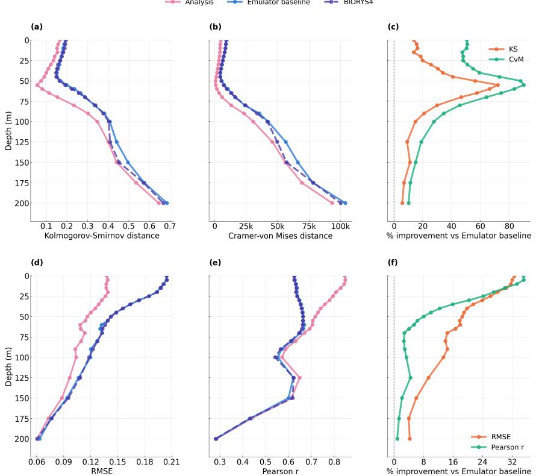
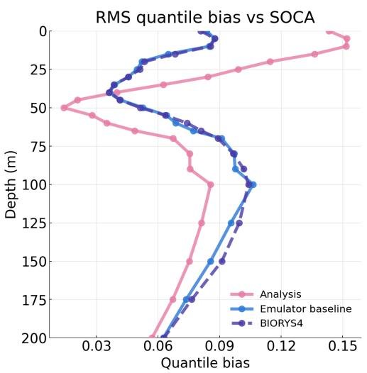
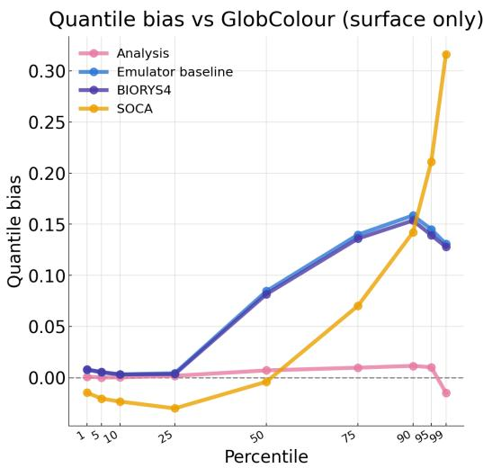

# Surface Conditioning for Zero-Shot Multivariate Correction in a Marine Biogeochemistry Emulator

Gabriela Martínez Balbontín Mercator Océan International Sorbonne Université, LIP6, CNRS gmartinezbalbontin@mercator-ocean.fr

Dominique Béréziat Sorbonne Université, LIP6, CNRS

Anastase Charantonis INRIA Paris (ARCHES)

Stefano Ciavatta Mercator Océan International

## Abstract

Bias correction in process-based models usually means iterative data assimilation with explicit covariance modelling. We propose a lightweight alternative based on a neural emulator of marine biogeochemistry (BGC), showing that the conditioning pathway of its autoencoder can serve as an observation injection point. The decoder is conditioned on surface variables via Feature-wise Linear Modulation (FiLM), originally designed to incorporate physical boundary forcings. We extend these inputs to include surface chlorophyll-a and replace the simulated field with satellite observations at inference time. The surface substitution propagates through the water column, improving agreement with depth-resolved observations at all depths, and spreads to other output variables in a pattern consistent with expected trophic relationships.

## 1 Introduction

Marine biogeochemical (BGC) models are essential for understanding ocean ecosystems and carbonclimate feedbacks [1–4], but they exhibit substantial biases relative to observations due to imperfect process representations that compound over time [5–8]. The standard operational approach is data assimilation, where the simulation is periodically corrected by combining it with observations to create an analysis before propagating the dynamical model on the improved state. This is typically done with variational or ensemble-based methods [9, 10, 5], but it is computationally expensive, and multivariate corrections depend on error covariances that must be modelled, estimated, or inflated.

Machine learning has been applied to this problem along several axes, including learning direct mappings from model state to observation-space [11, 12], performing assimilation in a compressed latent space [13, 14], replacing the dynamical model with a neural surrogate [15, 16], and score-based data assimilation (SDA) [17], to name a few. Most of these still pay an iterative cost per analysis, and require specifications of how information moves from observed to unobserved coordinates.

Instead we attempt something much simpler. We build on BG4Sea [18], a forecasting system trained on mechanistic model output, in which an autoencoder compresses the water column into a latent representation that a latent forecaster propagates forward in time. The decoder is conditioned on surface inputs via Feature-wise Linear Modulation (FiLM) [19], originally designed to incorporate physical boundary forcing for the BGC forecasts. We repurpose this conditioning channel for observation injection, adding surface chlorophyll-a (chl-a) to the conditioning inputs during training and replacing it with observations at inference. Because this mechanism is decoupled from the latent representation and from the forecaster, this zero-shot replacement can propagate a depthresolved correction through the decoder’s learned prior, without retraining or a gain matrix. This is conceptually similar to adaptations of SDA [20, 21], which also correct the state at inference time without running a dynamical model forward. Our approach trades their flexibility and uncertainty estimates for a single forward pass.

Chl-a is a natural first choice for the “assimilated” variable. It is the pigment of the phytoplankton responsible for about half of Earth’s photosynthesis [22], and an indicator of primary production and carbon export. It colours the ocean enough to be seen from space, making it the best-observed BGC variable and the one most commonly assimilated into BGC models [23, 5], and since it varies with depth, it is also profiled in situ by autonomous floats. This dual coverage shapes our setup: we inject satellite observations at the surface and validate against a depth-resolved float product. The two observation sources disagree significantly, both with each other and with the model prior, so we also report their mutual agreement as a reference for our evaluation. Our results show that surface conditioning can improve accuracy at all depths with a trophically consistent response across other output variables. The surface conditioning alone shows similar results to full-column replacement with the target in an unmodulated network. In addition, the analysis agrees with the float-based product more closely than the injected satellite observation itself.

## 2 Methodology

For this study, we focus solely on the autoencoder, leaving the dynamical system fixed, the underlying assumption being that a perfect version of the latent forecast would coincide with the autoencoder’s latent representation of the same time period.

Data The autoencoder is trained on normalised anomaly ocean data from mechanistic model output, both produced by Mercator Océan International and distributed by the Copernicus Marine Environment Monitoring Service. These include both BGC (BIORYS4 [24, 25]) and physical (GLO RYS12 [26, 27]) variables. Anomalies are calculated by subtracting a climatology (i.e. historical mean) from the data, and subsequently normalised using mean and standard deviation. Both are monthly at 1/4° horizontal resolution and split into training (2010–2017), validation (2018–2019) and test (2020–2022) periods. The injected chl-a observations come from GlobColour, a cloud-free prod uct merging several satellite sensors [28, 29]. For validation we use SOCA [30], which interpolates profiles from BGC-Argo floats (autonomous instruments that measure chl-a down the water column) onto a regular grid [31, 32]. Despite targeting the same variable, the two observational sources differ significantly. We attempt to overcome these discrepancies by converting the column profiles to a satellite-equivalent surface value following standard practice [33–35], but the disagreement persists. Satellite chl-a is known to have a narrower range than float measurements and thus underestimates high concentrations [36–38, 28]. We detrend and normalise both datasets using the same climatology and statistics used for the emulator’s inputs.

Architecture The autoencoder is a deterministic, 1D convolutional network that compresses each water-column profile $\mathbf { x } \in \mathbb { R } ^ { V \times K } \left( V = 3 1 \right.$ variables, K = 24 depth levels; Tables 4–5a) into a latent code $\mathbf { z } = \pmb { \mathcal { E } } ( \mathbf { x } ) \in \mathbb { R } ^ { L }$ , where $L = 3 2$ . The decoder mirrors the encoder, except that each stage is modulated via FiLM, which scales and shifts its feature maps according to a conditioning input. This input is a 128-dimensional vector produced by a two-layer MLP from the surface variables $\mathbf { s } ^ { 1 }$ and a learned embedding of month, latitude, longitude and depth. The original BG4Sea network is conditioned on physical variables only; the adapted autoencoder has identical architecture but extends the conditioning to $\mathbf { \rho } _ { \mathbf { s } } = [ \mathbf { s } _ { \mathrm { p h y s } } , s _ { \mathrm { c h l } } ]$ , and is trained to reconstruct x as $\mathcal { D } \big ( \mathbf { z } ; \mathbf { s } _ { \mathrm { p h y s } } , s _ { \mathrm { c h l } } ^ { \mathrm { s i m } } \big )$ . At inference, replacing the simulated surface chl-a with its GlobColour observation yields the analysis $\hat { \mathbf { x } } ^ { a } = \mathcal { D } \big ( \mathbf { z } ; \mathbf { \bar { s } } _ { \mathrm { p h y s } } , \mathbf { \bar { s } } _ { \mathrm { c h l } } ^ { \mathrm { o b s } } \big )$

The analysis is compared to the emulator baseline, and with BIORYS4, and all are evaluated against SOCA. To isolate the contribution of the conditioning pathway from the variable replacement, two diagnostic runs feed the validation target SOCA directly: an oracle run replaces both the column and surface chl-a with SOCA, giving an upper bound, while an ablation replaces only the column chl-a in a column-only autoencoder (same architecture without the FiLM conditioning). All configurations are summarised in Table 1. We train with AdamW on the mean squared reconstruction error (≈ 3.5 hours on a single A100). Due to memory constraints, training uses a spatial subsample of N ≈ 780 locations; all results are computed on the full global grid over the held-out test period.

Table 1: Experiment configurations.
<table><tr><td>Experiment</td><td>Surface conditioning</td><td>Column chl-a</td><td>Surface chl-a</td></tr><tr><td>Emulator baseline (original BG4Sea) Analysis (contribution)</td><td>physics only physics + chl-a</td><td>BIORYS4 BIORYS4</td><td>GlobColour</td></tr><tr><td>Oracle (diagnostic)</td><td></td><td></td><td></td></tr><tr><td>Ablation (diagnostic)</td><td>physics + chl-a none (column-only, no FiLM)</td><td>SOCA SOCA</td><td>SOCA</td></tr></table>

## 3 Results

Table 2 reports skill against SOCA for the configurations in Table 1, with BIORYS4 included as reference. We use both pointwise metrics (RMSE, $R ^ { 2 }$ , Pearson r) and distributional ones: Kolmogorov–Smirnov distance (KS), Cramér–von Mises statistic (CvM), and root mean squared quantile bias (QQ bias).

Table 2: Skill against SOCA for the configurations in Table 1; BIORYS4 is the emulated simulation itself. Arrows give the direction of better skill. Bold marks the best value per metric, excluding the oracle.
<table><tr><td></td><td>RMSE↓</td><td> $R ^ { 2 } \uparrow$ </td><td> $r \uparrow$ </td><td>KS↓</td><td>CvM↓</td><td>QQ bias ↓</td></tr><tr><td>BIORYS4</td><td>0.1648</td><td>0.2899</td><td>0.6517</td><td>0.1848</td><td>1,133,378</td><td>0.0550</td></tr><tr><td>Emulator baseline</td><td>0.1647</td><td>0.2908</td><td>0.6540</td><td>0.1878</td><td>1,155,096</td><td>0.0545</td></tr><tr><td>Analysis</td><td>0.1222</td><td>0.6097</td><td>0.7811</td><td>0.1401</td><td>421,162</td><td>0.0918</td></tr><tr><td>Oracle</td><td>0.0799</td><td>0.8333</td><td>0.9154</td><td>0.0670</td><td>149,477</td><td>0.0251</td></tr><tr><td>Ablation</td><td>0.1244</td><td>0.5955</td><td>0.8018</td><td>0.1732</td><td>986,609</td><td>0.0671</td></tr></table>

The emulator baseline performs almost identically to BIORYS4, and satellite conditioning substantially improves the results: RMSE drops from 0.165 to 0.122, R2 doubles to 0.61, and r rises from 0.65 to 0.78. Distributional statistics show reductions too, with the exception of QQ bias, which rises from 0.055 to 0.092. This is at least in part attributable to a covariate shift between GlobColour and SOCA. In fact, by most metrics, the analysis agrees more closely with SOCA at the surface than GlobColour itself does (RMSE 0.138 vs. 0.147; R2 0.69 vs. 0.45; r 0.84 vs. 0.80; KS 0.165 vs. 0.163; CvM 4,727 vs. 27,269; QQ bias 0.143 vs. 0.138, not shown in Table 2), indicating the model partially corrects the injected observation. A depth, quantile-resolved breakdown of QQ bias is provided in the Appendix (Figure 2).

These results also show that conditioning on satellite surface matches or beats injecting the validation target itself directly into the column. The table shows that the column-only ablation (no surface conditioning) improves the baseline, but adding FiLM surface conditioning pushes RMSE from 0.12 to 0.08 and $R ^ { 2 }$ from 0.6 to 0.83, all while substantially reducing all distributional metrics. This suggests that the surface conditioning carries most of the assimilation-relevant information.

Improvements across depth Figure 1 shows the depth-resolved skill. Although only a single surface scalar is changed, the analysis improves on the baseline and BIORYS4 at all depths and for all four metrics. Pointwise gains (RMSE, r) are largest at the surface (∼33%) and decay with depth, whereas distributional gains (KS, CvM) peak in the subsurface at around 50–60 m (70–90%), before decaying smoothly below. This is also where the QQ bias reaches its minimum (Appendix Figure 2).

Multivariate, trophically-consistent response To see how the single-variable correction spreads to the other outputs, we measure, for each variable $v ,$ how far the analysis moves from the simulated prior relative to the emulator’s own reconstruction error, $\eta _ { v } = \mathrm { R M S E } ( \hat { \mathbf { x } } _ { v } ^ { a } , \mathbf { x } _ { v } ) / \mathrm { R M S E } ( \hat { \mathbf { x } } _ { v } , \mathbf { x } _ { v } )$ where $\mathbf { x } _ { v }$ is BIORYS4. A ratio $\eta _ { v } \approx 1$ indicates little to no departure from the prior, while larger values indicate a response. The ordering (Table 3) is qualitatively consistent with what one would expect from assimilating total chl-a into a BGC model: the chl-a pools and phytoplankton biomass respond most strongly, followed by primary production, grazers (zooplankton), and the nutrients that limit plankton growth. This is not an artefact of variables being harder to reconstruct, as $\eta _ { v }$ is uncorrelated with per-variable reconstruction $R ^ { 2 }$ (Spearman correlation −0.095).

  
Figure 1: Depth-resolved skill against SOCA for the analysis, emulator baseline, and BIORYS4: (a) KS, (b) CvM, (d) RMSE, (e) Pearson r. Panels (c) and (f) show the analysis’ relative improvement over the baseline (positive is better).

Table 3: Response ratio $\eta _ { v }$ (analysis-to-BIORYS4 over baseline-to-BIORYS4 RMSE) of each output variable to the surface chl-a substitution. DIC/DOC: dissolved inorganic/organic carbon; POC: particulate organic carbon; PAR: photosynthetically active radiation.
<table><tr><td>ηv</td><td>Variables</td></tr><tr><td>&gt; 2.5×</td><td>Chl-a of diatoms and nanophytoplankton; total phytoplankton and diatom biomass</td></tr><tr><td>1.5-2.5×</td><td>Primary production; mesozooplankton and nanophytoplankton biomass; Fe and Si content of phytoplankton</td></tr><tr><td> $1 . 1 \mathrm { - } 1 . 5 \times$ </td><td> $\mathrm { N O } _ { 3 }$  , PO4, O2, DOC,  $\mathrm { C a C O _ { 3 } } ,$  PAR, pH, large POC, microzooplankton biomass, salinity</td></tr><tr><td> $\leq 1 . 1 \times$ </td><td>DIC, NH4, alkalinity, Fe, Si, temperature; sinking pools (biogenic Si, small POC, particulate Fe)</td></tr></table>

Temperature and salinity are both column outputs and, at the surface, part of the physical conditioning $\mathbf { s } _ { \mathrm { p h y s } } ,$ so they share the same MLP embedding as the substituted chl-a. In BIORYS4 the physics is prescribed and unaffected by the BGC, so ideally they should not respond at all. Their response is limited, negligible for temperature (1.02×) and modest for salinity (1.14×), below most biologically coupled tracers. This likely reflects water-mass correlations learned from the simulation rather than a physical pathway, suggesting the correction injects little spurious variance into the physical variables, although salinity’s response deserves closer investigation.

## 4 Discussion

Our results suggest that the adapted autoencoder acts as a simplified analysis operator, and that this is essentially zero-shot, sim-to-real transfer: the model, trained only on BIORYS4, maps GlobColour through the structure it learned, propagating a single surface scalar into a depth-resolved correction with no explicit gain matrix, covariance model, or optimisation. The substitution improves agreement with the float-based observational product at all depths, and is comparable to a much stronger intervention: the surface conditioning alone (RMSE 0.122, R2 0.61) matches replacing the chl-a column with the validation target itself in an unmodulated (column-only) network (RMSE 0.124, R2 0.60). The response follows a pattern that is qualitatively consistent with trophic relationships; the chla pools and phytoplankton biomass respond most strongly, and primary production and grazers follow. This reach likely comes from the intervention’s modulation of the entire decoder and computing an explicit sensitivity map, as well as characterising how the conditioning embedding itself shifts when the observation is swapped, would be interesting directions for future work. Quantitatively validating the multivariate response is also an open direction.

Interestingly, the network also handles the covariate shift between the two observational datasets gracefully. After conditioning, the analysis agrees with SOCA more closely than GlobColour does on RMSE, R2, r and CvM, in spite of GlobColour being its only source of information about the observed state. The decoder does not pass the observation unchanged, but it still inherits some of its biases (e.g. the satellite’s narrower dynamic range, see Appendix Figure 2) closest to the injection point. Rescaling the conditioning to match SOCA would probably help, but the two products are different by construction, and that difference is what makes validation against SOCA relevant. Probabilistic conditioning could modulate how strongly the injected signal overrides the prior. The partial correction suggests that the structure provides some of this regulation implicitly, but with our deterministic approach it cannot be controlled.

## 4.1 Limitations

Perhaps the most important limitation of this work is that everything is done deterministically, and so we end up with a single point estimate with no notion of uncertainty arising from the distributional differences between the prior and the two observational distributions. The analysis inherits GlobColour’s compressed upper tail (Appendix Figure 2), and there is no mechanism to hedge against this bias.

Our results examine the trophic response with respect to BIORYS4, but for variables other than chl-a there is no independent validation against observations. The correction propagates through correlations learned from the simulation rather than causal pathways, and it is unknown whether these reflect the correct covariance structure. While the appeal of our approach lies in its cost (single forward pass rather than an iterative analysis), we do not compare against conventional data assimilation, which we considered beyond the scope of this proof of concept.

Furthermore, while the full emulator architecture incorporates spatial context via neighbourhood cross-attention in the latent forecaster [18], the decoder is strictly 1D, and each column is processed in isolation. Integrating horizontal structures remains a prerequisite for a full 3D correction. Finally, even though this is intended for forecast correction, evaluation is limited to autoencoder reconstruction. This relies on two assumptions: that a perfect column forecast coincides with the autoencoder’s latent representation, and that a perfect forecaster exists to propagate the conditioning observation to the target time of the forecast. Both remain to be validated.

## 5 Conclusion

We show that the conditioning pathway of an ocean BGC emulator, trained only on simulation output, can be adapted to serve as a zero-shot analysis step. Substituting chl-a at the surface with its observation matches the replacement of the full chl-a column in the unconditioned network, improving agreement with the validation observations at all depths, and agreeing with them more closely than the injected observation itself. The correction propagates across variables in a pattern qualitatively consistent with trophic relationships. The main drawback is the lack of uncertainty quantification inherent to the deterministic formulation, making probabilistic extensions the natural next step towards a more robust analysis.

## References

[1] J S Link, S Thur, G Matlock, and M Grasso. Why we need weather forecast analogues for marine ecosystems. ICES Journal ofMarine Science, 80(8):2087–2098, October 2023. doi: 10.1093/icesjms/fsad143.

[2] Jong-Yeon Park, Charles A. Stock, John P. Dunne, Xiaosong Yang, and Anthony Rosati. Seasonal to multiannual marine ecosystem prediction with a global Earth system model. Science, 365(6450):284–288, July 2019. doi: 10.1126/science.aav6634.

[3] Nicolas Gruber, Dominic Clement, Brendan R. Carter, Richard A. Feely, Steven van Heuven, Mario Hoppema, Masao Ishii, Robert M. Key, Alex Kozyr, Siv K. Lauvset, Claire Lo Monaco, Jeremy T. Mathis, Akihiko Murata, Are Olsen, Fiz F. Perez, Christopher L. Sabine, Toste Tanhua, and Rik Wanninkhof. The oceanic sink for anthropogenic $\mathrm { C O _ { 2 } }$ from 1994 to 2007. Science, 363(6432):1193–1199, March 2019. doi: 10.1126/science.aau5153.

[4] Camilo Mora, Chih-Lin Wei, Audrey Rollo, Teresa Amaro, Amy R. Baco, David Billett, Laurent Bopp, Qi Chen, Mark Collier, Roberto Danovaro, Andrew J. Gooday, Benjamin M. Grupe, Paul R. Halloran, Jeroen Ingels, Daniel O. B. Jones, Lisa A. Levin, Hideyuki Nakano, Karl Norling, Eva Ramirez-Llodra, Michael Rex, Henry A. Ruhl, Craig R. Smith, Andrew K. Sweetman, Andrew R. Thurber, Jerry F. Tjiputra, Paolo Usseglio, Les Watling, Tongwen Wu, and Moriaki Yasuhara. Biotic and human vulnerability to projected changes in ocean biogeochemistry over the 21st century. PLoS Biology, 11(10):e1001682, October 2013. doi: 10.1371/journal.pbio.1001682.

[5] Katja Fennel, Jann Paul Mattern, Scott C. Doney, Laurent Bopp, Andrew M. Moore, Bin Wang, and Liuqian Yu. Ocean biogeochemical modelling. Nature Reviews Methods Primers, 2(1): 1–21, September 2022. doi: 10.1038/s43586-022-00154-2.

[6] Roland Séférian, Sarah Berthet, Andrew Yool, Julien Palmiéri, Laurent Bopp, Alessandro Tagliabue, Lester Kwiatkowski, Olivier Aumont, James Christian, John Dunne, Marion Gehlen, Tatiana Ilyina, Jasmin G. John, Hongmei Li, Matthew C. Long, Jessica Y. Luo, Hideyuki Nakano, Anastasia Romanou, Jörg Schwinger, Charles Stock, Yeray Santana-Falcón, Yohei Takano, Jerry Tjiputra, Hiroyuki Tsujino, Michio Watanabe, Tongwen Wu, Fanghua Wu, and Akitomo Yamamoto. Tracking Improvement in Simulated Marine Biogeochemistry Between CMIP5 and CMIP6. Current Climate Change Reports, 6(3):95–119, August 2020. doi: 10.1007/s40641-020-00160-0.

[7] Jens Terhaar, Nadine Goris, Jens D. Müller, Tim DeVries, Nicolas Gruber, Judith Hauck, Fiz F. Pérez, and Roland Séférian. Assessment of global ocean biogeochemistry models for ocean carbon sink estimates in RECCAP2 and recommendations for future studies. Journal ofAdvances in Modeling Earth Systems, 16(3):e2023MS003840, March 2024. doi: 10.1029/ 2023MS003840.

[8] Weiwei Fu, J. Keith Moore, François Primeau, Nathan Collier, Oluwaseun O. Ogunro, Forrest M. Hoffman, and James T. Randerson. Evaluation of ocean biogeochemistry and carbon cycling in CMIP earth system models with the international ocean model benchmarking (IOMB) software system. Journal of Geophysical Research: Oceans, 127(10):e2022JC018965, 2022. doi: 10.1029/2022JC018965.

[9] R. N. Bannister. A review of operational methods of variational and ensemble-variational data assimilation. Quarterly Journal ofthe Royal Meteorological Society, 143(703):607–633, 2017. doi: 10.1002/qj.2982.

[10] Michael Dowd, Emlyn Jones, and John Parslow. A statistical overview and perspectives on data assimilation for marine biogeochemical models. Environmetrics, 25(4):203–213, 2014. doi: 10.1002/env.2264.

[11] Ronan Fablet, Bertrand Chapron, Lucas Drumetz, Etienne Mémin, Olivier Pannekoucke, and François Rousseau. Learning Variational Data Assimilation Models and Solvers. Journal of Advances in Modeling Earth Systems, 13(10):e2021MS002572, October 2021. doi: 10.1029/ 2021MS002572.

[12] Jing Liang, Koji Terasaki, and Takemasa Miyoshi. A Machine Learning Approach to the Observation Operator for Satellite Radiance Data Assimilation. Journal ofthe Meteorological Society ofJapan, 101:79–95, 2023. doi: 10.2151/jmsj.2023-005.

[13] Mathis Peyron, Anthony Fillion, Selime Gürol, Victor Marchais, Serge Gratton, Pierre Boudier, and Gael Goret. Latent space data assimilation by using deep learning. Quarterly Journal of the Royal Meteorological Society, 147(740):3759–3777, October 2021. doi: 10.1002/qj.4153.

[14] Hang Fan, Lei Bai, Ben Fei, Yi Xiao, Kun Chen, Yubao Liu, Yongquan Qu, Fenghua Ling, and Pierre Gentine. Physically consistent global atmospheric data assimilation with machine learning in latent space. Science Advances, 2025. doi: 10.1126/sciadv.aea4248.

[15] Julien Brajard, Alberto Carrassi, Marc Bocquet, and Laurent Bertino. Combining data assimilation and machine learning to emulate a dynamical model from sparse and noisy observations: A case study with the Lorenz 96 model. Journal ofComputational Science, 44:101171, July 2020. doi: 10.1016/j.jocs.2020.101171.

[16] Melissa Adrian, Daniel Sanz-Alonso, and Rebecca Willett. Data Assimilation with Machine Learning Surrogate Models: A Case Study with FourCastNet. Artificial Intelligence for the Earth Systems, 4(3), 2025. doi: 10.1175/AIES-D-24-0050.1.

[17] François Rozet and Gilles Louppe. Score-based Data Assimilation. In Advances in Neural Information Processing Systems, volume 36, pages 40521–40541, 2023.

[18] Gabriela Martínez Balbontín, Anastase Charantonis, Dominique Béréziat, and Stefano Ciavatta. BG4Sea: Biogeochemical Seasonal Forecastability via Progressive Information Scaling. arXiv preprint arXiv:2607.16731, July 2026. URL https://doi.org/10.48550/arXiv.2607. 16731.

[19] Ethan Perez, Florian Strub, Harm de Vries, Vincent Dumoulin, and Aaron Courville. FiLM: Visual Reasoning with a General Conditioning Layer. arXiv preprint arXiv:1709.07871, December 2017. URL https://doi.org/10.48550/arXiv.1709.07871.

[20] Peter Manshausen, Yair Cohen, Peter Harrington, Jaideep Pathak, Mike Pritchard, Piyush Garg, Morteza Mardani, Karthik Kashinath, Simon Byrne, and Noah Brenowitz. Generative Data Assimilation of Sparse Weather Station Observations at Kilometer Scales. Journal of Advances in Modeling Earth Systems, 17(10):e2024MS004505, October 2025. doi: 10.1029/ 2024MS004505.

[21] Scott A. Martin, Georgy E. Manucharyan, and Patrice Klein. Generative Data Assimilation for Surface Ocean State Estimation From Multi-Modal Satellite Observations. Journal of Advances in Modeling Earth Systems, 17(8):e2025MS005063, August 2025. doi: 10.1029/ 2025MS005063.

[22] Christopher B. Field, Michael J. Behrenfeld, James T. Randerson, and Paul Falkowski. Primary Production of the Biosphere: Integrating Terrestrial and Oceanic Components. Science, 281 (5374):237–240, July 1998. doi: 10.1126/science.281.5374.237.

[23] D. A. Ford, K. P. Edwards, D. Lea, R. M. Barciela, M. J. Martin, and J. Demaria. Assimilating GlobColour ocean colour data into a pre-operational physical-biogeochemical model. Ocean Science, 8(5):751–771, September 2012. doi: 10.5194/os-8-751-2012.

[24] Marilaure Grégoire, Gianpiero Cossarini, Corinne Derval, Elodie Gutknecht, Susan Kay, Julien Lamouroux, Helen Morrison, Coralie Perruche, Annette Samuelsen, Lena Spruch, Anna Teruzzi, Luc Vandenbulcke, Karina von Schuckmann, and Tsuyoshi Wakamatsu. Review and Synthesis: operational prediction of ocean biogeochemistry in the Copernicus Marine Service. Main achievements and perspectives, 2026. URL https://egusphere.copernicus.org/ preprints/2026/egusphere-2026-813/. Preprint, EGUsphere.

[25] Julien Lamouroux and M Tonani. Global Ocean Biogeochemistry Analysis and Forecast, 2023. URL https://doi.org/10.48670/moi-00015.

[26] Jean-Michel Lellouche, Greiner Eric, Bourdallé-Badie Romain, Garric Gilles, Melet Angélique, Drévillon Marie, Bricaud Clément, Hamon Mathieu, Le Galloudec Olivier, Regnier Charly, Candela Tony, Testut Charles-Emmanuel, Gasparin Florent, Ruggiero Giovanni, Benkiran Mounir, Drillet Yann, and Le Traon Pierre-Yves. The Copernicus Global 1/12° Oceanic and Sea Ice GLORYS12 Reanalysis. Frontiers in Earth Science, 9, July 2021. doi: 10.3389/feart. 2021.698876.

[27] E.U. Copernicus Marine Service Information (CMEMS). Global Ocean Physics Reanalysis. Marine Data Store (MDS), . URL https://doi.org/10.48670/moi-00021.

[28] Philippe Garnesson, Antoine Mangin, Odile Fanton d’Andon, Julien Demaria, and Marine Bretagnon. The CMEMS GlobColour chlorophyll a product based on satellite observation: multi-sensor merging and flagging strategies. Ocean Science, 15(3):819–830, June 2019. doi: 10.5194/os-15-819-2019.

[29] E.U. Copernicus Marine Service Information (CMEMS). Global Ocean Colour (Copernicus-GlobColour), Bio-Geo-Chemical, L4 (monthly and interpolated) from Satellite Observations (1997-ongoing). Marine Data Store (MDS), . URL https://doi.org/10.48670/ moi-00281.

[30] E.U. Copernicus Marine Service Information (CMEMS). Global Ocean 3D Chlorophyll-a concentration, Particulate Backscattering coefficient, Particulate Organic Carbon, Downwelling Photosynthetic Available Radiation. Marine Data Store (MDS), . URL https://doi.org/10. 48670/moi-00046.

[31] P. R. Renosh, J. Zhang, R. Sauzède, and H. Claustre. Vertically resolved global ocean light models using machine learning. Remote Sensing, 15(24):5663, 2023. doi: 10.3390/rs15245663.

[32] R. Sauzède, H. Claustre, J. Uitz, C. Jamet, G. Dall’Olmo, F. D’Ortenzio, B. Gentili, A. Poteau, and C. Schmechtig. A neural network-based method for merging ocean color and Argo data to extend surface bio-optical properties to depth: Retrieval of the particulate backscattering coefficient. Journal ofGeophysical Research: Oceans, 121(4):2552–2571, March 2016. doi: 10.1002/2015JC011408.

[33] Howard R. Gordon and Dennis K. Clark. Remote sensing optical properties of a stratified ocean: an improved interpretation. Applied Optics, 19(20):3428–3430, October 1980. doi: 10.1364/AO.19.003428.

[34] A. Morel and J.-F. Berthon. Surface pigments, algal biomass profiles, and potential production of the euphotic layer: Relationships reinvestigated in view of remote-sensing applications. Limnology and Oceanography, 34(8):1545–1562, 1989. doi: 10.4319/lo.1989.34.8.1545.

[35] André Morel, Yannick Huot, Bernard Gentili, P. Jeremy Werdell, Stanford B. Hooker, and Bryan A. Franz. Examining the consistency of products derived from various ocean color sensors in open ocean (Case 1) waters in the perspective of a multi-sensor approach. Remote Sensing ofEnvironment, 111:69–88, 2007. doi: 10.1016/j.rse.2007.03.012.

[36] Chuanmin Hu, Zhongping Lee, and Bryan Franz. Chlorophyll a algorithms for oligotrophic oceans: A novel approach based on three-band reflectance difference. Journal ofGeophysical Research: Oceans, 117(C01011), 2012. doi: 10.1029/2011JC007395.

[37] Alberto Baudena, Wilhem Riom, Vincent Taillandier, Nicolas Mayot, Alexandre Mignot, and Fabrizio D’Ortenzio. Comparing satellite and BGC-Argo chlorophyll estimation: A phenological study. Remote Sensing of Environment, 326:114743, August 2025. doi: 10.1016/j. rse.2025.114743.

[38] R. Johnson, P. G. Strutton, S. W. Wright, A. McMinn, and K. M. Meiners. Three improved satellite chlorophyll algorithms for the Southern Ocean. Journal of Geophysical Research: Oceans, 118:3694–3703, 2013. doi: 10.1002/jgrc.20270.

## A Examining the increased QQ bias

The QQ bias in Table 2 worsens under GlobColour conditioning (0.055 to 0.092). This section examines where and why.

Panel A of Figure 2 shows that the bias increases at the surface, peaking at around 10m and rapidly decreasing to a minimum at around 50m. Below this depth, the analysis improves the metric relative to the baselines, showing that the bias is confined near the top.

Panel B illustrates the bias at the surface with respect to GlobColour (the injected observation), showing the differences by quantile. Here we see the analysis closely aligning with the source, while SOCA diverges sharply at high percentiles, indicating that GlobColour systematically underestimates peaks relative to the in situ measurements. This is consistent with what the literature describes: the satellite observations consistently show lower dynamic range [36–38, 28].

(a)  

(b)  
  
Figure 2: QQ bias breakdown. Panel A: Depth-resolved RMS QQ bias shows the increase concentrated near the surface. Panel B: Surface quantiles reveal that the analysis tracks GlobColour closely, while SOCA diverges at high percentiles.

## B Full list of variables and depths

Table 4: Depth-column variables (31), grouped by process.
<table><tr><td>Nutrients and oxygen</td><td>Biology Nanophytoplankton</td><td>Carbon pools Alkalinity</td><td>Physics &amp; light Temperature</td></tr><tr><td>Nitrate Phosphate Ammonium</td><td>biomass Diatom biomass Total phytoplankton</td><td>Dissolved inorganic carbon Dissolved organic</td><td>Salinity Photosynthetically active radiation</td></tr><tr><td>Total dissolved iron</td><td>biomass</td><td>carbon</td><td></td></tr><tr><td>Diatom iron content</td><td>Total chlorophyll</td><td>Calcium carbonate</td><td></td></tr><tr><td>Nanophytoplankton</td><td>Nanophytoplankton</td><td></td><td></td></tr><tr><td></td><td></td><td>(calcite)</td><td></td></tr><tr><td>iron content</td><td>chlorophyll</td><td>pH</td><td></td></tr><tr><td>Large particulate iron</td><td>Diatom chlorophyll</td><td>Small particulate</td><td></td></tr><tr><td>Small particulate iron</td><td>Net primary</td><td>organic carbon</td><td></td></tr><tr><td>Silicate</td><td></td><td></td><td></td></tr><tr><td></td><td>production</td><td>Large particulate</td><td></td></tr><tr><td>Diatom silicon</td><td>Microzooplankton</td><td>organic carbon</td><td></td></tr><tr><td>content</td><td></td><td></td><td></td></tr><tr><td></td><td>biomass</td><td></td><td></td></tr><tr><td>Sinking biogenic</td><td></td><td></td><td></td></tr><tr><td></td><td>Mesozooplankton</td><td></td><td></td></tr><tr><td></td><td></td><td></td><td></td></tr><tr><td></td><td></td><td></td><td></td></tr><tr><td>silica</td><td></td><td></td><td></td></tr><tr><td></td><td>biomass</td><td></td><td></td></tr><tr><td></td><td></td><td></td><td></td></tr><tr><td></td><td></td><td></td><td></td></tr><tr><td></td><td></td><td></td><td></td></tr><tr><td></td><td></td><td></td><td></td></tr><tr><td>Oxygen</td><td></td><td></td><td></td></tr><tr><td></td><td></td><td></td><td></td></tr><tr><td></td><td></td><td></td><td></td></tr><tr><td></td><td></td><td></td><td></td></tr><tr><td></td><td></td><td></td><td></td></tr><tr><td></td><td></td><td></td><td></td></tr><tr><td></td><td></td><td></td><td></td></tr><tr><td></td><td></td><td></td><td></td></tr><tr><td></td><td></td><td></td><td></td></tr><tr><td></td><td></td><td></td><td></td></tr><tr><td></td><td></td><td></td><td></td></tr><tr><td></td><td></td><td></td><td></td></tr><tr><td></td><td></td><td></td><td></td></tr><tr><td></td><td></td><td></td><td></td></tr><tr><td></td><td></td><td></td><td></td></tr><tr><td></td><td></td><td></td><td></td></tr><tr><td></td><td></td><td></td><td></td></tr><tr><td></td><td></td><td></td><td></td></tr><tr><td></td><td></td><td></td><td></td></tr><tr><td></td><td></td><td></td><td></td></tr><tr><td></td><td></td><td></td><td></td></tr><tr><td></td><td></td><td></td><td></td></tr><tr><td></td><td></td><td></td><td></td></tr><tr><td></td><td></td><td></td><td></td></tr><tr><td></td><td></td><td></td><td></td></tr><tr><td></td><td></td><td></td><td></td></tr><tr><td></td><td></td><td></td><td></td></tr><tr><td></td><td></td><td></td><td></td></tr><tr><td></td><td></td><td></td><td></td></tr><tr><td></td><td></td><td></td><td></td></tr><tr><td></td><td></td><td></td><td></td></tr><tr><td></td><td></td><td></td><td></td></tr><tr><td></td><td></td><td></td><td></td></tr><tr><td></td><td></td><td></td><td></td></tr><tr><td></td><td></td><td></td><td></td></tr><tr><td></td><td></td><td></td><td></td></tr><tr><td></td><td></td><td></td><td></td></tr><tr><td></td><td></td><td></td><td></td></tr><tr><td></td><td></td><td></td><td></td></tr><tr><td></td><td></td><td></td><td></td></tr><tr><td></td><td></td><td></td><td></td></tr><tr><td></td><td></td><td></td><td></td></tr><tr><td></td><td></td><td></td><td></td></tr></table>

(a) Nominal depth levels (24) on the model vertical grid.
<table><tr><td colspan="6">Depth (m)</td></tr><tr><td>0.5</td><td>1.5</td><td>3.8</td><td>5.1</td><td>7.9</td><td>11.4</td></tr><tr><td>13.5</td><td>15.8</td><td>18.5</td><td>21.6</td><td>25.2</td><td>29.4</td></tr><tr><td>34.4</td><td>40.3</td><td>47.4</td><td>55.8</td><td>65.8</td><td>77.9</td></tr><tr><td>92.3</td><td>109.7</td><td>130.7</td><td>155.9</td><td>186.1</td><td>222.5</td></tr></table>

Table 5: Depth grid and surface inputs  
(b) Surface variables used for conditioning

Surface-only conditioning   
Chlorophyll-a   
Mixed-layer depth   
Sea-surface height   
Sea-surface salinity   
Sea-surface temperature   
Particulate dust