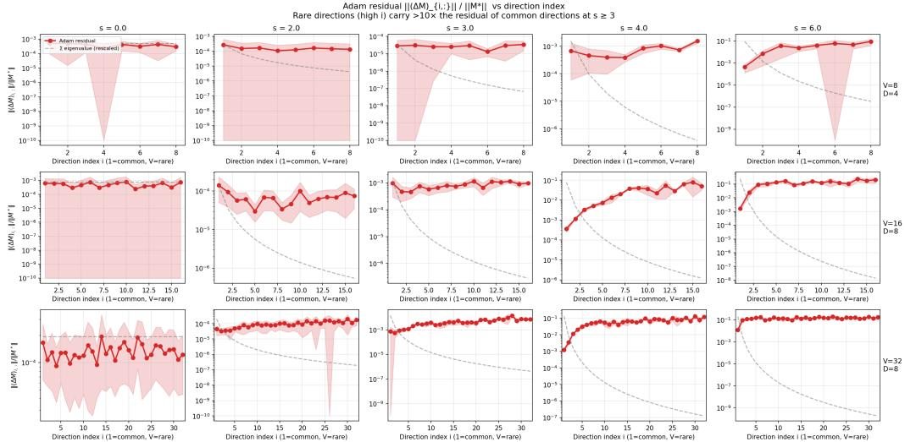
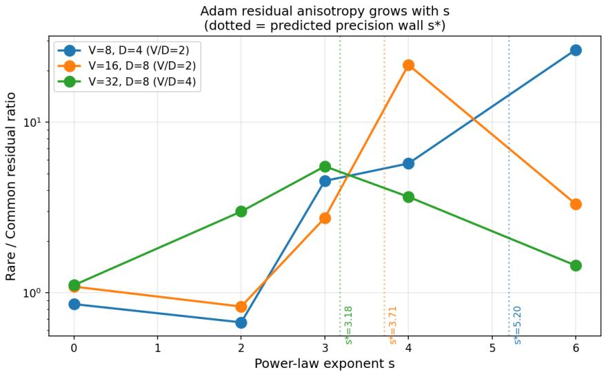
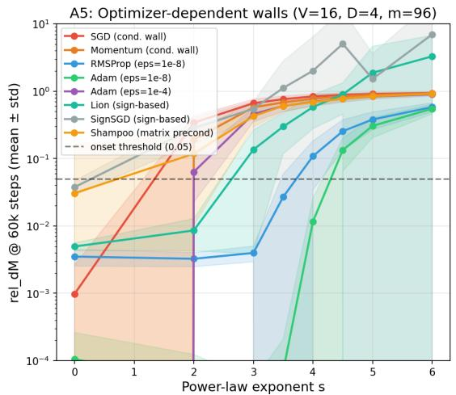
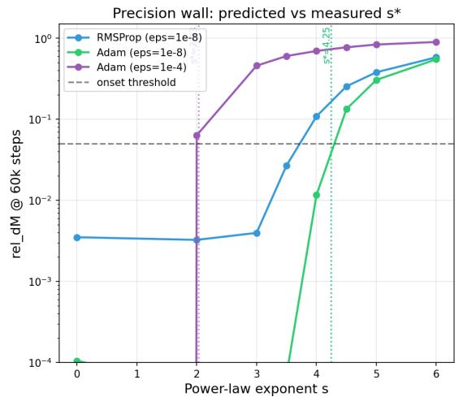

# The Precision Wall: An Optimizer-Dependent Boundary for Optimization under Power-Law Measurement Spectra

Lngel KyoA2O Labslngel.kyo@a2o-labs.com

## Abstract

In low-rank matrix sensing of a rank-D factor $U ^ { * } \in \mathbb { R } ^ { V \times D }$ , replacing isotropic Gaussian designs with power-law measurement covariance $\pmb { \Sigma } = \mathrm { d i a g } ( j ^ { - s } ) _ { j = 1 } ^ { V }$ leaves the Burer–Monteiro landscape free of spurious local minima, yet division-normalised first-order optimizers stall above a critical exponent $s ^ { * }$ . We trace this failure to a numerical precision wall. At the ground truth, the smallest non-gauge expected Hessian eigenvalue scales at leading order as $V ^ { - ( s + \bar { 1 } ) } D ^ { - s }$ . When this curvature drops below the efective denominator floor $\epsilon _ { O }$ of optimizer $O _ { ☉ }$ , normalisation noise overwhelms rare-direction gradients, yielding the leading-order boundary

$$
s _ { O } ^ { * } ( V , D ) = \frac { \log ( 1 / \epsilon _ { O } ) - \log V } { \log ( V D ) } + \delta _ { O } ,
$$

where $\delta _ { O }$ is a metric-dependent detection lag. With $\delta _ { \mathrm { A d a m } }$ calibrated on four configurations and frozen, this formula predicts Adam’s onset within 0.45 across all 16 cells of a held-out grid $( V \in \{ 6 4 , 1 2 8 , 2 5 6 , 5 1 2 \} \times D \in \{ 4 , 8 , 1 6 , 3 2 \} )$ ), separates fixed-V D pairs, and distinguishes denominator-precision walls from conditioning and sign-quantisation walls. The approximation fails at $D = 2$ , reflects a finite-D spectral crossover, and saturates below $\varepsilon _ { 0 } = 1 0 ^ { - 8 }$ at a dynamical floor.

## 1 Introduction

Standard guarantees for nonconvex low-rank recovery assume isotropic measurements: design matrices have independent sub-Gaussian entries, the Restricted Isometry Property holds, and every local minimum is global (Recht et al., 2010; Ge et al., 2017). Empirical data rarely obeys isotropy. Token frequencies in natural language, user–item interactions in recommendation, and covariance spectra in physical sensing decay as power laws over several orders of magnitude. When we recover a rank-D matrix $M ^ { * } = U ^ { * } U ^ { * ^ { \top } } \in \mathbb { R } ^ { V \times V } \ ( U ^ { * } \in \mathbb { R } ^ { V \times D } )$ from $m = 1 . 5 V D$ linear measurements whose covariance has a power-law spectrum $\pmb { \Sigma } = \mathrm { d i a g } ( 1 , 2 ^ { - s } , \dots , V ^ { - s } )$ , how does spectral skew limit recovery?

Our experiments on Burer–Monteiro matrix sensing show that as the spectral exponent s increases, first-order optimization passes through three distinct regimes even though the loss landscape remains free of spurious local minima. At small skew $( s \leq 1 )$ , Adam recovers the ground truth in roughly 2k steps. At moderate skew $( s \in [ 2 , 3 ] )$ , recovery slows by 3–10× as rare directions converge more slowly than common ones. Above a sharp threshold $s ^ { * }$ , Adam fails to recover the rarest directions within a 60k-step budget (whereas semidefinite programming via PhaseLift/SCS benefits from lower efective rank at moderate s before hitting its own tolerance wall at higher s).

The question of this paper is why optimization stalls in a trap-free landscape, and whether the failure threshold $s ^ { * }$ can be predicted from the optimizer’s numerical structure.

Main claim. The failure boundary is numerical rather than geometric. At the ground truth $U ^ { \ast } \in \mathbb { R } ^ { V \times D }$ , the expected Hessian of the Burer–Monteiro loss has $D ( D - 1 ) / 2$ exact zero modes from orthogonal gauge invariance, while its smallest non-gauge eigenvalue $\lambda _ { \operatorname* { m i n } } ^ { \mathrm { n g } }$ decays rapidly with s. Approximating this eigenvalue at leading order by $\lambda _ { \mathrm { m i n } } ^ { \mathrm { n g } } \propto V ^ { - ( s + 1 ) } D ^ { - s }$ shows that when $\lambda _ { \mathrm { m i r } } ^ { \mathrm { n g } }$ falls below the efective working precision $\epsilon _ { O }$ of optimizer O—for Adam, the denominator floor set by hyperparameter $\varepsilon _ { 0 } = 1 0 ^ { - 8 }$ at default settings; for SCS, the solver tolerance $1 0 ^ { - 9 }$ —gradient components along the rarest measurement directions fall below the normalisation floor. Setting curvature equal to $\epsilon _ { O }$ yields the leading-order critical exponent

$$
\boxed { s _ { O } ^ { * } ( V , D ) = \frac { \log ( 1 / \epsilon _ { O } ) - \log V } { \log ( V D ) } + \delta _ { O } , }\tag{1}
$$

where $\delta _ { O }$ is a metric-dependent detection lag. Because overall recovery error crosses the failure threshold only after error in the rarest direction grows large enough to dominate the norm, $\delta _ { O }$ shifts the observed onset upward by an $O ( 1 )$ ofset.

Summary of evidence and scope.

1. Exact expected Hessian and finite-D spectral crossover (§3). For m symmetrised Gaussian measurements of variance $1 / ( V m )$ , we derive the exact expected Hessian $\mathbb { E } [ H _ { s } \mid U ^ { * } ] =$ $\frac { 4 } { V m } ( \pmb { \Sigma } \otimes N ^ { * } + \mathcal { T } )$ , where $N ^ { * } = U ^ { * \top } \Sigma U ^ { * }$ is the compressed $D \times D$ spectrum for isotropically drawn $U ^ { * }$ and T is a rank- $D ^ { 2 }$ exchange operator. On 120 exact spectral configurations, the minimum eigenvalue of $N ^ { * }$ is independent of $V$ (refuting naive $V ^ { - 2 s }$ curvature scaling), while its D-exponent transitions monotonically across D between a small-D D-th eigenvalue regime $( D ^ { - s } )$ and a large-D tail-mass asymptote $( D ^ { 1 - s } )$ . We therefore treat $V ^ { - ( s + 1 ) } D ^ { - s }$ as a leading-order scaling approximation rather than a uniform identity across all D.

2. Calibration and out-of-sample validation up to $( V , D ) = ( 5 1 2 , 3 2 ) \ ( 8 4 { - } 8 5 )$ . Balancing curvature against precision gives $s _ { O } ^ { * } ( V , D ) = [ \log ( 1 / \epsilon _ { O } ) - \log V ] / \log ( V D ) + \delta _ { O }$ . Calibrating the single constant $\delta _ { \mathrm { A d a m } } = 0 . 4 8$ on four $( V , D )$ configurations with $D \geq 4 \ ( V \in \{ 8 , 1 6 , 3 2 \} , D \in$ $\{ 4 , 8 \} )$ gives an in-sample residual of $| \Delta | \leq 0 . 0 2$ (RMS 0.013 with three residual degrees of freedom). With $\delta _ { \mathrm { A d a m } }$ frozen, we test the formula out of sample on initial held-out configurations $( V , D ) = ( 3 2 , 4 )$ and $\left( 6 4 , 4 \right) \left( \left| \Delta \right| \leq 0 . 0 5 \right.$ on aggregate recovery error and $| \Delta | \leq 0 . 2 3$ on rarestdirection error), on fixed-V D pairs where the larger-V configuration consistently walls earlier, and on a pre-registered 16-cell Adam grid spanning $V \in \{ 6 4 , 1 2 8 , 2 5 6 , 5 1 2 \} \times D \in \{ 4 , 8 , 1 6 , 3 2 \}$ Across this 16-cell grid, the aggregate onset lies within 0.45 of the frozen prediction in 16 of 16 cells (9 within 0.15, largest $| \Delta | = 0 . 2 7 3 )$ , and every doubling of D at fixed V (12 of 12 pairs) and doubling of V at fixed $D$ (12 of 12 pairs) matches the parameter-free predicted shift within 0.35.

3. Separation of optimizer failure mechanisms (§6). Comparing eight optimizers separates classical conditioning walls (SGD and Momentum, governed by condition number $\kappa ( H _ { s } ) )$ denominator-precision walls (Adam and RMSProp, governed by $\epsilon _ { O } )$ , and sign-quantisation walls (SignSGD and Lion). Varying Adam’s $\varepsilon _ { 0 }$ from $1 0 ^ { - 4 }$ to $1 0 ^ { - 8 }$ shifts the wall by 2.58 at (16, 4) (predicted 2.21) and 1.96 at (8, 4) (predicted 2.66), while Shampoo fails early $( s ^ { * } = 0 . 4 4 )$ because its $P ^ { - 1 / 4 }$ preconditioner amplifies rare-direction floor noise by $\epsilon ^ { - 1 / 4 } = 1 0 ^ { 2 }$

4. Boundaries where the approximation fails (§5, §7). The formula fails at rank $D = 2$ (held-out (16, 2) residual +1.02), establishing $D \geq 4$ as the domain of validity. Moreover, sweeping Adam’s $\varepsilon _ { 0 }$ from $1 0 ^ { - 2 }$ to $1 0 ^ { - 1 2 }$ reveals that $\varepsilon _ { 0 }$ controls the wall down to $1 0 ^ { - 8 }$ and saturates below it, where a learning-rate-set dynamical stall floor derived in our companion paper (Kyo, 2026) and summarised in Appendix A takes over. All pre-registered validation criteria and protocol history are documented in Appendix B.

## 2 Problem Setup

Power-law matrix sensing. We seek to recover an unknown positive semidefinite ground-truth matrix $M ^ { * } = U ^ { * } U ^ { * \top } \in \mathbb { R } ^ { \bar { V } \times V }$ of rank D, with factor $U ^ { * } \in \overline { { \mathbb { R } } } ^ { V \times D }$ , from $m \ : = \ : 1 . 5 V D$ linear measurements

$$
b _ { k } = \langle A _ { k } , M ^ { * } \rangle = \operatorname { T r } ( A _ { k } M ^ { * } ) , \qquad k = 1 , \dots , m .
$$

Each measurement matrix $A _ { k }$ is generated with power-law spectral covariance:

$$
A _ { k } = \Sigma ^ { 1 / 2 } G _ { \mathrm { s y m } , k } \Sigma ^ { 1 / 2 } , \qquad \Sigma = V \cdot \frac { \mathrm { d i a g } ( 1 , 2 ^ { - s } , \dots , V ^ { - s } ) } { \sum _ { j = 1 } ^ { V } j ^ { - s } } ,
$$

where $G _ { \mathrm { s y m } , k } = ( G _ { k } + G _ { k } ^ { \top } ) / 2$ and $G _ { k } \in \mathbb { R } ^ { V \times V }$ has independent Gaussian entries of mean zero and variance $1 / ( V m )$ . The trace normalisation ${ \mathrm { T r } } ( \pmb { \Sigma } ) = V$ fixes total measurement energy across exponents $s \ge 0 . ~ \mathrm { A t } ~ s = 0 , \Sigma = I _ { V }$ recovers standard isotropic Gaussian sensing. As s increases, measurement energy concentrates on low-index (common) coordinates while high-index (rare) coordinates receive weight proportional to $V j ^ { - s }$

Burer–Monteiro objective. We minimise the factored quartic loss over $U \in \mathbb { R } ^ { V \times D }$

$$
\operatorname* { m i n } _ { U \in \mathbb { R } ^ { V \times D } } L ( U ) = \frac { 1 } { m } \sum _ { k = 1 } ^ { m } \bigl ( \operatorname { T r } ( A _ { k } U U ^ { \top } ) - b _ { k } \bigr ) ^ { 2 } .
$$

When $m \ge C V D$ , the Burer–Monteiro factorisation introduces no spurious local minima in the isotropic setting (Burer & Monteiro, 2005; Ge et al., 2017), and non-degenerate rescaling by $\pmb { \Sigma } ^ { 1 / 2 }$ preserves the absence of spurious traps while severely skewing curvature across directions.

Optimizers and recovery metrics. Our primary optimizer is Adam (Kingma & Ba, 2015) with learning rate $\eta = 1 0 ^ { - 2 }$ , momentum parameters $( \beta _ { 1 } , \beta _ { 2 } ) = ( 0 . 9 , 0 . 9 9 9 )$ , and denominator constant $\varepsilon _ { 0 } = 1 0 ^ { - 8 }$ (varied across $1 0 ^ { - 2 } \ \mathrm { t o } \ 1 0 ^ { - 1 2 }$ in §5), run for 60k steps from random initialization. For semidefinite programming comparisons, we lift to $\boldsymbol { X } = \boldsymbol { U } \boldsymbol { U } ^ { \top } \succeq 0$ and solve PhaseLift via SCS with tolerance $\epsilon _ { \mathrm { S C S } } = 1 0 ^ { - 9 }$ . We track two recovery metrics at 60k steps:

1. The aggregate recovery error rel- $- d _ { M } = \Vert U U ^ { \top } - M ^ { * } \Vert _ { F } / \Vert M ^ { * } \Vert _ { F }$

2. The rarest-direction relative error $| \Delta M _ { V V } | / | M _ { V V } ^ { * } |$ in the eigenbasis of $\Sigma ,$ which isolates recovery along the weakest measurement coordinate $j = V$

For either metric, the empirical onset $s ^ { * }$ is defined as the first exponent s at which the seed-mean error exceeds 0.05, computed by linear interpolation between adjacent grid points.

## 3 Efective Hessian and Leading-Order Spectral Scaling

To determine when gradient-based recovery stalls, we first compute the exact expected Hessian of $L ( U )$ at the ground truth $U ^ { * }$ . The following lemma gives the sample Hessian at any ground-truth factor.

Lemma 3.1 (Sample Hessian at $U ^ { * } )$ . $A t U = U ^ { * }$ , all measurement residuals vanish $( \nabla L ( U ^ { * } ) = 0 )$ and the Hessian linear operator on vec $( \delta U ) \in \mathbb { R } ^ { V D }$ takes the Gauss–Newton form

$$
\left. H _ { s } \right| _ { U ^ { * } } = \frac { 8 } { m } \sum _ { k = 1 } ^ { m } \mathrm { v e c } ( A _ { k } U ^ { * } ) \left. \mathrm { v e c } ( A _ { k } U ^ { * } ) ^ { \top } . \right.\tag{2}
$$

Proof. Expanding $L ( U ^ { * } + \delta U )$ to second order in $\delta U$ , the linear term vanishes because $\mathrm { T r } ( A _ { k } U ^ { * } U ^ { * } { } ^ { \top } ) ~ = ~ b _ { k }$ , and the quadratic term in $\mathrm { T r } ( A _ { k } ( U ^ { * } \delta U ^ { \top } + \delta U U ^ { * \top } ) ) ~ = ~ 2 \langle A _ { k } U ^ { * } , \delta U \rangle$ yields (2). □

Lemma 3.1 shows that curvature at the solution is entirely governed by the design action $A _ { k } U ^ { * }$ Taking the expectation over the symmetrised Gaussian matrices $A _ { k }$ reveals a Kronecker structure coupled with a finite-rank exchange operator.

Lemma 3.2 (Expected Hessian under symmetric power-law designs). Over random symmetrised designs $A _ { k } = \Sigma ^ { 1 / 2 } ( G _ { k } + G _ { k } ^ { \top } ) / 2 \Sigma ^ { 1 / 2 }$ with $G _ { k , i j } \stackrel { \mathrm { i i d } } { \sim } \mathcal { N } ( 0 , 1 / ( V m ) )$ , the expected Hessian is

$$
\mathbb { E } [ H _ { s } \mid U ^ { * } ] = \frac { 4 } { V m } \big ( \boldsymbol { \Sigma } \otimes \boldsymbol { N } ^ { * } + \boldsymbol { \mathcal { T } } \big ) , \qquad \boldsymbol { N } ^ { * } : = \boldsymbol { U ^ { * } } ^ { \top } \boldsymbol { \Sigma } \boldsymbol { U } ^ { * } \in \mathbb { R } ^ { D \times D } ,\tag{3}
$$

where $\tau$ is the exchange operator ${ \mathcal { T } } ( \delta U ) = \Sigma U ^ { * } \left( \delta U \right) ^ { \top } \Sigma U ^ { * }$ with entries $\mathcal { T } _ { ( i a ) , ( j b ) } = ( \Sigma U ^ { * } ) _ { i b } ( \Sigma U ^ { * } ) _ { j a }$

Proof. Writing $\begin{array} { r } { ( A _ { k } U ^ { * } ) _ { i a } = \sum _ { p } \Sigma _ { i i } ^ { 1 / 2 } G _ { \mathrm { s y m } , i p } \Sigma _ { p p } ^ { 1 / 2 } U _ { p a } ^ { * } } \end{array}$ and using the symmetrised second moment $\mathbb { E } [ G _ { \mathrm { s y m } , i p } G _ { \mathrm { s y m } , j q } ] = ( \delta _ { i j } \delta _ { p q } + \delta _ { i q } \delta _ { p j } ) / ( 2 V m )$ splits $\mathbb { E } [ \mathrm { v e c } ( A _ { k } U ^ { * } ) \mathrm { v e c } ( A _ { k } U ^ { * } ) ^ { \top } ]$ into $\frac { 1 } { 2 V m } \big ( \pmb { \Sigma } \otimes N ^ { * } \big )$ from the first delta product and $\frac { 1 } { 2 V m } T$ from the index-swapped product. Multiplying by $8 / m$ gives (3).

Lemma 3.2 corrects two flaws in the naive unsymmetrised Kronecker approximation $\frac { 8 } { V m } \pmb { \Sigma } \otimes N ^ { * }$ symmetrisation halves the prefactor to $4 / ( V m )$ , and the exchange operator $\tau$ (of rank at most $D ^ { 2 } )$ cancels the Kronecker term along the orthogonal gauge orbit, as noted next.

Remark 3.3 (Orthogonal gauge zero modes). Because $U U ^ { \top }$ is invariant under $U \mapsto U Q$ for $Q \in \mathrm { O } ( D )$ , both $H _ { s } | _ { U ^ { * } }$ and $\mathbb { E } [ H _ { s } \mid U ^ { * } ]$ possess $D ( D - 1 ) / 2$ exact zero eigenvalues on the tangent space $\delta U = U ^ { * } \Omega \ ( \Omega ^ { \top } = - \Omega )$ . On this subspace, $( \Sigma \otimes N ^ { * } ) ( \delta U ) = \Sigma U ^ { * } \Omega N ^ { * } = - \mathcal { T } ( \delta U )$ , so the gauge zeros arise from exact cancellation between $\pmb { \Sigma } \otimes N ^ { * }$ and $\tau$ . Convergence normal to the solution manifold is governed by the smallest non-gauge eigenvalue $\lambda _ { \operatorname* { m i n } } ^ { \mathrm { n g } }$

We now state the leading-order scaling approximation for $\lambda _ { \mathrm { m i n } } ^ { \mathrm { n g } }$ . Rather than presenting it as an exact theorem across all dimensions, we state the asymptotic tail-mass scaling and then compare it directly against exact numerical spectra across finite $( V , D )$

Proposition 3.4 (Leading-order spectral scaling approximation). On the subspace orthogonal to the $D ( D - 1 ) / 2$ gauge modes, the bottom of the spectrum of $\mathbb { E } [ H _ { s } \mid U ^ { * } ]$ is carried by the Kronecker factor:

$$
\lambda _ { \operatorname* { m i n } } ^ { \operatorname { n g } } \big ( \mathbb { E } [ H _ { s } \mid U ^ { * } ] \big ) \ \approx \ \frac { 4 } { V m } \lambda _ { \operatorname* { m i n } } ( \Sigma ) \cdot \nu _ { \operatorname* { m i n } } ( N ^ { * } ) , \qquad \nu _ { \operatorname* { m i n } } ( N ^ { * } ) : = \lambda _ { \operatorname* { m i n } } ( N ^ { * } ) .\tag{4}
$$

For isotropically drawn $\begin{array} { r } { U ^ { * } \in \mathbb { R } ^ { V \times D } , N ^ { * } = \sum _ { i = 1 } ^ { V } \lambda _ { i } ( \Sigma ) u _ { i } u _ { i } ^ { \top } } \end{array}$ is a power-law weighted sum of $V$ rankone matrices in $\mathbb { R } ^ { D \times D }$ with $\| u _ { i } \| ^ { 2 } \sim D / V$ . Because heavy-tailed weights $\lambda _ { i } ( \pmb { \Sigma } ) \propto V i ^ { - s }$ concentrate the sum on the top coordinates rather than the tail, spanning D independent directions reaches down to index $i \sim D$ . Under the tail-mass approximation $\begin{array} { r } { \nu _ { \mathrm { m i n } } ( N ^ { * } ) \sim \sum _ { i > D } \lambda _ { j } ( \pmb { \Sigma } ) \| u _ { j } \| ^ { 2 } \sim D ^ { 1 - s } } \end{array}$ combining $\lambda _ { \operatorname* { m i n } } ( \Sigma ) \sim V ^ { 1 - s }$ with $m = 1 . 5 V D$ yields the leading-order scaling

$$
\lambda _ { \mathrm { m i n } } ^ { \mathrm { n g } } \propto \frac { 1 } { V ^ { 2 } D } \cdot V ^ { 1 - s } \cdot D ^ { 1 - s } = V ^ { - ( s + 1 ) } D ^ { - s } .\tag{5}
$$

Proposition 3.4 makes two distinct predictions: first, that $\nu _ { \mathrm { m i n } } ( N ^ { * } )$ is independent of V (so $\lambda _ { \operatorname* { m i n } } ^ { \mathrm { n g } }$ decays as $V ^ { - ( s + 1 ) }$ rather than the naive $V ^ { - 2 s } )$ ; second, that $\nu _ { \mathrm { m i n } } ( N ^ { * } )$ scales with D as $D ^ { 1 - s }$ making $\lambda _ { \mathrm { m i n } } ^ { \mathrm { { \scriptsize { n g } } } } \propto V ^ { - ( s + 1 ) } D ^ { - s }$ one power of D milder than $( V D ) ^ { - ( s + 1 ) }$ . Monte Carlo evaluation (200 instances at $V = 8 , D = 4 , s = 2 )$ confirms that (3) matches the sample mean Hessian to $\approx 2 \%$ Frobenius error and preserves all 6 gauge zero modes, whereas the naive $\frac { 8 } { V m } \pmb { \Sigma } \otimes N ^ { * }$ errs by ∼ 20% and has no zero modes.

Comparison with exact spectral measurements: the finite-D crossover. Direct eigendecomposition across 120 exact configurations $( V \in \{ 8 , \ldots , 2 5 6 \} , D \in \{ 2 , \ldots , 3 2 \} )$ tests both steps of Proposition 3.4:

1. V -independence of $\nu _ { \mathrm { m i n } } ( N ^ { * } )$ holds cleanly. At fixed D, the slope d ln $\nu _ { \mathrm { m i n } } / \mathrm { d }$ ln V is +0.13 at $s = 3$ and +0.03 at $s = 5$ —essentially zero, refuting $\nu _ { \mathrm { m i n } } \sim V ^ { - s }$

2. The D-exponent exhibits a finite-D crossover between two regimes. Fitting ln $\nu _ { \mathrm { m i n } } = c _ { 0 } + c _ { 1 } s +$ $( a _ { 0 } + a _ { 1 } s )$ ln $V + \left( b _ { 0 } + b _ { 1 } s \right)$ ln D over all 120 exact configurations yields a ln D coeficient of $0 . 5 0 - 1 . 0 7 s$ (per-lever slopes −2.53 at $s = 3$ and −4.73 at $s = 5 ,$ overshooting $1 - s = - 2 , - 4 )$ Propagated through (4) (whose $4 / ( 1 . 5 V ^ { 2 } D )$ prefactor shifts the ln D intercept by −1 identically, giving −0.501 − 1.069 s over 120 carrier configurations), the fitted exponent on this grid is

$$
\lambda _ { \mathrm { m i n } } ^ { \mathrm { n g } } \propto V ^ { - ( s + 1 ) } D ^ { - ( s + 1 / 2 ) } ,
$$

midway between $( V D ) ^ { - ( s + 1 ) }$ and (5).

3. Why the exponent is intermediate: crossover between single-weight and tail-mass regimes. With normalised weights $\begin{array} { r } { w _ { j } = j ^ { - s } / \sum _ { i = 1 } ^ { V } i ^ { - s } } \end{array}$ , the efective rank rank $\begin{array} { r } { { \bf \nabla } _ { \cdot \mathrm { f f } } ( \pmb { \Sigma } ) = ( \sum _ { i } j ^ { - s } ) ^ { 2 } / \sum _ { i } j ^ { - 2 s } } \end{array}$ is O(1) (2.50 at $s = 2$ down to 1.03 at $s = 6 )$ . Two limiting mechanisms govern $\nu _ { \mathrm { m i n } } ( N ^ { * } )$ as D grows:

M2 (D-th weight, small D): $\nu _ { \mathrm { m i n } } \sim w _ { D } \sim D ^ { - s } \iff b _ { 0 } = 0 \implies \lambda _ { \mathrm { m i n } } ^ { \mathrm { n g } } \propto ( V D ) ^ { - ( s + 1 ) }$

M1 (tail mass, large $D ) \colon \nu _ { \operatorname* { m i n } } \sim \sum _ { j > D } w _ { j } \sim D ^ { 1 - s } \iff b _ { 0 } = 1 \implies \lambda _ { \operatorname* { m i n } } ^ { \mathrm { n g } } \propto V ^ { - ( s + 1 ) } D ^ { - s } .$

Measuring the local intercept b0 = d ln $\nu _ { \mathrm { m i n } } / \mathrm { d }$ ln $D + s$ between adjacent D rungs (median across V on 468 product-grid cells, $V \in [ 1 2 8 , 4 0 9 6 ] , D \leq 6 4 )$ reveals a smooth, monotone transition from M2 at small D to M1 at large D:

<table><tr><td>step in D</td><td>local  $b _ { 0 }$  SE</td><td>distance to M1 (b0=1)</td><td>distance to M2  $\left( b _ { 0 } \mathrm { = } 0 \right)$ </td></tr><tr><td>2→4</td><td>0.196 0.272</td><td>3.0σ</td><td>0.7σ</td></tr><tr><td>4→8</td><td>0.696 0.180</td><td>1.7σ</td><td>3.9σ</td></tr><tr><td>8→16</td><td>0.786 0.122</td><td>1.8σ</td><td>6.4σ</td></tr><tr><td>16→32</td><td>0.959 0.082</td><td>0.5σ</td><td>11.6σ</td></tr><tr><td>32→64</td><td>1.019 0.048</td><td>0.4σ</td><td>21.3σ</td></tr></table>

At $D = 2  4$ $\nu _ { \mathrm { m i n } }$ sits near the single-weight law M2 (0.7σ from $b _ { 0 } = 0 )$ ; by $D = 1 6  6 4$ it converges to the tail-mass asymptote M1 $( b _ { 0 } = 1 . 0 1 9 \pm 0 . 0 4 8$ , 0.4σ from $b _ { 0 } = 1 )$ used in Proposition 3.4. A single power-law fit across a finite grid averages over this transition, which is why global three-parameter fits in ln λ depend on the grid (Table 4 in Appendix B). On the 44 finite-m cells resolvable in float64 $( \lambda _ { \operatorname* { m i n } } / \lambda _ { \operatorname* { m a x } } > 1 0 ^ { - 1 2 } )$ , the direct Hessian fit gives ln D slope $- 0 . 0 4 8 - 1 . 1 4 6 s$ , crossing the midpoint −0.5 − s at $s = 3 . 1 0$ . We therefore use (5) explicitly as a leading-order asymptotic form and evaluate its onset predictions empirically in §5.

## 4 The Precision Wall

We now link the curvature decay of $\ S 3$ to optimization failure by defining the optimizer’s working precision and the metric detection lag.

Definition 4.1 (Optimizer working precision). An iterative optimizer O has efective working precision $\epsilon _ { O } > 0$ if gradient components below $\epsilon _ { O }$ fall beneath its update normalisation floor. For Adam with update ${ \eta \hat { m } _ { t } } / ( \sqrt { \hat { v } _ { t } } + \varepsilon _ { 0 } )$ , when curvature in a rare direction is small enough that $\sqrt { \hat { v } _ { t } } \ll \varepsilon _ { 0 } ,$ the denominator is pinned near $\varepsilon _ { 0 }$ and we set $\epsilon _ { \mathrm { A d a m } } = \varepsilon _ { 0 } = 1 0 ^ { - 8 }$ at default settings. For PhaseLift solved via SCS, $\epsilon _ { \mathrm { S C S } } = 1 0 ^ { - 9 }$ is the solver convergence tolerance.

As shown in $\ S 5$ and Appendix A, identifying $\epsilon _ { \mathrm { A d a m } }$ with the hyperparameter $\varepsilon _ { \mathrm { 0 } }$ holds across $\varepsilon _ { 0 } \in [ 1 0 ^ { - 2 } , 1 0 ^ { - 8 } ]$ ; below $\varepsilon _ { 0 } \approx 1 0 ^ { - 8 }$ , fast-mode oscillation injects a self-generated floor into $\sqrt { \hat { v } _ { t } }$ so that lowering $\varepsilon _ { 0 }$ further no longer reduces $\epsilon _ { \mathrm { A d a m } }$

Definition 4.2 (Detection lag). The detection lag $\delta _ { O }$ is the ofset in the exponent s between the curvature threshold $\lambda _ { \mathrm { m i n } } ^ { \mathrm { n g } } = \epsilon _ { O }$ and the empirical failure onset where recovery error crosses 0.05. Because the rarest direction carries only a fraction of total matrix energy $\| M ^ { * } \| _ { F }$ , the aggregate metric $\mathrm { r e l } { - } d _ { M } > 0 . 0 5$ triggers at a slightly larger s than the rarest-direction metric $| \Delta M _ { V V } | / | M _ { V V } ^ { * } | > 0 . 0 5$ (shifting the lag upward by 0.146 on average across held-out $D \geq 4$ configurations). We calibrate $\delta _ { \mathrm { A d a m } } = 0 . 4 8$ (0.482 at three decimals) on the rarest-direction metric and report both metrics in out-of-sample tests.

In the 1-D flip-orbit analysis of Adam (Appendix $\mathrm { A } )$ , the stall boundary $\lambda _ { \mathrm { s t a l l } } = 3 8 \varepsilon _ { 0 } / \alpha$ scales linearly with $\varepsilon _ { \mathrm { 0 } }$ , explaining why $\delta _ { O }$ absorbs the $O ( 1 )$ prefactor without altering the $\log ( 1 / \epsilon _ { O } )$ slope. We now state the resulting leading-order wall prediction.

Proposition 4.3 (Leading-order precision wall approximation). Under the leading-order curvature scaling $\lambda _ { \mathrm { m i n } } ^ { \mathrm { n g } } \propto V ^ { - ( s + 1 ) } D ^ { - s }$ of Proposition $\ 3 . 4 \ i$ an optimizer O with working precision $\epsilon _ { O }$ and detection lag $\delta _ { O }$ transitions from recovery to stagnation at the critical exponent

$$
s _ { O } ^ { * } ( V , D ) = \frac { \log ( 1 / \epsilon _ { O } ) - \log V } { \log ( V D ) } + \delta _ { O } .\tag{6}
$$

For $s < s _ { O } ^ { * } ( V , D )$ , curvature in all non-gauge directions exceeds the precision floor and the optimizer descends; for $s > s _ { O } ^ { * } ( V , D )$ , curvature in the rarest direction falls below $\epsilon _ { O }$ and recovery stalls in that direction.

Proof. At distance $R = \lVert \delta U \rVert \sim 1$ from $U ^ { * }$ , the gradient magnitude along the weakest non-gauge curvature direction is $\vert g _ { \mathrm { m i n } } \vert \sim \lambda _ { \mathrm { m i n } } ^ { \mathrm { n g } } R \propto V ^ { - ( s + 1 ) } D ^ { - s }$ . Requiring $| g _ { \mathrm { m i n } } | > \epsilon _ { O }$ gives $V ^ { - ( s + 1 ) } D ^ { - s } \gtrsim \epsilon _ { O }$ or $s \log ( V D ) < \log ( 1 / \epsilon _ { O } ) - \log V$ . Absorbing the $O ( 1 )$ curvature prefactor and measurement threshold into $\delta _ { O }$ yields (6). □

Proposition 4.3 shows that VD alone does not control the threshold: because − log V appears in the numerator of $[ \log ( 1 / \epsilon _ { O } ) - \log V ] / \log ( V D ) + \delta _ { O }$ , increasing V at fixed product V D lowers $s _ { O } ^ { * } ( V , D )$

Next, we note how (6) compares two optimizers at the same $( V , D )$ when both operate within their causal precision regime.

Corollary 4.4 (Cross-optimizer separation). At fixed $( V , D )$ and matched detection lag $( \delta _ { O _ { 1 } } \approx \delta _ { O _ { 2 } } )$ 2 two division-normalised optimizers $O _ { 1 } , O _ { 2 }$ operating above their internal dynamical floors satisfy

$$
s _ { O _ { 1 } } ^ { * } ( V , D ) - s _ { O _ { 2 } } ^ { * } ( V , D ) \approx \frac { \log ( 1 / \epsilon _ { O _ { 1 } } ) - \log ( 1 / \epsilon _ { O _ { 2 } } ) } { \log ( V D ) } .
$$

Table 1: In-sample calibration of the precision wall for Adam $( \varepsilon _ { 0 } = 1 0 ^ { - 8 }$ , 60k steps, 10 seeds per configuration, s-grid spacing 0.5). Onsets measure where the rarest-direction relative error crosses 0.05. Predictions use $s ^ { * } = [ \log ( 1 / \varepsilon _ { 0 } ) - \log V ] / \log ( V D ) + \delta _ { \mathrm { A d a m } }$ with $\delta _ { \mathrm { A d a m } } = 0 . 4 8$ fitted to these four rows (in-sample RMS 0.013, three residual degrees of freedom).
<table><tr><td> $V$ </td><td>D|</td><td> $m = 1 . 5 V D$ </td><td>predicted  $s ^ { * }$ </td><td>empirical onset (rarest) </td><td> $| \Delta |$ </td></tr><tr><td>8</td><td>4</td><td>48</td><td>5.20</td><td>5.21</td><td>0.01</td></tr><tr><td>16</td><td>8</td><td>192</td><td>3.71</td><td>3.70</td><td>0.01</td></tr><tr><td>32</td><td>8</td><td>384</td><td>3.18</td><td>3.19</td><td>0.01</td></tr><tr><td>16</td><td>4</td><td>96</td><td>4.25</td><td>4.23</td><td>0.02</td></tr></table>

Corollary 4.4 predicts, for instance, a diference of $\ln ( 1 0 ) / \ln ( 2 5 6 ) \approx 0 . 4 2$ between $\epsilon = 1 0 ^ { - 9 }$ and $\epsilon = 1 0 ^ { - 8 } \mathrm { a t } ( 3 2 , 8 )$ , provided both solvers remain in the regime where their nominal $\epsilon _ { O }$ sets the floor (for Adam at $\eta = 1 0 ^ { - 2 }$ , this requires $\epsilon _ { O } \gtrsim 1 0 ^ { - 6 } )$ .

Finally, varying D at fixed V eliminates $\delta _ { O }$ entirely, yielding a parameter-free diferential test.

Remark 4.5 (Parameter-free D-dependence test). In the diference $s ^ { * } ( 1 6 , 4 ) - s ^ { * } ( 1 6 , 8 )$ , the additive constant $\delta _ { O }$ cancels:

$$
s ^ { * } ( 1 6 , 4 ) - s ^ { * } ( 1 6 , 8 ) = \big ( \log ( 1 / \epsilon _ { O } ) - \log 1 6 \big ) \Big ( \frac { 1 } { \log 6 4 } - \frac { 1 } { \log 1 2 8 } \Big ) \approx 0 . 5 3 8
$$

for Adam at $\epsilon _ { O } = 1 0 ^ { - 8 }$ . A $V { - } o n l y$ law $s ^ { * } \propto 1 /$ log V predicts zero diference, whereas the empirical rarest-direction onset diference is 0.52 (4.226 − 3.702 before two-decimal rounding, error 0.013).

## 5 Empirical Calibration and Validation

## 5.1 In-sample calibration on four $D \geq 4$ configurations

We first sweep $s \in \{ 0 , 0 . 5 , 1 , \ldots , 8 \}$ on four configurations $( V , D ) \in \{ ( 8 , 4 ) , ( 1 6 , 8 ) , ( 3 2 , 8 ) , ( 1 6 , 4 ) \}$ with $m = 1 . 5 V D$ and 10 seeds per cell, running Adam $\left( \varepsilon _ { 0 } = 1 0 ^ { - 8 } \right)$ for 60k steps. Fitting the single ofset $\delta _ { \mathrm { A d a m } }$ by least squares to the rarest-direction onsets on these four rows gives $\delta _ { \mathrm { A d a m } } = 0 . 4 8$ (0.482).

Table 1 shows that the one-parameter fit matches all four calibration configurations within $| \Delta | \leq$ 0.02 (RMS 0.013). Because $\delta _ { \mathrm { A d a m } }$ is fitted on these four rows, Table 1 is a three-degree-of-freedom calibration rather than an out-of-sample validation; the diferential test $s ^ { * } ( 1 6 , 4 ) - s ^ { * } ( 1 6 , 8 ) = 0 . 5 2$ vs. predicted 0.538 in Remark 4.5 represents one of those three residual degrees of freedom. Note also that directly inverting the empirical finite-m spectral regression onto the wall gives a slightly larger in-sample RMS (0.023, D-test 0.582 with error 0.058) than the leading-order integer form (6); the integer form’s low residual on Table 1 is an empirical property of the onsets rather than a theorem-level consequence of the finite-D spectrum.

## 5.2 Held-out validation, dual-metric reporting, and fixed-V D pairs

To test (6) out of sample, we freeze $\delta _ { \mathrm { A d a m } } = 0 . 4 8$ and evaluate three held-out configurations (32, 4), (64, 4), and (16, 2) (5 seeds per cell, s-grid spacing 0.5, 60k steps), together with three fixed-VD pairs that test whether $s ^ { * }$ depends on V and D separately at constant VD. Because Table 1 calibrated $\delta _ { \mathrm { A d a m } }$ on the rarest-direction metric while the held-out protocol originally scored aggregate rel- $\cdot d _ { M }$ Table 2 reports both metrics side by side from the same run trajectories.

Table 2: Out-of-sample validation on held-out configurations and fixed-VD pairs $( \delta _ { \mathrm { A d a m } }$ frozen at 0.48, 5 seeds, 60k steps). Both the aggregate metric $( \mathrm { r e l } – d _ { M } > 0 . 0 5 )$ and the rarest-direction metric $( | \Delta M _ { V V } | / | M _ { V V } ^ { * } | > 0 . 0 5$ , matching Table 1’s calibration definition) are reported from the same trajectories.
<table><tr><td>V</td><td>D</td><td>VD</td><td>predicted  $s ^ { * }$ </td><td>onset  $\left( \mathrm { r e l } - d _ { M } \right)$ </td><td> $\Delta \ ( \mathrm { r e l } - d _ { M } )$ </td><td>onset (rarest)</td><td> $\Delta$  (rarest)</td></tr><tr><td>32</td><td>4</td><td>128</td><td>3.56</td><td>3.55</td><td>-0.01</td><td>3.34</td><td>-0.228</td></tr><tr><td>64</td><td>4</td><td>256</td><td>3.05</td><td>3.00</td><td>-0.05</td><td>2.98</td><td>-0.07</td></tr><tr><td>16</td><td>2</td><td>32</td><td>5.00</td><td>6.01</td><td>+1.02</td><td>5.71</td><td>+0.711</td></tr><tr><td colspan="6">Fixed-VD pairs (δo cancels; a product-only law predicts 0 for every pair):</td><td colspan="2"></td></tr><tr><td>pair</td><td></td><td>VD</td><td>pred. diff.</td><td>rel  $\cdot d _ { M }$ </td><td>onsets &amp; diff.</td><td colspan="2">rarest diff.</td></tr><tr><td>(32, 4) vs. (16, 8)</td><td>128</td><td></td><td>-0.143</td><td>3.55 vs. 3.84</td><td>-0.29</td><td colspan="2">-0.374</td></tr><tr><td>(64, 4) vs. (32, 8)</td><td>256</td><td></td><td>-0.125</td><td>3.00 vs. 3.14</td><td>-0.14</td><td colspan="2">-0.198</td></tr><tr><td>(16, 2) vs. (8, 4)</td><td></td><td>32</td><td>-0.200</td><td>6.01 vs. 5.34</td><td>+0.67</td><td colspan="2">+0.50</td></tr></table>

Three findings emerge from Table 2:

1. Held-out $D \geq 4$ accuracy under both metrics. On (32, 4) and (64, 4), the frozen prediction matches the aggregate onset within $| \Delta | \leq 0 . 0 5$ and the like-for-like rarest-direction onset within |∆| ≤ 0.228 (−0.228 at (32, 4), where the 5-seed leave-one-out range is 3.25–3.62, and −0.07 at (64, 4)).

2. Fixed-V D pairs confirm the − log V shift for $D \geq 4$ . Under a $( V D ) ^ { - ( s + 1 ) }$ law, configurations sharing VD must have identical walls $( \Delta s ^ { * } = 0 )$ . Proposition 4.3 predicts a negative shift $- \log 2 / \log ( V D )$ when doubling V at fixed V D. Both $D \geq 4 \ \mathrm { p a i r s } { \mathrm { - } } ( 3 2 , 4 ) \ \mathrm { v s . } \ ( 1 6 , 8 )$ at $V D = 1 2 8$ and (64, 4) vs. (32, 8) at VD = 256—are negative on both metrics (−0.29 and −0.14 on $\mathrm { r e l } – d _ { M } ; - 0 . 3 7 4$ and −0.198 on rarest-direction error), matching the predicted sign and scale (−0.143 and −0.125).

3. Breakdown at $D = 2$ . The rank-2 configuration (16, 2) fails the prediction on both metrics $( \Delta = + 1 . 0 2$ on rel- $\cdot d _ { M } , + 0 . 7 1 1$ on rarest) and reverses the fixed-V D pair sign (+0.67 against −0.200). As shown in §3, D = 2 sits at the bottom of the spectral crossover where a twocolumn random projection $N ^ { * }$ resists near-singularity, marking $D \geq 4$ as the boundary of the leading-order approximation.

## 5.3 Multi-octave (V, D) grid validation $( V \in \{ 6 4 , \dots , 5 1 2 \} \times D \in \{ 4 , \dots , 3 2 \} )$

To test (6) across three octaves of rank D and higher ambient dimension V without refitting any parameter, we evaluated a pre-registered 16-cell Adam grid over $V \in \{ 6 4 , 1 2 8 , 2 5 6 , 5 1 2 \} \times D \in$ {4, 8, 16, 32} with $\delta _ { \mathrm { A d a m } } = 0 . 4 8 2$ frozen from Table 1 (no grid cell overlaps the calibration set). Each cell is run across 5 seeds for 60k steps in float64 arithmetic $( \varepsilon _ { 0 } = 1 0 ^ { - 8 } , \eta = 1 0 ^ { - 2 } , m = 1 . 5 V D )$ on an eight-point s-grid spaced by 0.25 around the nearest quarter-integer c to the predicted $s ^ { * } ( V , D )$ $( s \in \{ c - 0 . 7 5 , . . . , c + 1 . 0 0 \} )$ , scored by the 60k-step aggregate $\mathrm { r e l } { - } d _ { M } > 0 . 0 5$ onset. In 15 of the 16 cells, the symmetric Gaussian design tensor $G _ { \mathrm { s y m } }$ is stored in float64; at (512, 32), the instance is defined by $G _ { \mathrm { s y m } }$ rounded to float32 and widened in-kernel to float64 arithmetic after passing a pre-registered bit-identity conversion check (giving (512, 32) onset 1.522, or 0.216 below the predicted 1.738; Appendix B).

Table 3 reports all 16 cell residuals. The measured onset lies within the pre-registered ±0.45   
band of (6) in 16 of 16 cells (meeting the pre-registered “SUPPORTED” criterion), with 9 of 16

Table 3: Out-of-sample onset residuals $\Delta = s _ { \mathrm { m e a s } } ^ { \ast } ( \mathrm { r e l } - d _ { M } ) - s _ { \mathrm { p r e d } } ^ { \ast }$ across the pre-registered 16-cell Adam grid (5 seeds, 60k steps, $\varepsilon _ { 0 } = 1 0 ^ { - 8 } , \delta _ { \mathrm { A d a m } } = 0 . 4 8 2$ frozen from Table 1). The rightmost column reports the row Spearman rank correlation $\rho ( \Delta , D )$ . Cell (512, 32)† uses a float32-stored design instance with float64 arithmetic.
<table><tr><td> $V \backslash D$ </td><td> $D = 4$ </td><td> $D = 8$ </td><td> $D = 1 6$ </td><td> $D = 3 2$ </td><td> $\rho ( \Delta , D )$ </td></tr><tr><td> $V = 6 4$ </td><td>-0.036</td><td>-0.049</td><td>-0.070</td><td>-0.114</td><td>-1.0</td></tr><tr><td> $V = 1 2 8$ </td><td>-0.273</td><td>-0.251</td><td>-0.156</td><td>-0.108</td><td>+1.0</td></tr><tr><td> $V = 2 5 6$ </td><td>-0.070</td><td>-0.133</td><td>-0.221</td><td>-0.156</td><td>-0.8</td></tr><tr><td> $V = 5 1 2$ </td><td>-0.072</td><td>-0.165</td><td>-0.098</td><td>-0.216†</td><td>-0.8</td></tr></table>

cells within ±0.15 and largest residual $| \Delta | = 0 . 2 7 3$ at (128, 4)—comparable to the 0.110 onset standard deviation induced by a one-ULP perturbation of the initial point at (32, 4) (0.186 on the rarest-direction metric). Because $\delta _ { \mathrm { A d a m } }$ cancels in pairwise diferences, doubling D at fixed V and doubling V at fixed D test the leading-order scaling with zero free parameters: the measured onset shift matches the predicted shift within the 0.35 band in 12 of 12 $D  2 D$ pairs (largest deviation 0.118, at (512, 16) → (512, 32); 11 of 12 on the rarest-direction metric) and in 12 of $1 2 \ V  2 V$ pairs (largest deviation 0.237, at $( 6 4 , 4 )  ( 1 2 8 , 4 ) )$

Because the finite-D Hessian spectrum scales near $D ^ { - ( s + 1 / 2 ) }$ rather than $D ^ { - s } \ ( \ S 3 )$ , the wall at larger D is expected to sit below (6) by roughly $\textstyle { \frac { 1 } { 2 } }$ log $D / \log ( V D )$ , predicting $\rho ( \Delta , D ) < 0$ within each fixed-V row. On the pre-registered aggregate $\mathrm { r e l } { - } d _ { M }$ metric, $\Delta$ decreases with D in 3 of 4 rows $( V = 6 4 \colon - 1 . 0 , V = 1 2 8 \colon + 1 . 0 , V = 2 5 6 \colon - 0 . 8 , V = 5 1 2 \colon - 0 . 8 ,$ , meeting the pre-registered $\geq 3 / 4 \mathrm { \ } \mathrm { \stackrel { \cdot } { H } O L D S ^ { \prime } }$ criterion; at the 20k-step checkpoint it also holds in 3 of 4 rows, with the exception shifting from $V = 1 2 8$ to $V = 6 4 )$ . On the rarest-direction metric, however, this row-wise trend does not hold: $\rho < 0$ in only 2 of 4 rows $( V = 6 4 \colon - 0 . 8 , V = 1 2 8 \colon + 0 . 8 , V = 2 5 6 \colon + 0 . 2 , V = 5 1 2 \colon$ −0.4). As an exploratory observation, all 16 residuals in Table 3 are negative (mean −0.137, range $[ - 0 . 2 7 3 , - 0 . 0 3 6 ] )$ , which is consistent in direction with the $D ^ { - ( s + 1 / 2 ) }$ spectral shift of §3.

## 5.4 Arithmetic precision vs. denominator floor, and the $\varepsilon _ { 0 }$ saturation knee

Floating-point format does not replace $\varepsilon _ { 0 }$ via max $( \varepsilon _ { 0 } , \epsilon _ { \mathrm { d t y p e } } )$ . Running Adam at $\varepsilon _ { 0 } = 1 0 ^ { - 8 }$ across fp16, fp32, and $\mathrm { f p 6 4 }$ (5 seeds, integer s-grid) with $\delta _ { \mathrm { A d a m } } = 0 . 4 8$ frozen shows that fp32 $\left( \epsilon _ { \mathrm { m a c h } } = 1 . 1 9 \times 1 0 ^ { - 7 } > \varepsilon _ { 0 } \right)$ gives the same wall as fp64: 5.28 vs. 5.27 at $( 8 , 4 )$ and 3.74 vs. 3.67 at (16, 8) (implied precision floors $7 . 6 \times 1 0 ^ { - 9 } – 1 . 1 7 \times 1 0 ^ { - 8 } )$ . Per-step rounding noise averages out in the second-moment accumulator $v _ { t } ,$ so ma $\tau ( \varepsilon _ { 0 } , \epsilon _ { \mathrm { d t y p e } } )$ is refuted. Only fp16 $( \epsilon _ { \mathrm { m a c h } } = 9 . 8 \times 1 0 ^ { - 4 } )$ shifts the wall lower (implied floor $1 . 9 \times 1 0 ^ { - 5 } )$

Six-decade ε ladder and saturation below $\varepsilon _ { 0 }$ $1 0 ^ { - 8 }$ . Sweeping $\varepsilon _ { 0 } \in \{ 1 0 ^ { - 2 } , 1 0 ^ { - 4 } , 1 0 ^ { - 6 } , 1 0 ^ { - 8 } \}$ $1 0 ^ { - 1 0 } , 1 0 ^ { - 1 2 } \}$ at $( 8 , 4 )$ and (16, 8) (3 seeds, integer $s \mathrm { - g r i d }$ , aggregate rel-dM) tests where $\varepsilon _ { 0 }$ actively controls the wall. Over the four decades $\varepsilon _ { 0 } = 1 0 ^ { - 4 } \to 1 0 ^ { - 8 } \mathrm { ~ a t ~ } ( 8 , 4 )$ , the onset moves from 3.53 to 5.49, a shift of 1.96 against the parameter-free prediction $\Delta s ^ { * } = \ln ( 1 0 ^ { 4 } ) / \ln ( 3 2 ) \approx 2 . 6 6$ . Breaking the response down by two-decade steps (as a fraction of the predicted 2 ln $1 0 / \log ( V D )$ per step) reveals a sharp saturation knee:
<table><tr><td>ε0 step</td><td> $1 0 ^ { - 2 }  1 0 ^ { - 4 }$ </td><td> $1 0 ^ { - 4 } \to 1 0 ^ { - 6 }$ </td><td>10−6→10−8</td><td>10−8→10−10</td><td> $1 0 ^ { - 1 0 } \to 1 0 ^ { - 1 2 }$ </td></tr><tr><td>(8,4)</td><td>117%</td><td>93%</td><td>54%</td><td>6%</td><td>-1%</td></tr><tr><td>(16,8)</td><td>170%</td><td>107%</td><td>35%</td><td>8%</td><td>0%</td></tr></table>

The $\varepsilon _ { 0 }$ lever tracks the predicted slope above $1 0 ^ { - 6 }$ , retains roughly half its slope across $1 0 ^ { - 6 }  1 0 ^ { - 8 }$

  
Figure 1: Per-direction relative error $\| ( \Delta M ) _ { i , : } \| / \| M ^ { * } \|$ across spectral index i for Adam at $\varepsilon _ { 0 } = 1 0 ^ { - 8 }$ At $s = 0$ errors are uniform across coordinates; for $s \geq 3 ,$ , error concentrates in the rarest directions (high i) by up to $2 5 \times$ over common directions.

and is flat below $1 0 ^ { - 8 }$ : four additional decades down to $1 0 ^ { - 1 2 }$ move the onset by only +0.07 at (8, 4) (saturating near 5.56) and +0.08 at (16, 8) (saturating near 3.58). As derived in Appendix A and our companion paper (Kyo, 2026), fast modes oscillating at the adaptive edge of stability leak gradient into rare modes and create a self-generated denominator floor $\epsilon _ { \mathrm { d y n } } \approx 4 . 8 \times 1 0 ^ { - 9 }$ at learning rate $\eta = 1 0 ^ { - 2 }$ . Thus $\varepsilon _ { 0 } = 1 0 ^ { - 8 }$ sits right at the knee where the external hyperparameter floor hands control over to Adam’s internal dynamical floor.

## 5.5 Residual anisotropy and pre-wall slowdown

Decomposing the recovery error $\Delta M = U _ { \mathrm { a d a m } } U _ { \mathrm { a d a m } } ^ { \top } - M ^ { * }$ in the Σ eigenbasis confirms the directional mechanism of Proposition 4.3. Figure 1 shows that while isotropic sensing $( s = 0 )$ yields uniform residuals across all V coordinates, power-law sensing $\left( s \ge 3 \right)$ concentrates error in the high-index (rarest) directions by up to 25×. Figure 2 shows that this rare-to-common anisotropy ratio peaks near the predicted threshold $s ^ { * } ( V , D )$ before turning over once bulk directions also fail at high s. Below $s ^ { * } ( V , D )$ , the step count required to reach rel- $\cdot d _ { M } < 0 . 0 0 5$ grows with the condition number $\kappa ( H _ { s } ) = \lambda _ { \mathrm { m a x } } / \lambda _ { \mathrm { m i n } } \propto V ^ { s + 1 } D ^ { s }$

## 6 Optimizer-Dependent Walls

To test whether (6) specifically characterizes division-normalised methods, we compare eight optimizers at $( V , D ) = ( 1 6 , 4 ) \ ( m = 9 6 )$ across $s \in \{ 0 , 2 , 3 , 3 . 5 , 4 , 4 . 5 , 5 , 6 \}$ with 20 seeds per condition (1280 runs total, learning rates tuned at $s = 0$ , scored on aggregate rel- $\cdot d _ { M } > 0 . 0 5$ at 60k steps).

## 6.1 Three distinct optimizer failure mechanisms

Figure 3 separates first-order methods into three families:

1. Conditioning wall (SGD, Momentum). Optimizers without per-coordinate division normalisation have no denominator floor $\epsilon _ { O }$ . Their convergence rate is limited directly by

  
Figure 2: Ratio of rare-direction to common-direction residual error vs. exponent s. Dotted vertical lines mark the predicted precision wall $s ^ { * } ( V , D )$ from (6) at $\varepsilon _ { 0 } = 1 0 ^ { - 8 }$ ; above $s ^ { * }$ , the ratio turns over as common directions also begin to degrade.

the Hessian condition number $\kappa ( H _ { s } ) = \lambda _ { \mathrm { m a x } } / \lambda _ { \mathrm { m i n } } \propto V ^ { s + 1 } D ^ { s }$ . Under a 60k-step budget, SGD stalls at $s ^ { * } = 0 . 2 9$ and Momentum at $s ^ { * } = 0 . 5 2$

2. Denominator-precision wall (Adam, RMSProp, Adam with $\varepsilon _ { 0 } = 1 0 ^ { - 4 } )$ . Diagonal adaptive methods normalise updates by $\sqrt { v _ { t } } + \varepsilon _ { 0 }$ , cancelling spectral conditioning until curvature drops below $\epsilon _ { O }$ , where they hit the precision wall $[ \log ( 1 / \epsilon _ { O } ) - \log V ] / \log ( V D ) + \delta _ { O }$

3. Sign-quantisation wall (SignSGD, Lion (Chen et al., 2023)). Sign-based updates replace gradient magnitudes with sign(g), stalling early under anisotropic coupling $( s ^ { * } = 0 . 1 0$ for $\mathrm { S i g n S G D } ; s ^ { * } = 2 . 3 3$ for Lion with momentum blending).

## 6.2 Clean $\varepsilon _ { 0 }$ intervention at (16, 4) and the Shampoo counterexample

Within the 20-seed optimizer sweep at (16, 4), holding the code path, tuned learning rate, and aggregate rel-dM metric fixed while varying only Adam’s $\varepsilon _ { 0 }$ between $1 0 ^ { - 8 }$ and $1 0 ^ { - 4 }$ provides a direct test of the $\log ( 1 / \epsilon _ { O } ) / \log ( V D )$ slope:

• Adam $( \varepsilon _ { 0 } = 1 0 ^ { - 8 } )$ : predicted $s ^ { * } = 4 . 2 5$ , measured $s ^ { * } = 4 . 1 6$ (residual −0.09, reflecting the coarser s-grid and per-optimizer tuned rate of this sweep compared to Table 1).

• Adam $( \varepsilon _ { 0 } = 1 0 ^ { - 4 } )$ : predicted $s ^ { * } = 2 . 0 3$ , measured $s ^ { * } = 1 . 5 8$ (residual −0.46).

In the diference between the two arms, both $\delta _ { O }$ and the protocol ofset cancel: the measured shift is $\Delta s _ { \mathrm { m e a s u r e d } } ^ { \ast } = 4 . 1 6 - 1 . 5 8 = 2 . 5 8$ against the parameter-free prediction $\Delta s _ { \mathrm { p r e d i c t e d } } ^ { * } = \ln ( 1 0 ^ { 4 } ) / \ln ( 6 4 ) =$ 2.21 (ratio 1.17).

Why matrix preconditioning can worsen the wall: Shampoo. One might expect fullmatrix block preconditioning via Shampoo (Gupta et al., 2018) $( \epsilon = 1 0 ^ { - 8 } )$ to outperform diagonal Adam under heavy spectral skew. Instead, Shampoo fails much earlier, at $s ^ { * } = 0 . 4 4$ . Because Shampoo accumulates $P \mathrm { + } = g g ^ { \top } / V$ and applies $P ^ { - 1 / 4 }$ , rare coordinates with vanishing gradient have $P _ { i i } \approx \epsilon ,$ , so the inverse fourth root multiplies rare-direction noise by $\epsilon ^ { - 1 / 4 } = 1 0 ^ { 2 }$ instead of suppressing it.

  
Figure 3: Recovery error $\mathrm { r e l } { - } d _ { M }$ at 60k steps across spectral exponent s for eight optimizers at $( V , D ) = ( 1 6 , 4 )$ $L e f t { \mathrm { : } }$ Three distinct failure regimes appear: sign-quantisation stall (SignSGD, Lion), conditioning stall (SGD, Momentum), and denominator-precision stall (Adam, RMSProp). Right: Division-normalised optimizers with vertical dotted lines marking the predicted walls 2.03 $\left( \varepsilon _ { 0 } = 1 0 ^ { - 4 } \right)$ and $4 . 2 5 \ ( \varepsilon _ { 0 } = 1 0 ^ { - 8 } )$

## 7 Extrapolation to Large-Vocabulary Heads and Discussion

## 7.1 Order-of-magnitude extrapolation to large vocabulary size

Because log V appears with a negative sign in the numerator of (6) as well as in the denominator log(VD), the precision wall drops steadily as V grows. Consider the dimensions of a standard large-vocabulary output head, $( V , D ) = ( 3 2 0 0 0 , 1 0 2 4 )$ , at $\epsilon _ { O } = 1 0 ^ { - 8 }$

$$
\begin{array}{c} s _ { \mathrm { A d a m } } ^ { * } = { \frac { \log ( 1 0 ^ { 8 } ) - \log ( V ) } { \log ( V D ) } } + 0 . 4 8 2 \ \qquad \\ { = { \frac { 1 8 . 4 2 1 - 1 0 . 3 7 3 } { 1 7 . 3 0 5 } } + 0 . 4 8 2 = 0 . 4 6 5 + 0 . 4 8 2 \approx 0 . 9 5 } \end{array}\tag{7}
$$

(where at one decimal place the numerator and denominator display as 8.0 and 17.3). At this scale, the calibrated lag $\delta _ { \mathrm { A d a m } } = 0 . 4 8$ accounts for ∼ 51% of $s ^ { * }$ , so (7) is an order-of-magnitude extrapolation across three decades in V rather than a precise point forecast. Qualitatively, it indicates that at large $V , s ^ { * }$ drops to $O ( 1 )$ —meaning that even Zipfian power-law spectra with $s \approx 1$ approach the regime where rare-direction curvature contends with the optimizer’s denominator floor.

## 7.2 Relation to prior work

Role of Adam’s $\varepsilon _ { \mathrm { 0 } }$ and adaptive conditioning. Everett et al. (2024) demonstrated empirically that fixed $\varepsilon _ { 0 }$ causes gradient underflow across model scales and introduced Adam-atan2 to remove the hyperparameter. Our results supply an analytical and experimental phase boundary for this efect in a setting with a single tunable spectral exponent s: diagonal preconditioning neutralises spectral skew until $\lambda _ { \operatorname* { m i n } } ^ { \mathrm { n g } }$ reaches $\epsilon _ { O }$ . Similarly, Kunstner et al. (2024); Kunstner & Bach (2025) showed that Adam and sign descent dramatically outperform gradient descent under Zipfian class imbalance; Proposition 4.3 and Figure 3 identify the upper boundary $s = s _ { O } ^ { * } ( V , D )$ where Adam’s diagonal preconditioning advantage terminates.

Power-law phase retrieval and random matrix landscapes. Braun et al. (2025) studied the convergence rate of rank-1 phase retrieval under power-law spectra, characterizing a slow spectral-tail learning phase. Here we study the rank-D Burer–Monteiro setting and focus on the precision-limited termination threshold rather than asymptotic rates. Unlike spherical spin-glass complexity analyses via the Kac–Rice formula (Aufinger et al., 2013; Aufinger & Ben Arous, 2013), which require isotropic invariance to count critical points, the stagnation documented here occurs in a trap-free landscape and is governed by the local Hessian spectrum at $U ^ { * }$ relative to $\epsilon _ { O }$

## 7.3 Limitations and practical implications

1. Calibration scope, grid resolution, and metric sensitivity of the D-trend. Although out-of-sample validation spans $V \in \{ 8 , \ldots , 5 1 2 \}$ and three octaves of rank $D \in \{ 4 , 8 , 1 6 , 3 2 \}$ (§5.3), five concrete limitations remain: (i) the detection lag $\delta _ { \mathrm { A d a m } } = 0 . 4 8$ is calibrated solely on the four $V \le 3 2 , D \in \{ 4 , 8 \}$ configurations of Table 1; (ii) the 16-cell multi-octave grid tests only Adam at fixed $\varepsilon _ { 0 } = 1 0 ^ { - 8 }$ and learning rate $\eta = 1 0 ^ { - 2 } ;$ ; (iii) the s-grid spacing on the multi-octave grid is 0.25 (with a ∼ 0.110–0.186 rounding-level onset spread); (iv) the downward drift of $\Delta$ with D holds in 3 of 4 rows on aggregate rel- $\cdot d _ { M }$ but fails (2 of 4 rows) on the rarest-direction metric; and (v) empirical optimization runs extend only to $V = 5 1 2$ leaving the (32000, 1024) calculation in (7) as an untested analytical extrapolation.

2. Failure at rank $D = 2$ . All positive validation results require $D \geq 4$ . At D = 2, (16, 2) walls much later than predicted $\left( \Delta = + 1 . 0 2 \right)$ and reverses the fixed-VD pair ordering, consistent with a two-column compression $N ^ { * }$ remaining better conditioned than the large-D tail-mass law predicts.

3. Saturation of the $\varepsilon _ { 0 }$ lever below $1 0 ^ { - 8 }$ . Because Adam generates an internal dynamical floor $\epsilon _ { \mathrm { d y n } } \approx 4 . 8 \times 1 0 ^ { - 9 }$ at $\eta = 1 0 ^ { - 2 }$ (Appendix A; Kyo, 2026), practitioners cannot push the precision wall to larger s simply by setting $\varepsilon _ { 0 } = 1 0 ^ { - 1 2 }$ . Overcoming the wall above $s ^ { * }$ requires reducing the learning-rate-induced chatter floor, improving measurement conditioning, or switching to second-order/SDP solvers within their identifiability limits.

## 8 Conclusion

Under power-law measurement spectra, nonconvex Burer–Monteiro matrix sensing stalls not because spurious local minima emerge, but because curvature along the rarest measurement directions drops below the optimizer’s efective denominator floor. Balancing the leading-order non-gauge Hessian scaling $V ^ { - ( s + 1 ) } D ^ { - s }$ against working precision $\epsilon _ { O }$ yields the closed-form approximation $s _ { O } ^ { * } ( V , D ) \ = \ \lvert \log ( 1 / \epsilon _ { O } ) - \log V ] / \log ( V D ) + \delta _ { O }$ Calibrated with a single lag constant on four $D \geq 4$ configurations $( | \Delta | \leq 0 . 0 2 )$ , this boundary predicts held-out configurations across $V \in$ $\{ 3 2 , \dots , 5 1 2 \} \times D \in \{ 4 , \dots , 3 2 \}$ (including all 16 of 16 cells of the multi-octave Adam grid within 0.45), captures the parameter-free doubling shifts across fixed-V D, fixed-V , and fixed-D pairs, and separates denominator-precision walls from conditioning and sign-quantisation walls across eight optimizers.

## References

A. Aufinger, G. Ben Arous, and J. Černý. Random matrices and complexity of spin glasses. Communications on Pure and Applied Mathematics, 66(2):165–201, 2013.

A. Aufinger and G. Ben Arous. Complexity of random smooth functions on the high-dimensional sphere. Annals of Probability, 41(6):4214–4247, 2013.

G. Braun, B. Loureiro, H. Q. Minh, and M. Imaizumi. Fast escape, slow convergence: Learning dynamics of phase retrieval under power-law data. arXiv preprint arXiv:2511.18661, 2025.

S. Burer and R. D. C. Monteiro. Local minima and convergence in low-rank semidefinite programming. Mathematical Programming, 103(3):427–444, 2005.

X. Chen, C. Liang, D. Huang, E. Real, K. Wang, Y. Liu, H. Pham, X. Dong, T. Luong, C.-J. Hsieh, Y. Lu, and Q. V. Le. Symbolic discovery of optimization algorithms. In NeurIPS, 2023. arXiv:2302.06675.

J. M. Cohen, B. Ghorbani, S. Krishnan, N. Agarwal, S. Medapati, M. Badura, D. Suo, D. Cardoze, Z. Nado, G. E. Dahl, and J. Gilmer. Adaptive gradient methods at the edge of stability. arXiv preprint arXiv:2207.14484, 2022.

K. Everett, L. Xiao, M. Wortsman, A. A. Alemi, R. Novak, P. J. Liu, I. Gur, J. Sohl-Dickstein, L. P. Kaelbling, J. Lee, and J. Pennington. Scaling exponents across parameterizations and optimizers. In ICML, 2024. arXiv:2407.05872.

R. Ge, C. Jin, and Y. Zheng. No spurious local minima in nonconvex low rank problems: A unified geometric analysis. In ICML, 2017.

V. Gupta, T. Koren, and Y. Singer. Shampoo: Preconditioned stochastic tensor optimization. In ICML, 2018.

D. P. Kingma and J. Ba. Adam: A method for stochastic optimization. In ICLR, 2015. arXiv:1412.6980.

F. Kunstner, R. Yadav, A. Milligan, M. Schmidt, and A. Bietti. Heavy-tailed class imbalance and why Adam outperforms gradient descent on language models. In NeurIPS, 2024. arXiv:2402.19449.

F. Kunstner and F. Bach. Scaling laws for gradient descent and sign descent for linear bigram models under Zipf’s law. arXiv preprint arXiv:2505.19227, 2025.

B. Recht, M. Fazel, and P. A. Parrilo. Guaranteed minimum-rank solutions of linear matrix equations via nuclear norm minimization. SIAM Review, 52(3):471–501, 2010.

Lngel Kyo. A self-generated floor on Adam’s ε: Evidence from power-law matrix sensing. Companion paper, forthcoming, 2026.

## A Companion Derivation: Dynamical Stall Floor at Vanishing Curvature

To make the $\varepsilon _ { 0 } .$ -saturation discussion of $\ S 5$ self-contained without requiring the reader to consult Kyo (2026), we summarize here the one-dimensional period-2 orbit derivation and the cross-mode chatter mechanism that sets Adam’s denominator floor below $\varepsilon _ { 0 } = 1 0 ^ { - 8 }$

Period-2 flip orbit on a quadratic mode. Consider warm-started Adam $\left( \hat { m } _ { t } = m _ { t } , \hat { v } _ { t } = v _ { t } \right)$ with step size $\alpha > 0$ , momentum parameters $\beta _ { 1 } , \beta _ { 2 } \in ( 0 , 1 )$ , and denominator hyperparameter $\varepsilon _ { 0 } > 0$ on a scalar quadratic $\begin{array} { r } { f ( x ) = \frac { 1 } { 2 } \lambda x ^ { 2 } \left( g _ { t } = \lambda x _ { t } \right) } \end{array}$

$$
m _ { t } = \beta _ { 1 } m _ { t - 1 } + ( 1 - \beta _ { 1 } ) \lambda x _ { t } , \qquad v _ { t } = \beta _ { 2 } v _ { t - 1 } + ( 1 - \beta _ { 2 } ) \lambda ^ { 2 } x _ { t } ^ { 2 } , \qquad x _ { t + 1 } = x _ { t } - \alpha \frac { m _ { t } } { \sqrt { v _ { t } } + \varepsilon _ { 0 } } .
$$

Seek a period-2 alternating orbit $x _ { t + 1 } = - x _ { t }$ with constant amplitude $| x _ { t } | = A > 0$ and $m _ { t } = - m _ { t - 1 }$ Along such an orbit, $v _ { t }$ is stationary at $v _ { t } = ( \lambda A ) ^ { 2 } , \mathrm { s o } \ \sqrt { v _ { t } } = \lambda A$ . Stationarity of $m _ { t }$ under alternating signs $x _ { t } = - x _ { t - 1 }$ gives $\begin{array} { r } { m _ { t } = \frac { 1 - \beta _ { 1 } } { 1 + \beta _ { 1 } } \lambda x _ { t } } \end{array}$ . Substituting this into the update $x _ { t + 1 } - x _ { t } = - 2 x _ { t }$ yields

$$
2 A = \alpha \frac { 1 - \beta _ { 1 } } { 1 + \beta _ { 1 } } \frac { \lambda A } { \lambda A + \varepsilon _ { 0 } } = 2 A ^ { * } \frac { \lambda A } { \lambda A + \varepsilon _ { 0 } } , \qquad A ^ { * } : = \frac { \alpha ( 1 - \beta _ { 1 } ) } { 2 ( 1 + \beta _ { 1 } ) } .
$$

At $\beta _ { 1 } = 0 . 9 , A ^ { * } = \alpha / 3 8$ , where $u _ { c 2 } : = 2 ( 1 + \beta _ { 1 } ) / ( 1 - \beta _ { 1 } ) = 3 8$ is the adaptive edge-of-stability constant (Cohen et al., 2022). Defining the dimensionless curvature-to-precision ratio $u : = \alpha \lambda / \varepsilon _ { 0 }$ and solving $\lambda A + \varepsilon _ { 0 } = \lambda A ^ { * }$ gives the exact orbit amplitude law

$$
A ( u ) = A ^ { * } - \frac { \varepsilon _ { 0 } } { \lambda } = A ^ { * } \Big ( 1 - \frac { u _ { c 2 } } { u } \Big ) = \frac { \alpha } { 3 8 } \Big ( 1 - \frac { 3 8 } { u } \Big ) .\tag{8}
$$

A positive-amplitude period-2 orbit exists if and only if $u > u _ { c 2 } = 3 8$ , i.e.,

$$
\lambda > \lambda _ { \mathrm { s t a l l } } : = \frac { 3 8 \varepsilon _ { 0 } } { \alpha } .
$$

For $u < 3 8 ( \lambda < \lambda _ { \mathrm { s t a l l } } )$ , the denominator is pinned by $\varepsilon _ { 0 }$ and the linearised 1-D map contracts toward $x = 0$

Cross-mode gradient leakage and the self-generated floor. In the coupled $V \times D$ matrix sensing problem, high-curvature (common) modes sit far above $\lambda _ { \mathrm { s t a l l } } \left( u \gg 3 8 \right)$ and oscillate persistently near the period-2 attractor of amplitude $\sim A ^ { * } \propto \alpha ( 1 - \beta _ { 1 } ) / ( 1 + \beta _ { 1 } )$ . Because the measurement matrices $A _ { k } = \Sigma ^ { 1 / 2 } G _ { \mathrm { s v m } , k } \Sigma ^ { 1 / 2 }$ couple all rows of U, this fast-mode oscillation leaks gradient fluctuations of scale κα (at $( V , D ) = ( 8 , 4 ) , \kappa \sim 5 . 6 5 \times 1 0 ^ { - 6 }$ , so κα $\approx 5 . 6 5 \times 1 0 ^ { - 8 }$ at $\alpha = 1 0 ^ { - 2 } )$ into the rarest row $j = V$ . Those leaked fluctuations feed the rare row’s second-moment accumulator $v _ { V } .$ , pinning $\sqrt { \hat { v } _ { V } } \approx \kappa \alpha$ orders of magnitude above a forced $\varepsilon _ { 0 } = 1 0 ^ { - 1 0 } \mathrm { o r } 1 0 ^ { - 1 2 }$ Consequently, the efective denominator floor of Adam at $\alpha = 1 0 ^ { - 2 }$ is governed by $\operatorname* { m a x } ( \varepsilon _ { 0 } , \epsilon _ { \mathrm { d y n } } )$ with fitted wall equivalent $\epsilon _ { \mathrm { d v n } } \approx 4 . 8 \times 1 0 ^ { - 9 }$ , explaining why the $\varepsilon _ { 0 } .$ -sweep in $\ S 5$ retains roughly half its slope across $1 0 ^ { - 6 }  1 0 ^ { - 8 }$ and saturates below $1 0 ^ { - 8 }$

## B Pre-registration Ledger and Protocol History

This appendix records the full protocol history, the correction from the initial candidate scaling law to Proposition 3.4, the complete adjudication of the six pre-registered criteria (C1–C6) and three pre-registered risks in scripts/validation/preregistration.json, and the artifact provenance of every macro in numbers.tex.

## B.1 Correction from Law A to Law B and like-for-like spectral fits

An initial version of the derivation approximated $\nu _ { \mathrm { m i n } } ( N ^ { * } ) \sim V ^ { - s }$ by assuming that $\begin{array} { r } { \sum _ { i = 1 } ^ { V } \lambda _ { i } ( \pmb { \Sigma } ) u _ { i } u _ { i } ^ { \top } } \end{array}$ concentrates on its smallest weight $\lambda _ { V } ( \pmb { \Sigma } )$ , which yielded the candidate scaling $\lambda _ { \mathrm { m i n } } ^ { \mathrm { n g } } \propto ( V D ) ^ { - ( s + \bar { 1 } ) }$ (“Law A”, wall formula $s ^ { * } = \log ( 1 / \epsilon _ { O } ) / \log ( V D ) - 1 + \delta _ { O } )$ . As shown in $\ S 3 , \nu _ { \mathrm { m i n } } ( N ^ { * } )$ ) is independent of V and governed by D, yielding the leading-order form $\lambda _ { \mathrm { m i n } } ^ { \mathrm { n g } } \propto V ^ { - ( s + 1 ) } D ^ { - s } ~ \mathrm { ( ^ { \circ } I }$ Law B”, Proposition 3.4).

Recalibrating $\delta _ { \mathrm { A d a m } }$ on the four rows of Table 1 under Law B gives $\delta _ { \mathrm { A d a m } } = 0 . 4 8 ~ ( 0 . 4 8 2 )$ with in-sample RMS 0.013, compared to $\delta = 0 . 8 7$ and RMS 0.042 under Law A. On the parameter-free diferential test $s ^ { * } ( 1 6 , 4 ) - s ^ { * } ( 1 6 , 8 ) = 0 . 5 2$ of Remark 4.5, Law A predicts 0.633 (error 0.108), whereas the Law B scaling law predicts 0.538 (error 0.013). Across all 7 configurations with measured onsets (spanning $s ^ { * } \in [ 3 . 0 0 , 6 . 0 1 ] )$ , 6 of 7 lie above the finite-m spectral crossover $s = 3 . 1 0$ . Table 4 reports the three-parameter like-for-like spectral RMS in ln λ across all four cell sets produced by scripts/spectral\_evidence.py.

Table 4: Like-for-like three-parameter regression RMS in ln $\lambda _ { \mathrm { m i n } } ^ { \mathrm { n g } }$ across spectral cell sets (scripts/ spectral\_evidence.py → data/spectral\_evidence.json).
<table><tr><td>cell set</td><td>Law A: n</td><td> $( V D ) ^ { - ( s + 1 ) }$ </td><td>Law B:  $V ^ { - ( s + 1 ) } D ^ { - s }$ </td><td>Mid:  $V ^ { - ( s + 1 ) } D ^ { - ( s + 1 / 2 ) }$ </td></tr><tr><td>all exact cells</td><td>120</td><td>0.618</td><td>0.809</td><td>0.639</td></tr><tr><td>exact,  $s \geq 4$ </td><td>72</td><td>0.662</td><td>0.872</td><td>0.706</td></tr><tr><td>finite-m direct  $( \lambda _ { \operatorname* { m i n } } / \lambda _ { \operatorname* { m a x } } > 1 0 ^ { - 1 2 } )$ </td><td>44</td><td>0.595</td><td>0.605</td><td>0.546</td></tr><tr><td>validation (V, D) grid</td><td>25</td><td>0.299</td><td>0.184</td><td>0.221</td></tr></table>

Finite-size scaling refutation on $\delta _ { O }$ . A finite-size scaling ansatz $\delta ( V , D ) ~ = ~ \delta _ { \infty } +$ $c ( V D ) ^ { - 1 / \nu }$ was tested on the four calibration rows by scripts/fss\_probe.py (output scratch/ fss\_probe.json, sha16 3422fa5bb2936ad4) and is refuted: $R ^ { 2 } = 0 . 0 5$ against a pre-registered bar of 0.95, with $\nu = - 4 . 1$ outside the physical range and $R ^ { 2 } \in [ 0 . 0 0 9 , 0 . 2 4 9 ]$ under $\pm 0 . 0 0 5$ display rounding.

Provenance note on the (16, 4) calibration row. The pre-registration file scripts/ validation/preregistration.json records runner\_sha256 prefix 3ccc2577bf288c24 for the scrip that generated scripts/validation/genuine\_16\_4\_10seed.jsonl. The data file itself is archived and verified, whereas the standalone runner script matching that hash was not separately archived in the repository.

## B.2 Adjudication of pre-registered criteria C1–C6 and Risks 1–3

The file scripts/validation/preregistration.json (registered 2026-08-06 prior to the validation runs, initially written against Law A, later compared against $s _ { O } ^ { * } ( V , D ) = [ \log ( 1 / \epsilon _ { O } ) -$ log $V ] / \log ( V D ) + \delta _ { O } )$ defines six criteria C1–C6 and three named risks, scored by scripts/criteria\_ audit.py (data/criteria\_audit.json) and scripts/validation/verdict.py:

• C1 (aggregate onset within $\pm 0 . 4 5$ of base $+ 0 . 6 6 \ \mathrm { o n } \geq 5 / 6$ configurations): PASS $( 5 / 6$ under both laws). The pre-registered constant $\delta = 0 . 6 6$ sits between the held-out $D \geq 4$ aggregate lag under Law A (0.865, diference 0.20) and Law B (0.517, law shift 0.348). On the same held-out $D \geq 4$ cells, the rarest-direction lag is 0.719 under Law A and 0.371 under Law B (a metric shift of 0.146). Because the $\pm 0 . 4 5$ band is wide enough to absorb a 0.20 ofset discrepancy, C1 is a coarse consistency check rather than a tight discriminator.

• C2 (rarest-direction onset within ±0.40 of the zero-lag base, zero fitted constants, $\geq 5 / 6 )$ FAIL (0/6 as registered under Law A, 2/6 under Law B). This criterion tested $\delta _ { \cal O } = 0$ and fails precisely because the empirical detection lag is $\delta _ { \mathrm { A d a m } } \approx 0 . 4 8$ rather than zero.

• C3 (fixed-VD pairs within $| \mathrm { d i f f } | \le 0 . 3 5$ , originally registered to test a zero diference under Law A): 2 of 3 pairs within band $( - 0 . 2 9$ at $V D = 1 2 8$ and $- 0 . 1 4$ at $V D = 2 5 6$ , while the $D = 2$ pair at $V D = 3 2$ misses at +0.67). Under Law B, paired bootstrap $\mathtt { ( s c r i p t s / p a i r _ { - } }$ bootstrap.py) shows $\operatorname* { P r } ( \mathrm { d i f f } < 0 ) = 0 . 9 9 3$ and 1.000 on the two $D \geq 4$ pairs, supporting the $\mathrm { n e g a t i v e } - \log 2 / \log ( V D )$ shift.

• C4 (ε -slope within $\pm 2 0 \%$ of log 10/ log(VD), and no saturation in fp64 down to $1 0 ^ { - 1 2 } )$ : FAIL on the non-saturation clause $( 1 / 2$ on the $1 0 ^ { - 4 }  1 0 ^ { - 8 }$ slope: 16% error at (16, 8), 30% error at $( 8 , 4 )$ ; and the slope collapses to 0.038 and 0.021 per decade below $1 0 ^ { - 8 }$ due to the dynamical floor of Appendix A).

• C5 (spectral crossings in scripts/validation/leg7\_spectral.jsonl within $\pm 0 . 2 0$ of the zero-constant base): FAIL as registered with zero constants under Law B (0 of 30 under Law B vs. 27 of 30 under Law A, because Law B’s raw crossing carries a common ofset of −0.37). With one common ofset fitted post hoc, Law B has smaller spread across all 30 crossings $\left( \pm 0 . 1 9 \ \mathrm { v s . \ } \pm 0 . 2 7 \right)$ and reduces the (16, 2) spectral bias from $[ - 0 . 1 7 , - 0 . 1 4 ]$ to $[ - 0 . 0 5 , - 0 . 0 2 ]$

• C6 (200k-step vs. 60k-step onset shift $< 0 . 3 0$ at $\varepsilon _ { 0 } = 1 0 ^ { - 1 2 } )$ : UNSCORED / CENSORED. The 200k-step run exists in scripts/validation $/ 1 \mathsf { e g 6 } .$ \_budget.jsonl (21 rows, $n = 3$ seeds at (8, 4) for $s \in \{ 6 . 5 , \ldots , 8 . 0 \}$ and (16, 8) for $s \in \{ 4 . 5 , \ldots , 5 . 5 \} )$ , but the lowest sampled s already exceeds the 0.05 threshold (0.100 at $s = 6 . 5$ for (8, 4); 0.158 at $s = 4 . 5$ for (16, 8)), censoring the onset from below, and no C6 scorer was implemented in verdict.py.

Outcomes of the three pre-registered risks. Risk $\begin{array} { r } { 1 \ \left( D = 2 \right. } \end{array}$ lies outside the $D \geq 4 { \mathrm { ~ r e g i m e } } )$ Materialised at (16, 2) $\left( \Delta = + 1 . 0 2 \right)$ , motivating the explicit $D \geq 4$ domain restriction. Risk $\mathcal { Q } \ \left( \varepsilon _ { 0 } \leq 1 0 ^ { - 1 0 } \right.$ onsets may be 60k-budget-limited, delegated to C6): Open, since C6 is censored from below on the sampled grid. Risk ${ \mathcal { B } \mathrm { ~ } ( \delta _ { O } }$ varies with metric and law, separated by C1 vs. C2): Materialised, accounted for by explicit metric-specific lag calibration in Definition 4.2.

## B.3 Pre-registered 16-cell Adam grid: protocol, amendments, and sensitivity

The 16-cell Adam grid of §5.3 $( V \in \{ 6 4 , 1 2 8 , 2 5 6 , 5 1 2 \} \times D \in \{ 4 , 8 , 1 6 , 3 2 \} )$ ) was pre-registered prior to execution in scripts/validation/supp\_2026-10/prereg\_supp\_2026-10-28\_part2.json and scored by scripts/validation/grid\_score.py (→ grid\_verdict.json).

Registered protocol and read definitions. The prediction uses $\delta _ { \mathrm { A d a m } } = 0 . 4 8 2$ frozen from Table 1 (no grid cell overlaps the calibration set), $\varepsilon _ { 0 } = 1 0 ^ { - 8 } , \eta = 1 0 ^ { - 2 } , \beta = ( 0 . 9 , 0 . 9 9 9 ) , m = 1 . 5 V D$ float64 arithmetic, 5 seeds (0–4), and 60k steps (with checkpoints at 20k and 60k). Each cell’s s-grid consists of 8 points $s = c + 0 . 2 5 k \ ( k = - 3 , \ldots , + 4 )$ around the nearest quarter-integer c to the predicted $s ^ { * } ( V , D )$ (40 trajectories per cell; all 16 cells completed with zero censored onsets). Five reads and one conversion gate were registered:

• R1 (cell-level residuals): $\Delta = s _ { \mathrm { m e a s } } ^ { \ast } ( \mathrm { r e l } - d _ { M } ) - s _ { \mathrm { p r e d } } ^ { \ast }$ at 60k steps; pre-registered verdict “SUP-PORTED” if $| \Delta | \leq 0 . 4 5 \ \mathrm { i n } \geq 8 0 \%$ of scored cells, with the count within $\pm 0 . 1 5$ and the (32, 4) one-ULP rounding-level onset standard deviation (0.110 on $\mathrm { r e l } { - } d _ { M }$ , 0.186 on rarest) printed alongside. Verdict: SUPPORTED (16 of 16 within 0.45, 9 within 0.15, largest $| \Delta | = 0 . 2 7 3$ at (128, 4)).

• R2 (fixed-V, D → 2D shifts, 12 pairs) and $R 3 ~ ( f i x e d - D , ~ V \to 2 V ~ s h i f t s , ~ 1 2 ~ p a i r s ) .$ : measured onset shift minus the parameter-free predicted shift $( \delta _ { \mathrm { A d a m } } \mathrm { c a n c e l s } )$ , counted against $\mathrm { a \pm 0 . 3 5 }$ band. Verdict: 12 of 12 pairs within 0.35 for R2 (largest deviation 0.118, at (512, 16) → (512, 32)) and 12 of 12 pairs within 0.35 for R3 (largest deviation 0.237, at $( 6 4 , 4 )  ( 1 2 8 , 4 ) )$

$R \llcorner$ (descriptive rarest-direction ofset): $s _ { \mathrm { m e a s } } ^ { * } ( \mathrm { r a r e s t } ) - [ \log ( 1 / \varepsilon _ { 0 } ) - \log V ] / \log ( V D )$ (zero lag), reported descriptively in grid\_verdict.json (from +0.212 at (256, 4) to +0.589 at (64, 8)).

• R5 (row-wise trend with $D )$ : Spearman rank correlation $\rho ( \Delta , D )$ across $D \in \{ 4 , 8 , 1 6 , 3 2 \}$ in each fixed-V row; pre-registered verdict “HOLDS” if $\rho ( \Delta , D ) < 0$ in $\geq 3$ of 4 rows (reflecting the ≈ 1 log $D / \log ( V D )$ downward shift from the empirical $D ^ { - ( s + 1 / 2 ) }$ spectral exponent). Verdict: HOLDS on the registered rel- $\cdot d _ { M }$ metric (3 of 4 rows negative: $V = 6 4 ~ \mathrm { g i v e s } ~ { - 1 . 0 }$ $V = 1 2 8 { \mathrm { ~ g i v e s ~ } } + 1 . 0 , V = 2 5 6 { \mathrm { ~ g i v e s ~ } } - 0 . 8 , V = 5 1 2 { \mathrm { ~ g i v e s ~ } } - 0 . 8 )$

• F32 conversion gate at (512, 32): Cell (512, 32) stores the upper triangle of $G _ { \mathrm { s y m } }$ in float32 (defining the instance as $G _ { \mathrm { s y m } }$ rounded to float32) and widens entries in-kernel to float64 arithmetic. Pre-registered gate f32\_conversion\_gate.py (f32\_gate.json) verified bit-identical forward and backward outputs between float32-stored and float64-stored instances of the same rounded tensor at (256, 8) and (512, 4) (PASS), admitting (512, 32) to scoring (onset 1.522 vs. predicted 1.738, $\Delta = - 0 . 2 1 6 , \left| \Delta \right| = 0 . 2 1 6 )$

Protocol amendments and checkpoint resumes. Before any (512, 32) trajectory was run, Amendment 1 (prereg\_supp\_2026-10-28\_part2\_amend1.json) changed the float32 finite/subnormal validity check to scan 256-row chunks rather than allocating a full-tensor copy, and Amendment 2 (prereg\_supp\_2026-10-28\_part2\_amend2.json, amend2/big\_offset\_ check.json) cast the forward and backward kernel row ofsets from int32 to int64 because $m \times T = 3 , 2 2 7 , 5 1 6 , 9 2 8 > 2 ^ { 3 1 }$ only at (512, 32) (verified by bit-identical replay on test cells and agreement within $2 . 8 \times 1 0 ^ { - 1 4 }$ against a float64 reference at (512, 32)). Two individual seed runs—(512, 16) seed 3 from step 50k and (512, 32) seed 4 from step 5k—experienced an undetermined GPU memory access fault and were resumed to completion from their saved checkpoints under the pre-registered restart rule.

Post-hoc sensitivity axes (not registered reads). Evaluating three sensitivity axes on the same trajectory rows shows:

1. Leave-one-seed-out sensitivity: Dropping one seed at a time across the five 4-seed folds leaves every count and verdict unchanged (16 of 16 within 0.45, 9–11 within 0.15, max $| \Delta | \in [ 0 . 2 1 9 , 0 . 3 0 1 ]$ ; R2 and R3 remain 12 of 12 in every fold; R5 has $\geq 3$ of 4 negative rows in every fold, and 4 of 4 when seed 1 is omitted).

2. Metric sensitivity (rarest-direction metric at 60k steps): Scoring the rarest-direction onset against the same frozen prediction preserves R1 (16 of 16 within 0.45, 11 within 0.15, max $| \Delta | = 0 . 2 7 0 )$ and R3 (12 of 12 within 0.35, max deviation 0.262), reduces R2 to 11 of 12 pairs within $0 . 3 5 \ ( ( 2 5 6 , 4 )  ( 2 5 6 , 8 )$ deviates by 0.352), and causes R5 to fail: only 2 of 4 rows have $\rho ( \Delta _ { \mathrm { r a r e s t } } , D ) < 0 \ ( V = 6 4 \colon - 0 . 8 , V = 1 2 8 \colon + 0 . 8 , V = 2 5 6 \colon + 0 . 2 , V = 5 1 2 \colon - 0 . 4 )$

3. Checkpoint sensitivity (20k steps): At the 20k-step checkpoint, R1 (16 of 16 within 0.45, 4 within 0.15, max $| \Delta | = 0 . 3 8 4 )$ , R2 (12 of 12, max deviation 0.104), R3 (12 of 12, max deviation 0.139), and R5 (3 of 4 rows negative: V = 64 has +0.4, V = 128 has −0.8, V = 256 has −0.4, $V = 5 1 2 \ \mathrm { h a s } \ - 0 . 8 )$ all hold, but the single non-negative row in R5 shifts from $V = 1 2 8$ at 60k to V = 64 at 20k. As an exploratory observation, all 16 cell residuals are negative at both 60k (mean −0.137) and 20k (mean −0.220).

## B.4 Artifact provenance for generated macros

All numerical macros in numbers.tex are regenerated deterministically by scripts/lawb\_ numbers.py (which reads data/criteria\_audit.json from scripts/criteria\_audit.py, data/ spectral\_evidence.json from scripts/spectral\_evidence.py, and scripts/validation/ supp\_2026-10/grid\_verdict.json from scripts/validation/grid\_score.py):

• Table 1 calibration rows: scripts/d1c\_V8\_complete.jsonl, scripts/d1c\_V16\_ 10seed.jsonl, scripts/d1c\_V32\_10seed.jsonl, and scripts/validation/genuine\_ 16\_4\_10seed.jsonl.

• Table 2 held-out and pair rows: scripts/validation/leg1\_VD32.jsonl, scripts/ validation/leg2\_VD128.jsonl, scripts/validation/leg3a\_32\_8.jsonl, and scripts/ validation/leg3b\_64\_4.jsonl.

• Table 3 and §5.3 16-cell Adam grid: scripts/validation/supp\_2026-10/grid/grid\_V\*\_ D\*.jsonl, f32\_gate.json, and grid\_verdict.json.

• Section 5 mixed-precision and ε0 sweeps: scripts/d1\_mixed\_precision.jsonl (scripts/ d1\_mp\_score.py) and scripts/d1\_eps\_sweep\_complete.jsonl.

• Section 6 8-optimizer sweep: scripts/results\_a5\_optimizer\_walls.jsonl.

• Spectral crossings and fits: scripts/validation/leg7\_spectral.jsonl and scripts/ spectral\_evidence.py.