# Training Foundation Models with a Single Algorithm

Yuda Song∗,†,1 Alvin Zhang\*,2 Fahim Tajwar\*,1

Daman Arora1 Jef Schneider1 Daniel Khashabi2 Ruslan Salakhutdinov1

J. Andrew Bagnell‡,1,3 Aarti Singh‡,1 Andrea Zanette‡,1

1 Carnegie Mellon University 2 Johns Hopkins University 3 Aurora Innovation

{yudas,ftajwar,aarti,azanette}@andrew.cmu.edu bzhang90@jh.edu dbagnell@aurora.tech

## Abstract

Foundation models are typically trained in stages: pretraining, midtraining, supervised fine-tuning (SFT), and reinforcement learning (RL), with changes in both data and learning algorithms. We show that this algorithmic separation is not fundamental. By deriving suitable RL objectives as maximum-likelihood fitting to model-generated target distributions, we place all of these stages under a single likelihood-based training algorithm, unified training. This perspective turns the foundation-model training lifecycle into a problem of choosing which data to train on, in what proportions, and when, with conventional staged training as a special case. We instantiate this framework in a unified training system that mixes static data and RL generations within a single trainer. Across controlled and real-world experiments, unified training improves the accuracy–compute tradeof and task coverage while preserving broader capabilities, and provides a stronger starting point for continual learning. This work lays the groundwork for a unified science of foundation-model training, connecting mathematical principles, training infrastructure, and the development of model capabilities.

Website GitHub • Hugging Face

## 1 Introduction

Foundation models are conventionally trained through a sequence of stages: pretraining, midtraining, supervised fine-tuning (SFT), and reinforcement learning (RL) (DeepSeek-AI et al., 2025; Olmo et al., 2026). These stages have become embedded in specialized training recipes and infrastructure, and are often treated as separate learning problems. In this paper, we argue that this separation is not fundamental to the training process. Instead, the full training pipeline admits a strikingly simple view:

Foundation-model training can be viewed as a single learning objective driven by an evolving distribution of training data.

This shift changes the central design problem. Conventional pipelines organize design decisions around separate stages, each with its own training recipe. Under a unified view, the learning algorithm stays fixed from start to end, and the central design choices concern the evolving distribution of training data: which data the model learns from, in what proportions, and when. Pretraining text, demonstrations, and model generations selected with verifiable rewards become diferent data sources for the same underlying learning process. Conventional staged training is then one particular choice, in which the proportion of each data source abruptly shifts from one stage to the next.

The unified view also changes the scientific question. Our understanding of foundation-model training has historically developed one stage at a time: pretraining scaling laws characterize the relationship between data, compute, and model performance (Kaplan et al., 2020; Hofmann et al., 2022), while a growing literature studies scaling during RL (Nimmaturi et al., 2026; Khatri et al., 2026; Tan et al., 2026). Research on transfer and interactions across stages shows that earlier training decisions also afect subsequent learning (Hernandez et al., 2021; Isik et al., 2025; Runwal et al., 2026; Shen et al., 2026). As a result, we know much less about how decisions made throughout training jointly determine the capabilities of the final model. A unified formulation lets us study these decisions together and judge them by their efect on the final model rather than by stage-specific metrics. This opens the door to a science of training trajectories: principles for how data and compute should evolve over the lifetime of a foundation model.

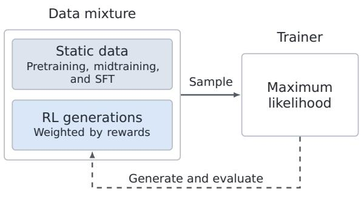

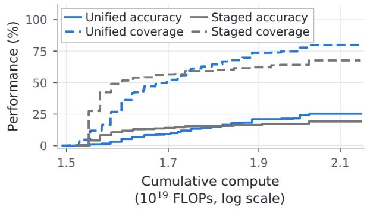  
Figure 1: Unified training framework. Left: For suitable RL objectives, static data and RL generations share a weighted likelihood loss; the updated model supplies new generations that are added to the data mixture. Right: Unified training reaches higher accuracy and coverage on a reasoning task within the same total compute budget. Each curve shows the best observed accuracy (solid) or coverage (dashed) attainable within a compute budget, across all tested unified (blue) or staged (gray) configurations. Compute includes pretraining, midtraining, and RL. Figure 5 shows the individual training trajectories.

Making this view concrete requires bringing RL under the maximum-likelihood formulation already used for pretraining, midtraining, and SFT. Building on Maximum Likelihood Reinforcement Learning (MaxRL) (Tajwar et al., 2026), we extend its likelihood interpretation to arbitrary fixed generation policies and show how the resulting targets can be combined with static data in a single likelihood objective. This provides the theoretical foundation for unified training, a framework for learning from evolving mixtures of static and generated data under a common training rule, including when generation and optimization proceed independently. We implement this formulation through a common data representation, weighted likelihood loss, and trainer for both static and generated data. Figure 1 visualizes the unified training loop and shows that unified training can improve performance over staged training within the same total compute budget. Concretely, our contributions are as follows:

• A unified formulation of foundation-model training. We establish a common maximum likelihood formulation for pretraining, midtraining, SFT, and suitable RL objectives. This provides a theoretical basis for learning from changing mixtures of static and generated data, with staged training as a special case. The formulation also extends to other RL objectives and continuous rewards (Section 3), and it supports a unified training infrastructure (Section 4).

• Empirical benefits across training settings. Through controlled and real-world experiments, we demonstrate improvements of unified training over staged training in accuracy and coverage. We also show that unified training can preserve broader capabilities (Section 5).

• Data mixing and compute allocation. We characterize how mixing proportions and schedules shape the tradeofs among accuracy, coverage, and retention, and study compute allocation across pretraining, midtraining, and RL (Section 5).

By placing data composition, timing, and compute allocation within a common framework, unified training provides a basis for developing principles that govern the full training process. We believe it has both scientific and practical value as a starting point for studying foundation-model training as a whole.

## 2 Preliminaries

We write $\pi _ { \theta } ( y \mid x )$ for the model’s distribution over completions y given a prompt x, with parameters θ.

## 2.1 Maximum Likelihood Estimation

Maximum likelihood estimation (MLE) fits the model to training examples by minimizing their negative log-likelihood. We represent each example as a prompt-completion pair $( x , y )$ , where the prompt may be empty. Let $\rho ( x )$ denote the prompt distribution and $\mu ( \boldsymbol { y } \mid \boldsymbol { x } )$ the conditional completion distribution in the training data. Their joint distribution is denoted by $\rho \circ \mu ,$ with $( \rho \circ \mu ) ( x , y ) : = \rho ( x ) \mu ( y \mid x )$ . MLE

minimizes the loss

$$
\mathcal { L } ( \theta ; \rho \circ \mu ) : = - \mathbb { E } _ { x \sim \rho } \mathbb { E } _ { y \sim \mu ( \cdot | x ) } [ \log \pi _ { \theta } ( y \mid x ) ] .
$$

Pretraining, midtraining, and SFT all use this objective with diferent training data. Pretraining and midtraining fit text from general and curated corpora, respectively, using empty prompts; SFT fits demonstrations paired with instructions. We refer to the fixed corpora and demonstrations used in these stages as static data.

For a fixed training data distribution, this loss difers from the expected forward KL divergence $\mathbb { E } _ { x \sim \rho } [ \mathrm { K L } ( \mu ( \cdot \mid x ) \parallel \pi _ { \theta } ( \cdot \mid x ) ) ]$ only by a constant independent of θ. Both objectives therefore have the same gradient:

$$
\nabla _ { \boldsymbol { \theta } } \mathcal { L } ( \boldsymbol { \theta } ; \rho \circ \boldsymbol { \mu } ) = - \mathbb { E } _ { \boldsymbol { x } \sim \rho } \mathbb { E } _ { \boldsymbol { y } \sim \boldsymbol { \mu } ( \cdot \vert \boldsymbol { x } ) } [ \nabla _ { \boldsymbol { \theta } } \log \pi _ { \boldsymbol { \theta } } ( \boldsymbol { y } \mid \boldsymbol { x } ) ] .
$$

## 2.2 Reinforcement Learning

Reinforcement learning (RL) uses reward feedback to optimize model-generated completions. Given a prompt $x \sim \rho .$ , the model samples a completion $y \sim \pi _ { \theta } ( \cdot \mid x )$ and receives a reward $r ( x , y ) \in \{ 0 , 1 \}$ . The expected-reward objective is

$$
J ( \theta ) : = \mathbb { E } _ { x \sim \rho } \mathbb { E } _ { y \sim \pi _ { \theta } ( \cdot | x ) } [ r ( x , y ) ] ,
$$

with policy gradient:

$$
\begin{array} { r } { \nabla _ { \theta } J ( \theta ) = \mathbb { E } _ { x \sim \rho } \mathbb { E } _ { y \sim \pi _ { \theta } ( \cdot \vert x ) } [ r ( x , y ) \nabla _ { \theta } \log \pi _ { \theta } ( y \mid x ) ] . } \end{array}\tag{1}
$$

REINFORCE (Williams, 1992) estimates this expectation from sampled completions. Other methods, including PPO (Schulman et al., 2017) and GRPO (Shao et al., 2024), introduce choices of advantage estimation, reward normalization, and constraints on policy updates.

## 3 A Unified Likelihood View of Foundation-Model Training

Pretraining, midtraining, and SFT already share a common maximum-likelihood training rule, difering primarily in the data on which the model is trained, and when to apply each data. At first glance, RL seems to break this pattern, as it is typically formulated as policy optimization. To unify these stages, we build on the likelihood interpretation of MaxRL (Tajwar et al., 2026) to develop a common framework for these stages that also accommodates other generation policies, RL objectives, and continuous rewards.

## 3.1 MaxRL as Likelihood Fitting

For binary rewards, let $p _ { \theta } ( x ) : = \mathbb { E } _ { y \sim \pi _ { \theta } ( \cdot | x ) } [ r ( x , y ) ]$ be the probability of success on prompt $x ,$ and let $\pi _ { \theta } ^ { + } ( y \mid x ) : = \pi _ { \theta } ( y \mid x , r = 1 )$ be the success-conditioned distribution. Tajwar et al. (2026) show that the MaxRL gradient can be written as

$$
\nabla _ { \theta } \log p _ { \theta } ( x ) = \mathbb { E } _ { y \sim \pi _ { \theta } ^ { + } ( \cdot | x ) } \left[ \nabla _ { \theta } \log \pi _ { \theta } ( y \mid x ) \right] .
$$

Thus, at iteration t, a MaxRL update can be viewed as maximum-likelihood fitting to the current policy’s success-conditioned distribution $\pi _ { \theta _ { t } } ^ { + }$ , held fixed during the update:

$$
\begin{array} { r } { \mathcal { L } ( \boldsymbol { \theta } ; \rho \circ \pi _ { \boldsymbol { \theta } _ { t } } ^ { + } ) = - \mathbb { E } _ { \boldsymbol { x } \sim \rho } \mathbb { E } _ { \boldsymbol { y } \sim \pi _ { \boldsymbol { \theta } _ { t } } ^ { + } ( \cdot \vert \boldsymbol { x } ) } \left[ \log \pi _ { \boldsymbol { \theta } } ( \boldsymbol { y } \mid \boldsymbol { x } ) \right] . } \end{array}
$$

This places RL in the same likelihood-fitting form as pretraining, midtraining, and SFT.

## 3.2 Unified Training

Pretraining, midtraining, SFT, and MaxRL can therefore all be expressed as likelihood fitting. We represent each source s at iteration t by a prompt distribution $\rho _ { s , t }$ and target distribution $\mu _ { s , t }$ , as summarized in Table 1.

Let $\lambda _ { s , t } \geq 0$ , with $\sum _ { s } \lambda _ { s , t } = 1$ , denote the mixture weight of source s at iteration t. Together, the sources define a single joint distribution over training examples,

$$
q _ { t } : = \sum _ { s } \lambda _ { s , t } ( \rho _ { s , t } \circ \mu _ { s , t } ) .
$$

Unified training applies the same likelihood loss to this mixture:

$$
\begin{array} { r } { \mathcal { L } ( \theta ; q _ { t } ) = - \mathbb { E } _ { ( x , y ) \sim q _ { t } } [ \log \pi _ { \theta } ( y \mid x ) ] . } \end{array}
$$

The source distributions and mixture weights are held fixed when diferentiating the loss. Equivalently, one can sample source s with probability $\lambda _ { s , t }$ , draw an example from that source, and apply the same likelihood loss.

Both the source distributions and their mixture weights may evolve throughout training. The learning rule itself, however, remains unchanged: what changes is the distribution of data presented to the model. Conventional staged training is the special case in which all mixture weight is placed on one source at a time; unified training additionally allows sources to overlap and their proportions to vary throughout training.

<table><tr><td>Source</td><td>Prompts  $\rho _ { s , t }$ </td><td>Target  $\mu { _ { s , t } }$ </td></tr><tr><td>Pretraining</td><td>empty</td><td> $\mu _ { \mathrm { p r e } }$ </td></tr><tr><td>Midtraining</td><td>empty</td><td>µmid</td></tr><tr><td>SFT</td><td> $\rho _ { \mathrm { { s f t } } }$ </td><td> $\mu _ { \mathrm { s f t } }$ </td></tr><tr><td>RL</td><td> $\rho _ { \mathrm { r l } }$ </td><td> $\pi _ { \theta _ { t } } ^ { + } \mathrm { o r } \ \nu ^ { + }$ </td></tr></table>

Table 1: Data sources for the shared likelihood objective. For binary rewards, $\nu ^ { + }$ is the success-conditioned distribution of the generation policy ν; $\nu = \pi _ { \theta _ { t } }$ recovers on-policy MaxRL.

The formulation above contains the core ingredients of unified training, and we turn to its implementation in the next section. Before doing so, we establish two extensions of the framework: it can incorporate generations produced by policies other than the model currently being optimized, and it can accommodate other policy-gradient objectives through diferent choices of target and efective prompt distributions.

Likelihood targets from arbitrary generators. The likelihood formulation does not require RL data to be generated by the model currently being optimized. Suppose completions are generated by a policy $\nu ,$ held fixed while constructing the training target. Under binary rewards, its successful completions define

$$
\nu ^ { + } ( \cdot \mid x ) : = \nu ( \cdot \mid x , r = 1 ) .
$$

The trainer can fit this distribution using the same maximum-likelihood loss,

$$
\begin{array} { r } { \mathcal { L } ( \theta ; \rho \circ \nu ^ { + } ) = - \mathbb { E } _ { x \sim \rho } \mathbb { E } _ { y \sim \nu ^ { + } ( \cdot | x ) } \left[ \log \pi _ { \theta } ( y \mid x ) \right] . } \end{array}
$$

When $\nu = \pi _ { \theta _ { t } }$ , this recovers the on-policy MaxRL update of Section 3.1. For a diferent generator, the trainer instead fits that generator’s success-conditioned distribution. Thus, generation and optimization can proceed independently while retaining the same likelihood training rule; the resulting update, however, is generally not the current-policy MaxRL gradient.

Other RL objectives. Under binary rewards, REINFORCE fits the same success-conditioned target $\pi _ { \theta _ { t } } ^ { + }$ as $\operatorname { M A X R L }$ , but uses the efective prompt distribution

$$
\rho _ { \mathrm { R F } } ( x ) \propto \rho ( x ) p _ { \theta _ { t } } ( x ) .
$$

This gives greater weight to prompts with higher success probability, whereas MaxRL retains $\rho .$ The framework also accommodates rewards normalized to $[ 0 , 1 ]$ , including continuous-reward REINFORCE and TailRL (Ramasubramanian et al., 2026). Table 2 summarizes the targets and efective prompt distributions for on-policy updates; Appendix F gives the derivations.
<table><tr><td>Method</td><td>Reward Target</td><td> $\mu _ { s }$ </td><td>Effective prompts  $\rho _ { s }$ </td></tr><tr><td>MAxRL</td><td>Binary</td><td> $\pi _ { \theta _ { t } } ^ { + }$ </td><td> $\rho ( x )$ </td></tr><tr><td>REINFORCE</td><td>Binary</td><td> $\pi _ { \theta _ { t } } ^ { + }$ </td><td> $\propto \rho ( x ) p _ { \theta _ { t } } ( x )$ </td></tr><tr><td>TAILRL</td><td>[0, 1]</td><td> $\int _ { 0 } ^ { \cdot } \pi _ { \theta _ { t } } ( \cdot \mid x , r > \tau ) d \tau$ </td><td>ρ(x)</td></tr><tr><td>REINFORCE</td><td>[0, 1]</td><td> $\^ { \mathrm { { v } } } \pi _ { \theta _ { t } } ( y \mid x ) r ( x , y )$   $\overline { { \mathbb { E } _ { y ^ { \prime } \sim \pi _ { \theta _ { t } } ( \cdot | x ) } [ r ( x , y ^ { \prime } ) ] } }$ </td><td> $\propto \rho ( x ) \mathbb { E } _ { y \sim \pi _ { \theta _ { t } } ( . | x ) } [ r ( x , y ) ]$ </td></tr></table>

Table 2: RL objectives within the unified likelihood framework. Diferent objectives correspond to diferent target and efective prompt distributions.

## 4 Practical Implementation

Building on the theoretical foundation in Section 3.2, which allows static data and RL generations to be combined under a common likelihood objective, we implement a unified training system with a shared data format, loss, and trainer. A generator supplies RL generations and their weights to a shared data bufer, which also holds static data. Generation and optimization run asynchronously, with periodic synchronization of the model weights (Figure 2).

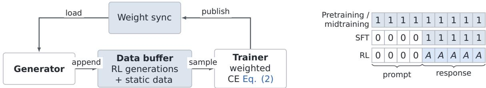  
Figure 2: Left: the training system. The generator produces RL data from a recent copy of the weights and appends it to the data bufer, which also holds static data; the trainer samples from the bufer and periodically publishes its weights, which the generator loads. Right: the data format. Each cell is a token and the number is its weight in Eq. (2); the stages difer only in the weights.

## 4.1 Unified Loss and Data Format

Each training example is a pair (z, w), where $\boldsymbol { z } = ( z _ { 1 } , \dots , z _ { L } )$ is a token sequence and $w \in \mathbb { R } _ { \geq 0 } ^ { L }$ specifies the weights on its token negative log-likelihoods. Pretraining and midtraining use unit weights on corpus tokens; SFT uses unit weights on demonstration tokens and zero weights on prompt tokens. RL uses the same prompt mask and assigns each completion a response weight A, computed from its reward and the sampled pass rate (Section 4.2). These assignments give a common data format for all sources (Figure 2, right). In practice, we use a token mean over a batch B:

$$
\hat { \mathcal { L } } ( \theta ; B ) : = - \frac { 1 } { T _ { B } } \sum _ { ( z , w ) \in B } \sum _ { \ell = 1 } ^ { L } w _ { \ell } \log \pi _ { \theta } ( z _ { \ell } \mid z _ { < \ell } ) ,\tag{2}
$$

where $T _ { B }$ counts the total number of non-prompt tokens in the batch.

## 4.2 Data Generation

The generator samples N completions $y _ { 1 } , \dots , y _ { N } \sim \pi _ { \theta _ { s } } ( \cdot \mid x )$ per prompt x, where $\pi _ { \theta _ { s } }$ is a recent copy of the model. For binary rewards, it estimates the pass rate by $\begin{array} { r } { \hat { p } : = \frac { 1 } { N } \sum _ { i } r ( x , y _ { i } ) } \end{array}$ . Each correct completion receives weight $A : = 1 / \hat { p }$ on its response tokens; incorrect completions receive zero.

This weighting is the finite-sample form of MaxRL. Averaging the weighted score function over the N samples for a prompt gives

$$
\frac { 1 } { N } \sum _ { i = 1 } ^ { N } \frac { r ( x , y _ { i } ) } { \hat { p } } \nabla _ { \theta } \log \pi _ { \theta } ( y _ { i } \mid x ) = \frac { 1 } { N \hat { p } } \sum _ { \substack { i : r ( x , y _ { i } ) = 1 } } \nabla _ { \theta } \log \pi _ { \theta } ( y _ { i } \mid x ) .
$$

This is the average score over the correct completions, with zero update when all completions are incorrect (Tajwar et al., 2026). For generation policy $\nu ,$ its expectation is $- \nabla _ { \boldsymbol { \theta } } \mathcal { L } ( \boldsymbol { \theta } ; \rho \circ \nu ^ { + } )$ from Section 3.2, with prompt x weighted by $1 - ( 1 - p _ { \nu } ( x ) ) ^ { N }$ , where $p _ { \nu } ( x )$ is the generation policy’s success probability. This weight is the probability that at least one of the N samples is correct. Finite N therefore leaves the target $\nu ^ { + }$ unchanged and only down-weights prompts that the generating policy rarely solves; at $N = 1$ the weight is $p _ { \nu } ( x )$ , recovering REINFORCE as in Section 3.2, and as $N \to \infty$ the weight tends to one.

## 4.3 Data Mixing and Asynchronous Training

The trainer implements the data mixture by sampling static data and RL generations from a shared bufer. For a target token fraction $f _ { s }$ from source $s \in S ,$ , examples are sampled at a rate proportional to $f _ { s } / T _ { s }$ , where $T _ { s }$ is the mean number of corpus or response tokens per example. The mixture can also be specified by the number of examples from each source. Appendix A.1 collects the mixing and loss-weighting conventions used in the experiments.

Generation and optimization proceed asynchronously: generators append completed batches to the bufer, while the trainer samples from it and updates the model. The trainer publishes its weights every k updates, and generators load them between batches. Appendix D.6 reports the resulting policy staleness and compares training throughput.

## 5 Experiments

The experiments aim to study the practical benefits of unified training, and its value for studying the full training process. Specifically, we examine how data composition and data schedule afect model capabilities, the use of data and compute, and continual learning:

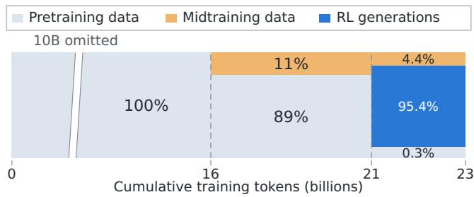  
Figure 3: Data composition throughout training. The illustrated run from Appendix C.8 mixes midtraining tokens into pretraining, then combines RL generations, midtraining data, and pretraining data. Token counts include prompts and are rounded estimates; the axis break omits 10B pretraining tokens, and thin bands are enlarged for legibility.

1. Performance and generalization. How do unified and staged training compare in task accuracy, coverage, and generalization beyond the training distribution?

2. Data mixing and reuse. How do data proportions, timing, and reuse of a fixed corpus afect performance during training and in the final model?

3. Compute allocation. How does unified training compare with staged training under compute-matched comparisons?

4. Retention. How do unified and staged training compare in preserving capabilities acquired earlier in training?

5. Continual learning. Does unified training provide a better starting point for learning new tasks when subsequent training follows the same procedure for all models?

We first compare unified and staged training across the full pipeline of pretraining, midtraining, and RL, in a controlled setting (Section 5.1). Then, with real-world heterogeneous midtraining data, we study the resulting capability tradeofs, how diferent data mixture and scheduling can change model’s performance, and their consequences for continual learning (Section 5.2). Unless otherwise specified, staged baselines use MaxRL (Tajwar et al., 2026) for RL for a cleaner comparison against unified training. We defer the study of other RL objectives as future work with a preliminary analysis in Appendix D.5.

In the following sections, we sometimes still state the results in terms of stages (pretraining, midtraining, and RL) for clarity and cleaner comparison with staged training, but the unified formulation allows these stages to overlap.

## 5.1 Full Unified Training under Controlled Reasoning Tasks

Experimental setup. We study how data composition and schedule afect the full training pipeline in a controlled setting. We train a 124M-parameter model from scratch using a fixed 20B-token pretraining corpus and a fixed 510M-token midtraining corpus across runs. Staged training uses these sources sequentially before RL; unified training mixes midtraining data into the final part of pretraining and throughout RL (Figure 3). Varying epochs over this fixed corpus allows us to study the efect of data reuse through the training process.

We use natural-language reasoning puzzles in the style of Reasoning Gym (Stojanovski et al., 2025), with verifiable answers and controllable dificulty. The midtraining corpus contains oracle-generated solutions that demonstrate the underlying reasoning operations. RL introduces new combinations of these operations, allowing us to study how midtraining supports learning beyond the demonstrated patterns. In Base, puzzle sizes remain within the range represented in midtraining. In Extended, we add larger puzzles to RL training and evaluate on held-out puzzles of these larger sizes. Extended generalization evaluates the same Extended models on puzzles larger than those encountered during either midtraining or RL.

Both approaches use MaxRL with 6000 updates for Base and 12000 for Extended, and the same number of RL generations per update. We report accuracy (pass@1) and coverage (pass@16) on held-out questions, averaging RL results over two training seeds. Compute comparisons include pretraining, midtraining, and RL. Appendix B describes the puzzle construction and provides examples; Appendix C gives the training and evaluation details.

## 5.1.1 Unified Training can Obtain Better Task Performance and Generalization

In Figure 4, we compare final accuracy across diferent data configurations for unified training. For task performance and generalization (RQ1), the best unified configurations outperform staged training in both

Midtraining tokens in pretraining 133M 267M 534M 1.07B 2.14B Staged

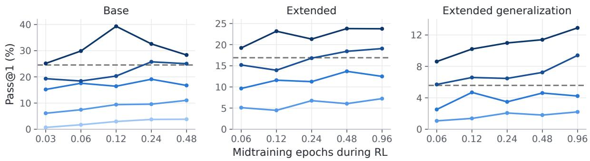  
Figure 4: Final performance and generalization. Mean pass@1 over two seeds after 6000 RL updates in Base and 12000 in Extended. Colors indicate midtraining tokens mixed during pretraining; the horizontal axis measures passes over the same fixed corpus during RL. Dashed lines show the best staged configuration on each setting’s primary test (Appendix C.6). Extended generalization evaluates the same Extended models on a larger puzzles excluded from RL training (Appendix C).

Base and Extended. This advantage also holds on Extended generalization, which tests generalization by evaluating the models on larger puzzles that are unseen in both midtraining and RL. Unified training therefore can improve both performance on the RL tasks and generalization beyond the training distribution.

For data mixing and reuse (RQ2), unified training benefits from mixing more midtraining tokens during pretraining, as indicated by the fact that higher intensity curves achieve better performance in Figure 4. The benefit of mixing midtraining data during RL is similar, but less consistent: with the largest pretraining-midtraining mixture (2.14B), the best Base accuracy is achieved at an intermediate RL mixture, whereas in Extended and Extended generalization, the performance overall improves with more midtraining data mixed during RL. This difers from staged training, where extending midtraining beyond the best-performing budget reduces final task accuracy (Appendix C.6).

This suggests that unified training can make better data reuse (as the two best-performing configurations perform 2 and 4 epochs of training over the midtraining corpus during pretraining), while staged training is more sensitive to the amount of midtraining data used.

## 5.1.2 Unified Training can be Compute-optimal in More Settings

The previous comparison fixes the number of RL updates within each setting and compares final performance, but diferent data mixtures require diferent amounts of compute. In Figure 5, we therefore compare the accuracy and coverage attainable within the same total training budget (RQ3). Each curve follows one configuration through RL, with the horizontal axis including all compute spent on pretraining, midtraining, and RL. Colored curves show unified training, while gray curves show staged training. The black curve connects the best observed checkpoints within each compute budget, allowing both the training configuration and the duration of RL to vary; its colored or gray markers indicate whether the unified or staged approach achieves that performance.

Staged training is compute-optimal in terms of accuracy at intermediate compute budget, whereas unified training achieves higher accuracy at larger budgets and the smallest budget in both Base and Extended. Staged training is more compute-optimal in terms of coverage, and the benefit is even more prominent when testing generalization, where unified training achieves the best accuracy and coverage for almost all compute budgets. Appendix C.7 shows the same comparison after subtracting the shared pretraining cost, making the compute allocated to midtraining and RL more visible. Thus, unified training can be more compute-optimal in terms of accuracy, coverage and generalization, where it achieves better performance under a larger compute budget, especially under the most important setting with more compute.

## 5.1.3 Unified Training can Retain General Capabilities Better

We next ask whether learning from the midtraining reasoning corpus preserves the general capabilities acquired from pretraining data (RQ4). In Figure 6, we compare the unified and staged initializations before RL using held-out pretraining loss and mean performance on five general benchmarks. For this comparison, we select the staged training configuration with the best retention among all six tested variants: it has both the lowest held-out loss and the highest mean benchmark score among all the staged training configurations.

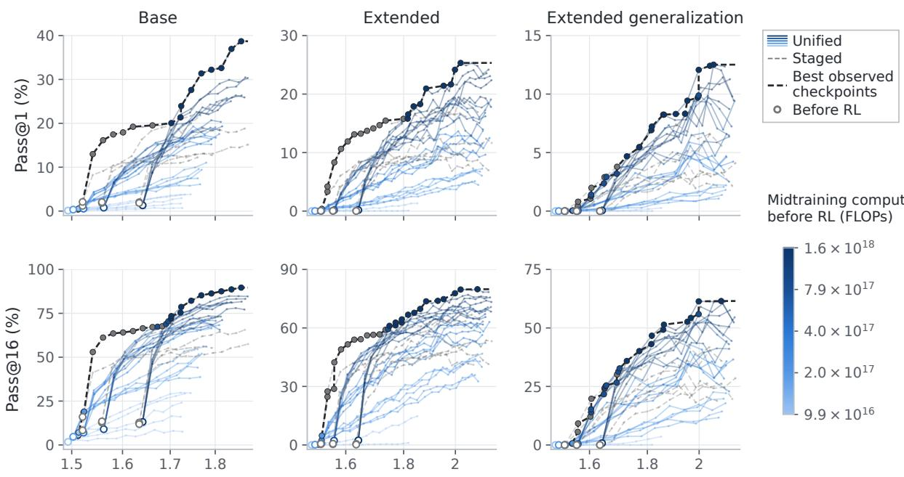  
Cumulative compute $( 1 0 ^ { 1 9 }$ FLOPs, log scale)  
Figure 5: Accuracy and coverage across training compute budgets. The top and bottom rows show pass@1 and pass@16 against cumulative compute, including pretraining, midtraining, and RL. Colored curves show unified configurations: darker colors indicate more midtraining compute before RL, while curves of the same color vary the midtraining mixture during RL. Gray dashed curves show all six staged configurations, spanning three midtraining budgets and two learning rates (Appendix C.6). Open circles mark the pre-RL evaluations in Appendix C.5. The black curve connects the best observed checkpoints for each metric, with colored or gray markers identifying unified or staged training. RL points average performance and estimated compute over two seeds. Each column ends at the largest final compute budget among its staged runs. Extended generalization evaluates the same Extended models on 12-person puzzles. Appendix A.2 gives the compute estimates.

Across all five unified mixtures between pretraining and midtraining, unified training maintains similar retention as the pretrain-only model, even as the amount of midtraining data increases. On the other hand, the best staged configuration has substantially higher held-out loss and lower mean benchmark performance. Also note that the staged configuration with the best final RL accuracy performs even worse on both retention measures (Appendix C.10). These results suggest that mixing midtraining data during pretraining can substantially reduce forgetting while the model learns reasoning skills.

## 5.1.4 Additional Analyses

Reasoning capability before RL. To understand how the final performance develops across training, we evaluate the models before RL (Appendix C.5). Both approaches perform better on the reasoning patterns demonstrated in midtraining than on new combinations of those patterns, and generalization to larger puzzles remains limited. The staged reference also has higher Base accuracy before RL than any unified initialization, yet the best unified models outperform it after RL. These results highlight the importance of evaluating midtraining by how it supports subsequent learning, beyond its immediate efect on accuracy.

Combining midtraining and RL losses. We examine whether the way the two data sources are combined afects learning from the same data mixture (Appendix C.9). Holding the initialization and example counts fixed, we compare unified training with separately normalized midtraining and RL losses combined using a fixed coeficient. Unified training achieves the highest observed final accuracy and coverage in Base and Extended generalization, while the separately normalized alternative often performs

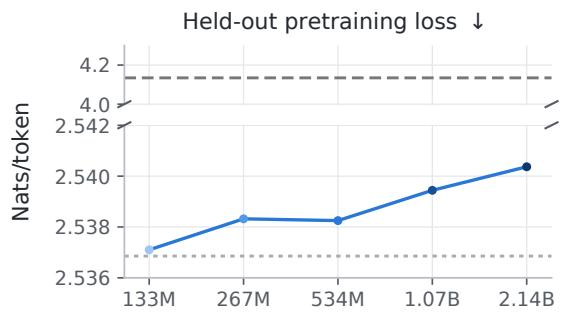

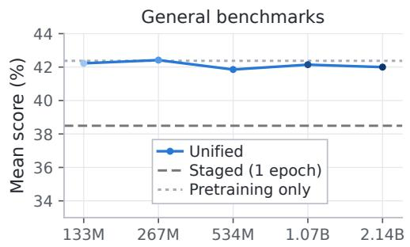  
Midtraining tokens during pretraining

Figure 6: Pretraining retention before RL. Unified initializations vary the amount of midtraining data mixed during pretraining. Horizontal references show pretraining alone and staged midtraining with one epoch at a peak learning rate of $5 \times 1 0 ^ { - 5 }$ , selected for the best retention on both measures. Loss is measured on held-out pretraining data; mean score averages five general benchmarks. The loss axis is broken, with the lower interval expanded for readability. Appendix C.10 reports individual benchmarks and all staged configurations.

better in Extended. However, the best coeficient varies across configurations, which suggests that it requires more tuning than the unified loss. The shared loss therefore provides a competitive way to combine the sources, with their relative contributions following the token mixture.

Retaining pretraining data during RL. We also examine whether adding pretraining data during RL preserves general capabilities while supporting further reasoning improvements (Appendix C.8). In the evaluated configurations, adding pretraining text lowers held-out pretraining loss, while reasoning accuracy and coverage decline in most comparisons, including on Extended generalization. General benchmark performance improves in most configurations, although the gains are small.

## 5.2 Unified Training with Real-world Midtraining Data

The controlled setting uses midtraining data that is task-specific and RL tasks whose dificulties can be precisely controlled. To obtain a better understanding for real-world training, we now use a heterogeneous midtraining corpus to examine how unified training during mathematical RL afects task performance, broader capabilities, and continual learning. We use a 0.76B-parameter model that we train from scratch through pretraining and midtraining. Unified training starts from this base model, trains on Math12K, and mixes data from a 240M-token corpus with the same composition as the midtraining corpus, including web text, mathematics, code, and reasoning traces. Staged training uses the additional corpus for midtraining before RL. Appendix D.1 gives the setup. We report Math as the average of MATH-500 (Hendrycks et al., 2021b; Lightman et al., 2024) and GSM8K (Cobbe et al., 2021), and Coding as the average of HumanEval+ and MBPP+ (Chen et al., 2021; Austin et al., 2021; Liu et al., 2023), with equal benchmark weights.

## 5.2.1 Data Mixtures Tradeof Accuracy, Coverage, and Retention

We first ask how increasing the midtraining data proportion afects the balance between mathematical learning and retention (RQ1, RQ2, and RQ4). In Figure 7, we vary the constant midtraining proportion from 0 to 5% and evaluate both mathematical performance and capabilities beyond the RL task. The 0% ablation uses the same asynchronous trainer as the other unified runs, allowing us to assess the efect of adding midtraining data with the implementation and infrastructure held fixed.

Math accuracy remains similar across proportions, with very small degradation with increasing proportions of midtraining data, and the largest proportions achieve the highest coverage. The retention benefit is clearer: all nonzero mixtures reduce held-out midtraining loss below the base-model value, with larger proportions yielding lower loss, while staged training increases it; SciQ (Welbl et al., 2017) accuracy also generally improves with mixing. We also observe lower Coding accuracy with more midtraining data, despite higher Coding coverage than both the base model and staged training. Thus, unified training from heterogeneous midtraining data improves retention, but its efects on task performance usually trades of accuracy and coverage. Appendix D.2 reports the full benchmark results.

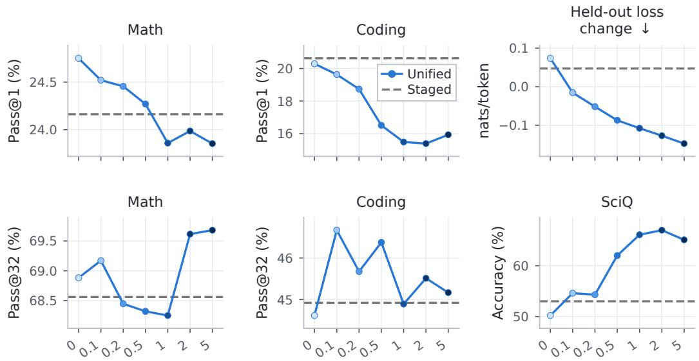  
Midtraining data (%)  
Figure 7: Efect of the midtraining data proportion. Final results after 12000 updates. Fractions are token proportions estimated before training. Loss changes are relative to the base model. Appendix D.1 gives the training and evaluation details.

## 5.2.2 Data Mixing Schedules

The preceding comparison varies how much midtraining data is used, but keeps its proportion constant throughout RL. We next ask whether changing when this data is used can reduce the coding accuracy cost while preserving the retention benefits (RQ2 and RQ4). In Figure 8, we compare constant mixing, linear decay, linear growth, and decay to zero halfway through training, all with an average configured midtraining proportion of 0.5% (Appendix A.1).

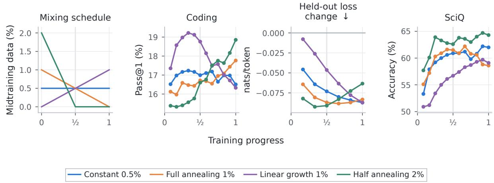  
Figure 8: Efect of the data mixing schedule. Four schedules with an average configured midtraining proportion of 0.5%. Full and half annealing reach zero at the end and midpoint, respectively; linear growth starts at zero. Training details are given in Appendix D.3.

When mixing ends halfway through training, Coding accuracy improves and SciQ gains persist, while held-out corpus loss rises. Compared with constant mixing, this schedule achieves higher final Coding and SciQ accuracy but retains less of the reduction in corpus loss. Math accuracy and coverage remain similar across the four schedules (Appendix D.3). Thus, the preferred schedule depends on how performance across tasks is balanced; we leave a detailed analysis of these interactions to future work.

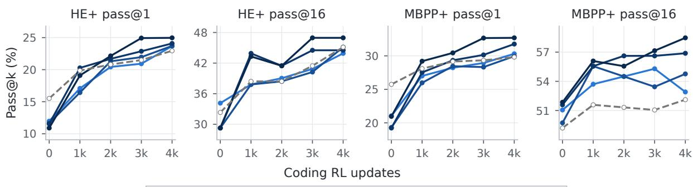

## 5.2.3 Unified Training can Enable Better Continual Learning

We next ask whether unified training improves subsequent learning (RQ5). Figure 9 compares the staged mathematical model with unified models trained at constant 0.5, 1, 2, and 5% mixing, all using the same coding RL without midtraining data (Appendix D.7).

Unified 0.5% Unified 1% Unified 2% Unified 5% Staged

Figure 9: Coding RL after mathematical training. Curve labels identify the preceding mathematical training, with percentages denoting constant midtraining proportions. All models then use the same coding RL configuration without midtraining data. We report pass@1 and pass@16 on HumanEval+ (HE+) and MBPP+ over 4000 coding RL updates. Appendix D.7 gives the setup and additional evaluations of mathematics and general knowledge.

Despite lower initial coding accuracy, all unified models achieve higher final accuracy on both benchmarks and higher MBPP+ coverage than staged training. The 5% model performs best on all four metrics, while HumanEval+ coverage at smaller mixtures is similar to or below staged training. These results support unified training as a better starting point for continual learning, with the strongest benefits at the largest midtraining proportion tested.

The finding is further verified in a continual learning setting in a general reasoning domain with WebInstruct (Ma et al., 2026) (Appendix D.8).

## 5.2.4 Additional Analyses

MaxRL versus REINFORCE. Our formulation accommodates both MaxRL and REINFORCE (Section 3.2), allowing us to examine how the RL objective afects learning from the same data mixture. At constant 2% mixing, REINFORCE achieves higher Math accuracy, while MaxRL achieves higher Math coverage. REINFORCE also yields lower held-out loss and higher SciQ and ARC-Challenge (Clark et al., 2018) accuracy. The coverage and retention diferences persist across the additional proportions and schedules in Appendix D.5. Thus, the RL objective afects the balance between mathematical coverage and retention even when the data mixture is fixed.

Comparison with KL regularization. We ask whether regularizing toward the base model can reproduce the benefits of mixing midtraining data (Appendix E). Increasing the KL penalty reduces the deterioration in held-out loss, but the strongest penalty also substantially reduces Math accuracy and coverage. In this setting, none of the tested penalties reproduces the combination of mathematical performance, lower corpus loss, and higher SciQ and MMLU accuracy achieved by unified training.

Midtraining data composition. To understand whether changing the midtraining corpus can reduce the coding accuracy cost of mixing, we remove or replace its designated code sources (Appendix D.4). Removing these sources improves Coding accuracy under constant mixing but has little efect under annealing. Replacing them with verified coding examples improves coverage under annealing without improving accuracy. Changing the corpus can therefore reduce the coding accuracy cost, but its efect depends on the mixing schedule.

## 6 Related Work

## 6.1 Foundation-Model Training

Large-scale maximum likelihood pretraining established the basis for broadly capable language mod els (Brown et al., 2020; Zhang et al., 2022; Chowdhery et al., 2023; BigScience Workshop, 2024). Subsequent systems combine this foundation with supervised learning, preference optimization, and RL through increasingly elaborate training pipelines (OpenAI et al., 2023; Touvron et al., 2023; Grattafiori et al., 2024; DeepSeek-AI et al., 2025; Guo et al., 2025). Open research eforts have made training data, recipes, and intermediate models more accessible, supporting closer examination of data curation, mixture schedules, and post-training procedures (Groeneveld et al., 2024; allal et al., 2025; Lambert et al., 2025; Olmo et al., 2026). Our work studies the organization of this training process through a common formulation and implementation for static and generated data, allowing their composition and timing to vary without requiring a separate training algorithm for each stage.

## 6.2 Understanding Foundation-Model Training

Empirical scaling studies characterize how performance varies with model size, data, and compute (Hestness et al., 2017; Rosenfeld et al., 2020; Kaplan et al., 2020; Hofmann et al., 2022). Subsequent work examines the value of repeated data when fresh data are limited (Muennighof et al., 2023) and the scaling of RL posttraining, where initialization, model size, and optimization choices afect learning eficiency (Nimmaturi et al., 2026; Khatri et al., 2026; Tan et al., 2026).

Understanding the full training process also requires examining how earlier training shapes subsequent learning. Studies of transfer scaling and domain adaptation characterize how downstream performance depends on preceding training data (Gururangan et al., 2020; Hernandez et al., 2021; Isik et al., 2025), while recent reasoning studies examine how pretraining and midtraining afect subsequent RL and capability retention (Zhang et al., 2026a; Runwal et al., 2026; Shen et al., 2026). Complementary work optimizes data mixtures and studies the timing of domain exposure and the benefits of later replay (Xie et al., 2023; Ye et al., 2025; Liu et al., 2026; Baek et al., 2026; Kotha and Liang, 2026). Our work complements these empirical accounts with a common likelihood formulation that accommodates both static and RL-generated data, enabling the composition, timing, and reuse of these sources to be studied across the training process.

## 6.3 Hybrid Ofline and Online Reinforcement Learning

Combining demonstrations or other prior experience with online interaction has long been used to improve exploration and sample eficiency in RL (Ross and Bagnell, 2012; Hester et al., 2018; Nair et al., 2018; Rajeswaran et al., 2018). This principle underlies a substantial literature on ofline-to-online and hybrid RL, including practical algorithms for incorporating prior data into online learning (Nair et al., 2021; Lee et al., 2022) and theoretical analyses of when access to both sources improves learning eficiency (Xie et al., 2021; Song et al., 2023; Wagenmaker and Pacchiano, 2023; Zhou et al., 2024; Song et al., 2024).

Language-model post-training likewise combines static corpora or demonstrations with online RL. InstructGPT adds a pretraining likelihood term to the PPO objective to reduce regressions on public benchmarks (Ouyang et al., 2022), and recent work provides growing evidence that combining demonstrations with RL can improve learning and preserve capabilities (Yan et al., 2025; Liu et al., 2025; Fu et al., 2026b; Zhang et al., 2026b). These methods typically add a separately weighted supervised term to the RL loss, with a coeficient that is tuned or scheduled (Ouyang et al., 2022; Zhang et al., 2026b), or adapt the RL objective to of-policy data (Yan et al., 2025). In unified training, both sources share one likelihood objective, and their relative weight is set by the data mixture; Appendix C.9 compares this with a separately weighted supervised loss. Our work further studies the joint use of these sources across the full foundation-model training process, focusing on how their composition, timing, and reuse afect learning across pretraining, midtraining, and RL.

## 6.4 Connections between Reinforcement Learning and Supervised Learning

Connections between RL, supervised learning, and probabilistic inference have long motivated methods based on expectation-maximization, weighted regression, and constrained policy fitting (Dayan and Hinton, 1997; Peters and Schaal, 2007; Peters et al., 2010; Abdolmaleki et al., 2018; Levine, 2018; Peng et al., 2019). Reward-guided self-training methods such as STaR, ReST-EM, and RAFT iteratively train models by maximum likelihood on selected generated responses (Zelikman et al., 2022; Gulcehre et al., 2023; Singh et al., 2024; Dong et al., 2023). Related work also develops unified analyses of language-model post-training (Lv et al., 2026). Our formulation builds directly on the likelihood objectives of MaxRL and TailRL (Tajwar et al., 2026; Ramasubramanian et al., 2026). We use this connection to place static data and suitable RL targets within a common likelihood formulation, justifying mixtures of their training distributions and supporting a shared data format, loss, and trainer.

## 6.5 Asynchronous Reinforcement Learning

Our practical implementation is related to asynchronous RL, which separates acting from learning to make use of parallel hardware (Mnih et al., 2016). Distributed actor-learner systems build on this separation by passing experience from many actors to a central learner through a replay bufer or a trajectory queue (Horgan et al., 2018; Espeholt et al., 2018, 2019). RL systems for language models follow the same design, running generation and training on separate resources connected by a bufer or a stream (Zhu et al., 2025; Zhong et al., 2025). These systems difer mainly in how they limit policy lag: AReaL and StaleFlow bound the number of policy versions between generation and training (Fu et al., 2026a; Li et al., 2026), whereas PipelineRL updates the generator weights during generation (Piché et al., 2025).

## 7 Discussion

This work presents a common mathematical formulation and training infrastructure for foundation models, bringing static data and suitable RL updates together through maximum likelihood learning. The resulting flexibility allows data sources to overlap and their proportions to change throughout training. Our experiments demonstrate practical benefits from these choices and show that the value of a data source depends on both when it is introduced and how it interacts with subsequent learning.

A central open question is how to select these mixtures systematically. Our experiments reveal tradeofs among accuracy, coverage, and retention, but do not identify a universally preferred mixture or schedule. The compute study likewise characterizes the evaluated configurations without establishing scaling laws with predictive power. Extending these analyses across model sizes and data budgets could support more predictive choices about when to reuse static data, generate new responses, and change their relative contributions. In addition, our current results are not established with in depth study on how optimization should change with diferent data schedule and mixture design (Wen et al., 2026), and we leave this as an important direction for future work.

The scope of the experiments also remains small-scale. Most runs optimize a single RL task at a time, whereas joint training across tasks may require accounting for competing learning dynamics and unequal rates of progress. Furthermore, our work does not fully eliminate the notion of stages as downstream adaptation of a foundation model to a new task will inevitably require a separate training stage. Our continual learning results provide initial evidence that the preceding training process can improve this adaptation; studying longer task sequences would clarify how that advantage interacts with retention. Together, these questions motivate studying data allocation throughout training as a coupled learning problem.

## Acknowledgments

This work was supported by an award from the ASCR Leadership Computing Challenge (ALCC) under project ERCAP0034861. This research also used resources of the Oak Ridge Leadership Computing Facility (OLCF) and Argonne Leadership Computing Facility (ALCF) which are a DOE Ofice of Science User Facility. The authors also acknowledge the use of the DeltaAI advanced computing and data resource (Bode et al., 2025), which is supported by the National Science Foundation (award OAC 2320345) and the State of Illinois. DeltaAI is a joint efort of the University of Illinois Urbana-Champaign and its National Center for Supercomputing Applications. Its computing resources were used as part of ACCESS-approved compute grants (Boerner et al., 2023). The authors thank the CMU FLAME center and the CMU Babel Compute Cluster for compute support for this project. YS and AS acknowledge and thank the support of NSF AI Institute for Societal Decision Making AI-SDM grant IIS2229881. FT gratefully acknowledges the support of Qualcomm Innovation Fellowship North America 2026 and Bosch Research and Technology Center. DA is supported by the National Science Foundation under Grants CCF-2106778. DK is supported by ONR award (N00014-24-1-2089). AZ acknowledges support from Impossible, Jane Street and Amazon AGI.

## References

Abbas Abdolmaleki, Jost Tobias Springenberg, Yuval Tassa, Remi Munos, Nicolas Heess, and Martin Riedmiller. Maximum a posteriori policy optimisation. In International Conference on Learning Representations, 2018. URL https://openreview.net/forum?id=S1ANxQW0b.

Wasi Uddin Ahmad, Aleksander Ficek, Mehrzad Samadi, Jocelyn Huang, Vahid Noroozi, Somshubra Majumdar, and Boris Ginsburg. OpenCodeInstruct: A large-scale instruction tuning dataset for code LLMs. arXiv preprint arXiv:2504.04030, 2025. URL https://arxiv.org/abs/2504.04030.

Loubna Ben allal, Anton Lozhkov, Elie Bakouch, Gabriel Martin Blazquez, Guilherme Penedo, Lewis Tunstall, Andrés Marafioti, Agustín Piqueres Lajarín, Hynek Kydlíček, Vaibhav Srivastav, Joshua Lochner, Caleb Fahlgren, Xuan Son NGUYEN, Ben Burtenshaw, Clémentine Fourrier, Haojun Zhao, Hugo Larcher, Mathieu Morlon, Cyril Zakka, Colin Rafel, Leandro Von Werra, and Thomas Wolf. SmolLM2: When smol goes big — data-centric training of a fully open small language model. In Second Conference on Language Modeling, 2025. URL https://openreview.net/forum?id=3JiCl2A14H.

Jacob Austin, Augustus Odena, Maxwell Nye, Maarten Bosma, Henryk Michalewski, David Dohan, Ellen Jiang, Carrie Cai, Michael Terry, Quoc Le, and Charles Sutton. Program synthesis with large language models. arXiv preprint arXiv:2108.07732, 2021. URL https://arxiv.org/abs/2108.07732.

Christina Baek, Ricardo Pio Monti, David Schwab, Amro Abbas, Rishabh Adiga, Cody Blakeney, Maximilian Böther, Paul Burstein, Aldo Gael Carranza, Alvin Deng, et al. The finetuner’s fallacy: When to pretrain with your finetuning data. In Conference on Language Modeling (COLM), 2026.

BigScience Workshop. BLOOM: A 176b-parameter open-access multilingual language model. Journal of Machine Learning Research, 25(422):1–74, 2024. URL http://jmlr.org/papers/v25/23-0581.html.

Brett Bode, Gregory Bauer, Laura Herriott, Volodymyr Kindratenko, and William Gropp. Deltaai: A national resource for ai/ml research. In Practice and Experience in Advanced Research Computing 2025: The Power of Collaboration, PEARC ’25, New York, NY, USA, 2025. Association for Computing Machinery. ISBN 9798400713989. doi: 10.1145/3708035.3736062. URL https://doi.org/10.1145/ 3708035.3736062.

Timothy J. Boerner, Stephen Deems, Thomas R. Furlani, Shelley L. Knuth, and John Towns. Access: Advancing innovation: Nsf’s advanced cyberinfrastructure coordination ecosystem: Services & support. In Practice and Experience in Advanced Research Computing 2023: Computing for the Common Good, PEARC ’23, page 173–176, New York, NY, USA, 2023. Association for Computing Machinery. ISBN 9781450399852. doi: 10.1145/3569951.3597559. URL https://doi.org/10.1145/3569951.3597559.

Tom Brown, Benjamin Mann, Nick Ryder, Melanie Subbiah, Jared D Kaplan, Prafulla Dhariwal, Arvind Neelakantan, Pranav Shyam, Girish Sastry, Amanda Askell, et al. Language models are few-shot learners. In Advances in Neural Information Processing Systems, volume 33, pages 1877–1901. Curran Associates, Inc., 2020. URL https://proceedings.neurips.cc/paper\_files/paper/2020/file/ 1457c0d6bfcb4967418bfb8ac142f64a-Paper.pdf.

Mark Chen, Jerry Tworek, Heewoo Jun, Qiming Yuan, Henrique Ponde de Oliveira Pinto, Jared Kaplan, Harri Edwards, Yuri Burda, Nicholas Joseph, Greg Brockman, Alex Ray, Raul Puri, Gretchen Krueger, Michael Petrov, Heidy Khlaaf, Girish Sastry, Pamela Mishkin, Brooke Chan, Scott Gray, Nick Ryder, Mikhail Pavlov, Alethea Power, Lukasz Kaiser, Mohammad Bavarian, Clemens Winter, Philippe Tillet, Felipe Petroski Such, Dave Cummings, Matthias Plappert, Fotios Chantzis, Elizabeth Barnes, Ariel Herbert-Voss, William Hebgen Guss, Alex Nichol, Alex Paino, Nikolas Tezak, Jie Tang, Igor Babuschkin, Suchir Balaji, Shantanu Jain, William Saunders, Christopher Hesse, Andrew N. Carr, Jan Leike, Josh Achiam, Vedant Misra, Evan Morikawa, Alec Radford, Matthew Knight, Miles Brundage, Mira Murati, Katie Mayer, Peter Welinder, Bob McGrew, Dario Amodei, Sam McCandlish, Ilya Sutskever, and Wojciech Zaremba. Evaluating large language models trained on code. 2021. URL https://arxiv.org/abs/2107.03374.

Aakanksha Chowdhery, Sharan Narang, Jacob Devlin, Maarten Bosma, Gaurav Mishra, Adam Roberts, Paul Barham, Hyung Won Chung, Charles Sutton, Sebastian Gehrmann, et al. PaLM: Scaling language modeling with pathways. Journal of Machine Learning Research, 24(240):1–113, 2023. URL http://jmlr.org/papers/v24/22-1144.html.

Peter Clark, Isaac Cowhey, Oren Etzioni, Tushar Khot, Ashish Sabharwal, Carissa Schoenick, and Oyvind Tafjord. Think you have solved question answering? try ARC, the AI2 reasoning challenge. arXiv preprint arXiv:1803.05457, 2018. URL https://arxiv.org/abs/1803.05457.

Karl Cobbe, Vineet Kosaraju, Mohammad Bavarian, Mark Chen, Heewoo Jun, Lukasz Kaiser, Matthias Plappert, Jerry Tworek, Jacob Hilton, Reiichiro Nakano, Christopher Hesse, and John Schulman. Training verifiers to solve math word problems. 2021. URL https://arxiv.org/abs/2110.14168.

Peter Dayan and Geofrey E. Hinton. Using expectation-maximization for reinforcement learning. Neural Computation, 9(2):271–278, February 1997. ISSN 1530-888X. doi: 10.1162/neco.1997.9.2.271. URL http://dx.doi.org/10.1162/neco.1997.9.2.271.

DeepSeek-AI, Aixin Liu, Bei Feng, Bing Xue, Bingxuan Wang, Bochao Wu, Chengda Lu, Chenggang Zhao, Chengqi Deng, Chenyu Zhang, Chong Ruan, Damai Dai, Daya Guo, Dejian Yang, Deli Chen, Dongjie Ji, Erhang Li, Fangyun Lin, Fucong Dai, Fuli Luo, Guangbo Hao, Guanting Chen, Guowei Li, H. Zhang, Han Bao, Hanwei Xu, Haocheng Wang, Haowei Zhang, Honghui Ding, Huajian Xin, Huazuo Gao, Hui Li, Hui Qu, J. L. Cai, Jian Liang, Jianzhong Guo, Jiaqi Ni, Jiashi Li, Jiawei Wang, Jin Chen, Jingchang Chen, Jingyang Yuan, Junjie Qiu, Junlong Li, Junxiao Song, Kai Dong, Kai Hu, Kaige Gao, Kang Guan, Kexin Huang, Kuai Yu, Lean Wang, Lecong Zhang, Lei Xu, Leyi Xia, Liang Zhao, Litong Wang, Liyue Zhang, Meng Li, Miaojun Wang, Mingchuan Zhang, Minghua Zhang, Minghui Tang, Mingming Li, Ning Tian, Panpan Huang, Peiyi Wang, Peng Zhang, Qiancheng Wang, Qihao Zhu, Qinyu Chen, Qiushi Du, R. J. Chen, R. L. Jin, Ruiqi Ge, Ruisong Zhang, Ruizhe Pan, Runji Wang, Runxin Xu, Ruoyu Zhang, Ruyi Chen, S. S. Li, Shanghao Lu, Shangyan Zhou, Shanhuang Chen, Shaoqing Wu, Shengfeng Ye, Shengfeng Ye, Shirong Ma, Shiyu Wang, Shuang Zhou, Shuiping Yu, Shunfeng Zhou, Shuting Pan, T. Wang, Tao Yun, Tian Pei, Tianyu Sun, W. L. Xiao, Wangding Zeng, Wanjia Zhao, Wei An, Wen Liu, Wenfeng Liang, Wenjun Gao, Wenqin Yu, Wentao Zhang, X. Q. Li, Xiangyue Jin, Xianzu Wang, Xiao Bi, Xiaodong Liu, Xiaohan Wang, Xiaojin Shen, Xiaokang Chen, Xiaokang Zhang, Xiaosha Chen, Xiaotao Nie, Xiaowen Sun, Xiaoxiang Wang, Xin Cheng, Xin Liu, Xin Xie, Xingchao Liu, Xingkai Yu, Xinnan Song, Xinxia Shan, Xinyi Zhou, Xinyu Yang, Xinyuan Li, Xuecheng Su, Xuheng Lin, Y. K. Li, Y. Q. Wang, Y. X. Wei, Y. X. Zhu, Yang Zhang, Yanhong Xu, Yanhong Xu, Yanping Huang, Yao Li, Yao Zhao, Yaofeng Sun, Yaohui Li, Yaohui Wang, Yi Yu, Yi Zheng, Yichao Zhang, Yifan Shi, Yiliang Xiong, Ying He, Ying Tang, Yishi Piao, Yisong Wang, Yixuan Tan, Yiyang Ma, Yiyuan Liu, Yongqiang Guo, Yu Wu, Yuan Ou, Yuchen Zhu, Yuduan Wang, Yue Gong, Yuheng Zou, Yujia He, Yukun Zha, Yunfan Xiong, Yunxian Ma, Yuting Yan, Yuxiang Luo, Yuxiang You, Yuxuan Liu, Yuyang Zhou, Z. F. Wu, Z. Z. Ren, Zehui Ren, Zhangli Sha, Zhe Fu, Zhean Xu, Zhen Huang, Zhen Zhang, Zhenda Xie, Zhengyan Zhang, Zhewen Hao, Zhibin Gou, Zhicheng Ma, Zhigang Yan, Zhihong Shao, Zhipeng Xu, Zhiyu Wu, Zhongyu Zhang, Zhuoshu Li, Zihui Gu, Zijia Zhu, Zijun Liu, Zilin Li, Ziwei Xie, Ziyang Song, Ziyi Gao, and Zizheng Pan. Deepseek-v3 technical report, 2025. URL https://arxiv.org/abs/2412.19437.

Shizhe Diao, Yu Yang, Yonggan Fu, Xin Dong, Dan Su, Markus Kliegl, Zijia Chen, Peter Belcak, Yoshi Suhara, Hongxu Yin, et al. Nemotron-climb: Clustering-based iterative data mixture bootstrapping for language model pre-training. Advances in Neural Information Processing Systems, 38, 2026.

Hanze Dong, Wei Xiong, Deepanshu Goyal, Yihan Zhang, Winnie Chow, Rui Pan, Shizhe Diao, Jipeng Zhang, KaShun SHUM, and Tong Zhang. RAFT: Reward ranked finetuning for generative foundation model alignment. Transactions on Machine Learning Research, 2023. ISSN 2835-8856. URL https: //openreview.net/forum?id=m7p5O7zblY.

Lasse Espeholt, Hubert Soyer, Remi Munos, Karen Simonyan, Volodymir Mnih, Tom Ward, Yotam Doron, Vlad Firoiu, Tim Harley, Iain Dunning, Shane Legg, and Koray Kavukcuoglu. Impala: Scalable distributed deep-rl with importance weighted actor-learner architectures, 2018. URL https://arxiv. org/abs/1802.01561.

Lasse Espeholt, Raphaël Marinier, Piotr Stanczyk, Ke Wang, and Marcin Michalski. Seed rl: Scalable and eficient deep-rl with accelerated central inference. arXiv preprint arXiv:1910.06591, 2019.

Wei Fu, Jiaxuan Gao, Xujie Shen, Chen Zhu, Zhiyu Mei, Chuyi He, Shusheng Xu, Guo Wei, Jun Mei, Jiashu Wang, Tongkai Yang, Binhang Yuan, and Yi Wu. Areal: A large-scale asynchronous reinforcement learning system for language reasoning, 2026a. URL https://arxiv.org/abs/2505.24298.

Yuqian Fu, Tinghong Chen, Jiajun Chai, Xihuai Wang, Songjun Tu, Guojun Yin, Wei Lin, Qichao Zhang, Yuanheng Zhu, and Dongbin Zhao. Srft: A single-stage method with supervised and reinforcement fine-tuning for reasoning. In International Conference on Learning Representations, volume 2026, pages 102430–102459, 2026b.

Aaron Grattafiori, Abhimanyu Dubey, Abhinav Jauhri, Abhinav Pandey, Abhishek Kadian, Ahmad Al-Dahle, Aiesha Letman, Akhil Mathur, Alan Schelten, Alex Vaughan, et al. The Llama 3 herd of models, 2024. URL https://arxiv.org/abs/2407.21783.

Dirk Groeneveld, Iz Beltagy, Evan Walsh, Akshita Bhagia, Rodney Kinney, Oyvind Tafjord, Ananya Jha, Hamish Ivison, Ian Magnusson, Yizhong Wang, et al. OLMo: Accelerating the science of language models. In Proceedings of the 62nd Annual Meeting of the Association for Computational Linguistics (Volume 1: Long Papers), pages 15789–15809, Bangkok, Thailand, August 2024. Association for Computational Linguistics. doi: 10.18653/v1/2024.acl-long.841. URL https://aclanthology.org/2024.acl-long. 841/.

Caglar Gulcehre, Tom Le Paine, Srivatsan Srinivasan, Ksenia Konyushkova, Lotte Weerts, Abhishek Sharma, Aditya Siddhant, Alex Ahern, Miaosen Wang, Chenjie Gu, Wolfgang Macherey, Arnaud Doucet, Orhan Firat, and Nando de Freitas. Reinforced self-training (rest) for language modeling, 2023. URL https://arxiv.org/abs/2308.08998.

Daya Guo, Dejian Yang, Haowei Zhang, Junxiao Song, Peiyi Wang, Qihao Zhu, Runxin Xu, Ruoyu Zhang, Shirong Ma, Xiao Bi, et al. Deepseek-r1 incentivizes reasoning in llms through reinforcement learning. Nature, 645(8081):633–638, 2025.

Suchin Gururangan, Ana Marasović, Swabha Swayamdipta, Kyle Lo, Iz Beltagy, Doug Downey, and Noah A. Smith. Don’t stop pretraining: Adapt language models to domains and tasks. In Proceedings of the 58th Annual Meeting of the Association for Computational Linguistics, pages 8342–8360, Online, July 2020. Association for Computational Linguistics. doi: 10.18653/v1/2020.acl-main.740. URL https://aclanthology.org/2020.acl-main.740/.

Dan Hendrycks, Collin Burns, Steven Basart, Andy Zou, Mantas Mazeika, Dawn Song, and Jacob Steinhardt. Measuring massive multitask language understanding. In International Conference on Learning Representations, 2021a. URL https://openreview.net/forum?id=d7KBjmI3GmQ.

Dan Hendrycks, Collin Burns, Saurav Kadavath, Akul Arora, Steven Basart, Eric Tang, Dawn Song, and Jacob Steinhardt. Measuring mathematical problem solving with the MATH dataset. In Proceedings of the Neural Information Processing Systems Track on Datasets and Benchmarks, volume 1, 2021b. URL https://datasets-benchmarks-proceedings.neurips.cc/paper\_files/paper/ 2021/file/be83ab3ecd0db773eb2dc1b0a17836a1-Paper-round2.pdf.

Danny Hernandez, Jared Kaplan, Tom Henighan, and Sam McCandlish. Scaling laws for transfer, 2021. URL https://arxiv.org/abs/2102.01293.

Todd Hester, Matej Vecerik, Olivier Pietquin, Marc Lanctot, Tom Schaul, Bilal Piot, Dan Horgan, John Quan, Andrew Sendonaris, Gabriel Dulac-Arnold, Ian Osband, John Agapiou, Joel Z. Leibo, and Audrunas Gruslys. Deep Q-learning from demonstrations. Proceedings of the AAAI Conference on Artificial Intelligence, 32(1), April 2018. ISSN 2159-5399. doi: 10.1609/aaai.v32i1.11757. URL http://dx.doi.org/10.1609/aaai.v32i1.11757.

Joel Hestness, Sharan Narang, Newsha Ardalani, Gregory Diamos, Heewoo Jun, Hassan Kianinejad, Md. Mostofa Ali Patwary, Yang Yang, and Yanqi Zhou. Deep learning scaling is predictable, empirically, 2017. URL https://arxiv.org/abs/1712.00409.

Jordan Hofmann, Sebastian Borgeaud, Arthur Mensch, Elena Buchatskaya, Trevor Cai, Eliza Rutherford, Diego de Las Casas, Lisa Anne Hendricks, Johannes Welbl, Aidan Clark, et al. An empirical analysis of compute-optimal large language model training. In Advances in Neural Information Processing Systems, volume 35, pages 30016–30030. Curran Associates, Inc., 2022. doi: 10.52202/068431-2176. URL https://proceedings.neurips.cc/paper\_files/paper/2022/file/ c1e2faff6f588870935f114ebe04a3e5-Paper-Conference.pdf.

Dan Horgan, John Quan, David Budden, Gabriel Barth-Maron, Matteo Hessel, Hado van Hasselt, and David Silver. Distributed prioritized experience replay, 2018. URL https://arxiv.org/abs/1803.00933.

Berivan Isik, Natalia Ponomareva, Hussein Hazimeh, Dimitris Paparas, Sergei Vassilvitskii, and Sanmi Koyejo. Scaling laws for downstream task performance in machine translation. In International Conference on Learning Representations, volume 2025, pages 88769–88790, 2025. URL https://proceedings.iclr.cc/paper\_files/paper/2025/file/ dce0ad3bd4981fea9a5a5a274a2256d9-Paper-Conference.pdf.

Jared Kaplan, Sam McCandlish, Tom Henighan, Tom B. Brown, Benjamin Chess, Rewon Child, Scott Gray, Alec Radford, Jefrey Wu, and Dario Amodei. Scaling laws for neural language models, 2020. URL https://arxiv.org/abs/2001.08361.

Devvrit Khatri, Lovish Madaan, Rishabh Tiwari, Rachit Bansal, Venkata Sai Surya Subramanyam Duvvuri, Manzil Zaheer, Inderjit Dhillon, David Brandfonbrener, and Rishabh Agarwal. The art of scaling reinforcement learning compute for llms. In International Conference on Learning Representations, volume 2026, pages 72438–72467, 2026.

Suhas Kotha and Percy Liang. Replaying pre-training data improves fine-tuning, 2026. URL https: //arxiv.org/abs/2603.04964.

Nathan Lambert, Jacob Morrison, Valentina Pyatkin, Shengyi Huang, Hamish Ivison, Faeze Brahman, Lester James V. Miranda, Alisa Liu, Nouha Dziri, Shane Lyu, et al. Tülu 3: Pushing frontiers in open language model post-training. In Second Conference on Language Modeling, 2025. URL https://openreview.net/forum?id=i1uGbfHHpH.

Seunghyun Lee, Younggyo Seo, Kimin Lee, Pieter Abbeel, and Jinwoo Shin. Ofline-to-online reinforcement learning via balanced replay and pessimistic Q-Ensemble. In Proceedings of the 5th Conference on Robot Learning, volume 164 of Proceedings of Machine Learning Research, pages 1702–1712. PMLR, 08–11 Nov 2022. URL https://proceedings.mlr.press/v164/lee22d.html.

Sergey Levine. Reinforcement learning and control as probabilistic inference: Tutorial and review, 2018. URL https://arxiv.org/abs/1805.00909.

Haoyang Li, Sheng Lin, Fangcheng Fu, Yuming Zhou, Xiaodong Ji, Yanfeng Zhao, Lefeng Wang, Jie Jiang, and Bin Cui. Staleflow: Staleness-aware data management for mitigating data skewness in fully disaggregated rl post-training, 2026. URL https://arxiv.org/abs/2601.12784.

Hunter Lightman, Vineet Kosaraju, Yuri Burda, Harrison Edwards, Bowen Baker, Teddy Lee, Jan Leike, John Schulman, Ilya Sutskever, and Karl Cobbe. Let’s verify step by step. In International Conference on Learning Representations, volume 2024, pages 39578–39601, 2024.

Bill Yuchen Lin, Ronan Le Bras, Kyle Richardson, Ashish Sabharwal, Radha Poovendran, Peter Clark, and Yejin Choi. ZebraLogic: On the scaling limits of LLMs for logical reasoning. In Aarti Singh, Maryam Fazel, Daniel Hsu, Simon Lacoste-Julien, Felix Berkenkamp, Tegan Maharaj, Kiri Wagstaf, and Jerry Zhu, editors, Proceedings of the 42nd International Conference on Machine Learning, volume 267 of Proceedings of Machine Learning Research, pages 37889–37905. PMLR, 13–19 Jul 2025. URL https://proceedings.mlr.press/v267/lin25i.html.

Stephanie Lin, Jacob Hilton, and Owain Evans. TruthfulQA: Measuring how models mimic human falsehoods. In Proceedings of the 60th Annual Meeting of the Association for Computational Linguistics (Volume 1: Long Papers), pages 3214–3252, Dublin, Ireland, May 2022. Association for Computational Linguistics. doi: 10.18653/v1/2022.acl-long.229. URL https://aclanthology.org/2022.acl-long. 229/.

Emmy Liu, Graham Neubig, and Chenyan Xiong. Midtraining bridges pretraining and posttraining distributions. In Proceedings of the 43rd International Conference on Machine Learning (ICML 2026), 2026.

Jiawei Liu, Chunqiu Steven Xia, Yuyao Wang, and Lingming Zhang. Is your code generated by Chat-GPT really correct? rigorous evaluation of large language models for code generation. In Advances in Neural Information Processing Systems, volume 36, pages 21558–21572. Curran Associates, Inc., 2023. doi: 10.52202/075280-0943. URL https://papers.nips.cc/paper\_files/paper/2023/hash/ 43e9d647ccd3e4b7b5baab53f0368686-Abstract-Conference.html.

Mingyang Liu, Gabriele Farina, and Asuman Ozdaglar. UFT: Unifying supervised and reinforcement fine-tuning. In Advances in Neural Information Processing Systems, volume 38, pages 101347–101383. Curran Associates, Inc., 2025. doi: 10.52202/085713-3394. URL https://proceedings.neurips.cc/ paper\_files/paper/2025/file/92e886487a8354b03d8bf4416eae6d7d-Paper-Conference.pdf.

Xingtai Lv, Yuxin Zuo, Youbang Sun, Hongyi Liu, Yuntian Wei, Zhekai Chen, Xuekai Zhu, Kaiyan Zhang, Bingning Wang, Ning Ding, and Bowen Zhou. Towards a unified view of large language model post-training, 2026. URL https://arxiv.org/abs/2509.04419.

Xueguang Ma, Qian Liu, Dongfu Jiang, Ge Zhang, Zejun Ma, and Wenhu Chen. General-reasoner: Advancing llm reasoning across all domains. Advances in Neural Information Processing Systems, 38: 56596–56618, 2026.

Volodymyr Mnih, Adria Puigdomenech Badia, Mehdi Mirza, Alex Graves, Timothy Lillicrap, Tim Harley, David Silver, and Koray Kavukcuoglu. Asynchronous methods for deep reinforcement learning. In International conference on machine learning, pages 1928–1937. PmLR, 2016.

Niklas Muennighof, Alexander Rush, Boaz Barak, Teven Le Scao, Nouamane Tazi, Aleksandra Piktus, Sampo Pyysalo, Thomas Wolf, and Colin Rafel. Scaling data-constrained language models. In Advances in Neural Information Processing Systems, volume 36, pages 50358–50376. Curran Associates, Inc., 2023. doi: 10.52202/075280-2191. URL https://proceedings.neurips.cc/paper\_files/paper/2023/ file/9d89448b63ce1e2e8dc7af72c984c196-Paper-Conference.pdf.

Ashvin Nair, Bob McGrew, Marcin Andrychowicz, Wojciech Zaremba, and Pieter Abbeel. Overcoming exploration in reinforcement learning with demonstrations. In 2018 IEEE International Conference on Robotics and Automation (ICRA), pages 6292–6299. IEEE, May 2018. doi: 10.1109/icra.2018.8463162. URL http://dx.doi.org/10.1109/ICRA.2018.8463162.

Ashvin Nair, Abhishek Gupta, Murtaza Dalal, and Sergey Levine. Awac: Accelerating online reinforcement learning with ofline datasets, 2021. URL https://arxiv.org/abs/2006.09359.

Datta Nimmaturi, Vaishnavi Bhargava, Rajat Ghosh, Johnu George, and Debojyoti Dutta. Predictive scaling laws for eficient GRPO training of large reasoning models, 2026. URL https://arxiv.org/ abs/2507.18014.

Team Olmo, :, Allyson Ettinger, Amanda Bertsch, Bailey Kuehl, David Graham, David Heineman, Dirk Groeneveld, Faeze Brahman, Finbarr Timbers, Hamish Ivison, Jacob Morrison, Jake Poznanski, Kyle Lo, Luca Soldaini, Matt Jordan, Mayee Chen, Michael Noukhovitch, Nathan Lambert, Pete Walsh, Pradeep Dasigi, Robert Berry, Saumya Malik, Saurabh Shah, Scott Geng, Shane Arora, Shashank Gupta, Taira Anderson, Teng Xiao, Tyler Murray, Tyler Romero, Victoria Graf, Akari Asai, Akshita Bhagia, Alexander Wettig, Alisa Liu, Aman Rangapur, Chloe Anastasiades, Costa Huang, Dustin Schwenk, Harsh Trivedi, Ian Magnusson, Jaron Lochner, Jiacheng Liu, Lester James V. Miranda, Maarten Sap, Malia Morgan, Michael Schmitz, Michal Guerquin, Michael Wilson, Regan Huf, Ronan Le Bras, Rui Xin, Rulin Shao, Sam Skjonsberg, Shannon Zejiang Shen, Shuyue Stella Li, Tucker Wilde, Valentina Pyatkin, Will Merrill, Yapei Chang, Yuling Gu, Zhiyuan Zeng, Ashish Sabharwal, Luke Zettlemoyer, Pang Wei Koh, Ali Farhadi, Noah A. Smith, and Hannaneh Hajishirzi. Olmo 3. arXiv preprint arXiv:2512.13961, 2026. URL https://arxiv.org/abs/2512.13961.

OpenAI, Josh Achiam, Steven Adler, Sandhini Agarwal, Lama Ahmad, Ilge Akkaya, Florencia Leoni Aleman, Diogo Almeida, Janko Altenschmidt, Sam Altman, et al. GPT-4 technical report, 2023. URL https://arxiv.org/abs/2303.08774.

Long Ouyang, Jefrey Wu, Xu Jiang, Diogo Almeida, Carroll Wainwright, Pamela Mishkin, Chong Zhang, Sandhini Agarwal, Katarina Slama, Alex Ray, et al. Training language models to follow instructions with human feedback. In Advances in Neural Information Processing Systems, volume 35, pages 27730–27744. Curran Associates, Inc., 2022. doi: 10.52202/068431-2011. URL https://proceedings.neurips.cc/ paper\_files/paper/2022/file/b1efde53be364a73914f58805a001731-Paper-Conference.pdf.

Xue Bin Peng, Aviral Kumar, Grace Zhang, and Sergey Levine. Advantage-weighted regression: Simple and scalable of-policy reinforcement learning. arXiv preprint arXiv:1910.00177, 2019.

Jan Peters and Stefan Schaal. Reinforcement learning by reward-weighted regression for operational space control. In Proceedings of the 24th international conference on Machine learning, pages 745–750, 2007.

Jan Peters, Katharina Mulling, and Yasemin Altun. Relative entropy policy search. Proceedings of the AAAI Conference on Artificial Intelligence, 24(1):1607–1612, July 2010. ISSN 2159-5399. doi: 10.1609/aaai.v24i1.7727. URL http://dx.doi.org/10.1609/aaai.v24i1.7727.

Alexandre Piché, Ehsan Kamalloo, Rafael Pardinas, Xiaoyin Chen, and Dzmitry Bahdanau. Pipelinerl: Faster on-policy reinforcement learning for long sequence generation, 2025. URL https://arxiv.org/ abs/2509.19128.

Aravind Rajeswaran, Vikash Kumar, Abhishek Gupta, Giulia Vezzani, John Schulman, Emanuel Todorov, and Sergey Levine. Learning complex dexterous manipulation with deep reinforcement learning and demonstrations. In Proceedings of Robotics: Science and Systems, Pittsburgh, Pennsylvania, June 2018. doi: 10.15607/RSS.2018.XIV.049.

Shrinivas Ramasubramanian, Daman Arora, Fahim Tajwar, Guanning Zeng, Qingyang Wu, Zhongzhu Zhou, Chenfeng Xu, Haiwen Feng, Yuda Song, Aarti Singh, Ruslan Salakhutdinov, J. Andrew Bagnell, Jef Schneider, and Andrea Zanette. Tail-likelihood reinforcement learning. 2026. URL https: //arxiv.org/abs/2609.02987.

Jonathan S. Rosenfeld, Amir Rosenfeld, Yonatan Belinkov, and Nir Shavit. A constructive prediction of the generalization error across scales. In International Conference on Learning Representations, 2020. URL https://openreview.net/forum?id=ryenvpEKDr.

Stephane Ross and J Andrew Bagnell. Agnostic system identification for model-based reinforcement learning. arXiv preprint arXiv:1203.1007, 2012.

Bharat Runwal, Ashish Sunil Agrawal, Anurag Roy, and Rameswar Panda. PRISM: Demystifying retention and interaction in mid-training. In Forty-third International Conference on Machine Learning, 2026. URL https://openreview.net/forum?id=giNBsVVFGt.

Keisuke Sakaguchi, Ronan Le Bras, Chandra Bhagavatula, and Yejin Choi. WinoGrande: An adversarial Winograd schema challenge at scale. Proceedings of the AAAI Conference on Artificial Intelligence, 34 (05):8732–8740, April 2020. ISSN 2159-5399. doi: 10.1609/aaai.v34i05.6399. URL http://dx.doi.org/ 10.1609/aaai.v34i05.6399.

John Schulman, Filip Wolski, Prafulla Dhariwal, Alec Radford, and Oleg Klimov. Proximal policy optimization algorithms. arXiv preprint arXiv:1707.06347, 2017. URL https://arxiv.org/abs/1707. 06347.

Zhihong Shao, Peiyi Wang, Qihao Zhu, Runxin Xu, Junxiao Song, Xiao Bi, Haowei Zhang, Mingchuan Zhang, Y. K. Li, Y. Wu, and Daya Guo. Deepseekmath: Pushing the limits of mathematical reasoning in open language models. 2024. URL https://arxiv.org/abs/2402.03300.

Jingyan Shen, Ang Li, Salman Rahman, Yifan Sun, Micah Goldblum, Matus Telgarsky, and Pavel Izmailov. Understanding reasoning from pretraining to post-training, 2026. URL https://arxiv.org/abs/2607. 16097.

Guangming Sheng, Chi Zhang, Zilingfeng Ye, Xibin Wu, Wang Zhang, Ru Zhang, Yanghua Peng, Haibin Lin, and Chuan Wu. HybridFlow: A flexible and eficient RLHF framework. In Proceedings of the Twentieth European Conference on Computer Systems, EuroSys ’25, pages 1279–1297. ACM, March 2025. doi: 10.1145/3689031.3696075. URL http://dx.doi.org/10.1145/3689031.3696075.

Avi Singh, John D Co-Reyes, Rishabh Agarwal, Ankesh Anand, Piyush Patil, Xavier Garcia, Peter J Liu, James Harrison, Jaehoon Lee, Kelvin Xu, Aaron T Parisi, Abhishek Kumar, Alexander A Alemi, Alex Rizkowsky, Azade Nova, Ben Adlam, Bernd Bohnet, Gamaleldin Fathy Elsayed, Hanie Sedghi, Igor Mordatch, Isabelle Simpson, Izzeddin Gur, Jasper Snoek, Jefrey Pennington, Jiri Hron, Kathleen Kenealy, Kevin Swersky, Kshiteej Mahajan, Laura A Culp, Lechao Xiao, Maxwell Bileschi, Noah Constant, Roman Novak, Rosanne Liu, Tris Warkentin, Yamini Bansal, Ethan Dyer, Behnam Neyshabur, Jascha Sohl-Dickstein, and Noah Fiedel. Beyond human data: Scaling self-training for problem-solving with language models. Transactions on Machine Learning Research, 2024. ISSN 2835-8856. URL https://openreview.net/forum?id=lNAyUngGFK. Expert Certification.

Yuda Song, Yifei Zhou, Ayush Sekhari, J. Andrew Bagnell, Akshay Krishnamurthy, and Wen Sun. Hybrid RL: Using both ofline and online data can make RL eficient. In International Conference on Learning Representations, April 2023. URL https://openreview.net/forum?id=yyBis80iUuU.

Yuda Song, Drew Bagnell, and Aarti Singh. Hybrid reinforcement learning from ofline observation alone. In Proceedings of the 41st International Conference on Machine Learning, volume 235 of Proceedings of Machine Learning Research, pages 46019–46049. PMLR, 21–27 Jul 2024. URL https: //proceedings.mlr.press/v235/song24a.html.

Zafir Stojanovski, Oliver Stanley, Joe Sharratt, Richard Jones, Abdulhakeem Adefioye, Jean Kaddour, and Andreas Köpf. Reasoning Gym: Reasoning environments for reinforcement learning with verifiable rewards. In Advances in Neural Information Processing Systems, volume 38. Curran Associates, Inc., 2025. doi: 10.52202/085713-1913. URL https://proceedings.neurips.cc/paper\_files/paper/2025/ file/528d56195a2c77c808494c86fa7c77ad-Paper-Datasets\_and\_Benchmarks\_Track.pdf.

Fahim Tajwar, Guanning Zeng, Yueer Zhou, Yuda Song, Daman Arora, Yiding Jiang, Jef Schneider, Ruslan Salakhutdinov, Haiwen Feng, and Andrea Zanette. Maximum likelihood reinforcement learning. In Proceedings of the 43rd International Conference on Machine Learning, Proceedings of Machine Learning Research. PMLR, 2026. URL https://icml.cc/virtual/2026/poster/65332.

Zelin Tan, Hejia Geng, Xiaohang Yu, Mulei Zhang, Guancheng Wan, Yifan Zhou, Qiang He, Xiangyuan Xue, Heng Zhou, Yutao Fan, et al. Scaling behaviors of LLM reinforcement learning post-training: An empirical study in mathematical reasoning. In Proceedings of the 64th Annual Meeting of the Association for Computational Linguistics (Volume 1: Long Papers), pages 31300–31319, San Diego, California, United States, July 2026. Association for Computational Linguistics. ISBN 979-8-89176-390-6. doi: 10.18653/v1/2026.acl-long.1444. URL https://aclanthology.org/2026.acl-long.1444/.

Hugo Touvron, Louis Martin, Kevin Stone, Peter Albert, Amjad Almahairi, Yasmine Babaei, Nikolay Bashlykov, Soumya Batra, Prajjwal Bhargava, Shruti Bhosale, et al. Llama 2: Open foundation and fine-tuned chat models, 2023. URL https://arxiv.org/abs/2307.09288.

Andrew Wagenmaker and Aldo Pacchiano. Leveraging ofline data in online reinforcement learning. In Proceedings of the 40th International Conference on Machine Learning, volume 202 of Proceedings of Machine Learning Research, pages 35300–35338. PMLR, 23–29 Jul 2023. URL https://proceedings. mlr.press/v202/wagenmaker23a.html.

Johannes Welbl, Nelson F. Liu, and Matt Gardner. Crowdsourcing multiple choice science questions. In Proceedings of the 3rd Workshop on Noisy User-generated Text, pages 94–106, Copenhagen, Denmark, September 2017. Association for Computational Linguistics. doi: 10.18653/v1/W17-4413. URL https://aclanthology.org/W17-4413/.

Haodong Wen, Kairong Luo, Tingkai Yan, Wenguang Chen, and Kaifeng Lyu. Data schedules and learning rate schedules should be designed together. arXiv preprint arXiv:2610.29348, 2026.

Ronald J Williams. Simple statistical gradient-following algorithms for connectionist reinforcement learning. Machine learning, 8(3):229–256, 1992.

Chulin Xie, Yangsibo Huang, Chiyuan Zhang, Da Yu, Xinyun Chen, Bill Yuchen Lin, Bo Li, Badih Ghazi, and Ravi Kumar. On memorization of large language models in logical reasoning. In Kentaro Inui, Sakriani Sakti, Haofen Wang, Derek F. Wong, Pushpak Bhattacharyya, Biplab Banerjee, Asif Ekbal, Tanmoy Chakraborty, and Dhirendra Pratap Singh, editors, Proceedings of the 14th International Joint Conference on Natural Language Processing and the 4th Conference of the Asia-Pacific Chapter of the Association for Computational Linguistics, pages 2742–2785, Mumbai, India, December 2025. The Asian Federation of Natural Language Processing and The Association for Computational Linguistics. ISBN 979-8-89176-298-5. doi: 10.18653/v1/2025.ijcnlp-long.148. URL https://aclanthology.org/ 2025.ijcnlp-long.148/.

Sang Michael Xie, Hieu Pham, Xuanyi Dong, Nan Du, Hanxiao Liu, Yifeng Lu, Percy S Liang, Quoc V Le, Tengyu Ma, and Adams Wei Yu. DoReMi: Optimizing data mixtures speeds up language model pretraining. In Advances in Neural Information Processing Systems, volume 36, pages 69798–69818. Curran Associates, Inc., 2023. doi: 10.52202/075280-3059. URL https://proceedings.neurips.cc/ paper\_files/paper/2023/file/dcba6be91359358c2355cd920da3fcbd-Paper-Conference.pdf.

Tengyang Xie, Nan Jiang, Huan Wang, Caiming Xiong, and Yu Bai. Policy finetuning: Bridging sampleeficient ofline and online reinforcement learning. In Advances in Neural Information Processing Systems, volume 34, pages 27395–27407. Curran Associates, Inc., 2021. URL https://proceedings.neurips.cc/ paper\_files/paper/2021/file/e61eaa38aed621dd776d0e67cfeee366-Paper.pdf.

Zhangchen Xu, Yang Liu, Yueqin Yin, Mingyuan Zhou, and Radha Poovendran. KodCode: A diverse, challenging, and verifiable synthetic dataset for coding. In Findings of the Association for Computational Linguistics: ACL 2025, pages 6980–7008, Vienna, Austria, 2025. Association for Computational Linguistics. doi: 10.18653/v1/2025.findings-acl.365. URL https://aclanthology.org/2025.findings-acl.365/.

Jianhao Yan, Yafu Li, Zican Hu, Zhi Wang, Ganqu Cui, Xiaoye Qu, Yu Cheng, and Yue Zhang. Learning to reason under of-policy guidance. In Advances in Neural Information Processing Systems, volume 38, pages 117157–117186. Curran Associates, Inc., 2025. doi: 10.52202/085713-3904. URL https://proceedings.neurips.cc/paper\_files/paper/2025/file/ a9d5c33e38442450f9781bd7bad3c81e-Paper-Conference.pdf.

Jiasheng Ye, Peiju Liu, Tianxiang Sun, Jun Zhan, Yunhua Zhou, and Xipeng Qiu. Data mixing laws: Optimizing data mixtures by predicting language modeling performance. In International Conference on Learning Representations, volume 2025, pages 82263–82287, 2025. URL https://proceedings.iclr. cc/paper\_files/paper/2025/file/cc84bfabe6389d8883fc2071c848f62a-Paper-Conference.pdf.

Eric Zelikman, Yuhuai Wu, Jesse Mu, and Noah Goodman. STaR: Bootstrapping reasoning with reasoning. In Advances in Neural Information Processing Systems, volume 35, pages 15476–15488. Curran Associates, Inc., 2022. doi: 10.52202/068431-1126. URL https://proceedings.neurips.cc/ paper\_files/paper/2022/file/639a9a172c044fbb64175b5fad42e9a5-Paper-Conference.pdf.

Rowan Zellers, Ari Holtzman, Yonatan Bisk, Ali Farhadi, and Yejin Choi. HellaSwag: Can a machine really finish your sentence? In Proceedings of the 57th Annual Meeting of the Association for Computational Linguistics, pages 4791–4800, Florence, Italy, July 2019. Association for Computational Linguistics. doi: 10.18653/v1/P19-1472. URL https://aclanthology.org/P19-1472/.

Charlie Zhang, Graham Neubig, and Xiang Yue. On the interplay of pre-training, mid-training, and RL on reasoning language models. In Forty-third International Conference on Machine Learning, 2026a. URL https://openreview.net/forum?id=TBaUfO9znF.

Susan Zhang, Stephen Roller, Naman Goyal, Mikel Artetxe, Moya Chen, Shuohui Chen, Christopher Dewan, Mona Diab, Xian Li, Xi Victoria Lin, et al. OPT: Open pre-trained transformer language models, 2022. URL https://arxiv.org/abs/2205.01068.

Wenhao Zhang, Yuexiang Xie, Yuchang Sun, Yanxi Chen, Guoyin Wang, Yaliang Li, Bolin Ding, and Jingren Zhou. On-policy rl meets of-policy experts: Harmonizing supervised fine-tuning and reinforcement learning via dynamic weighting. In International Conference on Learning Representations, volume 2026, pages 120693–120726, 2026b.

Yinmin Zhong, Zili Zhang, Xiaoniu Song, Hanpeng Hu, Chao Jin, Bingyang Wu, Nuo Chen, Yukun Chen, Yu Zhou, Changyi Wan, Hongyu Zhou, Yimin Jiang, Yibo Zhu, and Daxin Jiang. Streamrl: Scalable, heterogeneous, and elastic rl for llms with disaggregated stream generation, 2025. URL https://arxiv.org/abs/2504.15930.

Yifei Zhou, Ayush Sekhari, Yuda Song, and Wen Sun. Ofline data enhanced on-policy policy gradient with provable guarantees. In International Conference on Learning Representations, volume 2024, pages 35725–35760, 2024. URL https://proceedings.iclr.cc/paper\_files/paper/2024/file/ 9949e6906be6448230cdba9a4cb2d564-Paper-Conference.pdf.

Zilin Zhu, Chengxing Xie, Xin Lv, and slime Contributors. slime: An llm post-training framework for rl scaling. https://github.com/THUDM/slime, 2025. GitHub repository. Corresponding author: Xin Lv.

## Appendix Contents

A Data Mixing and Compute Calculation 23   
A.1 Data Mixing 23   
A.2 Compute Calculations in the Controlled Experiments 24   
B Reasoning Puzzles: Construction and Examples 27   
B.1 Puzzle Construction 27   
B.2 Reasoning Patterns and Midtraining Data 27   
B.3 Examples 29   
C Pretraining, Midtraining, and RL: Setup and Additional Results 32   
C.1 Tasks and Midtraining Data . 32   
C.2 Model and Pretraining 32   
C.3 Staged Initialization and RL Training 34   
C.4 Evaluation Protocol 36   
C.5 Reasoning Performance before RL 37   
C.6 Staged Performance after RL 39   
C.7 Additional Compute Comparisons . 40   
C.8 Retaining Pretraining Data during RL 41   
C.9 Combining Midtraining and RL Losses 42   
C.10 Retention before RL 48   
D Details of Training with Real-world Midtraining Data 49   
D.1 Experimental Setup 49   
D.2 Efect of the Midtraining Data Proportion 52   
D.3 Data Mixing Schedules 55   
D.4 Efect of Code Data 57   
D.5 MaxRL versus REINFORCE 58   
D.6 Unified Training with Zero Mixing versus Staged RL 60   
D.7 Coding RL after Mathematical Training 61   
D.8 WebInstruct RL after Mathematical Training 63   
E Comparison with KL Regularization 64   
F Policy Gradient Objectives and Continuous Rewards 66   
F.1 REINFORCE 66   
F.2 Continuous Rewards with TailRL 67

## A Data Mixing and Compute Calculation

This appendix explains how we construct training batches from multiple data sources and account for the resulting training compute. Appendix A.1 describes the amount of data drawn from each source, how that amount changes during training, and how the losses are combined. Appendix A.2 then converts the training budgets into corpus exposure and model-FLOP estimates. The appendices for each experiment provide the remaining setup details, evaluation protocols, and results.

## A.1 Data Mixing

A data mixture specifies how much data from each source enters a training batch. In the reasoning-puzzle experiments, we set the number of packed sequences added during pretraining and the number of prompt– response examples added during RL. In the real-world data experiments, we instead specify a target fraction of tokens from midtraining data. Because examples difer in length, these two measures difer slightly but we do not expect this to impact the overall results, as the number of tokens in each example is relatively consistent in the controlled settings, and we present most of our results in terms of converted token numbers or FLOPs. We use mean length estimates to convert the desired token fraction into the number of examples added to each batch, as detailed below and in Section 4.3.

Midtraining data during pretraining. During the final 8147 pretraining update steps, each reasoningpuzzle run retains the original batch of 256 pretraining sequences of pretraining data and adds $k \in$ {8, 16, 32, 64, 128} midtraining sequences. All sequences are packed to length 2048. There are $2 5 6 + k$ sequences in the combined batch, giving a midtraining token fraction of $k / ( 2 5 6 + k )$ . We do not vary the existing learning-rate schedule or other hyperparameters even though the batch size changes, and we defer a study of the optimal learning rate and batch size choice to future work. Across the 8147 updates, the model therefore processes $8 1 4 7 \times k \times 2 0 4 8$ additional midtraining tokens. Table 3 gives these quantities for each choice of k.

Here a packed sequence is a fixed-length token block that can contain more than one prompt–response example. The midtraining sequences are drawn from a fixed corpus of 796175 reasoning traces, containing 509942713 tokens in total. Prompt, response, and end-of-sequence tokens all contribute to the loss during this phase. Increasing k increases exposure to the same corpus while preserving the original pretraining-data stream.

<table><tr><td>Midtraining sequences per update, k</td><td>Midtraining token fraction k/(256 + k)</td></tr><tr><td>8</td><td>3.03%</td></tr><tr><td>16</td><td>5.88%</td></tr><tr><td>32</td><td>11.11%</td></tr><tr><td>64</td><td>20.00%</td></tr><tr><td>128</td><td>33.33%</td></tr></table>

Table 3: Midtraining exposure during the final 8147 pretraining updates for the Base and Extended reasoning-puzzle settings.

Midtraining data during RL. During RL, we specify the mixture by the number of complete midtraining examples added to each update. Unified training adds $m \in \{ 4 , 8 , 1 6 , 3 2 , 6 4 \}$ prompt–response examples from the same 796175-example corpus alongside the RL generations. We vary this count for the five pretraining mixtures in Table 3. The $m = 0$ controls start from the same initializations but receive no midtraining examples during RL, allowing us to distinguish the efect of the initialization from that of further data mixing. In this phase, prompt tokens are masked: only response and end-of-sequence tokens contribute to the midtraining loss. Note that this is a diferent masking choice than during pretraining, where all tokens contribute to the loss. This design choice is made due to the nature of the RL phase, but we do not expect it to impact the overall results. Appendix A.2 explains how the number of examples per update determines the total number of corpus passes.

Pretraining data during RL. Appendix C.8 adds pretraining text alongside the RL generations and midtraining examples. We use the $k \in \{ 3 2 , 1 2 8 \}$ initializations, corresponding to 534M and 2.14B midtraining tokens during pretraining, with $m \in \{ 8 , 3 2 \}$ midtraining examples per RL update. Each update adds four pretraining-text sequences, drawn from the original 75% ClimbMix and 25% Dolmino mixture. Their lengths are chosen using the mean midtraining response length so that the added text contributes approximately one loss-bearing pretraining token for every ten midtraining response tokens, including end-of-sequence tokens. This proportion is relative to the midtraining data, not to all tokens in the batch. The pretraining tokens receive unit weight in the shared loss, alongside the unchanged numbers of RL generations and midtraining examples.

Token proportions in the real-world data study. In the real-world data experiments, we control the mixture through a target fraction of midtraining tokens rather than a fixed number of midtraining examples. Let $T _ { \mathrm { m i d } }$ count the midtraining tokens and $T _ { \mathrm { r l } }$ count the RL response tokens in a batch. The latter count includes unsuccessful responses as well as successful ones. The midtraining fraction is

$$
f = \frac { T _ { \mathrm { m i d } } } { T _ { \mathrm { m i d } } + T _ { \mathrm { r l } } } .
$$

The percentages reported in the figures are the configured targets for this fraction. Each update retains 512 RL responses and adds midtraining examples. To determine how many examples to add, we use the target fraction and the mean example lengths measured before training. Because the resulting count need not be an integer, rounding is applied to cumulative counts across updates. The length estimates remain fixed throughout training. Consequently, a constant configured fraction does not guarantee a constant fraction of tokens in the batches actually processed: that fraction can change as RL responses become longer or shorter. We believe this tradeof is necessary to avoid complicated design choices in the RL training loop.

The schedule experiments vary the configured fraction as training proceeds. Let $u \in [ 0 , 1 ]$ be the fraction of optimizer updates completed, and let $a = 0 . 0 0 5$ , corresponding to an average configured proportion of 0.5%. The four schedules in Figure 8 are

$$
\begin{array} { r l } & { f _ { \mathrm { c o n s t a n t } } ( u ) = a , } \\ & { \begin{array} { l } { f _ { \mathrm { g r o w t h } } ( u ) = 2 a u , } \end{array} } & { \qquad f _ { \mathrm { h a l f } } ( u ) = 2 a ( 1 - u ) , } \\ & { f _ { \mathrm { h a l f } } ( u ) = 4 a \operatorname* { m a x } \{ 1 - 2 u , 0 \} . } \end{array}
$$

The constant schedule remains at 0.5% throughout training. Full annealing starts at 1% and decreases linearly to zero, while growth increases linearly from zero to 1%. Half annealing starts at $2 \% ,$ reaches zero halfway through training, and remains zero thereafter. Thus, each schedule has the same average configured proportion a, but allocates midtraining data diferently over time. Their realized token proportions can still difer because the response lengths can difer across runs. Appendix D.3 reports these comparisons and additional schedules, including three-quarter annealing, which reaches zero after three quarters of training.

Loss weighting and normalization. The comparison in Appendix C.9 keeps the initialization and example counts fixed while changing how the RL and midtraining losses are combined. For an RL batch, let $N _ { R }$ be the sum of response-token negative log-likelihoods weighted by their RL weights. For the midtraining examples, let $N _ { D }$ be the corresponding sum of response-token negative log-likelihoods before applying any midtraining weight. Let $T _ { R }$ and $T _ { D }$ be the respective response-token counts, including end-of-sequence tokens; $T _ { R }$ also includes tokens from unsuccessful RL responses. The two objectives, each optimized with a single optimizer, are

$$
\mathcal { L } _ { \mathrm { u n i f i e d } } = \frac { N _ { R } + w N _ { D } } { T _ { R } + T _ { D } } ,
$$

$$
\mathcal { L } _ { \mathrm { s e p a r a t e } } = \frac { N _ { R } } { T _ { R } } + \alpha \frac { N _ { D } } { T _ { D } } .
$$

Unified training divides the combined weighted loss by the total token count $T _ { R } + T _ { D } ;$ w is the weight on midtraining tokens. The alternative first computes a token mean for each source and then multiplies the midtraining mean by a fixed coeficient α.

Writing the unified objective in terms of these two source means gives a relative coeficient w $T _ { D } / T _ { R }$ on the midtraining mean and an overall scale $T _ { R } / ( T _ { R } + T _ { D } )$ . This makes its dependence on batch composition explicit: the relative contribution of midtraining data changes with the ratio of midtraining to RL response tokens. In the separate-loss objective, α remains fixed throughout a run.

## A.2 Compute Calculations in the Controlled Experiments

We distinguish the amount of data processed from the compute required to process it. Training exposure counts examples or tokens each time they are presented to the model, including repeated presentations of the same data. The model-FLOP estimates additionally account for the cost of generating RL responses and training on the resulting batches. These estimates provide the horizontal axes in Figs. 1, 5 and 12.

Pretraining, midtraining, and RL budgets. The full RL budgets are 6000 updates in Base and 12000 in Extended, with 512 requested generations per update. A run reaching these horizons therefore requests 3072000 or 6144000 generations, respectively. Midtraining exposure during RL depends on the number of examples added to each update. For U updates and m examples per update, the model processes Um midtraining examples. Dividing by the 796175 examples in the corpus gives Um/796175 corpus passes. At the full training horizons, $m \in \{ 4 , 8 , 1 6 , 3 2 , 6 4 \}$ gives approximately 0.03–0.48 passes in Base and 0.06–0.96 passes in Extended.

Staged training instead processes 1, 2, or 4 passes before RL and uses no midtraining data during RL. For unified training, both the amount mixed into pretraining and the amount added during RL contribute to the total midtraining exposure. Increasing either quantity reuses the same corpus but requires additional training compute. Thus, matching the number of RL updates does not match total compute.

Model-FLOP estimates. We use the dense-model approximation of Shen et al. (2026): processing T model-input tokens costs approximately 6NT FLOPs for training and 2NT FLOPs for generation, where $N = 1 2 3 5 8 7 3 2 8$ is the parameter count. We track four token totals to account for the full training process. $T _ { \mathrm { p r e } }$ is the number of shared pretraining tokens, and $T _ { \mathrm { m i d } }$ is the number of additional midtraining tokens processed before RL. During RL, $T _ { \mathrm { r o l l o u t } }$ counts the cumulative prompt and response tokens in the RL data, and $T _ { \mathrm { m i x } }$ counts the midtraining tokens added to the RL batches. The compute estimates are

$$
\begin{array} { r } { C _ { \mathrm { t o t a l } } = 6 N ( T _ { \mathrm { p r e } } + T _ { \mathrm { m i d } } ) + 8 N T _ { \mathrm { r o l l o u t } } + 6 N T _ { \mathrm { m i x } } , } \\ { C _ { \mathrm { a d d i t i o n a l } } = C _ { \mathrm { t o t a l } } - 6 N T _ { \mathrm { p r e } } . \qquad } \end{array}
$$

The coeficient 8N on the RL token total accounts for generation (2N) followed by one policy-training pass (6N). Both prompt and response tokens count toward this estimate because the model processes both, even when prompt positions are masked from the loss. We likewise count all nonpadding input tokens for static data. These compute totals therefore difer from the token counts used to normalize response losses in Appendix A.1. Subtracting $6 N T _ { \mathrm { p r e } }$ removes the pretraining cost shared by every run and leaves the compute allocated to midtraining and RL. The estimates omit attention-length corrections, padding overhead, activation recomputation, evaluation, unused generations, and work discarded after restarts.

For Figs. 1, 5 and 12, all runs retain the same 20000014336-token pretraining stream. Unified initializations add approximately 133M–2.14B midtraining tokens before RL. Staged initializations process 1, 2, or 4 passes over the 509942713-token corpus, at each of the two learning rates in Appendix C.6. During RL, the training logs record batch response-token counts every ten updates. We use these measurements to estimate cumulative response tokens and subtract the estimated midtraining response tokens to obtain the RL response total. The estimates for RL prompt tokens and complete midtraining examples use the mean lengths of their respective corpora. At each checkpoint, we average compute and performance over the same two RL training seeds, so the horizontal and vertical coordinates describe the same pair of models. For the before-RL points, we use the shared initialization evaluations in Appendix C.5 and count only the pretraining and midtraining compute already incurred.

Figs. 5 and 12 compare unified training with all six staged configurations. For each setting, we display checkpoints up to the largest final compute budget among its staged runs. Both figures show pass@1 in the top row and pass@16 in the bottom row. For each metric, we order the evaluated checkpoints by compute and retain those that improve the best score observed so far. These checkpoints form the observed frontier. The black curve connects them; the connecting segments are visual guides, not additional evaluations. After the final improvement, the curve remains at the best observed value up to the displayed budget limit. The two figures use the same checkpoints and frontiers. Figure 5 includes all training compute, whereas Figure 12 subtracts $6 N T _ { \mathrm { p r e } }$ from every horizontal coordinate to show compute beyond shared pretraining. The right panel of Figure 1 summarizes the Extended results using the same evaluations and compute limit as Figure 5. It constructs separate curves for unified and staged training: at each budget, each curve gives the highest observed accuracy or coverage among that approach’s tested configurations. A curve increases only when a better checkpoint becomes available within the budget. The curves begin at the first evaluated initialization for each approach, while the horizontal axis begins at the common pretraining cost.

Real-world data experiments. The real-world data experiments in Section 5.2 compare runs with the same number of optimizer updates, rather than matching total compute. Adding midtraining data changes the amount of work in each update, and asynchronous training can reuse available RL responses. Appendix D.6 separately reports the measured time per update and describes the hardware and policystaleness diferences between implementations. Those timings measure optimization throughput; they do not measure model FLOPs or the rate of generating new RL responses.

## B Reasoning Puzzles: Construction and Examples

We construct reasoning puzzles with verifiable solutions to study how a data design supports learning throughout the whole training pipeline. The construction lets us control both the reasoning patterns required to solve a puzzle and the number of people whose locations must be determined. We use a symbolic oracle to produce worked solutions for the midtraining corpus, then introduce additional combinations of the same reasoning operations during RL. Below, we describe the puzzles, explain which patterns are included in midtraining, and give complete examples of the resulting model inputs and training responses.

Our construction is most closely related to Einstein-style (zebra) logic puzzles, in which relational clues determine an assignment of attributes to entities (Lin et al., 2025). We similarly ask for an assignment of people to floors, using numerical constraints and references through friendship and relative position. Knights and Knaves puzzles also require deductions from interdependent statements, but the unknowns are which speakers always tell the truth and which always lie (Xie et al., 2025). In our puzzles, all clues are true; the challenge is to resolve their references and find an assignment that satisfies them jointly.

## B.1 Puzzle Construction

The task is to assign each of a set of named people to a distinct floor. The occupied floors are sampled from the integers 1–40 and listed in the prompt, together with each person’s best friend and a set of natural-language clues. The model must recover the complete assignment from this information. The friendship relation is a permutation without self-links: each person names one other person as their best friend, and each person is named exactly once. Friendship need not be reciprocal.

The clues constrain the floor numbers through diferences, sums, comparisons, parity, and integer multiples. A clue may identify a person directly by name or indirectly through friendship, floor rank, or another person’s location. For example, “the person directly above Ava” refers to the occupant of the next occupied floor above Ava, even if unoccupied floors lie between them. “Directly below” is defined in the same way.

To generate a puzzle, we first sample a hidden assignment and construct a chain of clues whose interpretation depends on deductions from earlier clues. We then add two redundant clues and use a symbolic solver to verify that the assignment is unique. The solver also checks that the assignment can be recovered by constraint propagation, so that the oracle can provide a deductive solution without searching over alternative assignments.

## B.2 Reasoning Patterns and Midtraining Data

A reference is a phrase that identifies a person or their floor within a clue. Interpreting a reference can require one or more operations, such as looking up a person’s best friend or finding the occupant of the highest floor. We control which combinations of these operations appear in the midtraining corpus, so the model is only taught how to perform reasoning and deductions, instead of overfit to all kinds of references.

For example, midtraining includes references to a named person’s best friend, the person on the highest floor, and the best friend of the person on an explicitly specified floor. It omits “the best friend of the person on the highest floor,” which first identifies the highest-floor occupant and then looks up that person’s best friend. The constituent operations therefore appear in midtraining, while this particular composition does not.

Table 4 lists the demonstrated patterns and the three families of compositions omitted from midtraining. RL prompts introduce these omitted compositions, and held-out questions evaluate performance on the corresponding distributions. This design allows us to study whether reasoning skills acquired from midtraining support subsequent learning through RL. The omitted compositions are new at the start of RL, but they are included in RL training rather than reserved exclusively for evaluation.

<table><tr><td>Availability</td><td>Example reference</td></tr><tr><td>Included in midtraining</td><td>Ava&#x27;s best friend</td></tr><tr><td></td><td>The best friend of Ava&#x27;s best friend</td></tr><tr><td></td><td>The person directly above Ava</td></tr><tr><td></td><td>The person on the second-highest floor</td></tr><tr><td></td><td>The best friend of the person on floor 19</td></tr><tr><td>Introduced during RL</td><td>The best friend of the person on the highest floor</td></tr><tr><td></td><td>The best friend of the person directly above Ava</td></tr><tr><td></td><td>The best friend of the person directly above Ava&#x27;s best friend</td></tr></table>

Table 4: Reference patterns in the reasoning puzzles. Each row gives a schematic example of how a clue can identify a person or floor. The final three rows combine operations that occur in midtraining but whose composition is omitted from that corpus; the last row represents a family of longer nested references. Figure 10 illustrates two such compositions in an actual question.

Oracle reasoning traces. We construct the midtraining corpus from questions that use only the demonstrated patterns. For each question, a symbolic oracle maintains the set of feasible floors for every person and repeatedly applies the clues to eliminate inconsistent assignments. As these sets narrow, the oracle can resolve indirect references and use the resulting information in further deductions. It records the deductions in natural language and returns the complete assignment without branching into alternative solutions.

We generate up to four traces for each question by varying the order in which constraints are applied and how the deductions are verbalized. After removing duplicate traces, each remaining prompt–response pair becomes one midtraining example. The response contains the oracle’s deductions followed by the complete assignment in a box. Appendix C.1 specifies the corpus size and its use across training phases.

## B.3 Examples

The first example shows both a complete midtraining prompt and the oracle response used as its training target. The subsequent examples show evaluation prompts from the Base and Extended settings defined in Appendix C.1. All prompts and the oracle response are reproduced in full from stored records; only typography and line wrapping are changed. The final Answer: cue belongs to the model input and indicates where generation begins. For the evaluation examples, we show the correct assignments separately to explain the task; these answers are not supplied to the model.

A midtraining question and its oracle response. This six-person example uses reference patterns demonstrated in the corpus.

Hugo, Maya, Ethan, Zoe, Ella and Mia live on diferent floors of the same tower. The occupied floors are {6, 13, 23, 28, 31, 38}. Best friends: Hugo’s best friend is Ethan, Maya’s best friend is Ella, Ethan’s best friend is Mia, Zoe’s best friend is Hugo, Ella’s best friend is Maya, Mia’s best friend is Zoe. Here is what is known:

• Zoe lives 3 floors above Ella.

• Ethan lives 10 floors above Ethan’s best friend.

• Ethan lives 17 floors above the person on the lowest floor.

• Zoe’s best friend lives 25 floors above Mia.

• Mia lives on an odd floor.

• Ethan lives on an odd floor.

Work out which floor each person lives on. Answer with a comma-separated list like "Hugo=NUMBER, ..." covering everyone.

Answer:

Midtraining example: oracle response   
The clue Zoe - Ella = 3 leaves these pairs for (Zoe,Ella): {(31,28)}.   
That pins Zoe to 31, so 31 is taken.   
That pins Ella to 28, so 28 is taken.   
The lowest floor is 6.   
Using Ethan - floor 6 = 17: Ethan is now in {23}.   
That pins Ethan to 23, so 23 is taken.   
Zoe’s best friend is Hugo.   
The clue Zoe’s best friend - Mia = 25 leaves these pairs for (Hugo,Mia): {(38,13)}.   
That pins Hugo to 38, so 38 is taken.   
That pins Mia to 13, so 13 is taken.   
That pins Maya to 6, so 6 is taken.   
Hugo=38, Maya=6, Ethan=23, Zoe=31, Ella=28, Mia=13

<table><tr><td rowspan=1 colspan=1>40  Nora</td></tr><tr><td rowspan=1 colspan=1>37  Maya</td></tr><tr><td rowspan=1 colspan=1>29 Felix</td></tr><tr><td rowspan=1 colspan=1>22 Mia</td></tr><tr><td rowspan=1 colspan=1>20 Ruby</td></tr><tr><td rowspan=1 colspan=1>19  Hugo</td></tr><tr><td rowspan=1 colspan=1>12 Ava2 Zoe</td></tr></table>

Base setting. The following eight-person question includes two compositions omitted from midtraining, highlighted in bold. Figure 10 resolves these references using the gold assignment.

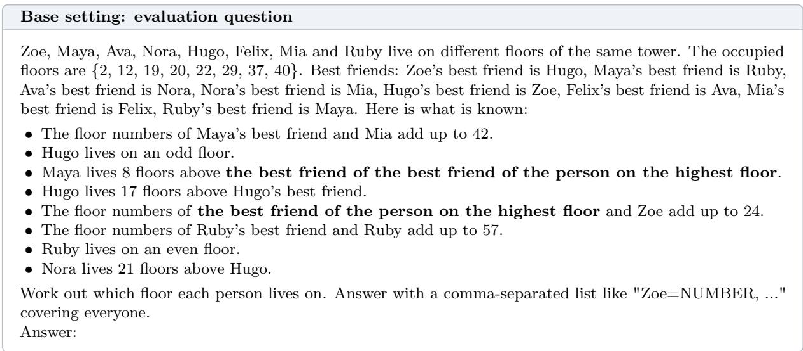  
Gold answer: Zoe=2, Maya=37, Ava=12, Nora=40, Hugo=19, Felix=29, Mia=22, Ruby=20.

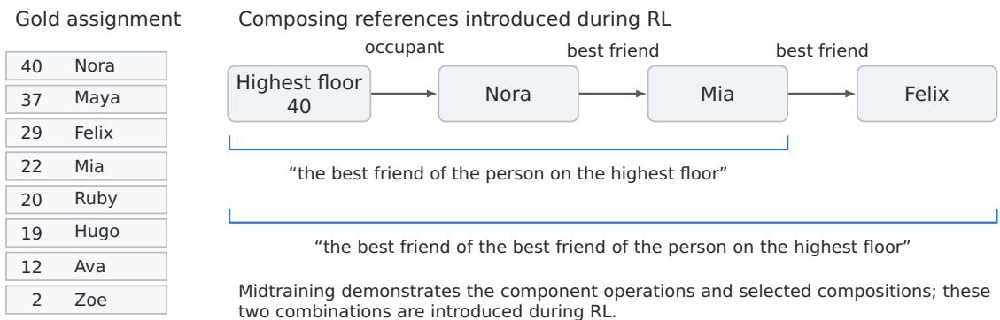  
Figure 10: Resolving composed references in the eight-person evaluation example. The diagram shows the gold assignment, with occupied floors spaced evenly for readability. The highest floor is occupied by Nora, whose best friend is Mia; Mia’s best friend is Felix. The two highlighted clues therefore reduce to 37 − 29 = 8 and 22 + 2 = 24. This illustration uses the known answer to explain the task; the assignment is not part of the model input.

Extended setting. This setting retains the same composition rules while increasing the number of people. In this ten-person example, the highlighted references require identifying the best friend of the occupant of an extreme floor.

## Extended setting: evaluation question

Owen, Ruby, Liam, Ava, Ethan, Hugo, Mia, Iris, Ella and Felix live on diferent floors of the same tower. The occupied floors are {1, 2, 4, 5, 6, 8, 10, 13, 14, 20}. Best friends: Owen’s best friend is Felix, Ruby’s best friend is Iris, Liam’s best friend is Owen, Ava’s best friend is Ruby, Ethan’s best friend is Mia, Hugo’s best friend is Ethan, Mia’s best friend is Ella, Iris’s best friend is Ava, Ella’s best friend is Liam, Felix’s best friend is Hugo. Here is what is known:

• Ava lives on an even floor.

• The best friend of the person on floor 5 lives 1 floor above Ella.

• The best friend of the person on the lowest floor lives 4 floors above Ruby.

• The person on the second-highest floor lives 1 floor above Felix.

• The floor numbers of Ava’s best friend and Ethan add up to 6.

• Hugo lives 4 floors above the best friend of the person on the highest floor.

• Ruby’s best friend lives 10 floors above Ruby.

• Mia lives on an even floor.

• The floor numbers of Iris’s best friend and Liam add up to 18.

• Mia lives 15 floors above Hugo.

Work out which floor each person lives on. Answer with a comma-separated list like "Owen=NUMBER, ..." covering everyone.   
Answer:

Gold answer: Owen=6, Ruby=4, Liam=8, Ava=10, Ethan=2, Hugo=5, Mia=20, Iris=14, Ella=1, Felix=13.

## C Pretraining, Midtraining, and RL: Setup and Additional Results

This appendix explains the experimental design for Section 5.1 and provides the additional results used to interpret the main comparisons. We first describe the data, model initializations, RL procedure, and evaluation protocol, then examine performance before and after RL, compute allocation, loss aggregation, and retention.

## C.1 Tasks and Midtraining Data

We use the reasoning puzzles constructed in Appendix B to vary when the model sees midtraining data and how often it reuses that data. All comparisons use the same fixed corpus of oracle solutions. We first describe this corpus and the question distributions used for RL and evaluation, then give the training and evaluation protocols.

Oracle traces in the midtraining corpus. The midtraining corpus contains 200000 questions: 100000 with 6–7 people and 100000 with 8–9 people. All questions use only the demonstrated reference patterns described in Appendix B.2. The oracle produces up to four reasoning traces per question; removing duplicate traces leaves 796175 prompt–response examples. Together, the prompts, responses, and endof-sequence tokens contain 509942713 tokens, or approximately 510M tokens. Staged midtraining and unified training draw from this same corpus, including when unified training mixes midtraining data into pretraining or RL. Increasing midtraining exposure therefore means reusing existing examples rather than introducing new questions. Appendix B.3 gives a complete corpus example and evaluation prompts.

Two RL settings. We vary the reasoning required during RL in two settings. In Base, all puzzles contain 8–9 people, so their size remains within the range covered by midtraining. The RL prompt pool includes both questions using only demonstrated patterns and questions that require compositions omitted from midtraining. The primary test set contains the latter type, allowing us to measure learning of these compositions without also increasing puzzle size.

In Extended, the RL pool additionally includes puzzles with 10–11 people, and the primary test set uses this larger size. The reference families remain the same as in Base, but the model must now recover more people’s locations. Puzzles containing omitted compositions require two to four steps that use them in the generated clue chain. We call these omitted steps: the term counts uses of compositions absent from midtraining, not all deductions required to solve the puzzle. Table 5 gives the composition of both RL pools and their test sets.

Finally, Extended generalization evaluates the same Extended models on a separate test set with 12 people, a size absent from both midtraining and RL. It requires no additional training. All test questions are disjoint from the midtraining corpus and the RL prompt pools.

<table><tr><td colspan="5">Omitted</td></tr><tr><td></td><td>People</td><td>steps</td><td>Base</td><td>Extended</td></tr><tr><td>RL prompts: demonstrated patterns</td><td>8-9</td><td>0</td><td>10000</td><td>10000</td></tr><tr><td>RL prompts: omitted compositions</td><td>8-9</td><td>2-4</td><td>18570</td><td>11666</td></tr><tr><td>RL prompts: larger puzzles</td><td>10-11</td><td>2-4</td><td></td><td>10000</td></tr><tr><td>Primary test questions</td><td>8-9</td><td>2-4</td><td>1024</td><td></td></tr><tr><td>Primary test questions</td><td>10-11</td><td>2-4</td><td></td><td>1024</td></tr><tr><td>Size-generalization test questions</td><td>12</td><td>2-4</td><td></td><td>1024</td></tr><tr><td>RL updates</td><td></td><td></td><td>6000</td><td>12000</td></tr></table>

Table 5: Question pools and training horizons for the two reasoning-puzzle settings. “Omitted steps” counts uses of compositions absent from midtraining in each puzzle’s clue chain. These compositions are introduced during RL, while the 12-person puzzle size is used only for evaluation. Test questions are distinct from training questions.

## C.2 Model and Pretraining

Model and original pretraining. We train a 124M-parameter model from scratch on a mixture of 75% ClimbMix (Diao et al., 2026) and 25% Dolmino (Olmo et al., 2026). The model has 12 transformer layers, hidden dimension 768, feedforward dimension 2048, and 12 attention heads. Table 6 gives the architecture and pretraining settings. The original pretraining run uses 38147 updates, each with 256 packed sequences of length 2048, and processes 20000014336 tokens in total. All comparisons start from the same checkpoint after the first 30000 updates. For the remaining 8147 updates, they preserve the same web-data stream; unified training also introduces midtraining examples, as described below.

<table><tr><td>Setting</td><td>Value</td></tr><tr><td>Parameters / layers</td><td>123587328 /  12</td></tr><tr><td>Hidden / feedforward size</td><td>768  / 2048</td></tr><tr><td>Attention heads</td><td>12</td></tr><tr><td>Embeddings and normalization</td><td>Tied embeddings, rotary position embeddings, RMSNorm</td></tr><tr><td>Tokenizer / context length</td><td>GPT-2 / 2048 tokens</td></tr><tr><td>Global batch size</td><td>256 packed sequences of 2048 tokens</td></tr><tr><td>Training updates</td><td>38147</td></tr><tr><td>Optimizer / betas</td><td>AdamW / (0.9, 0.95)</td></tr><tr><td>Peak / minimum learning rate</td><td> $6 \times 1 0 ^ { - 4 } ~ / ~ 6 \times 1 0 ^ { - 5 }$ </td></tr><tr><td>Weight decay / gradient clip</td><td> $0 . 1 ~ / ~ 1 . 0$ </td></tr><tr><td>Learning-rate schedule</td><td>200-update warmup; constant through update 30518; cosine decay over the final 7629 updates</td></tr></table>

Table 6: Model and original pretraining hyperparameters. Mixed-pretraining branches resume from update 30000 with the saved optimizer state and complete the remaining 8147 updates of the same learning-rate schedule.

Unified Pretraining and Midtraining. During the final 8147 pretraining updates, unified training retains all 256 web-text sequences in each batch and adds 8, 16, 32, 64, or 128 packed midtraining sequences, each of length 2048. These choices contribute approximately 133M, 267M, 534M, 1.07B, or 2.14B midtraining tokens, respectively; Table 3 gives the exact counts. These additions increase the batch size and total compute while preserving the web-data exposure and number of optimizer updates. They also allow multiple passes over the fixed corpus at the larger mixtures. During mixed pretraining, the language-model loss applies to every token in the packed midtraining sequences, including the prompts, reasoning traces, and end-of-sequence tokens. The five resulting models serve directly as initializations for RL.

## C.3 Staged Initialization and RL Training

Staged initialization. Staged training first completes the original 20B-token pretraining run without mixing in the reasoning corpus. It then trains on that corpus for 1, 2, or 4 epochs at a peak learning rate of $2 \times 1 0 ^ { - 4 }$ or $5 \times 1 0 ^ { - 5 }$ , giving six candidate initializations. Here, each epoch is one pass over the midtraining corpus. The prompt conditions the response, but its tokens are masked from the loss; only response and end-of-sequence tokens contribute to the midtraining objective.

We run RL from each candidate. Unless otherwise specified, a single staged reference is selected by the highest mean final RL pass@1, separately for Base and Extended, as reported in Appendix C.6. Both settings select two epochs at $2 \times 1 0 ^ { - 4 }$ . The Extended generalization evaluation uses the same Extended checkpoints and does not enter configuration selection.

Shared RL configuration. Both approaches use MaxRL with the optimizer and generation settings in Table 7. Each update samples 32 prompts and generates 16 responses per prompt, yielding 512 RL responses. We make one optimization pass over this batch. The training budget is 6000 updates for Base and 12000 for Extended.

For each prompt, we estimate its success probability pˆ as the fraction of its 16 generations that receive reward one. Correct generations receive weight 1/pˆ, while unsuccessful generations receive zero weight. All prompt groups remain in the batch, including those with no correct generation. The token-mean normalization also counts the unsuccessful response tokens, even though their loss terms have zero weight. During training, a response that reaches the generation limit without an end-of-sequence token receives zero reward.

<table><tr><td>Setting</td><td>Staged midtraining</td><td>RL (both approaches)</td></tr><tr><td>Optimizer</td><td>AdamW</td><td>AdamW</td></tr><tr><td>Adam betas</td><td>(0.9, 0.95)</td><td>(0.9,0.999)</td></tr><tr><td>Learning rate</td><td>2 × 10−4 peak</td><td>10-5</td></tr><tr><td>Schedule</td><td>5% warmup, then cosine decay</td><td>Constant, no warmup</td></tr><tr><td>Weight decay</td><td>0.01</td><td>0.01</td></tr><tr><td>Gradient clip</td><td>1.0</td><td>1.0</td></tr><tr><td>Context length</td><td>2048 tokens</td><td>2048 tokens</td></tr><tr><td>Training budget Global batch</td><td>2 epochs 32 examples</td><td>6000 updates (Base); 12000 (Extended)</td></tr><tr><td>Added midtraining data</td><td></td><td>32 prompts, 16 generations each 0 for staged; 4–64 examples for unified</td></tr><tr><td>Maximum response length</td><td></td><td>1280 tokens</td></tr><tr><td>Temperature / top-p</td><td></td><td>1.0 / 1.0</td></tr><tr><td>Top-k truncation</td><td></td><td></td></tr><tr><td></td><td></td><td>Disabled</td></tr><tr><td>KL penalty / entropy bonus</td><td></td><td>None / none</td></tr></table>

Table 7: Staged midtraining and shared RL hyperparameters. The midtraining column gives the selected configuration for both Base and Extended; Appendix C.6 reports the full sweep. Unified training uses the same RL settings and adds midtraining examples to each batch. To assess the contribution of this mixing during RL, we also run controls that start from the same mixed-pretraining initializations but add no midtraining examples.

Unified training. Unified runs start from the five mixed-pretraining initializations described above. During RL, each update adds 4, 8, 16, 32, or 64 examples from the full midtraining corpus to a batch of 512 RL responses, preserving the number of RL generations used in staged training. For these midtraining examples, the prompt tokens are masked from the loss, and response and end-of-sequence tokens receive weight one. We combine these losses with the weighted RL losses using the shared token-mean normalization in Section 4.

We also train controls from the same mixed-pretraining initializations without adding midtraining data during RL. Comparing against these controls isolates the contribution of mixing during RL from that of the initialization. The main sweep does not include pretraining data during RL; Appendix C.8 examines this addition separately. Appendices A.1 and A.2 give the mixture counts and corresponding training exposure.

Combining midtraining and RL losses. To examine the choice of normalization, we compare unified training with an alternative that averages the RL and midtraining losses separately, then adds the midtraining loss with a fixed coeficient $\alpha \in \{ 0 . 1 , 0 . 5 \}$ . For Extended, we also test $\alpha = 1$ with the initialization trained on 2.14B midtraining tokens during pretraining, across all five midtraining example counts during RL. The comparison holds the initialization, training data, example counts, optimizer, and RL update budget fixed. Unified training instead uses the shared token mean with unit midtraining weight. Appendix A.1 defines both objectives, and Appendix C.9 reports the comparisons at each available common training horizon.

## C.4 Evaluation Protocol

Accuracy and coverage. Each test set contains 1024 held-out questions. For each question, we independently sample 64 responses at temperature 1.0 and top-p 1.0, without top-k truncation. Generation uses a 2048-token context and a maximum of 1280 response tokens. The grader checks the final boxed answer against the complete correct person-to-floor assignment and gives no partial credit.

We report sampled pass@1 as accuracy and pass@16 as coverage. Accuracy estimates the probability that one sampled response is correct; coverage estimates the probability that at least one of 16 sampled responses is correct. We compute both from the 64 responses per question using the unbiased estimator of Chen et al. (2021). For c correct responses among n samples, the per-question estimator is

$$
{ \widehat { \mathrm { p a s s @ } k } } = 1 - { \frac { { \binom { n - c } { k } } } { \binom { n } { k } } } , \qquad 1 \leq k \leq n ,
$$

where ${ \binom { n - c } { k } } = 0$ for $n - c < k$ . We average the per-question estimates over the test set. Coverage does not assume that the model can identify which of its responses is correct.

Averaging over training seeds. Each RL configuration is trained with two seeds from the same pre-RL initialization. We first compute accuracy and coverage separately for each trained model, then average the two scores. In particular, we do not pool responses from diferent models when estimating pass@16 Training curves compare the two models at the same optimizer update and include a point only when both evaluations are available. We apply this procedure to both the primary test set and, for Extended models, the 12-person generalization test.

The evaluations before RL follow a diferent convention because the two RL seeds share one initialization. We evaluate that initialization once with the same sampling protocol (Appendix C.5); its reported score is therefore a single model evaluation rather than an average over subsequent training seeds.

Pretraining retention. We assess retention before RL to measure how incorporating the reasoning corpus changes capabilities acquired during pretraining. We use two measures: held-out language-model loss and performance on general benchmarks. For held-out loss, we evaluate approximately 400000 fixed tokens from each of ClimbMix and Dolmino in 1024-token windows. We then combine the two losses with weights 0.75 and 0.25, matching the pretraining mixture. The general-capability score averages MMLU (Hendrycks et al., 2021a) accuracy, ARC-Easy (Clark et al., 2018) normalized accuracy, HellaSwag (Zellers et al., 2019) normalized accuracy, TruthfulQA MC2 (Lin et al., 2022), and WinoGrande (Sakaguchi et al., 2020) accuracy. All benchmarks use zero-shot likelihood evaluation without a chat template: the model is scored by the likelihood it assigns to candidate answers rather than by sampled generations. Each shared initialization is evaluated once, so these scores are not averages over the subsequent RL training seeds. Appendix C.10 reports the full results for the five unified and six staged initializations, together with the pretraining-only reference. For the comparison in Appendix C.8, we apply the same retention evaluations after RL and average the scores over the two training seeds.

Training exposure and compute. Within each setting, the methods have the same prescribed number of RL updates and requested generations per update. This does not make their total compute equal: midtraining exposure before and during RL varies across configurations, and the lengths of generated responses can also difer. We therefore estimate the compute used throughout training under the model-FLOP convention in Appendix A.2. This estimate includes training on web and midtraining data, generating RL responses, and training on those responses.

For the reasoning-puzzle runs, we estimate RL token counts from sampled training logs and the mean prompt length in the corresponding pool. Midtraining counts use the corpus token totals and the number of examples processed. Both prompt and response tokens count toward compute, including prompt positions that are masked from the loss. The cumulative-compute plots include all of these costs. The plots of compute beyond shared pretraining subtract the common 20B-token web-pretraining cost from every run, making diferences in the remaining training budget easier to compare.

## C.5 Reasoning Performance before RL

We first evaluate what the models have learned from the midtraining corpus before they receive any RL updates. For unified training, this evaluation follows pretraining with midtraining data mixed into its final part; for staged training, it follows the separate midtraining phase. These evaluations distinguish the reasoning ability acquired before RL from the improvements obtained during RL.

Figure 11 compares the five unified initializations with the model trained on pretraining data alone and the selected staged initialization. The staged reference uses two midtraining epochs at a peak learning rate of $2 \times 1 0 ^ { - 4 } .$ , selected by final RL accuracy rather than by its score before RL (Appendix C.6). Both approaches use the same fixed midtraining corpus, although they difer in how much they reuse it and in their total compute. The figure therefore compares the reasoning ability of the initializations; the compute comparison appears in Appendix C.7.

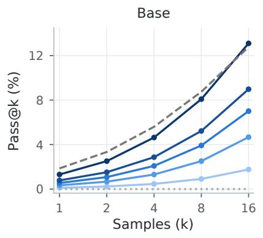

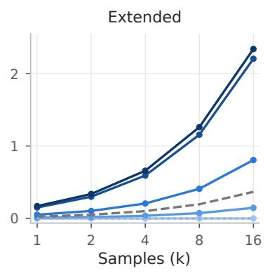

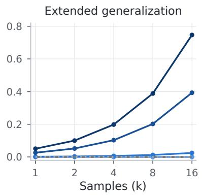  
Unified: 133M Unified: 534M Unified: 2.14B Pretraining only Unified: 267M Unified: 1.07B Staged

Figure 11: Reasoning accuracy and coverage before RL. Each curve shows pass@k, the estimated probability of obtaining a correct answer in k attempts, for an initialization evaluated before RL. Colors indicate the number of midtraining tokens mixed during pretraining; the dashed gray curve shows the selected staged initialization. Midtraining puzzles contain 6–9 people, while the three panels use the Base, Extended, and Extended generalization test sets defined in Appendix C.1. Estimates use 64 responses per question on 1024 questions in each test set. Vertical scales difer across panels; zero-valued curves overlap

Increasing the amount of midtraining data used during pretraining improves unified accuracy and coverage on Base. The selected staged initialization has higher pass@1 than all five unified initializations, while the largest unified mixture reaches similar pass@16. Increasing the unified mixture also improves performance on Extended and Extended generalization, but transfer to larger puzzles remains limited before RL: even the largest mixture reaches only 2.34% and 0.75% pass@16, respectively.

To distinguish learning the demonstrated reasoning patterns from applying them in new compositions, Table 8 also evaluates held-out 8–9-person puzzles containing only demonstrated patterns. The table includes all five unified and all six staged initializations. Both approaches perform substantially better on the demonstrated patterns than on Base, whose puzzles have the same sizes but include compositions omitted from midtraining. The models therefore learn the demonstrated patterns, but applying them in new compositions remains dificult before RL. Comparing this table with Table 9 also shows that the strongest staged initialization on Base before RL does not yield the best final RL performance. This motivates selecting the staged reference by its performance after RL.

<table><tr><td></td><td colspan="2">Demonstrated patterns</td><td colspan="2">Base</td><td colspan="2">Extended</td><td colspan="2">Extended generalization</td></tr><tr><td>Midtraining</td><td>pass@1</td><td>pass@16</td><td>pass@1</td><td>pass@16</td><td>pass@1</td><td>pass@16</td><td>pass@1</td><td>pass@16</td></tr><tr><td>None</td><td>0.00</td><td>0.00</td><td>0.00</td><td>0.00</td><td>0.00</td><td>0.00</td><td>0.00</td><td>0.00</td></tr><tr><td colspan="9">Unified: mixed during pretraining</td></tr><tr><td>133M tokens</td><td>0.92</td><td>12.11</td><td>0.12</td><td>1.76</td><td>0.00</td><td>0.00</td><td>0.00</td><td>0.00</td></tr><tr><td>267M tokens</td><td>7.23</td><td>55.98</td><td>0.34</td><td>4.67</td><td>&lt; 0.01</td><td>0.15</td><td>0.00</td><td>0.00</td></tr><tr><td>534M tokens</td><td>16.74</td><td>79.67</td><td>0.55</td><td>7.01</td><td>0.05</td><td>0.81</td><td>&lt; 0.01</td><td>0.02</td></tr><tr><td>1.07B tokens</td><td>35.60</td><td>94.92</td><td>0.78</td><td>8.98</td><td>0.15</td><td>2.21</td><td>0.03</td><td>0.39</td></tr><tr><td>2.14B tokens</td><td>51.98</td><td>98.83</td><td>1.31</td><td>13.09</td><td>0.17</td><td>2.34</td><td>0.05</td><td>0.75</td></tr><tr><td colspan="9">Staged: midtraining at peak  $L R 2 \times 1 0 ^ { - 4 }$ </td></tr><tr><td>1 epoch</td><td>78.76</td><td>99.95</td><td>1.19</td><td>8.34</td><td>0.02</td><td>0.37</td><td>0.00</td><td>0.00</td></tr><tr><td>2 epochs</td><td>86.97</td><td>99.99</td><td>1.86</td><td>12.77</td><td>0.03</td><td>0.37</td><td>0.00</td><td>0.00</td></tr><tr><td>4 epochs</td><td>90.70</td><td>100.00</td><td>2.02</td><td>12.77</td><td>0.05</td><td>0.57</td><td>0.00</td><td>0.00</td></tr><tr><td colspan="9">Staged: midtraining at peak  $L R 5 \times 1 0 ^ { - 5 }$ </td></tr><tr><td>1 epoch</td><td>65.15</td><td>99.79</td><td>2.09</td><td>15.97</td><td>0.04</td><td>0.61</td><td>0.00</td><td>0.00</td></tr><tr><td>2 epochs</td><td>78.83</td><td>99.93</td><td>2.05</td><td>13.43</td><td>0.05</td><td>0.64</td><td>0.00</td><td>0.00</td></tr><tr><td>4 epochs</td><td>87.68</td><td>100.00</td><td>1.85</td><td>11.88</td><td>0.02</td><td>0.21</td><td>0.00</td><td>0.00</td></tr></table>

Table 8: Reasoning performance across all initializations before RL. Values are percentages; positive values below 0.01% are shown as < 0.01, and zeros indicate no observed correct responses. The demonstrated-pattern test contains held-out 8–9-person puzzles using only patterns present in midtraining; Base uses the same puzzle sizes but introduces omitted compositions. The shaded row is the staged configuration selected by final RL accuracy for both Base and Extended. Each row evaluates one initialization before RL, which is subsequently shared by the two RL training seeds.

## C.6 Staged Performance after RL

We evaluate six staged midtraining configurations to select a strong baseline for the full training pipeline. Within each setting, we select the configuration with the highest final RL accuracy. The sweep combines 1, 2, or 4 passes over the fixed corpus with a peak learning rate of either $2 \times 1 0 ^ { - 4 }$ or $5 \times 1 0 ^ { - 5 }$ . All configurations start from the same pretrained model and are followed by RL without midtraining data. Table 9 reports their final accuracy and coverage after 6000 RL updates in Base and 12000 in Extended. For each configuration, we compute the metrics separately for two RL training seeds and report their mean.

We select the configuration with the highest mean final pass@1 on the primary test set, independently for Base and Extended. The same configuration is selected in both settings: two midtraining epochs at a peak learning rate of $2 \times 1 0 ^ { - 4 }$ . It supplies the staged references in Figure 4. For Extended generalization, we evaluate the selected Extended models on the 12-person test set without making a separate configuration choice using those results. The compute comparisons in Figs. 5 and 12 retain all six staged configurations, since the best choice at a smaller compute budget need not be the configuration with the highest final accuracy.
<table><tr><td colspan="3"></td><td colspan="2">Base</td><td colspan="2">Extended</td><td colspan="2">Extended generalization</td></tr><tr><td>Epochs</td><td>Peak LR</td><td>pass@1</td><td>pass@16</td><td>pass@1</td><td>pass@16</td><td>pass@1</td><td></td><td>pass@16</td></tr><tr><td>1</td><td> $2 \times 1 0 ^ { - 4 }$ </td><td>21.79</td><td>72.40</td><td>16.14</td><td>63.51</td><td>6.58</td><td></td><td>41.78</td></tr><tr><td>1</td><td> $5 \times 1 0 ^ { - 5 }$ </td><td>12.24</td><td>54.54</td><td>9.88</td><td></td><td>51.30</td><td>3.18</td><td>26.31</td></tr><tr><td>2</td><td> $2 \times 1 0 ^ { - 4 }$ </td><td>24.54</td><td>73.51</td><td>16.91</td><td></td><td>64.80</td><td>5.58</td><td>35.90</td></tr><tr><td>2</td><td> $5 \times 1 0 ^ { - 5 }$ </td><td>12.74</td><td>55.25</td><td>7.25</td><td></td><td>41.13</td><td>2.17</td><td>18.86</td></tr><tr><td>4</td><td> $2 \times 1 0 ^ { - 4 }$ </td><td>15.15</td><td>57.49</td><td>11.64</td><td></td><td>53.20</td><td>4.10</td><td>28.53</td></tr><tr><td>4</td><td> $5 \times 1 0 ^ { - 5 }$ </td><td>18.82</td><td>65.58</td><td>6.96</td><td>41.43</td><td></td><td>2.15</td><td>19.68</td></tr></table>

Table 9: Staged performance after RL. Each row specifies the number of midtraining passes and peak learning rate used before RL. Pass@1 and pass@16 are percentages averaged over two RL training seeds, after 6000 updates in Base and 12000 in Extended. The shaded row maximizes final pass@1 independently on the Base and Extended primary test sets. Extended generalization evaluates the same Extended checkpoints on 12-person puzzles and is not used to select the reference.

Using more of the fixed corpus before RL does not necessarily improve the final result: the best fourepoch configuration remains below the best two-epoch configuration in both settings. The efect of learning rate also depends on the number of epochs. Together with the evaluations before RL in Appendix C.5, these results show why the staged reference is selected after RL: strong performance immediately after midtraining does not by itself identify the most efective initialization for further learning.

## C.7 Additional Compute Comparisons

Figure 5 performs the compute comparison with pretraining compute in to account. To make diferences in the RL stage easier to see, Figure 12 subtracts this shared cost from the horizontal coordinate of every checkpoint. The remaining compute includes midtraining before RL, generation and training during RL, and any midtraining data mixed into RL updates; Appendix A.2 gives the calculation.

The configurations and evaluations are identical to those in Figure 5. Each plot ends at the same total training budget as its main-text counterpart, with the common pretraining cost subtracted from the displayed value. This subtraction changes the spacing of points on the logarithmic axis but does not change which checkpoints attain the highest observed performance within a budget.

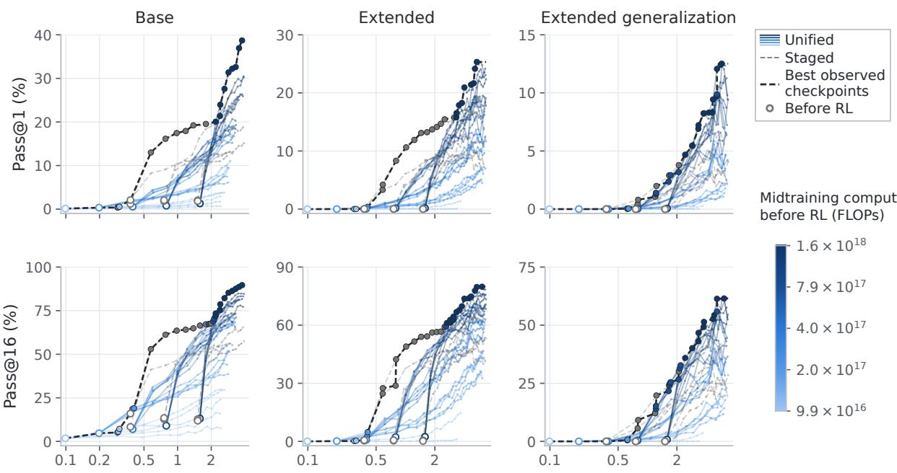  
Beyond shared pretraining $( 1 0 ^ { 1 8 }$ FLOPs, log scale)

Figure 12: Accuracy and coverage versus compute beyond shared pretraining. The top and bottom rows show pass@1 and pass@16, respectively. Gray dashed curves show all six staged configurations; colored curves show unified configurations, with darker colors indicating more midtraining compute before RL. All checkpoints also appear in Figure 5; only their horizontal coordinates change by subtracting the common pretraining cost. The black curve connects checkpoints that attain the highest observed value within a compute budget across both approaches, with marker colors identifying their source. Open circles mark evaluations of the shared initializations before RL. Subsequent points use evaluations available for both RL seeds at the same update, averaging performance and estimated compute over those two seeds. Curves extend through available evaluations up to 6000 updates in Base and 12000 in Extended, subject to the displayed compute budget. Extended generalization evaluates the Extended checkpoints on 12-person puzzles and uses the same training costs.

Subtracting the shared cost makes the tradeofs at smaller additional budgets easier to see. Staged training contributes to the observed frontier at mid-level budgets during in distribution eval, while unified training achieves higher accuracy and coverage at smaller and larger budgets in all three evaluations. Unified training achieves the best-compute accuracy and coverage for generalization evaluation for almost all compute budgets. This comparison allows each approach to use its best observed checkpoint within the budget, even if that checkpoint precedes the end of its run. It therefore accounts for choices of both midtraining configuration and RL duration, rather than comparing only the final checkpoints.

Without pretraining data With pretraining data

## C.8 Retaining Pretraining Data during RL

The main reasoning experiments mix midtraining data with RL generations. Here we ask whether also retaining pretraining data helps preserve general capabilities, and how this afects reasoning performance. Each comparison uses the same initialization, RL and midtraining example counts, optimizer, and training horizon. One variant additionally receives pretraining text from the original corpus mixture, with approximately 10% as many loss-bearing tokens as the midtraining responses (Appendix A.1). The added text contributes to the shared loss; the comparison holds the RL update budget fixed rather than matching total compute.

We use initializations trained with 534M or 2.14B midtraining tokens during pretraining, and mix 8 or 32 midtraining examples into each RL update. We report all four combinations for Base after 6000 updates and Extended after 12000 updates. The same Extended models are evaluated on Extended generalization. All results average two training seeds using the protocol in Appendix C.4.

Figure 13 shows that adding pretraining text reduces accuracy and coverage in most comparisons. The only exceptions are small gains in Extended coverage and generalization accuracy with the 2.14B-token initialization and 32 midtraining examples per RL update. Held-out pretraining loss decreases in all eight training configurations (Table 10). The general benchmark average improves in seven of the eight configurations, although all changes are smaller than 0.7 percentage points. At the tested proportion, retaining pretraining data therefore improves retention, usually at the expense of reasoning performance.

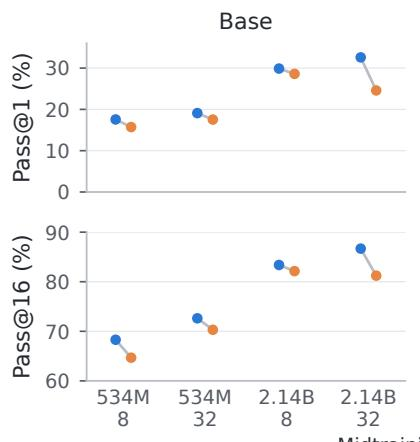

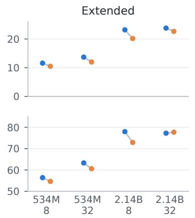

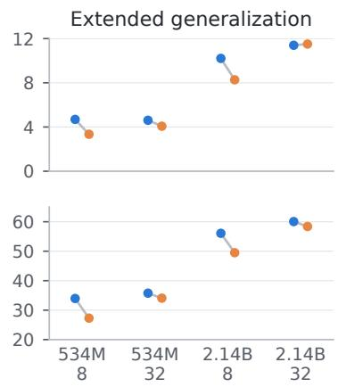

Figure 13: Efect of retaining pretraining data during RL. Final accuracy (top) and coverage (bottom) average two training seeds after 6000 updates in Base and 12000 in Extended. Horizontal labels give the midtraining tokens used during pretraining (top line) and midtraining examples per RL update (bottom line).
<table><tr><td></td><td colspan="2">Midtraining</td><td colspan="2">Pretraining loss ↓</td><td colspan="2">Benchmark mean (%)</td></tr><tr><td>Setting</td><td>Tokens during pretraining</td><td>Examples per RL update</td><td>Without</td><td>With</td><td>Without</td><td>With</td></tr><tr><td>Base</td><td>534M</td><td>8</td><td>2.570</td><td>2.542</td><td>41.66</td><td>42.13</td></tr><tr><td>Base</td><td>534M</td><td>32</td><td>2.575</td><td>2.535</td><td>41.65</td><td>41.98</td></tr><tr><td>Base</td><td>2.14B</td><td>8</td><td>2.572</td><td>2.545</td><td>41.93</td><td>42.08</td></tr><tr><td>Base</td><td>2.14B</td><td>32</td><td>2.571</td><td>2.537</td><td>42.01</td><td>41.85</td></tr><tr><td>Extended</td><td>534M</td><td>8</td><td>2.613</td><td>2.546</td><td>41.60</td><td>42.25</td></tr><tr><td>Extended</td><td>534M</td><td>32</td><td>2.617</td><td>2.537</td><td>41.24</td><td>41.90</td></tr><tr><td>Extended</td><td>2.14B</td><td>8</td><td>2.605</td><td>2.549</td><td>41.63</td><td>42.00</td></tr><tr><td>Extended</td><td>2.14B</td><td>32</td><td>2.601</td><td>2.539</td><td>41.67</td><td>41.95</td></tr></table>

Table 10: Retention after RL with and without added pretraining data. Pretraining loss is measured in nats and weights held-out ClimbMix and Dolmino by 75/25; the benchmark mean averages the five tasks in Appendix C.4. Scores use the same final checkpoints as Figure 13 and average two training seeds.

## C.9 Combining Midtraining and RL Losses

We compare two ways of combining midtraining data and RL generations in a training update. Unified training normalizes the combined weighted loss by the total number of response tokens, so the relative contribution of the sources follows the token mixture. The alternative first normalizes the loss from each source separately, then multiplies the midtraining loss by a fixed coeficient α before adding it to the RL loss. Appendix A.1 defines both objectives. This comparison tests how the choice of loss aggregation afects learning when the model receives the same kinds and amounts of data.

Within each comparison, we hold the initialization, training data, example counts, optimizer, and RL update budget fixed. Unified training uses unit weight for midtraining tokens; the separately normalized alternative uses $\alpha \in \{ 0 . 1 , 0 . 5 \}$ . For the 2.14B-token initialization in Extended, we additionally test $\alpha = 1$ at all five midtraining example counts and evaluate the same models on Extended generalization. Figs. 14 to 16 show the comparisons for initializations trained with 534M, 1.07B, and 2.14B midtraining tokens during pretraining. Every displayed objective has evaluations through the full training horizon: 6000 RL updates in Base and 12000 in Extended. We estimate accuracy and coverage separately for each of two RL training seeds, then average their scores at each update.

The relative performance depends on the task, initialization, and amount of midtraining data included during RL. Separately normalized losses often achieve higher accuracy and coverage in Extended, and the better coeficient varies across configurations. Across the configurations compared here, unified training attains the highest observed final accuracy and coverage in Base and Extended generalization. The $\alpha = 1$ results do not improve the highest final accuracy or coverage observed on either Extended test set. However, unified training does not consistently outperform the alternative when the initialization and data mixture are matched.

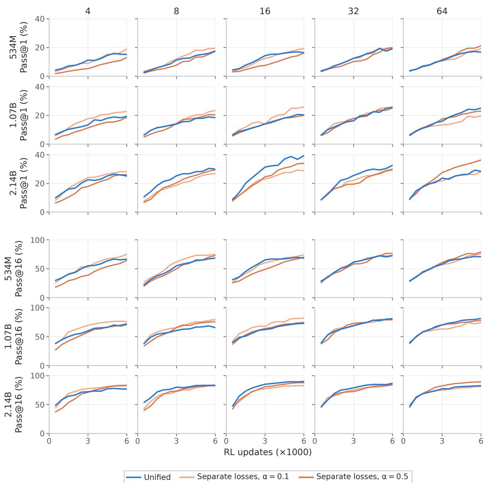  
Figure 14: Loss aggregation in Base. The upper three rows show pass@1, and the lower three show pass@16, through 6000 RL updates. Within each group, rows vary the number of midtraining tokens used during pretraining; columns vary the number of midtraining examples added to each RL update. Each panel compares unified training with two separately normalized objectives, holding the initialization and example counts fixed. Curves average the scores of two RL training seeds at each update.

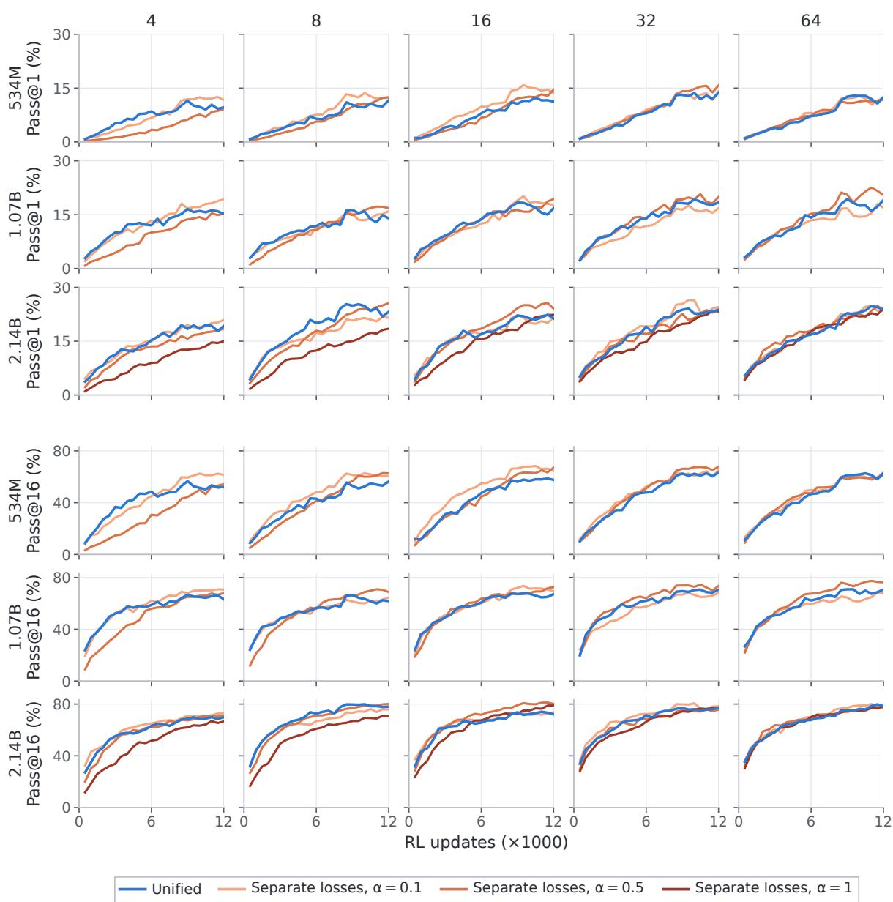  
Figure 15: Loss aggregation in Extended. Pass@1 (upper three rows) and pass@16 (lower three rows) are measured on the primary Extended test set through 12000 RL updates. Rows and columns follow Figure 14, using the same three initializations and five midtraining example counts. The α = 1 curves are included for the 2.14B-token initialization. Each panel holds the initialization and data mixture fixed while varying the loss aggregation. Curves average the scores of two RL training seeds.

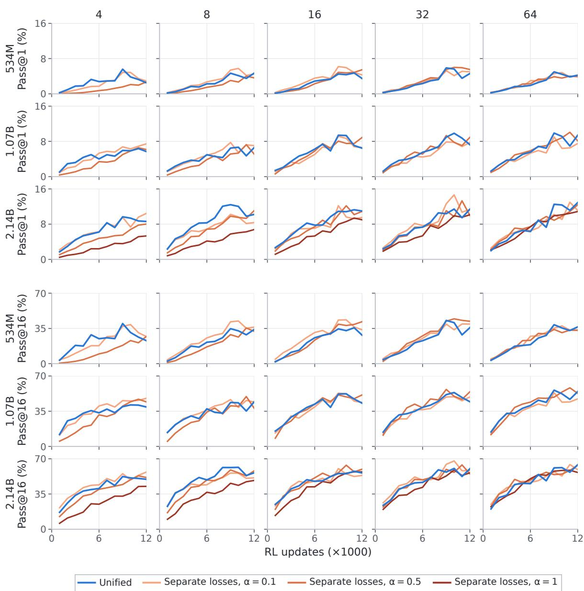  
Figure 16: Loss aggregation and Extended generalization. The models in Figure 15 are evaluated on 12-person puzzles, a size absent from RL training. The upper three rows show pass@1 and the lower three show pass@16, with the same arrangement of initializations and midtraining example counts. As in Figure 15, α = 1 is evaluated for the 2.14B-token initialization. Curves average the scores of two RL training seeds through 12000 updates.

Smaller pretraining mixtures. The remaining figures examine the two initializations trained with less midtraining data during pretraining: 133M and 267M tokens. For Base, we evaluate both initializations through 6000 RL updates. For Extended and Extended generalization, we report the 267M-token initialization through 12000 updates. Within each panel, all three objectives are shown over the same training horizon, so their endpoints are directly comparable.

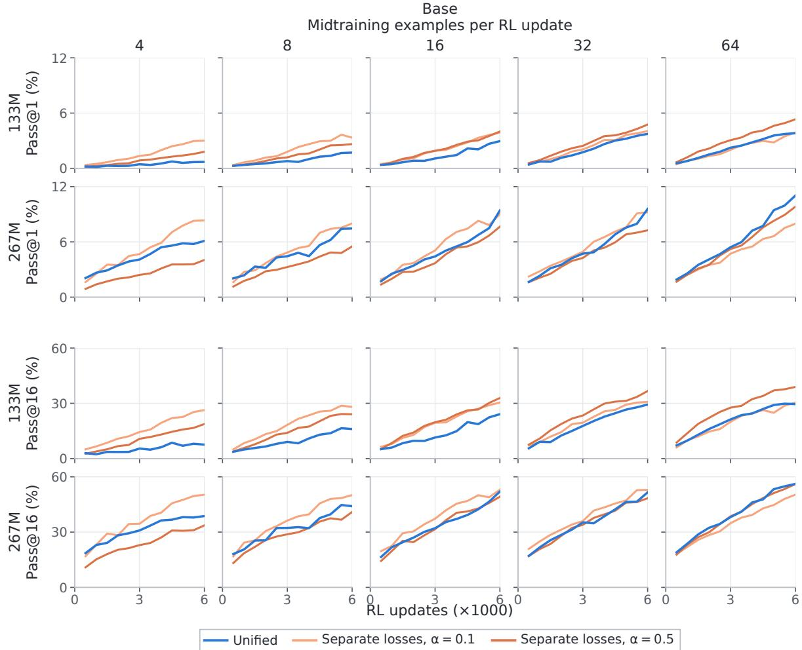  
Figure 17: Loss aggregation with smaller pretraining mixtures in Base. The upper two rows show pass@1 and the lower two show pass@16 for the 133M- and 267M-token initializations, through 6000 RL updates. Columns vary the number of midtraining examples added to each RL update. Each panel compares the three objectives with the same initialization and example counts, averaging scores over two RL training seeds.

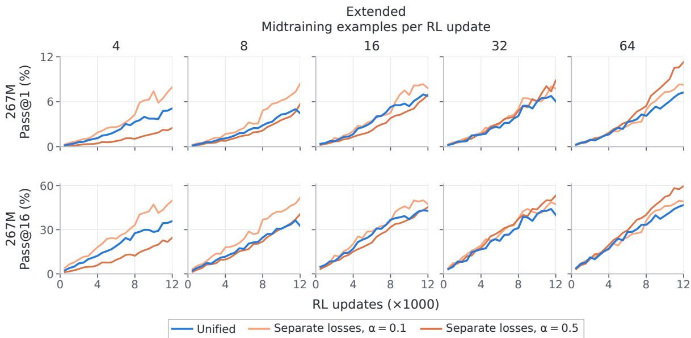  
Figure 18: Loss aggregation with a smaller pretraining mixture in Extended. The top row shows pass@1 and the bottom row shows pass@16 for the 267M-token initialization through 12000 RL updates. Columns vary the number of midtraining examples per RL update, with the initialization and example counts held fixed within each comparison. Curves average scores over two RL training seeds.

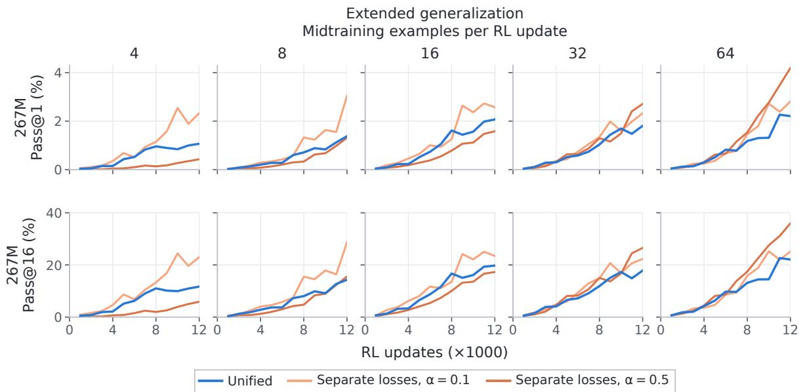  
Figure 19: Extended generalization with a smaller pretraining mixture. The models in Figure 18 are evaluated on the 12-person test set through 12000 RL updates. The top row shows pass@1 and the bottom row shows pass@16 for the 267M-token initialization. Each curve averages the per-model score over two RL training seeds, without pooling generations from diferent models.

## C.10 Retention before RL

For a for focus study on the efect of unified training before the RL stage, we evaluate the models on pretraining data and general benchmarks before RL. We include all five unified initializations, all six staged midtraining configurations, and the model trained on pretraining data alone. Unified initializations learn from the reasoning corpus while retaining the pretraining data stream; staged initializations learn from this corpus in a separate phase after pretraining. Evaluating at this point measures retention before any further changes caused by RL. The same initializations are used in Base and Extended, so one set of retention evaluations applies to both settings.

Table 11 reports held-out language-model loss on ClimbMix and Dolmino, together with scores on the five general benchmarks specified in Appendix C.4. The mean loss weights the two corpora by their pretraining proportions, while the mean benchmark score gives equal weight to the five tasks. Lower loss and higher benchmark scores indicate better retention relative to the model trained on pretraining data alone.

Across the unified mixtures, mean pretraining loss remains between 2.537 and 2.540, close to the reference value of 2.537, and the mean benchmark score remains within 0.52 percentage points of the reference. Staged midtraining increases loss on both pretraining corpora and lowers the mean benchmark score at every tested epoch budget and learning rate. Using the lower learning rate reduces both changes at each epoch budget, but does not eliminate them. The one-epoch configuration at a peak learning rate of $5 \times 1 0 ^ { - 5 }$ has both the lowest mean loss and the highest mean benchmark score among staged variants, so we use it as the retention reference in Figure 6. The two-epoch configuration at $2 \times 1 0 ^ { - 4 }$ , selected for the best final RL accuracy in Appendix C.6, has higher mean loss and a lower mean benchmark score.

<table><tr><td rowspan="2">Midtraining</td><td colspan="3">Held-out loss ↓</td><td colspan="6">Benchmark score (%)</td></tr><tr><td>ClimbMix Dolmino</td><td></td><td>Mean</td><td>MMLU</td><td>ARC-E HellaSwag</td><td></td><td>TQA</td><td>WinoG</td><td>Mean</td></tr><tr><td>None</td><td>2.784</td><td>1.794</td><td>2.537</td><td>28.65</td><td>55.09</td><td>35.39</td><td>39.15</td><td>53.59</td><td>42.37</td></tr><tr><td colspan="10">Unified: mixed during pretraining</td></tr><tr><td>133M tokens</td><td>2.784</td><td>1.795</td><td>2.537</td><td>28.62</td><td>54.67</td><td>35.55 39.09</td><td></td><td>53.20</td><td>42.23</td></tr><tr><td>267M tokens</td><td>2.786</td><td>1.796</td><td>2.538</td><td>28.79</td><td>54.97</td><td></td><td>35.1739.17</td><td>53.99</td><td>42.42</td></tr><tr><td>534M tokens</td><td>2.785</td><td>1.797</td><td>2.538</td><td>28.22</td><td>54.67</td><td></td><td>35.67 39.57</td><td>51.14</td><td>41.85</td></tr><tr><td>1.07B tokens</td><td>2.787</td><td>1.797</td><td>2.539</td><td>28.30</td><td>54.71</td><td></td><td>35.31 39.43</td><td>52.96</td><td>42.14</td></tr><tr><td>2.14B tokens</td><td>2.788</td><td>1.798</td><td>2.540</td><td>27.85</td><td>54.88</td><td></td><td>35.47 39.46</td><td>52.33</td><td>42.00</td></tr><tr><td colspan="10">Staged: midtraining at peak  $L R 2 \times 1 0 ^ { - 4 }$ </td></tr><tr><td>1 epoch (510M)</td><td>12.421</td><td></td><td>11.34012.150</td><td>24.98</td><td>24.92</td><td></td><td>26.64 48.09</td><td>50.36</td><td>35.00</td></tr><tr><td>2 epochs (1.02B)</td><td>12.426</td><td>12.147</td><td>12.356</td><td>25.34</td><td>24.96</td><td>26.49</td><td>48.57</td><td>49.88</td><td>35.05</td></tr><tr><td>4 epochs (2.04B)</td><td>15.324</td><td>14.443</td><td>15.104</td><td>27.12</td><td>25.04</td><td></td><td>26.2747.68</td><td>51.93</td><td>35.61</td></tr><tr><td colspan="10">Staged: midtraining at peak LR  $5 \times 1 0 ^ { - 5 }$ </td></tr><tr><td>1 epoch (510M)</td><td>4.272</td><td>3.722</td><td>4.135</td><td>23.59</td><td>41.25</td><td></td><td>32.8642.35</td><td>52.41</td><td>38.49</td></tr><tr><td>2 epochs (1.02B)</td><td>5.362</td><td>5.131</td><td>5.305</td><td>23.43</td><td>36.66</td><td>31.18</td><td>42.82</td><td>50.91</td><td>37.00</td></tr><tr><td>4 epochs (2.04B)</td><td>7.005</td><td>7.203</td><td>7.054</td><td>23.91</td><td>33.50</td><td>29.08</td><td>46.23</td><td>49.41</td><td>36.42</td></tr></table>

Table 11: Pretraining retention across all initializations. Every row evaluates one initialization before RL; these results are shared by the Base and Extended experiments. Loss is in nats per token, with a mean weighted by 75% ClimbMix and 25% Dolmino. Benchmark scores are percentages, with an unweighted mean over the five tasks. ARC-E denotes ARC-Easy normalized accuracy, TQA denotes TruthfulQA MC2, and WinoG denotes WinoGrande accuracy; HellaSwag uses normalized accuracy and MMLU uses accuracy. Midtraining token counts include prompts and responses; staged configurations also indicate the number of passes over the corpus. The shaded row is the staged initialization with the best retention on both aggregate measures, used in Figure 6.

The individual benchmark scores also help interpret the aggregate result. Staged midtraining improves TruthfulQA MC2 relative to pretraining alone, while reducing MMLU, ARC-Easy, HellaSwag, and WinoGrande performance. Thus, the retention advantage shown in Figure 6 concerns mean benchmark performance and pretraining loss; it does not hold for every individual benchmark.

## D Details of Training with Real-world Midtraining Data

This section describes the unified training with real-world midtraining experiments in Section 5.2. We first give the common training and evaluation setup, then examine the amount, timing, and composition of midtraining data and the choice of RL objective. The final two subsections study subsequent learning on coding and WebInstruct tasks. Throughout the appendix, comparisons at the end of training use each run’s final checkpoint; we do not select a diferent checkpoint for each metric.

## D.1 Experimental Setup

Base model. We use a model with 756819456 parameters, 24 layers, hidden width 1536, 12 attention and key/value heads, and context length 2048. We train it from scratch on 354.53B ClimbMix pretraining tokens (Diao et al., 2026), followed by 17.73B OLMo-3 Dolmino midtraining tokens (Olmo et al., 2026). We do not perform study on unified training during pretraining due to computational constraints. We refer to the resulting checkpoint as the base model. Table 12 gives the pretraining and Dolmino midtraining settings.

<table><tr><td>Setting</td><td>Pretraining</td></tr><tr><td>Optimizer</td><td>AdamW</td></tr><tr><td>Adam  $( \beta _ { 1 } , \beta _ { 2 } ) ; \varepsilon$ </td><td>(0.9, 0.95); 10−8</td></tr><tr><td>Weight decay; gradient clipping norm</td><td>0.1; 1</td></tr><tr><td>Global batch size (sequences)</td><td>2048</td></tr><tr><td>Sequence length (tokens)</td><td>2048</td></tr><tr><td>Peak / minimum learning rate</td><td> $4 \times 1 0 ^ { - 4 } \mathrm { ~ / ~ } 4 \times 1 0 ^ { - 5 }$ </td></tr><tr><td>Learning-rate schedule</td><td>Warmup, constant, cosine decay</td></tr><tr><td>Warmup updates</td><td>845</td></tr><tr><td>Final decay updates</td><td>16905</td></tr><tr><td>Total updates</td><td></td></tr></table>

Table 12: Pretraining and midtraining hyperparameters for the 0.76B base model. The midtraining column describes training on the Dolmino corpus.

Mathematical RL and additional midtraining data. Math12K provides the mathematical RL tasks, with 11977 prompts remaining after length filtering. We use the reward function from veRL (Sheng et al., 2025). The additional midtraining corpus contains 240M tokens from 24 components, including web text, mathematics, code, question answering, and reasoning traces. Unified training uses this corpus during RL, whereas staged training uses it before RL. Examples from the corpus are trained as document continuation with unit token weights, except in the code-data replacement experiment described in Appendix D.4.

Data mixing. A mixing percentage specifies the target fraction of midtraining tokens in the combined midtraining and RL response tokens. We convert this target into example counts using lengths estimated before training, so the realized token fraction can vary as RL response lengths change. Appendix A.1 gives the conversion, batch construction, and schedule definitions; Appendix A.2 explains how we count training exposure.

Training. The RL-only baseline uses the unified trainer with no midtraining data. It provides a control for adding midtraining data while keeping the trainer fixed. The staged reference instead trains the base model on the additional 240M-token corpus before beginning on-policy MaxRL with baseline subtraction.

All mathematical RL runs use 12000 optimizer updates, with 512 RL responses per update and 16 responses generated per prompt. Unified training adds midtraining examples to this RL batch according to the configured token proportion. Both approaches initialize a fresh AdamW optimizer for RL, using learning rate 10−6, betas (0.9, 0.999), and zero weight decay, with no warmup or learning-rate decay.

Response weighting and loss normalization. For RL responses, we compute token likelihoods under the current policy’s top-k/top-p distribution. Tokens outside this distribution’s support are excluded from both the loss and the token count used to normalize it. Loss normalization uses the total number of remaining RL response tokens and midtraining tokens, including response tokens from unsuccessful generations. Midtraining token likelihoods use the full vocabulary.

Generation and optimization run asynchronously in unified training. The trainer publishes updated model weights every four updates, and the bufer keeps the newest generation round from each generator

even when that round is older than four updates. Appendix D.6 discusses the resulting data staleness.   
The optimizer, batch, and generation settings are listed in Table 13.

<table><tr><td>Setting</td><td>Unified</td><td>Staged RL</td></tr><tr><td>Optimizer</td><td>AdamW</td><td>AdamW</td></tr><tr><td>Adam  $( \beta _ { 1 } , \beta _ { 2 } )$ </td><td>(0.9,0.999)</td><td>(0.9,0.999)</td></tr><tr><td>Adam ε</td><td> $1 0 ^ { - 8 }$ </td><td> $1 0 ^ { - 8 }$ </td></tr><tr><td>Weight decay</td><td>0</td><td>0</td></tr><tr><td>Gradient clipping norm</td><td>1</td><td>1</td></tr><tr><td>Learning rate</td><td> $1 0 ^ { - 6 }$ </td><td> $1 0 ^ { - 6 }$ </td></tr><tr><td>Learning-rate schedule</td><td>Constant, no warmup</td><td>Constant, no warmup</td></tr><tr><td>Optimizer updates</td><td>12000</td><td>12000</td></tr><tr><td>RL responses per update</td><td>512</td><td>512</td></tr><tr><td>Responses per prompt</td><td>16</td><td>16</td></tr><tr><td>RL data collection</td><td></td><td>Asynchronous generators 32 fresh prompts per update</td></tr><tr><td>Prompt + response limit (tokens)</td><td>2048</td><td>2048</td></tr><tr><td>Maximum response length (tokens)</td><td>1024</td><td>1024</td></tr><tr><td>Temperature / top-k / top-p</td><td>1 / 50 / 0.95</td><td>1 / 50 / 0.95</td></tr><tr><td>Baseline subtraction</td><td>No</td><td>Yes</td></tr></table>

Table 13: RL hyperparameters.

Task evaluation. We evaluate mathematical performance on MATH-500 (Hendrycks et al., 2021b; Lightman et al., 2024) and GSM8K (Cobbe et al., 2021), and coding performance on the EvalPlus HumanEval+ and MBPP+ suites (Chen et al., 2021; Austin et al., 2021; Liu et al., 2023). Evaluation covers all 500 MATH-500, 1319 GSM8K, 164 HumanEval+, and 378 MBPP+ problems. For each metric, Math is the equally weighted average of the two mathematical benchmark scores, and Coding is the corresponding average of the two coding benchmark scores.

We estimate pass@1 from 16 sampled responses per problem. To measure coverage, we use a separate evaluation with 256 responses per mathematical problem to estimate pass@32, pass@64, and pass@256, and 32 responses per coding problem to estimate pass@32. All estimates use the pass@k estimator in Appendix C.4 (Chen et al., 2021). Sampling uses temperature 1, top-k 50, top-p 0.95, and context length 2048, with generation caps of 1024 tokens for math and 768 for coding.

General-knowledge evaluation. SciQ (Welbl et al., 2017) and ARC-Challenge (Clark et al., 2018) are evaluated by greedy decoding with the answer choices included in the prompt. We allow at most eight generated tokens and score the leading answer label strictly. MMLU (Hendrycks et al., 2021a) uses zero-shot answer-choice likelihoods. Mathematics, coding, SciQ, and ARC-Challenge are evaluated every 1000 updates; MMLU and held-out corpus loss are evaluated every 2000 updates.

Held-out loss. To measure retention of the midtraining distribution, we evaluate token loss separately on each of the 24 corpus components and give each component equal weight in the reported average. The evaluation contains 3608122 scored tokens in total. We report both absolute loss and its change from the base model, whose loss is 1.4352 nats/token; a negative change indicates lower loss than the base model. The evaluation documents are excluded from the midtraining corpus.

Base-model performance. Table 14 reports the base model’s performance before mathematical RL, using the evaluation protocol above.

<table><tr><td>Benchmark</td><td>Pass@1</td><td>Pass@32</td></tr><tr><td>MATH-500</td><td>6.54</td><td>43.76</td></tr><tr><td>GSM8K</td><td>17.84</td><td>71.63</td></tr><tr><td>Math (average)</td><td>12.19</td><td>57.69</td></tr><tr><td>HumanEval+</td><td>11.97</td><td>32.32</td></tr><tr><td>MBPP+</td><td>21.05</td><td>57.14</td></tr><tr><td>Coding (average)</td><td>16.51</td><td>44.73</td></tr></table>

<table><tr><td>Metric</td><td>Value</td></tr><tr><td>MMLU accuracy</td><td>37.00</td></tr><tr><td>SciQ accuracy</td><td>51.00</td></tr><tr><td>ARC-Challenge accuracy</td><td>31.23</td></tr><tr><td>Held-out loss ↓</td><td>1.4352</td></tr></table>

Table 14: Base-model performance before mathematical RL. Scores are percentages, except held-out loss in nats/token. Pass@1 uses 16 responses per problem; pass@32 uses 256 responses for math and 32 for coding. Math and Coding are the equally weighted benchmark averages defined in Appendix D.1.

## D.2 Efect of the Midtraining Data Proportion

This section describes comparisons that vary the amount of midtraining data while keeping its configured proportion constant throughout mathematical RL. We evaluate proportions of 0, 0.1, 0.2, 0.5, 1, 2, and 5%, where 0% is the RL-only with unified infrastructure ablation described above. Figure 20 shows the training curves for all seven proportions. The tables below report final results for the full sweep, together with the base model and staged reference.

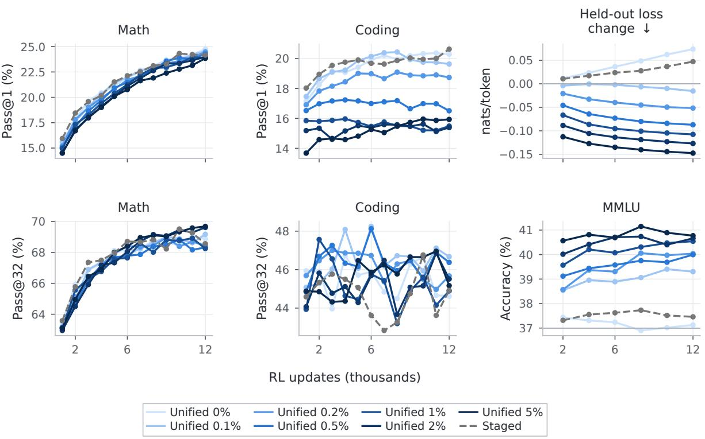  
Figure 20: Training curves for diferent midtraining data proportions. Each unified curve uses a constant configured proportion of 0, 0.1, 0.2, 0.5, 1, 2, or 5%; the dashed curves show staged training. Math and Coding average the two benchmarks in each domain, as defined in Appendix D.1, which also gives the evaluation sample counts.

<table><tr><td>Mixing</td><td>MATH pass@1</td><td>GSM pass@1</td><td>MATH pass@64</td><td>GSM pass@64</td><td>MATH pass@256</td><td>GSM pass@256</td></tr><tr><td>0%</td><td>16.83</td><td>32.68</td><td>66.73</td><td>83.88</td><td>78.20</td><td>91.81</td></tr><tr><td>0.1%</td><td>16.90</td><td>32.14</td><td>65.75</td><td>85.56</td><td>77.00</td><td>93.03</td></tr><tr><td>0.2%</td><td>16.56</td><td>32.35</td><td>65.03</td><td>84.74</td><td>76.20</td><td>92.49</td></tr><tr><td>0.5%</td><td>16.83</td><td>31.71</td><td>65.60</td><td>84.06</td><td>77.20</td><td>91.81</td></tr><tr><td>1%</td><td>16.11</td><td>31.61</td><td>65.85</td><td>83.71</td><td>76.00</td><td>91.74</td></tr><tr><td>2%</td><td>16.68</td><td>31.30</td><td>67.51</td><td>84.90</td><td>78.40</td><td>93.03</td></tr><tr><td>5%</td><td>16.91</td><td>30.80</td><td>67.45</td><td>85.15</td><td>77.20</td><td>92.72</td></tr><tr><td>Base model</td><td>6.54</td><td>17.84</td><td>53.67</td><td>80.15</td><td>70.20</td><td>91.51</td></tr><tr><td>Staged</td><td>16.98</td><td>31.35</td><td>66.17</td><td>84.50</td><td>78.00</td><td>92.34</td></tr><tr><td>Mixing</td><td>∆loss↓</td><td>MMLU</td><td>SciQ</td><td>ARC-C</td><td>MBPP+</td><td>HumanEval+</td></tr><tr><td>0%</td><td>+0.0737</td><td>37.12</td><td>50.20</td><td>27.90</td><td>25.41</td><td>15.17</td></tr><tr><td>0.1%</td><td>-0.0154</td><td>39.30</td><td>54.60</td><td>29.69</td><td>24.82</td><td>14.44</td></tr><tr><td>0.2%</td><td>-0.0516</td><td>40.04</td><td>54.30</td><td>31.06</td><td>23.71</td><td>13.76</td></tr><tr><td>0.5%</td><td>-0.0871</td><td>39.99</td><td>62.00</td><td>32.34</td><td>21.05</td><td>11.97</td></tr><tr><td>1%</td><td>-0.1076</td><td>40.54</td><td>66.10</td><td>33.53</td><td>19.31</td><td>11.66</td></tr><tr><td>2%</td><td>-0.1269</td><td>40.66</td><td>67.00</td><td>34.22</td><td>19.23</td><td>11.55</td></tr><tr><td>5%</td><td>-0.1474</td><td>40.77</td><td>65.10</td><td>30.12</td><td>20.97</td><td>10.90</td></tr><tr><td>Base model</td><td>0</td><td>37.00</td><td>51.00</td><td>31.23</td><td>21.05</td><td>11.97</td></tr><tr><td>Staged</td><td>+0.0472</td><td>37.46</td><td>53.00</td><td>31.48</td><td>25.74</td><td>15.51</td></tr></table>

Table 15: Mathematical accuracy and coverage at diferent midtraining proportions. The Base model row reports performance before RL; all other rows report final results after RL. MATH and GSM denote MATH-500 and GSM8K, and all scores are percentages. Pass@1 is estimated from 16 responses per problem; pass@64 and pass@256 use a separate evaluation with 256 responses per problem.

Table 16: Held-out loss and performance beyond math. The Base model row gives performance before RL, and the remaining rows give final results after mathematical RL. Scores are percentages; ∆loss is the change in held-out loss from the base model, in nats/token. The coding columns report pass@1 estimated from 16 responses per problem. ARC-C denotes ARC-Challenge.

Individual benchmarks. Figure 21 and Figure 22 separate the individual benchmarks that contribute to the reported Math and Coding averages. Increasing the midtraining proportion consistently lowers held-out corpus loss, but does not produce a corresponding improvement on every benchmark. Mathematical coverage is nonmonotonic: the highest proportions improve it modestly, while intermediate proportions show no consistent gain over zero mixing. Coding accuracy remains below the RL-only baseline, whereas Coding coverage exceeds that baseline at every nonzero proportion. For example, at 5% mixing, Coding pass@32 is 45.17%, compared with 44.62% for the RL-only baseline. Relative to the base model before RL, Coding accuracy is unchanged at 0.5% mixing and lower at 1, 2, and 5% (Table 14).

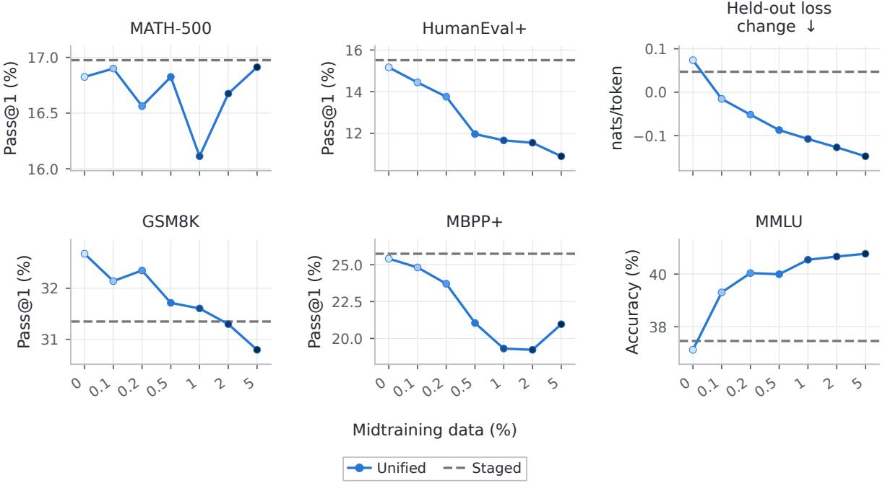  
Figure 21: Accuracy on individual benchmarks. Final pass@1 on MATH-500, GSM8K, HumanEval+, and MBPP+ is estimated from 16 responses per problem. The dashed reference shows staged training.

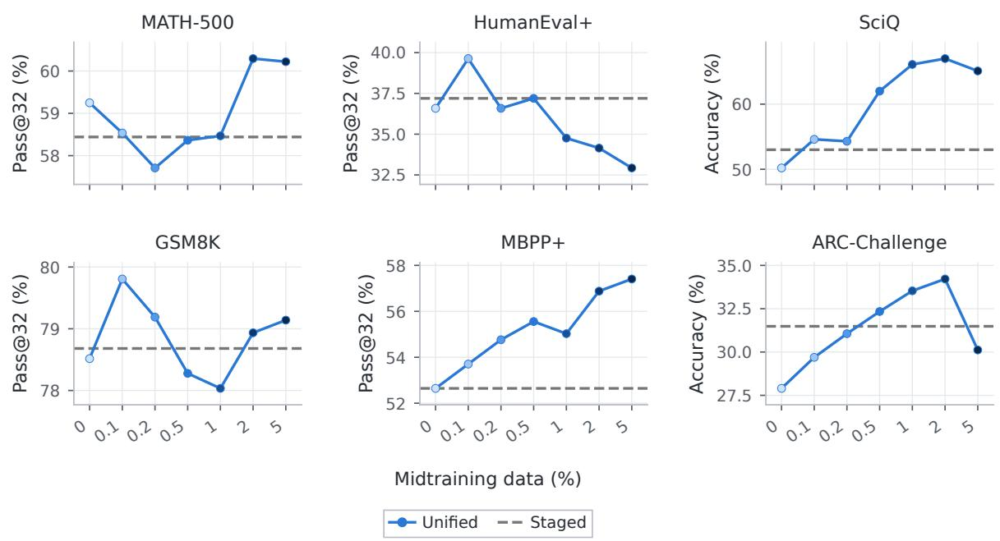  
Figure 22: Coverage and knowledge accuracy across midtraining proportions. Final results are shown for all seven configured midtraining proportions. Mathematical pass@32 is estimated from 256 responses per problem, and coding pass@32 from 32 responses per problem. SciQ and ARC-Challenge use the greedy evaluation protocol in Appendix D.1.

## D.3 Data Mixing Schedules

Schedules with the same average proportion. We next vary diferent midtraining schedules, holding the average configured proportion at 0.5%. The four schedules keep the proportion constant, decrease it linearly to zero at the end of training, increase it linearly from zero, or decrease it to zero halfway through training. Appendix A.1 gives their definitions and explains why equal configured averages need not yield identical realized token proportions.

Figure 23 shows the training curves, and Table 17 reports the final results. Ending midtraining exposure halfway through training allows Coding accuracy to improve further and preserves the SciQ gains, while held-out corpus loss increases. Mathematical performance and MMLU accuracy are similar across the four schedules: Math pass@1 spans 24.01–24.80%, Math pass@32 spans 68.32–68.94%, and MMLU spans 39.96–40.17%. Coding pass@32 ranges from 46.16% to 46.93%, and the schedules rank diferently on Coding pass@1 and pass@32. ARC-Challenge accuracy also varies with the schedule. These diferences show why the schedule comparison must consider retention, accuracy, and coverage separately.

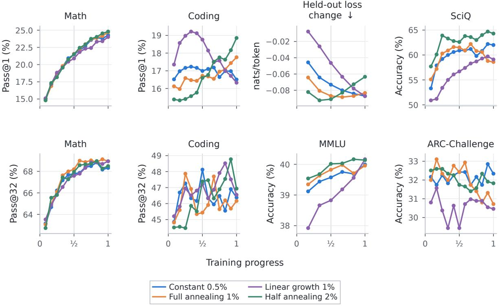  
Figure 23: Full results for the four mixing schedules. These are the runs in Figure 8, with additional panels for Math and Coding accuracy and coverage, held-out loss change, MMLU, SciQ, and ARC-Challenge. The vertical line marks the midpoint of training, when the half-annealing schedule stops adding midtraining data.

<table><tr><td>Schedule</td><td>Math pass@1</td><td>Math pass@32</td><td>Coding pass@1</td><td>Coding pass@32</td><td>∆loss↓</td><td>MMLU</td></tr><tr><td>Constant 0.5%</td><td>24.27</td><td>68.32</td><td>16.51</td><td>46.38</td><td>-0.0871</td><td>39.99</td></tr><tr><td>Full anneal 1%</td><td>24.70</td><td>68.94</td><td>17.76</td><td>46.16</td><td>-0.0833</td><td>39.96</td></tr><tr><td>Ramp to 1%</td><td>24.01</td><td>68.94</td><td>16.33</td><td>46.55</td><td>-0.0872</td><td>40.17</td></tr><tr><td>Half anneal 2%</td><td>24.80</td><td>68.49</td><td>18.85</td><td>46.93</td><td>-0.0634</td><td>40.14</td></tr></table>

Table 17: Results for the four mixing schedules. Each schedule has an average configured midtraining proportion of 0.5%. Scores are percentages, except ∆loss in nats/token. SciQ and ARC-Challenge appear in Figure 23.

SciQ

Additional schedules. Figure 24 extends the comparison to nine schedules: constant 0.2 or 0.5%, full decay from 0.2 or 0.5%, half decay from 1, 2, or 5%, and three-quarter decay from 1 or 2%. For each decay schedule, the stated percentage is the initial proportion; the proportion then decreases linearly to zero at the specified point in training.

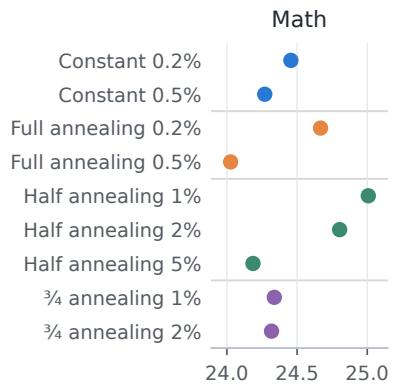  
Pass@1 (%)

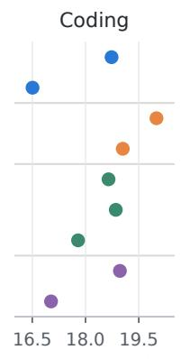  
Pass@1 (%)  
Held-out loss ↓

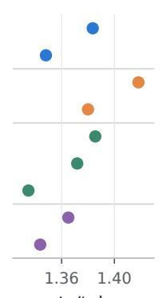  
nats/token

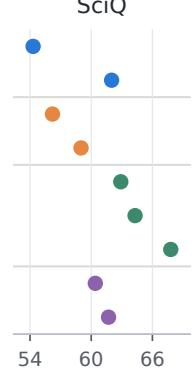  
Accuracy (%)

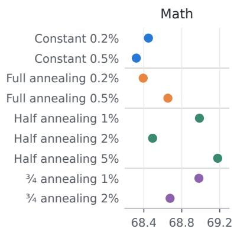  
Pass@32 (%)

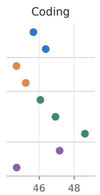  
Pass@32 (%)

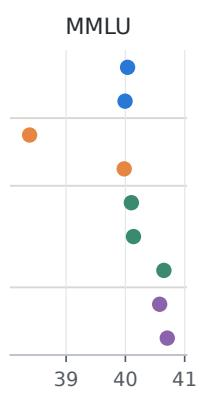  
Accuracy (%)

ARC-Challenge  
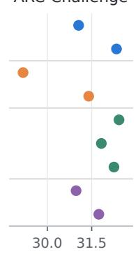  
Accuracy (%)

Figure 24: Results for additional mixing schedules. Full, half, and three-quarter annealing reach zero at the end, midpoint, and three-quarter point of training, respectively. The held-out loss panel reports loss in nats/token, rather than its change from the base model.

## D.4 Efect of Code Data

We examine whether changing the code data in the midtraining corpus can reduce the loss of coding accuracy during mathematical RL. The corpus has three designated code sources—CraneCode, StackEdu-FIM, and Code Meta-Reasoning—which together account for 24.8% of its tokens. We compare the original corpus with two variants. The first removes these sources and preserves the relative proportions of the remaining data. The second replaces their allocation with execution-tested Python answers from OpenCodeInstruct (Ahmad et al., 2025), using chat formatting and assistant-only loss. Removing the designated sources does not exclude all possible code from the other components, and replacement changes formatting and loss masking as well as content.

We evaluate each corpus with constant 0.5% mixing and with a proportion that decays linearly from 0.5% to zero over the full training run. Removing the designated code sources improves Coding accuracy under constant mixing, from 16.51% to 18.65%, but has little efect under full annealing (Figure 25 and Table 18). Replacing these sources does not improve Coding accuracy in either setting, although it improves Coding coverage under full annealing. The efect of corpus composition therefore depends on the mixing schedule and the metric.

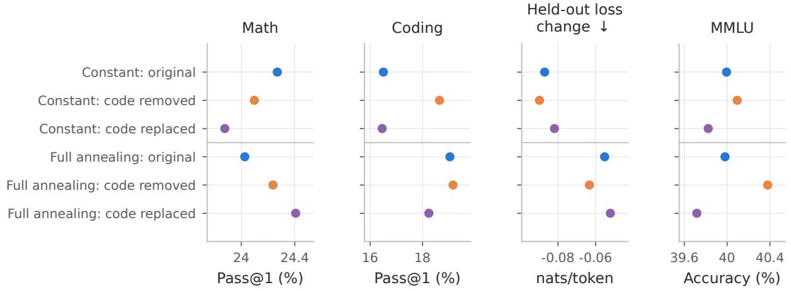

Figure 25: Efect of removing or replacing code data. We compare the original corpus with variants that remove its designated code sources or replace them with verified coding examples. Each corpus is evaluated with constant 0.5% mixing and full annealing from 0.5%. Math and Coding are the benchmark averages defined in Appendix D.1.
<table><tr><td>Setting</td><td>MATH</td><td>GSM</td><td>∆loss ↓</td><td>SciQ</td><td>MBPP+</td><td>HumanEval+</td></tr><tr><td>constant: original</td><td>16.83</td><td>31.71</td><td>-0.0871</td><td>62.00</td><td>21.05</td><td>11.97</td></tr><tr><td>constant: code removed</td><td>16.05</td><td>32.15</td><td>-0.0898</td><td>61.90</td><td>23.66</td><td>13.64</td></tr><tr><td>constant: code replaced</td><td>16.54</td><td>31.22</td><td>-0.0819</td><td>64.80</td><td>20.80</td><td>12.12</td></tr><tr><td>anneal: original</td><td>15.50</td><td>32.55</td><td>-0.0552</td><td>59.00</td><td>23.69</td><td>14.41</td></tr><tr><td>anneal: code removed</td><td>16.40</td><td>32.07</td><td>-0.0633</td><td>56.80</td><td>24.01</td><td>14.33</td></tr><tr><td>anneal: code replaced</td><td>17.00</td><td>31.81</td><td>-0.0522</td><td>61.70</td><td>23.38</td><td>13.11</td></tr></table>

Table 18: Results with diferent code data. Each corpus variant is evaluated with constant 0.5% mixing and with full decay from 0.5% to zero at the end of training. The original corpus is compared with variants that remove or replace its designated code sources, as described in Appendix D.4. Mathematical and coding scores are pass@1 (%); SciQ reports accuracy (%). MATH denotes MATH-500, GSM denotes GSM8K, and loss change is measured in nats/token relative to the base model.

## D.5 MaxRL versus REINFORCE

In section Section 3, we outline additional RL objectives that can also be fit into the unified training framework in addition to MaxRL. We compare MaxRL and REINFORCE at constant midtraining proportions of 0.5, 1, 2, and 5%, and with proportions that decrease linearly from 1 or 2% to zero halfway through training. Each comparison pairs the algorithms at the same configured proportion and schedule.

Constant 2% mixing. Figure 26 gives the training curves for the comparison in Table 19. At the final checkpoint, REINFORCE has higher Math accuracy than MaxRL, 24.81% versus 23.99%, while MaxRL has higher Math coverage. The higher mathematical coverage of MaxRL and the lower held-out loss of REINFORCE persist through the later part of training.
<table><tr><td>Method</td><td>Math pass@1</td><td>Math pass@32</td><td>Coding pass@1</td><td>Coding pass@32</td><td>∆loss↓</td><td>MMLU</td><td>SciQ</td><td>ARC-C</td></tr><tr><td>MAxRL</td><td>23.99</td><td>69.61</td><td>15.39</td><td>45.51</td><td>-0.127</td><td>40.66</td><td>67.00</td><td>34.22</td></tr><tr><td>REINFORCE</td><td>24.81</td><td>67.70</td><td>15.80</td><td>45.21</td><td>-0.157</td><td>40.69</td><td>71.70</td><td>36.43</td></tr></table>

Table 19: MaxRL and REINFORCE with a constant midtraining proportion of 2%. Scores are percentages, except held-out loss change relative to the base model, measured in nats/token. ARC-C denotes ARC-Challenge. Training curves and comparisons across mixing settings appear in Figs. 26 and 27.

Constant 2% midtraining data  
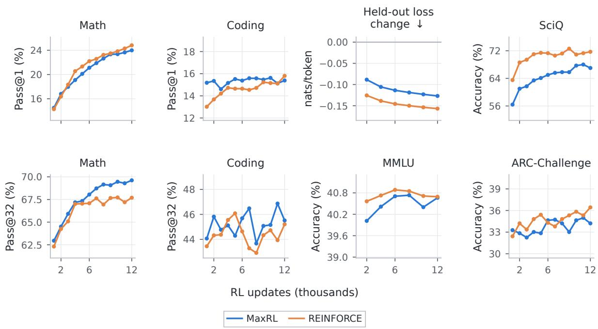  
Figure 26: MaxRL and REINFORCE with a constant midtraining proportion of 2%. Training curves for the runs in Table 19, evaluated using the protocol in Appendix D.1. Both algorithms use unified training; blue curves use MaxRL and orange curves use REINFORCE.

Comparison across mixing settings. Across the six settings in Figure 27, MaxRL consistently achieves higher mathematical coverage, while REINFORCE yields lower held-out corpus loss and higher SciQ and ARC-Challenge accuracy. The efects on mathematical accuracy and coding depend on the mixing proportion and schedule.

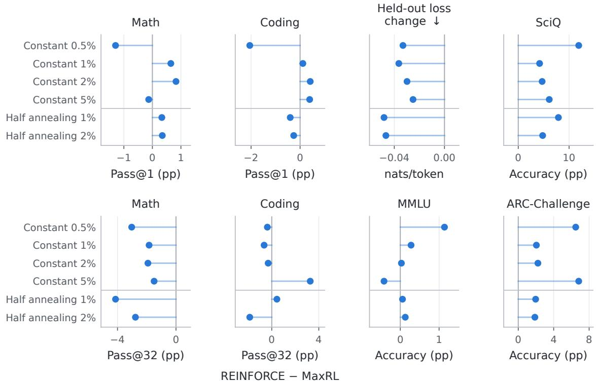  
Figure 27: Final MaxRL–REINFORCE comparison across mixing settings. Each diference subtracts the MaxRL result from the REINFORCE result at the same mixing proportion and schedule. Positive values therefore indicate a higher value under REINFORCE; for held-out loss, lower values are preferable. Diferences are in percentage points for performance metrics and nats/token for loss.

Table 20 reports the corresponding absolute results for both algorithms.
<table><tr><td>Mixing setting</td><td>Method</td><td>Math pass@1</td><td>Math pass@32</td><td>Coding pass@1</td><td>Coding pass@32</td><td>∆loss↓</td><td>MMLU</td><td>SciQ</td><td>ARC-C</td></tr><tr><td>Constant 0.5%</td><td>MAxRL</td><td>24.27</td><td>68.32</td><td>16.51</td><td>46.38</td><td>-0.087</td><td>39.99</td><td>62.00</td><td>32.34</td></tr><tr><td></td><td>REINFORCE</td><td>22.98</td><td>65.29</td><td>14.45</td><td>46.00</td><td>-0.120</td><td>41.13</td><td>73.90</td><td>38.82</td></tr><tr><td>Constant 1%</td><td>MAxRL</td><td>23.86</td><td>68.25</td><td>15.49</td><td>44.89</td><td>-0.108</td><td>40.54</td><td>66.10</td><td>33.53</td></tr><tr><td></td><td>REINFORCE</td><td>24.51</td><td>66.41</td><td>15.60</td><td>44.24</td><td>-0.144</td><td>40.82</td><td>70.30</td><td>35.58</td></tr><tr><td>Constant 2%</td><td>MAxRL</td><td>23.99</td><td>69.61</td><td>15.39</td><td>45.51</td><td>-0.127</td><td>40.66</td><td>67.00</td><td>34.22</td></tr><tr><td></td><td>REINFORCE</td><td>24.81</td><td>67.70</td><td>15.80</td><td>45.21</td><td>-0.157</td><td>40.69</td><td>71.70</td><td>36.43</td></tr><tr><td>Constant 5%</td><td>MAxRL</td><td>23.85</td><td>69.68</td><td>15.93</td><td>45.17</td><td>-0.147</td><td>40.77</td><td>65.10</td><td>30.12</td></tr><tr><td></td><td>REINFORCE</td><td>23.72</td><td>68.18</td><td>16.32</td><td>48.44</td><td>-0.172</td><td>40.35</td><td>71.20</td><td>36.95</td></tr><tr><td>Half anneal 1%</td><td>MAxRL</td><td>25.01</td><td>68.99</td><td>18.65</td><td>46.07</td><td>-0.050</td><td>40.10</td><td>62.90</td><td>32.42</td></tr><tr><td></td><td>REINFORCE</td><td>25.34</td><td>64.85</td><td>18.25</td><td>46.51</td><td>-0.098</td><td>40.16</td><td>70.80</td><td>34.39</td></tr><tr><td>Half anneal 2%</td><td>MAxRL</td><td>24.80</td><td>68.49</td><td>18.85</td><td>46.93</td><td>-0.063</td><td>40.14</td><td>64.30</td><td>31.83</td></tr><tr><td></td><td>REINFORCE</td><td>25.15</td><td>65.72</td><td>18.59</td><td>45.06</td><td>-0.110</td><td>40.26</td><td>69.10</td><td>33.70</td></tr></table>

Table 20: MaxRL and REINFORCE across midtraining proportions and schedules. Each pair of rows compares the two algorithms with the same configured proportion and schedule, giving the absolute final scores underlying the diferences in Figure 27. Half annealing decreases the stated initial proportion linearly to zero halfway through training. Scores are percentages, except held-out loss change relative to the base model, which is measured in nats/token. ARC-C denotes ARC-Challenge.

## D.6 Unified Training with Zero Mixing versus Staged RL

The 0% mixing condition uses the same asynchronous trainer and reward weighting as the other unified runs, providing a control for the efect of adding midtraining data. We compare this control with the staged RL reference to characterize the diferences between the two implementations. Both start from the same base model and train exclusively on mathematical RL data. At zero mixing, the unified objective contains only the RL term, so the two approaches coincide when data generation and optimization are identical. Our implementations difer in asynchronous execution and reward-baseline subtraction, as detailed below.

Asynchronous execution and data staleness. The unified trainer consumes responses generated by earlier policies while generation continues in parallel, following Section 4.3. Staged RL instead collects responses from the current policy before optimization. Asynchronous execution removes this synchronization requirement, allowing the trainer to proceed with available responses at the cost of policy staleness. We publish updated weights every four optimizer updates, but this interval is not a bound on the age of consumed data: the bufer retains the newest round from each generator even when its generating policy is more than four updates old.

To measure the staleness of available data, we inspected the newest completed round from each of eight generators at two points during training. These measurements used constant or full-decay 0.2% and 0.5% mixing, with the same weight-publication interval and bufer recency settings as the comparison here. The generating policies were 12–44 optimizer updates behind the latest logged trainer step. This range describes the data available in the inspected rounds. The policy versions of the examples actually consumed by the trainer were not logged, so these snapshots do not give the exact age distribution of the training data.

Baseline subtraction. Unified training weights responses by $r / \hat { p } .$ , whereas staged MaxRL uses $( r - { \hat { p } } ) / { \hat { p } } .$ omitting numerical stabilizers here. Replacing pˆ by the population pass rate $p _ { \theta } ( x ) > 0$ , the two weights yield the same expected on-policy gradient because

$$
\begin{array} { r } { \mathbb { E } _ { y \sim \pi _ { \theta } ( . | x ) } [ \nabla _ { \theta } \log \pi _ { \theta } ( y \mid x ) ] = 0 . } \end{array}
$$

Thus, subtracting the prompt-dependent baseline leaves the population MaxRL gradient in Section 3.1 unchanged. The finite-sample updates nevertheless difer, and this on-policy identity does not apply unchanged to responses generated by an earlier policy.

Training speed. Over 12000 updates, the production logs record approximately 3.7 seconds per update for unified training at 0% mixing and 28.8 seconds for staged RL, a 7.8× diference in update throughput. These timings exclude launch and restart downtime and correspond to the implemented systems, which use 24 and 16 GPUs, respectively. The asynchronous trainer can reuse available responses across updates, so this comparison measures optimization throughput rather than the rate of generating fresh rollouts.

Task performance and retention. Figure 7 shows similar mathematical accuracy for zero mixing and staged RL: Math pass@1 is 24.75% and 24.16%, respectively. Zero mixing has slightly higher mathematical coverage, with pass@32 of 68.88% compared with 68.56%, but a larger increase in held-out corpus loss, 0.074 versus 0.047 nats/token. This comparison reflects the complete implementations and does not isolate the efects of staleness or baseline subtraction individually.

## D.7 Coding RL after Mathematical Training

Initialization. We continue training on coding tasks using the staged mathematical model and four unified models trained with constant midtraining proportions of 0.5, 1, 2, and 5%. Each model starts from its final mathematical-training checkpoint. Curve labels identify the models’ mathematical training histories; all subsequently use the same coding RL configuration without midtraining data. The comparison therefore tests how the preceding training afects adaptation to coding.

Data and training. We use 20000 Python problems from KodCode-V1 (Xu et al., 2025), comprising 10000 labeled medium dificulty and 10000 labeled hard dificulty. The reward is one if the generated program passes all supplied unit tests and zero otherwise. All models use the shared training settings in Table 21.

<table><tr><td>Setting</td><td>Value</td></tr><tr><td>Algorithm</td><td>On-policy MAxRL with reward-baseline subtraction</td></tr><tr><td>Optimizer</td><td>Fresh AdamW</td></tr><tr><td>Adam  $( \beta _ { 1 } , \beta _ { 2 } ) ; \varepsilon$ </td><td>(0.9, 0.999); 10−8</td></tr><tr><td>Weight decay; gradient clipping norm</td><td>0;1  $1 0 ^ { - 6 }$ </td></tr><tr><td>Learning rate / schedule</td><td>/ constant, no warmup</td></tr><tr><td>Prompts per update</td><td></td></tr><tr><td>Responses per prompt</td><td>16</td></tr><tr><td>Global batch size</td><td>512 responses</td></tr><tr><td>Prompt + response limit (tokens)</td><td>1024</td></tr><tr><td>Temperature / top-k / top-p</td><td>1 / 50 / 0.95</td></tr><tr><td>KL penalty coefficient</td><td>0</td></tr></table>

Table 21: Hyperparameters for coding and WebInstruct RL. All models use these same RL settings when trained on coding tasks or on WebInstruct after mathematical training.

Evaluation. Figure 9 reports coding pass@1 and pass@16 at updates 0, 1000, 2000, 3000, and 4000. Both metrics are estimated from 16 responses for each of the 164 HumanEval+ and 378 MBPP+ problems, using the EvalPlus tests and decoding settings in Appendix D.1. Step zero is the recorded evaluation of the mathematical checkpoint used to initialize coding RL; later points evaluate the corresponding coding checkpoints. Table 22 reports the final coding scores.

To assess retention during this subsequent training, we also evaluate mathematics, general knowledge, and held-out midtraining loss. For MATH-500 and GSM8K, we estimate pass@1 and pass@16 from 16 responses per problem. MMLU uses zero-shot answer-choice likelihoods, while SciQ and ARC-Challenge use greedy decoding. Held-out corpus loss uses the same equally weighted average over 24 components as in Appendix D.1.

<table><tr><td rowspan="2">Mathematical training</td><td colspan="2">HumanEval+</td><td colspan="2">MBPP+</td></tr><tr><td>Pass@1</td><td>Pass@16</td><td>Pass@1</td><td>Pass@16</td></tr><tr><td>Staged</td><td>22.94</td><td>45.12</td><td>29.81</td><td>52.12</td></tr><tr><td>Unified 0.5%</td><td>23.67</td><td>43.90</td><td>30.31</td><td>52.91</td></tr><tr><td>Unified 1%</td><td>23.70</td><td>45.12</td><td>29.94</td><td>54.76</td></tr><tr><td>Unified 2%</td><td>24.09</td><td>44.51</td><td>31.76</td><td>56.88</td></tr><tr><td>Unified 5%</td><td>24.96</td><td>46.95</td><td>32.69</td><td>58.47</td></tr></table>

Table 22: Coding performance after subsequent RL. Scores are measured after 4000 coding RL updates and reported in percent. Percentages in the model labels identify the midtraining proportions during mathematical training. Both metrics use 16 responses per problem; bold indicates the highest score in each column.

Performance beyond coding. Figure 28 shows how mathematical performance and general knowledge change during coding RL. Mathematical accuracy remains close to its starting level, while coverage can increase or decrease depending on the initialization. All unified models retain higher MMLU and SciQ accuracy than staged training after 4000 updates. Held-out corpus loss increases for every model, but the increase is smaller for the unified models, whose final loss also remains lower.

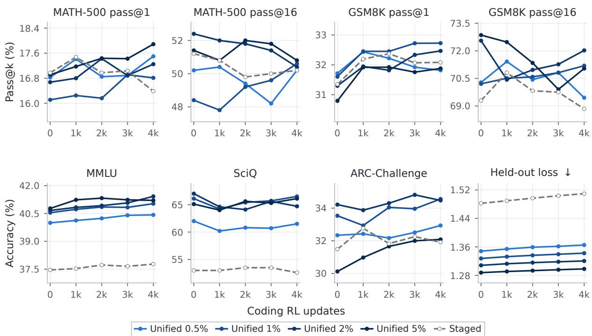  
Figure 28: Mathematical performance and retention during coding RL. The initializations and coding updates are the same as in Figure 9. Percentages denote constant midtraining proportions during the preceding mathematical training. Pass@1, pass@16, and benchmark accuracy are in percent; held-out loss is in nats/token. Mathematical accuracy remains close to its starting level, while changes in coverage vary across models. Held-out loss increases for every model.

## D.8 WebInstruct RL after Mathematical Training

Initialization and training. To examine subsequent learning beyond coding, we train on WebInstruct starting from the staged mathematical model and the unified models trained with constant midtraining proportions of 2 and 5%. WebInstruct training is a separate continuation of mathematical training. All three models use the same on-policy MaxRL procedure without midtraining data, with the hyperparameters in Table 21.

Data and reward. We randomly sample 20000 nonmathematical training questions from WebInstructverified and its unfiltered release (Ma et al., 2026), covering fields such as physics, chemistry, business, and history. We reserve disjoint sets of 512 validation and 1000 test questions. The selected questions have numerical or free-form answers; decimal-number answer types are excluded. The binary reward is one only when the extracted final answer is accepted by the General-Reasoner verifier and satisfies the answer-format checks. Numerical answers must also pass an additional 1% relative-error check.

Evaluation. We monitor validation accuracy every 100 updates by generating 16 responses for each of the 512 validation questions and measuring the fraction of responses that receive reward one. Separately, we evaluate test pass@1 and pass@64 at updates 0, 1000, 2000, and 3000, using 64 responses per question and the estimator in Appendix C.4. Test sampling uses temperature 1, top-k 50, top-p 0.95, and up to 1024 response tokens within a 2048-token context.

Three test prompts exceed the 1024-token prompt budget and are excluded at every checkpoint, leaving a fixed set of 997 questions. In addition to the overall scores, we report results separately for the 502 questions with numerical answers (integers, percentages, and fractions) and the 495 with free-form answers (strings, lists, and expressions).

Results. Figure 29 shows that both unified models begin with lower validation and test accuracy than staged training but achieve higher accuracy after 3000 updates. The 2% model also achieves higher test pass@64, whereas the 5% model remains slightly below staged training on this metric. The answer-type breakdown shows higher final free-form accuracy and coverage for both unified models than for staged training; on numerical answers, only the 2% model achieves higher coverage. These results provide further evidence that unified training can yield a better starting point for subsequent learning, with benefits that vary across answer types and metrics.

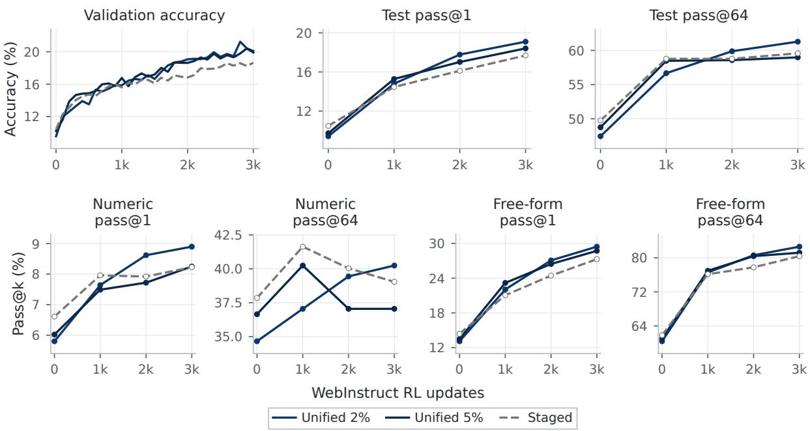  
Figure 29: WebInstruct RL after mathematical training. Percentages identify the midtraining proportions during mathematical training; all models then use the same WebInstruct RL procedure without midtraining data. The top row shows validation accuracy and overall test performance; the bottom row separates test performance by numerical and free-form answers. All performance metrics are in percent.

## E Comparison with KL Regularization

Mixing midtraining data during RL may help preserve knowledge acquired before RL. Here we ask whether a KL penalty that discourages changes from the base model can provide the same benefits. Using the real-world data setting of Section 5.2, we compare unified training with mathematical RL augmented by a sampled KL penalty. The comparison measures both mathematical performance and retention, so that preserving the base model can be assessed alongside learning from RL.

Experimental setup. All comparisons start from the same base model, use Math12K prompts for RL, and follow the same benchmark protocol. For unified training, we use the constant-mixture runs in Figure 7, whose midtraining proportions are 0.2, 0.5, 1, 2, and 5%. The KL runs receive no midtraining data during RL. They use the asynchronous RL configuration and optimizer of the zero-mixing control, with 512 RL responses per update and 12000 updates. Within this group, we vary only the penalty coeficient, $\beta \in \{ 0 , 0 . 0 0 1 , 0 . 0 1 , 0 . 1 \} ; \beta = 0$ is the unregularized control.

KL penalty. The reference policy is a frozen copy of the base model. For each sampled RL response token, we subtract the current-policy log-probability from the reference log-probability and clip this diference to [−20, 20]. Writing the clipped diference as u, the token penalty is $e ^ { u } - u - 1$ . The log-probabilities are computed over the full vocabulary. We apply the penalty to tokens in both correct and incorrect responses, multiply it by $\beta ,$ and add it to the weighted token-loss numerator. The resulting loss uses the same normalization as the RL term.

Evaluation. We use two held-out loss measurements, with diferent evaluation sets and averaging conventions. During training, the trainer evaluates a fixed set of 512 held-out midtraining windows every 200 updates and at the final checkpoint. This validation loss averages over the tokens in those windows and provides the curves in Figure 30. The benchmark evaluation instead measures loss separately on the 24 midtraining corpus components and gives each component equal weight, following Appendix D.1. This component-averaged corpus loss appears alongside the task benchmarks in Figure 31. The two loss measurements should therefore be interpreted separately.

The task benchmarks use the evaluation protocol in Appendix D.1. The benchmark comparison includes all three nonzero KL coeficients and all five unified mixtures. The training-time validation curves also include the unregularized control $( \beta = 0 )$

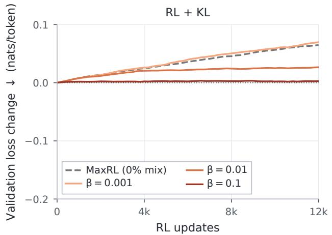

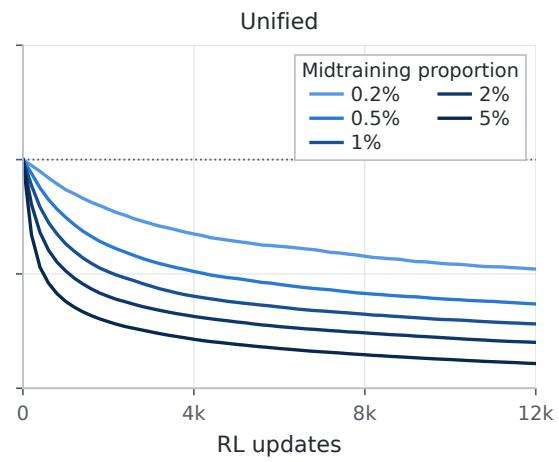  
Figure 30: Midtraining validation loss during KL-regularized RL and unified training. Each curve shows the change from the common base-model value, measured on the trainer’s fixed set of 512 held-out midtraining windows. This loss averages over tokens in the validation windows; it is distinct from the equally weighted average over corpus components in Figure 31. Negative values indicate improvement over the base model. Curves show recorded evaluations without smoothing.

Results. Increasing the nonzero KL coeficient reduces the deterioration in midtraining validation loss, as shown in Figure 30. However, the strongest penalty (β = 0.1) also substantially reduces mathematical accuracy and coverage relative to the weaker penalties (Figure 31). Unified training reduces the validation loss below the base-model value without this large reduction in mathematical performance. The benchmark evaluation shows a similar retention benefit: at the final checkpoints, all five unified mixtures achieve higher MMLU accuracy than any of the KL-regularized runs. The mixtures of 0.5% and above also achieve higher SciQ accuracy; the 0.2% mixture scores slightly below the weakest KL penalty on SciQ.

These benefits do not extend uniformly to every metric. The weaker KL penalties yield higher coding accuracy, and the strongest KL penalty achieves the highest coding coverage among the tested settings. ARC-Challenge accuracy shows no consistent advantage for either approach. Nevertheless, none of the tested KL penalties reproduces the combination of mathematical performance, lower componentaveraged corpus loss, and higher SciQ and MMLU accuracy obtained with unified training. In this setting, regularizing toward the base policy therefore does not reproduce the full benefit of continuing to learn from midtraining data.

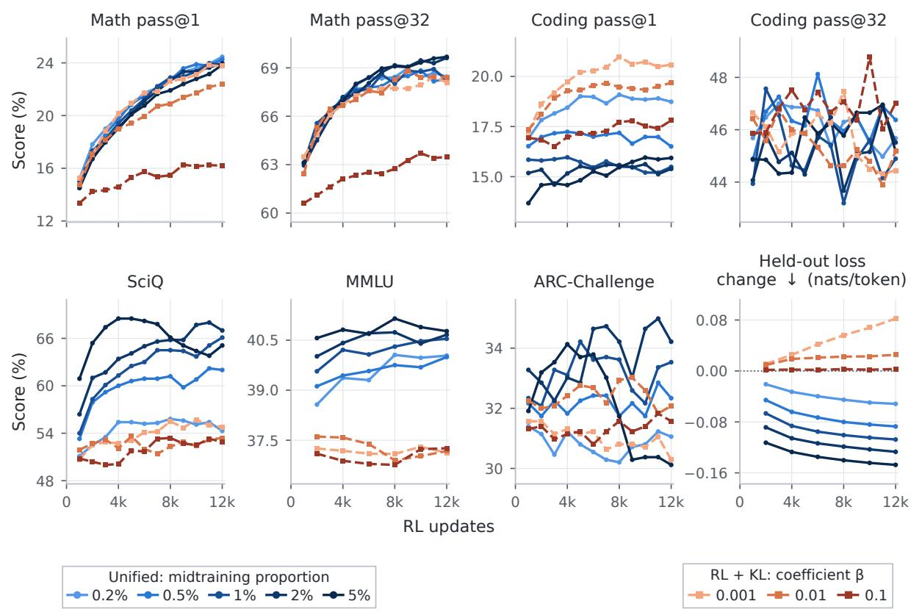  
Figure 31: Benchmark performance during KL-regularized RL and unified training. Solid blue curves show unified training at five midtraining proportions; dashed orange curves show RL with three KL coeficients. Markers indicate recorded evaluations, joined without smoothing. Math and Coding average the two benchmarks in each domain, as defined in Appendix D.1. Math pass@32 uses 256 responses per problem, and Coding pass@32 uses a separate 32-response evaluation. Held-out loss change gives equal weight to each of the 24 midtraining corpus components, with negative values indicating improvement over the base model. It is distinct from the token-averaged validation loss in Figure 30.

## F Policy Gradient Objectives and Continuous Rewards

We now show how the likelihood framework of Section 3.2 recovers the policy gradients of REINFORCE and TailRL. For each method, we construct a target distribution and prompt weighting from a fixed generation policy and express the resulting update using the common likelihood loss $\mathcal { L } ( \boldsymbol { \theta } ; \boldsymbol { q } )$ . When the generation policy is the current model, these likelihood updates recover the corresponding policy gradients. Table 2 summarizes these choices for on-policy updates.

## F.1 REINFORCE

For binary rewards, REINFORCE and MaxRL fit the same distribution of correct completions. However, REINFORCE weights each prompt by its success probability, giving greater weight to prompts on which the generation policy is more likely to succeed.

We now show that, for general nonnegative rewards, REINFORCE fits a reward-weighted target distribution, with each prompt weighted by its expected reward. For a fixed generation policy ν and rewards $r ( x , y ) \geq 0 ,$ let $p _ { \nu } ( x ) : = \mathbb { E } _ { y \sim \nu ( \cdot | x ) } [ r ( x , y ) ]$ denote the expected reward on prompt x. For $0 < p _ { \nu } ( x ) < \infty$ define the reward-weighted target

$$
\nu ^ { + } ( y \mid x ) = \frac { \nu ( y \mid x ) r ( x , y ) } { p _ { \nu } ( x ) } .
$$

For binary rewards, this is ν conditioned on correctness.

The likelihood update. We weight each prompt’s likelihood loss by $p _ { \nu } ( x )$ to cancel the normalization in $\nu ^ { + }$

$$
\mathcal { L } _ { \mathrm { R F } } ( \theta ; \rho \circ \nu ) : = - \mathbb { E } _ { x \sim \rho } \mathbb { E } _ { y \sim \nu ^ { + } ( \cdot \vert x ) } [ p _ { \nu } ( x ) \log \pi _ { \theta } ( y \mid x ) ] .\tag{3}
$$

Diferentiating gives

$$
\begin{array} { r } { - \nabla _ { \theta } \mathcal { L } _ { \mathrm { R F } } ( \theta ; \rho \circ \nu ) = \mathbb { E } _ { x \sim \rho } \mathbb { E } _ { y \sim \nu ^ { + } ( \cdot \vert x ) } [ p _ { \nu } ( x ) \nabla _ { \theta } \log \pi _ { \theta } ( y \mid x ) ] } \\ { = \mathbb { E } _ { x \sim \rho } \mathbb { E } _ { y \sim \nu ( \cdot \vert x ) } [ r ( x , y ) \nabla _ { \theta } \log \pi _ { \theta } ( y \mid x ) ] . } \end{array}
$$

Setting $\nu = \pi _ { \theta _ { t } }$ and evaluating at $\theta = \theta _ { t }$ recovers the REINFORCE policy gradient in Eq. (1). For a diferent generation policy, the likelihood update fits the reward-weighted target $\nu ^ { + }$ and need not match the current policy’s gradient.

Efective prompt distribution. To express the weighted loss using the common loss $\mathcal { L } ( \boldsymbol { \theta } ; \boldsymbol { q } )$ , we absorb $p _ { \nu } ( x )$ into the prompt distribution. Define

$$
Z : = \mathbb { E } _ { x \sim \rho } [ p _ { \nu } ( x ) ] , \qquad \rho _ { \mathrm { R F } } ( x ) : = { \frac { \rho ( x ) p _ { \nu } ( x ) } { Z } } ,
$$

assuming $0 < Z < \infty$ . The weighted loss in Eq. (3) can therefore be written as $Z \mathcal { L } ( \theta ; \rho _ { \mathrm { R F } } \circ \nu ^ { + } )$ . Here $\nu ^ { + }$ specifies the completion target, while ρRF reweights the original prompt distribution $\rho$ by the expected reward $p _ { \nu } ( x )$ . Since the generation policy is fixed, Z is independent of $\theta$ and scales the likelihood gradient. When combining this RL loss with the likelihood losses for pretraining, midtraining, or $\mathrm { S F T }$ , we absorb $Z$ into the RL source weight to preserve their relative weighting.

Baselines and reward normalization. The likelihood formulation also applies to rewards with a finite lower bound, which can be shifted to be nonnegative. A fixed prompt-dependent baseline $b _ { t } ( x )$ contributes zero to the population on-policy gradient, since

$$
\mathbb { E } _ { y \sim \pi _ { \theta _ { t } } ( \cdot | x ) } [ \nabla _ { \theta } \log \pi _ { \theta } ( y \mid x ) ] _ { \theta = \theta _ { t } } = 0 .
$$

Thus, for a lower bound $b ( x )$ independent of $\theta ,$ the likelihood construction applies to the shifted reward $r ( x , y ) - b ( x ) \geq 0$ without changing the REINFORCE gradient. This baseline invariance relies on on-policy sampling and need not hold for uncorrected updates using data from an earlier policy.

Prompt-dependent reward scaling changes the relative prompt weights. Let $b _ { t } ( x )$ be a prompt-dependent baseline and $s _ { t } ( x ) > 0$ a prompt-dependent scale, both held fixed during the update. Subtracting the baseline contributes zero to the expected on-policy gradient. Thus, using $( r ( x , y ) - b _ { t } ( x ) ) / s _ { t } ( x )$ gives the same expected gradient as using $r ( x , y ) / s _ { t } ( x )$

For nonnegative rewards, this gradient is recovered at $\theta = \theta _ { t }$ by a likelihood update with target $\pi _ { \theta _ { t } } ^ { + }$ and prompt weight $p _ { \theta _ { t } } ( x ) / s _ { t } ( x )$ . The target and prompt weight are defined using the original reward $r ( x , y )$

The normalized reward itself need not be nonnegative. For binary rewards, choosing the population standard deviation $s _ { t } ( x ) = \sqrt { p _ { \theta _ { t } } ( x ) ( 1 - p _ { \theta _ { t } } ( x ) ) }$ as the scale gives prompt weight $\sqrt { p _ { \theta _ { t } } ( x ) / ( 1 - p _ { \theta _ { t } } ( x ) ) }$ for $0 < p _ { \theta _ { t } } ( x ) < 1$ , as in the population analysis of GRPO (Tajwar et al., 2026).

These identities concern expected on-policy gradients with fixed, prompt-dependent baselines and scales. Empirical advantages, policy ratios, clipping, and KL penalties in PPO and GRPO need not preserve the fixed-target likelihood formulation (Schulman et al., 2017; Shao et al., 2024).

## F.2 Continuous Rewards with TailRL

TailRL (Ramasubramanian et al., 2026) extends MaxRL to continuous rewards by averaging over binary success events defined by reward thresholds. For rewards $r ( x , y ) \in [ 0 , 1 ]$ , the probability of exceeding a threshold τ is

$$
q _ { \theta } ( x , \tau ) : = \operatorname* { P r } _ { y \sim \pi _ { \theta } ( \cdot | x ) } ( r ( x , y ) > \tau ) .
$$

The objective averages the log-probability of success uniformly over thresholds:

$$
J _ { \mathrm { T a i l } } ( \theta ) : = \mathbb { E } _ { x \sim \rho } \biggl [ \int _ { 0 } ^ { 1 } \log q _ { \theta } ( x , \tau ) d \tau \biggr ] .
$$

A target at each reward threshold. For a fixed generation policy $\nu ,$ let $q _ { \nu } ( x , \tau )$ be its probability of exceeding threshold τ. Assume that $q _ { \nu } ( x , \tau ) > 0$ for $\tau < 1$ and that the TailRL objective is finite. The corresponding success-conditioned target is

$$
\nu _ { \tau } ^ { + } ( y \mid x ) : = \frac { \nu ( y \mid x ) \mathbf { 1 } \{ r ( x , y ) > \tau \} } { q _ { \nu } ( x , \tau ) } .
$$

Combining the targets. The likelihood target combines these conditional distributions using the same uniform weighting over thresholds as the objective:

$$
\nu _ { \mathrm { T a i l } } ( y \mid x ) : = \int _ { 0 } ^ { 1 } \nu _ { \tau } ^ { + } ( y \mid x ) d \tau .
$$

This mixture is a probability distribution because each conditional target is normalized. The threshold is integrated out, so the model continues to condition only on the prompt x. Fitting the mixture gives

$$
\begin{array} { r l } & { - \nabla _ { \theta } \mathcal { L } ( \theta ; \rho \circ \nu _ { \mathrm { T a i l } } ) = \mathbb { E } _ { x \sim \rho } \mathbb { E } _ { y \sim \nu _ { \mathrm { T a i l } } ( \cdot \vert x ) } [ \nabla _ { \theta } \log \pi _ { \theta } ( y \mid x ) ] } \\ & { \phantom { \frac { 1 } { 1 } } = \mathbb { E } _ { x \sim \rho } \left[ \int _ { 0 } ^ { 1 } \mathbb { E } _ { y \sim \nu _ { \tau } ^ { + } ( \cdot \vert x ) } [ \nabla _ { \theta } \log \pi _ { \theta } ( y \mid x ) ] d \tau \right] . } \end{array}
$$

Setting $\nu = \pi _ { \theta _ { t } }$ and evaluating at $\theta = \theta _ { t }$ recovers $\nabla _ { \theta } J _ { \mathrm { T a i l } } ( \theta _ { t } )$ . Thus, the corresponding likelihood update uses the joint target distribution $q = \rho \circ \nu _ { \mathrm { T a i l } }$ . For a diferent generation policy, the likelihood update fits the mixture target induced by that policy and need not match the current policy’s TailRL gradient.

Binary rewards and finite samples. For binary rewards, every threshold $\tau \in [ 0 , 1 )$ selects the same success event, so the objective and target reduce to those of $\mathrm { M A X R L }$ .

The derivation of the TailRL update concerns population gradients. The finite-sample MaxRL identity in Section 4.2 applies specifically to binary rewards. For continuous rewards, estimation must also account for the diferent reward thresholds. Ramasubramanian et al. (2026) derive the corresponding estimators and the finite-order TailRL objectives whose gradients they estimate.