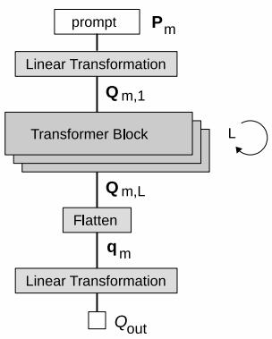
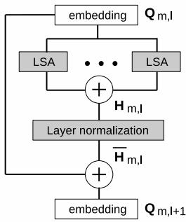
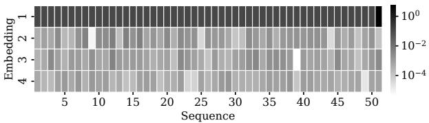
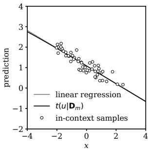
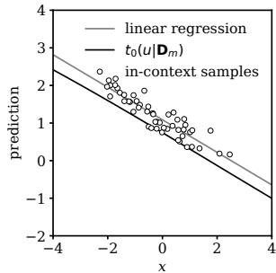
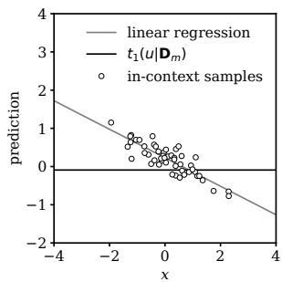
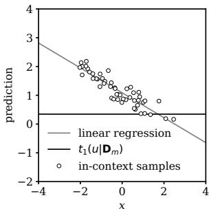

# In-context learning of solution to simple linear regression task using transformer with masked linear self-attention

Katsuyuki Hagiwara

Faculty of Education, Mie University hagi@edu.mie-u.ac.jp

## Abstract

In-context learning is a remarkable property of transformers and has recently received a lot of interest. In many studies of in-context learning, it has been shown that transformers are capable of implementing solvers for linear and nonlinear regression problems, in which the most of them implement gradient descent algorithm. However, it is still unclear whether those implementations have actually been acquired through training. In this paper, we constructed a transformer with masked linear self-attention, which in-context learns the least squares estimate in a simple regression task. The point here is that the closed form (analytical) solution is obtained by using layer normalization rather than an approximate solution based on the gradient descent algorithm. Then, we showed an experimental example, in which, by taking the non-uniqueness of the transformer representation into account, our implementation for a closed form solution is used in the transformer trained with the $\ell _ { 1 }$ regularization when the target output is the least squares estimate.

keywords in-context learning, transformer, linear self-attention, a simple linear regression, layer normalization, mask

## 1 Introduction

In-context learning is a remarkable property of transformers, which form the basis of large language models such as GPT-3 [4], and it has been the subject of recent research. In-context learning is a capability of transformers to learn new tasks at inference time solely by processing context (sequence) provided in the prompt, without modifying the model’s underlying weights or undergoing additional training. It is natural to think that transformers acquire, through training, the algorithms to solve tasks via in-context learning. In this regard, it has been demonstrated that transformers are capable of implementing various algorithms, particularly in regression tasks [1, 2, 3, 6, 12].

[6] empirically studied the in-context learning abilities of transformers for various function classes in machine learning, including the linear function class. In particular, for linear functions, a trained transformer performs similarly to the least squares solution. [12] provided an explicit construction of a single linear self-attention layer that implements a single step of the gradient descent algorithm on the mean squared error loss. Additionally, they empirically showed that several self-attention layers can iteratively perform curvature correction, improving upon the plain gradient descent algorithm. [2] proved that a transformer can implement a gradient descent algorithm and a single Sherman-Morrison update for a ridge regression problem. While the works of [6, 12, 2] do not consider the training phase, [1] proved the global minimum of the training objective implements a single iteration of preconditioned gradient descent when the target is a linear function. In [1], even though the training objective is the expected error, the results of the numerical experiments are shown to closely match the theory. The similar result has obtained also in [11]. More recently, [3] showed that transformers can implement a broad class of standard machine learning algorithms in context, such as least squares, ridge regression, and Lasso. In contrast to [2], [3] precisely evaluated the prediction performance in terms of network size, and shown a near-optimal predictive power. [3] also demonstrated the algorithm selection ability of transformers, such as regularization selection according to validation error for ridge regression.

These works have investigated regression problems, finding that the solver implemented by a transformer is basically the gradient descent algorithm except for a part of [2]. This is natural since the attention mechanism in a transformer computes the product of the inputs, which is exactly what is required for the gradient descent method for especially linear regression problems. In a linear regression problem, however, the least squares estimate is analytically obtained by calculating the matrix inverse, which requires division. Consequently, the gradient descent algorithm implicitly calculates this division by repeatedly performing multiplication and addition. On the other hand, [2] showed that a transformer can implement a single Sherman-Morrison update for a ridge regression problem, in which the division is implemented using layer normalization. Applying this idea, [8] showed that a transformer with linear self-attention can approximately implement a closed form solution to a simple regression task. Although it is found that the implementation is mainly used in the transformer trained with $\ell _ { 1 }$ regularization when the target output is the least squares estimate, unfortunately, the trained transformer is not fully explained. This may be caused by the assumption in the implementation, which is that the sequence length in the prompt is suficiently large. In this paper, we provide a construction of a transformer with a masked linear-self attention, which implements a closed form (analytical) solution to the least squares estimate of a simple regression task. The implementation does not require the above assumption in [8] due to the introduction of a mask. We then present a numerical example, in which this implementation is actually used in the transformer trained with the $\ell _ { 1 }$ regularization when the target is the least squares estimate.

This paper is organized as follows. Section 2 formulates our problem setting. Section 3 presents the construction of a transformer that calculates the least squares estimate based on in-context samples. Section 4 provides a numerical example of training to demonstrate that this construction is actually valid. Finally, Section 5 concludes the paper and discusses future work.

## 2 Problem setting

## 2.1 Notations

In this paper, $\mathbf { O } _ { I , J }$ is the $I \times J$ zero matrix and $\mathbf { I } _ { J }$ is a $J \times J$ identity matrix. Note that we use this notation also for vectors, where either � or � equals 1. For an $I \times J$ matrix $\mathbf { A } , \mathbf { A } [ i , j ]$ is the $( i , j )$ -entry of $\mathbf { A } , \mathbf { A } [ i , : ]$ is the �-th row vector of A and $\mathbf { A } [ : , j ]$ is the �-th column vector of A for $i = 1 , \dots , I$ and $j = 1 , \dots , J$ . When A is an $I \times 1$ vector, $\mathbf { A } [ i ]$ denotes its �-th entry. $\mathbf { A } [ i _ { 1 } : i _ { 2 } , : ]$ is a submatrix of A consisting of rows $i _ { 1 }$ through $i _ { 2 }$ . The same applies to submatrices consisting of columns.

## 2.2 Setting of in-context learning of transformer

We next explain the transformer-based in-context learning of a simple linear regression task. Let � be the number of training data for the transformer. Let $( x , y )$ be a pair of input-output variables in a simple regression problem. At each � in $\{ 1 , \ldots , M \}$ , a set of � random samples of $( x , y )$ , which is denoted by $\{ ( x _ { m , n } , y _ { m , n } ) : n = 1 , \ldots , N \}$ }, are generated. We denote the �-th prompt (input to the transformer) by ${ \bf P } _ { m }$ , which is an $( N + 1 ) \times 3$ matrix and whose �-th row is

$$
{ \bf P } _ { m } [ n , : ] = \left[ 1 \mathrm { ~ } x _ { m , n } \mathrm { ~ } y _ { m , n } \right] ,\tag{1}
$$

where we define $y _ { m , N + 1 } : = 0$ and $x _ { m , N + 1 } : = u _ { m }$ that is a prediction point; $\mathrm { e . g . }$ . see [2]. Thus, the input sequence length is $N + 1$ and the number of in-context samples is �. We assume that, for each $x _ { m , n } , y _ { m , n }$ is generated by

$$
y _ { m , n } = \theta _ { m , 0 } + \theta _ { m , 1 } x _ { m , n } + \varepsilon _ { m , n } ,\tag{2}
$$

where $\varepsilon _ { m , 1 } , \ldots , \varepsilon _ { m , N } , m \ = \ 1 , \ldots , M$ are i.i.d. additive noises from a probability distribution with mean 0 and variance $\sigma ^ { 2 } < \infty$ . Our goal is to obtain the least squares prediction at $\boldsymbol { x } = \boldsymbol { u } _ { m }$ for the prompt ${ \bf P } _ { m }$ . Therefore, for each �, we need to calculate the least squares solution using

$$
\mathbf { D } _ { m } = \{ ( x _ { m , n } , y _ { m , n } ) : n = 1 , \ldots , N \} ,\tag{3}
$$

which is the set of in-context samples. The important point is that the regression lines can be diferent for each $m .$ . Thus, we may assume that $( \theta _ { m , 0 } , \theta _ { m , 1 } )$ are sampled from a probability distribution for each �. However, in the construction of the transformer, we do not make any specific assumptions on the underlying probability distribution of $( \theta _ { m , 0 } , \theta _ { m , 1 } )$ . We also do not make any specific assumptions on the underlying probability distribution of $x _ { m , n }$ and $\varepsilon _ { m , n }$

## 2.3 Training data for the transformer

For the �-th training data $\mathbf { D } _ { m }$ defined in (3), we define

$$
\overline { { x } } _ { m } : = \frac { 1 } { N } \sum _ { n = 1 } ^ { N } x _ { m , n }\tag{4}
$$

$$
\overline { { y } } _ { m } : = \frac { 1 } { N } \sum _ { n = 1 } ^ { N } y _ { m , n }\tag{5}
$$

$$
V _ { m } : = \frac { 1 } { N } \sum _ { n = 1 } ^ { N } ( x _ { m , n } - \overline { { x } } _ { m } ) ^ { 2 }\tag{6}
$$

$$
C _ { m } : = \frac { 1 } { N } \sum _ { n = 1 } ^ { N } ( x _ { m , n } - \overline { { x } } _ { m } ) ( y _ { m , n } - \overline { { y } } _ { m } ) .\tag{7}
$$

For a simple regression problem, it is easy to see that the prediction at $x = u _ { m }$ using the least squares solution based on $\mathbf { D } _ { m }$ is given by

$$
{ \widehat { y } } _ { m } ( u _ { m } ) : = { \overline { { y } } } _ { m } + { \frac { C _ { m } } { V _ { m } } } ( u _ { m } - { \overline { { x } } } _ { m } )\tag{8}
$$

(see e.g. [13]).

Below, we construct the transformer that receives ${ \bf P } _ { m }$ as an input and outputs $\widehat { y } _ { m } ( u _ { m } )$ for $m = 1 , \ldots , M$ . Thus, the transformer calculates the least squares estimate at the prediction point $u _ { m }$ using in-context samples $\mathbf { D } _ { m }$ at each �.

## 2.4 Linear self-attention

We define a linear self-attention (LSA) with a partial mask. It receives an $( N + 1 ) \times D$ matrix Q as an input and outputs $( N + 1 ) \times D$ matrix defined by

$$
\begin{array} { r l } { \mathrm { L S A } _ { \Theta } ( \mathbf { Q } ) : = ( \mathbf { Q } \mathbf { W } _ { 3 } ) ( \mathbf { M } \mathbf { Q } \mathbf { W } _ { 1 } ^ { \top } ) ^ { \top } ( \mathbf { M } \mathbf { Q } \mathbf { W } _ { 2 } ) } & { } \\ { = ( \mathbf { Q } \mathbf { W } _ { 3 } ) ( \mathbf { W } _ { 1 } ( \mathbf { M } \mathbf { Q } ) ^ { \top } ( \mathbf { M } \mathbf { Q } ) \mathbf { W } _ { 2 } ) , } \end{array}\tag{9}
$$

where $\boldsymbol { \Theta } = \{ \mathbf { W } _ { 1 } , \mathbf { W } _ { 2 } , \mathbf { W } _ { 3 } \}$ is an ordered set of parameters, in which $\mathbf { W } _ { 1 } , \mathbf { W } _ { 2 }$ and ${ \bf W } _ { 3 }$ are $D \times D$ matrices, and M is an $( N + 1 ) \times ( N + 1 )$ matrix which is defined by

$$
\mathbf { M } : = \left[ \begin{array} { c c } { \mathbf { I } _ { N } } & { \mathbf { O } _ { N , 1 } } \\ { \mathbf { O } _ { 1 , N } } & { 0 } \end{array} \right] .\tag{10}
$$

Here, we have

$$
\mathbf { M Q } = \overline { { \mathbf { M } } } \odot \mathbf { Q } ,\tag{11}
$$

where ⊙ is the Hadamard product and M is an $( N + 1 ) \times D$ matrix which is defined by

$$
\overline { { \mathbf { M } } } [ i , j ] : = \left\{ { 1 \atop 0 } \right. \overset { i \neq N + 1 } { i = N + 1 } .\tag{12}
$$

M is known as a mask. As a result,

$$
\mathbf { M } \mathbf { Q } = { \left\{ \begin{array} { l l } { \mathbf { Q } [ i , j ] } & { i \neq N + 1 } \\ { 0 } & { i = N + 1 } \end{array} \right. } .\tag{13}
$$

Therefore, the last entries of the sequence in Q are set to zero by this mask. This is necessary to distinguish between the members of the sequence in the calculation. The details will be provided later. Although the above LSA partially uses the mask, in what follows, this LSA will be referred to simply as LSA. The operation using LSA without masking is precisely discussed in [7] and the insight in [7] is also used in this paper.

## 2.5 Transformer structure

The transformer structure considered in this paper is illustrated in Fig. 1, in which grey blocks are operation blocks. The transformer here consists of input linear transformation, stacking transformer blocks, flatten and output linear transformation (Fig. 1 (a)). The transformer block consists of multi-head LSA (MHLSA) block with layer normalization followed by a skip connection (Fig. 1 (b)). It receives the �-th prompt ${ \bf P } _ { m }$ defined in (1) and, for simplicity, outputs a scalar value whose target is $\widehat { y } _ { m } ( u _ { m } )$ given by (8).

Let ${ \bf W } _ { \mathrm { i n } }$ and $\pmb { b } _ { \mathrm { i n } }$ be a $D \times 3$ input weight matrix and $D \times 1$ input bias vector respectively. The embedding of the prompt ${ \bf P } _ { m }$ by an afine transformation with $( \mathbf { W } _ { \mathrm { i n } } , \pmb { b } _ { \mathrm { i n } } )$ is denoted by $\mathbf { Q } _ { m , 1 }$ whose size is $( N + 1 ) \times D$ . More precisely, we define

$$
\mathbf { Q } _ { m , 1 } \left[ n , : \right] ^ { \top } : = \mathbf { W } _ { \mathrm { i n } } \mathbf { P } _ { m } \left[ n , : \right] ^ { \top } + \pmb { b } _ { \mathrm { i n } }\tag{14}
$$

for $n = 1 , \ldots , N + 1$ . The number of layers is denoted by �. For the �-th training data, the input to the �-th layer is denoted by $\mathbf { Q } _ { m , l } , l = 1 , \ldots , L$ . Thus, the above $\mathbf { Q } _ { m , 1 }$ is the input to the first layer.

The parameter of the LSA block of the �-th head in the �-th layer is denoted by $\boldsymbol { \Theta } _ { l , k } = \{ \mathbf { W } _ { l , k , 1 } , \mathbf { W } _ { l , k , 2 } , \mathbf { W } _ { l , k , 3 } \}$ . The output of the MHLSA in the �-th layer for �-th training data is

$$
\mathbf { H } _ { m , l } : = \sum _ { k = 1 } ^ { K } \mathbf { H } _ { m , l , k }\tag{15}
$$

$$
\mathbf { H } _ { m , l , k } : = \mathrm { L S A } _ { \Theta _ { l , k } } ( \mathbf { Q } _ { m , l } ) ,\tag{16}
$$

where � is the number of heads. The size of ${ \bf { H } } _ { m , l }$ is $( N + 1 ) \times D$ . The number of heads is common for all layers. We employ the layer normalization along the model dimension (embedding). We define

$$
\mu _ { m , l , n } : = \frac { 1 } { D } \sum _ { d = 1 } ^ { D } \mathbf { H } _ { m , l } [ n , d ]\tag{17}
$$

$$
\sigma _ { m , l , n } ^ { 2 } : = \frac { 1 } { D } \sum _ { d = 1 } ^ { D } ( \mathbf { H } _ { m , l } [ n , d ] - \mu _ { m , l , n } ) ^ { 2 } .\tag{18}
$$

  
(a) Main stream

  
(b) Transformer block  
Figure 1: Structure of transformer

Then, the output of the layer normalization with these parameters is denoted by $\overline { { \mathbf { H } } } _ { m , l }$ whose (�, �)-entry is

$$
\overline { { \mathbf { H } } } _ { m , l } [ n , d ] : = ( \mathbf { H } _ { m , l } [ n , d ] - \mu _ { m , l , n } ) / \sigma _ { m , l , n }\tag{19}
$$

for $d = 1 , \ldots , D$ at each �. Finally, the output of the �-th layer is given by

$$
{ \bf Q } _ { m , l + 1 } = { \bf Q } _ { m , l } + \overline { { { \bf H } } } _ { m , l } ,\tag{20}
$$

where the first term of the right-hand side comes from a skip connection. Note that, in our model, the layer normalization is applied before the skip connection.

$\mathbf { Q } _ { m , L }$ is the output of the last layer. It is then flattened and obtain $\pmb q _ { m }$ which is a $D ( N + 1 ) \times 1$ vector. Let $\mathbf { W _ { \mathrm { o u t } } }$ and $b _ { \mathrm { o u t } }$ be a $D ( N + 1 ) \times 1$ output weight matrix and output bias respectively. We then obtain the transformer output by

$$
Q _ { \mathrm { o u t } } ( { \bf P } _ { m } ) : = { \bf W } _ { \mathrm { o u t } } ^ { \top } \pmb { q } _ { m } + b _ { \mathrm { o u t } }\tag{21}
$$

which is a scalar value.

We refer to this transformer as TF(�, �, �), where �, � and � are the model dimension, the number of layers and heads respectively.

## 3 A construction of transformer

We here gives a construction of the transformer that calculates the least squares estimate at the prediction point. We here fix the structure of the transformer, in which the model dimension $D \ = \ 4$ , the number of layers $L \ = \ 2$ and the number of heads $K = 2$ Therefore, the transformer is TF(4, 2, 2). Now, the �-th prompt to TF(4, 2, 2) is ${ \bf P } _ { m }$ defined in (1).

## 3.1 Input embedding

Let � be a real positive number. We assume that � can be chosen suficiently large below. � is important for implementing the closed form solution based on [2].

In the input embedding, we set

$$
\mathbf { W } _ { \mathrm { i n } } = \left[ \begin{array} { c c c } { 1 } & { 0 } & { 0 } \\ { 0 } & { \frac { 1 } { R N } } & { 0 } \\ { 0 } & { 0 } & { \frac { 1 } { R N } } \\ { \sqrt { 2 } } & { - \frac { 1 } { R N } } & { - \frac { 1 } { R N } } \end{array} \right]\tag{22}
$$

and $\pmb { b } _ { \mathrm { i n } } = \mathbf { O } _ { 4 , 1 }$ . By (14), the �-th row of the input embedding is

$$
\mathbf { Q } _ { m , 1 } [ n , : ] ^ { \top } = \left[ \begin{array} { c } { 1 } \\ { \frac { 1 } { R N } x _ { m , n } } \\ { \frac { 1 } { R N } y _ { m , n } } \\ { \sqrt { 2 } - \frac { 1 } { R N } x _ { m , n } - \frac { 1 } { R N } y _ { m , n } } \end{array} \right] ,\tag{23}
$$

which is the input to the transformer.

## 3.2 Output of the first layer

We here construct the first layer.

We consider the first head. We have

$$
\xi _ { 1 , 1 , 1 } : = ( \mathbf { M } \mathbf { Q } _ { m , 1 } [ : , 1 ] ) ^ { \top } ( \mathbf { M } \mathbf { Q } _ { m , 1 } [ : , 1 ] ) = N\tag{24}
$$

$$
\xi _ { 1 , 1 , 2 } : = ( \mathbf { M } \mathbf { Q } _ { m , 1 } [ : , 1 ] ) ^ { \top } ( \mathbf { M } \mathbf { Q } _ { m , 1 } [ : , 2 ] ) = \frac { 1 } { R } \overline { { x } } _ { m }\tag{25}
$$

$$
\xi _ { 1 , 1 , 3 } : = ( \mathbf { M } \mathbf { Q } _ { m , 1 } [ : , 1 ] ) ^ { \top } ( \mathbf { M } \mathbf { Q } _ { m , 1 } [ : , 3 ] ) = \frac { 1 } { R } \overline { { y } } _ { m }\tag{26}
$$

$$
\xi _ { 1 , 1 , 4 } : = ( \mathbf { M } \mathbf { Q } _ { m , 1 } \lbrack : , 1 \rbrack ) ^ { \top } ( \mathbf { M } \mathbf { Q } _ { m , 1 } \lbrack : , 4 \rbrack )
$$

$$
= \sqrt { 2 } N - \frac { 1 } { R } \overline { { x } } _ { m } - \frac { 1 } { R } \overline { { y } } _ { m } .\tag{27}
$$

Therefore, we have

$$
( \mathbf { M } \mathbf { Q } _ { m , 1 } ) ^ { \top } \mathbf { M } \mathbf { Q } _ { m , 1 } = \left[ { \begin{array} { c c c c } { \xi _ { 1 , 1 , 1 } } & { \xi _ { 1 , 1 , 2 } } & { \xi _ { 1 , 1 , 3 } } & { \xi _ { 1 , 1 , 4 } } \\ { - } & { - } & { - } & { - } \\ { - } & { - } & { - } & { - } \\ { - } & { - } & { - } & { - } \end{array} } \right] ,\tag{28}
$$

where the irrelevant elements are indicated by $^ { 6 6 } - ^ { 9 9 }$ . We set $\mathbf { \Theta } \Theta _ { 1 , 1 } = \{ \mathbf { W } _ { 1 , 1 , 1 } , \mathbf { W } _ { 1 , 1 , 2 } , \mathbf { W } _ { 1 , 1 , 3 } \}$ in which

$$
\mathbf { W } _ { 1 , 1 , 1 } = \left[ \begin{array} { l l l l } { 1 } & { 0 } & { 0 } & { 0 } \\ { 0 } & { 0 } & { 0 } & { 0 } \\ { 0 } & { 0 } & { 0 } & { 0 } \\ { 0 } & { 0 } & { 0 } & { 0 } \end{array} \right]\tag{29}
$$

$$
\begin{array} { r } { \mathbf { W } _ { 1 , 1 , 2 } = \left[ \begin{array} { c c c c } { 1 } & { 0 } & { 0 } & { 0 } \\ { 0 } & { - \frac { 1 } { \sqrt { 2 } } } & { 0 } & { 0 } \\ { 0 } & { 0 } & { - \frac { 1 } { \sqrt { 2 } } } & { 0 } \\ { 0 } & { 0 } & { 0 } & { \frac { - 1 } { \sqrt { 2 } } } \end{array} \right] } \end{array}\tag{30}
$$

$$
\mathbf { W } _ { 1 , 1 , 3 } = \left[ \begin{array} { l l l l } { 1 } & { 0 } & { 0 } & { 0 } \\ { 0 } & { 0 } & { 0 } & { 0 } \\ { 0 } & { 0 } & { 0 } & { 0 } \\ { 0 } & { 0 } & { 0 } & { 0 } \end{array} \right] .\tag{31}
$$

Then, by (9) and (16), the �-th row of the output of the first head is

$$
\mathbf { H } _ { m , 1 , 1 } [ n , : ] ^ { \top } = \left[ \begin{array} { c } { N } \\ { - \frac { 1 } { \sqrt { 2 } R } \overline { { x } } _ { m } } \\ { - \frac { 1 } { \sqrt { 2 } R } \overline { { y } } _ { m } } \\ { - N + \frac { 1 } { \sqrt { 2 } R } \overline { { x } } _ { m } + \frac { 1 } { \sqrt { 2 } R } \overline { { y } } _ { m } } \end{array} \right] .\tag{32}
$$

On the other hand, for the second head, we set $\mathbf { \Theta } \Theta _ { 1 , 2 } = \{ \mathbf { W } _ { 1 , 2 , 1 } , \mathbf { W } _ { 1 , 2 , 2 } , \mathbf { W } _ { 1 , 2 , 3 } \}$ in which

$$
\mathbf { W } _ { 1 , 2 , 1 } = \mathbf { W } _ { 1 , 2 , 2 } = \mathbf { W } _ { 1 , 2 , 3 } = \mathbf { O } _ { d , d } .\tag{33}
$$

Then, by (9) and (16), the �-th row of the output of the second head is

$$
{ \bf H } _ { m , 1 , 2 } [ n , : ] = { \bf O } _ { 1 , 4 } .\tag{34}
$$

Hence, there is no contribution of the second head.

By (15), the �-th row of the output of the MHLSA in the first layer is

$$
\begin{array} { l } { { \bf { { H } } } _ { m , 1 } [ n , : ] ^ { \top } = { \bf { { H } } } _ { m , 1 , 1 } [ n , : ] ^ { \top } } \\ { = \left[ { \begin{array} { c } { { N } } \\ { { - \frac { 1 } { \sqrt { 2 } R } { \overline { { x } } } _ { m } } } \\ { { - \frac { 1 } { \sqrt { 2 } R } { \overline { { y } } } _ { m } } } \\ { { - N + \frac { 1 } { \sqrt { 2 } R } { \overline { { x } } } _ { m } + \frac { 1 } { \sqrt { 2 } R } { \overline { { y } } } _ { m } } } \end{array} } \right] } \end{array}\tag{35}
$$

Now, we consider the layer normalization. By (17), (18) and (35), for ${ \bf H } _ { m , 1 } \big [ n , : \big ]$ we have

$$
\mu _ { m , 1 , n } = 0\tag{36}
$$

$$
\sigma _ { m , 1 , n } ^ { 2 } = \frac { 1 } { 4 } \left( N ^ { 2 } + O \left( \frac { 1 } { R ^ { 2 } } \right) + N ^ { 2 } + O \left( \frac { N } { R } \right) \right) \simeq \frac { N ^ { 2 } } { 2 } ,\tag{37}
$$

since we can set a suficiently large value for �; e.g. $R = N ^ { p }$ , where $p$ is a suficiently large positive integer.

By (19), (35), (36) and (37), the �-th row of the output of the layer normalization is

$$
\overline { { \mathbf { H } } } _ { m , 1 } [ n , : ] ^ { \top } = \left[ \begin{array} { c } { \sqrt { 2 } } \\ { - \frac { 1 } { R N } \overline { { x } } _ { m } } \\ { - \frac { 1 } { R N } \overline { { y } } _ { m } } \\ { - \sqrt { 2 } + \frac { 1 } { R N } \overline { { x } } _ { m , n } + \frac { 1 } { R N } \overline { { y } } _ { m , n } } \end{array} \right] .\tag{38}
$$

Then, by (20), (23) and (38), the �-th row of the output of the first layer is

$$
\mathbf { Q } _ { m , 2 } [ n , : ] ^ { \top } = \left[ \begin{array} { c } { 1 + \sqrt { 2 } } \\ { \frac { 1 } { R N } \Delta x _ { m , n } } \\ { \frac { 1 } { R N } \Delta y _ { m , n } } \\ { - \frac { 1 } { R N } ( \Delta x _ { m , n } + \Delta y _ { m , n } ) } \end{array} \right] ,\tag{39}
$$

where

$$
\begin{array} { l } { \Delta x _ { m , n } = x _ { m , n } - \overline { { x } } _ { m } } \\ { \Delta y _ { m , n } = y _ { m , n } - \overline { { y } } _ { m } . } \end{array}\tag{40}
$$

(41)

## 3.3 Output of the second layer

We next construct the second layer.

By (39), we have

$$
\begin{array} { l } { { \displaystyle \xi _ { 2 , 2 , 2 } : = ( { \bf M } { \bf Q } _ { m , 2 } [ : , 2 ] ) ^ { \top } ( { \bf M } { \bf Q } _ { m , 2 } [ : , 2 ] ) } \ ~ } \\ { { \displaystyle ~ = \frac { 1 } { R ^ { 2 } N } V _ { m } } \ ~ } \\ { { \displaystyle \xi _ { 2 , 2 , 3 } : = ( { \bf M } { \bf Q } _ { m , 2 } [ : , 2 ] ) ^ { \top } ( { \bf M } { \bf Q } _ { m , 2 } [ : , 3 ] ) } \ ~ } \\ { { \displaystyle ~ = \frac { 1 } { R ^ { 2 } N } C _ { m } . } } \end{array}\tag{42}
$$

(43)

Thus, we have

$$
( \mathbf { M } \mathbf { Q } _ { m , 2 } ) ^ { \top } ( \mathbf { M } \mathbf { Q } _ { m , 2 } ) = \left[ { \begin{array} { c c c c } { - } & { - } & { - } & { - } \\ { - } & { \xi _ { 2 , 2 , 2 } } & { \xi _ { 2 , 2 , 3 } } & { - } \\ { - } & { - } & { - } & { - } \\ { - } & { - } & { - } & { - } \end{array} } \right] .\tag{44}
$$

We construct the first head. To do this, we set $\mathbf { \Theta } \Theta _ { 2 , 1 } = \{ \mathbf { W } _ { 2 , 1 , 1 } , \mathbf { W } _ { 2 , 1 , 2 } , \mathbf { W } _ { 2 , 1 , 3 } \}$ , in

which

$$
\mathbf { W } _ { 2 , 1 , 1 } = \left[ \begin{array} { l l l l } { 0 } & { 1 } & { 0 } & { 0 } \\ { 0 } & { 0 } & { 0 } & { 0 } \\ { 0 } & { 0 } & { 0 } & { 0 } \\ { 0 } & { 0 } & { 0 } & { 0 } \end{array} \right]\tag{45}
$$

$$
\mathbf { W } _ { 2 , 1 , 2 } = \left[ \begin{array} { c c c c } { 0 } & { 0 } & { 0 } & { 0 } \\ { 0 } & { 0 } & { 0 } & { 0 } \\ { 0 } & { R ^ { 2 } N / \sqrt { 2 } } & { - R ^ { 2 } N / \sqrt { 2 } } & { 0 } \\ { 0 } & { 0 } & { 0 } & { 0 } \end{array} \right]\tag{46}
$$

$$
\mathbf { W } _ { 2 , 1 , 3 } = \left[ \begin{array} { l l l l } { 0 } & { 0 } & { 0 } & { 0 } \\ { 1 } & { 0 } & { 0 } & { 0 } \\ { 0 } & { 0 } & { 0 } & { 0 } \\ { 0 } & { 0 } & { 0 } & { 0 } \end{array} \right] .\tag{47}
$$

Then, by (9), (16) and (44), the �-th row of the output of the first head is

$$
\mathbf { H } _ { m , 2 , 1 } [ n , : ] ^ { \top } = \left[ \begin{array} { c } { 0 } \\ { \frac { 1 } { \sqrt { 2 } R N } C _ { m } \Delta x _ { m , n } } \\ { - \frac { 1 } { \sqrt { 2 } R N } C _ { m } \Delta x _ { m , n } } \\ { 0 } \end{array} \right] .\tag{48}
$$

On the other hand, we consider the second head. We set $\mathbf { \Theta } \Theta _ { 2 , 2 } = \{ \mathbf { W } _ { 2 , 2 , 1 } , \mathbf { W } _ { 2 , 2 , 2 } , \mathbf { W } _ { 2 , 2 , 3 } \}$ ， in which

$$
\mathbf { W } _ { 2 , 2 , 1 } = \left[ \begin{array} { l l l l } { 0 } & { 1 } & { 0 } & { 0 } \\ { 0 } & { 0 } & { 0 } & { 0 } \\ { 0 } & { 0 } & { 0 } & { 0 } \\ { 0 } & { 0 } & { 0 } & { 0 } \end{array} \right]\tag{49}
$$

$$
\mathbf { W } _ { 2 , 2 , 2 } = \left[ \begin{array} { c c c c } { 0 } & { 0 } & { 0 } & { 0 } \\ { R ^ { 2 } N } & { 0 } & { 0 } & { - R ^ { 2 } N } \\ { 0 } & { 0 } & { 0 } & { 0 } \\ { 0 } & { 0 } & { 0 } & { 0 } \end{array} \right]\tag{50}
$$

$$
{ \bf W } _ { 2 , 2 , 3 } = \left[ \begin{array} { c c c c } { { 1 / ( 1 + \sqrt { 2 } ) } } & { { 0 } } & { { 0 } } & { { 0 } } \\ { { 0 } } & { { 0 } } & { { 0 } } & { { 0 } } \\ { { 0 } } & { { 0 } } & { { 0 } } & { { 0 } } \end{array} \right] .\tag{51}
$$

Then, by (9), (16) and (44), the �-th row of the output of the second head is

$$
\mathbf { H } _ { m , 2 , 2 } [ n , : ] ^ { \top } = \left[ \begin{array} { c } { V _ { m } } \\ { 0 } \\ { 0 } \\ { - V _ { m } } \end{array} \right] .\tag{52}
$$

Therefore, by (15), (48) and (52), the �-th row of the output of the MHLSA in the

second layer is

$$
\mathbf { H } _ { m , 2 } [ n , : ] ^ { \top } = \left[ \begin{array} { c } { V _ { m } } \\ { \frac { 1 } { \sqrt { 2 } R N } C _ { m } \Delta x _ { m , n } } \\ { - \frac { 1 } { \sqrt { 2 } R N } C _ { m } \Delta x _ { m , n } } \\ { - V _ { m } } \end{array} \right] .\tag{53}
$$

Now, we consider the layer normalization. By (17), (18) and (53), for ${ \bf H } _ { m , 2 } [ n , : ]$ we have

$$
\mu _ { m , 2 , n } = 0\tag{54}
$$

$$
\sigma _ { m , 2 , n } ^ { 2 } = { \frac { 1 } { 4 } } \left( 2 V _ { m } ^ { 2 } + O \left( { \frac { 1 } { R ^ { 2 } N ^ { 2 } } } \right) \right) \simeq { \frac { 1 } { 2 } } V _ { m } ^ { 2 }\tag{55}
$$

since � is suficiently large. By (19), the �-th row of the output of the layer normalization is

$$
\overline { { \mathbf { H } } } _ { m , 2 } [ n , : ] ^ { \top } = \left[ \begin{array} { c } { \sqrt { 2 } } \\ { \frac { 1 } { R N } \frac { C _ { m } } { V _ { m } } \Delta x _ { m , n } } \\ { - \frac { 1 } { R N } \frac { C _ { m } } { V _ { m } } \Delta x _ { m , n } } \\ { - \sqrt { 2 } } \end{array} \right] .\tag{56}
$$

The division performed by the layer normalization is actually used for this purpose in [2].

Then, by (20), (39) and (56), the �-th row of the output of the second layer is

$$
\mathbf { Q } _ { m , 3 } [ n , : ] ^ { \top } = \left[ \begin{array} { c } { 1 + 2 \sqrt { 2 } } \\ { \frac { 1 } { R N } \Delta x _ { m , n } + \frac { 1 } { R N } \frac { C _ { m } } { V _ { m } } \Delta x _ { m , n } } \\ { \frac { 1 } { R N } \Delta y _ { m , n } - \frac { 1 } { R N } \frac { C _ { m } } { V _ { m } } \Delta x _ { m , n } } \\ { - \sqrt { 2 } } \end{array} \right] ,\tag{57}
$$

where we omit the $O \left( 1 / ( R N ) \right)$ )-term in $\mathbf { Q } _ { m , 3 } \big [ n , 4 \big ]$

## 3.4 Model output

Since $x _ { m , N + 1 } = u _ { m }$ and $y _ { m , N + 1 } = 0$ , we have

$$
{ \bf Q } _ { m , 3 } [ N + 1 , 3 ] = - \frac { 1 } { R N } \left( \overline { { { y } } } _ { m } + \frac { C _ { m } } { V _ { m } } ( u _ { m } - \overline { { { x } } } _ { m } ) \right)\tag{58}
$$

by (57). Now, $\mathbf { Q } _ { m , 3 }$ is flattened into $\pmb q _ { m }$ . Then, we have $\begin{array} { r } { \pmb q _ { m } [ D ( N + 1 ) - 1 ] = } \end{array}$ $\mathbf { Q } _ { m , 3 } [ N + 1 , 3 ]$ . Hence, if we set

$$
\mathbf { W } _ { \mathrm { o u t } } [ i ] = \left\{ { \begin{array} { l l } { - R N } & { i = D ( N + 1 ) - 1 } \\ { 0 } & { { \mathrm { o t h e r w i s e } } } \end{array} } \right.\tag{59}
$$

then the transformer output for the �-th prompt is, approximately,

$$
Q _ { \mathrm { o u t } } ( \mathbf { P } _ { m } ) = \overline { { y } } _ { m } + \frac { C _ { m } } { V _ { m } } ( u _ { m } - \overline { { x } } _ { m } )\tag{60}
$$

by (21) and (58). This is consistent with the least squares estimate at $u _ { m }$ in (8).

## 3.5 Discussion

We have several remarks.

• We introduced a partial masking to LSA. This is because, for example as in (25), we need to eliminate the efect of the prediction point $( u _ { m } , 0 )$ on the calculation of the mean of the in-context input samples $\overline { { x } } _ { m }$ . In other words, it is necessary to treat the in-context samples and prediction point separately here. This is not possible since the attention mechanism calculates the inner product of the two sequences, which implies that information on the sequence dependent property disappears; e.g. see (9). In large language models, this fact is generally important since we may need masking and/or positional encoding to control the sequence dependent property that cannot be controlled by the attention mechanism.

• It is interesting that the features such as the mean of inputs and outputs for a simple regression problem are extracted in the first (shallow) layer and those are used to calculate $\widehat { y } _ { m } ( u _ { m } )$ in (8) in the second (deep) layer. This is a natural arrangement in constructing $\widehat { y } _ { m } ( u _ { m } )$ and stems from computational limitations in an attention layer; i.e. the number of multiplications.

• A large value for � is significantly required for performing division by layer normalization. Note that this enforces the absolute values of weights to be either close to zero or extremely large.

• Our construction may be relatively compact. As shown in Appendix A, the representation of LSA is not unique in the sense that, it produces the same output for diferent inputs. Therefore, it might be possible to create the same output using a more verbose expression, in which the most weight values are not zeros. Actually, this will be seen in the numerical experiment.

## 4 Numerical experiment

We here show several numerical experiments to demonstrate that, given the nonuniqueness of th expression noted in Appendix A, our construction in the previous section is actually used in the trained transformer.

## 4.1 Setting of experiment

The transformer defined in this paper is coded by PyTorch, in which we omit the biases in the input and output linear transformation. For the training data $\mathbf { D } _ { m }$ defined by (3), we set $\sigma ^ { 2 } = 0 . 0 4$ for the noise variance and, at each �, the inputs including prediction points are randomly drawn from a standard normal distribution �(0, 1). And, we generate $\theta _ { m , 0 }$ and $\theta _ { m , 1 }$ according to $N ( 0 , 1 )$ independently at each �. The length of the input sequence is $N + 1 = 5 1$ (the number of in-context samples is $N = 5 0 )$ . The target output (teacher) for the transformer is the least squares estimate at the prediction point. This is a more direct instruction than the output data at the prediction point. The transformer is TF(4, 2, 2). For the training, the number of training data is � = 5000, the number of validation data is 1000, the batch size is 500, the algorithm is Adam[5] with the learning rate of 0.005, the maximum number of training epochs is 20000. We apply the layer normalization without an element-wise afine setting in torch.nn.LayerNorm. As shown in Appendix $\mathbf { A } ,$ there is a lack of uniqueness in the LSA representation. Therefore, we apply the $\ell _ { 1 }$ regularization to the output weights, by which non-contributing weights are set to zero and important weights may be highlighted. The regularization parameter here is 0.00001. This may make one expect a relatively compact expression as obtained in our construction. We employ the transformer that minimizes the validation error calculated every 100 epochs.

## 4.2 Verifying the use of layer normalization

We execute 10 diferent training runs under the above setting, in which both of data and initialization difer for each run. We generate 1000 new data of pairs of the prompt and the least squares estimate, in which the prompts are i.i.d. samples from the same distribution as the prompt in the training data. Then, for each prompt, we obtain the output of the trained transformer and can calculate the squared test error between the transformer output and the least squares estimate at the prediction point. Thus, in each run, we can obtain the average test error for 1000 new data.

Simultaneously, for each �-th prompt in the new data, we can calculate ${ \bf { H } } _ { m , 2 }$ defined in (15). The variance along the embedding used in the layer normalization is the variance of ${ \bf H } _ { m , 2 } [ n , : ]$ for the �-th sequence, which is $\sigma _ { m , 2 , n } ^ { 2 }$ as defined in (18). Also, we can calculate $V _ { m }$ defined in (6) as the variance of in-context input samples at each � in the new data. In our construction, the division by $V _ { m }$ in (8) is executed using the division by the standard deviation in the layer normalization in (56). To see this, we calculate the correlation coeficient between $1 / \sigma _ { m , 2 , 5 1 }$ and $1 / V _ { m }$ for $m = 1 , \ldots ,$ , 1000 in each run.

The results for 10 runs are summarized in Table 1. We can see that the correlation coeficient is larger than 0.9 in the first and fifth runs. This implies that the division by $V _ { m }$ is possible to be calculated using the layer normalization for these two runs. Additionally, the trained transformer in the first run shows a better predictive performance in terms of the average test error. Then, we further analyze the trained transformer in the first run below.

## 4.3 Output weights

In Fig. 2, for the first run in Table 1, we show the heat map of the absolute values of the output weights which are denoted by $\mathbf { W _ { \mathrm { o u t } } }$ in this paper. The absolute weight values are shown on a logarithmic scale. Although $\mathbf { W _ { \mathrm { o u t } } }$ is a 204-dimensional vector in our modeling, we here convert it into $\mathrm { ~ a ~ } 4 \times 5 1$ matrix whose row and column correspond to the indices of embeddings and sequences respectively. The converted $4 \times 5 1$ output weight matrix is referred to as $\overline { { \mathbf { W } } } _ { \mathrm { o u t } }$ . We refer to the final-layer-cell whose corresponding output weight is $\overline { { \mathbf { W } } } _ { \mathrm { o u t } } [ d , n ]$ as the $[ d , n ]$ cell, which is the cell at the �-th embedding and the �-th sequence.

In Fig. 2, we can see that the absolute weight values of the first embedding cells are relatively large and, especially, the absolute value of $\overline { { \mathbf { W } } } _ { \mathrm { o u t } } [ 1 , 5 1 ]$ is extremely large compared to the other values. Therefore, the [1, 51] cell is the dominant factor for the transformer output. Note that the contribution of the first embedding are larger than the contributions of the other embeddings overall.

Table 1: Average squared test error and correlation between reciprocals of standard deviation in layer normalization and variance of in-context input samples
<table><tr><td rowspan=1 colspan=1> $\mathrm { N o . }$ </td><td rowspan=1 colspan=1>Average test error</td><td rowspan=1 colspan=1>Correlation</td></tr><tr><td rowspan=1 colspan=1>1</td><td rowspan=1 colspan=1>0.000058</td><td rowspan=1 colspan=1>0.966911</td></tr><tr><td rowspan=1 colspan=1>2</td><td rowspan=1 colspan=1>0.000269</td><td rowspan=1 colspan=1>0.417908</td></tr><tr><td rowspan=1 colspan=1>3</td><td rowspan=1 colspan=1>0.000307</td><td rowspan=1 colspan=1>0.535359</td></tr><tr><td rowspan=1 colspan=1>4</td><td rowspan=1 colspan=1>0.000101</td><td rowspan=1 colspan=1>0.662808</td></tr><tr><td rowspan=1 colspan=1>5</td><td rowspan=1 colspan=1>0.000109</td><td rowspan=1 colspan=1>0.988581</td></tr><tr><td rowspan=1 colspan=1>6</td><td rowspan=1 colspan=1>0.000095</td><td rowspan=1 colspan=1>0.354986</td></tr><tr><td rowspan=1 colspan=1>7</td><td rowspan=1 colspan=1>0.000096</td><td rowspan=1 colspan=1>0.816449</td></tr><tr><td rowspan=1 colspan=1>8</td><td rowspan=1 colspan=1>0.000114</td><td rowspan=1 colspan=1>0.802375</td></tr><tr><td rowspan=1 colspan=1>9</td><td rowspan=1 colspan=1>0.003176</td><td rowspan=1 colspan=1>0.223738</td></tr><tr><td rowspan=1 colspan=1>10</td><td rowspan=1 colspan=1>0.000090</td><td rowspan=1 colspan=1>0.457691</td></tr></table>

  
Figure 2: Absolute output weight values

## 4.4 Fitting curve of in-context samples after training

Here, for the first run, we show the fitting curves produced by the trained transformer to the in-context samples.

We consider the prompt defined in (1), in which the in-context samples are $\mathbf { D } _ { m }$ and the prediction point is $u _ { m } = u$ . If we keep $\mathbf { D } _ { m }$ the same and change only $u ,$ the transformer is a function of �. We define the output of the $[ d , n ]$ cell in the final layer for � under a fixed $\mathbf { D } _ { m }$ by $q _ { d , n } ( u | \mathbf { D } _ { m } )$ . Then, the transformer output for � is given by

$$
t ( u | \mathbf { D } _ { m } ) : = \sum _ { d = 1 } ^ { 4 } \sum _ { n = 1 } ^ { 5 1 } \overline { { \mathbf { W } } } _ { \mathrm { o u t } } [ d , n ] q _ { d , n } ( u | \mathbf { D } _ { m } ) .\tag{61}
$$

We also define

$$
t _ { 0 } ( u | \mathbf { D } _ { m } ) : = \overline { { \mathbf { W } } } _ { \mathrm { o u t } } [ 1 , 5 1 ] q _ { 1 , 5 1 } ( u | \mathbf { D } _ { m } )\tag{62}
$$

$$
t _ { 1 } ( u | \mathbf { D } _ { m } ) : = \sum _ { n = 1 } ^ { 5 0 } \overline { { \mathbf { W } } } _ { \mathrm { o u t } } [ 1 , n ] q _ { 1 , n } ( u | \mathbf { D } _ { m } ) .\tag{63}
$$

The former is the contribution of the [1, 51] cell and the latter is the contribution of the other cells in the first embedding. Then, we generate 100 new data for the prompts to the trained transformer, which are ${ \bf D } _ { 5 0 } = \{ ( x _ { 1 } , y _ { 1 } ) , \dots , ( x _ { n } , y _ { 5 0 } ) , ( u _ { k } , 0 ) \}$ for $k = 1 , \ldots , 1 0 0$ , where $( x _ { i } , y _ { i } )$ is generated from the same distribution as the training data and $u _ { k }$ is the equidistant points in [−4, 4]. In other words, we obtain the transformer output at 100 diferent prediction points under the same in-context samples. Therefore, we can plot a fitting curve for the in-context samples.

In Fig. 3, we show two examples, denoted by A and B, of in-context samples (open circle) and graphs of $t ( u _ { k } | \mathbf { D } _ { 5 0 } ) , t _ { 1 } ( u _ { k } | \mathbf { D } _ { 5 0 } ) , t _ { 0 } ( u _ { k } | \mathbf { D } _ { 5 0 } )$ (black solid line), in which (a), (c) and (e) for Example A and (b), (d), (f) for Example B. In this figure, we also show the graph of the least squares estimate of a simple regression model (gray solid line), which is obtained for the in-context samples, $\mathbf { D } _ { 5 0 }$ . Note that the graph of the least squares estimate is a straight line in a simple regression problem. From (a) and (b), we can see that the transformer output, $t ( u _ { k } | \mathbf { D } _ { 5 0 } )$ , is well consistent with the least squares estimate. In (c) and (d), the contributions through the [1, 51] cells, $t _ { 0 } ( u _ { k } | \mathbf { D } _ { 5 0 } )$ , slightly deviate from the least squares estimate, while the slopes of both are well consistent with the slopes of the least squares estimates. In (e) and (f), the contributions trough the other cells in the first embedding, $t _ { 1 } ( u _ { k } | \mathbf { D } _ { 5 0 } )$ , are constant for both. Actually, the variance of $t _ { 1 } ( u _ { k } | \mathbf { D } _ { 5 0 } )$ , � = 1, . . . , 100 are $2 . 2 2 0 4 4 6 \times 1 0 ^ { 1 6 }$ for Example A and $8 . 8 8 1 7 8 4 \times 1 0 ^ { - 1 6 }$ for Example B, which implies that there are no changes in the outputs. Therefore, $t _ { 0 } ( u _ { k } | \mathbf { D } _ { 5 0 } )$ captures the slope of the the least squares estimates precisely and $t _ { 1 } ( u _ { k } | \mathbf { D } _ { 5 0 } )$ is responsible for correcting the constants. The average test error using only the first embedding was 0.000056, which is almost consistent with the error given by the transformer output of the first run in Table 1. This implies that the transformer output is almost determined by the contribution from the first embedding; i.e. $t _ { 0 } ( u _ { m } | \mathbf { D } _ { m } ) + t _ { 1 } \big ( u _ { m } | \mathbf { D } _ { m } \big )$ . Note that, indeed, it is a little small since the contribution from the other embedding may cause problems near the edges of the input range, in which there are few training samples for transformers. In the next section, using regression analysis, we clarify how the trained transformer implements these predictions.

## 4.5 Regression analysis

For the first run in the numerical experiment in Section 4.2, we can obtain $t ( u _ { m } | \mathbf { D } _ { m } )$ , $t _ { 0 } ( u _ { m } | \mathbf { D } _ { m } )$ and $t _ { 1 } ( u _ { m } | \mathbf { D } _ { m } )$ for $m = 1 , \ldots , 1 0 0 0$ , which are the final and intermediate outputs in the trained transformer. Then, we consider linear regression analysis of these

  
(a) $t ( u _ { k } | m )$ in Example A.

  
(b) $t ( u _ { k } | m )$ in Example B.

  
(c) $t _ { 0 } ( u _ { k } | m )$ in Example A. (d) $t _ { 0 } ( u _ { k } | m )$ in Example B.

  
(e) $t _ { 1 } ( u _ { k } | m )$ in Example A. (f) $t _ { 1 } ( u _ { k } | m )$ in Example B.  
Figure 3: Examples of fitting curves after training

targets by

$$
\begin{array} { l } { { \displaystyle f _ { m } : = \alpha _ { 0 } + \alpha _ { 1 } u _ { m } + \alpha _ { 2 } \overline { { { x } } } _ { m } + \alpha _ { 3 } \overline { { { y } } } _ { m } + \alpha _ { 4 } \frac { C _ { m } } { V _ { m } } u _ { m } + \alpha _ { 5 } \frac { C _ { m } } { V _ { m } } \overline { { { x } } } _ { m } } } \\ { { \displaystyle ~ + \alpha _ { 6 } \frac { \overline { { { x } } } _ { m } } { V _ { m } } + \alpha _ { 7 } \frac { \overline { { { y } } } _ { m } } { V _ { m } } + \alpha _ { 8 } \frac { 1 } { V _ { m } } + \alpha _ { 9 } \frac { C _ { m } } { V _ { m } } , } } \end{array}\tag{64}
$$

where $u _ { m } , \overline { { x } } _ { m } , \overline { { y } } _ { m } , \ldots , C _ { m } / V _ { m }$ are explanatory variables (features) and $\alpha _ { k } , k = 0 , 1 , \ldots , 9$ are coeficients. This is viewed as a linear probe in [2]. The explanatory variables are selected to include the terms in the solution (8) and to heuristically bring the multiple correlation coeficient between $t _ { 1 } ( u _ { m } | \mathbf { D } _ { m } )$ and $f _ { m }$ closer to 1. In Table 2, we show the $R ^ { 2 }$ score and the estimated coeficients. We summarize the results below.

Table 2: $R ^ { 2 }$ and estimated coeficients in regression analysis of $t ( u _ { m } | \mathbf { D } _ { m } ) , t _ { 0 } ( u _ { m } | \mathbf { D } _ { m } )$ and $t _ { 1 } ( u _ { m } | \mathbf { D } _ { m } )$ .
<table><tr><td rowspan=1 colspan=1></td><td rowspan=1 colspan=1> $t ( u _ { m } | \mathbf { D } _ { m } )$ </td><td rowspan=1 colspan=1> $t _ { 0 } ( u _ { m } | \mathbf { D } _ { m } )$ </td><td rowspan=1 colspan=1> $t _ { 1 } ( u _ { m } | \mathbf { D } _ { m } )$ </td></tr><tr><td rowspan=1 colspan=1> $\overline { { R ^ { 2 } } }$ </td><td rowspan=1 colspan=1>0.999974</td><td rowspan=1 colspan=1>0.997697</td><td rowspan=1 colspan=1>0.957023</td></tr><tr><td rowspan=1 colspan=1> $\alpha _ { 0 }$ </td><td rowspan=1 colspan=1>-0.00205</td><td rowspan=1 colspan=1>-0.018546</td><td rowspan=1 colspan=1>0.018853</td></tr><tr><td rowspan=1 colspan=1> $\alpha _ { 1 }$ </td><td rowspan=1 colspan=1>-0.000005</td><td rowspan=1 colspan=1>0.000670</td><td rowspan=1 colspan=1>-0.001094</td></tr><tr><td rowspan=1 colspan=1> $\alpha _ { 2 }$ </td><td rowspan=1 colspan=1>-0.016581</td><td rowspan=1 colspan=1>0.374289</td><td rowspan=1 colspan=1>-0.387986</td></tr><tr><td rowspan=1 colspan=1> $\alpha _ { 3 }$ </td><td rowspan=1 colspan=1>1.000339</td><td rowspan=1 colspan=1>0.046484</td><td rowspan=1 colspan=1>0.951257</td></tr><tr><td rowspan=1 colspan=1> $\alpha _ { 4 }$ </td><td rowspan=1 colspan=1>1.000394</td><td rowspan=1 colspan=1>1.003497</td><td rowspan=1 colspan=1>-0.003356</td></tr><tr><td rowspan=1 colspan=1> $\alpha _ { 5 }$ </td><td rowspan=1 colspan=1>-1.002698</td><td rowspan=1 colspan=1>-0.243266</td><td rowspan=1 colspan=1>-0.757685</td></tr><tr><td rowspan=1 colspan=1> $\alpha _ { 6 }$ </td><td rowspan=1 colspan=1>0.017339</td><td rowspan=1 colspan=1>-0.251728</td><td rowspan=1 colspan=1>0.264673</td></tr><tr><td rowspan=1 colspan=1> $\alpha _ { 7 }$ </td><td rowspan=1 colspan=1>-0.000487</td><td rowspan=1 colspan=1>0.721800</td><td rowspan=1 colspan=1>-0.720420</td></tr><tr><td rowspan=1 colspan=1> $\alpha _ { 8 }$ </td><td rowspan=1 colspan=1>0.001127</td><td rowspan=1 colspan=1>0.193471</td><td rowspan=1 colspan=1>-0.193076</td></tr><tr><td rowspan=1 colspan=1>α9</td><td rowspan=1 colspan=1>-0.000034</td><td rowspan=1 colspan=1>0.134298</td><td rowspan=1 colspan=1>-0.133731</td></tr></table>

## 4.5.1 Fitting accuracy

We can see that the $R ^ { 2 }$ scores are high for all cases. This implies that the fittings by the linear regression models are valid. Note that we do not need to worry about the efects of overfitting since the number of samples is 1000, which may be large enough for 10 coeficients.

## 4.5.2 Result for $t ( u _ { m } | \mathbf { D } _ { m } )$

For $t ( u _ { m } | \mathbf { D } _ { m } )$ , from the $R ^ { 2 }$ score, the fitting is almost perfect. Looking at the estimated coeficients, $( \alpha _ { 3 } , \alpha _ { 4 } , \alpha _ { 5 } ) \simeq ( 1 , 1 , - 1 )$ and $\alpha _ { k } \simeq 0$ for the other terms. These imply that the output of the trained transformer is of the form of the least squares solution given in (8).

## 4.5.3 Results for $t _ { 0 } ( u _ { m } | \mathbf { D } _ { m } )$ and $t _ { 1 } ( u _ { m } | \mathbf { D } _ { m } )$

At each explanatory variable, the sum of the estimated coeficients for $t _ { 0 } ( u _ { m } | \mathbf { D } _ { m } )$ and $t _ { 1 } ( u _ { m } | \mathbf { D } _ { m } )$ is almost consistent with the estimated coeficient for $t ( u _ { m } | \mathbf { D } _ { m } )$ although, of course, it is not completely consistent. The slope of transformer output is determined by the term with $\alpha _ { 4 } ,$ , which is $u _ { m } C _ { m } / V _ { m }$ , and is almost represented by $t _ { 0 } ( u _ { m } | \mathbf { D } _ { m } )$ . On the other hand, the constant term of the transformer output is determined by the terms with $\alpha _ { 3 }$ and $\alpha _ { 5 }$ , which are $\overline { { y } } _ { m }$ and $\overline { { x } } _ { m } C _ { m } / V _ { m }$ . The term with $\alpha _ { 3 }$ is almost represented by $t _ { 1 } ( u _ { m } | \mathbf { D } _ { m } )$ and the term with $\alpha _ { 5 }$ is represented by both of $t _ { 0 } ( u _ { m } | \mathbf { D } _ { m } )$ and $t _ { 1 } ( u _ { m } | \mathbf { D } _ { m } )$ In the other term which is not related to the solution given by (8) , the coeficients for $t _ { 0 } ( u _ { m } | \mathbf { D } _ { m } )$ and $t _ { 1 } ( u _ { m } | \mathbf { D } _ { m } )$ have almost the same magnitude but opposite signs. Therefore, those terms vanish in the transformer output.

## 4.5.4 Relation to construction of transformer

We explain the correspondence between our construction of a transformer and the numerical example. The output of the [1, �] cell in the numerical example corresponds to $\mathbf { Q } _ { m , 3 } \big [ n , 3 \big ]$ in (57) in our construction.

First, ${ \overline { { y } } _ { m } } , { C _ { m } } { u _ { m } } / { V _ { m } }$ and $C _ { m } \overline { { x } } _ { m } / V _ { m }$ are the terms correspond to $\alpha _ { 3 } , \alpha _ { 4 }$ and $\alpha _ { 5 }$ in Table 2 respectively and are the components of the least squares solution. As mentioned above, the other terms in $t _ { 0 } ( u _ { m } | \mathbf { D } _ { m } )$ and $t _ { 1 } ( u _ { m } | \mathbf { D } _ { m } )$ cancel each other. If the coeficients are zero for these terms for both of $t _ { 0 } ( u _ { m } | \mathbf { D } _ { m } )$ and $t _ { 1 } ( u _ { m } | \mathbf { D } _ { m } )$ , then the result remains the same. Actually, if the trained transformer follows our implementation, then this is achieved. To achieve this, the values of many of the weights in the self-attention are required to be zero as in our construction. Of course, it may not actually happen in training. Nevertheless, the output of the trained transformer is consistent with the output of the transformer that we construct. This is because of a lack of uniqueness of the representation in a transformer as mentioned in Section 3.5.

Now, we here focus on the main terms in the least squares solution. By (57), $\mathbf { Q } _ { m , 3 } [ 5 1 , 3 ]$ consists of the sum of ${ \overline { { y } } _ { m } } , \ C _ { m } u _ { m } / V _ { m }$ and $- C _ { m } \overline { { x } } _ { m } / V _ { m }$ in (57) since $x _ { m , N + 1 } = 0$ and $y _ { m , N + 1 } = 0$ Especially, as in our construction, only $\mathbf { Q } _ { m , 3 } [ 5 1 , 3 ]$ is responsible for $u _ { m }$ that determines the slope of the least squares estimate. Actually, in Table $2 , \alpha _ { 4 }$ is very small for $t _ { 1 } ( u _ { m } | \mathbf { D } _ { m } )$ and is close to 1 for $t _ { 0 } ( u _ { m } | \mathbf { D } _ { m } )$ . However, $\alpha _ { 3 }$ and $\alpha _ { 5 }$ are small in $t _ { 1 } ( u _ { m } | \mathbf { D } _ { m } )$ and those are supplemented by $t _ { 0 } ( u _ { m } | \mathbf { D } _ { m } )$ $\mathrm { S o } .$ the question is how the terms $\alpha _ { 3 }$ and $\alpha _ { 5 }$ in $t _ { 1 } ( u _ { m } | \mathbf { D } _ { m } )$ are produced by $\mathbf { Q } _ { m , 3 } \big [ n , 3 \big ]$ for $n = 1 , \ldots , 5 0$ . As seen in Fig. 2, the output weight values are almost identical for $n = 1 , \ldots , 5 0$ in the first embedding. Therefore, in our construction, the weighted sum of the right hand side of (57) for $n = 1 , \ldots , 5 0$ just consists of the weighted sum of $\overline { { y } } _ { m }$ and $C _ { m } \overline { { x } } _ { m } / V _ { m }$ since the sums of $x _ { m , n } \mathrm { { ' s } }$ and $y _ { m , n } \mathrm { { ' s } }$ reduce to the constant multiples of $\overline { { x } } _ { m }$ and $\overline { { y } } _ { m }$ respectively. This brings us the appropriate values for $\alpha _ { 3 }$ and $\alpha _ { 5 }$ in $t _ { 1 } ( u _ { m } | \mathbf { D } _ { m } )$ to compensate what $t _ { 0 } ( u _ { m } | \mathbf { D } _ { m } )$ lacks, which is a constant term in the fitting curve. This yields the results for $\alpha _ { 3 }$ and $\alpha _ { 5 }$ in Table 2. After all, the least squares solution is obtained as the trained transformer output under our construction of $\mathbf { Q } _ { m , 3 } \big [ n , 3 \big ]$ in (57) while the usage of $\mathbf { Q } _ { m , 3 } \big [ n , 3 \big ]$ in training does not follow our construction; i.e. $( \alpha _ { 3 } , \alpha _ { 4 } , \alpha _ { 5 } ) = ( 1 , 1 , - 1 )$ and the other coeficients are zero for $t _ { 0 } ( u _ { m } | \mathbf { D } _ { m } )$ and all the coeficients are zero for $t _ { 1 } ( u _ { m } | \mathbf { D } _ { m } )$ . This is again due to the non-uniqueness of the LSA representation. Therefore, our construction is valid except for the factor that comes from the non-uniqueness.

## 5 Conclusion and future work

In this paper, we constructed the transformer that outputs the least squares estimate of a simple regression problem, in which the transformer comprises a linear transformation of the input, a stack of transformer blocks, a flatten layer, and an output linear transformation, in which the transformer block consists of multi-head masked linear self-attention blocks with layer normalization followed by a skip connection. To achieve this by TF(4, 4, 2), in the construction, we represent a closed form solution by using the layer normalization, which is an insight of [2, 8]. For in-context learning of regression tasks, most studies have considered implementations of the gradient descent algorithms. This is because multiplication, which is a basic operation of the attention mechanism, is suitable for implementing the gradient descent algorithm. However, the experimental evidence that the gradient descent algorithm is implemented through training is still unclear. In contrast, in this paper, we showed an experimental example, in which, by taking the non-uniqueness of the transformer representation into account, our implementation for a closed form solution is used in the transformer trained with the ℓ regularization when the target output is the least squares estimate.

We have several things to address along this line.

• We applied the $\ell _ { 1 }$ regularization to eliminate the efects of unnecessary weights. It seems that this helped concentrate the essential output into a single embedding. However, it does not seem natural and may causes a bias in the prediction error. Therefore, we are interested in the implementation under the training without $\ell _ { 1 }$ regularization.

• As shown in Appendix B, the gradient descent based implementation may not be comparable in TF(4, 2, 2) since the number of layers may not be enough to implement the suficient number of gradient descent steps; e.g. see also [8]. To put it another way, the transformer obtain a closed form solution due to the limited size. The gradient descent based implementation may be efective when the size increases. The investigation of the impact of the size on the implementation is left as future works.

• The construction under the other prompt format should be examined.

• Although, in our experiment, we employed the least squares estimate as the target output in training, the output sample at the prediction point may be natural as the target output. The theoretical and experimental analysis of this case is also left as a future work.

## References

[1] K. Ahn, X. Cheng, H. Daneshmand, S. Sra, “Transformers learn to implement preconditioned gradient descent for in-context learning”, arXiv:2306.00297, 2023.

[2] E. Aky¨urek, D. Schuurmans, J. Andreas, T. Ma, D. Zhou, “What learning algorithm is in-context learning? investigations with linear models”, arXiv:2211.15661, 2022.

[3] Y. Bai , F. Chen, H. Wang, C. Xiong, S. Mei, “Transformers as Statisticians: Provable in-context learning with in-context algorithm selection”, arXiv:2306.04637, 2023.

[4] T. Brown, et al., “Language models are few-shot learners”. arXiv:2005.14165, 2020.

[5] D. P. Kingma, J. L. Ba, “ADAM: A Method for Stochastic Optimization”, arXiv:1412.6980v9, 2015.

[6] S. Garg, D. Tsipras, P. Liang, G. Valiant, “What can transformers learn in-context? a case study of simple function classes”, arXiv:2208.01066, 2022.

[7] K. Hagiwara, “Efect of bias matrix in linear self-attention for in-context learning”, IEICE Trans. D, vol.E109-D, No.8, 2026.

[8] K. Hagiwara, “In-context learning of closed form solution to simple linear regression task using transformer with linear self-attention”, arXiv:2607.15819, 2026.

[9] K. He, X. Zhang, S. Ren, J. Sun, “Deep residual learning for image recognition”, arXiv:1512.03385, 2015.

[10] A. Krizhevsky, I. Sutskever, G. E. Hinton, “ImageNet classification with deep convolutional neural networks”, Communications ofthe ACM, vol.80, no.6, pp.86- 90, 2012.

[11] A. Mahankali, T. B. Hashimoto, T. Ma, “One step of gradient descent is provably the optimal in-context learner with one layer of linear self-attention”, arXiv:2307.03576, 2023.

[12] J. von Oswald, et al., “Transformers learn in-context by gradient descent”, arXiv:2212.07677, 2022.

[13] N. Ravishanker, D. K. Dey, “A first course in linear model theory”, Chapman & Hall/CRC, 2002.

[14] A. Vaswani, et al., “Attention is All you Need”, arXiv:1706.03762v7, 2017.

## Appendix

## A An example of a lack of uniqueness

We repost here a simple example of [8], in which LSA produces the same output for the diferent inputs. Here, we consider LSA without a mask below for simplicity.

Let Q be an $N \times 3$ matrix whose �-th row is $[ 1 , a _ { n } , b _ { n } ]$ and define $\textstyle a : = \sum _ { n = 1 } ^ { N } a _ { n }$ and $\begin{array} { r } { b : = \sum _ { n = 1 } ^ { N } b _ { n } } \end{array}$ . In (9), we set this $\mathbf { Q }$ as the input matrix and we set $\boldsymbol { \Theta } = \{ \mathbf { W } _ { 1 } , \mathbf { W } _ { 2 } , \mathbf { W } _ { 3 } \}$ , where

$$
\mathbf { W } _ { 1 } = \mathbf { W } _ { 3 } = { \left[ \begin{array} { l l l } { 1 } & { 0 } & { 0 } \\ { 0 } & { 0 } & { 0 } \\ { 0 } & { 0 } & { 0 } \end{array} \right] } , \ \mathbf { W } _ { 2 } = { \left[ \begin{array} { l l l } { 0 } & { 0 } & { 0 } \\ { 0 } & { 1 } & { 0 } \\ { 0 } & { 0 } & { 1 } \end{array} \right] } .\tag{65}
$$

Then, the �-th row of $\mathrm { L S A } _ { \Theta } ( \mathbf { Q } ) \ \mathrm { i s } \ [ 0 , a , b ]$ for any �. On the other hand, let $\mathbf { Q }$ be an $N \times 3$ matrix whose �-th row is $[ 1 , a _ { n } , a _ { n } + b _ { n } ]$ . In (9), by setting

$$
\mathbf { W } _ { 1 } = \mathbf { W } _ { 3 } = \left[ { \begin{array} { c c c } { 1 } & { 0 } & { 0 } \\ { 0 } & { 0 } & { 0 } \\ { 0 } & { 0 } & { 0 } \end{array} } \right] , \ \mathbf { W } _ { 2 } = \left[ { \begin{array} { c c c } { 0 } & { 0 } & { 0 } \\ { 0 } & { 1 } & { - 1 } \\ { 0 } & { 0 } & { 1 } \end{array} } \right] ,\tag{66}
$$

the �-th row of $\mathrm { L S A } _ { \Theta } ( \mathbf { Q } )$ is [0, �, �] for any �. This is the same as in the first case.

## B Comparison to gradient descent

We compare the trained transformer and the gradient descent method for a simple regression problem. Although a simple regression problem has two parameters which are intercept and slope, we employ the one-parameter version of the gradient descent, which is analytically derived.

We define

$$
f _ { \theta _ { m } } ( u _ { m } ) : = \overline { { y } } _ { m } + \theta _ { m } ( u _ { m } - \overline { { x } } _ { m } ) ,\tag{67}
$$

where $\theta _ { m }$ is a parameter to be adjusted. By (8), $\widehat { \theta } _ { m } = C _ { m } / V _ { m }$ is a closed form solution to $\theta _ { m }$ . We also define

$$
S _ { m } ( \theta ) : = \frac { 1 } { 2 } \sum _ { n = 1 } ^ { N } ( y _ { m , n } - f _ { \theta } ( x _ { m , n } ) ) ^ { 2 } .\tag{68}
$$

We have

$$
\begin{array} { l } { \displaystyle \frac { \partial S _ { m } ( \theta ) } { \partial \theta } = - \sum _ { n = 1 } ^ { N } ( y _ { m , n } - f _ { \theta } ( x _ { m , n } ) ) ( x _ { m , n } - \overline { { x } } _ { m } ) } \\ { = - N ( C _ { m } - \theta V _ { m } ) . } \end{array}\tag{69}
$$

By setting $\theta _ { m } ( 0 )$ as an initial value, at the �-th step, the update equation of the gradient descent for $\theta _ { m } ( t )$ is given by

$$
\begin{array} { c } { \displaystyle \theta _ { m } ( t ) = \theta _ { m } ( t - 1 ) - \eta \left. \frac { \partial S _ { m } ( \theta ) } { \partial \theta } \right| _ { \theta = \theta _ { m } ( t - 1 ) } } \\ { = \theta _ { m } ( t - 1 ) + N \eta ( C _ { m } - \theta _ { m } ( t - 1 ) V _ { m } ) , } \end{array}\tag{70}
$$

where $\eta > 0$ is a learning rate. The maximum number of repetitions is denoted by �. For the first run in the numerical experiment in Section 4.2, at each �, we obtain the linear estimate $f _ { \theta _ { m } }$ using the gradient descent method based on the in-context samples, where we set $\theta _ { m } ( 0 ) = 0$ . In Table 3, we show the average squared test error of the gradient descent method for diferent � and �.

Table 3: Average squared test error of gradient descent
<table><tr><td rowspan=1 colspan=1>η</td><td rowspan=1 colspan=1>test error(T = 1)</td><td rowspan=1 colspan=1>test error(T = 4)</td></tr><tr><td rowspan=1 colspan=1>0.4</td><td rowspan=1 colspan=1>0.080785</td><td rowspan=1 colspan=1>0.000425</td></tr><tr><td rowspan=1 colspan=1>0.45</td><td rowspan=1 colspan=1>0.050393</td><td rowspan=1 colspan=1>0.000130</td></tr><tr><td rowspan=1 colspan=1>0.5</td><td rowspan=1 colspan=1>0.042642</td><td rowspan=1 colspan=1>0.000061</td></tr><tr><td rowspan=1 colspan=1>0.55</td><td rowspan=1 colspan=1>0.057532</td><td rowspan=1 colspan=1>0.000309</td></tr><tr><td rowspan=1 colspan=1>0.6</td><td rowspan=1 colspan=1>0.095063</td><td rowspan=1 colspan=1>0.002125</td></tr></table>

In Table 3, both of $T = 1$ and $T = 4 , \eta = 0 . 5$ is the best choice for the leaning rate. Since the average test error for the trained transformer is 0.000058 in Table 1, the gradient descent method with $T = 4$ is comparable to the trained transformer by Table 3 if we can choose $\eta = 0 . 5$ . In other words, the gradient descent method needs four steps to show the performance that is comparable to the implementation of a closed form solution here. For the prompt employed in this paper, [8] showed that $\mathrm { T F } ( 4 , 3 , 2 )$ can implement the two-step gradient descent, in which the learning rate is determined by the weight values of the transformer. Therefore, an optimal learning rate may be obtained by optimizing the weight values. However, by the construction in [8], TF(4, 2, 2) seems to be too simple to implement the four-step gradient descent.