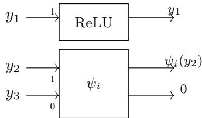
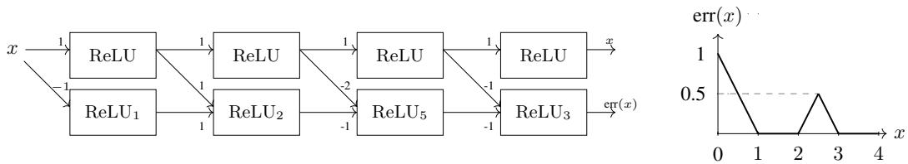
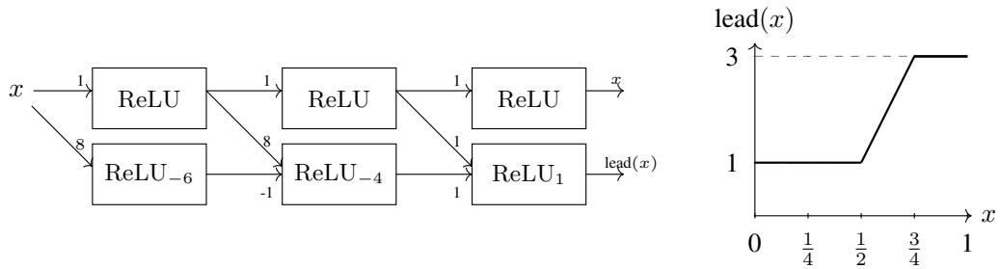
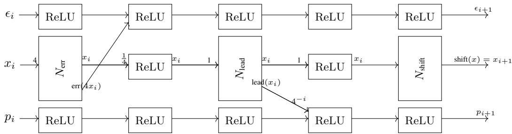
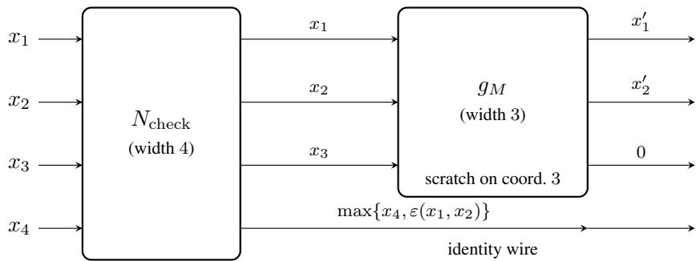

# Iterated Narrow Networks: Turing Completeness at Width 4 on Convex Input Spaces and the Complexity of Verification

Olivier Bournez Institut Polytechnique de Paris, LIX 91128 Palaiseau, France olivier.bournez@lix.polytechnique.fr

Johanne Cohen LISN, CNRS, Université Paris-Saclay 91190 Gif-sur-Yvette, France johanne.cohen@lisn.fr

Adrian Wurm   
Computer Science Institute   
BTU Cottbus-Senftenberg   
D-03046 Cottbus, Germany wurm@b-tu.de

## Abstract

We study the iterates of a fixed ReLU network N of width 4, that is, the discretetime system $x _ { k + 1 } = N ( x _ { k } )$ on $[ 0 , 1 ] ^ { 4 }$ . Equivalently, $x _ { k }$ is the output of a weighttied network made of k copies of $N$ , or of a recurrent network with no external input, started at $x _ { 0 } .$ . We prove that every deterministic Turing machine M admits such a network $N _ { M }$ . The network can be constructed in polynomial time from M. Each iteration has depth poly(|M|). The iterates of $N _ { M }$ simulate M exactly on every encoded tape. The number of iterations is proportional to the running time of M. Moreover, the fourth coordinate irreversibly flags every point of the convex cube $[ 0 , 1 ] ^ { 4 }$ whose simulation reads an invalid digit. This flag is the certificate that makes hardness reductions sound on convex input regions, the regime of practical verifiers. Convex regions were previously inaccessible because of a continuity obstruction inherent to ReLU networks. The correspondence has three consequences. First, reachability for iterated width-4 ReLU networks spans the full complexity hierarchy along the single axis of the time bound: it is NP-complete for a unary bound, NEXP-complete for a binary bound and REcomplete (undecidable) with no bound. Second, two extra neurons of width suffice to extend the hardness to every common smooth activation: at width 6, the robust verification problem (a promise problem with δ/2δ gap) is NP-complete for tanh, sigmoid, GELU, Swish, ELU, and any polynomial-time-computable continuous non-polynomial activation with a polynomial-time-computable Lipschitz constant. Third, the whole spectrum transfers to discretized Neural ODEs in dimension 5.

## 1 Introduction

We study the iterates of a fixed ReLU network of constant width: the discrete-time system

$$
x _ { k + 1 } = N ( x _ { k } ) , \qquad x _ { 0 } \in [ 0 , 1 ] ^ { 4 } ,
$$

where $N \colon [ 0 , 1 ] ^ { 4 } \to [ 0 , 1 ] ^ { 4 }$ is a feedforward ReLU network of width 4. In other words, the object of study is a recurrent network that takes no per-step input: its input is its initial state $x _ { 0 } .$ , and its outputs are its states $x _ { k }$ . Iterating one fixed block is the pattern behind deep equilibrium models [Bai et al., 2019] and discretized Neural ODEs [Chen et al., 2018, Kidger, 2022]. Residual and highway networks [He et al., 2016, Srivastava et al., 2015] follow the same pattern with untied weights. We ask what the iterates of a width-4 block can compute, and what it costs to verify their behavior.

The correspondence. We prove that iterated width-4 ReLU networks are Turing complete on convex input regions, with iteration count playing the role of time. For every Turing machine (TM) M, we construct in polynomial time a single network $N _ { M } \colon [ 0 , 1 ] ^ { 4 } \to [ 0 , 1 ] ^ { 4 }$ of width 4 and depth poly(|M|) per iteration. Its iterates simulate M exactly on encoded tapes, and irreversibly flag every point of $[ \dot { 0 } , \dot { 1 } ] ^ { 4 }$ whose simulation reads an invalid digit (Theorem 3). Instantiated on a universal TM U, the construction yields a single fixed block $N _ { U }$ that simulates every machine on every input. The consequence is a hardness ladder along the single axis of the time bound (Theorem 7). At fixed width 4, bounded-time reachability is NP-complete for a unary bound, NEXP-complete for a binary bound and undecidable with no bound. NP-hardness of ReLU verification has been known since Katz et al. [2017]; the ladder shows that restricting the width does not restore tractability, since width 4 already suffices (Section 2.2). The hardness extends at width 6 to every common smooth activation (Theorem 10) and, through the correspondence of Duan et al. [2024], to discretized Neural ODEs at dimension 5 (Theorem 50).

The obstruction, in plain terms. A TM tape is an infinite binary string, and to feed it to a network we must store it in a single real number. Writing the tape in base 2 fails twice over: $0 . 0 \overline { { 1 } } _ { 2 } = 0 . 1 _ { 2 }$ so two different tapes can be the same number, and reading off the first bit is a discontinuous operation. Writing it in base 4 using only the digits 1 and 3, a device going back to Siegelmann and Sontag [1991], repairs both defects. The encoding becomes injective, and the two possible leading digits are separated by a fixed gap, so a continuous piecewise-affine gadget can read the first digit. The price is that the valid encodings form a Cantor-like set DD $^ { 1 , 3 }$ of measure zero, whereas verification asks a question about a full-dimensional convex region. The two domains cannot be reconciled by any continuous preprocessing: any continuous map from a convex set into $\mathbb { D } \mathbb { D } _ { 1 , 3 }$ is constant (Proposition 11), and ReLU networks compute only continuous piecewise-affine maps. Since continuous encoding is impossible, our network detects: a fourth coordinate accumulates, one base-4 digit per iteration, a continuous certificate that irreversibly flags every input whose simulation reads an invalid digit. This online certificate is the ingredient that is new at the level of network construction. It is what makes every verification reduction below sound on convex regions.

Four theorems. Formal statements are in Section 2, proofs in the appendices.

(Th.3) Turing completeness of iterated width-4 networks on convex input spaces. For every TM M, a single polynomial-time-constructible width-4 ReLU network simulates M when iterated, exactly on encoded inputs, and irreversibly flags every point of the convex cube $[ 0 , 1 ] ^ { 4 }$ whose simulation reads an invalid digit.

(Th.7) Verification spectrum. Bounded-time reachability for iterated width-4 ReLU networks is NP-complete with unary time bound, NEXP-complete with binary time bound and RE-complete (undecidable) with no bound.

(Th.10) Robust verification at width 6 for smooth activations. For every continuous, nonpolynomial, C1-at-a-point, polynomial-time-computable activation ρ, the δ-robust verification problem (a promise problem with δ/2δ gap) for width-6 ρ-networks is NP-complete.

(Th.50) Neural ODE consequences at dimension 5 (App.H). Through the correspondence of Duan et al. [2024] between vanilla feedforward networks and splitting-method discretizations, the whole spectrum transfers to the discretized reachability of Neural ODEs at dimension 5.

Positioning. Table 1 situates the results; its mode column records whether a statement concerns a feedforward network or the iterates of one (a recurrent network). Siegelmann–Sontag Siegelmann [1999], Siegelmann and Sontag [1991, 1994] established TM universality for recurrent networks; in the variant relevant here, where the input is placed in the initial state, their construction requires fractal-encoded inputs and does not optimize width. (Their results with per-step input sequences carry no such restriction, but answer a different question.) Bounded-width approximation by feedforward networks was developed by Hanin and Sellke [2017], Park et al. [2020], Telgarsky [2016]. Bournez et al. [2025] contains two distinct results: a width-3 network simulating one TM step exactly on the fractal encoding set, and a separate width-12 uniform approximation theorem for arbitrary continuous piecewise-affine maps on convex domains. Theorem 3 improves neither width. It establishes a

different property: a single width-4 network whose iterates are exact on encoded inputs and certify non-encoded inputs, uniformly over the whole convex cube $[ 0 , 1 ] ^ { 4 }$ (Section 3.1 explains why neither prior result yields this). Verification of ReLU networks was previously known to be NP-hard via SMT-style encodings Katz et al. [2017]; (Th.7) lifts this to the full NP / NEXP / RE spectrum along the time bound, and (Th.10) extends it to smooth activations at width 6. Training hardness is known up to ∃R-completeness Blum and Rivest [1988], Abrahamsen et al. [2021], Froese et al. [2022]. The question we study is also the narrow-network analogue of a line of work on how expressive power grows with the number of sequential steps: Merrill and Sabharwal [2024] show that transformers gain expressive power as the number of chain-of-thought steps grows, and ours is the same trade-off in a different architecture class, pushed to its limit. Finally, the Neural ODE consequence (Th.50) uses the discrete-to-continuous correspondence Chen et al. [2018], Duan et al. [2024].1
<table><tr><td></td><td>mode</td><td>input domain</td><td>guarantee</td><td>width</td><td>activation</td></tr><tr><td>Siegelmann-Sontag [1991, 1994, 1999]</td><td>recurrent</td><td> $\mathrm { f r a c t a l \mathbb { D } \mathbb { D } _ { 1 , 3 } }$ </td><td>exact TM simulation</td><td>not optimized</td><td>saturated linear</td></tr><tr><td>Hanin and Sellke [2017] Park et al. [2020]</td><td>feedforward</td><td>compact Rd</td><td>uniform approx.</td><td> $d { \bf + } 1 \ \mathrm { t o } \ d { \bf + } 4$ </td><td>ReLU</td></tr><tr><td>Bournez et al. [2025], main thm.</td><td>feedforward</td><td>convex  $[ 0 , 1 ] ^ { d }$ </td><td>uniform approx. of CPAMs</td><td>12</td><td>ReLU</td></tr><tr><td>Bournez et al. [2025], Thm. 23</td><td>iterated</td><td> $\mathrm { f r a c t a l } \mathbb { D } \mathbb { D } _ { 1 , 3 }$ </td><td>exact TM step; no claim off fractal</td><td>3</td><td>ReLU</td></tr><tr><td>Bournez et al. [2026]</td><td>iterated</td><td></td><td>fractal + convex NP-hardness via 3-SAT</td><td>3,4</td><td>ReLU</td></tr><tr><td>this paper, Th.3</td><td>iterated</td><td> $[ 0 , 1 ] ^ { 4 }$  convex</td><td>exact TM simulation + certificate</td><td>4</td><td>ReLU</td></tr><tr><td>this paper, Th.10</td><td>both</td><td>convex  $[ 0 , 1 ] ^ { d }$ </td><td>robust verif. NP-c.</td><td>6</td><td>smooth ρ</td></tr></table>

Table 1: Positioning. The mode column distinguishes feedforward statements from statements about the iterates of a fixed block. (Th.3) improves neither width of Bournez et al. [2025]: it is the first exact TM simulation whose soundness extends to a full-dimensional convex input region, which is what the NEXP and undecidability statements require.

## 2 Model, problems, and main theorems

## 2.1 Networks, iteration, and verification

The model: iterated networks. The object of study in Theorems 3 and 7 is the discrete-time system $x _ { k + 1 } = N ( x _ { k } )$ obtained by iterating a fixed feedforward ReLU network $N \colon [ 0 , 1 ] ^ { 4 } \to [ 0 , 1 ] ^ { 4 }$ of width 4. In other words, it is a weight-tied recurrent network that takes no per-step input: its input is its initial state and its outputs are its states. We write $N ^ { [ t ] } : = N \circ N \circ \cdot \cdot \cdot \circ N$ for the t-fold composition. Which representation a result concerns is stated with the result: the unary-bound NP-completeness also holds for feedforward width-4 networks, by unrolling (Corollary 8), while the NEXP and RE statements concern the iterated representation, whose unrolled depth would be exponential or unbounded.

We consider neural networks with rational weights, with the “enhanced neuron” convention (e.g. Kidger and Lyons [2020]): a neuron is a map $\psi \circ \rho \circ \phi$ with ϕ, ψ affine and $\rho$ the activation. We write $\mathcal N \bar { \mathcal N } _ { n , m , k } ^ { \rho }$ for the class of feedforward networks with n inputs, m outputs, ρ activation, and bounded width k (i.e. every hidden layer has at most k neurons).

Verification problems. Our hardness results concern the following decision problems.

Definition 1 (Reachability). The reachability problem takes as input a ρ-network $N \colon [ 0 , 1 ] ^ { d } \to [ 0 , 1 ] ^ { d }$ and two convex regions Init, Acc $\subseteq [ 0 , 1 ] ^ { d }$ specified by rational linear inequalities, and asks whether $\exists x \in { \mathrm { I n i t } } , \exists t \geq 0 , N ^ { [ t ] } ( x ) \in { \mathrm { A c c } }$

Here, the network is presented as a weighted graph, where the encoding of each hidden layer is the adjacency matrix, but every entry is the numerator-denominator-pair describing the rational weight.

This formulation follows the standard one in the neural-network verification literature (see e.g. Katz et al., 2017, Wurm, 2023a).

Definition 2 (Bounded-time reachability). The T-bounded reachability problem takes the same input plus a time bound $T \in \mathbb { N }$ (encoded either in unary or in binary) and asks whether $\exists x \in { \mathrm { I n i t } } , \exists i \leq$ $T , N ^ { [ t ] } ( x ) \in \mathrm { A c c }$

When $\rho = \mathrm { R e L U }$ , both problems admit NP-membership for unary $T \colon$ by the small-witness property for piecewise-affine systems (Lemma 36, classical), it suffices to guess a rational x of polynomial bit complexity and simulate $T$ steps with exact rational arithmetic. For binary $T ,$ no such polynomialtime simulation exists; we recover $\mathrm { N E X P } .$ -membership in Section 4.

## 2.2 Why reachability, why convex regions, why iterates

Robustness certification is exactly the reachability question we study: an $\ell _ { \infty }$ ball around a data point x¯ is an axis-aligned box, hence a convex polytope specified by rational linear inequalities, and the certification query is literally ∃x $\in { \mathrm { I n i t } } \colon N ( x ) \in { \mathrm { A c c } } .$ , with Acc the region where the decision is wrong. This is the VNN-LIB and VNN-COMP specification format [Brix et al., 2023], decided by complete verifiers such as Reluplex, Marabou and α, β-CROWN [Katz et al., 2017, Wang et al., 2021]. Convex initial regions are therefore imposed by the application. Iteration matters wherever one block is applied repeatedly, above all in closed-loop verification of a neural controller, where the reachable set over k control steps is exactly $N ^ { [ k ] } ( \mathrm { I n i t } )$ . The practical reading of our results is that certification cost scales along depth, or number of steps, and not along width: at width $^ { 4 , }$ relaxing only the time bound climbs $\mathrm { \bar { P } T I M E } \to \mathrm { N P } \to \mathrm { N E X } \mathrm { \bar { P } } \to$ undecidable, and the remaining route to tractability is a restriction on the dynamics or on the parameters (Section 6).

## 2.3 Encoding Turing machines

We encode Turing-machine (TM) configurations using base-4 digits $\{ 1 , 3 \}$ , a Cantor-style encoding in the lineage of Siegelmann and Sontag [1991, 1994]. Allowing all digits would create ambiguities like $0 . 1 \overline { { 3 } } _ { 4 } \ : \stackrel { - } { = } \ : 0 . 2 _ { 4 } ;$ restricting to digits 1 and 3 makes the presentation of a number unique, and resolves the discontinuity issues inherent to ReLU iteration. A word $u = u _ { 1 } \cdot \cdot \cdot u _ { n } \in \{ 0 , 1 \} ^ { n }$ maps to $\begin{array} { r } { \mathrm { e n c } _ { \{ 1 , 3 \} } ( u ) = \sum _ { i = 1 } ^ { n } ( 2 u _ { i } + 1 ) 4 ^ { - i } \in [ 0 , 1 ] } \end{array}$ . A configuration $c = ( u , q , v )$ (current state $q ,$ tape to the left of the head u (reversed), tape from the head onward v) is encoded as

$$
\mathrm { e n c } _ { M } ( c ) \ = \ ( \mathrm { e n c } _ { \{ 1 , 3 \} } ( u ) , \mathrm { e n c } _ { M } ( q , v ) , \ 0 , \ 0 ) \ \in \ [ 0 , 1 ] ^ { 4 } ,
$$

where enc ${ \bf \Gamma } _ { M } ( q , v )$ co-encodes the state and the right tape into a single base-4 string with enc $_ M ( q )$ as a constant-length prefix followed by $\mathrm { e n c } _ { \{ 1 , 3 \} } ( v )$ , based on a packing borrowed from Bournez et al. [2025] that saves one coordinate over the naive encoding $( \operatorname { e n c } _ { \{ 1 , 3 \} } ( u ) , \operatorname { e n c } _ { \{ 1 , 3 \} } ( v ) , \operatorname { e n c } _ { M } ( q ) , \cdot , \cdot )$ which would force width 5. The third coordinate is a scratch register used by the simulator; the fourth is a validity register, both initially 0 (see Section 4). We write $Q$ for the state set of $M ,$ $\operatorname { e n c } _ { M } ( Q ) \subseteq [ 0 , 1 ]$ for the prefix-encoded set of states, $\mathbb { D D } _ { 1 , 3 } \subseteq [ 0 , 1 ]$ for the Cantor-like set of points whose base-4 expansion uses only digits $\{ 1 , 3 \} , \pi _ { i }$ for the i-th coordinate projection, $\mathrm { s t e p } _ { M }$ for the map sending a configuration of M to the next one, and $c _ { t } ( \tau ) : = \mathrm { s t e p } _ { M } ^ { t } ( c _ { 0 } ( \tau ) )$ for the configuration at step t on an infinite tape ${ \tau \in \{ 0 , 1 \} ^ { \omega } }$ , with $c _ { 0 } ( \tau )$ the initial configuration. The state prefix of $x _ { 2 }$ consists of its first $\left| q \right| _ { 4 } = \left. \left\lceil \log _ { 4 } \right. \dot { Q } \right. ^ { - }$ ⌉ base-4 digits, and the post-state-prefix (or tape-suffix) portion of $x _ { 2 }$ is the remainder. We say that a digit of $x _ { 1 }$ , or of the tape-suffix of $x _ { 2 }$ , is visited during the first k iterations of the network of Theorem 3 if it is exposed as the leading digit of its register at some iteration $j < k$ . When x encodes a configuration, the visited digits are exactly the tape cells read by $M \mathrm { { s } }$ head.

## 2.4 Turing completeness of iterated width-4 networks on convex input spaces

Theorem 3 (Turing completeness on convex input spaces). For every deterministic Turing machine M over the binary alphabet, one can construct in polynomial time a single ReLU network $N _ { M } \colon [ 0 , 1 ] ^ { 4 } \to [ 0 , 1 ] ^ { 4 }$ ofwidth 4 and depth $D _ { M } = \mathrm { p o l y } ( \dot { | } M \dot { | } )$ , with a constant $\bar { C } _ { M } \in \mathbb { N } ,$ , such that:

(i) (Faithful simulation, all time.) For every $\begin{array} { r l r } { \tau } & { { } \in } & { \{ 0 , 1 \} ^ { \omega } } \end{array}$ and every $ { \boldsymbol { { t } } } \geq 0$ $N _ { M } ^ { [ C _ { M } t ] } \bigl ( \mathrm { e n c } _ { M } ( c _ { 0 } ( \tau ) ) \bigr ) = \mathrm { e n c } _ { M } \bigl ( \mathrm { s t e p } _ { M } ^ { t } ( c _ { 0 } ( \tau ) ) \bigr )$ . (For finite inputs w, take $\tau = w \cdot \tau ^ { \prime }$ for any $s u f f u x \tau ^ { \prime } ,$ ; M’s behavior up to time T depends only on the $\hbar r s t \le T$ symbols.)

(ii) (Online validity certificate.) Thefourth coordinate $\pi _ { 4 } ( N _ { M } ^ { [ k ] } ( x ) )$ is non-decreasing in k and bounded in [0, 1]. Moreover,for $\boldsymbol { x } = \left( x _ { 1 } , x _ { 2 } , x _ { 3 } , x _ { 4 } \right)$ with $x _ { 4 } = 0$ , we have $\pi _ { 4 } ( N _ { M } ^ { [ k ] } ( x ) ) = 0$ iffevery leading base-4 digit $o f x _ { 1 }$ and ofthe post-state-prefix portion ofx visited by M’s head during thefirst k iterations lies in $\{ 1 , 3 \}$ , and the state prefix ofx stays in $\mathrm { e n c } _ { M } ( Q )$ along the trajectory. In particular, $\pi _ { 4 } ( N _ { M } ^ { [ k ] } ( x ) ) = 0 f o r$ all $k \geq 0$ whenever $x _ { 1 }$ and the v-part of $x _ { 2 }$ lie in $\mathbb { D } \mathbb { D } _ { 1 , 3 }$ and the state prefix of $\dot { x } _ { 2 }$ encodes a valid state.

## Part (i) alone holds at width 3 (Theorem 12, due to Bournez et al., 2025).

Remark 4 (Online certificate; single fixed network). Part (ii) is an online certificate: the fourth coordinate is updated one digit per iteration via a width-2 sub-gadget, so $N _ { M }$ is uniformly polynomial in $| M |$ , independent of input length. (A finite ReLU network cannot have its zero set equal to $\mathbb { D } \mathbb { D } _ { 1 , 3 }$ exactly, hence a check spread over the iterations.) Taking $M = U$ a universal Turing machine, $\operatorname { e n c } _ { U } ( \langle M ^ { \prime } , w \rangle )$ embeds an arbitrary pair $( M ^ { \prime } , w )$ into a single point of $[ 0 , 1 ] ^ { 4 }$ , and $N _ { U }$ becomes a single fixed network simulating any TM M′ on any input w. Width 4 is the price of the pair $\mathrm { ( i ) } { + } \mathrm { ( i i ) }$ , and we claim no lower bound for the pair.

The combination of (i) and (ii) is what makes the verification reductions work: property (i) gives soundness on encoded inputs, and property (ii) on the rest of the convex region. Plugging in halting problems of varying time complexity yields the hardness spectrum below.

Remark 5 (Convex inputs are the range of a quantifier, not a tolerance). Theorem 3 is not a robustness property: part (i) requires an exact encoding, and nothing is claimed about inputs near an encoding beyond part (ii). The convex region is the range of the existential quantifier in the verification problems, where it is imposed by the application (Section 2.2); part (ii) is what holds on the rest of that region.

Remark 6 (No certificate hypothesis in the complexity results). Certifying, in the sense of part (ii), is a capability of the witness network, not a hypothesis on a model class: Definitions 1 and 2 and Theorem 7 and Corollaries 8 and 14 quantify over all width-4 ReLU networks. Remark 34 makes the certified set precise.

## 2.5 Verification spectrum of iterated width-4 networks

Theorem 7 (Verification spectrum at width 4). For iterated width-4 ReLU networks $N \colon [ 0 , 1 ] ^ { 4 } \to$ $[ 0 , 1 ] ^ { 4 }$ (the system ofSection 2.1), T-bounded reachability is:

(i) NP-complete when T is encoded in unary;

(ii) NEXP-complete when T is encoded in binary;

(iii) RE-complete (hence undecidable) with no time bound.

The hardness statements hold even when Init and Acc are axis-aligned hyperrectangles with rational endpoints.

Corollary 8 (Verification of feedforward width-4 ReLU networks). Verification of feedforward width-4 ReLU networks on convex Init, $\operatorname { A c c } \subseteq [ 0 , 1 ] ^ { 4 }$ (deciding whether $\exists x \in$ Init : $N ( x ) \in \mathrm { A c c } .$ a single application ofN) is NP-complete.

## 2.6 Robust verification at width 6 for smooth activations

Why “robust”. Exact verification of $\rho \mathrm { . }$ -networks for smooth $\rho$ such as tanh quickly leaves classical complexity classes: the relevant decision problems involve transcendental constraints whose decidability rests on contested hypotheses [Macintyre et al., 1996, Wurm, 2023a, 2024]. The standard remedy is robust verification, which allows a fixed tolerance with a promise gap.

Definition 9 (δ-robust verification). Given a ρ-network $N \colon [ 0 , 1 ] ^ { d } \  \ [ 0 , 1 ] ^ { d }$ , convex regions Init, $\operatorname { A c c } \subseteq [ 0 , 1 ] ^ { d }$ , and a rational $\delta > 0$ , the δ-robust verification problem is the promise problem:

• Output YES $\operatorname { i f } \exists x \in$ Init with $N ( x ) \in \operatorname { A c c } ^ { + \delta }$

• Output NO $\mathrm { i f } \forall x \in$ Init, $N ( x ) \not \in \operatorname { A c c } ^ { + 2 \delta }$

• Promise: the input falls into one of these two cases.

Here $\operatorname { A c c } ^ { + \delta } = \{ y \in \mathbb { R } ^ { d } : d i s t ( y , \operatorname { A c c } ) \leq \delta \}$ and dist is Euclidean distance. The T-bounded variant considers $N ^ { [ t ] } ( x )$ for $t \leq T$

<table><tr><td> $x _ { 1 } \colon$  left tape</td><td></td><td>x1: left tape&#x27;</td></tr><tr><td>x2: state ∥ right tape&gt;</td><td>Stage 1: width-3 TM step 7 inspired from Bournez et al. [2025],</td><td> $x _ { 2 } ^ { \prime } { \mathrm { : } }$  state ∥ right tape&#x27;</td></tr><tr><td>x3: scratch</td><td></td><td> $x _ { 3 } ^ { \prime } \colon \mathrm { s c r a t c h } ^ { \prime }$ </td></tr><tr><td>x4: certificate</td><td>Stage 2 + 3: certificate x4 ← max{x4, ε(x1, x2)}</td><td> $x _ { 4 } ^ { \prime } \mathrm { : c e r t i f i c a t e ^ { \prime } }$ </td></tr></table>

Figure 1: One iteration of the width-4 network of Theorem 3: $x _ { 1 }$ holds the left tape, $x _ { 2 }$ co-encodes the state and the right tape, $x _ { 3 }$ is a scratch register, and $x _ { 4 }$ accumulates the certificate ε via the max update, with $\varepsilon ( x _ { 1 } , x _ { 2 } ) = 0$ iff the leading digits and the state prefix are valid (Remark 33).

Theorem 10 (Robust verification at width 6). Let $\rho \colon \mathbb { R } \to \mathbb { R } s a t i s f y .$

(H1) $\rho$ is continuous and non-polynomial;

(H2) $\rho$ is $C ^ { 1 }$ at some point with non-zero derivative;

(H3) ρ is polynomial-time computable, and admits a polynomial-time-computable Lipschitz constant on every bounded interval.

Then δ-robust verification and δ-robust T-bounded reachability (with T unary) for ρ-networks of width 6 are NP-complete2.

Coverage of (H1)–(H3). (H1)–(H2) is the relaxation of differentiability of Kidger and Lyons [2020]; with (H3) they cover ReLU, leaky ReLU, tanh, sigmoid, GELU, Swish, ELU, softplus, arctan, the Gaussian and every analytic non-polynomial activation. Constructive $\rho $ ReLU bitcomplexity bounds are provided by Zhang et al. [2024]; the remaining cases follow from interval evaluation under (H3).

## 3 Proof sketch of Theorem 3

The proof of Theorem 3 has three modular components, illustrated in Figure 1: a width-3 subnetwork that simulates one Turing-machine step on the {1, 3}-base-4 encoding domain (Stage 1, at width 3, based on ideas from Bournez et al. [2025]); a width-2 subnetwork that produces a continuous encodingvalidity certificate (Stage 2); and a combinator that propagates the certificate across iterations (Stage 3). The full network has width 4. We first identify the obstruction, then describe each stage; complete proofs are in Appendices B to D.

## 3.1 The continuity obstruction, and why exactness is forced

Why exactness, in one sentence. Each simulated tape shift multiplies a coordinate by 4 (Lemma 31), so a per-step error ϵ becomes about $4 ^ { k } \epsilon$ after k iterations: an approximation accurate for k steps needs precision $4 ^ { - k }$ , hence a network whose size grows with the time horizon. Theorem 7(ii)–(iii) quantify over exponential and unbounded k with one fixed finite network, so no approximation-based construction can reach them.

The obstruction. The existing ReLU-based simulations operate on the fractal set $\mathbb { D } \mathbb { D } _ { 1 , 3 }$ (totally disconnected, Lebesgue measure 0), whereas verification asks for a trajectory from a convex initial region Init $\subseteq [ 0 , 1 ] ^ { 4 }$ . The two domains are incompatible in a strong sense.

Proposition 11 (No continuous encoding). Every continuous map from a convex subset of $\mathbb { R } ^ { n }$ into $\mathbb { D } \mathbb { D } _ { 1 , 3 }$ is constant.

Proof. A convex set is connected, the continuous image of a connected set is connected, and $\mathbb { D } \mathbb { D } _ { 1 , 3 }$ is totally disconnected, so the image is a single point. □

ReLU networks realize only continuous piecewise-affine maps Arora et al. [2016], so no subnetwork can map Init onto valid encodings, and none can gate the simulation on the discontinuous predicate “is x a valid encoding?”. Bournez et al. [2025] circumvent this by approximating the validity predicate uniformly, at width 12 and at the cost of exact iteration; the companion work Bournez et al. [2026] restricts inputs by 3-SAT preprocessing, which yields NP-hardness but no TM simulation. We instead realize a continuous certificate $\varepsilon ( x )$ that vanishes on valid encodings, is positive elsewhere and is non-decreasing along trajectories: any input which was never a valid encoding is flagged and stays flagged. The certificate occupies one extra coordinate, hence width 4.

Stage 1: width-3 TM step on encoded inputs. TM simulation at some fixed width has been known since Siegelmann and Sontag $[ 1 9 9 1 ] ;$ Bournez et al. [2025] reach width 3, which we make fully explicit in Appendix B and use as a black box.

Theorem 12 (Width-3 step simulation, inspired from Bournez et al. [2025]). For every Turing machine M over $\{ 0 , 1 \}$ , there exists a ReLU network $g _ { M } \in \mathcal { N N } _ { 3 , 3 , 3 } ^ { \mathrm { R e L U } }$ of depth $\mathrm { p o l y } ( | M | )$ such that, for every valid encoded configuration en $\mathbf { \Phi } _ { M } ( c ) \in \mathbb { D } \mathbb { D } _ { 1 , 3 } \times \mathbb { D } \mathbb { D } _ { 1 , 3 _ { Q } } \times \{ 0 \} , g _ { M } \bigl ( \mathbf { e n c } _ { M } ( c ) \bigr ) =$ $\mathrm { e n c } _ { M } \big ( \mathrm { s t e p } _ { M } ( c ) \big )$ , where $\mathbb { D D } _ { 1 , 3 _ { Q } } \subseteq [ 0 , 1 ]$ denotes the set of co-encodings of a state prefix in encM(Q) followed by an $\mathbb { D D } _ { 1 , 3 } – t a p e s u f f u x ,$ and the third coordinate is a scratch register reset to 0 between steps.

Theorem 12 treats the encoding domain as a set of exact rational points: each TM transition is an explicit affine map on the relevant cylinder of $\mathbb { D D } _ { 1 , 3 } \times \mathbb { D D } _ { 1 , 3 _ { Q } }$ , and the gaps between cylinders allow these maps to be assembled at width 3. Outside the encoded domain, $g _ { M }$ has no specified behavior, which is what forces the certificate: it is what lets us talk about verification on convex inputs rather than on the fractal encoding set.

Stage 2: continuous encoding-validity certificate. The new ingredient is a per-step error gadget err : $[ 0 , 4 ]  [ 0 , 1 ]$ , continuous and piecewise affine, which vanishes exactly on $[ 1 , 2 ] \cup [ 3 , 4 ]$ and is positive elsewhere. It can be implemented as a sum of two tents by the nested ReLU expression

$$
\operatorname { e r r } ( x ) = \operatorname { R e L U } { \Bigl ( } 3 - x - \operatorname { R e L U } { \bigl ( } 5 - 2 x - \operatorname { R e L U } { \bigl ( } 2 - x + \operatorname { R e L U } ( 1 - x ) { \bigr ) } { \bigr ) } { \Bigr ) }
$$

Applied to $4 x _ { j } ,$ err vanishes iff the leading base-4 digit of $x _ { j }$ lies in $\{ 1 , 3 \}$ (scheduling inside the width-4 network: Appendix C).

Proposition 13 (Per-step encoding-validity gadget). Thefunction $e r r _ { 4 } ( x ) : = e r r ( 4 \cdot x )$ is continuous, non-negative, computable in constant depth inside the width-4 register network ofTheorem $^ { 3 , }$ and vanishes precisely on the leading-digit {1, 3}-cylinders of [0, 1].

Stage 3: combining the stages, and proof of Theorem 3. The full width-4 network $N _ { M }$ assembles, at each iteration, a per-step certificate update followed by Stage 1’s TM step:

1. Apply the per-step error gadget err to 4x1 and to the leading digits of the tape-suffix portion of $x _ { 2 }$ (Proposition 13; the state-prefix portion of $x _ { 2 }$ is checked by the same gadget composed with a constant-depth slicing, Appendix C). Update $x _ { 4 } ^ { \prime } \gets \operatorname* { m a x } \{ x _ { 4 } , \varepsilon ( x _ { 1 } , x _ { 2 } ) \}$ , where $\varepsilon ( x _ { 1 } , x _ { 2 } )$ is the maximum of the digit-error and state-distance terms (Remark 33). The maximum is computed as $a + \mathrm { R e L U } ( b - a )$ at width 2.

2. Apply Stage 1, the width-3 step simulation $g _ { M } , \mathrm { t o } \left( x _ { 1 } , x _ { 2 } , x _ { 3 } \right)$ to obtain $( x _ { 1 } ^ { \prime } , x _ { 2 } ^ { \prime } , x _ { 3 } ^ { \prime } )$ . The fourth register $x _ { 4 } ^ { \prime }$ is propagated unchanged through Stage 1 by an identity wire.

Each iteration of $N _ { M }$ has constant depth on top of $_ { g _ { M } ; }$ thus the per-iteration depth of $N _ { M }$ is $D _ { M } = \mathrm { p o l y } ( | M | )$ , independent of any input length or time horizon.

Scheduling and width-4 bound. Each step is a sequence of register-layer updates (Definition 15), each modifying one of $( x _ { 1 } , \ldots , x _ { 4 } )$ : the error gadgets are width-2 and sequentialized so that x serves as accumulator while $x _ { 1 } , x _ { 2 }$ are read-only and $x _ { 3 }$ holds scratch data; Stage 1 then updates $x _ { 1 } , x _ { 2 } , x _ { 3 }$ and preserves $x _ { 4 }$ through an identity wire (register form of register width 4, Remark 42).

Proof of Theorem $\mathbf { 3 } , \mathbf { \varepsilon } \in$ is non-negative and bounded by 1; the max update keeps $x _ { 4 } ( k ) \ : = \quad$ $\pi _ { 4 } ( N _ { M } ^ { [ k ] } ( x ) )$ non-decreasing and in [0, 1]. If $x _ { 1 }$ and the tape-suffix of $x _ { 2 }$ lie in $\mathbb { D } \mathbb { D } _ { 1 , 3 }$ , and the state-prefix of $x _ { 2 }$ is in $\mathrm { e n c } _ { M } ( Q )$ , every leading digit visited stays in $\{ 1 , 3 \}$ and the state stays in $\mathrm { e n c } _ { M } ( Q )$ along the trajectory (since $g _ { M }$ preserves valid encodings by Theorem 12); ε vanishes at every iteration, $x _ { 4 } = 0$ throughout, and $N _ { M } ^ { [ t ] } ( x ) = \mathrm { e n c } _ { M } ( c _ { t } )$ by induction, proving (i). Conversely, when a visited leading digit falls outside $[ 1 , 2 ] \cup [ 3 , 4 ]$ or the state-prefix leaves $\mathrm { e n c } _ { M } ( Q )$ , the per-step error is positive at that iteration; $x _ { 4 }$ becomes positive and stays so. Stage 2 checks before Stage 1 reads, so the simulator never operates on a forbidden digit while $x _ { 4 } = 0 . \qquad \bigsqcup ( \mathbf { A }$ fully worked example is given in Appendix D.4.)

## 4 Verification spectrum of iterated width-4 networks

## 4.1 Proof of Theorem 7

Reductions: a uniform recipe. For each part of Theorem 7, we reduce a classical TM complexity problem Π to width-4 reachability. The reduction is identical across the three parts, so we describe it once. Let Π ask whether some Turing machine M accepts some input within some (problemdependent) time bound. By Theorem 3, applied to $M ,$ we obtain a width-4 ReLU network $N _ { M }$ with the simulation and certificate properties. Recall that the second coordinate $x _ { 2 }$ co-encodes the state (constant-length prefix enc $_ M ( q )$ of length $| q | _ { 4 } = \lceil \log _ { 4 } \left| Q \right| \rceil$ ) and the right tape (Section 2). Define

$$
\mathrm { I n i t } \ = \ \big \{ x \in [ 0 , 1 ] ^ { 4 } \ : \ \mathrm { e n c } _ { M } ( q _ { 0 } ) \leq 4 ^ { | q | _ { 4 } } x _ { 2 } \leq \mathrm { e n c } _ { M } ( q _ { 0 } ) + 1 , \ x _ { 3 } = 0 , \ x _ { 4 } = 0 \big \} ,
$$

i.e. $x _ { 2 }$ has the prefix enc ${ \bf \Gamma } _ { M } ( q _ { 0 } )$ of the initial state, the remaining digits of $x _ { 2 }$ encode an arbitrary right tape, $x _ { 1 }$ is unrestricted in [0, 1] (left tape), and the scratch and validity registers are pinned to 0. Define ${ \mathrm { A c c ~ } } = { \begin{array} { l } { \{ x \in [ 0 , 1 ] ^ { 4 } } \end{array} } : $ enc $_ M ( q _ { F } ) \leq 4 ^ { | q | _ { 4 } } x _ { 2 } \leq \mathrm { e n c } _ { M } ( q _ { F } ) + 1 , \ x _ { 4 } \leq 0 \}$ , i.e. the state-prefix of $x _ { 2 }$ encodes the final state $q _ { F }$ . Both Init and Acc are convex and specified by rational linear inequalities (axis-aligned in $x _ { 2 } , x _ { 3 } , x _ { 4 } )$ . The reduction maps (M, T) (or (M) in the unbounded case) to $( \mathbf { \dot { N } } _ { M } , \operatorname { I n i t } , \mathbf { A c c } , \mathbf { \check { T } } )$ (or $( N _ { M } , \mathrm { I n i t } , \mathrm { A c c } ) )$ ). Correctness is by Theorem 3: a trajectory enters Acc iff $x _ { 4 } = 0$ throughout, i.e. every step is locally valid in the sense of Lemma 35, and the state-prefix of $x _ { 2 }$ encodes $q _ { F }$ at some iteration $\leq T$ . Equivalently, the trajectory enters Acc iff M accepts on some infinite binary tape ${ \tau \in \{ 0 , 1 \} ^ { \omega } }$ within the time bound, which matches the NP / NEXP / RE hardness sources by padding: acceptance on some infinite tape in $T$ steps reduces to acceptance on some length-T prefix in T steps (see Lemma 37).

It remains only to choose Π for each part and verify the upper bound.

Part (i): unary T. Take Π to be “does M accept some $w \in \{ 0 , 1 \} ^ { n }$ within T steps?” with $T$ unary, which is NP-complete by Cook–Levin applied to a TM with the standard polynomial slowdown Arora and Barak [2009]. Hardness follows from the recipe above. NP-membership follows from Lemma $3 6 \colon$ a non-deterministic verifier guesses a rational $x \in$ Init of polynomial bit complexity and simulates $N _ { M }$ exactly for $T \cdot C _ { M }$ steps. With T unary, total time is $\mathrm { p o l y } ( | N _ { M } | , T )$

Part (ii): binary $T .$ . Take Π to be SUCCINCT-TM-ACCEPTANCE: “does M accept some w of length at most n in at most $T$ step $\therefore ? ^ { \ast }$ with $n , T$ binary. This problem is NEXP-complete by a standard padding argument from SUCCINCT-SAT Arora and Barak [2009]. Hardness follows from the recipe above with $T \cdot C _ { M }$ binary as the new time bound. For membership: a non-deterministic verifier guesses $x \in$ Init and $t \leq T \cdot { \dot { C } } _ { M }$ in time polynomial in the input size; simulation of $N _ { M }$ for t iterations takes time $\mathrm { p o l y } ( t , | N _ { M } | ) = 2 ^ { \mathrm { p o l y } ( \mathrm { i n p u t } ) }$ because t may be exponential in the binary encoding $| T |$ . The overall verifier runs in non-deterministic exponential time, hence NEXP-membership.

Part (iii): no time bound. Take Π to be the halting problem on the empty input: “does M halt on the empty word?”, which is RE-complete. The recipe gives $N _ { M }$ together with the singleton Init $\mathbf { \mu } = \{ \mathrm { e n c } _ { M } ( c _ { 0 } ( \varepsilon ) ) \}$ (equivalent to a degenerate hyperrectangle with rational endpoints). A trajectory from this single point reaches Acc iff M halts on the empty word. Membership in RE is a standard semi-decision procedure (simulate $N _ { M }$ until the trajectory enters Acc, accept if so).

A note on the NEXP witness. The witness in Part (ii) encodes a TM input of length up to n as the point $x \in$ Init; Remark 38 explains why this lands on NEXP rather than EXPTIME.

## 4.2 Two corollaries used in the sequel

Two consequences follow at no additional cost. By complementation, the dual problem “does $N ( x ) \in$ Acc hold for every $x \in { \mathrm { I n i t } } ? ^ { \prime \prime }$ is coNP-complete (this is what complete verifiers like Marabou and $\alpha , \beta { \mathrm { - C R O W N } }$ Katz et al. [2017], Wang et al. [2021] certify), and by a gap construction using the certificate of Theorem 3, approximating $\begin{array} { r } { \operatorname* { m i n } _ { x \in \operatorname { I n i t } , t \leq T } N ^ { [ t ] } ( x ) } \end{array}$ within additive error $\eta < 1 / 4$ inherits the full spectrum.

Corollary 14 (Universal verification and approximation hardness). For width-4 ReLU networks: (i) universal verification is coNP-complete; (ii) approximating worst-case output within η is NP-hard (unary T), NEXP-hard (binary T), and undecidable (no T).

## 5 Robust verification at width 6 for smooth activations

Theorem 7 addresses ReLU. We extend the hardness to every common smooth activation at the cost of two additional units of width, in the robust framework of Section 2.6: exact verification for smooth $\rho$ leaves classical complexity [Macintyre et al., 1996, Wurm, 2024, 2023b], while the $\delta / 2 \delta$ promise gap [Gao et al., 2012] absorbs the $\rho  \mathrm { R e L U }$ approximation error and matches the finite-precision regime of numerical verifiers. Theorem 10 shows this relaxation does not help.

## 5.1 ReLU-register networks and ρ-emulation

The reduction from ReLU width 4 to $\rho$ width 6 is most cleanly stated in a register normal form, in which each hidden layer updates a single coordinate. Every ReLU network of width w can be expressed in this form at a polynomial cost in depth.

Definition 15 (ReLU-register network). A ReLU-register network of register width $k \geq 1$ and depth L is a composition $F = A _ { \mathrm { o u t } } \circ R _ { L } \circ \cdot \cdot \cdot \circ R _ { 1 } \circ A _ { \mathrm { i n } }$ , where $A _ { \mathrm { i n } } \colon  { \mathbb { R } } ^ { d } \to  { \mathbb { R } } ^ { k }$ and $A _ { \mathrm { o u t } } \colon  { \mathbb { R } } ^ { k } \to  { \mathbb { R } } ^ { d }$ are affine, and each layer $R _ { \ell } \colon { \mathbb { R } } ^ { k }  { \mathbb { R } } ^ { k }$ updates a single coordinate $j _ { \ell } \in \{ 1 , \ldots , k \}$ via $( R _ { \ell } ( x ) ) _ { j _ { \ell } } =$ $\mathrm { R e L U } ( a _ { \ell } \cdot x + b _ { \ell } )$ , leaving the others unchanged.

We work directly with this register form: it captures all ReLU networks (any standard ReLU network of width w and depth L embeds into a register network of register width 2w and depth $O ( w L )$ ; for our purposes, we only need that $N _ { M }$ is natively in register form of register width $^ { 4 , }$ see Remark 42 in Appendix F.1). The technical core of the section is the following emulation result, adapted from Kidger and Lyons [2020].

Lemma 16 (Per-layer ρ-emulation at width $k + 2 )$ . Let $\rho \colon  { \mathbb { R } } \to  { \mathbb { R } }$ satisfy hypotheses $( H I ) – ( H 3 )$ of Theorem 10. For every ReLU-register layer $R \colon \mathbb { R } ^ { k }  \mathbb { R } ^ { k }$ , every compact $K \subseteq \mathbb { R } ^ { k }$ , and every $\eta > 0$ there exists a ρ-network $\widetilde { R } \in \mathcal { N N } _ { k , k , k + 2 } ^ { \rho }$ ofdepth O(1) such that sup $\smash { \upsilon _ { x \in K } \| \widetilde { R } ( x ) - R ( x ) \| _ { \infty } \leq \eta , }$ The construction time is polynomial in the description size ofR and in $\log ( 1 / \eta )$

Mechanism of the +2 overhead. The width $k + 2$ decomposes into k identity wires (one per register coordinate, each implemented by one enhanced ρ-neuron via the local-identity approximation of Kidger and Lyons [2020, Lemma 4.1], see Proposition 40) plus a ρ-subnetwork of width 2 that approximates the univariate non-linearity $\operatorname { \mathrm { \ t e L U } } ( a \cdot x + b )$ on a bounded range (Kidger and Lyons [2020, Proposition 4.9]). The full proof of Lemma 16 is in Appendix F.2.

Composing per-layer emulators with a standard telescoping argument yields a network-level approximation result.

Lemma 17 (Network-level ρ-emulation). Let $F \colon  { \mathbb { R } ^ { d } } \to  { \mathbb { R } ^ { d } }$ be a ReLU-register network ofregister width k and depth $L ,$ and let $K \subseteq \mathbb { R } ^ { d }$ be compact. For every $\varepsilon > 0$ , there exists a ρ-network $\widetilde { F } \in \mathcal { N N } _ { d , d , k + 2 } ^ { \rho }$ of depth $O ( L )$ , with $\begin{array} { r } { \operatorname* { s u p } _ { x \in K } \| \widetilde { F } ( x ) - F ( x ) \| _ { \infty } \leq \varepsilon , } \end{array}$ , and constructible in time $\mathrm { p o l y } ( | F | , \log ( 1 / \varepsilon ) )$

## 5.2 Proof of Theorem 10

We prove NP-membership and NP-hardness of δ-robust verification for $\rho \mathrm { - }$ -networks of width 6. The bounded-time variant (unary T) follows by the same argument with depth scaled by T. Throughout this section and Appendix $\mathrm { F , }$ we write R for the acceptance region Acc of Definition 9.

NP-membership. By Lemma 36 (applied to the ReLU-equivalent given by Lemma 16), a nondeterministic verifier can guess a rational $x \in$ Init of polynomial bit complexity. It then computes $\widetilde { y } \approx N ( x )$ to precision $\delta \bar { / } 4$ using polynomial-time evaluation of $\rho$ and exact rational arithmetic for affine layers. By (H3), each $\rho$ evaluation costs poly $\left( \log ( 1 / \delta ) \right)$ ) time and the polynomial-timecomputable Lipschitz constant $L _ { \rho } = \mathrm { p o l y } ( \mathrm { i n p u t } )$ on the relevant compact yields total iteration error $\leq T \cdot L _ { \rho } ^ { T } \cdot \varepsilon _ { \mathrm { s t e p } }$ . Choosing $\varepsilon _ { \mathrm { s t e p } } \dot { = } \delta / ( 4 T L _ { \rho } ^ { T } )$ requires $\log ( 1 / \varepsilon _ { \mathrm { s t e p } } ) = \mathrm { p o l y } \vert$ (input) bits of precision per step. The verifier returns YES iff $\tilde { y } \in R ^ { + 3 \delta / 2 }$ . On promise YES, $d i s t ( \widetilde { y } , R ) \le \delta + \delta / 4 =$ $5 \delta / 4 \le 3 \delta / 2$ and the verifier accepts; on promise NO, $d i \bar { s } t ( \tilde { y } , R ) > 2 \delta - \delta / 4 = 7 \delta / 4 > 3 \delta / 2$ and the verifier rejects.

NP-hardness via robust reduction from ReLU. Corollary 14 (or directly the proof of Theorem 7) establishes that the $\delta _ { 0 } \cdot$ -robust verification problem is NP-hard for ReLU networks at width 4 for some fixed $\delta _ { 0 } > 0$ (concretely, the construction yields a separation of $\Omega ( 1 )$ between $N ( x ) \in R$ and $N ( x ) \not \in R ^ { + 1 }$ on the relevant compact). We reduce this to robust $\rho$ verification at width 6.

Given a width-4 ReLU instance (N, Init, $R , \delta )$ , since $N _ { M }$ is natively in register form of register width 4 (Remark 42), apply Lemma 17 on the compact $K = [ 0 , 1 ] ^ { 4 }$ with precision $\varepsilon = \delta / 4$ to obtain a width-6 ρ-network $\widetilde N$ such that sup $_ K \| \widetilde { N } - N \| _ { \infty } \leq \delta / 4$ . Output the ρ-instance $( \widetilde { N }$ , Init, $R ^ { + \delta } , \delta / 4 )$ YES preservation. If the original instance is YES, then $\exists x \in$ Init with $N ( x ) \ \in \ R ^ { + \delta }$ . Then $l i s t ( \widetilde { N } ( x ) , R ) \le \delta + \delta / 4 = 5 \delta / 4 .$ , so $\widetilde { N } ( x ) \in ( R ^ { + \delta } ) ^ { + \delta / 4 }$ . The output instance is YES. NO preservation. If the original is $\mathrm { N O } .$ , then ∀x ∈ Init, $d i s t ( N ( x ) , R ) > 2 \delta$ , so $d i s t ( \widetilde { N } ( x ) , R ) >$ $2 \delta - \delta / 4 = 7 \delta / 4$ . We need $\widetilde { N } ( x ) \notin ( R ^ { + \delta } ) ^ { + 2 ( \delta / 4 ) } = R ^ { + 3 \delta / 2 }$ , which holds since $7 \delta / 4 > 3 \delta / 2$ . The output instance is NO.

The reduction is polynomial-time (Lemma 17 is polynomial-time constructible by Lemma 44); promise is preserved; YES/NO map correctly. Hence $\delta { \bar { / } } 4$ -robust verification of $\rho \mathrm { - }$ networks at width 6 is NP-hard. NP-membership above gives completeness. □

Two complements. The argument needs T unary: with T binary, the precision required is doubly exponential in the input, and a NEXP-style statement at binary $T$ is open. The approximation hardness of Corollary 14 transfers to width-6 $\rho \mathrm { - }$ networks by the same reduction (Appendix F.3).

## 6 Discussion and open problems

What this paper establishes. The iterates of a single fixed ReLU network of width 4 simulate an arbitrary Turing machine, exactly on encoded inputs and with a certificate on the rest of the convex cube (Theorem 3); their verification spans the hierarchy from NP to undecidable along the time-bound axis (Theorem $^ { 7 ) ; }$ the hardness extends to all standard smooth activations at width 6 in the robust framework (Theorem 10) and, through Duan et al. [2024], to Neural ODEs at dimension 5 (Theorem 50). The technical novelty over classical Turing-simulation theorems for narrow recurrent networks is a continuous encoding-validity certificate that resolves a continuity obstruction at the cost of one extra unit of width.

Practical implications. Depth, not width, is the axis along which verification cost scales superpolynomially (Section 2.2). This is consistent with the empirical observation that depth dominates the cost of complete verifiers [Katz et al., 2017, Wang et al., 2021], although our worst-case analysis does not by itself explain solver behavior on trained networks.

Open problems. Four questions remain. (i) Width 2. Width 1 admits polynomial-time verification, widths 3 and 4 admit NP-completeness via fractal preprocessing Bournez et al. [2026], and width 4 obeys the full spectrum of Theorem 7; width 2 is open. (ii) Continuous-time simulation. Theorem 50 holds under splitting-method discretization; whether a Lipschitz piecewise-affine ODE admits TM simulation by its continuous flow, at any dimension, is open (Appendix H.4). (iii) Trained and constrained networks. Our construction is essentially expanding: each tape shift multiplies by 4. First, contractivity: non-expansive iterates (spectral norm at most 1, as enforced in deep equilibrium models [Bai et al., 2019] and normalizing flows) cannot create digit resolution, and we believe that bounded-time reachability leaves the NEXP / RE regime under such a constraint. Second, parameterized complexity in the number of unstable neurons, the quantity that governs complete solvers in practice, rather than in width or depth. (iv) Beyond piecewise-affine activations. (H1)– (H3) cover the standard smooth activations but not softmax or attention. Extending to Transformerstyle architectures is natural.

## Acknowledgments and Disclosure of Funding

O. Bournez and J. Cohen acknowledge support from PGMO, and O. Bournez from ANR project OTC ANR-24-CE48-0335. A. Wurm acknowledges partial support from the BTU Graduate Research School. The authors declare no competing interests.

## References

Mikkel Abrahamsen, Linda Kleist, and Tillmann Miltzow. Training neural networks ∃R-complete. In Marc’Aurelio Ranzato, Alina Beygelzimer, Yann N. Dauphin, Percy Liang, and Jennifer Wortman Vaughan, editors, Advances in Neural Information Processing Systems 34: Annual Conference on Neural Information Processing Systems 2021, NeurIPS 2021, December 6-14, 2021, virtual, volume 34, pages 18293–18306, 2021. URL https://proceedings.neurips.cc/paper/ 2021/hash/9813b270ed0288e7c0388f0fd4ec68f5-Abstract.html.

Raman Arora, Amitabh Basu, Poorya Mianjy, and Anirbit Mukherjee. Understanding deep neural networks with rectified linear units. CoRR, abs/1611.01491, 2016. doi: 10.48550/arXiv.1611.01491. URL http://arxiv.org/abs/1611.01491.

Sanjeev Arora and Boaz Barak. Computational Complexity - A Modern Approach. Cambridge University Press, 2009. ISBN 978-0-521-42426-4. doi: 10.1017/cbo9780511804090. URL http://www.cambridge.org/catalogue/catalogue.asp?isbn=9780521424264.

Eugene Asarin, Oded Maler, and Amir Pnueli. Reachability analysis of dynamical systems having piecewise-constant derivatives. Theoretical Computer Science, 138(1):35–65, feb 1995. ISSN 0304-3975. doi: 10.1016/0304-3975(94)00228-B.

Shaojie Bai, J. Zico Kolter, and Vladlen Koltun. Deep equilibrium models. In Advances in Neural Information Processing Systems 32 (NeurIPS 2019), 2019. doi: 10.48550/arXiv.1909.01377.

Hugo Bazille, Olivier Bournez, Walid Gomaa, and Amaury Pouly. On the complexity of bounded time reachability for piecewise affine systems. In Joël Ouaknine, Igor Potapov, and James Worrell, editors, Reachability Problems - 8th International Workshop, RP 2014, Oxford, UK, September 22-24, 2014. Proceedings, volume 8762 of Lecture Notes in Computer Science, pages 20–31. Springer, 2014. doi: 10.1007/978-3-319-11439-2\\\_2. URL https://doi.org/10.1007/ 978-3-319-11439-2\_2.

Vincent D. Blondel, Olivier Bournez, Pascal Koiran, and John N. Tsitsiklis. The stability of saturated linear dynamical systems is undecidable. Journal ofComputer and System Science, 62(3):442–462, may 2001. doi: 10.1006/jcss.2000.1737. URL https://doi.org/10.1006/jcss.2000.1737.

Avrim Blum and Ronald L. Rivest. Training a 3-node neural network is np-complete. In David S. Touretzky, editor, Advances in Neural Information Processing Systems 1, [NIPS Conference, Denver, Colorado, USA, 1988], volume 1, pages 494–501. Morgan Kaufmann, 1988. doi: 10.1016/s0893-6080(05)80010-3. URL http://papers.nips.cc/paper/ 125-training-a-3-node-neural-network-is-np-complete.

Olivier Bournez and Michel Cosnard. On the computational power of dynamical systems and hybrid systems. Theoretical Computer Science, 168(2):417–459, nov 1996. ISSN 0304-3975. doi: 10. 1016/S0304-3975(96)00086-2. URL https://doi.org/10.1016/S0304-3975(96)00086-2.

Olivier Bournez, Manuel Lameiras Campagnolo, Daniel Silva Graça, and Emmanuel Hainry. Polynomial differential equations compute all real computable functions on computable compact intervals. Journal ofComplexity, 23(3):317–335, June 2007. doi: 10.1016/j.jco.2006.12.005. URL http://dx.doi.org/10.1016/j.jco.2006.12.005.

Olivier Bournez, Johanne Cohen, and Adrian Wurm. A universal uniform approximation theorem for neural networks. In Pawel Gawrychowski, Filip Mazowiecki, and Michal Skrzypczak, editors, 50th International Symposium on Mathematical Foundations ofComputer Science, MFCS 2025, Warsaw, Poland, August 25-29, 2025, volume 345 of LIPIcs, pages 29:1–29:20, Dagstuhl, Germany, 2025. Schloss Dagstuhl - Leibniz-Zentrum für Informatik. ISBN 978-3-95977-388-1. doi: 10. 4230/LIPIcs.MFCS.2025.29. URL https://doi.org/10.4230/LIPIcs.MFCS.2025.29.

Olivier Bournez, Johanne Cohen, Laura Cohen, and Adrian Wurm. Fractal gadgets for neural networks: The complexity of the narrow regime. In 46th IARCS Annual Conference on Foundations ofSoftware Technology and Theoretical Computer Science (FST/TCS’2026), December 2026.

Christopher Brix, Mark Niklas Müller, Stanley Bak, Taylor T. Johnson, and Changliu Liu. First three years of the international verification of neural networks competition (VNN-COMP). International Journal on Software Tools for Technology Transfer, 25(3):329–339, 2023. doi: 10.1007/s10009-023-00703-4.

Tian Qi Chen, Yulia Rubanova, Jesse Bettencourt, and David Duvenaud. Neural ordinary differential equations. In Samy Bengio, Hanna M. Wallach, Hugo Larochelle, Kristen Grauman, Nicolò Cesa-Bianchi, and Roman Garnett, editors, Advances in Neural Information Processing Systems 31: Annual Conference on Neural Information Processing Systems 2018, NeurIPS 2018, December 3-8, 2018, Montréal, Canada, pages 6572–6583, 2018. URL https://proceedings.neurips. cc/paper/2018/hash/69386f6bb1dfed68692a24c8686939b9-Abstract.html.

Yifei Duan, Li’ang Li, Guanghua Ji, and Yongqiang Cai. Vanilla feedforward neural networks as a discretization of dynamical systems. Journal of Scientific Computing, 101(3):82, 2024. doi: 10.1007/s10915-024-02710-2. URL https://doi.org/10.1007/s10915-024-02710-2.

Vincent Froese, Christoph Hertrich, and Rolf Niedermeier. The computational complexity of relu network training parameterized by data dimensionality. J. Artif. Intell. Res., 74:1775–1790, 2022. doi: 10.1613/jair.1.13547. URL https://doi.org/10.1613/jair.1.13547.

Sicun Gao, Jeremy Avigad, and Edmund M. Clarke. Delta-decidability over the reals. In Proceedings of the 27th Annual IEEE Symposium on Logic in Computer Science, LICS 2012, Dubrovnik, Croatia, June 25-28, 2012, pages 305–314. IEEE, IEEE Computer Society, 2012. doi: 10.1109/ LICS.2012.41. URL https://doi.org/10.1109/LICS.2012.41.

Oded Goldreich. On promise problems: A survey. In Oded Goldreich, Arnold L. Rosenberg, and Alan L. Selman, editors, Theoretical Computer Science, Essays in Memory of Shimon Even, volume 3895 of Lecture Notes in Computer Science, pages 254–290. Springer, 2006. doi: 10.1007/ 11685654\_12. URL https://doi.org/10.1007/11685654\_12.

Boris Hanin and Mark Sellke. Approximating continuous functions by relu nets of minimal width. CoRR, abs/1710.11278, 2017. doi: 10.48550/arXiv.1710.11278. URL http://arxiv.org/abs/ 1710.11278.

Kaiming He, Xiangyu Zhang, Shaoqing Ren, and Jian Sun. Deep residual learning for image recognition. In 2016 IEEE Conference on Computer Vision and Pattern Recognition, CVPR 2016, Las Vegas, NV, USA, June 27-30, 2016, pages 770–778. IEEE Computer Society, 2016. doi: 10.1109/CVPR.2016.90. URL https://doi.org/10.1109/CVPR.2016.90.

Helge Holden, Kenneth H Karlsen, Knut-Andreas Lie, and Nils Henrik Risebro. Splitting methods for partial differential equations with rough solutions. European Mathematical Society, 7:12, 2010.

John E. Hopcroft and Jeffrey D. Ullman. Introduction to Automata Theory, Languages and Computation, Second Edition. Addison-Wesley, 2nd edition, 2000.

Guy Katz, Clark Barrett, David L Dill, Kyle Julian, and Mykel J Kochenderfer. Reluplex: An efficient smt solver for verifying deep neural networks. In International conference on computer aided verification, pages 97–117. Springer, 2017.

Patrick Kidger. On neural differential equations. CoRR, abs/2202.02435, 2022. doi: 10.48550/arXiv. 2202.02435. URL https://arxiv.org/abs/2202.02435.

Patrick Kidger and Terry J. Lyons. Universal approximation with deep narrow networks. In Jacob D. Abernethy and Shivani Agarwal, editors, Conference on Learning Theory, COLT 2020, 9-12 July 2020, Virtual Event [Graz, Austria], volume 125 of Proceedings of Machine Learning Research, pages 2306–2327. PMLR, PMLR, 2020. URL http://proceedings.mlr.press/ v125/kidger20a.html.

Pascal Koiran, Michel Cosnard, and Max H. Garzon. Computability with low-dimensional dynamical systems. Theoretical Computer Science, 132(2):113–128, sep 1994. ISSN 0304-3975. doi: 10.1016/0304-3975(94)90229-1. URL https://doi.org/10.1016/0304-3975(94)90229-1.

Angus Macintyre, Alex J Wilkie, and P Odifreddi. On the decidability of the real exponential field. Kreisel’s Mathematics, 115:451, 1996.

William Merrill and Ashish Sabharwal. The expressive power of transformers with chain of thought. In The Twelfth International Conference on Learning Representations (ICLR 2024), 2024. doi: 10.48550/arXiv.2310.07923.

Cristopher Moore. Generalized shifts: unpredictability and undecidability in dynamical systems. Nonlinearity, 4(3):199–230, 1991. doi: 10.1088/0951-7715/4/2/002.

Christos H Papadimitriou and Mihalis Yannakakis. A note on succinct representations of graphs. Information and control, 71(3):181–185, 1986.

Sejun Park, Chulhee Yun, Jaeho Lee, and Jinwoo Shin. Minimum width for universal approximation. CoRR, abs/2006.08859, 2020. doi: 10.48550/arXiv.2006.08859. URL https://arxiv.org/ abs/2006.08859.

Alexander Schrijver. Theory oflinear and integer programming. Wiley-Interscience series in discrete mathematics and optimization. Wiley, 1999. ISBN 978-0-471-98232-6. doi: 10.2307/253980.

Hava T. Siegelmann. Neural networks and analog computation - beyond the Turing limit. Progress in theoretical computer science. Birkhäuser, 1999. ISBN 978-0-8176-3949-5.

Hava T. Siegelmann and Eduardo D. Sontag. Turing computability with neural nets. Applied Mathematics Letters, 4(6):77–80, 1991. doi: 10.1016/0893-9659(91)90080-f.

Hava T. Siegelmann and Eduardo D. Sontag. Analog computation via neural networks. Theoretical Computer Science, 131(2):331–360, sep 1994. ISSN 0304-3975. doi: 10.1016/0304-3975(94) 90178-3. URL https://doi.org/10.1016/0304-3975(94)90178-3.

Michael Sipser. Introduction to the theory of computation. PWS Publishing Company, 1997. ISBN 978-0-534-94728-6.

Rupesh Kumar Srivastava, Klaus Greff, and Jürgen Schmidhuber. Highway networks. CoRR, abs/1505.00387, 2015. doi: 10.48550/arXiv.1505.00387. URL http://arxiv.org/abs/1505. 00387.

Matus Telgarsky. Benefits of depth in neural networks. In COLT, pages 1517–1539, 2016.

Hale F Trotter. On the product of semi-groups of operators. Proceedings ofthe American Mathematical Society, 10(4):545–551, 1959.

Shiqi Wang, Huan Zhang, Kaidi Xu, Xue Lin, Suman Jana, Cho-Jui Hsieh, and J. Zico Kolter. Beta-CROWN: Efficient bound propagation with per-neuron split constraints for neural network robustness verification. In Advances in Neural Information Processing Systems (NeurIPS), volume 34, pages 29909–29921, 2021.

Adrian Wurm. Complexity of reachability problems in neural networks. In International Conference on Reachability Problems, pages 15–27. Springer, 2023a.

Adrian Wurm. Complexity of reachability problems in neural networks. CoRR, abs/2306.05818, 2023b. doi: 10.48550/arXiv.2306.05818. URL https://doi.org/10.48550/arXiv.2306. 05818.

Adrian Wurm. Robustness verification in neural networks. In International Conference on the Integration of Constraint Programming, Artificial Intelligence, and Operations Research, pages 263–278. Springer, 2024.

Shijun Zhang, Jianfeng Lu, and Hongkai Zhao. Deep network approximation: Beyond ReLU to diverse activation functions. Journal ofMachine Learning Research, 25(35):1–39, 2024.

## A Notation and preliminaries

This appendix collects formal definitions used throughout the paper. The neural-network model itself is defined in Section 2.1; here we record additional conventions and the verification problems considered.

Rational networks. Throughout, we restrict attention to rational neural networks and inputs: all parameters (weights, biases, activation slopes and hyperplane coefficients of Init and R) are rational numbers. When convenient (here, in Section 5 and in Appendix F) we write R for the acceptance region Acc.

Verification and reachability problems. Fix an activation $\rho \colon \mathbb { R }  \mathbb { R }$

Definition 18 $( \rho \cdot$ -Verification). The ρ-Verification problem is the following decision problem. Given: a neural network $N \colon [ 0 , 1 ] ^ { d } \  \ [ \dot { 0 _ { \cdot } } 1 ] ^ { d } \ \in \ \mathcal { N } \mathcal { N } _ { d , d , \ast } ^ { \dot { \rho } }$ and two convex regions Init, Acc $\subseteq [ 0 , 1 ] ^ { d }$ specified by linear inequalities. Decide: is there $x \in$ Init such that $N ( x ) \in \operatorname { A c c } ?$

Definition 19 (ρ-Bounded-Time Recurrent Reachability). The ρ-Bounded-Time Recurrent Reachability problem is the decision problem. Given: a neural network $N \colon [ 0 , 1 ] ^ { d } \to [ 0 , 1 ] ^ { d } \in \mathcal { N } \mathcal { N } _ { d , d , * } ^ { \rho } .$ two convex regions Init, $\operatorname { A c c } \subseteq [ 0 , 1 ] ^ { d }$ , and a time bound $T \in \mathbb { N }$ encoded in unary (resp. binary, or unbounded). Decide: is there $x \in$ Init and $t \leq T$ with $N ^ { [ t ] } ( x ) \in \mathrm { A c c } ?$

The robust variants (δ-robust verification, δ-robust bounded-time reachability) are defined in Definition 9.

## B Width-3 simulation of Turing machines (after Bournez et al. [2025])

This appendix recalls the building block of our main theorem: a width-3 ReLU network simulating one step of a Turing machine on a base-4 encoding with digits in {1, 3}. The result is adapted from Bournez et al. [2025].

## B.1 Turing machine conventions

We use the following conventions throughout. A deterministic Turing machine is a tuple $M =$ $( Q , \Gamma , \delta , q _ { 0 } , q _ { F } )$ , where Q is a finite set of states; $\Gamma = \{ 1 , 3 , B \}$ is the tape alphabet, with B denoting the distinguished blank symbol; $\delta \colon Q \times \Gamma  Q \times \tilde { \Gamma } \times \{ L , R \}$ is the transition function, where $L$ and R denote a one-cell move of the head to the left and to the right, respectively; $q _ { 0 } \in Q$ is the initial state; and $q _ { F } \in Q$ is the unique accepting state. The choice of digits {1, 3} for the binary input alphabet, instead of {0, 1}, is consistent with the encoding of Section 2.3 and avoids a separate treatment of the digit 0. Thus, a binary input $w \in \{ 0 , 1 \} ^ { n }$ is identified with the tape word $w ^ { \prime } \in \{ 1 , 3 \} ^ { n }$ defined by $w _ { i } ^ { \prime } \overset { \cdot } { = } 2 w _ { i } + 1$

A configuration of M is a triple $( u , q , v )$ where $q \in Q$ is the current state and $u , v \in \Gamma ^ { \omega }$ encode the left and right halves of the (bi-infinite) tape, with the head positioned at the leftmost symbol of $v .$ . The set of configurations is denoted $\mathcal { C } _ { M }$ . The transition function δ induces the single-step map step $\mathfrak { p } _ { M } : \mathcal { C } _ { M } \to \mathcal { C } _ { M } .$ . A run on input w is the sequence of configurations $c _ { 0 } , c _ { 1 } , c _ { 2 } , . . .$ . where $c _ { 0 } = ( B ^ { \omega } , q _ { 0 } , w \cdot B ^ { \omega } )$ and $c _ { t + 1 } = \mathrm { s t e p } _ { M } ( c _ { t } )$ . We say M accepts w in t steps if $c _ { t }$ has state $q _ { F }$

Remark 20. We will sometimes consider M acting on an infinite binary tape ${ \boldsymbol { \tau } } \in \{ 0 , 1 \} ^ { \omega }$ instead of a finite input; the initial configuration is then ${ \bar { c } } _ { 0 } ( \tau ) = { \bar { ( B ^ { \omega } , q _ { 0 } , \tau ^ { \prime } \cdot \hat { B ^ { \omega } } ) } }  \acute { \tau ^ { \prime } }$ where $\tau ^ { \prime } =$ $( 2 \tau _ { 1 } + 1 ) ( 2 \tau _ { 2 } ^ { \cdot } + 1 ) \cdot \cdot \cdot \in \{ 1 , 3 \} ^ { \omega }$ . Within T steps M visits at most $\bar { T }$ tape positions, so a finite input w of length $\geq T$ behaves identically to any infinite extension $w \cdot \tau ^ { \prime }$

## B.2 Encoding configurations

Let $\mathbb { D } \mathbb { D } _ { 1 , 3 }$ denote the set of base-4 reals with digits in {1, 3}, that is,

$$
\mathbb { D } \mathbb { D } _ { 1 , 3 } = \Big \{ \sum _ { i = 1 } ^ { \infty } a _ { i } 4 ^ { - i } : a _ { i } \in \{ 1 , 3 \} \Big \} \subseteq [ 0 , 1 ] .
$$

This is a Cantor-like fractal subset of $[ 0 , 1 ]$ . The choice of digits in $\{ 1 , 3 \}$ rather than $\{ 0 , 1 , 2 , 3 \}$ creates uniform gaps between the leading-digit cylinders, which is what allows continuous gadgets to discriminate them. This trick is inspired from Siegelmann and Sontag [1991]: see also discussions and references in Remark 28.

A configuration $C \in { \mathcal { C } } _ { M }$ of a Turing machine M over alphabet $\Gamma = \{ 1 , 3 , B \}$ (with blank B) is a triple $( u , q , v )$ where q is a state and $u , v \in \Gamma ^ { \omega }$ are the left and right halves of the tape. Following Bournez et al. [2025], we encode such a configuration into two reals by a map

$$
\nu \colon \mathcal { C } _ { M } \longrightarrow ( [ 0 , 1 ] \cap \overline { { \mathbb { D } \mathbb { D } _ { 1 , 3 } } } ) ^ { 2 } , \qquad \nu ( C ) = \big ( \mathrm { e n c } _ { \{ 1 , 3 \} } ( u ) , \mathrm { e n c } _ { M } ( q , v ) \big ) ,
$$

where the second coordinate co-encodes state and right tape in base 4: $\operatorname { e n c } _ { M } ( q , v )$ places a constantlength state prefix enc $_ M ( q )$ of length $\vert q \vert _ { 4 } : = \lceil \log _ { 4 } \vert Q \vert \rceil$ ahead of enc $ _ { \{ 1 , 3 \} } ( v )$ . This packing keeps the working dimension at 2; the equivalent “naive” encoding $( u , v , q )$ would require 3 dimensions. The width-4 network of Theorem 3 embeds $\nu ( C )$ into its first two coordinates, the third being a scratch register and the fourth a validity register (Section 2).

## B.3 Auxiliary tool: efficient compilation of one-dimensional CPAMs

We need to write some particular continuous affine maps (CPAM) as particular narrow neural networks.

## B.3.1 Some known statements

We review some known statements. We improve some of them, as we need to discuss very small width constructions, and also some effectivity considerations.

Theorem 21 (Arora et al. [2016]). Every CPAM $f : \mathbb { R } ^ { d }  \mathbb { R }$ can be represented by a $\mathcal { N N } _ { d , 1 , * } ^ { \mathrm { R e L U } }$

Note that this is easily extended to CPAMs with any finite output dimension. However, in practice, the question of the width or depth of the involved ReLU-net that performs a CPAM function is relevant. The article Hanin and Sellke [2017] studies the numbers $w _ { \mathrm { m i n } } \left( d _ { i n } , d _ { o u t } \right)$ , defined to be the minimal value of width w such that for every continuous function $f : [ 0 , 1 ] ^ { d _ { i n } } \to \mathbb { R } ^ { d _ { o u t } }$ and every $\varepsilon > 0$ there is a ReLU net N with input dimension $d _ { i n }$ , hidden layer widths at most $w ,$ and output dimension $d _ { \mathrm { o u t } }$ that ε-approximates $f .$ The main result of Hanin and Sellke [2017] is the following estimate for wmin $( d _ { \mathrm { i n } } , d _ { \mathrm { o u t } } )$

Theorem 22 ([Hanin and Sellke, 2017, Theorem 1]). For every $d _ { i n } , d _ { o u t } \geq 1 , d _ { i n } + 1 \leq$ $w _ { \operatorname* { m i n } } \left( d _ { i n } , d _ { o u t } \right) \leq d _ { i n } + d _ { o u t }$

The following has been discussed:

Definition 23 (Max-min string, [Hanin and Sellke, 2017, Definition 1] ). A function $g : \mathbb { R } ^ { d _ { i n } } $ Rdout is a max-min string of length $L \geq 1$ on $d _ { \mathrm { i n } }$ input variables and $d _ { \mathrm { o u t } }$ output variables if there exist affine functions $a f \breve { f } _ { 1 } , \dots , \breve { a } f f _ { L } : \mathbb { R } ^ { d _ { \mathrm { i n } } } \to \mathbb { R } ^ { d _ { \mathrm { o u t } } }$ such that

$$
g = \sigma _ { L - 1 } \left( a f f _ { L } , \sigma _ { L - 2 } \left( a f f _ { L - 1 } , \ldots , \sigma _ { 2 } \left( a f f _ { 3 } , \sigma _ { 1 } \left( a f f _ { 1 } , a f f _ { 2 } \right) \right) \cdots \right) \right)
$$

where each $\sigma _ { i }$ is either a coordinate-wise max or a min.

Proposition 24 (Width efficient computation of max-min string, [Hanin and Sellke, 2017, Proposition 2]). For every max-min string g on $d _ { i n }$ input variables and $d _ { o u t }$ output variables with length L and every compact $K \subseteq \mathbb { R } ^ { d _ { i n } }$ , there exists a $\dot { \mathcal { N } } \mathcal { N } _ { d _ { i n } , d _ { o u t } , d _ { i n } + d _ { o u t } } ^ { \mathrm { R e L U } }$ and depth L that computes $x \mapsto g ( x )$ for every $x \in K$

## B.3.2 What we actually use

For our purposes, we only need the well-known fact that any one-dimensional continuous piecewiseaffine map (CPAM) is expressible as a ReLU expression via the standard hinge representation. The specific gadgets used in the present paper (Lemmas 29 to 31) are constructed explicitly with width-2 implementations that do not appeal to a general width-optimal compilation. They can be seen as (sometimes optimized) particular instances of the following observation.

Lemma 25 (Compilation of bounded CPAMs). Let $M > 0$ and let $f \colon [ 0 , M ] \to \mathbb { R } _ { > 0 }$ be a continuous piecewise affine map with n breakpoints $0 < a _ { 1 } < a _ { 2 } < \cdots < a _ { n } \leq M$ . Then f is computed exactly on [0, M] by a ReLU network ofwidth 2 and depth $2 n + 2$ (including one affine output layer).

Proof. Let $\alpha _ { 0 } , \ldots , \alpha _ { n }$ denote the slopes of f on the subintervals $[ 0 , a _ { 1 } ] , [ a _ { 1 } , a _ { 2 } ] , \dots , [ a _ { n } , M ]$ , set $\beta _ { 0 } : = f ( 0 )$ , and adopt the convention $a _ { 0 } : = 0$ . The hinge decomposition (see e.g. Arora et al. [2016])

$$
f ( x ) = \beta _ { 0 } + \alpha _ { 0 } x + \sum _ { i = 1 } ^ { n } ( \alpha _ { i } - \alpha _ { i - 1 } ) \mathrm { R e } \mathrm { L U } ( x - a _ { i } ) , \qquad x \in [ 0 , M ] .
$$

Define the partial sums $\begin{array} { r } { S _ { j } ( x ) \mathrel { \mathop : } = \beta _ { 0 } + \alpha _ { 0 } x + \sum _ { i = 1 } ^ { j } ( \alpha _ { i } - \alpha _ { i - 1 } ) \operatorname { R e L U } ( x - a _ { i } ) \mathrm { ~ f o r ~ } j \in \{ 0 , \ldots , n \} . } \end{array}$ so that $S _ { 0 } ( x ) = \beta _ { 0 } + \alpha _ { 0 } \dot { x }$ and $S _ { n } = f .$

Positivity offset. Each $S _ { j }$ is continuous on the compact [0, M], hence

$$
C : = \operatorname* { m a x } _ { 0 \leq j \leq n } \operatorname* { m a x } _ { x \in [ 0 , M ] } \operatorname* { m a x } ( 0 , - S _ { j } ( x ) )
$$

is finite (with explicit bound $C \leq \vert \beta _ { 0 } \vert + L M$ , where $\begin{array} { r } { L : = | \alpha _ { 0 } | + \sum _ { i = 1 } ^ { n } | \alpha _ { i } - \alpha _ { i - 1 } | ) . \mathrm { S e t } \widetilde { S } _ { j } ( x ) : = } \end{array}$ $S _ { j } ( x ) + C \geq 0$ and $u _ { j } ( x ) : = { \mathrm { R e L U } } ( x - a _ { j } )$ , so u0(x) = x.

Construction. We build a width-2 network whose state after the j-th block of two ReLU layers equals $( u _ { j } ( x ) , \widetilde { S } _ { j } ( x ) )$ .

Initialization (1 layer). The input $x \in [ 0 , M ]$ is lifted by

$$
x \longmapsto \mathrm { R e L U } { \binom { x } { \alpha _ { 0 } x + \beta _ { 0 } + C } } \ = \ \left( { \overset { u _ { 0 } ( x ) } { \widetilde S _ { 0 } ( x ) } } \right) ,
$$

the equality holding because both coordinates are $\geq 0$ on $[ 0 , M ]$ (the first by hypothesis, the second by choice of C).

Block $j \to j + 1 ( 2$ layers). SUB-LAYER A. Apply

$$
\binom { u _ { j } } { \widetilde { S } _ { j } } \longmapsto \mathrm { R e L U } \binom { u _ { j } - ( a _ { j + 1 } - a _ { j } ) } { \widetilde { S } _ { j } } .
$$

The second coordinate is preserved since $\widetilde { S } _ { i } \geq 0$ . The first equals $u _ { j + 1 } ( x ) \colon$ : on $\{ x \geq a _ { j } \} , u _ { j } ( x ) =$ $x - a _ { i }$ so Re $\mathrm { { . U } } ( u _ { j } - ( a _ { j + 1 } - a _ { j } ) ) = \mathrm { { R e } } { \bar { \mathrm { L U } } } ( x - a _ { j + 1 } ) = { \bar { u } } _ { j + 1 } ( x )$ ; on $\{ x < a _ { j } \} , u _ { j } \tilde { ( x ) } \stackrel { \cdot } { = } 0$ and ReL $\bar { \mathrm { U } } ( - ( a _ { j + 1 } - \dot { a _ { j } } ) ) = \bar { 0 } = u _ { j + 1 } ( x )$ (since $x < a _ { j } < a _ { j + 1 } )$

SUB-LAYER B. Apply

$$
\begin{array} { r } { \left( \begin{array} { c } { u _ { j + 1 } } \\ { \widetilde { S } _ { j } } \end{array} \right) \longmapsto \mathrm { R e L U } \left( \widetilde { S } _ { j } + ( \alpha _ { j + 1 } - \alpha _ { j } ) u _ { j + 1 } \right) = \left( \frac { u _ { j + 1 } } { \widetilde { S } _ { j + 1 } } \right) . } \end{array}
$$

The first coordinate is preserved since $u _ { j + 1 } \geq 0$ . The second argument equals $\widetilde { S } _ { j + 1 } ( x )$ , which is $\geq 0$ by definition of $C ;$ hence the ReLU acts as the identity.

Output (1 affine layer). After 2n ReLU layers in blocks, the state is $( u _ { n } ( x ) , { \widetilde { S } } _ { n } ( x ) ) = ( u _ { n } ( x ) , f ( x ) +$ C). The affine map $( u , v ) \mapsto v - C { \mathrm { ~ y i e l d s ~ } } f ( x )$

Width and depth. Width is 2 throughout; depth is $1 + 2 n + 1 = 2 n + 2 .$

## B.4 Width-3 step simulation

Theorem 26 (Simulation of TM, [Bournez et al., 2025, Theorem 23]). Let M be a Turing machine with input alphabet $\Sigma = \{ 1 , 3 \}$ and tape alphabet $\Gamma = \{ 1 , 3 , B \}$ , and let $\mathcal { C } _ { M } = \Gamma ^ { \omega } \times \bar { Q } \times \Gamma ^ { \omega }$ be its configuration space. There exist a piecewise-affine function $g _ { M } : \mathbb { R } ^ { 2 }  \bar { \mathbb { R } } ^ { 2 } \in \mathcal { N } \mathcal { N } _ { 2 , 2 , 3 } ^ { \mathrm { R e } \bar { \mathrm { L } } \mathrm { U } }$ and an encoding map $\nu \colon \mathcal { C } _ { M } \to ( [ 0 , 1 ] \cap \overline { { \mathbb { D } \mathbb { D } _ { 1 , 3 } } } ) ^ { 2 }$ such that the diagram below commutes:

$$
\begin{array} { r l } & { \mathcal { C } _ { M } \xrightarrow [ ] { \vdash } \mathcal { C } _ { M } } \\ & { \nu \Big \downarrow } \\ & { \mathbb { R } ^ { 2 } \xrightarrow [ ] { } g _ { M } \xrightarrow [ ] { \vdash } \mathbb { \ell } _ { \mathbb { R } ^ { 2 } } } \end{array} \Big \downarrow \nu
$$

That is, $g _ { M } ( \nu ( C ) ) = \nu ( C ^ { \prime } )$ for every pair of configurations $C \vdash C ^ { \prime }$ in $\mathcal { C } _ { M }$

  
Figure 2: Width-3 block computing $( y _ { 1 } , y _ { 2 } , y _ { 3 } ) \mapsto ( y _ { 1 } , \psi _ { i } ( y _ { 2 } ) , 0 )$ . Coordinates 2–3 host the width-2 subnetwork of Lemma 25 (staircase + shifted partial sum); coordinate 1 carries $y _ { 1 }$ through each layer via $\mathrm { R e L U } ( y _ { 1 } ) = y _ { 1 }$ on [0, 1]. A final constant-depth junction outputs $\psi _ { i } ( y _ { 2 } )$ on coordinate 2 and resets coordinate 3 to 0.

Proof. Since the original argument in Bournez et al. [2025] leaves several technical points implicit, we give a self-contained derivation, combining a structural decomposition of the TM step with the one-dimensional compilation of Lemma 25.

Decomposition into one-coordinate atomic updates. The transition ⊢ of Bournez et al. [2025] acts on the encoded pair $\nu ( C ) \in [ 0 , 1 ] ^ { 2 }$ through a finite sequence of atomic operations: read the leading base-4 digit of the active half-tape (Lemma 30), branch on the state-symbol pair via a constant-depth case split on the finitely many such pairs, write the new symbol, shift the head, update the state prefix. Each atomic operation modifies exactly one of the two encoded coordinates $y _ { 1 } = \operatorname { e n c } _ { \{ 1 , 3 \} } ( u )$ $y _ { 2 } = \operatorname { e n c } _ { M } ( q , v )$ and reduces, after the case split, to a continuous piecewise-affine map of one variable with $O _ { M } ( 1 )$ breakpoints (the gadgets of Lemmas 30 and 31 are particular instances). Since the number of atomic operations depends only on M, the construction yields

$$
g _ { M } = \phi _ { K } \circ \cdot \cdot \cdot \circ \phi _ { 1 } ,
$$

where K depends on M and each $\phi _ { i } \colon { \mathbb { R } } ^ { 2 } \to { \mathbb { R } } ^ { 2 }$ has the form $( y _ { 1 } , y _ { 2 } ) \mapsto ( y _ { 1 } , \psi _ { i } ( y _ { 2 } ) ) , { \mathrm { o r } } ( y _ { 1 } , y _ { 2 } ) \mapsto $ $( \psi _ { i } ( y _ { 1 } ) , y _ { 2 } )$ , with $\psi _ { i }$ a 1D CPAM taking values in [0, 1].

One atomic update fits in width 3. Take the first form (the second is symmetric). Lemma 25 provides a width-2 ReLU subnetwork computing $\psi _ { i }$ , internally maintaining a 2-register state (staircase variable and shifted partial sum). We place these two registers in coordinates 2 and 3 of the ambient width-3 network, while coordinate 1 carries $y _ { 1 }$ through every ReLU layer via ReL $. \mathrm { U } ( y _ { 1 } ) = y _ { 1 }$ (valid since $y _ { 1 } \in [ 0 , 1 ] \subseteq \mathbb { R } _ { \geq 0 } )$ . A constant-depth ReLU junction at the end of the block extracts $\psi _ { i } ( y _ { 2 } )$ into coordinate 2, zeros coordinate 3, and preserves $y _ { 1 }$ in coordinate 1, restoring the layout y1, ψi(y2), 0) required at the entry of $\phi _ { i + 1 }$ . (See Figure 2 for an illustration).

Concatenation. Stacking the K blocks produces $g _ { M } \ \in \ \mathcal { N N } _ { 2 , 2 , 3 } ^ { \mathrm { R e L U } }$ of depth $\begin{array} { r } { \sum _ { i = 1 } ^ { K } O ( n _ { i } ) \ = } \end{array}$ $\mathrm { p o l y } ( | M | )$ , where $n _ { i }$ is the number of breakpoints of $\psi _ { i }$ . The commutation $g _ { M } \circ \nu = \nu \circ \vdash$ on $\mathcal { C } _ { M }$ holds cylinder-by-cylinder by the explicit case analysis in Bournez et al. [2025]; outside the encoded domain $\nu ( \bar { \mathcal { C } } _ { M } )$ $g _ { M }$ is the continuous piecewise-affine extension determined by the construction, with no claim made. □

Remark 27 (Equivalence with Theorem 12). Theorem 12 in the main body differs from Theorem 26 only in its bookkeeping: the scratch register is exposed as an explicit third input/output coordinate, reset to 0 between TM steps. The conversion from one formulation to the other is purely affine and does not increase the hidden width: prepend an $\mathbb { R } ^ { 3 } \to \mathbb { R } ^ { 3 }$ map dropping the third input coordinate, and append an $\mathbb { R } ^ { 3 } \to \mathbb { R } ^ { 3 }$ map padding the output with a zero third coordinate. We use the twodimensional formulation for the width analysis above and the three-dimensional register form when chaining the simulator with the encoding-validity certificate of Stage 2 in Section 3.

Remark 28. The use of base-4 digits in {1, 3} rather than a binary representation is essential: a continuous ReLU map cannot discriminate adjacent base-2 digits, but it can discriminate {1, 3}-digits because of the gap of size $\frac { 1 } { 2 }$ between $\textstyle { \frac { 1 } { 4 } }$ and $\frac { 3 } { 4 }$ . See Blondel et al. [2001], Moore [1991], Koiran et al. [1994], Bournez and Cosnard [1996], Siegelmann and Sontag [1991] for related work. Note that the gaps are between the leading-digit cylinders, not between admissible points: $\mathbb { D } \mathbb { D } _ { 1 , 3 }$ is a perfect set, two encodings agreeing on their first m digits differ by at most $4 ^ { - m }$ , so no fixed margin separates distinct encodings and no rounding step back onto the encoding set exists. This is one more reason why uniform approximation does not yield exact simulation (the main one is the expansion argument of Section 3.1).

  
Figure 3: Network $N _ { \mathrm { e r r } } .$ . Boxes represent ReLU neurons; subscripts indicate biases, edge labels indicate weights, and missing labels correspond to bias 0 and weight 1.

## C Encoding-validity gadget at width 4

Theorem 26 requires a validly encoded input from $\mathbb { D } \mathbb { D } _ { 1 , 3 }$ . To make the simulation work uniformly on any input in $[ 0 , 1 ] ^ { 4 }$ , we construct a width-4 preprocessing gadget that detects deviation from the encoding set. This appendix develops the auxiliary gadgets and combines them.

## C.1 Why we need this gadget

If width and dimension were unrestricted, NP-completeness of verification for ReLU networks would follow from a SAT-style reduction [Wurm, 2023a], or from the bounded-time reachability hardness for two-dimensional CPAMs [Bazille et al., 2014]. Translating the CPAM to a ReLU network via [Arora et al., 2016] yields verification hardness for ReLU networks of some fixed width, but the width is not estimated and is at best loose. Moreover, this approach is unrelated to Turing-machine complexity, so it gives only NP-hardness rather than the full time-bound spectrum (Theorem 7).

We instead exploit Theorem 26: ReLU networks of width 3 already simulate Turing machines, but on the fractal encoding $\mathbb { D } \mathbb { D } _ { 1 , 3 }$ . Since the verification problem asks for the existence of an input in a convex region Init, we must close the gap between “valid encoding inputs” and “arbitrary convex inputs”. The encoding-validity gadget below performs this closure with one extra unit of width.

## C.2 Auxiliary gadgets

We construct three width-2 subnetworks that constitute the building blocks of the validity check.

Lemma 29 (Error indicator). There exists a ReLU network $N _ { e r r } \colon \mathbb R \to \mathbb R ^ { 2 } i n \mathcal { N } \mathcal { N } _ { 1 , 2 , 2 } ^ { \mathrm { R e L U } }$ such that, $f o r e \nu e r y \ x \in [ 0 , 4 ] , N _ { e r r } ( x ) = ( x , e r r ( x ) )$ , where err: $\mathbb { R }  \mathbb { R } _ { \geq 0 }$ satisfies $0 \leq e r r ( x ) \leq 1$ for all $x \in \mathbb { R } _ { \geq 0 } , a n d \bar { e } r r ( \bar { x } ) = 0 \iff x \in [ 1 , 2 ] \cup [ 3 , 4 ]$

Proof. Let $f _ { ( 0 , 1 ) } ( x ) = \mathrm { R e L U } ( 1 - x )$ and $\begin{array} { r } { f _ { ( 2 , 3 ) } ( x ) = \frac { 1 } { 2 } - \mathrm { R e L U } ( x - \frac { 5 } { 2 } ) - \mathrm { R e L U } ( \frac { 5 } { 2 } - x ) } \end{array}$ . Then $f _ { ( 0 , 1 ) }$ is strictly positive on [0, 1) and non-positive elsewhere; $f _ { ( 2 , 3 ) }$ is strictly positive on (2, 3) and non-positive elsewhere. Define $\operatorname { e r r } ( x ) = \operatorname { R e L U } ( f _ { ( 0 , 1 ) } ( x ) ) + \operatorname { R e L U } ( f _ { ( 2 , 3 ) } ( x ) )$ . By construction, $\operatorname { e r r } ( x ) = 0 \operatorname { i f f } x \in [ 1 , 2 ] \cup [ 3 , 4 ]$ . Rewriting as a nested ReLU composition gives

$$
\begin{array} { r } { \operatorname { e r r } ( x ) = \operatorname { R e L U } \Bigl ( 3 - x - \operatorname { R e L U } \bigl ( 5 - 2 x - \operatorname { R e L U } \bigl ( 2 - x + \operatorname { R e L U } ( 1 - x ) \bigr ) \bigr ) \Bigr ) , } \end{array}
$$

which is a finite composition of ReLU and affine operations on a single real input, hence directly implementable by a ReLU network of width 2: at each layer one neuron computes the inner ReLU expression while the second neuron carries the running input value x via ${ \mathrm { R e L U } } ( x ) = x$ (valid since $x \geq 0$ on the domain [0, 4]). See Figure 3.

Lemma 30 (Leading-digit extraction). There exists a ReLU network $N _ { l e a d } \colon \mathbb { R } \to \mathbb { R } ^ { 2 } i n \mathcal { N } \mathcal { N } _ { 1 , 2 , 2 } ^ { \mathrm { R e L U } }$ such that, for every $\begin{array} { r } { x \ = \ \sum _ { i = 1 } ^ { \infty } a _ { i } 4 ^ { - i } \ \in \ ( 0 , 1 ) , \ N _ { l e a d } ( x ) \ = \ ( x , l e a d ( x ) ) } \end{array}$ , where $\boldsymbol { l e a d } ( \boldsymbol { x } ) = \boldsymbol { a } _ { 1 }$ whenever $a _ { 1 } \in \{ 1 , 3 \}$

  
Figure 4: Network $N _ { \mathrm { l e a d } }$ . Boxes represent ReLU neurons; subscripts indicate biases, edge labels indicate weights, and missing labels correspond to bias 0 and weight 1.

Proof. The digits $a _ { 1 } \in \{ 1 , 3 \}$ correspond exactly to $x \in [ \textstyle { \frac { 1 } { 4 } } , \textstyle { \frac { 1 } { 2 } } ] \cup [ \textstyle { \frac { 3 } { 4 } } , 1 ]$ (with gaps in between). Define

$$
\begin{array} { r } { \mathbf { l e a d } ( x ) = 1 + 8 \mathrm { R e L U } ( x - \frac { 1 } { 2 } ) - 8 \mathrm { R e L U } ( x - \frac { 3 } { 4 } ) . } \end{array}
$$

A direct case analysis verifies: $x \ \in \ [ { \textstyle { \frac { 1 } { 4 } } } , { \frac { 1 } { 2 } } ] \ \Rightarrow \ \operatorname { l e a d } ( x ) \ = \ 1 ; \ x \ \in \ [ { \textstyle { \frac { 3 } { 4 } } } , 1 ] \ \Rightarrow \ \operatorname { l e a d } ( x ) \ = \ 3 .$ . See Figure 4. □

Lemma 31 (Base-4 digit shift). There exists a ReLU network $N _ { s h i f t } \colon \mathbb { R } \to  { \mathbb { R } } ^ { 2 }$ in $\mathcal { N N } _ { 1 , 2 , 2 } ^ { \mathrm { R e L U } }$ such that, $f o r e \nu e r y \ x \ \in \ ( 0 , 1 ) , \ N _ { s h i f t } ( x ) \ = \ ( x , s h i f t ( x ) )$ , where $\mathsf { s h i f } t ( x ) \in [ 0 , 1 ] f o r \ x \in ( 0 , 1 )$ and $\begin{array} { r } { s h i f t ( x ) = \sum _ { i = 2 } ^ { \infty } a _ { i } 4 ^ { - ( i - 1 ) } } \end{array}$ when $\textstyle x = \sum _ { i = 1 } ^ { \infty } a _ { i } 4 ^ { - i }$ with $a _ { 1 } \in \{ 1 , 3 \}$

Proof. It suffices to verify $\mathrm { s h i f t } ( x ) = 4 x - \mathrm { l e a d } ( x )$

## C.3 Width-4 validity check via the {1, 3}-base-4 digit gadget

Proposition 32 (Width-4 encoding-validity check). $F i x \ n \ \in \mathbb { N } .$ . There exists a ReLU network $N _ { T ( n ) } \in \mathcal { N N } _ { 2 , 2 , 4 } ^ { \mathrm { R e L U } }$ such that, for every $\begin{array} { r } { x = \sum _ { i = 1 } ^ { \infty } a _ { i } 4 ^ { - i } \in [ 0 , 1 ] , N _ { T ( n ) } ( x , 0 ) = ( T _ { n } ( x ) , \varepsilon _ { n } ( x ) ) } \end{array}$ satisfies:

$$
\begin{array} { r } { I . } \end{array}
$$

2. conversely, $i f \varepsilon _ { n } ( x ) = 0 ,$ , then x has the form $\scriptstyle \sum _ { i = 1 } ^ { n } a _ { i } 4 ^ { - i }$ with $a _ { i } \in \{ 1 , 3 \}$

Proof. The network ${ \cal N } _ { T ( n ) }$ iteratively decodes the first n base-4 digits of $x ,$ accumulating any deviation from {1, 3} into an error variable ϵ.

Construction. Given the input pair $( x , p )$ , the network performs the following loop:

1. Initialise $\epsilon  0 .$

2. For $i = 1 , \ldots , n \colon$

(a) Update the error: $\epsilon \gets \mathrm { R e L U } ( \epsilon + \mathrm { e r r } ( 4 x ) )$

(b) Extract the leading base-4 digit: $a \gets \mathrm { l e a d } ( x )$

(c) Update the accumulator: $p \gets \mathrm { R e L U } ( p + a \cdot 4 ^ { - i } )$

(d) Shift the input: $x  \mathrm { s h i f t } ( x )$

3. Return $( p , x + \epsilon )$

By Lemmas 29, 30, and 31, each instruction can be implemented by a width-2 ReLU subnetwork. The registers p and ϵ must be propagated throughout the computation alongside the working register x, yielding total width 4; see Figure 5.

Correctness. Let $( x _ { i } , p _ { i } , \epsilon _ { i } )$ denote the values after i iterations, with initial values $( x _ { 0 } , p _ { 0 } , \epsilon _ { 0 } ) =$ $( x , 0 , 0 )$

  
Figure 5: Sub-network of $N _ { T ( n ) }$ implementing the i-th loop iteration, which updates $( x _ { i } , p _ { i } , \epsilon _ { i } )$ into $( x _ { i + 1 } , p _ { i + 1 } , \epsilon _ { i + 1 } )$ using ReLU neurons and the three components $N _ { \mathrm { e r r } } , N _ { \mathrm { l e a d } }$ , and $N _ { \mathrm { s h i f t } }$ . Outputs are shown at the sources of the arrows, and weights at their targets. The sub-network has width 4. The components $N _ { \mathrm { l e a d } }$ and $N _ { \mathrm { s h i f t } }$ have constant depth. For readability, only one ReLU layer is drawn in parallel with these components; formally, one should include as many ReLU layers as the depths of the corresponding sub-networks.

Property 1. Suppose $\textstyle x = \sum _ { j = 1 } ^ { n } a _ { j } 4 ^ { - j }$ with $a _ { j } \in \{ 1 , 3 \}$ . By induction, $\textstyle x _ { i } = \sum _ { j = i + 1 } ^ { \infty } a _ { j } 4 ^ { - ( j - i ) }$ and $\textstyle p _ { i } = \sum _ { j = 1 } ^ { i } a _ { j } 4 ^ { - j }$ . After n iterations, $x _ { n } = 0$ and $\textstyle p _ { n } = x$ . Moreover, $\begin{array} { r } { \epsilon _ { n } = \sum _ { i = 1 } ^ { n } \mathrm { e r r } ( 4 x _ { i - 1 } ) = 0 } \end{array}$ since each err $\cdot ( 4 x _ { i - 1 } )$ vanishes when $a _ { i } \in \{ 1 , 3 \}$ by Lemma 29. Hence $T _ { n } ( x ) = p _ { n } = x$ and $\varepsilon _ { n } ( x ) = x _ { n } + \epsilon _ { n } = 0 $

Property 2. Suppose $N _ { T ( n ) } ( x , 0 ) = ( x \prime , 0 )$ , i.e. $x _ { n } + \epsilon _ { n } = 0$ . Both $x _ { n } \geq 0$ (since shift is nonnegative) and $\epsilon _ { n } \geq 0$ (sum of ReLUs), so $x _ { n } = 0$ and $\epsilon _ { n } = 0$ . We argue by contradiction: suppose x is not of the form $\textstyle \sum _ { j = 1 } ^ { n } a _ { j } 4 ^ { - j }$ with $a _ { j } \in \{ 1 , 3 \}$ . Two cases.

• The first n digits are in $\{ 1 , 3 \}$ , but $\textstyle x \neq \sum _ { j = 1 } ^ { n } a _ { j } 4 ^ { - j }$ . Then $\begin{array} { r } { x _ { n } = \sum _ { j > n } a _ { j } 4 ^ { - ( j - n ) } > 0 , } \end{array}$ contradiction (on $\mathbb { D } \mathbb { D } _ { 1 , 3 } , x _ { n } \geq 1 / 3 )$

• There is some $\ell \leq n$ with $a _ { \ell } \notin \{ 1 , 3 \}$ , taken minimal. Then $\mathrm { e r r } ( 4 x _ { \ell - 1 } ) > 0$ , hence $\epsilon _ { n } > 0$ contradiction.

This completes the proof.

Remark 33 (The per-step certificate ε of Theorem 3). The per-step certificate of Theorem 3 is

$$
\varepsilon ( x _ { 1 } , x _ { 2 } ) \ = \ \operatorname* { m a x } \{ \operatorname { e r r } ( 4 x _ { 1 } ) , \ \mathrm { e r r } \big ( 4 \operatorname { s u f } ( x _ { 2 } ) \big ) , \ d _ { Q } \big ( \operatorname { p r e } ( x _ { 2 } ) \big ) \ \} \ \in \ [ 0 , 1 ] ,
$$

where $\mathrm { p r e } ( x _ { 2 } )$ and $\operatorname { s u f } ( x _ { 2 } )$ are the state-prefix and tape-suffix portions of $x _ { 2 }$ (Section 2.3), obtained by a constant-depth slicing (a CPAM, expressible as a finite ReLU expression by Lemma 25), and $\dot { d _ { Q } } \colon [ 0 , 1 ]  [ 0 , \dot { 1 } ]$ is a state-distance subgadget that vanishes exactly on $\operatorname { e n c } _ { M } ( Q ) ,$ , built as a |Q|-fold minimum of tent functions. The maxima are realized in width 2 via max $\{ a , b \} = a + \mathrm { R e L U } ( b - a )$ Thus $\varepsilon ( x _ { 1 } , x _ { 2 } ) = 0$ iff the leading base-4 digit of x and of the tape-suffix of x lies in {1, 3} (that is, 4x1 and $4 \operatorname { s u f } ( x _ { 2 } )$ lie in the closed cylinders $[ 1 , 2 ] \cup [ 3 , 4 ]$ , Lemma 29) and the state prefix lies in enc $_ M ( Q )$ . The zero set of ε is a finite union of boxes, which a finite ReLU network can realize. Membership of the $f u l l$ expansions in $\mathbb { D } \mathbb { D } _ { 1 , 3 }$ cannot be checked in one step (Proposition 11): it is checked across iterations, one digit per step, because the simulator’s own tape shifts expose successive digits as leading digits. The gadget of Proposition 32 belongs to the finite-word setting of Bournez et al. [2026]: it vanishes exactly when x is a base-4 word of length n over {1, 3}, and is positive on $\mathbb { D } \mathbb { D } _ { 1 , 3 }$ . Only its one-digit building block err (Lemma 29) enters ε.

## D Full proof of Theorem 3

This appendix formalizes the construction sketched in Section 3 of the main body, using the building blocks of Appendices B and C. We construct $N _ { M }$ explicitly, establish a structural invariant on the certificate, and derive parts (i) and (ii) of Theorem 3.

Remark 34 (Certifying a set). Part (ii) of Theorem 3 says, informally, that $N _ { M }$ certifies a set $V \subseteq [ 0 , 1 ] ^ { 4 }$ : a coordinate is non-decreasing along the iterates and vanishes along the whole trajectory of x exactly when $x \in V$ . Here $V$ is the set of inputs whose visited digits (Section 2.3) lie in $\{ 1 , 3 \}$ and whose state prefix stays in enc $; _ { M } ( Q )$ . This set contains the encoded configurations, and it is exactly what soundness requires. The quantification over all k is essential, since no finite ReLU network has zero set $\mathbb { D } \mathbb { D } _ { 1 , 3 }$ (Remark 4). The certificate appears only inside the witness network built for hardness (Remark 6).

  
Figure 6: The width-4 network $N _ { M } = N _ { \mathrm { s i m } } \circ N _ { \mathrm { c h e c k } }$ . The block $N _ { \mathrm { c h e c k } }$ updates the certificate coordinate $x _ { 4 }$ to max $\left\{ x _ { 4 } , \varepsilon ( x _ { 1 } , x _ { 2 } ) \right\}$ while leaving $( x _ { 1 } , x _ { 2 } , x _ { 3 } )$ untouched; the block $N _ { \mathrm { s i m } }$ then applies the width-3 simulator $g _ { M }$ to $( x _ { 1 } , x _ { 2 } )$ with $x _ { 3 }$ as scratch, and propagates the updated $x _ { 4 }$ through an identity wire.

## D.1 Construction of the simulating network $N _ { M }$ for a Turing machine M

Recall the encoding map from Appendix B: a configuration $c = ( u , q , v ) \in \mathcal { C } _ { M }$ is encoded as $\nu ( c ) = ( \mathrm { e n c } _ { \{ 1 , 3 \} } ( \bar { u ) } , \mathrm { e n c } _ { M } ( q , v ) ) \stackrel { \cdot \cdot } { \in } [ 0 , 1 ] ^ { 2 }$ , where the second coordinate co-encodes state and right tape. The full input to $N _ { M }$ is

$$
\mathrm { e n c } _ { M } ( c ) : = \left( \nu ( c ) _ { 1 } , \nu ( c ) _ { 2 } , 0 , 0 \right) \in [ 0 , 1 ] ^ { 4 } ,
$$

with the third coordinate used as scratch by the width-3 simulator $g _ { M }$ and the fourth as a validity accumulator.

The network $N _ { M } \colon [ 0 , 1 ] ^ { 4 } \to [ 0 , 1 ] ^ { 4 }$ is defined as the composition $N _ { M } = N _ { \mathrm { s i m } } \circ N _ { \mathrm { c h e c k } }$ of two register-network blocks; see Figures 1 (schematic) and 6 (formal).

(C) $N _ { \mathrm { c h e c k } }$ (width-4 certificate update):

$$
{ ( x _ { 1 } , x _ { 2 } , x _ { 3 } , x _ { 4 } ) } \longmapsto { \big ( } x _ { 1 } , x _ { 2 } , x _ { 3 } , \operatorname* { m a x } \{ x _ { 4 } , \varepsilon ( x _ { 1 } , x _ { 2 } ) \} { \big ) } ,
$$

where $\varepsilon \colon [ 0 , 1 ] ^ { 2 } \  \ [ 0 , 1 ]$ is the per-step certificate of Remark $3 3 \colon \varepsilon ( x _ { 1 } , x _ { 2 } ) \ = \ 0$ iff the leading base-4 digit of $x _ { 1 }$ and of the tape-suffix of $x _ { 2 }$ lies in $\{ 1 , 3 \}$ and the state prefix of $x _ { 2 }$ lies in $\mathrm { e n c } _ { M } ( Q )$ . Membership of the full expansions in $\mathbb { D } \bar { \mathbb { D } } _ { 1 , 3 }$ is checked across iterations, one digit per step (Remark 33). The max is realized in width 2 via max $\{ a , b \} = a + \mathrm { R e L U } ( b - a )$

(S) $N _ { \mathrm { s i m } }$ (width-3 simulation): applies the width-3 network $g _ { M } \in \mathcal { N N } _ { 2 , 2 , 3 } ^ { \mathrm { R e L U } }$ of Theorem 26 to $( x _ { 1 } , x _ { 2 } )$ using $x _ { 3 }$ as scratch, while propagating $x _ { 4 }$ unchanged through an identity wire (this is consistent with the register-form structure of $N _ { M }$ , see Remark 42).

The order (check before simulation) is essential: any encoding violation is detected before $g _ { M }$ has the chance to overwrite $( x _ { 1 } , x _ { 2 } )$ . The total per-iteration depth is $D _ { M } = O ( \mathrm { d e p t h } ( g _ { M } ) ) = \mathrm { \tilde { p o l y } } ( | M | )$ and the width is 4.

## D.2 Structural invariant

The key technical content of the proof is the following invariant, which formalizes the claim made informally in Stage 2 of Section 3.

Lemma 35 (Encoding-validity invariant). Let $x = ( x _ { 1 } ^ { ( 0 ) } , x _ { 2 } ^ { ( 0 ) } , x _ { 3 } ^ { ( 0 ) } , x _ { 4 } ^ { ( 0 ) } ) \in [ 0 , 1 ] ^ { 4 }$ be any input, and let $( x _ { 1 } ^ { ( k ) } , x _ { 2 } ^ { ( k ) } , x _ { 3 } ^ { ( k ) } , \bar { x _ { 4 } ^ { ( k ) } } ) : = \bar { N } _ { M } ^ { [ k ] } ( x ) f o r k \ge 0$ . Call step j locally valid if the leading base-4 digit $o f x _ { 1 } ^ { ( j ) }$ and ofthe tape-suffix $o f x _ { 2 } ^ { ( j ) }$ lies in {1, 3} and the state-prefix of $x _ { 2 } ^ { ( j ) }$ lies in $\mathrm { e n c } _ { M } ( Q )$ . Then for every $k \geq 0 .$

(a) (Monotonicity.) $x _ { 4 } ^ { ( k + 1 ) } \geq x _ { 4 } ^ { ( k ) }$ and $x _ { 4 } ^ { ( k ) } \in [ 0 , 1 ]$

(b) (Local validity preserves the certificate.) Ifevery step $j \leq \iota$ k is locally valid, then $x _ { 4 } ^ { ( k ) } = x _ { 4 } ^ { ( 0 ) }$ In particular, $i f x _ { 1 } ^ { ( 0 ) } \in \mathbb { D D } _ { 1 , 3 }$ , the tape-suffix of $\cdot _ { x _ { 2 } ^ { ( 0 ) } }$ is in $\mathbb { D } \mathbb { D } _ { 1 , 3 }$ and the state-prefix of $x _ { 2 } ^ { ( 0 ) }$ is in $\mathrm { e n c } _ { M } ( Q )$ , then every step is locally valid, since gM preserves these properties (Theorem 26), and $\stackrel { \lbrack \stackrel { \ L } { } _ { 4 } ( k ) } { = } = x _ { 4 } ^ { ( 0 ) }$ for all k.

(c) (Violation detected.) Conversely, if some step $j \ \leq \ k$ is not locally valid, then $x _ { 4 } ^ { ( k ) } \geq$ $\varepsilon ( x _ { 1 } ^ { ( j ) } , x _ { 2 } ^ { ( j ) } ) > 0$ for all $k \geq j + 1$ . In particular, $i f x _ { 4 } ^ { ( 0 ) } = 0 ,$ , then $\stackrel { \cdot } { x _ { 4 } ^ { ( k ) } } > x _ { 4 } ^ { ( 0 ) }$ , and this persists forever.

Summed over the steps $j < k ,$ , the local-validity conditions are exactly the condition of Theorem 3(ii): every digit visited during the first k iterations (Section 2.3) lies in {1, 3}, and the state prefix stays in enc $_ M ( Q )$ along the trajectory.

Proof. (a) The fourth coordinate is updated by $\boldsymbol { x } _ { 4 } ^ { ( k + 1 ) } = \operatorname* { m a x } \{ \boldsymbol { x } _ { 4 } ^ { ( k ) } , \varepsilon ( \boldsymbol { x } _ { 1 } ^ { ( k ) } , \boldsymbol { x } _ { 2 } ^ { ( k ) } ) \}$ , which is nondecreasing. Since $\varepsilon \leq 1$ (Remark 33) and $x _ { 4 } ^ { ( 0 ) } \in [ 0 , 1 ]$ , induction gives $x _ { 4 } ^ { ( k ) } \in [ 0 , 1 ]$

(b) If step j is locally valid, then $\varepsilon ( x _ { 1 } ^ { ( j ) } , x _ { 2 } ^ { ( j ) } ) = 0$ by Remark 33, hence $x _ { 4 } ^ { ( j + 1 ) } = \operatorname* { m a x } \{ x _ { 4 } ^ { ( j ) } , 0 \} =$ $x _ { 4 } ^ { ( j ) }$ . Iterating from $j = 0$ to $k - 1$ yields $\stackrel { \cdot } { x _ { 4 } ^ { ( k ) } } = x _ { 4 } ^ { ( 0 ) }$ ). The second claim follows since $g _ { M }$ maps valid encodings to valid encodings (Theorem 26), so every leading digit exposed along the trajectory stays in {1, 3} and the state prefix stays in $\mathrm { e n c } _ { M } ( Q )$

(c) If step j is not locally valid, then $\varepsilon ( x _ { 1 } ^ { ( j ) } , x _ { 2 } ^ { ( j ) } ) > 0$ (Remark 33), so $x _ { 4 } ^ { ( j + 1 ) } \geq \varepsilon ( x _ { 1 } ^ { ( j ) } , x _ { 2 } ^ { ( j ) } ) > 0$ By monotonicity, $x _ { 4 } ^ { ( k ) } \geq x _ { 4 } ^ { ( j + 1 ) }$ for all $k \geq j + 1$ □

## D.3 Proof of Theorem 3

ProofofTheorem 3. Part (i): faithful simulation on encoded inputs. Let ${ \tau } \in \{ 0 , 1 \} ^ { \omega }$ be an infinite binary tape and $c _ { 0 } : = c _ { 0 } ( \tau )$ the initial configuration of M on τ. The input is $\mathrm { e n c } _ { M } ( { \boldsymbol { c } } _ { 0 } ) =$ $( \nu ( c _ { 0 } ) _ { 1 } , \nu \bar { ( } c _ { 0 } ) _ { 2 } ^ { - } , 0 , 0 )$ with both $\nu ( c _ { 0 } ) \mathrm { . }$ 1 and $\nu ( c _ { 0 } ) _ { 2 }$ encoded as required.

We claim by induction on $t \geq 0$ that $N _ { M } ^ { [ C _ { M } t ] } ( \mathrm { e n c } _ { M } ( c _ { 0 } ) ) = \mathrm { e n c } _ { M } ( c _ { t } ( \tau ) )$ , where $C _ { M }$ is the per-step iteration count of $g _ { M }$ in Theorem 26. The base case $t = 0$ is immediate. For the inductive step, suppose $N _ { M } ^ { [ C _ { M } t ] } ( \mathrm { e n c } _ { M } ( c _ { 0 } ) ) = \mathrm { e n c } _ { M } ( c _ { t } )$ for some t. By Theorem $2 6 , g _ { M }$ maps $\nu ( c _ { t } ) \mapsto \nu ( c _ { t + 1 } )$ in $\hat { C } _ { M }$ iterations. Since the trajectory remains within encoded configurations (the simulator preserves $\mathbb { D } \mathbb { D } _ { 1 , 3 }$ -encoded tapes by Theorem 26), the validity hypothesis of Lemma $3 5 ( \mathrm { b } )$ holds at every step, so the fourth coordinate stays at 0. Hence ${ \cal N } _ { M } ^ { [ { \cal C } _ { M } ( t + 1 ) ] } ( \mathrm { e n c } _ { M } ( c _ { 0 } ) ) = \mathrm { e n c } _ { M } ( c _ { t + 1 } )$

Part (ii): online certificate properties. The boundedness and monotonicity of $\pi _ { 4 } ( N _ { M } ^ { [ k ] } )$ are exactly Lemma 35(a). For $x _ { 4 } ^ { ( 0 ) } = 0$ , the condition for $\pi _ { 4 } ( N _ { M } ^ { [ k ] } ( x ) ) = 0$ to hold is exactly local validity of every step $j < k$ , which by the closing claim of Lemma 35 is the visited-digit condition of the statement. The contrapositive (a violation forces $x _ { 4 } > 0$ thereafter) is Lemma 35(c).

Effective construction. The reduction $M \mapsto N _ { M }$ is computable in polynomial time: $g _ { M }$ is constructed in $\mathrm { p o l y } ( | M | )$ time by Theorem 26, the certificate gadget in $\mathrm { p o l y } ( | M | )$ time by Remark 33, and the register-form composition is immediate by construction (Remark 42). Instantiating $M = U$ , where U is a fixed universal TM (Lemma 39), yields a single fixed network whose iterates simulate every $( M ^ { \prime } , w )$ □

## D.4 A worked example

There is no encoder anywhere in the construction: in the reachability problem, the input to the network is not produced by encoding anything. It is chosen by the existential quantifier directly inside the convex region Init, and $N _ { M }$ is applied to whichever point the quantifier picks. Almost every point of Init is not a valid encoding, and being finitely representable is unrelated to being a valid encoding: the rationals in [0, 1] are dense, and only a measure-zero subset of them encodes anything. The following two witnesses make this concrete. Fix any M and the regions Init, Acc of Section 4.1: the state prefix of $x _ { 2 }$ is pinned to enc ${ \bf \Gamma } _ { M } ( q _ { 0 } ) , x _ { 3 } = x _ { 4 } = 0$ , and $x _ { 1 }$ is free in [0, 1].

Witness A (a valid encoding). Take $\begin{array} { r } { x _ { 1 } = 0 . \overline { { 1 } } _ { 4 } = \frac { 1 } { 3 } } \end{array}$ (all digits equal to 1, hence $x _ { 1 } \in \mathbb { D D } _ { 1 , 3 } )$ , and let the tape-suffix digits of $x _ { 2 }$ all be 1 as well. Every step is locally valid: $\textstyle 4 x _ { 1 } = { \frac { 4 } { 3 } } \in [ 1 , 2 ]$ , so $\mathrm { e r r } ( 4 x _ { 1 } ) = 0 ( \mathrm { I }$ Lemma 29), and likewise on the suffix of $x _ { 2 } ;$ the same happens at every later step, since $g _ { M }$ maps encodings to encodings (Theorem 26). So $x _ { 4 } = 0$ throughout and the iterates are exactly $\mathrm { e n c } _ { M } ( \boldsymbol { c } _ { t } )$ . If M accepts the all-ones tape, the trajectory enters $\operatorname { A c c }$

Witness B (not an encoding). Take $x _ { 1 } = \textstyle { \frac { 1 } { 8 } } = 0 . 0 2 _ { 4 }$ , with $x _ { 2 }$ as in Witness A. This point is perfectly representable (three bits), lies in Init, and is not in $\mathbb { D } \mathbb { D } _ { 1 , 3 } \mathrm { a }$ its leading digit is 0. The gadget evaluates $\operatorname { e r r } ( 4 x _ { 1 } ) = \operatorname { e r r } ( { \frac { 1 } { 2 } } )$ , and with err as in Lemma 29 the first tent contributes ReL $\begin{array} { r } { J ( 1 - \frac { 1 } { 2 } ) = \frac { 1 } { 2 } } \end{array}$ while the second contributes $0 ,$ so $\begin{array} { r } { \varepsilon ( x _ { 1 } , x _ { 2 } ) = \frac { 1 } { 2 } } \end{array}$ . Hence $x _ { 4 }$ jumps to $\textstyle { \frac { 1 } { 2 } }$ at the first iteration and, being non-decreasing, stays at least $\frac { 1 } { 2 }$ forever. Since Acc requires $x _ { 4 } \leq 0$ , this witness can never reach ${ \mathrm { A c c } } ,$ whatever the continuous extension of $g _ { M }$ does with it downstream.

Witness B is exactly the case the certificate exists for: without it, $g _ { M }$ acting on $\frac { 1 } { 8 }$ is an unconstrained continuous piecewise-affine map, and nothing would prevent it from landing in $\operatorname { A c c }$ , making the instance answer YES for reasons unrelated to M.

## E Verification spectrum at width 4

## E.1 Polynomial-bit-complexity witness lemma

The NP-membership claim in the proof of Theorem 7 (unary $T ,$ width-4 ReLU) and in the proof of Theorem 10 (unary $\bar { T }$ , width-6 smooth $\rho ,$ after $\rho  \mathrm { R e L U }$ emulation) rests on the following classical observation.

Lemma 36 (Polynomial-bit-complexity for ReLU network reachability). Let $N \colon [ 0 , 1 ] ^ { d } \to [ 0 , 1 ] ^ { d }$ be a ReLU network with rational weights ofbit complexity $b ,$ depth $L ,$ and width w. Let Init, $\operatorname { A c c } \subseteq$ $[ 0 , 1 ] ^ { d }$ be convex regions specified by rational linear inequalities of bit complexity $\leq b ^ { \prime } ;$ , and let $T \in \mathbb { N } .$ Ifthere exists a real $x \in$ Init with $N ^ { [ t ] } ( x ) \in$ Accfor some $t \leq T$ , then there exists a rational $x \in$ Init with the same property and bit complexity $\mathrm { p o l y } ( d , w , L , T , b , b ^ { \prime } )$ .

Proof. Suppose $x ^ { * } \in$ Init is a real point such that $N ^ { [ t ^ { * } ] } ( x ^ { * } ) \in \mathrm { A }$ cc for some $t ^ { * } \leq T$ . We construct a rational witness of polynomial bit complexity.

Step 1: activation pattern. A single forward pass through a ReLU network N of width w and depth L involves at most wL neurons, hence wL ReLU activations. For each $t \in \{ 1 , \ldots , T \}$ , the composition $N ^ { [ t ] }$ involves wt $L \leq w T L$ such neurons. Hence, at most wTL ReLU activations in total along the trajectory $x ^ { * } , N ( x ^ { * } ) , \ldots , N ^ { [ T ] } ( x ^ { * } )$ . Each neuron is in one of two states: active $( \mathrm { R e L U } ( z ) = z , \mathrm { i . e }$ $z \geq 0 )$ or inactive $( \mathrm { R e L U } ( z ) = 0 , \mathrm { i . e . } ~ z \leq 0 )$ . Let $\sigma ^ { * } \in \{ + , - \} ^ { w T L }$ denote the activation pattern realized at $x ^ { * }$

Step 2: polyhedral characterization. Fix any activation pattern $\sigma \in \{ + , - \} ^ { w T L }$ . On the set of points $x \in [ 0 , 1 ] ^ { d }$ for which iterating N produces the pattern $\sigma _ { \mathrm { { : } } }$ , each ReLU acts as either the identity or zero, and so $N ^ { [ t ] }$ becomes an affine map $A _ { \sigma } ^ { ( t ) } \colon  { \mathbb { R } } ^ { d } \to  { \mathbb { R } } ^ { d }$ for every $t \leq T$ . The set of x realizing σ is the polyhedron

$P _ { \sigma } : = \{ x \in [ 0 , 1 ] ^ { d } : \mathrm { s i g n } ( z _ { i , t } ( x ) ) = \sigma _ { i , t }$ for every neuron i and iteration $t \leq T \}$

where each $z _ { i , t } ( x )$ is an affine function of x with rational coefficients of bit complexity at most poly $( d , w , L , \overbar { T } , \overbar { b } )$ (the bit complexity grows by at most $O ( b \log { w } )$ at each layer).

Step 3: linear system. For $\sigma = \sigma ^ { * }$ and $t = t ^ { * }$ , the conjunction ${ } ^ { \ast \ast } x \in \operatorname { I n i t } , x \in P _ { \sigma } , A _ { \sigma } ^ { ( t ) } ( x ) \in \operatorname { A c c } ^ { , }$ is a system S of rational linear inequalities. Each inequality has rational coefficients of bit complexity $\mathrm { p o i y } ( d , w , L , T , b , b ^ { \prime } )$ , and the system has at most $\mathrm { p o l y } ( d , w , L , T , b ^ { \prime } )$ inequalities. The system $s$ is feasible over R since $x ^ { * }$ satisfies it.

Step 4: rational witness. By a standard result in polyhedral combinatorics [Schrijver, 1999, Ch. 10], any feasible system of rational linear inequalities admits a rational solution of bit complexity polynomial in the bit complexity of the system. Applied to S, this yields a rational $x \in [ 0 , 1 ] ^ { d }$ of bit complexity $\mathrm { p o l y } ( d , w , L , T , b , b ^ { \prime } )$ with $x \in$ Init, $x \in P _ { \sigma ^ { * } }$ , and $N ^ { [ t ^ { * } ] } ( x ) = A _ { \sigma ^ { * } } ^ { ( t ^ { * } ) } ( x ) \in \mathrm { A c c }$ □

## E.2 Underlying complexity statements about Turing machines

We use the following classical facts about Turing-machine complexity.

Lemma 37 (Basic statements from complexity theory). Let $\Sigma = \{ 0 , 1 \}$ . The following decision problems are complete for the indicated complexity classes.

(i) (Unary time bound, NP-complete.) Given a deterministic Turing machine M and $T \in \mathbb { N }$ in unary, does there exist $w \in \hat { \Sigma } ^ { * }$ and $t \leq T$ such that M accepts w in t steps?

(ii) (Binary time bound, NEXP-complete.) Given a deterministic Turing machine M and $T \in \mathbb { N }$ in binary, does there exist $w \in \Sigma ^ { * }$ and $t \leq T$ such that M accepts w in t steps?

(iii) (No time bound, RE-complete.) Given a deterministic Turing machine $M ,$ does there exist $w \in \Sigma ^ { * }$ such that M accepts w (infinite time)?

Proof. We treat the three items in turn.

## (i) NP-completeness (unary time bound).

NP-membership. Let $( M , T )$ be an instance, with $T$ given in unary. A nondeterministic polynomialtime verifier guesses w $\in \Sigma ^ { * }$ of length at most T and a time $t \leq T$ , then simulates M on input w for exactly t steps. Since $T$ is in unary, the witness $( w , t )$ has polynomial bit length and the simulation runs in polynomial time. The verifier accepts iff M is in an accepting state at step t.

NP-hardness. We reduce from $\mathrm { S A T }$ . Let $\varphi$ be a Boolean formula in CNF with n variables. Construct a deterministic Turing machine $M _ { \varphi }$ that, on input $w \in \{ 0 , 1 \} ^ { * }$ , checks whether $| w | = n$ (rejecting otherwise), interprets w as a Boolean assignment, and accepts iff $\varphi$ is satisfied under this assignment. The machine $\bar { M _ { \varphi } }$ runs in time $\mathrm { p o l y } ( | \varphi | )$ ; let $\dot { T }$ be a unary encoding of an upper bound on this runtime. Then $\dot { \varphi } \in \operatorname { S A T }$ iff ∃w $\in \{ \stackrel { . . . } { 0 } , \stackrel { . . } { 1 } \} ^ { n } , \exists t \leq T$ $M _ { \varphi }$ accepts w in t steps. The reduction is polynomial-time.

## (ii) NEXP-completeness (binary time bound).

NEXP-membership. Let (M, T) be an instance with $T$ in binary, of total input size $n = | M | + | T |$ Since M visits at most $T$ tape positions in $T$ steps, we may restrict to $w \in \Sigma ^ { \leq T }$ . A nondeterministic verifier guesses such a w in $\leq T = 2 ^ { O ( n ) }$ nondeterministic bits and a time $t \leq T$ , then simulates M on w for t steps in deterministic time $\mathrm { p o l y } ( | M | , T ) = 2 ^ { O ( n ) }$ . Total nondeterministic running time is $2 ^ { O ( n ) }$ , hence in NEXP.

NEXP-hardness. We reduce from SUCCINCT-3SAT, the canonical NEXP-complete problem Papadimitriou and Yannakakis [1986], Arora and Barak [2009]. An instance is a Boolean circuit $C$ of size s that, on input a ⌈2 log N⌉-bit clause index, outputs three pairs (variable index, sign) encoding a clause of a 3-CNF formula $\varphi$ over $N = 2 ^ { | s | }$ variables; the question is whether $\varphi$ is satisfiable. From $C ,$ , construct a deterministic Turing machine $M _ { C }$ that, on input $w \in \{ 0 , 1 \} ^ { N }$ interpreted as an assignment, iterates over all $\mathrm { p o l y } ( N )$ clauses of $\varphi$ (each obtained by simulating C, which runs in time $\mathrm { p o l y } ( s ) = \mathrm { p o l y } ( \log N ) )$ and accepts iff every clause is satisfied. Then $M _ { C }$ has size $\mathrm { p o l y } ( s )$ and runs in time $T _ { 0 } = \mathrm { p o l y } ( N )$ · poly(s); let $T = T _ { 0 }$ in binary, of size $O ( \log N ) = \mathrm { p o l y } ( s )$ bits. The equivalence $\varphi \in \mathring { \mathrm { S U C C I N C T - 3 S A T } } \quad \Longleftrightarrow \exists w \in \{ 0 , 1 \} ^ { N } , \exists t \leq T , \dot { M } _ { C }$ accepts w in t steps yields the reduction.

## (iii) RE-completeness (no time bound).

RE-membership. A semi-decision procedure enumerates pairs $( w , t ) \in \Sigma ^ { * } \times \mathbb { N } ( \mathbf { e . g . ~ b y ~ } | w | + t$ increasing) and simulates M on w for t steps; it accepts iff an accepting configuration is reached.

RE-hardness. We reduce from the halting problem $\mathrm { H A L T } _ { \epsilon } = \{ M : M$ halts on $\epsilon \}$ , which is RE-complete Arora and Barak [2009]. Given M, let $M ^ { \prime }$ be the machine that ignores its input and simulates M on ϵ. Then $M \in { \mathrm { H A L T } } _ { \epsilon }$ iff ∃w $\in \Sigma ^ { * } , M ^ { \prime }$ accepts w. The map $M \mapsto M ^ { \prime }$ is polynomial-time. □

Remark 38 (Two binary-T variants: EXPTIME vs. NEXP). With T in binary, two natural variants of the decision problem above must be distinguished:

• Fixed input. “Given M, a fixed input w, and T in binary, does M accept w in at most T steps?” This is EXPTIME-complete: the deterministic simulation runs in time $T \leq 2 ^ { | T | }$ and hardness follows from the time-hierarchy theorem.

• Existential input. As in Lemma 37(ii) above: w is quantified existentially. This is NEXPcomplete.

The two problems differ in whether w is part of the input or (fixed) quantified existentially. Our reduction in the proof of Theorem 7 encodes w as the real-valued point $x \in$ Init chosen existentially inside the network’s convex initial region, hence corresponds to the existential variant. This is why we obtain NEXP, not EXPTIME, for binary $T .$

By passing to a fixed universal Turing machine, the same statements hold with M replaced by an instance of a single fixed U.

Lemma 39 (Fixing the machine). There exists a fixed deterministic universal Turing machine U such that the three problems ofLemma 37 retain their respective complexity classifications when $^ {  } M$ accepts w in $\textit { t s t e p s } ^ { \prime \prime }$ is replaced by ${ } ^ { * } U$ accepts $\langle M , w \rangle$ in at most $\bar { p _ { U } } ( t , | M | )$ steps”for somefixed polynomial $p _ { U }$ .

Proof. Fix once and for all a deterministic universal Turing machine $U$ with the standard property (see e.g. Hopcroft and Ullman [2000], Arora and Barak $[ 2 0 0 9 ] )$ that there exists a polynomial $p _ { U }$ such that, for every deterministic Turing machine $M ,$ every $w \in \Sigma ^ { * }$ , and every $t \in \bar { \mathbb { N } } ,$

M accepts w in t steps ⇐⇒ U accepts $\langle M , w \rangle$ in at most $t ^ { \prime } \le p _ { U } ( | M | , t )$ steps,

(1)

where $\langle M , w \rangle \in \Sigma ^ { * }$ is a standard binary encoding of the pair, of size $O ( | M | + | w | )$

The map Φ: $( M , T ) \mapsto ( M , p _ { U } ( | M | , T ) )$ (with $\Phi ( M ) = M$ in case (iii)) is, by (1), a two-sided reduction between each item of Lemma 37 and its universal-machine variant. It remains to verify that Φ is polynomial-time and that the resulting universal-machine variant falls into the claimed class.

For Lemma $3 7 ( \mathrm { i } ) , T$ is in unary, so $T ^ { \prime } = p _ { U } ( | M | , T )$ is computable and written in unary in polynomial time. For Lemma 37(ii), T is in binary, so $| T ^ { \dagger } | \stackrel { \cdot } { = } O ( \log \stackrel { \cdot } { p _ { U } } ( | M | , T ) ) = \mathrm { p o l y } ( | M | , | T | )$ and Φ is polynomial-time. For Lemma 37(iii), Φ is the identity on M.

In each case, membership in the appropriate class (NP/NEXP/RE) follows by viewing the universalmachine variant as a special case of Lemma 37 applied to the single fixed machine $\breve { U }$ on inputs of the form $\langle M , w \rangle$ : the new time bound is $T ^ { \prime } = p _ { U } \mathrm { \bar { ( } } T , | M | )$ , which has the same encoding type as T (unary/binary/none, depending on the item); the size of $\langle M , w \rangle$ is polynomial in $| M |$ and $| w |$ Hardness follows from Equation (1) together with the hardness part of the corresponding item of Lemma 37.

## E.3 Proof of Theorem 7

We now assemble the ingredients to give a formal proof of Theorem 7, restating the result for convenience.

Theorem (Theorem 7, restated). The bounded-time recurrent reachability problem (Definition 19) for width-4 ReLU networks is:

(i) NP-complete when T is encoded in unary;

(ii) NEXP-complete when T is encoded in binary;

(iii) RE-complete (undecidable) when T is unbounded.

Reduction recipe (uniform across (i)–(iii)). For each item, we reduce a Turing-machine acceptance problem to width-4 recurrent reachability. The reduction is identical across items; only the source problem and the encoding of T vary.

Let M be a deterministic Turing machine and $T \in \mathbb { N }$ a time bound (unary, binary, or absent). By Theorem $^ { 3 , }$ applied to $M ,$ we obtain a width-4 ReLU network $N _ { M } \colon [ 0 , 1 ] ^ { 4 } \  \ [ 0 , 1 ] ^ { 4 }$ of depth $D _ { M } = \mathrm { p o l y } ( \bar { | } \bar { M } | )$ , constructible in polynomial time, with the simulation property (part (i)) and the online certificate property (part (ii)). Recall from Appendix B that the second coordinate $x _ { 2 }$ co-encodes the state and right tape: a state-prefix enc $_ M ( q ) \in \{ 0 , 1 , \ldots , 4 ^ { | q | _ { 4 } } - 1 \} \cdot 4 ^ { - | q | _ { 4 } }$ of length $| q | _ { 4 } = \lceil \log _ { 4 } \left| Q \right| \rceil$ is followed by a $\mathbb { D } \mathbb { D } _ { 1 , 3 }$ -encoded right tape.

Define the convex regions

$$
\begin{array} { r l } & { \mathrm { I n i t } : = \big \{ x \in [ 0 , 1 ] ^ { 4 } : \mathrm { \ e n c } _ { M } ( q _ { 0 } ) \leq 4 ^ { | q | _ { 4 } } x _ { 2 } \leq \mathrm { e n c } _ { M } ( q _ { 0 } ) + 1 , x _ { 3 } = 0 , x _ { 4 } = 0 \big \} , } \\ & { \mathrm { A c c } : = \big \{ x \in [ 0 , 1 ] ^ { 4 } : \mathrm { \ e n c } _ { M } ( q _ { F } ) \leq 4 ^ { | q | _ { 4 } } x _ { 2 } \leq \mathrm { e n c } _ { M } ( q _ { F } ) + 1 , x _ { 4 } \leq 0 \big \} . } \end{array}
$$

Both regions are specified by axis-aligned linear inequalities with rational coefficients of bit complexity $O ( | \bar { q } | _ { 4 } ) = O ( \log | M | )$ , hence convex and polynomial-time constructible from M.

The reduction maps the Turing-machine instance $( M , T )$ (or just M for case (iii)) to the reachability instance $( N _ { M } , \mathrm { I n i t } , \mathrm { A c c } , T \cdot \bar { C } _ { M } )$ , where $C _ { M }$ is the per-step iteration count of Theorem 3.

Correctness of the recipe. We claim:

$$
\begin{array} { r l } & { \mathrm { T h e r e ~ e x i s t ~ } x \in \mathrm { I n i t ~ a n d ~ } t \leq T \cdot C _ { M } \mathrm { ~ w i t h ~ } N _ { M } ^ { [ t ] } ( x ) \in \mathrm { A c c } } \\ & { \qquad \Longleftrightarrow \quad \exists \tau \in \{ 0 , 1 \} ^ { \omega } , \exists t ^ { \prime } \leq T , M \mathrm { ~ a c c e p t s ~ } \tau \mathrm { ~ i n ~ } t ^ { \prime } \mathrm { ~ s t e p s } . } \end{array}\tag{2}
$$

(⇒) Suppose $x \in$ Init and $N _ { M } ^ { [ t ] } ( x ) \ \in \ \mathrm { A }$ cc for some $t \leq T \cdot C _ { M }$ . We have $x _ { 4 } ( 0 ) = 0$ and $\pi _ { 4 } ( N _ { M } ^ { [ t ] } ( x ) ) \leq 0$ (since $N _ { M } ^ { [ t ] } ( x ) \in \mathrm { A c c } )$ . By monotonicity of $x _ { 4 }$ along the trajectory (Lemma 35(a)), this forces $\pi _ { 4 } ( N _ { M } ^ { [ k ] } ( x ) ) = 0$ for every $k \leq t .$ By items $( \mathsf { b } ) \mathsf { - } ( \mathsf { c } )$ of Lemma 35, every step $k \leq t$ is locally valid: the leading digit of $x _ { 1 } ^ { ( k ) }$ and of the tape-suffix of $x _ { 2 } ^ { ( k ) }$ lies in $\{ 1 , 3 \}$ , and the state-prefix of $x _ { 2 } ^ { ( \bar { k } ) }$ lies in $\mathrm { e n c } _ { M } ( Q )$ . Since $N _ { M }$ acts by affine maps that are uniform on leading-digit cylinders, the state prefixes of its first t iterates depend only on the digits visited during the first t iterations. Let $x ^ { \prime }$ be obtained from x by setting every unvisited digit of $x _ { 1 }$ and of the tape-suffix of $x _ { 2 }$ to 1. Then $x ^ { \prime }$ encodes a configuration $c _ { 0 } ( \tau )$ with ${ \boldsymbol { \tau } } \in \{ 0 , 1 \} ^ { \omega }$ , and $N _ { M } ^ { [ k ] } ( x )$ and $N _ { M } ^ { [ \bar { k } ] } ( x ^ { \prime } )$ have the same state prefix for every $k \leq t .$ By Theorem $3 ( \mathrm { i } ) , N _ { M }$ faithfully simulates $M$ on the infinite binary tape τ encoded by $x ^ { \prime }$ , and its trajectory reaches a state-encoded $q _ { F }$ at iteration $\leq t .$ . Hence M accepts τ in some $t ^ { \prime } \leq \dot { t } / C _ { M } \leq T$ steps.

(⇐) Conversely, suppose M accepts some $\tau \in \{ 0 , 1 \} ^ { \omega } \mathrm { i n } t ^ { \prime } \leq T$ steps. Set $x = \operatorname { e n c } _ { M } ( c _ { 0 } ( \tau ) ) \in$ Init. By Theorem 3(i), $N _ { M } ^ { [ C _ { M } t ^ { \prime } ] } ( x ) = \mathrm { e n c } _ { M } ( c _ { t ^ { \prime } } ( \tau ) )$ , whose state-prefix is $\mathrm { e n c } _ { M } ( q _ { F } )$ and whose fourth coordinate is 0 (by Lemma 35(b), since the trajectory remains within encoded configurations). Hence $N _ { M } ^ { [ C _ { M } t ^ { \prime } ] } ( x ) \in \mathtt { A }$ cc with $C _ { M } t ^ { \prime } \leq T \cdot C _ { M }$

Polynomial-time computability. The reduction $( M , T ) \mapsto ( N _ { M } , \mathrm { I n i t } , \mathrm { A c c } , T { \cdot } C _ { M } )$ is polynomialtime: $N _ { M }$ is constructed in $\mathrm { p o l y } ( | M | )$ by Theorem 3; Init and Acc are described by ${ \dot { O ( } } | q | _ { 4 } ) =$ $O ( \log | M | )$ rational coefficients; and the new time bound $T \cdot C _ { M }$ has size $| T | + \mathrm { p o l y } ( | M | )$ , which preserves the encoding (unary stays unary, binary stays binary).

Hardness of (i)–(iii). Apply the recipe with the source problems of Lemma 37:

• (i) Source: Lemma 37(i), NP-complete with unary T. The recipe yields a polynomial-time reduction to width-4 reachability with unary time bound $T \cdot C _ { M }$

• (ii) Source: Lemma 37(ii), NEXP-complete with binary T. The recipe yields a polynomialtime reduction preserving the binary encoding of the time bound.

• (iii) Source: Lemma 37(iii), RE-complete with no time bound. The recipe yields a polynomial-time reduction to unbounded reachability.

Membership in (i): NP. Given $( M , T )$ with $T$ in unary, build $( N _ { M }$ , Init, $\operatorname { A c c } , T \cdot C _ { M } )$ in polynomial time. By Lemma 36 applied with parameters $\dot { d } \stackrel { . } { = } 4 , w = 4 , L = D _ { M } = \mathrm { p o l y } ( | \dot { M } | )$ , time bound $T \cdot C _ { M } \dot { = } \mathrm { p o l y } ( | M | , \dot { T } )$ , weight bit complexity $b = \mathrm { p o l y } ( | M | )$ , and region bit complexity $b ^ { \prime } = O ( \log | M | )$ , any reachability witness can be taken rational of bit complexity $\mathrm { p o l y } ( | M | , T )$ A nondeterministic verifier guesses such a rational $x \in$ Init, simulates $N _ { M }$ exactly for $T \cdot C _ { M }$ iterations, and checks at each step whether the trajectory enters Acc. Total time is $\mathrm { p o l y } ( | M | , T )$ hence NP-membership.

Membership in (ii): NEXP. Given (M, T) with $T$ in binary, build $( N _ { M }$ , Init, Acc, $T \cdot C _ { M } )$ as before. Apply Lemma 36 with the same parameters except ${ \dot { T } } \cdot C _ { M }$ now binary, of bit length $| T | + O ( \log { \bar { | } } \bar { M | } )$ . The lemma yields a rational witness of bit complexity $\mathrm { p o l y } ( \vert \dot { \boldsymbol { M } } \vert , T )$ , which is exponential in the input size $\vert M \vert + \vert T \vert$ A nondeterministic verifier guesses such a witness in $\mathrm { p o l y } ( | M | , T ) = \mathbf { \bar { 2 } } ^ { \mathrm { p o l y } ( | M | , | T | ) }$ nondeterministic time, then simulates $N _ { M }$ for $T \cdot C _ { M } =$ $2 ^ { O ( | T | ) }$ · poly(|M|) steps in deterministic exponential time. Total nondeterministic running time is $\mathrm { 2 ^ { p o l y } } ( | M | , | T | )$ , hence NEXP-membership.

Membership in (iii): RE. A semi-decision procedure simulates $N _ { M }$ from each rational point of Init enumerated in some computable order, for increasing numbers of iterations, accepting if the trajectory ever enters Acc. By Lemma $^ { 3 6 , }$ if the instance is positive then some rational $x \in$ Init of finite bit complexity reaches Acc in finite time, so the procedure halts and accepts on positive instances. Hence the problem is in RE.

Combining hardness and membership in each case proves Theorem 7.

## F Robust hardness transfer from ReLU to smooth activations

This appendix proves Theorem 10 by transferring NP-hardness from ReLU networks at width 4 to ρ-networks at width 6. We work with the register form of ReLU networks, in which each hidden layer updates a single coordinate.

The key technical ingredient, used to construct identity-preserving gadgets and approximate ReLU from $\rho ,$ is the local-identity approximation of Kidger and Lyons [2020, Lemma 4.1].

Proposition 40 (Local approximation of the identity, Kidger and Lyons, 2020, Lemma 4.1). Let $\rho \colon \mathbb { R } \to$ R be continuous and continuously differentiable at at least one point with nonzero derivative there. Let $L \subseteq \mathbb { R }$ be compact. Then a single enhanced neuron with activation $\rho$ uniformly approximates the identityfunction Id: R → R on $L ,$ with arbitrarily small error.

Proofsketch (after Kidger and Lyons, 2020). By hypothesis there exist $\alpha \in \mathbb { R }$ where $\rho$ is continuously differentiable with $\rho ^ { \prime } ( \overset { \cdot } { \alpha } ) \neq 0$ . For $\bar { h ^ { \prime } } \in \bar { \mathbb { R } } \backslash \{ 0 \}$ set $\phi _ { h } ( x ) ~ = ~ h x + \alpha$ and $\psi _ { h } ( x ) =$ $( x - \dot { \rho } ( \alpha ) ) / ( h \rho ^ { \prime } ( \alpha ) )$ . Then $\iota _ { h } = \psi _ { h } \circ \rho \circ \phi _ { h }$ is realized by a single enhanced neuron, and $\iota _ { h } ( x )  x$ uniformly on any compact L as $h  0$ , by the mean-value theorem applied to $\rho$ on $[ \alpha , \alpha + h x ]$ □

## F.1 Register networks

Definition 41 (ReLU-register network, restated from Definition 15). A ReLU-register network $F \colon  { \mathbb { R } ^ { d } } \to  { \mathbb { R } ^ { d } }$ of register width k and depth L is a composition

$$
F = A _ { \mathrm { o u t } } \circ R _ { L } \circ \cdot \cdot \cdot \circ R _ { 1 } \circ A _ { \mathrm { i n } } \colon \mathbb { R } ^ { d } \to \mathbb { R } ^ { d } ,
$$

where $A _ { \mathrm { i n } } \colon  { \mathbb { R } } ^ { d } \to  { \mathbb { R } } ^ { k }$ and $A _ { \mathrm { o u t } } \colon  { \mathbb { R } } ^ { k } \to  { \mathbb { R } } ^ { d }$ are affine, and each register-layer $R _ { \ell } \colon { \mathbb { R } } ^ { k }  { \mathbb { R } } ^ { k }$ is of the form: there exist an index $j _ { \ell } \in \{ 1 , \ldots , k \}$ and parameters $a _ { \ell } \in \mathbb { R } ^ { \mathbf { \bar { k } } } , b _ { \ell } \in \mathbf { \bar { R } }$ such that $( R _ { \ell } ( x ) ) _ { i } = x _ { i }$ for $i \neq j _ { \ell }$ and $( R e ( x ) ) _ { j _ { \ell } } = \mathrm { R e L U } ( a _ { \ell } \cdot x + b _ { \ell } )$

Remark 42 (Native register form of $N _ { M } )$ . The network $N _ { M }$ of Theorem 3 is, by its construction, in register form of register width 4:

• the width-3 simulator $g _ { M }$ of Theorem 26 is in register form by the construction of Bournez et al. [2025];

• the certificate update $x _ { 4 } \gets \operatorname* { m a x } \{ x _ { 4 } , \varepsilon ( x _ { 1 } , x _ { 2 } ) \}$ modifies a single coordinate, computed in width 2 via max $\{ a , b \} = a + \mathrm { R e L U } ( b - a ) \mathrm { . }$

• the unmodified coordinates are propagated unchanged.

In particular, $N _ { M }$ can be passed directly to the $\rho \mathrm { - }$ emulation of Lemma 17 below without any preliminary register-form conversion.

## F.2 Approximation of ReLU register networks by smooth networks

We approximate ReLU-register networks by $\rho \mathrm { - }$ -networks in two steps: first one register-layer at a time (Lemma 43), then the entire network by telescoping (Lemma 17).

This is precisely Lemma 16 of the main body, which we restate and prove here.

Lemma 43 (Approximating one ReLU register-layer at width $k + 2 )$ . Let $\rho \colon \mathbb { R }  \mathbb { R }$ be continuous, non-polynomial, and $C ^ { 1 }$ at some point with non-zero derivative. Fix $k \geq 1$ , a compact set $K \subseteq \mathbb { R } ^ { k }$ an index $j \in \{ 1 , \ldots , k \}$ , and parameters $a \in \mathbb { R } ^ { k } , \ b \in \mathbb { R }$ . Consider the ReLU register-layer $F \colon \mathbb { R } ^ { k }  \mathbb { R } ^ { k }$ with $F _ { i } ( x ) = x _ { i } f o r i \neq j$ and $F _ { j } ( x ) = \mathrm { R e L U } ( a \cdot x + b )$ . Thenfor every $\varepsilon > 0$ there exists a ρ-network $\widetilde { F } \in \mathcal { N N } _ { k , k , k + 2 } ^ { \rho } ,$ constructible in time poly $( k , \log ( 1 / \varepsilon ) , \mathrm { s i z e } ( a , b ) )$ , such that

$$
\operatorname* { s u p } _ { x \in K } \| \widetilde { F } ( x ) - F ( x ) \| _ { \infty } \leq \varepsilon .
$$

Proof. The strategy is to dedicate k of the $k { \pm 2 }$ neurons to approximating the identity on the k register coordinates, and the remaining 2 neurons to approximating the ReLU operation $z \mapsto \mathrm { R e L U } ( a \cdot { \dot { x } } + b )$ Coordinates are then assembled via the output affine map.

Step 1: ingredients. By hypothesis on $\rho$ and Proposition 40, for every compact $L \subseteq \mathbb { R }$ and every $\eta > 0$ there exists a single enhanced $\rho \mathrm { - }$ -neuron computing a function $\iota _ { \eta } \colon \mathbb { R } \ \to \ \mathbb { R }$ with $\begin{array} { r } { \operatorname* { s u p } _ { z \in L } | \iota _ { \eta } ( z ) - z | \leq \eta , } \end{array}$

By the effective ReLU emulation result of Zhang et al. [2024] (see also Kidger and Lyons, 2020, Theorem $4 . 3$ for existence), for activations satisfying (H1)–(H3) and every compact $\dot { L } ^ { \prime } \subseteq \mathbb { R }$ and every $\eta > 0$ , there exists a ρ-network $\mathcal { R } _ { \eta } \colon  { \mathbb { R } } \to \dot {  { \mathbb { R } } }$ of width 2 and constant depth, constructible in time $\mathrm { p o l y } ( \log ( 1 / \eta ) , \log B )$ where $B = \mathrm { s u p } _ { z \in L ^ { \prime } } | z |$ , such that $\begin{array} { r } { \operatorname* { s u p } _ { z \in L ^ { \prime } } | \mathcal { R } _ { \eta } ( z ) - \mathrm { R e L U } ( z ) | \le \eta } \end{array}$

Step 2: compact sets used. Let $\begin{array} { r } { C _ { a } : = \operatorname* { s u p } _ { x \in K } \left| a \cdot x + b \right| } \end{array}$ , finite by compactness of $K$ , and set $L ^ { \prime } : = \lbrack - C _ { a } \mathrm { , } \bar { C } _ { a } \rbrack$ . Let $L \subseteq \mathbb { R }$ be a compact set containing every coordinate value $x _ { i }$ for $x \in K$ $i \in \{ 1 , \ldots , k \}$

Step 3: construction of ${ \widetilde { F } } .$ Set $\eta : = \varepsilon$ and define $\widetilde { F } \in \mathcal { N N } _ { k , k , k + 2 } ^ { \rho }$ as follows. The hidden layer has $k + 2$ neurons:

• Neurons $1 , \ldots , k \colon$ each neuron i takes input $x _ { i }$ via the input affine map and applies the identity-emulating gadget $\iota _ { \eta }$ on $L .$ . By Step 1, neuron i outputs $\iota _ { \eta } ( x _ { i } )$ with $| \iota _ { \eta } ( x _ { i } ) - x _ { i } | \leq \eta$ for $x \in K$

• Neurons $k + 1$ and $k + 2 \colon$ jointly compute the ReLU gadget $\mathcal { R } _ { \eta }$ applied to the pre-activation $a \cdot x + b ,$ formed via the input affine map. By Step 1, the combined output approximates $\mathrm { R e L U } ( a \cdot x + b )$ within η on $L ^ { \prime }$

The output affine map assembles the k output coordinates: for $i \neq j ,$ , set $\widetilde { F } _ { i } ( x ) : = \iota _ { \eta } ( x _ { i } )$ ; for $i = j$ set $\widetilde F _ { j } ( x ) : = \mathcal { R } _ { \eta } ( a \cdot x + b )$

Step 4: error bound. For every $x \in K$ and every coordinate i:

$$
\bullet \ \mathrm { i f } \ i \neq j \colon | \widetilde { F } _ { i } ( x ) - F _ { i } ( x ) | = | \iota _ { \eta } ( x _ { i } ) - x _ { i } | \leq \eta = \varepsilon ;
$$

$$
\bullet \ \mathrm { i f } \ i = j \colon | \widetilde { F } _ { j } ( x ) - F _ { j } ( x ) | = | \mathcal { R } _ { \eta } ( a \cdot x + b ) - \mathrm { R e L U } ( a \cdot x + b ) | \leq \eta = \varepsilon .
$$

Hence $\| \widetilde { F } ( x ) - F ( x ) \| _ { \infty } \leq \varepsilon$ uniformly on $K .$

Step $5 \colon$ constructibility. Both $\iota _ { \eta }$ and $\mathcal { R } _ { \eta }$ are constructed by the proofs of Proposition 40 and Theorem 4.3 of Kidger and Lyons [2020] in time $\mathrm { p o l y } ( \log ( 1 / \bar { \eta } ) , \dot { \mathrm { s i z e } ( { a , b } ) } )$ . □

We now lift the per-layer approximation to a network-level statement. This is precisely Lemma 17 of the main body, which we restate and prove here.

Lemma 44 (Lemma 17, restated). Let $\rho \colon  { \mathbb { R } } \to$ R be continuous, non-polynomial, and $C ^ { 1 }$ at some point with non-zero derivative. Let $F \colon  { \mathbb { R } ^ { d } } \to  { \mathbb { R } ^ { d } }$ be a ReLU-register network of register width k and depth $L ,$ let $K \subseteq \mathbb { R } ^ { d }$ be compact, and let $\varepsilon > 0 .$ . Then there exists a ρ-network $\widetilde { F } \in \mathcal { N N } _ { d , d , k + 2 } ^ { \rho }$ of depth $O ( L )$ , constructible in time $\mathrm { p o l y } ( | F | , \log ( 1 / \varepsilon ) )$ , such that

$$
\operatorname* { s u p } _ { x \in K } \| \widetilde { F } ( x ) - F ( x ) \| _ { \infty } \leq \varepsilon .
$$

Proof. Write $F = A _ { \mathrm { o u t } } \circ R _ { L } \circ \cdot \cdot \cdot \circ R _ { 1 } \circ A _ { \mathrm { i n } }$ . Let $L _ { \ell } : = \operatorname* { m a x } \{ 1 , \| a _ { \ell } \| _ { 1 } \}$ be the Lipschitz constant of $R _ { \ell }$ in $\| \cdot \| _ { \infty }$ (since ReLU is 1-Lipschitz and $| \boldsymbol { a } _ { \ell } \cdot \boldsymbol { u } | \leq \| \boldsymbol { a } _ { \ell } \| _ { 1 } \| \boldsymbol { u } \| _ { \infty } ) ;$ ; let $L _ { \mathrm { o u t } }$ be the Lipschitz constant of $A _ { \mathrm { o u t } }$

Step 1: compact propagation with buffer. Set $K _ { 0 } : = A _ { \mathrm { i n } } ( K )$ and inductively $K _ { \ell } : = R _ { \ell } ( K _ { \ell - 1 } )$ all compact in $\mathbb { R } ^ { k }$ . Let $\eta : = \varepsilon / L _ { \mathrm { o u t } }$ and define the enlarged compacts $K _ { \ell } ^ { + } : = K _ { \ell } + \overline { { B _ { \eta } } }$ (closed η-neighborhood in $\| \cdot \| _ { \infty } )$

Step 2: per-layer approximation. Apply Lemma 43 on $K _ { \ell - \cdot } ^ { + }$ 1 with target precision

$$
\delta _ { \ell } : = \frac { \varepsilon } { L _ { \mathrm { o u t } } \cdot ( L + 1 ) \cdot \prod _ { t = \ell + 1 } ^ { L } L _ { t } } ,
$$

producing a ρ-block $\widetilde { R } _ { \ell } \in \mathcal N { N } _ { k , k , k + 2 } ^ { \rho }$ such that

$$
\underset { u \in K _ { \ell - 1 } ^ { + } } { \operatorname* { s u p } } \Vert \widetilde { R } _ { \ell } ( u ) - R _ { \ell } ( u ) \Vert _ { \infty } \ \le \ \delta _ { \ell } .
$$

The block is constructible in time poly $( k , \log ( 1 / \delta _ { \ell } ) , \operatorname { s i z e } ( a _ { \ell } , b _ { \ell } ) ) = \operatorname { p o l y } ( | F | , \log ( 1 / \varepsilon ) )$

Step 3: composed network. Define $\widetilde { F } : = A _ { \mathrm { o u t } } \circ \widetilde { R } _ { L } \circ \cdots \circ \widetilde { R } _ { 1 } \circ A _ { \mathrm { i n } }$ . Each $\widetilde { R } _ { \ell }$ has width $k + 2$ and constant depth, so $\widetilde { F }$ has width $k + 2$ and depth $O ( L )$

Step 4: error telescoping. For $x \in K .$ , let $\xi _ { \ell } ( x ) : = R _ { \ell } \circ \dots \circ R _ { 1 } \circ A _ { \mathrm { i n } } ( x ) \in K _ { \ell }$ and $\widetilde { \xi } _ { \ell } ( x ) : =$ $\widetilde { R } _ { \ell } \circ \cdot \cdot \cdot \circ \widetilde { R } _ { 1 } \circ A _ { \mathrm { i n } } ( x )$ , with $E _ { \ell } ( x ) : = \| \widetilde { \xi _ { \ell } } ( x ) - \xi _ { \ell } ( x ) \| _ { \infty }$ and $E _ { 0 } \equiv 0$

We claim by induction that $ { \widetilde { \xi } } _ { \ell } ( x ) \in K _ { \ell } ^ { + }$ and $\begin{array} { r } { E _ { \ell } ( x ) \leq \sum _ { j = 1 } ^ { \ell } \delta _ { j } \prod _ { t = j + 1 } ^ { \ell } L _ { t } } \end{array}$ for every $x \in K$ and $\ell \leq L$ . The base case $\ell = 0$ is immediate. Assume both claims for $\ell - 1$ . Then $\widetilde { \xi } _ { \ell - 1 } ( x ) \in K _ { \ell - 1 } ^ { + }$ , so the approximation guarantee for $\widetilde { R } _ { \ell }$ applies at this point, giving

$$
\begin{array} { r l } & { E _ { \ell } ( x ) \leq \| \widetilde { R } _ { \ell } ( \widetilde { \xi } _ { \ell - 1 } ) - R _ { \ell } ( \widetilde { \xi } _ { \ell - 1 } ) \| _ { \infty } + \| R _ { \ell } ( \widetilde { \xi } _ { \ell - 1 } ) - R _ { \ell } ( \xi _ { \ell - 1 } ) \| _ { \infty } } \\ & { \qquad \leq \delta _ { \ell } + L _ { \ell } \cdot E _ { \ell - 1 } ( x ) . } \end{array}
$$

Solving the recurrence yields $\begin{array} { r } { E _ { \ell } ( x ) \leq \sum _ { j = 1 } ^ { \ell } \delta _ { j } \prod _ { t = j + 1 } ^ { \ell } L _ { t } } \end{array}$ . By the choice of $\delta _ { j }$ , each summand satisfies

$$
\delta _ { j } \prod _ { t = j + 1 } ^ { \ell } L _ { t } = \frac { \varepsilon } { L _ { \mathrm { o u t } } \left( L + 1 \right) } \cdot \frac { \prod _ { t = j + 1 } ^ { \ell } L _ { t } } { \prod _ { t = j + 1 } ^ { L } L _ { t } } \leq \frac { \varepsilon } { L _ { \mathrm { o u t } } \left( L + 1 \right) } ,
$$

so $E _ { \ell } ( x ) \le L \varepsilon / ( L _ { \mathrm { o u t } } ( L + 1 ) ) \le \varepsilon / L _ { \mathrm { o u t } } = \eta$ uniformly. This shows in particular $\widetilde { \xi } _ { \ell } ( x ) \in K _ { \ell } ^ { + }$ validating the induction.

Step 5: final bound. Apply $A _ { \mathrm { o u t } }$

$$
\| \widetilde { F } ( x ) - F ( x ) \| _ { \infty } = \| A _ { \mathrm { o u t } } ( \widetilde { \xi } _ { L } ) - A _ { \mathrm { o u t } } ( \xi _ { L } ) \| _ { \infty } \le L _ { \mathrm { o u t } } \cdot E _ { L } ( x ) < \varepsilon
$$

uniformly on K.

Constructibility. The constants $L _ { \ell }$ and $L _ { \mathrm { o u t } }$ are computable from the affine parameters of F in linear time. Each $\delta _ { \ell }$ has $\log ( 1 / \delta _ { \ell } ) = \mathrm { p o l y } ( | F | , \log ( 1 / \varepsilon ) )$ bits. By Step 2, each $\ddot { R e }$ is constructible in time $\mathrm { p o l y } ( | F | , \log ( 1 / \varepsilon ) )$ , and the composition is linear in L. □

## F.3 Robust hardness transfer

Theorem 45 (Robust hardness transfer ${ \mathrm { R e L U } } \to \rho ) .$ . Fix $d \geq 1$ and $k \geq d ,$ and let ρ satisfy hypotheses (H1)–(H3) of Theorem 10. If δ-robust verification (resp. δ-robust bounded-time reachability) is NP-hard for width-k ReLU-register networks in dimension d, then the corresponding problem is NP-hard for width-(k + 2) ρ-networks.

Proof. We give a polynomial-time many-one promise-preserving reduction. Given an instance $( N , \dot { \mathrm { I n i t } } , R , \dot { \delta } )$ of δ-verification for a ReLU-register network N of width k, apply Lemma 44 on the compact $K : =$ Init with target precision $\varepsilon : = \delta / 4$ to obtain a width- $\left( k + 2 \right)$ ρ-network $\widetilde N$ satisfying $\begin{array} { r } { \operatorname* { s u p } _ { x \in K } \| \widetilde { N } ( x ) - N ( x ) \| _ { \infty } \leq \delta / 4 } \end{array}$ . Output the instance $( \widetilde { N }$ , Init, $R ^ { + \delta } , \delta / 4 )$ ), where $R ^ { + \delta }$ denotes the closed δ-neighborhood of R.

YES preservation. If there exists $x \in$ Init with $N ( x ) \in R ^ { + \delta }$ , then $d i s t ( \widetilde { N } ( x ) , R ) \leq d i s t ( N ( x ) , R ) +$ $\delta / 4 \le \delta + \delta / 4$ , so $\widetilde { N } ( x ) \in R ^ { + ( \delta + \delta / 4 ) } \subseteq ( R ^ { + \delta } ) ^ { + \delta / 4 } .$ : the output is YES at the new promise gap $\delta / 4$ NO preservation. If $d i s t ( N ( x ) , R ) > 2 \delta$ for all $x \in$ Init, then $d i s t ( N ( x ) , R ^ { + \delta } ) > \delta ,$ , hence $d i s t ( \widetilde { N } ( x ) , R ^ { + \delta } ) \geq d i s t ( N ( x ) , R ^ { + \delta } ) - \delta / 4 > 3 \delta / 4 = 2 \cdot ( \delta / 4 ) + \delta / 4 > 2 \cdot ( \delta / 4 )$ , so the output is NO.

For bounded-time reachability with unary $T ,$ apply the same reduction with $K \ : = \ : [ 0 , 1 ] ^ { d }$ and $\varepsilon : = \delta / ( 4 \cdot S _ { T } )$ where $\begin{array} { r } { S _ { T } : = \sum _ { i = 0 } ^ { T - 1 } L ^ { i } } \end{array}$ and L is a Lipschitz constant of $N$ on $K ;$ the standard error-recurrence telescoping (cf. Step 4 of Lemma 44) controls the iterated error within $\delta / 4$ across $T$ iterations.

The reduction is polynomial-time by the constructibility bound of Lemma 44.

Theorem 46 (NP-membership for robust verification of smooth networks). Fix $d \geq 1$ , and let $\rho$ satisfy hypotheses $( H I ) – ( H 3 )$ ofTheorem 10. Then δ-robust verification (resp. robust bounded-time reachability with unary T)for ρ-networks ofdimension d belongs to NP.

Proof. A nondeterministic verifier guesses a rational $x \in$ Init with polynomially many bits (justified below) and evaluates $\widetilde { y } : = N ( x )$ to precision $\delta / 4$ using polynomial-time evaluation of $\rho \left( \mathsf { b y } \right.$ (H3)) and exact rational arithmetic for the affine layers.

Witness bit-complexity. By hypothesis (H3), $\rho$ admits a polynomial-time-computable Lipschitz constant $L _ { \rho }$ on every bounded interval. Combined with the Lipschitz constants of the affine layers, N is Lipschitz with constant $L _ { N } = \mathrm { p o l y } ( \mathrm { i n p u t } )$ on $K = { \mathrm { I n i t } }$ . By Lemma 43 applied at precision $\delta / 4 ,$ there is a ReLU-equivalent $\bar { N } ^ { \mathrm { R e L U } }$ with $\begin{array} { r } { \operatorname* { s u p } _ { x \in K } \| N ( x ) - N ^ { \mathrm { { \hat { h } e L U } } } ( x ) \| _ { \infty } \leq \dot { \delta } / 4 } \end{array}$ . Apply Lemma 36 to $N ^ { \mathrm { R e L U } }$ : any feasible real witness $x \in$ Init for the ReLU instance can be replaced by a rational witness of bit complexity poly(input). The promise gap of δ vs. 2δ tolerates the cumulative error $2 \cdot \delta / 4 = \delta / 2$ , ensuring that the rational witness preserves the YES/NO classification.

Verification. The verifier evaluates $\widetilde { y }$ to precision $\delta / 4$ . Under the δ vs. 2δ promise, $d i s t ( \widetilde { y } , R ) \le$ $\delta + \delta / 4$ in the YES case and $d i s t ( \widetilde { y } , R ) \bar { \geq } 2 \delta - \delta / 4 > \delta + \delta / 4$ in the NO case, so the approximate output unambiguously certifies the correct case. □

Conclusion. Combining Theorem 45 with NP-hardness of robust ReLU verification at width 4 (the unary-T case of Theorem 7, equivalently Corollary 14), and Theorem 46 for membership, yields Theorem 10.

On binary $T$ for $\rho _ { \bullet }$ The argument above relies on $T$ unary so that the cumulative approximation error $T \cdot \dot { L } _ { \rho } ^ { T } \cdot \varepsilon _ { \mathrm { s t e p } }$ remains controllable in polynomial time. With $T$ binary, the same calculation requires $\varepsilon _ { \mathrm { s t e p } } \leq \delta / ( 4 \cdot 2 ^ { | T | } \cdot L _ { \rho } ^ { 2 ^ { | T | } } )$ ), which has $\Omega ( L _ { \rho } ^ { 2 ^ { | T | } } )$ bits of precision, doubly exponential in the input. Whether δ-robust bounded-time reachability of ρ-networks at width 6 admits a NEXP-style hardness statement at binary $T$ remains open.

Approximation hardness for ρ-networks. The approximation-hardness of Corollary 14 extends to ρ-networks at width 6 via the same reduction: under (H1)-(H3) there exists $\eta > 0$ such that approximating the worst-case output of a width-6 ρ-network within additive error η is NP-hard (unary T). The argument is identical to the proof above, using that the Ω(1) promise gap of Corollary 14 is preserved up to a constant by the ρ-emulation. Combined with Corollary 14, this yields a unified intractability picture for ReLU and all common smooth activations at constant width.

## F.4 Proof of Corollary 8

Corollary (Corollary 8, restated). Verification of feedforward width-4 ReLU networks on convex Init, $\operatorname { A c c } \subseteq [ 0 , 1 ] ^ { 4 }$ is NP-complete.

Proof. NP-membership. Apply Lemma 36 with $T = 1$ (no iteration): a nondeterministic verifier guesses a rational $x \in$ Init of polynomial bit complexity, evaluates $N ( x )$ exactly, and checks $N ( x ) \in \operatorname { A c c }$

NP-hardness. We reduce from Theorem 7(i). Given a T-bounded reachability instance $( N _ { M } , \mathrm { I n i t } , \mathrm { A c c } , T )$ with T in unary, where $N _ { M }$ and Init, Acc are as constructed in Appendix E.3, output the unrolled feedforward network $N : = N _ { M } ^ { [ T \cdot C _ { M } ] }$ together with Init and Acc unchanged. The unrolled N has width 4, depth $T \cdot C _ { M } \cdot D _ { M } = \mathrm { p o l y } ( | M | , \mathbf { \bar { T } } )$ ), and is polynomial-time constructible since T is unary.

It remains to verify the equivalence $\exists x \ \in \ { \mathrm { I n i t } } \ : \ N ( x ) \ \in \ { \mathrm { A c c } } \quad \Longleftrightarrow \quad \exists x \ \in \ { \mathrm { I n i t } } , \exists t \ \leq \ T$ $C _ { M } : N _ { M } ^ { [ t ] } ( x ) \in \mathrm { A c c }$ . The reverse direction is immediate by absorption: in the construction of Appendix E.3, Acc corresponds to “state $q _ { F }$ reached and $x _ { 4 } = 0 ^ { \cdot }$ . Since $q _ { F }$ is the unique accepting (and thus terminal) state of M, once the trajectory enters $\mathrm { A c c } , N _ { M }$ acts as the identity on Acc at every subsequent iteration, so $N _ { M } ^ { [ T \cdot C _ { M } ] } ( x ) \overset { \cdot } { \in } \mathrm { ~ A ~ }$ cc as well. The forward direction is trivial (take $t = { \dot { T } } \cdot C _ { M } )$ □

## G Statements for various activation functions

The hypotheses of Theorem 10 (ρ continuous, non-polynomial, polynomial-time computable, $C ^ { 1 }$ at some point with non-zero derivative) are mild and cover every smooth activation in modern use. The following table summarizes which standard activations satisfy the assumptions and inherit the consequent complexity statements at width 6.

Table 2: Coverage of Theorem 10 on standard activations.
<table><tr><td>Activation ρ</td><td>Conditions of Theorem 10</td><td>Notes</td></tr><tr><td>tanh</td><td>yes</td><td>smooth on R</td></tr><tr><td>sigmoid  $\sigma ( x ) = ( 1 + e ^ { - x } ) ^ { - 1 }$ </td><td>yes</td><td>smooth on R</td></tr><tr><td>GELU  $x \cdot \Phi ( x )$ </td><td>yes</td><td>smooth on R</td></tr><tr><td>Swish  $x \cdot \sigma ( \beta x )$ </td><td>yes</td><td>smooth on R, any  $\beta > 0$ </td></tr><tr><td>ELU</td><td>yes</td><td> $C ^ { 1 }$  except at 0; assumption holds at any other point</td></tr><tr><td>softplus  $\log ( 1 + e ^ { x } )$ </td><td>yes</td><td>smooth on R</td></tr><tr><td>arctan</td><td>yes</td><td>smooth on R</td></tr><tr><td>Gaussian  $e ^ { - x ^ { 2 } }$ </td><td>yes</td><td>smooth on R</td></tr></table>

For exact verification (without robustness), much stronger lower bounds hold for several of these activations. The following result of Wurm [2024, 2023b] shows that exact verification is ∃R-hard for a broad class of activations, including those permitting transcendental constraints.

Theorem 47 (Wurm 2024, 2023b). With identity nodes allowed:

1. Verification is ∃R-complete for any non-linear polynomial $\rho ,$ and ∃R-hard whenever ρ coincides with a non-linear polynomial on an interval.

2. Verification is ∃R-hardfor any activation ρ that allows pp-defining afunction coinciding with the exponential on an interval (in particular, the exponential, ELU, $e ^ { - | x | }$ |, the Gaussian $e ^ { - x ^ { 2 } }$ , arctan, and the Gallant–White cosine-smasher).

These results explain why we restrict our analysis to the robust variant: exact verification falls outside the standard polynomial hierarchy, while robust verification recovers NP-completeness (Theorem 10).

## H Neural ODEs at bounded dimension

Our results are stated for discrete iterated networks. In this section we transfer them to Neural ODEs [Chen et al., 2018] via the natural correspondence established by Duan et al. [2024], obtaining a Lipschitz piecewise-affine vector field of dimension 5 whose splitting-method-discretized flow simulates an arbitrary Turing machine. Verification hardness transfers automatically. The pure continuous-time question remains open with a precise technical obstruction.

## H.1 The Duan et al. correspondence

Duan et al. [2024] establish that vanilla feedforward networks, not only residual ones, are exact numerical discretizations of (non-autonomous) dynamical systems. Their Theorem 1 shows that for every flow map $\phi ^ { \tau }$ of a Lipschitz ODE on a compact set, there exists a vanilla leaky-ReLU FNN of width d approximating it; the construction proceeds via splitting of an associated neural ODE. The mechanism implicit in their construction also yields the converse direction we need: every leaky-ReLU FNN of width exactly d with non-singular layers is the splitting-method iteration of an explicit non-autonomous piecewise-affine vector field. We state and use this converse direction below.

Lemma 48 (Splitting interpretation, after Duan et al. [2024]). Let $\sigma _ { \alpha }$ be the leaky-ReLU activation, $\alpha \in ( 0 , 1 )$ , and let $\breve { N } : \mathbb { R } ^ { d } \to \mathbb { R } ^ { d }$ be a vanillafeedforward leaky-ReLU network ofdepth L, with all hidden layers of width exactly d and non-singular weight matrices. Then there exists a Lipschitz piecewise-affine vector field $\dot { v } \colon  { \mathbb { R } } ^ { d } \times [ 0 , L ] \ \stackrel { \smile } { \to } \  { \mathbb { R } } ^ { d }$ , piecewise constant in t on each unit interval $[ k , k + 1 )$ and computable in time $\mathrm { p o l y } ( \mathrm { s i z e } ( N ) )$ from the parameters ofN, such that N is exactly the time-L output of a Lie-Trotter splitting discretization of the non-autonomous ODE ${ \dot { x } } = v ( x , t )$ at step size 1. In particular, $N ( x _ { 0 } )$ equals the L-th iterate ofthe splitting scheme started at $x _ { 0 }$

Proof. For each layer $\ell \in \{ 1 , \ldots , L \}$ , the layer $x \mapsto \sigma _ { \alpha } ( W _ { \ell } x + b _ { \ell } )$ is the Lie-Trotter composition (Trotter [1959], see e.g. Holden et al. [2010]) of the time-1 flow of an affine ODE ${ \dot { x } } = ( W _ { \ell } - I ) x + b _ { \ell }$ (whose flow at $t = 1$ realizes $x \mapsto W _ { \ell } x + b _ { \ell }$ when $W _ { \ell }$ is non-singular, after re-parameterization; see Duan et al., 2024 Section $3 . 5 \substack { - 3 . 6 }$ and the time-1 flow of the activation ODE $\dot { x } = ( \sigma _ { \alpha } - I ) ( x )$ rescaled appropriately. Setting $v ( x , t ) = v _ { \ell } ( x )$ for $t \in [ \ell - 1 , \ell )$ , where $v _ { \ell }$ encodes both ingredients of layer ℓ, gives the required non-autonomous vector field. Composing $L$ unit splitting steps reproduces exactly N. □

From ReLU to leaky-ReLU at width +1. Lemma 48 requires leaky-ReLU rather than ReLU. The two activations are related by the elementary identity $\mathrm { R e L U } ( x ) = \frac { \sigma _ { \alpha } ( x ) - \alpha x } { 1 - \alpha }$ , which expresses ReLU as a linear combination of one leaky-ReLU neuron and one identity register. By keeping x alongside $\sigma _ { \alpha } ( x )$ in a single extra register, every ReLU neuron at width w can be emulated by a leaky-ReLU subnetwork at width $w + 1$ , with the same depth modulo a constant. We record this as a folklore lemma.

Lemma 49 (ReLU → leaky-ReLU emulation at width +1). For every fixed ${ \boldsymbol { x } } \in ( 0 , 1 )$ and every ReLU network $N \in \mathcal { N N } _ { n , n , w } ^ { \mathrm { R e L U } }$ , there exists a leaky-ReLU network $\widetilde { N } \in \mathcal { N N } _ { n , n , w + 1 } ^ { \sigma _ { \alpha } }$ with the same depth up to a constant factor, such that $\widetilde { N } ( x ) = N ( x )$ for all $x \in \mathbb { R } ^ { n }$

Proof. For each ReLU neuron $y = { \mathrm { R e L U } } ( z )$ in $N ,$ , the identity $\mathrm { R e L U } ( z ) = ( \sigma _ { \alpha } ( z ) - \alpha z ) / ( 1 - \alpha )$ allows us to compute $y$ as a linear combination of $\sigma _ { \alpha } ( z )$ and z. Implementing this in a vanilla leaky-ReLU FNN requires keeping z alongside $\sigma _ { \alpha } ( z )$ between layers; one extra register suffices for this passthrough, where the identity wire is itself realized by a single leaky-ReLU neuron via Proposition 40. The depth increases by a constant per layer. □

## H.2 Neural ODE universality at dimension 5

Combining Theorem 3 (width-4 ReLU universality) with Lemma 49 (ReLU → leaky-ReLU at width 5) and Lemma 48 (leaky-ReLU width d ↔ non-autonomous ODE in dimension d) yields the following.

Theorem 50 (Discretized Neural ODE consequence at dimension 5). For every length bound $n \geq 1$ there exists a polynomial-time constructible non-autonomous Lipschitz piecewise-affine vectorfield $f _ { n } \colon  { \mathbb { R } } ^ { 5 } \times [ 0 , \overset { \cdot } { + } \infty ) \to  { \mathbb { R } } ^ { 5 }$ , piecewise constant in t on each unit interval and realizable layer-bylayer as a leaky-ReLU vanilla neural network of width 5, and a fixed convex acceptance region $R _ { \mathrm { a c c } } ^ { \mathrm { \tiny { O D E } } } \subseteq [ 0 , 1 ] ^ { 5 }$ specified by rational linear inequalities, such that the following holds. For every deterministic Turing machine M over $\{ 0 , 1 \}$ and every input $w \in \{ 0 , 1 \} ^ { * }$ with $| w | \leq n ,$ , there is a polynomial-time-computable initial condition $\xi _ { 0 } ( \bar { M } , \bar { w } ) \in [ 0 , 1 ] ^ { \tilde { 5 } }$ and an integer step count $L _ { M } = \mathrm { p o l y } ( | M | )$ such that the Lie-Trotter splitting discretization sequence $\{ \xi _ { k } \} _ { k \geq 0 } o f \dot { \xi } = f _ { n } ( \xi , t )$ at step size 1, started at $\xi _ { 0 } ( M , w )$ , satisfies: M accepts w $\iff \exists k \geq 0 , \quad \xi _ { k \cdot L _ { M } } \ \in \ R _ { \mathrm { a c c } } ^ { \mathrm { O D E } } .$ Taking M to be a fixed universal Turing machine $U , { \bar { f } } _ { n }$ becomes a single non-autonomous vector field parameterized by length only, so the discretized flow simulates any M on any input of length $\leq n$

Caveat on continuous flow. The discretization sequence $\{ \xi _ { k } \}$ is what reproduces the network iteration; it is not in general equal to the continuous flow $\xi \colon [ 0 , + \infty )  \mathbb { R } ^ { 5 } \operatorname { o f } \dot { \xi } = f _ { n } ( \xi , t )$ sampled at integer times. Splitting methods are only first-order accurate in the step size, and for step size 1 the gap is real. The continuous flow exists and is unique by Lipschitz of $f _ { n }$ , but its values at integer times need not encode TM configurations. Furthermore, the vector field is non-autonomous (piecewise constant in t, with one piece per unit step); whether the construction can be carried out with an autonomous vector field is left open. See Appendix H.4 for related open questions.

Proof. By Theorem 3, the width-4 ReLU network N simulates a universal Turing machine on convex inputs $[ 0 , 1 ] ^ { 4 }$ . By Lemma 49, an associated width-5 leaky-ReLU network $\widetilde { N } \colon [ 0 , 1 ] ^ { 5 } \to [ 0 , 1 ] ^ { 5 }$ realizes the same iteration on the embedded set $\{ ( x , 0 ) : x \in [ 0 , \overset { \cdot } { 1 } ] ^ { 4 } \} \subseteq [ 0 , 1 ] ^ { 5 }$ . By Lemma 48 applied to $\widetilde N$ , there is a non-autonomous Lipschitz piecewise-affine vector field $f _ { n } \colon \mathbb { R } ^ { 5 } \times [ 0 , + \infty ) \to \mathbb { R } ^ { 5 }$ piecewise constant in t on unit intervals, whose Lie-Trotter splitting discretization at step 1 over $L _ { M } = \mathrm { p o l y } ( | M | )$ time intervals reproduces $\widetilde N$ . Setting $R _ { \mathrm { a c c } } ^ { \mathrm { O D E } } = \operatorname { A c c } \times \{ 0 \}$ (with Acc from the verification recipe of Section 4.1) closes the equivalence. □

Reading. Width 4 in the discrete network and dimension 5 in the Neural ODE are the same quantity up to the leaky-ReLU emulation overhead. The $^ { 6 6 } { + 1 } ^ { , 9 }$ is the cost of moving from ReLU to leaky-ReLU, the splittable activation required by the Duan correspondence. The question of whether Theorem 3 can be carried out directly with leaky-ReLU at width 4 (which would yield a dimension-4 Neural ODE), or whether the non-autonomous vector field can be made autonomous, is left open.

## H.3 Verification hardness transfers

The verification spectrum of Theorem 7 transfers to Neural ODEs by Theorem 50.

Corollary 51 (Verification spectrum for Neural ODEs at dimension 5). For Lipschitz piecewise-affine Neural ODEs $\dot { \xi } = f ( \xi , t )$ in dimension 5, with convex initial and acceptance regions $\bar { R } _ { \mathrm { i n i t } } ^ { \mathrm { O D E } } , R _ { \mathrm { a c c } } ^ { \mathrm { O D E } } \subseteq$ $[ 0 , 1 ] ^ { 5 }$ , the discretized reachability problem “does the splitting-discretized trajectory enter $R _ { \mathrm { a c c } } ^ { \mathrm { O D E } }$ within T discretization steps?” is NP-complete with T unary, NEXP-complete with T binary, and RE-complete (undecidable) without a time bound.

An analogous transfer of Theorem 10 (smooth $\rho$ at width 6) to Neural ODEs requires extending the correspondence [Duan et al., 2024] from leaky-ReLU to other activations. The Duan et al. argument is stated for leaky-ReLU and relies specifically on its invertibility; we leave the extension to tanh, GELU, sigmoid, Swish, and other smooth activations as an open direction.

Practical reading. A practitioner verifying a low-dimensional Neural ODE faces the full hardness spectrum already at dimension 5. The empirical observation that complete verifiers degrade rapidly with integration time [Katz et al., 2017, Wang et al., 2021] is, on this account, an intrinsic complexitytheoretic phenomenon and not a solver artifact: integration time plays the role of Turing-machine time, and the hardness ladder is unconditional on solver design.

## H.4 Open: pure continuous-time exact simulation

Theorem 50 establishes universality of Neural ODEs under splitting-method discretization. The discretized flow at integer times reproduces TM steps exactly. The continuous flow at non-integer times is well-defined (by Lipschitz of f) but need not encode any meaningful TM configuration.

A natural strengthening would be: a Lipschitz piecewise-affine $f \colon  { \mathbb { R } ^ { d } } \to  { \mathbb { R } ^ { d } }$ whose continuousflow satisfies $\xi ( n ) = N ^ { [ n ] } ( \xi _ { 0 } )$ for every integer n, for N a non-trivial non-linear PA map. Whether this is achievable is open, and we record two related questions.

Three known regimes. For the broader question of continuous-time TM simulation, three regimes are established in the literature:

• Polynomial (rather than piecewise-affine) vector fields [Bournez et al., 2007] (analytic flow, but no longer in the Neural-ODE class as commonly used).

• Piecewise-constant discontinuous fields, e.g. PCD systems [Asarin et al., 1995, Koiran et al., 1994] (closed-form jumps at cell boundaries, but not Lipschitz).

• Splitting-method discretization (Theorem 50): exact simulation at discretization times, with continuous interpolation between them.

The Lipschitz piecewise-affine class, the class most aligned with practical Neural ODEs, is not covered by any of these.

Two open questions. We highlight two natural open questions for future work, in increasing order of strength:

• (Robust continuous-time) Does there exist an autonomous Lipschitz piecewise-affine vector field $f \colon  { \mathbb { R } ^ { d } } \to  { \mathbb { R } ^ { d } }$ (for some constant d) such that the continuous flow simulates a universal Turing machine in the following robust sense: for every machine M and input $w ,$ the trajectory enters an ε-neighborhood of a designated accepting region in finite time iff M accepts w?

• (Exact continuous-time) Does there exist such an f with $\xi ( n ) = N ^ { [ n ] } ( \xi _ { 0 } )$ exactly at integer times, for some non-trivial PA map N derived from M?

We leave both questions for future work.