# LOW-RANK CLEBSCH–GORDAN COUPLING FOR EQUIVARIANT SPHERICAL FORECASTING

Yaojun Li∗ Zhixuan Zhao∗ Dongzhe Zheng Christine Allen-Blanchette Princeton University {yl3425, zz0487, dz5992, ca15}@princeton.edu

## ABSTRACT

Spherical-harmonic neural operators provide an efficient representation for global forecasting, but their discretized pointwise nonlinearities can break rotational equivariance through aliasing. Clebsch–Gordan (CG) tensor products provide exactly equivariant interactions between spherical-harmonic representations, but their computational cost grows rapidly with spectral bandwidth and has limited their use at forecasting scale. We introduce LCG-SFNO, which combines low-rank CG interactions within a controlled low-degree band with coefficient-space residual propagation and an exactly projected quadratic nonlinearity, preserving SO(3) equivariance throughout the learned operator. To make the CG interaction practical, we further develop SSHCG, a sparse GPU implementation with a factorized alternative for wider coupled bands. On spherical shallow-water dynamics and the ERA5-based WeatherBench benchmark, LCG-SFNO reduces rotational error to numerical precision—more than three orders of magnitude below SFNO on shallow water and five orders of magnitude below it on WeatherBench—while matching SFNO on shallow-water forecasting and substantially improving forecast skill relative to SFNO on WeatherBench. Matched ablations show that CG coupling accelerates convergence, while SSHCG keeps the coupling to about 10% of a training step at the operating bandwidth, making exact equivariant coupling practical at forecasting scale.

## 1 INTRODUCTION

Accurate global atmospheric forecasting supports applications in transportation, energy, and disaster preparedness (Lazo et al., 2009; Alley et al., 2019). Numerical weather prediction provides physically grounded forecasts but remains computationally expensive at high resolution and for large ensembles (Bauer et al., 2021; 2015). Data-driven models instead learn atmospheric evolution from reanalyses such as ERA5 (Hersbach et al., 2020), enabling substantially cheaper inference once trained (Pathak et al., 2022; Lam et al., 2023; Bi et al., 2023; Nguyen et al., 2023). Because atmospheric fields are defined globally, however, the prediction problem is inherently spherical.

Spherical harmonics provide a natural basis for representing global atmospheric fields across spatial scales. Although this representation respects rotations, end-to-end equivariance requires every operation in the forecasting pipeline to preserve the same structure. Several forecasting architectures use grid- or position-dependent operations and therefore do not enforce rotational equivariance (Pathak et al., 2022; Tang et al., 2026). Even SFNO, despite operating in spherical harmonics, applies pointwise nonlinearities on a finite spatial grid. These nonlinearities can generate unresolved modes that alias into the retained spectrum, introducing orientation-dependent errors and allowing the predicted evolution to depend on the orientation used to represent the same physical state.

Clebsch–Gordan (CG) tensor products couple spherical-harmonic modes while preserving SO(3) equivariance (Kondor et al., 2018). They therefore provide cross-degree interactions directly in coefficient space. However, dense CG evaluation becomes expensive at the bandwidths and channel widths required for forecasting. This motivates restricting the learned CG interaction to a controlled low-degree band while retaining full-band spectral processing elsewhere.

Low-Rank Clebsch–Gordan Spherical Fourier Neural Operator (LCG-SFNO) implements this design by combining full-band degree-wise spectral processing with low-rank CG coupling over a controlled low-degree band. A degree-wise pathway processes the full represented spectrum, and a CG correction introduces learned cross-degree interactions only within the coupled band. The hidden representation remains in spherical-harmonic coefficient space between blocks, and a quadratic nonlinearity with exact spectral projection prevents aliasing in the full-band nonlinear pathway from breaking equivariance. To make the CG interaction practical at forecasting scale, we also develop Sparse Spherical Harmonic Clebsch–Gordan (SSHCG), which provides sparse direct evaluation at moderate bandwidths and a factorized alternative for wider coupled bands.

Experiments on spherical shallow-water dynamics and WeatherBench show that LCG-SFNO reduces end-to-end rotational error to numerical precision while preserving forecast accuracy relative to SFNO. Matched ablations separate the effects of the main architectural changes: CG coupling improves forecast error and optimization, while dealiased nonlinear evaluation primarily reduces end-to-end equivariance error. Runtime measurements show that the sparse direct implementation is practical at the operating band, while the factorized route provides better scaling for wider coupling.

We summarize our contributions as follows:

• We introduce LCG-SFNO, an SO(3)-equivariant spherical forecasting architecture combining full-band degree-wise spectral processing, low-rank CG cross-degree coupling, and a quadratic nonlinearity with exact spectral projection.

• We show on spherical shallow-water dynamics and WeatherBench that LCG-SFNO reduces end-to-end rotational error to numerical precision while preserving forecast accuracy relative to SFNO, and use matched ablations to separate the effects of CG coupling and dealiased nonlinear evaluation.

• We introduce SSHCG, which combines sparse direct CG kernels with a factorized evaluation for wider coupled bands, making CG interactions practical at forecasting scale.

## 2 RELATED WORK

Data-driven global weather forecasting. Data-driven weather forecasting has progressed from grid-based convolutional and recurrent models (Ronneberger et al., 2015; Weyn et al., 2020; Shi et al., 2015) to architectures designed for global spatial interaction. Neural operators learn mappings between continuous fields (Kovachki et al., 2023), while Fourier-based models such as FNO and FourCastNet use spectral convolution to exchange information globally (Li et al., 2021; Guiba et al., 2022; Pathak et al., 2022). More recent approaches increasingly incorporate the geometry of the Earth, including spherical meshes in GraphCast (Lam et al., 2023), Earth-specific attention in Pangu-Weather (Bi et al., 2023), and spherical harmonic representations in SFNO (Bonev et al., 2023; Mahesh et al., 2024). GSNO further introduces a position-dependent Green’s-function correction within a spherical neural operator (Tang et al., 2026). These architectures increasingly account for global geometry, but they do not generally enforce rotational equivariance throughout the forecasting operator. LCG-SFNO addresses this gap by constructing both its spectral and nonlinear pathways to preserve rotational equivariance while retaining the capacity required for global forecasting.

Equivariant learning on the sphere. Equivariant neural networks constrain features to transform consistently under group actions. Group-equivariant and spherical CNNs extend convolutional weight sharing to signals on S2 and SO(3) (Cohen & Welling, 2016; Cohen et al., 2018; Esteves et al., 2018; Ocampo et al., 2023), while steerable and tensor-field networks organize features into irreducible representations of the rotation group (Thomas et al., 2018; Weiler et al., 2018; Fuchs et al., 2020; Geiger & Smidt, 2022). Related tensor-product constructions are widely used in equivariant molecular modeling (Batzner et al., 2022; Batatia et al., 2022), while other approaches relax exact symmetry (Wang et al., 2022) or use alternative geometric representations (Brandstetter et al., 2023; Zhdanov et al., 2024). Nonlinear interactions between irreducible representations can be expressed exactly using Clebsch–Gordan (CG) tensor products (Kondor et al., 2018), but their cost grows rapidly with spectral bandwidth. LCG-SFNO addresses this limitation by restricting low-rank CG interactions to a controlled spectral band while using exactly projected polynomial nonlinearities to preserve equivariance through the remaining nonlinear pathway.

Efficient Clebsch–Gordan interactions. The cost of equivariant tensor products has motivated several more efficient formulations. $\mathrm { S O ( 3 )  – t o – S O ( 2 ) }$ reductions lower the complexity of the underlying group operations (Passaro & Zitnick, 2023), while Gaunt tensor products exploit the relation between spherical-harmonic products and physical-space multiplication (Luo et al., 2024); general-purpose libraries such as e3nn provide optimized implementations of Clebsch–Gordan interactions (Geiger & Smidt, 2022). These approaches reduce the cost of equivariant coupling, but broad-band tensor products remain expensive at the scales considered here. SSHCG addresses this computational bottleneck with sparse direct kernels for moderate bandwidths and a factorized evaluation for wider bands, making explicit Clebsch–Gordan interactions practical within LCG-SFNO.

## 3 BACKGROUND

We review spherical harmonics and their transformation under rotations, together with equivariant nonlinear interactions in coefficient space. Appendix A provides additional details on the representation theory and quadrature conditions for exact spectral projection.

Spherical harmonics and rotations. We expand a field u on the sphere in complex spherical harmonics through degree $L _ { ☉ }$

$$
u ( \theta , \varphi ) = \sum _ { \ell = 0 } ^ { L } \sum _ { m = - \ell } ^ { \ell } u _ { \ell m } Y _ { \ell m } ( \theta , \varphi ) , \qquad u _ { \ell m } = \int _ { S ^ { 2 } } u ( \theta , \varphi ) \overline { { Y _ { \ell m } ( \theta , \varphi ) } } \mathrm { d } \Omega .\tag{1}
$$

Lower degrees represent larger angular scales, while higher degrees resolve finer structure. We denote spherical-harmonic transform and its inverse by SFT and ISFT, respectively.

A rotation $R \in \mathrm { S O ( 3 ) }$ acts independently within each harmonic degree,

$$
( R u ) _ { \ell m } = { \sum } _ { m ^ { \prime } = - \ell } ^ { \ell } D _ { m m ^ { \prime } } ^ { \ell } ( R ) u _ { \ell m ^ { \prime } } ,\tag{2}
$$

where $D ^ { \ell } ( R )$ is the degree-ℓ Wigner D-matrix (Edmonds, 1996). The coefficients at each degree therefore transform according to an irreducible representation of $\mathrm { S O ( 3 ) }$

For a forecasting operator $\mathcal { G }$ with state x and spatial conditioning fields c, rotational equivariance requires

$$
\mathcal { G } ( R \mathbf { x } , R \mathbf { c } ) = R \mathcal { G } ( \mathbf { x } , \mathbf { c } ) .\tag{3}
$$

Since rotations mix orders m only within each degree, a linear spectral map whose channel mixing is shared across m commutes with $D ^ { \ell } ( R )$ and is therefore equivariant. This degree-wise structure provides the equivariant spectral processing used in Section 4.2.

Equivariant nonlinearities. Nonlinear operations couple spherical-harmonic modes and can generate degrees beyond the represented band. For example, the product of fields band-limited at degrees $L _ { 1 }$ and $L _ { 2 }$ contains harmonics through degree $L _ { 1 } + L _ { 2 }$ . Consequently, nonlinear operations evaluated through a spatial discretization require sufficient quadrature to recover their projection onto the retained spectral band without aliasing.

Clebsch–Gordan (CG) products provide an equivariant construction of such interactions directly in coefficient space. For coefficient sets $p$ and $q ,$

$$
z _ { \ell m } = \sum _ { \ell _ { 1 } , \ell _ { 2 } } \sum _ { m _ { 1 } = - \ell _ { 1 } } ^ { \ell _ { 1 } } \sum _ { m _ { 2 } = - \ell _ { 2 } } ^ { \ell _ { 2 } } C _ { \ell _ { 1 } m _ { 1 } , \ell _ { 2 } m _ { 2 } } ^ { \ell m } p _ { \ell _ { 1 } m _ { 1 } } q _ { \ell _ { 2 } m _ { 2 } } ,\tag{4}
$$

where nonzero couplings satisfy

$$
| \ell _ { 1 } - \ell _ { 2 } | \leq \ell \leq \ell _ { 1 } + \ell _ { 2 } .\tag{5}
$$

For each admissible degree triple, the CG coefficients define an intertwiner between the corresponding SO(3) representations, so the resulting coupling is equivariant (Thomas et al., 2018; Kondor et al., 2018; Geiger & Smidt, 2022).

Direct angular contraction over degrees through $L _ { c }$ scales as $O ( L _ { c } ^ { 5 } )$ . Polynomial nonlinearities provide another route to nonlinear spectral interactions: because their output bandwidth is bounded, projection onto a retained harmonic band can be evaluated exactly with sufficiently accurate quadrature.

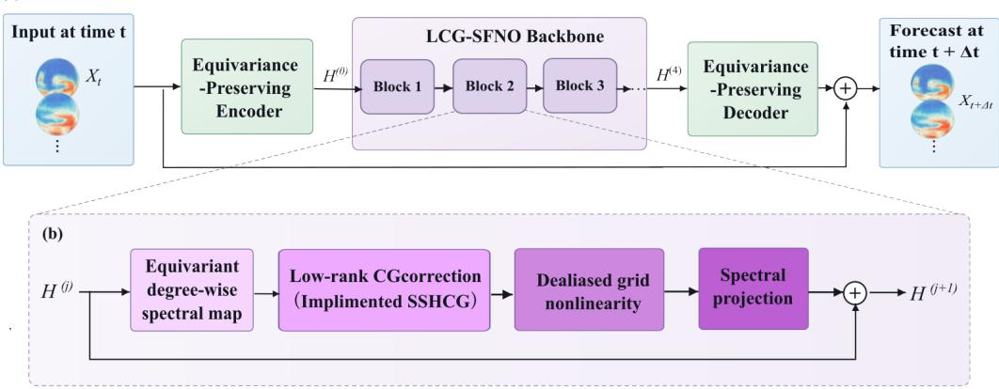  
Figure 1: Overview of LCG-SFNO. (a) Input fields are encoded into spherical-harmonic coefficients, processed by coefficient-space residual blocks, and decoded to produce the forecast. (b) Each block combines an equivariant degree-wise spectral map, a low-rank Clebsch–Gordan correction evaluated with SSHCG, and a quadratic nonlinearity with exact spectral projection. The residual state remains in coefficient space between blocks.

## 4 METHOD

We introduce LCG-SFNO, an $\mathrm { S O ( 3 ) }$ )-equivariant spherical forecasting architecture combining fullband degree-wise spectral processing, low-degree Clebsch–Gordan coupling, and a quadratic nonlinearity with exact spectral projection. Together, these operations preserve rotational equivariance throughout the forecasting operator. We additionally develop SSHCG for efficient evaluation of the CG interaction.

## 4.1 MODEL OVERVIEW

Given an input state $\mathbf { x } _ { t }$ defined on the sphere and spatial conditioning fields $\mathbf { c } ,$ an encoder $E$ maps the inputs to a latent field, which is transformed to spherical-harmonic coefficients $H ^ { ( 0 ) } \in \mathbb { C } ^ { C \times ( \bar { L } + 1 ) ^ { 2 } }$ where C is the latent channel width and L is the maximum represented harmonic degree. The coefficients are then processed by a stack of J coefficient-space residual blocks and decoded to obtain the predicted state:

$$
\begin{array} { r l r l r l } & { H ^ { ( 0 ) } = \mathrm { S F T } [ E ( { \bf x } _ { t } , { \bf c } ) ] , } & & { H ^ { ( j + 1 ) } = H ^ { ( j ) } + \Delta _ { j } \Big ( H ^ { ( j ) } \Big ) , } & & { \widehat { \bf x } _ { t + \Delta t } = D \Big ( H ^ { ( J ) } , { \bf x } _ { t } \Big ) + S { \bf x } _ { t } . } \end{array}\tag{6}
$$

Here, $\Delta _ { j }$ is the residual update of the jth block, D is the decoder, and S is a pointwise linear map from the input state to the output space.

Each residual update combines a full-band degree-wise spectral map, a low-rank CG correction over a low-degree band, and a quadratic nonlinearity with exact spectral projection. The encoder and decoder use analogous equivariance-preserving spectral operations; implementation details are given in Appendix B.4.

## 4.2 EQUIVARIANT SPECTRAL PROCESSING

LCG-SFNO mixes latent channels independently within each spherical-harmonic degree. For coefficients $H _ { b \ell m }$ , we define

$$
[ W H ] _ { a \ell m } = \sum _ { b } W _ { \ell a b } H _ { b \ell m } ,\tag{7}
$$

where $W _ { \ell }$ is a learned channel-mixing matrix shared across all orders m at degree ℓ. A rotation acts on the order index through $D ^ { \ell } ( R )$ , whereas $W _ { \ell }$ acts only on the channel index. The two operations therefore commute, making the spectral map $\mathrm { S O ( 3 ) }$ -equivariant.

We apply this map at every represented degree, providing full-band spectral processing. Because different degrees are processed independently, however, the map does not exchange information across harmonic degrees. We introduce this interaction through Clebsch–Gordan coupling in the next subsection. Additional details on the spectral representation and weight constraints are given in Appendix B.1.

## 4.3 LOW-RANK CLEBSCH–GORDAN COUPLING

We introduce cross-degree interactions through a low-rank Clebsch–Gordan (CG) correction. We restrict the CG inputs to degrees $\ell _ { 1 } , \ell _ { 2 } \leq L _ { c }$ and retain outputs through degree $L _ { o }$ . For each degree ℓ, two learned projections reduce the C hidden channels to r streams,

$$
p _ { \ell m } ^ { ( s ) } = \sum _ { b } P _ { \ell s b } H _ { b \ell m } , \qquad q _ { \ell m } ^ { ( s ) } = \sum _ { b } Q _ { \ell s b } H _ { b \ell m } , \qquad s = 1 , \dots , r .\tag{8}
$$

The rank-r factorization reduces the channel dimension before the CG product. For each stream, we then couple harmonic degrees through

$$
z _ { \ell m } ^ { ( s ) } = \sum _ { \ell _ { 1 } , \ell _ { 2 } \leq L _ { c } } \gamma _ { \ell _ { 1 } \ell _ { 2 } \ell } ^ { ( s ) } \sum _ { m _ { 1 } , m _ { 2 } } C _ { \ell _ { 1 } m _ { 1 } , \ell _ { 2 } m _ { 2 } } ^ { \ell m } p _ { \ell _ { 1 } m _ { 1 } } ^ { ( s ) } q _ { \ell _ { 2 } m _ { 2 } } ^ { ( s ) } , \qquad \ell \leq L _ { o } ,\tag{9}
$$

where $\gamma _ { \ell _ { 1 } \ell _ { 2 } \ell } ^ { ( s ) }$ is a learned weight for each admissible degree path. The resulting features are projected back to the model channels,

$$
\Delta H _ { a \ell m } ^ { \mathrm { C G } } = \alpha _ { \ell } \sum _ { s = 1 } ^ { r } O _ { \ell a s } z _ { \ell m } ^ { ( s ) } , \qquad \ell \leq L _ { o } ,\tag{10}
$$

where $\alpha _ { \ell }$ is a learned degree-wise scale initialized at zero. Only degree triples satisfying $| \ell _ { 1 } - \ell _ { 2 } | \leq$ $\ell \leq \ell _ { 1 } + \ell _ { 2 }$ contribute.

The CG coefficients are fixed, while $P , Q , O$ , and the degree-path weights $\gamma$ are learned. These learned transformations are shared across orders m and therefore do not alter the action of rotations within each degree. Together with the intertwining property of the CG tensor product, the complete correction is $\mathrm { S \bar { O } ( 3 ) }$ )-equivariant.

Since the product of two fields band-limited at $L _ { c }$ contains harmonics only through degree $2 L _ { c }$ choosing $\bar { L } _ { o } = 2 L _ { c }$ retains the complete CG correction generated by the coupled band. Degrees above $L _ { o }$ remain in the full-band spectral pathway. Appendix B.5 examines the choice of coupled bandwidth.

## 4.4 DEALIASED SPECTRAL NONLINEARITY

The degree-wise spectral map and CG correction are equivariant in coefficient space, but nonlinear processing across the full represented band requires transforming to a spatial grid. A pointwise nonlinearity can generate harmonics beyond the represented degree L; if these modes are not sufficiently resolved by the quadrature grid, they alias into the retained coefficients and break equivariance. We avoid this aliasing by using a quadratic activation whose projection onto the retained spectral band can be evaluated exactly.

Specifically, we use $\textstyle \sigma ( x ) ~ = ~ { \frac { x } { 2 } } + { \frac { x ^ { 2 } } { 4 } }$ and evaluate it on an oversampled Legendre–Gauss grid. Suppressing the block index j, the residual update is

$$
\Delta ( H ) = N _ { \mathrm { s p e c } } \left[ \Pi _ { L } \mathrm { S F T } _ { f } \left( B \sigma \big ( A \mathrm { I S F T } _ { f } \left( W H + \Delta H ^ { \mathrm { C G } } \right) \big ) \right) \right] ,\tag{11}
$$

where $\mathrm { I S F T } _ { f }$ and $\operatorname { S F T } _ { f }$ denote the inverse and forward spherical Fourier transforms on a grid oversampled by a factor $\mid f ,$ , and $\Pi _ { L }$ projects onto degrees $\ell \leq L$ . The maps A and $B$ mix channels before and after the activation, while $N _ { \mathrm { s p e c } }$ denotes the equivariance-preserving spectral normalization used in each block.

For an input band-limited at degree L, the quadratic activation generates harmonics only through degree $2 { \bar { L } }$ . Exact evaluation of its projection onto degrees $\ell \leq L$ therefore requires only sufficient quadrature, rather than explicit representation of all degree-2L modes. By the classical three-halves rule, an oversampling factor $\bar { f } = 1 . 5$ is sufficient for this projection. Higher-degree content consequently does not alias into the retained coefficients, and the nonlinear update remains $\mathrm { S O ( 3 ) }$ -equivariant up to numerical precision. The quadrature derivation, spectral normalization, and comparison with non-polynomial activations are given in Appendix B.3.

Table 1: Rotational equivariance. Relative equivariance error under joint rotations of the state and auxiliary spatial fields, averaged over eight rotations and sixteen test states. LCG-SFNO reduces SFNO’s error by over three orders of magnitude on SSWE and approximately five on WeatherBench, reaching numerical precision. Best/second-best values are bold/underlined.
<table><tr><td rowspan="2">Model</td><td rowspan="2">Shallow water  $2 5 6 \times 5 1 2$ </td><td colspan="3">WeatherBench  $5 . 6 2 5 ^ { \circ }$ </td></tr><tr><td>1 day</td><td>3 days</td><td>5 days</td></tr><tr><td>ClimaX</td><td> $8 . 5 \times 1 0 ^ { - 1 }$ </td><td> $7 . 9 \times 1 0 ^ { - 1 }$ </td><td>1.0</td><td>1.0</td></tr><tr><td>FourCastNet</td><td> $6 . 9 \times 1 0 ^ { - 1 }$ </td><td> $7 . 6 \times 1 0 ^ { - 1 }$ </td><td> $8 . 3 \times 1 0 ^ { - 1 }$ </td><td> $8 . 3 \times 1 0 ^ { - 1 }$ </td></tr><tr><td>SHNet (GSNO)</td><td> $1 . 1 \times 1 0 ^ { - 1 }$ </td><td> $5 . 6 \times 1 0 ^ { - 1 }$ </td><td> $7 . 2 \times 1 0 ^ { - 1 }$ </td><td> $6 . 7 \times 1 0 ^ { - 1 }$ </td></tr><tr><td>SFNO</td><td> $9 . 5 \times 1 0 ^ { - 4 }$ </td><td> $9 . 5 \times 1 0 ^ { - 2 }$ </td><td> $1 . 5 \times 1 0 ^ { - 1 }$ </td><td> $1 . 1 \times 1 0 ^ { - 1 }$ </td></tr><tr><td>LCG-SFNO (ours)</td><td> $\overline { { { 8 . 2 \times 1 0 } ^ { - 7 } } }$ </td><td> $\overline { { { \bf 6 . 6 \times 1 0 ^ { - 7 } } } }$ </td><td> $\overline { { { \bf 7 . 1 \times 1 0 ^ { - 7 } } } }$ </td><td> $\overline { { { \bf 7 . 2 \times 1 0 ^ { - 7 } } } }$ </td></tr></table>

## 4.5 EFFICIENT CLEBSCH–GORDAN EVALUATION

Direct evaluation of the CG interaction requires summing over all admissible degree paths and angular couplings. For a coupled band extending through degree $L _ { c } ,$ , the number of admissible degree triples scales as $O ( L _ { c } ^ { 3 } )$ , while direct angular contraction scales as $O ( B C L _ { c } ^ { 5 } )$ , where B is the batch size and C is the number of coupled channels. To reduce this cost, we develop SSHCG, which provides complementary direct and factorized evaluation strategies.

For moderate coupled bandwidths, SSHCG uses a sparse direct implementation that traverses only nonzero CG couplings and avoids dense angular tensors and per-path intermediates. This preserves an independent learned weight for every admissible degree path while retaining the $O ( L _ { c } ^ { 5 } )$ bandwidth scaling of direct contraction.

For wider bands, SSHCG imposes a rank-R canonical polyadic factorization on the degree-path weights. The resulting interaction can be evaluated through spherical synthesis, bilinear operations on the sphere, and harmonic analysis, reducing the complexity to $O ( B \bar { C } R L _ { c } ^ { 3 } )$ . The factorized route therefore trades unrestricted degree-path weights for more favorable bandwidth scaling. Implementa tion details, derivations, and runtime comparisons are given in Appendix C.2–C.4.

## 5 EXPERIMENTS

In this section, we evaluate LCG-SFNO on the spherical shallow-water equations and WeatherBench. We assess rotational equivariance, the contributions of the main architectural components, computational scalability, and forecast performance. Additional implementation details and ablations are provided in the appendix.

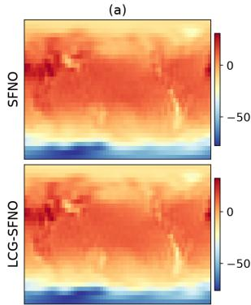

(b)  
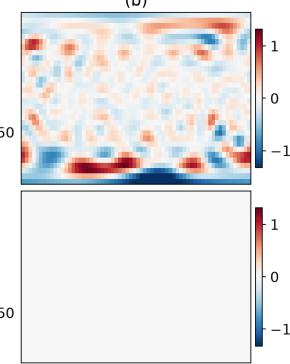

(c)  
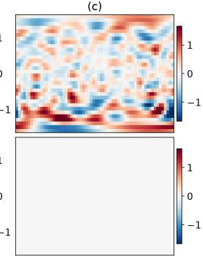  
Figure 2: Spatial structure of rotational equivariance error. WeatherBench results for one test state x and one random rotation R. (a) One-day 2 m temperature forecast; (b,c) equivariance residual $R ^ { - 1 } { \mathcal { G } } ( R \mathbf { x } , R \mathbf { c } ) - { \mathcal { G } } ( \mathbf { x } , \mathbf { c } )$ for 2 m temperature and 10 m zonal wind. Rows correspond to SFNO and LCG-SFNO, with shared color scales within each column. The structured residual visible for SFNO is absent at the displayed scale for LCG-SFNO.

Table 2: Incremental component ablation on one-day WeatherBench. Rows progressively add the full-band backbone, CG coupling, and oversampled nonlinear pathway. “Epochs” denotes the number of epochs required to reach row B’s best validation error. Rows A–C report mean ± standard deviation over three seeds; row D is a single-seed diagnostic.
<table><tr><td>Model</td><td>ACC</td><td>MSE</td><td>Epochs</td><td>Equivariance</td></tr><tr><td>A SFNO reference</td><td> $8 4 . 0 \pm 0 . 0$ </td><td> $1 8 7 . 7 \pm 0 . 2$ </td><td>never</td><td> $9 . 5 \times 1 0 ^ { - 2 }$ </td></tr><tr><td>B + full-band backbone</td><td> $9 3 . 4 \pm 0 . 1$ </td><td> $8 1 . 5 \pm 0 . 6$ </td><td>39</td><td> $6 . 7 \times 1 0 ^ { - 2 }$ </td></tr><tr><td>C + CG coupling</td><td> $9 3 . 7 \pm 0 . 0$ </td><td> $7 7 . 9 \pm 0 . 1$ </td><td>13</td><td> $6 . 8 \times 1 0 ^ { - 2 }$ </td></tr><tr><td>D + oversampled nonlinear pathway</td><td>93.4</td><td>80.7</td><td>21</td><td> $7 . 2 \times 1 0 ^ { - 3 }$ </td></tr></table>

## 5.1 BENCHMARKS AND EVALUATION PROTOCOL

We evaluate on two spherical forecasting benchmarks: the spherical shallow-water equations (SSWE) and WeatherBench. SSWE provides a controlled setting for measuring rotational equivariance and autoregressive rollout error. WeatherBench at 5.625◦ resolution, constructed from ERA5 reanalysis, provides a global atmospheric forecasting task. We train separate direct WeatherBench models at lead times of one, three, and five days and report anomaly correlation coefficient (ACC) and normalized latitude-weighted mean-square error (MSE). On SSWE, we report relative $L ^ { 2 }$ rollout error.

We measure rotational equivariance using the relative equivariance error

$$
\epsilon _ { \mathrm { e q } } = \frac { \| \mathcal { G } ( R \mathbf { x } , R \mathbf { c } ) - R \mathcal { G } ( \mathbf { x } , \mathbf { c } ) \| _ { 2 } } { \| R \mathcal { G } ( \mathbf { x } , \mathbf { c } ) \| _ { 2 } } ,\tag{12}
$$

where $\mathcal { G }$ denotes the forecasting operator and $R \in \mathrm { S O ( 3 ) }$ is applied jointly to the input state and auxiliary spatial fields. Rotations are performed directly in spherical-harmonic coefficient space, avoiding spatial interpolation. We average the error over eight random rotations and sixteen test states; further details are given in Appendix D.

We compare with ClimaX (Nguyen et al., 2023), FourCastNet (Pathak et al., 2022), SHNet with the GSNO operator (Tang et al., 2026), and SFNO (Bonev et al., 2023). All models are trained using the same data splits and evaluation grids. Dataset details, optimization settings, and model configurations are given in Appendix D.

## 5.2 ROTATIONAL EQUIVARIANCE

Table 1 shows that LCG-SFNO reduces end-to-end equivariance error from $9 . 5 \times 1 0 ^ { - 4 } \mathrm { t o } 8 . 2 \times 1 0 ^ { - 7 }$ on SSWE and from approximately $1 0 ^ { - 1 } \mathrm { t o } 1 0 ^ { - 6 }$ on WeatherBench, reductions of more than three and approximately five orders of magnitude, respectively. The resulting errors are at numerical precision. This contrast with SFNO shows that a spherical-harmonic representation alone is insufficient to guarantee end-to-end rotational equivariance. Figure 2 further shows that SFNO exhibits spatially

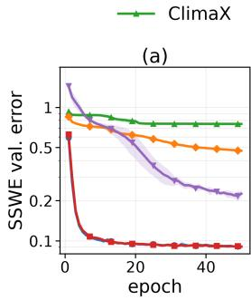

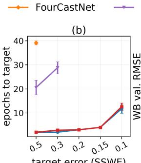

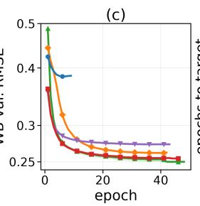

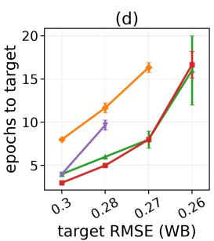  
Figure 3: Training efficiency. (a,b) SSWE one-step validation error and epochs to reach each error target over five seeds. (c,d) Corresponding results for one-day WeatherBench over three seeds. Curves terminate when a model fails to reach a stricter target or early stopping occurs. LCG-SFNO matches SFNO’s convergence on SSWE, reaches the intermediate WeatherBench targets in fewer epochs, and matches the best model at the strictest target.

Table 3: CG-block cost versus coupled bandwidth. Forward-and-backward time (ms) for one WeatherBench CG block (186 channels, rank $r = 4 ,$ batch 64, single precision). LCG-SFNO uses the $1 2 / 2 4$ band. Direct implementations become more expensive with bandwidth, whereas the grid route remains nearly constant. †The 31/31 dense product exceeds 96 GB at batch 64 and is timed using four micro-batches of 16.
<table><tr><td>Band  $L _ { c } / L _ { o }$ </td><td>Triples</td><td>Dense</td><td>Fused</td><td>Tiled</td><td>Grid route</td></tr><tr><td>4/8</td><td>85</td><td>3.2</td><td>3.2</td><td>3.2</td><td>3.2</td></tr><tr><td>8/16</td><td>489</td><td>4.5</td><td>4.2</td><td>3.6</td><td>3.6</td></tr><tr><td>12/24</td><td>1,469</td><td>16.6</td><td>6.5</td><td>4.6</td><td>4.1</td></tr><tr><td>16/31</td><td>3,280</td><td>53.2</td><td>13.3</td><td>7.2</td><td>4.7</td></tr><tr><td>24/31</td><td>9,456</td><td>325</td><td>51.9</td><td>17.4</td><td>5.1</td></tr><tr><td>31/31</td><td>16,400</td><td>855†</td><td>152</td><td>35.6</td><td>5.3</td></tr></table>

structured residuals near fronts and high-latitude gradients, whereas the LCG-SFNO residual is not visible on the same color scale.

## 5.3 COMPONENT EFFECTS AND OPTIMIZATION

Table 2 isolates the contributions of the main architectural changes on one-day WeatherBench. The A→B transition accounts for most of the forecast improvement over the reference SFNO. Adding CG coupling in B→C further improves forecast error and reduces the number of epochs required to reach row B’s best validation error from 39 to 13, while leaving equivariance error essentially unchanged. The single-seed C→D diagnostic instead reduces equivariance error from $6 . 8 \times 1 0 ^ { - 2 } \mathrm { t o } 7 . 2 \times 1 0 ^ { - 3 }$ with only a modest change in forecast accuracy. The ablation therefore separates the roles of the three components: the full-band backbone provides most of the accuracy gain, CG coupling improves forecasting and optimization, and the oversampled nonlinear pathway reduces discretization-induced equivariance error.

Figure 3 shows the corresponding optimization behavior over the full training trajectories. SFNO and LCG-SFNO converge similarly on SSWE, whereas LCG-SFNO reaches intermediate WeatherBench error targets in fewer epochs than the comparison models. Together with the B→C ablation, this supports attributing part of the faster WeatherBench convergence to the CG interaction rather than to the stronger spectral backbone alone.

The final model replaces the non-polynomial activation used in this diagnostic with the quadratic activation and exact spectral projection described in Section 4.4.

## 5.4 COMPUTATIONAL SCALABILITY

Table 3 and Figure 4 show two computational regimes. At the 12/24 operating band, the tiled direct implementation costs 4.6 ms per block while retaining an independent learned weight for every admissible degree path. As the coupled bandwidth increases, its cost rises to 35.6 ms at 31/31, whereas the factorized grid route remains nearly constant. The tiled direct route is therefore effective at moderate bandwidths, while the factorized route provides better scaling for wider coupling.

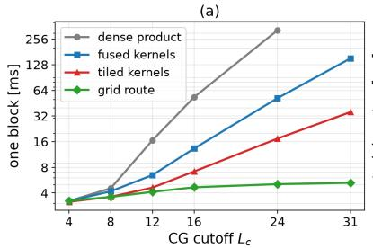

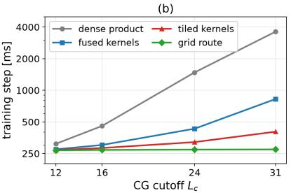  
Figure 4: Computational cost versus coupled bandwidth. (a) CG-block forward-and-backward time; (b) end-to-end training-step time, both versus input cutoff $L _ { c } .$ The grid route remains nearly constant with increasing bandwidth.

Table 4: Shallow-water forecasting. Relative $L ^ { 2 }$ rollout error $( \times 1 0 ^ { - 3 } )$ over 50 test initial conditions, reported as mean ± standard deviation over five seeds. LCG-SFNO matches SFNO within seed variation across all horizons while using the fewest parameters.
<table><tr><td>Model</td><td>Params</td><td>1 h</td><td>5 h</td><td>10 h</td></tr><tr><td>ClimaX</td><td>1.96M</td><td> $4 2 1 \pm 0$ </td><td> $4 7 4 \pm 5$ </td><td> $5 3 5 \pm 1 0$ </td></tr><tr><td>FourCastNet</td><td>1.66M</td><td> $2 8 5 \pm 2$ </td><td> $6 8 7 \pm 4 0$ </td><td> $1 3 0 9 \pm 1 1 0$ </td></tr><tr><td>SHNet (GSNO)</td><td>0.87M</td><td> $1 4 2 \pm 6$ </td><td> $3 9 1 \pm 1 6$ </td><td> $6 2 5 \pm 1 8 9$ </td></tr><tr><td>SFNO</td><td>0.28M</td><td> $5 8 . 0 \pm 1 . 2 $ </td><td> $1 2 1 \pm 6$ </td><td> $2 1 9 \pm 2 2$ </td></tr><tr><td>LCG-SFNO (ours)</td><td>0.27M</td><td> $\overline { { 5 7 . 4 \pm 1 . 4 } }$ </td><td> $\overline { { { \bf 1 1 9 } \pm 7 } }$ </td><td> $2 1 1 \pm 1 7$ </td></tr></table>

In a single-seed WeatherBench comparison, widening the coupled band from 12/24 to 31/31 provides little additional forecast benefit: one-day ACC changes from 93.4 to 93.5 and MSE from 80.7 to 80.5, while tiled CG cost increases by nearly eightfold. We therefore use the 12/24 band in the main model. Appendix Figure 5 provides the corresponding spectral analysis of the WeatherBench fields.

## 5.5 FORECAST PERFORMANCE

On SSWE, LCG-SFNO matches SFNO within variation across seeds at one, five, and ten hours while reducing equivariance error by more than three orders of magnitude. Thus, enforcing substantially stronger rotational consistency does not degrade forecast accuracy in this controlled setting.

On WeatherBench, LCG-SFNO substantially improves over SFNO at a matched parameter count. At one day, ACC increases from 84.0 to 93.3, while normalized MSE decreases from 187.7 to 82.1. LCG-SFNO attains the highest mean one-day ACC among the evaluated models, while ClimaX performs better at three days and SHNet at five days. Tables 4 and 5 report the complete results. Variable-wise scores, rollout trajectories, and additional architecture and transfer ablations are provided in Appendix F.2–F.3.

## 6 CONCLUSION

A spherical-harmonic representation alone does not guarantee end-to-end rotational equivariance, while full-band Clebsch–Gordan (CG) coupling is computationally expensive. LCG-SFNO combines full-band degree-wise spectral processing with low-rank CG interactions over a controlled low-degree band and a quadratic nonlinearity with exact spectral projection. SSHCG provides efficient direct and factorized implementations of the CG interaction.

LCG-SFNO reduces equivariance error to numerical precision on both spherical shallow-water dynamics and WeatherBench, while matching SFNO on the former and substantially improving forecast accuracy on the latter. Ablations show distinct roles for the spectral backbone, CG coupling, and dealiased nonlinear pathway, while bandwidth experiments show little benefit from extending CG coupling across the full spectrum. These results demonstrate end-to-end rotationally equivariant spherical forecasting without full-band CG interactions.

Table 5: WeatherBench forecasting. ACC (%) and normalized latitude-weighted MSE $( \times 1 0 ^ { - 3 } )$ reported as mean ± standard deviation over three seeds. LCG-SFNO substantially improves over SFNO across all horizons and achieves the highest mean one-day ACC; ClimaX and SHNet lead on the remaining aggregate metrics.
<table><tr><td></td><td></td><td colspan="2">1 day</td><td colspan="2">3 days</td><td colspan="2">5 days</td></tr><tr><td>Model</td><td>Params</td><td>ACC</td><td>MSE</td><td>ACC</td><td>MSE</td><td>ACC</td><td>MSE</td></tr><tr><td>ClimaX</td><td>5.40M</td><td> $9 3 . 2 \pm 0 . 3$ </td><td> ${ \bf 7 6 . 8 \pm 0 . 5 }$ </td><td> ${ \bf 7 8 . 3 \pm 0 . 4 }$ </td><td> $2 4 2 . 4 \pm 2 . 5$ </td><td> ${ 5 3 . 1 \pm 0 . 8 }$ </td><td> $4 3 5 . 0 \pm 4 . 5$ </td></tr><tr><td>FourCastNet</td><td>5.60M</td><td> $9 2 . 8 \pm 0 . 1$ </td><td> $8 2 . 8 \pm 0 . 3$ </td><td> $6 9 . 3 \pm 0 . 1$ </td><td> $3 2 5 . 1 \pm 0 . 9$ </td><td> $\overline { { 5 0 . 5 \pm 0 . 1 } }$ </td><td> $4 4 0 . 1 \pm 0 . 1$ </td></tr><tr><td>SHNet (GSNO)</td><td>4.03M</td><td> $9 2 . 4 \pm 0 . 0$ </td><td> $9 2 . 7 \pm 0 . 1$ </td><td> $\underline { { 7 4 . 2 \pm 0 . 1 } }$ </td><td> $2 8 1 . 6 \pm 0 . 9$ </td><td> ${ \bf 5 4 . 9 \pm 0 . 1 }$ </td><td> ${ \bf 4 2 0 . 1 \pm 1 . 1 }$ </td></tr><tr><td>SFNO</td><td>5.26M</td><td> $8 4 . 0 \pm 0 . 0$ </td><td> $1 8 7 . 7 \pm 0 . 2$ </td><td> $6 5 . 4 \pm 0 . 2$ </td><td> $3 5 0 . 8 \pm 1 . 4$ </td><td> $4 8 . 6 \pm 0 . 1$ </td><td> $4 5 1 . 1 \pm 0 . 6$ </td></tr><tr><td>LCG-SFNO (ours)</td><td>5.24M</td><td> ${ \bf 9 3 . 3 \pm 0 . 1 }$ </td><td> $8 2 . 1 \pm 1 . 4$ </td><td> $7 3 . 5 \pm 0 . 1$ </td><td> $2 8 6 . 5 \pm 0 . 9$ </td><td> $5 1 . 7 \pm 0 . 2$ </td><td> $4 3 0 . 4 \pm 1 . 4$ </td></tr></table>

## REPRODUCIBILITY STATEMENT

All models in this paper, including the baselines, were trained by us under one protocol, and every element needed to repeat the experiments is described in the paper. Appendix D specifies the two benchmarks, the data splits and grids, the optimizer, schedule, batch size, early-stopping rule, and the number of seeds behind every reported mean and standard deviation, and Appendix D.3 lists the architecture of each compared model at the sizes of the benchmark paper. Appendix A derives the spherical representation and the dealiasing rule that makes the quadratic activation exact, and Appendix B gives the low-rank Clebsch–Gordan parameterization, the spectral normalization, the encoder and decoder, and the equivariance of each learned operation. The rotational-consistency measurements follow the diagnostic of Appendix D.4, which states the rotation sampling, the bandlimiting convention, and the numerical precision used. Appendix C describes the kernels and the factorized grid route, their complexity, and their numerical agreement with the dense reference.

## ETHICS STATEMENT

This work studies operator learning for physical forecasting and uses only public data: the ERA5 reanalysis through the WeatherBench benchmark and trajectories generated by a public shallow-water solver. No human subjects, personal data, or sensitive attributes are involved. Data-driven weather models are inexpensive to evaluate once trained, which can broaden access to forecast guidance; they are also statistical models that can fail outside their training distribution, and the rotational consistency studied here addresses only one of the properties a forecast system should have before operational use. We see no other ethical concerns specific to this work.

## AI USE STATEMENT

In this work, we used generative AI tools for generating synthetic datasets, implementing methods, supporting qualitative and thematic data analysis, and designing and running experiments. We have not used generative AI tools for developing theoretical models or conceptual frameworks, formulating mathematical claims, providing critical ingredients for proving mathematical claims, or interpreting results, and assisting in writing proofs, proposing or refining hypotheses, assisting with translation, cleaning and reformatting datasets are not applicable to this work. Additionally, we used generative AI tools for creating or editing software code, drafting parts of the manuscript, and editing the manuscript to improve readability. We have reviewed all AI-assisted work. The authors reviewed the implementation and experimental procedures, verified the reported results, and checked the manuscript for accuracy. We take responsibility for the final content of this work, including text, claims or artifacts produced with the aid of generative AI.

## REFERENCES

Richard B Alley, Kerry A Emanuel, and Fuqing Zhang. Advances in weather prediction. Science, 363(6425):342–344, 2019.

Ilyes Batatia, David P´ eter Kov´ acs, Gregor Simm, Christoph Ortner, and G´ abor Cs´ anyi. MACE:´ Higher order equivariant message passing neural networks for fast and accurate force fields. In Advances in Neural Information Processing Systems, 2022.

Simon Batzner, Albert Musaelian, Lixin Sun, Mario Geiger, Jonathan P Mailoa, Mordechai Kornbluth, Nicola Molinari, Tess E Smidt, and Boris Kozinsky. E(3)-equivariant graph neural networks for data-efficient and accurate interatomic potentials. Nature Communications, 13(1):2453, 2022.

Peter Bauer, Alan Thorpe, and Gilbert Brunet. The quiet revolution of numerical weather prediction. Nature, 525(7567):47–55, 2015.

Peter Bauer, Peter D Dueben, Torsten Hoefler, Tiago Quintino, Thomas C Schulthess, and Nils P Wedi. The digital revolution of earth-system science. Nature Computational Science, 1(2):104–113, 2021.

Kaifeng Bi, Lingxi Xie, Hengheng Zhang, Xin Chen, Xiaotao Gu, and Qi Tian. Accurate mediumrange global weather forecasting with 3D neural networks. Nature, 619(7970):533–538, 2023.

Anton Bochkarev, Yury Lysogorskiy, and Ralf Drautz. Fast contracted Clebsch–Gordan tensor products for equivariant graph neural networks. arXiv preprint arXiv:2605.15073, 2026.

Boris Bonev, Thorsten Kurth, Christian Hundt, Jaideep Pathak, Maximilian Baust, Karthik Kashinath, and Anima Anandkumar. Spherical Fourier neural operators: Learning stable dynamics on the sphere. In International Conference on Machine Learning, 2023.

John P Boyd. Chebyshev and Fourier spectral methods. Dover, 2001.

Johannes Brandstetter, Rianne van den Berg, Max Welling, and Jayesh K Gupta. Clifford neural layers for PDE modeling. In International Conference on Learning Representations, 2023.

Taco Cohen and Max Welling. Group equivariant convolutional networks. In International Conference on Machine Learning, 2016.

Taco S Cohen, Mario Geiger, Jonas Kohler, and Max Welling. Spherical CNNs. In¨ International Conference on Learning Representations, 2018.

James R Driscoll and Dennis M Healy. Computing Fourier transforms and convolutions on the 2-sphere. Advances in Applied Mathematics, 15(2):202–250, 1994.

Alan Robert Edmonds. Angular momentum in quantum mechanics. Princeton University Press, 1996.

Carlos Esteves, Christine Allen-Blanchette, Ameesh Makadia, and Kostas Daniilidis. Learning SO(3) equivariant representations with spherical CNNs. In European Conference on Computer Vision, 2018.

Fabian Fuchs, Daniel Worrall, Volker Fischer, and Max Welling. SE(3)-Transformers: 3D rototranslation equivariant attention networks. In Advances in Neural Information Processing Systems, 2020.

Mario Geiger and Tess Smidt. e3nn: Euclidean neural networks. arXiv preprint arXiv:2207.09453, 2022.

John Guibas, Morteza Mardani, Zongyi Li, Andrew Tao, Anima Anandkumar, and Bryan Catanzaro. Adaptive Fourier neural operators: Efficient token mixers for transformers. In International Conference on Learning Representations, 2022.

Hans Hersbach, Bill Bell, Paul Berrisford, Shoji Hirahara, Andras Hor´ anyi, Joaqu´ ´ın Munoz-Sabater,˜ Julien Nicolas, Carole Peubey, Raluca Radu, Dinand Schepers, et al. The ERA5 global reanalysis. Quarterly Journal of the Royal Meteorological Society, 146(730):1999–2049, 2020.

Risi Kondor, Zhen Lin, and Shubhendu Trivedi. Clebsch–Gordan nets: a fully Fourier space spherical convolutional neural network. In Advances in Neural Information Processing Systems, 2018.

Nikola Kovachki, Zongyi Li, Burigede Liu, Kamyar Azizzadenesheli, Kaushik Bhattacharya, Andrew Stuart, and Anima Anandkumar. Neural operator: Learning maps between function spaces with applications to PDEs. Journal of Machine Learning Research, 24(89):1–97, 2023.

Remi Lam, Alvaro Sanchez-Gonzalez, Matthew Willson, Peter Wirnsberger, Meire Fortunato, Ferran Alet, Suman Ravuri, Timo Ewalds, Zach Eaton-Rosen, Weihua Hu, et al. Learning skillful medium-range global weather forecasting. Science, 382(6677):1416–1421, 2023.

Jeffrey K Lazo, Rebecca E Morss, and Julie L Demuth. 300 billion served: Sources, perceptions, uses, and values of weather forecasts. Bulletin of the American Meteorological Society, 90(6): 785–798, 2009.

Zongyi Li, Nikola Kovachki, Kamyar Azizzadenesheli, Burigede Liu, Kaushik Bhattacharya, Andrew Stuart, and Anima Anandkumar. Fourier neural operator for parametric partial differential equations. In International Conference on Learning Representations, 2021.

Shengjie Luo, Tianlang Chen, and Aditi S Krishnapriyan. Enabling efficient equivariant operations in the Fourier basis via Gaunt tensor products. In International Conference on Learning Representations, 2024.

Ankur Mahesh, William Collins, Boris Bonev, Noah Brenowitz, Yair Cohen, Joshua Elms, Peter Harrington, Karthik Kashinath, Thorsten Kurth, Joshua North, et al. Huge ensembles part I: Design of ensemble weather forecasts using spherical Fourier neural operators. arXiv preprint arXiv:2408.03100, 2024.

Tung Nguyen, Johannes Brandstetter, Ashish Kapoor, Jayesh K Gupta, and Aditya Grover. ClimaX: A foundation model for weather and climate. In International Conference on Machine Learning, 2023.

NVIDIA. cuEquivariance: Primitives for equivariant neural networks. https://docs.nvidia. com/cuda/cuequivariance/, 2026. Version 0.10.0.

Jeremy Ocampo, Matthew A Price, and Jason D McEwen. Scalable and equivariant spherical CNNs by discrete-continuous (DISCO) convolutions. In International Conference on Learning Representations, 2023.

Steven A Orszag. On the elimination of aliasing in finite-difference schemes by filtering highwavenumber components. Journal of the Atmospheric Sciences, 28(6):1074–1074, 1971.

Saro Passaro and C Lawrence Zitnick. Reducing SO(3) convolutions to SO(2) for efficient equivariant GNNs. In International Conference on Machine Learning, 2023.

Jaideep Pathak, Shashank Subramanian, Peter Harrington, Sanjeev Raja, Ashesh Chattopadhyay, Morteza Mardani, Thorsten Kurth, David Hall, Zongyi Li, Kamyar Azizzadenesheli, et al. FourCast-Net: A global data-driven high-resolution weather model using adaptive Fourier neural operators. arXiv preprint arXiv:2202.11214, 2022.

Stephan Rasp, Peter D Dueben, Sebastian Scher, Jonathan A Weyn, Soukayna Mouatadid, and Nils Thuerey. WeatherBench: A benchmark data set for data-driven weather forecasting. Journal of Advances in Modeling Earth Systems, 12(11):e2020MS002203, 2020.

Olaf Ronneberger, Philipp Fischer, and Thomas Brox. U-Net: Convolutional networks for biomedical image segmentation. In Medical Image Computing and Computer-Assisted Intervention, pp. 234–241, 2015.

Xingjian Shi, Zhourong Chen, Hao Wang, Dit-Yan Yeung, Wai-Kin Wong, and Wang-chun Woo. Convolutional LSTM network: A machine learning approach for precipitation nowcasting. In Advances in Neural Information Processing Systems, 2015.

Hao Tang, Hao Chen, and Chao Li. Generalized spherical neural operators: Green’s function formulation. In International Conference on Learning Representations, 2026.

Nathaniel Thomas, Tess Smidt, Steven Kearnes, Lusann Yang, Li Li, Kai Kohlhoff, and Patrick Riley. Tensor field networks: Rotation- and translation-equivariant neural networks for 3D point clouds. arXiv preprint arXiv:1802.08219, 2018.

D. A. Varshalovich, A. N. Moskalev, and V. K. Khersonskii. Quantum Theory of Angular Momentum. World Scientific, Singapore, 1988.

Rui Wang, Robin Walters, and Rose Yu. Approximately equivariant networks for imperfectly symmetric dynamics. In International Conference on Machine Learning, 2022.

Maurice Weiler, Mario Geiger, Max Welling, Wouter Boomsma, and Taco Cohen. 3D steerable CNNs: Learning rotationally equivariant features in volumetric data. In Advances in Neural Information Processing Systems, 2018.

Jonathan A Weyn, Dale R Durran, and Rich Caruana. Improving data-driven global weather prediction using deep convolutional neural networks on a cubed sphere. Journal ofAdvances in Modeling Earth Systems, 12(9):e2020MS002109, 2020.

Maksim Zhdanov, David Ruhe, Maurice Weiler, Ana Lucic, Johannes Brandstetter, and Patrick Forre. Clifford-steerable convolutional neural networks. In´ International Conference on Machine Learning, 2024.

## A SPHERICAL HARMONICS AND CLEBSCH–GORDAN PRODUCTS IN DETAIL

This appendix derives the facts that Section 3 states and that the exactness claims of the method rest on: the quadrature on which the transforms are exact, the action of rotations on coefficients, the Clebsch–Gordan series behind the product of two harmonics, the equivariance of the bilinear coupling and its cost, and the dealiasing rule for a polynomial activation. Standard references are Edmonds (1996) for the algebra and Driscoll & Healy (1994); Boyd (2001) for the numerics.

## A.1 HARMONICS, BAND LIMITS, AND QUADRATURE

The spherical harmonics are the eigenfunctions of the Laplace–Beltrami operator on the unit sphere, $\Delta _ { S ^ { 2 } } \dot { Y _ { \ell m } } = - \ell ( \ell + 1 ) Y _ { \ell m }$ . In the complex form with the Condon–Shortley phase they read

$$
Y _ { \ell } ^ { m } ( \theta , \varphi ) = { \sqrt { \frac { 2 \ell + 1 } { 4 \pi } } } { \frac { ( \ell - m ) ! } { ( \ell + m ) ! } } P _ { \ell } ^ { m } ( \cos \theta ) e ^ { i m \varphi } , \qquad 0 \leq | m | \leq \ell ,\tag{13}
$$

with the associated Legendre functions $P _ { \ell } ^ { m }$ , and they are orthonormal, $\begin{array} { r } { \int _ { S ^ { 2 } } Y _ { \ell } ^ { m } \overline { { Y _ { \ell ^ { \prime } } ^ { m ^ { \prime } } } } \mathrm { d } \Omega = \delta _ { \ell \ell ^ { \prime } } \delta _ { m m ^ { \prime } } } \end{array}$ The eigenspace of degree ℓ has dimension $2 \ell + 1$ , and the harmonics of degree at most L span the $( L + \bar { 1 ) ^ { 2 } }$ -dimensional space of band-limited functions. For a real field the coefficients of orders m and −m are complex conjugates up to sign, so the real basis $\{ Y _ { \ell 0 } , \sqrt { 2 } \mathrm { R e } Y _ { \ell } ^ { m } , \sqrt { 2 } \mathrm { I m } Y _ { \ell } ^ { m } \} _ { m > 0 }$ carries the same information with real coefficients; the model stores the half-spectrum $m \geq \bar { 0 }$ of this real basis, and every statement below holds in either basis after the unitary change of basis between them.

The transforms are computed on a Legendre–Gauss grid: $n _ { \theta }$ colatitudes at the roots of the Legendre polynomial $P _ { n _ { \theta } } ( \cos \theta )$ with Gauss–Legendre weights, and $n _ { \varphi }$ equispaced longitudes. Two exactness properties of this grid carry the whole construction. In longitude, the trapezoidal rule with $n _ { \varphi }$ points integrates $e ^ { i k \varphi }$ exactly unless k is a nonzero multiple of $n _ { \varphi } ;$ in colatitude, the Gauss–Legendre rule with $n _ { \theta }$ nodes integrates every polynomial of degree at most $2 n _ { \theta } - 1$ in cos θ exactly. The product of two harmonics of degrees a and b is, in colatitude, a polynomial of degree at most $a + b$ in cos θ (the half-integer powers of sin θ that $P _ { \ell } ^ { m }$ carries pair up because the orders add). Hence the analysis $\begin{array} { r } { u _ { \ell m } = \sum _ { i j } w _ { i j } u ( \theta _ { i } , \varphi _ { j } ) \overline { { Y _ { \ell } ^ { m } ( \theta _ { i } , \varphi _ { j } ) } } } \end{array}$ of a field band-limited at L is exact whenever $2 L \leq 2 n _ { \theta } - 1$ and $2 L < n _ { \varphi }$ , that is, for $n _ { \theta } \ge L + 1$ and $n _ { \varphi } \ge 2 L + 1$ . The $3 2 \times 6 4$ WeatherBench grid therefore represents degrees up to 31 exactly, and the analysis and synthesis $\begin{array} { r l } {  { \mathcal { S } , S ^ { - 1 } } } \end{array}$ of the main text are inverse to each other on that band.

## A.2 ROTATIONS AND WIGNER D-MATRICES

A rotation $R \in \mathrm { S O } ( 3 )$ acts on functions by $( R u ) ( x ) = u ( R ^ { - 1 } x )$ . Because $\Delta _ { S ^ { 2 } }$ commutes with rotations, each eigenspace is mapped to itself, so the action never mixes degrees; on the degree-ℓ eigenspace it is represented by the unitary $( 2 \ell + 1 ) \times ( 2 \ell + 1 )$ Wigner D-matrix $D ^ { \ell } ( R )$ , which in $Z Y Z$ Euler angles $( \alpha , \beta , \gamma )$ factorizes as $D _ { m m ^ { \prime } } ^ { \ell } ( \alpha , \beta , \gamma ) = e ^ { - i m \alpha } d _ { m m ^ { \prime } } ^ { \ell } ( \beta ) e ^ { - i m ^ { \prime } \gamma }$ with the real Wigner d-functions; see the textbooks of Edmonds (1996) and Varshalovich et al. (1988) for the construction and properties of $D ^ { \ell } ( R )$ . These representations are irreducible: no proper subspace of a degree is invariant under all rotations, which is the statement that the degrees are the smallest building blocks that rotations respect. Equation (2) of the main text is this action written in coefficients. Our equivariance diagnostic (Appendix D.4) builds $D ^ { \ell } ( R )$ as the matrix exponential of the angularmomentum generators in the real basis and applies it degree by degree, so a field is rotated exactly on its band without interpolation on the grid.

Two consequences follow directly. A map that acts on the coefficients of each degree by the same matrix for every order, $\begin{array} { r } { u _ { \ell m } \mapsto \sum _ { b } W _ { \ell a b } u _ { b \ell m } } \end{array}$ , commutes with $D ^ { \ell } ( R )$ because $\bar { D ^ { \ell } } ( R )$ acts on the order index and $W _ { \ell }$ on the channel index; this is the equivariance of the per-degree linear map (7). Conversely, a weight that depends on $m ,$ or a complex weight acting on the half-spectrum (which acts as w on $m > 0$ and $\bar { w }$ on $m < 0$ of the real field), does not commute with $D ^ { \hat { \ell } } ( R )$ in general, which is why the model uses real weights shared across orders.

## A.3 THE CLEBSCH–GORDAN SERIES AND THE PRODUCT OF TWO HARMONICS

The tensor product of the irreducible representations of degrees $\ell _ { 1 }$ and $\ell _ { 2 }$ is reducible, and it decomposes into exactly one copy of each degree between $| \ell _ { 1 } - \ell _ { 2 } |$ and $\ell _ { 1 } + \ell _ { 2 }$ ,

$$
D ^ { \ell _ { 1 } } ( R ) \otimes D ^ { \ell _ { 2 } } ( R ) \ \cong \ \bigoplus _ { \ell = | \ell _ { 1 } - \ell _ { 2 } | } ^ { \ell _ { 1 } + \ell _ { 2 } } D ^ { \ell } ( R ) .\tag{14}
$$

The Clebsch–Gordan coefficients $C _ { \ell _ { 1 } m _ { 1 } , \ell _ { 2 } m _ { 2 } } ^ { \ell m }$ are the entries of the unitary matrix that realizes this decomposition: the vectors $\sum _ { m _ { 1 } , m _ { 2 } } C _ { \ell _ { 1 } m _ { 1 } , \ell _ { 2 } m _ { 2 } } ^ { \ell m } e _ { \ell _ { 1 } m _ { 1 } } \otimes e _ { \ell _ { 2 } m _ { 2 } }$ form a basis of the degree-ℓ summand, and they vanish unless $m = m _ { 1 } + m _ { 2 }$ and (5) holds. This is the source of the selection rules in Section 3: the triangle inequality is the range of (14), and $m = m _ { 1 } + m _ { 2 }$ is the addition of the z-components.

The product of two harmonics is again a finite sum of harmonics because the product of functions on the two eigenspaces lives in their tensor product, which (14) decomposes:

$$
Y _ { \ell _ { 1 } } ^ { m _ { 1 } } Y _ { \ell _ { 2 } } ^ { m _ { 2 } } = \sum _ { \ell = | \ell _ { 1 } - \ell _ { 2 } | } ^ { \ell _ { 1 } + \ell _ { 2 } } \sqrt { \frac { ( 2 \ell _ { 1 } + 1 ) ( 2 \ell _ { 2 } + 1 ) } { 4 \pi ( 2 \ell + 1 ) } } C _ { \ell _ { 1 } 0 , \ell _ { 2 } 0 } ^ { \ell 0 } C _ { \ell _ { 1 } m _ { 1 } , \ell _ { 2 } m _ { 2 } } ^ { \ell m _ { 1 } + m _ { 2 } } Y _ { \ell } ^ { m _ { 1 } + m _ { 2 } } .\tag{15}
$$

The coefficients on the right are the Gaunt coefficients, the integrals of three harmonics over the sphere. The factor $C _ { \ell _ { 1 } 0 , \ell _ { 2 } 0 } ^ { \ell 0 }$ vanishes unless $\ell _ { 1 } + \ell _ { 2 } + \ell$ is even, so the product of two fields couples only degree triples of even parity, while the learned coupling of (10) keeps the odd triples as well and lets the path weights $\gamma$ decide their use. Equation (15) also proves the band-limit statement used throughout the paper: the product of fields band-limited at $L _ { 1 }$ and $L _ { 2 }$ is band-limited at $L _ { 1 } + L _ { 2 }$ and the square of a degree-L field at 2L.

## A.4 EQUIVARIANCE AND COST OF THE CLEBSCH–GORDAN PRODUCT

The bilinear map (4) is equivariant because the CG coefficients intertwine the representations. Writing $p ^ { \prime } = D ^ { \ell _ { 1 } } ( R ) p$ and $q ^ { \prime } = \mathsf { \bar { D } } ^ { \ell _ { 2 } } ( R ) q$ for the rotated inputs, the defining property of the unitary change of basis in (14) gives

$$
\sum _ { m _ { 1 } , m _ { 2 } } C _ { \ell _ { 1 } m _ { 1 } , \ell _ { 2 } m _ { 2 } } ^ { \ell m } p _ { \ell _ { 1 } m _ { 1 } } ^ { \prime } q _ { \ell _ { 2 } m _ { 2 } } ^ { \prime } = \sum _ { m ^ { \prime } } D _ { m m ^ { \prime } } ^ { \ell } ( R ) \sum _ { m _ { 1 } , m _ { 2 } } C _ { \ell _ { 1 } m _ { 1 } , \ell _ { 2 } m _ { 2 } } ^ { \ell m ^ { \prime } } p _ { \ell _ { 1 } m _ { 1 } } q _ { \ell _ { 2 } m _ { 2 } } ,\tag{16}
$$

that is, $z ( D ^ { \ell _ { 1 } } p , D ^ { \ell _ { 2 } } q ) = D ^ { \ell } z ( p , q )$ for every degree ℓ of the output. The identity holds for every rotation and involves no grid, so the coupling is exactly equivariant however coarse the data grid is; the learned parts of (10), the projections $\bar { P , Q , O }$ and the path weights $\gamma ,$ act on the channel and degree-triple indices, which $D ^ { \ell } ( R )$ does not touch, and therefore preserve the identity.

The cost follows from the same structure. For a coupled band with input cutoff $L _ { c }$ and output cutoff $L _ { o } \ge 2 L _ { c } ,$ , the number of admissible triples is

$$
N _ { \mathrm { t r i p l e s } } = \sum _ { \ell _ { 1 } = 0 } ^ { L _ { c } } \sum _ { \ell _ { 2 } = 0 } ^ { L _ { c } } \left( \operatorname* { m i n } ( \ell _ { 1 } + \ell _ { 2 } , L _ { o } ) - | \ell _ { 1 } - \ell _ { 2 } | + 1 \right) = \sum _ { \ell _ { 1 } , \ell _ { 2 } \leq L _ { c } } \left( 2 \operatorname* { m i n } ( \ell _ { 1 } , \ell _ { 2 } ) + 1 \right) \sim \frac { 2 } { 3 } L _ { c } ^ { 3 } ,\tag{17}
$$

which gives the 1,469 triples of the $1 2 / 2 4$ band and the 16,400 of the full band in Table 3. Within one triple the constraint $m = m _ { 1 } + m _ { 2 }$ leaves about $( 2 \ell _ { 1 } + 1 ) ( 2 \ell _ { 2 } + 1 )$ nonzero couplings, so the dense contraction touches $O ( L _ { c } ^ { 5 } )$ angular coefficients per channel and batch element, and a dense implementation that stores every $( m , m _ { 1 } , m _ { 2 } )$ combination stores far more zeros than nonzeros. This growth is what the kernels of Appendix C.2 organize around, and (15) is what the grid route of Appendix C.3 exploits: for path weights that factorize over the degrees, the contraction equals a synthesis of the two inputs, a pointwise product on a grid that resolves degree $2 L _ { c } ,$ and an analysis, all three of which are exact by Appendix A.1.

## A.5 THE DEALIASING RULE FOR A POLYNOMIAL ACTIVATION

Let u be band-limited at L and let σ be a polynomial of degree $p . \ \mathbf { B y } \left( 1 5 \right) , \sigma ( u )$ is band-limited at $p L .$ , so it is a finite expansion and no truncation is involved in principle; the only question is whether the projection $\Pi _ { L } S _ { f } [ \sigma ( u ) ]$ onto degrees $\ell \leq L$ in (11) is computed exactly by the quadrature of the oversampled grid. Its integrand is a product of a degree-pL and a degree-L harmonic, hence of degree $( p + 1 ) L$ in cos θ, and its longitudinal orders satisfy $| \bar { m } _ { 1 } + \cdot \cdot \cdot + \bar { m } _ { p } - m | \leq ( p + 1 ) L$ . Exactness therefore requires

$$
2 n _ { \theta } ^ { \prime } - 1 \ge ( p + 1 ) L \qquad \mathrm { a n d } \qquad n _ { \varphi } ^ { \prime } > ( p + 1 ) L ,\tag{18}
$$

that ${ \mathrm { i s } } ,$ an oversampling factor $f \geq ( p + 1 ) / 2$ relative to the $n _ { \theta } = L + 1 , n _ { \varphi } = 2 L + 2$ grid that represents the band itself. For the quadratic activation this is the three-halves rule of Orszag (1971), $n _ { \theta } ^ { \prime } \ge ( 3 L + 1 ) / 2$ and $n _ { \varphi } ^ { \prime } > 3 L \colon$ for $L = 3 1$ the $4 8 \times 9 6$ grid of the blocks satisfies both with $n _ { \theta } ^ { \prime } = 4 8 \geq 4 7$ and $n _ { \varphi } ^ { \prime } = \mathrm { 9 6 } > 9 3$ . The content of $\sigma ( u )$ above degree $L$ is not represented on that grid, but it is not needed: the rule guarantees that it does not alias into the retained band, which is all the projection requires. For a non-polynomial activation the expansion of $\sigma ( u )$ is infinite, the integrand is not a polynomial, and no finite grid makes the projection exact; the aliased remainder decreases with f but never vanishes, which is the residual measured in Appendix E.2. The decoder retains the fine band rather than projecting to L, so its grid must represent the product itself; for the quadratic this is degree $2 L ,$ which the 2× codec grid with $n _ { \theta } ^ { \prime } = 6 4$ and $n _ { \varphi } ^ { \prime } = \bar { 1 } 2 8$ resolves.

## B ARCHITECTURE AND EQUIVARIANCE DETAILS

This appendix provides the implementation details underlying the equivariant construction in Section 4. We first specify the spherical-harmonic representation and the equivariant degree-wise linear maps, then describe the low-rank Clebsch–Gordan parameterization, the treatment of aliasing and spectral normalization, and finally the encoder, decoder, and output representation.

## B.1 SPHERICAL REPRESENTATION AND EQUIVARIANT DEGREE-WISE MAPS

A real spherical field u is represented by spherical-harmonic coefficients $u _ { \ell m }$ obtained with the Legendre–Gauss transform $\bar { \boldsymbol { s } }$ and reconstructed with $S ^ { - 1 }$ . Under a rotation $R \in \mathrm { S O } ( 3 )$ , the coefficients of fixed degree ℓ transform as

$$
u _ { \ell } \mapsto D ^ { \ell } ( R ) u _ { \ell } .\tag{19}
$$

Consequently, any channel transformation that is shared across the orders m within a fixed degree, including Eq. (7), commutes with $D ^ { \ell } ( R )$ and is therefore equivariant.

We use real-valued per-degree weights throughout. For a real field represented through its nonnegative-m half-spectrum, an unrestricted complex weight acts as w on $m > 0$ and w¯ on m $< 0$ This does not, in general, define the same channel transformation across the full degree-ℓ irreducible representation and therefore need not commute with rotations. Restricting the per-degree weight to be real applies the same channel transformation across all orders and preserves equivariance.

## B.2 LOW-RANK CLEBSCH–GORDAN PARAMETERIZATION

The channel dependence of the CG correction is factorized through rank r. Two learned projections first map the hidden channels into rank-indexed streams,

$$
p _ { \ell m } ^ { ( s ) } = \sum _ { b } P _ { \ell s b } H _ { b \ell m } ,
$$

$$
q _ { \ell m } ^ { ( s ) } = \sum _ { b } Q _ { \ell s b } H _ { b \ell m } ,\tag{20}
$$

and Eq. (10) couples each stream over all admissible degree triples, in the manner of the Clebsch– Gordan and tensor-product layers of Kondor et al. (2018), Thomas et al. (2018), and Weiler et al. (2018). The result is projected back to model channels as

$$
\Delta H _ { a \ell m } ^ { \mathrm { C G } } = \alpha _ { \ell } \sum _ { s } O _ { \ell a s } z _ { \ell m } ^ { ( s ) } ,\tag{21}
$$

where $\alpha _ { \ell }$ is initialized at zero. Inputs to the tensor product are restricted to $\ell _ { 1 } , \ell _ { 2 } \leq L _ { c } ,$ , and the correction is written only to $\ell \leq L _ { o } ;$ degrees above $L _ { o }$ therefore follow the original SFNO pathway. Because the learned channel projections act independently within each irreducible representation and the CG tensor product is an equivariant bilinear map between irreducible representations (Edmonds,

1996; Varshalovich et al., 1988), the complete correction is exactly $\mathrm { S O ( 3 ) }$ -equivariant. The rankr factorization plays the role of the learned channel-mixing weights of a general tensor-product layer (Geiger & Smidt, 2022), with the channel dimension of the product reduced from the model width to r; other routes to a cheaper product restrict the degree paths or change the evaluation basis (Passaro & Zitnick, 2023; Luo et al., 2024), whereas this factorization keeps every admissible path and evaluates it directly.

## B.3 DEALIASED NONLINEAR EVALUATION AND SPECTRAL NORMALIZATION

Pointwise nonlinearities are equivariant as operations on continuous spherical fields, but their discrete evaluation can introduce aliasing when the generated harmonics exceed the retained spectral band. For a polynomial of degree p applied to a degree-L field, the output contains harmonics up to degree $p L$ leading to the classical oversampling condition $f \geq ( p + 1 ) \bar { / } 2$ (Orszag, 1971). The main model uses the quadratic $\sigma ( x ) = x / 2 + x ^ { 2 } \bar { / 4 }$ , for which $f = 1 . 5$ makes the projection exact. A non-polynomial activation such as GELU generates an infinite series, no finite oversampling factor removes all of it, and the remaining aliasing can only be controlled empirically through f. Fused into a single kernel, the quadratic costs the same as GELU at equal grid size (a WeatherBench training step of 176 ms for either at batch 64 under mixed precision, with the blocks at $f = 1 . 5$ and the codec at $f = 2 ;$ a shallow-water step of 127 ms at $f = 3$ for either), and at its exact grid $f = 1 . 5$ the shallow-water step drops to 44 ms with a third of the memory.

Using the equivariance diagnostic of Appendix D.4, a single randomly initialized block has relative equivariance error $1 0 ^ { - 6 }$ for the quadratic activation at $f = 2 , 2 . 5 \times \mathrm { \bar { 1 0 ^ { - 4 } } }$ for GELU at $f = 2$ , and $6 \times 1 0 ^ { - 6 }$ for GELU at $f = 3$ , compared with $1 0 ^ { - 1 }$ for GELU evaluated on the data grid. For the complete WeatherBench network at initialization, the quadratic gives $6 . 8 \times 1 0 ^ { - 7 }$ at the grids of the main model (blocks $f = 1 . 5 ,$ codec $f = 2 )$ , against $7 . \dot { 8 } \times 1 0 ^ { - 3 }$ with GELU on the same grids. The codec needs $f = 2$ because its fine-band output of degree $2 { \cal L } + 1$ must represent the quadratic product rather than its projection; at $f = 1 . 5$ the error rises to $2 . 4 \times 1 0 ^ { - 2 }$ . On the shallow-water task, whose codec is linear, $f = 1 . 5$ throughout: over five seeds the quadratic at $f = 1 . 5$ reaches 119 and 211 $( \times 1 0 ^ { - 3 } )$ at five and ten hours against 124 and 217 for GELU at $f = 3$ , with the trained equivariance error of both at the floating-point floor.

The spectral normalization $N _ { \mathrm { s p e c } }$ in Eq. (11) centers the invariant $( \ell , m ) = ( 0 , 0 )$ coefficient and normalizes by the total spectral energy. Both operations are invariant to the action within each degree and therefore preserve equivariance.

## B.4 ENCODER, DECODER, AND OUTPUT REPRESENTATION

The encoder applies its first pointwise layer on the data grid, band-limits the result, resamples it to the oversampled grid, and applies the activation and second layer there before the analysis transform. The decoder concatenates the band-limited hidden field with the band-limited raw input on the oversampled grid and applies its two pointwise layers there. Its output is retained as a spherical function at the fine grid’s own band limit, $2 { \cal L } + 1$ on WeatherBench, then sampled at the data-grid nodes and combined with a pointwise linear skip from the raw input.

The fine-band output is important at the WeatherBench resolution. On a $. 3 2 \times 6 4$ grid, approximately half of the grid degrees of freedom lie outside the space spanned by harmonics through degree 31. Projecting the target onto this truncated space alone produces a normalized MSE of $3 3 \times 1 0 ^ { - 3 }$ , which is already a substantial fraction of the forecast error of the strongest models in Table 5. We therefore retain the fine-band spherical function produced by the decoder rather than truncating the forecast to the bandwidth of the residual stream. The corresponding ablation is reported in Appendix E.3.

## B.5 WHY LOW-FREQUENCY COUPLING IS SUFFICIENT

The final model uses the coupled band $1 2 / 2 4$ , which keeps the output cutoff at twice the input cutoff and therefore retains the complete correction generated by its low-degree inputs. Widening the coupling to the full $3 1 / 3 1$ spectrum under the same uniform-oversampling recipe reaches 93.5 ACC and 80.5 MSE at one day, compared with 93.4 ACC and 80.7 MSE for $1 2 / 2 4$ (single seeds). The wider band therefore produces no material forecast gain in this comparison, while the tiled-kernel cost rises from 4.6 to 35.6 ms per block (Table 3).

Figure 5 gives a data-side explanation for this result. From the power per degree of 512 WeatherBench test states, degrees $\ell \leq 1 2$ hold 81% of the variance of the six target fields and 83% of the 24 input channels, while degrees $\ell \leq 2 4$ hold 96% of target variance and 88% of the one-day tendency variance. The coupled input band therefore contains most of the large-scale atmospheric state, and the output band contains most of the change that the forecast must produce. Degrees above the coupled band are not discarded: they continue through the per-degree linear maps and grid MLPs in every block. In contrast, the SSWE initial conditions are spectrally white up to degree 85, so no low-frequency band is privileged on that task.

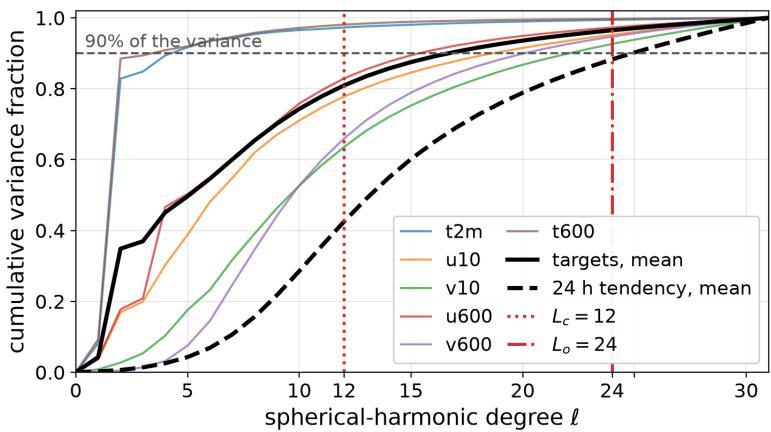  
Figure 5: Cumulative fraction of WeatherBench variance below each spherical-harmonic degree over 512 test states. The dotted lines mark the input and output cutoffs of the coupled band. The input cutoff covers most of the state variance, while the output cutoff covers nearly all target variance and most one-day tendency variance.

## C SSHCG: AN EFFICIENT CLEBSCH–GORDAN EVALUATION LIBRARY

The main text reports the computational benefit of SSHCG through block-level and end-to-end timings. This section provides the implementation details and numerical validation behind those results. We first examine the representation costs of existing tensor-product libraries, then describe the sparse direct kernels used by SSHCG. We next introduce the factorized Gaunt route for wider coupled bands and report numerical agreement and model-level runtime. Finally, we evaluate SSHCG on tensor-product workloads derived from MACE and NequIP, as well as on broader synthetic spectral configurations.

## C.1 REPRESENTATION COST OF EXISTING TENSOR-PRODUCT LIBRARIES

Pathwise dense contraction in e3nn (Geiger & Smidt, 2022). Broad-band CG coupling gathers sparse angular contributions from many degree paths into a shared output. In a pathwise dense implementation, each degree path is contracted over an angular domain of $( \bar { 2 } \ell _ { 1 } + 1 ) ( \bar { 2 } \ell _ { 2 } + 1 ) ( 2 \ell + 1 )$ entries and produces a separate intermediate result before accumulation into the final output. Two overheads therefore grow with bandwidth, as illustrated in Figure 6a,b: the dense angular domain relative to the nonzero CG coefficients it contains, and the logical volume of pathwise intermediate results relative to the final output.

Channel expansion in cuEquivariance (NVIDIA, 2026). The weighted channelwise operator considered here shares the same angular connectivity across channels. In the tested public descriptor, however, the supported kernel representation scalarizes angular coordinates and channels together. Consequently, $\hat { N } ( L )$ nonzero angular couplings become $\mathsf { \bar { C } } N ( L )$ scalar path records. Figure 6c shows the resulting linear growth of registered metadata with channel count at fixed bandwidth.

(a) e3nn: dense / nonzero  
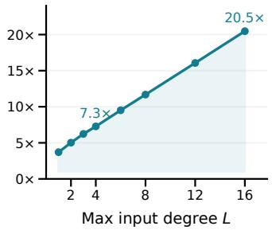

(b) e3nn: path results / output  
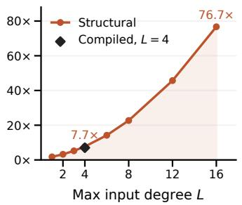

(c) cuEq: path metadata  
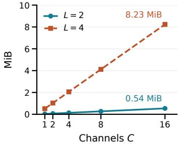  
Figure 6: Representation costs of broad-band tensor products. (a) Dense e3nn coefficient domain relative to real-basis nonzeros. (b) Logical path-result volume relative to the final output; the diamond marks the compiled observation. (c) Registered path metadata in the constructed cuEquivariance operator, whose backend path count equals the channel count C times the number of angular nonzeros in every tested configuration.

## C.2 SPARSE DIRECT CG KERNELS

The direct CG product repeatedly traverses angular domains whose dense size grows substantially faster than the number of nonzero couplings. SSHCG instead stores the channel-independent angular geometry once and organizes the forward pass around output-owned tiles. Fixing $m _ { 2 } = m - m _ { 1 }$ restricts traversal to the legal angular domain, while bucketed contraction widths allow each Triton program to accumulate contributions from multiple degree paths into an output tile before a single write.

The backward pass is organized by reduction destination. For nonzero angular couplings e,

$$
\bar { x } _ { i } = \sum _ { e : i ( e ) = i } a _ { e } w _ { p ( e ) } y _ { j ( e ) } \bar { z } _ { k ( e ) } , \qquad \bar { w } _ { p } = \sum _ { e : p ( e ) = p } a _ { e } x _ { i ( e ) } y _ { j ( e ) } \bar { z } _ { k ( e ) } ,\tag{22}
$$

so input gradients are gathered by signed spectral coordinate through a reverse compressed-sparserow traversal, while weight gradients are reduced over degree paths and batches. This organization avoids materializing a separate dense intermediate for every degree path and allows the same angular geometry to be reused across neighboring channels. Appendix C.1 contrasts this representation with the layouts used by existing tensor-product libraries.

## C.3 FACTORIZED GAUNT EVALUATION

The sparse direct kernels reduce the constant factor of the CG contraction, but the number of admissible degree triples still grows rapidly with bandwidth. For wider coupled bands, we therefore provide a second implementation that changes the computational scaling itself. When the degree-path weights admit a low-rank canonical polyadic (CP) factorization, the coupling can be evaluated through spherical synthesis, a bilinear operation in physical space, and harmonic analysis, following the Gaunt-product formulation of Luo et al. (2024) and the odd-sector Poisson construction of Bochkarev et al. (2026):

$$
z _ { b c , \ell m } = \sum _ { s } \sum _ { r = 1 } ^ { R _ { s } } D _ { c r \ell } ^ { ( s ) } \left[ A \mathcal { B } _ { s } \Big ( S \Big [ A _ { c r \ell } ^ { ( s ) } x _ { b c , \ell m } \Big ] , S \Big [ B _ { c r \ell } ^ { ( s ) } y _ { b c , \ell m } \Big ] \Big ) \right] _ { \ell m } ,\tag{23}
$$

where s indexes the even- and odd-parity sectors, $R _ { s }$ is the corresponding CP rank, $\begin{array} { r l } { { \cal B } _ { \mathrm { e v e n } } ( F , G ) = } & { { } } \end{array}$ FG, and

$$
\boldsymbol { B } _ { \mathrm { o d d } } ( \boldsymbol { F } , \boldsymbol { G } ) = \hat { \mathbf { r } } \cdot ( \nabla _ { S ^ { 2 } } \boldsymbol { F } \times \nabla _ { S ^ { 2 } } \boldsymbol { G } ) .
$$

Under sufficiently accurate quadrature, this construction exactly realizes the corresponding CPparameterized operator. Its complexity changes from the $O ( B C \dot { L } ^ { 5 } )$ angular enumeration of broadband direct coupling to the $\dot { O ( } B C \dot { R } L ^ { 3 } )$ transform-based evaluation. The grid route therefore becomes increasingly favorable as the coupled bandwidth grows, provided that the CP rank remains modest. Figure 7 empirically confirms the resulting crossover in runtime across bandwidth, batch size, precision, and CP rank.

Under the corresponding CP-to-LCG parameter mapping, the Gaunt and sparse implementations produce numerically consistent outputs and gradients. The maximum relative $L _ { 2 }$ errors are 1.3 × $\dot { 1 } 0 ^ { - 1 4 }$ in FP64 and $3 . 5 \times 1 0 ^ { - 7 }$ in FP32, validating the Gaunt route as a numerically equivalent realization of the same CP-parameterized operator.

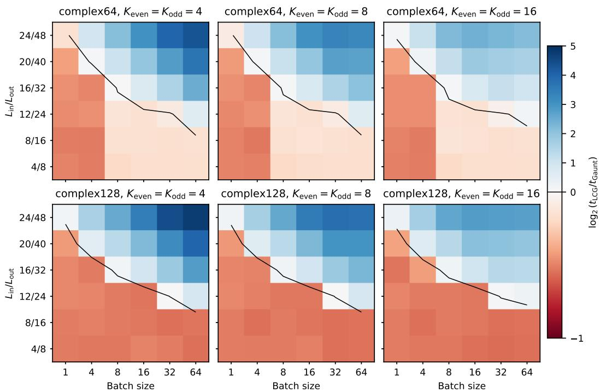  
Figure 7: Matched-operator eager forward-plus-backward crossover as bandwidth, batch size, precision, and per-sector CP rank vary. Color represents $\log _ { 2 } ( t _ { \mathrm { L C G } } / t _ { \mathrm { G a u n t } } )$ ; blue favors Gaunt, red favors direct CG, and the black contour marks equal latency. We use channel multiplicity eight, batch sizes $B \in \{ 1 , 4 , 8 , 1 6 , 3 2 , 6 4 \}$ , and equal even- and odd-sector ranks $K \in \{ 4 , 8 , \bar { 1 6 } \}$

## C.4 RUNTIME AND NUMERICAL VALIDATION

WeatherBench. Table 3 reports the forward-and-backward latency of a single CG block, while Figure 4 reports the corresponding end-to-end model cost. At the default 12/24 coupled band, the CG interaction accounts for 24% of a full training step with the dense product, 11% with the fused kernels, 10% with the tiled kernels, and 9% with the grid route. At $1 6 / \bar { 3 } 1$ , the corresponding shares are 47%, 19%, 14%, and 10%. At the full band, where the dense product no longer fits in memory, the fused kernels account for 71% of the step and the tiled kernels for 40%, whereas the grid route remains at 11%. The grid route therefore stays near its default-band cost as the coupling is extended toward the full spectrum; at the full band, the total training-step time is only 2% higher than at the default band.

The fused and tiled kernels evaluate the same direct contraction as the dense reference and agree with it to within $2 \times 1 0 ^ { - 7 }$ in the forward pass and $5 \times 1 0 ^ { - 7 }$ in the gradients in single precision. The grid route instead uses a factorized realization of the same equivariant interaction structure. When trained independently on the 24-hour WeatherBench task, it obtains 93.4 ACC and 81.1 MSE, compared with 93.4 ACC and 80.7 MSE for the dense-product parameterization. Together with its weak dependence on coupled bandwidth, this makes the grid route a practical alternative when extending the interaction toward the full spectrum.

The main model nevertheless uses the tiled direct kernels at the operating $1 2 / 2 4$ band. First, the tiled and grid implementations differ by less than a millisecond per block (4.6 versus 4.1 ms) and by less than one percent per training step (269 versus 268 ms with TF32 disabled), so the grid route offers little benefit at this bandwidth. Second, exact reproduction of the factorized coupling requires strict single-precision matrix multiplications in the transforms, which also disables TF32 for the remaining layers. Under the mixed-precision setting used by the main model, the tiled implementation therefore requires 233 ms per step, compared with 268 ms for the grid-route model. The step times of this subsection are measured on the uniform oversampling configuration of the acceleration study, with blocks and codec both at f = 2; the main model runs its blocks at f = 1.5 and takes 176 ms under the same setting (Appendix B.3). Third, the tiled kernels retain an independent learned path weight γ for every admissible degree triple, whereas the grid route restricts these weights to a rank-R CP factorization. Since the unrestricted parameterization remains affordable at the operating band, we use the tiled direct implementation there and reserve the grid route for wider coupled bands.

Table 6: Task-derived UVU configurations and forward–backward latency (CUDA-event ms), FP32, CUDA Graph, A100 PCIe 40GB, B = 1024. Degree ranges are inclusive.
<table><tr><td>Task</td><td></td><td>Degrees (L/R/O)</td><td>e3nn</td><td>SSHCG</td><td>cuEquivariance</td></tr><tr><td></td><td> $C _ { u }$  128</td><td>0-2 / 0-3 / 0-3</td><td>2.02</td><td>1.04</td><td>2.30</td></tr><tr><td>MACE-large MACE-medium</td><td>128</td><td>0-1 / 0-3 / 0-2</td><td>0.774</td><td>0.345</td><td>0.399</td></tr><tr><td>NequIP-LiPS</td><td>32</td><td>0-2 / 0-2 / 0-2</td><td>1.58</td><td>0.665</td><td>1.32</td></tr><tr><td>NequIP-aspirin</td><td>64</td><td>0-1 / 0-1 / 0-1</td><td>0.516</td><td>0.175</td><td>0.225</td></tr><tr><td>NequIP-toluene</td><td>64</td><td>0-2 / 0-2 / 0-2</td><td>2.18</td><td>0.756</td><td>2.79</td></tr><tr><td>NequIP-benzene</td><td>64</td><td>0-3 / 0-3 / 0-3</td><td>7.94</td><td>2.83</td><td>17.3</td></tr><tr><td>NequIP-water</td><td>32</td><td>0-1 / 0-1 / 0-1</td><td>0.441</td><td>0.162</td><td>0.287</td></tr></table>

MACE- and NequIP-derived workloads. Although SSHCG is developed for the broad-band interactions required by our forecasting model, its sparse direct kernels also apply to CG tensor products used in equivariant interatomic potential models. To evaluate this setting, Table 6 compares e3nn, SSHCG, and cuEquivariance on operator configurations derived from MACE (Batatia et al., 2022) and NequIP (Batzner et al., 2022). The benchmarks use per-sample weights and path-separated outputs under a common real-basis interface. SSHCG achieves the lowest forward– backward latency in every reported configuration.

The MACE workloads fix the feature width while varying the angular complexity of the tensor product. The NequIP workloads vary both feature width and maximum angular degree across five archived operator configurations. In all cases, we benchmark the tensor-product operator in isolation rather than the complete MACE or NequIP model, so the measurements reflect implementation-level differences in CG execution without contributions from unrelated model components.

Each timing uses ten warm-up iterations followed by five rounds of 30 measured iterations, and reports the median of the round means obtained from CUDA events. CUDA Graph capture uses separate static buffers and is validated against eager outputs and gradients, with external pre-replay copies excluded from the measurement. All library–configuration pairs pass the numerical checks in their evaluated precision. The maximum relative $L ^ { 2 }$ errors across outputs, input gradients, and weight gradients are $2 . 4 3 6 \times 1 0 ^ { - 7 }$ in FP32 and $3 . 0 8 4 \times 1 0 ^ { - 1 5 }$ in FP64.

Broad-band Clebsch–Gordan benchmark. The MACE- and NequIP-derived workloads above involve relatively low angular degrees. To evaluate the behavior of SSHCG at wider spectral bandwidths, we therefore construct an additional benchmark that isolates the Clebsch–Gordan tensor product operator.

We consider two coupling families. S1 measures broad-band interactions between two spectra supported on [0, L], with the output retained on [0, 2L]. S2 measures cross-band interactions between a low-frequency spectrum supported on [0, K] and a higher-frequency spectrum supported on [K + 1, H], with outputs retained on $[ K + 1 , \dot { H } ]$ . All cutoff degrees are inclusive, and every triangle-valid degree path is included with both degree parities. The CG weights are independent across degree paths and channels and shared across the batch. FP32 and FP64 correspond to complex64 and complex128 half-spectra, respectively. Flat spectra use amplitude $1 / \sqrt { 2 \ell + 1 }$ with a case-specific seeded CPU generator.

Outputs and vector–Jacobian products are checked against an independent FP64 reference. We use the scaled maximum error

$$
{ \frac { \| v - v _ { \mathrm { r e f } } \| _ { \infty } } { \operatorname* { m a x } ( 1 , \| v _ { \mathrm { r e f } } \| _ { \infty } ) } } ,
$$

with tolerances $5 \times 1 0 ^ { - 4 } \mathrm { i n } \mathrm { F P } 3 2$ and $1 0 ^ { - 1 0 }$ in FP64, together with finite-value and dtype checks.   
Partial timings from failed runs are excluded, and timeouts are not reported as steady-state latency.

Table 7: Spectral forward–backward latency (ms), FP32, CUDA Graph, A100 SXM4 80GB, $B = C = 8$
<table><tr><td>Workload</td><td> $L / H$ </td><td>e3nn</td><td>SSHCG</td><td>cuEquivariance</td></tr><tr><td>S1</td><td>4</td><td>1.47</td><td>0.0738</td><td>7.59</td></tr><tr><td>S1</td><td>8</td><td>7.47</td><td>0.226</td><td>180</td></tr><tr><td>S1</td><td>12</td><td>27.3</td><td>0.832</td><td>TO</td></tr><tr><td>S2</td><td>8</td><td>1.17</td><td>0.119</td><td>13.6</td></tr><tr><td>S2</td><td>16</td><td>4.55</td><td>0.284</td><td>129</td></tr><tr><td>S2</td><td>24</td><td>8.74</td><td>0.472</td><td>TO</td></tr></table>

Bold indicates the row minimum. S1: $L _ { o } = 2 L ; \mathsf { S 2 } \colon K = 4 , L _ { o } = H$ . TO denotes timeout.

Across the reported spectral configurations, the direct SSHCG implementation substantially reduces tensor-product latency. For S1, its speedup over compiled e3nn increases from 19.9× at $L = 4$ to 32.8× at $L = 1 2$ . At $L = 8 ,$ the complete forward–backward pass requires 0.226 ms with SSHCG, compared with 7.47 ms for compiled e3nn and 180 ms for the evaluated cuEquivariance route. These measurements compare complete operator execution paths and therefore do not attribute the observed speedup to any single implementation decision.

## D EXPERIMENTAL PROTOCOL

This section fixes the common protocol used to answer the four experimental questions in Section 5. It specifies the datasets and metrics, optimization objective, model configurations, and rotation diagnostic before the component-level evidence is examined.

## D.1 BENCHMARKS AND EVALUATION

Spherical shallow-water equations. For the controlled spherical-dynamics benchmark, we use the torch-harmonics solver at $2 5 6 \times 5 1 2$ resolution with a one-hour model step, fresh random initial conditions in every epoch, and 50 fixed test initial conditions. Performance is measured by pervariable relative $L ^ { \mathbf { \check { 2 } } }$ rollout error in physical units at one, five and ten hours, averaged over height, vorticity, and divergence. The solver contains spherical-harmonic content up to degree 85. Because truncating the model at degree 63 produces a normalized error floor of 0.49, all spectral models in our study use $L = 8 5$ on this task.

WeatherBench. For global atmospheric forecasting, we use the WeatherBench benchmark constructed from ERA5 reanalysis at 5.625◦ (32 × 64) resolution (Rasp et al., 2020). The input contains 24 prognostic variables (2T, 10U, 10V, and U, V, T at seven pressure levels), together with land– sea mask, orography, and latitude. The six prediction targets are 2T, 10U, 10V, U600, V600, and T600. We use hourly samples with training years 1979–2015, validation year 2016, and test years 2017–2018, and train one direct-forecast model for each lead time of 24, 72, and 120 hours.

We report anomaly correlation coefficient (ACC) against the split climatology and latitude-weighted MSE of normalized variables, averaged over the six targets. WeatherBench’s offset equiangular latitudes are linearly interpolated onto Legendre–Gauss nodes so that all spherical operators are trained and evaluated on the same grid.

Baselines. ClimaX, FourCastNet, and SHNet use the authors’ implementations at the model sizes specified by the benchmark paper. Our reference SFNO follows the corresponding published implementation. All models in Tables 4, 5, and 1 are trained by us on the same data splits and grids.

## D.2 TRAINING OBJECTIVE AND OPTIMIZATION

For $C$ prognostic variables and quadrature weights $w _ { i j } .$ , the one-step training loss is the spherically weighted relative $L ^ { 2 }$ objective used by the benchmark,

$$
\mathcal { L } = \frac { 1 } { C } \sum _ { q = 1 } ^ { C } \left( \frac { \sum _ { i , j } w _ { i j } ( \widehat { x } _ { q i j } - x _ { q i j } ) ^ { 2 } } { \sum _ { i , j } w _ { i j } x _ { q i j } ^ { 2 } } \right) ^ { 1 / 2 } .\tag{24}
$$

The loss is computed in normalized variables, and no rollout fine-tuning is used.

For WeatherBench, optimization follows the benchmark protocol: AdamW with learning rate $4 \times 1 0 ^ { - 4 }$ weight decay $1 0 ^ { - 5 }$ , batch size 128, linear warm-up, cosine decay, and a maximum of 50 epochs with early stopping on validation RMSE using patience 3. For the spherical shallow-water task, we use Adam with learning rate $1 0 ^ { - 3 }$ , batch size 16, and 50 epochs of 256 fresh samples per epoch.

## D.3 MODEL CONFIGURATIONS AND HYPERPARAMETERS

Table 8: Architectures of the compared models at the sizes of the benchmark paper, and the training length of our models (epochs run until early stopping at 1, 3 and 5 days on WeatherBench; fixed budget on the shallow-water task). WeatherBench models use the benchmark optimiser and schedule (AdamW, learning rate $4 \times 1 0 ^ { - 4 }$ , batch 128, warm-up and cosine decay, early-stopping patience 3); shallow-water models use the benchmark recipe (Adam, learning rate $\mathrm { i 0 ^ { - 3 } }$ , batch 16, 50 epochs).

<table><tr><td>Benchmark</td><td>Model</td><td></td><td>Params Architecture (epochs run)</td></tr><tr><td rowspan="5">Shallow water</td><td rowspan="2">ClimaX FourCastNet</td><td></td><td>1.96Mpatch 4, width 128, depth 6, 8 heads</td></tr><tr><td></td><td>1.66Mpatch 4, width 128, depth 8, 8 AFNO blocks</td></tr><tr><td rowspan="3">SHNet (GSNO) SFNO LCG-SFNO</td><td>0.87M width 8, scale factor 4</td></tr><tr><td>0.28Mwidth 28, 4 blocks,  $L = 8 5 .$ </td><td>scale factor 2</td></tr><tr><td>0.27Mwidth 25, 4 blocks,</td><td> $L = 8 5$  , CG band 12/24 rank 4, quadratic activation, oversampling 1.5</td></tr><tr><td rowspan="5">WeatherBench</td><td>ClimaX</td><td></td><td>5.40M patch 4, width 256, depth 6, 8 heads, decoder depth 2</td></tr><tr><td>FourCastNet</td><td></td><td>5.60Mpatch 4, width 384, depth 8, 8 AFNO blocks</td></tr><tr><td>SHNet (GSNO)</td><td></td><td>4.03M U-shaped, width 64, scale factor 2, encoder layers 2</td></tr><tr><td>SFNO</td><td></td><td>5.26Mwidth 256, 4 blocks,  $L = 1 5 ,$  scale factor 2</td></tr><tr><td>LCG-SFNO</td><td></td><td>5.24M width 186, 4 blocks, L = 31, CG band 12/24 rank 4, quadratic activation, oversampling 1.5 in the blocks and 2.0 in the codec, two-layer codec, drop path 0.1, dropout</td></tr></table>

## D.4 EQUIVARIANCE EVALUATION PROTOCOL

For a trained model $\mathcal { F }$ and a rotation R drawn uniformly from $\mathrm { S O ( 3 ) }$ , we report

$$
\epsilon _ { \mathrm { e q } } = \frac { | | \mathcal { F } ( R \pmb { x } , R \pmb { c } ) - R \mathcal { F } ( \pmb { x } , \pmb { c } ) | | _ { 2 } } { | | R \mathcal { F } ( \pmb { x } , \pmb { c } ) | | _ { 2 } } ,\tag{25}
$$

averaged over eight rotations and sixteen test inputs using the area-weighted norm on the Legendre– Gauss grid. Rotations are sampled uniformly from $\mathrm { S O ( 3 ) }$ using ZYZ Euler angles and are applied to real spherical-harmonic coefficients degree by degree with Wigner D-matrices obtained from the matrix exponential of the angular-momentum generator; no spatial interpolation is used.

Inputs are band-limited before rotation, and all channels, including static conditioning fields, are rotated jointly. Projection onto degrees $\ell \leq L$ commutes with rotation, so band-limiting the input before rotation and the output before comparison does not alter the equivariance relation being tested. For models whose decoder emits a spherical function with bandwidth above that of the data grid, the comparison is performed on the oversampled grid where that function is exactly represented. All equivariance measurements are computed with TF32 disabled. Figure 2 uses the same construction for a single test state and rotation, with both outputs projected to the data-grid band before visualizing the residual.

## E COMPONENT-LEVEL VALIDATION AND ABLATIONS

This section provides the component-level evidence behind the main-text results. We first separate the effects of the stronger spherical backbone, CG coupling, and dealiased nonlinear pathway. We then justify the coupled band and oversampling allocation, and finally test the decoder, residual pathway, and use of positional information. The aim is to associate each architectural choice with the function it is intended to provide rather than treating the final model as a single indivisible change.

## E.1 INCREMENTAL ARCHITECTURE ABLATION

Table 9: WeatherBench 24-hour ablation from the reference SFNO to LCG-SFNO. ACC and normalized MSE measure forecast skill; “Epochs” is the number of epochs required to reach the best validation error of row B; equivariance is the relative error defined in Appendix D.4. Rows A–C are mean and standard deviation over three seeds; row D is a single seed. Row D uses the uniform oversampling configuration as a diagnostic ablation; the final block/codec allocation is selected in Appendix E.2. All rows use the benchmark-scale parameter budget and the GELU activation; the final model replaces it by the quadratic activation (Appendix B.3).
<table><tr><td>Model</td><td>ACC</td><td>MSE</td><td></td><td>Epochs Equivariance</td></tr><tr><td>A SFNO, benchmark configuration</td><td> $8 4 . 0 \pm 0 . 0$ </td><td> $1 8 7 . 7 \pm 0 . 2$ </td><td>never</td><td> $9 . 5 \times 1 0 ^ { - 2 }$ </td></tr><tr><td>B + full spectral band, two-layer codec, regular- ization</td><td> $9 3 . 4 \pm 0 . 1$ </td><td> $8 1 . 5 \pm 0 . 6$ </td><td>39</td><td> $6 . 7 \times 1 0 ^ { - 2 }$ </td></tr><tr><td> $\mathrm { ~ C ~ } { + } \mathrm { C G }$  coupling, activations on the data grid</td><td> $9 3 . 7 \pm 0 . 0$ </td><td> $7 7 . 9 \pm 0 . 1$ </td><td>13</td><td> $6 . 8 \times 1 0 ^ { - 2 }$ </td></tr><tr><td>D + dealiased grid, band-limited residual stream</td><td>93.4</td><td>80.7</td><td>21</td><td> $7 . 2 \times 1 0 ^ { - 3 }$ </td></tr></table>

Table 9 isolates the main architectural changes on 24-hour WeatherBench forecasting. Row A is the published SFNO benchmark configuration. Row B is a matched-capacity control that incorporates the stronger full-band backbone, two-layer codec, input skip, stochastic depth, and dropout, but removes the CG coupling and evaluates all nonlinearities on the data grid. Row C adds the low-rank CG interaction while leaving the nonlinear evaluation unchanged. Row D additionally introduces dealiased nonlinear evaluation and the band-limited coefficient-space residual pathway.

The A→B transition shows that a substantial fraction of the forecast improvement comes from the stronger spherical backbone itself. The B→C transition isolates the CG interaction: at matched capacity it further improves forecast error and, more prominently, reduces the number of epochs required to reach the control’s best validation error from 39 to 13. Finally, C→D primarily affects rotational consistency, reducing the end-to-end equivariance error by nearly an order of magnitude while retaining similar forecast skill.

The ablation therefore separates three complementary effects: the full-band backbone provides forecast capacity, CG coupling improves the learned spectral interaction and optimization, and dealiased nonlinear evaluation converts the equivariant spectral structure into a substantially more equivariant end-to-end network.

Why CG coupling alone does not determine end-to-end equivariance. The CG interaction and per-degree spectral maps are exactly equivariant by construction. The complete network, however, also contains discretized pointwise nonlinearities. A field band-limited at degree L generates higher spherical frequencies after the nonlinearity; on the original grid these unresolved frequencies fold back into the retained band and create orientation-dependent aliasing. Rows B and C therefore have similar end-to-end equivariance errors even though row C contains the exact CG interaction. Once the activation path is dealiased, the equivariant structure of the spectral pathway becomes visible at the network level.

## E.2 DEALIASING AND OVERSAMPLING ALLOCATION

The measurements in this subsection use the GELU activation, that is, they characterize the residual that the polynomial activation of the main model removes, and show how that residual behaves when a non-polynomial activation is kept.

Source of the end-to-end equivariance improvement. Rows C and D differ in the activation grid, residual stream, normalization, and codec. Activating these changes sequentially yields initialization time relative equivariance errors of $2 . 7 \times 1 0 ^ { - 1 }$ for row $\mathsf C , 2 . \mathsf { \breve { 4 } } \times 1 \mathsf { \bar { 0 } } ^ { - 1 }$ with oversampled block activations, $1 . 8 \dot { \times } 1 0 ^ { - 1 }$ after adding the band-limited residual stream and spectral normalization, and $6 . 7 \times 1 0 ^ { - 3 }$ once the codec is also evaluated on the oversampled grid. The codec provides the largest single reduction in this sequence, indicating that controlling aliasing at the input and output of the spectral stack is especially important. Block-level oversampling provides a further control on the residual that remains once the codec is resolved.

Effect of the oversampling factor. Varying one factor f for the blocks and the codec together, the initialization-time relative equivariance error is $2 . 5 \times 1 0 ^ { - 2 } { \mathrm { ~ a t ~ } } f = 1 . 5 , 6 . 7 \times 1 0 ^ { - 3 } { \mathrm { ~ a t ~ } } { \bar { f } } = 2 .$ $2 . 6 \times 1 0 ^ { - 3 } \mathrm { ~ a t ~ } f = 2 . 5$ , and $1 . 0 { \stackrel { \cdot } { \times } } 1 0 ^ { - 3 } \mathrm { a t } f = 3$ . Over this range the error falls roughly with the square of the number of grid points, that is, with about the fourth power of $f ,$ , while the transform cost grows linearly with the number of grid points. The two-factor measurements of Table 10 attribute most of this reduction to the codec: at a fixed codec factor of 2, raising the block factor from 1.5 to 2 lowers the error only from $7 . 8 \times 1 0 ^ { - 3 } \mathrm { t o } 6 . 7 \times 1 0 ^ { - 3 }$ , whereas at a fixed block factor of 1.5 raising the codec factor from 1.5 to 2 lowers it from $2 . 5 \times 1 0 ^ { - 2 } \mathrm { t o } 7 . 8 \times 1 0 ^ { - 3 }$ , consistent with the sequential activation above. The classical dealiasing rule, $2 n _ { \theta } ^ { \prime } \geq 3 L + 1$ and $n _ { \varphi } ^ { \prime } > 3 L$ , is already satisfied at $f = 1 . 5$ and controls the quadratic part of the nonlinearity, whereas the higher-order components of GELU require additional oversampling to further suppress the residual error.

The four internal blocks account for roughly seven tenths of the step-time increase over row B, whereas the codec contributes less than one tenth. This difference motivates allocating separate oversampling factors to the repeated residual blocks and to the encoder/decoder rather than using a uniform factor.

Allocating oversampling between the blocks and codec. Because the encoder and decoder are evaluated less frequently than the internal blocks, increasing the codec resolution is the more economical way to reduce the residual error. Table 10 measures the trade-off directly. With the blocks fixed at ${ \bar { f } } = 1 . 5$ , increasing the codec factor from 1.5 to 2.0 reduces the initialization-time equivariance error from $2 . 5 \times 1 0 ^ { - 2 } \mathrm { t o } 7 . 8 \times 1 0 ^ { - 3 }$ while increasing the relative step time from 2.57× to 2.81×. A uniform factor of two reaches a similar equivariance level at a substantially higher step time.

The GELU model of the ablations therefore keeps the blocks at the minimum factor used by the dealiasing rule and allocates the remaining budget to the codec. After training, this split reaches 93.4 ACC and 80.8 MSE over three seeds, compared with 93.4 ACC and 80.7 MSE for the uniform factor of two in row D of Table 9, while requiring approximately three quarters of the time per epoch.

Table 10: Initialization-time equivariance error and training-step cost for different oversampling factors in the residual blocks and codec. Step time is normalized by the same architecture without CG coupling or oversampling. The bold row is the configuration used by the final WeatherBench model.
<table><tr><td>Blocks</td><td>Codec</td><td>Equivariance</td><td>Step</td></tr><tr><td>1.5</td><td>1.5</td><td> $2 . 5 \times 1 0 ^ { - 2 }$ </td><td>2.57×</td></tr><tr><td>1.5</td><td>2.0</td><td> $\mathbf { 7 . 8 \times 1 0 ^ { - 3 } }$ </td><td>2.81×</td></tr><tr><td>1.5</td><td>3.0</td><td> $4 . 1 \times 1 0 ^ { - 3 }$ </td><td>3.46×</td></tr><tr><td>1.5</td><td>4.0</td><td> $3 . 9 \times 1 0 ^ { - 3 }$ </td><td>4.30×</td></tr><tr><td>2.0</td><td>2.0</td><td> $6 . 7 \times 1 0 ^ { - 3 }$ </td><td>3.66×</td></tr><tr><td>2.0</td><td>3.0</td><td> $1 . 1 \times 1 0 ^ { - 3 }$ </td><td>4.33×</td></tr><tr><td>2.0</td><td>4.0</td><td> $4 . 7 \times 1 0 ^ { - 4 }$ </td><td>5.18×</td></tr></table>

## E.3 OUTPUT BANDWIDTH AND COEFFICIENT-SPACE RESIDUAL PATHWAY

Fine-band decoding preserves forecast detail. A strictly degree-31 output reaches 92.2 ACC at 24 hours, whereas sampling the fine-band spherical function produced by the decoder raises ACC to 93.4. On a 32 × 64 grid, a substantial fraction of the grid degrees of freedom lies above degree 31, so retaining these output degrees is important for reproducing fine spatial structure. The final decoder therefore recovers 1.2 ACC points while keeping the learned spectral operations equivariant.

Coefficient-space residuals improve rollout stability. The projected-residual design has little effect on one-step accuracy but substantially improves autoregressive behavior. On SSWE with the GELU activation at $f = 3 .$ , the earlier block design, in which the linear and CG paths bypass the grid nonlinearity through an inner identity skip, reaches a five-hour rollout error of 228, whereas the block without the skip, at a comparable parameter count, reaches 115 for the same seed (124 over the five seeds of Appendix B.3; the quadratic main model of Table 4 reaches 119). Keeping the residual stream in coefficient space and routing new spectral content through the projected nonlinear path therefore reduces error accumulation under repeated application of the learned operator.

## E.4 CONTROL FOR POSITIONAL INFORMATION

Adding a learned per-pixel positional embedding to the reference SFNO leaves the 24-hour ACC unchanged at 84.0. This control suggests that the improvement of LCG-SFNO is not explained by additional absolute-position capacity, but by the changes to its spherical representation, structured spectral interaction, and nonlinear evaluation.

## F ADDITIONAL FORECASTING RESULTS

This appendix reports results omitted from the main text for space: the variable-wise SSWE and WeatherBench scores, qualitative forecast fields, and transfer of the proposed block to a second spherical architecture.

## F.1 SSWE ROLLOUTS AND PER-VARIABLE RESULTS

Figure 8 shows the relative $L ^ { 2 }$ error of every model over twenty one-hour steps, and Table 11 breaks the SSWE scores of Table 4 down by variable. The two spherical spectral models accumulate error several times more slowly than the position-dependent architectures from the first steps on; they are the most accurate on every variable at five hours, with the largest margins on divergence, where they lead at every horizon. LCG-SFNO matches or improves on SFNO step for step and on each variable.

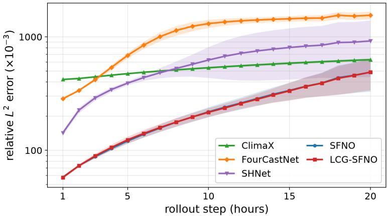  
Figure 8: SSWE relative $L ^ { 2 }$ rollout error over twenty one-hour steps for all compared models, mean and standard deviation over five seeds with fifty test initial conditions each. The spherical spectral models accumulate error far more slowly than the position-dependent architectures, and LCG-SFNO coincides with SFNO throughout.

## F.2 PER-VARIABLE WEATHERBENCH RESULTS

Tables 12 and 13 give the variable-wise breakdown of the aggregate WeatherBench results in Table 5. At one day the improvement over SFNO holds for all six reported variables, with the largest gains on the wind components and the highest ACC on both temperature fields. At three and five days, the leading models move closer together and the relative ordering changes across methods. LCG-SFNO

Table 11: SSWE forecasting per variable: relative $L ^ { 2 }$ rollout error in physical units $( \times 1 0 ^ { - 3 } )$ of height h, vorticity, and divergence at one, five, and ten hours over the fifty test initial conditions, mean and standard deviation over five seeds. The best value in each column is shown in bold and the second best underlined.
<table><tr><td></td><td colspan="3">1h</td><td colspan="3">5h</td><td colspan="3">10 h</td></tr><tr><td>Model</td><td>h</td><td>vorticity</td><td>divergence</td><td>h</td><td>vorticity</td><td>divergence</td><td>h</td><td>vorticity</td><td>divergence</td></tr><tr><td>ClimaX</td><td> $5 . 2 \pm 0 . 0$ </td><td> $2 5 9 \pm 1 . 0$ </td><td> $1 0 0 0 \pm 0 . 0$ </td><td> $4 . 4 \pm 0 . 0$ </td><td> $4 1 7 \pm 1 5$ </td><td> $1 0 0 0 \pm 0 . 1$ </td><td> ${ \bf 3 . 8 \pm 0 . 0 }$ </td><td> $6 0 0 \pm 3 1$ </td><td> $1 0 0 0 \pm 0 . 2$ </td></tr><tr><td>FourCastNet</td><td> $3 . 0 \pm 0 . 0$ </td><td> ${ \bf 1 0 1 \pm 3 . 1 }$ </td><td> $7 5 0 \pm 4 . 0$ </td><td> $6 . 3 \pm 0 . 8$ </td><td> $6 3 5 \pm 7 0$ </td><td> $1 4 1 8 \pm 1 2 5$ </td><td> $6 . 9 \pm 1 . 1$ </td><td> $1 9 2 7 \pm 3 9 8$ </td><td> $1 9 9 2 \pm 2 4 5$ </td></tr><tr><td>SHNet (GSNO)</td><td> $1 . 4 \pm 0 . 1$ </td><td> $1 4 7 \pm 6 . 4$ </td><td> $2 7 9 \pm 1 6$ </td><td> $3 . 9 \pm 0 . 8$ </td><td> $4 1 9 \pm 4 6$ </td><td> $7 5 0 \pm 1 9$ </td><td> $7 . 5 \pm 7 . 2$ </td><td> $7 8 3 \pm 3 1 4$ </td><td> $1 0 8 5 \pm 2 5 0$ </td></tr><tr><td>SFNO</td><td> $0 . 6 \pm 0 . 0$ </td><td> $1 1 6 \pm 1 . 4$ </td><td> $5 8 \pm 4 . 2$ </td><td> $2 . 5 \pm 0 . 2$ </td><td> $1 9 1 \pm 1 . 8$ </td><td> $1 6 9 \pm 1 6$ </td><td> $4 . 7 \pm 1 . 7$ </td><td> $3 1 1 \pm 1 7$ </td><td> $3 4 0 \pm 4 9$ </td></tr><tr><td>LCG-SFNO (ours)</td><td> ${ \bf 0 . 6 \pm 0 . 0 }$ </td><td> $1 1 5 \pm 0 . 5$ </td><td> $\overline { { 5 7 \pm 4 . 1 } }$ </td><td> $\overline { { 2 . 5 \pm 0 . 2 } }$ </td><td> $\overline { { 1 8 9 \pm 3 . 1 } }$ </td><td> $\overline { { 1 6 6 \pm 1 8 } }$ </td><td> $4 . 5 \pm 2 . 1$ </td><td> $\overline { { 2 8 9 \pm 6 . 8 } }$ </td><td> $\overline { { 3 3 8 \pm 5 6 } }$ </td></tr></table>

nevertheless retains a substantial aggregate improvement over the reference SFNO, with the largest gains continuing to appear in the wind variables.

Table 12: WeatherBench $5 . 6 2 5 ^ { \circ }$ per variable, anomaly correlation coefficient in percent (higher is better), by lead time. All models trained by us; mean over three seeds. The best value in each column and block is in bold and the second best underlined.
<table><tr><td>Model</td><td>2T</td><td>10U</td><td>10V</td><td>U600</td><td>V600</td><td>T600</td><td>Average</td></tr><tr><td>One day ClimaX FourCastNet SHNet (GSNO)</td><td>94.3 94.9 97.1</td><td>91.4 90.8</td><td>91.5 90.8</td><td>93.3 92.6</td><td>92.2 91.3</td><td>96.7 96.5</td><td>93.2 92.8</td></tr><tr><td>SFNO LCG-SFNO Three days ClimaX</td><td>95.3 97.4 90.6</td><td>89.5 76.5 90.6 71.1</td><td>89.4 74.9 90.3 69.4</td><td>91.7 83.8 92.9 78.2</td><td>90.2 80.1 91.6 71.4</td><td>96.5 93.3 97.1 88.8</td><td>92.4 84.0 93.3 78.3</td></tr><tr><td>FourCastNet SHNet (GSNO) SFNO LCG-SFNO</td><td>89.9 92.9 89.5 92.7</td><td>61.0 65.3 52.4 64.2</td><td>55.6 62.9 49.5 61.6</td><td>69.3 72.9 64.6 72.7</td><td>56.6 64.7 54.6 64.0</td><td>83.4 86.4 81.6 86.1</td><td>69.3 74.2 65.4 73.5</td></tr><tr><td></td><td></td><td></td><td></td><td></td><td></td><td></td><td></td></tr><tr><td>Five days</td><td></td><td></td><td></td><td></td><td></td><td></td><td></td></tr><tr><td>ClimaX</td><td>85.9</td><td>42.3</td><td>34.8</td><td>50.6</td><td>31.3</td><td>73.7</td><td>53.1</td></tr><tr><td>FourCastNet</td><td>87.0</td><td>40.0</td><td></td><td></td><td></td><td></td><td></td></tr><tr><td></td><td></td><td></td><td>31.4</td><td>47.9</td><td>25.6</td><td>71.3</td><td>50.5</td></tr><tr><td>SHNet (GSNO)</td><td>89.1</td><td>43.6</td><td>36.7</td><td>52.1</td><td>33.3</td><td></td><td></td></tr><tr><td></td><td></td><td></td><td></td><td></td><td></td><td>74.5</td><td>54.9</td></tr><tr><td></td><td></td><td></td><td></td><td></td><td></td><td></td><td></td></tr><tr><td>SFNO</td><td></td><td></td><td></td><td></td><td></td><td></td><td></td></tr><tr><td></td><td>85.9</td><td>34.0</td><td>28.1</td><td>45.5</td><td>26.3</td><td>71.8</td><td>48.6</td></tr><tr><td></td><td></td><td></td><td></td><td></td><td></td><td></td><td></td></tr><tr><td>LCG-SFNO</td><td>87.1</td><td>40.2</td><td>33.5</td><td>48.8</td><td>29.8</td><td>70.8</td><td>51.7</td></tr></table>

## F.3 TRANSFER TO ANOTHER SPHERICAL ARCHITECTURE

To test whether the proposed operator is specific to the SFNO shell, we replace the GSNO operator inside the U-shaped SHNet architecture with the LCG-SFNO block. The resulting 3.85M-parameter model obtains ACC values of 92.0, 73.2, and 52.8 at one, three, and five days, respectively. Its equivariance error is $1 . 0 \times 1 0 ^ { - 3 }$ , compared with 0.56 for the original 4.03M-parameter SHNet. These results indicate that the proposed block can be incorporated into a second multiscale spherical architecture without relying on the original SFNO network layout.

## F.4 QUALITATIVE WEATHERBENCH FORECASTS

Figures 9 and 10 compare the 24-hour forecasts of every model of the main comparison with the target fields for one test date, with the forecasts and the errors of all models drawn on the same colour scale per variable. All models reproduce the large-scale temperature and circulation structure. The error maps separate them: the position-dependent architectures leave coherent large-scale residuals, the published SFNO configuration leaves particularly large errors in the wind and upper-air temperature fields, while LCG-SFNO produces the smallest errors among the spherical models on this example.

Table 13: WeatherBench $5 . 6 2 5 ^ { \circ }$ per variable, latitude-weighted MSE of normalised variables $( \times 1 0 ^ { - 3 }$ lower is better), by lead time. All models trained by us; mean over three seeds. The best value in each column and block is in bold and the second best underlined.
<table><tr><td>Model</td><td>2T</td><td>10U</td><td>10V</td><td>U600</td><td>V600</td><td>T600</td><td>Average</td></tr><tr><td>One day</td><td></td><td></td><td></td><td></td><td></td><td></td><td></td></tr><tr><td>ClimaX FourCastNet</td><td>11.8 9.66</td><td>89.9 96.0</td><td>136 146</td><td>68.5 75.3</td><td>144 160</td><td>9.87 10.5</td><td>76.8 82.8</td></tr><tr><td>SHNet (GSNO)</td><td>6.21</td><td>109</td><td>167</td><td>84.5</td><td>179</td><td>10.7</td><td>92.7</td></tr><tr><td>SFNO LCG-SFNO</td><td>9.93 5.55</td><td>228 97.3</td><td>367 154</td><td>158 72.1</td><td>344 155</td><td>19.8</td><td>188</td></tr><tr><td>Three days</td><td></td><td></td><td></td><td></td><td></td><td>8.86</td><td>82.1</td></tr><tr><td>ClimaX FourCastNet</td><td>19.1 20.0</td><td>274 348</td><td>440</td><td>208</td><td>480</td><td>32.3</td><td>242</td></tr><tr><td>SHNet (GSNO)</td><td>14.9</td><td>316</td><td>589 507</td><td>277 249</td><td>670 564</td><td>46.0 38.7</td><td>325 282</td></tr><tr><td>SFNO</td><td>21.6</td><td>403</td><td>639</td><td>310</td><td>682</td><td>49.9</td><td>351</td></tr><tr><td>LCG-SFNO</td><td>15.4</td><td>323</td><td>521</td><td>250</td><td>571</td><td>39.3</td><td>287</td></tr><tr><td></td><td></td><td></td><td></td><td></td><td></td><td></td><td></td></tr><tr><td>Five days</td><td></td><td></td><td></td><td></td><td></td><td></td><td></td></tr><tr><td>ClimaX</td><td>28.6</td><td>459</td><td>753</td><td>400</td><td>901</td><td>67.6</td><td>435</td></tr><tr><td>FourCastNet</td><td>26.1</td><td>464</td><td>757</td><td>410</td><td>912</td><td>71.7</td><td>440</td></tr><tr><td>SHNet (GSNO)</td><td>22.4</td><td>446</td><td>729</td><td>387</td><td>871</td><td>65.7</td><td>420</td></tr><tr><td></td><td></td><td></td><td></td><td></td><td></td><td></td><td></td></tr><tr><td>SFNO</td><td>28.6</td><td>494</td><td>783</td><td>421</td><td>910</td><td>70.5</td><td>451</td></tr><tr><td>LCG-SFNO</td><td>25.7</td><td>459</td><td>742</td><td>402</td><td>883</td><td>71.9</td><td>430</td></tr></table>

(a)  
(b)  
(c)  
(d)  
(e)  
(f)  
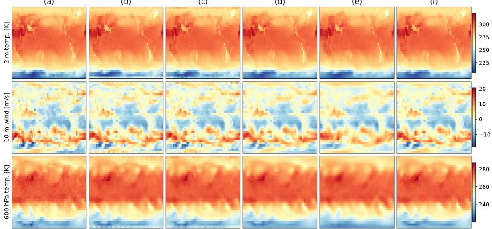  
Figure 9: 24-hour forecasts on WeatherBench $5 . 6 2 5 ^ { \circ }$ for 15 July 2017 at 12 UTC. Columns (a) to (f) show the target, ClimaX, FourCastNet, SHNet, SFNO, and LCG-SFNO, with one colour scale per row. Rows show 2 m temperature, 10 m zonal wind, and 600 hPa temperature. Every model captures the large-scale structure; the differences lie in the finer features that the error maps of Figure 10 isolate.

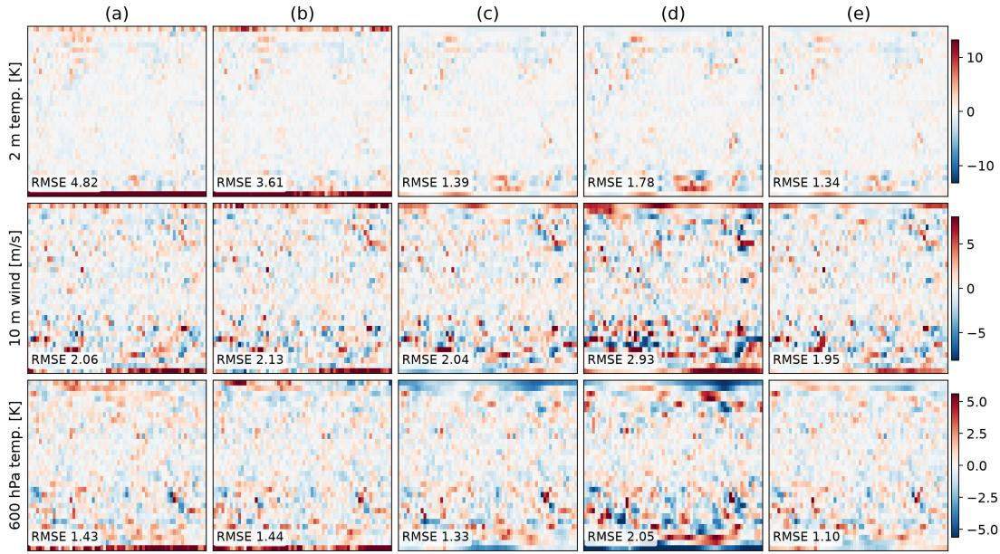  
Figure 10: Forecast errors (forecast minus target) of the models in Figure 9 for the same date. Columns (a) to (e) show ClimaX, FourCastNet, SHNet, SFNO, and LCG-SFNO on one symmetric colour scale per row, set by the pooled errors of all models; each panel states the root-mean-square error of that model and variable on this sample. LCG-SFNO leaves the smallest and least coherent residuals of the spherical models.