# Learning the Entropic Relaxation: Stable Coarse-Grid Emulation with Neural Discrete Equilibrium

Jose Antonio Lara Benitez ∗ Rice University and LBNL jlarabenitez@lbl.gov

Anastasis Kratsios McMaster University and the Vector Institute

Kareem Hegazy∗ ICSI and University of California at Berkeley

Ivan Dokmanic´ Maarten V. de Hoop University of Basel Rice University

Michael W. Mahoney ICSI, LBNL, and University of California at Berkeley

## Abstract

The ability to emulate complicated and computationally-expensive physical systems in an efficient and stable manner is a popular motivation for scientific machine learning (SciML). Stable numerical solvers tend to be computationally expensive, as they attempt to resolve small (spatial and temporal) scales that receive and dissipate spectral energy. Learned coarse-grid forecasters remove the dissipative channel, allowing unresolved frequencies to re-emerge as grid-scale noise (aliasing). In this paper, we use the Neural Discrete Equilibrium (NeurDE) method to explore stable emulation at extremely coarse grids, demonstrating physically-principled control over entropy dynamics that reinforces the physical system’s dissipative mechanism. Entropically-stabilized NeurDE produces stable long-time rollouts for thousands of forecasting steps on large Reynolds number turbulent flows (Re = 100,000) with very coarse grids (down to R16×16). At these very coarse grid scales, entropicallystabilized NeurDE can be more stable than even our stabilized data-generation numerical method.

## 1 Introduction

Stable coarse-grid simulation can significantly reduce compute time, but it is challenging because discretizing the physical system disrupts the system’s ability to dissipate energy [Pope, 2000, Sagaut, 2006, Meneveau and Katz, 2000]. Figure 1 summarizes this failure mode. In fluid dynamics, smallscale (high-frequency) structures such as eddies eventually dissipate via viscosity, converting kinetic energy into thermal energy at a characteristic dissipation scale L [Pope, 2000, Frisch, 1995]. When the grid resolution (δx) is fine enough to resolve this scale (δx < L), the simulation exhibits stability. Coarse grids, however, have δx ≫ L: structures can no longer shrink toward L [Ishihara et al., 2009, Sagaut, 2006]. The grid cutoff acts as a nonphysical “boundary” in Fourier space: truncating the physical cascade, aliasing, and forcing this closure error to feed unresolved content back into the represented state [Canuto et al., 2006, Patterson and Orszag, 1971, Gao et al., 2025]. Kinetic energy then accumulates in the highest resolved wavenumbers and re-enters the system as spurious noise [Frisch, 1995, Sagaut, 2006] (bottom rows of Fig. 1). This effect is strongest when the cutoff coincides with dynamically active scales. In two-dimensional turbulence, for example, the inverseenergy and direct-enstrophy cascades make the direction of transfer scale-dependent [Kraichnan,

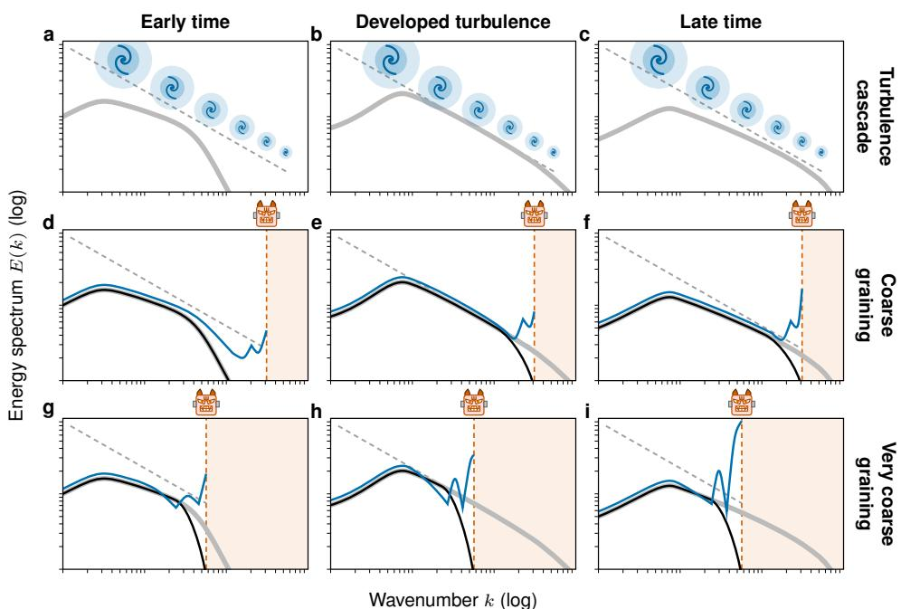  
Figure 1: Coarse discretization interrupts scale-to-scale energy transfer. Solid curves show the resolved spectral power at successive stages of a rollout; dashed lines indicate an idealized inertial-range decay. As turbulence develops, a coarse representation loses the high-wavenumber dissipative tail and can accumulate grid-scale content, unless the unresolved transfer is modeled. The learned entropic relaxation supplies a local dissipative channel for this missing transfer.

1967, Batchelor, 1969, Boffetta and Ecke, 2012, Bohr et al., 1998, Frisch, 1995], so truncating these exchanges without a compensating dissipative mechanism lets the represented state gain spurious order or energy that the unresolved continuum system would have dissipated. Entropy stability constrains the discrete dynamics, including in shock capturing and turbulence, entropic stabilization also provides an implicit subgrid closure. We call the associated error an entropy-stability error.

A robust scientific machine learning (SciML) emulator must learn a mechanism that absorbs, redistributes, or dampens the energy that is not supported by the coarse grid Smagorinsky [1963], Meneveau and Katz [2000], Sagaut [2006]. Otherwise, SciML methods that learn simple representations or primarily interpolate the represented state during training will inherit this problem, as in Fig. 1. This can be challenging in a purely data-driven setting, where the input data are often already coarsened, with the subgrid dynamics removed Sakarvadia et al. [2026], Gao et al. [2025].

Physical principles can help supply what the data lack. Conservation of mass and momentum is not enough, because a closure can conserve both exactly while injecting energy into the resolved scales, as a negative eddy viscosity does Smagorinsky [1963], Sagaut [2006]. The missing ingredient is the direction of dissipation. In a fluid, viscosity only removes kinetic energy, and in kinetic theory this irreversibility is Boltzmann’s H-theorem, the form of the second law stating that collisions never decrease entropy Krüger et al. [2017], Succi [2001]. An entropy-stability error violates this direction, because energy that viscosity should have removed remains in the represented state. Entropy-stable numerical methods avoid this error by enforcing a discrete entropy inequality Tadmor [1987, 2003].

For learned closures, entropy offers a guide that does not depend on the data. The entropy inequality involves only the model’s own states, so it can be checked along any rollout and on any grid. It does not replace data, however, because a closure that overdampens can remove critical flow dynamics. Data, therefore, determine how much the closure should dissipate, and entropy determines which updates are admissible. Physics-informed neural networks typically add such conditions as penalties or constraints on generic architectures Raissi et al. [2019], Cai et al. [2021], Patel et al. [2022], Beucler et al. [2021], rather than acting on the dissipative mechanism itself; but this popular “physics-informed” approach has well-known failure modes Krishnapriyan et al. [2021].

In this work, we use the Neural Discrete Equilibrium (NeurDE) framework Benitez et al. [2025] (a novel method that, among other things, can evolve a flow through lattice Boltzmann populations) to develop a method that reinforces dissipation, and we use our solution to explore stable emulation at extremely coarse grid scales. Each lattice Boltzmann step streams these populations exactly between grid points, and then it relaxes them toward a local equilibrium in a collision step, which is where dissipation happens. The standard Bhatnagar–Gross–Krook (BGK) collision Bhatnagar et al. [1954] conserves mass and momentum but does not guarantee the H-theorem, and so it becomes unstable on underresolved grids at low viscosity Karlin et al. [1999], Boghosian et al. [2001]. Entropic lattice Boltzmann methods (ELBM) restore the H-theorem with a single relaxation parameter at each grid point; and this can act as a locally adaptive viscosity Boghosian et al. [2001], Karlin et al. [2003], Hosseini et al. [2023]. However, ELBM computes this parameter from a local entropy balance (Section 3.2), which keeps each collision admissible but is not designed to reproduce the high-resolution dynamics on a coarse grid. Fischer et al. [2025] learn α via multi-agent reinforcement learning, while assuming knowledge of the target’s energy spectrum, thus limiting their method’s applicability to general systems when reference spectral statistics are unavailable. Our entropy constraint does not require these statistics. We instead learn the relaxation parameter with a Deep Equilibrium Model (DEQ) Bai et al. [2019], whose fixed-point iterations mirror this entropic solve. The model is trained to match filtered high-resolution data and to stay consistent with the H-theorem. We call the resulting model entropically-stabilized NeurDE, code available at Hegazy et al. [2026]

We test entropically-stabilized NeurDE on turbulent flow: a workhorse tool of modern science and engineering, which is generally limited in accuracy by the numerical resolution Ferziger et al. [2019], Pope [2000], Ishihara et al. [2009]. A major challenge of simulating turbulence is not the governing equations, but instead that turbulence generates a large range of scales and is scale-invariant Frisch [1995], Pope [2000]. Direct numerical simulation (DNS) must resolve the small structures that transfer and dissipate energy or enstrophy, and the required grid size and stable time step grow rapidly with Reynolds number Ishihara et al. [2009], Tran and Blackbourn [2009], Pope [2000]. SciML offers a complementary route to DNS Kochkov et al. [2021], Azizzadenesheli et al. [2024], Wu et al. [2022], McCabe et al. [2025]. Turbulence, therefore, is an ideal probe to evaluate how well entropically-stabilized NeurDE and other ML and numerical benchmarks handle sub-grid dynamics.

Our main contributions are:

• An entropy-stabilized physics-based model (NeurDE). To achieve stable emulations at extremely coarse grids, we extend NeurDE with an entropic closure that supplies the missing dissipative channel through a physically principled optimization task: enforcing the second law of thermodynamics Callen [1985].

• Explicit fixed-point guarantees. We prove that the DEQ Bai et al. [2019] update admits a fixed point which, if the update is a contraction, is unique and approached geometrically with DEQ depth, as is its entropy residual. Training enforces the second law there.

• Challenging stress tests and benchmarks. We demonstrate entropically-stabilized NeurDE’s stable emulation capabilities on turbulent systems with $\mathrm { R e } ~ = ~ \mathrm { 1 0 0 } \mathrm { , 0 0 0 }$ , for O(1000) autoregressive steps, and on decreasing numerical grids: $\mathbb { R } ^ { 1 2 8 \times 1 2 8 } : 0 \mathbb { R } ^ { 1 \acute { 6 } \times 1 6 }$ . We compare entropically-stabilized NeurDE to the spectral Fourier Neural Operator (FNO) Li et al. [2021] and the pretrained SciML foundation model Walrus McCabe et al. [2025] (mod els which are $\mathcal { O } ( 1 0 ^ { 3 } )$ and $\mathcal { O } ( 1 0 ^ { 7 } )$ times larger than entropically-stabilized NeurDE). As a more challenging comparison, we benchmark against ELBM (the data generation simulator).

## 2 Related Work

The cost of resolved simulation. DNS resolves the active modes of a flow, but its cost grows rapidly with Reynolds number and with the stable time step required by the smallest resolved scales Trebotich [2024], Fischer et al. [2022]. Standard estimates put the active degrees of freedom at $O ( \mathrm { R e } ( 1 + \log \mathrm { R e } ) ^ { 1 / 3 } )$ in two dimensions Tran and Blackbourn [2009], Batchelor [1969] and $O ( \mathrm { R e } ^ { 9 / 4 } )$ in three dimensions Kolmogorov [1991], Pope [2001]. Large-eddy simulation reduces this cost by evolving filtered variables and closing the effect of unresolved motion through subgrid models Meneveau and Katz [2000], Sagaut [2006]. The same lens applies to learned coarse-grid forecasting: what is missing on the coarse grid is not just resolution, but the effect of unresolved transfer on the represented state.

Pure ML surrogates. A first family of methods replaces the solver entirely with a neural network map between discretized function spaces. Neural operators such as FNO Li et al. [2021], Kovachki et al. [2024] are flexible and fast, but Fourier truncation and learned high-frequency transfer can limit robustness in underresolved regimes Sakarvadia et al. [2026]. Benitez et al. [2024] derive out-of-distribution risk bounds for neural operators applied to the Helmholtz equation; and Kratsios et al. [2024] analyze active expert complexity in mixtures of neural operators. Physics-informed neural networks encode continuous PDE residuals Raissi et al. [2019], Cai et al. [2021], yet their optimization landscape is fragile for nontrivial, $\mathrm { e . g . }$ , stiff or multiscale dynamics Krishnapriyan et al. [2021]. Foundation models for PDEs such as Poseidon Herde et al. [2024] and Walrus McCabe et al. [2025] broaden coverage by training on large collections of downsampled simulations, at the cost of substantial data and compute. The common thread is that solver-free surrogates have no built-in mechanism to capture missing information from the grid, and stability over long horizons typically has to be enforced through training objectives or regularization, rather than by the integrator itself.

Hybrid solvers with learned components. A second family of models keeps a numerical solver and inserts learning into specific operators Brunton et al. [2020], Kochkov et al. [2021]. The learned component inherits locality, conservation, and discretization structure from the host method, which improves generalization. Most prominently, NeurDE [Benitez et al., 2025] learns local equilibria within a lattice Boltzmann solver. Stability is the central remaining difficulty: short-horizon objectives can accumulate error during long rollouts, and one-step predictions that look plausible can still violate invariants or dissipative structure. Existing remedies include physics-informed penalties Beucler et al. [2021], Raissi et al. [2019], long-horizon closure optimization Fischer et al. [2025], and statistical stabilization such as the Thermalizer Pedersen et al. [2025]. These add stability as an ad hoc training-time correction or post-hoc filter, rather than as a property of the integrator itself.

## 3 Entropy-Stabilized Kinetic Closure

## 3.1 Lattice Boltzmann Background

The kinetic backbone of NeurDE is the lattice Boltzmann method (LBM), which discretizes the Boltzmann equation by representing the one-particle distribution $f ( t , \pmb { x } , \mathbf { v } )$ through populations ${ f } _ { i } ( t , x )$ at discrete single-particle velocities $\mathbf { v } _ { i }$ Bellotti et al. [2025]. The Bhatnagar–Gross–Krook (BGK) collision operator Bhatnagar et al. [1954] relaxes these populations toward equilibrium $\pmb { f } _ { i } ^ { \mathrm { e q } }$

$$
\pmb { f } _ { i } ( t + 1 , \pmb { x } + \mathbf { v } _ { i } ) = \pmb { f } _ { i } ( t , \pmb { x } ) + \frac { 1 } { \tau } \big [ \pmb { f } _ { i } ^ { \mathrm { e q } } ( \pmb { U } ( t , \pmb { x } ) ) - \pmb { f } _ { i } ( t , \pmb { x } ) \big ] ,\tag{1}
$$

where $\tau$ is the relaxation time and $U$ contains the conserved macroscopic variables. Each step combines a local, nonlinear collision with exact streaming: the post-collision population $\pmb { f } _ { i } ^ { \mathrm { c o l l } } ( t , \pmb { x } )$ moves to $\mathbf x + \mathbf v _ { i }$

Within this model, macroscopic observables are recovered as moments of the populations:

$$
\pmb { U } = ( \rho , \rho \mathbf { u } , \rho E ) ^ { \top } = \sum _ { i } ( 1 , \mathbf { v } _ { i } , \frac { 1 } { 2 } | \mathbf { v } _ { i } | ^ { 2 } ) ^ { \top } \pmb { f } _ { i } ,\tag{2}
$$

where $\rho ,$ u, and $E$ denote density, macroscopic velocity, and specific total energy; the energy component applies to energy-conserving lattices. NeurDE Benitez et al. [2025] learns the equilibrium map ${ \bf \tilde { \Sigma } } \psi \mapsto f ^ { \mathrm { e q } } ( U )$ , while retaining the prescribed streaming step. Collision preserves the conserved moments, provided the predicted equilibrium satisfies the same moment constraints as the incoming populations. The full operator splitting and original formulation are retained in Appendix A.3.

## 3.2 Entropic Stability

Conservation alone does not ensure nonnegative entropy production. For positive pre-collision populations $f$ and lattice weights $w _ { i } > 0$ , the discrete H-function and collision stability condition are

$$
H ( \pmb { f } ) = \sum _ { i } f _ { i } \log \left( \frac { f _ { i } } { w _ { i } } \right) ,\tag{3}
$$

$$
H ( { f ^ { \mathrm { c o l l } } } ) \leq H ( { f } ) .\tag{4}
$$

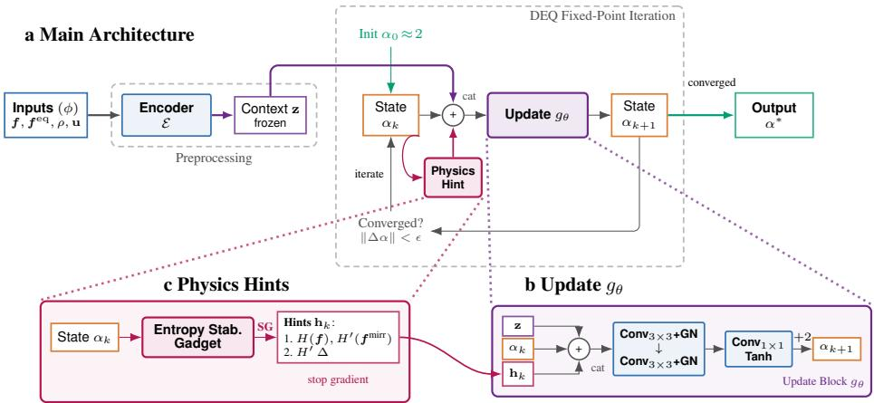  
Figure 2: Architecture of entropically-stabilized NeurDE. a The pipeline decouples feature extraction from the iterative DEQ solver. Context z is encoded once and injected into every iteration. b The neural update block processes the concatenated context, state, and physics hints through a convolutional network to refine the stability parameter α. c Physics hints include: entropy residual $G = H ( \alpha ) - H _ { \mathrm { p r e } } ,$ gradients $\Delta = H ^ { \prime } ( \alpha )$ , and instability indicator. The physics hints are computed outside of the computational graph, ensuring gradients flow only through $g _ { \theta }$ (implicit differentiation).

The inequality is the discrete H-theorem: physical entropy increases as H decreases. By enforcing Eq. 4, one also enforces the second law of thermodyanics; see Appendix A.5 for the thermodynamic interpretation. Classical entropic LBM (ELBM) Karlin et al. [1999] uses an equilibrium $f ^ { \mathrm { e q } }$ minimizing H at fixed conserved moments and seeks $\alpha > 0$ satisfying

$$
\pmb { f } ^ { \mathrm { m i r r } } ( \alpha ) = \pmb { f } + \alpha ( \pmb { f } ^ { \mathrm { e q } } - \pmb { f } ) , \qquad \pmb { H } ( \pmb { f } ^ { \mathrm { m i r r } } ( \alpha ) ) = \pmb { H } ( \pmb { f } ) .\tag{5}
$$

When such a positive mirror state exists, the collision

$$
\pmb { f } ^ { \mathrm { c o l l } } = ( 1 - \beta ) \pmb { f } + \beta \pmb { f } ^ { \mathrm { m i r r } } ( \alpha ) = \pmb { f } + \alpha \beta ( \pmb { f } ^ { \mathrm { e q } } - \pmb { f } )\tag{6}
$$

satisfies Eq. 4, by the convexity of H, with $\beta = 1 / ( 2 \tau ) \in ( 0 , 1 ]$ set by the nominal viscosity (Appendix A.6.1). Near entropic equilibrium, α ≈ 2 recovers BGK. At fixed $\beta , \alpha < 2$ increases the effective viscosity relative to BGK, while $\alpha > 2$ decreases it Hosseini et al. [2023]. The former promotes local smoothing and damping of high-frequency components, while the latter reduces damping and may permit backscatter [Hosseini et al., 2023, Buzzicotti and Tauzin, 2021]. Therefore, the α parameter provides a physically-principled mechanism to modulate resolved high-frequency components; and thus it opens the possibility of modeling energy transfer across the grid cutoff (the “Maxwell’s demon” in Fig. 1), without changing the Shannon-Nyquist limit.

This entropy-balance equation defines a local nonlinear solve at each site and time step. We replace this expensive solve with a Deep Equilibrium Model (DEQ; Section 4), using entropy consistency as a training target and rollout diagnostic. A learned fixed point does not automatically satisfy Eq. 4.

## 4 Entropically-stabilized NeurDE Method

NeurDE Benitez et al. [2025] is a method that leverages the Boltzmann equation backbone to inherit conservation and isolate the learning problem to the unknown physics closure. Specifically, NeurDE predicts the mesoscopic equilibrium single-particle distribution $\pmb { f } _ { i } ^ { \mathrm { e q } }$ based on the macroscopic variables. NeurDE’s neural equilibrium model improves on the fixed-time entropy extremizer Benitez et al. [2025], Levermore [1996]; but this does not guarantee entropy stability across temporal rollouts. Coarse-grid rollout fails for a reason no equilibrium closure can fix: the dissipative channel is absent from the grid, rather than mispredicted, and so an arbitrarily accurate $f ^ { \mathrm { e q } }$ cannot resolve grid-scale or finer features, and this spectral energy then re-enters as grid-scale noise. Entropic stabilization supplies that channel. We therefore swap the BGK collision in NeurDE for the entropic BGK collision of Eq. 6. Under the collision’s admissibility and positivity conditions, our ML surrogate aims to satisfy Eq. 4 by predicting α that minimizes the difference between each side of the equation in Eq. 5.

## 4.1 Architecture

ELBM solvers typically find α through Newton-type iterations at each grid point and time step [Karlin et al., 1999, Hosseini et al., 2023, Jonnalagadda et al., 2021, Frapolli et al., 2015, Ansumali and Karlin, 2002]. This Newton approach derives each step from a local linearization of the entropy residual. Instead, the DEQ step is based on the Newton optimization scheme, swapping the Newton iterations for neural network depth and improving the optimization step by a nonlinear step calculated through learned multiscale features. Its fixed point determines $\alpha \left( { \mathrm { F i g . ~ } } 2 \right)$

The encoder maps mesoscopic and macroscopic inputs to a latent context z once per the collision step (Fig. 2a). Each DEQ iteration then updates the current estimate $\alpha _ { k }$ from $\left( \mathbf { z } , \alpha _ { k } , \mathbf { h } _ { k } \right)$ , where hk contains detached physics hints (entropy residual, residual derivative, and an instability indicator; Fig. 2b–c). The fixed point of this update is the entropic relaxation parameter we use in the collision. Two design choices are worth flagging. The hints guide the iteration but live outside the computational graph, so gradients flow through the learned update map rather than through a hand-coded Newton solve. The encoder is evaluated once and reused across iterations, so the cost per collision scales with the number of DEQ steps to convergence rather than with repeated feature extraction. Appendix C gives the architectural details.

## 4.2 Fixed-Point Guarantees

We analyze fixed-point existence and entropy-residual convergence under explicit assumptions on the learned DEQ update.

Let $d , F \in \mathbb { N } _ { > 0 } , \Omega \subset \mathbb { R } ^ { d }$ be a bounded domain, and $\mathcal { F }$ be the feature space. For input $\phi \in { \mathcal { F } }$ (here $\phi = ( f , f ^ { \mathrm { e q } } , \rho , \mathbf { u } ) )$ , the encoder produces $\mathbf { z } = { \mathcal { E } } ( \phi ) \in \mathbb { R } ^ { F }$ , and the DEQ update induces $G _ { \theta , \mathbf { z } } : H ^ { 1 } ( \Omega ) \to H ^ { 1 } ( \Omega )$ by $G _ { \theta , \mathbf { z } } ( \alpha ) = \bar { g } _ { \theta } ( \alpha , \mathbf { z } )$ . The analysis requires the operator-level self-map and Lipschitz properties in Assumption B.4, allowing pointwise or convolutional realizations.

Fix $\beta \in [ 0 , 1 ]$ and a mirror-state operator $f ^ { \mathrm { m i r r } } : H ^ { 1 } ( \Omega ) \to L _ { + } ^ { 1 } ( \Omega )$ . We use the representative continuous entropy

$$
H ( { \pmb f } ) \stackrel { \mathrm { d e f . } } { = } \int _ { \Omega } { \pmb f } ( { \mathbf v } ) \log ( { \pmb f } ( { \mathbf v } ) ) d { \mathbf v } ,\tag{7}
$$

with the convention 0 log $0 = 0$ . The weighted lattice entropy in Eq. 3 is its finite-dimensional analogue. Define the entropy-balance residual $h _ { \beta } : H ^ { 1 } ( \Omega ) \times \mathring { L } _ { + } ^ { 1 } ( \Omega ) \mathring {  } \mathbb { R } \cup \{ \infty \}$ by

$$
h _ { \beta } ( \alpha ; { \pmb f } ) \stackrel { \mathrm { d e f . } } { = } H \big ( ( 1 - \beta ) { \pmb f } + \beta { \pmb f } ^ { \mathrm { m i r r } } ( \alpha ) \big ) - H ( { \pmb f } ) .\tag{8}
$$

$\mathbf { A } \mathbf { t } \beta = 1$ , the root condition $h _ { 1 } ( \alpha ; f ) = 0$ recovers the entropy-balance equation $H ( f ^ { \mathrm { m i r r } } ( \alpha ) ) =$ $H ( f )$ . We assume $H ( f ) < \infty$ throughout.

Theorem 4.1 (Existence of Neural Equilibria). Under Assumption B.4, for every $\phi \in { \mathcal { F } }$ with ${ \bf z } = \mathcal { E } ( \phi )$ , the induced operator $G _ { \theta , { \bf z } } : \dot { H } ^ { 1 } ( \Omega ) \to H ^ { 1 } ( \Omega )$ is well defined and admits at least one equilibrium $\alpha ^ { \star } \in { \mathcal { K } } \subset H ^ { 1 } ( \Omega )$ satisfying

$$
\alpha ^ { \star } = { \cal G } _ { \theta , { \bf z } } ( \alpha ^ { \star } ) = g _ { \theta } ( \alpha ^ { \star } , { \bf z } ) .\tag{9}
$$

## Proof. See Appendix B.2.

On a fixed grid, Brouwer’s theorem applies, provided the update is a continuous self-map of a compact convex set. The continuum $H ^ { 1 }$ statement remains conditional on Assumption $\mathbf { B . 4 , }$ since the clamp bounds pointwise values, not the $H ^ { 1 }$ seminorm. If the $L ^ { 2 } \mathrm { - } 1$ Lipschitz constant satisfies $L _ { v } < 1$ this fixed point is unique, and iterates initialized in $\kappa$ converge geometrically to it (Appendix B.3). $L _ { v } < 1$ remains an assumption in our DEQ formulation Bai et al. [2019], whereas monDEQ Winston and Kolter [2020] guarantees a unique equilibrium by construction. Under the boundedness and Lipschitz assumptions below, the entropy residual inherits this convergence rate.

Theorem 4.2 (Exponential Convergence of Entropy-Balance Residuals). In the setting of Theorem 4.1 and Proposition ${ \bar { B } } . 8 ,$ let $0 \leq \beta \leq 1$ and $f \in L _ { + } ^ { \hat { 1 } ^ { \mathbf { \alpha } } } ( \Omega )$ . Assume that Assumption B.3 holds on a set $\mathcal { A } . \ H f L _ { v } < 1$ and $i f \alpha ^ { \star }$ and all but finitely many iterates $( \alpha ^ { ( i ) } ) _ { i = 0 } ^ { \infty } o f G _ { \theta , \mathbf { z } }$ are in A, then, for all sufficiently large i,

$$
\big | h _ { \beta } \big ( \alpha ^ { \star } ; \pmb { f } \big ) - h _ { \beta } \big ( \alpha ^ { ( i ) } ; \pmb { f } \big ) \big | \in \mathcal { O } \big ( L _ { v } ^ { i } \big ) .
$$

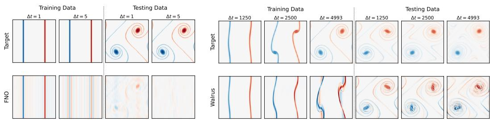  
Figure 3: FNO rollout. Vorticity forecast on DPSL-50K at R256×256 for 5 steps in train (left) and test (right) sets.  
Figure 4: Walrus rollout. Walrus vorticity forecast on DPSL-50K at R256×256 for the entire train (left) and test (right) datasets, roughly 5000 steps each.

Proof. See Appendix B.4.

DEQ convergence does not imply an exact ELBM entropy root. ${ \mathcal { L } } _ { \mathrm { r o o t } }$ and $\mathcal { R } _ { \mathrm { H } } \left( \mathrm { E q . } 6 5 \right)$ target $h _ { 1 } = 0$ and $h _ { \beta } \leq 0 ,$ , respectively. The shifted tanh restricts α to [1, 3] (Table 4), excluding the trivial root $\alpha = 0 ,$ which leaves the populations unchanged. A soft penalty on training states is not a test-time guarantee; compliance is empirical (see Fig. 7).

## 5 Empirical Results

We evaluate entropically-stabilized NeurDE’s emulation capabilities on extremely under-resolved grids, which drastically disrupts dissipation. We use the 2D doubly periodic shear layer (DPSL) and the 2D Taylor Green Vortex (TGV). DPSL is a standard benchmark for vortex roll-up, secondary instability, and vortex merger in two-dimensional turbulence Brown [1995], Minion and Brown [1997], Bedrunka et al. [2021], De Rosis and Coreixas [2020]. TGV is a standard benchmark for evaluating vorticity stability and testing whether entropically-stabilized NeurDE oversmoothes and disrupts stable dynamics. Both DPSL and TGV experiments are low-Mach ELBM simulations of the weakly compressible Navier–Stokes shear-layer (Appendix D). For DPSL, $\mathrm { R e } = 5 0 { , } 0 0 0$ and $\mathrm { R e } = 1 0 0 { , } 0 0 0$ , for TGV $\mathrm { R e } = 5 0 { , } 0 0 0$ . Both systems have periodic boundary conditions. We train four randomly initialized models on the first half of each simulated data and test on both halves.

We benchmark entropically-stabilized NeurDE against state-of-the-art SciML models and the ELBM that simulated the datasets. The FNO Li et al. [2021], our first SciML benchmark, is a data-driven macroscopic spectral method that learns an autoregressive field-to-field mapping. Walrus McCabe et al. [2025], our second method, is a 1.3B parameter transformer foundation model pretrained on O(10) TB of data. FNO and Walrus are respectively $\mathcal { O } ( 1 0 ^ { 2 } )$ and $\mathcal { O } ( 1 0 ^ { 4 } )$ times larger than NeurDE. ML methods are rarely compared against the numerical method that generated their training data, because they rarely outperform it on accuracy and stability for challenging systems. As a challenging benchmark, we compare against the numerical ELBM designed for stable and accurate simulations.

For entropically-stabilized NeurDE and FNO, we train autoregressively with increasing length. FNO and Walrus are trained on the macroscopic observables for the simplest R256×256 case. Entropicallystabilized NeurDE is first trained on α ground truth at $\mathbb { R } ^ { 2 5 6 \times 2 5 6 }$ and $\mathbb { R } ^ { 5 1 2 \times 5 1 2 }$ grids, for the Re = 50,000 and Re = 100,000 experiments, respectively. After, we autoregressively train on the macroscopic observables, continuing to coarsen the grid by a factor of two until reaching $\mathbb { R } ^ { 1 6 \times 1 6 }$ . When evaluating at $\mathbb { R } ^ { N \times N }$ , we use the checkpoints trained up to $\mathbb { R } ^ { N \times N }$ . Since Walrus and entropically-stabilized NeurDE are very different architectures, we fine-tune the pretrained Walrus within its own repository. We train Walrus for roughly twice as long. Further training details are provided in Appendices F (NeurDE), I (FNO), and J (Walrus).

Results. We begin by evaluating the FNO and Walrus benchmarks, which fail to fully forecast through the simplest $( \breve { \mathbb { R } } ^ { 2 5 6 \times 2 5 6 } )$ DPSL-50K. FNO struggles to properly take a single step and fails after 5 autoregressive steps; see Fig. 3. Walrus shows stable forecasts within the first $\Delta t = 1 2 5 0$ , but it fails to develop the vortices around $\Delta t = 2 5 0 0$ in the training dataset and subsequently diverges; see Fig. 4. We note that incompressible turbulent dynamics were included in Walrus’ pretraining data, although not this exact problem McCabe et al. [2025]. A $\Delta t = 2 5 0 0$ in the test dataset, the tails no longer align and high-frequency noise enters into the center of the vortices. In fact, test images at all times look very similar, indicating Walrus may be struggling to capture the dynamics. Since current ML surrogates struggle to accurately emulate this high Re system, we focus on our more challenging comparison with the numerical ELBM method that generated the data.

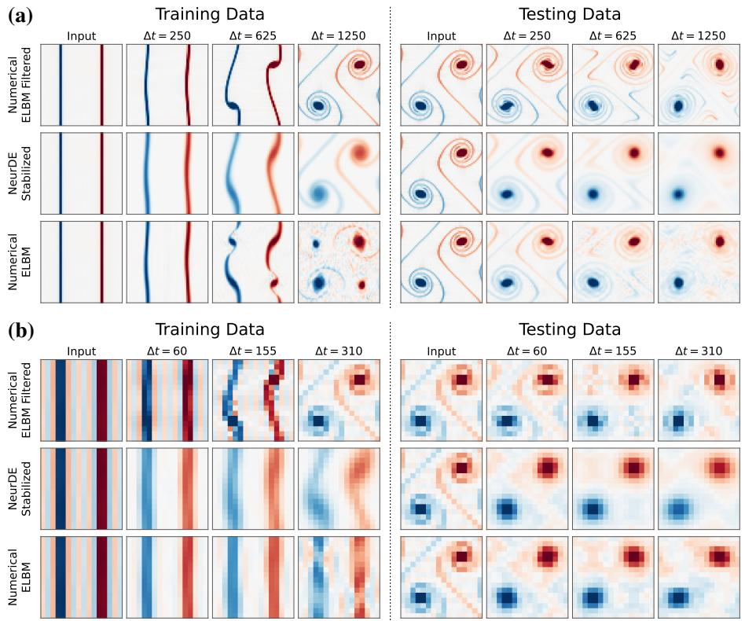  
Figure 5: Long-rollout comparison on the doubly periodic shear layer at Re=100,000. Vorticity forecasts for the box-filtered high-resolution reference (top), entropy-stabilized NeurDE (middle), and an underresolved ELBM baseline (bottom) on (a) a 64 × 64 grid and (b) a 16 × 16 grid.

On our most challenging dataset, DPSL-100k, entropically-stabilized NeurDE forecasts through the entire training and test datasets for all coarsened resolutions: R128×128, R64×64, R32×32, and R16×16. Figure 5a and b compare the results of entropically-stabilized NeurDE (middle row) and the ELBM forecast (bottom row) at R64×64 and R16×16, respectively. The top (ELBM filtered) row is ELBM simulations at R512×512 and downsampled, while the bottom row is ELBM run at the coarse resolution. ELBM at R64×64, shows grid-scale spurious high-frequency noise as early as ∆t = 625 (Fig. 5a). These figures demonstrate the necessary tradeoff between stability and accuracy. Entropically-stabilized NeurDE stably reproduces the correct dynamics for the remaining DPSL-100k experiments and all but one DPSL-50k seed (Appendices H.2 and H.1); that seed struggles only at R128×128, but it still outperforms the ELBM at every resolution.

Quantifying performance on chaotic systems like turbulence makes standard metrics like MSE imprecise and often requires comparisons of the energy spectrum and correlations. Appendix G.7 explains our metrics in detail: velocity error (relative error); ω corr. (vorticity correlation); ω error (relative error); spectrum RMSE; high-k/reference (ratio of high-k energy fractions); enstrophy; palinstrophy. It is important to consider all of these diagnostics together. For example, any Fourier spectrum can be matched by a Gaussian random field lacking coherent structures, intermittency, or turbulent flux statistics Pope [2000], Frisch [1995], so (phase-blind, second-order) metrics like E(k) cannot be evaluated alone. However, real-space metrics like MSE upweight large-valued structures, while ignoring the medium and small scales that determine the future flow. Because low-amplitude fine structure contributes little to L2 error, and high-k/ref measures an energy fraction rather than its distribution or phase, we also report palinstrophy (Eq. 78), which weights the enstrophy by k2.

Table 1: Doubly periodic shear layer at $\mathrm { R e } = 1 0 0 { , } 0 0 0 { : }$ forecast metrics from the training data $( t _ { 0 } = 0 )$ at the final lead time. Entropically-stabilized NeurDE results are the mean ± standard deviation over four seeds; ELBM results are from one deterministic run. The "Faithful Emulation" reports whether the rollout reproduces the expected structures. Field fidelity: relative $L ^ { 2 }$ error of velocity and vorticity ω, and vorticity correlation. Spectrum diagnostics: RMSE of $\log _ { 1 0 } E ( k )$ over active shells, and high-k energy and palinstrophy relative to the reference.
<table><tr><td rowspan="2">Grid Method</td><td rowspan="2"></td><td rowspan="2">Faithful Emulation</td><td colspan="3">Field Fidelity</td><td colspan="3">Spectrum Diagnostics</td></tr><tr><td>Vel. err ↓</td><td>ω corr. ↑</td><td>ω err ↓</td><td>Spec. RMSE† ↓</td><td>High-k/ref. → 1</td><td>P/ref. → 1</td></tr><tr><td rowspan="2">1282</td><td>NeurDE ELBM</td><td>4/4 0/1</td><td>0.0807 ± 6.9×10−5 0.281</td><td>0.846 ± 2.5×10−4 0.546</td><td>0.536 ± 3.8×10−4 0.981</td><td>3.28 ± 2.4×10−3 0.869</td><td>0.0454 ± 2.2×10−4 0.684</td><td>0.104 ± 1.4×10−4 0.647</td></tr><tr><td>NeurDE</td><td>4/4</td><td>0.154 ± 5.7×10−4</td><td>0.771 ± 3.9×10−4</td><td>0.641 ± 3.7×10−5</td><td>3.60 ± 9.6×10−2</td><td>0.0283 ± 0.0015</td><td>0.0553 ± 0.0016</td></tr><tr><td rowspan="2">642</td><td>ELBM</td><td>0/1</td><td>0.392</td><td>0.542</td><td>1.03</td><td>0.438</td><td>1.98</td><td>1.49</td></tr><tr><td>NeurDE</td><td>4/4</td><td>0.304 ± 0.045</td><td>0.684 ± 0.032</td><td>0.730 ± 0.032</td><td>3.72 ± 0.70</td><td>0.050 ± 0.046</td><td>0.060 ± 0.029</td></tr><tr><td rowspan="2">322 162</td><td>ELBM</td><td>0/1</td><td>0.561</td><td>0.435</td><td>1.16</td><td>0.678</td><td>3.6</td><td>2.8</td></tr><tr><td>NeurDE ELBM</td><td>4/4 0/1</td><td>0.561 ± 0.034 0.729</td><td>0.600 ± 0.017 0.217</td><td>0.800 ± 0.013 1.29</td><td>4.2 ± 1.3 0.96</td><td>0.031 ± 0.039 2.0</td><td>0.060 ± 0.034 2.1</td></tr></table>

Table 2: Doubly periodic shear layer at $\mathrm { R e } \ : = \ : 1 0 0 , 0 0 0 $ : forecast metrics from the testing data $( t _ { 0 } = T / 2 )$ at the final lead time; columns as in Table 1.
<table><tr><td rowspan="2">Grid Method</td><td rowspan="2"></td><td rowspan="2">Faithful Emulation</td><td colspan="3">Field Fidelity</td><td colspan="3">Spectrum Diagnostics</td></tr><tr><td>Vel. err ↓</td><td>ω corr. ↑</td><td>ω err ↓</td><td>Spec. RMSE† ↓</td><td>High-k/ref. → 1</td><td>P/ref. → 1</td></tr><tr><td rowspan="2">128²</td><td>NeurDE ELBM</td><td>4/4 1/1</td><td>0.0519 ± 3.3×10−6 0.0448</td><td>0.937 ± 1.6×10−5 0.920</td><td>0.353±4.2×10 0.401</td><td>4.34 ± 3.5×10−3 0.257</td><td>0.00635 ± 2.3×10 1.08</td><td>0.0868 ± 5.0×10 -5 1.02</td></tr><tr><td>NeurDE</td><td>4/4</td><td>0.0956 ± 5.9×10−4</td><td>0.916 ± 3.3×10−4</td><td>0.421 ± 8.5×10−4</td><td>4.58 ± 0.11</td><td>0.00309 ± 0.00047</td><td>0.0780 ± 4.0×10−4</td></tr><tr><td rowspan="2">642</td><td>ELBM</td><td>1/1</td><td>0.0555</td><td>0.920</td><td>0.402</td><td>0.346</td><td>1.56</td><td>1.28</td></tr><tr><td>NeurDE</td><td>4/4</td><td>0.175 ± 0.019</td><td>0.870 ± 0.016</td><td>0.519 ± 0.031</td><td>3.75 ± 0.62</td><td>0.0040 ± 0.0044</td><td>0.081 ± 0.018</td></tr><tr><td rowspan="2">322 162</td><td>ELBM</td><td>1/1</td><td>0.0785</td><td>0.931</td><td>0.368</td><td>0.430</td><td>1.2</td><td>1.1</td></tr><tr><td>NeurDE ELBM</td><td>4/4 1/1</td><td>0.286 ± 0.023 0.224</td><td>0.826 ± 0.019 0.884</td><td>0.598 ± 0.030 0.469</td><td>2.85 ± 0.45 0.331</td><td>0.019 ± 0.018 0.82</td><td>0.067 ± 0.016 0.69</td></tr></table>

Despite having erroneous dynamics, ELBM outperforms entropically-stabilized NeurDE on various spectral methods, thus highlighting the challenges of quantifying emulation quality. For all DPSL ELBM simulations on grids $\mathbb { R } ^ { \mathrm { \ Y 1 2 8 \times \mathrm { i } 2 8 } }$ and coarser, ELBM simulations diverge and fail to recover the correct dynamics in the training set (see, e.g., Fig. 5, bottom row). Entropically-stabilized NeurDE’s strengths are at very coarse resolutions, with performance converging to ELBM as grids become finer. Tables 1 and 2 provide these measurements for DPSL-100K. The "Faithful Emulation" column indicates whether the rollout faithfully reproduces the expected dynamics.

Stability and accuracy illustrate a tradeoff: targeted smoothing increases stability by enforcing dissipation, which causes smoothing that decreases accuracy. Therefore, while ELBM outperforms entropically-stabilized NeurDE on spectral measurements, this likely comes at the cost of stable simulations and ELBM’s failure to faithfully simulate the training dynamics. Specifically, by better capturing high-frequency components (Figs. 25 and 21), ELBM is incurring typical high-frequency noise that is known to cause simulation dynamics to diverge. This is also observed in entropicallystabilized NeurDE for the single divergent seed, as explained in Appendix H.1.1.

By enforcing the second law of thermodynamics and reinforcing dissipation, we provide stability through local smoothing that affects the global high-frequency components. We investigate the DPSL-50K predicted α at $\mathbb { R } ^ { 1 2 \breve { 8 } \times 1 2 8 }$ to test whether entropically-stabilized NeurDE is simply oversmoothing everywhere, and to quantify how many pixels are adding high-frequency information. The predicted α (Fig. 6) tracks the fine ELBM-generated features, along with the large-scale structures. Moreover, our predicted α affects fewer pixels than the ELBM. Together, this indicates that our method is not simply oversmoothing, but instead it is locally smoothing where necessary and possibly more efficiently than ELBM. The predicted α is less likely to increase high-frequency components compared to ELBM: the respective percentages of α > 2 for the predicted and ELBM results are 7% and 40.3% at $\Delta t = 1 0 0 0$ ; 15.2% and 43.9% at $\Delta t = 2 5 0 0$ ; and 37.8% and 49.4% at $\Delta t = 5 0 0 0$ . This likely contributes to entropically-stabilized NeurDE’s stability, since ELBM introduces sufficient spurious high-frequency noise for the dynamics to diverge at very coarse grids.

We further test entropically-stabilized NeurDE’s adherence to the second law of thermodynamic by investigating violations. Figure 7 shows the percentage of pixels that violate the second law of thermodynamics over the training and testing datasets for DPSL-50K. We observe that entropicallystabilized NeurDE rarely violates the second law and thus accomplishes its intended task.

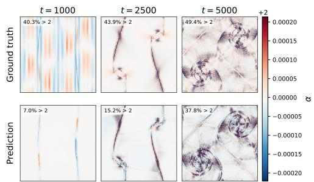

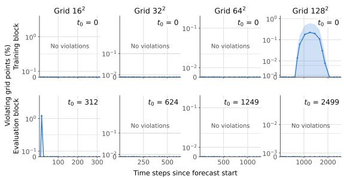  
Figure 6: α prediction. Comparison between ELBM generated and predicted α for DPSL-50K on a R256×256 grid, demonstrating that NeurDE smooths where it needs to.  
Figure 7: Entropy Violations. Percentage of entropically-stabilized NeurDE rollout violating the second law of thermodynamics in DPSL-50K.

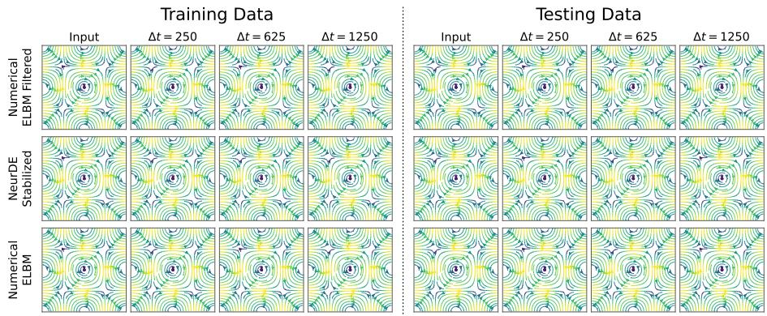  
Figure 8: Long-rollout comparison on the Taylor Green Vortex at Re=50,000. Vorticity forecasts for the box-filtered high-resolution reference (top), entropy-stabilized NeurDE (middle), and an underresolved ELBM baseline (bottom) on a 64 × 64 grid. This demonstrates that NeurDE does not smooth where it is unnecessary.

For our final test of entropically-stabilized NeurDE’s ability to retain important information and not oversmooth, we train and evaluate on the 2D TGV experiment. The TGV vortices are stable and have little spectral power in high frequencies; thus, any oversmoothing would cause them to diverge. Figure 8 shows that both entropically-stabilized NeurDE and ELBM match the downsampled high-resolution simulations. This indicates that entropically-stabilized NeurDE can retain key spectral information. For other grids, Appendix H.3 provides further emulations, tables of real and spectral metrics, and plots of the spectral metrics for all grids.

Ablation. We ablate our entropic stability study with three methods on DPSL-50K: ELBM, entropically-stabilized NeurDE, and NeurDE shell. NeurDE shell improves energy spectrum alignment over entropically-stabilized NeurDE through fine-tune training on E(k) (Appendix E). In Fig. 20, we see that ELBM fails to be as stable as entropically-stabilized NeurDE, indicating that the learned viscosity improves upon state-of-the-art numerical methods. Compared to entropicallystabilized NeurDE, NeurDE shell significantly improves the high-frequency components on the R64×64 grid (Appendix E.2). Figures 12 and 13 show the real-space emulation results and spectral components, respectively, alongside more detailed comparisons. Table 5 provides the real-space and spectral metrics for all grids. For the lower resolutions, NeurDE shell performs similarly to entropically-stabilized NeurDE (Appendix E.3). However, improving high-frequency alignment creates the possibility of inducing high-frequency noise that can destabilize the emulation. For these reasons, and the small improvements outside of R64×64, we use the more stable entropically-stabilized NeurDE.

## References

Santosh Ansumali and Iliya V. Karlin. Stabilization of the lattice boltzmann method by the h theorem: a numerical test. Physical Review E, 62(6):7999–8003, 2000. doi: 10.1103/PhysRevE.62.7999.

Santosh Ansumali and Iliya V Karlin. Single relaxation time model for entropic lattice boltzmann methods. Physical Review E, 65(5):056312, 2002.

Jürgen Appell and Petr P. Zabrejko. Nonlinear Superposition Operators. Cambridge University Press, 1990. doi: 10.1017/CBO9780511897450.

Kamyar Azizzadenesheli, Nikola Kovachki, Zongyi Li, Miguel Liu-Schiaffini, Jean Kossaifi, and Anima Anandkumar. Neural operators for accelerating scientific simulations and design. Nature Reviews Physics, 6(5):320–328, 2024. doi: 10.1038/s42254-024-00712-5.

Shaojie Bai, J Zico Kolter, and Vladlen Koltun. Deep equilibrium models. Advances in neural information processing systems, 32, 2019.

Shaojie Bai, Vladlen Koltun, and J Zico Kolter. Multiscale deep equilibrium models. Advances in neural information processing systems, 33:5238–5250, 2020.

Arpit Bansal, Avi Schwarzschild, Eitan Borgnia, Zeyad Emam, Furong Huang, Micah Goldblum, and Tom Goldstein. End-to-end algorithm synthesis with recurrent networks: Extrapolation without overthinking. Advances in Neural Information Processing Systems, 35:20232–20242, 2022.

George K Batchelor. Computation of the energy spectrum in homogeneous two-dimensional turbulence. The Physics ofFluids, 12(12):II–233, 1969. doi: 10.1063/1.1692443.

George K. Batchelor. An Introduction to Fluid Dynamics. Cambridge University Press, 2000. doi: 10.1017/CBO9780511800955.

Mario Christopher Bedrunka, Dominik Wilde, Martin Kliemank, Dirk Reith, Holger Foysi, and Andreas Krämer. Lettuce: Pytorch-based lattice boltzmann framework. In International Conference on High Performance Computing, pages 40–55. Springer, 2021.

Thomas Bellotti. Truncation errors and modified equations for the lattice boltzmann method via the corresponding finite difference schemes. ESAIM: Mathematical Modelling and Numerical Analysis, 57(3):1225–1255, 2023.

Thomas Bellotti, Philippe Helluy, and Laurent Navoret. Fourth-order entropy-stable lattice boltzmann schemes for hyperbolic systems. SIAM Journal on Scientific Computing, 47(1):A586–A611, 2025.

Yoshua Bengio, Jérôme Louradour, Ronan Collobert, and Jason Weston. Curriculum learning. In Proceedings of the 26th annual international conference on machine learning, pages 41–48, 2009.

J Benitez, Junyi Guo, Kareem Hegazy, Ivan Dokmanic, Michael W Mahoney, and Maarten V´ de Hoop. Neural equilibria for long-term prediction of nonlinear conservation laws. arXiv preprint arXiv:2501.06933, 2025. doi: 10.48550/arXiv.2501.06933.

Jose Antonio Lara Benitez, Takashi Furuya, Florian Faucher, Anastasis Kratsios, Xavier Tricoche, and Maarten V de Hoop. Out-of-distributional risk bounds for neural operators with applications to the helmholtz equation. Journal of Computational Physics, page 113168, 2024.

Roberto Benzi, Sergio Ciliberto, Raffaele Tripiccione, Christophe Baudet, F. Massaioli, and Sauro Succi. Extended self-similarity in turbulent flows. Physical Review E, 48(1):R29–R32, 1993. doi: 10.1103/PhysRevE.48.R29.

Tom Beucler, Michael Pritchard, Stephan Rasp, Jordan Ott, Pierre Baldi, and Pierre Gentine. Enforcing analytic constraints in neural networks emulating physical systems. Physical review letters, 126(9):098302, 2021. doi: 10.1103/PhysRevLett.126.098302.

Prabhu Lal Bhatnagar, Eugene P Gross, and Max Krook. A model for collision processes in gases. i. small amplitude processes in charged and neutral one-component systems. Physical review, 94(3): 511, 1954. doi: 10.1103/PhysRev.94.511.

Guido Boffetta and Robert E Ecke. Two-dimensional turbulence. Annual review of fluid mechanics, 44(1):427–451, 2012. doi: 10.1146/annurev-fluid-120710-101240.

Bruce M Boghosian, Jeffrey Yepez, Peter V Coveney, and Alexander Wager. Entropic lattice boltzmann methods. Proceedings ofthe Royal Society ofLondon. Series A: Mathematical, Physical and Engineering Sciences, 457(2007):717–766, 2001. doi: 10.1098/rspa.2000.0689.

Tomas Bohr, Mogens H Jensen, Giovanni Paladin, and Angelo Vulpiani. Dynamical systems approach to turbulence, volume 8 of Cambridge Nonlinear Science Series. Cambridge University Press, 1998. doi: 10.1017/CBO9780511599972.

Frank F Bonsall and KB Vedak. Lectures on some fixed point theorems offunctional analysis, volume 26. Tata Institute of Fundamental Research Bombay, 1962.

Fabian Bösch, Shyam S Chikatamarla, and Ilya V Karlin. Entropic multirelaxation lattice boltzmann models for turbulent flows. Physical Review E, 92(4):043309, 2015. doi: 10.1103/PhysRevE.92. 043309.

François Bouchut. Construction of bgk models with a family of kinetic entropies for a given system of conservation laws. Journal ofstatistical physics, 95:113–170, 1999.

Iain D Boyd and Thomas E Schwartzentruber. Nonequilibrium gas dynamics and molecular simulation, volume 42. Cambridge University Press, 2017.

David L Brown. Performance of under-resolved two-dimensional incompressible flow simulations. Journal ofComputational Physics, 122(1):165–183, 1995.

Steven L Brunton, Bernd R Noack, and Petros Koumoutsakos. Machine learning for fluid mechanics. Annual review offluid mechanics, 52(1):477–508, 2020.

Michele Buzzicotti and Guillaume Tauzin. Inertial range statistics of the entropic lattice boltzmann method in three-dimensional turbulence. Physical Review E, 104(1):015302, 2021. doi: 10.1103/ PhysRevE.104.015302.

Shengze Cai, Zhiping Mao, Zhicheng Wang, Minglang Yin, and George Em Karniadakis. Physicsinformed neural networks (pinns) for fluid mechanics: A review. Acta Mechanica Sinica, 37(12): 1727–1738, 2021. doi: 10.1007/s10409-021-01148-1.

Herbert B. Callen. Thermodynamics and an Introduction to Thermostatistics. John Wiley & Sons, New York, 2 edition, 1985. ISBN 978-0-471-86256-7.

Claudio Canuto, M. Youssuff Hussaini, Alfio Quarteroni, and Thomas A. Zang. Spectral Methods: Fundamentals in Single Domains. Scientific Computation. Springer, Berlin, Heidelberg, 2006. doi: 10.1007/978-3-540-30726-6.

Lj B Ciri ´ c. A generalization of banach’s contraction principle. ´ Proceedings of the American Mathematical society, 45(2):267–273, 1974.

S. Cobza¸s. Fixed point theorems in locally convex spaces—the schauder mapping method. Fixed Point Theory and Applications, 2006:57950, 2006. doi: 10.1155/FPTA/2006/57950.

Peter A. Davidson. Turbulence: An Introduction for Scientists and Engineers. Oxford University Press, 2 edition, 2015. doi: 10.1093/acprof:oso/9780198722588.001.0001.

Alessandro De Rosis and Christophe Coreixas. Multiphysics flow simulations using d3q19 lattice boltzmann methods based on central moments. Physics ofFluids, 32(11), 2020.

Benedikt Dorschner, Fabian Bösch, Shyam S. Chikatamarla, Konstantinos Boulouchos, and Ilya V. Karlin. Entropic multi-relaxation time lattice boltzmann model for complex flows. Journal of Fluid Mechanics, 801:623–651, 2016. doi: 10.1017/jfm.2016.448.

Lawrence C. Evans. Partial Differential Equations, volume 19 of Graduate Studies in Mathematics. American Mathematical Society, 2 edition, 2010. ISBN 978-0821849743.

Herbert Federer. Geometric Measure Theory. Die Grundlehren der mathematischen Wissenschaften. Springer, 1969.

Joel H Ferziger, Milovan Peric, and Robert L Street.´ Computational methods for fluid dynamics. Springer Cham, 4 edition, 2019. doi: 10.1007/978-3-319-99693-6.

Paul Fischer, Stefan Kerkemeier, Misun Min, Yu-Hsiang Lan, Malachi Phillips, Thilina Rathnayake, Elia Merzari, Ananias Tomboulides, Ali Karakus, Noel Chalmers, et al. Nekrs, a gpu-accelerated spectral element navier–stokes solver. Parallel Computing, 114:102982, 2022.

Paul Fischer, Sebastian Kaltenbach, Sergey Litvinov, Sauro Succi, and Petros Koumoutsakos. Optimal lattice boltzmann closures through multi-agent reinforcement learning. arXiv preprint arXiv:2504.14422, 2025.

Nicolò Frapolli, Shyam S Chikatamarla, and Iliya V Karlin. Entropic lattice boltzmann model for compressible flows. Physical Review E, 92(6):061301, 2015.

Uriel Frisch. Turbulence: The Legacy of A. N. Kolmogorov. Cambridge University Press, 1995. doi: 10.1017/CBO9781139170666.

Samy Wu Fung, Howard Heaton, Qiuwei Li, Daniel McKenzie, Stanley Osher, and Wotao Yin. Jfb: Jacobian-free backpropagation for implicit networks. In Proceedings ofthe AAAI Conference on Artificial Intelligence, volume 36, pages 6648–6656, 2022.

Wenhan Gao, Ruichen Xu, Yuefan Deng, and Yi Liu. Discretization-invariance? on the discretization mismatch errors in neural operators. In International Conference on Learning Representations, 2025. URL https://openreview.net/forum?id=J9FgrqOOni.

Harold Grad. On the kinetic theory of rarefied gases. Communications on pure and applied mathematics, 2(4):331–407, 1949. doi: 10.1002/cpa.3160020403.

Kareem Hegazy, Jose Antonio Lara Benitez, and Alexander Kiefer. Kinet. https://github.com/ khegazy/kinet, 2026.

Maximilian Herde, Bogdan Raonic, Tobias Rohner, Roger Käppeli, Roberto Molinaro, Emmanuel de Bézenac, and Siddhartha Mishra. Poseidon: Efficient foundation models for pdes. Advances in Neural Information Processing Systems, 37:72525–72624, 2024.

Seyed Ali Hosseini, Mohammad Atif, Santosh Ansumali, and Iliya V Karlin. Entropic lattice boltzmann methods: A review. Computers & Fluids, 259:105884, 2023. doi: 10.1016/j.compfluid. 2023.105884.

Takashi Ishihara, Toshiyuki Gotoh, and Yukio Kaneda. Study of high–reynolds number isotropic turbulence by direct numerical simulation. Annual review offluid mechanics, 41(1):165–180, 2009. doi: 10.1146/annurev.fluid.010908.165203.

Anirudh Jonnalagadda, Atul Sharma, and Amit Agrawal. Single relaxation time entropic lattice boltzmann methods: A developer’s perspective for stable and accurate simulations. Computers & Fluids, 215:104792, 2021. doi: 10.1016/j.compfluid.2020.104792.

Iliya V Karlin and S Succi. Equilibria for discrete kinetic equations. Physical Review E, 58(4):R4053, 1998.

Iliya V. Karlin, Fabian Bösch, and Shyam S. Chikatamarla. Gibbs’ principle for the lattice-kinetic theory of fluid dynamics. Physical Review E, 90(3):031302, 2014. doi: 10.1103/PhysRevE.90. 031302.

Ilya V Karlin, Antonio Ferrante, and Hans Christian Öttinger. Perfect entropy functions of the lattice boltzmann method. Europhysics Letters, 47(2):182–188, 1999. doi: 10.1209/epl/i1999-00370-1.

IV Karlin, S Ansumali, E De Angelis, HC Öttinger, and S Succi. Entropic lattice boltzmann method for large scale turbulence simulation. arXiv preprint cond-mat/0306003, 2003.

Dmitrii Kochkov, Jamie A Smith, Ayya Alieva, Qing Wang, Michael P Brenner, and Stephan Hoyer. Machine learning–accelerated computational fluid dynamics. Proceedings of the National Academy ofSciences, 118(21):e2101784118, 2021.

Andrei Nikolaevich Kolmogorov. The local structure of turbulence in incompressible viscous fluid for very large reynolds numbers. Proceedings ofthe Royal Society ofLondon. Series A: Mathematical and Physical Sciences, 434(1890):9–13, 1991.

Jean Kossaifi, Nikola Kovachki, Zongyi Li, David Pitt, Miguel Liu-Schiaffini, Valentin Duruisseaux, Robert Joseph George, Boris Bonev, Kamyar Azizzadenesheli, Julius Berner, and Anima Anandkumar. A library for learning neural operators. arXiv preprint arXiv:2412.10354, 2025.

Nikola B Kovachki, Samuel Lanthaler, and Andrew M Stuart. Operator learning: Algorithms and analysis. arXiv preprint arXiv:2402.15715, 2024.

Robert H. Kraichnan. Inertial ranges in two-dimensional turbulence. The Physics ofFluids, 10(7): 1417–1423, 1967. doi: 10.1063/1.1762301.

Anastasis Kratsios, Takashi Furuya, Jose Antonio Lara Benitez, Matti Lassas, and Maarten de Hoop. Mixtures of neural operators reduce active complexity in operator learning. arXiv preprint arXiv:2404.09101, 2024. doi: 10.48550/arXiv.2404.09101. URL https://arxiv.org/abs/ 2404.09101.

Aditi Krishnapriyan, Amir Gholami, Shandian Zhe, Robert Kirby, and Michael W Mahoney. Characterizing possible failure modes in physics-informed neural networks. In Advances in Neural Information Processing Systems, volume 34, pages 26548–26560, 2021.

Timm Krüger, Halim Kusumaatmaja, Alexandr Kuzmin, Orest Shardt, Goncalo Silva, and Erlend Magnus Viggen. The lattice boltzmann method. Springer International Publishing, 10(978-3): 4–15, 2017.

Jonas Latt, Christophe Coreixas, Joël Beny, and Andrea Parmigiani. Efficient supersonic flow simulations using lattice boltzmann methods based on numerical equilibria. Philosophical Transactions ofthe Royal Society A, 378(2175):20190559, 2020.

C David Levermore. Moment closure hierarchies for kinetic theories. Journal ofstatistical Physics, 83:1021–1065, 1996.

Zongyi Li, Nikola Borislavov Kovachki, Kamyar Azizzadenesheli, Burigede liu, Kaushik Bhattacharya, Andrew Stuart, and Anima Anandkumar. Fourier neural operator for parametric partial differential equations. In International Conference on Learning Representations, 2021. URL https://openreview.net/forum?id=c8P9NQVtmnO.

Ilya Loshchilov and Frank Hutter. Decoupled weight decay regularization. In International Conference on Learning Representations (ICLR), 2019. URL https://arxiv.org/abs/1711.05101.

Michael McCabe, Payel Mukhopadhyay, Tanya Marwah, Bruno Regaldo-Saint Blancard, Francois Rozet, Cristiana Diaconu, Lucas Meyer, Kaze WK Wong, Hadi Sotoudeh, Alberto Bietti, et al. Wal rus: A cross-domain foundation model for continuum dynamics. arXiv preprint arXiv:2511.15684, 2025.

Nick McGreivy and Ammar Hakim. Weak baselines and reporting biases lead to overoptimism in machine learning for fluid-related partial differential equations. arXiv preprint arXiv:2407.07218, 2024.

Charles Meneveau and Joseph Katz. Scale-invariance and turbulence models for large-eddy simulation. Annual Review ofFluid Mechanics, 32(1):1–32, 2000. doi: 10.1146/annurev.fluid.32.1.1.

Michael L Minion and David L Brown. Performance of under-resolved two-dimensional incompressible flow simulations, ii. Journal ofComputational Physics, 138(2):734–765, 1997.

Razvan Pascanu, Tomas Mikolov, and Yoshua Bengio. On the difficulty of training recurrent neural networks. In International conference on machine learning, pages 1310–1318. Pmlr, 2013.

Ravi G Patel, Indu Manickam, Nathaniel A Trask, Mitchell A Wood, Myoungkyu Lee, Ignacio Tomas, and Eric C Cyr. Thermodynamically consistent physics-informed neural networks for hyperbolic systems. Journal ofComputational Physics, 449:110754, 2022. doi: 10.1016/j.jcp.2021.110754.

G. S. Patterson and Steven A. Orszag. Spectral calculations of isotropic turbulence: Efficient removal of aliasing interactions. The Physics ofFluids, 14(11):2538–2541, 1971. doi: 10.1063/1.1693365.

Christian Pedersen, Laure Zanna, and Joan Bruna. Thermalizer: Stable autoregressive neural emulation of spatiotemporal chaos. Proceedings of the 42nd International Conference on Machine Learning, 267:48635–48661, 2025.

Stephen B. Pope. Turbulent Flows. Cambridge University Press, 2000. doi: 10.1017/ CBO9780511840531.

Stephen B Pope. Turbulent flows. Measurement Science and Technology, 12(11):2020–2021, 2001.

Maziar Raissi, Paris Perdikaris, and George E Karniadakis. Physics-informed neural networks: A deep learning framework for solving forward and inverse problems involving nonlinear partial differential equations. Journal of Computational physics, 378:686–707, 2019. doi: 10.1016/j.jcp. 2018.10.045.

Pierre Sagaut. Large eddy simulationfor incompressibleflows: an introduction. Springer, 3 edition, 2006. doi: 10.1007/b137536.

Mansi Sakarvadia, Kareem Hegazy, Amin Totounferoush, Kyle Chard, Yaoqing Yang, Ian Foster, and Michael W Mahoney. The false promise of zero-shot super-resolution in machine-learned operators. In International Conference on Learning Representations, 2026. doi: 10.48550/arXiv.2510.06646. URL https://openreview.net/forum?id=hkF7ZM7fEp.

Florian Schornbaum and Ulrich Rude. Massively parallel algorithms for the lattice boltzmann method on nonuniform grids. SIAM Journal on Scientific Computing, 38(2):C96–C126, 2016.

Xiaowen Shan and Xiaoyi He. Discretization of the velocity space in the solution of the boltzmann equation. Physical Review Letters, 80(1):65, 1998. doi: 10.1103/PhysRevLett.80.65.

Xiaowen Shan, Xue-Feng Yuan, and Hudong Chen. Kinetic theory representation of hydrodynamics: a way beyond the navier–stokes equation. Journal ofFluid Mechanics, 550:413–441, 2006.

Joseph Smagorinsky. General circulation experiments with the primitive equations: I. the basic experiment. Monthly weather review, 91(3):99–164, 1963. doi: 10.1175/1520-0493(1963) 091<0099:GCEWTP>2.3.CO;2.

Leslie N. Smith and Nicholay Topin. Super-convergence: Very fast training of neural networks using large learning rates. In Artificial Intelligence and Machine Learningfor Multi-Domain Operations Applications, volume 11006 of Proc. SPIE, 2019. URL https://arxiv.org/abs/1708.07120.

Sauro Succi. The lattice Boltzmann equation: forfluid dynamics and beyond. Oxford university press, 2001.

Sauro Succi and S Succi. The lattice Boltzmann equation: for complex states of flowing matter. Oxford university press, 2018.

Eitan Tadmor. The numerical viscosity of entropy stable schemes for systems of conservation laws. i. Mathematics ofComputation, 49(179):91–103, 1987. doi: 10.1090/S0025-5718-1987-0890255-3.

Eitan Tadmor. Entropy stability theory for difference approximations of nonlinear conservation laws and related time-dependent problems. Acta Numerica, 12:451–512, 2003. doi: 10.1017/ S0962492902000156.

G. I. Taylor and A. E. Green. Mechanism of the production of small eddies from large ones. Proceedings of the Royal Society of London. Series A, 158(895):499–521, 1937. doi: 10.1098/rspa. 1937.0036.

Chuong V Tran and Luke Blackbourn. Number of degrees of freedom of two-dimensional turbulence. Physical Review E—Statistical, Nonlinear, and Soft Matter Physics, 79(5):056308, 2009. doi: 10.1103/PhysRevE.79.056308.

David Trebotich. Exascale computational fluid dynamics in heterogeneous systems. Journal ofFluids Engineering, 146(4):041104, 2024.

Ronald J Williams and Jing Peng. An efficient gradient-based algorithm for on-line training of recurrent network trajectories. Neural computation, 2(4):490–501, 1990.

Ezra Winston and J. Zico Kolter. Monotone operator equilibrium networks. In Advances in Neural Information Processing Systems, volume 33, 2020.

Tailin Wu, Takashi Maruyama, and Jure Leskovec. Learning to accelerate partial differential equations via latent global evolution. Advances in Neural Information Processing Systems, 35:2240–2253, 2022. doi: 2206.07681.

## A Kinetic Theory Background

This appendix reviews the kinetic-theory background used in the main text. We first recall the continuous Boltzmann description and its thermodynamic H-theorem, then describe the Hermite– Gauss quadrature that produces a finite velocity lattice, and finally derive the discrete entropy functional used by entropic lattice Boltzmann methods. The goal is to make explicit where the discrete H-function comes from and why polynomial lattice equilibria can lose the entropy structure that the learned entropic closure is designed to restore.

## A.1 Continuous Kinetic Theory and Thermodynamic Structure

## A.1.1 Phase Space Formulation

Consider a dilute monatomic gas in the physical domain $\Omega \subset \mathbb { R } ^ { d }$ with $d \in \{ 2 , 3 \}$ . Under the molecular chaos hypothesis (Stosszahlansatz), the state of the gas is completely characterized by the one-particle distribution function $f : [ 0 , T ] \times \Omega \times \mathbb { R } ^ { d }  \bar { \mathbb { R } } _ { \ge 0 } ^ { - } ,$ , where $f ( t , \pmb { x } , \mathbf { v } )$ represents the probability density of finding a particle at position x with microscopic velocity v at time t. We note that the microscopic position x and velocity v are independent of each other.

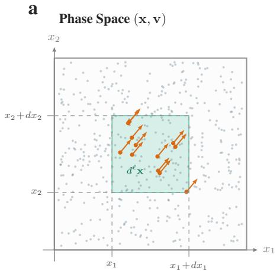

b  
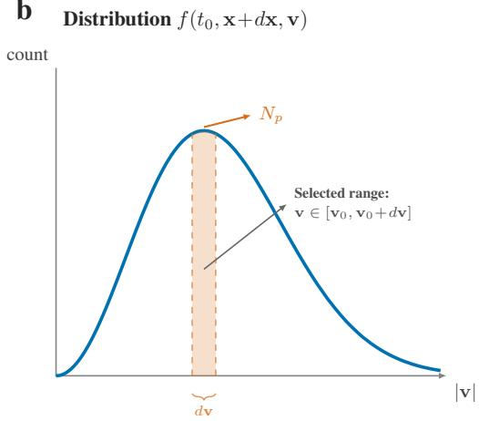  
Figure 9: Phase-space representation of a kinetic distribution. a Phase space $\displaystyle ( \mathbf { x } , \mathbf { v } )$ at $t = t _ { 0 }$ . The green region marks a spatial volume element containing particles; red particles indicate those whose velocities lie in a selected interval. b The corresponding velocity distribution function $f .$ The red area represents the particle count $N _ { p }$ in the selected velocity interval, connecting microscopic particle states to the macroscopic distribution. Inspired by Boyd $\&$ Schunk Boyd and Schwartzentruber [2017].

Definition A.1 (Macroscopic Observables). For any phase space function $\psi ( \mathbf { v } )$ , the corresponding macroscopic field is defined by velocity averaging:

$$
\langle \psi \rangle ( t , \pmb { x } ) \overset { \mathrm { d e f . } } { = } \int _ { \mathbb { R } ^ { d } } f ( t , \pmb { x } , \mathbf { v } ) \psi ( \mathbf { v } ) d \mathbf { v } .\tag{10}
$$

The physically relevant macroscopic quantities are the conserved moments corresponding to mass, momentum, and energy:

$$
\psi _ { \mathrm { i n v } } ( \mathbf { v } ) = \binom { 1 } { | \mathbf { v } | ^ { 2 } / 2 } , \quad U = \binom { \rho } { \rho E } = \int _ { \mathbb { R } ^ { d } } f \psi _ { \mathrm { i n v } } d \mathbf { v } ,\tag{11}
$$

where $\rho$ is mass density, u is macroscopic (bulk) velocity, and E is specific total energy.

## A.1.2 The Boltzmann Equation and Collision Invariants

The evolution of f is governed by the Boltzmann equation:

$$
\begin{array} { r } { \partial _ { t } f + \mathbf v \cdot \nabla _ { \mathbf x } f = \Omega ( f ) , } \end{array}\tag{12}
$$

where $\Omega ( f )$ is the collision operator. The physical admissibility of collision processes requires: Axiom A.2 (Conservation Laws). The collision operator preserves mass, momentum, and energy:

$$
\int _ { \mathbb R ^ { d } } \Omega ( f ) \psi _ { \mathrm { i n v } } ( \mathbf { v } ) d \mathbf { v } = \mathbf { 0 } .\tag{13}
$$

Axiom A.3 (Boltzmann’s H-Theorem). For collision operators satisfying Boltzmann’s H-theorem and for distribution functions $f > 0$ with $\boldsymbol { \int f }$ log f dv $< \infty$ , the H-functional production is non-positive:

$$
\frac { d } { d t } H ( f ) ( t , \pmb { x } ) = \int _ { \mathbb { R } ^ { d } } \Omega ( f ) \log f d \mathbf { v } \leq 0 ,\tag{14}
$$

where the continuous H-functional (Boltzmann H-function) is defined as:

$$
H ( f ) ( t , \pmb { x } ) \stackrel { \mathrm { d e f . } } { = } \int _ { \mathbb { R } ^ { d } } f ( t , \pmb { x } , \mathbf { v } ) \log f ( t , \pmb { x } , \mathbf { v } ) d \mathbf { v } .\tag{15}
$$

Equality holds if and only if $\Omega ( f ) = 0$ almost everywhere.

Remark ${ \mathrm { A . 4 . } }$ For kinetic distributions, the physical entropy has the form $S = - k _ { B } H$ up to additive constants fixed by the reference measure. Thus $\dot { H } \leq 0$ is the H-theorem form of nonnegative entropy production for the modeled collision dynamics.

## A.1.3 Equilibrium as Entropy Minimization

The equilibrium distribution is characterized as the entropy minimizer subject to moment constraints. Let $\bar { \mathbf { U } } = ( \rho , \rho \mathbf { u } , \rho E ) ^ { \top }$ be a given macroscopic state with $\rho > 0$ and $\mathbf { \bar { \boldsymbol { E } } } > \mathbf { | \mathbf { u } | ^ { 2 } } / 2$ . The unique solution to the constrained minimization problem

$$
f ^ { \mathrm { e q } } = \underset { g \geq 0 } { \arg \operatorname* { m i n } } \left\{ H [ g ] \biggm | \int _ { \mathbb { R } ^ { d } } g \psi _ { \mathrm { i n v } } d \mathbf { v } = U \right\}\tag{16}
$$

is the Maxwell-Boltzmann (Maxwellian) distribution:

$$
f ^ { \mathrm { M B } } ( \mathbf { v } ; \rho , { \mathbf { u } } , \theta ) \overset { \mathrm { d e f . } } { = } \frac { \rho } { ( 2 \pi \theta ) ^ { d / 2 } } \exp \left( - \frac { | \mathbf { v } - { \mathbf { u } } | ^ { 2 } } { 2 \theta } \right) ,\tag{17}
$$

where the kinetic temperature is $\begin{array} { r } { \theta = \frac { 2 } { d } ( E - | \mathbf { u } | ^ { 2 } / 2 ) } \end{array}$ . This result follows from introducing Lagrange multipliers $\lambda \in \mathbb { R } ^ { d + 2 }$ for the moment constraints; the first-order optimality condition $\delta H ( f ) = $ $\textstyle \lambda \cdot \delta \ \bar { \int } \ f \psi _ { \mathrm { i n v } } d \mathbf { v }$ yields $1 + \log f ^ { \mathrm { e q } } = \lambda \cdot \psi _ { \mathrm { i n v } }$ , from which Equation (17) follows by identifying λ through the moment constraints. Convexity of H ensures uniqueness.

## A.1.4 BGK Collision Model

For computational tractability, we adopt the Bhatnagar-Gross-Krook (BGK) single-relaxation-time approximation Bhatnagar et al. [1954]

$$
\Omega ( f ) \ { \stackrel { \mathrm { d e f . } } { = } } \ - { \frac { 1 } { \tau } } ( f - f ^ { \mathrm { M B } } ) ,\tag{18}
$$

where $\tau > 0$ is the relaxation time related to viscosity in hydrodynamics. This model satisfies Axioms $\mathrm { A } . 2$ and $\mathbf { A . } 3 ,$ , and in the hydrodynamic limit $\tau  0$ (Chapman-Enskog expansion) recovers the compressible Navier-Stokes equations with kinematic viscosity $\nu = \theta \tau$

## A.2 Spectral Discretization of Velocity Space

We now construct a finite-dimensional approximation of the Boltzmann equation that preserves the spectral structure of the continuous theory.

## A.2.1 Hermite Polynomial Basis

Definition A.5 (Probabilist Hermite Polynomials). The multidimensional Hermite polynomials $\{ \mathcal { H } ^ { ( \mathbf { n } ) } ( \mathbf { v } ) \}$ indexed by multi-indices $\mathbf { n } \in \mathbb { N } _ { 0 } ^ { d }$ are the tensor products of univariate polynomials satisfying the orthogonality relation:

$$
\int _ { \mathbb { R } ^ { d } } \mathscr { H } ^ { ( \mathbf { n } ) } ( \mathbf { v } ) \mathscr { H } ^ { ( \mathbf { m } ) } ( \mathbf { v } ) \omega ( \mathbf { v } ) d \mathbf { v } = \delta _ { \mathbf { n } \mathbf { m } } \mathbf { n } ! \mathbb { I } ^ { ( | \mathbf { n } | ) } ,
$$

where

$$
\omega ( \mathbf { v } ) \stackrel { \mathrm { d e f . } } { = } ( 2 \pi ) ^ { - d / 2 } e ^ { - | \mathbf { v } | ^ { 2 } / 2 }\tag{19}
$$

is the standard Gaussian weight function, ${ \bf n } ! = n _ { 1 } ! \cdot \cdot \cdot n _ { d } ! , | { \bf n } | = n _ { 1 } + \cdot \cdot \cdot + n _ { d } $ , and $\mathbb { I } ^ { ( k ) }$ denotes the rank-k identity tensor Shan and He [1998], Krüger et al. [2017], Succi and Succi [2018].

Definition A.6 (Polynomial Space). We denote by $\mathbb { P } _ { N } ( \mathbb { R } ^ { d } )$ the space of all real-valued polynomials of total degree at most $N \mathrm { : }$

$$
\mathbb { P } _ { N } ( \mathbb { R } ^ { d } ) = \left\{ P ( \mathbf { v } ) = \sum _ { | \mathbf { n } | \leq N } c _ { \mathbf { n } } \mathbf { v } ^ { \mathbf { n } } \bigg | c _ { \mathbf { n } } \in \mathbb { R } \right\} ,\tag{20}
$$

where $\mathbf { v ^ { n } } = \mathbf { v } _ { 1 } ^ { n _ { 1 } } \cdot \cdot \cdot \mathbf { v } _ { d } ^ { n _ { d } }$ denotes the monomial corresponding to multi-index n.

Definition $\mathbf { A . 7 }$ (Grad Expansion). For fixed truncation order $N \in  { \mathbb { N } }$ , the N-th order Grad approximation of f is Grad [1949]:

$$
f ^ { ( N ) } ( \mathbf { v } ) \stackrel { \mathrm { d e f . } } { = } \omega ( \mathbf { v } ) \sum _ { | \mathbf { n } | = 0 } ^ { N } \frac { 1 } { \mathbf { n } ! } \mathbf { a } ^ { ( \mathbf { n } ) } : \mathcal { H } ^ { ( \mathbf { n } ) } ( \mathbf { v } ) ,\tag{21}
$$

where $\mathbf { a } ^ { ( \mathbf { n } ) }$ are symmetric moment tensors and : denotes full tensor contraction. The moment tensors are determined by:

$$
\mathbf { a } ^ { ( \mathbf { n } ) } = \int _ { \mathbb { R } ^ { d } } f ( \mathbf { v } ) \mathcal { H } ^ { ( \mathbf { n } ) } ( \mathbf { v } ) d \mathbf { v } .\tag{22}
$$

Remark A.8. By construction, the truncated Grad expansion satisfies $f ^ { ( N ) } / \omega \in \mathbb { P } _ { N } ( \mathbb { R } ^ { d } )$ . For the BGK model with Maxwellian equilibrium, the low-Mach Hermite expansion of $f ^ { \mathrm { M B } } / \dot { \omega }$ truncated at $N = 2$ yields the standard polynomial lattice equilibrium; the exact Maxwellian ratio is not itself a second-order polynomial except in this truncated approximation.

## A.2.2 Gauss-Hermite Quadrature

To evaluate moments without continuous integration, we employ Gaussian quadrature adapted to the Hermite weight Shan and He [1998], Shan et al. [2006], Krüger et al. [2017], Succi [2001].

Definition A.9 (Gauss-Hermite Quadrature Rule). A Gauss-Hermite quadrature rule of degree M consists of a finite set of velocity nodes $\mathcal { V } = \{ \mathbf { v } _ { i } \} _ { i = 1 } ^ { Q } \subset \mathbb { R } ^ { d }$ and positive weights $\{ w _ { i } \} _ { i = } ^ { Q }$ such that:

$$
\int _ { \mathbb { R } ^ { d } } P ( \mathbf { v } ) \omega ( \mathbf { v } ) d \mathbf { v } = \sum _ { i = 1 } ^ { Q } w _ { i } P ( \mathbf { v } _ { i } ) ,\tag{23}
$$

for all $P \in \mathbb { P } _ { M } ( \mathbb { R } ^ { d } )$ ; see Definition A.6.

Assumption A.10 (Quadrature Order). We assume $M \geq 2 N$ , ensuring exact integration of all moments up to order N in the Grad expansion and exact projection of the BGK collision operator. Remark A.11. Standard lattices satisfy this requirement: D2Q9 has $M = 5$ (sufficient for $N = 2 )$ , D3Q27 has $M = 5$ , and higher-order lattices like D3Q121 achieve $M = 9$

## A.2.3 Discrete Populations

Definition A.12 (Lattice Populations). The discrete particle populations $\{ f _ { i } \} _ { i = 1 } ^ { Q }$ are defined by:

$$
\mathbf { \Delta } \mathbf { f } _ { i } ( t , \mathbf { x } ) \stackrel { \mathrm { d e f . } } { = } w _ { i } \frac { f ^ { ( N ) } ( t , \mathbf { x } , \mathbf { v } _ { i } ) } { \omega ( \mathbf { v } _ { i } ) } .\tag{24}
$$

Under Definition A.12 and Assumption A.10, the discrete moments exactly reproduce the continuous moments of $f ^ { ( N ) }$ . Specifically, for any smooth function ψ in v with $\mathrm { d e g } ( \partial _ { \mathbf { v } } ^ { k } \psi ) \leq N$ , we have:

$$
\sum _ { i = 1 } ^ { Q } f _ { i } \psi ( \mathbf { v } _ { i } ) = \int _ { \mathbb { R } ^ { d } } f ^ { ( N ) } ( \mathbf { v } ) \psi ( \mathbf { v } ) d \mathbf { v } \approx \int _ { \mathbb { R } ^ { d } } f ( \mathbf { v } ) \psi ( \mathbf { v } ) d \mathbf { v } .\tag{25}
$$

In particular, the conserved moments are preserved exactly: $\begin{array} { r } { \sum _ { i = 1 } ^ { Q } f _ { i } \psi _ { \mathrm { i n v } } ( \mathbf { v } _ { i } ) = U } \end{array}$ as the function ψ is a polynomial and the quadrature is exact.

To verify this, note that by the Grad expansion Equation (21), we have $f ^ { ( N ) } / \omega \in \mathbb { P } _ { N }$ . For any $\psi$ with $\deg ( \psi ) \leq N$ , the product $\psi \cdot ( f ^ { ( N ) } / \omega ) \in \mathbb { P } _ { 2 N } \subseteq \mathbb { P } _ { M }$ by Assumption A.10. Applying the quadrature rule Equation (23):

$$
\begin{array} { r l } & { \displaystyle \int _ { \mathbb { R } ^ { d } } f ^ { ( N ) } \psi d \mathbf { v } = \int _ { \mathbb { R } ^ { d } } \frac { f ^ { ( N ) } ( \mathbf { v } ) } { \omega ( \mathbf { v } ) } \psi ( \mathbf { v } ) \omega ( \mathbf { v } ) d \mathbf { v } } \\ & { \quad \quad \quad = \displaystyle \sum _ { i = 1 } ^ { Q } w _ { i } \frac { f ^ { ( N ) } ( \mathbf { v } _ { i } ) } { \omega ( \mathbf { v } _ { i } ) } \psi ( \mathbf { v } _ { i } ) = \sum _ { i = 1 } ^ { Q } f _ { i } \psi ( \mathbf { v } _ { i } ) , } \end{array}
$$

where we used Definition A.12 in the last equality. Furthermore, because $f$ and $f ^ { ( N ) }$ coincide on the first moments; the quadrature rule is exact for the relevant polynomials, then

$$
\int _ { \mathbb { R } ^ { d } } f \psi d \mathbf { v } = \int _ { \mathbb { R } ^ { d } } f ^ { ( N ) } \psi d \mathbf { v } = \sum _ { i = 1 } ^ { Q } \mathbf { \mathbf { \mathit { f } } } _ { i } \psi ( \mathbf { \mathbf { v } } _ { i } )
$$

## A.3 Lattice Boltzmann Background

The kinetic backbone of NeurDE is based on the Boltzmann equation (BE) and the evolution of the discretized single-particle distribution $f ( t , \pmb { x } , \mathbf { v } )$ . Here, $f ( t , \pmb { x } , \mathbf { v } )$ describes the mesoscopic particle state at position x and particle velocity v. The distribution is updated via the Bhatnagar–Gross–Krook (BGK) Bhatnagar et al. [1954] particle collision operator, which relaxes $f$ towards an equilibrium distribution $f ^ { \mathrm { e q } }$ . The lattice Boltzmann method realizes this view on a finite velocity lattice Bellotti et al. [2025] by evolving populations ${ f } _ { i } ( t , \pmb { x } )$ at positions x and discrete velocities ${ \bf v } _ { i } \colon$

$$
\pmb { f } _ { i } ( t + 1 , \pmb { x } + \mathbf { v } _ { i } ) = \pmb { f } _ { i } ( t , \pmb { x } ) + \Omega ( \pmb { f } _ { i } ( t , \pmb { x } ) , \pmb { U } ( t , \pmb { x } ) )\tag{26}
$$

$$
\begin{array} { r } { \Omega _ { \mathrm { B G K } } = \frac { 1 } { \tau } \left( { \bf f } _ { i } ^ { \mathrm { e q } } ( U ( t , { \bf x } ) ) - { \bf f } _ { i } ( t , { \bf x } ) \right) } \end{array}\tag{27}
$$

with relaxation time τ and conserved macroscopic variable ${ \cal U } ( t , { \pmb x } )$ (density, momentum, and, for energy-conserving lattices, energy).

This formulation is well suited to hybrid ML for two reasons. First, the BGK update separates cleanly into a local collision and a global streaming step:

$$
\pmb { f } _ { i } ( t + 1 , \pmb { x } ) \approx \Phi ^ { S } \Phi _ { \mathrm { B G K } } ^ { \mathcal { C } } \pmb { f } _ { i } ( t , \pmb { x } )\tag{28a}
$$

$$
\pmb { f } _ { i } ^ { \mathrm { c o l l } } ( t , \pmb { x } ) = \Phi _ { \mathrm { B G K } } ^ { \mathcal { C } } \pmb { f } _ { i } ( t , \pmb { x } )
$$

$$
= { \bf f } _ { i } ( t , { \pmb x } ) + \frac { 1 } { \tau } \big [ { \pmb f } _ { i } ^ { \mathrm { e q } } ( { \pmb U } ( t , { \pmb x } ) ) - { \pmb f } _ { i } ( t , { \pmb x } ) \big ]\tag{28b}
$$

$$
\pmb { f } _ { i } ( t + 1 , \pmb { x } ) = \Phi ^ { S } \pmb { f } _ { i } ^ { \mathrm { c o l l } } ( t , \pmb { x } ) = \pmb { f } _ { i } ^ { \mathrm { c o l l } } ( t , \pmb { x } - \mathbf { c } _ { i } )\tag{28c}
$$

The collision $\Phi _ { \mathrm { B G K } } ^ { \mathcal { C } }$ is local but nonlinear, which makes it both highly parallelizable and the natural place to insert a learned component Schornbaum and Rude [2016], Benitez et al. [2025]. The streaming step $\Phi ^ { S }$ is linear and is implemented exactly as a shift on the lattice. Second, conserved macroscopic observables are recovered by simple moments of the populations, which preserves conservation laws by construction:

$$
\pmb { U } ( t , \pmb { x } ) = ( \rho , \rho \mathbf { u } , \rho E ) ^ { \top } = \sum _ { i } ( 1 , \mathbf { v } _ { i } , \frac { 1 } { 2 } \mathbf { v } _ { i } ^ { 2 } ) ^ { \top } \pmb { f } _ { i } .\tag{29}
$$

NeurDE inherits the BE mass and momentum conservation and only needs to specify the remaining system-specific physics governed by $f _ { i } ^ { \mathrm { e q } } ( U ( t , x ) )$ . To do this, NeurDE learns the system’s closure to predict the mesoscopic equilibrium from the macroscopic observables U. By learning this macroto-mesoscopic mapping, NeurDE and (Eq. 29) naturally couple the mesoscopic particle (molecular) and macroscopic (observable) scales.

## A.4 Discrete Entropy Functional

Standard lattice Boltzmann implementations employ polynomial equilibria (e.g., second-order Hermite expansions) that approximate the continuous entropy minimizer $H ( f )$ but do not generally minimize the discrete entropy functional. This discrepancy can manifest as spurious H-function growth, $\Delta H _ { \mathrm { d i s c r e t e } } ~ > ~ 0$ , equivalently negative physical entropy production, which accumulates into numerical instability. The next subsection develops a quadrature-consistent discrete entropy functional on the discrete velocity set.

## A.4.1 Projection of the Continuous Entropy

We begin by projecting the continuous entropy functional onto the discrete velocity space. Starting from the continuous entropy and introducing the weight function:

$$
H ( f ) = \int _ { \mathbb { R } ^ { d } } f \log f d \mathbf { v } = \int _ { \mathbb { R } ^ { d } } { \frac { f ( \mathbf { v } ) } { \omega ( \mathbf { v } ) } } \log f ( \mathbf { v } ) \omega ( \mathbf { v } ) d \mathbf { v } .
$$

For the Grad approximation $f ^ { ( N ) }$ , we have $f ^ { ( N ) } / \omega \in \mathbb { P } _ { N }$ by construction. The integrand can be decomposed as:

$$
\frac { f ^ { ( N ) } ( \mathbf { v } ) } { \omega ( \mathbf { v } ) } \log f ^ { ( N ) } ( \mathbf { v } ) = \frac { f ^ { ( N ) } ( \mathbf { v } ) } { \omega ( \mathbf { v } ) } \left[ \log \left( \frac { f ^ { ( N ) } ( \mathbf { v } ) } { \omega ( \mathbf { v } ) } \right) + \log \omega ( \mathbf { v } ) \right] .
$$

The first term involves $\big ( f ^ { ( N ) } / \omega \big ) \log ( f ^ { ( N ) } / \omega )$ . Since $f ^ { ( N ) } / \omega \in \mathbb { P } _ { N }$ , we can write:

$$
\frac { f ^ { ( N ) } ( \mathbf { v } ) } { \omega ( \mathbf { v } ) } = \sum _ { | \mathbf { n } | \leq N } c _ { \mathbf { n } } \mathcal { H } ^ { ( \mathbf { n } ) } ( \mathbf { v } ) ,
$$

for some coefficients $c _ { \mathbf { n } } \in \mathbb { R }$ determined by the moment tensors $\mathbf { a } ^ { ( \mathbf { n } ) }$ through the Hermite expansion. The logarithm introduces nonpolynomial terms; however, for populations close to equilibrium (the relevant regime for LBM), we assume $f ^ { ( N ) } / \omega$ is strictly positive on the support of the quadrature nodes $\{ { \bf v } _ { i } \} _ { i = 1 } ^ { Q }$ . Under this condition and requiring quadrature order $M \geq 2 N + 2$ , the quadrature rule captures the leading-order entropy contributions with controllable error.

Applying the quadrature rule to approximate the continuous integral:

$$
\begin{array} { r l } & { H ( f ^ { ( N ) } ) \approx \displaystyle \sum _ { i = 1 } ^ { Q } w _ { i } \frac { f ^ { ( N ) } \left( \mathbf { v } _ { i } \right) } { \omega \left( \mathbf { v } _ { i } \right) } \log f ^ { ( N ) } ( \mathbf { v } _ { i } ) } \\ & { \quad \quad \quad = \displaystyle \sum _ { i = 1 } ^ { Q } w _ { i } \frac { f ^ { ( N ) } \left( \mathbf { v } _ { i } \right) } { \omega \left( \mathbf { v } _ { i } \right) } \left[ \log \left( \frac { f ^ { ( N ) } \left( \mathbf { v } _ { i } \right) } { \omega \left( \mathbf { v } _ { i } \right) } \right) + \log w _ { i } - \log w _ { i } + \log \omega \left( \mathbf { v } _ { i } \right) \right] } \\ & { \quad \quad \quad = \displaystyle \sum _ { i = 1 } ^ { Q } w _ { i } \frac { f ^ { ( N ) } \left( \mathbf { v } _ { i } \right) } { \omega \left( \mathbf { v } _ { i } \right) } \left[ \log \left( \frac { f ^ { ( N ) } \left( \mathbf { v } _ { i } \right) } { w _ { i } \omega \left( \mathbf { v } _ { i } \right) } \right) + \log \omega \left( \mathbf { v } _ { i } \right) \right] . } \end{array}
$$

Using Definition A.12, we have $f ^ { ( N ) } ( { \bf v } _ { i } ) = f _ { i } \omega ( { \bf v } _ { i } ) / w _ { i }$ , which yields:

$$
H ( f ^ { ( N ) } ) \approx \sum _ { i = 1 } ^ { Q } \mathbf { \mathit { f } } _ { i } \left[ \log \left( \frac { \mathbf { \mathit { f } } _ { i } } { w _ { i } } \right) + \log \omega ( \mathbf { v } _ { i } ) \right] .
$$

We now analyze the second term. Since log $\begin{array} { r } { \omega ( { \mathbf v } ) = - \frac { d } { 2 } \log ( 2 \pi ) - \frac { 1 } { 2 } | { \mathbf v } | ^ { 2 } } \end{array}$ , we have:

$$
\mathcal { I } ( \pmb { f } ) \overset { \mathrm { d e f . } } { = } \sum _ { i = 1 } ^ { Q } \pmb { f } _ { i } \log \omega ( \mathbf { v } _ { i } ) = - \frac { d } { 2 } \log ( 2 \pi ) \sum _ { i = 1 } ^ { Q } \pmb { f } _ { i } - \frac { 1 } { 2 } \sum _ { i = 1 } ^ { Q } \pmb { f } _ { i } | \mathbf { v } _ { i } | ^ { 2 } .
$$

Recognizing the discrete moments for mass $\textstyle \rho = \sum _ { i = 1 } ^ { Q } f _ { i }$ and total energy $\begin{array} { r } { \rho E = \frac { 1 } { 2 } \sum _ { i = 1 } ^ { Q } f _ { i } | \mathbf { v } _ { i } | ^ { 2 } } \end{array}$ (by Equation (25) with $\psi = | \mathbf { v } | ^ { 2 } / 2 )$ , we obtain:

$$
\begin{array} { l } { \displaystyle \mathcal { I } ( { \pmb f } ) = - \frac { d } { 2 } \log ( 2 \pi ) \rho - \rho E . } \end{array}
$$

Since mass $\rho$ and total energy $\rho E$ are collision invariants (conserved by Axiom A.2), we have $\begin{array} { r } { \frac { d } { d t } \mathcal { I } ( f ) = 0 } \end{array}$ identically along Boltzmann dynamics. Thus $H ( f ^ { ( N ) } )$ and the first term have identical dynamical content.

Definition A.13 (Discrete Entropy Functional). The discrete entropy functional (discrete H-function) is defined as:

$$
H _ { \mathcal { L } } ( \pmb { f } ) \overset { \mathrm { d e f . } } { = } \sum _ { i = 1 } ^ { Q } f _ { i } \log \left( \frac { { \pmb f } _ { i } } { w _ { i } } \right) ,\tag{30}
$$

which is a discrete relative-entropy functional with respect to the quadrature weights $\begin{array} { r l } { \mathbf { w } } & { { } = } \end{array}$ $( w _ { 1 } , \ldots , w _ { Q } ) ^ { \top }$ . When $\textstyle \sum _ { i } f _ { i } = 1$ , it is the usual Kullback–Leibler divergence $D _ { \mathrm { K L } } ( \mathbf { \bar { f } } \parallel \mathbf { w } ) ;$ for fixed non-unit mass it differs from the normalized KL form only by mass-dependent affine terms.

At the quadrature level, the projected entropy is approximated by the decomposition

$$
H ( f ^ { ( N ) } ) \approx H _ { \mathcal { L } } ( f ) + \mathcal { T } ( f ) ,
$$

where $\boldsymbol { \mathcal { T } } ( \boldsymbol { f } )$ is a conserved quantity. Thus, within the discrete quadrature approximation, minimizing the discrete entropy $H _ { \cal C } [ f ]$ subject to moment constraints $\begin{array} { r } { \sum _ { i = 1 } ^ { Q } f _ { i } \psi _ { \mathrm { i n v } } ( \mathbf { v } _ { i } ) = U } \end{array}$ is the entropyconsistent discrete counterpart of the continuous constrained minimization problem Karlin et al. [1999], Hosseini et al. [2023].

Remark A.14 (Notation). Throughout the main text, for simplicity of notation, we denote the discrete entropy $H _ { \mathcal { L } }$ simply as $H ,$ , as the context implies the discrete functional unless otherwise stated.

## A.4.2 Reference measure w

The definition of the discrete entropy in Equation (30) is the canonical entropic-LBM choice for preserving the thermodynamic structure of the continuous Boltzmann equation upon velocity discretization Karlin et al. [1999], Hosseini et al. [2023]. It is easy to see that the Maxwellian Equation (17) and the weight function of the quadrature Equation (19) are related as,

$$
f ^ { \mathrm { M B } } ( { \bf v } ; \rho , { \bf u } , \theta ) = \frac { \rho } { \theta ^ { d / 2 } } \omega \left( \frac { { \bf v } - { \bf u } } { \sqrt { \theta } } \right) ,
$$

In particular, if we consider the absolute equilibrium state of the fluid at rest with unit density and temperature $( \rho = 1 , \mathbf { u } = \mathbf { 0 } , \theta = 1 )$ . In this state, the continuous Maxwell-Boltzmann distribution function coincides exactly with the Gaussian weight function $\omega ( \mathbf { v } )$ used for the Hermite spectral projection:

$$
f ^ { \mathrm { r e s t } } ( { \bf v } ; 1 , { \bf 0 } , 1 ) = \frac { 1 } { ( 2 \pi ) ^ { d / 2 } } e ^ { - | { \bf v } | ^ { 2 } / 2 } \equiv \omega ( { \bf v } ) .
$$

Substituting this physical state into the definition of the lattice populations (Theorem A.12) yields the discrete equilibrium populations at rest:

$$
f _ { i } ^ { \mathrm { r e s t } } = w _ { i } \frac { f ^ { \mathrm { r e s t } } ( \mathbf { v } _ { i } ) } { \omega ( \mathbf { v } _ { i } ) } = w _ { i } \frac { \omega ( \mathbf { v } _ { i } ) } { \omega ( \mathbf { v } _ { i } ) } = w _ { i } .\tag{31}
$$

This identity shows that the vector of quadrature weights w is the discrete population vector corresponding to the unit-density rest state. Moreover, since the quadrature is exact for the zeroth moment, by Equation (23) we have

$$
\sum _ { i = 1 } ^ { Q } w _ { i } = \int \omega ( \mathbf { v } ) d \mathbf { v } = 1 .
$$

Thus, w is a valid probability massfunction representing the normalized rest equilibrium.

Consequently, the functional $H _ { \cal { L } } ( f )$ measures the relative entropic cost of the current dynamic state f with respect to the rest reference w. Minimizing this divergence subject to nonzero momentum constraints U gives the discrete analogue of the continuous constrained-entropy problem that recovers the moving Maxwell–Boltzmann distribution.

## A.4.3 Entropic Stabilization Motivation

Standard lattice Boltzmann methods employ polynomial equilibria derived by truncating the Hermite expansion of the Maxwellian. The Maxwellian minimizes the continuous entropy $\bar { H } ( f )$ , but the discretization error in the Gauss-Hermite quadrature means that polynomial approximations do not generally minimize the discrete entropy $\bar { H _ { \mathcal { L } } }$ . The discrete entropy $\dot { H } _ { \mathcal { L } }$ is strictly convex in $f ,$ as its Hessian matrix $\begin{array} { r } { \frac { \partial ^ { 2 } H _ { \mathcal { L } } } { \partial { f _ { i } } \partial { f _ { j } } } = \frac { \delta _ { i j } } { { f _ { i } } } } \end{array}$ is positive definite for $\mathbf { \nabla } f > \mathbf { 0 } .$ . Therefore, relaxation toward polynomial equilibria that do not minimize $H _ { \mathcal { L } }$ can violate the discrete H-theorem, producing entropy growth that accumulates into numerical instability over long time integration.

## A.5 Entropic Stability

To avoid adding spurious noise (erroneous information) from our coarse discretization, we enforce the second law of thermodynamics by making sure entropy increases or stays constant at every autoregressive step. Naturally, as an isolated system evolves, it reaches equilibrium where disorder and entropy are maximized. Thus, a decreasing entropy indicates that energy (erroneous information) was added to the system.

The BE backbone provides a simple calculation of entropy from the H-function and $f _ { i } .$ . Defined up to reference-measure constants, the H-function and entropy $S ( f )$ are

$$
H ( \pmb { f } ) = \sum _ { i } f _ { i } \log \left( \frac { f _ { i } } { w _ { i } } \right)\tag{32}
$$

$$
S ( { \pmb f } ) = - k _ { B } H ( { \pmb f } ) ,\tag{33}
$$

where $k _ { B }$ is the Boltzmann constant and w are the quadrature weights of the discrete velocity lattice Krüger et al. [2017], Succi [2001]. When $\begin{array} { r } { \sum _ { i } \mathbf { \dot { f } } _ { i } = \sum _ { i } w _ { i } = 1 } \end{array}$ , Eq. 32 is the Kullback– Leibler divergence $D _ { \mathrm { K L } } ( \pmb { f } \| \mathbf { w } )$ ; for nonunit mass it is the corresponding unnormalized relative entropy. Therefore, $H ( f )$ measures how far the population is from the lattice representation of the Maxwell–Boltzmann rest state (Appendix $\mathbf { A . } 4 )$

To enforce the second law of thermodynamics, we must satisfy the discrete H-theorem: the H function must decrease or remain constant after the collision operator. A collision that satisfies the H-theorem

$$
H ( { \pmb f } ^ { \mathrm { c o l l } } ) \le H ( { \pmb f } ^ { \mathrm { p r e } } ) ,\tag{34}
$$

dissipates nonequilibrium structure rather than creating spurious grid-scale order. Entropic LBM (ELBM) enforces this condition by a clever construction Karlin et al. [1999]: it introduces a local parameter $\alpha ( t , \pmb { x } )$ that stretches the relaxation toward an entropic mirror state,

$$
\pmb { f } ^ { \mathrm { m i r r } } ( \alpha ) = \pmb { f } ^ { \mathrm { p r e } } + \alpha ( \pmb { f } ^ { \mathrm { e q } } - \pmb { f } ^ { \mathrm { p r e } } ) .\tag{35}
$$

Classical ELBM chooses α as an admissible positive root of $H ( f ^ { \mathrm { m i r r } } ( \alpha ) ) = H ( f ^ { \mathrm { p r e } } )$ , which implies Eq. 34 under the positivity conditions in Appendix A.6.1. At each time step and each spatial grid point, this root is generally found via expensive iterative second-order optimizers. The entropic parameter α then turns the BGK collision into

$$
\Omega _ { \mathrm { E B G K } } = \alpha ( t , \pmb { x } ) \beta \left( \pmb { f } _ { i } ^ { \mathrm { e q } } ( \pmb { U } ( t , \pmb { x } ) ) - \pmb { f } _ { i } ( t , \pmb { x } ) \right)\tag{36}
$$

$$
\begin{array} { r l } & { \pmb { f } _ { i } ^ { \mathrm { c o l l } } = \Phi _ { \mathrm { E B G K } } ^ { \mathcal { C } } \pmb { f } _ { i } } \\ & { \qquad = \pmb { f } _ { i } + \alpha ( t , \pmb { x } ) \beta \left( \pmb { f } _ { i } ^ { \mathrm { e q } } ( \pmb { U } ( t , \pmb { x } ) ) - \pmb { f } _ { i } ( t , \pmb { x } ) \right) , } \end{array}\tag{37}
$$

where $\beta = 1 / ( 2 \tau )$ is fixed by the target viscosity Krüger et al. [2017] and $\Phi _ { \mathrm { E B G K } } ^ { \mathcal { C } }$ is the entropic BGK collision operator.

Intuitively, α is a flow-dependent thermodynamic dial controlling an artificial viscosity. Near equilibrium, $\alpha \approx 2$ and the entropic collision reduces to standard BGK relaxation. In underresolved or strongly nonequilibrium regions, the entropy condition alters α to modify the effective relaxation $\alpha \beta$ by increasing an artificial viscosity. The larger viscosity increases local dissipation of highfrequency structures before they reach the grid resolution. Figure 1 demonstrates this in Fourier space, where the artificial viscosity dampens the energy spectrum near the grid cutoff, prohibiting energy and information from being lost to the unresolved subgrid frequencies. The artificial viscosity trades unresolved high-frequency fidelity for entropy stability on the represented grid.

Learning the α parameter, which controls the artificial viscosity and has no closed-form solution, presents a robust learning problem. Similar to $\pmb { f } _ { i } ^ { \mathrm { e q } }$ , α is local and calculated by an unknown nonlinear function, making it well-suited to neural networks and highly parallelizable. From the described thermodynamic constraints, we create physics-informed losses to enrich this model with physics principles (Appendix A.6). These principles are resolution invariant and provide supplemental information to help the model make predictions on otherwise missing sub-grid information.

## A.6 Entropic Stabilization via Involution

To enforce the discrete H-theorem, the Entropic Lattice Boltzmann Method (ELBM) constructs collision updates for which an admissible positive entropy-balance root implies $\Delta H _ { \mathcal { L } } ~ \leq ~ 0$ by design Karlin et al. [1999], Ansumali and Karlin [2000], Hosseini et al. [2023].

## A.6.1 Entropic Involution and Mirror State

Definition A.15 (Entropic Involution). Given pre-collision populations $\pmb { f } = ( \pmb { f } _ { 1 } , \dots , \pmb { f } _ { Q } ) ^ { \top }$ and a target equilibrium $f ^ { \mathrm { e q } } = ( f _ { 1 } ^ { \mathrm { e q } } , \dots , f _ { Q } ^ { \mathrm { e q } } ) ^ { \intercal }$ , the entropic mirror state parameterized by α is defined as

$$
\pmb { f } ^ { \mathrm { m i r r } } ( \alpha ) \stackrel { \mathrm { d e f . } } { = } \pmb { f } + \alpha ( \pmb { f } ^ { \mathrm { e q } } - \pmb { f } ) = ( 1 - \alpha ) \pmb { f } + \alpha \pmb { f } ^ { \mathrm { e q } } .\tag{38}
$$

The parameter α is determined by requiring that the mirror state has exactly the same entropy as the pre-collision state.

Definition A.16 (Entropy Balance Equation). The entropic parameter $\alpha ^ { * } \geq 1$ is the nontrivial positive root of

$$
\begin{array} { r } { h _ { \beta = 1 } ( \alpha ) \stackrel { \mathrm { d e f . } } { = } H _ { \mathcal { L } } ( \pmb { f } ^ { \mathrm { m i r r } } ( \alpha ) ) - H _ { \mathcal { L } } ( \pmb { f } ) = 0 , } \end{array}\tag{39}
$$

with the special value $\alpha = 2$ corresponding to the algebraic reflection $f _ { ( 2 ) } ^ { \mathrm { m i r r } } = 2 f ^ { \mathrm { e q } } - f$ Karlin et al.   
[1999], Ansumali and Karlin [2000], Karlin et al. [2014].

The post-collision state is obtained by convex mixing,

$$
\begin{array} { r } { \pmb { f } ^ { \mathrm { c o l l } } = ( 1 - \beta ) \pmb { f } + \beta \pmb { f } ^ { \mathrm { m i r r } } ( \alpha ) . } \end{array}\tag{40}
$$

Here, $\beta \in [ 0 , 1 ]$ sets the nominal viscosity in smooth regions, while $\alpha$ is chosen locally via (39) to enforce entropy balance and preserve positivity. Because H is convex and $f ^ { \mathrm { c o l l } }$ is a convex combination of $f$ and $f ^ { \mathrm { m i r r } } ( \alpha )$ , with $H [ \dot { \pmb { f } } ^ { \mathrm { m i r r } } ( \alpha ) ] = H ( \pmb { f } )$ by construction, Jensen’s inequality implies

$$
H ( \pmb { f } ^ { \mathrm { c o l l } } ) = H \big ( ( 1 - \beta ) \pmb { f } + \beta \pmb { f } ^ { \mathrm { m i r r } } ( \alpha ) \big ) \le H ( \pmb { f } ) ,
$$

establishing the discrete H-theorem for the collision step.

(41)

## B Proofs of Theoretical Guarantees

## B.1 Preliminaries

We recall from Section 4.2 the following: let $d , F$ be positive integers, let $\Omega \subset \mathbb { R } ^ { d }$ be a bounded domain, let $\mathcal { F }$ be a feature space, and fix a nonempty collection of encoders $\mathcal { E } : \mathcal { F }  \mathbb { R } ^ { F }$ . For each encoded context ${ \mathbf z } = \mathcal { E } ( \phi )$ , the DEQ update induces an operator $G _ { \theta , \mathbf { z } } : H ^ { 1 } ( \Omega ) \to H ^ { 1 } ( \Omega )$

Definition B.1 (Sobolev space). We write $H ^ { 1 } ( \Omega )$ for the (Hilbertian) Sobolev space on $\Omega ;$ whose norm we denote by $\| \cdot \| _ { H ^ { 1 } ( \Omega ) }$ and is given for any $u \in L ^ { 2 } ( \Omega ; \mathbb { R } ^ { d } )$ by

$$
\| u \| _ { H ^ { 1 } ( \Omega ) } \overset { \mathrm { d e f . } } { = } \left( \int _ { \mathbf { v } \in \Omega } \| u ( \mathbf { v } ) \| _ { 2 } ^ { 2 } + \| \nabla u ( \mathbf { v } ) \| _ { 2 } ^ { 2 } d \mathbf { v } \right) ^ { 1 / 2 }\tag{42}
$$

where $\nabla$ denotes the weak derivative of u (provided that it exists).

Definition $\mathbf { B } . 2 \left( L _ { + } ^ { 1 } ( \Omega ) \right.$ space). We write $L _ { + } ^ { 1 } ( \Omega )$ to denote the set of nonnegative finite-mass densities or population fields on Ω; that is, the collection of every $f \in L ^ { 1 } ( \Omega )$ satisfying $\pmb { f } \geq 0$ Lebesgue-a.e. and $\begin{array} { r } { \bar { 0 } < \int _ { \mathrm { o } } f ( \mathbf { v } ) d \mathbf { v } < \infty } \end{array}$ . The probability-normalized case has unit mass, while the lattice-Boltzmann populations used in the experiments may carry nonunit local mass.

Assumption B.3 (Uniform bounds of $f$ and $f ^ { \mathrm { m i r r } } )$ . Let $\mathcal { A } \subset H ^ { 1 } ( \Omega )$ be a set on which $f ^ { \mathrm { m i r r } } : \mathcal { A } $ $L _ { + } ^ { 1 } ( \Omega )$ is Lipschitz with respect to the $L ^ { 2 } ( \Omega )$ norm on A and the $L ^ { 1 } ( \Omega )$ norm on its image, and on which there exist constants $0 < m < M < \infty$ such that

$$
m \leq ( 1 - \beta ) \pmb { f } ( \mathbf { v } ) + \beta \pmb { f } ^ { \mathrm { m i r r } } ( \alpha ) ( \mathbf { v } ) \leq M\tag{43}
$$

for Lebesgue-a.e. $\mathbf { v } \in \Omega$ and for all $\alpha \in { \mathcal { A } } .$

From a pointwise symbol to an operator-level update. The architecture in this paper realizes the DEQ update by a finite-depth convolutional network whose spatial coupling is not pointwise. Accordingly, the fixed-point analysis below is phrased at the level of the operator induced on $H ^ { 1 } ( \Omega )$ rather than as a Nemytskii (superposition) lift of a pointwise kernel. For each $\phi \in { \mathcal { F } }$ with encoded context $\mathbf { z } = \mathcal { E } ( \phi ) \in \dot { \mathbb { R } } ^ { F }$ , write

$$
G _ { \theta , { \bf z } } : H ^ { 1 } ( \Omega ) \to H ^ { 1 } ( \Omega ) , \qquad \alpha \mapsto g _ { \boldsymbol { \theta } } ( \alpha , { \bf z } )
$$

for the operator that takes the current iterate to the next. The Nemytskii lift of a pointwise $C ^ { 1 }$ symbol (Lemma B.7) is one realization of $G _ { \theta , \mathbf { z } } ;$ convolutional updates with bounded layer norms and Lipschitz activations are another. The arguments below depend only on operator-level Lipschitz and self-map properties of $G _ { \boldsymbol { \theta } , \mathbf { z } }$ on a suitable admissible set, and are agnostic to whether the spatial coupling is pointwise or convolutional.

Assumption B.4 (Operator-level regularity of the DEQ update). The domain $\Omega \subset \mathbb { R } ^ { d }$ is bounded with Lipschitz boundary. There exists a nonempty closed bounded convex set ${ \mathcal { K } } \subseteq H ^ { 1 } ( \Omega )$ – the admissible set ofstability parameters – such that, for every input feature $\phi \in { \mathcal { F } }$ with encoded context ${ \bf z } = \mathcal { E } ( \phi )$ , the induced operator $G _ { \theta , { \bf z } } : \alpha \mapsto g _ { \theta } ( \alpha , { \bf z } )$ satisfies the following:

(A1) (Well-definedness.) $G _ { \theta , \mathbf { z } } : H ^ { 1 } ( \Omega ) \to H ^ { 1 } ( \Omega )$ is a well-defined map.

(A2) (Invariance of $\begin{array} { r } { \mathcal { K } . ) G _ { \theta , \mathbf { z } } ( \mathcal { K } ) \subseteq \mathcal { K } } \end{array}$

(A3) $( L ^ { 2 } - L i p s c h i t z n e s s$ on $\mathcal { K } . )$ There exists a constant $L _ { v } \geq 0$ such that

$$
\| G _ { \theta , \mathbf { z } } ( \alpha _ { 0 } ) - G _ { \theta , \mathbf { z } } ( \alpha _ { 1 } ) \| _ { L ^ { 2 } ( \Omega ) } \leq L _ { v } \| \alpha _ { 0 } - \alpha _ { 1 } \| _ { L ^ { 2 } ( \Omega ) } , \qquad \alpha _ { 0 } , \alpha _ { 1 } \in K .\tag{44}
$$

Remark B.5 (Pointwise (Nemytskii) realization and the role of $B _ { 1 } )$ . A common way to realize Assumption B.4 is the pointwise case in which $g _ { \theta } : \mathbb { R } ^ { d } \times \mathbb { R } ^ { F }  \Omega$ is continuously differentiable with bounded Jacobian sup $\mathbf { \sigma } _ { \mathbf { v } \in \mathbb { R } ^ { d } } \| J g _ { \boldsymbol { \theta } } ( \mathbf { v } , v ) \| _ { 2 } \leq L _ { v }$ . Lemma B.7 shows that, with Ω bounded and $0 \in \Omega$ , the Nemytskii lift $T _ { g _ { \theta } : \phi } : H ^ { 1 } ( \Omega ) \to H ^ { 1 } ( \Omega )$ is then well-defined and L -Lipschitz in $L ^ { 2 }$ With the additional structural conditions $g _ { \theta } ( 0 , v ) = 0$ for every $v \in \mathbb { R } ^ { F }$ and $L _ { v } \leq 1$ , the lift also stabilizes the Sobolev unit bal $B _ { 1 } \stackrel { \mathrm { d e f . } } { = } \{ u \in H ^ { 1 } ( \Omega ) : \lVert u \rVert _ { H ^ { 1 } ( \Omega ) } \leq 1 \}$ , providing a concrete pointwise realization of Assumption B.4 with $\dot { \mathcal { K } } = B _ { 1 }$ . In that special case, however, the strict-contraction condition $L _ { v } < 1$ forces the unique fixed point to be the zero function, since $T _ { g _ { \theta } : \phi } 0 = 0$ . The general admissible-set formulation here avoids that artifact: dropping the zero-anchoring condition allows $\kappa$ to be a translate of a Sobolev ball centered near the entropic value $\alpha \approx 2 .$ which matches the tanh-bounded shifted output of the architecture used in this paper.

Remark B.6 (Convolutional realization). The architecture used in this paper realizes $G _ { \boldsymbol { \theta } , \mathbf { z } }$ as a finite composition of convolutional layers with bounded operator norms and Lipschitz pointwise activations, followed by a tanh-bounded shifted output near the entropic value $\alpha \approx 2$ . The shifted output keeps each iterate in a fixed pointwise interval, which gives rise to a closed bounded convex admissible set K that is a translate of a Sobolev ball rather than the zero-centered $B _ { 1 }$ . The Lipschitz constant on K is bounded by the product of $L ^ { 2 }$ operator norms of the convolutional layers and the activation Lipschitz constants; we do not unfold these architecture-dependent constants here, because the analysis below depends only on the operator-level conditions in Assumption B.4.

## B.2 Existence of Fixed Points

We first establish Theorem 4.1.

Lemma B.7 (Pointwise (Nemytskii) realization of Assumption B.4). Let $\Omega \subset \mathbb { R } ^ { d }$ be a bounded domain with Lipschitz boundary. Suppose $g _ { \theta } : \mathbb { R } ^ { d } \times \mathbb { R } ^ { F }  \dot { \Omega }$ is continuously differentiable, and that for every $v \in \bar { \mathbb { R } } ^ { F }$ the Jacobian satisfies

$$
L _ { v } \stackrel { \mathrm { d e f . } } { = } \operatorname* { s u p } _ { \mathbf { v } \in \mathbb { R } ^ { d } } \| J g _ { \theta } ( \mathbf { v } , v ) \| _ { 2 } < \infty .
$$

Then for every $\phi \in { \mathcal { F } }$ the Nemytskii-type composition operator

$$
\begin{array} { r l } & { T _ { g _ { \theta } : \phi } : ( H ^ { 1 } ( \Omega ) , \lVert \cdot \rVert _ { H ^ { 1 } ( \Omega ) } ) \to ( H ^ { 1 } ( \Omega ) , \lVert \cdot \rVert _ { L ^ { 2 } ( \Omega ) } ) } \\ & { \qquad u \mapsto g _ { \theta } ( u , \mathcal { E } ( \phi ) ) } \end{array}\tag{45}
$$

is well-defined and $L _ { v } – L i p s c h i t z$ as a map into $L ^ { 2 } ( \Omega )$ . This is the standard superposition-operator viewpoint for Nemytskii maps on Sobolev spaces Appell and Zabrejko [1990]. If, in addition, $0 \in \Omega , g _ { \theta } ( 0 , v ) = 0 f o r$ every $v \in \mathbb { R } ^ { F }$ , and $L _ { v } \leq 1$ , then $T _ { g _ { \theta } : \phi }$ also maps the Sobolev unit ball $B _ { 1 } \stackrel { \mathrm { d e f . } } { = } \{ u \in H ^ { 1 } ( \Omega ) : \lVert u \rVert _ { H ^ { 1 } ( \Omega ) } \leq 1 \}$ to itself, providing a concrete realization ofAssumption B.4 with $\kappa = B _ { 1 }$

ProofofLemma B.7. Fix $\phi \in { \mathcal { F } }$ and abbreviate $v \stackrel { \mathrm { d e f . } } { = } \mathcal { E } ( \phi ) \in \mathbb { R } ^ { F }$ and $\Phi _ { v } ( \cdot ) \ \stackrel { \mathrm { d e f . } } { = } \ g _ { \theta } ( \cdot , v ) : \mathbb { R } ^ { d } \ $ Ω. We interpret (45) in the standard Nemytskii sense, i.e. for every ${ \textbf { v } } \in \Omega$ let $\big ( T _ { g \theta : \phi } u \big ) ( \mathbf { v } )$ def. = $g _ { \theta } \big ( u ( \mathbf { v } ) , v \big )$ . We first show that $\Phi _ { v }$ is L -Lipschitz on $\mathbb { R } ^ { d }$ . To see this first fix $x , y \in \mathbb { R } ^ { d }$ . Since $g _ { \boldsymbol { \theta } } ( \cdot , \boldsymbol { v } )$ is $C ^ { 1 }$ on $\mathbb { R } ^ { d }$ , the Fundamental Theorem of Calculus along the line segment $t \mapsto y + t ( x - y )$ yields

$$
\Phi _ { v } ( x ) - \Phi _ { v } ( y ) = \int _ { 0 } ^ { 1 } J g _ { \theta } \left( y + t ( x - y ) , v \right) \left( x - y \right) d t .\tag{46}
$$

The Lv-Lipschitzness of $\Phi _ { \tau }$ on $\mathbb { R } ^ { d }$ now follows upon taking Euclidean norms across (46) and using the Jacobian bound in the lemma’s hypothesis

$$
\big \| \Phi _ { v } ( x ) - \Phi _ { v } ( y ) \big \| _ { 2 } \leq \int _ { 0 } ^ { 1 } \big \| J g _ { \theta } \big ( y + t ( x - y ) , v \big ) \big \| _ { 2 } \| x - y \| _ { 2 } d t \leq L _ { v } \| x - y \| _ { 2 } .
$$

Next, we show that the composition operator is indeed well-defined on $H ^ { 1 } ( \Omega )$ . To this end, the $L _ { v } –$ Lipschitzness of $\Phi _ { v }$ implies Lebesgue-a.e. differentiability by Rademacher’s Theorem, cf. [Federer, 1969, Theorem 3.1.6]. We then directly observe that $\| \dot { D } \Phi _ { v } ( \cdot ) \| _ { 2 } \le L _ { v }$ a.e. on $\mathbb { R } ^ { d }$ . Now, for any $u \in H ^ { 1 } ( \Omega )$ we compute the $H ^ { 1 } ( \Omega )$ -Sobolev norm of the composition $\Phi _ { v }$ ◦ u via the chain rule; yielding

$$
\Phi _ { v } \circ u \in H ^ { 1 } ( \Omega ) \qquad \mathrm { a n d } \qquad \nabla ( \Phi _ { v } \circ u ) ( { \mathbf v } ) = J g _ { \theta } \big ( u ( { \mathbf v } ) , v \big ) \nabla u ( { \mathbf v } )
$$

for Lebesgue-a.e. $\mathbf { v } \in \Omega$ . In particular, we have that $\lVert \nabla ( \Phi _ { v } \circ u ) \rVert _ { L ^ { 2 } ( \Omega ) } \leq L _ { v } \lVert \nabla u \rVert _ { L ^ { 2 } ( \Omega ) }$ . Now, as $\Phi _ { v } ( \mathbb { R } ^ { d } ) \subseteq \Omega$ and since Ω is bounded, then the quantity $M _ { \Omega } \ { \stackrel { \mathrm { d e f . } } { = } } \ \operatorname* { s u p } _ { x \in \Omega } \| x \| _ { 2 }$ must be finite. Consequently, we have that $\| \Phi _ { v } ( u ( \cdot ) ) \| _ { 2 } \leq M _ { \Omega } < \infty$ Lebesgue-almost everywhere; whence

$$
\lVert \Phi _ { v } \circ u \rVert _ { L ^ { 2 } ( \Omega ) } \leq | \Omega | ^ { 1 / 2 } M _ { \Omega } .
$$

Therefore $\Phi _ { v } \circ u \in H ^ { 1 } ( \Omega )$ , so $T _ { g _ { \theta } : \phi }$ is well-defined as a map into the set $H ^ { 1 } ( \Omega )$

It remains to verify the Lipschitz estimate. Let $u , w \in H ^ { 1 } ( \Omega )$ . By the first step, for Lebesgue-a.e. $\mathbf { v } \in \Omega$ , we have $\begin{array} { r } { \left\| g _ { \theta } \big ( u ( \mathbf { v } ) , v \big ) - g _ { \theta } \big ( w ( \mathbf { v } ) , v \big ) \right\| _ { 2 } \leq L _ { v } \| u ( \mathbf { v } ) - w ( \mathbf { v } ) \| _ { 2 } } \end{array}$ . Squaring and integrating yields

$$
\| T _ { g e \cdot \phi } u - T _ { g \circ \cdot \phi } w \| _ { L ^ { 2 } ( \Omega ) } ^ { 2 } = \int _ { \Omega } \left\| g _ { \theta } \big ( u ( \mathbf { v } ) , v \big ) - g _ { \theta } \big ( w ( \mathbf { v } ) , v \big ) \right\| _ { 2 } ^ { 2 } d \mathbf { v } \leq L _ { v } ^ { 2 } \int _ { \Omega } \| u ( \mathbf { v } ) - w ( \mathbf { v } ) \| _ { 2 } ^ { 2 } d \mathbf { v } ,
$$

so $\| T _ { g _ { \theta } ; \phi } u - T _ { g _ { \theta } ; \phi } w \| _ { L ^ { 2 } ( \Omega ) } \leq L _ { v } \| u - w \| _ { L ^ { 2 } ( \Omega ) } \leq L _ { v } \| u - w \| _ { H ^ { 1 } ( \Omega ) }$ . This proves that $T _ { g _ { \theta } : \phi }$ is $L _ { v } – \mathrm { I }$ ipschitz as a map into $L ^ { 2 } ( \Omega )$

Conditional self-map on $B _ { 1 }$ . Suppose now the additional hypotheses $0 \in \Omega , g _ { \theta } ( 0 , v ) = 0$ for every $v ,$ and $L _ { v } \leq 1$ . The preceding estimate then gives the non-expansive bound

$$
\lVert T _ { g _ { \theta } : \phi } u - T _ { g _ { \theta } : \phi } w \rVert _ { L ^ { 2 } ( \Omega ) } \leq \lVert u - w \rVert _ { L ^ { 2 } ( \Omega ) } .\tag{47}
$$

Since $g _ { \theta } ( 0 , v ) = 0 .$ , the constant function $0 \in H ^ { 1 } ( \Omega )$ satisfies $T _ { g _ { \theta } : \phi } 0 = 0 \mathrm { { } }$ , and (47) implies

$$
\lVert T _ { g _ { \theta } \colon \phi } u \rVert _ { L ^ { 2 } ( \Omega ) } = \lVert T _ { g _ { \theta } \colon \phi } u - T _ { g _ { \theta } \colon \phi } 0 \rVert _ { L ^ { 2 } ( \Omega ) } \leq L _ { v } \lVert u \rVert _ { L ^ { 2 } ( \Omega ) } \leq L _ { v } \lVert u \rVert _ { H ^ { 1 } ( \Omega ) } .
$$

Combining this with $\lVert \nabla ( T _ { g _ { \theta } : \phi } u ) \rVert _ { L ^ { 2 } ( \Omega ) } \leq L _ { v } \lVert \nabla u \rVert _ { L ^ { 2 } ( \Omega ) }$ yields

$$
\begin{array} { r } { \| T _ { g _ { \theta } ; \phi } u \| _ { H ^ { 1 } ( \Omega ) } ^ { 2 } = \| T _ { g _ { \theta } ; \phi } u \| _ { L ^ { 2 } ( \Omega ) } ^ { 2 } + \| \nabla ( T _ { g _ { \theta } ; \phi } u ) \| _ { L ^ { 2 } ( \Omega ) } ^ { 2 } \le L _ { v } ^ { 2 } \| u \| _ { H ^ { 1 } ( \Omega ) } ^ { 2 } . } \end{array}
$$

In particular, $\mathrm { i f ~ } \| u \| _ { H ^ { 1 } ( \Omega ) } \leq 1$ then $\| T _ { g _ { \theta } : \phi } u \| _ { H ^ { 1 } ( \Omega ) } \ \leq \ 1$ , i.e. ${ \cal T } _ { g _ { \theta } : \phi } ( B _ { 1 } ) \subseteq B _ { 1 }$ . This realizes Assumption B.4 with $\kappa \stackrel { \prime } { = } B _ { 1 }$ , but as noted in Remark B.5 this special case forces 0 to be a fixed point of $T _ { g _ { \theta } : \phi } .$ , which is not the regime of interest for the architecture used in this paper. □

We are now in a position to prove Theorem 4.1.

ProofofTheorem 4.1. Fix $\phi \in { \mathcal { F } }$ and write ${ \bf z } = \mathcal { E } ( \phi )$ . By Assumption ${ \bf B } . 4 ( { \bf A } 1 ) – ( { \bf A } 2 )$ , the operator $G _ { \theta , { \bf z } } : \dot { H } ^ { 1 } ( \Omega ) \to H ^ { 1 } ( \Omega )$ is well-defined and leaves the admissible set K invariant, and by (A3) its restriction to K is $L _ { v } – \mathbf { I }$ ipschitz in the $L ^ { 2 }$ metric, hence continuous in $L ^ { 2 }$

Since K is bounded in $H ^ { 1 } ( \Omega )$ and Ω is a bounded domain with Lipschitz boundary, the Rellich– Kondrachov theorem [Evans, 2010, Theorem 5.1] implies that K is relatively compact in $L ^ { 2 } ( \Omega )$ . To see that K is closed in $L ^ { 2 } ( \Omega )$ , let $u _ { n } \in \mathcal { K }$ with $u _ { n } \to u$ in $L ^ { 2 } ( \Omega )$ . The sequence is bounded in the reflexive space $H ^ { 1 } ( \Omega )$ , so a subsequence converges weakly in $\dot { H } ^ { 1 } ( \Omega )$ to some $\tilde { u } \in H ^ { 1 } ( \Omega )$ ; the same subsequence converges strongly in $L ^ { 2 } ( \Omega )$ to u, hence $\tilde { u } = u \mathrm { a . e }$ . By Mazur’s theorem the closed convex set ${ \mathcal { K } } \subseteq H ^ { 1 } { \overline { { ( \Omega ) } } }$ is weakly closed, so $\tilde { u } \in \kappa$ and therefore $u \in { \mathcal { K } }$ . Hence K is compact in $L ^ { 2 } ( \Omega )$

Since $G _ { \boldsymbol { \theta } , { \mathbf { z } } } | _ { \mathcal { K } }$ is continuous in the $L ^ { 2 }$ metric and maps K to itself, the Schauder–Tychonoff fixed-point theorem applies; see [Bonsall and Vedak, 1962, page 136] and the discussion in Cobza¸s [2006]. Therefore $G _ { \boldsymbol { \theta } , \mathbf { z } }$ admits a fixed point $\alpha ^ { \star } \in \mathcal { K }$ satisfying (9). □

## B.3 Uniqueness and Exponential Convergence

If, moreover, the Lipschitz constant is strictly below one, then the preceding result strengthens substantially: the iterates generated by our model converge to the equilibrium $\alpha ^ { \star }$ at an exponential rate. In particular, under this condition, the equilibrium becomes unique.

Proposition B.8 (Exponential Convergence). In the setting ofTheorem 4.1, suppose additionally that $L _ { v } < 1$ in (44). Then the equilibrium $\alpha ^ { \star } \in \mathcal { K }$ is unique, and for any $\alpha ^ { ( 0 ) } \in \mathcal { K }$ the sequence of iterates $( \alpha ^ { ( i ) } ) _ { i = 0 } ^ { \infty }$ defined for every non-negative integer i by $\alpha ^ { ( i + 1 ) } \stackrel { \mathrm { d e f . } } { = } G _ { \theta , { \bf z } } ( \alpha ^ { ( i ) } ) = g _ { \theta } ( \alpha ^ { ( i ) } , \mathcal { E } ( \phi ) )$ satisfies the exponential convergence bound

$$
\lVert \alpha ^ { \star } - \alpha ^ { ( i ) } \rVert _ { L ^ { 2 } ( \Omega ) } \leq \lVert \alpha ^ { ( 0 ) } - \alpha ^ { \star } \rVert _ { L ^ { 2 } ( \Omega ) } L _ { v } ^ { i } .\tag{48}
$$

ProofofProposition B.8. Under Assumption B.4 with $L _ { v } < 1$ , the operator $G _ { \boldsymbol { \theta } , \mathbf { z } }$ is a strict contraction on K in the $L ^ { 2 }$ metric and maps K into itself. The proof of Theorem 4.1 shows that K is closed in $L ^ { 2 } ( \Omega )$ , hence complete in this metric. The Banach contraction principle (also a special case of the generalizations in Ciri´ c [1974]) then yields (i) a unique fixed point of´ $G _ { \boldsymbol { \theta } , \mathbf { z } }$ in $\kappa$ , and (ii) the exponential estimate (48). By Theorem 4.1 and (i), this unique fixed point is $\alpha ^ { \star }$ . The argument does not require $G _ { \theta , { \bf z } } ( 0 ) = 0 \mathrm { : }$ ; in particular, $\alpha ^ { \star }$ need not be the zero function and, for the architecture used in this paper, lies near the entropic value $\alpha \approx 2$ rather than at the origin. □

## B.4 Convergence of the Entropy Balance Functions

To obtain convergence of the associated entropy-balance functions, we require a stability lemma. Although Proposition B.8 gives convergence of the architecture iterates under a strict-contraction assumption, we still need to control how the entropy-balance map varies with respect to its input density. Concretely, we show that the entropy-balance map is Lipschitz on any class of densities satisfying the stated positivity and boundedness assumptions.

Lemma B.9 (Lipschitzness of the Entropy Balance Function). $F i x 0 \leq \beta \leq 1$ and $f \in L _ { + } ^ { 1 } ( \Omega )$ , and assume that Assumption B.3 holds on A. There exists a constant $L \geq 0$ such that the entropy balance function $h _ { \beta } ( \cdot ; f ) | _ { \cdot }$ is L-Lipschitz on A with respect to the $L ^ { 2 } ( \Omega )$ metric. Moreover, we have

$$
L \leq \beta \left( \operatorname* { s u p } _ { t \in [ m , M ] } \left| 1 + \log ( t ) \right| \right) \operatorname { L i p } ( f ^ { m i r r } ; \mathcal { A } )\tag{49}
$$

where $\mathrm { L i p } ( f ^ { m i r r } ; \mathcal { A } )$ denotes any Lipschitz constant of $f ^ { m i r r }$ on A with respect to the $L ^ { 2 } ( \Omega )$ norm on A and the $\ddot { L } ^ { 1 } ( \Omega )$ norm on its image.

Proof of Lemma B.9. Define $\phi : [ 0 , \infty )  \mathbb { R }$ by $\phi ( x ) \ { \stackrel { \mathrm { d e f . } } { = } } \ x \log ( x )$ with $\phi ( 0 ) \ { \stackrel { \mathrm { d e f . } } { = } } \ 0$ . Then $\phi \in { }$ $C ^ { 1 } ( ( 0 , \infty ) )$ and $\phi ^ { \prime } ( x ) = 1 + \log ( \bar { x } )$ for all $x > 0$ . In particular, for any $x , y \in [ m , M ]$ , the mean value theorem yields

$$
\left| \phi ( x ) - \phi ( y ) \right| \leq { \binom { \operatorname* { s u p } } { t \in [ m , M ] } } \left| \phi ^ { \prime } ( t ) \right| { \Big ) } | x - y | = { \binom { \operatorname* { s u p } } { t \in [ m , M ] } } \left| 1 + \log ( t ) \right| { \Big ) } | x - y | .
$$

Now fix $\alpha \in { \mathcal { A } }$ and set $\pmb { f } _ { \alpha } ^ { \mathrm { c o l l } } \overset { \mathrm { d e f . } } { = } ( 1 - \beta ) \pmb { f } + \beta \pmb { f } ^ { \mathrm { m i r r } } ( \alpha ) \in L _ { + } ^ { 1 } ( \Omega )$ . By (43) we have $f _ { \alpha } ^ { \mathrm { c o l l } } ( \mathbf { v } ) \in [ m , M ]$ for Lebesgue-a.e. $\mathbf { v } \in \Omega$ and all $\alpha \in { \mathcal { A } }$ . Consequently, for any $\alpha _ { 0 } , \alpha _ { 1 } \in { \mathcal { A } }$

$$
\begin{array} { r l } { \eta _ { s } ( \alpha _ { 0 } ; f ) - R _ { s } ( \alpha _ { 1 } ; f ) \big | } & { = \big | H ( f _ { \alpha _ { 0 } ^ { ( n ) } } ^ { \alpha _ { 1 } } ) - H ( f _ { \alpha _ { 1 } ^ { ( n ) } } ^ { \alpha _ { 1 } } ) \big | } \\ & { = \bigg | \int _ { \Omega } \delta \big ( f _ { \alpha _ { 0 } ^ { ( n ) } } ^ { \alpha _ { 1 } } ( \mathbf { v } ) \big ) - \phi \big ( f _ { \alpha _ { 1 } ^ { ( n ) } } ^ { \alpha _ { 1 } } ( \mathbf { v } ) \big ) d \mathbf { v } \bigg | } \\ & { \leq \int _ { \Omega } \big | \theta \big ( f _ { \alpha _ { 0 } ^ { ( n ) } } ^ { \alpha _ { 1 } } ( \mathbf { v } ) \big ) - \phi \big ( f _ { \alpha _ { 1 } ^ { ( n ) } } ^ { \alpha _ { 1 } } ( \mathbf { v } ) \big ) \big | d \mathbf { v } } \\ & { \leq \big ( \underset { t \leq \lfloor n , H \rfloor } { \operatorname* { s u p } } \big | 1 + \log ( t ) \big | \big ) \int _ { \Omega } \big | f _ { \alpha _ { 0 } } ^ { \alpha _ { 1 } } \big | \big | \int _ { \Omega } ^ { \infty } \big | \mathbf { v } \big | - f _ { \alpha _ { 1 } ^ { ( n ) } } ^ { \alpha _ { 1 } } ( \mathbf { v } ) \big | d \mathbf { v } } \\ & { = \big ( \underset { t \leq \lfloor n , H \rfloor } { \operatorname* { s u p } } \big | 1 + \log ( t ) \big | \big ) \big | f _ { \alpha _ { 0 } } ^ { \alpha _ { 1 } } - f _ { \alpha _ { 1 } ^ { ( n ) } } ^ { \alpha _ { 1 } } \big | | _ { L ^ { 1 } ( \Omega ) } } \\ &  = \beta \Big ( \underset { t \leq \lfloor n , H \rfloor } { \operatorname* { s u p } } \big | 1 + \log ( t ) \big | \big ) \big | \int _ { t } ^ { \mathrm { s i n } } ( \alpha _ { 0 } ) - f _   \end{array}
$$

This is precisely (49).

We can now prove convergence of the entropy-balance residual under the hypotheses of Proposition B.8 and Assumption B.3.

Proof of Theorem 4.2. Under the hypotheses of Proposition B.8, the exponential convergence estimate in (48) holds. By assumption, $\alpha ^ { \star } \in { \mathcal { A } }$ and there exists $I \in \mathbb { N }$ such that $\alpha ^ { ( i ) } \in \mathcal { A }$ for all $i \in \mathbb { N } _ { + }$ with $i \geq I$ . Define the (tail) set

$$
{ \mathcal { A } } ^ { \star } \ { \stackrel { \mathrm { d e f . } } { = } } \ \{ \alpha ^ { \star } \} \cup \{ \alpha ^ { ( i ) } \} _ { i \in \mathbb { N } _ { + } , i \geq I } \subseteq A .
$$

Consequently, Lemma B.9 applies on $\mathcal { A } ^ { \star }$ , and therefore there exists $L \geq 0$ (cf. (49)) such that the restriction $h _ { \beta } | _ { \mathcal { A } ^ { \star } }$ ⋆ is L-Lipschitz.

Hence, for every $i \in \mathbb { N } _ { + }$ with $i \geq I$ we obtain

$$
\begin{array} { r l } & { \left| h _ { \beta } ( { \boldsymbol { \alpha } } ^ { \star } ; { \pmb f } ) - h _ { \beta } ( { \boldsymbol { \alpha } } ^ { ( i ) } ; { \pmb f } ) \right| \leq L \| { \boldsymbol { \alpha } } ^ { \star } - { \boldsymbol { \alpha } } ^ { ( i ) } \| _ { L ^ { 2 } ( \Omega ) } } \\ & { \qquad \leq L \| { \boldsymbol { \alpha } } ^ { ( 0 ) } - { \boldsymbol { \alpha } } ^ { \star } \| _ { L ^ { 2 } ( \Omega ) } L _ { v } ^ { i } , } \end{array}
$$

where the final inequality follows from (48). This concludes the proof upon setting

$$
\tilde { L } \stackrel { \mathrm { d e f . } } { = } L \| \boldsymbol { \alpha } ^ { ( 0 ) } - \boldsymbol { \alpha } ^ { \star } \| _ { L ^ { 2 } ( \Omega ) }
$$

and relabeling $\tilde { L }$ as L.

## C Model Architecture

Fig. 2 illustrates the DEQ framework used to approximate Eq. 8. Since $\beta$ is determined by the target Reynolds number Karlin and Succi [1998], we solve the entropy-balance equation at $\beta = 1$ . For an exact positive entropy-balance root, the post-collision convex combination satisfies the discrete H-theorem for any $\beta \in [ 0 , 1 ]$ by Jensen’s inequality (Eq. 41). The adaptive relaxation parameter $\alpha ^ { \star }$ is then represented as the fixed point of a learnable transformation. Following a decoupled conditioning strategy Bai et al. [2019, 2020], Fung et al. [2022], the architecture separates high-dimensional feature extraction from the recurrent dynamics that govern the fixed-point iterations.

## C.1 Connection to Entropic Root Finding

The DEQ model Bai et al. [2019] is motivated by the fact that the entropic stabilizer is already a root-finding problem. For fixed populations $f ,$ , let

$$
r ( \alpha ; { \pmb f } ) \stackrel { \mathrm { d e f . } } { = } h _ { \beta = 1 } ( \alpha ; { \pmb f } ) .
$$

The classical ELBM solve applies a damped Newton map

$$
\begin{array} { r } { \mathcal { N } _ { \lambda } ( \alpha ; { \pmb f } ) \stackrel { \mathrm { d e f . } } { = } \alpha - \lambda \frac { r ( \alpha ; { \pmb f } ) } { \partial _ { \alpha } r ( \alpha ; { \pmb f } ) } , \qquad 0 < \lambda \leq 1 . } \end{array}
$$

Thus every admissible entropic root $r ( \alpha ^ { \star } ; f ) = 0$ is equivalently a fixed point $\alpha ^ { \star } = { \mathcal N } _ { \lambda } ( \alpha ^ { \star } ; f )$ provided $\bar { \partial } _ { \alpha } r ( \alpha ^ { \star } ; f ) \not = 0$ . We use the DEQ as a learned Newton-style fixed-point solver: instead of running Newton iterations independently at every lattice site and timestep, the learnable map $g _ { \theta }$ approximates this fixed-point iteration while conditioning on mesoscopic, macroscopic, and physics-hint features. The guarantees in Section 4.2 abstract the conditions under which this learned implicit iteration has a well-defined attractor. When the learned map approximates the Newton root map, the attractor approximates an entropy-balance root; the fixed-point theorem alone guarantees existence and convergence of the learned iteration, not zero entropy residual by itself.

The computational pipeline begins with an encoder that processes microscopic nonequilibrium features $( f _ { \mathrm { n e q } } = \pmb { f } - f ^ { \mathrm { e q } } )$ together with macroscopic variables $\left( \rho , \mathbf { u } \right) \left( \mathrm { F i g } . 2 \mathbf { a } \right)$ . Because NeurDE operates at the mesoscopic level, these inputs can be augmented with higher-order moments, including momentum flux and stress tensors Bösch et al. [2015]. All features are normalized and mapped into a latent context vector $\mathbf { z } ,$ which is computed once per time step and reused in each DEQ iteration. At every iteration, the DEQ update function $g _ { \theta }$ (Fig. 2b) receives three concatenated inputs: the frozen context z, the current state $\alpha _ { k }$ , and the physics-based hint h . These are processed by a convolutional network of Conv+GroupNorm layers followed by a tanh activation, and the output is shifted by +2 to keep the predicted $\alpha _ { k + 1 }$ 1 near the physically admissible relaxation range. To guide the solver, a physics engine computes auxiliary hints $\mathbf { h } _ { k }$ from the current iterate $\alpha _ { k }$ , including the entropy residual, its derivative, and additional instability indicators when available Latt et al. [2020]. By embedding these physically meaningful signals into the update rule, the recurrent map is trained toward low entropy residuals and stable rollouts rather than treated as an unconstrained black-box predictor.

## C.2 Feature Encoder Architecture

The feature encoder computes the injection vector z that is reused across all DEQ iterations:

$$
\mathbf { z } = \mathrm { F e a t u r e E n c o d e r } ( \phi ) = \phi _ { 2 } ( \mathbf { G } \mathbf { N } ( \phi _ { 1 } ( \mathbf { G } \mathbf { N } ( \phi ) ) ) )\tag{50}
$$

where $\phi _ { 1 } , \phi _ { 2 }$ are $3 \times 3$ convolutional layers with group normalization (GN) and activation functions (ReLU or GELU). The encoder maps from input dimension $C _ { \mathrm { i n } }$ to hidden dimension $d _ { h }$

## C.3 Update gθ

## C.3.1 Layer Configuration

All convolutional layers use padding=1 (except the final $1 \times 1$ conv) to maintain spatial dimensions.

Algorithm 1 Entropy Root DEQ: Complete Forward Pass   
1: Input: Distribution functions $F , F _ { \mathrm { e q } } \in \mathbb { R } ^ { B \times Q \times H \times W }$   
2: Macroscopic variables $\{ \rho , \mathbf { u } , T , \cdot \cdot \cdot \}$   
3: Previous state $\alpha _ { \mathrm { p r e v } }$ (optional warm-start)   
4: Output: Stability parameter $\alpha \in \mathbb { R } ^ { B \times 1 \times H \times W }$   
5: // Feature Encoding (Injection Pattern - Runs ONCE)   
6: Concatenate input features: $\phi \gets [ f , f ^ { \mathrm { e q } } , \rho , \mathbf { u } , \dots ]$   
7: Encode features: z ← FeatureEncoder(ϕ) ▷ Eq. 50   
8: // Physics Setup (Pre-computation)   
9: Compute lattice weights: $w _ { i } \gets w _ { i } ( T )$ for $i = 1 , \ldots , Q$   
10: Compute reference entropy   
11: Compute physical bound   
12: // Initialize Alpha (Warm-start if available)   
13: if $\cdot \alpha _ { \mathrm { p r e v } }$ available and batch sizes match then   
14: $\alpha ^ { ( 0 ) } \gets \mathrm { c l a m p } ( \alpha _ { \mathrm { p r e v } } , \alpha _ { \mathrm { m i n } } , \alpha _ { \mathrm { m a x } } )$   
15: else   
16: $\alpha ^ { ( 0 ) }  \alpha _ { \mathrm { i n i t } } \cdot { \bf 1 }$ B×1×H×W ▷ Typically $\alpha _ { \mathrm { i n i t } } = 2 . 0$   
17: end if   
18: // DEQ Fixed-Point Iteration   
19: Define update function $g _ { \theta } ( \alpha ; \mathbf { z } , F , F _ { \mathrm { e q } } , H _ { \mathrm { p r e } } , \alpha _ { \mathrm { m a x } } )$   
20: Solve fixed point: $\alpha ^ { * } \gets \mathrm { D E Q S o l v e r } ( g _ { \theta } , \alpha ^ { ( 0 ) } )$ ▷   
21: // Final Processing   
22: α ← clamp $( \alpha ^ { * } , \alpha _ { \mathrm { m i n } } , \alpha _ { \mathrm { m a x } } )$   
23: Return α

Table 3: Update Block layer specifications
<table><tr><td>Layer</td><td>Input Dim</td><td>Output Dim</td><td>Kernel</td><td>Activation</td></tr><tr><td>Input GN</td><td> $d _ { h } + 4$ </td><td> $d _ { h } + 4$ </td><td></td><td></td></tr><tr><td>Conv1</td><td> $d _ { h } + 4$ </td><td> $d _ { h }$ </td><td> $3 \times 3$ </td><td></td></tr><tr><td>GN1</td><td> $d _ { h }$ </td><td> $d _ { h }$ </td><td></td><td></td></tr><tr><td>Act1</td><td> $d _ { h }$ </td><td> $d _ { h }$ </td><td></td><td>GELU/ReLU</td></tr><tr><td>Conv2</td><td> $d _ { h }$ </td><td> $d _ { h }$ </td><td>3 × 3</td><td>一</td></tr><tr><td>GN2</td><td> $d _ { h }$ </td><td> $d _ { h }$ </td><td></td><td></td></tr><tr><td>Act2</td><td> $d _ { h }$ </td><td> $d _ { h }$ </td><td>一</td><td>GELU/ReLU</td></tr><tr><td></td><td>·</td><td>…</td><td>:</td><td>·..</td></tr><tr><td></td><td></td><td></td><td></td><td></td></tr><tr><td>ConvN-2</td><td> $d _ { h }$ </td><td> $d _ { h } / 2$ </td><td>3 × 3</td><td>一</td></tr><tr><td> $\mathrm { G N } _ { N - 2 }$ </td><td> $d _ { h } / 2$ </td><td> $d _ { h } / 2$ </td><td></td><td></td></tr><tr><td>ActN-2</td><td> $d _ { h } / 2$ </td><td> $d _ { h } / 2$ </td><td></td><td>GELU/ReLU</td></tr><tr><td>ConvN-1</td><td> $d _ { h } / 2$ </td><td>1</td><td>1 × 1</td><td></td></tr><tr><td>Tanh</td><td>1</td><td>1</td><td></td><td>tanh</td></tr></table>

## C.4 Detached Physics Hints

Physics hints are computed with torch.no\_grad(). This design choice means:

1. Gradients flow only through the neural network UpdateBlock

2. Physics computations provide guidance but are not differentiable

3. This prevents instabilities from entropy gradient flow

4. Follows the DEQFlow pattern for stability

Table 4: NeurDE architecture hyperparameters, shared by every case, grid, and seed. The equilibrium is the analytic entropic one; the network predicts the ELBM relaxation parameter α at each lattice site as the fixed point $y ^ { \star }$ of a deep equilibrium (DEQ) model. All convolutions use zero padding of width one.
<table><tr><td>Component</td><td>Hyperparameter</td><td>Value</td></tr><tr><td rowspan="2">Inputs</td><td>Channels</td><td> $1 4 \colon f _ { i } ( 9 , \mathrm { D 2 Q 9 } ) , \| f _ { - } ^ { \mathrm { n e q } } \| _ { 2 } ( 1 ) , \rho ( 1 ) , \mathbf { u } ( 2 ) , \omega ( 1 )$ </td></tr><tr><td>Preprocessing</td><td>sign(x)  $\log ( 1 + 1 0 ^ { 5 } | x | )$ </td></tr><tr><td rowspan="2">Encoder</td><td>Layers</td><td> $2 \mathrm { c o n v 3 \times 3 } \mathrm { : 1 4 }  6 4  6 4 \mathrm { , R e L U }$ </td></tr><tr><td>Evaluations</td><td>once per collision step</td></tr><tr><td rowspan="3">Update block</td><td>Layers</td><td> $5 \ \mathrm { c o n v } ; 3 \times 3 \ 6 8 \to 6 4 ; 2 \times 3 \times 3 \ 6 4 \to 6 4 ; 3 \times 3$ </td></tr><tr><td>Input</td><td> $6 4  3 2 ; 1 \times 1 3 2  1 ;$  ReLU between  $6 4 \ \mathrm { e n c o d e r } + 1 \ \mathrm { t a n h } ( y _ { k } ) + 3$  physics hints</td></tr><tr><td>Damping λ</td><td>0.1:  $y _ { k + 1 } = ( 1 - \lambda ) y _ { k } + \lambda f _ { \theta }$ </td></tr><tr><td rowspan="3">Physics hints (no gradient)</td><td>Entropy residual G</td><td> $\operatorname { s i g n } ( G ) \log ( 1 + 1 0 ^ { 1 0 } | G | )$ </td></tr><tr><td>Newton direction</td><td>tanh(103 δ), δ = Newton step clipped to</td></tr><tr><td>Instability</td><td> $[ - 1 , 1 ]$   $\operatorname* { m i n } \{ \log ( 1 + 1 / ( | H ^ { \prime } | + 1 0 ^ { - 4 } ) ) , 5 \}$ </td></tr><tr><td rowspan="2">Output</td><td>α map</td><td> $\alpha _ { 0 } + w \operatorname { t a n h } ( y ^ { \star } ) , w = \alpha _ { 0 } - \alpha _ { \mathrm { m i n } } \mathrm { ~ i f ~ } y ^ { \star } < 0 ,$  else</td></tr><tr><td> $( \alpha _ { \mathrm { m i n } } , \alpha _ { 0 } , \alpha _ { \mathrm { m a x } } )$ </td><td> $\alpha _ { \mathrm { m a x } } - \alpha _ { 0 }$   $( 1 , 2 , 3 )$ </td></tr><tr><td>DEQ solver</td><td>Forward / backward Max. iterations / tolerance Initial state yo</td><td>Broyden / Broyden, implicit differentiation  $1 8 / 1 0 ^ { - 3 }$  (both passes) previous step&#x27;s α if available, else  $\alpha _ { 0 }$ </td></tr><tr><td>Initialization Precision</td><td>Conv weights / biases</td><td> $\mathcal { N } ( 0 , 0 . 0 1 ^ { 2 } ) / 0$  float32; bf16 autocast in encoder only</td></tr><tr><td></td><td>Stability pretraining Solver training</td><td>float64, no autocast</td></tr><tr><td>Size</td><td>Trainable parameters</td><td>176,641 (encoder 45,056; update block 131,585)</td></tr></table>

## C.5 Model Hyperparameters

## D Experiments and Coarse Graining

This appendix describes the implementation of the spatio-temporal coarse-graining pipeline used to process the high-resolution shear-layer reference described in Section 5.

## D.1 Problem Setup

The two-dimensional incompressible Navier–Stokes equations are represented as

$$
\begin{array} { c } { { \partial _ { t } { \bf u } + ( { \bf u } \cdot \nabla ) { \bf u } = - \nabla p + \nu \nabla ^ { 2 } { \bf u } , } } \\ { { \nabla \cdot { \bf u } = 0 , } } \end{array}\tag{51}
$$

where $\mathbf { u } = ( u _ { x } , u _ { y } )$ is the velocity, p is the pressure, and ν is the kinematic viscosity.

The LB method provides a mesoscopic discretization of these dynamics by evolving particle distributions on a lattice. Although weakly compressible, LB recovers the incompressible limit for low Mach numbers $( \mathrm { M a } \lesssim 0 . 1 )$ . Its local update rules eliminate the need for a global Poisson solver, and the scheme is inherently parallelizable, making it a widely used tool for high-performance fluid simulation and multiphysics coupling Bouchut [1999], Bellotti [2023]. These features make LB a natural platform for evaluating machine-learning closures in challenging underresolved flows.

Numerical framework. We perform simulations on a two-dimensional lattice with a D2Q9 discrete velocity set, $\mathbf { v } _ { i } \in \{ 0 , \pm 1 \} ^ { \otimes 2 }$ for $i = 1 , \ldots , Q$ , in the isothermal, weakly compressible regime. The discrete entropic equilibrium $f ^ { \mathrm { e q } }$ admits a closed-form solution Hosseini et al. [2023], allowing us to isolate the stability parameter α as the sole quantity requiring closure.

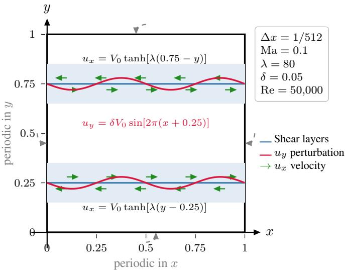  
Figure 10: Computational setup for Kelvin–Helmholtz instability simulation. The domain $[ 0 , 1 ] ^ { 2 }$ contains two counter-rotating shear layers at $y = 0 . 2 5$ and $y = 0 . 7 5$ with hyperbolic tangent velocity profiles (blue regions). A sinusoidal perturbation in the cross-stream velocity $u _ { y }$ (red curves) seeds the instability. Green arrows indicate the streamwise velocity direction in each layer. Periodic boundary conditions are applied in both directions (gray dashed arrows).

Computational setup and initialization. The domain is $( x , y ) \in [ 0 , 1 ] \times [ 0 , 1 ]$ , discretized with $\Delta x = 1 / 5 1 2$ and periodic boundary conditions in both directions. The streamwise velocity is prescribed piecewise to form two shear layers centered at $y = 0 . 2 5$ and $y = 0 . 7 5 \mathrm { { ; } }$

$$
u _ { x } ( x , y ) = \left\{ { \begin{array} { l l } { V _ { 0 } \operatorname { t a n h } \bigl ( \lambda ( y - 0 . 2 5 ) \bigr ) , } & { y < 0 . 5 , } \\ { V _ { 0 } \operatorname { t a n h } \bigl ( \lambda ( 0 . 7 5 - y ) \bigr ) , } & { y \geq 0 . 5 , } \end{array} } \right.\tag{52}
$$

while the cross-stream velocity introduces a small sinusoidal perturbation,

$$
u _ { y } ( x , y ) = \delta V _ { 0 } \sin ( 2 \pi ( x + 0 . 2 5 ) ) ,\tag{53}
$$

which seeds the Kelvin–Helmholtz instability. The parameters are fixed as $\rho _ { 0 } = 1$ (reference density), $V _ { 0 } = \mathrm { M a } c _ { s }$ with $\mathrm { { M a } = 0 . 1 }$ and $c _ { s } = 1 / \sqrt { 3 }$ (reference velocity), $\lambda = 8 0$ (shear-layer sharpness), and $\delta = 0 . 0 5$ (perturbation amplitude). The Reynolds number is set to $\mathrm { R e } = 5 0 { , } 0 0 0$ , and the LB populations are initialized from the standard equilibrium distribution $f ^ { \mathrm { e q } } ( \rho , \mathbf { u } )$

Dataset. The reference trajectory is generated on a $5 1 2 \times 5 1 2$ grid with nondimensional time step

$$
\Delta t _ { \mathrm { r e f } } = \frac { c _ { s } \mathrm { M a } } { n _ { x } } \approx 1 \times 1 0 ^ { - 4 } .\tag{54}
$$

We refer to this high-resolution trajectory as the reference data in the diagnostics below. It is the resolved LB reference used for filtering and comparison, not an exact spectral solution of the continuum equations.

## D.2 Coarse-Graining for Stability Analysis

To study stability under resolution loss, we coarse-grain the reference data to target grids where closure effects dominate. Operating at coarser resolutions $( \mathrm { e . g . , 1 2 8 \times 1 2 8 \ o r 6 4 \times \bar { 6 } 4 } )$ serves three purposes:

1. analyzing stability in the underresolved regime where closure effects dominate,

2. enabling efficient neural-network training with larger batch sizes,

3. reducing temporal redundancy while preserving essential advective dynamics.

The coarse-graining process applies a box filter in both space and time before decimation, so the coarse fields are local space-time averages of the resolved trajectory rather than point samples.

## D.3 Space-Time Box Filter for Coarse-Graining

To generate data at coarser resolutions suitable for stability analysis, we apply a space-time box filter to the reference fields and then decimate. For a field $u _ { i } ( \mathbf { x } , t )$ , the filtered velocity field u¯ at spatial resolution $\Delta { x } ^ { \mathrm { o u t } }$ and temporal spacing $\Delta t ^ { \mathrm { o u t } }$ is obtained using a product filter

$$
\bar { u } _ { i } ( \mathbf { x } , t ) = \int _ { \mathbb { R } } \int _ { \Omega } G _ { x } ( \mathbf { x } - \mathbf { x } ^ { \prime } ; \Delta _ { f } ) G _ { t } ( t - t ^ { \prime } ; \Delta T _ { f } ) u _ { i } ( \mathbf { x } ^ { \prime } , t ^ { \prime } ) d \mathbf { x } ^ { \prime } d t ^ { \prime } .\tag{55}
$$

Here $G _ { x }$ is the spatial box kernel and $G _ { t }$ is the temporal box kernel. The implementation uses the discrete version of this product filter, described below.

## D.3.1 Mathematical Definition

Our implementation employs the discrete box filter (also known as a top-hat filter or uniform filter) as the filtering operation in Eq. (55).

The continuous spatial box filter in d dimensions is defined as:

$$
G ( \mathbf x ; \Delta _ { f } ) = \prod _ { i = 1 } ^ { d } G _ { i } ( x _ { i } ; \Delta _ { f } ) = \prod _ { i = 1 } ^ { d } \left\{ \begin{array} { l l } { \frac 1 { \Delta _ { f } } , } & { | x _ { i } | \leq \Delta _ { f } / 2 , } \\ { 0 , } & { \mathrm { o t h e r w i s e } , } \end{array} \right.\tag{56}
$$

where $\Delta _ { f }$ is the filter width. The temporal box filter has the same top-hat form on an interval of width $\Delta T _ { f } = q \Delta t ^ { \mathrm { i n } }$ . For a scalar field $u ( { \bf x } , t )$ discretized on a uniform grid with spacing $\Delta x ^ { \mathrm { i n } }$ and time step $\Delta t ^ { \mathrm { i n } }$ , the filtered field at coarse resolution $\Delta x ^ { \mathrm { o u t } } = r \Delta x ^ { \mathrm { i n } }$ and $\Delta t ^ { \mathrm { o u t } } = q \Delta t ^ { \mathrm { i n } } \ \mathrm { i s } \mathrm { : }$

$$
\bar { u } ( \mathbf { X } , t _ { n } ) = \frac { 1 } { q r ^ { d } } \sum _ { m = 0 } ^ { q - 1 } \sum _ { \mathbf { x } \in \mathcal { N } ( \mathbf { X } ) } u ( \mathbf { x } , t _ { n q + m } ) .\tag{57}
$$

where $\mathcal { N } ( \mathbf { X } )$ denotes the $\boldsymbol { r } \times \boldsymbol { r } \times \cdots$ neighborhood of fine-grid cells that correspond to coarse-grid cell X. The spatial filter width is $\Delta _ { f } = r \bar { \Delta } x ^ { \mathrm { i n } }$ , which coincides with the coarse grid spacing $\Delta \stackrel { \mathrm { - } } { x } ^ { \mathrm { o u t } }$ The temporal factor q is chosen consistently with the spatial downsampling factor. Thus, the $5 1 2 ^ { 2 }$ 20,000-frame reference gives $2 5 6 ^ { 2 }$ , 1282, and 642 descendants with 10,000, 5,000, and 2,500 frames. The $6 4 ^ { 2 }$ comparison stage used in Appendix E.2 is the $2 5 6 ^ { 2 }$ , 10,000-frame space-time box-filtered reference filtered again with $r = q = 4$

## D.3.2 Implementation via Average Pooling

In our pipeline, the discrete box filter is implemented using average pooling operations. For each spatial axis $i ,$ the kernel size is computed as:

$$
k _ { i } = \left\lceil \frac { s _ { i } ^ { \mathrm { i n } } } { s _ { i } ^ { \mathrm { o u t } } } \right\rceil\tag{58}
$$

where $s _ { i } ^ { \mathrm { i n } }$ and $s _ { i } ^ { \mathrm { o u t } }$ are the input and output resolutions. For each output frame, the code first averages over a contiguous temporal window of length $q$ and then applies the spatial block average. The filtering operation is then:

$$
{ \bf X } _ { \mathrm { f i l t e r e d } } ^ { ( n ) } = \mathrm { A v g P o o l } _ { \bf x } \left( \frac { 1 } { q } \sum _ { m = 0 } ^ { q - 1 } { \bf X } ^ { ( n q + m ) } ; k _ { 1 } , k _ { 2 } , . . . \right)\tag{59}
$$

This operation is performed on GPU for efficiency and is applied independently to each channel (velocity component, vorticity, etc.). One-dimensional time-like arrays such as t and $t _ { \mathrm { i n d e x } }$ are reduced with the same temporal mean.

The coarse-graining pipeline consists of four main stages executed sequentially:

1. Metadata Extraction: Preliminary scan of input HDF5 datasets to classify data types and extract dimensional information.

2. Preprocessing: Dataset consolidation and validation, creating temporary merged datasets suitable for parallel processing.

3. Parallel Processing: Distributed spatio-temporal downsampling across multiple workers using configurable backends (SLURM or multiprocessing).

4. Virtual Dataset Assembly: Efficient merging of processed shards using HDF5 virtual datasets to avoid redundant data copies.

## E Spectral Finetuning

NeurDE shell, the third method in the ablation of Section 5, is an entropically-stabilized NeurDE that has been fine-tuned with an additional spectral objective. We do not use this fine-tuning for our final results, because it can be challenging to apply. Improving the agreement with the reference at high wavenumbers can also bring in high-frequency noise and aliasing, the kind of grid-scale content that destabilizes the underresolved ELBM rollouts in Section 5. A spectral objective must therefore sharpen small-scale features without destroying the large-scale features and the stability that the entropic closure provides. Ongoing research is looking into metrics and loss functions that strike this balance. Still, NeurDE shell is shown to improve upon entropically-stabilized NeurDE for DPSL-50K while maintaining long-time emulation stability. This appendix describes the fine-tuning procedure and reports the ablation against entropically-stabilized NeurDE and ELBM on DPSL-50K for the $6 4 ^ { 2 }$ , 322, and $1 6 ^ { 2 }$ grids.

## E.1 Fine-tuning Procedure

The rollout loss of Eq. (65) compares fields in real space. Such losses are dominated by the large, energetic structures and are insensitive to the high-wavenumber tail of the spectrum, which is where coarse rollouts lose small-scale energy or inject grid-scale artifacts. Fine-tuning adds a term that compares the highest-wavenumber shells of the rollout’s kinetic-energy spectrum to those of the box-filtered reference, so that the closure is also trained to carry the correct amount of energy at the smallest resolved scales.

Starting point. Fine-tuning starts from the trained entropically-stabilized NeurDE checkpoint of the same grid (Appendix F). The architecture, the lattice Boltzmann state variables, and the rollout integrator are unchanged; only the training objective changes.

Spectral-shell loss. At each saved rollout state, we Fourier transform the velocity field and bin the kinetic energy into integer shells,

$$
E _ { n } ( t ) = \sum _ { \mathrm { r o u n d } ( | \mathbf { m } | ) = n } \frac { 1 } { 2 V ^ { 2 } } \left| \widehat { u } _ { i } ( \mathbf { m } , t ) \right| ^ { 2 } ,\tag{60}
$$

where V is the number of grid points, following the convention of Appendix G.1. The spectral-shell loss penalizes the mismatch between the rollout and the box-filtered reference on the top quarter of the shells,

$$
\mathcal { L } _ { \mathrm { s p e c } } ( t ) = \frac { 1 } { \left| \mathcal { H } \right| } \sum _ { n \in \mathcal { H } } \left( \ln E _ { n } ( t ) - \ln E _ { n } ^ { \mathrm { r e f } } ( t ) \right) ^ { 2 } , \qquad \mathcal { H } = \{ n : 0 . 7 5 n _ { \mathrm { m a x } } \leq n \leq n _ { \mathrm { m a x } } \} ,\tag{61}
$$

where $n _ { \mathrm { m a x } } = N / 2$ is the Nyquist shell of the $N \times N$ grid, so the loss acts on the shells $3 N / 8 \le n \le$ $N / 2$ . This lower bound is higher than the $N / 4$ cutoff of the high-k energy diagnostic (Appendix G.7), so the loss acts on a narrower band than the diagnostic measures. Because the shell sums discard the Fourier phases, this term only constrains how much energy each high-wavenumber shell carries; the real-space terms of Eq. (65) keep the fields aligned with the reference. The fine-tuning objective is

$$
\mathcal { L } _ { \mathrm { { f t } } } ( \theta ) = \mathcal { L } _ { \mathrm { { r o l l o u t } } } ( \theta ) + c _ { \mathrm { { s p e c } } } \sum _ { t = 1 } ^ { T } \mathcal { L } _ { \mathrm { { s p e c } } } ( t ) .\tag{62}
$$

We say “spectral-shell” rather than “spectral norm” because the penalty acts on shell-averaged flow spectra, not on the operator norm of a network layer.

Table 5: Final metrics of the fine-tuning ablation. Metrics at the final saved horizon of the $6 4 ^ { 2 }$ $( t _ { \mathrm { i n d e x } } = 2 5 0 0 ) , 3 2 ^ { 2 } ( t _ { \mathrm { i n d e x } } = 1 2 4 9 )$ , and $1 6 ^ { 2 } \ ( t _ { \mathrm { i n d e x } } = 6 2 4 )$ rollouts, against the box-filtered reference. The first three columns measure field fidelity; the last two diagnose spectral behavior. Bold marks the best value within each grid block. For High-k/ref., best means closest to one, not smallest.
<table><tr><td colspan="2"></td><td colspan="3">Field fidelity</td><td colspan="2">Spectrum diagnostics</td></tr><tr><td></td><td>Grid Method</td><td>Vel. err ↓</td><td>ω corr. ↑</td><td>ω err ↓</td><td>Spec. RMSE ↓</td><td>High-k/ref. → 1</td></tr><tr><td rowspan="3"> $6 4 ^ { 2 }$ </td><td>NeurDE</td><td>0.0806</td><td>0.9387</td><td>2.383</td><td>3.794</td><td>0.0077</td></tr><tr><td>NeurDE shell</td><td>0.0462</td><td>0.9614</td><td>0.275</td><td>0.540</td><td>0.422</td></tr><tr><td>ELBM</td><td>0.0544</td><td>0.9374</td><td>0.355</td><td>0.302</td><td>1.415</td></tr><tr><td rowspan="3"> $3 2 ^ { 2 }$ </td><td>NeurDE</td><td>0.0686</td><td>0.9551</td><td>0.2977</td><td>0.2593</td><td>0.6226</td></tr><tr><td>NeurDE shell</td><td>0.0676</td><td>0.9534</td><td>0.3021</td><td>0.2613</td><td>0.7478</td></tr><tr><td>ELBM</td><td>0.0694</td><td>0.9456</td><td>0.3268</td><td>0.3915</td><td>1.1259</td></tr><tr><td rowspan="3"> $1 6 ^ { 2 }$ </td><td>NeurDE</td><td>0.205</td><td>0.910</td><td>0.425</td><td>0.631</td><td>0.301</td></tr><tr><td>NeurDE shell</td><td>0.207</td><td>0.909</td><td>0.422</td><td>0.583</td><td>0.365</td></tr><tr><td>ELBM</td><td>0.221</td><td>0.897</td><td>0.442</td><td>0.519</td><td>0.718</td></tr></table>

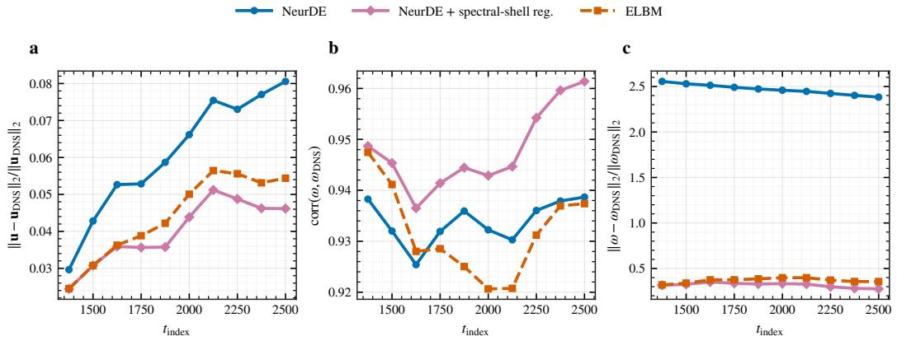  
Figure 11: Core field-level fidelity for $6 4 ^ { 2 }$ forecasts. Entropically-stabilized NeurDE, NeurDE shell, and ELBM are compared against the box-filtered high-resolution reference. (a) Relative velocity error, (b) vorticity correlation, and (c) relative vorticity error over rollout time. Fine-tuning substantially reduces the velocity and vorticity errors of the base model and increases vorticity correlation over the later rollout.

Training. Fine-tuning uses the same rollout training, horizon curriculum, and IPTA gradient subset as the base model, with Eq. (62) in place of Eq. (65) in Algorithm 2. The regularizer is used only during training. At test time there is no spectral filter, projection, or correction; NeurDE shell is advanced with the same local update as entropically-stabilized NeurDE.

Metrics. The field-fidelity and spectrum metrics reported below are those of Appendix G.7: the relative velocity error, the pointwise vorticity correlation, the relative vorticity error, the active-shell log-spectrum RMSE, and the ratio of high-k energy fractions. All metrics are evaluated at the same saved rollout time as the corresponding filtered reference. In generated figure labels and axes, $\mathbf { \ddot { \Gamma } } _ { \mathrm { D N S } } , \mathbf { \vec { \Gamma } } _ { \mathrm { ~ } }$ denotes the box-filtered high-resolution reference rather than an exact spectral solution of the continuum equations. Table 5 collects the final metrics on all three grids.

## E.2 Ablation on the $6 4 \times 6 4$ Rollout

This ablation isolates the effect of fine-tuning at $6 4 ^ { 2 }$ . We compare entropically-stabilized NeurDE, NeurDE shell, and under-resolved ELBM against the box-filtered high-resolution reference. The reference target is the $2 5 6 ^ { 2 }$ , 10,000-frame stage after space-time box filtering to the $6 4 ^ { 2 }$ , 2,500-frame comparison grid.

Field comparison at $6 4 ^ { 2 }$ , horizon 1250, $t _ { i n d e x } = 2 5 0 0$  
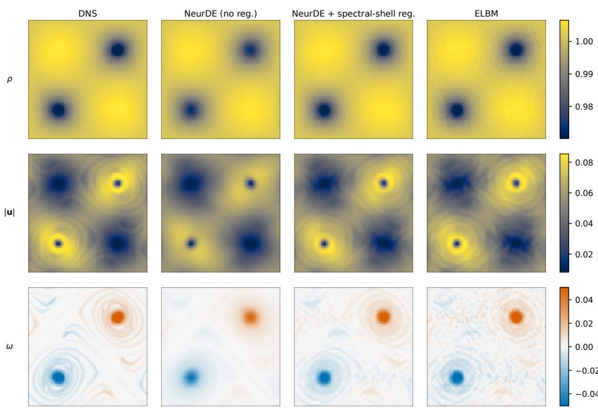  
Figure 12: Field snapshots for the $6 4 ^ { 2 }$ rollout at $t _ { \mathrm { i n d e x } } = 2 5 0 0$ . Columns compare the box-filtered reference, entropically-stabilized NeurDE, NeurDE shell, and ELBM; rows show density $\rho ,$ speed |u|, and vorticity ω. The base entropically-stabilized NeurDE forecast is visibly over-smoothed in vorticity, while fine-tuning restores sharper vortex structure and better phase alignment with the reference. ELBM preserves the main vortices but shows excess small-scale texture in the fields.

Figure 11 shows the three field-fidelity metrics over the rollout. Fine-tuning gives the best field-level agreement in this comparison (Table 5), whereas ELBM gives the lowest final spectrum log-RMSE while carrying excess high-wavenumber energy relative to the reference. The pointwise vorticity correlation measures phase and coherent-structure fidelity rather than only global statistics. After the early transient, NeurDE shell remains better aligned with the box-filtered reference, while the base model and ELBM decorrelate.

The field snapshots in Fig. 12 explain the correlation improvement visually. NeurDE shell better preserves the signed vortex cores and surrounding filaments at the final saved horizon, whereas the base model over-smooths the vorticity field.

Figure 13 shows the shell-averaged energy spectrum of Appendix G.1 together with the analogous enstrophy spectrum,

$$
Z _ { n } = \sum _ { \mathrm { \tiny ~ r o u n d } ( | { \bf m } | ) = n } \frac { 1 } { 2 V ^ { 2 } } \left| \widehat { \omega } ( { \bf m } ) \right| ^ { 2 } .\tag{63}
$$

At $t _ { \mathrm { i n d e x } } = 2 5 0 0$ , the energy-spectrum log-RMSE is 3.79 for the base model, 0.540 for NeurDE shell, and 0.302 for ELBM. Fine-tuning therefore greatly reduces the spectral collapse of the base model, while ELBM remains closest to the reference by this final spectral RMSE.

Two-point correlations measure spatial structure. With $\mathbf { u } ^ { \prime } = \mathbf { u } - \left. { \mathbf { u } } \right.$ and $\omega ^ { \prime } = \omega - \langle \omega \rangle$ , we use

$$
C _ { u u } ( r ) = \frac { \langle { \bf u ^ { \prime } ( x ) \cdot u ^ { \prime } ( x + r ) } \rangle } { \langle | { \bf u ^ { \prime } ( x ) } | ^ { 2 } \rangle } , \qquad C _ { \omega \omega } ( r ) = \frac { \langle \boldsymbol { \omega } ^ { \prime } ( { \bf x } ) \boldsymbol { \omega } ^ { \prime } ( { \bf x } + { \bf r } ) \rangle } { \langle | \boldsymbol { \omega } ^ { \prime } ( { \bf x } ) | ^ { 2 } \rangle } .\tag{64}
$$

The remaining panels (Figs. 15–18) give the time-resolved fidelity metrics, flow statistics, artifact diagnostics, and two-point error evolution for the same rollouts.

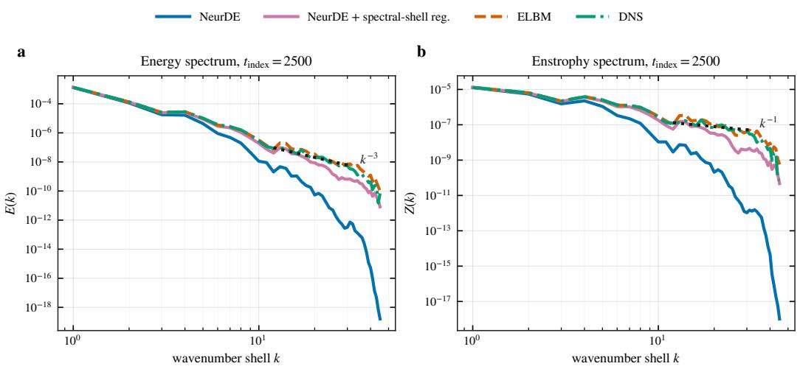  
Figure 13: Energy and enstrophy spectra at $t _ { \mathrm { i n d e x } } = 2 5 0 0 .$ . The base entropically-stabilized NeurDE forecast loses high-wavenumber energy and enstrophy, while NeurDE shell restores much of the missing spectral content. ELBM remains strongest on the final energy-spectrum log-RMSE, so the improvement should be read as improved field-level fidelity and reduced spectral collapse rather than better spectral accuracy on every metric.

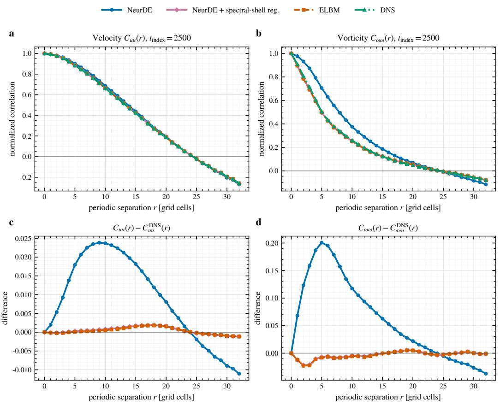  
Figure 14: Two-point correlations at $t _ { \mathrm { i n d e x } } = 2 5 0 0 .$ Velocity correlations are similar across methods, but vorticity correlations expose the main failure of the base model: it preserves overly smooth long-range structure and does not reproduce the reference-like small-scale decorrelation. NeurDE shell and ELBM track the reference vorticity correlation much more closely.

f  
a  
b  
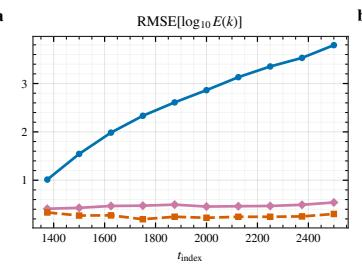

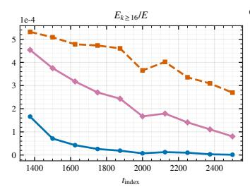

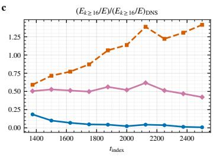

d  
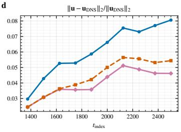

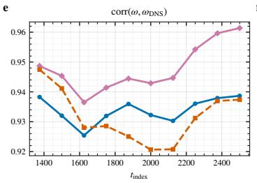

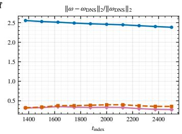  
Figure 15: Supplementary fidelity metrics for the $6 4 ^ { 2 }$ fine-tuning ablation. This figure reports the full collection of time-resolved fidelity metrics used to compare entropically-stabilized NeurDE, NeurDE shell, and ELBM against the filtered reference.

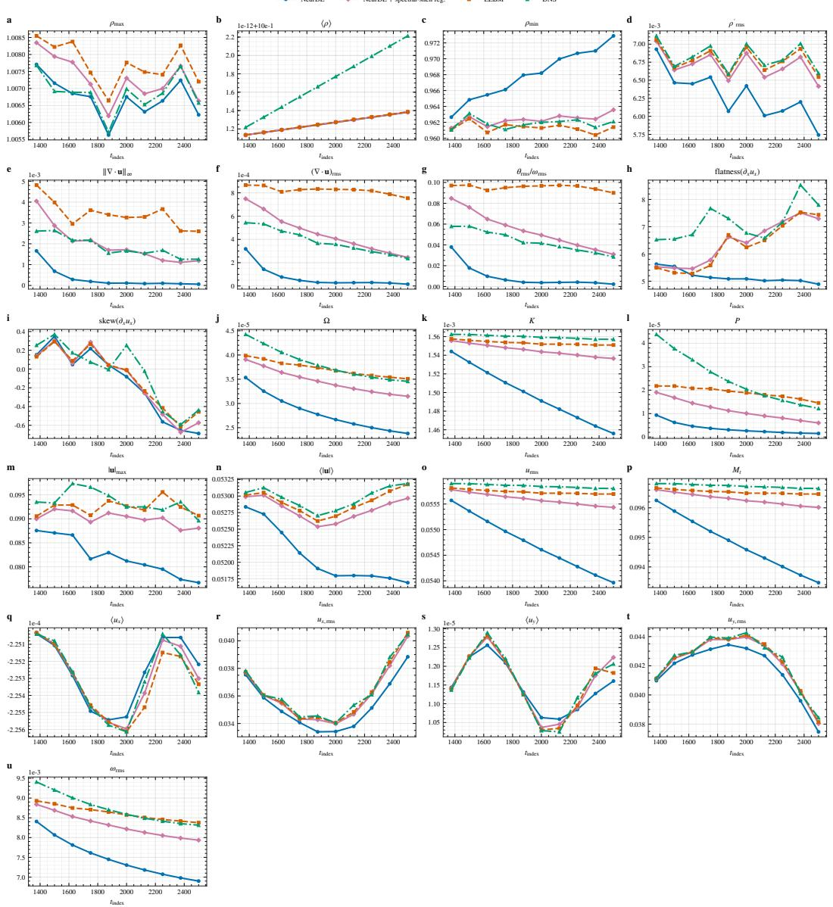  
Figure 16: Supplementary flow statistics for the $6 4 ^ { 2 }$ fine-tuning ablation. The statistics summarize density, kinetic, vorticity, divergence, and derivative-shape diagnostics for the reference and each rollout.

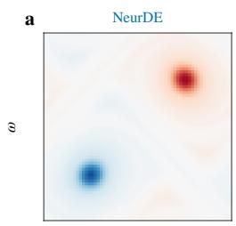

b  
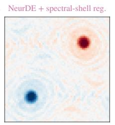  
c

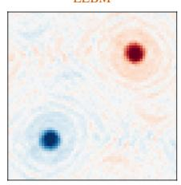  
d

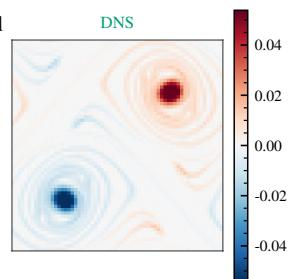

e  
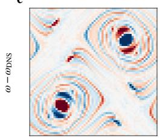

f  
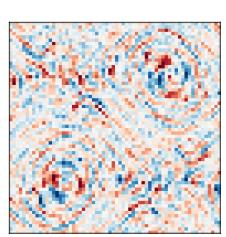

g  
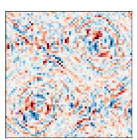  
h

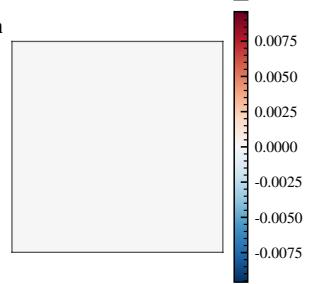

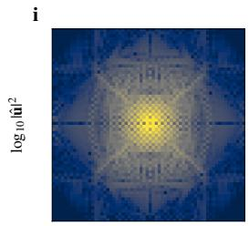

j  
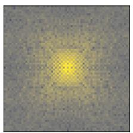  
k

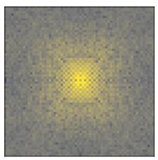  
l

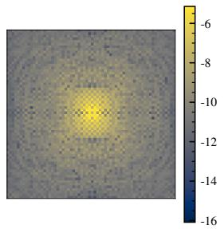  
Figure 17: Supplementary artifact diagnostics for the $6 4 ^ { 2 }$ fine-tuning ablation. Fourier-space and artifact-oriented diagnostics expose how the base forecast loses high-wavenumber content and how fine-tuning recovers a larger fraction of the resolved reference spectral structure.

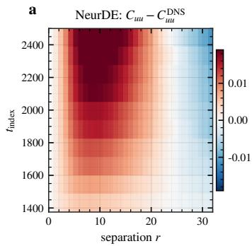

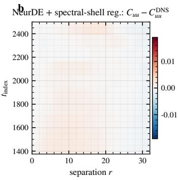

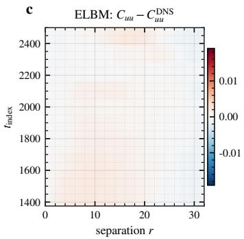

d  
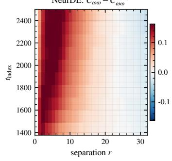

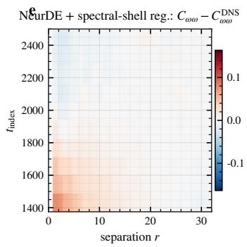  
f

$$
C _ { \omega \omega } - C _ { \omega \omega } ^ { \mathrm { D N S } }
$$

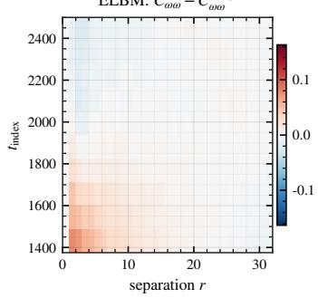  
Figure 18: Supplementary two-point error evolution for the $6 4 ^ { 2 }$ fine-tuning ablation. The curves track correlation-error evolution over rollout time and separate velocity-correlation errors from the more discriminating vorticity-correlation errors.

## E.3 Ablation on the $3 2 \times 3 2$ and $1 6 \times 1 6$ Rollouts

On the coarser grids, fine-tuning has a much smaller effect than at $6 4 ^ { 2 }$ (Table 5). The base model does not show the spectral collapse seen at $6 4 ^ { 2 }$ : its spectrum log-RMSE is 0.259 at $3 2 ^ { 2 }$ and 0.631 at $1 6 ^ { 2 }$ , compared with 3.794 at $6 4 ^ { 2 }$ . The spectral-shell loss therefore has less missing high-wavenumber energy to restore. Fine-tuning raises the high-k energy fraction from 0.623 to 0.748 of the reference value at $3 2 ^ { 2 }$ and from 0.301 to 0.365 at $1 6 ^ { \frac { \cdot } { 2 } }$ , and it lowers the spectrum log-RMSE at $1 6 ^ { 2 }$ from 0.631 to 0.583. The field metrics of the two NeurDE variants differ by at most 1.5% on both grids, and neither variant is better on all of them. Both learned closures have lower velocity error, lower vorticity error, and higher vorticity correlation than ELBM on both grids. ELBM has the lowest spectrum log-RMSE at $1 6 ^ { 2 }$ and carries excess high-k energy at $3 2 ^ { 2 } { \mathrm { ; } }$ ; at $1 6 ^ { 2 }$ all three methods stay below the reference high-k energy.

## E.4 Summary

Across the three grids, fine-tuning changes the field metrics little except at $6 4 ^ { 2 }$ , where the base model collapses spectrally and fine-tuning removes the collapse: the vorticity error drops from 2.383 to 0.275 and the high-k energy fraction rises from 0.0077 to 0.422 of the reference value. $\mathrm { { A t 3 2 ^ { 2 } } }$ and $1 6 ^ { 2 }$ , the base model does not collapse spectrally, and fine-tuning mainly raises the high-k energy fraction while every field metric stays within 1.5% of the base model (Appendix E.3). ELBM keeps the lowest final log-spectrum RMSE at $6 4 ^ { 2 }$ and $1 6 ^ { 2 }$ while carrying excess high-k energy at $6 4 ^ { 2 }$ and $3 2 ^ { 2 }$ . Fine-tuning therefore helps where entropically-stabilized NeurDE over-smooths, and otherwise leaves its field fidelity essentially unchanged, which is the behavior reported in Section 5.

## F NeurDE Training Procedure

The surrogate’s effectiveness depends on the training protocol as well as the architecture. Because the entropic parameter α directly controls long-time stability in underresolved LB simulations, we train it in the same setting in which it will be used: embedded in the rollout. The protocol combines three elements: rollout-based training, curriculum learning, and the Incremental Progress Training Algorithm (IPTA) Bansal et al. [2022].

## F.1 Stability Model Pretraining

Training the α stability model begins with a typical supervised training routine from predicted ELBM-generated α. As the ELBM grids become finer, α → 2. Therefore, we train against the α values from the coarsest grid where ELBM can reproduce the expected dynamics. We train the stability model by comparing its output directly to the ELBM α through an MSE loss.

## F.2 Rollout-Based Training

Rather than optimizing only one-step predictions, the surrogate is embedded directly into the ELBM update and trained through multi-step rollouts. This recursive formulation exposes the model to compounding errors and encourages updates that remain stable over trajectories. The rollout loss balances three objectives:

$$
\mathcal { L } _ { \mathrm { r o l l o u t } } ( \theta ) = \sum _ { t = 1 } ^ { T } c _ { \mathrm { r o o t } } \mathcal { L } _ { \mathrm { r o o t } } ( t ) + c _ { \omega } \mathcal { L } _ { \omega } ( t ) + c _ { \mathrm { H } } \mathcal { R } _ { \mathrm { H } } ( t ) ,\tag{65}
$$

where $T$ is the rollout horizon. In practice, T is limited by GPU memory, and the loss is a weighted combination of approximate recovery of the entropic root, preservation of vortical structures, and compliance with the discrete H-theorem.

## F.3 Curriculum Learning

Applying rollout training with a fixed, long horizon from the start is unstable and memory intensive. We therefore use a curriculum over the rollout horizon T Bengio et al. [2009], Bansal et al. [2022]. The model is first trained on short trajectories and is then exposed to longer horizons as training

progresses. The effective horizon at epoch e is determined by a monotonically increasing schedule g(e):

$$
T _ { \mathrm { c u r r } } ( e ) = \operatorname* { m i n } \big ( T _ { \mathrm { m a x } } , \lfloor g ( e ) \rfloor \big ) ,\tag{66}
$$

where $T _ { \mathrm { m a x } }$ is the maximum horizon feasible within hardware memory constraints.2 This schedule lets the model learn stable short-term updates before it is required to maintain dynamical consistency over longer intervals.

## F.4 Incremental Progress Training Algorithm (IPTA)

Curriculum learning controls the forward rollout length, but gradient computation remains the limiting factor. On short horizons, consecutive states are often nearly identical, giving weak gradients. Backpropagating through the full long-horizon trajectory is typically infeasible due to memory limitations. Truncated Backpropagation Through Time (TBPTT) reduces memory by backpropagating through a fixed recent window of timesteps Williams and Peng [1990], but this introduces a recency bias and ignores longer-range dependencies that matter for physical consistency Pascanu et al. [2013].

We use IPTA Bansal et al. [2022] to decouple the rollout horizon from the backpropagation path. Instead of using a contiguous block of steps, IPTA computes the gradient over a sparse subset $S _ { k } ( e ) \subseteq \{ 1 , \dots , T _ { \mathrm { c u r r } } ( e ) \}$

$$
\nabla _ { \theta } \mathcal { L } _ { \mathrm { I P T A } } ( e ) = \sum _ { t \in S _ { k } ( e ) } \nabla _ { \theta } \ell ^ { ( t ) } .\tag{67}
$$

This selective summation makes the memory cost proportional to the subset size $| S _ { k } ( e ) |$ , not the full horizon $T _ { \mathrm { c u r r } } ( e )$ . This is what allows the curriculum to use effective horizons longer than those feasible with standard backpropagation.

We use two strategies to construct $\boldsymbol { S } _ { \boldsymbol { k } } ( \boldsymbol { e } )$ . The first is a deterministic schedule that selects timesteps sparsely near the beginning of a trajectory and more densely toward the end, where rollout errors have had more time to compound. The second is a stochastic schedule that samples timesteps from a distribution biased toward distant states. The deterministic version gives a lower-variance learning signal; the stochastic version gives a more exploratory estimate of long-range temporal effects.

## F.4.1 Training Algorithm

The practical implementation is summarized in Algorithm 2. The surrogate is unrolled for a curriculum-selected horizon, and the model parameters are updated using gradients from a sparse subset of timesteps whose size is constrained by the available hardware memory.

Together, rollout training, the horizon curriculum, and IPTA address the main practical tension in this problem: the closure must be trained on long trajectories, but full backpropagation through those trajectories is too expensive. Rollout training exposes the model to compounding error, the loss keeps the update tied to physical consistency, and IPTA makes longer effective horizons feasible under memory constraints.

## F.5 Hyperparameters

Optimization. Both stages use AdamW with learning rate $5 \times 1 0 ^ { - 4 }$ and weight decay $1 0 ^ { - 4 }$ . The learning rate is warmed up linearly over the first 1000 steps and then held constant. Gradients are clipped to norm 1, and steps whose gradient norm is an outlier (z-score above 2.5 relative to a running average) are scaled down further. The global batch size is 16 for pretraining and 32 for rollout training, split evenly over the eight GCDs. Pretraining runs in float32 with a bfloat16 encoder; rollout training runs in float64. The validation loss is computed every 250 steps, and the checkpoint with the lowest value is kept. Every configuration is trained with four seeds.

Data. Pretraining targets are the ELBM α fields at $1 2 8 ^ { 2 }$ (TGV-50K), $2 5 6 ^ { 2 }$ (DPSL-50K), and $3 8 4 ^ { 2 }$ (DPSL-100K). Rollout training uses the $5 1 2 ^ { 2 }$ ELBM simulation, coarse-grained to $N ^ { 2 }$ . Each simulation is split along time into training, validation, and test blocks in proportions 0.6/0.1/0.3 for pretraining and 0.5/0.2/0.3 for rollout training. Rollout training on each grid starts from the model of the previous, finer grid; the finest grid starts from the pretrained model.

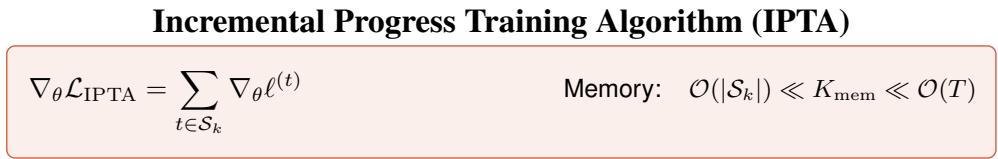

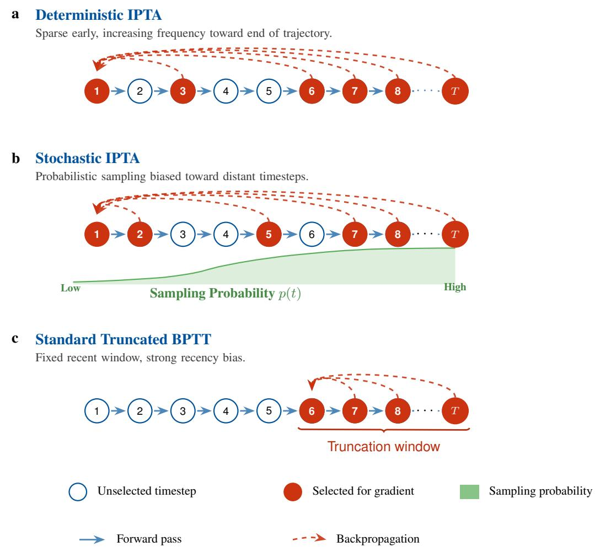  
Figure 19: Gradient accumulation in the Incremental Progress Training Algorithm (IPTA). By computing gradients over a sparse subset of timesteps, either deterministically (denser near the end) or stochastically (biased toward distant steps), IPTA removes the recency bias of truncated backpropagation and enables memory-efficient long-horizon training.

Losses. Pretraining minimizes a mean squared error on $\alpha - 2 .$ , weighted by $1 + 1 0 ^ { 5 } | \alpha - 2 |$ , plus a Jacobian penalty on the DEQ with weight 0.1. The rollout loss of Eq. (65) uses $c _ { \mathrm { r o o t } } = 1 0 ^ { 4 } , c _ { \omega } = 1 0 .$ and $c _ { \mathrm { H } } = 1 0 $ , where $\mathcal { L } _ { \omega }$ is a Huber loss $( \delta = 1 0 ^ { - 4 } )$ on ρ, u, and ω with relative weights 1, 1, and 5.

Curriculum and IPTA. The horizon $T _ { \mathrm { c u r r } }$ steps through 1, 2, 3, 5, 7, 10, 17, 25, 37, 50, 75, 100, 250, 500, 1000, and 1500, with 2, 1, 1, 5, 1, 5, 1, 5, 1, 7, 1, 10, 10, 10, 10, and 10 epochs respectively (80 in total). Training moves to the next horizon early after 3 epochs without validation improvement, and unused epochs carry over, which allows the final horizon $\dot { T } _ { \mathrm { m a x } } = 2 0 0 0$ to be reached. Horizons are capped at 75% of the training split. We use the deterministic IPTA schedule with $K _ { \mathrm { m e m } } = 1 6$ log-spaced timesteps that become denser toward T.

Algorithm 2 Training the DEQ Surrogate for α   
1: Input: DEQ parameters θ, rollout data $\{ f ^ { ( t ) } \} _ { t = 1 } ^ { T } ,$ curriculum schedule $\{ T _ { \mathrm { c u r r } } ( e ) \}$ , IPTA subset   
strategy, max subset size $K _ { \mathrm { m e m } }$ (hardware-dependent memory budget), vorticity reference $\omega _ { \mathrm { r e f } }$   
weights $c _ { \mathrm { r o o t } } , c _ { \omega } , c _ { \mathrm { H } }$   
2: Output: Trained DEQ parameters θ   
3: for each epoch e do   
4: Set rollout horizon $T \gets T _ { \mathrm { c u r r } } ( e )$   
5: for each rollout trajectory do   
6: for each timestep $t = \mathsf { \bar { 1 } } , \ldots , T$ do   
7: Compute z $ \mathcal { E } ( f ^ { ( t ) } , f ^ { \mathrm { e q } } , \rho , { \bf u } )$   
8: Predict entropic parameter $\alpha _ { \theta } ^ { ( t ) } = \mathrm { D E Q } ( \alpha _ { \theta } ^ { ( t - 1 ) } , \mathbf { z } )$   
9: Apply ELBM update with $\alpha _ { \theta } ^ { ( t ) }$ to obtain $\pmb { f } ^ { ( t + 1 ) }$   
10: Evaluate entropy regularizer $\mathcal { R } _ { \mathrm { H } } ( t )$ and vorticity loss $\mathcal { L } _ { \omega } ( t )$   
11: Form one-step weighted loss $\ell ^ { ( t ) }$   
12: end for   
13: Select subset $\begin{array} { r } { S _ { k } ( e ) \subseteq \{ 1 , \dots , T \} \mathrm { s . t . } | S _ { k } ( e ) | \leq K _ { \mathrm { m e m } } } \end{array}$ using the chosen IPTA strategy   
14: Accumulate gradients $\begin{array} { r } { \nabla _ { \theta } \mathcal { L } _ { \mathrm { I P T A } } ( e ) = \sum _ { t \in S _ { k } ( e ) } \nabla _ { \theta } \ell ^ { ( t ) } } \end{array}$   
15: Update θ using optimizer   
16: Save $\alpha _ { \theta } ^ { ( t ) }$   
17: end for   
18: end for

Training length. Pretraining was configured for 10,000 epochs and rollout training for 80, but both were also limited by job wall time. Table 6 gives the epochs completed.

Table 6: Epochs completed, mean over four seeds. Rollout training on a grid is complete at 80 epochs; lower values were stopped by the wall-time limit. Epochs shrink as the horizon grows, so counts are not comparable across stages.
<table><tr><td></td><td>Stability</td><td> $3 8 4 ^ { 2 }$ </td><td> $2 5 6 ^ { 2 }$ </td><td> $1 2 8 ^ { 2 }$ </td><td> $6 4 ^ { 2 }$ </td><td> $3 2 ^ { 2 }$ </td><td> $1 6 ^ { 2 }$ </td></tr><tr><td>TGV-50K</td><td>374.3</td><td>一</td><td></td><td>51.3</td><td>80.0</td><td>80</td><td>80</td></tr><tr><td>DPSL-50K</td><td>32.5</td><td></td><td>14.5</td><td>39.5</td><td>56.1</td><td>80</td><td>80</td></tr><tr><td>DPSL-100K</td><td>16.2</td><td>8.6</td><td>16.5</td><td>44.8</td><td>68.7</td><td>80</td><td>80</td></tr></table>

## F.6 Compute Costs

All models were trained on the OLCF Frontier supercomputer. A Frontier node contains four AMD Instinct MI250X accelerators. Each MI250X consists of two graphics compute dies (GCDs), and each GCD has 64 GB of high-bandwidth memory and is exposed to software as a separate GPU, so a node provides eight $\mathrm { G P U s } . ^ { 3 }$ Every training run in Table 7 used one full node, that is, all eight GCDs. Training was data-parallel: each GCD held a complete copy of the model, the training samples were split evenly across the eight GCDs, and gradients were averaged across GCDs at every step with PyTorch DistributedDataParallel. The spatial domain was not partitioned, so each GCD processed whole grids. Each of the four random seeds was trained as an independent job with this same configuration.

Table 7 reports the cost of each training stage, averaged over the four seeds. The Stage column lists the stability model, which is trained first, and then the solver at each training resolution $N ^ { 2 }$ which is the reference simulation coarse-grained to an $N \times N$ grid. Solver stages are trained from the finest grid to the coarsest, and each stage is initialized from a checkpoint of the previous, finer stage. Each row therefore gives the additional cost of that stage. The cost of obtaining a model at a given resolution includes all finer stages above it. Wall time is the elapsed time of the stage in hours, minutes, and seconds, summed over all jobs used to complete it, because long stages were split into several consecutive jobs that each resumed from the last checkpoint. Node-h is the wall time in hours multiplied by the one node used. GCD-h is the node-hours multiplied by the eight GCDs per node. To count physical MI250X accelerators instead, divide this column by two. Steps is the number of training iterations completed, taken from the last saved checkpoint. For stages that were stopped by the job time limit, this is a lower bound. The Total rows sum all stages for one seed, so the full cost of all four seeds is four times the total.

Table 7: Training budget of the base models, averaged over four seeds. All stages ran on one Frontier node (8 MI250X GCDs) with data-parallel training.
<table><tr><td>Case</td><td>Stage</td><td>Wall time</td><td>Node-h</td><td>GCD-h</td><td>Steps</td></tr><tr><td rowspan="5">TGV-50K</td><td>Stability  $\mathrm { S o l v e r 1 2 8 ^ { 2 } }$ </td><td>1:57:19 6:00:34</td><td>1.96 6.01</td><td>15.64 48.08</td><td>69,611 3,657</td></tr><tr><td> $\mathrm { S o l v e r 6 4 ^ { 2 } }$ </td><td>1:50:48</td><td>1.85</td><td>14.78</td><td>1,736</td></tr><tr><td> $\mathrm { S o l v e r 3 2 ^ { 2 } }$ </td><td>0:39:30</td><td>0.66</td><td>5.27</td><td>787</td></tr><tr><td> $\mathrm { S o l v e r 1 6 ^ { 2 } }$ </td><td>0:11:14</td><td>0.19</td><td>1.50</td><td>373</td></tr><tr><td>Total</td><td>10:39:27</td><td>10.66</td><td>85.26</td><td></td></tr><tr><td rowspan="8">DPSL-50K</td><td>Stability</td><td>1:28:29</td><td>1.47</td><td>11.80 48.10</td><td>12,123</td></tr><tr><td> $\mathrm { S o l v e r 2 5 6 ^ { 2 } }$ </td><td>6:00:45</td><td>6.01</td><td></td><td>2,453</td></tr><tr><td> $\mathrm { S o l v e r 1 2 8 ^ { 2 } }$ </td><td>6:00:48</td><td>6.01</td><td>48.11</td><td>2,948</td></tr><tr><td> $\mathrm { S o l v e r 6 4 ^ { 2 } }$ </td><td>5:48:24</td><td>5.81</td><td>46.45</td><td>1,539</td></tr><tr><td> $\mathrm { S o l v e r 3 2 ^ { 2 } }$ </td><td>0:44:44</td><td>0.75</td><td>5.97</td><td>775</td></tr><tr><td> $\mathrm { S o l v e r 1 6 ^ { 2 } }$ </td><td>0:12:43</td><td>0.21</td><td>1.70</td><td>373</td></tr><tr><td>Total</td><td>20:15:55</td><td>20.27</td><td>162.12</td><td></td></tr><tr><td rowspan="8">DPSL-100K</td><td>Stability</td><td>1:59:10</td><td>1.99</td><td>15.89</td><td>9,113</td></tr><tr><td>Solver  $\mathrm { \dot { 3 } 8 4 ^ { 2 } }$ </td><td>3:24:32</td><td>3.41</td><td>27.27</td><td>2,125</td></tr><tr><td>Solver  $2 5 6 ^ { 2 }$ </td><td>4:00:21</td><td>4.01</td><td>32.05</td><td>2,625</td></tr><tr><td>Solver  $1 2 8 ^ { 2 }$ </td><td>6:00:27</td><td>6.01</td><td>48.06</td><td>3,259</td></tr><tr><td> $\mathrm { S o l v e r 6 4 ^ { 2 } }$ </td><td>2:22:38</td><td>2.38</td><td>19.02</td><td>1,597</td></tr><tr><td>Solver  $3 2 ^ { 2 }$ </td><td>0:34:03</td><td>0.57</td><td>4.54</td><td>775</td></tr><tr><td> $\mathrm { S o l v e r 1 6 ^ { 2 } }$ </td><td>0:11:57</td><td>0.20</td><td>1.59</td><td>373</td></tr><tr><td>Total</td><td>18:33:11</td><td></td><td>18.55</td><td>148.42</td><td></td></tr></table>

## G Periodic Flow Diagnostics

This appendix records the periodic-flow diagnostics that we use for offline post-processing and will use for future turbulence analyses. These diagnostics are independent of a particular solver implementation. They assume periodic fields, constant-density low-Mach hydrodynamic conventions, and Fourier derivatives on a uniform grid unless stated otherwise. The goal is to make the normalizations explicit, so that spectra, vorticity diagnostics, and time-series balance checks can be compared across saved rollouts without ambiguity.

Throughout this appendix, ⟨·⟩ denotes a spatial average over the periodic grid. Repeated velocitycomponent indices are summed. The definitions below are hydrodynamic: if a simulation is compressible or variable-density, then density-weighted kinetic energy and compressible energy budgets require additional terms that are not part of these diagnostics.

## G.1 Fourier and Energy-Spectrum Conventions

Let $\mathbf { u } = ( u _ { 1 } , \ldots , u _ { D } )$ denote a velocity field on a periodic grid with $\begin{array} { r } { V = \prod _ { j = 1 } ^ { D } N _ { j } } \end{array}$ grid points. We use the unnormalized discrete Fourier transform convention

$$
\widehat { u } _ { i } ( \mathbf { m } ) = \sum _ { \mathbf { x } } u _ { i } ( \mathbf { x } ) \exp \left( - 2 \pi \mathrm { i } \sum _ { j = 1 } ^ { D } \frac { m _ { j } x _ { j } } { N _ { j } } \right) ,\tag{68}
$$

where m is the vector of integer FFT modes. With this convention, the zero mode is the spatial mean and nonzero modes describe fluctuations around the mean flow. The kinetic energy per unit mass is defined by

$$
K = \frac { 1 } { 2 } \left. u _ { i } u _ { i } \right. ,\tag{69}
$$

where $\langle \cdot \rangle$ denotes the spatial average and repeated velocity indices are summed. Parseval’s identity then gives

$$
K = \sum _ { \mathbf { m } } \frac { 1 } { 2 V ^ { 2 } } \left| \widehat { u } _ { i } ( \mathbf { m } ) \right| ^ { 2 } .\tag{70}
$$

The integer-shell energy is obtained by binning Fourier modes according to $n = \mathrm { r o u n d } ( | { \bf m } | )$

$$
E _ { n } = \sum _ { \mathrm { { r o u n d } } ( | { \bf m } | ) = n } \frac { 1 } { 2 V ^ { 2 } } \left| \widehat { u } _ { i } ( { \bf m } ) \right| ^ { 2 } .\tag{71}
$$

When the zero shell is included, $\textstyle \sum _ { n } E _ { n } = K$ up to roundoff. If the zero shell is omitted, the sum gives the turbulent kinetic energy after removing mean-flow kinetic energy. This distinction is useful for comparing initialized zero-mean periodic turbulence with rollouts that may develop a small numerical mean.

On an isotropic periodic domain of side length $L ,$ the physical shell wavenumber and shell spacing are

$$
\kappa _ { n } = \frac { 2 \pi n } { L } , \qquad \Delta \kappa = \frac { 2 \pi } { L } .\tag{72}
$$

The continuum energy spectrum is approximated by

$$
E { \left( \kappa _ { n } \right) } \approx \frac { E _ { n } } { \Delta \kappa } , \qquad K \approx \sum _ { n } E { \left( \kappa _ { n } \right) } \Delta \kappa .\tag{73}
$$

The continuum conversion above assumes a common side length in all coordinate directions. For anisotropic boxes one can still use spectral derivatives with direction-dependent wavenumbers, but shell-averaged spectra should be interpreted with care because spherical shells in integer-mode space no longer correspond to isotropic shells in physical wavenumber space. These are the standard homogeneous-turbulence spectrum conventions used in Pope, Frisch, and Davidson Pope [2000], Frisch [1995], Davidson [2015].

## G.2 Spectral Derivatives, Vorticity, and Dissipation

For a periodic scalar field f, spectral differentiation is computed as

$$
\partial _ { j } f = \mathscr { F } ^ { - 1 } \left[ \mathrm { i } \kappa _ { j } \widehat { f } \right] ,\tag{74}
$$

where $\kappa _ { j } = 2 \pi m _ { j } / L _ { j }$ is the physical wavenumber in direction $j .$ . The divergence diagnostic is $\nabla \cdot { \bf u } = \mathbf { \dot { \partial } } \partial _ { j } u _ { j }$ . In low-Mach incompressible or weakly compressible calculations, we use the ratio

$$
\frac { \theta _ { \mathrm { r m s } } } { \omega _ { \mathrm { r m s } } } = \frac { \left. ( \nabla \cdot \mathbf { u } ) ^ { 2 } \right. ^ { 1 / 2 } } { \left. \omega _ { i } \omega _ { i } \right. ^ { 1 / 2 } }\tag{75}
$$

as a compact measure of compressibility or solver-induced divergence error. In two dimensions, the scalar vorticity is

$$
\omega = \partial _ { x } u _ { y } - \partial _ { y } u _ { x } ,\tag{76}
$$

and the enstrophy is

$$
\Omega = \frac { 1 } { 2 } \left. \omega ^ { 2 } \right. .\tag{77}
$$

The palinstrophy is

$$
P = \frac { 1 } { 2 } \left. | \nabla \omega | ^ { 2 } \right. .\tag{78}
$$

For three-dimensional flow, ${ \boldsymbol { \omega } } = \nabla \times { \bf u }$ and the strain-rate tensor is

$$
S _ { i j } = \frac { 1 } { 2 } \left( \partial _ { j } u _ { i } + \partial _ { i } u _ { j } \right) .\tag{79}
$$

For incompressible periodic flow with kinematic viscosity ν, the kinetic energy dissipation rate is

$$
\varepsilon = 2 \nu \left. { { S } _ { i j } } { { S } _ { i j } } \right. .\tag{80}
$$

The corresponding Kolmogorov length and velocity scales are

$$
\eta _ { K } = \left( \frac { \nu ^ { 3 } } { \varepsilon } \right) ^ { 1 / 4 } , \qquad u _ { \eta } = ( \nu \varepsilon ) ^ { 1 / 4 } .\tag{81}
$$

These vorticity and strain diagnostics follow the usual incompressible-flow notation Batchelor [2000], Pope [2000], Davidson [2015].

## G.3 Time-Series Balance Checks

For unforced incompressible periodic flow, kinetic energy decay is controlled by viscous dissipation:

$$
\frac { d K } { d t } = - \varepsilon .\tag{82}
$$

In periodic incompressible flow, $\varepsilon = 2 \nu \Omega$ when $\begin{array} { r } { \Omega = \frac { 1 } { 2 } \langle \omega _ { i } \omega _ { i } \rangle } \end{array}$ ⟩. Thus, an effective viscosity inferred from the energy time series is

$$
\nu _ { \mathrm { e f f } , K } = - \frac { d K / d t } { 2 \Omega } .\tag{83}
$$

When the nominal viscosity is known, the ratio $\nu _ { \mathrm { e f f } , K } / \nu$ is a direct diagnostic of whether the rollout is dissipating energy at the expected rate.

For the enstrophy balance, the three-dimensional identity is

$$
\frac { d \Omega } { d t } = \langle \omega _ { i } S _ { i j } \omega _ { j } \rangle - 2 \nu P ,\tag{84}
$$

where the first term is vortex stretching. In two dimensions the stretching term vanishes, leaving purely viscous enstrophy decay. The corresponding effective viscosity estimate is

$$
\nu _ { \mathrm { e f f } , \Omega } = \frac { \langle \omega _ { i } S _ { i j } \omega _ { j } \rangle - d \Omega / d t } { 2 P } .\tag{85}
$$

These balance identities are useful as regression checks for saved rollouts: large disagreement between nominal and effective viscosity typically indicates forcing, boundary effects, insufficient resolution, or non-negligible compressibility terms that are outside the assumptions of this appendix.

We also report basic scalar summaries: component means and root-mean-square velocities, total RMS speed $\sqrt { \langle u _ { i } u _ { i } \rangle }$ , and the low-Mach RMS Mach diagnostic

$$
\mathrm { M a } _ { \mathrm { r m s } } = \frac { \sqrt { \left. u _ { i } u _ { i } \right. } } { c _ { s } } .\tag{86}
$$

For zero-mean homogeneous turbulence, this coincides with the usual turbulent Mach number. If a rollout develops mean drift, the fluctuation-based turbulent Mach number is obtained by replacing $u _ { i }$ with $u _ { i } ^ { \prime } = u _ { i } - \left. u _ { i } \right.$ ⟩. For lattice Boltzmann units, the default is $c _ { s } = 1 / \sqrt { 3 } .$

## G.4 Inertial-Range Guides

In two-dimensional hydrodynamic turbulence, the inviscid quadratic invariants are kinetic energy and enstrophy. The Kraichnan–Batchelor dual-cascade picture therefore predicts an inverse energy cascade with

$$
E ( \kappa ) \sim \varepsilon ^ { 2 / 3 } \kappa ^ { - 5 / 3 } ,\tag{87}
$$

and a direct enstrophy cascade with

$$
E ( \kappa ) \sim \eta _ { \Omega } ^ { 2 / 3 } \kappa ^ { - 3 } ,\tag{88}
$$

where $\varepsilon$ is the upscale energy-transfer rate and $\eta _ { \Omega }$ is the downscale enstrophy-transfer rate. We use the subscripted notation $\eta _ { \Omega }$ to avoid confusing the enstrophy flux with the ELBM relaxation parameter $\beta .$ In this setting, the enstrophy spectrum satisfies $Z ( \bar { \kappa } ) \stackrel { \cdot } { = } \kappa ^ { 2 } E ( \kappa )$ , so the direct-enstrophy range corresponds to $Z ( \bar { \kappa ) } \sim \kappa ^ { - 1 }$ . We use these scalings only for two-dimensional hydrodynamic diagnostics Kraichnan [1967], Boffetta and Ecke [2012]. For three-dimensional homogeneous isotropic turbulence, the default inertial range guide is the Kolmogorov energy scaling

$$
E ( \kappa ) \sim \varepsilon ^ { 2 / 3 } \kappa ^ { - 5 / 3 } ,\tag{89}
$$

with the dissipation rate ε defined above Pope [2000], Frisch [1995].

We also track longitudinal structure functions for periodic homogeneous fields. For an axis-aligned separation $r \mathbf { e } _ { j }$

$$
S _ { p } ( r ) = \left. \left[ \left( { \bf u } ( { \bf x } + r { \bf e } _ { j } ) - { \bf u } ( { \bf x } ) \right) \cdot { \bf e } _ { j } \right] ^ { p } \right. ,\tag{90}
$$

with averages taken over space and over selected coordinate directions. Local scaling exponents are estimated by

$$
\xi _ { p } ( r ) = \frac { d \log S _ { p } ( r ) } { d \log r } .\tag{91}
$$

When the inertial interval is short, extended self-similarity instead compares structure functions directly, e.g.

$$
\frac { d \log S _ { 4 } ( r ) } { d \log S _ { 2 } ( r ) } = \frac { \xi _ { 4 } ( r ) } { \xi _ { 2 } ( r ) } .\tag{92}
$$

This follows the ESS diagnostic of Benzi et al. Benzi et al. [1993].

## G.5 Correlations and Small-Scale Shape Statistics

Two-point velocity correlations are computed from the fluctuating velocity $u _ { i } ^ { \prime } = u _ { i } - \langle { u _ { i } } \rangle$

$$
R _ { u u } ( r ) = \langle u _ { i } ^ { \prime } ( { \bf x } ) u _ { i } ^ { \prime } ( { \bf x } + r { \bf e } _ { j } ) \rangle ,\tag{93}
$$

with averages over space, velocity component $i ,$ and selected coordinate directions $j .$ . The normalized correlation $R _ { u u } ( r ) / R _ { u u } ( 0 )$ provides a scale-space view that is complementary to the Fourier spectrum. In periodic homogeneous turbulence, the correlation length and spectral distribution encode the same large-scale organization, but correlations can be easier to interpret when spectra are noisy or when only a short inertial interval is available Pope [2000], Davidson [2015].

For small-scale intermittency checks, we use the longitudinal derivative $a = \partial _ { x } u _ { x }$ and report

$$
S _ { a } = \frac { \langle a ^ { 3 } \rangle } { \langle a ^ { 2 } \rangle ^ { 3 / 2 } } , \qquad F _ { a } = \frac { \langle a ^ { 4 } \rangle } { \langle a ^ { 2 } \rangle ^ { 2 } } .\tag{94}
$$

The skewness $S _ { a }$ is sensitive to the asymmetric small-scale cascade, while the flatness $F _ { a }$ is a compact measure of heavy tails and intermittency.

## G.6 Entropic LBM Diagnostics

The same spectra and structure statistics are useful for evaluating entropic lattice Boltzmann simulations, where stability and inertial-range fidelity are often assessed through energy spectra, compensated spectra, and higher-order structure functions Dorschner et al. [2016], Buzzicotti and Tauzin [2021]. In the present hydrodynamic setting, the diagnostic role is threefold. First, the identity $\begin{array} { r } { \sum _ { n } { E _ { n } } = K } \end{array}$ verifies the Fourier normalization and catches shape/order errors in saved velocity tensors. Second, the energy and enstrophy balances measure whether the learned collision introduces the intended effective dissipation without unstable entropy growth. Third, inertial-range statistics test whether the stabilized coarse-grid dynamics preserve the expected cascade phenomenology rather than merely damping the flow.

For comparing a learned entropic closure against a baseline solver, we use the following hydrodynamic checks:

1. Energy consistency: compare $K ( t )$ and $\textstyle \sum _ { n } E _ { n } ( t )$ , including the zero shell when the mean flow is relevant.

2. Dissipation consistency: compare $\nu _ { \mathrm { e f f } , K }$ and $\nu _ { \mathrm { e f f } , \Omega }$ with the nominal viscosity or with the effective viscosity induced by the closure.

3. Cascade consistency: compare compensated spectra against the appropriate $- 5 / 3 \mathrm { o r } - 3 $ guides, using the two-dimensional enstrophy-cascade guide only for two-dimensional hydrodynamic data.

4. Coherent-structure consistency: compare vorticity RMS, enstrophy, palinstrophy, and structurefunction exponents across time.

The diagnostics are therefore not additional training objectives by themselves; they are post-processing tools for verifying that the stabilized rollout remains dynamically credible.

## G.7 Turbulence Diagnostics

The metrics are evaluated at the same saved rollout time as the corresponding filtered reference. Let u denote the predicted velocity, $\mathbf { u } _ { \mathrm { r e f } }$ the reference velocity, and $\omega = \partial _ { x } u _ { y } - \partial _ { y } u _ { x }$ the scalar vorticity computed from the velocity field. The velocity error is $\lVert \mathbf { u } - \mathbf { u } _ { \mathrm { r e f } } \rVert _ { 2 } / \lVert \mathbf { u } _ { \mathrm { r e f } } \rVert _ { 2 }$ , and the vorticity error is $\| \omega - \omega _ { \mathrm { r e f } } \| _ { 2 } / \| \omega _ { \mathrm { r e f } } \| _ { 2 }$ , with norms taken over all grid points and velocity components where applicable. The vorticity correlation is the pointwise Pearson correlation

$$
\mathrm { c o r r } ( \omega , \omega _ { \mathrm { r e f } } ) = \frac { \langle ( \omega - \langle \omega \rangle ) ( \omega _ { \mathrm { r e f } } - \langle \omega _ { \mathrm { r e f } } \rangle ) \rangle } { \sqrt { \langle ( \omega - \langle \omega \rangle ) ^ { 2 } \rangle \langle ( \omega _ { \mathrm { r e f } } - \langle \omega _ { \mathrm { r e f } } \rangle ) ^ { 2 } \rangle } } .\tag{95}
$$

For the spectral columns, $E ( k )$ is the shell-summed kinetic-energy spectrum defined in Appendix G.1. The reported spectrum RMSE is an active-shell log-spectrum error,

$$
\begin{array} { r l r } {  { \mathrm { R M S E } _ { E } = [ \frac { 1 } { | A | } \sum _ { k \in A } ( \log _ { 1 0 } E ( k ) - \log _ { 1 0 } E _ { \mathrm { r e f } } ( k ) ) ^ { 2 } ] ^ { 1 / 2 } , } } \\ & { } & { \mathscr { A } = \{ k : E _ { \mathrm { r e f } } ( k ) > 1 0 ^ { - 1 2 } E _ { \mathrm { m a x } } \} , \qquad E _ { \mathrm { m a x } } = \operatorname* { m a x } _ { j } E _ { \mathrm { r e f } } ( j ) . } \end{array}\tag{96}
$$

The high-wavenumber entry is not total energy; it is the ratio of high-k energy fractions,

$$
\frac { \sum _ { k \ge N / 4 } E ( k ) / \sum _ { k } E ( k ) } { \sum _ { k \ge N / 4 } E _ { \mathrm { r e f } } ( k ) / \sum _ { k } E _ { \mathrm { r e f } } ( k ) } ,\tag{97}
$$

so a value of one means matching the reference high-k fraction, values above one indicate excess grid-scale energy, and values below one indicate depleted high-wavenumber content.

Let ${ \bf u } _ { m } ( { \bf x } , t )$ be the model velocity field, and let $\mathbf { u } _ { \mathrm { r e f } }$ be the box-filtered reference velocity. Vorticity is computed spectrally from velocity as

$$
\begin{array} { r } { \omega = \partial _ { x } u _ { y } - \partial _ { y } u _ { x } . } \end{array}\tag{98}
$$

The relative velocity error is

$$
\varepsilon _ { u } ( t ) = \frac { \| \mathbf { u } _ { m } ( \cdot , t ) - \mathbf { u } _ { \mathrm { r e f } } ( \cdot , t ) \| _ { 2 } } { \| \mathbf { u } _ { \mathrm { r e f } } ( \cdot , t ) \| _ { 2 } } .\tag{99}
$$

The vorticity correlation is

$$
\rho _ { \omega } ( t ) = \frac { \sum _ { \mathbf { x } } \left( \omega _ { m } - \overline { { \omega } } _ { m } \right) \left( \omega _ { \mathrm { r e f } } - \overline { { \omega } } _ { \mathrm { r e f } } \right) } { \left[ \sum _ { \mathbf { x } } \left( \omega _ { m } - \overline { { \omega } } _ { m } \right) ^ { 2 } \sum _ { \mathbf { x } } \left( \omega _ { \mathrm { r e f } } - \overline { { \omega } } _ { \mathrm { r e f } } \right) ^ { 2 } \right] ^ { 1 / 2 } } .\tag{100}
$$

The relative vorticity error is

$$
\varepsilon _ { \omega } ( t ) = \frac { \| \omega _ { m } ( \cdot , t ) - \omega _ { \mathrm { r e f } } ( \cdot , t ) \| _ { 2 } } { \| \omega _ { \mathrm { r e f } } ( \cdot , t ) \| _ { 2 } } .\tag{101}
$$

Here the discrete norm is the RMS norm over grid points and velocity components where applicable. The pointwise vorticity correlation measures phase and coherent-structure fidelity rather than only global statistics.

The shell-averaged energy spectrum uses the Fourier-shell convention in Appendix G.1,

$$
E _ { n } = \sum _ { \mathrm { { r o u n d } } ( | { \bf m } | ) = n } \frac { 1 } { 2 V ^ { 2 } } \left| \widehat { u } _ { i } ( { \bf m } ) \right| ^ { 2 } ,\tag{102}
$$

with an analogous enstrophy spectrum

$$
Z _ { n } = \sum _ { \mathrm { \tiny ~ r o u n d } ( | { \bf m } | ) = n } \frac { 1 } { 2 V ^ { 2 } } \left| \widehat { \omega } ( { \bf m } ) \right| ^ { 2 } .\tag{103}
$$

Two-point correlations measure spatial structure. With $\mathbf { u } ^ { \prime } = \mathbf { u } - \left. { \mathbf { u } } \right.$ and $\omega ^ { \prime } = \omega - \langle \omega \rangle$ , we use

$$
C _ { u u } ( r ) = \frac { \langle { { \bf { u } } ^ { \prime } ( { \bf { x } } ) \cdot { \bf { u } } ^ { \prime } ( { \bf { x } } + { \bf { r } } ) } \rangle } { \langle { | { \bf { u } } ^ { \prime } ( { \bf { x } } ) } | ^ { 2 } \rangle } ,\tag{104}
$$

and

$$
C _ { \omega \omega } ( r ) = \frac { \langle \omega ^ { \prime } ( \mathbf { x } ) \omega ^ { \prime } ( \mathbf { x } + \mathbf { r } ) \rangle } { \langle | \omega ^ { \prime } ( \mathbf { x } ) | ^ { 2 } \rangle } .\tag{105}
$$

## H Experimental Results

We report forecasts for the doubly periodic shear layer at Re = 50,000 (DPSL-50K) and Re = 100,000 (DPSL-100K), and the Taylor Green vortex at Re = 50,000 (TGV). For all experiments, the reference is the $5 1 2 ^ { 2 }$ numerical ELBM simulation downsampled to each grid following the techniques described in Appendix D.3. Training forecasts start at $t _ { 0 } = 0 ;$ testing forecasts start at $t _ { 0 } = T / 2$ where $T$ is the rollout length. Figures show seed 2025; tables report entropically-stabilized NeurDE as mean ± standard deviation over four seeds and ELBM as one deterministic run.

## H.1 Doubly periodic shear layer at Re=50,000

We present the results for the doubly periodic shear layer at Re = 50,000. The real-space and spectral metrics are presented in Tables 8 and 9 for the training and testing datasets, respectively. Figure 20 shows real-space forecasts for a single seed, and Fig. 21 shows the spectral metrics. These results are visually indistinguishable from those of the other seeds, except for a single case described below.

For the model trained with seed 576268, the emulation diverges noticeably, but still maintains the primary features. This is the only instance where any entropically-stabilized NeurDE emulation diverges from the expected results. We highlight this example in Appendix H.1.1.

Table 8: Real-space and spectral metrics for doubly periodic shear layer at $\mathrm { R e } = 5 0 { , } 0 0 0$ . We compare emulation metrics from the training data $( t _ { 0 } = 0 )$ at the final lead time against the downsampled $5 1 2 ^ { 2 }$ reference. Entropically-stabilized NeurDE results are the mean ± standard deviation over four seeds; ELBM results are from one deterministic run. The "Faithful Emulation" reports whether the rollout reproduces the expected structures. Field fidelity: relative $L ^ { 2 }$ error of velocity and vorticity ω, and vorticity correlation. Spectrum diagnostics: RMSE of $\log _ { 1 0 } E ( k )$ over active shells, and high-k energy and palinstrophy relative to the reference. Bold marks the better method per grid.
<table><tr><td rowspan="2">Grid Method</td><td rowspan="2"></td><td rowspan="2">Faithful Emulation</td><td colspan="3">Field Fidelity</td><td colspan="3">Spectrum Diagnostics</td></tr><tr><td>Vel. err ↓</td><td>ω corr. ↑</td><td>ω err ↓</td><td></td><td>Spec. RMSE† ↓ High-k/ref. → 1</td><td> $P / \mathrm { r e f . }  1$ </td></tr><tr><td rowspan="2"> $1 2 8 ^ { 2 }$ </td><td>NeurDE ELBM</td><td>3.5/4 0/1</td><td>0.109 ± 0.044 0.259</td><td>0.806 ± 0.083 0.600</td><td>0.59 ± 0.12 0.92</td><td>3.37 ± 0.88 0.967</td><td>0.051 ± 0.062 0.48</td><td>0.133 ± 0.080 0.540</td></tr><tr><td>NeurDE</td><td></td><td></td><td></td><td></td><td></td><td></td><td></td></tr><tr><td rowspan="2"> $6 4 ^ { 2 }$ </td><td>ELBM</td><td>4/4 0/1</td><td>0.144 ± 4.9×10−3 0.381</td><td>0.793 ± 8.8×10−3 0.582</td><td>0.614 ± 0.011 0.961</td><td>3.15 ± 0.23 0.479</td><td>0.041 ± 0.012 1.5</td><td>0.0716 ± 0.0084 1.20</td></tr><tr><td></td><td></td><td></td><td></td><td></td><td></td><td></td><td></td></tr><tr><td rowspan="2"> $3 2 ^ { 2 }$ </td><td>NeurDE ELBM</td><td>4/4 0/1</td><td>0.256 ± 0.019 0.551</td><td>0.725 ± 0.017</td><td>0.690 ± 0.018</td><td>2.74 ± 0.20 0.767</td><td>0.098 ± 0.046</td><td>0.093 ± 0.025</td></tr><tr><td></td><td></td><td></td><td>0.456</td><td>1.13</td><td></td><td>3.4</td><td>2.6</td></tr><tr><td rowspan="2"> $1 6 ^ { 2 }$ </td><td>NeurDE</td><td>4/4</td><td>0.550 ± 0.012</td><td>0.610 ± 7.8×10−³</td><td>0.792 ± 6.0×10−3</td><td>2.46 ± 0.26</td><td>0.034 ± 0.013</td><td>0.070 ± 0.012</td></tr><tr><td>ELBM</td><td>0/1</td><td>0.720</td><td>0.212</td><td>1.29</td><td>0.987</td><td>1.9</td><td>2.2</td></tr></table>

Table 9: Real-space and spectral metrics for doubly periodic shear layer at $\mathrm { R e } = 5 0 { , } 0 0 0$ . We compare emulation metrics from the testing data $( t _ { 0 } = T / 2 )$ at the final lead time, against the downsampled $5 1 2 ^ { 2 }$ reference. Entropically-stabilized NeurDE results are the mean ± standard deviation over four seeds; ELBM results are from one deterministic run. The "Faithful Emulation" reports whether the rollout reproduces the expected structures. Field fidelity: relative $L ^ { 2 }$ error of velocity and vorticity $\omega ,$ and vorticity correlation. Spectrum diagnostics: RMSE of $\log _ { 1 0 } E ( k )$ over active shells, and high-k energy and palinstrophy relative to the reference. Bold marks the better method per grid.
<table><tr><td rowspan="2">Grid Method</td><td rowspan="2"></td><td rowspan="2">Faithful Emulation</td><td colspan="3">Field Fidelity</td><td colspan="3">Spectrum Diagnostics</td></tr><tr><td> $\mathrm { v e l . ~ e r r \downarrow }$ </td><td> $\omega \mathrm { c o r r . } \uparrow$ </td><td>ω err ↓</td><td></td><td>Spec. RMSE† ↓ High-k/ref. → 1</td><td>P/ref. → 1</td></tr><tr><td rowspan="2"> $1 2 8 ^ { 2 }$ </td><td>NeurDE</td><td>4/4</td><td>0.045 ± 0.011</td><td>0.959 ± 0.010</td><td>0.288 ± 0.039</td><td>3.64 ± 0.70</td><td>0.015 ± 0.024</td><td>0.141 ± 0.054</td></tr><tr><td>ELBM</td><td>1/1</td><td>0.021</td><td>0.970</td><td>0.244</td><td>0.286</td><td>0.96</td><td>0.921</td></tr><tr><td rowspan="2"> $6 4 ^ { 2 }$ </td><td>NeurDE ELBM</td><td>4/4</td><td>0.0875 ± 0.0015</td><td>0.935 ± 9.9×10−4</td><td>0.375 ± 3.0×10−3</td><td>3.56 ± 0.12</td><td>0.0051 ± 0.0018</td><td> $0 . 1 0 7 \pm 2 . 4 \times 1 0 ^ { - 3 }$ </td></tr><tr><td></td><td>1/1</td><td>0.0548</td><td>0.939</td><td>0.349</td><td>0.308</td><td>1.4</td><td>1.17</td></tr><tr><td rowspan="2"> $3 2 ^ { 2 }$ </td><td>NeurDE ELBM</td><td>4/4 1/1</td><td>0.146 ± 9.1×10−3</td><td>0.904 ± 6.8×10−3</td><td>0.456 ± 0.016</td><td>2.89 ± 0.23</td><td>0.0125 ± 0.0081</td><td>0.122 ± 0.013</td></tr><tr><td></td><td></td><td>0.0697</td><td>0.945</td><td>0.328</td><td>0.440</td><td>1.25</td><td>1.16</td></tr><tr><td rowspan="2"> $1 6 ^ { 2 }$ </td><td>NeurDE</td><td>4/4</td><td>0.267 ± 7.6×10−3</td><td>0.846 ± 6.3×10−3</td><td>0.569 ± 9.6×10−3</td><td>2.34 ± 0.14</td><td>0.0254 ± 0.0064</td><td>0.0812 ± 0.0048</td></tr><tr><td>ELBM</td><td>1/1</td><td>0.209</td><td>0.901</td><td>0.435</td><td>0.348</td><td>0.783</td><td>0.709</td></tr></table>

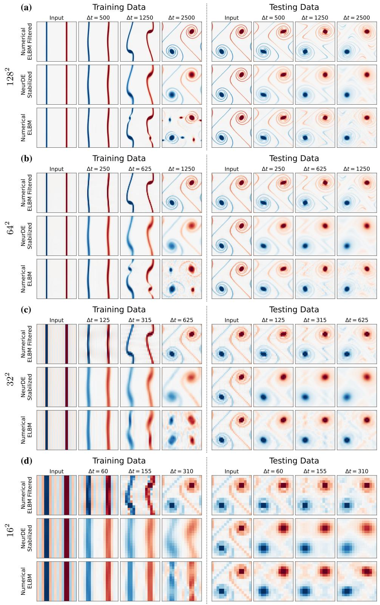  
Figure 20: Doubly periodic shear layer at Re = 50,000: vorticity forecasts on grids (a) $1 2 8 ^ { 2 } .$ , (b) $6 4 ^ { 2 }$ (c) $3 2 ^ { 2 }$ , and (d) $i 6 ^ { \frac { \cdot } { 2 } } ;$ ; the grid size is also marked to the left of each panel. In each panel, the rows are the downsampled $5 1 2 ^ { \frac { } { 2 } }$ reference (top), entropically-stabilized NeurDE (middle), and numerical ELBM run at that grid (bottom). The left block starts from the training data $( t _ { 0 } = 0 )$ , the right block from the testing data $\begin{array} { r } { ( t _ { 0 } = T / 2 ) ; } \end{array}$ columns are lead times $\Delta t$ in solver steps.

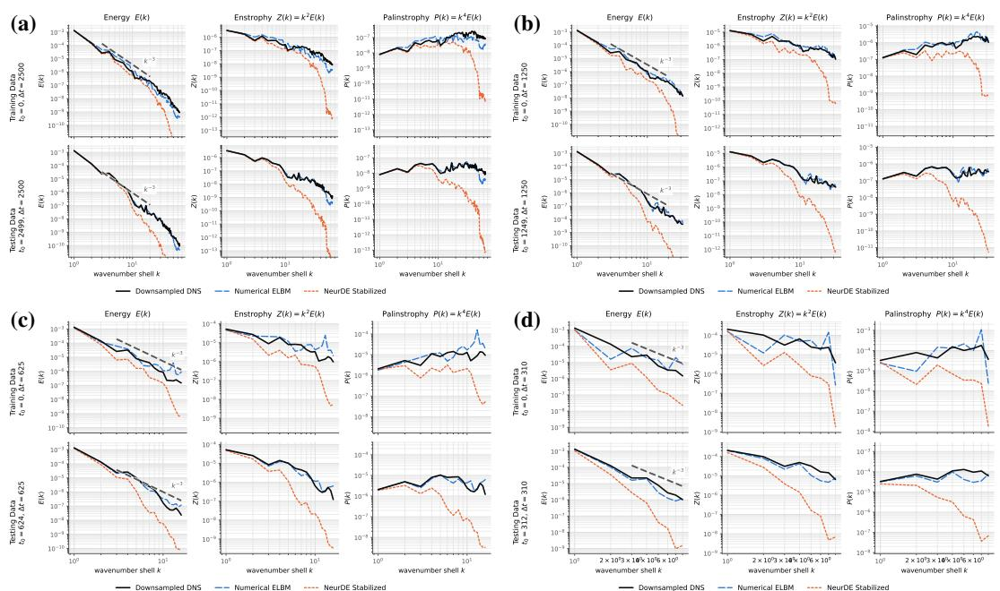  
Figure 21: Doubly periodic shear layer at $\mathrm { R e } = 5 0 { , } 0 0 0 { : }$ : shell-averaged spectra at the final lead time on grids (a) 1282, (b) 642, (c) 322, and $\mathrm { ( d ) 1 6 ^ { 2 } } .$ Columns are the energy E(k), enstrophy $Z ( k ) = \bar { k } ^ { 2 } E ( k )$ , and palinstrophy $P ( k ) = k ^ { 4 } E ( k )$ spectra, where k is the wavenumber shell; rows are forecasts from the training (top) and testing (bottom) data. Curves compare the downsampled $5 1 2 ^ { 2 }$ reference, numerical ELBM, and entropically-stabilized NeurDE.

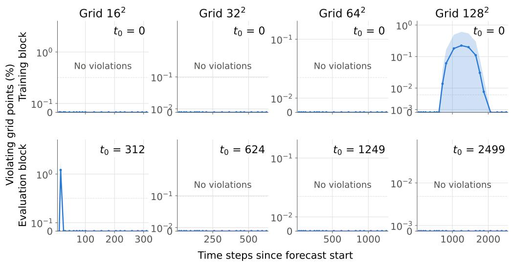  
Figure 22: The percentage of pixels that violate the second law of thermodynamics over the NeurdE emulation of the doubly periodic shear layer at $\mathrm { R e } = 5 0 { , } 0 0 0$ . We show the training and testing datasets for all grids. The mean and standard deviation are taken over all seeds.

## H.1.1 Single Seed Divergence

We highlight the emulation results of the entropically-stabilized NeurDE model trained on DPSL-50K with seed 576268 and evaluated on the $1 2 8 ^ { 2 }$ grid. We note that this is the only noticeable real-space divergence amongst all the models evaluated on all the coarsened grids. This includes this same model (seed 576268) evaluated on DPSL-50K on coarser grids. Notably, despite this divergence, this model is still more stable than ELBM.

Figures 23a and b show the real-space and spectral components of the emulation. At late times in train set emulation, entropically-stabilized NeurDE begins to diverge from the ground truth. While two erroneous vortices begin to emerge, it still captures the general features of the ground truth dynamics. For ELBM, these vortices have already formed before $\Delta t = 1 2 5 0$ . Therefore, while this specific entropically-stabilized NeurDE model is less stable than all the others, it is still more stable than the ELBM comparison.

The spectral metrics of this emulation (Fig. 23b) perform better than the metrics for the emulation of seed 2025 (Fig. 21a). This further supports our claim that quantifying simulation and emulation quality of chaotic dynamics is very challenging. Again, we see that improved spectral methods have led to significant divergence in the simulation compared to the 2025 seed.

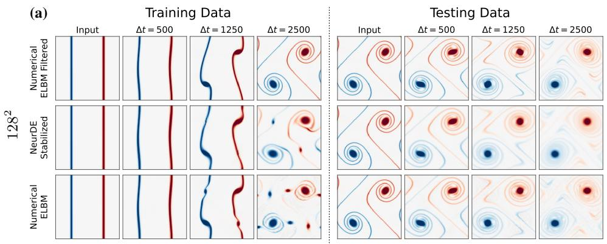

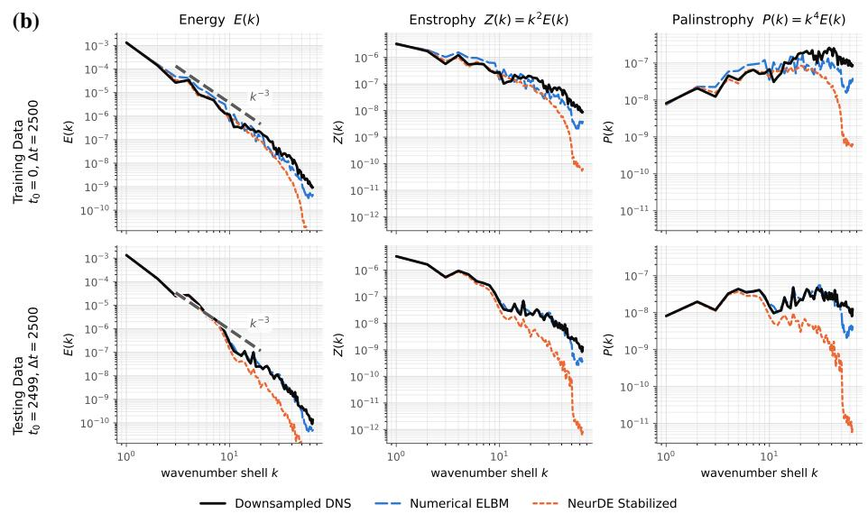  
Figure 23: Doubly periodic shear layer at $\mathrm { R e } = 5 0 { , } 0 0 0$ , seed 576268 on the $1 2 8 ^ { 2 }$ grid: (a) vorticity forecasts and (b) shell-averaged spectra at the final lead time, laid out as in Figs. 20 and 21. The rollout stays finite, but its forecast from the training data departs from the other three seeds: at $\Delta t = 2 5 0 0$ its velocity error is 0.174 (other seeds 0.080–0.096) and its vorticity correlation is 0.683 (0.829–0.862). It also keeps more energy at high k than the other seeds (high-k/ref. 0.142 against 0.007–0.034). Its forecast from the testing data is in line with, and on the field metrics slightly better than, the other seeds.

## H.2 Doubly periodic shear layer at Re=100,000

We present the results for the doubly periodic shear layer at $\mathrm { R e } = 1 0 0 { , } 0 0 0 .$ . The real-space and spectral metrics are presented in Tables 10 and 11 for the training and testing datasets, respectively. Figure 24 shows real-space forecasts for a single seed, and Fig. 25 shows the spectral metrics. These results are visually indistinguishable from those of the other seeds.

Table 10: Real-space and spectral metrics for doubly periodic shear layer at $\mathrm { R e } = 1 0 0 { , } 0 0 0$ . We compare emulation metrics from the training data $( t _ { 0 } = 0 )$ at the final lead time against the downsampled $\mathrm { \dot { 5 } 1 2 ^ { 2 } }$ reference. Entropically-stabilized NeurDE results are the mean ± standard deviation over four seeds; ELBM results are from one deterministic run. The "Faithful Emulation" reports whether the rollout reproduces the expected structures. Field fidelity: relative $L ^ { 2 }$ error of velocity and vorticity $\omega ,$ and vorticity correlation. Spectrum diagnostics: RMSE of $\log _ { 1 0 } E ( k )$ over active shells, and high-k energy and palinstrophy relative to the reference. Bold marks the better method per grid.
<table><tr><td rowspan="2">Grid Method</td><td rowspan="2"></td><td rowspan="2">Faithful Emulation</td><td colspan="3">Field Fidelity</td><td colspan="3">Spectrum Diagnostics</td></tr><tr><td>Vel. err ↓</td><td>ω corr. ↑</td><td>ω err ↓</td><td>Spec. RMSE† ↓</td><td>High-k/ref. → 1</td><td>P/ref. → 1</td></tr><tr><td rowspan="2"> $1 2 8 ^ { 2 }$ </td><td>NeurDE ELBM</td><td>4/4 0/1</td><td>0.0807 ± 6.9×10−⁵ 0.281</td><td>0.846 ± 2.5×10−4 0.546</td><td>0.536 ± 3.8×10−4 0.981</td><td> $3 . 2 8 \pm 2 . 4 { \times } 1 0 ^ { - 3 }$  0.869</td><td>0.0454 ± 2.2×10−4 0.684</td><td>0.104 ± 1.4×10−4 0.647</td></tr><tr><td>NeurDE</td><td></td><td></td><td></td><td></td><td></td><td></td><td></td></tr><tr><td rowspan="2"> $6 4 ^ { 2 }$ </td><td>ELBM</td><td>4/4 0/1</td><td>0.154±5.7×10−4 0.392</td><td>0.771 ± 3.9×10−4 0.542</td><td>0.641 ± 3.7×10−⁵ 1.03</td><td>3.60 ± 9.6×10−2 0.438</td><td>0.0283 ± 0.0015 1.98</td><td>0.0553 ± 0.0016 1.49</td></tr><tr><td>NeurDE</td><td></td><td></td><td></td><td></td><td></td><td></td><td></td></tr><tr><td rowspan="2"> $3 2 ^ { 2 }$ </td><td>ELBM</td><td>4/4 0/1</td><td>0.304 ± 0.045 0.561</td><td> $\begin{array} { c } { \mathbf { 0 . 6 8 4 \pm 0 . 0 3 2 } } \\ { 0 . 4 3 5 } \end{array}$ </td><td>0.730 ± 0.032 1.16</td><td>3.72 ± 0.70 0.678</td><td>0.050 ± 0.046 3.6</td><td>0.060 ± 0.029</td></tr><tr><td></td><td></td><td></td><td></td><td></td><td></td><td></td><td>2.8</td></tr><tr><td rowspan="2"> $1 6 ^ { 2 }$ </td><td>NeurDE ELBM</td><td>4/4</td><td>0.561 ± 0.034</td><td>0.600 ± 0.017</td><td> $\mathbf { 0 . 8 0 0 \pm 0 . 0 1 3 }$ </td><td>4.2 ± 1.3</td><td>0.031 ± 0.039</td><td>0.060 ± 0.034</td></tr><tr><td></td><td>0/1</td><td>0.729</td><td>0.217</td><td></td><td>0.96</td><td>2.0</td><td>2.1</td></tr></table>

Table 11: Real-space and spectral metrics for doubly periodic shear layer at $\mathrm { R e } = 1 0 0 { , } 0 0 0$ . We compare emulation metrics from the testing data $( t _ { 0 } ~ = ~ T / 2 )$ at the final lead time against the downsampled $5 1 2 ^ { 2 }$ reference. Entropically-stabilized NeurDE results are the mean $\pm$ standard deviation over four seeds; ELBM results are from one deterministic run. The "Faithful Emulation" reports whether the rollout reproduces the expected structures. Field fidelity: relative $L ^ { 2 }$ error of velocity and vorticity $\omega ,$ and vorticity correlation. Spectrum diagnostics: RMSE of $\log _ { 1 0 } E ( k )$ over active shells, and high-k energy and palinstrophy relative to the reference. Bold marks the better method per grid.
<table><tr><td rowspan="2">Grid Method</td><td rowspan="2"></td><td rowspan="2">Faithful Emulation</td><td colspan="3">Field Fidelity</td><td colspan="3">Spectrum Diagnostics</td></tr><tr><td>Vel. err ↓</td><td>ω corr. ↑</td><td>ω err ↓</td><td>Spec. RMSE† ↓</td><td>High-k/ref. → 1</td><td>P/ref. → 1</td></tr><tr><td rowspan="2"> $1 2 8 ^ { 2 }$ </td><td>NeurDE ELBM</td><td>4/4 1/1</td><td>0.0519 ± 3.3×10−6 0.0448</td><td>0.937 ± 1.6×10−⁵ 0.920</td><td>0.353 ± 4.2×10−5 0.401</td><td> $4 . 3 4 \pm 3 . 5 { \times } 1 0 ^ { - 3 }$  0.257</td><td>0.00635 ± 2.3×10−5 1.08</td><td>0.0868 ± 5.0×10−5 1.02</td></tr><tr><td></td><td></td><td></td><td></td><td></td><td></td><td></td><td></td></tr><tr><td rowspan="2"> $6 4 ^ { 2 }$ </td><td>NeurDE ELBM</td><td>4/4 1/1</td><td>0.0956 ± 5.9×10−4 0.0555</td><td>0.916 ± 3.3×10−4 0.920</td><td>0.421 ± 8.5×10−4 0.402</td><td>4.58 ± 0.11 0.346</td><td>0.00309 ± 0.00047 1.56</td><td>0.0780 ± 4.0×10 1.28</td></tr><tr><td>NeurDE</td><td>4/4</td><td></td><td></td><td></td><td></td><td></td><td></td></tr><tr><td rowspan="2"> $3 2 ^ { 2 }$ </td><td>ELBM</td><td>1/1</td><td>0.175 ± 0.019 0.0785</td><td>0.870 ± 0.016 0.931</td><td>0.519 ± 0.031 0.368</td><td>3.75 ± 0.62 0.430</td><td>0.0040 ± 0.0044 1.2</td><td>0.081 ± 0.018 1.1</td></tr><tr><td>NeurDE</td><td></td><td></td><td></td><td></td><td></td><td></td><td></td></tr><tr><td> $1 6 ^ { 2 }$ </td><td>ELBM</td><td>4/4 1/1</td><td>0.286 ± 0.023 0.224</td><td>0.826 ± 0.019 0.884</td><td>0.598 ± 0.030 0.469</td><td>2.85 ± 0.45 0.331</td><td>0.019 ± 0.018 0.82</td><td>0.067 ± 0.016 0.69</td></tr></table>

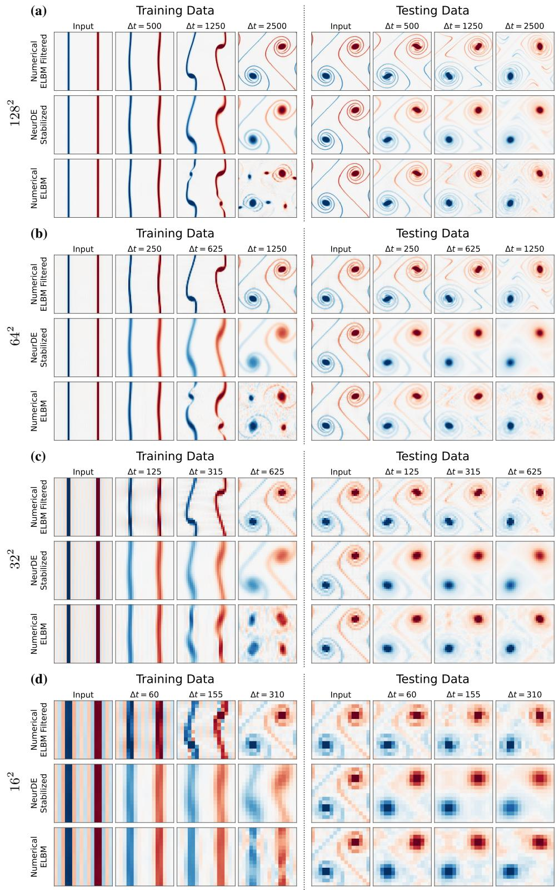  
Figure 24: Doubly periodic shear layer at Re = 100,000: vorticity forecasts on grids (a) $1 2 8 ^ { 2 }$ (b) $6 4 ^ { 2 } , ( \mathrm { c } ) 3 2 ^ { 2 } ,$ , and (d) $1 6 ^ { 2 } ;$ the grid size is also marked to the left of each panel. In each panel, the rows are the downsampled $5 1 \bar { 2 } ^ { 2 }$ reference (top), entropically-stabilized NeurDE (middle), and numerical ELBM run at that grid (bottom). The left block starts from the training data $( t _ { 0 } = 0 )$ , the right block from the testing data $\begin{array} { r } { ( t _ { 0 } = T / 2 ) ; } \end{array}$ columns are lead times $\Delta t$ in solver steps.

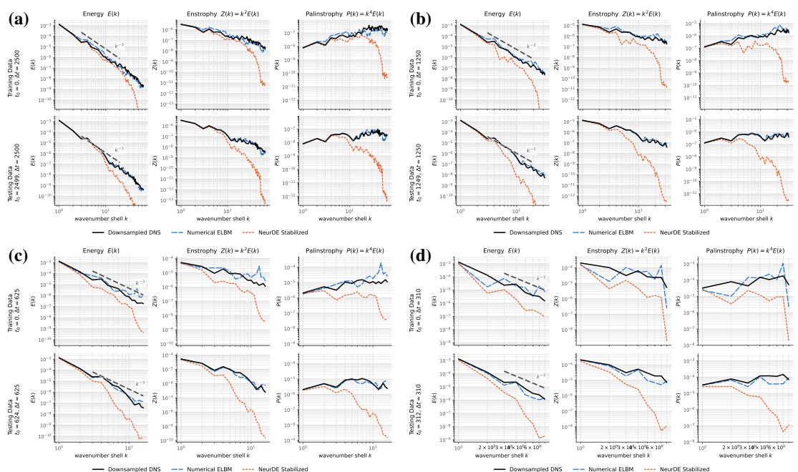  
Figure 25: Doubly periodic shear layer at $\begin{array} { r } { \mathrm { R e } = 1 0 0 , 0 0 0 \colon } \end{array}$ shell-averaged spectra at the final lead time on grids (a) 1282, (b) 642, (c) 322, and $\mathrm { ( d ) 1 6 ^ { 2 } } .$ . Columns are the energy E(k), enstrophy $Z ( k ) = \bar { k } ^ { 2 } E ( k )$ , and palinstrophy $P ( k ) = k ^ { 4 } E ( k )$ spectra, where k is the wavenumber shell; rows are forecasts from the training (top) and testing (bottom) data. Curves compare the downsampled $5 1 2 ^ { 2 }$ reference, numerical ELBM, and entropically-stabilized NeurDE.

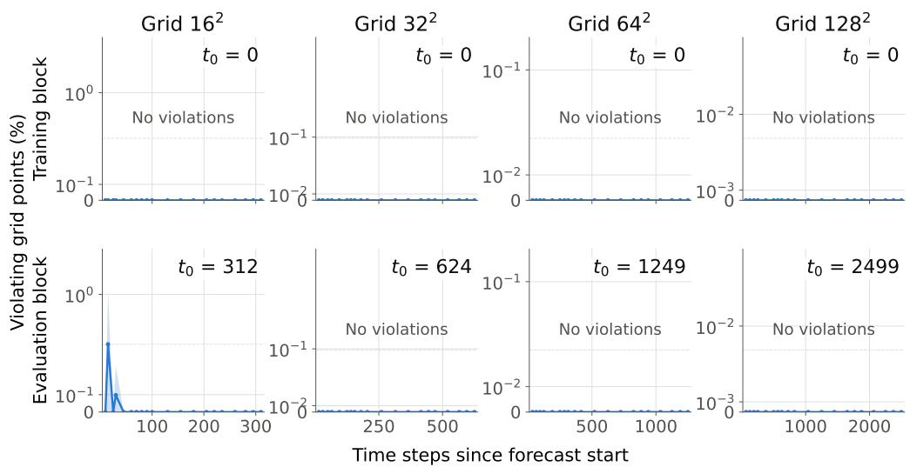  
Figure 26: The percentage of pixels that violate the second law of thermodynamics over the NeurdE emulation of the doubly periodic shear layer at $\mathrm { R e } = 1 0 0 { , } 0 0 0$ . We show the training and testing datasets for all grids. The mean and standard deviation are taken over all seeds.

## H.3 Taylor Green Vortex at Re=50,000

We present the results for the Taylor Green vortex experiment at $\mathrm { R e } = 5 0 { , } 0 0 0$ . The real-space and spectral metrics are presented in Tables 12 and 13 for the training and testing datasets, respectively. Figure 27 shows real-space forecasts for a single seed, and Fig. 28 shows the spectral metrics. These results are visually indistinguishable from those of the other seeds.

The two spectrum diagnostics (Spec. RMSE and High-k/ref.) are left blank at every resolution. This follows from the flow itself. We initialize TGV with the single-mode field $u = U _ { 0 }$ sin x cos y, $v = - U _ { 0 }$ cos x sin $y ,$ which is an exact solution of the two-dimensional incompressible Navier– Stokes equations: the pressure gradient balances the nonlinear term, so the vortex decays in place and passes no energy to smaller scales [Taylor and Green, 1937]. In our weakly compressible simulations $( \mathrm { M a } = 0 . 1 )$ , the energy therefore stays in the lowest wavenumber shells over the whole forecast window. The shells above the high-k cutoff $( N / 4$ on an $N \times N$ grid) hold energy only at the level of floating-point roundoff. Both spectrum diagnostics then reduce to comparisons of roundoff. High-k/ref. divides the predicted high-k energy fraction by a reference fraction that is effectively zero. Spec. RMSE is a logarithmic error that weights every retained shell equally, so it is dominated by shells whose reference energy is numerical noise rather than flow. The computed values confirm this. At the final horizon, entropically-stabilized NeurDE’s High-k/ref. for TGV ranges from 20 to $7 \times 1 0 ^ { 3 }$ across seeds and grids, and it does not change monotonically with resolution. We therefore omit these two columns for TGV. The velocity error, the vorticity error and correlation, and the palinstrophy ratio remain well defined and are reported.

Table 12: Real-space and spectral metrics for TGV at $\mathrm { R e } = 5 0 { , } 0 0 0$ . We compare emulation metrics from the training data $( t _ { 0 } = 0 )$ at the final lead time against the downsampled $5 1 2 ^ { 2 }$ reference. Entropically-stabilized NeurDE results are the mean ± standard deviation over four seeds, ELBM results are from one deterministic run. The "Faithful Emulation" reports whether the rollout reproduces the expected structures. Field fidelity: relative $L ^ { 2 }$ error of velocity and vorticity $\omega ,$ , and vorticity correlation. Spectrum diagnostics: RMSE of $\log _ { 1 0 } E ( k )$ over active shells, and high-k energy and palinstrophy relative to the reference. Bold marks the better method per grid.
<table><tr><td rowspan="2">Grid Method</td><td rowspan="2"></td><td rowspan="2">Faithful Emulation</td><td colspan="3">Field Fidelity</td><td colspan="3">Spectrum Diagnostics</td></tr><tr><td>Vel. err ↓</td><td>ω corr. ↑</td><td>ω err ↓</td><td>Spec. RMSE† ↓ High-k/ref. → 1</td><td></td><td>P/ref. → 1</td></tr><tr><td rowspan="2"> $1 2 8 ^ { 2 }$ </td><td>NeurDE</td><td>4/4</td><td> $( 6 . 1 4 \pm 0 . 8 1 ) \times 1 0 ^ { - 4 }$ </td><td>1.00 ± 1.4×10−9</td><td> $( 6 . 2 3 \pm 0 . 8 2 ) \times 1 0 ^ { - 4 }$ </td><td>=</td><td>一</td><td> $1 . 0 0 \pm 1 . 7 { \times } 1 0 ^ { - 4 }$ </td></tr><tr><td>ELBM</td><td>1/1</td><td> $\mathbf { 2 . 5 3 \times 1 \dot { 0 } ^ { - 4 } }$ </td><td>1.00</td><td> $\mathbf { 2 . 5 8 \times 1 0 ^ { - 4 } }$ </td><td>=</td><td>一</td><td>1.00</td></tr><tr><td rowspan="2"> $6 4 ^ { 2 }$ </td><td>NeurDE</td><td>4/4</td><td>0.00209 ± 0.00049</td><td> $^ { 1 . 0 0 \pm 3 . 5 \times 1 0 ^ { - 8 } } _ { 1 . 0 0 }$ </td><td>0.00213 ± 0.00046</td><td>一</td><td>-</td><td> $\begin{array} { c } { { 0 . 9 9 6 \pm 1 . 0 { \times } 1 0 ^ { - 3 } } } \\ { { { \bf 0 . 9 9 7 } } } \end{array}$ </td></tr><tr><td>ELBM</td><td>1/1</td><td>0.00162</td><td></td><td>0.00179</td><td>一</td><td>一</td><td></td></tr><tr><td rowspan="2"> $3 2 ^ { 2 }$ </td><td>NeurDE</td><td>4/4</td><td>0.00954 ± 6.8×10−5</td><td> $\begin{array} { c } { 1 . 0 0 \pm 3 . 7 \times { 1 0 ^ { - 9 } } } \\ { 1 . 0 0 } \end{array}$ </td><td>0.00951 ± 6.7×10−5</td><td>一</td><td>一</td><td> $\begin{array} { c } { 0 . 9 8 1 \pm 1 . 4 \times 1 0 ^ { - 4 } } \\ { 0 . 9 9 5 } \end{array}$ </td></tr><tr><td>ELBM</td><td>1/1</td><td>0.00317</td><td></td><td>0.00355</td><td>一</td><td>一</td><td></td></tr><tr><td rowspan="2"> $1 6 ^ { 2 }$ </td><td>NeurDE</td><td>4/4</td><td>0.0474 ± 2.2×10−5</td><td> $^ { 1 . 0 0 \pm 7 . 8 \times 1 0 ^ { - 9 } } _ { 1 . 0 0 }$ </td><td>0.0474 ± 2.2×10−5</td><td>一</td><td>=</td><td>0.908 ± 4.2×10−5</td></tr><tr><td>ELBM</td><td>1/1</td><td>0.0228</td><td></td><td>0.0228</td><td></td><td>=</td><td>0.956</td></tr></table>

Table 13: Real-space and spectral metrics for TGV at $\mathrm { R e } \ = \ 5 0 { , } 0 0 0$ . We compare emulation metrics from the testing data $( t _ { 0 } ~ = ~ T / 2 )$ at the final lead time against the downsampled $5 1 2 ^ { 2 }$ reference. Entropically-stabilized $N e u r D E$ results are the mean ± standard deviation over four seeds, ELBM results are from one deterministic run. The "Faithful Emulation" reports whether the rollout reproduces the expected structures. Field fidelity: relative $L ^ { 2 }$ error of velocity and vorticity $\omega ,$ and vorticity correlation. Spectrum diagnostics: RMSE of $\log _ { 1 0 } E ( k )$ over active shells, and high-k energy and palinstrophy relative to the reference. Bold marks the better method per grid.
<table><tr><td rowspan="2">Grid Method</td><td rowspan="2"></td><td rowspan="2">Faithful Emulation</td><td colspan="3">Field Fidelity</td><td colspan="3">Spectrum Diagnostics</td></tr><tr><td>Vel. err ↓</td><td>ω corr. ↑</td><td>ω err ↓</td><td>Spec. RMSE† ↓ High-k/ref. → 1</td><td></td><td> $P / \mathrm { r e f . }  1$ </td></tr><tr><td rowspan="2"> $1 2 8 ^ { 2 }$ </td><td>NeurDE</td><td>4/4</td><td> $\begin{array} { c } { { ( 5 . 6 2 \pm 0 . 7 9 ) \times 1 0 ^ { - 4 } } } \\ { { 3 . 1 4 \times 1 0 ^ { - 4 } } } \end{array}$ </td><td> $\begin{array} { c } { 1 . 0 0 \pm 2 . 5 { \times } 1 0 ^ { - 9 } } \\ { 1 . 0 0 } \end{array}$ </td><td> $\begin{array} { c } { { ( 5 . 7 6 \pm 0 . 8 1 ) \times 1 0 ^ { - 4 } } } \\ { { 3 . 1 8 \times 1 0 ^ { - 4 } } } \end{array}$ </td><td>一</td><td>一</td><td> $1 . 0 0 \pm 1 . 7 { \times } 1 0 ^ { - 4 }$ </td></tr><tr><td>ELBM</td><td>1/1</td><td></td><td></td><td></td><td>一</td><td>一</td><td>0.999</td></tr><tr><td rowspan="2"> $6 4 ^ { 2 }$ </td><td>NeurDE</td><td>4/4</td><td>0.00225 ± 0.00048</td><td> $^ { 1 . 0 0 \pm 3 . 9 \times 1 0 ^ { - 8 } } _ { 1 . 0 0 }$ </td><td>0.00227 ± 0.00046</td><td>1</td><td>一</td><td>0.996 ± 1.0×10 -3</td></tr><tr><td>ELBM</td><td>1/1</td><td>0.00180</td><td></td><td>0.00197</td><td>一</td><td>一</td><td>0.997</td></tr><tr><td rowspan="2"> $3 2 ^ { 2 }$ </td><td>NeurDE</td><td>4/4</td><td>0.00970 ± 6.8×10−5</td><td>1.00 ± 3.4×10−9</td><td>0.00971 ± 6.8×10 -5</td><td>一</td><td>一</td><td>0.981 ± 1.4×10−4</td></tr><tr><td>ELBM</td><td>1/1</td><td>0.00319</td><td>1.00</td><td>0.00365</td><td>=</td><td>一</td><td>0.995</td></tr><tr><td rowspan="2"> $1 6 ^ { 2 }$ </td><td>NeurDE</td><td>4/4</td><td>0.0478 ± 2.4×10−5</td><td> $^ { 1 . 0 0 \pm 7 . 7 \times 1 0 ^ { - 9 } } _ { 1 . 0 0 }$ </td><td>0.0478 ± 2.4×10−5</td><td>一</td><td>一</td><td>0.907 ± 4.5×10−5</td></tr><tr><td>ELBM</td><td>1/1</td><td>0.0231</td><td></td><td>0.0232</td><td>一</td><td>1</td><td>0.955</td></tr></table>

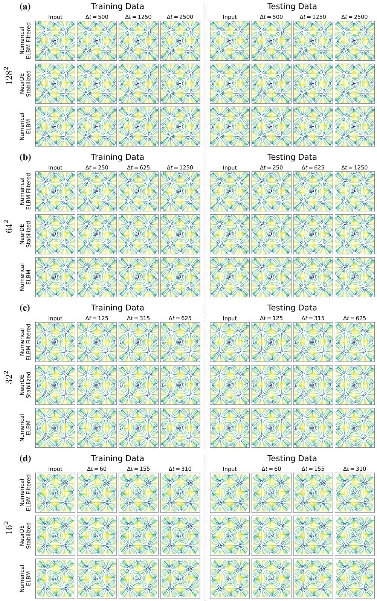  
Figure 27: TGV velocity streamline emulations at Re = 50,000, colored by speed on grids (a) $1 2 8 ^ { 2 }$ (b) $6 4 ^ { 2 } , ( \mathrm { c } ) 3 2 ^ { 2 } ,$ , and (d) $1 6 ^ { 2 } ;$ the grid size is also marked to the left of each panel. In each panel, the rows are the downsampled $5 1 \bar { 2 } ^ { 2 }$ reference (top), entropically-stabilized NeurDE (middle), and numerical ELBM run at that grid (bottom). The left block starts from the training data $( t _ { 0 } = 0 )$ , the right block from the testing data $\begin{array} { r } { ( t _ { 0 } = T / 2 ) ; } \end{array}$ columns are lead times $\Delta t$ in solver steps.

  
Figure 28: TGV at $\mathrm { R e } = 5 0 { , } 0 0 0$ shell-averaged spectra at the final lead time on grids (a) $1 2 8 ^ { 2 } , ( \mathsf { b } ) 6 4 ^ { 2 }$ $\mathrm { ( c ) 3 2 ^ { 2 } }$ , and (d) $1 6 ^ { 2 }$ . Columns are the energy $E ( k )$ , enstrophy $Z ( k ) = k ^ { 2 } \bar { E ( k ) }$ , and palinstrophy $P ( k ) = k ^ { 4 } E ( k )$ spectra, where k is the wavenumber shell; rows are forecasts from the training (top) and testing (bottom) data. Curves compare the downsampled $5 1 2 ^ { 2 }$ reference, numerical ELBM, and entropically-stabilized NeurDE. The flow stays in a few low-k shells, so the high-k tail is at roundoff level.

  
Figure 29: The percentage of pixels that violate the second law of thermodynamics over the NeurdE emulation of the Taylor Green vortex experiment at $\mathrm { R e } = 5 0 { , } 0 0 0$ . We show the training and testing datasets for all grids. The mean and standard deviation are taken over all seeds.

## I Fourier Neural Operator Baseline

We use the Fourier Neural Operator (FNO) Li et al. [2021] as a purely macroscopic neural-operator baseline for the doubly periodic shear layer with Re = 50,000 (DPSL-50K) forecasting task in Section 5. This baseline does not evolve lattice populations and does not use the entropic collision mechanism. Instead, it learns an autoregressive map directly between resolved macroscopic fields. This makes the comparison useful: it separates the benefit of a high-capacity spectral neural operator from the kinetic and entropy-constrained structure used by the proposed method.

The DPSL geometry is doubly periodic, which is favorable for FNO because its spectral convolution layers are naturally matched to periodic domains. However, the target dynamics contain sharp vorticity gradients and small-scale turbulent structures, which are known to be difficult for neural operators to resolve robustly at high Reynolds number McGreivy and Hakim [2024], Sakarvadia et al. [2026]. We therefore evaluated relatively large Fourier bandwidths and lifting dimensions to give the baseline substantial representational capacity.

Because the DPSL-50K rollouts are long, treating time as an additional input dimension, as in some prior FNO turbulence experiments Li et al. [2021], is not practical at the resolutions and horizons considered here. We therefore train FNO as a one-step map and roll it out autoregressively:

$$
\mathcal { G } _ { \theta } : \left( \rho , \mathbf { u } , \omega \right) ( t , \mathbf { x } ) \mapsto \left( \rho , \mathbf { u } , \omega \right) ( t + 1 , \mathbf { x } ) .
$$

This protocol matches the forecasting use case in the main experiments, but it is also stricter than a short-window interpolation task because small one-step errors accumulate over thousands of steps. Under this protocol, the FNO models we tested did not produce stable long-horizon DPSL forecasts. We therefore keep the details in the appendix and focus the main experimental section on the more informative comparison between the proposed entropically-stabilized NeurDE and the numerical ELBM baseline.

Computational Setup. The final model was trained on one NERSC Perlmutter node equipped with 4× NVIDIA A100-SXM4 GPUs with 40 GB HBM2 memory (Table 17). We implemented the models using the official Neural Operator library Kossaifi et al. [2025] (version 0.3.0).

The final model uses the following configuration (Table 14):

• Hidden Width $( d _ { v } ) { : }$ : 128.

• Fourier Modes $( \mathbf { k } _ { \mathbf { m a x } } ) \colon 6 4 .$

• Network Depth (L): 4 layers.

Table 14: FNO architecture.
<table><tr><td>Hyperparameter</td><td>Value</td></tr><tr><td>Spatial dimensions</td><td>2 (256 × 256 periodic grid)</td></tr><tr><td>Input / output channels</td><td>4 (density,  $u _ { x } , u _ { y } ,$  vorticity)</td></tr><tr><td>Fourier modes retained</td><td>64 per dimension (64 × 33 after the real FFT)</td></tr><tr><td>Hidden channels (width)</td><td>128</td></tr><tr><td>Fourier layers</td><td>4</td></tr><tr><td>Lifting / projection channels</td><td>256 / 256</td></tr><tr><td>Skip connection in Fourier layers Activation</td><td>linear  $( 1 \times 1$  convolution) GELU</td></tr><tr><td>Boundary padding</td><td>none (domain is periodic)</td></tr><tr><td>Input normalization</td><td>per-variable batch statistics (running mean and std.)</td></tr><tr><td>Precision</td><td>float32</td></tr><tr><td>Trainable parameters</td><td> $2 7 6 , 9 5 8 , 3 4 0 ( \approx 2 . 8 \times 1 0 ^ { 8 } )$ </td></tr></table>

Hyperparameter Sweep. Before the final run, a grid search of $2 \times 3 \times 3 \times 2 = 3 6$ configurations varied the width, the batch size, and the learning-rate schedule (Table 15). All other settings were held at the values in Tables 14 and 16: 64 Fourier modes, peak learning rate $1 0 ^ { - 4 }$ and weight decay $1 0 ^ { - 5 }$ . One difference from the final run is that the sweep runs supervised every step of the rollout, while the final run is supervised at most 32 steps (Table 16).

Table 15: Sweep grid and the values used in the final run.
<table><tr><td>Hyperparameter</td><td>Values swept</td><td>Final run</td></tr><tr><td>Hidden channels</td><td>128,256</td><td>128</td></tr><tr><td>Global batch size</td><td>16, 32, 64</td><td>16</td></tr><tr><td>OneCycle initial divisor (div_factor)</td><td>5, 25, 100</td><td>25</td></tr><tr><td>OneCycle final divisor (final_div_factor)</td><td>100,1000</td><td>100</td></tr></table>

Training Protocol. The model was trained on macroscopic channels only:

$$
( \rho , \mathbf { u } , \omega ) ( t , \pmb { x } ) \mapsto ( \rho , \mathbf { u } , \omega ) ( t + 1 , \pmb { x } ) ,
$$

on a $2 5 6 \times 2 5 6$ periodic grid, where $\rho$ is density, u is the bulk velocity, and ${ \boldsymbol { \omega } } = \nabla \times \mathbf { u }$ is the scalar vorticity in two dimensions. The FNO is therefore a direct field-to-field surrogate. It is not given the lattice populations, the entropic parameter $\alpha ,$ or the discrete H-theorem residuals used by the proposed kinetic model.

The final model was trained with AdamW Loshchilov and Hutter [2019] and a one-cycle learning-rate schedule Smith and Topin [2019] with cosine annealing and a peak learning rate of $1 0 ^ { - 4 }$ (Table 16). The figures below show this final model.

Table 16: FNO training setup.
<table><tr><td>Hyperparameter</td><td>Value</td></tr><tr><td>Data Simulation Trajectory Train / validation / test split</td><td>D2Q9 weakly compressible isothermal LBM, Re  $= 5 \times 1 0 ^ { 4 }$  , Ma = 0.1 one trajectory, 256 × 256 grid,  $1 0 ^ { 4 }$  saved steps 50 % / 10 % / 40 %, contiguous in time</td></tr><tr><td>Inputs and targets Loss and optimizer Loss Optimizer</td><td>density, velocity, vorticity sum of per-variable MSE (density, velocity, vorticity) AdamW Loshchilov and Hutter [2019]</td></tr><tr><td>Weight decay Gradient clipping Global batch size Learning-rate schedule Schedule</td><td> $1 0 ^ { - 5 }$  global  $L _ { 2 }$  norm ≤ 1.0 16 (4 per GPU) OneCycle Smith and Topin [2019], cosine annealing, stepped per batch</td></tr><tr><td>Peak learning rate Warm-up fraction (pct_start)</td><td> $1 0 ^ { - 4 }$  0.3</td></tr><tr><td>Initial learning rate Final learning rate</td><td> $4 \times 1 0 ^ { - 6 } ( \mathrm { d i v \_ f a c t o r = 2 5 ) }$   $4 \times 1 0 ^ { - 8 } ( \mathbf { f i n a l \_ d i v \_ f a c t o r } = 1 0 0 )$ </td></tr><tr><td>Schedule length Rollout curriculum</td><td>300 epochs</td></tr><tr><td>Rollout lengths Epoch budget per stage</td><td></td></tr></table>

The curriculum advances to the next rollout length when a stage’s epoch budget is used up, or earlier if the validation loss has not improved for 5 consecutive epochs. In the final run, the stages occupied epochs 0–24, 25–49, 50–74, 75–96, 97–112, 113–152 and 153–182. Training stopped during the 50-step stage, at which point the learning rate was $5 . 9 \times 1 0 ^ { - 5 }$

Training Cost. The final model was trained in a single 24-hour job on one NERSC Perlmutter GPU node (Table 17). The job ran until the time limit. The cost per epoch grows with the rollout length, because each training sample is unrolled for that many steps. As a result, the 25- and 50-step stages account for 20.7 of the 23.7 training hours (Table 18). These figures cover only the final run, not the sweep or evaluation

Table 17: Compute used to train the final FNO.
<table><tr><td>Quantity</td><td>Value</td></tr><tr><td>System</td><td>NERSC Perlmutter, 1 GPU node</td></tr><tr><td>GPU type</td><td>NVIDIA A100-SXM4, 40 GB</td></tr><tr><td>Number of GPUs</td><td>4</td></tr><tr><td>CPU cores allocated Job wall-clock time</td><td>64 physical (128 hardware threads) 23.96 h (24 h limit)</td></tr><tr><td>Training time (epoch 0 to epoch 182)</td><td>23.67 h</td></tr><tr><td>GPU-hours (job)</td><td>95.8</td></tr><tr><td>Node-hours (job)</td><td>23.96</td></tr><tr><td>Energy (Slurm node counter)</td><td> $1 . 1 2 \times 1 0 ^ { 8 } \mathrm { J } \approx 3 1 . 2 \mathrm { k W h }$ </td></tr></table>

Table 18: Wall-clock time per curriculum stage (4 GPUs).
<table><tr><td>Rollout length</td><td>Epochs</td><td>Wall-clock (h)</td><td>Minutes per epoch</td></tr><tr><td>1</td><td>25</td><td>0.30</td><td>0.7</td></tr><tr><td>2</td><td>25</td><td>0.42</td><td>1.0</td></tr><tr><td>3</td><td>25</td><td>0.53</td><td>1.3</td></tr><tr><td>5</td><td>22</td><td>0.71</td><td>1.9</td></tr><tr><td>10</td><td>16</td><td>1.01</td><td>3.8</td></tr><tr><td>25</td><td>40</td><td>10.02</td><td>15.0</td></tr><tr><td>50</td><td>30</td><td>10.67</td><td>21.3</td></tr><tr><td>Total</td><td>183</td><td>23.67</td><td></td></tr></table>

Observed Behavior. Overall, this result of Fig. 3 should not be interpreted as a failure of spectral neural operators in general. Rather, it indicates that a macroscopic one-step FNO, without kinetic variables or an entropy constraint, is not robust for this long-horizon underresolved DPSL setting. The limitation is most visible during autoregressive rollout: the model may learn a reasonable shortterm field update, but repeated application damps or distorts the vortical structures that control the later-time dynamics. Given the substantial cost of scaling the space-time FNO formulation to the present horizons, we did not pursue further FNO-specific architectural modifications.

## J Walrus Baseline

Since Walrus is a large pretrained Transformer, which significantly differs from entropically-stabilized NeurDE, we trained it within its own repository. We used the default model parameters and started from the pretrained weights. Unless otherwise specified, we used the default values within the repository.

Fine-tuning Setup. We used standard configuration variables found in the Walrus repository for the fine-tuning procedure: its trainer, the AdamW optimizer, and its inverse-square-root learning-rate schedule with linear warm-up and square-root cool-down. We changed only what was needed for a short fine-tuning run on new data:

• a learning rate of $1 0 ^ { - 4 }$

• warm-up and cool-down shortened to 6 and 3 epochs, to keep the proportions of the default schedule over 16 epochs;

• drop-path and input-field dropout turned off;

  
Figure 30: Diverging vorticity decay from DNS as forecast length increases.  
• no gradient accumulation;  
• gradient clipping at 10;  
• per-sample normalization in place of precomputed dataset statistics.

The pretrained Walrus model was fine-tuned on the same 256 × 256 DPSL-50K simulation used for the FNO baseline. Each training sample gives the model 6 consecutive input states and asks it to predict the next state, with the time stride between states drawn from 1 to 5 saved steps. Fine-tuning ran for 16 epochs of 2000 optimizer steps each, which is 32,000 steps in total. It used fully sharded data parallelism (FSDP) across 8 GPUs, a batch of 2 per GPU (global batch 16), and float32 arithmetic. Validation ran every second epoch.

Training Cost. Fine-tuning took 38 h of wall-clock time on 8 GPUs, or about 305 GPU-hours (Table 19). These figures cover only fine-tuning, not pretraining or the forecast evaluation.

Table 19: Compute used to fine-tune Walrus.
<table><tr><td>Quantity</td><td>Value</td></tr><tr><td>System</td><td>NERSC Perlmutter, 2 GPU nodes</td></tr><tr><td>GPU type</td><td>NVIDIA A100-SXM4, 80 GB</td></tr><tr><td>Number of GPUs</td><td>8 (4 per node)</td></tr><tr><td>CPU cores allocated</td><td>128 physical (256 hardware threads)</td></tr><tr><td>Total wall-clock time</td><td>38.11 h</td></tr><tr><td>GPU-hours</td><td>304.8</td></tr><tr><td>Node-hours</td><td>76.2</td></tr><tr><td>Energy (Slurm node counter)</td><td>4.82 × 108 J≈ 134.0 kWh</td></tr></table>