# M3Former: Fine-Grained Cross-Layer Mixing for Transformers

Jiasong Han<sup>1,\*</sup>, Yunkai Chai<sup>2,3,\*</sup>, Tong Zhu<sup>3</sup>, Hengyu Zhang<sup>1</sup>,

Wei Fang, Jintao Wang<sup>1</sup>, Guoqi Li<sup>4</sup>, Yu Cheng<sup>5,†</sup>

<sup>1</sup>Tsinghua University, Beijing, China

<sup>2</sup>Shanghai Jiao Tong University, Shanghai, China

<sup>3</sup>Shanghai AI Laboratory, Shanghai, China

<sup>4</sup>Institute of Automation, Chinese Academy of Sciences, Beijing, China <sup>5</sup>Nanyang Technological University, Singapore

hanjs22@mails.tsinghua.edu.cn, chaiyunkai@sjtu.edu.cn, zhutong@pjlab.org.cn,

zhanghen23@mails.tsinghua.edu.cn, fangwei123456g@gmail.com, wangjintao@tsinghua.edu.cn,

guoqi.li@ia.ac.cn, yu.cheng@ntu.edu.sg

<sup>\*</sup>Equal contribution. <sup>†</sup>Corresponding author.

## Abstract

Residual connections give each Transformer block access to all earlier layers only through one fixed sum, broadcast to all of the block’s inputs. This broadcast bottleneck imposes three constraints: the query, key, value and residual inputs of a block, which we call its roles, read the same vector; all hidden dimensions within a role share one set of weights over earlier layers; and every earlier layer has the same fixed weight for every token. We propose the Multi-Role Multi-Group Mixing Residual (M3), which removes all three: every role, and every group of hidden dimensions within a role, reads its own token-dependent mixture of all earlier layers. M3 starts as an exact residual connection and adds as little as 1.4% parameters and 1.8% FLOPs. From 100M to 1.4B parameters, M3Former outperforms the Transformer and coarse-grained cross-layer connections at every size, matching a Transformer 1.19–1.34× the size of the one it modifies, trained with 1.4–1.8× the compute. Relaxing only some of the constraints recovers only part of this gain. M3Former also improves sparse mixture-of-experts models of up to 4.6B parameters and trains more stably in deeper networks. Code: github.com/Kingchet10/m3former.

## 1 Introduction

Residual connections (He et al., 2016) allow Transformers (Vaswani et al., 2017) to be trained at great depth. Each block adds its output to a running sum, and the next block reads this sum as its input. In a pre-norm Transformer, the input of a block is thus the token embedding plus the updates of all earlier blocks. This running sum, often called the residual stream, is the only path through which a block can use what earlier layers have computed (Elhage et al., 2021). Although language models have grown to billions of parameters (Brown et al., 2020; Kaplan et al., 2020; Hoffmann et al., 2022), nearly all of them still connect their blocks in this way.

Every block reads only this sum and broadcasts it to all of its inputs, although the readers of the stream need different information. The broadcast constrains a block in three ways (Figure 2a). (1) Roles: queries and keys decide where to attend, values decide what to move, and the residual path carries the state that the block updates (Vaswani et al., 2017; Elhage et al., 2021), yet all four read the same vector. (2) Groups: different subspaces of the stream carry different features (Elhage et al., 2021), and heads and layers specialize in different functions (Voita et al., 2019; Clark et al., 2019b; Tenney et al., 2019; Jawahar et al., 2019), yet all hidden dimensions of a role share one set of weights over earlier layers. (3) Layer weights: every earlier layer enters the sum with the same fixed weight for every token, so a block cannot emphasize the layers it needs; in pre-norm models the growing sum dilutes each layer (Kimi Team, 2026), and many deep layers can be removed with little loss (Gromov et al., 2024). We call these constraints the broadcast bottleneck.

Cross-layer connections relax these constraints one at a time, and each relaxation has improved language modeling. Most relax (3), with static (Wang et al., 2019; Pagliardini et al., 2024) or token-dependent weights over earlier layers (Zhu et al., 2025a; Xie et al., 2025; Kimi Team, 2026); some also relax (1) by forming the query, key and value from separate mixtures (Heddes et al., 2025; Xiao et al., 2025), or (2) by splitting the hidden state into fractions, heads or streams (Zhu et al., 2025b; Luo et al., 2026; Qin et al., 2026). None relaxes all three (Table 1). Yet every group of every role needs different information from different earlier layers, and this need changes from token to token; keeping any one constraint still forces some of them to share a mixture, so removing the bottleneck requires relaxing all three together.

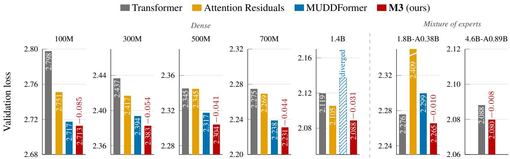  
Figure 1: Validation loss at 20 training tokens per parameter (active parameters for mixture-of-experts models). In the bars: losses; red: change of M3Former relative to the Transformer; hatched: diverged run; white slash: bar cut off at the top. Each panel spans 0.12 in loss, the last 0.06.

In this work, we propose the Multi-Role Multi-Group Mixing Residual (M3), which relaxes all three constraints jointly: every role of a block, and every group of hidden dimensions within a role, combines all earlier layers with its own weights, generated from the current token (Figure 2). Because it starts as an exact residual connection, M3 can replace the residual connections of a Transformer without other changes; we call the result M3Former.

We pre-train M3Former, the Transformer and coarse-grained cross-layer connections from 100M to 1.4B parameters under one recipe, together with mixture-of-experts models of up to 4.6B parameters, and make three contributions:

• Problem. We identify the broadcast bottleneck, three constraints that the residual connection places on how a block reads earlier layers, and show that each of them limits the Transformer: relaxing only one or two recovers only part of the gain (§5.1).

• Method. We propose M3, in which every role–group pair of a block reads its own tokendependent mixture of all earlier layers. One small generator produces all 4G mixtures, and a fused kernel computes them in a single pass over the history. The resulting M3Former starts exactly as the standard Transformer and adds as little as

1.4% parameters and 1.8% FLOPs.

• Evidence at scale. At 20 tokens per parameter, M3Former matches a Transformer 1.19–1.34× the size of the one it modifies (Figure 3) and outperforms attention residuals from 100M to 1.4B and MUDDFormer from 100M to 700M (Figure 1). It also improves mixture-of-experts models of up to 4.6B parameters, and it trains to completion at 1.4B, where MUDDFormer diverges under the same recipe, and stays ahead when both use PrePostNorm.

## 2 M3: Multi-Role Multi-Group Mixing

We first write the residual connection as a read of a history of hidden states (§2.1), then define depth mixing and its granularity (§2.2), describe how M3 computes and initializes its mixing coefficients (§2.3), and finally analyze its cost (§2.4).

## 2.1 The residual connection reads a history

Consider a pre-norm Transformer with L blocks and hidden size d. Let $h _ { 0 }$ be the token embedding and $h _ { \ell }$ the hidden state after block $\ell ;$ all quantities are per token, and we write the token index t only where it matters. Block ℓ has access to the history $H _ { < \ell } = \left( h _ { 0 } , \ldots , h _ { \ell - 1 } \right)$ , but a standard block reads only its last element:

$$
\begin{array} { r l } & { u _ { \ell } = h _ { \ell - 1 } + \mathrm { A t t n } \big ( \hat { h } W _ { Q } , \hat { h } W _ { K } , \hat { h } W _ { V } \big ) , } \\ & { h _ { \ell } = u _ { \ell } + \mathrm { F F N } \big ( \mathrm { N } _ { F } ( u _ { \ell } ) \big ) , } \end{array}\tag{1}
$$

where $\hat { h } = \mathrm { N } _ { A } ( h _ { \ell - 1 } ) , \mathrm { N } _ { A }$ and $\mathrm { N } _ { F }$ are RMSNorms, and $W _ { Q } , W _ { K } , W _ { V }$ are the query, key and value projections. Because $\begin{array} { r } { h _ { \ell - 1 } = h _ { 0 } + \sum _ { k = 1 } ^ { \ell - 1 } ( h _ { k } } \end{array}$ $h _ { k - 1 } )$ , reading the latest state is the same as adding the updates of all earlier blocks with equal, fixed weights. The block uses this one vector in four roles: as the input of the query, key and value projections, and as the residual path to which the attention output is added.

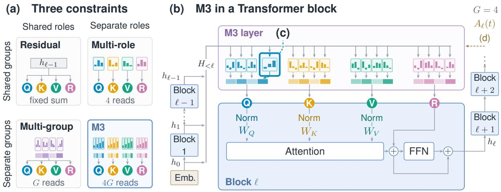

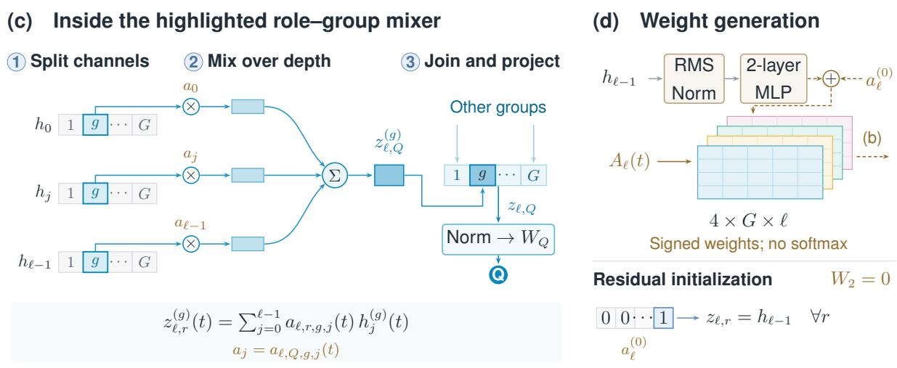  
Figure 2: M3: multi-role multi-group mixing. (a) The three constraints: a residual connection gives every role and group the same fixed sum $h _ { \ell - 1 }$ , whereas M3 gives each of the 4G role–group pairs its own token-dependent mixture. (b) Block ℓ assembles each of its four role inputs from G group-wise mixtures of the history $H _ { < \ell }$ . (c) A role–group mixer weights group g of every earlier state by $a _ { \ell , r , g , j } ( t )$ and sums them. (d) A generator computes all coefficients from $h _ { \ell - 1 } ( t )$ ; its initialization reproduces the standard Transformer. $G = 4$ is shown; coefficient profiles are schematic.

M3 gives the four roles separate inputs $z _ { \ell , r } , r \in$ ${ \mathcal { R } } = \{ Q , K , V , R \}$

$$
\begin{array} { r l } & { u _ { \ell } = z _ { \ell , R } + \mathrm { A t t n } \big ( \hat { z } _ { Q } W _ { Q } , \hat { z } _ { K } W _ { K } , \hat { z } _ { V } W _ { V } \big ) , } \\ & { h _ { \ell } = u _ { \ell } + \mathrm { F F N } \big ( \mathrm { N } _ { F } ( u _ { \ell } ) \big ) , } \end{array}\tag{2}
$$

where $\hat { z } _ { Q } = \mathrm { N } _ { A } ( z _ { \ell , Q } )$ reuses the attention norm of Eq. (1), while $\hat { z } _ { K } ~ = ~ \mathrm { N } _ { K } ( z _ { \ell , K } )$ and $\begin{array} { r l } { \hat { z } _ { V } } & { { } = } \end{array}$ $\mathrm { N } _ { V } ( z _ { \ell , V } )$ use two new RMSNorms, so that each projected role has its own scale. The residual input $z _ { \ell , R }$ is added without normalization, and the feedforward step is unchanged. With $z _ { \ell , r } = h _ { \ell - 1 }$ for every role and the scales of $\mathrm { N } _ { K }$ and $\mathrm { N } _ { V }$ equal to that of $\mathrm { N } _ { A }$ , Eq. (2) reduces to Eq. (1). Block 1 has only $h _ { 0 }$ to read and is left unchanged.

## 2.2 Depth mixing and its granularity

We split the channels of every hidden state into G contiguous groups of width $d / G , h _ { j } \ =$ $[ h _ { j } ^ { ( 1 ) } ; \ldots ; h _ { j } ^ { ( \bar { G } ) } ]$ , and form each group of each role input as a weighted sum over the history (Figure 2c):

$$
z _ { \ell , r } ^ { ( g ) } ( t ) = \sum _ { j = 0 } ^ { \ell - 1 } a _ { \ell , r , g , j } ( t ) h _ { j } ^ { ( g ) } ( t ) .\tag{3}
$$

The groups partition the hidden channels before the query, key and value projections, so they are not attention heads: a role input is reassembled from its G groups and only then normalized and projected as in Eq. (2).

<table><tr><td>Method</td><td>(1) Roles</td><td>(2) Groups</td><td>(3) Weights</td><td>Sources</td></tr><tr><td>Residual</td><td></td><td></td><td>fixed</td><td> $h _ { \ell - 1 }$ </td></tr><tr><td>DLCL, DenseFormer</td><td></td><td></td><td>static</td><td>all</td></tr><tr><td>Hyper-conn., mHC</td><td></td><td></td><td>dynamic</td><td>streams</td></tr><tr><td>Frac-connections</td><td></td><td>√</td><td>dynamic</td><td> $h _ { \ell - 1 }$ </td></tr><tr><td>AttnRes</td><td></td><td>一</td><td>dynamic</td><td>blocks</td></tr><tr><td>Multi-head AttnRes</td><td></td><td>√</td><td>dynamic</td><td>all</td></tr><tr><td>Value residual</td><td>V</td><td></td><td>static</td><td>layer 1</td></tr><tr><td>DeepCrossAttn.</td><td>Q,K,V</td><td>static</td><td>both</td><td>all</td></tr><tr><td>MUDDFormer</td><td>Q,K,V,R</td><td></td><td>dynamic</td><td>all</td></tr><tr><td>M3 (ours)</td><td>Q,K,V,R</td><td> $\checkmark$ </td><td>dynamic</td><td>all</td></tr></table>

Table 1: Cross-layer connections and the three constraints. Static weights are learned but the same for every token; dynamic weights depend on the token.

Eq. (3) defines a family of connections that relax the three constraints of §1 to different degrees (Figure 2a):

• Residual connection: $a _ { \ell , r , g , j } = { \bf 1 } [ j = \ell - 1 ]$ one fixed mixture for all roles and groups; relaxes none.

• Dense mixing: $a _ { \ell , r , g , j } = a _ { \ell , j }$ , one mixture of all earlier layers shared by all roles and groups; relaxes (3). Its weights are static in DenseFormer (Pagliardini et al., 2024) and token-dependent in attention residuals (Kimi Team, 2026).

• Multi-role: $\boldsymbol { a } _ { \ell , r , g , j } = \boldsymbol { a } _ { \ell , r , j }$ , four mixtures, one per role, as in MUDDFormer (Xiao et al., 2025); relaxes (1) and (3).

• Multi-group: $a _ { \ell , r , g , j } = a _ { \ell , g , j } $ , G mixtures shared by all roles, as in multi-head attention residuals (Luo et al., 2026); relaxes (2) and (3).

• M3: no sharing, 4G mixtures, one for every role and group; relaxes all three.

We call the number of independent mixtures per block and token the granularity of a connection. The family is nested: M3 represents every coarser member exactly (Proposition 2), and readers that share a coefficient receive the sum of their gradients for it, which cancel in part when they need different sources. With token-dependent coefficients, existing cross-layer connections relax at most two of the three constraints; DeepCrossAttention (Heddes et al., 2025) makes only its token-independent coefficients specific to channels. Table 1 compares them on all three, and §6 discusses them.

M3 relaxes all three: in it, every coefficient is specific to a role and a group and depends on the token (§2.3).

## 2.3 Token-conditioned weights

A single generator per block produces all coefficients of Eq. (3) from the latest state of the same token (Figure 2d):

$$
\begin{array} { r l } & { \mathrm { v e c } ( A _ { \ell } ) = \mathrm { G E L U } \big ( \bar { \mathrm { N } } ( h _ { \ell - 1 } ) W _ { \ell , 1 } \big ) W _ { \ell , 2 } } \\ & { \qquad + \mathrm { v e c } \big ( a _ { \ell } ^ { ( 0 ) } \big ) , } \end{array}\tag{4}
$$

computed separately for every token, where $A _ { \ell } \in$ $\mathbb { R } ^ { 4 \times \bar { G } \times \ell }$ collects the coefficients $a _ { \ell , r , g , j } .$ , vec flattens it into a row vector of length 4Gℓ, N<sup>¯</sup> is an RMSNorm without a learned scale, $W _ { \ell , 1 } \in \mathbb { R } ^ { d \times m _ { \ell } }$ $W _ { \ell , 2 } \in \mathbb { R } ^ { m _ { \ell } \times 4 G \ell }$ , and $a _ { \ell } ^ { ( 0 ) } \in \mathbb { R } ^ { 4 \times G \times \ell }$ is a learned static prior. The hidden width $m _ { \ell }$ is the smallest multiple of 64 that exceeds 4ℓ, so the generator is small. The coefficients are signed and are not normalized over depth: a role can subtract an earlier representation as easily as it adds one, which a convex mixture cannot do (Lemma 1 in Appendix A). The hidden state that enters the output layer is mixed in the same way from $( h _ { 0 } , \ldots , h _ { L } )$ , with a single role and its own generator.

Initialization. We set $W _ { \ell , 2 } = 0$ , draw $W _ { \ell , 1 }$ from $\mathcal { N } ( 0 , 1 / d )$ , and set $a _ { \ell } ^ { ( 0 ) }$ to one on the latest state and zero elsewhere. Then $z _ { \ell , r } = h _ { \ell - 1 }$ for every role, and M3Former computes exactly the same function as the standard Transformer at the start of training (Proposition 1); every departure from a single shared read is learned.

Number of groups. We count G in units of the number of attention heads, $H \ = \ d / 6 4 $ : from 100M to 700M we train $G \in \{ H , 2 H , 4 H \}$ , that is, groups of width 64, 32 and 16, and at 1.4B $G = H ;$ we report the best at each size (§5.2, Table 5). The groups are not tied to the heads, since they partition the channels of the history before the projections.

## 2.4 Complexity analysis

Per token, block ℓ spends $( d + 4 G \ell ) m _ { \ell }$ multiply– adds in the generator, equal to the number of entries of its weight matrices, and 4ℓd in the mixing of Eq. (3). Finer granularity is cheap for two reasons. First, a group-wise mixture touches the same ℓd values as a full-width one, so M3 spends the same 4ℓd multiply–adds on mixing as multi-role mixing; its 4G mixtures cost more only in the output layer of the generator, $4 G \ell m _ { \ell }$ instead of $4 \ell m _ { \ell } .$ Second, every member of the family reads the same ℓ earlier states, and our fused Triton kernel reads each $h _ { j }$ once and writes all four roles and G groups in one pass, so its reads and writes of hidden states do not grow with G.

Summed over the network, M3 adds a fraction $O ( L / d + G L ^ { 2 } / d ^ { 2 } )$ of the non-embedding parameters of the Transformer, which grows with depth relative to width (Appendix A.4). For the models we report, it adds 1.4–3.9% parameters and 1.8– 4.3% multiply–adds per token (Table 5), against 0.6–1.0% and 1.0–1.4% for MUDDFormer. At inference, a token keeps only its own $L + 1$ hidden states, so the extra memory does not grow with the context length.

## 3 Experimental Setup

Data and training. We train all models on a fixed sample of FineWeb-Edu (Penedo et al., 2024), tokenized with the 32K-token TinyLlama tokenizer (Zhang et al., 2024), with sequences of 2,048 tokens and a global batch of 64 sequences. All models use AdamW with a warmup–stable–decay schedule (Hu et al., 2024) and one preset learning rate per size, shared by all methods (Appendix B). The training budget of each size is set by the nonembedding parameter count N of its Transformer. The main run trains on 20N tokens, close to the compute-optimal ratio of Hoffmann et al. (2022), and runs with 5N and 10N tokens decay from checkpoints of the main run. We report the loss on 99.9M held-out tokens.

Models. Table 2 lists the five dense sizes and two mixture-of-experts models. The Transformer is a pre-norm decoder with RMSNorm (Zhang and Sennrich, 2019), SwiGLU feed-forward layers (Shazeer, 2020) and rotary position embeddings (Su et al., 2024) (Appendix B). Where we report one M3Former per size, we use its best G. In the mixture-of-experts models, every feed-forward layer routes each token to 8 of 64 SwiGLU experts, without a shared expert (Table 7); they also train on 20 tokens per parameter, counting active parameters, and M3 uses $G = 4 H$ in both, 64 and 96 groups.

Baselines. We compare M3Former with two coarse-grained cross-layer connections. MUD-DFormer (Xiao et al., 2025) lets each role read its own token-dependent mixture of earlier layers, shared by all of its channels; it is M3 with $G = 1$ with the same block and normalization. We train it with the same pre-norm recipe as all other models. Attention residuals (Kimi Team, 2026) replace the residual sum with softmax attention over the outputs of earlier layers; we train their block variant, with blocks of four layers, from 100M to 1.4B. For the ablation in §5.1, we also train multi-group mixing, in which each group reads its own mixture, shared by all roles.

<table><tr><td>Model</td><td> $L \times d$ </td><td>FFN</td><td>N</td></tr><tr><td>100M</td><td> $1 6 \times 6 4 0$ </td><td>1792</td><td>81M</td></tr><tr><td>300M 500M</td><td> $2 4 \times 1 0 2 4$   $2 8 \times 1 1 5 2$ </td><td>2816 3200</td><td>308M 458M</td></tr><tr><td>700M 1.4B</td><td> $3 2 \times 1 2 8 0$   $4 0 \times 1 6 6 4$ </td><td>3520 4608</td><td>642M 1363M</td></tr><tr><td>1.8B-A0.38B 4.6B-A0.89B  $2 8 \times 1 5 3 6$ </td><td> $2 4 \times 1 0 2 4$   $6 4 \times 5 1 2$ </td><td> $6 4 \times 3 5 2$ </td><td>1.76B/0.31B</td></tr></table>

Table 2: Models. N is the non-embedding parameter count of the Transformer, total/active for the mixture-ofexperts models, whose FFN column gives the number and width of experts. All heads have width 64.

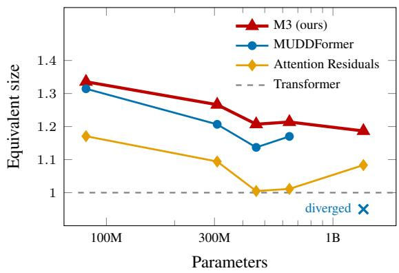  
Figure 3: Equivalent size $k = N _ { \mathrm { e q } } / N$ (§3) at 20 tokens per parameter, against the size N of the Transformer that each model modifies.

Equivalent size. To express a loss as a model size, we fit $L ( N ) = E + A ( N / 1 0 ^ { 8 } ) ^ { - \alpha }$ to the five Transformers $( E = 0 . 9 6 5$ , A = 1.771, $\alpha =$ 0.164; RMSE 0.002). The equivalent size of a model is $k = N _ { \mathrm { e q } } / N$ , where N is the size of the Transformer that the model modifies (Table 2) and $N _ { \mathrm { e q } }$ the size of the Transformer that this fit predicts to reach the same loss; since that Transformer is also trained on 20 tokens per parameter, it uses $k ^ { 2 }$ times the training compute (Appendix A.5).

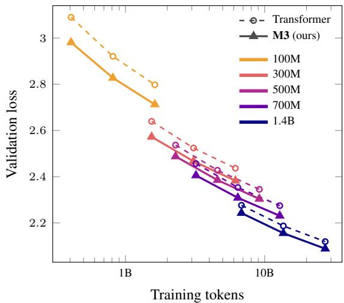  
Figure 4: Validation loss against training tokens, at 5, 10 and 20 tokens per parameter for every size. M3 uses the best G of each size.

## 4 Results

## 4.1 Scaling with model size

Figure 1 compares the four models at 20 tokens per parameter, and M3Former reaches the lowest loss at every size. It lowers the loss of the Transformer by 0.085, 0.054, 0.041, 0.044 and 0.031 from 100M to 1.4B, 6–47% more than MUD-DFormer up to 700M; at 1.4B, MUDDFormer diverged, and with PrePostNorm for both, M3Former stays 0.010 ahead (§5.3). In equivalent size (Figure 3), M3Former matches a Transformer 1.19– 1.34× the size of the one it modifies, or 1.41–1.78× its training compute, against 1.14–1.31× for MUD-DFormer. Spent on a larger Transformer, its 1.4– 3.9% extra parameters would lower the loss by only 0.003–0.008 according to the fit (Appendix A.5). Attention residuals help most at 100M (0.047, or 1.17×), but by at most 0.020 from 300M to 1.4B (1.00–1.09×).

## 4.2 Scaling with data

Figure 4 follows each model as its training data grow from 5 to 20 tokens per parameter. The curve of M3Former lies below that of the Transformer at every size and budget, by 0.031–0.109. The gain is not just a faster start: from 300M on, it shrinks by at most 0.013 between 5 and 20 tokens per parameter, while the loss itself falls by 0.16–0.20.

## 4.3 Mixture-of-experts models

Fine-grained mixing also helps sparse models. On the two mixture-of-experts models of Table 2, M3 lowers the loss by 0.010 and 0.008 (Figure 1, right).

In the small model, MUDDFormer instead raises the loss by 0.024, and block attention residuals by 0.133. Both use the dense recipe without tuning, whereas Kimi Team (2026) report gains for attention residuals with their own mixture-of-experts recipe.

## 4.4 Downstream evaluation

We evaluate zero-shot and five-shot accuracy with the LM Evaluation Harness (Gao et al., 2024) on the tasks used by Xiao et al. (2025): LAMBADA (Paperno et al., 2016), PIQA (Bisk et al., 2020), WinoGrande (Sakaguchi et al., 2020), ARC-Easy and ARC-Challenge (Clark et al., 2018), SciQ (Welbl et al., 2017), LogiQA (Liu et al., 2020a), BoolQ (Clark et al., 2019a), HellaSwag (Zellers et al., 2019), and the middle-school part of RACE (Lai et al., 2017). Table 3 reports zero-shot accuracy of the 700M and 1.4B dense models and both mixture-of-experts models, and Table 8 in Appendix C five-shot accuracy. M3 has the highest average zero-shot accuracy in all four models, 0.4–1.3 points above the Transformer and 0.3–0.6 above the strongest other connection, and beats the Transformer on 30 of the 40 model–task pairs. Its largest and most consistent gain is on LAMBADA, 2.5–3.7 points. With five examples, M3 has the highest average at 700M, 1.4B and in the large mixture-of-experts model, 0.4–0.7 points above the Transformer, and is 0.3 below it in the small one.

## 5 Analysis

## 5.1 All three constraints matter

Which of the three constraints limit the Transformer? Table 4 ablates them from 100M to 1.4B with the members of the family in §2.2, and with block attention residuals for relaxing only (3). These lower the loss of the Transformer by 0.047 at 100M but by at most 0.020 from 300M on. Separating groups as well (multi-group) lowers it by 0.014–0.059, and separating roles instead (multirole, here MUDDFormer) by 0.028–0.080 up to 700M. Only M3, which relaxes all three, goes further, by 0.005–0.013 beyond the better of the two at every size. At 700M, relaxing (3) alone, (2) and (3), or (1) and (3) recovers 0.005, 0.021 and 0.036 of the 0.044 gain of M3. The gains of separating roles and separating groups are not additive, so they partly address the same limitation, but each removes a part that the other leaves in place. Groupspecific mixing helps here even on its own, whereas splitting attention residuals into heads raises their loss (Kimi Team, 2026); in M3, each group has its own signed, unnormalized mixture rather than a share of one softmax over depth.

<table><tr><td>Size</td><td>Model</td><td>PPL↓</td><td>LAMBADA</td><td>PIQA</td><td>WinoGrande</td><td>ARC-E</td><td>ARC-C</td><td>SciQ</td><td>LogiQA</td><td>BoolQ</td><td>HellaSwag</td><td>RACE-M</td><td>Avg</td></tr><tr><td></td><td>Transformer</td><td>9.72</td><td>30.60</td><td>68.61</td><td>54.30</td><td>60.31</td><td>29.78</td><td>88.30</td><td>23.35</td><td>59.94</td><td>45.55</td><td>39.42</td><td>50.02</td></tr><tr><td>700M</td><td>AttnRes</td><td>9.67</td><td>31.22</td><td>68.44</td><td>51.54</td><td>58.59</td><td>32.34</td><td>87.50</td><td>23.35</td><td>61.41</td><td>45.81</td><td>40.95</td><td>50.11</td></tr><tr><td></td><td>MUDDFormer</td><td>9.38</td><td>33.38</td><td>68.61</td><td>53.91</td><td>57.70</td><td>32.34</td><td>89.90</td><td>23.96</td><td>60.58</td><td>47.05</td><td>40.53</td><td>50.80</td></tr><tr><td></td><td>M3</td><td>9.31</td><td>34.29</td><td>68.66</td><td>55.25</td><td>59.93</td><td>31.57</td><td>89.60</td><td>22.27</td><td>61.25</td><td>47.62</td><td>41.99</td><td>51.24</td></tr><tr><td></td><td>Transformer</td><td>8.33</td><td>38.29</td><td>71.38</td><td>58.64</td><td>64.65</td><td>35.49</td><td>90.40</td><td>20.74</td><td>61.04</td><td>54.56</td><td>42.97</td><td>53.82</td></tr><tr><td>1.4B</td><td>AttnRes</td><td>8.21</td><td>39.39</td><td>71.65</td><td>59.04</td><td>62.71</td><td>37.63</td><td>91.00</td><td>24.42</td><td>62.42</td><td>54.71</td><td>42.27</td><td>54.52</td></tr><tr><td>M3</td><td></td><td>8.07</td><td>40.97</td><td>70.84</td><td>58.88</td><td>63.76</td><td>35.92</td><td>91.70</td><td>22.89</td><td>64.28</td><td>55.92</td><td>46.17</td><td>55.13</td></tr><tr><td></td><td>Transformer</td><td>9.73</td><td>27.38</td><td>67.63</td><td>52.17</td><td>56.02</td><td>30.12</td><td>84.80</td><td>21.81</td><td>61.44</td><td>44.33</td><td>35.93</td><td>48.16</td></tr><tr><td>1.8B-</td><td>AttnRes</td><td>11.12</td><td>25.07</td><td>63.82</td><td>52.96</td><td>48.91</td><td>26.54</td><td>83.80</td><td>22.89</td><td>60.37</td><td>38.74</td><td>36.84</td><td>45.99</td></tr><tr><td>A0.38B</td><td>MUDDFormer</td><td>9.97</td><td>28.90</td><td>66.59</td><td>52.49</td><td>53.91</td><td>29.78</td><td>86.40</td><td>24.42</td><td>58.50</td><td>43.03</td><td>39.14</td><td>48.32</td></tr><tr><td>M3</td><td></td><td>9.64</td><td>30.33</td><td>67.68</td><td>53.20</td><td>54.76</td><td>30.29</td><td>87.50</td><td>23.66</td><td>55.78</td><td>44.84</td><td>37.81</td><td>48.58</td></tr><tr><td>4.6B-</td><td>Transformer</td><td>8.07</td><td>35.51</td><td>72.74</td><td>56.99</td><td>63.05</td><td>36.26</td><td>90.00</td><td>20.28</td><td>55.41</td><td>54.16</td><td>42.41</td><td>52.68</td></tr><tr><td>A0.89B</td><td>M3</td><td>8.00</td><td>38.00</td><td>71.06</td><td>57.06</td><td>64.23</td><td>36.01</td><td>89.80</td><td>19.35</td><td>59.85</td><td>54.56</td><td>43.25</td><td>53.32</td></tr></table>

Table 3: Zero-shot downstream accuracy (%) at 20 training tokens per parameter. PIQA, ARC and HellaSwag use length-normalized accuracy. PPL is the perplexity on the held-out FineWeb-Edu tokens. Bold: best at each size.

<table><tr><td>(1) Roles (2) Groups</td><td>Residual AttnResª</td><td></td><td>Multi- Multi- group √</td><td>roleb √</td><td>M3 √ √</td></tr><tr><td>(3) Weights 100M</td><td>2.798</td><td>√ 2.751</td><td>√ 2.739</td><td>√ 2.717</td><td>√ 2.713</td></tr><tr><td>300M</td><td>2.437</td><td>2.417</td><td>2.405</td><td>2.394</td><td>2.383</td></tr><tr><td>500M</td><td>2.345</td><td>2.345</td><td>2.331</td><td>2.317</td><td>2.304</td></tr><tr><td>700M</td><td>2.275</td><td>2.269</td><td>2.253</td><td>2.238</td><td>2.231</td></tr><tr><td>1.4B</td><td>2.119</td><td>2.105</td><td>2.101</td><td>div.</td><td>2.088</td></tr></table>

Table 4: Ablation of the three constraints: each column relaxes the checked ones. Validation loss at 20 tokens per parameter. <sup>a</sup>Block attention residuals (Kimi Team, 2026), which use a softmax over blocks of layers and, unlike the other columns, are not in the family of §2.2. <sup>b</sup>MUDDFormer (Xiao et al., 2025), which diverged (div.) at 1.4B.

## 5.2 How fine should the groups be?

Figure 5 varies the number of groups per role, $G \in \{ 1 , H , 2 H , 4 H \}$ , from 100M to 700M at 20 tokens per parameter; G = 1 is MUDDFormer. Groups pay off most at the first split: $G = H$ lowers the loss by 0.005–0.013 at every size, three to nine times what its added parameters would give in a larger Transformer according to the fit (Appendix A.5). Finer groups help only at 700M, by another 0.002, and with $G = H$ there M3Former is still 0.005 below MUDDFormer, so the choice of G barely affects our comparisons.

## 5.3 Training stability

All models are trained with the same pre-norm recipe and no additional stabilization, and every run from 100M to 700M completed. At 1.4B, MUD-DFormer diverged after 177,788 of 208,021 steps: its loss jumped to 10.37, the loss of a uniform prediction over the vocabulary, its gradient norm fell to zero, and it did not recover. M3Former and attention residuals completed the same run and its decay branches. MUDDFormer trains its deep variants with PrePostNorm, which normalizes the inputs of the mixing and the mixed outputs (Xiao et al., 2025). With PrePostNorm, both complete the 1.4B run: MUDDFormer reaches 2.083 and M3Former 2.073, so M3Former stays ahead by 0.010; Pre-PostNorm also lowers the loss of M3Former, from 2.088.

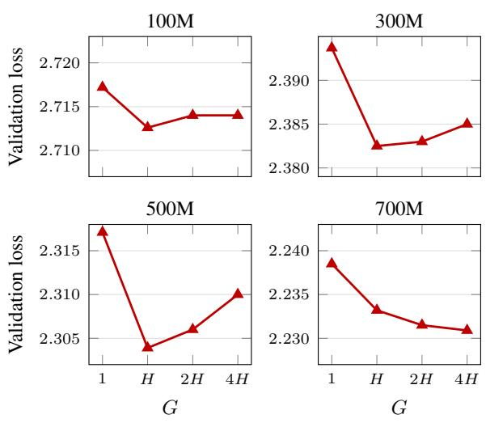  
Figure 5: Validation loss with G groups per role, where H is the number of attention heads; G = 1 is MUD-DFormer.

## 5.4 What do roles and groups read?

Figure 6 shows the coefficients that M3 learns at 300M; Appendix E shows all blocks at both sizes.

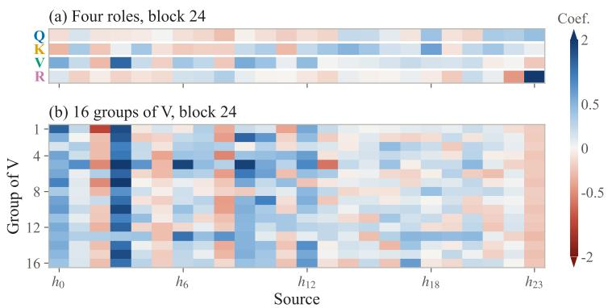

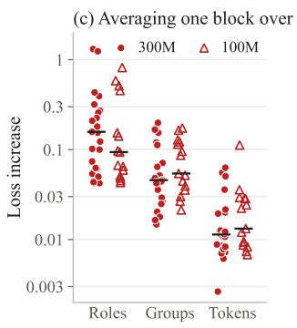  
Figure 6: Coefficients of separately trained 100M and 300M M3 models (G = 16), averaged over validation tokens; colors scale as sign(a)|a|<sup>0.65</sup>. (a), (b): 300M. (c): increase of the validation loss when the coefficients of one block are averaged over roles, groups or tokens; one point per block, bars: medians.

The four roles of a block read different layers (a): in the last block, R puts 2.55 on the latest state, Q and K spread over the upper half of the network, and V draws mostly on $h _ { 3 }$ and the embedding $h _ { 0 }$ while giving the latest state −0.15. The groups of a role differ as well (b): every group of V reads $h _ { 3 }$ , but with weights from 0.31 to 2.15, and the weights of the groups of K on $h _ { 0 }$ range from −0.80 to 0.52, so they disagree even in sign. Reimposing one constraint in a single block, by averaging its coefficients over roles, groups or tokens, raises the loss in every block (c; medians 0.16, 0.046 and 0.011 at 300M). Averaging over groups costs more than over tokens in all 23 blocks, most of all for V (Appendix F).

## 6 Related Work

Residual connections. Residual connections (He et al., 2016) and highway networks (Srivastava et al., 2015) made deep networks trainable, and in Transformers the residual stream is the channel through which layers communicate (Elhage et al., 2021). Much work changes how a block writes to this stream, through normalization placement (Xiong et al., 2020; Liu et al., 2020b) or rescaled residual branches (Bachlechner et al., 2021; Wang et al., 2022). M3 leaves the write unchanged and changes how each block reads.

Cross-layer connections. DenseNet connects every layer to all earlier ones (Huang et al., 2017), and DLCL (Wang et al., 2019) and Dense-Former (Pagliardini et al., 2024) bring learned static weights over earlier layers to Transformers. Hyper-connections widen the residual stream into several streams with partly token-dependent connections (Zhu et al., 2025a; Xie et al., 2025), and frac-connections split the hidden state into fractions (Zhu et al., 2025b); both recombine the current streams rather than read individual earlier layers. Attention residuals attend over the outputs of earlier layers (Kimi Team, 2026), and multi-head and multi-stream variants split this attention by subspace or stream (Luo et al., 2026; Qin et al., 2026); all of them form one input per block. Value residual learning passes the first-layer values to later layers (Zhou et al., 2025). Closest to our work, Deep-CrossAttention (Heddes et al., 2025) and MUD-DFormer (Xiao et al., 2025) form several block inputs from separate mixtures. DeepCrossAttention combines static channel-wise weights with a tokendependent weight per layer, and MUDDFormer generates token-dependent weights per role; in both, the token-dependent weights are shared by all channels, and M3 makes them specific to the group as well, applying to the depth axis the idea of multi-head attention (Vaswani et al., 2017) and fine-grained experts (Dai et al., 2024; Ludziejewski et al., 2024), which split a component into smaller, specialized parts.

## 7 Conclusion

M3 removes the broadcast bottleneck of the residual connection by letting every group of every role read its own token-dependent mixture of earlier layers. From 100M to 1.4B parameters, M3Former matches a Transformer 1.19–1.34× the size of the one it modifies, improves on MUDDFormer at every size, including 1.4B, where MUDDFormer needs PrePostNorm to converge, and carries over to mixture-of-experts models. All three constraints matter, and the first split into groups captures most of the gain per parameter.

## Limitations

Due to computational constraints, our dense models reach 1.4B parameters and our mixture-ofexperts models 4.6B; we leave larger models and longer training to future work. We study decoderonly language models pre-trained on English text, and applying M3 to other architectures, languages and modalities remains to be explored.

## References

Thomas Bachlechner, Bodhisattwa Prasad Majumder, Henry Mao, Gary Cottrell, and Julian McAuley. 2021. ReZero is all you need: Fast convergence at large depth. In Proceedings ofthe Thirty-Seventh Conference on Uncertainty in Artificial Intelligence, volume 161 of Proceedings ofMachine Learning Research, pages 1352–1361.

Yonatan Bisk, Rowan Zellers, Ronan Le Bras, Jianfeng Gao, and Yejin Choi. 2020. PIQA: Reasoning about physical commonsense in natural language. In Proceedings of the AAAI Conference on Artificial Intelligence, volume 34, pages 7432–7439.

Tom B. Brown, Benjamin Mann, Nick Ryder, Melanie Subbiah, Jared Kaplan, Prafulla Dhariwal, Arvind Neelakantan, Pranav Shyam, Girish Sastry, Amanda Askell, et al. 2020. Language models are few-shot learners. In Advances in Neural Information Processing Systems, volume 33, pages 1877–1901.

Christopher Clark, Kenton Lee, Ming-Wei Chang, Tom Kwiatkowski, Michael Collins, and Kristina Toutanova. 2019a. BoolQ: Exploring the surprising difficulty of natural yes/no questions. In Proceedings ofthe 2019 Conference ofthe North American Chapter of the Association for Computational Linguistics, pages 2924–2936.

Kevin Clark, Urvashi Khandelwal, Omer Levy, and Christopher D. Manning. 2019b. What does BERT look at? an analysis of BERT’s attention. In Proceedings of the 2019 ACL Workshop BlackboxNLP: Analyzing and Interpreting Neural Networksfor NLP, pages 276–286.

Peter Clark, Isaac Cowhey, Oren Etzioni, Tushar Khot, Ashish Sabharwal, Carissa Schoenick, and Oyvind Tafjord. 2018. Think you have solved question answering? try ARC, the AI2 reasoning challenge. arXiv preprint arXiv:1803.05457.

Damai Dai, Chengqi Deng, Chenggang Zhao, Runxin Xu, Huazuo Gao, Deli Chen, Jiashi Li, Wangding Zeng, Xingkai Yu, Y. Wu, Zhenda Xie, Y. K. Li, Panpan Huang, Fuli Luo, Chong Ruan, Zhifang Sui, and Wenfeng Liang. 2024. DeepSeekMoE: Towards ultimate expert specialization in mixture-of-experts language models. In Proceedings of the 62nd Annual Meeting of the Association for Computational Linguistics (Volume 1: Long Papers), pages 1280–1297.

Nelson Elhage, Neel Nanda, Catherine Olsson, Tom Henighan, Nicholas Joseph, Ben Mann, Amanda Askell, Yuntao Bai, Anna Chen, Tom Conerly, et al. 2021. A mathematical framework for transformer circuits. Transformer Circuits Thread.

Leo Gao, Jonathan Tow, Baber Abbasi, Stella Biderman, Sid Black, Anthony DiPofi, Charles Foster, Laurence Golding, Jeffrey Hsu, Alain Le Noac’h, Haonan Li, Kyle McDonell, Niklas Muennighoff, Chris Ociepa, Jason Phang, Laria Reynolds, Hailey Schoelkopf, Aviya Skowron, Lintang Sutawika, and 5 others. 2024. The language model evaluation harness. Zenodo.

Andrey Gromov, Kushal Tirumala, Hassan Shapourian, Paolo Glorioso, and Daniel A. Roberts. 2024. The unreasonable ineffectiveness of the deeper layers. arXiv preprint arXiv:2403.17887.

Kaiming He, Xiangyu Zhang, Shaoqing Ren, and Jian Sun. 2016. Deep residual learning for image recognition. In Proceedings of the IEEE Conference on Computer Vision and Pattern Recognition, pages 770– 778.

Mike Heddes, Adel Javanmard, Kyriakos Axiotis, Gang Fu, MohammadHossein Bateni, and Vahab Mirrokni. 2025. DeepCrossAttention: Supercharging transformer residual connections. In Proceedings of the 42nd International Conference on Machine Learning, volume 267 of Proceedings ofMachine Learning Research, pages 22881–22903.

Jordan Hoffmann, Sebastian Borgeaud, Arthur Mensch, Elena Buchatskaya, Trevor Cai, Eliza Rutherford, Diego de Las Casas, Lisa Anne Hendricks, Johannes Welbl, Aidan Clark, et al. 2022. Training computeoptimal large language models. In Advances in Neural Information Processing Systems, volume 35.

Shengding Hu, Yuge Tu, Xu Han, Chaoqun He, Ganqu Cui, Xiang Long, Zhi Zheng, Yewei Fang, Yuxiang Huang, Weilin Zhao, Xinrong Zhang, Zheng Leng Thai, Kaihuo Zhang, Chongyi Wang, Yuan Yao, Chenyang Zhao, Jie Zhou, Jie Cai, Zhongwu Zhai, and 6 others. 2024. MiniCPM: Unveiling the potential of small language models with scalable training strategies. In First Conference on Language Modeling.

Gao Huang, Zhuang Liu, Laurens van der Maaten, and Kilian Q. Weinberger. 2017. Densely connected convolutional networks. In Proceedings of the IEEE Conference on Computer Vision and Pattern Recognition, pages 4700–4708.

Ganesh Jawahar, Benoît Sagot, and Djamé Seddah. 2019. What does BERT learn about the structure of language? In Proceedings of the 57th Annual Meeting of the Association for Computational Linguistics, pages 3651–3657.

Jared Kaplan, Sam McCandlish, Tom Henighan, Tom B. Brown, Benjamin Chess, Rewon Child, Scott Gray, Alec Radford, Jeffrey Wu, and Dario Amodei. 2020.

Scaling laws for neural language models. arXiv preprint arXiv:2001.08361.

Kimi Team. 2026. Attention residuals. arXiv preprint arXiv:2603.15031.

Guokun Lai, Qizhe Xie, Hanxiao Liu, Yiming Yang, and Eduard Hovy. 2017. RACE: Large-scale ReAding comprehension dataset from examinations. In Proceedings of the 2017 Conference on Empirical Methods in Natural Language Processing, pages 785– 794.

Jian Liu, Leyang Cui, Hanmeng Liu, Dandan Huang, Yile Wang, and Yue Zhang. 2020a. LogiQA: A challenge dataset for machine reading comprehension with logical reasoning. In Proceedings ofthe Twenty-Ninth International Joint Conference on Artificial Intelligence, pages 3622–3628.

Liyuan Liu, Xiaodong Liu, Jianfeng Gao, Weizhu Chen, and Jiawei Han. 2020b. Understanding the difficulty of training transformers. In Proceedings of the 2020 Conference on Empirical Methods in Natural Language Processing, pages 5747–5763.

Jan Ludziejewski, Jakub Krajewski, Kamil Adamczewski, Maciej Pióro, Michał Krutul, Szymon Antoniak, Kamil Ciebiera, Krystian Król, Tomasz Odrzygó´zd´z, Piotr Sankowski, Marek Cygan, and Sebastian Jaszczur. 2024. Scaling laws for fine-grained mixture of experts. In Proceedings ofthe 41st International Conference on Machine Learning, volume 235 of Proceedings ofMachine Learning Research, pages 33270–33288.

Cheng Luo, Zefan Cai, and Junjie Hu. 2026. Multi-head attention residuals. arXiv preprint arXiv:2607.27230.

Matteo Pagliardini, Amirkeivan Mohtashami, François Fleuret, and Martin Jaggi. 2024. DenseFormer: Enhancing information flow in transformers via depth weighted averaging. In Advances in Neural Information Processing Systems, volume 37.

Denis Paperno, Germán Kruszewski, Angeliki Lazaridou, Ngoc Quan Pham, Raffaella Bernardi, Sandro Pezzelle, Marco Baroni, Gemma Boleda, and Raquel Fernández. 2016. The LAMBADA dataset: Word prediction requiring a broad discourse context. In Proceedings of the 54th Annual Meeting of the Associationfor Computational Linguistics (Volume 1: Long Papers), pages 1525–1534.

Guilherme Penedo, Hynek Kydlícek, Loubna Ben Al-ˇ lal, Anton Lozhkov, Margaret Mitchell, Colin Raffel, Leandro Von Werra, and Thomas Wolf. 2024. The FineWeb datasets: Decanting the web for the finest text data at scale. In Advances in Neural Information Processing Systems (Datasets and Benchmarks Track), volume 37.

Xiaohan Qin, Xiangdong Zhang, Tuo Dai, Sunan Zou, Huaijin Wu, Yebin Yang, Zhuo Xia, Lin Yao, Yuliang Liu, and Junchi Yan. 2026. Multi-stream attention residuals. arXiv preprint arXiv:2610.13630.

Keisuke Sakaguchi, Ronan Le Bras, Chandra Bhagavatula, and Yejin Choi. 2020. WinoGrande: An adversarial Winograd schema challenge at scale. In Proceedings of the AAAI Conference on Artificial Intelligence, volume 34, pages 8732–8740.

Noam Shazeer. 2020. GLU variants improve transformer. arXiv preprint arXiv:2002.05202.

Rupesh K. Srivastava, Klaus Greff, and Jürgen Schmidhuber. 2015. Training very deep networks. In Advances in Neural Information Processing Systems, volume 28.

Jianlin Su, Murtadha Ahmed, Yu Lu, Shengfeng Pan, Wen Bo, and Yunfeng Liu. 2024. RoFormer: Enhanced transformer with rotary position embedding. Neurocomputing, 568:127063.

Ian Tenney, Dipanjan Das, and Ellie Pavlick. 2019. BERT rediscovers the classical NLP pipeline. In Proceedings of the 57th Annual Meeting of the Association for Computational Linguistics, pages 4593– 4601.

Ashish Vaswani, Noam Shazeer, Niki Parmar, Jakob Uszkoreit, Llion Jones, Aidan N. Gomez, Łukasz Kaiser, and Illia Polosukhin. 2017. Attention is all you need. In Advances in Neural Information Processing Systems, volume 30.

Elena Voita, David Talbot, Fedor Moiseev, Rico Sennrich, and Ivan Titov. 2019. Analyzing multi-head self-attention: Specialized heads do the heavy lifting, the rest can be pruned. In Proceedings of the 57th Annual Meeting of the Association for Computational Linguistics, pages 5797–5808.

Hongyu Wang, Shuming Ma, Li Dong, Shaohan Huang, Dongdong Zhang, and Furu Wei. 2022. DeepNet: Scaling transformers to 1,000 layers. arXiv preprint arXiv:2203.00555.

Qiang Wang, Bei Li, Tong Xiao, Jingbo Zhu, Changliang Li, Derek F. Wong, and Lidia S. Chao. 2019. Learning deep transformer models for machine translation. In Proceedings ofthe 57th Annual Meeting ofthe Associationfor Computational Linguistics, pages 1810–1822.

Johannes Welbl, Nelson F. Liu, and Matt Gardner. 2017. Crowdsourcing multiple choice science questions. In Proceedings ofthe 3rd Workshop on Noisy Usergenerated Text, pages 94–106.

Da Xiao, Qingye Meng, Shengping Li, and Xingyuan Yuan. 2025. MUDDFormer: Breaking residual bottlenecks in transformers via multiway dynamic dense connections. In Proceedings of the 42nd International Conference on Machine Learning, volume 267 of Proceedings of Machine Learning Research, pages 68440–68458.

Zhenda Xie, Yixuan Wei, Huanqi Cao, Chenggang Zhao, Chengqi Deng, Jiashi Li, Damai Dai, Huazuo Gao, Jiang Chang, Kuai Yu, Liang Zhao, Shangyan

Zhou, Zhean Xu, Zhengyan Zhang, Wangding Zeng, Shengding Hu, Yuqing Wang, Jingyang Yuan, Lean Wang, and Wenfeng Liang. 2025. mHC: Manifoldconstrained hyper-connections. arXiv preprint arXiv:2512.24880.

Ruibin Xiong, Yunchang Yang, Di He, Kai Zheng, Shuxin Zheng, Chen Xing, Huishuai Zhang, Yanyan Lan, Liwei Wang, and Tie-Yan Liu. 2020. On layer normalization in the transformer architecture. In Proceedings of the 37th International Conference on Machine Learning, volume 119 of Proceedings of Machine Learning Research, pages 10524–10533.

Rowan Zellers, Ari Holtzman, Yonatan Bisk, Ali Farhadi, and Yejin Choi. 2019. HellaSwag: Can a machine really finish your sentence? In Proceedings ofthe 57th Annual Meeting ofthe Association for Computational Linguistics, pages 4791–4800.

Biao Zhang and Rico Sennrich. 2019. Root mean square layer normalization. In Advances in Neural Information Processing Systems, volume 32.

Peiyuan Zhang, Guangtao Zeng, Tianduo Wang, and Wei Lu. 2024. TinyLlama: An open-source small language model. arXiv preprint arXiv:2401.02385.

Zhanchao Zhou, Tianyi Wu, Zhiyun Jiang, Fares Obeid, and Zhenzhong Lan. 2025. Value residual learning. In Proceedings of the 63rd Annual Meeting of the Associationfor Computational Linguistics (Volume 1: Long Papers), pages 28341–28356.

Defa Zhu, Hongzhi Huang, Zihao Huang, Yutao Zeng, Yunyao Mao, Banggu Wu, Qiyang Min, and Xun Zhou. 2025a. Hyper-connections. In International Conference on Learning Representations.

Defa Zhu, Hongzhi Huang, Jundong Zhou, Zihao Huang, Yutao Zeng, Banggu Wu, Qiyang Min, and Xun Zhou. 2025b. Frac-connections: Fractional extension of hyper-connections. arXiv preprint arXiv:2503.14125.

## A Derivations

This appendix proves the properties of M3 that the main text uses and derives its cost, in the notation of §2. A reader is a pair $i = ( r , g )$ of a role $r \in \mathcal { R }$ and a group g, so a block has 4G readers, and reader i of block ℓ forms $\begin{array} { r } { z _ { \ell , i } = \sum _ { j < \ell } a _ { \ell , i , j } h _ { j } ^ { ( g ) } } \end{array}$

## A.1 Mixing states and mixing updates

Let $\Delta _ { 0 } = h _ { 0 }$ and $\Delta _ { k } = h _ { k } - h _ { k - 1 }$ for $k \geq 1$ be the update of block k, so that $\begin{array} { r } { h _ { j } = \sum _ { k \le j } \Delta _ { k } } \end{array}$

Lemma 1. For any $\begin{array} { r c l c r } { a } & { \in } & { \mathbb { R } ^ { \ell } , } & { \sum _ { j < \ell } a _ { j } h _ { j } } & { = } \end{array}$ $\textstyle \sum _ { k < \ell } b _ { k } \Delta _ { k }$ with $\begin{array} { r } { b _ { k } = \sum _ { j = k } ^ { \ell - 1 } a _ { j } } \end{array}$ , and $a \mapsto b$ is a bijection $o f \mathbb { R } ^ { \ell } .$ . The residual connection, $a = e _ { \ell - 1 }$ gives $b = \mathbf { 1 } ,$ , and a convex combination of states gives $1 = b _ { 0 } \geq b _ { 1 } \geq \cdot \cdot \cdot \geq b _ { \ell - 1 } \geq 0 .$

Proof. Substitute $\begin{array} { r } { h _ { j } \ = \ \sum _ { k \leq j } \Delta _ { k } } \end{array}$ and exchange the sums; the inverse is $a _ { j } = b _ { j } - b _ { j + 1 }$ with $b _ { \ell } : = 0$ For a convex combination, each $b _ { k }$ is a sum of nonnegative weights that sum to one. □

The residual connection thus gives the update of every earlier block the weight one, for every token. A convex mixture, such as a softmax over depth, can only lower the weight of an earlier update, never raise it above one or make it negative, whereas signed, unnormalized coefficients, as in M3, can give the updates any weights $b \in \mathbb { R } ^ { \ell }$

## A.2 Exact initialization

Proposition 1. Let $W _ { \ell , 2 } = 0 ,$ , let $a _ { \ell } ^ { ( 0 ) }$ be one on $j = \ell - 1$ and zero elsewhere for every reader, initialize the output mixer in the same way, and let the scales of N<sub>K</sub> and N<sub>V</sub> equal that $o f \mathrm { N } _ { A }$ . Then, for every input and every value of $W _ { \ell , 1 }$ , M3Former computes the same hidden states and logits as the Transformer with the same remaining parameters.

Proof. Both models share $h _ { 0 } .$ . Suppose they agree on $h _ { 0 } , \ldots , h _ { \ell - 1 }$ . With $W _ { \ell , 2 } = 0$ , Eq. (4) gives $A _ { \ell } = a _ { \ell } ^ { ( 0 ) }$ whatever $W _ { \ell , 1 }$ is, so $z _ { \ell , r } ^ { ( g ) } = h _ { \ell - 1 } ^ { ( g ) }$ for every reader and $z _ { \ell , r } = h _ { \ell - 1 }$ . Since $\mathrm { N } _ { K }$ and $\mathrm { N } _ { V }$ then act as $\mathrm { N } _ { A }$ , Eq. (2) reduces to Eq. (1), and the models agree on $h _ { \ell }$ . By induction they agree on $h _ { L }$ , and the output mixer passes $h _ { L }$ to the output layer. □

## A.3 Nesting of the family

Proposition 2. Let every member of the family of §2.2 use the block of Eq. (2) and a generator of the form of $E q .$ . (4) whose hidden width is at most $m _ { \ell } ,$ and let ${ \mathcal { F } } _ { \mathrm { r e s } } , { \mathcal { F } } _ { \mathrm { d e n s e } } , { \mathcal { F } } _ { \mathrm { r o l e } } , { \mathcal { F } } _ { \mathrm { g r o u p } }$ and $\mathcal { F } _ { \mathrm { M 3 } }$ be the sets of functions computed by the residual connection, dense, multi-role and multigroup mixing, and M3, the last two with the same $G .$ Then ${ \mathcal { F } } _ { \mathrm { r e s } } \subseteq { \mathcal { F } } _ { \mathrm { d e n s e } } \subseteq { \mathcal { F } } _ { \mathrm { r o l e } } \subseteq { \mathcal { F } } _ { \mathrm { M 3 } }$ and ${ \mathcal { F } } _ { \mathrm { d e n s e } } \subseteq { \mathcal { F } } _ { \mathrm { g r o u p } } \subseteq { \mathcal { F } } _ { \mathrm { M 3 } } .$

Proof. With $W _ { \ell , 2 } = 0$ and $a _ { \ell } ^ { ( 0 ) }$ on the latest state, every member computes the residual connection, as in Proposition 1. A generator of smaller hidden width is a generator of width $m _ { \ell }$ whose extra hidden units have zero output weights, so we can take all hidden widths equal to $m _ { \ell }$ . Given multi-role mixing, whose generator outputs are indexed by $( r , j )$ , give M3 the same $W _ { \ell , 1 }$ and set its column $( r , g , j )$ of $W _ { \ell , 2 }$ and entry $( r , g , j )$ of $a _ { \ell } ^ { ( 0 ) }$ to the column and entry $( r , j )$ of multi-role mixing for every ${ g } ;$ then $a _ { \ell , r , g , j } ( t ) = a _ { \ell , r , j } ( t )$ for every token, and the two models compute the same function. Multigroup mixing is embedded in the same way, by repeating its columns and entries $( g , j )$ over the four roles, and dense mixing is embedded in multi-role or multi-group mixing by repeating its columns and entries $j$ over the roles or the groups. The output mixer is embedded in the same way. □

M3 thus computes every function that a coarser member computes, so its lowest attainable training loss is at most theirs; whether training finds the additional functions is what §5.1 tests. With $G = 1$ , M3 is multi-role mixing, which is our MUDDFormer baseline (§3). Attention residuals are not members of the family: their weights are a softmax over the outputs of blocks of layers, computed from all earlier states rather than from $h _ { \ell - 1 }$ alone.

## A.4 Parameters and computation

Summing the generator and the two extra norms of every block and the output mixer, which has one role and $G$ groups, M3 adds

$$
\begin{array} { c } { { P _ { \mathrm { M 3 } } = \displaystyle \sum _ { \ell = 2 } ^ { L } \left[ d m _ { \ell } + 4 G \ell \left( m _ { \ell } + 1 \right) + 2 d \right] } } \\ { { + d m _ { L + 1 } + G ( L + 1 ) ( m _ { L + 1 } + 1 ) } } \end{array}\tag{5}
$$

parameters, the parameter count of our implementation. Per token, block ℓ spends $( d + 4 G \ell )$ m<sub>ℓ</sub> multiply–adds in the generator and 4ℓd in Eq. (3), and the output mixer $( d + G ( L + 1 ) ) m _ { L + 1 } + ( L +$ $1 ) d .$ . If $m _ { \ell }$ were exactly 4ℓ, the generators would add about $2 L ^ { 2 } d + 1 6 G L ^ { 3 } / 3$ parameters, and relative to the $L ( 4 d ^ { 2 } + 3 d d _ { \mathrm { f f } } )$ non-embedding parameters of a Transformer with feed-forward width $d _ { \mathrm { f f } }$

$$
\frac { P _ { \mathrm { M 3 } } } { N } \approx \frac { 2 L + 1 6 G L ^ { 2 } / ( 3 d ) } { 4 d + 3 d _ { \mathrm { f f } } } = O \Bigl ( \frac { L } { d } + \frac { G L ^ { 2 } } { d ^ { 2 } } \Bigr ) ,\tag{6}
$$

so the overhead grows with depth relative to width. In our models, rounding $m _ { \ell }$ up to a multiple of 64 makes $m _ { \ell }$ larger than $^ { 4 \ell , }$ so we compute the overhead exactly from Eq. (5); Table 5 lists it for the models we report.

## A.5 Equivalent size and parameter-matched gain

We fit $L ( N ) = E + A ( N / N _ { 0 } ) ^ { - \alpha }$ with $N _ { 0 } = 1 0 ^ { 8 }$ to the Transformers trained on 20N tokens. A loss $\ell ^ { \star } > E$ is reached by a Transformer of size $N _ { \mathrm { e q } } =$ $N _ { 0 } \big ( ( \ell ^ { \star } - E ) / A \big ) ^ { - 1 / \alpha }$ , and we report $k = N _ { \mathrm { e q } } / N$

Training on $D = 2 0 N$ tokens costs $C \approx 6 N D$ $1 2 0 N ^ { 2 }$ operations, so the Transformer that matches the loss uses $k ^ { 2 }$ times the compute of a Transformer of size N.

To compare the gain of M3 with what its extra parameters would give if they were spent on a larger Transformer, we evaluate the fit at $( 1 + \delta ) N$ where $\delta = P _ { \mathrm { M 3 } } / N$

$$
\begin{array} { l } { { L ( N ) - L \big ( ( 1 + \delta ) N \big ) } } \\ { { \qquad = A ( N / N _ { 0 } ) ^ { - \alpha } \big [ 1 - ( 1 + \delta ) ^ { - \alpha } \big ] . } } \end{array}\tag{7}
$$

This is an estimate under the fitted Transformer curve, not a bound on what parameters in another form could contribute. Table 5 compares it with the observed gain.

<table><tr><td>Size</td><td>G</td><td>Params</td><td>MACs</td><td>Fit</td><td>Observed</td></tr><tr><td>100M</td><td> $H = 1 0$ </td><td>1.44%</td><td>1.85%</td><td>0.0043</td><td>0.0850</td></tr><tr><td>300M</td><td> $H = 1 6$ </td><td>1.40%</td><td>1.78%</td><td>0.0033</td><td>0.0542</td></tr><tr><td>500M</td><td> $H = 1 8$ </td><td>1.40%</td><td>1.80%</td><td>0.0031</td><td>0.0412</td></tr><tr><td>700M</td><td> $4 H = 8 0$ </td><td>3.86%</td><td>4.25%</td><td>0.0081</td><td>0.0438</td></tr><tr><td>1.4B</td><td> $H = 2 6$ </td><td>1.52%</td><td>1.91%</td><td>0.0029</td><td>0.0308</td></tr></table>

Table 5: Overhead of M3 at the reported G, relative to the non-embedding parameters and per-token weight multiply–adds (MACs) of the Transformer, and loss reduction at 20N: from the extra parameters by Eq. (7) (Fit) and observed over the Transformer.

## B Training Details

<table><tr><td>Data</td><td>FineWeb-Edu (sample-350BT), fixed subset</td></tr><tr><td>Tokenizer</td><td>TinyLlama SentencePiece (32,000)</td></tr><tr><td>Sequence length</td><td>2,048  $( 1 3 1 , 0 7 2$  tokens)</td></tr><tr><td>Global batch Optimizer</td><td>64 sequences  $\mathrm { A d a m \mathrm { \hat { W } } } , \beta _ { 1 } = 0 . 9 , \beta _ { 2 } = 0 . 9 5 ,$   $\epsilon = 1 0 ^ { - 8 } , \mathrm { w e i g h t d e c a y } 0 . 1$ </td></tr><tr><td>Gradient clipping Schedule</td><td>global norm 1.0 WSD; linear warmup over 1% of the 20N budget;  $1 - { \sqrt { \cdot } }$  decay to</td></tr><tr><td>Peak learning rate</td><td>10% of the peak over the last 20% of each budget  $( 7 . 6 , 4 . 5 5 , \hat { 3 } . 2 , 2 . 6 , 1 . 9 ) \times 1 0 ^ { - 4 }$ </td></tr><tr><td>Budgets</td><td>for 100M, 300M, 500M, 700M, 1.4B 5N, 10N, 20N tokens; N is the</td></tr><tr><td></td><td>non-embedding parameter count of the Transformer</td></tr><tr><td>Validation Precision</td><td>99,876,864 tokens BF16 computation; FP32 master</td></tr><tr><td>Hardware</td><td>parameters and gradient reduction NVIDIA H200</td></tr></table>

Table 6: Training hyperparameters of the dense models, shared by all methods.

Table 6 lists the training hyperparameters of the dense models. The dense Transformer is a pre-norm decoder with RMSNorm $( \epsilon = 1 0 ^ { - 5 } )$ SwiGLU feed-forward layers, rotary position embeddings with base 10,000, and tied input and output embeddings. RMSNorm scales start at one. The query, key and value projections and the gate projection of the feed-forward layer are drawn from a truncated normal distribution with standard deviation 0.02, and the attention output projection and the up and down projections of the feed-forward layer from one with standard deviation 0.02/ 2ℓ in block ℓ, counted from one. The tied embedding is drawn from a normal distribution with standard deviation $d ^ { - 1 / 2 }$ , truncated at $\pm 3 d ^ { - 1 / 2 }$ . Each backbone parameter is seeded by its name, so all methods start from the same backbone; §2.3 gives the initialization of the M3 mixers. The 1.4B main run has 208,021 steps and the 700M main run 98,013 steps. Table 7 gives the mixture-of-experts architectures of §4.3; parameter counts are those of the Transformer baselines, and MUDDFormer and M3 add their mixers.

<table><tr><td></td><td>Small</td><td>Large</td></tr><tr><td>Blocks L</td><td>24</td><td>28</td></tr><tr><td>Width d</td><td>1024</td><td>1536</td></tr><tr><td>Attention heads (MHA)</td><td>16</td><td>24</td></tr><tr><td>Head dimension</td><td>64</td><td>64</td></tr><tr><td>Experts per layer</td><td>64</td><td>64</td></tr><tr><td>Experts per token</td><td>8</td><td>8</td></tr><tr><td>Expert width</td><td>352</td><td>512</td></tr><tr><td>Expert activation</td><td>SwiGLU</td><td>SwiGLU</td></tr><tr><td>Shared experts</td><td>none</td><td>none</td></tr><tr><td>Vocabulary</td><td>32,000</td><td>32,000</td></tr><tr><td>Embedding and output</td><td>untied</td><td>untied</td></tr><tr><td>Sequence length</td><td>2,048</td><td>2,048</td></tr><tr><td>Total / active params</td><td>1.83B / 0.38B</td><td>4.59B / 0.89B</td></tr><tr><td>M3 groups G</td><td>64</td><td>96</td></tr></table>

Table 7: Mixture-of-experts architectures. Every feedforward layer is a mixture-of-experts layer, and experts are not shared across layers.

## C Full Results

Table 9 lists all runs of the main setup. Table 10 adds all 700M runs. Table 8 gives five-shot downstream accuracy; the five examples are fixed across models, RACE-M is scored per question, and prompts are not truncated. We compare methods at 20N in the main text; with 5N tokens, MUD-DFormer is slightly ahead of M3 at 100M (by 0.003) and of M3 with G = H at 700M (by 0.012).

## D Pseudocode

Figure 7 gives a PyTorch-style reference implementation of one M3Former block; our fused kernel computes the same mixture in a single pass over the history.

```python
# H: [h_0, ..., h_{l-1}], each of shape [T, d]
# returns h_l
def m3_block(H, blk, G):
l, (T, d) = len(H), H[-1].shape
# token-conditioned coefficients a_{l,r,g,j}
x = rms_norm(H[-1]) # no learned scale
A = blk.W2(gelu(blk.W1(x))) + blk.a0
A = A.view(T, 4, G, l) # roles Q, K, V, R
# split every state into G groups
S = torch.stack(H, -1).view(T, G, d // G, l)
Z = torch.einsum('trgj,tgcj->trgc', A, S)
zq, zk, zv, zr = Z.reshape(T, 4, d).unbind(1)
u = zr + blk.attn(blk.na(zq), blk.nk(zk),
blk.nv(zv))
return u + blk.ffn(blk.nf(u))
# init: W2 = 0; a0 = 1 on j = l-1, 0 elsewhere
# -> every role reads h_{l-1} (standard block)
```

Figure 7: PyTorch-style pseudocode of an M3Former block. blk.attn includes the query, key, value and output projections.

## E Learned Coefficients

Figures 8–10 extend Figure 6 with the same models (G = 16). Figure 8 shows the group-averaged coefficients of every role in every block, Figure 9 all 16 groups of every role in the last block at 300M, and Figure 10 the weights on the latest state and on the embedding through depth. Through the middle of the network, every role gives the latest state at most 0.73, far below the 1 of the residual connection; only R puts more than 1 on it, and only in the last blocks; V reads the embedding in the first blocks and again in the last third of the network, and K subtracts it in the last block. In the last block, the groups of R agree on the latest state, whereas the groups of Q and K read different layers.

## F Interventions on the Coefficients

Figure 11 details the interventions of Figure 6c. We run the models of Figure 6 on 128 validation sequences of 2048 tokens and replace the coefficients of one block by an average: over its four roles, over the groups of each role, or over tokens, using the token means on 64 other validation sequences. Every sequence sees every intervention, and each intervention of Figure 6c raises the loss by at least

<table><tr><td>Size</td><td>Model</td><td>LAMBADA</td><td>PIQA</td><td>WinoGrande</td><td>ARC-E</td><td>ARC-C</td><td>SciQ</td><td>LogiQA</td><td>BoolQ</td><td>HellaSwag</td><td>RACE-M</td><td>Avg</td></tr><tr><td></td><td>Transformer</td><td>29.90</td><td>68.72</td><td>55.33</td><td>65.70</td><td>32.85</td><td>90.20</td><td>22.43</td><td>62.26</td><td>45.71</td><td>41.50</td><td>51.46</td></tr><tr><td>700M</td><td>AttnRes</td><td>30.04</td><td>67.41</td><td>52.80</td><td>66.37</td><td>34.04</td><td>90.60</td><td>20.58</td><td>56.73</td><td>45.37</td><td>41.57</td><td>50.55</td></tr><tr><td></td><td>MUDDFormer M3</td><td>30.56 33.71</td><td>68.66</td><td>54.06 55.96</td><td>68.48</td><td>34.47</td><td>90.40</td><td>25.04</td><td>58.65</td><td>47.06</td><td>42.20</td><td>51.96</td></tr><tr><td></td><td></td><td></td><td>69.04</td><td></td><td>68.69</td><td>34.90</td><td>91.80</td><td>23.35</td><td>53.15</td><td>47.84</td><td>43.38</td><td>52.18</td></tr><tr><td></td><td>Transformer</td><td>36.25</td><td>72.25</td><td>59.35</td><td>72.39</td><td>39.16</td><td>93.90</td><td>22.43</td><td>62.78</td><td>54.67</td><td>45.26</td><td>55.85</td></tr><tr><td>1.4B</td><td>AttnRes</td><td>40.40</td><td>71.55</td><td>58.64</td><td>72.35</td><td>40.36</td><td>93.40</td><td>23.50</td><td>62.97</td><td>54.72</td><td>44.85</td><td>56.27</td></tr><tr><td>M3</td><td></td><td>40.42</td><td>71.65</td><td>61.17</td><td>72.90</td><td>39.51</td><td>94.60</td><td>21.81</td><td>59.69</td><td>56.28</td><td>47.14</td><td>56.52</td></tr><tr><td></td><td>Transformer</td><td>26.14</td><td>69.04</td><td>51.85</td><td>65.78</td><td>33.28</td><td>88.60</td><td>25.81</td><td>56.82</td><td>44.19</td><td>36.00</td><td>49.75</td></tr><tr><td>1.8B-</td><td>AttnRes</td><td>24.65</td><td>64.64</td><td>53.59</td><td>56.40</td><td>28.24</td><td>85.80</td><td>22.58</td><td>43.46</td><td>38.07</td><td>36.00</td><td>45.34</td></tr><tr><td>A0.38B</td><td>MUDDFormer</td><td>24.53</td><td>67.90</td><td>54.30</td><td>63.05</td><td>32.76</td><td>89.20</td><td>25.81</td><td>59.36</td><td>42.87</td><td>39.35</td><td>49.91</td></tr><tr><td></td><td>M3</td><td>26.57</td><td>67.57</td><td>51.38</td><td>64.65</td><td>32.34</td><td>89.10</td><td>26.73</td><td>53.06</td><td>44.84</td><td>38.65</td><td>49.49</td></tr><tr><td>4.6B-</td><td>Transformer</td><td>36.99</td><td>73.01</td><td>56.99</td><td>71.97</td><td>40.27</td><td>92.30</td><td>21.51</td><td>60.24</td><td>54.24</td><td>43.31</td><td>55.08</td></tr><tr><td>A0.89B</td><td>M3</td><td>36.02</td><td>71.60</td><td>56.67</td><td>71.97</td><td>38.74</td><td>93.30</td><td>23.96</td><td>61.19</td><td>55.14</td><td>46.03</td><td>55.46</td></tr></table>

Table 8: Five-shot downstream accuracy (%) at 20 training tokens per parameter, with the metrics of Table 3. Bold: best at each size.

<table><tr><td>Size</td><td>D</td><td>Tokens</td><td>Transf.</td><td>AttnRes</td><td>MUDDFormer</td><td>M3</td></tr><tr><td>100M</td><td>5N</td><td>0.41B</td><td>3.0899</td><td>3.0447</td><td>2.9780</td><td>2.9811</td></tr><tr><td></td><td>10N</td><td>0.81B</td><td>2.9209</td><td>2.8743</td><td>2.8289</td><td>2.8273</td></tr><tr><td></td><td>20N</td><td>1.63B</td><td>2.7976</td><td>2.7507</td><td>2.7172</td><td>2.7126</td></tr><tr><td>300M</td><td>5N</td><td>1.54B</td><td>2.6395</td><td>2.6183</td><td>2.5836</td><td>2.5724</td></tr><tr><td></td><td>10N</td><td>3.08B</td><td>2.5243</td><td>2.5043</td><td>2.4774</td><td>2.4669</td></tr><tr><td></td><td>20N</td><td>6.17B</td><td>2.4367</td><td>2.4168</td><td>2.3937</td><td>2.3825</td></tr><tr><td>500M</td><td>5N</td><td>2.29B</td><td>2.5368</td><td>2.5292</td><td>2.5043</td><td>2.4878</td></tr><tr><td></td><td>10N</td><td>4.58B</td><td>2.4278</td><td>2.4257</td><td>2.4002</td><td>2.3853</td></tr><tr><td></td><td>20N</td><td>9.17B</td><td>2.3452</td><td>2.3447</td><td>2.3171</td><td>2.3039</td></tr><tr><td>700M</td><td>5N</td><td>3.21B</td><td>2.4566</td><td>2.4455</td><td>2.4139</td><td>2.4055</td></tr><tr><td></td><td>10N</td><td>6.42B</td><td>2.3534</td><td>2.3469</td><td>2.3159</td><td>2.3087</td></tr><tr><td></td><td>20N</td><td>12.85B</td><td>2.2747</td><td>2.2692</td><td>2.2385</td><td>2.2309</td></tr><tr><td>1.4B</td><td>5N</td><td>6.82B</td><td>2.2763</td><td>2.2594</td><td></td><td>2.2428</td></tr><tr><td></td><td>10N</td><td>13.63B</td><td>2.1870</td><td>2.1732</td><td></td><td>2.1556</td></tr><tr><td></td><td>20N</td><td>27.27B</td><td>2.1193</td><td>2.1053</td><td>diverged</td><td>2.0884</td></tr></table>

Table 9: Validation loss of all runs in the main setup. M3 uses the best G at each size (Table 5). Attention residuals use blocks of four layers. Multi-group mixing (Table 4) is trained at 20N only, except at 700M (Table 10).

5.9 standard errors over the sequences. Averaging over the four roles, which mixes the residual input with the normalized query, key and value inputs, costs most in the last blocks (a). Averaged one role at a time, the groups matter most for V at both sizes, whose groups read $h _ { 3 }$ with weights from 0.31 to 2.15 in the last block (Figure 6b), and the token matters least for Q (b, c). The dependence on the token is concentrated: 10% of the tokens carry 92% of the loss increase summed over blocks at 300M and 87% at 100M, and positions whose next token continues the current word lose 2.3 times as much as other positions at both sizes (d), mostly through R. Applied to all blocks at once, averaging over tokens, groups and roles raises the loss by 1.2, 6.2 and 8.4 at 300M.

<table><tr><td>700M</td><td>5N</td><td>10N</td><td>20N</td></tr><tr><td>Transformer</td><td>2.4566</td><td>2.3534</td><td>2.2747</td></tr><tr><td>Attention residuals</td><td>2.4455</td><td>2.3469</td><td>2.2692</td></tr><tr><td>Multi-group, G = 4H</td><td>2.4349</td><td>2.3316</td><td>2.2533</td></tr><tr><td>MUDDFormer</td><td>2.4139</td><td>2.3159</td><td>2.2385</td></tr><tr><td>M3, G = H</td><td>2.4259</td><td>2.3108</td><td>2.2332</td></tr><tr><td>M3, G = 2H</td><td>2.4032</td><td>2.3099</td><td>2.2315</td></tr><tr><td>M3, G = 4H</td><td>2.4055</td><td>2.3087</td><td>2.2309</td></tr></table>

Table 10: All 700M runs of the main setup (H = 20).

K  
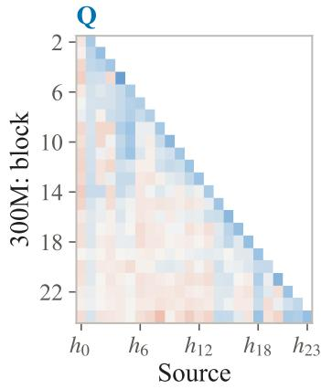

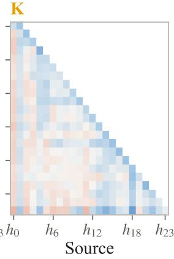

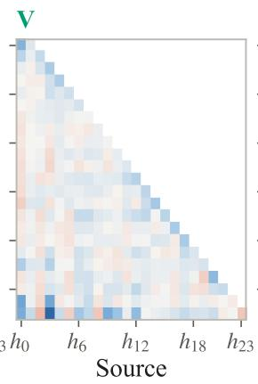

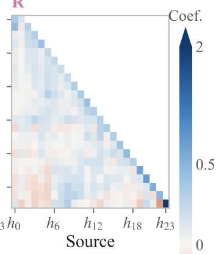

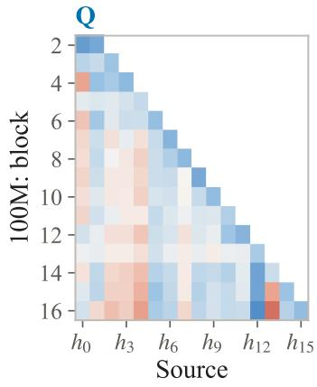

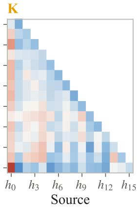

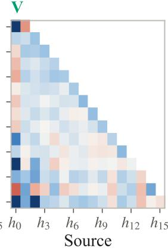

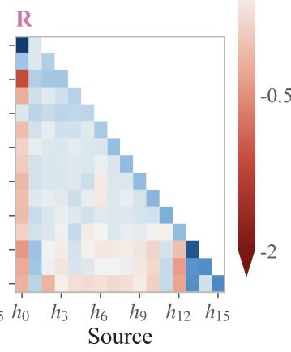  
Figure 8: Coefficients of every role on every earlier state in every block, averaged over groups and validation tokens, with the colors of Figure 6. Top: 300M; bottom: 100M.

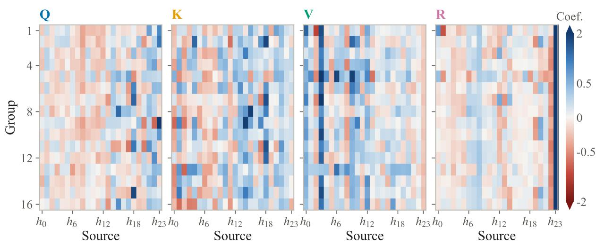  
Figure 9: Coefficients of the 16 groups of every role in the last block of the 300M model, averaged over validation tokens, with the colors of Figure 6.

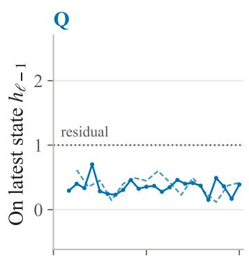

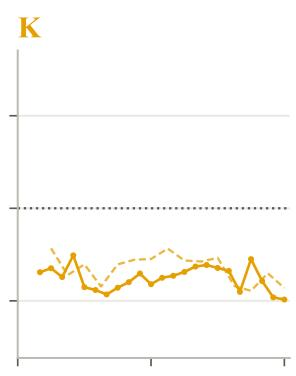

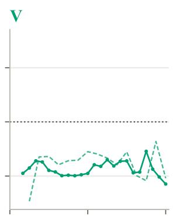

R  
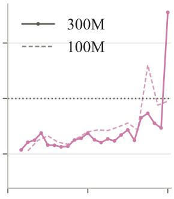

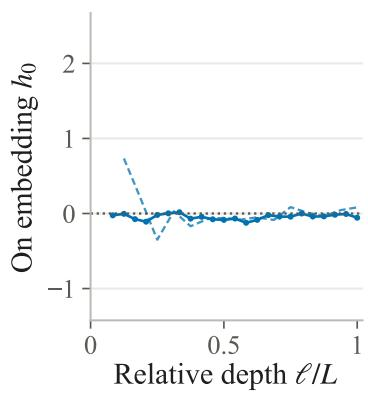

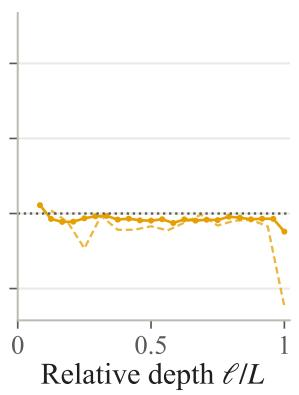

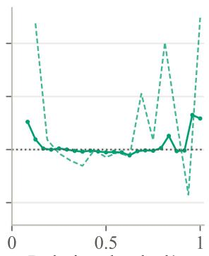  
Relative depth /L

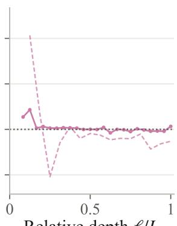  
Relative depth /L  
Figure 10: Weight of every role on the latest state (a) and on the embedding (b), averaged over groups and validation tokens, against relative depth.

(a) Through depth  
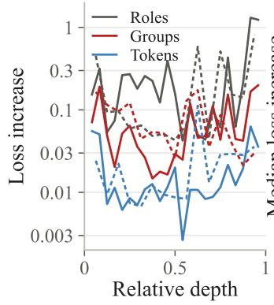

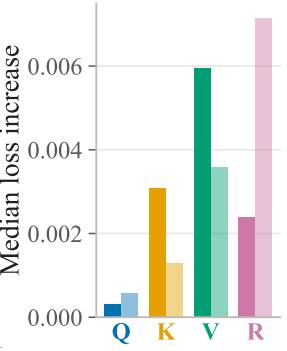  
(b) Tokens, per role

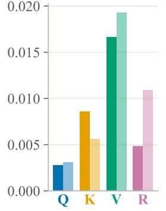  
(c) Groups, per role

(d) Tokens, per position  
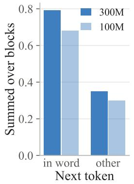  
Figure 11: Interventions of Figure 6c. (a) Loss increase against relative depth; solid: 300M, dashed: 100M. (b), (c) Median over blocks of the loss increase when only one role is averaged over tokens (b) or over its groups (c). (d) Loss increase from averaging over tokens, summed over blocks, at positions whose next token continues the current word (in word) and at other positions. Dark: 300M; light: 100M.