# NIR: Approximate Neural Instance Retrieval for ALCIQ

N’Dah Jean Kouagou

ndah.jean.kouagou@upb.de

Pritilata Saha

psaha@mail.uni-paderborn.de

Caglar Demir

caglar.demir@upb.de

Axel-Cyrille Ngonga Ngomo

axel.ngonga@upb.de

Data Science Group, Heinz Nixdorf Institute, Paderborn University, Germany

## Abstract

Instance retrieval is the main bottleneck of concept-learning systems based on refinement operators. We present NIR, a family of neural instance retrievers for ALCIQ that output graded membership scores from knowledge graph embeddings. We compare tokenizationbased encoders (GRU, LSTM, Transformer) with a Compositional encoder that mirrors DL operators via primitive sub-networks. On eight benchmarks, all variants approximate Pellet closely on complete knowledge bases, while the Transformer model is most robust under incompleteness. The source code of our approach is at https://github.com/dice-group/ owlapy.

Keywords: Instance retrieval; description logics; neural network; approximate reasoning

## 1. Introduction

Class expression learning (CEL) Lehmann et al. (2011); Kouagou (2025), also known as concept learning, allows for explainable node classification on RDF knowledge graphs (KGs). Given a set of positive and a set of negative examples, CEL approaches learn a concept in a description logic (DL) that describes (ideally all) positive examples while excluding as many negative examples as possible Demir and Ngomo (2023); Kouagou (2025). For instance, ≥ 4 numWheels.⊤ ⊓ ∃ supports.WiFi ⊓ ∃ canMove.Object is a concept in the DL ALCQ which describes the skills of machines in Industry 4.0 Demir et al. (2022). Individuals (e.g., machines) are classified as positive if they have at least four wheels, support WiFi, and can move at least one object. Importantly, these skills are directly encoded into the syntactic representation of the class expression and are both human-readable (e.g., ≥ 4 numWheels.⊤, ∃ supports.WiFi) and machine-readable (see Table 1 for semantics of description logics). Consequently, concepts are white-box models Kouagou (2025) and hence well suited for the implementation of explainable AI pipelines.

Most existing approaches for CEL are search-based and rely on symbolic reasoners (e.g., Pellet Sirin et al. (2007) and HermiT Glimm et al. (2014)) to retrieve instances of candidate concepts and to subsequently evaluate the quality of these concepts. Instance retrieval is known as the main bottleneck of CEL Karalis et al. (2024); Sarker and Hitzler (2019). This is because a reasoner is invoked repeatedly to retrieve instances of class expressions during CEL—typically, thousands of invocations are required to solve a learning problem. Another inherent limitation of symbolic reasoners is their inability to deal with incompleteness in data Teyou et al. (2025)—they lack native support for approximate reasoning when assertions are missing.

During CEL, each candidate concept must therefore be evaluated by deciding, for many individuals, whether they are instances of that concept. To make this concrete, consider the Animals benchmark from DL-Learner, one of the eight knowledge bases used in our evaluation. Its ABox contains 20 atomic assertions such as Eel(eel01) and Eagle(eagle01); names like animals#eel01 refer to individual eel01 in the benchmark namespace. The TBox defines taxonomic and property constraints, e.g.,

## Eel ⊑ Animal ⊓ HasEggs ⊓ HasGills ⊓ ∃ habitat.Water ⊓ = 0 hasBodyPart.Leg.

A CEL system may ask whether eagle01 is an instance of a complex candidate concept such as ¬Penguin ⊓ ∀hasCovering.Feathers. A symbolic retriever answers from what is entailed by the available axioms under standard DL semantics. When ABox assertions are randomly removed to simulate incompleteness (Section 5), exact retrieval can miss individuals whose supporting evidence is absent, whereas knowledge graph embeddings can encode regularities across individuals and relations that remain informative under missing assertions.

Several approaches aim to reduce the overall cost of CEL, including pruning Lehmann et al. (2011), neural class expression synthesizers (NCES) Kouagou et al. (2023), ECII Sarker and Hitzler (2019), and semantics-aware caching Teyou et al. (2026). NCES use neural networks to directly synthesize solutions to learning problems without a search process, but require pretraining data that is itself constructed with symbolic reasoners. ECII invokes a reasoner only once to materialize an input knowledge base, then constructs candidate solutions from role fillers and Boolean operators, yet with limited expressiveness. None of these approaches replace the repeated instance retrieval step with a fast, embedding-based retriever that remains efective on incomplete knowledge bases.

In this work, we investigate neural networks and knowledge graph embeddings for approximate, scalable instance retrieval. We introduce NIR, a family of retrievers for ALCIQ that estimate $p ( C ( a ) )$ given a concept C and an individual a. Rather than committing to a single architecture, we compare tokenization-based models (GRU, LSTM, Transformer), which read the syntax of C as a token sequence, with a Compositional model that encodes DL operators through dedicated sub-networks. Our evaluation on eight datasets shows that all variants achieve high agreement with Pellet on complete knowledge bases, but they difer in speed, robustness to incompleteness, and extensibility.

The rest of the paper is organized as follows. Section 2 presents the necessary background for understanding the paper. In Section 3, we describe related works and highlight their strengths and weaknesses. In Section 4, we present our approach for robust instance retrieval, and experimental results in Section 5. Section 6 concludes the paper.

## 2. Background

## 2.1. Description Logics and Reasoning

Description logics are a family of languages for formal representation of knowledge Baader (2003); Kouagou (2025). They have applications in artificial intelligence, the semantic web, bio-informatics, and automated reasoning Kouagou (2025). In this work, we target the description logic ALCIQ which extends the well-known and widely adopted Attributive

Language with Complements (ALC) by adding qualified number restrictions and inverse roles. Let A be a named concept, R a named role, and n a natural number with $n \geq 0$ Concepts in ALCIQ can be built as follows:

1. ⊤, ⊥, A are concepts,

2. If R is an abstract role, then R− is also a role (inverse role),

3. If C, D are concepts and R a role, then the following are concepts: ${ \cal C } ~ \sqcap ~ { \cal D } , { \cal C }$ ⊔ $D , \neg C , \forall \ R . C , \exists \ R . C , \geq n \ R . C , \leq n \ R . C , { \mathrm { ~ a n d ~ } } = n \ R . C$

The syntax and semantics of ALCIQ are presented in Table 1. In the table, a and b are individuals, $\mathcal { I } = ( \Delta ^ { \tau } , \cdot ^ { \tau } )$ is an interpretation, where ·I is the interpretation function and $\Delta ^ { \mathcal { I } }$ the domain. Reasoning in expressive DLs is computationally expensive Kazakov

Table 1: Syntax and Semantics of ALCIQ. $\mathcal { I } = ( \Delta ^ { \mathcal { I } } , \cdot ^ { \mathcal { I } } )$ is an interpretation.
<table><tr><td>Construct</td><td>Synthax</td><td>Semantics</td></tr><tr><td>Top concept</td><td> $\top$ </td><td> $\Delta ^ { \mathcal { I } }$ </td></tr><tr><td>Bottom concept</td><td> $\perp$ </td><td>∅</td></tr><tr><td>Atomic concept</td><td>C</td><td> $\{ a \in \Delta ^ { \mathcal { T } } : a \in C ^ { \mathcal { T } } \}$ </td></tr><tr><td>Negation</td><td> $\lnot C$ </td><td> $\Delta ^ { \underline { { \tau } } } \backslash C ^ { \underline { { \tau } } }$ </td></tr><tr><td>Conjunction</td><td> $C \cap D$ </td><td> $C ^ { \mathbb { Z } } \cap D ^ { \mathbb { Z } }$ </td></tr><tr><td>Disjunction</td><td> $C \sqcup D$ </td><td> $C ^ { \mathcal { T } } \cup D ^ { \mathcal { T } }$ </td></tr><tr><td>Universal role restriction</td><td> $\forall \ : R . C$ </td><td> $\{ a : ( a , b ) \in R ^ { \mathcal { I } }  b \in C ^ { \mathcal { L } } \}$ </td></tr><tr><td>Existential role restriction</td><td> $\exists ~ R . C$ </td><td> $\{ a : \exists b \in C { \mathrm { ~ a n d ~ } } ( a , b ) \in R ^ { \mathcal { L } } \}$ </td></tr><tr><td>Min. cardinality restriction</td><td> $\ge n \ : R . C$ </td><td> $\{ a : | \{ b : ( a , b ) \in R ^ { \mathbb { Z } } \wedge b \in C ^ { \mathbb { Z } } \} | \geq n \}$ </td></tr><tr><td>Max. cardinality restriction</td><td> $\leq n \ R . C$ </td><td> $\{ a : | \{ b : ( a , b ) \in R ^ { \mathbb { Z } } \wedge b \in C ^ { \mathbb { Z } } \} | \leq n \}$ </td></tr><tr><td>Exact cardinality restriction</td><td> $= n R . C$ </td><td> $\{ a : | \{ b : ( a , b ) \in R ^ { \mathbb { Z } } \wedge b \in C ^ { \mathbb { Z } } \} | = n \}$ </td></tr></table>

(2008). Additionally, real-world DL knowledge bases (e.g., DBpedia, Wikidata) are large and often incomplete, prompting the need for more robust and scalable reasoning engines for practical applications. Existing DL reasoners such as HermiT Glimm et al. (2014) and Pellet Sirin et al. (2007) implement hard-coded heuristics (e.g., the hyper-tableau algorithm) for reasoning. They cannot infer plausible assertions that are not directly entailable by the considered knowledge base, which can be a shortcoming on incomplete knowledge bases. The approach we propose herein supports approximate reasoning and can inherently handle incomplete DL knowledge bases by leveraging knowledge graph embeddings.

## 2.2. Knowledge Graph Embeddings

Knowledge graphs are graph-structured knowledge bases intended to gather and convey knowledge of the real world, with nodes and edges representing entities and relation types, respectively Hogan et al. (2022). To facilitate downstream applications, knowledge graphs are embedded into vector spaces such as $\mathbb { R } ^ { d }$ Bordes et al. (2013), $\mathbb { C } ^ { d }$ Trouillon et al. (2016), or even Cliford spaces $C l _ { p , q , r }$ Kamdem Teyou et al. (2024). This is often achieved by using a knowledge graph embedding (KGE) model Φ to map entities and relation types to vectors such that most relationships within the original graph are retained. Most importantly, the KGE model allows for new links to be inferred using scoring functions, which is essential for knowledge completion Shen et al. (2022). KGEs also have applications in explainable AI. For instance, NCES Kouagou et al. (2023) and Drill Demir and Ngomo (2023) leverage knowledge graph embeddings to tackle CEL at scale. Our proposed approach employs KGEs the same way for robust and scalable instance retrieval, see Section 4.

## 3. Related Work

Several recent studies have investigated generating ontology embeddings Chen et al. (2025). However, most of them do not support instance retrieval queries or are limited only to atomic concepts. Other works explored representing description logic concepts as geometrical shapes, e.g., boxes, roles as afine transformations, individuals as points, and then jointly training the resulting model Xiong et al. (2022). Yet, these works support only the lightweight DL $\mathcal { E L } + +$ , focus on learning concept inclusions, and are not extensively evaluated on instance retrieval.

For expressive DLs such as ALC, approaches focusing primarily on ontology satisfiability have been proposed Özçep et al. (2020). The core aim of these approaches is to show that an ontology is satisfiable if and only if it admits a satisfying geometrical structure. For instance, Özçep et al. (2020) proposed to use al-cones, i.e., sets X of the form $X = \Pi _ { i = 1 } ^ { d } X _ { i }$ with $X _ { i } \in \{ \mathbb { R } , \mathbb { R } _ { + } , \mathbb { R } _ { - } , \{ 0 \} \}$ , to represent concepts in ALC, but it is unclear how instances of these concepts can be retrieved. Other works such as Chen et al. (2021) map OWL ontologies to RDF knowledge graphs and employ random walks and Word2Vec Church (2017) to learn class subsumptions, without specifying how instance retrieval can be performed.

To overcome the runtime limitations of instance retrieval engines, Teyou et al. (2026) proposed a semantics-aware caching algorithm. Their approach employs a subsumptionaware cache that maps concepts to instance sets using crisp set operations. ECII Sarker and Hitzler (2019) proposed to use an instance retrieval engine only once to fully materialize a given knowledge base before class expression learning. Afterwards, candidate class expressions for each learning problem are constructed by strategically applying role restrictions and conjunction/disjunction operators following membership information of input examples and their relationships to other individuals in the materialized knowledge base. The embeddingbased reasoner (EBR) Teyou et al. (2025) uses knowledge graph embedding models and description logic semantics to translate the instance retrieval problem into complex query answering over an input knowledge base. While this approach supports approximate reasoning as ours, it is computationally intensive on large datasets and often fails on long class expressions as suggested by our experimental results.

## 4. Proposed Methods

We study two encoder designs for NIR. Tokenization-based models treat a concept as a token sequence and are our default choice in experiments when knowledge bases may be incomplete. The Compositional model instead composes primitive networks according to the logical structure of $C ;$ it tracks Pellet closely on complete knowledge bases and can be extended with new sub-networks for additional constructors, but relies on Pellet to encode atomic concepts.

## 4.1. Tokenization-based Approaches

Tokenization-based models use the same configurable embedding dimension d as the Compositional retriever; in our experiments, d=256, with hidden size 128, max sequence length 128, vocabulary size 512, and dropout 0.1. A concept is tokenized (byte-pair encoding Sennrich et al. (2015)) and mapped to token embeddings $\mathbf { x } _ { i } \in \mathbb { R } ^ { d }$

## 4.1.1. RNN-based Approach.

Three GRU or LSTM layers Cho et al. (2014); Hochreiter and Schmidhuber (1997) are followed by two linear layers. Given hidden states $\mathbf { h } _ { 1 } , \ldots , \mathbf { h } _ { n }$ and individual embedding a,

$$
\mathbf { h } = \frac { 1 } { n } \sum _ { i = 1 } ^ { n } \mathbf { h } _ { i } , \mathbf { \Psi } \mathbf { u } = \operatorname { c o n c a t } ( \mathbf { h } , \mathbf { a } ) , \ p = s i g m o i d ( \mathrm { L i n } ( \mathbf { u } ) ) ,\tag{1}
$$

where Lin(.) denotes linear layers with GELU activation, and $p$ the probability that individual a is an instance of the given concept C.

## 4.1.2. Transformer-based Approach.

A 3-layer Transformer encoder Vaswani et al. (2017) with 4 heads applies positional encoding to token embeddings, uses average pooling to obtain $\mathbf { v } ,$ and concatenates v with a before the same two linear layers as above.

## 4.2. Compositional Neural Instance Retriever

The semantics of ALCIQ can be reduced to a small set of primitives. The binary connective nand Frank (2004), defined by $\operatorname { N A N D } ( A , B ) : = \neg ( A \sqcap B )$ , is functionally complete for the Boolean constructors: negation is $\neg C = \mathrm { N A N D } ( C , C )$ , union is $C \sqcup D = \mathrm { N A N D } \big ( \neg C , \neg D \big )$ , and intersection follows via De Morgan as $C \cap D = \neg ( \neg C \sqcup \neg D )$ . Together with role inversion and cardinality restrictions, we obtain a Compositional retriever that mirrors the syntax of ALCIQ through primitive sub-networks. New constructors can be supported by adding further sub-networks without retraining the entire model.

We assume a KGE model that maps each individual a and role R to vectors a, $\mathbf { R } \in \mathbb { R } ^ { d }$ where d is the embedding dimension of the chosen KGE model and can be set to any value supported by that model (we use $d { = } 2 5 6$ in our experiments). Table 2 summarizes the notation used in this section. The encoder $\phi$ composes three primitive maps $\phi _ { \mathrm { N A N D } } , ~ \phi _ { \leq } ,$ and $\phi _ { \mathrm { i n v } }$ (GELU feed-forward, hidden size 128); each is implemented as a neural module $( \phi _ { \dots } , f _ { \phi _ { \dots } } )$ —for example, $\left( \phi _ { \mathrm { N A N D } } , f _ { \phi _ { \mathrm { N A N D } } } \right)$ —where $f _ { \phi _ { \dots } }$ is the scoring head that returns a logit for $( C , a )$ . Atomic concepts are mapped as $\phi ( C ) \stackrel { } { = } h ( \rho ( C ) )$ , where $\rho$ is Pellet Sirin et al. (2007), h is PMA Lee et al. (2019), $\phi ( \perp ) = \emptyset$ , and $\rho ( { \top } )$ returns all individuals. Let $\phi _ { \mathrm { l a s t } } \in \{ \phi _ { \mathrm { N A N D } } , \phi _ { \leq } , \phi _ { \mathrm { i n v } } \}$ denote the outermost primitive in the parse tree of $C .$ We then define $\mathrm { N I R } ( \phi ( C ) , \mathbf { a } ) : = \sigma ( f _ { \phi _ { \mathrm { l a s t } } } ( \phi ( C ) , \mathbf { a } ) ) \in [ 0 , 1 ]$ as an estimate of $p ( C ( a ) )$ .

Complex concepts are mapped recursively by $\phi ;$ R denotes the KGE vector of role $R .$ Table 3 lists the non-Boolean cases; ¬, ⊔, and ⊓ follow from $\phi _ { \mathrm { N A N D } }$ via the reductions at the start of this section. Each row reduces an ALCIQ constructor to the primitive maps $\phi _ { \mathrm { N A N D } }$ $\phi _ { \leq }$ , and $\phi _ { \mathrm { i n v } }$ . Universal restrictions use $\forall R . C \equiv \lnot \exists R . \lnot C$ , implemented as $\phi < \left( 0 , \mathbf { R } , \phi ( \lnot C ) \right)$ Existential and at-least-n restrictions are cardinality-based: $\exists R . C \equiv \geq 1 R . C$ , and for $n \geq 1$ we have $\geq n R . C \equiv \neg ( \leq n - 1 R . C )$ ; the case $n { = } 0$ is $\phi ( { \top } )$ since every individual is either Rlinked to at least one individual of type $C$ or to exactly 0 individuals of type C. Accordingly, $\phi ( \exists R . C )$ and $\phi ( \geq n R . C )$ apply $\phi _ { \mathrm { N A N D } }$ to two copies of the same $\phi _ { \leq }$ output—the same pattern as $\phi ( \lnot C ) = \phi _ { \mathrm { N A N D } } ( \phi ( C ) , \phi ( C ) )$ , because each applies a negated ≤-restriction. Role inversion uses $\phi _ { \mathrm { i n v } } ; ~ \le ~ n R . C$ is handled directly by $\phi _ { \leq }$ . PMA is pretrained on atomic concepts using positive instances $E ^ { + }$ and sampled non-members $E ^ { - }$ −; we use $\gamma = 0 . 5$ to separate them. Complex concept embeddings are then obtained by composing the rules in Tables 2 and 3.

Table 2: Notation for the Compositional retriever (our experiments use $d { = } 2 5 6$ , hidden size 128, dropout 0.1, threshold $\gamma { = } 0 . 5 )$
<table><tr><td>Symbol</td><td>Meaning</td></tr><tr><td> $\phi ( C )$ </td><td>embedding of concept C (composition of  $\phi _ { \mathrm { N A N D } } , \phi _ { \leq } , \phi _ { \mathrm { i n v } } )$ </td></tr><tr><td> $\mathbf { a } , \mathbf { R }$ </td><td>KGE vectors for individual a and role R</td></tr><tr><td> $\rho ( C ) , h ( \cdot )$ </td><td>instance set from Pellet; PMA pooling over all a&#x27;s from C</td></tr><tr><td> $\phi _ { \mathrm { N A N D } } , \phi _ { \leq } , \phi _ { \mathrm { i n v } }$ </td><td>primitive maps used in  $\phi ( \cdot )$ </td></tr><tr><td> $( \phi _ { \mathrm { N A N D } } , f _ { \phi _ { \mathrm { N A N D } } } ) , ( \phi _ { \leq } , f _ { \phi _ { \leq } } ) , ( \phi _ { \mathrm { i n v } } , f _ { \phi _ { \mathrm { i n v } } } )$ </td><td>neural modules (map and scoring head)</td></tr><tr><td> $f _ { \phi _ { \dots } }$ </td><td>scoring head of primitive  $\phi _ { \dots }$  (logit for  $( C , a ) )$ </td></tr><tr><td> $\phi _ { \mathrm { l a s t } }$ </td><td>outermost primitive in the parse tree of C (one of  $\phi _ { \mathrm { N A N D } } , ~ \phi _ { \leq } , ~ \phi _ { \mathrm { i n v } } )$ </td></tr></table>

Table 3: Recursive definition of $\phi .$
<table><tr><td>Constructor</td><td> $\phi ( \cdot )$ </td></tr><tr><td> $\exists R . C$ </td><td> $\phi _ { \mathrm { N A N D } } \big ( \phi _ { \le } ( 0 , \mathbf { R } , \phi ( C ) ) , \phi _ { \le } ( 0 , \mathbf { R } , \phi ( C ) ) \big )$ </td></tr><tr><td> $\forall R . C$ </td><td> $\boldsymbol { \phi } _ { \le } ( 0 , \mathbf { R } , \boldsymbol { \phi } ( \lnot C ) )$ </td></tr><tr><td> $R ^ { - }$ </td><td> $\phi _ { \mathrm { i n v } } ( \mathbf { R } )$ </td></tr><tr><td> $\leq n R . C$ </td><td> $\phi _ { \leq } ( n , \mathbf { R } , \phi ( C ) )$ </td></tr><tr><td></td><td> $\begin{array} { r } { \geq n R . C , n \geq 1 \ f _ { \mathrm { w a v p } } \big ( \phi _ { \leq } ( n - 1 , \mathbf { R } , \phi ( C ) ) , \phi _ { \leq } ( n - 1 , \mathbf { R } , \phi ( C ) ) \big ) } \end{array}$ </td></tr><tr><td> $\geq 0 R . C \qquad \phi ( { \mathsf { T } } )$ </td><td></td></tr></table>

## 4.2.1. Scoring Technique.

Each neural module $( \phi _ { \dots } , f _ { \phi _ { \dots } } )$ applies $\phi _ { . . }$ . to obtain a d-dimensional concept embedding. At inference, only $f _ { \phi _ { \mathrm { l a s t } } }$ is used: $\mathrm { N I R } ( \phi ( C ) , \mathbf { a } ) = \sigma ( f _ { \phi _ { \mathrm { l a s t } } } ( \phi ( C ) , \mathbf { a } ) )$ , where σ is the sigmoid activation function.

The main network directly integrates the symmetry and monotonicity properties of $\phi _ { \mathrm { N A N D } }$ and $\phi _ { \leq }$ , respectively. Specifically, the monotonicity of $\phi _ { \leq } \ ( \mathrm { i . e . }$ , the concept $\leq n \ R . C$ is always subsumed by $\leq ( n + 1 ) \ R . C )$ is ensured by adding $s i g m o i d ( n )$ to output logits before the final probability score is computed for a given individual. The symmetry of $\phi _ { \mathrm { N A N D } }$ is obtained by summing the hidden representations of its arguments.

Below, only the maps $\phi _ { . . }$ are used, since we do not score an individual yet.

Example 1 ¬(≤ 2hasSuperStar.Footballer) ⊓ Club.

The embedding of Example 1 (a club with at least two superstar footballers) is computed by $\phi$ as follows.

a. $\leq 2$ hasSuperStar.Footballer: $\mathbf { x } = \phi _ { \leq } ( 2 , \mathbf { R } _ { \mathrm { h a s s u p e r S t a r } } , \phi ( \mathrm { F o o t b a l l e r } ) )$

b. $\neg ( \leq 2$ hasSuperStar.Footballer): $\mathbf { x } ^ { \prime } = \phi _ { \mathrm { N A N D } } ( \mathbf { x } , \mathbf { x } )$

c. $\mathbf { y } = \phi ( \mathtt { C l u b } )$

d. $\begin{array} { r } { \mathbf { e } = \phi _ { \mathrm { N A N D } } \big ( \phi _ { \mathrm { N A N D } } \big ( \mathbf { x } ^ { \prime } , \mathbf { y } \big ) , \phi _ { \mathrm { N A N D } } \big ( \mathbf { x } ^ { \prime } , \mathbf { y } \big ) \big ) . } \end{array}$

The vector ${ \mathbf e } = \phi ( C )$ is scored as $\mathrm { N I R } ( \phi ( C ) , \mathbf { a } ) = \sigma ( f _ { \phi _ { \mathrm { l a s t } } } ( \mathbf { e } , \mathbf { a } ) )$ , where $\phi _ { \mathrm { l a s t } } = \phi _ { \mathrm { N A N D } }$ for this concept. Because ρ delegates atomic concepts to Pellet, the Compositional model tends to reproduce symbolic retrieval on complete knowledge bases but inherits Pellet’s sensitivity to missing assertions.

## 5. Experiments

## 5.1. Experimental Setup

We conducted instance retrieval experiments on 8 datasets to evaluate the performance of our approach: Semantic Bible Kouagou et al. (2023), Animals, Carcinogenesis, Lymphography, Mutagenesis, Nctrer, Suramin Westphal et al. (2019), and Family Demir and Ngomo (2023). These datasets span a diverse range of domains, such as familial relationships, chemical compound interactions, disease diagnosis, and zoological taxonomies.

Three sets of experiments are considered. The first set concerns instance retrieval on complete knowledge bases (i.e., original datasets), where all our neural instance retrievers use DeCal embeddings; symbolic baselines and ground-truth labels are obtained with Pellet Sirin et al. (2007). The second set of experiments uses subsets of the original knowledge bases where ABox assertions are randomly deleted. Every deleted assertion either relates an individual to a concept (i.e. of the form $C ( \boldsymbol a ) )$ or represents a relationship between two individuals. A hyperparameter $\alpha \in \{ 0 . 2 5 , 0 . 5 , 0 . 7 5 \}$ specifies the fraction of ABox assertions retained; the fraction removed is 1 − α. As such, the constructed subsets of knowledge bases lack critical information for determining the true sets of instances of given class expressions, and we use them to assess the efectiveness of our proposed approach. The third experiment retrains GRU and Transformer with TransE Bordes et al. (2013) embeddings—a simpler, lower-expressiveness alternative—on complete knowledge bases (Section 5.5).

In Table 4, we present the dataset statistics. Example 2 illustrates the structure of the Animals benchmark; the other datasets follow the same DL-Learner format (TBox axioms plus an ABox of typed individuals and role assertions).

Example 2 (Animals benchmark) The Animals knowledge base comprises a TBox with 39 named concepts, two object roles (habitat, hasCovering), and one datatype role (hasLegs), together with an ABox of 20 individuals. Each individual is typed with a single atomic concept in the ABox (e.g., Eel(eel01)); further properties are specified in the TBox via concept definitions. Table 5 lists all individuals. At test time, NIR receives a complex ALCIQ concept C and an individual a, and returns a score $p ( C ( a ) )$ . Retrieval quality is measured by

Table 4: Evaluation datasets. $| N _ { C } | , \ | N _ { R } | .$ , and $| N _ { I } |$ are the numbers of named concepts, named roles, and individuals, respectively.
<table><tr><td></td><td>Animals</td><td>Carcinogenesis</td><td>Family</td><td>Lymphography</td><td>Mutagenesis</td><td>Nctrer</td><td>Semantic Bible</td><td>Suramin</td></tr><tr><td rowspan="3">|Nc|  $| N _ { R } |$  |Nr|</td><td>39</td><td>142</td><td>18</td><td>49</td><td>86</td><td>37</td><td>48</td><td>46</td></tr><tr><td>2</td><td>4</td><td>4</td><td>0</td><td>5</td><td>9</td><td>29</td><td>3</td></tr><tr><td>20</td><td>22372</td><td>202</td><td>148</td><td>14145</td><td>10209</td><td>724</td><td>2979</td></tr><tr><td>Train</td><td>2983</td><td>20877</td><td>3484</td><td>3368</td><td>10556</td><td>4231</td><td>16000</td><td>2946</td></tr><tr><td>Test</td><td>746</td><td>5220</td><td>872</td><td>842</td><td>2640</td><td>1058</td><td>4000</td><td>737</td></tr></table>

comparing the set of individuals predicted above a threshold against the ground-truth instance set computed by Pellet Sirin et al. (2007) on the complete knowledge base.

Table 5: Individuals in the Animals benchmark. The prefix animals# denotes the DL-Learner namespace.
<table><tr><td>Individual</td><td>Type</td><td>Individual</td><td>Type</td></tr><tr><td>animals#bat01</td><td>Bat</td><td>animals#lizard01</td><td>Lizard</td></tr><tr><td>animals#boy01</td><td>Boy</td><td>animals#ostrich01</td><td>Ostrich</td></tr><tr><td>animals#cat01</td><td>Cat</td><td>animals#penguin01</td><td>Penguin</td></tr><tr><td>animals#croco01</td><td>Crocodile</td><td>animals#platypus01</td><td>Platypus</td></tr><tr><td>animals#dog01</td><td>Dog</td><td>animals#shark01</td><td>Shark</td></tr><tr><td>animals#dolphin01</td><td>Dolphin</td><td>animals#snake01</td><td>Snake</td></tr><tr><td>animals#dragon01</td><td>Dragon</td><td>animals#trex01</td><td>T-Rex</td></tr><tr><td>animals#eagle01</td><td>Eagle</td><td>animals#trout01</td><td>Trout</td></tr><tr><td>animals#eel01</td><td>Eel</td><td>animals#turtle01</td><td>Turtle</td></tr><tr><td>animals#girl01</td><td>Girl</td><td>animals#herring01</td><td>Herring</td></tr></table>

Training and test data are generated using a deterministic algorithm. The algorithm iterates through atomic concepts and role names, computes negated concepts and inverse roles, and constructs all description logic expressions in ALCIQ with a length1 of at most 15 (experimental choice) to prevent an excessive number of expressions. Also, note that we discard class expressions with empty instance sets, which leaves us with expressions of length at most 9 (see Figure 1). The training sets are then further split into two subsets: 90% for training and 10% for validation. We used DeCal Kamdem Teyou et al. (2024) to compute embeddings for individuals and roles. Full training hyperparameters are listed in Appendix A (Table 7).

## 5.2. Evaluation Metrics and Hardware

To evaluate the efectiveness of our approach in retrieving instances across diferent datasets, we employ two standard metrics: the Jaccard similarity (Jac) and the $\mathrm { F _ { 1 } }$ score. These metrics compare the set of retrieved instances, denoted by yˆ, against the ground truth set y.

They ofer a measure of how closely the predicted instance sets match ground truths, which are obtained with Pellet Sirin et al. (2007). These two metrics are defined as follows:

$$
\begin{array} { r } { \mathrm { J a c } ( \hat { y } , y ) = \left\{ \begin{array} { l l } { \frac { | \hat { y } \cap y | } { | \hat { y } \cup y | } } & { \mathrm { i f ~ } y \neq \emptyset \mathrm { ~ o r ~ } \hat { y } \neq \emptyset , } \\ { 1 } & { \mathrm { o t h e r w i s e } , } \end{array} \right. ~ \mathrm { F } _ { 1 } ( \hat { y } , y ) ~ = \left\{ \begin{array} { l l } { \frac { 2 \cdot | \hat { y } \cap y | } { | \hat { y } | + | y | } } & { \mathrm { i f ~ } y \neq \emptyset \mathrm { ~ o r ~ } \hat { y } \neq \emptyset , } \\ { 1 } & { \mathrm { o t h e r w i s e } . } \end{array} \right. } \end{array}\tag{2}
$$

In addition to retrieval accuracy, we also assess the computational eficiency of our approach, namely the retrieval runtime. All experiments were run on a Ubuntu 22.04 server equipped with a single NVIDIA H100-40C with 40GB VRAM and 16 Intel Xeon Platinum 8462Y+ CPUs @ 2.8 GHz. Our neural instance retrievers are lightweight, consuming only 1.2 to 3 GB of GPU VRAM during training with a batch size of 256.

## 5.3. Main Results and Discussion

Table 6 reports retrieval accuracy and runtime on complete knowledge bases (bold and underlined entries mark the best and second-best scores per row). No single architecture dominates every dataset: the Transformer attains the highest Jaccard on Carcinogenesis, Family, and Lymphography, the Compositional model leads on Animals, Nctrer, Semantic Bible, and Suramin, and GRU is best on Mutagenesis. Across architectures, Jaccard w.r.t. Pellet Sirin et al. (2007) ranges from 69.1% (LSTM on Suramin) to 99.4% (Compositional on Animals), indicating that neural retrievers can approximate exact symbolic retrieval on complete knowledge bases.

Figure 1 shows performance by concept length. Tokenization-based models are more sensitive to length and surface syntax, whereas the Compositional model remains stable on long expressions because each operator is handled by a fixed sub-network. This stability comes at a cost: by encoding atomic concepts through Pellet, the Compositional model behaves like a diferentiable surrogate of symbolic retrieval and is less robust when assertions are removed (Section 5.4).

In comparison to the baseline EBR, we can observe that our neural instance retrievers are clearly better on most datasets except for the Lymphography dataset, where EBR achieves a slightly higher Jaccard similarity than the Compositional, GRU and LSTM architectures. Additionally, the performance of EBR doesn’t generalize well across datasets, as it achieves a Jaccard similarity of 98.3% on the Lymphography dataset, but only 0.3% on the Nctrer dataset. The poor performance of EBR is likely due to its high dependency on the quality of the representations learned by the embedding models to perform reasoning tasks, which can be challenging when dealing with complex concepts and large datasets. On the other hand, our neural retrievers can generalize better across diferent datasets, leading to more consistent performance. In Table 6, we can also see that EBR is computationally intensive on large datasets, as it fails to complete within 96 hours on the Mutagenesis and Carcinogenesis datasets, while our neural retrievers completed in less than 3 minutes on these datasets.

Overall, tokenization-based encoders ofer the best balance of accuracy and robustness for CEL pipelines: the Transformer is the most accurate on Carcinogenesis, Family, and Lymphography, and GRU ofers the fastest inference. The Compositional model is competitive on complete knowledge bases and is preferable when new DL constructors must be added via modular sub-networks rather than retraining a sequence model. Beyond these aggregate metrics, every NIR variant returns a graded membership score rather than a binary $\scriptstyle { \mathrm { y e s } } / { \mathrm { n o } }$ decision. We illustrate this behavior on the Animals test set with the Transformer, our strongest tokenization-based retriever on several benchmarks (see Inference.ipynb2):

Table 6: Retrieval results across all datasets. For each dataset, we report Jaccard, $F _ { 1 ^ { - } }$ score, and relative $\Delta _ { \mathrm { T i m e } } ~ ( \% )$ . The asterisk (\*) indicates that the runtime diference between the respective model and Pellet is statistically significant (Wilcoxon signed-rank test, $p < 0 . 0 5 )$ ). $\Delta _ { \mathrm { T i m e } }$ is $1 0 0 \times ( T _ { \mathrm { P e l l e t } } - T _ { \mathrm { m o d e l } } ) / T _ { \mathrm { P e l l e t } } ;$ values outside [−1000, 1000] are shown as $< - 1 0 0 0 \ \mathrm { o r } > 1 0 0 0$ . Hence, positive $\Delta _ { \mathrm { T i m e } }$ indicates that an approach is faster than Pellet. Empty entries for EBR indicate that it did not complete within 96 hours.
<table><tr><td>Dataset</td><td>Metric</td><td>Compositional Transformer GRU LSTM</td><td></td><td></td><td></td><td>EBR</td></tr><tr><td rowspan="3">Animals</td><td>Jaccard</td><td>0.994</td><td>0.989</td><td>0.981</td><td>0.841</td><td>0.198</td></tr><tr><td> $F _ { \mathrm { 1 ^ { - S C O r e } } }$ </td><td>0.995</td><td>0.992</td><td>0.986</td><td>0.854</td><td>0.309</td></tr><tr><td> $\Delta _ { \mathrm { T i m e } } ~ ( \% )$ </td><td>-100*</td><td>-75*</td><td>-50*</td><td>-150*</td><td> ${ < - 1 0 0 0 ^ { * } }$ </td></tr><tr><td rowspan="3">Carcinogenesis</td><td>Jaccard</td><td>0.871</td><td>0.937</td><td>0.894</td><td>0.802</td><td></td></tr><tr><td> $F _ { \mathrm { 1 ^ { - S C O r e } } }$ </td><td>0.917</td><td>0.952</td><td>0.933</td><td>0.871</td><td></td></tr><tr><td> $\Delta _ { \mathrm { T i m e } } ~ ( \% )$ </td><td>-78.2*</td><td>-5.5*</td><td>33.8*</td><td>-5.3*</td><td></td></tr><tr><td rowspan="3">Family</td><td>Jaccard</td><td>0.909</td><td>0.939</td><td>0.785</td><td>0.698</td><td>0.401</td></tr><tr><td> $F _ { \mathrm { 1 ^ { - S C O r e } } }$ </td><td>0.942</td><td>0.959</td><td>0.856</td><td>0.787</td><td>0.525</td></tr><tr><td> $\Delta _ { \mathrm { T i m e } } ~ ( \% )$ </td><td>-36.8*</td><td>5.3*</td><td>29.4*</td><td>0*</td><td>&lt;-1000*</td></tr><tr><td rowspan="3">Lymphography</td><td> $\mathrm { J a c c a r d }$ </td><td>0.921</td><td>0.986</td><td>0.793</td><td>0.691</td><td>0.983</td></tr><tr><td> $F _ { \mathrm { 1 ^ { - S C O r e } } }$ </td><td>0.951</td><td>0.991</td><td>0.860</td><td>0.781</td><td>0.987</td></tr><tr><td> $\Delta _ { \mathrm { T i m e } } ~ ( \% )$ </td><td> ${ \underline { { - 1 1 4 . 3 } } } ^ { * }$ </td><td>-200*</td><td>-100*</td><td>-233.3*</td><td>-666.7*</td></tr><tr><td rowspan="3">Mutagenesis</td><td>Jaccard</td><td>0.888</td><td>0.897</td><td>0.919</td><td>0.825</td><td></td></tr><tr><td> $F _ { \mathrm { 1 ^ { - S C O r e } } }$ </td><td>0.921</td><td>0.917</td><td>0.941</td><td>0.875</td><td></td></tr><tr><td> $\Delta _ { \mathrm { T i m e } } ~ ( \% )$ </td><td> $4 0 . 9 ^ { * }$ </td><td>66.4*</td><td>73.5*</td><td>62.3*</td><td></td></tr><tr><td rowspan="3">Nctrer</td><td>Jaccard</td><td>0.972</td><td>0.912</td><td>0.905</td><td>0.845</td><td>0.003</td></tr><tr><td> $F _ { \mathrm { 1 ^ { - S C O r e } } }$ </td><td>0.980</td><td>0.925</td><td>0.927</td><td>0.872</td><td>0.005</td></tr><tr><td> $\Delta _ { \mathrm { T i m e } } ~ ( \% )$ </td><td>44.3*</td><td>80.8*</td><td>87.6*</td><td>80*</td><td> ${ < - 1 0 0 0 ^ { * } }$ </td></tr><tr><td rowspan="3">Semantic Bible</td><td>Jaccard</td><td>0.978</td><td>0.924</td><td>0.904</td><td>0.888</td><td>0.043</td></tr><tr><td> $F _ { \mathrm { 1 ^ { - S C O r e } } }$ </td><td>0.982</td><td>0.934</td><td>0.923</td><td>0.910</td><td>0.060</td></tr><tr><td> $\Delta _ { \mathrm { T i m e } } ~ ( \% )$ </td><td>-44.7*</td><td>59.6*</td><td>74.5*</td><td>61.7*</td><td>-936.2*</td></tr><tr><td rowspan="3">Suramin</td><td>Jaccard</td><td>0.947</td><td>0.875</td><td>0.770</td><td>0.691</td><td>0.409</td></tr><tr><td> $F _ { \mathrm { 1 ^ { - S C O r e } } }$ </td><td>0.962</td><td>0.890</td><td>0.829</td><td>0.761</td><td>0.483</td></tr><tr><td> $\Delta _ { \mathrm { T i m e } } ~ ( \% )$ </td><td>42.9</td><td>63.2*</td><td>77.7*</td><td>65.2*</td><td>&lt;-1000*</td></tr></table>

∗ NIR(¬Penguin ⊓ ∀ hasCovering.Feathers, animals#eagle01) = 0.999,

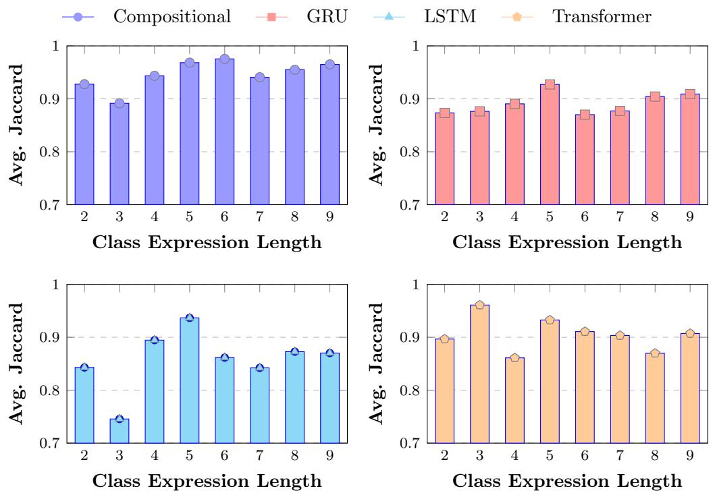  
Figure 1: Average Jaccard scores by class expression length for diferent model architectures. Markers (disc, square, triangle, pentagon) indicate the actual performance for each architecture.

These scores match our expectations: an eagle is not a penguin and is covered with feathers, and an eel is an instance of the class Eel, which is disjoint with ¬Eel. Tokenization-based encoders can nonetheless be sensitive to surface syntax. The two cases below show that removing parentheses from an otherwise equivalent expression changes Transformer predictions substantially:

∗ NIR((¬Eel), animals#eel01) = 0.288,

∗ NIR(¬Eel, animals#eel01) = 0.713.

Regarding runtimes, our neural instance retrievers are highly competitive, especially on large datasets. Relative speedups (see $\Delta _ { \mathrm { T i m e } }$ in Table 6) show that NIR is often substantially faster than Pellet on Carcinogenesis, Family, Mutagenesis, Nctrer, Semantic Bible, and Suramin, while Pellet remains faster on the smallest benchmarks (Animals and Lymphography). This is due to the fact that neural networks are generally fast at inference time since their prediction mechanisms are mostly based on eficient matrix operations, which can further be accelerated on GPUs. Wilcoxon signed-rank tests confirm these diferences are statistically significant $\left( p < 0 . 0 5 \right)$ in most cases, except for the Compositional model on Suramin. Among our models, GRU attains the largest relative speedups on most mediumto-large datasets, followed by the Transformer, LSTM, and Compositional architectures. EBR is comparatively much slower than our neural retrievers and Pellet (Table 6).

Most importantly, our approach allows to predict the likelihood that a given individual is an instance of a concept, which is not supported by existing instance retrieval engines. This can be particularly useful when dealing with incomplete knowledge bases. In this case, a user may set a threshold γ on output probability scores to decide which new assertions to accept and add to an original knowledge base. For example, the assertion $C ( \mathsf { C a k e } _ { - } 2 )$ , where $C = \exists$ hasIngredient.Sugar, can be added to a reference knowledge base if our approach predicts a score higher than the given threshold, i.e., when our approach predicts a score higher than a set threshold. Our approach hence lies between the closed and open-world assumptions Drummond and Shearer (2006), where the truth value of assertions is parameterized by the learned model weights and γ. For incomplete knowledge bases, we recommend a tokenization-based NIR—in our experiments, the Transformer—over the Compositional variant.

## 5.4. Results on Incomplete Knowledge Bases

As mentioned in the experimental setup section, we evaluate NIR on incomplete knowledge bases where random ABox assertions are removed. Figure 2 reports average Jaccard similarity for all eight datasets at retention levels $\alpha \in \{ 0 . 2 5 , 0 . 5 , 0 . 7 5 \}$ ; the point $1 - \alpha { = } 0$ uses the complete-knowledge-base scores from Table 6. Tokenization-based encoders—especially the Transformer—remain competitive with or outperform Pellet under incompleteness on several benchmarks (e.g., Semantic Bible, Nctrer, and Suramin), while Pellet and the Compositional model degrade as more assertions are removed. On Family, Lymphography, and Carcinogenesis, all approaches decline more sharply, which is consistent with smaller or sparser ABoxes (Table 4). Across datasets, the Compositional curves track Pellet closely, confirming that this encoder is the nearest neural surrogate of symbolic retrieval and therefore less robust when assertions are missing. Tokenization-based NIR should therefore be preferred when knowledge bases may be incomplete.

## 5.5. Results with TransE Embeddings

To assess whether NIR depends on a specific embedding method, we retrained the GRU and Transformer retrievers with TransE embeddings Bordes et al. (2013) on complete knowledge bases, keeping all other hyperparameters identical to the main DeCal experiment (Table 6). Figure 3 compares average Jaccard for both embedding methods.

Transformer GRU LSTM Compositional Pellet

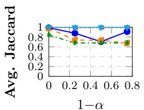  
(a) Animals

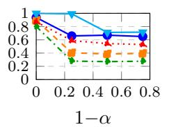  
(b) Carcinogenesis

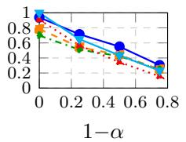  
(c) Family

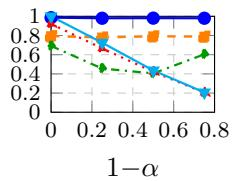  
(d) Lymphography

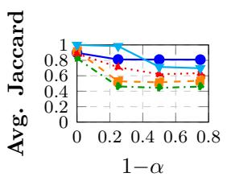  
(e) Mutagenesis

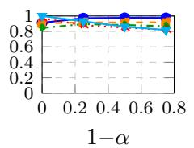  
(f ) Nctrer

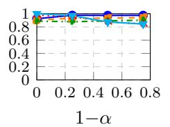  
(g) Semantic Bible

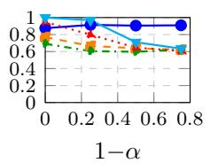  
(h) Suramin  
Figure 2: Average Jaccard for instance retrievers at diferent incompleteness levels across all eight datasets. α is the fraction of ABox assertions retained $( \alpha \in \{ 0 . 2 5 , 0 . 5 , 0 . 7 5 \} )$ ); the horizontal axis shows 1 − α, the fraction removed. At 1 − α=0, scores are taken from the complete knowledge bases (Table 6). Ground-truth instance sets are computed with Pellet on the original complete knowledge bases.

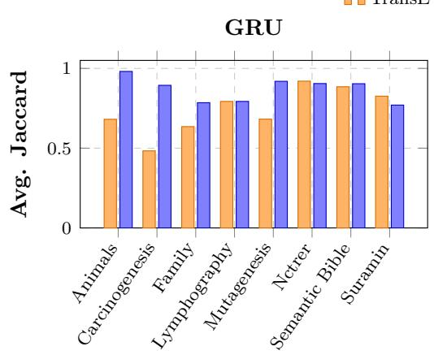  
TransE  
DeCal

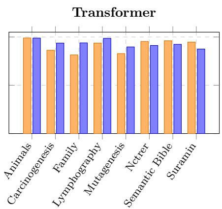  
Figure 3: Average Jaccard on complete knowledge bases for GRU and Transformer with TransE and DeCal embeddings.

On most datasets, both architectures remain competitive when paired with the simpler TransE embeddings (Figure 3). The main exception is Carcinogenesis, where GRU drops from 89.4% (DeCal) to 48.3% (TransE), suggesting that large, sparse knowledge bases may benefit from more expressive embeddings. The Transformer is less sensitive to the embedding choice and attains higher Jaccard with TransE than with DeCal on four datasets: Nctrer (95.4% vs. 91.2%), Semantic Bible (96.1% vs. 92.4%), Suramin (94.6% vs. 87.5%), and Animals (99.0% vs. 98.9%). Overall, medium-sized benchmarks are relatively insensitive to the embedding choice, whereas scale and expressiveness matter more for the largest datasets.

## 6. Conclusion

In this paper, we introduced NIR, a family of neural instance retrievers for ALCIQ, and compared tokenization-based encoders with a Compositional design on eight benchmarks. All variants approximate Pellet closely on complete knowledge bases and are substantially faster at inference. Our main empirical finding is architectural: tokenization-based models— especially the Transformer—generalize better on large and incomplete knowledge bases, whereas the Compositional model tracks symbolic retrieval on complete knowledge bases and supports modular extension to new DL constructors. For CEL pipelines, we recommend a tokenization-based NIR by default, reserving the Compositional design for settings that require operator-level extensibility. Probabilistic outputs further allow graded assertion acceptance and trade-ofs between closed- and open-world reasoning via a user-defined threshold γ.

## References

Franz Baader. The description logic handbook: Theory, implementation and applications. Cambridge university press, 2003.

Antoine Bordes, Nicolas Usunier, Alberto García-Durán, Jason Weston, and Oksana Yakhnenko. Translating embeddings for modeling multi-relational data. In NIPS, pages 2787–2795, 2013.

Jiaoyan Chen, Pan Hu, Ernesto Jimenez-Ruiz, Ole Magnus Holter, Denvar Antonyrajah, and Ian Horrocks. Owl2vec\*: Embedding of owl ontologies. Machine Learning, 110(7): 1813–1845, 2021.

Jiaoyan Chen, Olga Mashkova, Fernando Zhapa-Camacho, Robert Hoehndorf, Yuan He, and Ian Horrocks. Ontology embedding: a survey of methods, applications and resources. IEEE Transactions on Knowledge and Data Engineering, 2025.

Kyunghyun Cho, Bart van Merrienboer, Çaglar Gülçehre, Dzmitry Bahdanau, Fethi Bougares, Holger Schwenk, and Yoshua Bengio. Learning phrase representations using RNN encoder-decoder for statistical machine translation. In EMNLP, pages 1724–1734. ACL, 2014.

Kenneth Ward Church. Word2vec. Natural Language Engineering, 23(1):155–162, 2017.

Caglar Demir and Axel-Cyrille Ngonga Ngomo. Neuro-symbolic class expression learning. In IJCAI, pages 3624–3632, 2023.

Caglar Demir, Anna Himmelhuber, Yushan Liu, Alexander Bigerl, Diego Moussallem, and Axel-Cyrille Ngonga Ngomo. Rapid explainability for skill description learning. In ISWC (Posters/Demos/Industry), 2022.

Nick Drummond and Rob Shearer. The open world assumption. In eSI workshop: the closed world of databases meets the open world of the semantic web, volume 15, page 1, 2006.

Ronald I Frank. A review of logic for computer professionals. 2004.

Birte Glimm, Ian Horrocks, Boris Motik, Giorgos Stoilos, and Zhe Wang. Hermit: an owl 2 reasoner. Journal of automated reasoning, 53:245–269, 2014.

Sepp Hochreiter and Jürgen Schmidhuber. Long short-term memory. Neural Comput., 9(8): 1735–1780, 1997.

Aidan Hogan et al. Knowledge graphs. ACM Comput. Surv., 54(4):71:1–71:37, 2022. doi: 10.1145/3447772.

Louis Mozart Kamdem Teyou, Caglar Demir, and Axel-Cyrille Ngonga Ngomo. Embedding knowledge graphs in degenerate cliford algebras. In ECAI 2024, pages 1293–1300. IOS Press, 2024.

Nikolaos Karalis, Alexander Bigerl, Caglar Demir, Liss Heidrich, and Axel-Cyrille Ngonga Ngomo. Evaluating negation with multi-way joins accelerates class expression learning. In Joint European Conference on Machine Learning and Knowledge Discovery in Databases, pages 199–216. Springer, 2024.

Yevgeny Kazakov. RIQ and SROIQ are harder than SHOIQ. In Gerhard Brewka and Jérôme Lang, editors, Principles of Knowledge Representation and Reasoning: Proceedings of the Eleventh International Conference, KR 2008, Sydney, Australia, September 16-19, 2008, pages 274–284. AAAI Press, 2008.

N’Dah Jean Kouagou, Stefan Heindorf, Caglar Demir, and Axel-Cyrille Ngonga Ngomo. Learning concept lengths accelerates concept learning in ALC. In ESWC, volume 13261 of Lecture Notes in Computer Science, pages 236–252. Springer, 2022.

N’Dah Jean Kouagou. Fast neuro-symbolic approaches for class expression learning. 2025.

N’Dah Jean Kouagou, Stefan Heindorf, Caglar Demir, and Axel-Cyrille Ngonga Ngomo. Neural class expression synthesis. In European Semantic Web Conference, pages 209–226. Springer, 2023.

Juho Lee, Yoonho Lee, Jungtaek Kim, Adam R Kosiorek, Seungjin Choi, and Yee Whye Teh. Set transformer. In International Conference on Machine Learning, volume 4, 2019.

Jens Lehmann, Sören Auer, Lorenz Bühmann, and Sebastian Tramp. Class expression learning for ontology engineering. J. Web Semant., 9(1):71–81, 2011.

Özgür Lütfü Özçep, Mena Leemhuis, and Diedrich Wolter. Cone semantics for logics with negation. In IJCAI, pages 1820–1826, 2020.

Md Kamruzzaman Sarker and Pascal Hitzler. Eficient concept induction for description logics. In Proceedings of the AAAI Conference on Artificial Intelligence, volume 33, pages 3036–3043, 2019.

Rico Sennrich, Barry Haddow, and Alexandra Birch. Neural machine translation of rare words with subword units. arXiv preprint arXiv:1508.07909, 2015.

Tong Shen, Fu Zhang, and Jingwei Cheng. A comprehensive overview of knowledge graph completion. Knowledge-Based Systems, 255:109597, 2022.

Evren Sirin, Bijan Parsia, Bernardo Cuenca Grau, Aditya Kalyanpur, and Yarden Katz. Pellet: A practical owl-dl reasoner. Journal of Web Semantics, 5(2):51–53, 2007.

Louis Mozart Kamdem Teyou, Luke Friedrichs, N’Dah Jean Kouagou, Caglar Demir, Yasir Mahmood, Stefan Heindorf, and Axel-Cyrille Ngonga Ngomo. Neural reasoning for robust instance retrieval in SHOIQ. In K-CAP, pages 61–68. ACM, 2025.

Louis Mozart Kamdem Teyou, Caglar Demir, and Axel-Cyrille Ngonga Ngomo. Semanticsaware caching for concept learning, 2026. URL https://arxiv.org/abs/2603.06506.

Théo Trouillon, Johannes Welbl, Sebastian Riedel, Éric Gaussier, and Guillaume Bouchard. Complex embeddings for simple link prediction. In International conference on machine learning, pages 2071–2080. PMLR, 2016.

Ashish Vaswani, Noam Shazeer, Niki Parmar, Jakob Uszkoreit, Llion Jones, Aidan N Gomez, Łukasz Kaiser, and Illia Polosukhin. Attention is all you need. Advances in neural information processing systems, 30, 2017.

Patrick Westphal, Lorenz Bühmann, Simon Bin, Hajira Jabeen, and Jens Lehmann. Smlbench–a benchmarking framework for structured machine learning. Semantic Web, 10(2): 231–245, 2019.

Bo Xiong, Nico Potyka, Trung-Kien Tran, Mojtaba Nayyeri, and Stefen Staab. Faithful embeddings for el++ knowledge bases. In International Semantic Web Conference, pages 22–38. Springer, 2022.

## Appendix A. Experimental Details

Table 7 summarizes the shared training configuration (d=256, hidden 128, dropout 0.1, γ=0.5; vocabulary 512, max length 128; Transformer: 3 layers / 4 heads).

Table 7: Shared training hyperparameters for all NIR variants.
<table><tr><td>Setting</td><td>Value</td></tr><tr><td>Optimizer</td><td>Adam, learning rate  $3 . 5 \times 1 0 ^ { - 4 }$ </td></tr><tr><td>LR schedule</td><td>Cosine annealing</td></tr><tr><td>Epochs</td><td>400 (no early stopping)</td></tr><tr><td>Batch size</td><td>256</td></tr><tr><td>Train/validation split</td><td>90% / 10%</td></tr><tr><td>Embedding dimension d</td><td>256</td></tr><tr><td>Hidden size</td><td>128</td></tr><tr><td>Dropout</td><td>0.1</td></tr><tr><td>Classification threshold γ</td><td>0.5</td></tr><tr><td>Max sequence length</td><td>128</td></tr><tr><td>Vocabulary size</td><td>512</td></tr><tr><td>RNN layers (GRU/LSTM)</td><td>3</td></tr><tr><td>Transformer layers / heads</td><td>3/4</td></tr><tr><td>Hardware</td><td>NVIDIA H100-40GB, Ubuntu 22.04</td></tr></table>